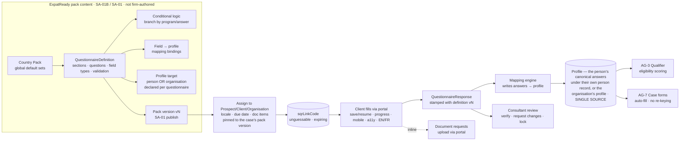
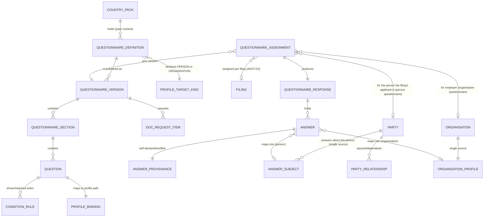

> **Document control** · Version **1.15** · **2026-10-27** · Status: **CC-8 applied: only emails a person writes are copied; system emails go to their usual recipient with no Cc (the product owner, 26 Oct)**; earlier: **AG-19 pointers added (the product owner, 25 Oct: "yes"): the document-request card shows the password prompt for a locked PDF (AG19-D50) and offers phone scan (AG19-D10)**; earlier: **W-17 applied: firms no longer build or publish questionnaires (the product owner, 25 Oct); earlier: Duplicates + copy on emails applied (the product owner, 24 Oct); earlier: AG-02 review decisions applied (20 Oct); earlier: People model (X-2) and filings (AG07-D2, AG07-D8) applied; earlier: Pointer added — forms read the UCI from the person's canonical answer (AG16-73); earlier: Baseline — AG-16 review applied (AG-8-47 pointer to the Automatic messages page); Agent-native decisions applied (document-verification depth answered: the Reader proposes values from identity documents, the Checker flags mismatches, a human still verifies; imported answers are unverified); AG7-D10 applied (no masking and no reveal of personal data; AG7-D7 replaced)**\
> Part of: *Agent (RCIC/Lawyer) Console — Functional Requirements* · Split from `FINAL-Agent-FR.md` lines 5165–5800 on 2026-09-16 · Previous version: `_archive/AG-08-smart-questionnaire_v1.14_2026-10-25.md`\
>
> | Version | Date | Change | Decisions |
> |---|---|---|---|
> | 1.15 | 2026-10-27 | **CC-8 applied (the product owner, 26 Oct; home AG-10-89): only emails a person writes are copied.** The questionnaire invitation and every questionnaire reminder are system emails: they go to their usual recipient with no Cc and are never copied to the case's copy list. AG-8-13 says so in one added sentence. AG-8-51 card: "Where" names who is copied; the rule 9 example and the happy test said "the next document request goes To Client B, Cc Client A" and now say the next email Client C writes to Client B from the case goes To Client B, Cc Client A (AG-10-89, matching SA-01B v2.1 SA-1B-107), while the next document request and questionnaire reminder go to Client B only; one non-goal added. AG-08 never named the questionnaire link as copied and had no "accepted risk" line, so nothing was removed for those. The copy question (AG-8-51) and its `CaseCopy` rows are unchanged: it still fills the copy list. CC-8 row added to "Decisions that change this epic". No requirement ID changed. | CC-8 |
> | 1.14 | 2026-10-25 | **AG-19 pointers added (the product owner, 25 Oct: "yes"; homes AG-09 AG-9-69 and AG-19 AG-19-19).** One line each in §3.6 and AG-8-18: the document-request card shows the password prompt for a locked PDF before upload (AG19-D50, AG-9-69) and offers **Scan with camera** (AG19-D10, AG-19-19). The questionnaire has no upload question type (SA-1B-3), so AG19-D50's "Smart Questionnaire upload question" is applied to the document-request card. Two rows added to "Decisions that change this epic". No requirement ID changed. | AG19-D10 · AG19-D50 |
> | 1.13 | 2026-10-25 | **W-17 applied (decided by the product owner 12 Oct; applied 25 Oct on his instruction).** Firms no longer build, edit, version or publish questionnaires. ExpatReady's content team defines them as pack content (SA-01B library SA-1B-1; sections SA-1B-13, SA-1B-14; rows SA-1B-55 – SA-1B-58; "only if" SA-1B-57; preview SA-1B-62; publish checks SA-1B-63) and publishes them through pack versions (SA-01 SA-1-45 – SA-1-50). **Withdrawn (struck through, text kept):** §3.1 builder, AG-8-1 – AG-8-4, AG-8-7, `agent/sqr:build`, `agent/sqr:publish`, US-1, the §6 firm definition lifecycle, and builder lines in the Module Index, Visual Overview, §1, §2, §3.2, §3.3, §3.7, §3.10, §4, §5, §7, §9, §11, §12, §13. **Reworded:** §3.0, §3.6, §3.10, §7 (a definition is resolved from the filing's row at the pinned pack version, not authored by the firm); AG-8-18 and AG-8-19 against SA-1B-3 (no upload field type) and SA1B-X18 (per-case "Request a document"). **Added:** W-17 decision row; the line "Firm-specific facts every client is asked go on the lead / client record (AG-02 / AG-07; SA1B-X17)." (§2, §3.1). **Kept:** assignment, fill wizard, run-time conditions, mapping, provenance, multi-applicant, pinning, review, BR-3, AG-8-28, AG-8-51 and the other `agent/sqr:*` keys. New open questions §13 Q21 – Q25. Same day: §13 Q21–Q25 closed (Q23 decided by the product owner: separate must-verify flag; the rest follow SA-01B / SA-01). Same day: "French required (Law-25)" in §3.5, BR-12, US test and §13 item 3 aligned with AG16-88 / SA1-D2 (English-first, French optional); the erDiagram binding made required. Same day: SA-01B pointers resolved (SA-01B v1.10). 25 Oct: Resolved (25 Oct) — follows AG07-D6 / AG-7-39 — the staff notification on questionnaire submit struck in §3.4 and §3.5 data flows, §3.12 (bullet and data flow), AG-8-13, AG-8-33, AG-8-34, the §6 row and US-11; the submission is shown on the case, timeline and queue colour; `sqr.submitted` kept as an event; decision row added. 25 Oct: remaining notifications aligned with AG07-D6 / AG-7-39 — §3.4 and §3.6 data flows, AG-8-13, AG-8-34 (AG-08 raises no notifications of its own), the §6 OPENED row, §9 skipped invitation, §12 idempotent consumers; second decision row added. 25 Oct final audit: decision-row pins moved to AG-07 v3.8 and AG-16 v1.23 (§3.3 Defaults note, :544, text unchanged); missing-translation carve-out added to BR-12 and §9 (pack content falls back to English, firm-written content to the firm's default language); AG-8-51 rule (8) employer re-apply detail from AG-17 v0.13 AG-17-96 rule 2. | W-17, SA1B-D25, SA1B-D38, SA1B-X3, SA1B-X17, SA-1B-93, SA-1B-94 · Q23 (the product owner, 25 Oct) |
> | 1.12 | 2026-10-24 | **Duplicates and copy on emails (the product owner, 24 Oct).** (1) **DUP-8 / DUP-9:** the "Possible duplicate?" flag on a family member the client adds in the questionnaire now runs AG-2-14 rules 1-6 (email, phone) and AG-2-14 rule 12 (name + date of birth, family-add paths only); date of birth is the person's profile answer `personal.dateOfBirth`; the client never sees a match. AG-8-28 requirement and card changed; open question 15 closed. (2) **CC-7:** new AG-8-51 (requirement and card): one optional question on the adult case client's questionnaire, "Anyone you'd like us to copy on emails about your case?"; a submitted answer adds people to the case's copy list (`CaseCopy`, home AG-7-97) through AG-2-14, with `source = QUESTIONNAIRE` and the relationship on `CaseCopy.relationship`; a returning client sees their earlier entries and only a confirmed answer writes rows; employer variant in AG-17-96. Where the question lives is **Open — needs the product owner** (open question 18, options A/B/C); two smaller Opens (19, 20). §3.9, §7, §9, §12 and §13 follow. No requirement renumbered. *Fix pass (24 Oct): cross-epic audit findings and decisions F1-F13 applied.* (AG-8-51 rules 4, 6, 8, 9 and tests: F2, F3, F9, F11, G3, G6, G12; AG-8-28 rule 4 and example: G2; §13 Q18-Q20 decided: G18; AG-8-9 to AG-8-11, §3.3, BR-3, US-1, §7, §10 `agent/sqr:template-customise`, §12 and the pack-merge deferral: withdrawn per F4, W-17, SA1B-X3, SA1B-X17, old text struck through.) | DUP-8 · DUP-9 · CC-7 · E2(1), (7), (12), (15), (19) · F1-F13 · G2, G3, G6, G12, G18 |
> | 1.11 | 2026-10-21 | **AG-02 review decisions applied (the product owner, 20 Oct).** (1) AG-8-33 adds the requirement for a person-keyed "answers updated" event with no case, consumed by AG-02 to return a parked (Nurture) prospect to the owner's My Tasks; its shape stays open (AG02-P63). (2) "Convert" and "when a lead retains us" wording replaced by "becomes a client": a person becomes a client by signature, Signed offline or Convert, and the case is opened separately (§1 journey line, §2 Intake staff row, §9 edge case). Pending block: P63 reduced to its design question; P64 reduced to the pre-retainer questionnaire question. No requirement ID added, removed or renumbered. | AG02-D10(10) · AG02-D2 |
> | 1.10 | 2026-10-18 | **People model and filings (the product owner, 18 Oct).** **X-2:** `ContactProfile`, `ContactFamilyMember` and `principalContactId` are retired here in favour of Party + `PartyRelationship` + `AnswerSubject` (home: AG-02). Answers are stored under the person they describe. Adding a family member in the questionnaire creates a person record or reuses one the client already has ("already on file — use her?"; staff decide). An adult family member's answers are shared with the principal by default; staff may tick "Keep private from the principal"; minors' answers are always shared. §13 Q8 closed. **AG07-D2 / AG07-D8(a), (c):** the questionnaire is assigned per filing and uses that filing's rules pin; family members on different programs get different questionnaires. AG-8-12 and AG-8-28 changed; AG-8-49 and AG-8-50 added with cards; AG-8-21, AG-8-22, AG-8-29, BR-1, BR-10, §3.4, §3.9, §7 and §12 wording follows. *18 Oct (final): AG07-D17 – D21 applied — AG07-D18, AG07-D20(h), AG07-D20(m).* **AG07-D20(h):** when the client adds a family member in the questionnaire, the client may pick from family members already linked to them (names only); a new person is created; staff see "Possible duplicate?" and decide (AG-8-28 requirement and card). **AG07-D20(m):** "Keep private from the principal" is one tick per adult on the case's applicant list (AG-8-50, §3.9; home screen AG-07). **AG07-D18:** each applicant has their own rules pin record; one rules version per filing (AG-8-49 wording). **Open questions:** 13 closed; 15 added. Requirement IDs unchanged. *18 Oct (final): AG07-D22 applied — Q43 and Q79 (the principal is the case's client; a child's answers show unless "Keep private from the principal" is ticked: §3.9 privacy bullet, AG-8-50); open question 16 added.* *18 Oct (final): AG07-D23 applied — a minor's answers show to both parents on the case, with no tick for a minor (§3.9 privacy bullet, AG-8-50; open question 16 closed).* *18 Oct (later): X-3 applied — placeholder only: open question 17 asks which status dates each person holds (linked to AG-07 D9 Q109); no requirement ID added or changed.* | X-2 · AG07-D2 · AG07-D8(a), (c) · AG07-D18 · AG07-D20(h), (m) · AG07-D22 · AG07-D23 · X-3 |
> | 1.9 | 2026-10-17 | **Pointer only (AG16-73, the product owner, 17 Oct):** forms read the UCI from the person's canonical answer (`ClientCanonicalAnswer`); the field, its history and the submission snapshot are specified once in AG-7-95. AG-8-48 added; no control and no card here. *Same-day fixes (18 Oct): AG16-92 — email-first (M6). A questionnaire reminder carries a refreshed link and all answers are kept (AG-8-14); a new test is added to US-3. No other change.* *18 Oct: new section 'Decisions that change this epic' (index of AG16 decisions; no requirement changed).* | AG16-73 · AG16-92 |
> | 1.8 | 2026-10-14 | AG-16 review (the product owner, 14 Oct). **AG-8-47 changed:** the questionnaire invitation and reminders no longer name "supervision" or "autonomy" as rails (Supervised client messages withdrawn, R5; per-module autonomy removed). Whether they send automatically, ask first or stay off is set on the Automatic messages page (AG-12); this module adds no control of its own. | AG16-11 · R5 |
> | 1.7 | 2026-10-07 | Permission-key naming from SA-06 v3.0 (the product owner, 7 Oct; SA6-D10, Appendix B). **Renamed in §10:** `agent/sqr:template.customise` is now `agent/sqr:template-customise` and `agent/sqr:document.manage` is now `agent/sqr:document-manage` (the dot is reserved for `view.own` / `view.all`; the action takes a hyphen). Same two keys, same meaning, same seeding; no other key in this module changes (the withdrawn `reveal-pii` and `pii:export-unmasked` rows stay withdrawn). "A firm admin builds" in §3.1 now reads "An Admin builds" (SA6-D5). Requirement IDs unchanged. | SA6-D10 · SA6-D5 |
> | 1.6 | 2026-10-07 | Role clean-up from SA-06 v3.0 (the product owner, 7 Oct): no licensed-representative role template — `agent/sqr:verify` is now seeded on the **Owner, Case Manager and Case Officer** starter roles (was "licensed roles and case officers"); the firm may grant it to any role; every use is audited. Persona and role names in §2 now use the six starter-role names. Requirement IDs unchanged. | SA6-D2, SA6-D5 |
> | 1.5 | 2026-10-05 | Knock-on from AG-07 v2.3 (sensitive data — AG7-D7, the product owner, 5 Oct): passport, financial and admissibility answers show in full on screens to firm users who may see the response; masked in lists, search, exports, notifications/emails, reports and logs; an unmasked export needs `agent/pii:export-unmasked` (owned by SA-06's catalogue) and is audited. `agent/sqr:reveal-pii` withdrawn. Spouse-privacy question (§13 Q8) unchanged. Changed: AG-8-35, AG-8-37, BR-17, the US acceptance criterion on firm-side masking, the "PII reveal" edge case, §10 (`agent/sqr:reveal-pii` withdrawn v1.5; new row `agent/pii:export-unmasked`; `agent/sqr:export`), §11 (PII bullet; audit bullet), §12 gap lines on masking and audited reveal, §13 Q8 untouched. Same day (AG7-D10): masking and reveal removed — personal data is never masked and there are no reveal actions; `agent/pii:export-unmasked` withdrawn (row kept); `agent/sqr:reveal-pii` stays withdrawn; exports need only `agent/sqr:export` and are audited; AG-8-35, AG-8-37, BR-17, the acceptance criterion, the PII edge case, §10, §11, §12 and the summary lines reworded. Kept: no PII in logs, encryption at rest. | AG7-D7, AG7-D10 |
> | 1.4 | 2026-10-04 | Agent-native decisions applied (the product owner, 4 Oct). **Open question 10 (document verification depth) is answered:** in **Release 1** the **Reader** proposes profile values from **identity documents** (a client's inline upload, §3.6) and the **Checker** flags mismatches between what the client typed and what the document shows; a **human still verifies** — the §3.8 verification flag and its rules are **unchanged**, and a Reader-proposed value stays unverified until a person verifies it. **Imported answers** (AG18-D6) are stamped with their source and are **unverified until a human verifies them**; imports never trigger client-facing automation (AG18-D7). The OCR deferral is removed. Changed: §3.6, §3.7, §3.8, AG-8-25, §7 `AnswerProvenance`, §12, §13 (open question 10 resolved, open question 11 added, OCR deferral removed); added: AG-8-41 to AG-8-45, BR-22, BR-23, US-12, two edge cases. Same day (simplify): **approve = verify** (AG11-D10). Approving a Reader-proposed value in its review view, which shows the document region beside the value, **is** the verification — the value becomes verified and the approver is the verifier; this **replaces** the wording above that a Reader value is approved as unverified and verified in a separate act. Imported values stay unverified. Reader results on a **client's** upload wait in Needs you (nobody was present); when **staff upload and review**, the approval is **inline** (AG11-D2). The floor on values written into the verified profile is now "without a human having looked at its source" (AG11-D1 revised). Revised same day: §3.6, §3.7, §3.8, AG-8-25, AG-8-41, AG-8-44, BR-22, US-12, §7 `AnswerProvenance`, §12, §13 (open question 10, OCR deferral line). Added: none. Same day (review fixes): **the verify permission is `agent/sqr:verify` — the single rule** (AG11-D11(e)): marking a fact verified, approving a Reader-proposed value and confirming imported values all need it; it is stated in §10 and cited in AG-8-26, AG-8-44 and AG-8-46, and other modules cite this section; which roles hold it is the firm's choice, seeded on licensed roles and case officers. **"Verify imported values"** (AG18-D10(e)) is the verification mechanism for imported answers (AG-8-46). **AG-8-43 revised** — a quiet client, case or lead (and any record whose recipient party is quiet) gets no client-facing automation at import or on any later trigger or scan, until the firm switches it on (AG18-D9, D10(a)); the state is shown as "Not started". **AI** is one firm switch, off until Super Admin records the provider terms (AG11-D13); client-supplied content reaches the Reader as delimited data. Overriding principle (we work for the firm, not the regulator): regulator wording removed from §3.8, BR-15 and §11. Changed: Applied-from table, §3.8, AG-8-41, AG-8-43, AG-8-44, BR-15, BR-22, US-12, §10 (`agent/sqr:verify`), §11, §12, §13 (open question 10); added: AG-8-46, three edge cases. Same day (final alignment): the import value in the fact-provenance `source` enum is `IMPORT`, the single import marker used everywhere (AG18-D10(a); was `IMPORTED`) (§7 `AnswerProvenance`). **5 Oct (Release 1 scope review, AG11-D18):** questionnaire invitations and reminders go by WhatsApp as well as email in Release 1 — the client's preferred channel, using a provider-approved template, with email as the fallback if none exists (AG11-D18(a)); only SMS stays Release 2. The "live SMS/WhatsApp intake invitations and reminders" deferral is narrowed to SMS. Changed: AG-8-13, §3.5 (assign), §3.8 gap-chase text, §9 edge cases, §13 open question 11, named deferrals. New: AG-8-47. | AG11-D1, D2, D4, D10 · AG18-D6, D7 · AG11-D11, D13 · AG18-D9, D10 · AG11-D18 |
> | 1.3 | 2026-10-03 | Consistency review fixes (3 Oct). AG-8-40 now points to AG-7-56 and AG-07 BR-21 for adopting a newer pack version (was "AG-17-5"). Provenance gains a value for **answers entered by staff on the client's behalf (who, when)**, shown as such on the case; no new permission (§3.8, AG-8-25, §7 `AnswerProvenance`; cross-reference AG-15-44, AG17-D66, AG17-D74). New "Applied from AG-17" table added. "Phase-1 / Phase-2 / Phase-3" wording in the open questions and named deferrals replaced by Release terms (AG17-D60). Requirement IDs unchanged. | AG17-D66, AG17-D74 · AG17-D60 |
> | 1.2 | 2026-10-02 | Applied corporate decisions from AG-17. (1) A questionnaire can save to an **organisation's** profile as well as a person's — each questionnaire declares which, in the pack (per questionnaire, not per question); employer onboarding answers live on the employer's profile and are confirmed/updated on the next file: §3.0, §3.7, both diagrams, §7 entities, BR-1, AG-8-21/22 changed, AG-8-38/39 and BR-19/20 added. (2) Where a firm makes unverified facts stop filing, "block" becomes severity **CRITICAL**, passed only with `agent/case:waive-deficiency` and a reason; nothing is locked: §3.8, AG-8-27, BR-9, US-5, open question 6. (3) Version pinning is **per case**: a questionnaire bound to a case uses that case's pinned pack version; new cases start on the current one: §3.4, §3.10, AG-8-12/31 changed, AG-8-40 and BR-21 added, BR-4 changed. | AG17-D17, AG17-D25, AG17-D33, AG17-D65, AG17-D67 |
> | 1.1 | 2026-08-28 | Baseline — complete document v1.1 | — |

## Decisions that change this epic (14–18 Oct; AG-02 rows added 21 Oct; DUP and CC rows added 24 Oct; W-17, Q23, AG19-D10 and AG19-D50 rows added 25 Oct; CC-8 row added 27 Oct) *(new 18 Oct; updated 18 Oct)*

Product-wide rules (apply here as everywhere; home: Agent `00-Overview` → "Product rules every epic follows"): AG16-11, AG16-92.

The "AG16" prefix is historical: these decisions began in the AG-16 review and apply across the product. Full text: `TEMPLATE-MAP-working_2026-10-10.md`.

| Decision | What was decided (one line) | What it changes in this epic | Where (requirement / card / section) |
|---|---|---|---|
| AG16-11 | One "Automatic messages" page, documented in one place only | The questionnaire invitation and reminders no longer name "supervision" or "autonomy"; whether they send automatically, ask first or stay off is set on the Automatic messages page (AG-12); this module adds no control | AG-8-47 |
| AG16-73 | One record per government step with its deadline; UCI as a canonical answer | Forms read the person's UCI from their canonical answer; the field, its history and the snapshot are specified once in AG-7-95; no control and no card here | AG-8-48 (pointer) |
| AG16-92 | Email-first: the portal is optional | A questionnaire reminder carries a refreshed link and all answers already given are kept (no-login link) | AG-8-14, US-3 (new reminder test) |
| X-2 | One person record per real person; answers live under the person they describe (home: AG-02) | `ContactProfile`, `ContactFamilyMember`, `principalContactId` retired for Party + `PartyRelationship` + `AnswerSubject`. Adding a family member in the questionnaire creates or reuses a person record ("already on file" offer). Adult answers shared with the principal by default; "Keep private from the principal" (set by staff). Spouse-privacy question (Q8) closed | AG-8-28 (changed, card) · AG-8-29 · AG-8-50 (pointer) · §3.7 · §3.9 · §7 · §13 Q8 |
| AG07-D2 | One rules pin per filing | The questionnaire is assigned per filing and uses that filing's rules version; everyone on the filing uses that one version; a filing added later starts on the case's current version | AG-8-12 · AG-8-49 (card) · §3.4 · §7 `QuestionnaireAssignment` |
| AG07-D8(a), (c) | Several filings in one case, and family members on different programs: Release 1 | Each filing has its own program, so its own questionnaire; a family on different programs gets a questionnaire per filing | AG-8-49 · §3.9 · US-7 |
| AG07-D18 | A rules version record per person on a filing (refines AG07-D2; home AG-07) | Each applicant has their own rules pin record; all applicants on a filing are on the filing's one rules version. The questionnaire still reads that one version | AG-8-49 (requirement, card rules 3, data, non-goals) |
| AG07-D20(h) | Client adds a family member in the questionnaire (X-2, AG16-44) | The client may pick from family members already linked to them (names only); a new person is created; staff see "Possible duplicate?" and decide | AG-8-28 (requirement and card) · §3.9 · §13 Q15 (closed 24 Oct, DUP-9) |
| AG07-D20(m) | "Keep private from the principal": one tick per adult on the case's applicant list | The tick is per adult on the applicant list, not per answer or questionnaire; the screen is in AG-07 (AG-08 adds no control); Q13 closed | AG-8-50 · §3.9 · §13 Q13 (closed) |
| AG07-D22 (Q43, Q79) | The case's principal is the case's client. A child's answers show on the staff case screen and in the client portal to the principal, unless "Keep private from the principal" is ticked. | §3.9 privacy bullet and AG-8-50 no longer say "minors always"; they name the case's client as the principal. | §3.9 · AG-8-50 · §13 Q16 |
| AG07-D23 (1) | A minor's answers are shown to both parents on the case: the case's client and the other parent, when that parent is on the case (Client B and Client A see Client D's answers), on the staff case screen and in each parent's portal. There is no "Keep private from the principal" tick for a minor; the tick stays one per adult. | §3.9 privacy bullet and AG-8-50 say both parents see a minor's answers and that a minor has no tick. Open question 16 closed. *(changed 18 Oct — AG07-D23)* | §3.9 · AG-8-50 · §13 Q16 (closed) |
| X-3 | Expiry watch (placeholder; rules in AG-11 §3.4a) | Staff are reminded before a person's status expires. Which status dates each person holds, and their keys, are not yet specified here; they are an answer about the person (X-2) and are specified in the AG-11 review, with AG-07 D9 Q109 (the keys of the status expiry are not named). No control and no card here. | §13 Q17 (placeholder) |
| AG02-D10(10) (part of AG02-P63) | A Nurture prospect returns to the owner's My Tasks on its date, a reply or updated answers; no automatic stage move | AG-08 raises a person-keyed "answers updated" event that needs no case; AG-02 consumes it. Its shape (new event, or `sqr.profile_updated` with `partyId`) stays open (AG02-P63) | AG-8-33
| AG02-D2 (part of AG02-P64) | A person becomes a client once: ExpatReady signature, Signed offline or manual Convert; nothing client-facing fires; onboarding starts when the case is created | "Retainer signed → convert to client/case", "When a lead retains us" and "Lead converted to a client" reworded to "becomes a client" and "the case is opened" | §1 journey line · §2 Intake staff row · §9 edge case |
| DUP-8 / DUP-9 (the product owner, 24 Oct; AG-2-14 rule 12) | A family member added on a family-add path is checked against the firm's person records by email and phone (AG-2-14 rules 1-6) and by normalised first name + last name + date of birth (AG-2-14 rule 12); an offer only | The "Possible duplicate?" flag on a new family member added in the client's questionnaire uses exactly that check; date of birth is the profile answer `personal.dateOfBirth`; the client never sees the match; an expected child is checked when the person is created | AG-8-28 (requirement and card) · §3.9 · §13 Q15 (closed) |
| CC-7 (the product owner, 24 Oct; with CC-1, CC-5, CC-6) | The client can name people to copy on case emails in their questionnaire; the copy list is case level (`CaseCopy`, home AG-7-97) | New optional question for the adult case client; a submitted answer writes `CaseCopy` rows (`source = QUESTIONNAIRE`) through AG-2-14; relationship on `CaseCopy.relationship`; a returning client sees earlier entries, only a confirmed answer writes rows; employer variant in AG-17-96. ~~Placement of the question is Open~~ *(fix pass 24 Oct)* Placement decided option A (F9); several email matches (F2) and re-submit removal (F3, G6) decided | AG-8-51 (new requirement and card) · §7 · §9 · §12 · §13 Q18-Q20 |
| W-17 (the product owner, 12 Oct; applied here 25 Oct; home SA-01B SA1B-D25, SA1B-X17) | Firms see only the final questionnaire and the dynamic document checklist for the case's programme, category and family; ExpatReady's configuration behind them is never shown to firms | Firms no longer build, edit, version or publish questionnaires: no builder, no firm publish, no firm-added questions, no hiding or reordering, no clones, no "who answers" switch (SA1B-D38), no firm questionnaire screens (SA1B-X3). Definitions are ExpatReady pack content (SA-1B-1, SA-1B-55 – SA-1B-63), published through pack versions (SA-01 SA-1-45 – SA-1-50). Firm-specific facts every client is asked go on the lead / client record (AG-02 / AG-07; SA1B-X17). Run-time use is unchanged | §2, §3.0, §3.1 (withdrawn), §3.2, §3.6, §3.7, §3.10, AG-8-1 – AG-8-4 and AG-8-7 (withdrawn), AG-8-18, AG-8-19, AG-8-35, BR-2, BR-4, BR-16, §6, §7, US-1 (withdrawn), US-8, §9, §10 (`build`, `publish` withdrawn), §11, §12, §13 Q21 – Q25 |
| Q23 / W-17 knock-on — must-verify flag (the product owner, 25 Oct) | Option B: a separate yes/no "must verify before filing" (`mustVerifyBeforeFiling`) on the library canonical field (SA-1B-1), set only by ExpatReady's content team with the Immigration-SME; firms have no setting | Which facts are must-verify comes from the field's own flag, not from the "immigration-significant" flag (that one only controls whether a value may go into a message, SA-5-64, AG-11-97). An unverified must-verify fact is a CRITICAL deficiency at the AG-07 filing step (AG17-D25), passed only with `agent/case:waive-deficiency` and a reason. Flag in SA-01B v1.10: SA-1B-1, SA1B-D42 | §3.8 · AG-8-27 · BR-9 · §7 `Question` · US-5 · §13 Q23 (closed) |
| AG07-D6 / AG-7-39 (25 Oct; home AG-07 v3.8 AG-7-39) | Staff are notified only when someone hands them work (four notifications); everything else is shown, not pushed | Resolved (25 Oct) — follows AG07-D6 / AG-7-39: a submitted questionnaire is shown on the case, its timeline and the queue colour, like "a document received" (AG-7-39 rule 5); the staff notification on submit is struck. `sqr.submitted` stays an event (mapping, re-score, case advance) | §3.4 · §3.5 · §3.12 · AG-8-13 · AG-8-33 · AG-8-34 · §6 · US-11 |
| AG07-D6 / AG-7-39, remaining notifications (25 Oct; home AG-07 v3.8 AG-7-39 rules 1, 5, 6; AG-16 v1.23 §3.3 "Defaults" note *(changed 18 Oct — AG07-D6)*, :544) | Staff get a notification only for the four hand-offs of AG-7-39 rule 1; client-side events are shown, not pushed; Minder reminders are reminders, not notifications | AG-08 raises no notifications of its own. Assigned / opened and document uploaded are shown on the assignment, case and timeline; mapping conflict and unverified must-verify facts show in the filing-readiness view (AG-8-27) and on the case; an unverified must-verify fact is also a CRITICAL deficiency (AG-07 AG-7-26 rule 3) ~~and in the case officer's Needs you (AG-11-115 rule 5(1))~~ (Needs you holds approval items only, AG-11-55); reminder-due stays a Minder reminder (AG-13 §3.2); a skipped invitation shows "Invitation not sent: <reason>" | §3.4 · §3.6 · AG-8-13 · AG-8-34 · §6 · §9 · §12 |
| AG19-D10 (the product owner, 22 Oct; home AG-19, AG-19-19) | Phone scan on every client upload route: several photos become one clean PDF, cropped and straightened | Pointer: the document-request card offers **Scan with camera** (AG-19-19) | §3.6 · AG-8-18 |
| AG19-D50 (the product owner, 25 Oct; narrows AG19-D49; home AG-09, AG-9-69) | The password prompt (Unlock / Upload as is; unlock before upload; password never stored or logged; a file that only forbids changes is unlocked automatically) shows only where the client uploads inside ExpatReady: the portal Documents tab, the questionnaire's upload and the no-login upload page | Pointer: the document-request card shows the password prompt before upload (AG-9-69). There is no upload question type (SA-1B-3), so the questionnaire's upload is the document-request card | §3.6 · AG-8-18 |
| CC-8 (the product owner, 26 Oct; home AG-10-89) | Only emails a person writes are copied. Every system email goes to its usual recipient with no Cc: the principal applicant, the employer's primary contact on an LMIA file, or the worker on their own work-permit case | The questionnaire invitation and its reminders are system emails and are never copied; each person who gets their own questionnaire link keeps getting it. The copy question still fills the copy list (unchanged). Examples now show a staff-written email being copied, not a document request | AG-8-13 · AG-8-51 (card fields 3, 5 rule 9 example, 11, 13) |

## Module AG-8: Smart Questionnaire (SQR)

**Applied from AG-11 / AG-18 (Agent-native decisions, 2026-10-04)** (decisions owned by `AG-11-automation` and the new module `AG-18` Data Import & Migration; decided by the product owner, product owner, 4 Oct 2026):

| ID | Decision | Applied here |
|---|---|---|
| **AG11-D1** | Autonomy level on every automated action; hard floor at `APPROVE` for any value written into the verified profile without a human having looked at its source *(revised same day — the Reader's review view shows the source beside the value, so approving there meets the floor)* | §3.6 · §3.8 · AG-8-41 · BR-22 |
| **AG11-D2** | *(revised same day)* Approve inline, queue only what is waiting: Reader results on **client uploads** (no human present) wait in Needs you for approve · edit then approve · reject; when **staff upload and review**, the approval is inline in the review view and no Needs you item is created; never auto-execute on timeout | §3.6 · AG-8-41 · US-12 |
| **AG11-D10** | **Reader approve = verify:** approving a Reader-proposed value in its review view (document region beside the value) is the verification — the value becomes verified and the approver is the verifier, one act not two. Imported values stay unverified until checked against a source. Replaces the v1.4 wording "approving writes unverified; verification is separate" | §3.6 · §3.7 · §3.8 · AG-8-25 · AG-8-41 · AG-8-44 · BR-22 · US-12 · §7 `AnswerProvenance` · §13 Q10 |
| **AG11-D4** | **Reader** proposes values from identity documents with provenance + confidence; **Checker** cross-checks typed values against documents and feeds the Deficiency Library as warnings, never a lock; never fabricate; AI optional with a manual fallback | §3.6 · §3.8 · AG-8-41 · AG-8-42 · AG-8-44 · BR-22 · BR-23 · §13 Q10 · Q11 |
| **AG18-D6** | Imported values are stamped "imported from <source>, <date>, by <user>" and are **unverified** until a human verifies them against a source *(revised same day — an approved Reader value is verified by that approval, AG11-D10)* | §3.8 · AG-8-25 · AG-8-43 · BR-22 · §7 `AnswerProvenance` · US-12 |
| **AG18-D7** | Imports never trigger client-facing automation | AG-8-43 |
| **AG18-D9** *(same day)* | Clients, leads and cases created by an import are **quiet** for client-facing automation — at import and on every later trigger or scheduled scan — until the firm switches them on ("Start client automations", per batch or per client, after a preview; audited). Internal work runs; a manual message does not switch a client on. Owned by AG-18 | AG-8-43 · US-12 · §9 |
| **AG11-D11** *(same day — review fixes)* | **The firm decides; licence-aware defaults.** Applied here: verifying Reader values needs `agent/sqr:verify` — the single rule, replacing "profile-edit permission" wherever it appears; which roles hold it is the firm's choice, seeded on the Owner, Case Manager and Case Officer starter roles *(changed v1.6 — SA6-D2)*. Owned by AG-11 | §10 · AG-8-26 · AG-8-44 · AG-8-46 |
| **AG11-D18** *(5 Oct — Release 1 scope review)* | (a) Proactive outbound WhatsApp (provider-approved templates, preferred channel, email fallback) is Release 1, so questionnaire invitations and reminders can go by WhatsApp; SMS stays Release 2. (e) The Reader also reads IRCC/government letters, language test results and ECA reports in Release 1 (final list from the Immigration-SME as pack content). | §3.5 · AG-8-13, AG-8-47 · §9 · §13 Q11 · named deferrals |
| **AG11-D13** *(same day)* | AI Doers are off for every firm until Super Admin records the provider, processing region and a no-training/no-retention agreement; then the Owner switches AI on once (audited) — one firm switch for all four Doers. Client-supplied content is passed to models as delimited data, never instructions, and models have no tool access. Owned by AG-11 | AG-8-41 · AG-8-42 · AG-8-45 |
| **AG18-D10** *(same day — review fixes)* | Imports usable and safe. Applied here: (a) a record is skipped if it, any record it concerns, or the recipient party is QUIET; the UI shows "Not started"; (e) spreadsheet-imported values stay unverified; a per-client **"Verify imported values"** action lists them, the verifier checks each against a document or their own records (attestation recorded) and can confirm all shown at once; a later Reader-approved document value supersedes the imported value; Reader values from an imported document are verified on approval like any upload (AG11-D10). Owned by AG-18 | AG-8-43 · AG-8-46 · BR-22 · US-12 · §9 |

*Pending knock-ons owned elsewhere (not decided here):* SA-08 (AI model and OCR provider), SA-11 (AI processing and no-training rule in data governance; the gate that keeps AI Doers off until terms are recorded, AG11-D13), SA-12 (platform kill switch for AI Doers).

**Applied from SA-06 v3.0 (roles, 2026-10-07)** (decisions owned by `SA-06`; decided by the product owner, product owner, 7 Oct 2026):

| ID | Decision | Applied here |
|---|---|---|
| **SA6-D10** *(v1.7)* | Naming rule: one kebab-case resource, one action; the dot is reserved for `view.own` / `view.all`; old-to-new map in SA-06 Appendix B. Applied: `agent/sqr:template.customise` to `agent/sqr:template-customise`; `agent/sqr:document.manage` to `agent/sqr:document-manage` | §10 |
| **SA6-D2** | No licensed-representative role template and no licence check on permissions; professional-approval permissions are seeded on Owner and Case Manager; the firm may grant them to any role; every use is audited | §10 `agent/sqr:verify` seeding (seeded on Owner, Case Manager and Case Officer) |
| **SA6-D5** | Six starter roles: Owner, Admin, Case Manager, Case Officer, Billing / Finance, Read-only; "RCIC/Regulated Consultant" and "Sales/Intake Rep" templates no longer exist | §2 personas |

*Left unchanged on purpose:* mentions of the licensed professional as a person (AG-8 §3.8 gates paragraph — "the firm's licensed professional decides") and the "RCIC / Consultant" persona, which describe a person, not a role template.

**Applied from AG-17 v0.1 (corporate decisions, 2026-10-02/03)** (decisions owned by `AG-17-corporate-cases-and-lmia` §0):

| ID | Decision | Applied here |
|---|---|---|
| **AG17-D17** | Nothing is ever locked; a critical item is a CRITICAL warning passed only with `agent/case:waive-deficiency` and a reason | §3.8 · AG-8-27 · BR-9 · US-5 · §13 Q6 |
| **AG17-D25** | Pack "block" settings become severity CRITICAL, applied to the filing gate | §3.8 · AG-8-27 · BR-9 |
| **AG17-D33** | Employer onboarding is collected by a questionnaire and saved to the employer's profile; answers bind to an organisation | §3.7 · AG-8-39 · BR-20 |
| **AG17-D65** | Rules are pinned per case, not per client; new cases start on the current pack version | §3.4 · §3.10 · AG-8-12 · AG-8-31 · AG-8-40 · BR-4 · BR-21 |
| **AG17-D66 / D74** | "Done on behalf of client": answers entered by staff are marked with who and when; no new permission | §3.8 · AG-8-25 · §7 (cross-reference AG-15-44) |
| **AG17-D67** | A questionnaire can save to an organisation's profile, declared per questionnaire in the pack | §3.0 · §3.7 · AG-8-21 · AG-8-22 · AG-8-38 · AG-8-39 · BR-1 · BR-19 · BR-20 |

### Module Index

Scan the whole module in ~30 seconds; jump to any part.

1. **Purpose & Goal**
2. **Users & Jobs-to-be-Done**
3. **Functional Design — How It Works** (core)
   - 3.0 The single-source model (Definition → Assignment → Response → Profile) · ~~3.1 Questionnaire builder (config-driven definitions)~~ withdrawn, W-17 · 3.2 Conditional / branching logic · 3.3 Pack/program-aware templates (global default; ~~+ firm override~~ withdrawn, F4) · 3.4 Assignment to a prospect/client · 3.5 Client-facing fill (portal: save/resume, progress, mobile, a11y, per-locale) · 3.6 Inline document-request items · 3.7 Single-source mapping (answers → the person's profile → Qualifier + forms) · 3.8 Provenance & verification (self-declared vs document-verified) · 3.9 Multi-applicant linkage (principal ↔ spouse ↔ dependants) · 3.10 Versioning of definitions (responses version-stamped) · 3.11 Review, lock, request-changes & re-open · 3.12 Submission, completeness & gap surfacing
4. **Detailed Functional Requirements** (AG-8-x)
5. **Business Rules & Logic**
6. **States & Lifecycle**
7. **Key Entities & Fields**
8. **User Stories + Acceptance Criteria**
9. **Edge Cases & Validations**
10. **Permissions** (LOCAL `agent/*`)
11. **Scalability · Security · Performance**
12. **Reference Note** (exists / NEW / changed)
13. **Open Questions / Founder Decisions**

### Visual Overview

**A. The intake lifecycle — ~~authoring~~ pack content → assign → client fills → maps to profile/forms** (one definition is ~~authored once from the pack~~ defined once by ExpatReady in the pack and published in a pack version *(W-17; SA-1B-1, SA-1-45)*, assigned to a case, filled by the client, then *mapped* into the canonical profile that feeds scoring and forms — the map step is the heart of "no re-keying"):



> *(changed 25 Oct — W-17)* The authoring box was labelled "Firm console · authoring" and its last step "Publish → version vN". Firms no longer author or publish (SA1B-D25, SA1B-X17): ExpatReady's content team holds the definition, conditions, bindings and profile target in the pack (SA-1B-1, SA-1B-13, SA-1B-14, SA-1B-57) and publishes it in a pack version (SA-1-45).

**B. SQR data model** (a definition is ~~firm/~~pack-scoped and versioned through pack versions *(W-17)*; a response points at one immutable version; answers map into the single-source profile; documents and verification attach polymorphically):



> *(changed 25 Oct — W-17)* The pack-to-definition link read "seeds default sets"; the pack now holds the definition itself, with no firm copy (SA1B-X3).

> `Note · Task · Reminder · Document · AuditLog · Notification` attach to a `QUESTIONNAIRE_ASSIGNMENT`, a `PARTY`, or a `CASE` via the polymorphic `(entityType, entityId)` pattern — defined once (Part 2), reused here, never redefined.

---

### 1. Purpose & Goal

**What it is.** AG-8 is the firm's **intake brain** — the system that asks an applicant the *right* questions, in the *right* language, and turns their answers into structured, reusable, verifiable data that the rest of the platform runs on. It sits at the seam between sales and delivery: a lead is qualified (AG-3) and retained (AG-5/AG-6), and the SQR is how that person's full immigration story is captured **once** so the case file, the eligibility re-check, and every government form fill themselves. It is the single biggest lever on case-delivery speed and data quality in the whole product.

**The business outcome it must produce.** Immigration firms drown in **re-keying and chasing**. The same facts — date of birth, marital status, education, language scores, work history, family members, travel history, admissibility answers — are typed into a CRM, then re-typed into a case intake sheet, then re-typed (often by a paralegal, often with transcription errors) into IRCC/government PDF forms. A wrong digit on a passport number or a misaligned date is a refusal risk. Meanwhile staff spend hours emailing clients "please also send…" because the intake was incomplete. AG-8 exists to make **"capture once, reuse everywhere, know what's still missing"** structurally true: a single, branching, bilingual questionnaire that the client fills on their phone, that maps directly into one canonical profile, that feeds both scoring and forms with **zero re-keying**, and that tells the consultant exactly which facts still need a supporting document. Secondary outcomes: a faster, more professional client onboarding experience (a guided wizard, not a 40-page Word doc), fewer transcription errors (typed by the person who knows the answer), and a clear record of *who declared what, when, in which language, and whether it's been verified*.

**Why it matters / world-class positioning.** A generic form builder (Typeform, Google Forms, JotForm) produces a flat bag of answers in a spreadsheet — disconnected from eligibility, disconnected from the case forms, with no concept of "this field is the same `dateOfBirth` the Qualifier scored on and the IMM-0008 needs." Expat Ready's SQR is an **immigration-native intake engine**: (a) it is **single-source** — every question is *bound* to a canonical profile path, so the answer flows into the Qualifier and the government forms without a human retyping it; (b) it is **program-aware and conditional** — the spouse section only appears if married, the LMIA questions only appear for a work-permit pathway, the questions come from the firm's **Country Pack** so the same engine serves a firm provisioned for Canada today and one provisioned for Australia or the UK tomorrow; (c) it is **provenance-aware** — every fact is tagged self-declared vs document-verified, so the consultant always knows what still needs evidence before filing; and (d) it is **multi-applicant** — principal, spouse, and dependants are kept consistent (family size is declared once and shared). No generic form tool can do any of this. The moat is the **binding layer** (questions → canonical fields → scoring + forms) and **immigration-correctness** (pack-driven sets, conditional logic, verification gates) baked in.

**How it ties to the case-delivery journey.** The person becomes a client (retainer signed, Signed offline or Convert — AG-2) → staff open the case (AG-7) → **SQR assigned** (AG-8) → client fills via portal → answers map to the person's profile → **Qualifier re-scores** on the now-complete profile (AG-3) and **case forms auto-fill** (AG-7) → consultant **verifies** facts against uploaded documents (AG-8 provenance) → workflow proceeds (AG-9+). AG-8 owns the capture-and-map step and hands clean, structured, provenance-tagged data to everything downstream.

**Global ambition (founder's core point).** The same module serves a solo RCIC provisioned for Canada and a firm provisioned for Australia or the UK with **no code change per country** — the platform is multi-country, a firm is not (FD-68). Questionnaire *sets* come from the firm's Country Pack; conditional logic keys off the pathway/program in that pack; the client fills in **their** language (EN/FR… first-class, never an afterthought); definitions are versioned ~~so a firm can evolve its intake~~ so ExpatReady can evolve the intake through pack versions *(W-17; SA-1-45, SA-1-47)* without breaking historical responses. Single-locale is the degenerate case within a firm.

---

### 2. Users & Jobs-to-be-Done

The "Agent" persona is an umbrella; AG-8 is used very differently by the firm side (~~authoring +~~ assignment + review; authoring withdrawn, W-17) and the **client** (filling). JTBD framing keeps the design honest.

| Role | Primary job in AG-8 | Jobs-to-be-done (representative) |
|---|---|---|
| **Client / Applicant** (the filler — external) | Tell the firm everything about my case, once, on my phone, in my language, without confusion. | "When I'm asked for my details, I want a guided, plain-language wizard I can pause and resume, that only asks what's relevant to me, so I'm not overwhelmed by a 40-page form." · "When I don't have a document handy, I want to save and come back, so I don't lose my progress." · "When the form is in English but I'm more comfortable in French, I want to switch language, so I answer accurately." |
| **Case Officer** *(changed v1.6 — SA6-D5; was Case Officer / Paralegal)* (heaviest firm user) | Get a complete, accurate, verifiable intake without chasing or re-keying. | "When a client finishes the SQR, I want their answers already mapped onto the case profile and the forms pre-filled, so I start work, not data entry." · "When I open the case, I want to see exactly which facts are still self-declared (un-verified) and which documents are still missing, so I know what to chase." · "When the client got something wrong, I want to send it back for a specific correction without unlocking the whole thing." |
| **RCIC / Consultant** | Trust the data the eligibility and the filing rest on. | "When I re-run the Qualifier after intake, I want it scoring the *complete* profile the client just gave, not a thin sales-stage guess." · "When I'm about to file, I want assurance that the passport number on the form is the one the client typed and that I've verified it against the passport scan." |
| **Intake staff** *(changed v1.6 — SA6-D5: there is no Intake / Sales Rep template; intake is a firm custom role copied from a starter role)* | Light-touch: kick off intake at the right moment. | "When a person becomes a client and their case is opened, I want to assign the right questionnaire in one click (correct pathway, correct language) and have the client emailed a secure link, so onboarding starts immediately." |
| **Owner / Admin** *(changed v1.6 — SA6-D5, SA6-D3; was Manager / Owner (firm admin); Owner and Admin edit roles)* | ~~Make the firm's intake match how *this* firm works, across its programs.~~ Use the pack questionnaire as is; assign and review it (W-17). | ~~"When I set up the firm, I want to start from the country-pack default questionnaires and lightly customise them (add a firm-specific question, reorder, translate) without a developer."~~ *(withdrawn, fix pass 24 Oct, F4: firms use the pack questionnaire as is; W-17)* · ~~"When immigration rules change, I want to publish a new version of a questionnaire without corrupting the responses clients already submitted."~~ **Withdrawn (W-17, SA1B-D25 / SA1B-X17); now ExpatReady pack content:** a rules change is a new pack version published by ExpatReady (SA-01 SA-1-45 – SA-1-47); cases in progress keep theirs (BR-21). Firm-specific facts every client is asked go on the lead / client record (AG-02 / AG-07; SA1B-X17). |
| **Super Admin (platform, AG-15 — referenced, not owned here)** | Maintain the global default questionnaire sets per Country Pack. | "When Canada changes an intake requirement, I want to update the global default set so every firm inherits it ~~(unless they've overridden it)~~." (Owns the pack; AG-8 consumes it.) *(W-17: there are no firm overrides; the content team authors and publishes in SA-01B / SA-01.)* |

**Design implication.** There are **two distinct UIs**. The **firm console** surfaces are ~~the *builder* (Owner/Admin),~~ *(withdrawn, W-17; authoring is ExpatReady's, SA-01B)* the *assignment* action (intake staff / Case Officer), and the *review/verify* workspace (Officer/RCIC) — dense, keyboard-friendly, desktop-first. The **client portal** surface is the *fill wizard* — calm, guided, mobile-first, accessible (WCAG 2.1 AA), per-locale, save/resume. These two audiences have opposite needs and are designed separately; permissions (§10) and the external-surface hardening (§11) keep them cleanly isolated.

---

### 3. Functional Design — How It Works (core)

This is the heart of the spec. Each sub-function is designed in depth: **how it works**, the **smart / world-class behaviour** that beats a generic form builder, the **key screens & interactions** (functional, not pixel-level), and the **data flow**.

#### 3.0 The single-source model (Definition → Assignment → Response → Profile) — the foundation everything else sits on

**Design decision: separate the *definition* (the questionnaire template), the *assignment* (one client being asked to fill it), the *response* (their answers), and the *profile* (the canonical truth the answers map into — a person's profile or an organisation's profile).** This four-layer separation is what makes single-source, versioning, multi-applicant, and provenance all possible. Collapsing them — as the current code partly does (answers are a free-form JSON blob with no binding to canonical fields) — is exactly why re-keying exists today.

- **`QuestionnaireDefinition` + `QuestionnaireVersion`** = the *template*: ordered sections, questions, field types, validation, conditional rules, document-request items, and — critically — **profile bindings** (each question declares the canonical profile path it populates; the questionnaire as a whole declares whether that profile is a person's or an organisation's — see below). ~~It is firm-scoped (or inherited from the pack) and **versioned**: editing publishes a new immutable version.~~ *(changed 25 Oct — W-17)* It is **ExpatReady pack content, not authored by the firm**: resolved for each person from their filing's row, filtered by their role (SA1B-X3; SA-1B-55 – SA-1B-59), at the filing's pinned pack version (AG-8-49). It is **versioned** through pack versions: a change is a new pack version, and published versions never change (SA-01 SA-1-45, SA-1-47).
- **`QuestionnaireAssignment`** = *this person being asked to fill this version*: pins the exact `QuestionnaireVersion` (so later edits don't change a form already in flight), the person (Party) and the filing, the locale, the due date, the inline document items, and the unguessable access link.
- **`QuestionnaireResponse` + `Answer`** = *what they said*: one answer per question, stamped with the definition version, each carrying its own **provenance** (self-declared vs verified). Answers are structured and typed — **not** a free-form blob.
- **Profile (person or organisation)** = the **single source of truth**. For a person questionnaire it is **the person's profile — the answers about that person, held under their own person record** *(changed 18 Oct — X-2)*; for an **organisation** questionnaire (e.g. employer onboarding) it is the **organisation's profile** (AG17-D67). **Each questionnaire declares in the pack which it saves to — per questionnaire, not per question** — so one questionnaire never mixes the two. The **mapping engine** writes mapped answers into it; the **Qualifier (AG-3)** scores off a person's profile; the **case forms (AG-7)** auto-fill off it. The questionnaire is the *capture instrument*; the profile is the *record*.
- **Organisation answers outlive the file.** Employer onboarding answers live on the **employer's profile**, not on one LMIA file; on the employer's next file they are shown for **confirmation or update** rather than asked again from scratch (AG17-D67, building on AG17-D33). This replaces scattering the same facts across files with "copy from previous" alone.

> **Code fact (cited, not designed here):** `ERv2-sanitized/apps/api/prisma/models/client-spine.prisma` already has `PartyKind` = `PERSON | ORGANISATION` and an `AnswerSubject` whose `subjectKind` may be an organisation, so answers can already attach to an organisation as well as a person.

> **Why this is the whole point.** A fact (e.g. `language.ielts.listening = 8.5`) is **typed once** by the client, lands on the `Answer`, is **bound** to the profile path `languageTests[].listening` on that person's record, and from there is read by the Qualifier (to score CLB) and by AG-7 (to fill the language section of a government form). No paralegal retypes it. That binding layer is the moat.

> **Reference-note callout:** today's code has a `QuestionnaireResponse` whose answers live in Mongo `filledData` as an **untyped JSON blob** with **no binding** to any canonical field — so answers do **not** flow to the Qualifier or to forms; everything downstream is re-keyed by hand. The four-layer model and the binding/mapping engine are the central NEW work. See §12.

#### ~~3.1 Questionnaire Builder (config-driven definitions) — "a firm shapes its intake without a developer"~~ — withdrawn (W-17)

**Withdrawn (W-17, SA1B-D25 / SA1B-X17); now ExpatReady pack content:** the library and its fields, types and validation are SA-01B SA-1B-1 (there is no upload field type, SA-1B-3); field groups, placements, sections and rows are SA-1B-6, SA-1B-7, SA-1B-13 and SA-1B-55 – SA-1B-58; conditions are SA-1B-14 and the line's "only if" (SA-1B-57); the preview is SA-1B-62; the publish checks are SA-1B-63 and SA-1-18; draft, review and publish are SA-01 pack versions (SA-1-45 – SA-1-50). Firms see only the final questionnaire (SA1B-X3); there is no firm questionnaire screen. Firm-specific facts every client is asked go on the lead / client record (AG-02 / AG-07; SA1B-X17). Still true at run time: every answer is validated client-side and server-side against its question's declared type and rules (AG-8-17, BR-6), and each question's binding and verification flag come with the pack question (§3.7, §3.8). Earlier text, kept for history:

~~**How it works.** An Admin builds (or customises) a questionnaire as **data**, never code. A definition is a tree: **sections** (e.g. *Personal*, *Family*, *Education*, *Language*, *Work history*, *Travel & admissibility*) → **questions** → **field type + validation**. Supported field types (config-driven, extensible): short text, long text, number, date, single-select, multi-select, boolean (yes/no), country picker, currency+amount, file-upload (document item), repeating group (e.g. one block per prior job / per child / per address), computed/read-only (e.g. age derived from DOB), and section/info (no input). Each question declares: label (per-locale), help text (per-locale), required/optional (possibly conditionally — §3.2), validation (regex/min/max/range/length/required-with), a **profile binding** (the canonical path it maps to — §3.7), and an optional **verification requirement** (this fact must be document-verified before filing — §3.8).~~

~~**World-class behaviour.**~~
- ~~**Library-first, not blank-canvas.** Per the product's library-first direction, the firm starts from the **Country Pack default questionnaires** (a complete, immigration-validated EE/PNP/study/work intake for Canada) and *lightly edits* — add a firm-specific question, reorder, retranslate, toggle a section — rather than building intake from scratch. The blank builder is "advanced mode," not the front door.~~
- ~~**Bindings are first-class, not bolt-on.** When the firm adds a question, it picks (or the pack pre-fills) the canonical profile path it maps to, from a **typed catalogue** of profile paths — so a new question is reusable downstream the moment it's created. A question with no binding is allowed (firm-private intel) but flagged "won't feed scoring/forms."~~
- ~~**Validation is declared, enforced both sides.** Field validation is part of the definition and is enforced **client-side** (instant feedback in the wizard) *and* **server-side** (the save endpoint validates the answer against the question's declared type/rules — never trusts the client). This replaces today's "save whatever JSON the client sent" behaviour (§12).~~
- ~~**Preview as the client sees it.** The builder has a live **client-preview** (in each locale, desktop + mobile) so the author sees the actual wizard, including conditional logic firing, before publishing.~~

~~**Key screens & interactions.** *Definition list* (firm's questionnaires + pack-inherited defaults, with version + status); *Builder canvas* (drag to reorder sections/questions, add field, set validation, set binding, set verification flag, per-locale label/help editor side-by-side); *Conditional-rule editor* (§3.2); *Document-items editor* (§3.6); *Live client-preview* (locale + device toggle); *Publish* (creates a new version with a changelog note).~~

~~**Data flow.** Builder writes to `QuestionnaireDefinition`/draft `QuestionnaireVersion` (sections/questions/conditions/bindings/doc-items) → **schema-validated** on save (Zod/class-validator) → *Publish* freezes the version (immutable) and bumps the version number → AuditLog (who published which version).~~

#### 3.2 Conditional / Branching Logic — "ask only what's relevant"

**How it works.** Each question (and each section) can carry **condition rules**, set by ExpatReady in the pack (SA-1B-14, SA-1B-57; W-17), that control **visibility** and **requiredness**. A rule is a small boolean expression over earlier answers and over the assignment's pathway/program: e.g. *show the "Spouse" section when `maritalStatus ∈ {married, common-law}`*; *require `labourAssessmentRef` when `pathway = work-permit AND lmiaExempt = false`*; *show the "Dependants" repeating group when `hasDependants = true`*. Rules are evaluated **live** in the wizard as the client answers (the spouse section appears the instant they pick "married") and **re-evaluated server-side** at save/submit so the client can't bypass a conditionally-required field by tampering.

**World-class behaviour.**
- **Program-driven branching, not just answer-driven.** Because the assignment pins a pathway/program (from the pack), whole sections switch on by program — a study-permit intake and a work-permit intake are the *same engine, different visible questions*. This is how one definition family serves many programs without N near-duplicate forms.
- **Hidden ≠ deleted; hidden = not-asked-and-not-required.** A field hidden by a condition is **not required** and its (possibly stale) answer is **excluded from mapping** — so toggling "married" → "single" doesn't leave a ghost spouse on the profile. Re-showing it restores the prior answer (we keep it, we just don't map it while hidden), so a mis-click doesn't lose data.
- ~~**No dead ends, no loops.** The builder validates the rule graph at publish time: a question can only depend on questions **earlier** in the order (no forward/circular dependencies), so the wizard can always resolve visibility deterministically in one pass.~~ **Withdrawn (W-17, SA1B-D25 / SA1B-X17); now ExpatReady pack content:** pack publish checks (SA-1B-63: a line pointing at a missing condition or reference blocks publishing, an "only if" that can never be true is flagged; SA-1-18: a referenced field must exist). The wizard still resolves visibility in one pass in question order; ~~SA-01B states no "earlier questions only" check (Open — needs the product owner, §13 Q21).~~ *(resolved 25 Oct — §13 Q21)* **No loops, earlier questions only:** a condition in pack content reads only questions earlier in the person's questionnaire (and the filing's pathway/program), never a later one and never itself; the runtime engine relies on this and evaluates once, in question order (AG-8-5). SA-01B needs a matching publish check that blocks a condition reading a later question or forming a loop, on SA-1B-63's pattern (SA-01B v1.10 SA-1B-111).

~~**Key screens.** *Condition editor* on each question/section ("Show this when… / Require this when…", a simple condition builder over earlier questions + pathway/program), with an inline "this rule references question X" validity check; the *live preview* exercises the rules.~~ **Withdrawn (W-17, SA1B-D25 / SA1B-X17); now ExpatReady pack content:** conditions are written once as sentences over canonical fields (SA-1B-36), on a section (SA-1B-14) or as a line's "only if" (SA-1B-57); the preview is SA-1B-62. Firms see only the questions the conditions show.

**Data flow.** Conditions ~~stored as structured `ConditionRule` rows (subject question, operator, value(s), effect = show/require) on the version~~ come from the pinned pack version (SA-1B-14, SA-1B-57; *changed 25 Oct — W-17*) → evaluated by a shared **rule engine** used by both the client wizard (live) and the server (save/submit) so behaviour is identical → mapping (§3.7) skips hidden questions.

#### 3.3 Pack/Program-Aware Templates (global default ~~+ firm override~~) — "Canada today, anywhere tomorrow" ~~; firm-tailored without forking~~ *(fix pass 24 Oct, F4)*

**How it works.** The **Country Pack** (owned by AG-15/Super Admin) ships **default questionnaire definitions** per country and pathway — the immigration-validated baseline intake. A firm **inherits** these by default. ~~A firm can **override**: clone a pack default into a firm-owned definition and customise it (add questions, reorder, add translations), or layer a small firm-specific addendum. Resolution at assignment time: *firm override for (pathway, program) if present, else the pack default* — country is not part of the key, the firm having exactly one (FD-68).~~ *(fix pass 24 Oct, F4 — AG-8-9 to AG-8-11 withdrawn; W-17, SA1B-X3, SA1B-X17)* Firms see only the final questionnaire: no clone, no customise, no firm-added questions, no addendum. Resolution at assignment time: the pack definition for the filing's (pathway, program) — country is not part of the key, the firm having exactly one (FD-68). Firm-specific facts go on the lead or client record (AG-02 / AG-07).

**World-class behaviour.**
- ~~**Inheritance with safe divergence.** A firm that never customises always gets the latest pack default (it tracks upstream improvements). A firm that overrides is **pinned to its fork** and is *notified* when the pack default it forked from publishes a new version ("the Canada EE intake changed upstream — review and merge?") — so divergence is a choice, never silent rot.~~ *(withdrawn, F4)* **Always the current pack.** New cases get the latest pack version; a case stays on the version it was pinned to (BR-4, BR-21).
- **Country-scoped selectability.** Only questionnaires for the firm's **one entitled country** are assignable (FD-68). Because that country never changes, the set is stable for the life of the account — there is no deactivation that could orphan an in-flight assignment.
- **One engine, many packs.** Adding a new destination country is *shipping a pack*, not changing AG-8 code — ~~the builder,~~ the wizard, mapping, and versioning are country-agnostic *(builder withdrawn, W-17)*.

**Key screens.** *Template gallery* (pack defaults ~~+ firm overrides~~, filterable by pathway/program); ~~*"Customise this template"* (clone-to-firm) action; *upstream-changed* banner on a forked definition.~~ *(withdrawn, F4)*

**Data flow.** Pack publishes default definitions (platform plane) → firm inherits ~~or clones (LOCAL `QuestionnaireDefinition` with `source = pack | firm`, `forkedFromPackVersion?`)~~ → assignment resolver picks ~~firm-override else pack-default~~ the pack definition for (pathway, program), inside the firm's one country. *(fix pass 24 Oct, F4)*

#### 3.4 Assignment to a Prospect / Client — "start intake in one click, in the right language"

**How it works.** From a converted client/case (or, for a light pre-intake, a prospect — §13), a firm user **assigns** a questionnaire. The system resolves the correct definition (§3.3), **pins the version** *(changed 18 Oct — AG07-D2)* (for a questionnaire bound to a filing, the rules version that filing is pinned to — AG07-D2; otherwise the current published version), creates a `QuestionnaireAssignment` (the person, the filing, locale, optional due date, attached document items), generates an **unguessable, expiring access link** (the `sqrLinkCode` pattern that exists today), and (via the Conductor/Mailer) emails or WhatsApps the client a secure invitation **in their locale**, on the client's preferred channel *(changed 5 Oct — AG11-D18(a): WhatsApp uses a provider-approved template and falls back to email if none exists; SMS is Release 2; see AG-8-47)*. The client opens the link and fills (§3.5); the firm tracks progress.

**World-class behaviour.**
- **Smart defaults.** Pathway/program and the client's `language` are pre-filled from the case/contact, so "assign" is usually one click. The link's expiry and the reminder cadence are firm-configurable.
- **Re-send / regenerate without losing answers.** The firm can re-send the invite, extend expiry, or regenerate the link (e.g. if the client lost the email) — the **assignment and its in-progress answers persist**; only the link/expiry change.
- **Multi-applicant fan-out.** Assigning to a principal with declared family members can **generate linked child assignments** (spouse, each dependant) with their own links — kept consistent via §3.9. The principal fills the shared facts once.

**Key screens.** *Assign-questionnaire modal* (definition picker auto-resolved, locale, due date, document items, "also create linked assignments for spouse/dependants?"), *Assignment status* on the case (sent / opened / in-progress % / submitted / locked), *Re-send / extend / regenerate-link* actions.

**Data flow.** Assign → resolve definition + pin version → create `QuestionnaireAssignment` (+ generate `sqrLinkCode` + expiry) → optional linked child assignments (§3.9) → Conductor → Mailer (locale invite) → ~~Notification to the assigning user on key events (opened~~/submitted~~)~~ *(changed 25 Oct — AG07-D6: a submitted questionnaire is shown on the case, its timeline and the queue colour, not notified; AG-7-39 rules 1 and 5)* the assignment and the timeline show when the questionnaire was assigned and opened; no notification *(changed 25 Oct — AG07-D6, AG-7-39 rules 1 and 5)* → AuditLog.

#### 3.5 Client-Facing Fill (the portal wizard) — "a calm, guided, resumable, accessible, bilingual experience"

This is the module's most public, most-judged surface — and the clearest place to beat a 40-page Word doc.

**How it works.** The client opens the secure link (no account needed beyond the link's auth — see §11) and enters a **step-by-step wizard**: one section at a time, a visible **progress indicator**, **save-and-resume** (every answer autosaves; they can close and return via the same link), inline validation (instant, plain-language errors), conditional questions appearing/disappearing live (§3.2), and **inline document uploads** (§3.6) where requested. On finishing, a **review screen** summarises their answers for confirmation, then **submit** locks the response (§3.12).

**World-class behaviour.**
- **Per-locale, switchable.** The wizard renders in the assignment's locale (EN/FR…), and the client can **switch language** at any point; labels, help text, validation messages, and document names all localise. ~~(Quebec's Law-25 makes French a requirement, not a nicety.)~~ *(changed 25 Oct — AG16-88, SA1-D2)* Release 1 pack text is English; French text is shown when the pack has it, and a missing French string falls back to English. French becomes required before ExpatReady actively sells to Quebec-based firms (SA-01 §0 deferred list). Law 25 is Quebec's privacy law, not a language rule.
- **Mobile-first & accessible.** Designed for a phone (most clients fill on mobile), **WCAG 2.1 AA**: keyboard navigable, screen-reader labelled, sufficient contrast, large tap targets, no time-out data loss. Long forms are chunked so the client never faces an intimidating wall.
- **Save/resume is real, not a draft hack.** Autosave on every field (debounced), a "you're 60% done" indicator, and resume exactly where they left off — because real intakes happen across days as the client gathers documents.
- **Progressive, friendly, plain-language.** Help text demystifies jargon ("ECA = a report proving your foreign degree's Canadian equivalence"). The tone is reassuring, the no-guarantee posture respected (no promises rendered).
- **Provenance captured silently.** Every answer is recorded as **self-declared** with a timestamp and the locale it was answered in — feeding §3.8 — without burdening the client.

**Key screens.** *Wizard shell* (progress bar, section nav, language switcher, save-status), *Question renderers* per field type (incl. repeating groups, country picker~~, file upload~~ — there is no upload field type, SA-1B-3; uploads use the *Document-request card*), *Inline validation*, *Document-request card* (§3.6), *Review-before-submit* summary, *Submitted/confirmation* screen, *Locked / read-only* state (after submit, before any change is granted).

**Data flow.** Link opened → server validates `sqrLinkCode` + expiry + not-locked → loads the **pinned version** + any existing answers → wizard renders → each answer autosaves via the **public fill endpoint** (server-side **schema-validates** the answer against the question's declared type/rules; re-evaluates conditional requiredness) → progress recomputed → on submit, completeness checked (§3.12) → response locked → mapping engine runs (§3.7) → ~~Notification to the firm.~~ the submission shows on the case, its timeline and the queue colour; no staff notification *(changed 25 Oct — AG07-D6: a submitted questionnaire is shown on the case, its timeline and the queue colour, not notified; AG-7-39 rules 1 and 5)*.

#### 3.6 Inline Document-Request Items — "ask for the passport while you're asking about the passport"

**How it works.** A questionnaire version can include **document-request items** *(changed 25 Oct — W-17: they come from the pack, not the firm)* (e.g. *passport bio page*, *IELTS result*, *ECA report*, *proof of funds*) — either as standalone items in a "Documents" section or **attached to the relevant question** (the passport-number question carries an "upload your passport" prompt). **How this sits with "no upload field type" (SA-1B-3, SA1B-X3):** a document item is never a question. It is a pack document line placed on the row or on a question inside a section (SA-1B-57, SA-1B-58), or added by a section rule from an answer (SA-1B-14); it joins the person's one live checklist (SA1B-D15), and the wizard shows its upload card beside the question it evidences. The client uploads inline during the wizard; uploads go to secure storage via **public, link-validated presigned URLs** (the pattern that exists today), creating `Document` records on the case via the polymorphic doc module. The firm sees uploads arrive in real time and can add **custom one-off requests** ("also send your old work-permit") — the per-case "Request a document" (SA1B-X18; a `PackTenantExtension` of kind `CHECKLIST_ADDITION`); there are no firm-wide extra items (W-17).

*(25 Oct — AG19-D50)* **Locked PDF:** before upload, the card asks for the password of a password-protected PDF and unlocks it; the rule is AG-09's (AG-9-69).
*(25 Oct — AG19-D10)* **Phone scan:** the card offers **Scan with camera**, which turns several photos into one clean PDF; the rule is AG-19's (AG-19-19).

**World-class behaviour.**
- **Contextual, not a dumping ground.** Requesting the document next to the fact it evidences (passport upload by the passport-number field) sets up §3.8 verification: the consultant can later confirm "the number typed matches the scan."
- **Status & re-request.** Each item has a status (requested / uploaded / accepted / rejected-needs-redo) so the firm can bounce a blurry scan back with a reason, in the client's language, without reopening the whole questionnaire.
- **Reuse, don't re-ask.** A document already on file for the client (from an earlier case) can be **reused** rather than re-requested — the request resolver checks existing valid documents first.
- **The Reader proposes, the consultant decides.** *(changed v1.4 — AG11-D1, D2, D4)* Where the firm has AI on, an identity document uploaded here (e.g. the passport) is read by the **Reader** (mechanics and the document types are owned by AG-9 and the pack): it proposes values with provenance and confidence, which reach the profile only when a person approves in the Reader's **review view** — the document region beside the value — and **that approval is the verification** *(changed same day — AG11-D10; replaces the v1.4 wording that an approved value is unverified)*. Where the client uploaded and nobody is present, the proposals wait in **Needs you**; where staff uploaded and are reviewing, the approval is **inline** and no Needs you item is created (AG11-D2). Unreadable fields are flagged, never guessed. With AI off, nothing changes — the consultant types or checks the values by hand.

**Key screens.** *Document-request card* in the wizard (upload, progress, accepted/needs-redo state), *firm-side document tracker* on the case (requested vs received vs verified), *add custom request*, *reject-with-reason*.

**Data flow.** Doc item (pack line or per-case request; *changed 25 Oct — W-17*) → client upload via public presigned URL (link-validated) → `Document` created/linked on case (polymorphic) → status tracked → optional link to the answer it evidences (for §3.8 verification) → ~~Notification to firm on upload.~~ the upload shows on the case, its timeline and the document tracker; no notification *(changed 25 Oct — AG07-D6, AG-7-39 rules 1 and 5: a document received is shown, not notified)*.

#### 3.7 Single-Source Mapping (answers → profile → Qualifier + forms) — "captured once, reused everywhere, zero re-keying"

This is the function that justifies the whole module's existence.

**How it works.** Every question carries a **profile binding** — a typed path into the canonical profile (the person's profile, or the organisation's profile when the questionnaire is declared an organisation questionnaire — AG17-D67) (e.g. `personal.dateOfBirth`, `maritalStatus`, `education[].credential`, `languageTests[].ielts.listening`, `workHistory[].nocCode`, `family[].relation`). When a response is saved/submitted, the **mapping engine** reads each (visible, mapped) answer and **writes it into that profile** — the single source of truth — applying any type coercion/normalisation the binding declares (e.g. date string → date; "8.5" → number; raw test scores → derived CLB by the Qualifier's own logic, not duplicated here). Hidden/conditionally-removed answers are **not** mapped (§3.2). For a person, **AG-3 Qualifier** scores eligibility and **AG-7 forms** auto-fill — both reading the *same* canonical fields, so the passport number/DOB/language score the client typed once appears, unedited, in scoring and on the government PDF.

**World-class behaviour.**
- **Bidirectional freshness, one direction of truth.** The profile is the truth; the questionnaire is the capture instrument. If a fact is later corrected (via a granted re-open, §3.11, or a direct profile edit by staff), the profile updates and **forms/scoring re-derive** — but the original response stays as the historical record of what the client declared and when.
- **Conflict-aware, never silently clobbering.** If a mapped answer would **overwrite an existing, document-verified** profile value with a *different* self-declared one, the engine does **not** silently overwrite — it flags a **conflict** for consultant review (e.g. client typed a DOB that disagrees with the verified passport). Verified beats unverified by default; staff decide.
- **Reader and import values never clobber a verified value.** *(changed v1.4 — AG11-D4; AG18-D6)* A value approved from a Reader proposal is **verified by that approval** (AG11-D10) *(changed same day)*; a value brought in by an import is unverified like a self-declared one. Neither ever silently overwrites a different document-verified value: a disagreement is a conflict for staff, not a silent overwrite.
- **Organisation profile: confirm, don't re-ask.** When a questionnaire saves to an organisation, its answers are written to the employer's profile and stay there. On the employer's next file the stored answers are presented to be **confirmed or updated** (an update is a new revision with provenance; the earlier value is kept), so a long-term employer is one source of truth (AG17-D67).
- **No re-keying, provably.** Because forms and the Qualifier read the profile (not the response blob), there is **no second data-entry step** anywhere downstream — the structural elimination of the firm's #1 intake cost.

**Key screens (firm-side).** ~~*Mapping coverage* indicator on a definition (how many questions are bound vs unbound),~~ *(withdrawn as a firm screen, W-17: the definition is ExpatReady's; ~~whether the content team needs it in SA-01B is open, §13 Q22~~ withdrawn outright 25 Oct, §13 Q22: it measured only bound vs unbound questions, and every question is now a canonical field mapped to the profile, SA-1B-1)* *conflict review* surface on the case (self-declared vs verified disagreements), *"this field came from the SQR"* provenance shown on the case profile and on form fields.

**Data flow.** Response saved/submitted → mapping engine iterates visible+bound answers → coerces per binding → writes to the target profile — person or organisation — (transactional) → conflict detection vs existing verified values (flag, don't clobber) → emit `sqr.profile_updated` → AG-3 re-score + AG-7 form-fill consume the profile → AuditLog (field-level provenance: source = SQR response vN, declared-at, locale).

#### 3.8 Provenance & Verification (self-declared vs document-verified) — "the consultant always knows what still needs evidence"

**How it works.** Every profile fact (and the answer behind it) carries **provenance**: `source` (self-declared via SQR / staff-entered / document-verified), the timestamp, the locale, and the response version it came from. When staff complete a questionnaire on the client's behalf (AG-15-44; AG17-D66, D74), each such answer carries the value **"entered by staff on the client's behalf"** with **who** and **when**, so the case always shows it was not the client's own entry. A consultant can **mark a fact verified** against a specific uploaded `Document` (e.g. verify `personal.dateOfBirth` against the passport scan), which flips its `verificationStatus` to *verified* and links the evidencing document. Facts that the pack flags as **must-verify-before-filing** (~~§3.1~~ pack content, AG17-D25; *changed 25 Oct — W-17*; ~~where SA-01B holds the flag is open, §13 Q23~~ *decided 25 Oct — Q23, option B*: a separate yes/no `mustVerifyBeforeFiling` on the library canonical field, set only by ExpatReady's content team with the Immigration-SME; firms have no setting; SA-01B v1.10 SA-1B-1, SA1B-D42) are tracked so the case can't be filed (or is warned) while critical facts remain unverified. *(changed v1.4 — AG11-D4; AG18-D6)* Two further provenance sources exist: a value **proposed by the Reader and approved by a person** (who approved, when), and a value **imported** (source system or file, date, who ran the import). **An imported value starts unverified** and counts as verified only when a consultant verifies it against a document exactly as above, because its source is not shown; the per-client **"Verify imported values"** action (AG-8-46) is where this is done *(revised same day — AG18-D10(e))*. **A Reader-proposed value is verified by the approval itself** *(changed same day — AG11-D10)*: the approval happens in the review view with the document region beside the value, the value becomes verified, the approver is recorded as the verifier and the region is the evidence — one act, not two. The Reader and Checker never verify on their own; a person always does, and the Checker only raises warnings.

**World-class behaviour.**
- **A "what still needs evidence" worklist.** The case shows a clear, filterable list: *self-declared & unverified*, *verified*, *conflicting*, *missing*. The consultant works the unverified list before filing — turning "did we check everything?" anxiety into a checklist.
- **Verification is evidence-linked and audited.** Marking verified records *who* verified *which fact* against *which document* *when* — a clear record that protects your practice (and answers any later dispute).
- **Mismatches are caught for you.** *(NEW v1.4 — AG11-D4)* Where AI is on, the **Checker** compares what the client typed (or an import brought in) with what the uploaded identity document shows — e.g. name, date of birth, document number — and flags a disagreement as a **warning** in the Deficiency Library and the needs-evidence worklist. It is never a lock: the consultant looks at the document and decides.
- **Gates, not just labels.** Filing-critical unverified facts raise a warning at the AG-7 filing step whose severity is set by the pack content: a fact the pack marks must-verify is **severity CRITICAL** (a lower severity otherwise). *(25 Oct — Q23)* "Must-verify" is the field's own `mustVerifyBeforeFiling` flag, distinct from the **immigration-significant** flag, which only controls whether a value may go into a message (SA-5-64, AG-11-97); one does not imply the other. A CRITICAL item is passed only by a person holding `agent/case:waive-deficiency`, who gives a reason; it is recorded and nothing is locked (AG17-D17, D25). So admissibility-relevant facts (identity, status) aren't filed on an unchecked say-so, yet the firm's licensed professional decides whether to proceed.

**Key screens.** *Verification panel* on the case profile (per-fact source + status + verify action linking a document), *needs-evidence worklist*, *conflict resolver* (§3.7), *filing-readiness* summary (verified vs outstanding critical facts).

**Data flow.** Answer → mapped fact with `source = self-declared` → consultant *verify* action links a `Document` and sets `verificationStatus = verified` (audited) → filing-critical unverified facts surface in filing-readiness → AG-7 reads verification state to gate/warn.

#### 3.9 Multi-Applicant Linkage (principal ↔ spouse ↔ dependants) — "declare the family once, keep it consistent"

*(changed 18 Oct — AG07-D8(a), (c)) A case can hold several filings, and family members can be on different programs. Each filing has its own questionnaire (AG-8-49); the family unit is declared once, not once per filing.*

**How it works.** An immigration case is rarely one person. The principal declares their **family unit** (spouse/partner + dependants) once, in the family section; this creates or reuses a **person record** for each member and links it to the principal with a `PartyRelationship` *(changed 18 Oct — X-2)*. When the client adds a member in the questionnaire, the client may pick from the family members already linked to them (names only) or add a new person; staff see "Possible duplicate?" on a new person and decide *(changed 18 Oct — AG07-D20(h))*. The flag is raised by AG-2-14 rules 1-6 (email, phone) and AG-2-14 rule 12 (name + date of birth) and is shown to staff only *(changed 24 Oct, DUP-9)*. When staff add a member, AG-2-72 offers "Client J, daughter, already on file — use her?" and staff decide. Where each member must themselves provide details, it also creates **linked child assignments** (§3.4). *(Person records, the "already on file" offer and the role per filing are specified once in AG-02 — X-2; this module only triggers them.)* **Shared facts** — family size, number of accompanying dependants, marital status, mailing address — are declared **once** (on the principal) and **shared/derived** across the linked applicants rather than re-asked, while **member-specific facts** (each person's own passport, language test, education) are captured per member.

**World-class behaviour.**
- **One source for shared facts, no contradictions.** Family size and accompanying counts come from the principal's declaration and propagate — so the Qualifier (which scores partly on the family unit) and every applicant's forms agree by construction; you can't have a case where the principal says "2 children" and a form says "1."
- **Consistency checks.** The engine flags contradictions (spouse's "marital status" disagreeing with principal's; a dependant's DOB making them ineligible as a dependant) for review rather than filing inconsistent data.
- **Privacy-respecting separate links.** Each adult applicant can get their **own** secure fill link (an adult spouse fills their own sensitive data), while the principal orchestrates. *(changed 18 Oct — X-2)* Each member's answers are stored under that member's own person record. The principal (the case's client — *changed 18 Oct, AG07-D22 Q43*) sees family members' answers on shared cases, unless **"Keep private from the principal"** is ticked on an adult's answers *(changed 18 Oct — AG07-D22 Q79)*. **A minor's answers are shown to both parents on the case** (the case's client and the other parent, when that parent is on the case), on the staff case screen and in each parent's portal; there is no tick for a minor *(changed 18 Oct — AG07-D23)*. For an adult it is one tick per adult on the case's applicant list (AG07-D20(m); screen: AG-07; AG-8-50).

**Key screens.** *Family unit* section (principal), *linked-applicants* view on the case (each member's assignment + progress), *consistency-conflict* flags.

**Data flow.** Principal family declaration → person records created or reused + `PartyRelationship` rows + linked child `QuestionnaireAssignment`s → shared facts written once to the principal's profile and referenced by members → consistency checks across linked responses → conflicts flagged → all feed the case's applicant set for AG-3/AG-7.

#### 3.10 Versioning of Definitions (responses stamped with the definition version) — "evolve intake without corrupting history"

**How it works.** ~~A `QuestionnaireDefinition` is published as immutable **versions**. Editing a published definition creates a **new draft → publish → vN+1**; the prior version is frozen.~~ *(changed 25 Oct — W-17)* A `QuestionnaireDefinition` changes only through **pack versions**: ExpatReady's content team edits a draft that moves Draft → In review → Approved → Published (SA-01 SA-1-45), and published versions never change (SA-1-47). The firm never edits or publishes a definition. A `QuestionnaireAssignment` **pins** the version in force at assignment time — for a questionnaire bound to a case, **that case's pinned pack version** (rules are pinned per case, not per client; every new case starts on the current version, cases in progress keep theirs — AG17-D65) — and the `QuestionnaireResponse` is **stamped** with that version. So a client who started on v2 finishes on v2 even if ~~the firm publishes~~ ExpatReady publishes v3 mid-flight; a response from last year renders and maps under the rules it was captured under.

**World-class behaviour.**
- **In-flight stability.** Publishing a new version never disturbs assignments already issued — no client ever sees their form mutate underfoot.
- **Migration on assignment, not retroactively.** New assignments on a **new case** use the latest version; assignments on a case already in progress use that case's pinned version, and adopting a newer pack version for the case is one click, no reason required, audited (AG17-D65); old responses keep their version. Optional, explicit "re-issue on latest version" is an action, never an automatic rewrite of submitted data.
- ~~**Auditable evolution.** Each publish carries a changelog and an actor; you can answer "which version was Client A's intake, and what changed since."~~ *(changed 25 Oct — W-17)* Each pack publish is audited and versions can be compared on the ExpatReady side (SA-1-50, SA-1-53); on the case, "which version was Client A's intake" is answered by the stamped version.

**Key screens.** ~~*Version history* on a definition (published versions, changelog, actor),~~ *(withdrawn as a firm screen, W-17; now SA-01 SA-1-53 compare)* *pinned-version* shown on each assignment/response, *re-issue on latest* explicit action.

**Data flow.** ~~Edit → new draft version → publish (freeze + bump + changelog)~~ ExpatReady publishes a pack version (SA-1-45; W-17) → assignment pins current version → response stamped with version → render/map always against the stamped version.

#### 3.11 Review, Lock, Request-Changes & Re-open — "the consultant controls the record after submission"

**How it works.** On submit, the response **locks** (read-only to the client) — the `sqrLocked` lifecycle that exists today. The consultant reviews; if a correction is needed, they **request changes** — either granting **edit access** to the whole response (`sqrEditAccessGranted`, exists today) or, better, **targeting specific questions/sections** for re-answer (so the client only fixes what's wrong, in their language) without reopening the entire form. Once corrected and re-submitted, it re-locks and re-maps.

**World-class behaviour.**
- **Targeted re-open, not all-or-nothing.** Sending back three fields beats unlocking 80 — less risk of the client accidentally changing correct answers; the requested fields are highlighted in the wizard with the consultant's note.
- **Change is tracked.** A re-answer is a new answer revision with its own provenance/timestamp; the prior value is retained (audit), and re-mapping re-runs conflict detection (§3.7).
- **Clear client comms.** "Your consultant needs you to update X — here's why" in the client's locale, with a fresh link if needed.

**Key screens.** *Review workspace* (firm-side, answers + provenance + verify), *request-changes* (targeted fields + note), *client re-answer* (highlighted fields), *re-submit*.

**Data flow.** Submit → lock → review → request-changes (grant full or targeted edit + note) → client re-answers (new answer revisions) → re-submit → re-lock → re-map (§3.7) → AuditLog throughout.

#### 3.12 Submission, Completeness & Gap Surfacing — "know exactly what's incomplete before you rely on it"

**How it works.** Before submit, the wizard runs a **completeness check**: all visible required (incl. conditionally-required) questions answered, required document items uploaded. Incomplete items are listed with deep-links ("3 required fields left, in *Work history*"). The client can **submit only when complete** (or the firm can allow partial submit with gaps flagged for staff — firm-configurable). Post-submit, the **firm-side completeness/gap view** shows answered vs missing, uploaded vs outstanding documents, and self-declared vs verified facts (§3.8) — a single readiness picture.

**World-class behaviour.**
- **Completeness is computed from the live conditional graph**, not a static field list — so a field hidden by a condition isn't counted "missing."
- **Gap surfacing drives the chase.** The firm's outstanding-items list (missing answers + missing documents + unverified critical facts) is the worklist that replaces ad-hoc "please also send…" emails; reminders can auto-fire (Conductor) until complete, on the client's preferred channel with the email fallback *(5 Oct — AG11-D18(a), AG-8-47)*.
- **Submission is an event.** Submit emits `sqr.submitted` → Conductor (re-score, ~~notify,~~ advance case stage) *(changed 25 Oct — AG07-D6: a submitted questionnaire is shown on the case, its timeline and the queue colour, not notified; AG-7-39 rules 1 and 5)* → the case progresses (today: `caseProgress → DOCUMENT_LIST`).

**Key screens.** *Pre-submit completeness* (client), *firm readiness view* (answered/missing/uploaded/outstanding/verified), *outstanding-items worklist*.

**Data flow.** Submit attempt → completeness check over the conditional graph → block/allow per policy → lock + `sqr.submitted` event → Conductor (re-score AG-3, advance case~~, Notification~~) *(changed 25 Oct — AG07-D6: a submitted questionnaire is shown on the case, its timeline and the queue colour, not notified; AG-7-39 rules 1 and 5)* → mapping (§3.7) → readiness recomputed.

---

### 4. Detailed Functional Requirements (AG-8-x)

> "SHALL" = mandatory. Each FR is testable and becomes a QA case. `firm_id` is the tenant key (today `clientId`; see §12).

**~~Builder &~~ Definitions** *(builder withdrawn, W-17)*
- ~~**AG-8-1.** The system SHALL let an authorised firm user create/edit a `QuestionnaireDefinition` as **config** (sections → questions → field type + validation + per-locale label/help + profile binding + optional verification flag), with **no code change**.~~ **Withdrawn (W-17, SA1B-D25 / SA1B-X17); now ExpatReady pack content:** library fields with type, validation, wording and binding (SA-1B-1, SA-1-17), placed in sections and on rows (SA-1B-7, SA-1B-13, SA-1B-55 – SA-1B-58); firms see only the final questionnaire (SA1B-X3).
- ~~**AG-8-2.** The builder SHALL support the field types in §3.1 (text/long-text/number/date/single-select/multi-select/boolean/country/currency+amount/file-upload/repeating-group/computed/section-info) and SHALL persist per-field validation rules.~~ **Withdrawn (W-17, SA1B-D25 / SA1B-X17); now ExpatReady pack content:** field types and validation are SA-1B-1; there is no upload field type: a question that needs a file adds a document requirement (SA-1B-3, SA1B-X3; AG-8-18).
- ~~**AG-8-3.** Editing a published definition SHALL create a **new draft version**; *publish* SHALL **freeze** that version immutably and **bump** the version number with an actor + changelog (AuditLog).~~ **Withdrawn (W-17, SA1B-D25 / SA1B-X17); now ExpatReady pack content:** draft → review → publish of pack versions, published versions never change, every step audited (SA-01 SA-1-45 – SA-1-47, SA-1-50).
- ~~**AG-8-4.** The builder SHALL provide a **live client-preview** rendering the wizard per-locale and per-device (desktop/mobile), exercising conditional logic.~~ **Withdrawn (W-17, SA1B-D25 / SA1B-X17); now ExpatReady pack content:** the SA-1B-62 preview (each person's questionnaire, checklist and forms for a sample family).

**Conditional logic**
- **AG-8-5.** Each question/section SHALL support **condition rules** (set in the pack, SA-1B-14, SA-1B-57; *changed 25 Oct — W-17*) controlling **visibility** and **requiredness**, evaluable over earlier answers and over the assignment's pathway/program. *(added 25 Oct — §13 Q21)* A condition SHALL read only questions earlier in the questionnaire's order, never a later question and never itself (no loops); this is a requirement on pack content. The runtime rule engine (client and server) SHALL evaluate visibility and requiredness in one pass in question order. The matching publish check is SA-01B v1.10 SA-1B-111 (on SA-1B-63's pattern).
- **AG-8-6.** Conditional rules SHALL be evaluated **client-side (live)** and **re-evaluated server-side** at save/submit; a conditionally-required field SHALL be enforced on the server (client cannot bypass).
- ~~**AG-8-7.** At publish the system SHALL validate the rule graph: a rule MAY only reference questions **earlier** in order (no circular/forward dependency); violations block publish with a clear message.~~ **Withdrawn (W-17, SA1B-D25 / SA1B-X17); now ExpatReady pack content:** SA-1B-63 publish checks (a missing condition or reference blocks; an "only if" that can never be true is flagged) and SA-1-18 (a referenced field must exist). ~~An "earlier questions only" order check is not stated in SA-01B (Open — needs the product owner, §13 Q21).~~ *(resolved 25 Oct — §13 Q21)* The "earlier questions only, no loops" rule stays here as a requirement on pack content and on the runtime engine (AG-8-5); the publish check that enforces it is SA-01B v1.10 SA-1B-111.
- **AG-8-8.** A question hidden by a condition SHALL be **not required** and **excluded from mapping**; its prior answer SHALL be retained (restored if re-shown), never silently lost.

**Pack/program-aware templates**
- ~~**AG-8-9.** Firms SHALL **inherit** Country-Pack default questionnaires for their **one entitled country** (FD-68), and MAY **clone** a default into a firm-owned override and customise it.~~ **Withdrawn (fix pass 24 Oct, F4; W-17, SA1B-X3, SA1B-X17):** firms see only the final questionnaire; no clone, no customise.
- ~~**AG-8-10.** Assignment resolution SHALL pick the **firm override** for (pathway, program) if present, else the **pack default**; country is not a key component, the firm having exactly one (FD-68).~~ **Withdrawn (fix pass 24 Oct, F4; W-17, SA1B-X3, SA1B-X17):** there is no firm override to pick; the definition is the pack's, for the filing's program (AG-8-49 rule 2).
- ~~**AG-8-11.** When a pack default that a firm has **forked** publishes a new version, the system SHALL **notify** the firm (upstream-changed), without altering the firm's forked definition automatically.~~ **Withdrawn (fix pass 24 Oct, F4; W-17, SA1B-X3, SA1B-X17):** nothing is forked, so there is nothing to notify; pack updates reach new cases, and each case stays on its pinned version (BR-4, BR-21).

**Assignment & client fill**
- **AG-8-12.** *(changed v1.2 — AG17-D65; changed 18 Oct — AG07-D2)* A user with `agent/sqr:assign` SHALL assign a questionnaire to a Client/**Filing** (and, per §13, optionally a Prospect), which SHALL **pin the version** (a questionnaire bound to a filing SHALL use that filing's rules version — AG-8-49; see AG-8-40), set locale + optional due date, attach document items, and generate an **unguessable, expiring** access link (`sqrLinkCode`).
- **AG-8-13.** Assigning SHALL (via Conductor/Mailer/Messenger) send the client a **localised** secure invitation *(changed 5 Oct — AG11-D18(a): by email or WhatsApp per AG-8-47)*; ~~the assigner SHALL receive Notifications on *opened* and *submitted*.~~ *(changed 25 Oct — AG07-D6: a submitted questionnaire is shown on the case, its timeline and the queue colour, not notified; AG-7-39 rules 1 and 5)* The assignment and the timeline SHALL show when the questionnaire was assigned and opened; no notification is sent *(changed 25 Oct — AG07-D6, AG-7-39 rules 1 and 5)*. The invitation and every questionnaire reminder (AG-8-14) are system emails: each SHALL go to its usual recipient with no Cc and SHALL NOT be copied to the case's copy list (AG-10-89) *(changed 26 Oct — CC-8)*.
- **AG-8-14.** Re-send / extend-expiry / regenerate-link SHALL preserve the assignment and all in-progress answers; only the link/expiry change. A questionnaire reminder SHALL carry a refreshed link, and all answers are kept (AG16-92, M6; no-login link rule: AG-10-85). *(changed 18 Oct — AG16-92)*
- **AG-8-15.** The client fill wizard SHALL provide **step-by-step navigation, a progress indicator, autosave (save/resume), live conditional rendering, inline validation, inline document upload, a review screen, and submit**.
- **AG-8-16.** The wizard SHALL be **per-locale and language-switchable** (labels/help/validation/document names localise) and SHALL meet **WCAG 2.1 AA** and mobile-first responsiveness.
- **AG-8-17.** The **public fill endpoint** SHALL **schema-validate every answer server-side** against the question's declared type/validation/conditional-requiredness; invalid answers are rejected and **not persisted** (replacing today's "save raw JSON" behaviour, §12).

**Documents**
- **AG-8-18.** A version MAY include **document-request items** (standalone or attached to a question) — pack document lines on the row or on a question inside a section (SA-1B-57, SA-1B-58), or added by a section rule (SA-1B-14), never an upload question (SA-1B-3) *(changed 25 Oct — W-17)*; the client SHALL upload inline via **public, link-validated presigned URLs**, creating `Document` records on the case (polymorphic). *(25 Oct — AG19-D50, AG19-D10)* Before upload, the card SHALL show the password prompt for a locked PDF (AG-9-69) and SHALL offer **Scan with camera** (AG-19-19).
- **AG-8-19.** Each document item SHALL carry a status (requested/uploaded/accepted/rejected-needs-redo); the firm SHALL be able to **reject-with-reason** (localised) and **add custom requests** (per case only — "Request a document", SA1B-X18; W-17).
- **AG-8-20.** The request resolver SHALL **reuse** an existing valid document on the client where possible rather than re-requesting.

**Single-source mapping**
- **AG-8-21.** *(changed v1.2 — AG17-D67)* Each question SHALL declare a **profile binding** (typed path into the target profile) ~~or be explicitly marked unbound~~ *(changed 25 Oct — §13 Q22, SA-1B-1: every question is a library canonical field and maps to the canonical profile; there is no unbound question. The one answer target that is not a profile path is the copy-list answer of AG-8-51, which writes `CaseCopy` rows)*; on save/submit the **mapping engine** SHALL write each **visible, bound** answer into the questionnaire's **target profile** (the person's profile or the organisation's profile — AG-8-38), with declared coercion/normalisation.
- **AG-8-22.** *(changed v1.2 — AG17-D67)* The Qualifier (AG-3) and case forms (AG-7) SHALL read the **profile** (the person's profile; organisation's profile where a form or file needs employer facts) — **NOT** the raw response — so a fact is **captured once and re-keyed nowhere**.
- **AG-8-23.** Mapping SHALL **not silently overwrite a document-verified value with a differing self-declared value**; such a case SHALL raise a **conflict** for consultant review (verified beats unverified by default).
- **AG-8-24.** Every mapped fact SHALL retain **field-level provenance** (source = SQR response vN, declared-at, locale).

**Provenance & verification**
- **AG-8-25.** Every fact SHALL carry `source` (self-declared/staff-entered/document-verified, and — v1.4 — Reader-proposed-and-approved or imported), timestamp, locale, and response version. An answer entered by staff on the client's behalf (AG-15-44) SHALL carry the provenance **"entered by staff on the client's behalf"** with who and when. A Reader-proposed value SHALL carry who approved it and when, and — because that approval is the verification (AG-8-44) — SHALL be recorded as verified by that person at that time *(changed same day — AG11-D10)*; an imported value SHALL carry "imported from <source>, <date>, by <user>". *(changed v1.3 — AG17-D66, D74; changed v1.4 — AG11-D4, AG18-D6)*
- **AG-8-26.** A consultant with `agent/sqr:verify` (the single rule for verifying — §10, AG11-D11(e)) SHALL **mark a fact verified against a specific `Document`**, flipping `verificationStatus` and linking the evidence (audited).
- **AG-8-27.** *(changed v1.2 — AG17-D17, D25)* ~~Facts a definition flags~~ Facts whose library canonical field carries **`mustVerifyBeforeFiling` = yes** *(changed 25 Oct — Q23: a separate flag on the field, set only by ExpatReady's content team with the Immigration-SME; firms have no setting; not the immigration-significant flag of SA-5-64 / AG-11-97; SA-01B v1.10 SA-1B-1, SA1B-D42)* **must-verify-before-filing** SHALL surface in a **filing-readiness** view and SHALL, while unverified, raise a warning at the AG-7 filing step at the severity the pack sets (**CRITICAL** for a must-verify fact). A CRITICAL item SHALL be passed only by a holder of `agent/case:waive-deficiency` with a mandatory reason, recorded in the audit trail; nothing SHALL be locked. An unverified must-verify fact SHALL always be a CRITICAL deficiency at the AG-07 filing step (AG17-D25) *(25 Oct — Q23)*.

**Multi-applicant**
- **AG-8-28.** *(changed 18 Oct — X-2, AG07-D20(h))* Declaring a family unit SHALL create a **person record** (Party, kind PERSON) for each member, or reuse one the client already has, and SHALL link it to the principal with a `PartyRelationship`. **In the client's questionnaire** the client MAY pick from the family members already linked to them, shown **by name only**, or add a new person; a new person SHALL be created as a new record and SHALL show staff "Possible duplicate?", and staff SHALL decide (AG16-44; nothing merges on its own). *(changed 24 Oct, DUP-9)* The flag SHALL be raised by AG-2-14 rules 1-6 (typed email or phone) and AG-2-14 rule 12 (normalised first name + last name + date of birth, firm-wide, date of birth read from the profile answer `personal.dateOfBirth`); the client SHALL never see a match. **When staff add the member,** AG-2-72 applies ("Client J, daughter, already on file — use her?"; staff decide). It MAY generate **linked child assignments** (spouse/dependants). An unborn child is the only case with no person record: an `AnswerSubject` without a Party, until the person exists (the same check runs then). *(Card below; person-record rules: AG-02.)*
- **AG-8-29.** **Shared facts** (family size, accompanying counts, marital status, mailing address) SHALL be declared **once** (principal) and **shared/derived**, not re-asked; member-specific facts captured per member and stored under that member's own person record *(changed 18 Oct — X-2)*.
- **AG-8-30.** The system SHALL flag **cross-applicant contradictions** (e.g. mismatched family size, dependant DOB ineligibility) for review rather than mapping inconsistent data.

**Versioning & lifecycle**
- **AG-8-31.** *(changed v1.2 — AG17-D65)* A `QuestionnaireResponse` SHALL be **stamped with the pinned definition version** (for a case-bound questionnaire, the version in that case's pinned pack version); render/map SHALL always use the stamped version; publishing a new version SHALL not alter in-flight assignments or cases.
- **AG-8-32.** On submit the response SHALL **lock** (`sqrLocked`); a consultant SHALL be able to **request changes** by granting **full or targeted** edit access (with a note); re-submit re-locks and re-maps.
- **AG-8-33.** Submission SHALL emit `sqr.submitted` → Conductor (re-score AG-3, advance case stage~~, Notification~~) *(changed 25 Oct — AG07-D6: a submitted questionnaire is shown on the case, its timeline and the queue colour, not notified; AG-7-39 rules 1 and 5)*; completeness SHALL be computed over the **live conditional graph**. *(added 21 Oct — AG02-D10(10))* When a person's questionnaire answers are updated, AG-08 SHALL also raise an **"answers updated"** event keyed on the person (`partyId`) that does not need a case. AG-02 consumes it: a parked (Nurture) prospect of that person returns to the owner's My Tasks with the cause "Answers updated"; no stage moves (AG-02 C4b.2). The event's shape (a new event, or `sqr.profile_updated` carrying `partyId`) is open (§13, AG02-P63).

**Notifications, audit, security (cross-cutting)**
- **AG-8-34.** ~~The module SHALL raise **Notifications** (respecting each user's `NotificationPreference`) on: questionnaire assigned/opened/submitted, document uploaded, changes-requested, mapping conflict, verification outstanding for filing, and reminder-due. Tenant-scoped; never cross-firm.~~ *(changed 25 Oct — AG07-D6: a submitted questionnaire is shown on the case, its timeline and the queue colour, not notified; AG-7-39 rules 1 and 5)* AG-08 SHALL raise **no staff notifications of its own**. Staff notifications are the four of AG-7-39 rule 1 (someone hands a person work), which respect each user's `NotificationPreference` (AG-7-39 rule 6; AG-16 §3.3) and are firm-scoped (AG-7-39 rule 7). Instead: (a) questionnaire assigned and opened are shown on the assignment and the timeline; (b) a document uploaded is shown on the case, its timeline and the document tracker (AG-7-39 rule 5); (c) a mapping conflict and a must-verify fact still unverified are work for staff: they show in the filing-readiness view (AG-8-27; the needs-evidence worklist, §3.8) and on the case, where an unverified must-verify fact is also a CRITICAL deficiency (AG-07 AG-7-26 rule 3), with no push notification ~~and as items in the case officer's **Needs you** on the home screen (AG-11-115 rule 5(1); queue rules AG-11 §3.13, AG-11-55)~~ (25 Oct: Needs you holds approval items only, AG-11-55); (d) reminder-due stays a **Minder reminder** (AG-13 §3.2; AG-11), which is a reminder, not a notification (AG-7-39 rule 5); (e) changes-requested goes to the client as a message (§3.11, §6), not a staff notification. *(changed 25 Oct — AG07-D6, AG-7-39 rules 1 and 5)*
- **AG-8-35.** All ~~authoring/~~assignment/verification/lock/unlock/~~version-publish/~~export actions SHALL be **audited** *(changed v1.5 — AG7-D10)* (actor, target, before/after). *(changed 25 Oct — W-17: authoring and version publish are ExpatReady's and audited in SA-01, SA-1-50.)*
- **AG-8-36.** The **public fill/upload endpoints** SHALL enforce per-IP and per-link rate limits, payload-size limits, bot mitigation, strict schema validation, and SHALL gate every access on a valid, **non-expired, non-locked** `sqrLinkCode`; nothing is persisted on validation failure.
- **AG-8-37.** *(changed v1.5 — AG7-D10)* Personal data (passport numbers, financial figures, admissibility answers) SHALL **never be masked**: anyone allowed to see a response sees its data in full on screens, lists, search, exports, reports, audit viewers, import previews and support views, and there is no reveal action. Exports need only `agent/sqr:export` and SHALL be audited. Personal data SHALL never be written to system logs or traces (today's `console.log(JSON.stringify(caseData))` is a defect to remove — §12), and passport and financial numbers SHALL never be put into the content of emails, WhatsApp messages or notifications.

**Organisation profiles & per-case pinning (added v1.2)**
- **AG-8-38.** *(AG17-D67)* Each questionnaire SHALL declare in the pack whether it saves to a **person** or an **organisation** profile. The declaration is per questionnaire, not per question; a questionnaire SHALL NOT mix the two targets. An organisation questionnaire SHALL be assignable against an organisation (e.g. an employer), and its answers SHALL be written to that organisation's profile through the same binding/mapping engine. *(added 25 Oct — §13 Q24, SA-1B-1)* The questionnaire's person / organisation target SHALL agree with the subject of every field on it ("about a person or an employer", SA-1B-1); a mismatch is a pack publish error (SA-01B v1.10 SA-1B-112), not something the firm or the runtime resolves.
- **AG-8-39.** *(AG17-D67, D33)* Answers saved to an organisation's profile (e.g. employer onboarding) SHALL persist on that profile beyond any one file. On the organisation's next file the stored answers SHALL be presented to be **confirmed or updated**; an update SHALL be a new revision keeping the prior value and its provenance.
- **AG-8-40.** *(AG17-D65)* A questionnaire bound to a case SHALL use that case's **pinned pack version**. A new case (including a returning client's) SHALL start on the **current** version; cases in progress keep theirs. Adopting a newer version for a case SHALL be one click, no reason required, audited (see AG-7-56, AG-07 BR-21).

**Reader, Checker and imported answers (added v1.4)**
- **AG-8-41.** *(NEW v1.4 — AG11-D1, D2, D4)* Where the firm has AI enabled (the firm's one AI switch, which stays off until Super Admin has recorded the provider terms and the Owner has switched it on — AG11-D13), values the Reader proposes from an **identity document** (a client's inline upload, AG-8-18, or one on the client's file) SHALL be offered to the consultant as proposals with provenance and confidence in a **review view that shows the document region beside the value**. Where the upload came from a **client** (no human present), the proposals SHALL wait in **Needs you**; where **staff** uploaded and are reviewing, they SHALL be approved **inline** in that view with no Needs you item (AG11-D2) *(revised same day)*. A proposal SHALL reach the profile only when a person approves (or edits then approves) it, and SHALL NOT overwrite a document-verified value (AG-8-23). The Reader SHALL NOT itself mark any fact verified; the person's approval does (AG-8-44). The Reader receives the document content as delimited data, never as instructions, and has no tool access (AG11-D13). The Reader's mechanics and document types are owned by AG-9 and the pack.
- **AG-8-42.** *(NEW v1.4 — AG11-D4)* Where AI is enabled, the **Checker** SHALL compare answers (typed by the client, entered by staff, or imported) against the values read from the client's identity documents and SHALL raise a **warning** for each mismatch into the Deficiency Library and the needs-evidence worklist (§3.8). A mismatch SHALL NOT lock the questionnaire, the profile or filing.
- **AG-8-43.** *(NEW v1.4 — AG18-D6, D7; revised same day — AG18-D9, D10(a))* **Imported answers** SHALL be stamped with their source (AG-8-25) and SHALL be **unverified** until a person with `agent/sqr:verify` verifies them (AG-8-26, AG-8-46). A client, lead or case created by an import SHALL be **quiet** (`automationState` = QUIET, owned by AG-18): it SHALL NOT receive a questionnaire invitation, link, reminder or chase from the import **or from any later trigger or scheduled scan** until the firm switches it on ("Start client automations", AG18-D9). A case or lead created on a quiet client, and a client created by converting or linking a quiet lead, SHALL inherit QUIET, and a client-facing action SHALL be skipped if **any** record it concerns, or the recipient party, is QUIET (AG18-D10(a)). The state is shown as **"Not started"** (client automations not started). A staff-sent link is a manual message and does not switch the client on. Internal actions (tasks, deadlines) may fire.
- **AG-8-44.** *(NEW v1.4 — AG11-D4; revised same day — AG11-D10)* **Approving a Reader-proposed value in its review view IS the verification:** the fact SHALL become verified, linked to the document and region shown, with the approver recorded as the verifier — one act, audited once (AG-8-26's record applies). The approver SHALL hold **`agent/sqr:verify`** (§10; AG11-D11(e)), because approving verifies; an approval without it SHALL be refused *(revised same day — review fixes)*. Only a human marks a fact verified; the Reader never does. An **imported** value SHALL remain unverified until a person verifies it against a source (AG-8-43). This replaces the v1.4 wording that an approved Reader value is unverified until verified separately.
- **AG-8-45.** *(NEW v1.4 — AG11-D4)* Every Reader and Checker path SHALL have a **manual equivalent**; with AI off or unavailable, the consultant types, checks and verifies by hand and nothing in the questionnaire flow waits on a Doer. Unreadable or missing is flagged, never guessed (AG-07 BR-7).
- **AG-8-46.** *(NEW same day — review fixes; AG18-D10(e))* A per-client **"Verify imported values"** action SHALL list the client's imported, still-unverified answers. The verifier (holding `agent/sqr:verify`) SHALL check each one against a document or their own records, with an attestation recorded, and MAY confirm **all values shown at once**; each confirmation SHALL be audited with who, when and the evidence or attestation. Spreadsheet-imported values SHALL stay unverified until then. A **later Reader-approved document value SHALL supersede** the imported value (a document-verified value is never overwritten by an unverified one, AG-8-23). A Reader value taken from an imported document SHALL be verified on approval like any upload (AG11-D10, AG-8-44) and does not wait in this list. AG-18 owns the batch and the import; AG-07 AG-7-60 and AG-09 point here.
- **AG-8-47.** *(NEW 5 Oct — AG11-D18(a))* A questionnaire invitation and its reminders SHALL be sent on the client's **preferred channel** (email or WhatsApp; the firm can send to both). A WhatsApp invitation or reminder SHALL use a provider-approved template; where no approved template exists it SHALL fall back to email and record why. The same rails as email apply — consent per recipient at send time, the quiet state (AG-8-43), rate caps and quiet hours. *(changed v1.8 — AG16-11, R5: "supervision" and "autonomy" removed; whether invitations and reminders send automatically, ask first or stay off is set on the Automatic messages page (AG-12) — this module has no control of its own)* SMS stays Release 2. The invitation link, its expiry and the reminder cadence are unchanged (BR-13).
- **AG-8-48 (pointer).** *(NEW v1.9 — AG16-73)* Forms read the person's UCI from their canonical answer (AG-7-95); the field, its correction history and the submission snapshot are specified there. AG-08 adds no control.
- **AG-8-49.** *(NEW 18 Oct — AG07-D2, AG07-D8(a), (c))* A questionnaire SHALL be assigned **per filing**, resolved from the filing's program and pinned to **that filing's rules version**. Each applicant has their own rules pin record, but everyone on a filing uses that filing's one version *(AG07-D18)*. A filing added later in the same case starts on the case's current rules version, not the newest (AG-7-56). Card below.
- **AG-8-50 (pointer).** *(NEW 18 Oct — X-2)* Answers are stored under the person they describe. The principal (the case's client — *changed 18 Oct, AG07-D22 Q43*) sees family members' answers on shared cases, unless "Keep private from the principal" is ticked on an adult's answers *(changed 18 Oct — AG07-D22 Q79)*. **A minor's answers are shown to both parents on the case**, in each parent's portal and on the staff case screen; there is no tick for a minor *(changed 18 Oct — AG07-D23)*. For an adult the tick is **one per adult on the case's applicant list** *(changed 18 Oct — AG07-D20(m))*; the screen is specified once in AG-07, the person record in AG-02 and what the client sees in AG-15; AG-08 adds no control of its own.
- **AG-8-51.** *(NEW 24 Oct — CC-7)* The case client's questionnaire SHALL carry one optional question, "Anyone you'd like us to copy on emails about your case?", asked only of the case client and never of a minor; each entry has name, email and relationship. Skipping SHALL mean nobody and SHALL NOT count toward completeness. When the client submits, each entry SHALL add the person to the case's copy list (`CaseCopy`, home AG-7-97) through AG-2-14, with `source = QUESTIONNAIRE`, `sourceRef` = the answer and the relationship on `CaseCopy.relationship`; an autosaved answer writes nothing. On a later case's questionnaire the client SHALL see their earlier entries, and only a confirmed (submitted) answer writes rows. The employer variant is AG-17-96. ~~Where the question lives is open (§13 Q18).~~ *(fix pass 24 Oct, F2, F3, F9)* The question is a library field on every individual pack row (decided option A, §13 Q18). An email matching several people uses the one whose name matches, else a new person with "Possible duplicate?" (§13 Q19). A re-submitted answer that drops a person ends only a row the questionnaire created (§13 Q20). Card below.

---

#### Build cards *(new 18 Oct — X-2, AG07-D2)*

### AG-8-28 — Family members become person records            Decision: AG07-D20(h), X-2, AG16-44, DUP-8, DUP-9   Status: Not built   *(changed 18 Oct — AG07-D20(h); changed 24 Oct, DUP-9)*

1. **Outcome** A client who adds a family member in the questionnaire either picks a person already linked to them (names only) or adds a new one; staff see "Possible duplicate?" on a new person and decide.
2. **Why** One person record per real person keeps one set of answers across all their cases (X-2 rules 1–3). The old `ContactFamilyMember` row would split a child's answers from the child. When the client fills the questionnaire nobody on staff is there to answer "already on file — use her?", so the client picks from names only (no dates, numbers or answers of another person are shown) and staff settle any doubt afterwards (AG07-D20(h); closes AG-02 question 30(d)).
3. **Where** Questionnaire family section (§3.9) and the staff "Assign questionnaire" modal (§3.4). Person-record rules are specified once in AG-02 (X-2 home, AG-2-72); this card is the questionnaire's trigger only. The duplicate check is AG-2-14 rules 1-6 and AG-2-14 rule 12; this card calls it and adds no matching rule of its own *(changed 24 Oct, DUP-9)*. Built identity: Party kind PERSON, `PartyRelationship`, `AnswerSubject` (code evidence listed in the X-2 entry of `TEMPLATE-MAP-working_2026-10-10.md`). NEW: the family-section hook and the "Possible duplicate?" flag.
4. **Engine** Rules (no AI). Doers: none. AI OFF: not applicable.
5. **Rules** (1) On "Add family member" in the client's questionnaire, read the client's existing family members (`PartyRelationship` of the principal) and show **their names only**, with "Add a new person". (2) The client picks a name: link that existing Party to this filing's applicants; no new record. (3) The client chooses "Add a new person": create a new Party (kind PERSON) and a `PartyRelationship` to the principal, with the typed details. (4) A new person gets the flag **"Possible duplicate?"** for staff, naming the person on file it may match; staff decide in the case (Merge or Keep separate, AG-02 §3.2). Nothing merges on its own (AG16-44). *(changed 24 Oct, DUP-9; closes open question 15)* The flag is raised by AG-2-14: rules 1-6 on any email or phone the client typed for the member, and AG-2-14 rule 12 on normalised first name + last name + date of birth, firm-wide (case, punctuation and accents normalised; swapped given name and surname still match; date of birth must be present on both). Date of birth is the member's profile answer `personal.dateOfBirth`. The check runs when the new person is created and again when their name or date-of-birth answer is saved. ~~A match that is the case's client or someone already linked as family is shown as information only ("shares an email with Client B"), never as an offer to merge.~~ *(fix pass 24 Oct, G2)* Only an **email or phone** match on the case's client or on someone already linked as family is information only ("shares an email with Client B"), never an offer to merge. A name + date-of-birth match (AG-2-14 rule 12) on someone already linked as family stays a normal offer ("Client J, daughter, on file — use her?"). A match on a record the staff member may not open shows the nameless line of AG-2-68 rule 11. The client never sees any match. (5) Role (spouse / child / other) is stored on the filing's applicant (`CaseApplicant`), not on the person. (6) Unborn child: create an `AnswerSubject` with no Party; it gets a person record once the person exists, and the rule 4 check runs at that moment *(changed 24 Oct, DUP-9)*. (7) **When staff add the member in the modal,** AG-2-72 applies: "Client J, daughter, already on file — use her?", and staff decide. Example: client Client B adds "Client J, 9, daughter"; the list shows "Client J" (linked from a 2025 study permit) → he picks her → no new record, her earlier answers are kept. If he chooses "Add a new person" and types "ASHA SHARMA" with the same date of birth → a new person is created, and staff see "Possible duplicate? Client J (daughter, on file)" (AG-2-14 rule 12) *(changed 24 Oct, DUP-9; was "Client J M.", which an exact name match does not catch)* — a normal offer to use her record, because she is linked family matched on name + date of birth, not on email or phone *(fix pass 24 Oct, G2)*. If he instead typed Client B's own email for her → "shares an email with Client B", information only.
6. **States** None for the record (it exists or it does not). The flag: Shown → Merged | Kept separate (by staff).
7. **Data** Party (PERSON), `PartyRelationship`, `CaseApplicant`, `AnswerSubject`; all keyed by `firm_id`. The "Possible duplicate?" flag is stored with the new person's record; field placement is the backend lead's call. No data migration is built (X-2).
8. **Access** The client in their own questionnaire session (pick or add); no key. Staff decisions on the flag: those who may edit the case (`agent/case:edit`); Merge: `agent/prospect:merge` (AG-02). No new key.
9. **Events** Audit: "Person record created from questionnaire" or "Existing person linked" with who chose (the client or staff); "Possible duplicate? resolved: merged | kept separate" with who decided.
10. **Safety** Confirm-before-commit: nothing links to an existing person without the person's own pick (AG16-31). The client list shows names only, never another person's details, and never anyone outside this client's family on file (privacy). Quiet (AG16-42): the flag shows on the case; no notification. **Person decides:** the client picks or adds; staff decide on "Possible duplicate?". **Duplicate beats a miss (AG16-60):** when unsure a new record is acceptable and staff merge later; the existing person is never hidden or silently replaced. A minor's record gives no login or emails by itself (X-2).
11. **Tests** Happy: existing daughter linked → the list shows "Client J" only → client picks her → no new Party. Add new → one new Party, one `PartyRelationship` and a "Possible duplicate?" flag when it may match; staff click Merge → one person remains. *(added 24 Oct, DUP-9)* New "Client J", same `personal.dateOfBirth` as an Client J in another client's family in the firm → flag shown to staff, nothing linked; the client's screen shows no match. Name typed as "Client E Client J" → still flagged. Same name, no date of birth on one side → no AG-2-14 rule 12 flag. New member typed with Client B's own email → information line "shares an email with Client B", no merge offer. Match on a record the staff member may not open → nameless line. Failure state: the lookup of existing family members fails → the family section still works and creates a new record, with a note "Could not check existing people". Privacy: the pick list shows no dates, numbers or answers. Cross-firm: a person on file in another firm is never listed.
12. **Edge cases** Same name, different person → the client adds a new person; staff keep them separate (the AG-2-14 rule 12 flag shows only when the date of birth also matches). Date of birth typed later in the member's own questionnaire → the check runs then (rule 4). Unborn child → no Party yet. A family member who is not linked to this client is not listed. **Clicks:** client: adds 1 (the pick) only when someone is already linked; staff: adds 1 only when a "Possible duplicate?" flag is shown; removes 1 re-typing of a family member's details per extra case.
13. **Non-goals** No automatic merge. No second table for contacts or family. No login for the member. No details of another person shown in the client's list. No matching rule of its own: no score, no stored strength, no fuzzy names (AG-2-14) *(added 24 Oct, DUP-9)*.
14. **Mode** HARDEN (PII, tenancy, schema).


### AG-8-51 — "Anyone you'd like us to copy?" in the client's questionnaire            Decision: CC-7, CC-1, CC-5, CC-6   Status: Not built   *(new 24 Oct, CC-7)*

1. **Outcome** The case client names, in their own questionnaire, the people the firm should copy on emails about the case; when they submit, those people are on the case's copy list.
2. **Why** Clients often want a spouse, parent or sponsor copied, and staff otherwise learn it by phone and type it in. The client's own submitted answer is the clearest note of how the client asked (CC-1), and it saves staff a call per case.
3. **Where** The case client's questionnaire (§3.5); the question is a library field on every individual pack row (rule 9, decided option A) ~~where the question is defined is **Open — needs the product owner** (rule 9)~~. The copy list, its table `CaseCopy` and the People on this case panel are specified once in AG-7-97 (rules 6 to 15; data section C3.8a). Sending is AG-10-89: only emails a staff member writes on the case are copied; system emails, such as the questionnaire link and its reminders, are never copied (CC-8). Person records are found or created through AG-2-14. The employer variant is AG-17-96. NEW: the question, the answer-to-row step and the "earlier entries" view.
4. **Engine** Rules (no AI). Doers: none. AI OFF: not applicable.
5. **Rules** (1) One optional question, "Anyone you'd like us to copy on emails about your case?", a repeating group: name, email, relationship (the relationship may be left blank). Name and email are needed for an entry to save. (2) Asked only on the case client's own assignment, and only when the case client is not a minor (condition on `personal.dateOfBirth`, asked earlier, §3.2). Never on a spouse's, child's or other applicant's assignment. (3) Skipping means nobody. The question never counts toward completeness (§3.12). (4) An autosaved answer writes nothing. When the client submits (the confirmed answer), each entry runs AG-2-14 rules 1-6 on the email inside the firm: exactly one match → that person record is used; no match → a new person record (Party, kind PERSON) is created with the typed name and email. ~~More than one match is open (§13 Q19).~~ *(fix pass 24 Oct, F2; closes §13 Q19)* More than one match (a shared family email) → the one whose normalised name matches the typed name is used; if no name matches, or several do, a new person record is created and staff see "Possible duplicate?" (Duplicate beats a miss, AG16-60). The copy works at once either way, because the address is the same. Using a matched record is a reference from the copy list, not a link of the person to anyone, so AG-2-14 rule 8 is not broken. No `PartyRelationship` is created for a copy. (5) Each entry writes one `CaseCopy` row on the case of the assignment's filing: `source = QUESTIONNAIRE`, `sourceRef` = the answer, `addedByUserId` empty, `relationship` = the typed relationship (up to 60 characters). A person already on that case's list gets no second row (one active row per case and person, AG-7-97). (6) ~~The answer adds people only.~~ Removal is by staff on People on this case (AG-7-97), by the copied person's "Stop copying someone" page (AG-10-85 rule 7), or by a re-submitted answer as below. ~~Whether removing someone in a re-submitted answer also removes them is open (§13 Q20).~~ *(fix pass 24 Oct, F3, G6; closes §13 Q20)* **Re-submitted answer** (staff re-opened the questionnaire, §3.11): only entries added or removed since the last submission act. A dropped entry ends that person's row (`removedAt`, `removedVia = QUESTIONNAIRE`) only if the row was created by the questionnaire; a row staff added is never ended this way. A person whose row ended with `OPT_OUT_LINK` or `STAFF` is never re-added by the answer; staff see one line instead: "Client named Client A again; she was removed on <date>. Copy her again?" (7) **Returning client:** on a later case's questionnaire, the question shows the client their entries from their most recent submitted answer ("Last time you asked us to copy: Client A (spouse)"), which the client keeps, edits or clears. Nothing is copied on the new case until the client submits; only the submitted answer writes rows (E2(1)). Staff may already have added the same people at case creation (AG-7-1 rule 12); then no second row. (8) **Employer variant:** asked in the employer onboarding questionnaire ("Who else at your company should we copy?"), stored on the employer's organisation profile (AG-8-38, AG-8-39), and written as `CaseCopy` rows on the LMIA file it was answered on and on ~~each later new LMIA file of that employer~~ each later file of that employer opened with **New LMIA file**, **Copy from a previous LMIA** (AG-17-79) or the **quick-check pre-fill** (AG-17-95); a file opened by **Change stream** (AG-17-13) carries the old file's list as it stands; a file opened by **Re-apply** (AG-17-41) gets no rows automatically, only a one-click offer "Copy the same people as on C-…?"; never on a worker's case *(changed 25 Oct — final audit: AG-17 v0.13 AG-17-96 rule 2)*; rules in AG-17-96 ~~(carry-over to other open files, Change stream and Re-apply is Open in AG-17 §13)~~ *(fix pass 24 Oct, F11: Change stream carries the list; Re-apply and other open files get a one-click offer; decided in AG-17-96)*. A worker who names an employer contact in their own questionnaire is allowed: `source = QUESTIONNAIRE`, and the staff-add cue of AG-17-96 does not show (E2(15)). (9) **Where the question lives — Decided (the product owner, 24 Oct): option A** *(fix pass 24 Oct, F9; closes §13 Q18)*. The question is a canonical library field in its own section, on every individual pack row (SA-1B-1), added across rows with SA-1B-61 and inherited by copy-from-row; a new SA-01B publish check refuses an individual row without it (SA-01B v1.10: field group SA-1B-107, section SA-1B-108, publish check SA-1B-110); AG-8-21 gains a new answer target "writes `CaseCopy`" beside profile paths. The employer variant sits the same way in the employer onboarding questionnaire's rows (AG-17-96; SA-01B v1.10 SA-1B-109). Firms do not add it; it is ExpatReady content (SA1B-X3, SA1B-X17). *Earlier text, kept for history:* ~~**Open — needs the product owner: where the question lives** (§13 Q18).~~ Verified facts: SA-01B v1.9 SA-1B-1 (`:201`) "Every question asked anywhere is a canonical field in the library"; SA1B-D6 (`:66`) one row per full combination, nothing flows down; SA-1B-61 (`:483`) copy-from-row and add or remove one item across many rows exist; SA-1B-63 (`:485`) publish checks exist, but none checks that a given section is present on a row; SA1B-X3 (`:132`) and SA1B-X17 (`:146`) withdraw firm-added questions, so a firm cannot add it; this epic's §3.3 resolves per (pathway, program) with no platform-wide layer; AG-8-21 binds a question only to a profile path or leaves it unbound, so a `CaseCopy` binding is new in every option. Options: **A** a library field and section added to every individual row with SA-1B-61, a new publish check that every individual row includes it, and a new binding kind "writes `CaseCopy`" (recommended, about 90%: it keeps SA-1B-1 whole and uses tools that exist); **B** a standard question outside the library, added by the platform to every person questionnaire: needs a carve-out from SA-1B-1 and SA1B-X3 and its own readiness and completeness handling; **C** ask on the Welcome or portal step instead: needs AG-07 and AG-15 work and misses clients who never log in. SA-01B knock-on for any option (pending in SA-01B). Example: Client B submits "Client A, client-a@example.com, spouse" → AG-2-14 finds Client A's record → one `CaseCopy` row (Questionnaire, spouse) on C-2026-00012 *(fix pass 24 Oct, G12; was C-00012)* → the next email Client C writes to Client B from the case goes To Client B, Cc Client A (AG-10-89); the next document request goes To Client B only.
6. **States** The answer: Draft (autosaved, writes nothing) → Submitted (rows written). The row's own states (active, removed) are AG-7-97's.
7. **Data** `Answer` (repeating group: name, email, relationship) on the case client's response. `CaseCopy` (home AG-7-97, C3.8a; firm-scoped by `firm_id`): written here with `partyId`, `source = QUESTIONNAIRE`, `sourceRef` = the answer id, `addedByUserId` empty, `relationship`. Party (PERSON) when AG-2-14 finds no match, or finds several and no single name match (rule 4). Ending a row on re-submit sets `removedAt` and `removedVia = QUESTIONNAIRE` (rule 6). No new table here. Where the question is defined: rule 9 (a library field; new AG-8-21 answer target "writes `CaseCopy`").
8. **Access** The client in their own questionnaire session; no key. Staff entering the answer on the client's behalf: as any answer (AG-8-25; provenance "entered by staff on the client's behalf"; source stays `QUESTIONNAIRE`). Removal: `agent/case:edit` (AG-7-97). No new key.
9. **Events** Audit "copy added" with source Questionnaire, "by the client" (or the staff member who entered it on the client's behalf, from the answer's provenance); `case.updated`. No new event name. `sqr.submitted` as today.
10. **Safety** **Person decides:** the client names people; staff can remove any of them. The client never sees whether a typed email matched someone on file (privacy). The list is a firm instruction to send copies, not a consent or authorisation record (AG-7-97). Quiet (AG16-42): the new people show on People on this case; no notification. No consent step for the copied person (AG-10-89). A case that is "Not started" (AG-8-43) sends nothing. **Duplicate beats a miss (AG16-60):** when unsure, a new person record is acceptable and staff merge later (AG-2-16 moves `CaseCopy.partyId`). A minor is never asked.
11. **Tests** Happy: Client B adds Client A and submits → one `CaseCopy` row, source Questionnaire, `sourceRef` = the answer, relationship "spouse"; the next email Client C writes to Client B from the case goes To Client B, Cc Client A (AG-10-89); the next document request and questionnaire reminder go to Client B only, with no Cc. Skip → no row; completeness unchanged. Autosave without submit → no row. Client D's (child's) and Client A's own assignments → question not shown. Email matching one person on file → that record used, no new Party. Email matching no one → one new Party. *(fix pass 24 Oct)* Shared family email on file for Client B and Client A, entry "Client A" → Client A's record used; entry "Client I" on that email → a new Party, row written, staff see "Possible duplicate?" (F2). Re-submit after dropping Client A (row from the questionnaire) → row ended, `removedVia = QUESTIONNAIRE`; staff-added row for the same person → not ended (F3). Re-submit naming Client A after she used "Stop copying someone" → no row; staff see "Client named Client A again; she was removed on <date>. Copy her again?" (G6). An unchanged entry on re-submit → nothing happens. Second case → earlier entries shown; nothing written before submit; client clears them → no row. Client A already added by staff at case creation → no second row. Employer onboarding answer → rows on that LMIA file, none on the worker's case. Failure state: the AG-2-14 lookup fails → a new person record is created and the row written, with the note "Could not check existing people" on the case. Cross-firm: an email on file only in another firm is never matched.
12. **Edge cases** Client types the same person twice → one row. Typed relationship over 60 characters → a validation message ("60 characters at most"); not saved until shortened. **Clicks:** client: 0 when skipping, one entry per person; staff: removes the call and the manual add per copied person.
13. **Non-goals** No consent step for the copied person. No `PartyRelationship` for a copy. No list on the lead, prospect or client (case level only). No automatic copy from an earlier case, except AG-17-96 rule 2 (the employer's own onboarding answer on its new LMIA files) and Change stream (F11) *(fix pass 24 Oct, G3)*. Never asked of a minor or a non-client applicant. No separate email version for the copied person. The questionnaire link and its reminders are never copied: they are system emails (CC-8, AG-10-89).
14. **Mode** HARDEN (PII, tenancy, schema).


### AG-8-49 — Questionnaire per filing            Decision: AG07-D2, AG07-D8(a), (c)   Status: Not built

1. **Outcome** Staff assign a questionnaire to a filing; it uses that filing's program and that filing's rules version.
2. **Why** A case can hold several filings, and family members can be on different programs (AG07-D8(a), (c)). One rules version per filing (AG07-D2), held in each applicant's own pin record (AG07-D18), keeps everyone on a filing on the same rules.
3. **Where** §3.4 assignment; `QuestionnaireAssignment` (NEW `filingId`). The filing model and the rules pin are specified in AG-07 (AG-7-45, AG-7-56); this card covers the questionnaire side only.
4. **Engine** Rules (no AI). AI OFF: not applicable.
5. **Rules** (1) The modal lists the case's filings; staff pick one (a single-filing case preselects it). (2) The definition is resolved from that filing's program (§3.3). (3) The version pinned is the one in the applicant's rules pin on that filing (each applicant has a pin record; all are on the filing's one version, AG07-D18). (4) Linked child assignments (AG-8-28) for people on the same filing use that same version. (5) A filing added later in the case starts on the case's current rules version, not the newest; staff may adopt a newer one (AG-7-56). Example: a case with a work-permit filing and a child's study-permit filing → two assignments, two definitions, each on its own filing's pin.
6. **States** As §6; one set of states per assignment.
7. **Data** `QuestionnaireAssignment.filingId` (required for case-bound assignments), `pinnedVersionId` from the applicant's rules pin on the filing (AG07-D18). Exact pin key and NULL handling are the backend lead's call (AG07-D2).
8. **Access** `agent/sqr:assign` as today. No new key.
9. **Events** `sqr.assigned` carries `filingId`.
10. **Safety** Warn never block. **Person decides:** staff pick the filing. **Duplicate beats a miss (AG16-60):** if a filing cannot be resolved, show all filings rather than none.
11. **Tests** Happy: two filings → two assignments on two pins. Adopting newer rules on filing A leaves filing B unchanged. Failure state: filing has no rules pin → assignment blocked with the message "This filing has no rules version yet", and the assign modal offers the other filings.
12. **Edge cases** One-filing case → no extra step. A filing closed → not offered. **Clicks:** added 0 for a one-filing case; 1 pick for a multi-filing case.
13. **Non-goals** No per-person rules *version*: each person has a pin record, but the version is the filing's (AG07-D18). No second questionnaire engine.
14. **Mode** HARDEN (schema, tenancy).

### 5. Business Rules & Logic

- **BR-1 (Single source)** *(changed v1.2 — AG17-D67)*. A questionnaire answer is a *capture*, not the record of truth. The **profile is the single source** — the person's profile (their canonical answers), or the organisation's profile for an organisation questionnaire; the Qualifier and forms read the profile, never the raw response. A fact is entered once and re-keyed nowhere.
- **BR-2 (Binding determines reuse).** ~~Only **bound** questions feed scoring/forms. An unbound question is allowed (firm intel) but is flagged "won't feed downstream."~~ *(changed 25 Oct — §13 Q22, SA-1B-1)* Every question is a library canonical field and is bound to the canonical profile, so every visible answer feeds scoring and forms; there is no unbound question and no "won't feed downstream" flag. The only answer target that is not a profile path is the AG-8-51 copy-list answer, which writes `CaseCopy`. Bindings reference a **typed catalogue** of profile paths (no free-string targets). ~~*(changed 25 Oct — W-17: firms add no questions, so an unbound question can only be ExpatReady's; whether the flag survives is open, §13 Q22.)*~~
- **BR-3 (Pack-driven, country-scoped).** Questionnaire sets come from the firm's **Country Pack**; only definitions for the firm's **one entitled country** are assignable (FD-68). *(fix pass 24 Oct, F4)* They come **only** from the pack: there is no firm override or firm-owned definition (AG-8-9 to AG-8-11 withdrawn; W-17, SA1B-X3, SA1B-X17). *(25 Oct: AG-8-1 – AG-8-4 and AG-8-7 are also withdrawn; ExpatReady authors and publishes, SA1B-D25.)* Publication of a newer pack version never invalidates an in-flight assignment — responses stay bound to the version they were served under.
- **BR-4 (Version immutability)** *(changed v1.2 — AG17-D65)*. A published `QuestionnaireVersion` is **immutable**. ~~Editing creates a new version.~~ A change is a new pack version (SA-1-45, SA-1-47; W-17). An assignment **pins** a version (a case-bound one uses the case's pinned pack version, BR-21); its response is **stamped** with it; render/map always use the stamped version.
- **BR-5 (Conditional truth, both sides).** Visibility/requiredness rules are evaluated **client-side and server-side**; the server is authoritative. A hidden field is **not required** and **not mapped**; its answer is retained (restored if re-shown). *(added 25 Oct — §13 Q21)* A condition reads only earlier questions (no loops), so the engine resolves it in one pass in question order (AG-8-5).
- **BR-6 (Server validation mandatory).** Every answer is **schema-validated server-side** against its question's declared type/validation; invalid input is rejected and not persisted. (No "save raw JSON.")
- **BR-7 (Provenance always).** Every fact carries `source` (self-declared/staff/verified), timestamp, locale, and response version. Provenance is never dropped.
- **BR-8 (Verified beats unverified).** Mapping never silently overwrites a **verified** value with a differing **self-declared** one; the disagreement is flagged as a **conflict** for staff. Verification links a specific evidencing `Document` and is audited.
- **BR-9 (Filing gate)** *(changed v1.2 — AG17-D17, D25)*. Facts flagged must-verify-before-filing raise a warning at the AG-7 filing step while unverified, at the severity the pack sets — **CRITICAL** for must-verify facts. A CRITICAL item is passed only with `agent/case:waive-deficiency` and a reason; nothing is locked. *(25 Oct — Q23)* The flag is `mustVerifyBeforeFiling` on the library canonical field (SA-01B v1.10 SA-1B-1, SA1B-D42), set only by ExpatReady's content team with the Immigration-SME; firms have no setting. It is separate from the immigration-significant flag (messages only, SA-5-64, AG-11-97).
- **BR-10 (Shared family facts declared once).** *(changed 18 Oct — X-2)* Family size, accompanying counts, marital status, and mailing address are declared on the principal and **shared** across linked applicants — never independently re-asked in a way that can contradict. Each member's own facts are stored under that member's person record, not the principal's.
- **BR-11 (Cross-applicant consistency).** Contradictions across linked applicants are **flagged**, not mapped, until resolved.
- **BR-12 (Locale).** The wizard renders in the assignment locale, switchable by the client; labels/help/validation/document names/invitations/changes-requested copy are all localised. ~~French is required where Law-25 applies.~~ French is optional in Release 1 and shown when the pack has it (AG16-88, SA1-D2). *(25 Oct — §13 Q25)* A string missing in the chosen language falls back to English, never to the firm's language (SA-1-44, SA1-D2). *(changed 25 Oct — final audit: missing-translation carve-out)* Which content falls back to which language depends on who wrote it: pack content (questionnaire text, pack document names, government step names) falls back to **English** (SA-1-44, SA1-D2); firm-written content (templates, firm text) falls back to the **firm's default language**. The wizard's own text is pack content, so the English rule above stands for it.
- **BR-13 (Link security & expiry).** Client fill is reached only via an **unguessable, expiring** `sqrLinkCode`; an expired or locked link denies access (with a clear, non-leaking message). Regenerating a link preserves answers.
- **BR-14 (Lock & targeted re-open).** Submit **locks** the response; re-opening requires an explicit grant (full or **targeted** to specific questions) with a note; a re-answer creates a new revision (prior value retained) and re-maps.
- **BR-15 (No-guarantee posture).** Any eligibility hint surfaced during/after intake carries the plain indicative-not-guaranteed disclaimer and pack-version provenance; the product never renders an eligibility result as a promise.
- **BR-16 (Tenant isolation).** ~~Authoring,~~ Assignments, responses, and profiles are scoped to `firm_id` (definitions are ExpatReady pack content, read-only to the firm, SA-1-57; W-17) (RLS — §12); the **public fill endpoint** authorises strictly via the `sqrLinkCode`→assignment→`firm_id` resolution and never exposes cross-firm data.
- **BR-17 (PII handling)** *(changed v1.5 — AG7-D10).* Personal data is never masked and has no reveal step; anyone allowed to see the response sees it in full. Exports need only `agent/sqr:export` and are audited. Encrypted at rest (target — §12). Never written to system logs or traces; passport and financial numbers never go into the content of emails, WhatsApp messages or notifications.
- **BR-18 (Submission completeness).** Completeness is computed over the **live conditional graph** (hidden fields don't count as missing). Submit is blocked unless complete, or partial-submit-with-gaps is explicitly enabled by the firm.
- **BR-19 (Profile target per questionnaire).** *(new v1.2 — AG17-D67)* A questionnaire saves to a person's profile or an organisation's profile, declared in the pack once for the whole questionnaire. Never mixed, never chosen per question. *(25 Oct — §13 Q24)* It must agree with each field's subject in SA-1B-1; a mismatch is a pack publish error (SA-01B v1.10 SA-1B-112).
- **BR-20 (Organisation answers are confirmed, not re-asked).** *(new v1.2 — AG17-D67, D33)* Answers on an organisation's profile are shown for confirmation or update on the organisation's next file; an update keeps the prior value.
- **BR-21 (Pinning is per case).** *(new v1.2 — AG17-D65)* A questionnaire bound to a case uses that case's pinned pack version; a new case starts on the current version; adopting a newer version is one click, no reason, audited.
- **BR-22 (Imported values are unverified; an approved Reader value is verified).** *(NEW v1.4 — AG11-D1, D4; AG18-D6)* A value an import brings in is **unverified** until a human verifies it against a document. A value the Reader proposes becomes **verified by the person's approval in the review view**, which shows the document region beside the value (AG-8-44) *(revised same day — AG11-D10)*. Neither path ever marks a fact verified without a human, never overwrites a different verified value, and never guesses. Imported values are verified through "Verify imported values" (AG-8-46), and a Reader value from an imported document is verified on approval like any upload *(revised same day — AG18-D10(e))*.
- **BR-23 (Checker findings are warnings, not locks).** *(NEW v1.4 — AG11-D4)* A mismatch between a typed or imported answer and a document is a warning for staff to resolve. It never blocks saving, mapping or filing on its own; the pack-set severities and `agent/case:waive-deficiency` rules of BR-9 are unchanged.

---

### 6. States & Lifecycle

**~~Questionnaire definition lifecycle:~~** **Withdrawn (W-17, SA1B-D25 / SA1B-X17); now ExpatReady pack content:** the pack version's Draft → In review → Approved → Published, with rollback (SA-01 SA-1-45, SA-1-49); the firm has no definition lifecycle. Earlier diagram, kept for history:

```
  DRAFT ──publish──► PUBLISHED (vN, immutable)
   ▲                     │
   └──── edit (new draft) ┘   (each publish bumps version + changelog; prior versions frozen)
  PUBLISHED ──archive──► ARCHIVED (not assignable; existing responses still render under their version)
```

**Questionnaire assignment / response lifecycle** (the `sqrLocked` / `sqrEditAccessGranted` / `sqrSubmittedAt` fields exist today — §12):

```
  ASSIGNED ─► OPENED ─► IN_PROGRESS ──submit (complete)──► SUBMITTED/LOCKED
     │           │           │                                   │
     │           │           │                          request-changes (grant edit)
     │  (autosave answers, conditional render)                   ▼
     │           │           │                          CHANGES_REQUESTED (full or targeted)
     │           │           │                                   │  client re-answers + re-submit
  EXPIRED  ◄─────┴───────────┘ (link expiry; re-issue/extend reopens)        ▼
                                                          SUBMITTED/LOCKED (re-mapped)
```

**Transitions, guards, triggers (summary).**

| From | To | Guard | Trigger / side-effect |
|---|---|---|---|
| ASSIGNED | OPENED | valid, non-expired, non-locked link | first link open; ~~Notification (opened)~~ shown on the assignment and timeline, no notification (changed 25 Oct — AG07-D6, AG-7-39) |
| OPENED/IN_PROGRESS | IN_PROGRESS | server-validates each answer | autosave; progress recompute |
| IN_PROGRESS | SUBMITTED/LOCKED | **completeness over conditional graph** (or partial-submit allowed) | lock; `sqr.submitted`; **map → the person's profile**; re-score AG-3; advance case (`caseProgress`); ~~Notification~~ shown on the case, timeline and queue colour, no staff notification (changed 25 Oct — AG07-D6, AG-7-39) |
| SUBMITTED/LOCKED | CHANGES_REQUESTED | consultant grant (`agent/sqr:request-changes`) | edit access (full/targeted) + note; client notified |
| CHANGES_REQUESTED | SUBMITTED/LOCKED | re-validate + completeness | re-lock; **re-map** (conflict re-check) |
| any | EXPIRED | link past expiry | access denied; re-issue/extend restores (answers preserved) |
| PUBLISHED (def) | new version | ~~edit~~ ExpatReady publishes a pack version (SA-1-45; W-17) | ~~new draft → publish;~~ in-flight assignments **unaffected** (pinned) |

**Fact verification (sub-state):** `self-declared → verified` (links a `Document`, audited) | `conflicting` (self-declared vs verified disagree — staff resolve) | `missing`.

---

### 7. Key Entities & Fields

> Names follow the rebuild's conventions (`firm_id` tenant key, RLS, polymorphic cross-cutting). Where current code differs, the Reference Note (§12) maps it. Today's SQR config is **global/platform-level** (not firm-scoped); ~~firm-scoping is part of the rebuild~~ under W-17 that is right for definitions (pack content); assignments, responses and answers are firm-scoped.

- **`QuestionnaireDefinition`** *(NEW shape)* — `id`, ~~`firm_id` *(NEW — today's config has none)*~~ *(withdrawn 25 Oct — W-17: pack content, not firm-scoped; the firm reads it, SA-1-57)*, `name`, `pathwayId/programId/categoryId/subCategoryId?` (pack-driven program scope; `firm_id` already fixes the country — FD-68), `source` (`pack` ~~`| firm`~~; *fix pass 24 Oct, F4: no firm-owned definitions*), **`profileTarget` (`PERSON | ORGANISATION`, declared in the pack — per questionnaire; NEW v1.2, AG17-D67)**, ~~`forkedFromPackVersion?`~~ *(withdrawn, F4)*, `status` (DRAFT/PUBLISHED/ARCHIVED), `currentVersion`, `createdBy`, timestamps. *(changed 25 Oct — W-17)* **Resolved, not authored by the firm:** the definition a person gets is resolved from their filing's row filtered by their role, at the pinned pack version (SA1B-X3, SA-1B-55 – SA-1B-59); `status`, `createdBy` and the version's `publishedBy` / `changelog` are the pack's (SA-1-45). ~~Whether these rows are a firm-side resolved copy or a read of the pack's tables is open (§13 Q24).~~ *(resolved 25 Oct — §13 Q24, SA1B-D25 "no clones")* **A definition is a read of the pack at the filing's pinned version, never a firm-side copy.** No firm-scoped definition, version, section, question, condition or document-item rows are stored; the firm stores only its assignments, responses, answers and provenance, which point at the pack version they were read from. The same applies to every definition entity below (`QuestionnaireVersion`, `QuestionnaireSection`, `Question`, `ConditionRule`, `ProfileBinding`, `DocRequestItem`): they describe the shape AG-08 reads from the pack, not tables the firm owns. Caching the read tree per pinned version and locale (§11) is a cache, not a copy.
- **`QuestionnaireVersion`** *(NEW; read from the pack version, 25 Oct — §13 Q24)* — `id`, `definitionId`, `version` (int, immutable once published), `publishedAt`, `publishedBy`, `changelog`. Children frozen at publish.
- **`QuestionnaireSection`** *(NEW; read from the pack, 25 Oct — §13 Q24)* — `id`, `versionId`, `order`, `label` (per-locale), `description?` (per-locale), `visibilityRuleId?`.
- **`Question`** *(NEW; today only an untyped Mongo `Form.data` blob)* — `id`, `sectionId`, `order`, `key` (stable), `label`/`help` (per-locale), `fieldType` (from the library field, SA-1B-1; ~~§3.1~~ withdrawn, W-17), `validationJson` (typed rules), `required` (bool or conditional), `repeating?` (+ min/max), `options?` (per-locale, for selects), ~~**`profileBindingId?`**~~ **`profileBindingId`** (the canonical path it maps to; required — every question is a library canonical field, SA-1B-1; the AG-8-51 copy-list answer writes `CaseCopy` instead; *changed 25 Oct — §13 Q22*), **`mustVerifyBeforeFiling`** (bool; *changed 25 Oct — Q23*: read from the library canonical field, set only by ExpatReady's content team with the Immigration-SME, SA-01B v1.10 SA-1B-1, SA1B-D42; not the "immigration-significant" flag; no firm setting).
- **`ConditionRule`** *(NEW)* — `id`, `versionId`, `subjectQuestionKey | pathway/program`, `operator`, `value(s)`, `effect` (SHOW/REQUIRE), `targetQuestionId | targetSectionId`. Evaluated by the shared rule engine (client + server).
- **`ProfileBinding`** *(NEW — the moat)* — `id`, `questionKey`, **`profilePath`** (typed catalogue path into the person's profile, or into the organisation's profile for an organisation questionnaire, e.g. `languageTests[].ielts.listening`), `coercion` (date/number/enum-map/none), `isFamilyShared` (bool, §3.9). The catalogue of valid paths is typed/config, not free strings.
- **`DocRequestItem`** *(NEW; partly exists as `SmartQuestionnaireDocument` + `unifiedDocument`)* — `id`, `versionId`, `order`, `documentTypeId` (catalogue), `attachedToQuestionKey?`, `requiredness` (req/conditional), `evidencesProfilePath?` (links to §3.8 verification), per-locale name/help.
- **`QuestionnaireAssignment`** *(NEW; today the link/lock fields hang directly on `Case`/`CorporateCase`)* — `id`, `firm_id`, `definitionId`, **`pinnedVersionId`** (for a case-bound assignment, the version in the case's pinned pack version — AG17-D65), **`subjectPartyId`** (the person the answers describe, *changed 18 Oct — X-2*; was `principalContactId`), **`filingId`** (*changed 18 Oct — AG07-D2*; the questionnaire is per filing and reads that filing's rules pin; `caseId` is reached through the filing), **`subjectOrganisationId?`** (set for an organisation questionnaire — AG17-D67), `parentAssignmentId?` (multi-applicant), `applicantRole` (principal/spouse/dependant), `locale`, **`sqrLinkCode`** (unguessable), **`sqrExpiryDate`**, `dueDate?`, status, `sqrLocked`, `sqrEditAccessGranted`, `sqrSubmittedAt`, targeted-reopen field-set, `assignedBy`, timestamps.
- **`QuestionnaireResponse`** *(EXISTS as a thin SQL↔Mongo join — `QuestionnaireResponse.mongoResponseId`; rebuild restructures)* — `id`, `assignmentId`, **`definitionVersion`** (stamp, NEW), `progressPct`, `completedAt?`. Holds structured `Answer`s (NOT a JSON blob).
- **`Answer`** *(NEW — replaces untyped Mongo `filledData`)* — `id`, `responseId`, `questionKey`, `valueTyped` (coerced to the field type), `revision`, `answeredAt`, `answeredLocale`, **`provenance`** → `AnswerProvenance`.
- **`AnswerProvenance` / fact provenance** *(NEW)* — `source` (SELF_DECLARED/STAFF/STAFF_ON_BEHALF/DOC_VERIFIED/READER_APPROVED/IMPORT — *STAFF_ON_BEHALF* = entered by staff on the client's behalf, with `enteredByUserId` and `enteredAt`; NEW v1.3. *READER_APPROVED* = proposed by the Reader and approved by a person, with `approvedByUserId`, `approvedAt` and a reference to the extraction proposal — the approval **is** the verification, so such a fact is `VERIFIED` with `verifiedByUserId` = the approver, `verifiedAt` = the approval time and `evidenceDocumentId` = the document read (AG11-D10, revised same day); *IMPORT* = brought in by an import (the single import marker, AG18-D10(a); was `IMPORTED` — final alignment), with `importSource`, `importedAt`, `importedByUserId`; both NEW v1.4 — AG11-D4, AG18-D6), `verificationStatus` (UNVERIFIED/VERIFIED/CONFLICTING), `verifiedByUserId?`, `verifiedAt?`, `evidenceDocumentId?`, `declaredAt`, `locale`.
- **Person's profile** *(single source — shared with AG-2/AG-3/AG-7; consumed here, authored here via mapping; `ContactProfile` retired 18 Oct — X-2)* — the canonical answers about one person, stored as `ClientCanonicalAnswer` rows keyed to the person's `AnswerSubject` / Party, plus the built person details (`PartyProfile`: name, email, phone, language, country). Content as before: `personal` (DOB, gender, citizenship, passport…), `maritalStatus`, `languageTests[]`, `education[]` (+ `ecaStatus`), `workHistory[]` (+ NOC/occupation), `travelHistory[]`, `admissibility`, `family[]`, `address`, `goals`. Each field carries provenance (above). **Read by Qualifier + forms; written by the mapping engine.** Exact field placement is the backend lead's call (X-2).
- **Organisation profile** *(shared with AG-17; consumed here, authored here via mapping — NEW v1.2, AG17-D67)* — the employer's canonical facts (the employer-onboarding answers), kept on the organisation, with the same field-level provenance and revision history as a person's profile. Code fact: `client-spine.prisma` has `PartyKind` `PERSON | ORGANISATION` and `AnswerSubject.subjectKind` may be an organisation.
- **`ContactFamilyMember`** — **withdrawn 18 Oct — X-2.** Replaced by the member's own person record (Party) + `PartyRelationship` (relation, spouse/partner/dependant) + the role on the filing's applicant (`CaseApplicant`: principal / spouse / child / other). Date of birth and the accompanying flag are answers about the member, stored under the member. A linked assignment points at the member's person record (`QuestionnaireAssignment.subjectPartyId`).
- **`CaseCopy`** *(written here, not owned; added 24 Oct, CC-7)* — the case's "Copy on emails" list, home AG-7-97 (data section C3.8a). AG-8-51 writes rows with `source = QUESTIONNAIRE`, `sourceRef` = the answer id, `addedByUserId` empty and the optional `relationship` (up to 60 characters). Not redefined here.
- **Mongo today (`Form` with `data: Json`, `QuestionnaireResponse.filledData: Json`)** — the current untyped storage; **CHANGED** to the typed entities above (definition/section/question + answer). See §12.
- **Cross-cutting (Part 2, attached via `(entityType=QUESTIONNAIRE_ASSIGNMENT|PARTY|CASE, entityId)`):** `Note`, `Task`, `Reminder`, `Document`, `AuditLog`, **`Notification` + `NotificationPreference`**. Not redefined here — attached per the polymorphic doctrine.

---

### 8. User Stories + Acceptance Criteria

> Given/When/Then. These become the QA agent's test cases.

~~**US-1 — Firm admin: build a questionnaire from the pack without a developer.**~~ **Withdrawn (W-17, SA1B-D25 / SA1B-X17); now ExpatReady pack content:** the content team builds and previews in SA-01B (SA-1B-1, SA-1B-55 – SA-1B-62) and publishes through SA-01 pack versions (SA-1-45); the firm assigns the final questionnaire (US-3 onward).
~~*As an Owner, I want to start from the Canada pack default and lightly customise it so my intake matches my firm without writing code.*~~
- ~~**Given** the Canada Express-Entry pack default exists, **When** I clone it to my firm and add one firm-specific question (bound to the profile path `goals`) and reorder a section, **Then** a firm-owned definition is created, the new question declares its binding, and a **live preview** renders it per-locale and per-device.~~ *(withdrawn, fix pass 24 Oct, F4 — AG-8-9 to AG-8-11; W-17, SA1B-X3, SA1B-X17)*
- ~~**Given** I publish the definition, **When** it saves, **Then** an immutable **v1** is frozen with my actor + changelog, and it becomes assignable for the firm's one country (Canada).~~ *(withdrawn, W-17; publish is SA-1-45 – SA-1-47)*

**US-2 — Conditional logic: ask only what's relevant, enforced server-side.**
- **Given** a definition where the *Spouse* section is shown-and-required only when `maritalStatus ∈ {married, common-law}`, **When** the client selects "single," **Then** the spouse section does not appear and its fields are neither required nor mapped.
- **Given** the client tampers with the request to submit a `spouseName` while `maritalStatus = single`, **When** the server processes it, **Then** the hidden field is ignored (not mapped); and **Given** they select "married" but omit the now-required `spouseName`, **When** they submit, **Then** the server **rejects** submission as incomplete (conditional requiredness enforced server-side).
- *(added 25 Oct — §13 Q21)* **Given** the Spouse section's condition reads `maritalStatus`, asked earlier, **When** the client answers it, **Then** the engine resolves visibility for every later question in one pass in question order, and the client and server reach the same result.

**US-3 — Client: a calm, resumable, bilingual fill on mobile.**
*As an applicant, I want to fill the questionnaire on my phone, pause, and resume in French so I answer accurately.*
- **Given** an assignment in `en-CA` on a pack that has French text *(changed 25 Oct — AG16-88: French is optional; a string with no French falls back to English)*, **When** I open the link on mobile, switch to French, answer two sections, and close the tab, **Then** my answers autosaved, the wizard is fully French (labels/help/validation), and reopening the same link resumes at my last position with a correct progress %.
- **Given** the link expired, **When** I open it, **Then** I see a clear "this link has expired — contact your consultant" message and **no** case data is exposed.
- **Given** a client's link has expired and a questionnaire reminder goes out, **When** the client opens the link in the reminder, **Then** it is a refreshed link to the same assignment and every answer already given is still there *(changed 18 Oct — AG16-92)*.

**US-4 — Single source: captured once, feeds Qualifier and forms with no re-keying.**
*As a Case Officer, I want the client's answers to populate the profile so scoring and forms fill themselves.*
- **Given** the client typed `dateOfBirth`, IELTS sub-scores, and passport number once, **When** they submit, **Then** those values are written to the person's profile, the **Qualifier (AG-3) re-scores off the profile**, and the **AG-7 forms auto-fill the same values** — with **no second data-entry step anywhere**.
- ~~**Given** a question is **unbound**, **When** it's answered, **Then** it is stored on the response and flagged "won't feed downstream," and it does **not** appear in scoring or forms.~~ *(withdrawn 25 Oct — §13 Q22: there are no unbound questions, SA-1B-1)* **Given** the client answers the copy-list question (AG-8-51) and submits, **When** mapping runs, **Then** nothing is written to the profile for it and the entries become `CaseCopy` rows instead.

**US-5 — Provenance & verification: know what still needs evidence.**
- **Given** the client self-declared `dateOfBirth`, **When** I verify it against the uploaded passport scan, **Then** the fact flips to **verified**, links that document, records me + timestamp (audited), and drops off the "needs-evidence" worklist.
- **Given** a fact flagged must-verify-before-filing is still unverified, **When** I attempt to file in AG-7, **Then** the system raises a **CRITICAL** warning naming the outstanding fact; filing continues only if a holder of `agent/case:waive-deficiency` passes it with a reason (recorded; nothing is locked).
- *(added 25 Oct — Q23)* **Given** a field marked immigration-significant but not `mustVerifyBeforeFiling` is unverified, **When** I attempt to file, **Then** no CRITICAL warning is raised for it (it still cannot go into a message unverified, SA-5-64, AG-11-97); and **Given** I am a firm Owner, **When** I look for a setting to change which facts are must-verify, **Then** there is none.

**US-6 — Mapping conflict: verified data is not silently clobbered.**
- **Given** `dateOfBirth` is already **verified** against the passport, **When** a later re-answer maps a **different** self-declared DOB, **Then** the engine does **not** overwrite the verified value and raises a **conflict** for my review.

**US-7 — Multi-applicant: declare the family once, kept consistent.**
*As an applicant, I want to declare my family once so my spouse and I aren't asked the same thing twice.*
- **Given** I declare "married, 2 dependants," **When** linked assignments are generated, **Then** family size and accompanying counts come from my declaration (not re-asked), each member gets member-specific questions (answers stored under that member's own person record), and **Given** a dependant's DOB makes them age-ineligible, **Then** the system **flags** the contradiction rather than mapping it.

**US-8 — Versioning: evolve intake without corrupting history.**
- **Given** a client started filling **v2**, **When** ~~the firm publishes~~ ExpatReady publishes **v3** (a new pack version; W-17) mid-flight, **Then** the client still completes **v2** (their assignment pinned it) and the submitted response is stamped **v2**.
- **Given** a response submitted last year, **When** I open it, **Then** it renders and maps under the **version it was captured on**.

**US-9 — Review & targeted re-open.**
- **Given** a submitted (locked) response with one wrong field, **When** I request changes targeting just that field with a note, **Then** the client's wizard highlights only that field (in their locale), and on re-submit the response re-locks, the new revision retains the prior value, and re-mapping re-runs conflict detection.

**US-10 — Security: the public surface leaks nothing and validates everything.**
- **Given** the public fill endpoint, **When** I submit an answer that violates the question's type/validation, **Then** it is **rejected and not persisted**; and **Given** repeated/abusive requests, **Then** per-IP/per-link rate limits engage.
- **Given** any firm-side view of the response, **When** it renders, **Then** passport/financial fields show **in full** to me as a user who may see the response (never masked, no reveal step), exports need only `agent/sqr:export` and are audited, and **no** personal data appears in server logs. *(changed v1.5 — AG7-D10)*

**US-11 — Submission advances the case.**
- **Given** a complete response, **When** the client submits, **Then** `sqr.submitted` fires, the case advances (`caseProgress → DOCUMENT_LIST`), ~~the assigning officer is notified,~~ the submission shows on the case, its timeline and the queue colour and no staff notification is sent *(changed 25 Oct — AG07-D6: a submitted questionnaire is shown on the case, its timeline and the queue colour, not notified; AG-7-39 rules 1 and 5)*, and the profile is mapped — all once even if the submit event is redelivered (idempotent).


**US-12 — Consultant: typed answers and documents are cross-checked; approving a read value verifies it.** *(NEW v1.4 — AG11-D2, D4; AG18-D6; revised same day — AG11-D2, D10)*
- **Given** AI is on and the client uploads a passport inline, **When** the Reader finishes, **Then** proposed values wait in **Needs you**; **Given** I approve one with the document region beside it, **Then** it reaches the profile as **verified by me**, linked to that document, and it is not on my needs-evidence worklist (AG11-D10).
- **Given** I uploaded the passport myself while working on the file and the Reader finished, **When** I review the proposals, **Then** I approve them inline in the same view and no Needs you item is created (AG11-D2).
- **Given** the client typed a date of birth that differs from the passport, **When** the Checker compares them, **Then** a **warning** appears in the worklist and nothing is locked; I look at the document and decide.
- **Given** a firm imported 200 clients with answers, **When** I open one, **Then** each imported answer shows "imported from <source>, <date>, by <user>", is **unverified**, and no questionnaire invitation was sent to the client by the import.
- **Given** those 200 imported clients are still "Not started", **When** a scheduled scan would chase an unanswered questionnaire, **Then** nothing is sent until the firm switches them on (AG18-D9, D10(a)); **Given** I open "Verify imported values" for one client, **Then** I see the imported answers, check them against documents or my records (attestation recorded) and confirm all shown at once; **Given** a Reader-approved passport value later differs from an imported one, **Then** the Reader-approved value supersedes it (AG-8-46).
- **Given** AI is off, **When** the client uploads a passport, **Then** I type and verify the values by hand as before.

---

### 9. Edge Cases & Validations

- **Conditional requiredness bypass** → a field hidden by a rule is not required and not mapped; a client-tampered hidden answer is ignored server-side; a conditionally-required-but-missing field blocks submit (AG-8-6/BR-5).
- **Toggling a branch back and forth** (married → single → married) → the spouse answers are retained while hidden, not mapped while hidden, and restored if re-shown — no ghost spouse on the profile, no data loss.
- **Version published mid-flight** → in-flight assignment stays on its pinned version; the new version applies only to new assignments (BR-4).
- **Old response under an archived/old version** → renders and maps under its stamped version; archived definitions are not assignable but existing responses still resolve.
- **Mapping conflict with verified data** → flagged, not clobbered; verified beats unverified; staff resolve (BR-8).
- ~~**Unbound question** → stored, flagged "won't feed downstream," excluded from scoring/forms (BR-2).~~ *(withdrawn 25 Oct — §13 Q22: every question maps to the profile, SA-1B-1; the copy-list answer writes `CaseCopy`, AG-8-51, BR-2)*
- **Binding to a non-existent/invalid profile path** → rejected at ~~publish~~ pack publish (SA-1-18, SA-1B-63; W-17) (bindings reference a typed catalogue, not free strings).
- **Cross-applicant contradiction** (family size mismatch; dependant DOB ineligible; spouse marital status disagreeing) → flagged for review, not mapped (BR-11).
- **Expired link / locked response** → access denied with a non-leaking message; re-issue/extend restores access and preserves answers (BR-13).
- **Regenerated link** → old link dies, new link reaches the same assignment + answers; no data loss (AG-8-14).
- **Partial submit** → only if the firm enabled it; gaps flagged for staff; otherwise submit blocked with a deep-linked missing-items list (BR-18).
- **Locale missing a translation** → ~~fall back to the firm's default locale for that string~~ fall back to **English** for that string *(changed 25 Oct — §13 Q25; SA-1-44, SA1-D2: English is required, French optional)* (never a blank label); the gap is surfaced to ~~the author~~ ExpatReady's content team (SA-1-44; W-17). ~~SA-1-44 and SA1-D2 fall back to English, not to the firm's default locale (open, §13 Q25).~~ *(changed 25 Oct — final audit: missing-translation carve-out)* Which content falls back to which language depends on who wrote it: pack content (questionnaire text, pack document names, government step names) falls back to **English** (SA-1-44, SA1-D2); firm-written content (templates, firm text) falls back to the **firm's default language**. The wizard's own text is pack content, so the English rule above stands for it.
- **Document item: blurry/wrong upload** → rejected-with-reason (localised); client re-uploads without unlocking the whole questionnaire (AG-8-19).
- **Reuse of an existing document** → resolver attaches an existing valid document instead of re-requesting (AG-8-20).
- **Public endpoint abuse** (flood / oversized payload / injection / invalid `sqrLinkCode`) → rate-limited / size-capped / schema-rejected / link-denied; nothing persisted on failure (AG-8-36).
- **PII on screens and exports** *(changed v1.5 — AG7-D10)* → shown in full everywhere to anyone allowed to see the response; exports need only `agent/sqr:export` and are audited; personal data never logged (today's `console.log(JSON.stringify(caseData))` removed — §12); passport and financial numbers never put into email, WhatsApp or notification content.
- **Submit event redelivery** → idempotent: case advances and mapping run **once** (keyed on assignment + submit) — never double-fired (AG-8-33/US-11).
- **Country deactivated after assignment — WITHDRAWN by FD-68.** *(A firm's country is immutable, so no such event exists. The analogous live case is a **newer pack version** being published mid-assignment: in-flight assignments keep their bound definition version and are unaffected.)*
- **Reader proposal disagrees with a document-verified value** *(NEW v1.4)* → the verified value stays; the proposal is shown as a conflict for staff (AG-8-23, BR-8, BR-22).
- **Imported answer for a question not in the pinned pack version** *(NEW v1.4)* → it is not mapped; it is held on the import result for staff, not guessed into a field (AG18-D4 mapping step owns the detail).
- **A person becomes a client, or a case is created, while the lead or client is still "Not started"** *(NEW same day — review fixes)* → the client and case inherit QUIET; no questionnaire invitation goes out until the firm switches them on; a link sent by hand still works (AG-8-43, AG18-D10(a)).
- **Imported value and a Reader-approved document value disagree** *(NEW same day — review fixes)* → the Reader-approved value (verified by approval) supersedes the imported one; the imported value drops off the "Verify imported values" list and the change is audited (AG-8-46).
- **WhatsApp invitation with no approved template, or a client who prefers WhatsApp but has no WhatsApp number or consent** *(NEW 5 Oct — AG11-D18(a))* → the invitation falls back to email and records why; with neither a usable channel nor consent it is not sent, the skip is logged and ~~the assigner is notified~~ the assignment shows "Invitation not sent: <reason>", with no notification *(changed 25 Oct — AG07-D6, AG-7-39 rules 1 and 5)*; the link can still be copied and sent by hand (AG-8-47).
- **"Confirm all shown" while some listed values have changed or been superseded** *(NEW same day — review fixes)* → only values still unverified and unchanged since the list was shown are confirmed; the rest are refreshed and shown again (AG-8-46).
- **New family member who is already on file in the firm** *(added 24 Oct, DUP-9)* → a new person record is created; staff see "Possible duplicate?" from AG-2-14 rules 1-6 and AG-2-14 rule 12; the client sees no match (AG-8-28).
- **Copy question answered but not submitted** *(added 24 Oct, CC-7)* → nobody is copied until the client submits; a returning client sees earlier entries and only the submitted answer writes `CaseCopy` rows (AG-8-51).
- **Autosave race / concurrent edits** → last-write-per-field with optimistic concurrency on the response; revisions retained so nothing silently overwrites.
- **Computed/derived field** (e.g. age from DOB) → read-only in the wizard; recomputed server-side; never client-trusted.
- **Huge repeating group** (e.g. 30 prior addresses) → paginated/virtualised in the wizard; server validates the collection; no unbounded payload.

**Validation doctrine.** All input — ~~every authoring action,~~ every client answer, every config — is validated by **schema** (Zod/class-validator), not ad-hoc `if/else`. Reject early with a clear, localised message; never persist on validation failure. This directly replaces today's `responses: Record<string, any>` "save anything" path (§12).

---

### 10. Permissions (LOCAL `agent/*`)

Default-deny; additive; always evaluated within the caller's `firm_id`. **Client-facing fill is NOT an `agent/*` permission** — it is authorised by the `sqrLinkCode` (an external, non-staff surface) and hardened separately (§11).

> **Honesty note.** Today there is **no `agent/sqr:*` permission set at all** — the firm-side SQR config/preview endpoints sit behind a bare `JwtAuthGuard` (authenticated, but **not** permission-gated or `RolesGuard`-checked), and the client-facing endpoints are `@Public()` (link-gated only). Every key below is therefore **NEW** and must be added; the existing endpoints must move onto `@RequirePermissions('agent/sqr:...')` + `RolesGuard`.

| Permission Key | Status | Description |
|---|---|---|
| ~~`agent/sqr:build`~~ | ~~**NEW**~~ **Withdrawn (W-17, SA1B-D25 / SA1B-X17)** | ~~Create/edit questionnaire definitions (builder)~~ — not seeded; now ExpatReady pack content, authored with `system/pack:draft-manage` (SA-01 §3.12; SA-1B-1, SA-1B-55 – SA-1B-63) |
| ~~`agent/sqr:publish`~~ | ~~**NEW**~~ **Withdrawn (W-17, SA1B-D25 / SA1B-X17)** | ~~Publish a definition version (freeze + bump)~~ — not seeded; now pack versions, approved and published with `system/pack:approve` and `system/pack:publish` (SA-01 SA-1-45 – SA-1-47, SA-1-61) |
| ~~`agent/sqr:template-customise`~~ | ~~**NEW**~~ **Withdrawn (fix pass 24 Oct, F4; W-17, SA1B-X3, SA1B-X17)** | ~~Clone a pack default into a firm override~~ *(renamed v1.7 — SA6-D10; was `agent/sqr:template.customise`)* — not seeded; clone and customise are withdrawn (AG-8-9 to AG-8-11) |
| `agent/sqr:assign` | **NEW** | Assign a questionnaire; generate/regenerate links |
| `agent/sqr:view` | **NEW** | View assignments/responses (firm-side) |
| `agent/sqr:verify` | **NEW** | The **single rule for verifying** *(AG11-D11(e); stated here, cited by AG-07, AG-09, AG-11 and AG-18; replaces any "profile-edit permission" wording)*: mark a fact document-verified, approve a Reader-proposed value (the approval is the verification, AG-8-44) and confirm imported values (AG-8-46). Which roles hold it is the firm's choice; seeded on the Owner, Case Manager and Case Officer starter roles; every use is audited *(changed v1.6 — SA6-D2)* |
| `agent/sqr:request-changes` | **NEW** | Unlock/target a submitted response for re-answer |
| `agent/sqr:document-manage` | **NEW** | Add/reject/accept document requests *(renamed v1.7 — SA6-D10; was `agent/sqr:document.manage`)* |
| `agent/sqr:reveal-pii` | ~~NEW~~ **withdrawn — AG7-D10** | No reveal action: personal data is never masked |
| `agent/pii:export-unmasked` | ~~NEW v1.5~~ **withdrawn — AG7-D10** | No unmasked-export key: exports are never masked and need only the module's export key |
| `agent/sqr:export` | **NEW** | Export responses/profile data; every export is audited *(changed v1.5 — AG7-D10)* |

**Enforcement.** Route-level (`@RequirePermissions` + `RolesGuard`) **and** object-level (`firm_id` ownership). The **public** fill/upload/read endpoints are exempt from `agent/*` but MUST resolve `sqrLinkCode → assignment → firm_id` and never return cross-firm data; they enforce expiry/lock and the §11 hardening. Entitlement gating (plan/feature) layers on top.

---

### 11. Scalability · Security · Performance

**Scalability / Expandability.**
- **Config-driven, not code-driven:** sections, questions, field types, validation, conditional rules, bindings, document items, and translations are **data**; ~~a firm reshapes its intake without a deploy~~ ExpatReady reshapes the intake by publishing a pack version, without a deploy (SA-1-45; W-17). New field types are thin renderers + validators.
- **Pack-driven & country-aware:** questionnaire sets come from the firm's Country Pack; the platform serving a new country is shipping a pack, not changing AG-8 code — and a firm consumes exactly one such pack (FD-68).
- **Polymorphic cross-cutting:** notes/tasks/documents/audit/notifications attach via `(entityType, entityId)` — extending is configuration, not migration.
- **Bilingual by construction:** per-locale label/help/options/validation/document-name/comms — not a translation bolt-on.
- **Stateless services + queue-backed work:** mapping, re-scoring, exports, and reminder fan-out run on the Bull queue; workers scale horizontally; the ~~builder and~~ wizard reads are read-replica-friendly *(builder withdrawn, W-17)*.

**Security (security-by-design — this is the most sensitive client-facing surface in the product).**
- **External surface, hardened.** The client fill/upload/read endpoints are **public** (link-authorised). They MUST enforce per-IP and per-link rate limits, payload-size caps, bot mitigation, strict server-side schema validation, and gate on a valid, **non-expired, non-locked** `sqrLinkCode` resolving to one assignment/`firm_id`. (Today these endpoints validate the link and expiry but have **no rate limiting / bot mitigation** — NEW, §12.)
- **Tenant isolation — honest TARGET.** Today isolation is **application-discipline `clientId` filtering**, and the SQR **config is global (no tenant key at all)**. **TARGET/NEW:** firm-scope ~~definitions/~~assignments/responses *(definitions are pack content, W-17)* with **`firm_id` + PostgreSQL RLS (enabled+forced)** so a query bug can't cross tenants; object-level checks back up RLS.
- **PII is the crown jewels.** Passports, financials, and admissibility answers are **Restricted**. **Field-level encryption at rest** is **NEW/TARGET** (not present today). *(changed v1.5 — AG7-D10)* Personal data is never masked and has no reveal step: anyone allowed to see the response sees it in full; exports are governed by `agent/sqr:export` and audited. **No PII in logs/traces** — the current `console.log(JSON.stringify(caseData))` (which dumps full customer + family data) is a **defect to remove**. Passport and financial numbers are never put into the content of emails, WhatsApp messages or notifications.
- **Server-validates everything.** The fill endpoint validates each answer against the question's declared type/validation/conditional-requiredness — never trusts the client. This replaces today's `responses: Record<string, any>` "persist anything" behaviour.
- **Audit of sensitive actions:** ~~publish,~~ assign, verify, unlock/request-changes and export *(pack publish is audited in SA-01, SA-1-50; W-17)* write immutable audit entries (actor, target, before/after). *(changed v1.5 — AG7-D10: "PII reveal" and "unmasked export" event types removed)*
- **Consent & disclaimer:** intake captures and timestamps the client's consent and renders the plain no-guarantee disclaimer (in the client's locale); never a promise.

**Performance (highest priority).**
- **Bounded reads, always.** ~~The builder,~~ The wizard, the firm-side response views, and exports are **paginated/streamed**; repeating groups and document lists are paginated; no endpoint returns an unbounded set.
- **Mapping is incremental & queued.** On submit (and re-answer), the mapping engine processes the changed answers (not a full re-walk where avoidable) and re-score (AG-3)/form-fill (AG-7) are triggered **asynchronously** so submit returns fast; the wizard never blocks on downstream work.
- **Idempotent events.** `sqr.submitted` / `sqr.profile_updated` to the Conductor are **at-least-once**; consumers (case advance, re-score~~, notifications~~) are **idempotent** (keyed on assignment+event) so redelivery never double-advances~~ or double-notifies~~ *(changed 25 Oct — AG07-D6, AG-7-39: AG-08 raises no notifications)*.
- **Indexed + cached.** Indexes on `(firm_id, definitionId)`, `(firm_id, status)`, `sqrLinkCode` (unique — exists), `sqrExpiryDate` (exists), `(assignmentId)`, `(responseId, questionKey)`, and `(entityType, entityId)` on cross-cutting tables. The pinned-version definition tree is cacheable (immutable) per `(versionId, locale)`.
- **Plan / entitlement feature-gating (NEW).** Advanced ~~builder~~ features (~~custom field types,~~ multi-applicant fan-out, ~~advanced conditional logic,~~ export) MAY be entitlement-tiered *(field types and conditions are pack content, W-17)*; when a firm lacks an entitlement the feature is hidden or disabled-with-upgrade (never a hard error mid-flow), and the server enforces the gate.
- **Budgets:** wizard answer-save p95 ≤ 400 ms; ~~builder/~~read p95 ≤ 300 ms; mapping + re-score happen async off the submit path; lists/exports paginated/streamed.

---

### 12. Reference Note — what exists today vs NEW vs CHANGED

> Kept **scrupulously honest** — no "already enforced" claim that isn't true today. Grounded in a read-only audit of `src/smart-questionnaire`, `src/prospect-questionnaire`, `src/forms`, and the Prisma SQL/Mongo schemas.

**EXISTING (current codebase — a real, demo-active foundation, but thin).**
- A `smart-questionnaire` module that, given a case's **`sqrLinkCode`**, resolves the case (individual **or** corporate), serves the **ordered** set of questionnaire sections (Mongo `Form`s ordered by `CustomerLogicalCategoryForm.order`) and the **ordered** required documents (`SmartQuestionnaireDocument.order`), lets the **client** save answers and **submit** (which sets `sqrSubmittedAt`, `sqrLocked`, and advances `caseProgress → DOCUMENT_LIST`), and supports **inline document upload** via **public, link-validated presigned URLs** plus **custom document** requests and **media linking**.
- A `SmartQuestionnaireConfiguration` model keyed by **(pathway, program, category, subCategory?)** with three ordered child sets: `CustomerLogicalCategoryForm` (the SQR sections, pointing at Mongo `Form`s), `SmartQuestionnaireDocument` (required docs), `SmartQuestionnaireImmigrationForm` (linked government forms). A `SmartQuestionnaireType` enum distinguishes SQR vs PQR-style configs.
- A SQL↔Mongo response join: `QuestionnaireResponse` (SQL) with `mongoResponseId`, `responseType` ("smart"/"prospect"), and polymorphic FKs to case/corporate-case/prospect/corporate-prospect + `clientId`; the actual answers live in **Mongo** `QuestionnaireResponse.filledData` (Json) against a Mongo `Form` whose structure is `data` (Json).
- A **lock/edit lifecycle**: `sqrLocked`, `sqrEditAccessGranted`, `sqrSubmittedAt`, `sqrExpiryDate` (with unique index on `sqrLinkCode` and an index on `sqrExpiryDate`) — on both `Case` and `CorporateCase`.
- **Family linkage** primitives: a case has `familyCases` and `parentCaseId`, and customer-data returns linked family members with relationship type + their own `sqrLinkCode`.
- A separate **`prospect-questionnaire` (PQR)** module: a thin **read-only preview** (`@Public()`) of a config + a Mongo `prospectQuestionnaire` section — used for a light pre-intake; no fill/map.
- A **`forms` (unified)** module that attaches government/immigration forms (and custom forms) to a case/corporate-case/prospect with status + media, scoped by `clientId`, with an e-sign-completion listener.
- **`AuditLog`** decorators are already applied to the client save/submit/document endpoints.

**CORRECTIONS to any prior over-claims (stated honestly).**
- **There is NO single-source mapping today.** Answers are an **untyped JSON blob** (`filledData`) with **no binding** to any canonical profile field — so SQR answers do **NOT** feed the Qualifier (AG-3) or the case forms (AG-7). The "captured once, reused everywhere, no re-keying" promise is **NEW**; today everything downstream is re-keyed by hand. This is the single biggest gap.
- **There is NO conditional/branching logic.** The current wizard serves a flat, ordered list of sections; no show/require rules exist.
- **There is NO questionnaire builder/authoring API.** `SmartQuestionnaireConfiguration` and its forms are **seeded** (no firm-facing create/edit endpoints); the firm-side controllers are **preview-only**. *(25 Oct — W-17: none is to be built firm-side; authoring is ExpatReady's, SA-01B.)*
- **There is NO definition versioning.** Responses are **not** stamped with a definition version; editing the seeded config would silently affect interpretation of existing responses.
- **The SQR config is NOT firm-scoped.** `SmartQuestionnaireConfiguration` (and its children) have **no `clientId`/`firm_id`** — it is effectively **global/platform-level**, shared across all tenants. `firm_id` + RLS is **NEW**. *(25 Oct — W-17: platform-level is right for the definitions, which are pack content; `firm_id` + RLS applies to assignments, responses and answers.)*
- **There is NO answer validation.** The save endpoint accepts `responses: Record<string, any>` and writes it straight to Mongo — **no server-side validation** against field types/rules. This is a correctness and security defect to fix.
- **There is NO provenance/verification model.** No self-declared-vs-verified status, no evidence linking, no filing gate.
- **Client-facing endpoints are `@Public()` and hardened only by the link + expiry** — **no rate limiting, no bot mitigation, no payload caps**. The presigned-upload path is public (link-validated) but otherwise unthrottled.
- **PII is logged.** `getDocumentsRequired` runs `console.log(JSON.stringify(caseData))`, dumping full customer + family PII to logs — a defect to remove.
- **Firm-side endpoints are authenticated but NOT permission-gated.** They use a bare `JwtAuthGuard` with **no** `RolesGuard`/`@RequirePermissions`; there is **no `agent/sqr:*` permission set**.

**NEW (requires build).**
- The **four-layer model** (Definition + Version → Assignment → Response + typed Answers → the person's profile) replacing the config+JSON-blob shape.
- ~~The **questionnaire builder** (config-driven sections/questions/field-types/validation, per-locale, live preview) and **publish/versioning** (immutable versions, pinned per assignment, responses version-stamped).~~ *(withdrawn, W-17; authoring and publish are SA-01B / SA-01)* Kept: **version pinning** — pinned per assignment, responses version-stamped.
- **Conditional/branching logic** (show/require rules; client + server evaluation; ~~acyclic-graph validation~~ — publish-side checks are SA-1B-63, W-17).
- **The binding/mapping engine** — the moat: typed `ProfileBinding`s → the person's profile (single source) → consumed by Qualifier + forms; conflict-aware (verified not clobbered).
- **Provenance & verification** (self-declared/staff/verified, evidence-linked, filing-readiness gate).
- **True multi-applicant linkage** (linked child assignments; shared family facts declared once; cross-applicant consistency checks) — beyond today's `familyCases`/`parentCaseId` primitives.
- **Pack inheritance** ~~**+ firm override** (clone-to-firm, upstream-changed notification)~~ *(firm override withdrawn, fix pass 24 Oct, F4; W-17, SA1B-X3, SA1B-X17)*.
- **Bilingual** client wizard (switchable locale; localised labels/help/validation/docs/comms).
- **Public-surface hardening** (rate limits, bot mitigation, payload caps), **server-side answer validation**, **field-level encryption** and audited export *(changed v1.5 — AG7-D10)*, removal of PII logging.
- **`agent/sqr:*` permission set** + `RolesGuard` on firm-side endpoints; **`firm_id` + RLS**.
- **Reader proposals, Checker mismatch warnings and import-stamped provenance** *(NEW v1.4 — AG11-D4; AG18-D6)*: the SQR side of the Reader/Checker Doers and of imports; none of it exists today.
- **Targeted re-open** (request changes on specific fields, not all-or-nothing), **idempotent** submit/map events, **completeness over the conditional graph**, **export** (audited).
- **Duplicate check on questionnaire family adds and the copy question** *(added 24 Oct, DUP-9, CC-7)*: the call to AG-2-14 rules 1-6 and AG-2-14 rule 12 behind "Possible duplicate?" (AG-8-28), and the copy question writing `CaseCopy` rows (AG-8-51); none of it exists today.

**CHANGED (deliberate corrections, summarised).**
- Storage: untyped Mongo `Form.data` + `filledData` JSON → **typed `Question`/`Answer` entities** with bindings and provenance.
- Tenant key: ~~SQR config **global / `clientId`-where-present → `firm_id` + RLS**~~ assignments and responses **`clientId`-where-present → `firm_id` + RLS**; the SQR config stays platform-level pack content (W-17).
- Config is ~~**seeded-only → firm-authorable** (builder) and **versioned**~~ **seeded-only → ExpatReady pack content** (SA-01B), **versioned** through SA-01 pack versions *(W-17)*.
- Answers: **save-anything → schema-validated** server-side.
- Downstream: **re-keyed by hand → single-source mapping** to the person's profile feeding AG-3 + AG-7.
- Security: **link-only public, PII-logged → hardened, encrypted, audited, not-logged** *(changed v1.5 — AG7-D10)*.
- Access: **bare JwtAuthGuard → `RolesGuard` + `agent/sqr:*`**.
- Document verification depth: **"human flag now, OCR a named deferral" → in Release 1 the Reader proposes and the Checker flags; a human approval of a Reader value in its review view is the verification (AG11-D10), and imported values still need a human check through "Verify imported values" (AG-8-46)** *(changed v1.4 — AG11-D4; revised same day)*.

---

### 13. Open Questions / Founder Decisions

**Pending from the AG-02 review (20 Oct 2026) — settle in this epic's review:** *(21 Oct: the decided parts of P63 and P64 are applied; only the open parts remain; line numbers refer to v1.11.)*
- **AG02-P63 — Shape of the person-keyed "answers updated" event (AG02-D10(10)).** The requirement is applied: AG-8-33 (`:431`) now says AG-08 raises an "answers updated" event keyed on the person, with no case, which AG-02 consumes (AG02:2523, :2533). Still open, this epic's design choice: a new event, or `sqr.profile_updated` (named once at `:724`, no payload) carrying `partyId`; its payload; and which writes raise it. Then add it to the AG-02 events list.
- **AG02-P64 — Pre-retainer questionnaire (AG02-D9(4)).** The "convert" wording is fixed (AG02-D2; §1, §2, §9). Still open: the thanks email and follow-up rule 7 carry a pre-retainer questionnaire link (AG02:3199, :2968). Open question 7 (`:798`) has not decided whether intake happens before the retainer, and AG-8-12 (`:400`) allows assignment to a Prospect but not to a lead. Decide both: whether the pre-retainer questionnaire attaches to the person or the lead, and whether it ships in Release 1.

**Locked / proposed defaults (confirm):**
1. **Single-source mapping ships in Release 1.** The binding layer (answers → the person's profile → Qualifier + forms) is the module's reason to exist and ships in the rebuild's first cut for its first pathway (Express Entry/FSW). *Proposed: locked.*
2. **One pathway, fully wired, for the demo.** Build the Client A pathway (EE/FSW) end-to-end (~~build →~~ assign → bilingual fill → map → re-score → form-fill → verify) rather than many pathways shallowly. *Proposed: locked — complete-before-moving-on.*
3. ~~**Bilingual EN/FR at demo time.** The client wizard ships EN + FR (Law-25); further locales are pack-config, fast-follow. *Proposed: locked.*~~ **Resolved (25 Oct) — follows AG16-88 / SA1-D2:** Release 1 is English-first; the wizard shows French where the pack has French text and falls back to English otherwise; French becomes required before selling to Quebec-based firms. Further locales are pack content.
4. **Targeted re-open over full unlock.** Default the request-changes flow to **targeted fields**; full unlock remains available. *Proposed: locked.*
5. **Definition versioning + pinning ships in Release 1** (cheap to do right, expensive to retrofit). *Proposed: locked.* *(25 Oct — W-17: versioning is SA-01 pack versions; this epic keeps pinning and version stamping.)*

**Still genuinely open (need a founder decision):**
6. **Filing-gate strictness default.** *(Resolved v1.2 — AG17-D17, D25.)* Nothing is hard-locked: an unverified must-verify fact is a **CRITICAL** warning, passed only with `agent/case:waive-deficiency` and a reason. The pack content sets which facts are CRITICAL.
7. **Prospect-stage SQR (PQR) scope.** How much intake happens **pre-retainer** (a light PQR on a prospect) vs **post-retainer** (the full SQR on a case)? Today a thin PQR preview exists; do we wire PQR → profile too (so a hot lead's answers carry into the case with no re-ask), or keep PQR read-only for the demo?
8. **Spouse privacy model.** *(Closed 18 Oct — X-2.)* ~~When an adult spouse fills their own linked assignment, can the principal see the spouse's sensitive answers?~~ Answer: yes by default; the principal sees family members' answers on shared cases (minors always); staff may tick "Keep private from the principal" on an adult's answers. Home: AG-02.
9. **Partial submit.** Out-of-box, do we **block** submit until complete, or **allow** partial-with-gaps-flagged? *Proposed default: block; firm can enable partial — confirm.*
10. **Document verification depth.** *(Resolved v1.4 — AG11-D4, AG18-D6.)* In **Release 1** the **Reader** proposes values from identity documents and the **Checker** flags mismatches between typed answers and documents; a **human still verifies** — approving a Reader value in its review view, with the document region beside it, is that verification (AG11-D10, revised same day); the §3.8 verification flag otherwise applies as before. Imported answers are unverified until a human verifies them ("Verify imported values", AG-8-46).
11. **Reader and Checker tuning** *(NEW v1.4)*. The confidence thresholds (when a proposal or mismatch is flagged vs offered), which document types are read — *(changed 5 Oct — AG11-D18(e): Release 1 now also reads IRCC/government letters, language test results and ECA reports; the final list and fields are confirmed by the Immigration-SME as pack content)* (**Immigration-SME; founder final**), and the AI/OCR provider and hosting region (Super Admin, pending SA-08 / SA-11) are **not decided**.

12. **Already-answered questions on a second filing** *(NEW 18 Oct — X-2, AG07-D2)*. A person keeps one set of answers across all their filings. When a second filing's questionnaire asks something the person already answered, does the client see the answer pre-filled to confirm, or is the question skipped? Not decided in the decision map. *Owner: the product owner.*
13. ~~**Who sets "Keep private from the principal"**~~ **Closed 18 Oct — AG07-D20(m): one tick per adult on the case's applicant list (screen in AG-07; AG-8-50).** Original question: *(NEW 18 Oct — X-2)*. The map says staff tick it on an adult's answers; it does not say where the screen lives (AG-02, AG-15 or the case) or whether it is per answer or per questionnaire. This module adds no control. *Owner: the product owner; backend lead for placement.*
14. **Linked assignments when the family is on different programs** *(NEW 18 Oct — AG07-D8(c))*. A child on a study permit and a parent on a work permit each get the questionnaire of their own filing's program. How the shared family facts (BR-10) are asked once across two different definitions is not decided. *Owner: the product owner; Immigration-SME.*
15. ~~**What makes "Possible duplicate?" show on a new family member**~~ **Closed 24 Oct — DUP-8, DUP-9: AG-2-14 rules 1-6 (email, phone) and AG-2-14 rule 12 (normalised first name + last name + date of birth, firm-wide, family-add paths only; date of birth from `personal.dateOfBirth`); an offer to staff only, never shown to the client (AG-8-28 rule 4).** Original text: *(NEW 18 Oct — AG07-D20(h))*. The map says staff see "Possible duplicate?" and decide. It does not say what the test is (same name and relationship among the client's family on file, same email or phone, or something else). Left as written: the flag is shown when the new person may match someone on file; the test is not fixed here. *Owner: the product owner; AG-02 for the duplicate checks (AG-2-14).*
16. ~~**A child's answers and the "Keep private" tick** *(NEW 18 Oct — AG07-D22 Q79)*.~~ **Closed 18 Oct — answered by AG07-D23 (1): a minor's answers show to both parents on the case; there is no tick for a minor; the tick stays one per adult.** Original text: AG07-D20(m) says one tick per adult; AG07-D22 Q79 says a child's answers show unless the tick is ticked. Whether the tick also exists per child is not decided; same question as AG-15 §13 Q18. *Owner: the product owner.*
17. **Expiry watch: which status dates each person holds** *(NEW 18 Oct — X-3, placeholder)*. Staff expiry reminders (AG-11 §3.4a) need the person's status dates (work permit, study permit, visitor record, PR card) stored as answers about the person (X-2), each with a key. The dates, their keys and how a questionnaire asks for them are not decided here. Linked to AG-07 D9 Q109 (the key of the status expiry is not named). To be specified in the AG-11 review. *Owner: immigration expert, with AG-11.*
18. ~~**Open — needs the product owner: where the copy question lives**~~ **Decided (the product owner, 24 Oct): option A (F9)** — a library field and section on every individual pack row, added with SA-1B-61, inherited by copy-from-row, a new SA-01B publish check, and a new AG-8-21 answer target "writes `CaseCopy`"; employer variant the same way (AG-8-51 rule 9; SA-01B v1.10: field group SA-1B-107, section SA-1B-108, employer variant SA-1B-109, publish check SA-1B-110). Original text: *(NEW 24 Oct — CC-7; owner card AG-8-51 rule 9; employer variant AG-17-96)*. SA-01B v1.9 SA-1B-1 (`:201`) makes every question a canonical library field; SA1B-X3 (`:132`) and SA1B-X17 (`:146`) withdraw firm-added questions; this epic's §3.3 has no platform-wide layer; AG-8-21 has no binding that writes a case-level row. Options: **A** library field + section added to every individual row with SA-1B-61 (`:483`), a new SA-1B-63 publish check that individual rows include it, and a new binding kind (recommended, about 90%); **B** a standard question outside the library (carve-out from SA-1B-1 and SA1B-X3; own readiness and completeness handling); **C** ask on the Welcome or portal step (AG-07 / AG-15 work; misses clients who never log in). Every option needs an SA-01B change (pending in SA-01B). *Owner: the product owner.*
19. ~~**Open — needs the product owner: a copy entry whose email matches more than one person on file**~~ **Decided (the product owner, 24 Oct) (F2)** — use the match whose normalised name matches; none or several → a new person record, the row is written, staff see "Possible duplicate?" (AG-8-51 rule 4). Original text: *(NEW 24 Oct — CC-7; AG-8-51 rule 4)*. Families share an email (AG-2-14 edge cases), and no staff member is present when the client submits. Options: **A** create a new person record for the entry, write the row and show staff "Possible duplicate?" to merge later (Duplicate beats a miss, AG16-60) (recommended); **B** write no row until staff pick the person on People on this case. *Owner: the product owner.*
20. ~~**Open — needs the product owner: removing someone in a re-submitted answer**~~ **Decided (the product owner, 24 Oct) (F3, G6; option B)** — a dropped entry ends only a row the questionnaire created (`removedVia = QUESTIONNAIRE`, a value AG-7-97 now lists, F1); never a staff-added row; a person removed by staff or by the email link is not re-added, staff see a line instead (AG-8-51 rule 6). Original text: *(NEW 24 Oct — CC-7; AG-8-51 rule 6)*. When staff re-open the questionnaire and the client deletes a person from the copy answer, nothing in the contract says whether that ends the `CaseCopy` row. Options: **A** the answer only adds; the client asks staff or uses "Stop copying someone" (recommended, no new `removedVia` value); **B** the re-submitted answer ends the row, which needs a new `removedVia` value (AG-7-97 lists only `STAFF` and `OPT_OUT_LINK`). *Owner: the product owner.*
21. ~~**Open — needs the product owner: question-order check for conditions**~~ **Resolved (25 Oct) — follows SA-1B-63's publish-check pattern.** AG-08 keeps "conditions read only earlier questions, no loops" as a requirement on pack content and on the runtime engine, which evaluates in one pass in question order (§3.2, AG-8-5, BR-5, US-2); SA-01B's matching publish check blocks a violation (SA-01B v1.10 SA-1B-111). Original text: *(NEW 25 Oct — W-17; AG-8-7 withdrawn)*. The wizard resolves visibility in one pass and needs each condition to read only earlier questions (§3.2, AG-8-6). SA-01B's publish checks (SA-1B-63, SA-1B-90, SA-1-18) block a missing condition or reference and flag a never-true "only if", but state no order or no-loop check. Options: add it to SA-1B-63 (SA-01B knock-on), or let the wizard re-evaluate until stable. *Owner: the product owner; SA-01B.*
22. ~~**Open — needs the product owner: unbound questions and the coverage indicator**~~ **Resolved (25 Oct) — follows SA-1B-1.** "Unbound" questions are withdrawn: every question is a library canonical field and maps to the canonical profile; the only answer target that is not a profile path is the AG-8-51 copy-list answer, which writes `CaseCopy`. The mapping-coverage indicator measured only bound vs unbound questions, so it is withdrawn too (§3.7). AG-8-21, BR-2, US-4, §7 `Question` and §9 follow. Original text: *(NEW 25 Oct — W-17)*. BR-2, AG-8-21 and US-4 allow an unbound question ("firm intel"), and §3.7 had a firm-side "mapping coverage" indicator. With no firm questions and every question a canonical field (SA-1B-1), it is not decided whether "unbound / won't feed downstream" still exists, nor whether the content team needs a coverage indicator in SA-01B. *Owner: the product owner.*
23. ~~**Open — needs the product owner: where the must-verify flag lives**~~ **Decided (the product owner, 25 Oct): option B.** A separate yes/no "must verify before filing" (`mustVerifyBeforeFiling`) on the library canonical field, set only by ExpatReady's content team with the Immigration-SME; firms have no setting. It is distinct from the immigration-significant flag, which only controls whether a value may go into a message (SA-5-64, AG-11-97). An unverified must-verify fact is a CRITICAL deficiency at the AG-07 filing step (AG17-D25), passed only with `agent/case:waive-deficiency` and a reason. §3.8, AG-8-27, BR-9, §7 `Question` and US-5 follow; decision row "Q23 / W-17 knock-on". Flag added in SA-01B v1.10 (SA-1B-1, SA1B-D42). Original text: *(NEW 25 Oct — W-17)*. AG-8-27 and §3.8 say the pack sets which facts are must-verify-before-filing (CRITICAL, AG17-D25). SA-01B v1.9 SA-1B-1 lists a privacy mark and an immigration-significant flag on a canonical field, but no must-verify flag, and the builder that set it (§3.1) is withdrawn. SA-01B knock-on. *Owner: the product owner; SA-01B.*
24. ~~**Open — needs the product owner and the backend lead: stored shape of a resolved definition**~~ **Resolved (25 Oct) — follows SA1B-D25 and SA-1B-1.** A questionnaire definition is a read of the pack at the filing's pinned version, never a firm-side copy (SA1B-D25 "no clones"); the §7 definition entities are reworded accordingly. AG-8-38's per-questionnaire person / organisation target must agree with each field's subject in SA-1B-1; a mismatch is a pack publish error (SA-01B v1.10 SA-1B-112; AG-8-38, BR-19). Original text: *(NEW 25 Oct — W-17)*. §7 still lists `QuestionnaireDefinition`, `QuestionnaireVersion`, `QuestionnaireSection`, `Question`, `ConditionRule` and `DocRequestItem` as NEW. Under SA1B-X3 the questionnaire is resolved from the filing's row by role at the pinned pack version. Whether these are a firm-side resolved copy or a read of the pack's tables is not decided. Related: AG-8-38 declares person or organisation per questionnaire, while SA-1B-1 records "about a person or an employer" per canonical field. *Owner: the product owner; backend lead.*
25. ~~**Open — needs the product owner: missing-translation fallback**~~ **Resolved (25 Oct) — follows SA-01.** A missing translation falls back to English, per SA-1-44 and SA1-D2 (English required, French optional), not to the firm's language (§9, BR-12). Original text: *(NEW 25 Oct)*. §9 falls back to the firm's default locale; SA-01 SA-1-44 and SA1-D2 fall back to English. *Owner: the product owner.*

**Named deferrals (Release 2 or later, not in Release 1):**
- ~~**OCR / assisted document-to-field cross-check**~~ — **moved to Release 1 in v1.4** for identity documents (Reader proposes, Checker flags, a human approving in the review view verifies; AG11-D4, D10). Further document types remain pack content via the SME *(5 Oct — AG11-D18(e): IRCC/government letters, language test results and ECA reports are also Release 1; the questionnaire answer cross-check in this module still applies to identity documents unless AG-9 §3.14 extends it)*.
- **Live SMS intake invitations & reminders** (Release 2 or later) — email invite, WhatsApp invite (provider-approved template, email fallback) and portal ship now (Conductor-ready). *(Changed 5 Oct — AG11-D18(a): WhatsApp moved to Release 1; SMS stays Release 2.)*
- ~~**Visual/advanced conditional-logic builder** (Release 2 or later) — pack defaults + a simple rule editor ship now.~~ *(withdrawn, W-17: there is no firm rule editor; conditions are ExpatReady pack content, SA-1B-14, SA-1B-36, SA-1B-57)*
- ~~**Pack-merge tooling** for "upstream changed" (Release 2 or later) — notification-only now; merge is manual.~~ *(withdrawn, fix pass 24 Oct, F4: nothing is forked, so nothing to merge; W-17)*
- **Full questionnaire packs for countries beyond Canada** (Release 2 or later) — one engine, Canada pack first; each account consumes the pack for the country it was provisioned into (FD-68).

> **Domain-correctness items routed to the Immigration-SME; founder is final authority:** the exact section/question set per pathway and which fields are mandatory for a *useful* intake; the correct **profile bindings** for immigration-specific facts (NOC/occupation, ECA, CLB derivation, admissibility questions); which facts are **must-verify-before-filing**; the precise bilingual (FR-CA) phrasing of consent + the no-guarantee disclaimer; and the correct dependant-eligibility / family-unit rules used by the consistency checks (§3.9). This BA spec defines structure and behaviour; the immigration *values* are confirmed there.
