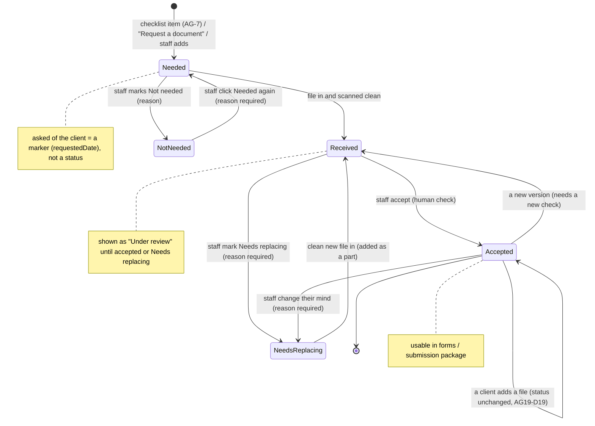
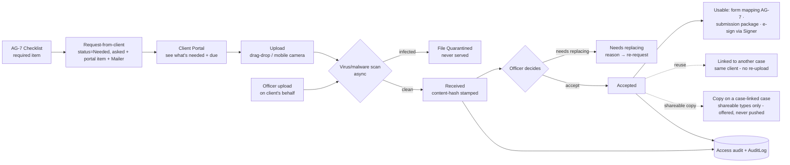
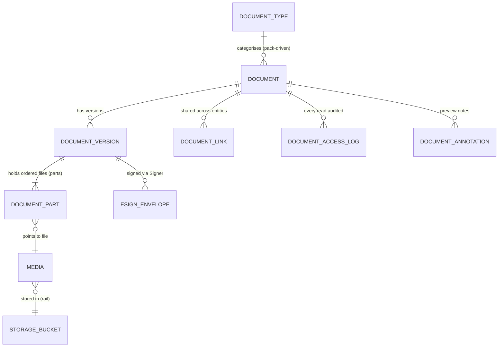

> **Document control** · Version **1.27** · **2026-10-27** · Status: **CC-8 applied: only emails a person writes are copied; system emails go to their usual recipient with no Cc (the product owner, 26 Oct)**; earlier: **AG19-D71 – AG19-D73 and the final PDF Studio re-check fixes applied (the product owner, 26 Oct: approved): Accept new files; one rule for a PDF Studio save on an Accepted document; a client-sent government-form flag kept only for a locked file; the server fallback checks for a government form; build-path history moved to §14.4**; earlier: **AG19-D70 applied (the product owner, 25 Oct: approved): a government form that needs a password to open is recognised once it is opened; the client upload component sends `isXfaForm` = yes, and PDF Studio sets it for an email attachment**; earlier: **AG19-D66 – AG19-D69 applied (the product owner, 25 Oct: approved): a government form is never altered; a PDF Studio save made only from files added after the Accept keeps the document Accepted; a password-to-open PDF that turns out to be signed is unlocked, a government form uploads as is; writer defaults approved**; earlier: **AG19-D62 – AG19-D65 and the 25 Oct PDF Studio review fixes applied (the product owner, 25 Oct: "yes"): a Studio save keeps every unused part on the line; Open in PDF Studio and Save and file to line on every To file item; no automatic unlock of government forms or signed PDFs on a client upload; Studio on every record that holds documents**; earlier: **AG19-D61 applied (the product owner, 25 Oct: "yes"): a portal message attachment shows in the conversation and also goes to the record's To file list, where a locked file uploaded as is carries "Password protected"; build path of the PDF Studio cards cleaned (no rule changed)**; earlier: **AG-19 decisions D57 and D58 applied (the product owner, 25 Oct, later: "yes"): only a change to a file of the accepted set returns an Accepted line to Received, restores included; the client password prompt shows in every place a client uploads inside ExpatReady, portal message attachments included, as one rule on the shared client upload component**; earlier: **AG-19 decisions D50 – D54 applied (the product owner, 25 Oct: "yes"): the password prompt shows only where the client uploads inside ExpatReady; the automatic unlock email is withdrawn; the client's unlock falls back to ExpatReady's own server if the browser cannot do it; a restore into an Accepted line counts as a staff Replace; an infected file never appears in Recently deleted; removing a file added after the Accept keeps the line Accepted**; earlier: **Knock-ons from the duplicates / copy-on-emails work closed (the product owner, 25 Oct): every client email this epic sends goes through AG-10's single send path and states whether the case's copy list is copied (new BR-25)**; earlier: **AG-19 decisions D35 – D49 applied where they touch this epic (the product owner, 23 Oct: "yes": the edit key sees and restores the files its holder removed or replaced; a restored unredacted file is an ordinary file; a lead has a To file list; no AI suggestion on the To file list; a staff Replace or Remove on an Accepted document returns it to Received; Accept only when every file is clean; a restored replaced file swaps back; an infected file is never restored; junk leaves the To file list with Remove; password-protected uploads are unlocked on the client's device, new AG-9-69); previously: AG-19 decisions D28 – D34 applied (the product owner, 23 Oct, later: a redacted version's sources can be restored only by holders of the delete permission, after a warning; until AG-07 records what was submitted, only Accepted files are kept as evidence; removing the last file sets the document back to Needed, with no message to the client; the client is asked automatically to resend an infected file; a reply to a request for several documents waits on the To file list with one-click targets; every record that holds documents has a To file list; Replace, Remove and File to line need only the document-edit permission); previously: AG-19 decisions D16 – D21 and D26(a) applied (the product owner, 23 Oct: staff replace one file of a document or remove several; replaced and removed files go to Recently deleted, except an Accepted or submitted file, which stays in the history; a client upload always adds; a file added to an Accepted document changes nothing; a Quarantined file cannot be opened, combined or accepted; a ZIP's files attach one by one, and uploads that answer no request wait on the case's new To file list; the unredacted original is hidden and opened only with the delete permission; an XFA form offers the form viewer only for a pack-published edition); previously: AG-19 PDF Studio decisions applied (the product owner, 22 Oct: a document can hold several files (parts) while it is worked; a PDF Studio save becomes the current file with its sources kept; redaction moves to Release 1 inside PDF Studio; phone scan on every upload route; Studio uses the document-edit permission); previously: AG-02 review decisions applied (the product owner, 20 Oct: documents attach to the person with a context tag; nothing moves when a person becomes a client; visibility follows AG-7-90); previously: AG-07 review applied (the product owner, 18 Oct: AG07-D1 one document status list owned here — five statuses; AG07-D2 "Request a document" per filing; AG07-D10 pointer; X-2 pointer; AG07-D6 flagged as open question 22; audit fix C-37 — no masking, pointer to the AG-7-96 card); previously: AG-16 second pass applied (the product owner, 17 Oct: AG16-54 #19 AG-09 is the home of letter upload, letter copies and attachment-fulfils-request; AG16-55 open questions 16 – 20 closed; AG16-59 confirming a letter also records its case step; AG16-61 the letter task has a due date and shows at once; AG16-64 a look-alike letter gets its own task until answered, and a different person's letter is never a look-alike; AG16-73 the deadline lives on the government step and the UCI is a canonical answer); previously: AG-16 review round 2 applied (AG16-38, AG16-41, AG16-44, with AG16-27, AG16-31, AG16-33, AG16-42): the letter library also runs on PDFs uploaded or dropped; an emailed attachment can mark an open document request received; letter copies get a "Same letter / Different letter" prompt; build cards written; earlier: Document deletes applied: Undo and a 30-day Recently deleted bin (AG16-21); earlier: Upload types and scan statuses applied from SA-08 v2.5 (SA8-X4); SA-06 v3.0 closing decisions applied (dispose key default holder; code view.own / view.all keys retired); Permission keys renamed and visibility open items resolved (SA-06 v3.0: SA6-D6, SA6-D10); earlier: Document visibility applied (SA6-D6(a): a document is visible only to users who can see the client or case it is attached to); previously: Baseline — Agent-native decisions applied (Reader reads identity documents, IRCC/government letters, language test results and ECA reports and classifies uploads in Release 1; every extracted value is a proposal a human approves; bulk imported documents are classified by the Reader); AG7-D10 applied (no masking and no reveal of personal data; AG7-D7 replaced)**\
> Part of: *Agent (RCIC/Lawyer) Console — Functional Requirements* · Split from `FINAL-Agent-FR.md` lines 5801–6523 on 2026-09-16 · Previous version: `_archive/AG-09-document-management_v1.26_2026-10-26.md` (v1.25 is `_archive/AG-09-document-management_v1.25_2026-10-25.md`; v1.24 is `_archive/AG-09-document-management_v1.24_2026-10-25.md`; v1.23 is `_archive/AG-09-document-management_v1.23_2026-10-25.md`; v1.22 is `_archive/AG-09-document-management_v1.22_2026-10-25.md`)\
>
> | Version | Date | Change | Decisions |
> |---|---|---|---|
> | 1.27 | 2026-10-27 | **CC-8 applied (the product owner, 26 Oct; home AG-10-89): only emails a person writes are copied.** Every client email AG-09 sends is a system email: it goes to its usual recipient with no Cc and is never copied to the case's copy list. **Rewritten:** §3.2, AG-9-6, AG-9-8, AG-9-10, AG-9-55, AG-9-26 card (field 4, Copy list test), BR-25, and the US-1, US-3 and US-4 tests. **Removed:** BR-25's "when it belongs to a case ... is sent as ONE email, Cc the case's active copy list, with the footer", its one definition of an email "of a case" (needed only for copying), the "copied on a case" marks on its list, the WhatsApp email version for list people on reminders, and "Copied people receive the no-login upload links; AG-10-89 field 10 records this as an accepted risk". Exact replaced text: §14.5. Row added to "Decisions that change this epic". AG-19 PDF Studio content untouched. No requirement ID changed. | CC-8 |
> | 1.26 | 2026-10-26 | **AG19-D71 – AG19-D73 and the final PDF Studio re-check fixes applied (the product owner, 26 Oct: approved).** (1) **AG19-D71:** an Accepted document whose parts include files with no Accept shows **Accept new files (N)**; one click sets `acceptedAt` and `acceptedByUserId` on those parts and the document stays Accepted; the key is the existing accept key `agent/document:change-status`; a PDF Studio save that keeps the document Accepted carries each accepted part's `acceptedAt` into the new version; "Accepted" is reworded; the submission package is unchanged (AG-9-26 requirement, rules 7, new 14, fields 6 – 12; AG-9-65 rule 6, field 7; AG-9-67 rules 4, 5; §3.4; §6; §7; §10). (2) **AG19-D72:** one rule for a PDF Studio save on an Accepted document: the result used any file of the accepted set → Received; otherwise it stays Accepted; one test for both cases (AG-9-15; AG-9-26 rules 4, 7, tests, edge cases; AG-9-65 requirement, rule 6; §3.4 data flow; BR-5; §6; §9). (3) **AG19-D73:** "Pay stubs – Client B" in every example; a client-sent `isXfaForm` = yes is kept only with `passwordProtected` = yes; the server fallback runs the government-form and signature checks; PDF Studio sets `isXfaForm` = no for a file that is not a form, with `agent/document:edit` and an audit entry; "digitally signed" defined (AG-9-65 fields 7 – 9; AG-9-69 rules 3, 5, 5a, 7, two tests; §10). Fixes: §9 XFA line now has the AG19-D39 text, with no form-viewer button; version tags and struck text moved out of §3.4, §7 and §10. Rows added to "Decisions that change this epic". Replaced text: §14.4. No requirement ID added or withdrawn. | AG19-D71, AG19-D72, AG19-D73 |
> | 1.25 | 2026-10-25 | **AG19-D70 applied (the product owner, 25 Oct: approved; home AG-19, AG-19-5 rule 7).** A government form that needs a password to open is recognised only once it is opened. The client upload component, which opened it with the client's password, sends `isXfaForm` = yes with the upload, and **Open in PDF Studio** is hidden. For an email attachment (or a locked file uploaded as is) the flag stays unknown, the button shows, and PDF Studio refuses the form after the password, leaves the stored file untouched and sets `isXfaForm` = yes (AG-9-65 field 7; AG-9-66; AG-9-68 field 7; AG-9-69 rules 5a, 7, 8, field 7, two tests, edge cases; §7). Row added to "Decisions that change this epic". Replaced text: §14.3. No requirement ID added or withdrawn. | AG19-D70 |
> | 1.24 | 2026-10-25 | **AG19-D66 – AG19-D69 applied (the product owner, 25 Oct: approved).** (1) **AG19-D66:** an interactive government form is never altered anywhere; only a signed PDF is unlocked by staff in PDF Studio (AG-9-69 rule 7; rule 5a). (2) **AG19-D67:** a PDF Studio save on an Accepted document that used only files added after the Accept keeps it Accepted (AG-9-26 rules 4, 7, field 6, test, edge cases; AG-9-65 rule 6; §3.4; BR-5; §6 new row; §9). Open question 50 closed. (3) **AG19-D68:** a password-to-open PDF that, once opened, is signed is unlocked anyway (the signature is lost); a government form uploads as is with "Password protected" (new AG-9-69 rule 5a, rule 7, two tests, edge case). Open question 49 closed. (4) **AG19-D69:** the writer defaults are approved; their marks are removed (AG-9-26 rule 4; AG-9-65 rules 7, 8; AG-9-68 field 7). Replaced text kept word for word in §14.2. Rows added to "Decisions that change this epic". No requirement ID added or withdrawn. | AG19-D66 · AG19-D67 · AG19-D68 · AG19-D69 |
> | 1.23 | 2026-10-25 | **AG19-D62 – AG19-D65 and the 25 Oct PDF Studio review fixes applied (the product owner, 25 Oct: "yes").** (1) **AG19-D62:** a PDF Studio save keeps every part the result did not use on the line, after the result: a refused government form, a part not loaded, a part not selected, a locked part skipped, a part that arrived while Studio was open (AG-9-65 requirement, rule 6, new test; §3.17). (2) **AG19-D63:** every To file item offers Open in PDF Studio; **Save and file to line** files the result to a line in one step; the item leaves the list and the label clears (AG-9-66, AG-9-68 requirement, new rule 12, field 8, test; AG-9-69 rule 7; §3.17). (3) **AG19-D64:** on a client upload, an interactive government form or a digitally signed PDF is never unlocked automatically; it uploads untouched (AG-9-69 requirement, rule 5, test, edge case; new open question 49). (4) **AG19-D65:** Open in PDF Studio and the Studio save targets cover the lead, prospect, client, case and corporate case (AG-9-66). (5) **Review fixes:** stored flag `isXfaForm` on `DocumentPart` and `ToFileItem` (S6; AG-9-65 field 7, AG-9-68 field 7, §7); `studioTool` is a list (S7); examples use the D55 file names (S9); status while a Studio result is checked, and new open question 50 (S10; AG-9-26 rule 4); redaction with a source from another document (S11; AG-9-65 rule 8); Restore source files keeps the other parts (AG-9-65 rule 7); Scan with camera in the client upload component (S17; AG-9-69 field 3); §10 key descriptions copied from SA-06 §10b and the history-tagged PDF Studio note replaced (S18); a Studio save or restore sends no "Document received" (S20; AG-9-26 rule 4); AG-9-26 header adds AG19-D19, AG-9-66 adds AG19-D39 (M3); history tags and struck text taken out of AG-9-54, AG-9-55, AG-9-57 and AG-9-59 (M4). Removed text is kept word for word in §14.1. Rows added to "Decisions that change this epic". No requirement ID added or withdrawn. | AG19-D62 · AG19-D63 · AG19-D64 · AG19-D65 |
> | 25 Oct (later): MS-D24 and writer follow-ups | 2026-10-25 | **MS-D24 applied (the product owner, 25 Oct); targeted edits only.** (1) **Triage item 12:** on a firm-service case, "Request a document" offers the service's "documents to ask for" plus "Other" with a typed name (AG-9-63 rule 12 and requirement; row of MS-D21(8) in "Decisions that change this epic"). Open question 48 closed. (2) File names and versions of AG-07 and AG-16 corrected in §3 and §13 notes. Row added to "Decisions that change this epic". | MS-D24 · MS-D21(8) |
> | 25 Oct (money slice + AG-05 review) | 2026-10-25 | **Money-slice and AG-05 decisions that touch AG-09 applied (the product owner, 25 Oct); targeted edits only.** (1) **AG05-D1(3):** the signed copy and the signing certificate of any document sent for signature (not only the retainer) are filed together in the client's Documents; the completion event is named `envelope.signed` instead of `esign.envelope.completed` (§3.7, AG-9-23, BR-12 test, §12). (2) **MS-D3(4):** the accepted consultation agreement (that version, with the time) is filed on the person (new pointer requirement AG-9-70; rule home AG-04). (3) **MS-D21(8):** a firm-service case has one case-level document list, and "Request a document" works there without a filing (AG-9-63 rule 12; open question 48 for the types offered). Rows added to "Decisions that change this epic". | AG05-D1(3) · MS-D3(4) · MS-D21(8) · MS-D16(6) |
> | 1.22 | 2026-10-25 | **AG19-D61 applied (the product owner, 25 Oct: "yes"); build path of the PDF Studio cards cleaned.** (1) **AG19-D61:** a file a client attaches to a portal message shows in the conversation and is also placed on the record's To file list (the case the message is tagged to, or the client for "General"). Locked and uploaded as is, it carries "Password protected" there; staff unlock it in PDF Studio and file it, as for an email attachment (§3.17; AG-9-68 requirement, field 3, new rule 2d, field 7 route "portal message", new test, edge case; AG-9-69 requirement, rule 6, new test). Open question 47 closed. Row added to "Decisions that change this epic". (2) **Build path cleaned (X-1; no decision, rule, value, ID or key changed).** In §3.15, §3.17, the requirement lines AG-9-26 and AG-9-65 – AG-9-69, and the cards AG-9-26, AG-9-65, AG-9-67, AG-9-68 and AG-9-69, 120 version tags, struck text and history notes were taken out. Each requirement line now opens with one tag that names its card and its decisions. Where a removed tag was the only decision ID in a rule or test, the ID is cited in plain brackets. Every removed text is kept word for word in §14. Other sections keep their tags. | AG19-D61 |
> | 1.21 | 2026-10-25 | **AG-19 decisions D57 and D58 applied (the product owner, 25 Oct, later: "yes").** (1) **AG19-D57 clarifies AG19-D52 and AG19-D54.** Only a change to a file of the accepted set returns an Accepted line to Received, and this includes restores. A restore counts as a staff Replace only when the newer file it displaces was itself Accepted. When that newer file was added after the Accept (AG19-D19), the line stays Accepted and the newer file goes to Recently deleted (AG-9-67 requirement, rule 10, new test; AG-9-26 rule 7 and edge cases; §3.15; §6 one row changed, one row added). Open question 46 closed. (2) **AG19-D58 widens AG19-D50.** The password prompt is one rule of the shared **client upload component**, used by every place where a client uploads inside ExpatReady. Places today, four: the questionnaire's document-request card, the portal Documents tab (including documents requested separately from the questionnaire), the no-login upload page and portal message attachments (new). A client upload place added later inherits the prompt. Only email attachments get the label instead (AG19-D50). Changed: §3.1, AG-9-69 requirement, card fields 2, 3, rule 1, field 12 and tests. New open question 47 (where the label sits for a portal message attachment uploaded as is). Rows added to "Decisions that change this epic"; the AG19-D50, AG19-D52 and AG19-D54 rows are marked. No requirement ID added, changed or withdrawn. | AG19-D57 · AG19-D58 |
> | 1.20 | 2026-10-25 | **AG-19 decisions D50 – D54 applied (the product owner, 25 Oct: "yes").** (1) **AG19-D50 narrows AG19-D49.** The password prompt shows only where the client uploads inside ExpatReady: the client portal Documents tab (CP-1-97), the questionnaire's document-request card (AG-08 §3.6, AG-8-18) and the no-login upload page (AG-9-7). A locked PDF that arrives as an email attachment only gets the "Password protected" label; staff unlock it in PDF Studio (AG-19-13). **Withdrawn (AG19-D50; recorded here, removed from the build path):** AG19-D49(2), that is, the one automatic email "One file is password protected – tap here to unlock it", its no-login unlock link, and the client's unlocked copy replacing the locked file, which went to Recently deleted. Removed text: AG-9-69 requirement sentences on the email and the replace; card rules 7 (email reply, send and copy), 8 (the unlocked copy replaces the locked file) and 10 (a fix-it notice, not a chase); the Mailer in field 4; the audit lines "unlock notice sent (document, part, to)" and "locked file replaced by the client's unlocked copy (document, part)"; the rule 10 pointer to the email's row on the Automatic messages page (AG-12-52; AG-12 §3.3), withdrawn in AG-12 v2.10; the email-reply and copy-list tests; the BR-25 list item "Unlock email for a password-protected attachment" and "and unlock" links; the AG-9-65 rule 2 exception; the §3.15 exception; the §3.1 sentence on the unlock email. Card rule 9 (staff always see the label) is now rule 7; new rule 8 says what happens to an email attachment. A client upload now always adds, with no exception (AG-9-65 rule 2). (2) **AG19-D51:** if the build trial (AG-19-1) shows the client's browser cannot unlock, the unlock runs on ExpatReady's own server: the password is sent once over the secure connection, used in memory to unlock, then discarded, never stored or logged; the client sees the same screens (AG-9-69 requirement, rule 3, fields 3, 7, 9, 10, 13, tests). (3) **AG19-D52:** restoring a replaced file when the line or the newer file is Accepted counts as a staff Replace (AG-9-67 requirement, rule 10, tests; §3.15; §6). (4) **AG19-D53:** a removed Quarantined file never appears in Recently deleted; the line shows "Removed — infected file" (AG-9-55, AG-9-67 rule 7, §3.6). (5) **AG19-D54:** a staff Replace or Remove of a file added after the Accept keeps the line Accepted; AG19-D43 applies only to a file of the accepted set (AG-9-67 requirement, rule 5, tests; AG-9-26 rule 7, field 6, tests, edge cases; §6; §9). Open questions 42 – 45 closed; new open question 46. Rows added to "Decisions that change this epic". No requirement ID changed. | AG19-D50 · AG19-D51 · AG19-D52 · AG19-D53 · AG19-D54 |
> | 1.19 | 2026-10-25 | **Knock-ons from the duplicates / copy-on-emails work closed (the product owner, 25 Oct).** (1) **New BR-25:** every client email AG-09 sends (document request, request reminders, re-request on Needs replacing, "Document received", the infected-file notice, the unlock email) goes through AG-10's single send path (AG-10 v1.21 BR-1) and its consent gate (AG-10-22), and, when it belongs to a case, is copied to the case's copy list (AG-10-89); with no case (a document on a person, lead, prospect or client), nothing is copied. (2) The send path and copy behaviour stated where each email is specified: §3.2, AG-9-6, AG-9-8, AG-9-10, AG-9-55, AG-9-69 (requirement and card rules 7 and 10, field 4), AG-9-26 card field 4. (3) One test per change: US-1, US-3, US-4 and the AG-9-26 and AG-9-69 card tests. Row added to "Decisions that change this epic". No requirement ID changed. 25 Oct mop-up: BR-25 now points to AG-10-89 rule 1's one definition of an email "of a case" (a request from inside the case or a reminder on a document on its checklist is of the case even if the document sits on the person); the old "document with no case" sentence is struck (Resolved (25 Oct)). | AG-10-89 (CC-1, CC-2, CC-4, CC-5, F10) · AG-10 BR-1 · AG-10-22 |
> | 1.18 | 2026-10-23 | **AG-19 decisions D35 – D49 applied (the product owner, 23 Oct: "yes").** (1) **Recently deleted for files (AG19-D35):** a holder of `agent/document:edit` sees and restores, within 30 days, the files they removed or replaced; holders of `agent/document:delete` see and restore all (AG-9-57, AG-9-67 rule 10 and field 8, §3.15, BR-22, §6, §10 note). (2) **Restored unredacted file (AG19-D36):** normal visibility, the client portal included when the line is shown there; warning "This brings back the unredacted file. The client will be able to see it." (AG-9-65 rule 8, tests). (3) **XFA (AG19-D39, replaces AG19-D16's button):** an XFA part shows the refusal message with no button (AG-9-66). (4) **A lead's To file list (AG19-D40)** and its carry-over at Engage (AG-9-68 rules 2b – 2c, fields 3 and 7). (5) **No AI suggestion on the To file list (AG19-D41)** (AG-9-68 rule 11, non-goals). (6) **Accepted → Received after a staff Replace or Remove (AG19-D43)** (AG-9-26 rule 7 and field 6, AG-9-67 rule 5, §6). (7) **Accept only when every part is clean (AG19-D44)** (AG-9-26 rule 5, AG-9-65 rule 5, §3.6, BR-4, BR-6, §6). (8) **Restoring a replaced file swaps it back (AG19-D45); an infected file is never restored (AG19-D46)** (AG-9-67 rules 7, 10, §3.6, §3.15). (9) **Junk on the To file list uses the normal Remove (AG19-D47)** (AG-9-68 rule 10). (10) **Password-protected uploads (AG19-D49; home of the upload behaviour: this epic):** new **AG-9-69** with build card: the upload page asks for the password and unlocks on the client's device; one automatic email with an unlock link for a locked attachment on an email reply (client-facing automation approved by the product owner); the label "Password protected" for staff (AG-9-7, AG-9-65 rule 2, §3.1, §3.17, §7). Open questions 32, 35, 37 (c), 38 – 41 closed; 42 – 45 added. Rows added to "Decisions that change this epic". | AG19-D35 · AG19-D36 · AG19-D39 – AG19-D41 · AG19-D43 – AG19-D47 · AG19-D49 |
> | 1.17 | 2026-10-23 | **AG-19 decisions D28 – D34 applied (the product owner, 23 Oct, later).** (1) **Restore on a redacted version (AG19-D28):** Restore source files can bring back the unredacted file, after the warning "This brings back the unredacted file."; only holders of `agent/document:delete` can do it; audited (AG-9-65 rules 7 – 8, fields 8 – 9, tests; §10 note). (2) **Evidence (AG19-D29):** until AG-07 records which files went into a submission (AG-07 D9 Q55), only Accepted files are kept as evidence after Replace or Remove (AG-9-59, AG-9-67 rule 4, BR-22, §9). (3) **Last file removed (AG19-D30):** the document goes back to Needed; no automatic message to the client (AG-9-67 rule 5, edge cases, tests; §6). (4) **Infected file (AG19-D31, corrects AG19-D20's wording):** staff need not ask for a resend; the client is asked automatically (AG-9-55) (§3.6, AG-9-65 rule 5, AG-9-67 rule 7, decision row AG19-D20). (5) **Email replies (AG19-D32):** a reply to a request for one document lands on that line as parts; a reply to a request for several documents waits on the To file list, each file showing the requested lines as one-click targets; AG-9-62 now covers only emails and WhatsApp media that are not a reply to a request email (AG-9-62 and card; AG-9-68 rules 1 – 2a; §3.17). (6) **To file list on every record (AG19-D33):** the case, the client and the prospect (a corporate case is a case); on conversion the items stay on the person and show on the client and the case, as documents do (AG-9-68 and card; §3.17; §7 `ToFileItem`; §9; US-18). (7) **Keys (AG19-D34):** Replace, Remove and File to line need `agent/document:edit` (AG-9-67, AG-9-68 field 8; §10 note). Open questions 33, 34 and 36 closed; 32(b), 35(c), 37(a), (b) and (d) closed; 38 – 41 added. | AG19-D28 · AG19-D29 · AG19-D30 · AG19-D31 · AG19-D32 · AG19-D33 · AG19-D34 |
> | 1.16 | 2026-10-23 | **AG-19 decisions applied (the product owner, 23 Oct).** (1) **Replace and Remove (AG19-D18; home: this epic):** staff replace one part (only that part changes) or remove one or many parts; the old file goes to Recently deleted (Undo, then 30 days) and is then deleted for good, except a file that was Accepted or submitted, which stays in the version history; a client upload always adds and never replaces (new AG-9-67 with build card; AG-9-5, AG-9-15, AG-9-59, AG-9-65 rules 2 – 4 changed; §3.1, §3.4, §3.15, §3.17, BR-5, BR-22, §6, §7, US-2, US-15, new US-18, §9). (2) **Upload to an Accepted document (AG19-D19):** the file attaches as a part; the status does not change and nothing is re-checked (AG-9-65 rule 2; AG-9-26 rule 7; Visual Overview A; §6). (3) **Quarantined part (AG19-D20):** cannot be opened, combined or accepted; the document is accepted only when no part is Quarantined (AG-9-65 rule 5; AG-9-26 rule 5; BR-4). (4) **ZIP and the To file list (AG19-D21):** a ZIP's files each follow the normal path; an upload answering one request becomes parts of that line; any other upload waits on the case's new **To file list**, filed with **File to line** (AG-9-54 changed; new AG-9-68 with build card; §3.17, §7). (5) **Unredacted original (AG19-D17):** hidden from the client, the portal and the normal staff view; opened only with `agent/document:delete`, every opening audited (AG-9-65 rule 8; §10 note). (6) **XFA (AG19-D16):** "Open in form viewer" only when the pack publishes that edition (AG-9-66; §9). (7) **Permissions (AG19-D26(a)):** Studio tools need `agent/document:edit`; saving a Studio result as a new document also needs `agent/document:create` (§10 note). AG-9-62 rule 3 and its tests: an emailed attachment becomes a part, not a new version (AG19-D18). Open questions 29 – 31 closed; 32 – 37 added. | AG19-D16 · AG19-D17 · AG19-D18 · AG19-D19 · AG19-D20 · AG19-D21 · AG19-D26(a) |
> | 1.15 | 2026-10-22 | **AG-19 PDF Studio decisions applied (the product owner, 22 Oct).** (1) **Several files in one document (AG19-D6; home of the data model: this epic):** a version holds ordered **parts**; a file added to a Needed or Received document becomes the next part and supersedes nothing; a replacement still makes a new version; the per-file facts (stored file, hash, scan state, language, source email) move from `DocumentVersion` to the new `DocumentPart` (new AG-9-65 with build card; AG-9-5, AG-9-14, AG-9-15, AG-9-44 changed; §3.0, §3.1, §3.4, BR-4, BR-5, §6, §7, Visual Overview C, US-2, new US-17, §9, §12). (2) **A PDF Studio save (AG19-D7):** the result becomes the current file as a new version; the parts it was made from stay linked, read-only and restorable ("Restore source files"); the status stays Received until a person accepts (AG-9-65 rules 6 – 7). (3) **Redaction (AG19-D3)** leaves the Phase-2 deferral list: it is a Release 1 PDF Studio tool, true removal (§13). (4) **Audit (AG19-D5):** every Studio action on a document's files is audited (BR-9, AG-9-65). (5) **Access (AG19-D9):** Studio uses `agent/document:edit`; no new key (§10). (6) **Phone scan (AG19-D10):** AG-9-4 points to AG-19's phone scan on the no-login upload link, the client portal and staff upload. (7) New pointer AG-9-66 "PDF operations: AG-19 PDF Studio" (AG19-D1, D8, D14) and new §3.17. (8) AG-9-64: the language is held per part. (9) Open questions 29 – 31 added. AG19-D13 noted as a pending SA-01B knock-on. | AG19-D1, AG19-D3, AG19-D4, AG19-D5, AG19-D6, AG19-D7, AG19-D8, AG19-D9, AG19-D10, AG19-D12, AG19-D13, AG19-D14 |
> | 1.14 | 2026-10-21 | **AG-02 review decisions applied (the product owner, 20 Oct).** (1) A document collected for a lead or a prospect attaches to the person (`entityType = PARTY`) with a context tag (`contextType` LEAD or PROSPECT, `contextId`); the `PROSPECT` owner type is retired, so a passport collected for one prospect shows on the person's next one (Visual Overview note, §3.0, §1 journey line, BR-2, §7 `Document`, §11). (2) BR-16 re-parenting at conversion is withdrawn: nothing is moved or relinked when a person becomes a client or a case opens; the case reads the person's documents through the context tag (§3 carry-forward bullet, BR-16, §9 edge case). (3) Visibility of a person's document follows AG-7-90's one shared check, replacing SA6-D6(b) "follows the prospect" (SA-06 table, AG-9-53, §12). Pending block: P22 reduced to its open part (whether case and client documents also move to the person host); P10 kept open. No requirement ID added, removed or renumbered. Final hand-over check (21 Oct): an "AG-02 suggests" line added to P22, which stays open. | AG02-D10(6) · AG02-D14(5) |
> | 1.13 | 2026-10-18 | **AG-07 review (the product owner, 18 Oct), documents only.** **One status list (AG07-D1, changes AG-9-26):** a document has **five statuses**: **Needed → Received → Accepted / Needs replacing**, plus **Not needed**. Before: ten (Required, Requested, Uploaded, Received, Verified, Rejected, Waived, Not-Applicable, Superseded, Quarantined). **Superseded** and **Quarantined** become states of a *file* on its version record; **"Under review"** is Received that nobody has checked yet; "asked of the client" is a marker on Needed (`requestedDate`), not a status. Old-to-new mapping table for developers in §3.9; AG-7-15, AG-15 and reports show this list and store none. **Request a document per filing (AG07-D2, AG07-D8(a), AG7-D12):** new AG-9-63 with a build card; the addition belongs to the filing's rules pin and carries over when staff adopt newer rules. **Imported documents start as Received (AG07-D15, AG7-D20; AG-9-47).** **Pointers only:** a second letter for the same step is decided in the AG-7-96 card (AG07-D10; AG-9-60 rule 10); a letter naming a family member's UCI files to that person (X-2; AG-9-60 rule 11). **Audit fix C-37:** the "first 3 characters" masking is removed from the AG-9-60 card (rule 7, task name, tests, fixtures note) because personal data is never masked (AG7-D10); the pointer to the retired AG-7-100 card now points to the AG-7-96 card (AG-7-100 has no card of its own, AG16-83 #9). **Changed:** AG-9-6, -7, -10, -15, -21, -26, -27, -28, -35, -40, -50, -60, -61, -62, BR-4, BR-5, BR-6, §3.2, §3.4, §3.6, §3.9, §3.13, Visual Overview A and B, §6, §7, §8 (US-1, 3, 4, 6, 11), §9, §10, §11, §12, §13. **Open questions added:** 22 – 25. Requirement IDs unchanged; AG-9-63 added. *18 Oct (later): consistency fixes after expert review — X-2 (2): applicant roles are principal, spouse, child, other.* *18 Oct (final): AG07-D17 – D21 applied — AG07-D18, AG07-D20(d), (e), (g), (o), (p).* **"Request a document" has one home (AG-9-63, AG07-D20(d)):** a pack type or "Other", the person it is for (default the principal), "Ask the client now" ticked by default, deletable until sent or a file arrives, then only "Not needed"; key `agent/pack:extend`. **Per-person rules pin (AG07-D18)** wording in AG-9-63. **Document status keys kept (AG07-D20(e)):** `agent/document:change-status`, `agent/document:waive`. **"Needed again" (AG07-D20(o)):** Not needed can be undone with a reason, audited. **No staff notification for a file arriving, a new version or a Quarantined file (AG07-D20(g)):** shown on the document panel, timeline and "Review document" task. **Return reasons (AG07-D20(p)):** picked from the firm's own short list, defaults supplied (SA-01B). **Changed:** AG-9-21, -26, -28, -63, §3.2, §3.4, §3.6, §3.9, §3.13, §6, §7, §8 (US-1, US-4), §10, §13. **Open questions closed:** 22 – 25; **added:** 26 – 27. Requirement IDs unchanged. *18 Oct (later): AG07-D26(8) applied — a document's language is set at upload; a language other than English or French adds "Translation + translator's affidavit" to the checklist; a document older than the program allows shows a warning only. New AG-9-64 with card; §3.3, §3.9, §7 and open question 28 changed. The country-specific guidance and the recency rule are owned by SA-01B (pointer only).* | AG07-D1 · AG07-D2 · AG07-D8(a) · AG07-D10 · AG07-D15 (AG7-D12, AG7-D20) · AG07-D6 (settled by AG07-D20(g)) · X-2 · AG7-D10 (C-37) · AG07-D18 · AG07-D20(d), (e), (g), (o), (p) · AG07-D26 |
> | 1.12 | 2026-10-17 | **AG-16 second pass (AG16-54 – AG16-82, the product owner, 17 Oct), documents only.** **Letter copies (AG16-64, changes AG-9-61 rule 3):** a look-alike needs the **same person** as well as the same case, type, letter date and application number; a different person's letter (a spouse's biometrics letter) is never a look-alike and gets its own task at once; a look-alike gets **its own task and deadline suggestion** marked "Possible copy of the 14 Oct letter · [Same letter] [Different letter]"; "Same letter" closes its task and suggestion in that click; unanswered, both tasks stay (before: no task until answered). **Letter task due date (AG16-61):** due 2 working days after the letter is filed, never later than the government deadline; shown in the officer's home-screen My Tasks from creation and kept until done; the date does not move when the deadline changes. **Case step (AG16-59, AG16-73):** confirming a letter's suggested deadline also records the matching step for the person the letter names (AG-7-100); the deadline lives on that step record, not in a separate table; each library entry names its step. **UCI (AG16-73):** read from the person's canonical answer (AG-7-95). **Number patterns (AG16-54 #10):** pack content. **Home (AG16-54 #19):** AG-09 is the home of letter upload, letter copies and attachment-fulfils-request; AG-10-72, -75 and -80 are one-line pointers. **Open questions closed (AG16-55):** 16, 17, 18, 20; question 19 closed by AG16-64. **Changed:** AG-9-60 (card rules 7, 9, 10, 11, data, tests), AG-9-61 (requirement and card), BR-24, §3.16, US-16, `DocumentLetter`, §9, §13. **Standing rules cited:** AG16-60, AG16-63, AG16-76. **Build cards:** AG-9-60 and AG-9-61 updated; AG-9-62 gets its Clicks and Person decides lines. *Same-day fixes (17 Oct): AG16-83 – AG16-88 — the AG-9-60 six-type table is now a pointer to SA-01 (#9); Q21 closed: a copy marked "Same letter" loses its own deadline suggestion, the first letter's deadline stays (#21).* *Same-day fixes (18 Oct): AG16-92 — email-first. The request email carries the no-login by-code link (AG-9-6, §3.2; rule in AG-10-85); AG-9-62 also fires on WhatsApp media filed to a case (same one-click, same rules), with a new test and edge case; "Document received" also follows an upload done on the client's behalf (pointer to AG-15-44).* *18 Oct: new section 'Decisions that change this epic' (index of AG16 decisions; no requirement changed).* | AG16-54 · AG16-55 · AG16-59 · AG16-60 · AG16-61 · AG16-63 · AG16-64 · AG16-73 · AG16-76 · AG16-92 |
> | 1.11 | 2026-10-17 | AG-16 review round 2 (AG16-24 – AG16-53, the product owner, 14–17 Oct), documents only. **Added:** §3.16 and AG-9-60 – AG-9-62, each with a build card (new section "Build cards" at the end of §4). **(1) Letter library on PDFs (AG16-41):** the letter library (AG16-27) also runs on any PDF uploaded to a case, dropped on the case page or dropped on the home screen, singly or in bulk; letter type is recognised by PDF file name (IMM5756 biometrics, IMM1017 medical, IMM5812 work-permit letter of introduction, IMM0276 refusal notes, IMM5993 acknowledgement of receipt for a temporary resident permit, IMM5801 pre-arrival services) and by the text layer; the deadline is suggested by rule and registered with the Minder only after a person confirms; there is no paste box, no browser button and no portal login. The Reader is optional: with AI off, the rules do the work (AG16-33). **(2) Letter copies (AG16-44):** every copy of a letter is kept; a copy that looks like a letter already filed asks "Same letter / Different letter"; one task unless staff choose "Different letter"; a byte-identical copy is stored once ("Also received …"). **(3) Email fulfils a request (AG16-38):** an emailed attachment filed to a case with an open document request offers "Mark '[Passport]' request as received? [Yes]"; one click attaches it and stops the chase; never automatic. **Changed:** AG-9-8 (chase stops on this click), AG-9-51 and §3.14 (with AI off the library suggests a letter's deadline by rule; before, staff added it by hand), BR-21, US-14. **New:** BR-23, BR-24, US-16, `DocumentLetter` entity, six edge cases, open questions 16 – 20. **Open questions closed:** none (none of AG-09's open questions is answered by these decisions; question 11 is annotated). | AG16-38, AG16-41, AG16-44 (AG16-27, AG16-31, AG16-33, AG16-42, AG16-12) |
> | 1.10 | 2026-10-14 | AG-16 review (the product owner, 14 Oct), documents only. **Deleting a document is now undoable:** an "Undo" for a few seconds, then the document sits in **Recently deleted** for **30 days** and is then removed permanently; the person who deleted it, the Owner and Admin can restore it to where it was; it **leaves the client portal at once** and the bin is staff-only; an approved "delete my data" request skips the bin; a legal hold blocks deleting; **replacing a document makes a new version, it is not a delete.** The delete used to be permanent (`deleteDocument`). **Added:** §3.15, AG-9-56 – AG-9-59, BR-22, US-15, edge cases, `Document` fields `deletedAt` / `deletedByUserId` / `purgeAt`, open questions 13 – 15 (including "true Move to another client or case vs existing cross-client linking — AG-09 review"). **Changed:** §3.4 "non-destructive" wording, AG-9-8 (reminder timing lives on the Missing-document chase row of the Automatic messages page, AG-12), §6 transitions, §10 `agent/document:delete`, §12. Requirement IDs unchanged. | AG16-21 (AG16-11, AG16-12 cited) |
> | 1.9 | 2026-10-10 | Applied from SA-08 v2.5 (SA8-X4; merge decided by the product owner, 10 Oct): **allowed upload types** named — PDF, JPG, PNG, HEIC, Word, Excel, TIFF, ZIP; **ZIP rules** (unpacked, each file scanned and type-checked, each accepted file its own document; password-protected or nested ZIPs refused); the **three statuses** people see — client "Uploaded ✓" at once; staff "Checking for viruses…" then the file; "Removed — infected file" with the firm told and the client asked to upload again. AG-9-2 changed; AG-9-54, AG-9-55 added. | SA8-D2, SA8-D27 (SA8-X4) |
> | 1.8 | 2026-10-07 | SA-06 v3.0 closing decisions (the product owner, 7 Oct; owned by SA-06 v3.0). **(F3)** `agent/document:dispose` is held by the **Owner by default**, and the Owner may put it on a custom role. **Retired:** the code keys `agent/document:view.own` and `agent/document:view.all` no longer exist; document visibility follows the parent client, case or prospect (SA6-D6), with no document-level view key. Changed: §10 (`agent/document:dispose` row, note under the table), §12 (permissions bullet), Applied-from table (new row). Requirement IDs unchanged. | SA-06 v3.0 closing decisions (F3) · SA6-D6 |
> | 1.7 | 2026-10-07 | Permission naming and visibility resolutions from SA-06 v3.0 (the product owner, 7 Oct; SA6-D6, SA6-D10, Appendix B). **Renamed in §10:** `agent/document:legal-hold` is now `agent/legal-hold:manage` and `agent/document:configure-retention` is now `agent/retention-policy:manage` (the same keys as the SA-11 governance register); the code key `agent/document:write` is replaced by `agent/document:create`, `:edit` and `:delete`, which this module already lists. **Resolved (the v1.6 open items):** a document on a prospect follows the prospect's visibility (SA6-D6); imported files that match no record, and so have no parent, are visible to holders of a "see all" key and of the permission to file them (`agent/import:run`), and to the user who ran the import; a document copied across a case link follows the linked case's visibility. AG-9-47, AG-9-53 and the Applied-from table no longer say "open item" or "until the founder decides". Persona "Manager" renamed "Case Manager" (SA6-D5). Requirement IDs unchanged. | SA6-D6 · SA6-D10 · SA6-D5 |
> | 1.6 | 2026-10-07 | Founder decision on record visibility (7 Oct, the product owner; owned by SA-06 v3.0). **A document attached to a client or case is visible only to users who can see that client or case** (AG-07 shared-core visibility check, AG-7-88): this covers the document panel, any document list, search, download and preview, export and notifications. A document attached to a prospect follows that prospect's visibility (AG-02 AG-2-64). New: AG-9-53. Changed: AG-9-40 (the bundle is assembled only from documents the requester can see), AG-9-47 (the review list of unmatched imported files), §10 (`agent/document:list` and `agent/document:show` descriptions; Enforcement), edge cases. Its open items were resolved in v1.7. | SA6-D6 |
> | 1.5 | 2026-10-05 | Knock-on from AG-07 v2.3 (sensitive data — AG7-D7, the product owner, 5 Oct): document metadata and extracted Restricted fields show in full on screens to users who may see the document; masked in lists, search, exports, notifications/emails, reports and logs; an unmasked export needs `agent/pii:export-unmasked` (owned by SA-06's catalogue) and is audited. `agent/document:reveal-pii` withdrawn. Download/preview of the file itself keeps its own permission and access audit (unchanged). Changed: §3 design implication (list of sensitive powers), §10 (honesty note; `agent/document:reveal-pii` withdrawn v1.5; new row `agent/pii:export-unmasked`; Enforcement), §11 audit of sensitive actions ("PII reveal" becomes "unmasked export"), §12 permissions gap line. Same day (AG7-D10): masking and reveal removed — document metadata and extracted fields are never masked and have no reveal action; `agent/pii:export-unmasked` withdrawn (row kept); `agent/document:reveal-pii` stays withdrawn; the "unmasked export" audit event type is removed; §3, §10, §11 and §12 reworded. Download/preview keeps its own permission and access audit. Kept: no PII in logs, encryption at rest. | AG7-D7, AG7-D10 |
> | 1.4 | 2026-10-04 | Agent-native decisions applied (the product owner, 4 Oct). The deferral of **OCR / auto-extraction** moves into **Release 1 for identity documents** (incl. passport MRZ) through the **Reader** Doer: **document-type classification on upload**, **extraction into PROPOSED profile values with provenance and confidence**, and a `document.extracted` event. The Reader **never writes the verified profile directly** (APPROVE floor — a human approves in Needs you); an unreadable or missing field is **flagged, never guessed**; **manual capture remains the fallback** when AI is off. **Bulk documents from imports** are classified by the Reader (AG18-D3) and unmatched files go to a review list. Further document types are **pack content via the Immigration-SME**. Changed: §3.1, §3.3, §3.9, AG-9-3, AG-9-11, §10 (note), §11, §12, §13 (named deferral removed; open questions 10–12 added); added: §3.14, AG-9-42 to AG-9-48, BR-19, BR-20, US-13, `DocumentExtraction` entity, three edge cases. AG-9-11 aligned the same day with AG11-D1: Reader classification is AUTO by default, low confidence to Needs you. Same day (simplify): **approve = verify** (AG11-D10) — approving a Reader-proposed value in its review view, which shows the document region beside the value, **is** the verification of that value (the approver is the verifier); this **replaces** the wording above that an approved value is written unverified and verified in a separate act. The document's own **Verified** status (§3.9) is not set by that approval and stays the officer's act. Values read from **imported** documents stay unverified (AG18-D6). Reader results on a **client's** upload wait in **Needs you** (nobody present); where **staff uploaded and are reviewing**, the approval is **inline** and no Needs you item is created (AG11-D2). The hard floor is now "without a human having looked at its source" (AG11-D1 revised). Revised same day: §3.9, §3.14 (data flow, behaviour), AG-9-45, AG-9-47, BR-19, US-13, `DocumentExtraction` entity, §13 note. Added: none. Same day (review fixes): **Reader values from imported documents are verified on approval like any upload** (AG11-D10 applies; AG18-D10(e)) — AG-9-47, §3.14 and BR-19 corrected (they said imported values stay unverified). **Import review is per document, in the document view** (AG18-D10(f)): Reader results stay `PROPOSED` on the document, with "approve all shown values" while the regions are visible, and never one Needs you item per value (AG-9-49). **The verify permission is `agent/sqr:verify`** (AG11-D11(e); AG-8 §10) — AG-9-45 and §10 no longer say "profile-edit right". Approving Reader values auto-completes the "Review document" task of the document-received recipe (AG-9-50). Request reminders (AG-9-8, BR-14) respect the "Not started" (QUIET) state (AG18-D9, D10(a)). AI is one firm switch, off until Super Admin records the provider terms; the Reader gets document content as delimited data (AG11-D13). Overriding principle (we work for the firm, not the regulator): regulator and compliance wording removed from §1, §2, §3.5, §3.8, §3.12. Revised same day (review fixes): AG-9-8, AG-9-42, AG-9-45, AG-9-47, BR-14, BR-19, BR-20, §10 (note), §11. Added: AG-9-49, AG-9-50, one edge case. **5 Oct (Release 1 scope review):** the Reader reads more document types in Release 1 (AG11-D18(e)): besides identity documents (passport MRZ), **IRCC/government letters** (picking up deadlines such as biometrics, requests and dates), **language test results** (IELTS, CELPIP, TEF and others) and **ECA reports**; the immigration expert confirms the final list as pack content. A **deadline date read from a letter** is proposed to staff, approved, and only then registered with the Minder. All existing Reader rules apply unchanged (proposals with provenance, approve = verify, never fabricate, AI off until a Canada-hosted provider is recorded). This replaces "identity documents only" and the earlier deferral of other types. Changed: header, §3.14 (title, jobs, behaviour, key screens, data flow), AG-9-42, AG-9-43, §7 `DocumentExtraction`, §9, §12, §13 Q11 and the decided note and named deferrals (including WhatsApp request reminders, now Release 1 as proactive outbound template messages — AG11-D18(a); SMS stays Release 2). New: AG-9-51, AG-9-52, BR-21, US-14, three edge cases. **5 Oct (Release 1 scope review, small fix):** US-13's last bullet no longer says values read from imported documents "are unverified" — they are verified on approval like any upload (AG-9-47, BR-19, AG18-D10(e)); only spreadsheet-imported values stay unverified. | AG11-D1, D2, D4, D5, D10 · AG18-D3, D6 · AG11-D11, D13 · AG18-D9, D10 · AG11-D18 (Release 1 scope review, 5 Oct) |
> | 1.3 | 2026-10-03 | Consistency review fixes (3 Oct). "Offer employer documents from an earlier file" is credited to **AG-17-84** (not AG17-D46): AG-9-39, BR-18 and the Applied-from table now cite AG-17-84, and the table row is split (AG17-D46 / AG-7-57 → AG-9-40; AG-17-84 → AG-9-39 · BR-18). The earlier-file employer documents come by the **same-client link** only — the words "or an offered copy" are removed (§3.10). The AG-7 module is named correctly ("Case Core & Delivery") in §3.11. The v1.2 row's Decisions column now lists every decision id in full. Header line fixed. Requirement IDs unchanged. | AG17-D46, D42 |
> | 1.2 | 2026-10-02 | Founder decisions applied (2026-10-02). **Cross-client reuse is no longer forbidden outright:** a document can reach another client's case **only across a case-to-case link (AG-7-53)** and **only for document types flagged shareable** (e.g. job offer, LMIA decision letter, employment contract — never the employer's financial documents). Shared documents are **copies**; a later version is **offered** to the linked case's owner with one click, never pushed — no live cross-client link. **Same-client reuse by link is unchanged.** **Candidate (job applicant) data** is deleted only with the whole file under the firm's file retention — no separate candidate clock. The **inspection pack / evidence bundle is assembled by the AG-7 core (AG-7-57)**; AG-9 only stores the documents. On a **new file for an employer with an earlier file**, employer documents still within their validity period are **offered** from that earlier file instead of re-requested. A **master agreement is just an employer document** — no special handling. Separate corporate-case / corporate-prospect owner types collapse to case / prospect + client type in the target model (descriptions of today's code left as they are). Changed: §3.0, §3.10, §3.12, AG-9-30, AG-9-33, BR-1, BR-2, BR-10, BR-13, US-6, §9, §10 (`agent/document:link`), §12, §13; added: AG-9-36 to AG-9-41, BR-17, BR-18, US-12, three edge cases. | AG17-D4, AG17-D5, AG17-D19, AG17-D42, AG17-D46, AG17-D48, AG17-D50 |
> | 1.1 | 2026-08-28 | Baseline — complete document v1.1 | — |

## Decisions that change this epic (14–18 Oct; AG-02 rows added 21 Oct; AG-19 rows added 22, 23 and 25 Oct; CC-8 row added 27 Oct) *(new 18 Oct)*

Product-wide rules (apply here as everywhere; home: Agent `00-Overview` → "Product rules every epic follows"): AG16-11, AG16-31, AG16-33, AG16-42, AG16-44, AG16-60, AG16-63, AG16-76, AG16-92.

The "AG16" prefix is historical: these decisions began in the AG-16 review and apply across the product. Full text: `TEMPLATE-MAP-working_2026-10-10.md`.

| Decision | What was decided (one line) | What it changes in this epic | Where (requirement / card / section) |
|---|---|---|---|
| **AG16-6** | Business hours and closed days | Referenced only (no change here): the letter-deadline rule notes that government dates are calendar dates and never move | AG-9-60 (card rule 8) |
| **AG16-11** | One "Automatic messages" page, documented in one place only | The document-request reminder's on/off choice and chase timings live on the Missing-document chase row of that page (AG-12); AG-09 keeps a one-line reference | AG-9-8, §4 (request-reminder requirement), cross-module list |
| **AG16-12** | Where timings live | Chase timings sit on the Missing-document chase row; the chase stops when a request is marked received | AG-9-8, AG-9-62 (card) |
| **AG16-21** | Undoing deletes | Deleting a document gets Undo and a 30-day Recently deleted; restore by the deleter, Owner and Admin; "delete my data" skips the bin; legal hold blocks delete; replacing a document is a new version, not a delete | §3.15 (new), §3.4, AG-9-56 to AG-9-59, BR-22, US-15, §6, §7, §9, §10, §12, §13 items 13–15 |
| **AG16-24** | Own mailbox and own calendar on every plan | Cited — see change-log row 1.11 (named only as the start of the range "AG16-24 – AG16-53"); no AG-09 requirement text names it | Change log row 1.11 |
| **AG16-27** | Government mail: recognise, match, identify the letter, sort, deadline | Letter recognition steps and deadline-by-rule are owned by AG-10 and SA-01 and cited here, not restated; a letter the Reader does not recognise is read by staff | §3.14, §3.16, AG-9-60 (card), AG-9-51, §5, §12, §13 |
| **AG16-31** | Standing rule: ExpatReady suggests, the firm decides | The letter deadline is shown as "Suggested" and registered with the Minder only after a person confirms | §3.16 ("Suggest, never set"), AG-9-60 (card rule 10), AG-9-61, AG-9-62, BR-23, BR-24 |
| **AG16-33** | Standing rule: AI reads, rules check, a person confirms; core works without AI | Letter rules run without AI (an unrecognised letter shows as "Letter — type not recognised"); the Reader adds scans and other wording | §3.14, §3.16, AG-9-60, AG-9-61 (cards), §5 |
| **AG16-34** | AI is included in higher plans, not sold as an add-on | Referenced only (no change here): the cards note the Reader and Sorter are plan-gated | AG-9-60, AG-9-62 (cards) |
| **AG16-38** | Lower-volume email items (D12) | An emailed attachment filed to a case with an open request of that type can mark the request received, by one click; never automatic | §3.2, §3.16, AG-9-8, AG-9-62 (new, card), §7, §8, §9 |
| **AG16-40** | The home screen is the one place to start | Referenced only (no change here): AG-11 owns the home-screen drop target | Cross-module list (AG-11) |
| **AG16-41** | Letters downloaded from the IRCC portal (F2, option C) | The letter library also runs on any PDF uploaded to a case or dropped on the case page or home screen; bulk drop; no connection to the government portal; AG-09 is the home of the upload rule | §3.16 (new), AG-9-60 (new, card), §5, §7, §8, §9, §12, §13 |
| **AG16-42** | "Quiet by default", plus telling the client | Filing a letter is silent; telling the client is the person's choice ("Tell the client", AG-10-73) | §3.16 ("Quiet"), AG-9-60, AG-9-61, AG-9-62 (cards), BR-23, BR-24 |
| **AG16-43** | Keeping the letter library current (F4) | Cited, not restated: the library is pack content owned by AG-10 and SA-01; AG-09 uses the unrecognised-letter type picker | AG-9-60, AG-9-51 |
| **AG16-44** | ExpatReady never quietly judges for the firm | Every copy of a letter is kept; a look-alike is asked about ("Same letter / Different letter"), never silently merged or hidden; a byte-identical copy is stored once; corrects AG16-41 | §3.16, AG-9-61 (new, card), §5, §7, §8, §9, §13 |
| **AG16-50** | Government-deadline reminder on a case with no one assigned goes to the Owner | Referenced only (no change here): deadline reminders to staff are separate and unchanged | AG-9-60 (card rule 9) |
| **AG16-53** | Video links are per person; no firm video account | Cited — see change-log row 1.11 (named only as the end of the range "AG16-24 – AG16-53"); no AG-09 requirement text names it | Change log row 1.11 |
| **AG16-54** | 25 consistency fixes after the 17 Oct write | #19: AG-09 is the home of letter upload, letter copies and attachment-fulfils-request; AG-10-72, -75 and -80 are one-line pointers. #10: application-number and UCI patterns are pack content, not code | AG-9-60, AG-9-61, AG-9-62 (cards), §13 |
| **AG16-55** | Writers' recommended defaults accepted for the detail questions | Open questions 16, 17, 18 and 20 closed (question 19 closed by AG16-64) | §13 items 16–20 |
| **AG16-59** | A government letter records its case step; one event, one client message | Confirming a letter's deadline also records the matching case step for the person the letter names; the letter note is the one client message and the class-2 box is not offered | AG-9-60 (rules 10–11, card), AG-9-51, AG-7-100 (pointer) |
| **AG16-60** | Standing rule: a duplicate beats a miss | The letter task shows at once in the officer's home-screen My Tasks; an unanswered look-alike keeps its own task | AG-9-60 (card rule 9), AG-9-61 (card), §5 |
| **AG16-61** | Due date and visibility of the task made from a government letter | The letter task is due 2 working days after the letter is filed, never later than the government deadline; no case officer sends it to the Unassigned list; an FYI letter creates no task | AG-9-60 (rule 9, card) |
| **AG16-63** | Design checks every requirement must pass | The cards state "Clicks:" added and removed | AG-9-60, AG-9-61, AG-9-62 (cards) |
| **AG16-64** | Letter copies: same person required; a look-alike gets its own task until answered | A look-alike needs the same person as well as the same case, type, letter date and application number; it gets its own task and suggestion until answered; a different person's letter is never a look-alike; byte-identical copies stored once | AG-9-61 (requirement and card), BR-24, US-16, §3.16, §9, §13 |
| **AG16-73** | One record per government step with its deadline; UCI as a canonical answer | The deadline lives on the government step record (not a separate table); each library entry names its step; the UCI is read from the person's canonical answer (AG-7-95) | AG-9-60 (rules 10–11, card data), AG-9-51 |
| **AG16-76** | Standing rule: help people, don't replace them; do, don't overdo | The cards state "Person decides:" (the deadline, the case when no match is found, whether a look-alike is the same letter, that an attachment answers the request) | AG-9-60, AG-9-61, AG-9-62 (cards) |
| **AG16-82** | One rule for every broken connection | Cited — see change-log row 1.12 (named only as the end of the range "AG16-54 – AG16-82"); no AG-09 requirement text names it | Change log row 1.12 |
| **AG16-83** | 26 follow-through fixes after the second pass | #9: the AG-9-60 six-type table is now a pointer to SA-01; #21: a copy marked "Same letter" loses its own deadline suggestion and the first letter's deadline stays (question 21 closed) | AG-9-60 (card), AG-9-61 (card), §13 item 21 |
| **AG16-88** | Release 1 is English-first; French later | Cited — see change-log row 1.12 (named only as the end of the range "AG16-83 – AG16-88"); no AG-09 requirement text names it | Change log row 1.12 |
| **AG16-92** | Email-first: the portal is optional | The document-request email carries the no-login by-code link (AG-9-7; rule in AG-10-85); AG-9-62 also fires on WhatsApp media filed to a case (same one-click, same rules); "Document received" also follows an upload done on the client's behalf | §3.2, AG-9-6, AG-9-7, AG-9-62 (card, new test and edge case), AG-9-8 |
| **AG07-D1** | One document status list, owned here: **Needed → Received → Accepted / Needs replacing**, plus **Not needed** *(the product owner, 18 Oct)* | Replaces the ten-value list. Superseded and Quarantined are states of a file; "Under review" = Received not yet checked; asking the client is a marker on Needed. Old-to-new mapping table | AG-9-26, §3.9 (table + mapping), Visual Overview A and B, §3.2, §3.4, §3.6, §3.13, AG-9-6, -7, -10, -15, -21, -27, -28, -35, -40, -50, -62, BR-4, -5, -6, §6, §7, §8, §9, §10, §11, §12, §13 |
| **AG07-D2** | One rules pin per filing *(the product owner, 18 Oct)* | "Request a document" adds an extra document to one filing, through that filing's rules pin; adopting newer rules carries it to the new pin | AG-9-63 (new, card), §7, §13 items 23 – 25 |
| **AG07-D8(a)** (with AG07-D15 / AG7-D12) | Several filings in one case; each document belongs to one filing | A document carries an optional `filingId`; the document panel groups by filing | §7 `Document`, AG-9-63 |
| **AG07-D10** | A second letter for the same step | Referenced only: the rule (add to the open step only if it has no deadline, else a new step with "Also recorded on [date]") is in the AG-7-96 card; AG-09 adds no control | AG-9-60 (rule 10) |
| **AG07-D15** (AG7-D20) | An imported case's documents start as "Received" | Imported documents start as Received, not Accepted; import rules stay in AG-18 | AG-9-47 |
| **X-2** | One person record per real person; the UCI is an answer about that person | A letter naming a family member's UCI files to that person's cases, not the principal's | AG-9-60 (rule 11) |
| **AG07-D6** | Staff notifications only when someone is handed work | **Settled 18 Oct by AG07-D20(g)** (row below). *(Before: flagged, not applied — AG-09 told the officer about received files, new versions and quarantined files.)* | §13 item 22 (closed) |
| **AG7-D10** (audit C-37) | No masking and no reveal of personal data | The "first 3 characters" masking in the AG-9-60 card is removed; identifiers show in full to people who can see the case, and stay out of logs and notification text | AG-9-60 (rule 7, rule 9, tests, fixtures note) |
| **AG07-D18** | A rules version record per person on a filing *(the product owner, 18 Oct; refines AG07-D2)* | Each applicant has their own rules pin; "Use newer rules" moves every applicant's pin on the filing together and carries each person's "Request a document" items over | AG-9-63 (card: rules 6, 8; data), §3.13 |
| **AG07-D20(d)** | "Request a document" has one home, AG-9-63 *(the product owner, 18 Oct)* | A pack type or "Other" with a typed name; the person it is for (default the principal); "Ask the client now" is a class-2 box ticked by default (the firm may set it unticked, SA5-X25); deletable until sent or a file arrives, then only "Not needed"; key `agent/pack:extend`. AG-07 points here | AG-9-63 (requirement and card), §7 `Document`, §10, §13 items 24 – 25 (closed), 26 (new) |
| **AG07-D20(e)** | Document status actions keep their keys *(the product owner, 18 Oct)* | `agent/document:change-status` (Accept / Needs replacing) and `agent/document:waive` (Not needed) stay; AG07-D4's "`case:edit` covers documents" means only the withdrawn `case:document-manage` | AG-9-26 (rule 8), §10 |
| **AG07-D20(g)** | Notifications kept beyond AG07-D6 *(the product owner, 18 Oct)* | A file arriving, a new version and a Quarantined file are shown on the document panel, the case timeline and the "Review document" task; no notification | AG-9-21, §3.2, §3.4, §3.6, §6, US-1, US-4, §13 item 22 (closed) |
| **AG07-D20(o)** | "Needed again" after "Not needed" *(the product owner, 18 Oct)* | A reason is required; audited | AG-9-26 (rule 13), AG-9-28, §3.9, Visual Overview A, §6, BR-6, §13 item 23 (closed) |
| **AG07-D20(p)** | Document return reasons *(the product owner, 18 Oct)* | The firm keeps its own short list of return reasons for "Needs replacing", defaults supplied; the list is kept in SA-01B | AG-9-26 (rule 6), §3.9, §13 item 27 (new) |
| **AG07-D26(8)** | Document sub-requirements *(the product owner, 18 Oct)* | The document's language is set at upload (staff, or the Reader suggests when AI is on); a language other than English or French adds "Translation + translator's affidavit" to the checklist automatically; a document older than the program allows shows a warning, never a block (Rule 7). The program's recency rule and the country guidance sit in SA-01B (SA-1B-103, SA-1B-105) | AG-9-64 (requirement, card), §3.3, §3.9, §7, §13 item 28 |
| **AG02-D10(6)** (part of AG02-P22) | Documents attach to the person with a context tag (AG-09) | A document collected for a lead or prospect is owned by the person (`PARTY`) with a context tag (LEAD or PROSPECT); the `PROSPECT` owner type is retired; it is reused on the person's later prospects and read by the case through the tag | Visual Overview note · §1 · §3.0 · BR-2 · §7 `Document` · §11 |
| **AG02-D10(6)**, AG02-D2 (part of AG02-P22) | Becoming a client moves, copies and re-keys nothing | BR-16 re-parenting at conversion withdrawn; the evidence trail is unbroken because nothing moves | §1 · §3 carry-forward bullet · BR-16 · §9 |
| **AG02-D14(5)** (part of AG02-P22) | Who sees a person's items follows AG-7-90; AG-02 adds no rule | A document on a person follows AG-7-90's one shared check; replaces SA6-D6(b) "follows the prospect". How AG-7-90 covers a person who is not yet a client is open in AG-07 (AG02-P57) | SA-06 table (SA6-D6(b)) · AG-9-53 · §12 |
| **AG19-D1** | PDF Studio is its own module (not a Doer, not part of AG-09); it opens from a menu item and from "Open in PDF Studio" on any document *(the product owner, 22 Oct; home AG-19)* | Every document and part offers "Open in PDF Studio"; AG-09 has no PDF tool of its own | AG-9-66 (pointer) · §3.8 · §3.17 |
| **AG19-D2** | The Release 1 and Release 2 tool lists *(home AG-19)* | Referenced only: the tool list lives in AG-19 | AG-9-66 |
| **AG19-D3** | Redaction moves from Phase 2 into Release 1, inside PDF Studio; true removal, not an overlay *(home AG-19)* | Redaction leaves the Phase-2 deferral list; a redacted file is saved as a new version like any Studio result; what happens to the unredacted earlier version is open | §13 named deferrals · AG-9-65 rule 8 · §13 item 31 |
| **AG19-D4** | Watermark, password-protect, compare and PDF/A are not built *(home AG-19)* | Referenced only: AG-09 builds none of these | AG-9-66 |
| **AG19-D5** | No free text or image editing; every Studio action is written to the document's audit trail *(home AG-19)* | Studio actions are audit entries on the document, saved or downloaded | BR-9 · AG-9-65 (card: rule 10, events) |
| **AG19-D6** | A checklist line / document can hold several files ("parts") while it is worked; none is superseded; versions stay for true replacements *(home of the data model: AG-09)* | A version holds ordered parts; per-file facts move to `DocumentPart`; an added file supersedes nothing | AG-9-5, AG-9-14, AG-9-15, AG-9-44, AG-9-64, AG-9-65 (new, card) · Visual Overview C · §3.0, §3.1, §3.4, §3.17 · BR-4, BR-5 · §6 · §7 · US-2, US-17 · §9 · §12 · §13 items 29, 30 |
| **AG19-D7** | Saving a combined result makes the merged PDF the current file; source files stay linked, read-only, restorable; status stays Received until a person accepts *(home AG-19)* | A Studio save is a new version that lists the parts it was made from; "Restore source files" | AG-9-65 (rules 6, 7; card data) |
| **AG19-D8** | Studio has no storage of its own; results are saved to a record or downloaded *(home AG-19)* | A Studio result reaches AG-09 only through a save to a document | AG-9-66 · AG-9-65 rule 6 |
| **AG19-D9** | Access reuses the AG-09 document-edit permission; no new permission *(home AG-19)* | Studio actions and "Restore source files" need `agent/document:edit` | §10 · AG-9-66 · AG-9-65 (card: access) |
| **AG19-D10** | Phone scan (several pages → one PDF, automatic crop and straighten) for clients on the no-login upload link and in the portal, and for staff *(home AG-19)* | AG-9-4 points to AG-19's phone scan on every upload route | AG-9-4 · §3.1 |
| **AG19-D12** | Processing runs in the browser first; Word to PDF on ExpatReady's own server; never a third-party service *(home AG-19)* | Referenced only: document bytes never go to an outside service for a Studio action | §11 |
| **AG19-D13** | "Prepare for upload" preset uses size limits and file naming per document type from the country pack *(home AG-19; pending knock-on to SA-01B)* | Referenced only: AG-09 holds no such limit or naming rule | Pending knock-ons |
| **AG19-D14** | XFA government forms are refused by Studio and never merged or flattened; [Open in form viewer] instead *(home AG-19)* | An XFA form offers "Open in form viewer" in place of "Open in PDF Studio" | AG-9-66 |
| **AG19-D16** *(23 Oct; button replaced by AG19-D39)* | XFA forms are refused with a plain explanation and stay on their line as their own part; "Open in form viewer" appears only when the country pack publishes that form edition *(home AG-19)* | Superseded for the button by AG19-D39 (row below): no button; the file stays on its line | AG-9-66 · §9 |
| **AG19-D17** *(23 Oct)* | After redaction the redacted file is current; the unredacted original is kept as a source but hidden from the client, the portal and the normal staff view; only holders of the document-delete permission open it; every opening audited *(home AG-19; Epics affected AG-19, AG-09)* | Open question 31 closed; the unredacted original's storage and access rule | AG-9-65 rule 8, data, events, tests · §10 note · §13 item 31 |
| **AG19-D18** *(23 Oct)* | Staff Replace one part (only that part changes) or Remove one or many; replaced and removed files go to Recently deleted (Undo, then 30 days) and are then deleted; an Accepted or submitted file stays in history as evidence; client uploads always add *(home: this epic; Epics affected AG-09, AG-19, AG-07)* | New Replace and Remove actions; AG-9-59 "no replace goes to Recently deleted" changed; a replacement no longer makes a version by itself; open questions 29(a) and 30 closed | AG-9-67 (new, card) · AG-9-5 · AG-9-15 · AG-9-59 · AG-9-62 · AG-9-65 rules 2 – 4 · §3.0, §3.1, §3.4, §3.15, §3.17 · BR-5 · BR-22 · §6 · §7 · US-2, US-15, US-18 · §9 · §13 items 29, 30 |
| **AG19-D19** *(23 Oct)* | A file uploaded to an Accepted line attaches as a part; the status does not change, nothing is blocked and nothing is re-checked; staff decide with Add, Replace or Remove (AG16-76) *(home: this epic)* | An added part no longer returns an Accepted document to Received; open question 29(b) closed | AG-9-65 rule 2 · AG-9-15 · AG-9-26 rule 7 · Visual Overview A · §6 · §9 · §13 item 29 |
| **AG19-D20** *(23 Oct)* | A Quarantined part cannot be opened, combined in PDF Studio or accepted (a safety rule, not a judgement); the other parts work normally; the line can be accepted only when no part is Quarantined; staff Remove it; the client is asked automatically to upload again (AG-9-55) *(home: this epic; wording corrected 23 Oct — AG19-D31: was "and ask for a resend")* | Accept is off while a part is Quarantined | AG-9-65 rule 5 · AG-9-26 rule 5 · AG-9-67 rule 7 · BR-4 · §9 |
| **AG19-D21** *(23 Oct)* | A ZIP is unpacked and scanned and each file follows the normal path; an upload answering one request becomes parts of that line; any other upload goes to the case's new "To file" list, filed with "File to line" *(home: this epic; Epics affected AG-09, AG-07, AG-19)* | AG-9-54's "each file its own document" changed; new To file list; open question 29(c) closed | AG-9-54 · AG-9-68 (new, card) · §3.17 · §7 · US-18 · §13 item 29 |
| **AG19-D26(a)** *(23 Oct)* | Studio tools need `agent/document:edit`; saving a result as a new document also needs `agent/document:create` *(home AG-19)* | Referenced in the PDF Studio permission note | §10 note |
| **AG19-D28** *(23 Oct, later)* | The sources of a redacted version can be restored as current, after the warning "This brings back the unredacted file." that staff confirm; only holders of `agent/document:delete` can do it; audited *(home: this epic; Epics affected AG-09, AG-19)* | Restore source files on a redacted version needs the delete key and a confirm; open question 33 closed | AG-9-65 rules 7 – 8, fields 8 – 9, tests · §10 note · §13 item 33 |
| **AG19-D29** *(23 Oct, later)* | Until AG-07 records which files went into a submission (AG-07 D9 Q55), only Accepted files are kept as evidence after Replace or Remove; "submitted" protection starts when that record exists *(home: this epic; Epics affected AG-09, AG-07)* | The evidence rule reads Accepted only for now; open question 36 closed for now | AG-9-59 · AG-9-67 rule 4 · BR-22 · §9 · §13 item 36 |
| **AG19-D30** *(23 Oct, later)* | Removing the last file of a document sets it back to Needed; no automatic message to the client *(home: this epic; Epics affected AG-09, AG-19)* | Status after the last part is removed; open question 32(b) closed | AG-9-67 rule 5, edge cases, tests · AG-9-26 field 6 · §6 · §13 item 32 |
| **AG19-D31** *(23 Oct, later; corrects AG19-D20's wording)* | An infected file: SA8-D2 / AG-9-55 stands — the client is asked automatically to upload again (a safety notice, not a chase); staff do not need to ask *(home: this epic; Epics affected AG-09, AG-19)* | "Staff can ask for a resend" removed; open question 35(c) closed | §3.6 · AG-9-65 rule 5 · AG-9-67 rule 7 · AG19-D20 row · §13 item 35 |
| **AG19-D32** *(23 Oct, later)* | A reply to a request email that asked for several documents puts its attachments on the To file list, each showing the requested lines as one-click targets ("File to: Passport / Pay stubs / Bank statement"); a reply to a request for one document lands on that line as parts; no filing by guesswork (AG16-44) *(home: this epic; Epics affected AG-09, AG-10, AG-07)* | AG-9-62 no longer applies to a reply to a request email; AG-9-68 gains the targets; open question 37(a) and (d) closed | AG-9-62 (requirement and card) · AG-9-68 rules 1, 2a · §3.17 · §13 item 37 |
| **AG19-D33** *(23 Oct, later)* | The To file list exists on every record that holds documents: prospect, client and case (a corporate case is a case with client type Corporate, §3.0); on conversion the items carry over with the history (AG-02) *(home: this epic; Epics affected AG-09, AG-02, AG-07)* | The To file list is on the record, not only the case; `ToFileItem` gets the document owner fields; open question 37(b) closed | AG-9-68 (requirement and card) · §3.17 · §7 · §9 · US-18 · §13 item 37 |
| **AG19-D34** *(23 Oct, later)* | Replace, Remove and File to line need only `agent/document:edit` (the 30-day undo makes Remove safe; Accepted files stay protected); in PDF Studio the page button is "Remove pages" *(home of the keys: this epic; the label: AG-19)* | Keys for Replace, Remove and File to line; open question 34 closed | AG-9-67 and AG-9-68 (requirement, field 8) · §10 note · §13 item 34 |
| **AG19-D35** *(23 Oct)* | Holders of `agent/document:edit` see and restore, within 30 days, files they removed or replaced; holders of `agent/document:delete` see and restore all *(home: this epic; Epics affected AG-09, AG-16, AG-19, SA-06)* | Who restores a replaced or removed file; open question 40 closed | AG-9-57 · AG-9-67 rule 10, field 8 · §3.15 · BR-22 · §6 · §10 note · §13 item 40 |
| **AG19-D36** *(23 Oct)* | A restored unredacted file (AG19-D28) has normal visibility, the client portal included when the line is shown there; the warning reads "This brings back the unredacted file. The client will be able to see it." *(home: this epic)* | The restore warning and who sees the restored file; open question 38 closed | AG-9-65 rule 8, tests · §13 item 38 |
| **AG19-D39** *(23 Oct; replaces AG19-D16's button)* | The XFA refusal has no button; the message ends "To fill forms, use the case's Forms tab." *(home AG-19)* | An XFA part shows no Open in PDF Studio and no form-viewer button, only the message | AG-9-66 |
| **AG19-D40** *(23 Oct)* | A lead also has a To file list; it carries over on conversion, as AG19-D33 *(home: this epic; Epics affected AG-09, AG-02)* | The To file list is on the lead too; open question 39 closed | AG-9-68 (requirement, rules 2b – 2c, fields 3, 7, tests) · §3.17 · §7 · §13 item 39 |
| **AG19-D41** *(23 Oct)* | No AI (Sorter) suggestion on the To file list *(home: this epic; Epics affected AG-09, AG-10)* | Open question 41 closed | AG-9-68 rule 11, non-goals · §13 item 41 |
| **AG19-D43** *(23 Oct)* | Staff Replace or Remove of a file on an Accepted line returns it to Received *(home: this epic)* | Open question 32(a) closed | AG-9-26 rule 7, field 6 · AG-9-67 rule 5, tests · §6 · §13 item 32 |
| **AG19-D44** *(23 Oct)* | Accept is available only when every part is clean: not Checking, not Scan unavailable, not Quarantined *(home: this epic)* | Open question 32(c) closed | AG-9-26 rule 5, tests · AG-9-65 rule 5 · §3.6 · BR-4 · BR-6 · §6 · §13 item 32 |
| **AG19-D45** *(23 Oct)* | Restoring a replaced file swaps it back into its old place; the newer file goes to Recently deleted with its own 30-day undo *(home: this epic)* | Open question 35(a) closed | AG-9-67 rule 10, tests · §3.15 · §6 · §13 item 35 |
| **AG19-D46** *(23 Oct)* | A removed Quarantined (infected) file can never be restored; it follows its own disposal schedule (§3.6) *(home: this epic)* | Open question 35(b) closed | AG-9-67 rules 7, 10 · §3.6 · §3.15 · §6 · §13 item 35 |
| **AG19-D47** *(23 Oct)* | Junk on the To file list is removed with the normal Remove (bulk, Recently deleted, 30-day undo) *(home: this epic)* | Open question 37(c) closed | AG-9-68 rule 10, tests · AG-9-67 rule 2 · §13 item 37 |
| **AG19-D49** *(23 Oct; client-facing automation approved by the product owner, AG16-76)* | Password-protected uploads: the no-login upload page and the portal detect a locked PDF and ask for the password, unlock on the client's device and upload only the unlocked copy; "Upload as is" keeps it locked with a "Password protected" label; an email reply with a locked attachment gets ONE automatic email with a no-login unlock link, and the unlocked copy replaces the locked file, which goes to Recently deleted; staff can unlock in PDF Studio *(home: this epic for the upload behaviour; AG-19 for the unlock engine; Epics affected AG-09, AG-19, AG-10, AG-12, CP-01, 99-Glossary)* | New AG-9-69 with build card; AG-9-65 rule 2 names the one client replace. *(25 Oct: narrowed by AG19-D50; part (2), the email, its link and the client replace, withdrawn — see the AG19-D50 row)* | AG-9-7 · AG-9-65 rule 2, field 7 · AG-9-69 (new, card) · §3.1 · §3.17 · §7 · §13 items 43 – 45 |
| **AG19-D50** *(25 Oct; narrows AG19-D49 and withdraws AG19-D49(2); home: this epic, AG-9-69; Epics affected AG-09, AG-19, AG-08, AG-10, AG-12, AG-15, CP-01, 99-Glossary; 25 Oct, later: widened by AG19-D58)* | The password prompt (Unlock / Upload as is; unlock before upload; password never stored or logged; a file that only forbids changes is unlocked automatically) shows only where the client uploads inside ExpatReady: the client portal Documents tab, the questionnaire's upload (AG-08) and the no-login upload page (AG-9-7). A locked email attachment only gets the "Password protected" label; staff unlock it in PDF Studio (AG-19-13). The automatic unlock email and its Automatic messages row are withdrawn | AG-9-69 loses the email, its link and the client replace; a client upload always adds, with no exception; BR-25 loses the unlock email; open questions 43 – 45 closed | AG-9-69 (requirement, card rules 1 – 8, fields 2 – 4, 6, 9 – 13) · AG-9-7 · AG-9-65 rule 2 · §3.1 · §3.15 · §3.17 · BR-25 · §13 items 43 – 45 |
| **AG19-D51** *(25 Oct; home AG-19, AG-19-1 and AG-19-13; Epics affected AG-19, AG-09, CP-01)* | If the build trial shows the client's browser cannot unlock, the file is unlocked on ExpatReady's own server: the password is sent once over the secure connection, used in memory, then discarded, never stored or logged; the client experience is identical | The client unlock has a server fallback | AG-9-69 (requirement, rule 3, fields 3, 7, 9, 10, 13, tests) |
| **AG19-D52** *(25 Oct; home: this epic; 25 Oct, later: clarified by AG19-D57)* | Restoring a replaced file when the line or the newer file is Accepted counts as a staff Replace: the swap happens, the Accepted newer file stays in the history as evidence (AG19-D29) instead of Recently deleted, and the line returns to Received (AG19-D43) | Restore into an Accepted line; open question 42 closed | AG-9-67 (requirement, rule 10, tests) · §3.15 · §6 · §13 item 42 |
| **AG19-D53** *(25 Oct; confirms the reading of AG19-D46; home: this epic; Epics affected AG-09, AG-16)* | A removed Quarantined (infected) file never appears in Recently deleted; staff see "Removed — infected file" on the line | Stated where the removed infected file is described | AG-9-55 · AG-9-67 rule 7, tests · §3.6 |
| **AG19-D54** *(25 Oct; narrows AG19-D43; home: this epic; 25 Oct, later: clarified by AG19-D57)* | Removing a file that was added after the line was Accepted (AG19-D19) keeps the line Accepted, because the accepted files are unchanged; AG19-D43 (back to Received) applies only when a file of the accepted set is replaced or removed | Corrects AG-9-67 rule 5 ("also one the client added after the Accept") and the AG-9-26 rule 7 example | AG-9-67 (requirement, rule 5, tests) · AG-9-26 (rule 7, field 6, tests, edge cases) · §6 · §9 |
| **AG19-D57** *(25 Oct, later; clarifies AG19-D52 and AG19-D54; home: this epic, AG-9-67; Epics affected AG-09, AG-19)* | Only changes to files of the accepted set reset a line to Received, restores included. A restore counts as a staff Replace (AG19-D52) only when the newer file it displaces was itself Accepted; when that file was added after the Accept (AG19-D19), the line stays Accepted (AG19-D54) | A restore of an extra file on an Accepted line keeps the line Accepted; the newer file goes to Recently deleted; open question 46 closed | AG-9-67 (requirement, rule 10, tests) · AG-9-26 (rule 7, edge cases) · §3.15 · §6 · §13 item 46 |
| **AG19-D58** *(25 Oct, later; widens AG19-D50; home: this epic, AG-9-69; Epics affected AG-09, AG-19, CP-01, AG-10)* | The client password prompt shows in every place a client uploads inside ExpatReady: the questionnaire's document-request card, the portal Documents tab (including documents requested separately from the questionnaire), the no-login upload page and portal message attachments. It is one rule on the shared client upload component, so a later client upload place inherits it. Only email attachments get the "Password protected" label instead (AG19-D50) | The prompt is a rule of the client upload component; portal message attachments added as a fourth place; open question 47 raised | §3.1 · AG-9-69 (requirement, fields 2, 3, rule 1, field 12, tests) · §13 item 47 |
| **AG19-D61** *(25 Oct, latest; home: this epic, AG-9-68 and AG-9-69; Epics affected AG-09, AG-10, CP-01)* | A file a client attaches to a portal message shows in the conversation and is also placed on the record's To file list. Locked and uploaded as is, it carries the "Password protected" label there; staff unlock it in PDF Studio and file it. Same as an email attachment that answers no request | Portal message attachments land on the To file list; the label sits on `ToFileItem.passwordProtected`; route value "portal message"; open question 47 closed | §3.17 · AG-9-68 (requirement, field 3, rule 2d, field 7, tests, edge cases) · AG-9-69 (requirement, rule 6, tests) · §13 item 47 |
| **AG19-D62** *(25 Oct, final; home: this epic, AG-9-65 rule 6; Epics affected AG-09, AG-19)* | On a PDF Studio save to a document, every part not used in the result stays on the line as its own part, after the result: a refused government form, a part not loaded (still Checking), a part not selected, a locked part skipped, a part that arrived while Studio was open. Nothing disappears silently | A Studio save no longer drops unused parts; Restore source files keeps them too | AG-9-65 (requirement, rules 6 – 7, tests) · §3.17 |
| **AG19-D63** *(25 Oct, final; home AG-19 for the way in and the save, this epic for the To file list; Epics affected AG-19, AG-09, 99-Glossary)* | Every To file item offers "Open in PDF Studio". After unlocking or any edit, staff choose the line and save in one step: "Save and file to line". The item leaves the To file list; the "Password protected" label clears | New button and save target on the To file list | AG-9-66 · AG-9-68 (requirement, rule 12, field 8, tests) · AG-9-69 rule 7 · §3.17 |
| **AG19-D64** *(25 Oct, final; home: this epic, AG-9-69 rule 5; Epics affected AG-09, AG-19, CP-01)* | On a client upload, the automatic removal of "forbids changes" restrictions is skipped for interactive government forms and digitally signed PDFs: they upload as the original, untouched. If they need unlocking, staff do it in PDF Studio, where the original is kept as a source. The password prompt still works for ordinary locked files | Exception to the automatic unlock; open question 49 raised | AG-9-69 (requirement, rule 5, tests, edge cases) · §13 item 49 |
| **AG19-D65** *(25 Oct, final; home AG-19; Epics affected AG-19, AG-09, 00-Overview)* | "Open in PDF Studio" and the Studio save targets cover every record that holds documents: lead, prospect, client, case, corporate case | The pointer names every record | AG-9-66 |
| **AG19-D66** *(25 Oct; home AG-19, AG-19-5; Epics affected AG-19, AG-09)* | Interactive government forms are never altered anywhere: not by the client-side unlock, not in PDF Studio. They are filled on the case's Forms tab. Only digitally signed PDFs are unlocked by staff in PDF Studio, with the original kept as a source | The government-form exception is stated where staff unlock a labelled file | AG-9-69 rules 5a, 7 |
| **AG19-D67** *(25 Oct; home: this epic, AG-9-26 rule 7; Epics affected AG-09, AG-19)* | A PDF Studio save on an Accepted line that uses only files added after the Accept keeps the line Accepted (as AG19-D57: only changes to accepted files reset a line) | "Studio save → Received" made conditional; open question 50 closed | AG-9-26 rules 4, 7, fields 6, 11, 12 · AG-9-65 rule 6 · §3.4 · BR-5 · §6 · §9 · §13 item 50 |
| **AG19-D68** *(25 Oct; home: this epic, AG-9-69; Epics affected AG-09, CP-01, AG-19)* | A password-to-open PDF that the client unlocks: if, once opened, it is digitally signed, it is unlocked anyway (the signature is lost; the upload is the unlocked copy); if it is an interactive government form, it is not unlocked and uploads as is with the "Password protected" label | New rule 5a; open question 49 closed | AG-9-69 rule 5a, tests, edge cases · §13 item 49 |
| **AG19-D69** *(25 Oct; writer defaults approved)* | Every value or rule v1.23 marked as a writer default for confirmation is approved | Marks removed | AG-9-26 rule 4 · AG-9-65 rules 7, 8 · AG-9-68 field 7 |
| **AG19-D70** *(25 Oct; home AG-19, AG-19-5 rule 7; Epics affected AG-19, AG-09, CP-01)* | A government form that needs a password to open: the client upload component, which opened it with the client's password, sends `isXfaForm` = yes with the upload, and **Open in PDF Studio** is hidden. On an email attachment the flag stays unknown and the button shows; PDF Studio asks for the password, refuses the form after opening it, leaves the stored file untouched, then sets `isXfaForm` = yes | `isXfaForm` is yes, no or unknown; the client upload component sends yes; PDF Studio sets yes; two tests | AG-9-65 field 7 · AG-9-66 · AG-9-68 field 7 · AG-9-69 rules 5a, 7, 8, field 7, tests, edge cases · §7 |
| **AG19-D71** *(26 Oct; home: this epic, AG-9-26 rule 14 and AG-9-67; Epics affected AG-09, AG-19, AG-07)* | An Accepted document whose parts include files with no Accept shows **Accept new files (N)**; one click sets `acceptedAt` and accepted-by on them and it stays Accepted; a PDF Studio save that keeps it Accepted carries each accepted part's `acceptedAt` into the new version; the submission package still uses every part | New rule 14; "Accepted" now means every part was checked at Accept or accepted with Accept new files; the existing accept key `agent/document:change-status` | AG-9-26 (requirement, rules 7, 14, fields 6 – 12); AG-9-65 rule 6, field 7; AG-9-67 rules 4, 5; §3.4; §6; §7; §10 |
| **AG19-D72** *(26 Oct; clarifies AG19-D67; home: this epic, AG-9-26 rule 7; Epics affected AG-09, AG-19)* | One rule for a PDF Studio save on an Accepted document: the result used any file of the accepted set → Received; otherwise (files added after the Accept, new photos, computer files, another document's parts) → stays Accepted, and the result waits under Accept new files | One rule and one test for both cases | AG-9-15; AG-9-26 rules 4, 7, tests, edge cases; AG-9-65 requirement, rule 6; §3.4; BR-5; §6; §9 |
| **AG19-D73** *(26 Oct; confirmations and the final re-check fixes; home AG-19 and this epic)* | "Pay stubs – Client B" in every example; the AG19-D70 writer readings confirmed; a client-sent `isXfaForm` = yes kept only with `passwordProtected` = yes; PDF Studio sets no for a file that is not a form, with `agent/document:edit` and an audit entry; the server fallback runs the government-form and signature checks; "digitally signed" defined | Flag rules, key and audit; fallback checks; label wording after a save | AG-9-65 fields 7 – 9; AG-9-69 rules 3, 5, 5a, 7, tests; §10 |
| **AG-10-89** (CC-1, CC-2, CC-4, CC-5, F10; *the product owner, 24 Oct; knock-on closed 25 Oct*) | Copy on emails at send: every client-facing email of a case goes through AG-10's single send path (AG-10 BR-1) as one email, Cc the case's copy list *(home AG-10; list home AG-07)* | Every client email AG-09 sends names the AG-10 send path and its copy behaviour; with no case, nothing is copied. *(Narrowed 26 Oct by CC-8: every client email AG-09 sends is a system email and is never copied; see the CC-8 row.)* | BR-25 (new) · §3.2 · AG-9-6 · AG-9-8 · AG-9-10 · AG-9-55 · AG-9-69 (requirement, card) · AG-9-26 card · US-1 · US-3 · US-4 |
| **CC-8** *(the product owner, 26 Oct; home AG-10-89; withdraws the copying of system emails above)* | Only emails a person writes are copied. Every system email goes to its usual recipient with no Cc; the "accepted risk" that copied people got no-login links is withdrawn | Every client email AG-09 sends (document request, reminders, re-request, "Document received", "Document needs replacing", infected-file notice) is a system email and is never copied; recipients unchanged | §3.2 · AG-9-6 · AG-9-8 · AG-9-10 · AG-9-55 · AG-9-26 card · BR-25 · US-1 · US-3 · US-4 · §14.5 |
| **AG05-D1(3)** *(25 Oct; home AG-05)* | Any document can be sent for signature; the signed copy and the signing certificate are emailed and filed in the client's Documents (the product owner, 22 Oct) | The `[Signed]` copy rule is not retainer-only: the filer files the signed copy and the certificate together, for every document sent for signature. The completion event is `envelope.signed` | §3.7 · AG-9-23 · BR-12 · US test · §12 |
| **MS-D3(4)** *(25 Oct; home AG-04, AG-4-15)* | The accepted consultation agreement (that version, with the time) is emailed to the client and filed on the person (the product owner, 22 Oct) | AG-09 files it on the person (`PARTY`, with the lead or prospect context tag where there is one). It is not a signing envelope and has no certificate | §3.7 · AG-9-70 (pointer) |
| **MS-D21(8)** *(25 Oct; extends MS-D16(2); home AG-07 case kind, AG-06 Request payment)* | A firm-service case has one case-level document list; "Request a document" works there without a filing (the product owner, 25 Oct) | The case-level list takes the place of a filing's list for that case kind; the request flow is AG-9-6 as for a filing. It offers the service's "documents to ask for" (set in Settings → Services, AG-16) plus "Other" with a typed name (MS-D24, writer follow-up 12) | AG-9-63 rule 12 |
| **MS-D24** *(25 Oct, later; writer follow-up 12; home AG-16 Services for the list)* | A firm-service case's "Request a document" offers the service's "documents to ask for" plus "Other" with a typed name (the product owner, 25 Oct) | Closes open question 48; the Country Pack list is not used on a firm-service case | AG-9-63 rule 12 |

## Module AG-9: Document Management

**Applied from SA-06 v3.0 (record visibility, 2026-10-07)** (decisions owned by `SA-06` v3.0):

| ID | Decision | Applied here |
|---|---|---|
| **SA6-D6(a)** | Documents, notes, tasks, reminders and time entries attached to a client or case are visible exactly to those who can see that client or case (AG-07 shared-core visibility check, AG-7-88; AG-07 adds `agent/case:view.all` in v2.4) | AG-9-53 · AG-9-40 · AG-9-47 · §10 · §9 |
| **SA6-D1** | Visibility is open by default (the "see all" keys are seeded on all six firm starter roles); a firm makes a role own-only by removing them. AG-9 adds no key of its own | AG-9-53 |
| **SA6-D6(b)** *(v1.7; replaced 21 Oct — AG02-D14(5))* | ~~A document on a prospect follows the prospect's visibility (`agent/prospect:view.all` / `agent/prospect:view.own`, AG-2-64)~~ A document collected for a lead or prospect sits on the person; who sees it follows AG-7-90's one shared check; AG-02 adds no rule of its own | AG-9-53 |
| **SA6-D6(c)** *(v1.7)* | Unassigned items are visible to holders of the see-all key or the assign permission. Applied: an imported file the Reader could not match to any record (no parent) is visible to holders of a see-all key (`agent/client:view.all`, `agent/case:view.all`), to holders of the permission to file it to a record (`agent/import:run`) and to the user who ran the import (AG-9-47) | AG-9-47 |
| **SA-06 v3.0 closing decisions (v1.8)** | (F3) `agent/document:dispose` is Owner-held by default; the Owner may put it on a custom role. The code keys `agent/document:view.own` / `:view.all` are retired — document visibility follows the parent client, case or prospect (SA6-D6) | §10 · §12 |
| **Consequence of SA6-D6(a)** *(v1.7)* | A document shared as a copy across a case-to-case link is a new document on the linked case and follows that case's visibility, not the source case's (AG-9-37) | AG-9-37 · AG-9-53 |

**Applied from AG-11 / AG-18 (Agent-native decisions, 2026-10-04)** (decisions owned by `AG-11-automation` and the new module `AG-18` Data Import & Migration; decided by the product owner, product owner, 4 Oct 2026):

| ID | Decision | Applied here |
|---|---|---|
| **AG11-D1** | Autonomy level on every automated action: `AUTO` / `APPROVE` / `OFF`. Hard floor at `APPROVE`: any value written into the verified profile without a human having looked at its source *(revised same day — the review view shows the source beside the value)* | §3.14 · AG-9-45 · BR-19 |
| **AG11-D2** | *(revised same day)* Approve inline, queue only what is waiting: Reader results on **client uploads** (no human present) wait in Needs you with their provenance; approve · edit then approve · reject; where **staff upload and review**, the approval is inline in the review view and no Needs you item is created; never auto-execute on timeout | §3.14 · AG-9-45 · US-13 |
| **AG11-D10** | **Reader approve = verify:** approving a Reader-proposed value in its review view (document region beside the value) is the verification — the value becomes verified and the approver is the verifier, one act not two. Imported values stay unverified until checked against a source. Replaces the v1.4 wording "approving writes unverified; verification is a separate act" | §3.9 · §3.14 · AG-9-45 · AG-9-47 · BR-19 · US-13 · `DocumentExtraction` |
| **AG11-D4** | The **Reader** Doer: classifies documents and extracts proposed profile values with provenance + confidence (Release 1 = identity documents incl. passport MRZ; *widened 5 Oct — AG11-D18(e): also IRCC/government letters, language test results and ECA reports*); output is always a proposal; never fabricate (AG-07 BR-7); AI optional per firm with a manual fallback; every model call logged with model and prompt version; client data never used to train models | §3.1 · §3.3 · §3.14 · AG-9-3 · AG-9-11 · AG-9-42 to AG-9-48 · BR-19 · BR-20 · §11 · §12 · §13 |
| **AG11-D5** | New trigger `document.extracted` (Reader finished) | §3.14 · AG-9-44 |
| **AG18-D3** | Imported documents (bulk upload / zip) are classified and filed by the Reader; unmatched files go to a review list | §3.14 · AG-9-47 · US-13 |
| **AG18-D6** | Imported values are stamped "imported from <source>, <date>, by <user>" and stay **unverified** until a human verifies them against a source *(revised same day — no longer "same rule as Reader values"; an approved Reader value is verified, AG11-D10)* *(refined same day — AG18-D10(e): spreadsheet-imported values stay unverified, but a Reader value from an imported document is verified on approval like any upload)* | AG-9-47 · BR-19 |
| **AG18-D10** *(same day — review fixes)* | Imports usable and safe. Applied here: (e) **Reader values from an imported document are verified on approval like any upload** (AG11-D10) — a later Reader-approved document value supersedes a spreadsheet-imported value; (f) Reader results from imported documents stay `PROPOSED` on the document and are reviewed **one document at a time in the document view**, with "approve all shown values" while the regions are visible — **no Needs you item per value**; (a) a request reminder is skipped if any record it concerns, or the recipient party, is QUIET. Owned by AG-18 | §3.14 · AG-9-8 · AG-9-47 · AG-9-49 · BR-14 · BR-19 |
| **AG18-D9** *(same day)* | Records created by an import are quiet for client-facing automation — including document requests and reminders — at import and on every later trigger or scan, until the firm switches them on. A manual request by staff still works and does not switch the client on. Shown as "Not started". Owned by AG-18 | AG-9-8 · BR-14 |
| **AG11-D11** *(same day — review fixes)* | The verify permission is **`agent/sqr:verify`** — the single rule, stated in AG-8 §10 and cited here; it replaces "profile-edit permission". Which roles hold it is the firm's choice, seeded on licensed roles and case officers. Owned by AG-11 | AG-9-45 · §10 |
| **AG11-D13** *(same day)* | AI Doers are off for every firm until Super Admin records the provider, processing region and a no-training/no-retention agreement; then the Owner switches AI on once (audited) — one firm switch. Client-supplied content is passed to models as delimited data, never instructions; models get no tool access. Owned by AG-11 | AG-9-42 · BR-20 · §11 |
| **AG11-D18(e)** *(5 Oct, Release 1 scope review)* | **The Reader reads more document types in Release 1:** identity documents (passport MRZ), **IRCC/government letters** (picking up deadlines such as biometrics, requests and dates), **language test results** (IELTS, CELPIP, TEF and others) and **ECA reports**. The final list is pack content confirmed by the immigration expert. A **deadline date from a letter** is proposed to staff, approved, then registered with the Minder. All existing Reader rules apply: proposals with provenance, approve = verify, never fabricate, AI off until a Canada-hosted provider is recorded. Owned by AG-11 | §3.14 · AG-9-42, AG-9-43 · AG-9-51, AG-9-52 · BR-21 · US-14 · `DocumentExtraction` · §13 Q11 |


*Pending knock-ons owned elsewhere (not decided here):* SA-08 (AI model and OCR provider, Canadian data residency for AI processing), SA-11 (AI processing in data governance, no-training rule, model-call audit retention; the gate that keeps AI off until terms are recorded, AG11-D13), SA-12 (platform kill switch for AI Doers), SA-03 (plan-gating of AI Doers and volumes). *(added v1.10 — AG16-21)* AG-16 (places the **Recently deleted** screen under Settings → Security & your data and owns it; also the one list that mixes documents, notes, tasks and leads), AG-13 (deleting notes and tasks), AG-02 (deleting leads), AG-05 / AG-07 (clients and cases are closed, not deleted), SA-11 / the data-governance register (the "delete my data" request, G-Q1, and legal hold, G-Q5, as they reach the bin), AG-12 (the Missing-document chase row on the Automatic messages page, AG16-11 / AG16-12). *(added v1.11 — AG16-38, AG16-41, AG16-44)* AG-10 (the recognition and matching steps for emailed government mail, the "Email attachment fulfils a request" button on the thread, the unrecognised-letter type picker; AG-10 refers to AG-9-60 – AG-9-62 and adds no rule of its own for uploaded PDFs, letter copies or request fulfilment), AG-11 (the home-screen drop target, AG16-40), AG-15 (the client's "Last update" date and "Tell the client", AG16-42), SA-01 (`LetterLibraryEntry` content and the New letter patterns review queue), SA-05 (letter-note wording per language). *(added v1.15 — AG-19 decisions)* AG-19 PDF Studio (the Studio screen, its tools, phone scan, "Open in PDF Studio" from a document and from a Binder line; AG-09 holds only the data effects, AG-9-65), AG-07 (the Binder line's "Open in PDF Studio" and its quiet "N files – combine into one PDF?" note, AG-7-15), CP-01 (phone scan in the portal upload sheet), SA-01B (**pending, AG19-D13:** per-document-type size limits and file naming for the "Prepare for upload" preset).

**Applied from AG-16 review (the product owner, 14 Oct 2026)** (decisions owned by the decision log, `TEMPLATE-MAP-working_2026-10-10.md`):

| ID | Decision | Applied here |
|---|---|---|
| **AG16-21** | Undoing deletes: Undo, 30-day Recently deleted, restore by the deleter, Owner and Admin, leaves the portal at once, "delete my data" skips the bin, legal hold blocks delete, replacing a document is a new version | §3.4 · §3.15 · AG-9-56 – AG-9-59 · BR-22 · US-15 · §6 · §7 · §9 · §10 · §12 · §13 items 13 – 15 |
| **AG16-11 / AG16-12** | One Automatic messages page (AG-12); chase timings on the Missing-document chase row | AG-9-8 (one-line reference) |

**Applied from AG-16 review round 2 (the product owner, 14–17 Oct 2026)** (decisions owned by the decision log; the mail side is specified in AG-10, the letter-library content in SA-01, the "Tell the client" wording in SA-05):

| ID | Decision | Applied here |
|---|---|---|
| **AG16-41** (as corrected by AG16-44) | The letter library also runs on any PDF uploaded to a case or dropped on the case page or the home screen; bulk drop; no paste box, browser button or portal login. **AG-09 is the home of the upload rule.** | §3.16 · AG-9-60 · card |
| **AG16-44** | ExpatReady never quietly judges: every copy of a letter is kept; "Same letter / Different letter" prompt; identical copies are stored once | §3.16 · AG-9-61 · card |
| **AG16-38** | An emailed attachment filed to a case with an open request of that type can mark the request received, by one click | §3.2 · AG-9-8 · AG-9-62 · card |
| **AG16-54 #19** | AG-09 is the home of letter upload, letter copies and attachment-fulfils-request; AG-10-72, -75 and -80 become one-line pointers | §3.16 · AG-9-60 – AG-9-62 |
| **AG16-55** | Writers' defaults close open questions 16 – 20 | §13 |
| **AG16-59 · AG16-73** | Confirming a letter's deadline also records the matching case step for the person the letter names; the deadline lives on the government step record; the UCI is a canonical answer | AG-9-60 rules 10 – 11 · card data |
| **AG16-61** | The letter task is due 2 working days after filing (never after the government deadline) and shows at once in My Tasks | AG-9-60 rule 9 |
| **AG16-64** | Same person required; a look-alike gets its own task until answered | AG-9-61 · BR-24 · US-16 · §9 |
| **AG16-60 · AG16-63 · AG16-76** *(standing rules)* | A duplicate beats a miss; design checks; help people, don't replace them | AG-9-60 – AG-9-62 cards |
| **AG16-27 · AG16-43** *(owned by AG-10 and SA-01)* | Letter recognition steps, the three kinds, deadline by rule, the letter library as pack content; the unrecognised-letter type picker | AG-9-60 (cited, not restated) · AG-9-51 |
| **AG16-31 · AG16-33 · AG16-42** *(standing rules)* | ExpatReady suggests, the firm decides; AI reads, rules check, a person confirms, the core works without AI; quiet by default | AG-9-60 – AG-9-62 · BR-23 · BR-24 |

**Applied from AG-17 (corporate cases and LMIA, founder-decided 2026-10-02)** (decisions owned by `AG-17-corporate-cases-and-lmia` and `Corporate LMIA/DECISION-LOG.md`; case-to-case link and the evidence bundle are owned by `AG-07-case-core-and-delivery` v2.0):

| ID | Decision | Applied here |
|---|---|---|
| **AG17-D4 / D5** | One shared case core and one CRM; corporate cases and prospects are a case / prospect with a client type, not separate entity types | §3.0 · §12 |
| **AG17-D19 / D48** | Documents cross a case-to-case link only for shareable types, as **copies**; a later version is offered to the linked case's owner with one click | §3.10 · AG-9-30 · AG-9-36 · AG-9-37 · BR-10 · BR-17 · US-6 · US-12 |
| **AG17-D42** | Candidate data is deleted only with the whole file under the firm's file retention; no separate candidate clock | §3.12 · AG-9-33 · AG-9-38 · BR-13 |
| **AG17-D46 / AG-7-57** | The inspection pack / evidence bundle is assembled by the AG-7 core; AG-9 only stores the documents | AG-9-40 |
| **AG-17-84** | On a new file for an existing employer, valid employer documents are offered from the earlier file (a requirement of AG-17, not a numbered decision) | AG-9-39 · BR-18 |
| **AG17-D50** | A master agreement is an ordinary employer document — no special handling | AG-9-41 |

### Module Index

Scan the whole module in ~30 seconds; jump to any part.

1. **Purpose & Goal**
2. **Users & Jobs-to-be-Done**
3. **Functional Design — How It Works** (core)
   - 3.0 The polymorphic document model (the foundation) · 3.1 Upload (drag-drop, bulk, mobile) · 3.2 Request-from-client (portal request list + status) · 3.3 Categorise & tag (Country-Pack document types) · 3.4 Versioning & supersede · 3.5 Secure storage (signed URLs, tenant-prefixed, SSE) · 3.6 Virus/malware scan + quarantine · 3.7 Generate-from-template (Drafter) + e-sign (Signer) hooks · 3.8 Preview & annotate · 3.9 Per-document status + translation/notarisation flags · 3.10 Reuse a document across cases (same client by link; across a case link as a copy) · 3.11 Content-hash integrity & access audit · 3.12 Retention & disposal (per the firm's jurisdiction, PIPEDA) · 3.13 The checklist interface (AG-7 owns checklists) · 3.14 Reader: classify on upload and extract identity documents, government letters, language results and ECA reports into proposed values *(NEW v1.4; widened 5 Oct)* · 3.15 Deleting a document: Undo and Recently deleted *(NEW v1.10 — AG16-21)* · 3.16 Government letters: PDFs, copies and emailed attachments *(NEW v1.11 — AG16-38, AG16-41, AG16-44)* · 3.17 Several files in one document, and PDF Studio *(NEW v1.15 — AG19-D6, AG19-D1)*
4. **Detailed Functional Requirements** (AG-9-x)
5. **Business Rules & Logic**
6. **States & Lifecycle**
7. **Key Entities & Fields**
8. **User Stories + Acceptance Criteria**
9. **Edge Cases & Validations**
10. **Permissions** (LOCAL `agent/*`)
11. **Scalability · Security · Performance**
12. **Reference Note** (exists / NEW / changed)
13. **Open Questions / Founder Decisions**

### Visual Overview

**A. Document lifecycle** (per-document status is the behavioural state; there are five statuses; the upload itself never makes a document *trusted* — the scan and a person's acceptance do) *(changed 18 Oct — AG07-D1)*:



> File states (Checking for viruses, Scan unavailable, Clean, **Quarantined**, **Superseded**) sit on the file's version record, not on the document, and never change the document's status (AG07-D1; §3.9).

**B. Request → upload → check → use flow** (one spine from "we need it" to "it's in the submission package"; the client touches only the portal, the officer drives the rest):



**C. Polymorphic data model** (one Document subsystem; any record plugs in via `entityType,entityId`; the file bytes live behind the storage rail as Media):



> A `Document` attaches to a `PARTY` (the person, with a context tag naming the lead or prospect — *changed 21 Oct, AG02-D10(6)*), `CLIENT`, or `CASE` (and any future record) via the polymorphic `(entityType, entityId)` pattern — defined once in Part 2 and reused here, never redefined. `Note · Task · Reminder · AuditLog · Notification` likewise attach to a `Document` the same way. **Key model point:** today the codebase implements this polymorphism as **four nullable FK columns + a `switch`** (`caseId | corporateCaseId | prospectId | corporateProspectId`) — the rebuild collapses that to a clean `(entityType, entityId)` pair so a new owner type is configuration, not a schema migration (§12). The separate corporate-case and corporate-prospect owner types disappear: an employer matter is a case, an employer lead is a prospect, told apart by client type *(changed v1.2 — AG17-D4, D5)*.

---

### 1. Purpose & Goal

**What it is.** AG-9 is the firm's **single, secure home for every file** in an immigration matter — the passports, ECAs, language results, proof-of-funds, employment letters, police certificates, medicals, and the firm's own generated agreements and submission packages. It is the **shared documents subsystem** that every other module plugs into: a prospect's pre-assessment documents, a client's identity documents, and a case's evidentiary record all live in *one* subsystem, attached polymorphically. It is where files are **requested** from the client, **received**, **scanned**, **accepted**, **versioned**, **reused**, and ultimately **retained or disposed of** under the law.

**The business outcome it must produce.** Immigration cases are won or lost on documents. Firms bleed time and risk on three failures: (1) **chasing clients** for documents over email and losing track of what's outstanding; (2) **handling the wrong or stale version** — submitting an expired passport or an old bank letter because nobody knew a newer one arrived; and (3) **security exposure** — passports and financials sitting in inboxes and shared drives, with no access trail, no scan, no retention discipline. AG-9 exists to make **"the right document, accepted and current, is always one click away — and nothing sensitive is ever mishandled"** structurally true: a portal request list the client can act on, a per-document verification state the officer trusts, automatic versioning so the latest is unambiguous, malware scanning before anything is opened, signed time-limited access with a full read audit, and jurisdiction-correct retention so files are kept exactly as long as the law requires and no longer.

**Why it matters / world-class positioning.** A generic document store is a folder with upload and download. Expat Ready's document subsystem is **immigration-document-aware and careful with client data by design**: document *types* come from the country's **Country Pack** (so a Canada case asks for an ECA and an IMM form set, an Australia case asks for a skills assessment), every document carries **translation and notarisation** flags because immigration regularly demands certified translations, the **client-facing request loop** is built in (not a separate email tool), files are **generated by the Drafter and signed by the Signer** in-house (no third-party DocuSign bill or data-residency problem), and **security is paramount by default** — signed URLs that expire, tenant-prefixed keys, server-side encryption, virus scanning with quarantine, content-hash integrity, and an access audit that shows, for your practice, exactly who opened a client's passport and when. The moat versus a generic DMS is two-fold: (a) **the immigration document lifecycle** (request → accept → version → reuse → submission package, with translation/notarisation and pack-driven types) and (b) **careful handling of the most sensitive PII a person owns** — identity and financial documents — tenant-isolated for PIPEDA, retained per the firm's jurisdiction, every access logged.

**How it ties to the journey.** The checklist (AG-7) declares *what is required*; AG-9 is *where each required document actually lives and moves through its states*. Before the case, documents collected for a lead or prospect attach to the person with a context tag naming that lead or prospect (AG-2); nothing moves when the person becomes a client, and the case reads them through the tag *(changed 21 Oct — AG02-D10(6))*; during case delivery they attach to the case and feed **form mapping** and the **submission package** (AG-7), get **e-signed** via the Signer (AG-5), and are surfaced to the client through the **portal** (AG-12). AG-9 owns the document object, its versions, its security, and its lifecycle; it exposes a **clean interface** to the checklist that *consumes* it.

**Global ambition.** The same subsystem serves a solo RCIC provisioned for Canada and a firm provisioned for Australia — the platform is multi-country, a firm is not (FD-68). Document *types* and *required-translation* rules come from the firm's Country Pack, document **names are bilingual** (a Quebec file shows its French name), retention windows are config for the firm's country, and the storage rail is region-and-vendor-agnostic so a firm with a data-residency requirement (Canada-resident storage, EU storage) is a configuration, not a rebuild. Single-language is the degenerate case.

---

### 2. Users & Jobs-to-be-Done

| Role | Primary job in AG-9 | Jobs-to-be-done (representative) |
|---|---|---|
| **Case Officer** *(changed 18 Oct — AG07-D12: Paralegal folded into Officer)* (heaviest user) | Get every required document in, accepted, and current. | "When I open a case, I want to see exactly which documents are received, accepted, still needed, or need replacing — at a glance — so I know what's blocking the file." · "When a client sends a newer passport, I want it to *supersede* the old one automatically so I never submit the stale one." · "When I receive a bank letter, I want to accept it in one click, or mark it Needs replacing with a reason that goes back to the client, without leaving the screen." |
| **Intake / Sales Rep** | Collect the few documents needed to qualify a lead. | "When I'm assessing a prospect, I want to request a couple of documents (ECA, IELTS) and see when they arrive, without spinning up a full case." |
| **RCIC / Consultant** | Trust the evidence behind their advice and signature. | "When I review a file before submission, I want to open any document quickly, see it's the accepted current version, and know it was scanned clean and who handled it." · "When I send a retainer or a form for signature, I want it generated and signed in-house, filed back automatically." |
| **Case Manager** *(changed v1.7 — SA6-D5; was Manager)* | Keep document collection moving and on time. | "When I review caseload, I want to see which cases are stuck waiting on documents and which clients are unresponsive, so I can intervene." · "When an audit or a complaint comes, I want a complete access trail for any sensitive document." |
| **Owner / Principal RCIC** | Own the firm's data-protection posture. | "When I think about PIPEDA, I want passports and financials encrypted, access-logged, retained only as long as the law allows, and disposed of on schedule — by the system, not by memory." |
| **Accounts / Billing** | Touch documents only at the edges. | "When I issue an invoice or receipt, I want it filed against the client like any other document, and signed agreements available." |
| **Client** (via portal, AG-12 — not an agent role, but the counterparty of the request loop) | See what's needed; upload easily; trust it's safe. | "When my consultant needs documents, I want a clear checklist of what's outstanding and a way to upload from my phone camera, and to know my passport is handled securely." |

**Design implication.** The **Case Officer is the protagonist** of the AG-9 UI: the per-case **document panel** (status-grouped, one-click accept/needs replacing/request, version-aware) is designed for them. The **request-from-client** loop is designed for the officer↔client handoff. The Owner/Case Manager get the **access audit** and **retention** surfaces. Permissions (§10) separate "handle documents" from the sensitive powers — **download/preview**, **delete**, **waive**, and **configure retention** *(changed v1.5 — AG7-D10: no reveal power and no masking — document metadata and extracted fields show in full to anyone allowed to see the document)* — because not every staff member should open a passport or dispose of a record.

---

### 3. Functional Design — How It Works (core)

Each sub-function is designed in depth: **how it works**, the **world-class behaviour** that beats a generic DMS, the **key screens & interactions**, and the **data flow**.

#### 3.0 The Polymorphic Document Model (the foundation everything sits on)

**Design decision: a Document is an entity-agnostic record that points at a file (Media) and attaches to *any* owner via `(entityType, entityId)`.** This is the structural reason AG-9 is a *subsystem* and not a feature of one module.

- **`Document`** = the durable, named, typed requirement-or-artifact (e.g. "Passport — Client A," "Retainer Agreement," "Proof of Funds"). It carries the **status** (needed/received/accepted/needs replacing/not needed) *(changed 18 Oct — AG07-D1)*, the **document type** (pack-driven), tags, translation/notarisation flags, and the **owner reference** `(entityType, entityId)`. It does **not** hold bytes.
- **`DocumentVersion`** = one state of the Document's files. A version holds one or more ordered **parts** *(changed 22 Oct — AG19-D6)*. A Document has one *current* version and a retained history (§3.4). Versioning is what makes "the latest is unambiguous" structurally true.
- **`DocumentPart`** *(NEW 22 Oct — AG19-D6)* = one stored file of a version, pointing at a **`Media`** row (the stored object behind the storage rail). e.g. "Pay stubs – Client B", version 1, parts 1 to 4 = four monthly pay stubs. Adding a file adds a part and supersedes nothing. Staff swap one part with **Replace** or take parts off with **Remove** (AG-9-67) *(changed 23 Oct — AG19-D18)*. A new version is made by a PDF Studio save, by Restore source files, and when a replaced or removed file was Accepted or submitted (AG-9-65).
- **`Media`** = the stored-object metadata (key, fileName, fileType, size, content-hash, bucket). The bytes live in the **storage rail** (§3.5).
- **Owner-agnostic by `(entityType, entityId)`:** `entityType ∈ {PARTY, CLIENT, CASE, …}` (a document collected for a lead or prospect is on the `PARTY` with `contextType` LEAD or PROSPECT and `contextId`; the `PROSPECT` type is retired — *changed 21 Oct, AG02-D10(6)*; no separate corporate types — client type distinguishes an employer, AG17-D4, D5) and `entityId` is that record's id. A new owner type is a new enum value + config, **not** a schema change. *(Reference note: today this is four nullable FK columns + a `switch` — the one structural change in this model, §12.)*
- **Cross-entity reuse via `DocumentLink`** (§3.10): the same Document (a client's passport) can be *linked* to more than one case for the **same client**, so it is uploaded once and reused — never duplicated, never re-scanned, with a single source of truth for its version and verification. *(changed v1.2 — AG17-D19, D48)* Across **different clients** there is no link at all: a shareable-type document can only be **copied** across a case-to-case link (§3.10, AG-9-36).

> **Reference-note callout:** today's `UnifiedDocument` is real and demo-active, but its polymorphism is column-per-owner (`caseId | corporateCaseId | prospectId | corporateProspectId`) resolved by `switch`, the tenant key is `clientId`, and there is **no separate version table** (a single `mediaId`/`uploadedDocumentUrl` per row). The rebuild introduces the clean `(entityType, entityId)` pair and the `DocumentVersion`/`DocumentLink` tables, and collapses the corporate owner columns into case / prospect + client type. See §12.

#### 3.1 Upload (drag-drop, bulk, mobile) — "getting a file in is effortless, from any device, and instantly safe"

**How it works.** Upload is **direct-to-storage** via a **pre-signed PUT URL** (the file never streams through the API server): the client requests an upload slot, the API returns a short-lived signed URL + the target key, the browser/mobile uploads straight to the storage rail, then the API is told "this Media is the new version of this Document." On creation the file enters **virus scan** (§3.6) before it is considered Received. Three entry modes:

1. **Drag-and-drop / file picker** (officer side) — drop one or many files onto the document panel or onto a specific required item; each becomes a part of that item's current version (AG-9-65) *(changed 22 Oct — AG19-D6)*. To swap one file, staff use **Replace** on that part (AG-9-67) *(changed 23 Oct — AG19-D18)*. File-type and size are validated against the allowed set *before* the signed URL is issued (server-enforced), with a clear rejection on disallowed types/oversize.
2. **Bulk upload** — drop a batch; the UI maps each file to a checklist item (auto-suggested by filename/type where possible, manually confirmable), uploads in parallel with per-file progress, and reports per-file success/scan-status. A batch never blocks on one slow file.
3. **Mobile / camera capture** (client portal, AG-15; and officer mobile) — the portal upload supports the device camera so a client photographs a passport page or a bank letter. *(changed 22 Oct — AG19-D10)* **Phone scan** (several pages → one PDF, with automatic crop and straighten) is specified in AG-19 PDF Studio and is offered on the no-login upload link (AG-9-7), in the client portal and to staff (AG-9-4). Same signed-URL path, same scan, same validation.

**World-class behaviour.**
- **The API never proxies file bytes.** Upload and download both go direct-to-storage via signed URLs (§3.5) — the app stays fast and stateless and scales horizontally regardless of file size.
- **Validated before issuing the slot.** The allowed MIME/type set and size cap are enforced server-side *when the signed URL is requested* (and the PUT content-type is locked for sensitive slots, mirroring the existing `forceContentType` for e-sign PDFs) — a caller cannot smuggle a `.exe` into a "passport" slot.
- **Every upload is kept, never an overwrite.** *(changed 22 Oct — AG19-D6; 23 Oct — AG19-D18)* A file added to a Document becomes another **part** of its current version. A client upload always adds and never replaces. Only staff replace or remove a file (AG-9-67); the old file goes to Recently deleted, or stays in the history when it was Accepted or submitted (§3.4, AG-9-65).
- **Instant safety.** Nothing uploaded is "Received" (let alone acceptable) until the async scan returns clean (§3.6); an infected file is quarantined and never served.
- **Password-protected PDFs are unlocked before they arrive.** *(new 23 Oct — AG19-D49; changed 25 Oct — AG19-D50, AG19-D51)* Where the client uploads inside ExpatReady, the page asks for the password of a locked PDF and unlocks it before upload. *(changed 25 Oct, later — AG19-D58)* This is one rule of the shared client upload component, so it holds in every client upload place: the questionnaire's document-request card, the portal Documents tab, the no-login upload page and portal message attachments. Only the unlocked copy is uploaded. The unlock runs on the client's device; if the build trial shows the browser cannot do it, it runs on ExpatReady's own server, which discards the password at once. The password is never stored or logged. A locked file that still arrives, for example as an email attachment, shows "Password protected" to staff, who unlock it in PDF Studio (AG-9-69).
- **Classified on arrival, where AI is on.** *(changed v1.4 — AG11-D4)* Once a file is scanned clean, the **Reader** proposes its document type (§3.14) so the bulk-upload mapper and the type picker start from a suggestion instead of a blank; the officer confirms. With AI off, the officer picks the type by hand, exactly as before.

**Key screens & interactions.** *Document panel* (drop-zone, per-item upload buttons), *bulk-upload mapper* (file → checklist item, progress, scan badge), *mobile capture* (camera, multi-page, retake), *upload error states* (type/size rejected with reason).

**Data flow.** Request upload slot → server validates type/size + resolves `(entityType, entityId)` + `firm_id` → issues **pre-signed PUT** (short TTL, tenant-prefixed key, content-type locked) → client uploads direct-to-rail → "attach file" call creates `Media` + a `DocumentPart` on the current version (AG-9-65), or, for an upload that answers no specific request, an item on the record's To file list (AG-9-68; case, client or prospect — AG19-D33) (file state "checking for viruses"; the document keeps its status) + enqueues scan → scan clean ⇒ status `RECEIVED`, content-hash stamped → timeline + AuditLog + Notification to the officer; workflow trigger (`DOCUMENT_*`) fires for the Conductor. *(changed v1.4 — AG11-D4, D5)* Where AI is on, a clean file is also handed to the Reader (§3.14), which proposes the type and, for identity documents, the values — and emits `document.extracted`.

#### 3.2 Request-from-Client (portal request list + status) — "ask once, in the portal, and watch them arrive"

**How it works.** The officer selects required documents (from the checklist, AG-7, or ad-hoc) and **requests them from the client**. Requesting:
- Keeps each document at **Needed**, marks it as asked and stamps `requestedDate` (asking the client is a marker on Needed, not a status) *(changed 18 Oct — AG07-D1)*
- Surfaces those items as a **request list in the client portal** (AG-12) — a clear "here's what we need, by when" with per-item upload.
- Sends the client a notification via the **Mailer** (and, when enabled, Messenger), in the **client's locale**, ~~linking to the portal request list~~ carrying the no-login by-code link to the request list and per-item upload (AG-9-7); the link needs no portal login (AG-10-85, AG16-92). *(changed 18 Oct — AG16-92)* It goes through AG-10's single send path (AG-10 BR-1, consent gate AG-10-22). It is a system email: it goes to its usual recipient with no Cc and is never copied to the case's copy list (AG-10-89; BR-25). *(changed 26 Oct — CC-8)*
- Tracks status per item so the officer's panel shows **Needed (asked) → Received → Accepted / Needs replacing** without a single email thread *(changed 18 Oct — AG07-D1)*.

**World-class behaviour.**
- **The request loop is a first-class feature, not a mail-merge.** The client sees a living list that updates as they upload; the officer sees real-time status; nobody re-keys "did you get my email?".
- **Re-request on Needs replacing.** Marking a document Needs replacing (with a reason, §3.9) can automatically re-request a clean copy, sending the client the reason in their language — closing the loop *(changed 18 Oct — AG07-D1)*.
- **Bilingual, CASL/Law-25-respecting.** Request emails use the client's locale; the request itself is a *transactional* message (allowed without marketing consent), but any reminder cadence respects consent and quiet-hours (via the Conductor/Reminder Doer).
- **Bulk request.** Request the whole outstanding set in one action; per-item status still tracked individually.

**Key screens & interactions.** *Request modal* (pick items, set due date, preview the client-facing message + locale), *portal request list* (client side — outstanding/received, upload, due dates), *officer status panel* (Needed/Received/… badges, "asked on [date]", "resend request," "re-request replacement").

**Data flow.** Officer requests (N docs stay `NEEDED`, `requestedDate` set) → resolve client email/locale from the owner entity → Mailer sends localized request → portal exposes the asked-for set (`NEEDED` with `requestedDate`, scoped to that entity + `firm_id`) → client uploads (§3.1) → status advances → shown on the document panel, the case timeline and the "Review document" task, with no notification (AG07-D20(g)); AuditLog records the request (who requested what from whom).

> *Honest grounding:* a working version of this exists today — `requestDocuments()` flips docs to `REQUESTED` (which becomes Needed, asked — §3.9 mapping), resolves the entity's code + customer email, sends a request mail, and a **public by-code endpoint** lets the portal fetch the asked-for set and link uploaded media. The rebuild keeps the loop and adds due dates, bilingual templates, per-item reminders, and the re-request-on-reject closing (§12).

#### 3.3 Categorise & Tag (per Country-Pack document types) — "every document knows what it is, in the country's language of evidence"

**How it works.** Each Document has a **`DocumentType`** drawn from the **active Country Pack's** document taxonomy (e.g. Canada: Passport, ECA, Language Test Result, Proof of Funds, Employment Reference Letter, Police Certificate, Medical (IMM 1017), Photographs, IMM form set; another country its own list). The type carries metadata: whether **expiry** is relevant (passports, police certificates), whether a **certified translation** is typically required, whether **notarisation** is expected, and the **bilingual label** (EN/FR…). Beyond the type, free-form **tags** allow firm-specific grouping (e.g. "spouse," "principal applicant," "round 2"). Type drives sensible defaults (expiry capture, translation flag) and how the document maps into **form mapping** (AG-7).

**World-class behaviour.**
- **Pack-driven, not hardcoded.** The type list comes from the firm's country pack — a firm **provisioned for** Australia gets Australian document types on day one, with no deploy and nothing to switch on (FD-68). Adding a type is config.
- **Type → behaviour.** Selecting "Passport" auto-prompts for expiry and surfaces a renewal reminder horizon; selecting a type flagged translation-required auto-sets the translation flag to "needed" (§3.9).
- **Language at upload** *(new 18 Oct — AG07-D26(8))*. Each uploaded file has a language, set when it is uploaded: staff pick it, or the Reader suggests it when AI is on and staff confirm. A language other than English or French adds the checklist line "Translation + translator's affidavit" for that document (AG-9-64). Country-specific guidance (for example how a police certificate is obtained in a country) lives in SA-01B, section "Country-specific requirements" (SA-1B-103); AG-09 points to it and does not copy it.
- **Bilingual names.** Documents display their name in the firm/client locale; a Quebec client's portal shows the French document name, the same Document, one record.

**Key screens.** *Type picker* (pack-driven, searchable, bilingual labels) on upload/create, *tag chips* on the document, *type-config* (Owner/Super-Admin via the pack — out of AG-9's day-to-day surface).

- **Suggested, never silently set.** *(changed v1.4 — AG11-D4)* The Reader's type suggestion (§3.14) is a proposal with a confidence; the officer confirms or changes it. A file the Reader cannot classify stays untyped and is flagged — never given a guessed type.

**Data flow.** Document create → `documentTypeId` resolved against the pack for the firm's one country (FD-68) → type metadata seeds expiry/translation/notarisation defaults + bilingual label → indexed for filtering and for AG-7 form-field mapping.

#### 3.4 Versioning & Supersede — "the latest correct file is never in doubt"

**How it works.** A file added to a Document becomes another **part** of its current version and supersedes nothing (AG-9-65; AG19-D6); a client upload always adds (AG19-D18, AG19-D19). Staff **Replace** one part or **Remove** parts (AG-9-67): only those parts change, and the old file goes to Recently deleted (§3.15). When the replaced or removed file was **Accepted or submitted**, the change instead creates a **new `DocumentVersion`**; the prior version, with all its parts, is marked **Superseded** (a file state on the version record, not a document status) — retained, read-only, clearly marked, but no longer the *current* one. A PDF Studio save and Restore source files also create a new version (AG-9-65 rules 6 – 7). The Document always resolves to its **current version** for previews, form mapping, the submission package, and the client portal, while the full version history is one click away (who uploaded which version, when, with what scan result and content-hash). Acceptance (§3.9) attaches to a *version* and to each part it covers (`DocumentPart.acceptedAt`): a new version that changes a file of the accepted set returns the Document to "Received, awaiting a check" so a swapped file is never silently trusted on the prior verification. A PDF Studio save whose result used no file of the accepted set leaves the accepted files unchanged, so the Document stays Accepted (AG-9-26 rule 7; AG19-D67, AG19-D72). A part added to an Accepted Document changes nothing: the status stays Accepted and nothing is re-checked; the line shows the extra file, and staff accept it with **Accept new files** or decide otherwise (AG-9-26 rule 14; AG19-D19, AG19-D71).

**World-class behaviour.**
- **Non-destructive by construction.** Nothing is overwritten. **A replaced or removed file goes to Recently deleted** (Undo, then 30 days, then removed permanently, §3.15; AG19-D18); **a file that was Accepted or submitted stays in the version history as evidence.** Deleting a document is a separate act that is undoable for 30 days (§3.15); removing the bytes for good happens only after that, or through the retention action (§3.12).
- **Stale-version protection.** Because the *current* version is the single source for everything downstream, the firm structurally cannot submit a superseded passport. The submission package always pulls current+accepted.
- **Re-check on change.** A new version that changes a file of the accepted set invalidates the accepted state — the officer must accept again. "Accepted" means every part either was checked at Accept or was accepted with **Accept new files**; an unchecked new part is shown with that button (AG-9-26 rule 14; AG19-D71). A part added to an Accepted Document is not a new version and does not reset the status (AG19-D19).

**Key screens.** *Version history* (list with uploader/date/scan/hash, "this is current" marker, open-any-version), *Replace* and *Remove* on each part (AG-9-67; AG19-D18).

**Data flow.** Replace or Remove of an Accepted or submitted file (AG-9-67 rule 4), a PDF Studio save or Restore source files (AG-9-65 rules 6 – 7) → new `DocumentVersion` (incremented `versionNo`, current=true) → prior version current=false (superseded) → Document status resets to `RECEIVED` (waiting for a new check), except a PDF Studio save on an `ACCEPTED` Document whose result used no file of the accepted set: it stays `ACCEPTED`, and the result waits under Accept new files (AG-9-26 rules 7, 14; AG19-D72) → timeline + AuditLog (version added, by whom) → shown on the document panel, the case timeline and the "Review document" task, with no notification (AG07-D20(g)).

#### 3.5 Secure Storage (signed time-limited URLs, tenant-prefixed, SSE) — "the bytes are never public, never long-lived, never cross-tenant"

**How it works.** File bytes live in a **cloud-storage rail** — an abstraction over an object store (S3-compatible today; the rail keeps the vendor swappable and region-configurable for data-residency). The rail's contract:
- **Direct upload/download via pre-signed URLs only** — the API never proxies bytes. Both PUT (upload) and GET (download/preview) use **short-lived signed URLs** (target: a small number of minutes; today 300s) so a leaked URL expires fast.
- **No public access.** The bucket denies public reads; every read is an authenticated, ownership-checked, signed-URL grant. (The existing `generateOwnedPresignedReadUrl` already gates a read on a `clientId`-scoped ownership row — the rebuild generalises this to `firm_id` + the access-audit, §3.11.)
- **Tenant-prefixed keys — TARGET.** Object keys are namespaced by **`firm_id`** (e.g. `firm/{firm_id}/{entityType}/{entityId}/{uuid}_{name}`) so tenant data is path-isolated and a bucket policy / IAM scope can be reasoned about per tenant. *(Honest: today keys are prefixed `app/` vs `public/` + an optional keyPrefix — **not** firm-prefixed; firm-prefixing is NEW, §12.)*
- **Server-side encryption at rest (SSE) — TARGET.** Objects are encrypted with **SSE-KMS** (a firm- or platform-scoped key); the most sensitive PII a person owns is never stored in plaintext at rest. *(Honest: SSE-KMS is **not configured in code today**; bucket credentials live in the DB and the rail must enforce SSE on every PUT — NEW, §12.)*
- **Content-type locked on sensitive slots.** The PUT can force an exact content-type (the existing e-sign path forces `application/pdf`) to block stored-XSS / wrong-type artifacts; AG-9 extends this to any slot whose type is fixed.

**World-class behaviour.**
- **Security-by-default, not opt-in.** Private bucket, short-lived signed URLs, ownership-gated reads, SSE, content-type locking, and tenant-prefixed keys are the *defaults* — there is no path that serves a public, durable, or unscoped link.
- **Vendor/region-agnostic rail.** Because storage is an abstraction, a firm needing Canada-resident or EU-resident storage is a bucket-config decision; the application code does not change.

**Key screens.** None client-facing for the rail itself; it surfaces as fast preview/download with links that visibly expire and an "access logged" reassurance for sensitive types.

**Data flow.** Upload: issue signed PUT (tenant-prefixed key, SSE enforced, type locked, short TTL) → direct upload → Media created with key + size + content-hash. Download/preview: ownership check (`firm_id` + entity) → access-audit write (§3.11) → issue short-lived signed GET → client fetches direct-from-rail.

#### 3.6 Virus/Malware Scan + Quarantine — "nothing dangerous is ever opened or served"

**How it works.** Every uploaded file is **scanned asynchronously** before it is treated as Received. The flow:
- On version attach, the file state is "checking for viruses" (the document keeps its status) and a **scan job** is enqueued (Bull). The file is **not** servable/previewable while `SCANNING`.
- A clean result advances the version to **clean** and the Document to **`RECEIVED`** (eligible for acceptance, preview, form use).
- An infected result marks the file **Quarantined** (a file state; the document keeps its status — Needed if no clean file is in yet): the file is **never served** (no signed GET issued), it is flagged in the panel, on the case timeline and in the "Review document" task, with no notification (AG07-D20(g)), and the client (if it was a portal upload) is asked to re-upload. Quarantined bytes are scheduled for disposal.
- *(new 23 Oct — AG19-D20)* A Quarantined part **cannot be opened, combined in PDF Studio or accepted** — a safety rule, not a judgement. The other parts of the document work normally. The document can be accepted only when no part is Quarantined; staff **Remove** the Quarantined part first (AG-9-67). *(changed 23 Oct — AG19-D44)* Accept also waits for every other part to be clean: no part may be Checking or Scan unavailable. *(new 23 Oct — AG19-D46)* A removed Quarantined file can never be restored: it does not go to Recently deleted and follows the disposal schedule of Quarantined bytes. *(25 Oct — AG19-D53)* It never appears in Recently deleted; staff see "Removed — infected file" on the line. Staff do not need to ask for a resend: the client is asked automatically to upload again (AG-9-55; SA8-D2). This is a safety notice, not a chase *(changed 23 Oct, later — AG19-D31)*.
- A scan **error/timeout** holds the file in a `SCAN_PENDING` file state with a clear "scan unavailable — not yet usable" indicator and a retry; it never silently becomes Received.

**World-class behaviour.**
- **Scan-gated trust.** "Received" *means* "scanned clean" — a single, trustworthy contract for everyone downstream. A passport that hasn't passed scan cannot be accepted or packaged.
- **Quarantine, don't delete-and-forget.** Infected files are quarantined (for the audit/security record) and disposed on a defined schedule, not silently dropped.
- **Async, never blocking.** Scanning runs on the queue; the upload returns immediately with a "scanning" badge.

**Key screens.** *Scan-status badge* on each document (Scanning / Clean / Quarantined / Scan-unavailable), *quarantine notice* + re-request action.

**Data flow.** Version attached (file state "checking") → scan job enqueued → scanner result → clean: `RECEIVED` + scan metadata stamped; infected: file `QUARANTINED` + no-serve flag + panel flag, timeline entry and "Review document" task flag (no notification, AG07-D20(g)) + (portal) re-request; error: `SCAN_PENDING` + retry → AuditLog records every scan outcome.

> *Honest grounding:* there is **no virus/malware scanning in the system today** — uploads become usable immediately. The scan + quarantine pipeline is **entirely NEW** (§12).

#### 3.7 Generate-from-Template (Drafter) + E-Sign (Signer) Hooks — "the firm's own documents are produced and signed in-house, filed automatically"

**How it works.** Two in-house Doers integrate at the document layer:
- **Generate via the Drafter.** The firm produces documents from templates (retainer agreements, engagement letters, cover letters, submission forms) — the Drafter merges client/case data into a template and **files the result as a Document** (a `DocumentVersion` on the right `(entityType, entityId)`), typed and named, ready to send or sign. No re-keying; the data comes from the single-source profile (AG-2/AG-8).
- **Sign via the Signer.** A generated or uploaded document can be sent for signature through the in-house **Signer**. AG-9 exposes the document to the Signer; on completion the Signer emits an event and AG-9 **files the signed PDF back as a new, distinct `[Signed]` Document version/copy** — the original is never mutated — with `isESigned`, the envelope id, and a reverse pointer, and notifies the originating officer. The signature is the system of record for execution; AG-9 stores the executed artifact. This holds for **any** document sent for signature, not only the retainer (AG05-D1; home AG-05): the signed copy and the signing certificate are filed together in the client's Documents, on the person or client and on the case when the document belongs to one, and are emailed to the client by AG-05 *(changed 25 Oct — AG05-D1(3))*.

**World-class behaviour.**
- **In-house, no third-party rail.** Generation and signing are Doers, not a DocuSign integration — no per-envelope bill, no client PII leaving to a third party, no data-residency surprise.
- **Distinct signed copy (immutability).** The signed artifact is a *separate* document copy, so the unsigned source and the executed version both exist, auditable. (This is exactly the existing completion-listener behaviour — kept.)
- **Two sides, one wire.** "Document signed" and "the matter's signed agreement exists" are the same event, sourced from the Signer — never hand-asserted.
- **Accepted consultation agreement *(new 25 Oct — MS-D3(4); home AG-04)*.** When a client accepts the consultation agreement, AG-09 files the accepted copy (that version, with the time of acceptance) on the person. It is not a signing envelope, so no certificate is filed with it (AG-9-70).

**Key screens.** *Generate-from-template* picker (template → prefilled preview → file/send), *send-for-signature* action on a document, *signed-copy badge* + envelope link on the filed copy.

**Data flow.** Generate: Drafter merges data → uploads result via the rail → creates Document/Version (typed, named). Sign: send document to Signer → on `envelope.signed` (DOCUMENT-sourced; renamed 25 Oct from `esign.envelope.completed`, AG05-D1) → tenant re-check → file the `[Signed]` copy and the signing certificate (new version/document, `isESigned`, envelope id) → Notification + reverse pointer + AuditLog.

> *Honest grounding:* the Signer completion hook is **already built** — `DocumentESignCompletionListener` files a distinct `[Signed]` `UnifiedDocument` copy with a tenant re-check, find-or-create signed media, and a reverse `filedDocumentRecordId` pointer. The Drafter generate-and-file path is the NEW piece here (§12).

#### 3.8 Preview & Annotate — "open and review without downloading; mark up without changing the file"

**How it works.** A document opens in an **in-app preview** (PDF and common image types) via a short-lived signed GET — the officer reviews without downloading to disk (reducing PII sprawl), and every preview is **access-audited** (§3.11). On top of the preview, the officer can add **annotations** — comments/notes pinned to the document (and, where supported, to a page/region) — that are stored as a separate `DocumentAnnotation` layer and **never alter the original bytes**. Annotations are visible to staff (and, where the firm chooses, surfaced to the client as feedback, e.g. "this scan is cut off — please re-take page 2").

**World-class behaviour.**
- **Review-in-place.** Most checking needs no download; preview + the accept / needs-replacing controls live on one screen, keyboard-reachable.
- **Non-destructive markup.** Annotations are a layer, not a file edit — the evidentiary original is pristine, which your practice relies on.
- **Annotation → action.** A "please re-take" annotation can trigger a re-request (§3.2) so review feedback closes the loop with the client.

**Key screens.** *Document preview* (PDF/image viewer, page nav, zoom, signed-URL with visible expiry), *annotation layer* (pin comment, list of annotations), *accept / needs-replacing controls* adjacent to the preview. *(added 22 Oct — AG19-D1)* The preview also offers **Open in PDF Studio** on the document and on each part (AG-9-66).

**Data flow.** Open preview → ownership check + access-audit write → short-lived signed GET → render. Annotate → `DocumentAnnotation` write (author, timestamp, page/region, text) → optional re-request trigger → AuditLog.

> *Honest grounding:* preview today is "open the signed URL"; an **annotation layer is NEW** (§12).

#### 3.9 Per-Document Status + Translation/Notarisation Flags — "one trustworthy state per document, and the certifications immigration demands"

**How it works.** Every Document carries a single, explicit **status** that everyone trusts. There are **five** *(changed 18 Oct — AG07-D1; this section is the one home of the list, AG16-11 — AG-7-15, AG-15, reports and emails show these words and store none of their own)*:

| Status | Meaning |
|---|---|
| **Needed** | The matter needs this document and no clean file is in yet. It was declared by a checklist item, added by "Request a document" (AG-9-63) or added by staff. When the client has been asked, the row shows "asked on [date]" (`requestedDate`); asking is a marker, not a status. |
| **Received** | A file is in and passed the virus scan. Shown as **Under review** until staff accept it or mark it Needs replacing ("Under review" is a label, not a sixth status). |
| **Accepted** | Staff confirmed the file is correct, legible and current. Usable in forms and the submission package. |
| **Needs replacing** | Staff marked the file as not good enough (a reason is required, picked from the firm's own short list of return reasons, defaults supplied — SA-01B, AG07-D20(p); for example wrong, illegible, expired). The client is asked for a new copy and sees the reason. A clean replacement returns the document to Received. |
| **Not needed** | Staff decided the matter does not need this document (a reason is required, for example "waived by the firm" or "does not apply to this person"). It is left out of "missing". "Needed again" puts it back to Needed (reason required, audited; AG07-D20(o)). |

**Files have states too, on the file, not on the document** *(AG07-D1)*. A file (one version of the document) is **Checking for viruses**, **Scan unavailable**, **Clean**, **Quarantined** (failed the scan; never served) or **Superseded** (replaced by a newer version; read-only history). These are stored on the version record (`scanStatus`, `isCurrent`) and never change the document's status: a Quarantined file leaves the document Needed (or at the status it had before the new file came).

**Same words as the client emails** ("Document received", "Document needs replacing", SA-05). Client-facing labels in the portal are AG-15's.

**Old to new, for developers** *(AG07-D1; one row per old value)*:

| Old status (v1.12 and earlier) | New | What to do |
|---|---|---|
| Required | **Needed** | Rename. |
| Requested | **Needed**, asked | Keep `requestedDate`; "asked" is `requestedDate` set. |
| Uploaded (scanning) | no status | File state "Checking for viruses"; the document keeps its status until the scan is clean. |
| Received | **Received** | Unchanged. Staff list may label it "Under review". |
| Verified | **Accepted** | Rename. |
| Rejected | **Needs replacing** | Rename; the reason column keeps its name (`rejectionReason`). |
| Waived | **Not needed** | Reason recorded; merged with Not-Applicable into `notNeededReason`. |
| Not Applicable | **Not needed** | Same. |
| Superseded | no status | File state: older version, `isCurrent` false. |
| Quarantined | no status | File state: `scanStatus` infected; never served. |
| Today's code `PENDING` / `REQUESTED` | **Needed** (asked if `REQUESTED`) | One-time rename. |
| Today's code `UPLOADED` | **Received** | Today there is no scan (§12). |
| Today's code `APPROVED` / `REJECTED` | **Accepted** / **Needs replacing** | One-time rename. |

Stored values: `NEEDED | RECEIVED | ACCEPTED | NEEDS_REPLACING | NOT_NEEDED`. Withdrawn as statuses (kept here only as history and in the table above): Required, Requested, Uploaded, Verified, Rejected, Waived, Not-Applicable, Superseded, Quarantined *(withdrawn 18 Oct — AG07-D1)*.

Alongside status, two **certification flags** immigration regularly requires:
- **Translation** — `not-required | required | provided` (+ link to the translation document and translator/agency where captured). Type metadata (§3.3) seeds the default; the officer confirms.
- **Notarisation / certification** — `not-required | required | provided` (+ notary/commissioner detail where captured).
- Plus **expiry** (`expirationDate`) for documents where it matters (passports, police certificates), driving renewal reminders.

**World-class behaviour.**
- **Status is the single contract.** Form mapping, the submission package, the portal, and the dashboard all read the *same* status — no parallel "is it done?" tracking.
- **Needs replacing comes with a reason that travels.** The reason is mandatory, is picked from the firm's own short list of return reasons (defaults supplied; SA-01B, AG07-D20(p)) and is surfaced to the client (in their locale) on re-request — it is actionable, not a dead end *(changed 18 Oct — AG07-D1, AG07-D20(p))*.
- **Not needed is explicit and audited.** A skipped document is a deliberate, reasoned, audited decision — never an ambiguous blank; a wrong click is undone with "Needed again" (reason, audited) *(changed 18 Oct — AG07-D1, AG07-D20(o))*.
- **Age warning only** *(new 18 Oct — AG07-D26(8))*. A document older than the program allows (for example a police certificate issued more than 6 months ago, where the program says within 6 months) shows a warning on the document row. It never blocks Accept, a form or a submission (Rule 7). The rule itself is SA-01B's (SA-1B-105).
- **Certification-aware.** Because translation/notarisation are first-class flags, the firm can see "accepted but translation outstanding" — a real immigration blocker a generic DMS misses.

- **Reading is not verifying, but approving a read value is.** *(changed v1.4 — AG11-D4; revised same day — AG11-D10)* A Reader extraction never moves a document to **Accepted** and never marks a profile fact verified on its own. The document's **Accepted** status stays the officer's own act, exactly as above. A person's approval of a Reader-proposed value in its review view, with the document region beside it, **is** the verification of that value (§3.14).

**Key screens.** *Document row* (status badge + translation/notarisation chips + expiry), *accept / needs-replacing controls* (needs replacing → pick a reason from the firm's list → optional re-request), *Not needed* action (reason required) and *Needed again* action (reason required), *status filter* on the panel.

**Data flow.** Status change → guarded transition (§6) → stamp the relevant date (requested/uploaded/approved-rejected) + reason → translation/notarisation flag updates → timeline + AuditLog + Notification + workflow trigger (`STATUS_CHANGED`) for the Conductor.

> *Honest grounding:* today's statuses are `PENDING | REQUESTED | UPLOADED | APPROVED | REJECTED` (with a `rejectionReason`). **Received (scan-gated), Accepted (distinct from "approved"), Not needed, the file states, and the translation/notarisation flags are NEW or renamed** (§12; mapping above). The status set must move off the thin current enum onto this richer, immigration-correct lifecycle.

#### 3.10 Reuse a Document Across Cases — "upload a passport once; use it on every matter of that client; copy only the few shareable documents across a case link" *(changed v1.2 — AG17-D19, D48)*

**How it works.** There are two separate reuse paths, and they never mix.

**Path 1 — same client, by link (unchanged).** A client's durable documents (passport, ECA, language result) belong to the **client**, not to a single case. AG-9 lets the officer **link an existing client document to another case of that same client** via a `DocumentLink` — the *same* Document (one set of versions, one status, one content-hash) appears on multiple matters without re-upload or re-scan. The link is reference, not copy: updating the passport (new version) updates it everywhere it is linked; acceptance done once counts everywhere. A link is **never** made to another client's case or another firm.

**Path 2 — across a case-to-case link, as a copy (NEW v1.2).** Two cases of the same firm can be joined by a **case link** (AG-7-53), for example an employer's LMIA file and a worker's work-permit case. Over that link, and only for document types flagged **shareable** (set once per country in SA-01B's master documents; the Canada pack ships them pre-set to job offer, LMIA decision letter and employment contract), the document is **copied** into the linked case. Anything not flagged — the employer's financial documents, tax records, licences, bank statements — has no share action at all, so it cannot be shared by mistake. The copy is an ordinary Document owned by the linked case: its own versions, its own scan, its own verification, its own retention. There is **no live link** between the two clients' documents. The copy records where it came from (source document and version). When the source case later gets a **new version** of a shared document, the linked case's **owner is offered it with one click** ("share to *name*'s case?") — it is **never pushed**, so a filed case never changes silently and never loses its accepted status. AG-7 owns the case link and the shareable rule (AG-7-54); AG-9 performs the copy and stores the result.

**World-class behaviour.**
- **Single source of truth per real-world document (same client).** A passport is one record; "which case has the latest?" is a non-question.
- **No duplicate PII, no duplicate scan within one client.** Same-client reuse links, not copies — fewer copies of sensitive files, less attack surface, no wasted scans.
- **Across clients, deliberate and narrow.** Only flagged types, only over an existing case link, only as a copy, and only a new version when a human clicks.
- **Nothing moves at conversion.** *(changed 21 Oct — AG02-D10(6))* A document collected for a lead or prospect stays on the person with its context tag. Nothing is re-parented or relinked when the person becomes a client or a case opens. The case reads the person's documents through the context tag (AG-7-7). The golden thread of evidence is unbroken because nothing moves.
- **Employer documents offered from an earlier file.** When a new file is opened for an employer that already has an earlier file, the employer's documents that are still within their validity period are **offered** from that earlier file instead of being requested again; expired ones are requested afresh (AG-9-39, BR-18). The same-client link is used — the officer confirms, nothing is attached silently.

**Key screens & interactions.** *"Link existing document"* picker (this client's library, filtered by type), *linked-on badge* (shows the other matters a document serves), *unlink* action; *"Share to linked case"* action and the **one-click "new version — share?"** offer (shareable types only); *"Use from earlier file"* offer list on a new employer file, with validity dates shown.

**Data flow.** Same-client link → `DocumentLink (documentId, entityType=CASE, entityId)` after a same-client check → the document appears on that entity's panel reading the shared version/status → AuditLog. Unlink removes the link only (never the document). Case-link copy → verify case link exists (AG-7-53, same firm) and type is flagged shareable → create a new Document + Version + Media copy on the linked case with source provenance → scan/status as any new document → AuditLog on both cases. New source version → offer to the linked case's owner → on click, a new version is copied; on no click, nothing changes.

> *Honest grounding:* reuse across entities is **NEW** — today a `UnifiedDocument` row is bound to exactly one owner via its FK column, so the same file on two cases means two uploads. The `DocumentLink` table enables same-client reuse, and the shareable-copy path, the offer on a new version and the "offer from an earlier file" list are all **NEW** (§12). Today nothing prevents or supports cross-client sharing: there is no case link and no shareable flag.

#### 3.11 Content-Hash Integrity & Access Audit — "prove the file is unchanged, and prove who opened it"

**How it works.** Two integrity/audit guarantees on the most sensitive files a firm holds:
- **Content-hash integrity.** On upload, a cryptographic **content hash** (e.g. SHA-256) of the bytes is computed and stored on the `Media`/`DocumentVersion`. It (a) lets the system **detect duplicate uploads** of the identical file, (b) provides a **tamper-evidence** check (re-hash on read can confirm the stored object is unchanged), and (c) anchors the version's identity. *(Note: this is distinct from the existing `Media.key` `@unique` constraint, which only de-duplicates storage keys, not byte content.)*
- **Access audit.** **Every read** of a document — preview, download, signed-URL issuance — writes a `DocumentAccessLog` entry (actor, document, version, action, timestamp, `firm_id`). This is on top of the `AuditLog` for *mutations* (upload, status change, delete, mark Not needed, link). The firm can answer "who opened this client's passport, and when?" — a PIPEDA-grade access trail.

**World-class behaviour.**
- **Tamper-evident.** A stored object whose re-hash no longer matches is flagged — silent corruption or tampering is detectable.
- **Read-level auditing, not just write-level.** Most systems audit changes; AG-9 audits *access* to sensitive PII, because *looking* at a passport is itself a privacy-relevant event.
- **Hash-based dedup.** Identical re-uploads are recognised (offer "this is the same file you already have") rather than silently versioning.

**Key screens.** *"Access history"* on a document (who viewed/downloaded, when), *integrity indicator* (hash on file; tamper flag if mismatch).

**Data flow.** Upload → compute + store content-hash. Read → ownership check → **`DocumentAccessLog`** write → signed GET. Periodic/triggered re-hash → mismatch ⇒ flag + Notification. Mutations → `AuditLog`.

> *Honest grounding:* there is **no content-hash and no read-level access log today** (mutations flow through the workflow trigger, not a read audit). Both are **NEW** and are core to the "security paramount" mandate (§12).

#### 3.12 Retention & Disposal (per the firm's jurisdiction, PIPEDA) — "keep what the law requires, dispose on schedule, automatically"

**How it works.** Each document type (or matter) has a **retention policy** — a country-configured retention period after which the file is eligible for **disposal**. PIPEDA's principle is that personal information is kept only as long as necessary; a firm's practice also carries minimum file-retention periods. AG-9 reconciles both: it **retains until the configured minimum** and **disposes after the maximum/necessary window**, per the country pack and firm policy (the values are pack and firm settings, not set in code).
- A **retention clock** starts at a defined event (matter closed, last action, document received — per policy) and computes a **disposal-eligible date**.
- On eligibility, disposal is **proposed** (a review queue) or **executed** per the firm's mode; execution **hard-deletes the bytes from the rail**, tombstones the Document record (metadata + audit retained for the record-of-disposal), and logs the disposal (what, when, under which policy, by/triggered-by).
- **Legal hold** overrides disposal: a document/matter under hold is never disposed until released.
- **Candidate (job applicant) data** *(NEW v1.2 — AG17-D42)*: documents and details of candidates on an employer's LMIA file are part of that file. They are deleted **only together with the whole file**, under the firm's normal file retention — there is **no separate candidate retention clock** and no separate candidate retention category. (The retention period itself is still awaiting legal advice, §13.)

**World-class behaviour.**
- **Jurisdiction-driven, from config.** Retention windows come from the firm's country pack — a firm provisioned for Canada and a firm provisioned for Australia each dispose on their own legal schedule, on the same engine, with no code change (FD-68 — within one firm there is one schedule, not two).
- **Disposal is a record, not an erasure of accountability.** The bytes go; the *fact* of disposal (with policy provenance) stays — so the firm can show how and when a file was disposed.
- **Hold-aware.** Litigation/complaint holds structurally block disposal.

**Key screens.** *Retention/disposal queue* (eligible items, policy shown, dispose/defer, Owner-permissioned), *legal-hold* toggle on a document/matter, *disposal log*.

**Data flow.** Retention policy (pack/firm) + clock-start event → compute disposal-eligible date (indexed) → scheduled job surfaces eligible items → on dispose: delete bytes from rail + tombstone Document + `AuditLog` (disposal record) ; legal hold flag blocks the path.

> *Honest grounding:* there is **no retention/disposal engine today** — documents persist indefinitely; the only delete is a manual `deleteDocument`. The retention clock, disposal queue/job, legal hold, and disposal record are **entirely NEW**. **Exact retention values for each packed country are a domain decision → Immigration-SME + founder** (§13).

#### 3.13 The Checklist Interface (AG-7 owns checklists) — "a clean seam: AG-7 declares what's required; AG-9 owns each document"

**How it works.** Document **checklists** (the list of what a given pathway/case requires) are owned by **AG-7 (Case Core & Delivery)** — not by AG-9. AG-9's job is to be the **document subsystem the checklist drives**, exposed through a small, explicit interface:
- **AG-7 → AG-9 (declare):** a checklist item declares a *required document* — AG-9 creates a Document in status **Needed** with the item's type and the `(entityType, entityId)` of the case. AG-7 may create many at once (a pathway's full document set).
- **AG-9 → AG-7 (report status):** AG-9 emits the per-document status (needed/received/accepted/needs replacing/not needed) so the checklist can compute completeness ("12 of 18 accepted, 2 need replacing, 1 not needed") without re-implementing document state.
- **AG-9 → AG-7 (provide current file):** form mapping and the submission package pull the **current, accepted version** of a document by reference — AG-9 is the source of the bytes and the version.
- **Ownership boundary:** AG-9 never decides *what a pathway requires* (that's AG-7's checklist/pack logic); AG-7 never stores files or re-implements status (that's AG-9). The contract is "items in, statuses + current files out."

**World-class behaviour.**
- **One document state, consumed everywhere.** The checklist's completeness, the portal's outstanding list, and the dashboard all read AG-9's status — no divergent truth.
- **Clean extensibility.** A new pathway's checklist is AG-7 config; it produces AG-9 Documents through the same interface — no AG-9 change.

**Key screens.** None unique to AG-9 — the checklist UI is AG-7's; AG-9 renders the per-document detail/actions the checklist links into.

**Data flow.** AG-7 creates required items → AG-9 Documents (`Needed`, typed, entity-scoped) → lifecycle runs in AG-9 → AG-9 status events → AG-7 completeness; AG-7 form-map/package reads AG-9 current+accepted versions by reference. "Request a document" (AG-9-63) adds an item for one person to the filing's list through that person's rules pin on the filing *(changed 18 Oct — AG07-D2, AG07-D18, AG07-D20(d))*.

> *Honest grounding:* today the link is the **`DOCUMENT_CHECKLIST` workflow trigger** fired on every document create/update/status-change/delete — the seam exists informally. The rebuild formalises it as the explicit declare/report/provide interface above (§12).

#### 3.14 Reader: classify on upload and extract identity documents, government letters, language results and ECA reports into proposed values *(NEW v1.4 — AG11-D1, D2, D4, D5; AG18-D3, D6; widened 5 Oct — AG11-D18(e))* — "the file arrives already named, and the passport already read — but a person decides"

**How it works.** The **Reader** is one of the AI Doers in the Doer catalogue (owned by AG-11). In **Release 1** it does two jobs on a document that has passed the virus scan (§3.6, BR-4):

1. **Classify.** It proposes the document's `DocumentType` from the firm's Country Pack taxonomy (§3.3), with a confidence.
2. **Extract (four groups of documents in Release 1).** *(changed 5 Oct — AG11-D18(e))* The Reader reads: (a) **identity documents**, including the passport machine-readable zone (MRZ) (e.g. name, date of birth, document number, issue and expiry dates); (b) **IRCC / government letters**, picking up the **deadlines and dates** they contain (such as a biometrics appointment, a request for further documents and its response date); (c) **language test results** (IELTS, CELPIP, TEF and others); and (d) **ECA reports**. It reads the values into **proposed profile values**. Each proposal carries **provenance** (this document, this version, the field's position or MRZ line) and a **confidence**. Which document types are in this list, which fields are read for each, and any further document types, are **pack content** routed to the Immigration-SME, who confirms the final list, founder final — AG-9 defines the mechanism, not the values.

**Deadline dates from a letter** *(new 5 Oct — AG11-D18(e))*. A date the Reader finds in a government letter that looks like a deadline (for example a biometrics date or a response date) is a **proposal like any other value**, shown with the date, what it is for, the confidence and the place in the letter, beside the document region. It is **proposed to staff, approved, and only then registered with the Minder** as a key date on that file (standard deadlines are registered directly by the module, AG-11-47; the Minder then reminds the file owner as for any other deadline). Nothing is registered before approval, a rejected or unreadable date is never registered, and the Reader never invents or "completes" a date. Where staff uploaded the letter and are reviewing it, approval is inline; where the client uploaded it and nobody is present, the proposed dates wait in Needs you (AG11-D2). With AI off, the letter library suggests the date by rule when it recognises the letter (§3.16); a letter it does not recognise is read by staff, who add the key date by hand as today (AG-7). *(changed v1.11 — AG16-27, AG16-33)*

On finishing, the Reader emits the **`document.extracted`** event (AG11-D5), so any recipe can react (for example the AG-11 document-received recipe that creates a "Review document" task; approving the Reader's values in the review view completes that task automatically — AG-9-50).

**World-class behaviour.**
- **A proposal, never a write.** *(AG11-D1 hard floor)* The Reader **never writes the verified profile directly**. Every extracted value is an `APPROVE`-level proposal shown with its confidence and the exact place in the document it came from, in a **review view with the document region beside the value**; the officer can approve, edit then approve, or reject. Where the upload came from the **client** and nobody is present, the proposals wait in the **Needs you** inbox; where **staff uploaded and are reviewing**, the approval is **inline** in that view and no Needs you item is created (AG11-D2) *(revised same day)*. Approving needs the same permission as typing the value by hand. Proposals never auto-execute on timeout.
- **Unreadable is flagged, never guessed.** *(AG-07 BR-7 applies)* A blurred, cropped, or missing field produces a flagged "could not read" proposal, not a best guess. A document the Reader cannot classify stays untyped and appears in the officer's panel flagged.
- **Approve = verify.** *(replaces the v1.4 "reading is not verifying" wording — AG11-D10, revised same day)* Approving a Reader-proposed value in its review view **is** the verification of that value: it becomes verified, linked to this document and region, and the approver is the verifier — one act, not two (AG-8 §3.8). Marking the **document** itself **Verified** (§3.9) is not part of that act and stays the officer's own.
- **Manual fallback always.** AI is **optional per firm**. With AI off, or when the provider is unavailable, upload, typing the type, and capturing values by hand work exactly as today; nothing in AG-9 depends on the Reader being available.
- **Bulk and imported documents.** Documents arriving in bulk from an import (AG18-D3: bulk upload or zip) are classified and filed by the Reader; files it cannot match to a record or type go to a **review list**, never to a guessed owner. Values read from an imported document stay `PROPOSED` on the document and are reviewed **one document at a time in the document view**, with "approve all shown values" while the regions are visible; there is no Needs you item per value (AG-9-49). **Approving them verifies them, like any upload** (AG11-D10; AG18-D10(e)) *(revised same day — review fixes; replaces "stay unverified until a human checks them against a source", which now applies only to spreadsheet-imported values, AG-8-46)*.
- **Auditable and private.** Every model call is logged with **model and prompt version**; client data is **never used to train models**; the provider, hosting region and data-processing terms are a Super Admin decision (pending knock-on SA-08 / SA-11). No file content or extracted value appears in logs (BR-9).

**Key screens & interactions.** *Needs you card per document* (proposed type, proposed values and proposed deadline dates with confidence, "where in the document", approve / edit / reject), *type suggestion chip* in the upload mapper and type picker, *"could not read" flag* on the document row, *import review list* for unmatched or unclassified bulk files, *document view for an imported document* (proposals beside the regions, "approve all shown values").

**Data flow.** Version scanned clean (§3.6) → firm has AI on and the Reader enabled for the firm? if not, stop (manual path) → Reader classifies → type suggestion stored with confidence → a document type the Reader reads (identity document, government letter, language test result, ECA report — the pack's list)? → Reader extracts → `DocumentExtraction` proposals stored (state `PROPOSED`, provenance, confidence, model + prompt version) → `document.extracted` emitted (idempotent per version) → proposals appear in Needs you → human approves/edits/rejects → approved values written to the profile with provenance, **verified by the approver** (AG11-D10); an approved deadline date is also **registered with the Minder** (AG-9-51) → AuditLog (who, when, before/after). Where the upload came from a client the proposals sit in Needs you at the "appear in Needs you" step; where staff uploaded and are reviewing, they are approved inline and that step is skipped (AG11-D2); for an imported document they stay `PROPOSED` on the document and are reviewed in the document view, never as one Needs you item per value (AG-9-49). Approving the values completes the "Review document" task (AG-9-50).

> *Honest grounding:* nothing in this section exists today; the Reader, `DocumentExtraction`, and the `document.extracted` event are all **NEW** (§12). Reader confidence thresholds (what counts as "low confidence") are an open question (§13).

#### 3.15 Deleting a Document: Undo and Recently deleted — "a mistaken delete is never a lost file"

**How it works.** When staff delete a document, an **"Undo"** shows for a few seconds. After that the document sits in **Recently deleted** for **30 days**, then it is removed permanently. The person who deleted it, the Owner and Admin can **restore** it, back to where it was (same client or case, same versions, same status). The document **leaves the client portal at once**; the bin is for staff only. A file that staff **replace** or **remove** on a document (AG-9-67; AG19-D18) goes to **Recently deleted** under this same rule (Undo, then 30 days, then removed permanently), unless it was Accepted or submitted; then it stays in the version history. Until AG-07 records which files went into a submission, only Accepted files are kept this way (AG19-D29; AG-9-67 rule 4). A client upload never replaces anything (AG19-D50). For these files, a holder of `agent/document:edit` sees and restores, within the 30 days, the files they removed or replaced; holders of `agent/document:delete` see and restore all of them (AG19-D35). A restored replaced file swaps back into its old place, and the newer file goes to Recently deleted with its own 30-day undo (AG19-D45). When the newer file it displaces is Accepted, the restore counts as a staff Replace: that file stays in the history instead, and the line returns to Received (AG19-D52). When that newer file was added after the Accept, the line stays Accepted and the newer file goes to Recently deleted, because only a change to a file of the accepted set resets the line (AG19-D57). A removed Quarantined file is never restorable and never appears in Recently deleted (AG-9-67 rules 7, 10; AG19-D46, AG19-D53). There are no bin settings, no per-item retention and no approval step.

**Rules that sit on top.**
- **"Delete my data" requests** (G-Q1): an approved request **skips the bin** — it has its own 7-day grace period and a Cancel. It does not wait 30 days.
- **Legal hold** (G-Q5): a document under a hold **cannot be deleted**.
- **Retention and disposal** (§3.12) are separate and unchanged; the bin does not stop or restart a retention clock.
- **A misfiled document** (put on the wrong client) is not a delete case: see the open question on a true "Move to another client or case" (§13 item 13).

**Where the screen lives.** AG-16 places and owns the **Recently deleted** screen (Settings → Security & your data), which lists documents, notes, tasks and leads together. AG-09 owns the document behaviour above.

> *Honest grounding:* today the only delete is a manual `deleteDocument` and it is **permanent** (see §3.12 grounding); documents have **no deleted marker** (only `Firm.deletedAt` exists in the tenancy schema). The Undo, the marker, the 30-day purge job and the portal removal are **NEW**.

#### 3.16 Government letters: PDFs, copies and emailed attachments — "a letter that reaches us any way at all is recognised once, and a person decides" *(NEW v1.11 — AG16-38, AG16-41, AG16-44)*

**How it works.** A firm gets government letters as PDFs in three ways: by email (AG-10 files them, AG16-27), by a staff member downloading the PDF from the government portal, and by a client sending a copy. The portal download is manual; the government offers no connection to its portal (AG16-41). This section covers what AG-09 owns: what happens when a **PDF is uploaded or dropped**, what happens when **the same letter arrives twice**, and what happens when **an emailed attachment answers an open document request**.

1. **Upload runs the letter library.** The letter library (AG16-27 steps 3 to 5: recognise the letter, sort it, suggest the deadline) runs on a PDF uploaded to a case, dropped on the case page, or dropped on the **home screen** (the case is found from the application number or UCI in the PDF). Several PDFs can be dropped together (**bulk drop**): each goes to its own case, with one summary to confirm. There is **no "paste portal text" box, no browser button and no automatic portal login** (AG16-41).
2. **Recognition does not need AI.** The letter type is recognised by the **PDF file name** (the form code in a government file name: IMM5756, IMM1017, IMM5812, IMM0276, IMM5993, IMM5801) and by the **text layer** of the PDF. The **Reader** is optional: where the plan includes AI and the Owner has switched it on, it reads scans and letter types the library does not know yet; without AI the rules still work and an unrecognised letter shows as "Letter — type not recognised" (AG16-33).
3. **Copies are all kept.** If the same letter arrives again (forwarded, emailed, uploaded), every copy is kept. A copy of the same person's letter that looks like one already filed gets its own task and asks **"Same letter / Different letter"**; a different person's letter is never a look-alike. A byte-identical copy is stored once (AG16-44, AG16-64).
4. **An emailed attachment can answer an open request.** When an email is filed to a case with an open document request, a single click can mark the request received and stop the chase. It is never automatic (AG16-38).

**World-class behaviour.**
- **Suggest, never set.** *(AG16-31)* The screen says "Suggested" for a deadline until a person confirms it. The sentence in the letter that the date came from is shown beside it.
- **Quiet.** *(AG16-42)* Filing is silent. The person who uploaded sees the result on screen. Nobody else is alerted. A task is created only for a letter that needs action, for the person who must act.
- **Never quietly judge.** *(AG16-44)* Where the product treats two letters as the same, it shows that and the firm can reverse it.

**Key screens & interactions.** *Result line under an uploaded PDF* ("Biometrics instruction letter · suggested deadline Fri 13 Nov 2026 · from the sentence 'on or before November 13, 2026' · [Confirm] [Edit] [Not a deadline]"), *home-screen drop target* ("Biometrics instruction letter — Client B, W30000001. File here? [File] [Pick another case]"), *bulk-drop summary* (one row per PDF: letter, case, deadline; untick or change the case; one Confirm), *"Looks like the letter filed on 13 Oct" prompt*, *"Mark '[Passport]' request as received? [Yes]" on the email* (the button sits in the AG-10 thread; the rule is here).

**Data flow.** PDF attached (§3.1) → scan clean (BR-4) → is it a possible government letter? → recognise by text layer and file name (rules) → [AI on and unrecognised or scanned: Reader suggests] → kind (Action or FYI) → copy check (AG-9-61) → suggested deadline (shown "Suggested") → task for the case officer if Action → person confirms the deadline → registered with the Minder as a government deadline → AuditLog. Details, examples and tests: the build cards at the end of §4.

> *Honest grounding:* nothing in this section is built. The letter library and its content are pack content (SA-01) and the matching for emailed mail is AG-10. The evidence for the rules is `research_notes/Mailbox connection design for ExpatReady/ircc_pdf_letters.md` (33 PDFs read in a firm's mailbox on 15 Oct 2026). Its filename-to-letter mapping rests on one to three samples per form code and must be checked on more samples before build.

#### 3.17 Several files in one document, and PDF Studio — "every file the client sends is kept, and staff tidy them in one place"

**How it works.** A document often arrives as several files: four monthly pay stubs, two pages of a bank statement, a passport's photo page and its stamps. Each file is a **part** of the document's current version (AG-9-65). Adding a part supersedes nothing. Only a **replacement** starts a new version (§3.4). Staff open a document, or one of its parts, in **PDF Studio** to combine, split, reorder, rotate, compress or redact. PDF Studio is its own module, specified in AG-19; it is not a Doer and not part of AG-09 (AG19-D1). It stores nothing itself: a result is saved back to a document or downloaded (AG19-D8). Saving a combined PDF makes it the current file; the parts it came from stay linked, read-only and restorable (AG19-D7).

Staff **Replace** one part or **Remove** one or many (AG-9-67; AG19-D18). A client upload always adds a part, also to an Accepted document, whose status then stays Accepted (AG19-D19). A Quarantined part cannot be opened, combined or accepted (AG19-D20). A ZIP's files attach one by one. An upload that answers one request becomes parts of that line; any other upload waits on the record's **To file list** until staff click **File to line** (AG-9-68; AG19-D21). A file the client attaches to a portal message shows in the conversation and also waits on the To file list (AG19-D61). A reply to a request email that asked for several documents also waits on the To file list, and each file shows the requested lines as one-click targets (AG19-D32). Every record that holds documents has a To file list: the case, the client and the prospect (AG19-D33), and the lead too (AG19-D40). A junk file leaves the list with the normal **Remove** (AG19-D47). No AI suggestion shows on the list (AG19-D41). A locked PDF is unlocked before upload where the client uploads inside ExpatReady, and otherwise shows "Password protected" (AG-9-69; AG19-D49, AG19-D50); a government form or a signed PDF uploads untouched (AG19-D64). Every To file item offers **Open in PDF Studio**, and **Save and file to line** files the result to a line in one step (AG-9-68 rule 12; AG19-D63). A Studio save keeps every part it did not use on the line, after the result (AG-9-65 rule 6; AG19-D62). After redaction, the unredacted original is hidden and only holders of `agent/document:delete` open it (AG19-D17).

**Example.** Client C asks for "Pay stubs – Client B". Client B uploads four PDFs on the no-login link. The document shows Received with 4 parts. Client C opens it in PDF Studio, runs Prepare for upload on the four files and saves the result to the document. Version 2 holds one part, `Pay-stubs_Ravi-Sharma_2026-11-12.pdf`; version 1 shows "Combined into version 2". The status stays Received until Client C accepts it.

**Data flow.** Upload (§3.1) → part added to the current version (answers one request), or the record's To file list (answers none, a reply to a request for several documents, or a portal message attachment) → scan per part (§3.6) → Received → [Open in PDF Studio → Studio action → Save to document] → new version listing its source parts → audit entry per Studio action (BR-9) → a person accepts (§3.9).

---

### 4. Detailed Functional Requirements (AG-9-x)

> Each is testable; AG-9-n maps to the QA agent's cases. **(E)** = grounded in existing code, **(N)** = NEW, **(C)** = changed.

**Upload (3.1)**
- **AG-9-1 (E/C).** Files upload **direct-to-storage** via a short-lived **pre-signed PUT URL**; the API never proxies bytes.
- **AG-9-2 (N).** Allowed file types and a max size are **validated server-side at slot-issue time**; disallowed/oversize is rejected with a clear reason and nothing is persisted. *(changed v1.9 — SA8-D27)* The allowed types are **PDF, JPG, PNG, HEIC, Word, Excel, TIFF and ZIP**; any other type is refused with a message listing the allowed types.
- **AG-9-2a (E).** For fixed-type slots the PUT **content-type is locked** (e.g. `application/pdf`), preventing wrong-type/stored-XSS artifacts.
- **AG-9-3 (N).** *(changed v1.4 — AG11-D4)* **Bulk upload** maps each file to a checklist item (auto-suggested by filename/type, or by the Reader's classification where AI is on; always confirmable), uploads in parallel with per-file progress + scan status; one slow file never blocks the batch.
- **AG-9-4 (N).** **Mobile camera capture** (portal + officer mobile) uses the same signed-URL + scan path. *(changed 22 Oct — AG19-D10)* Multi-page capture is **phone scan** (several pages → one PDF, automatic crop and straighten), specified in AG-19 PDF Studio; it SHALL be offered on the no-login upload link (AG-9-7), in the client portal and to staff.
- **AG-9-5 (C).** Every upload against an existing Document is kept (non-destructive); never an in-place overwrite. *(changed 22 Oct — AG19-D6)* An added file becomes a **part** of the current version (AG-9-65). *(changed 23 Oct — AG19-D18)* A client upload always adds and never replaces; staff swap or take off a file only with Replace or Remove (AG-9-67).

**Request-from-client (3.2)**
- **AG-9-6 (E).** Selecting documents and requesting keeps each at **Needed**, marks it as asked, stamps `requestedDate` *(changed 18 Oct — AG07-D1)*, exposes them in the **client portal**, and sends a **localized** request via the Mailer. The request email carries the no-login by-code link (AG-9-7); no-login rule: AG-10-85 *(changed 18 Oct — AG16-92)*. The request SHALL be sent through AG-10's single send path (AG-10 BR-1; consent gate AG-10-22). It is a system email: it SHALL go to its usual recipient with no Cc and SHALL NOT be copied to the case's copy list (AG-10-89; BR-25). *(changed 26 Oct — CC-8)*
- **AG-9-7 (E).** A **public by-entity-code** endpoint (the no-login link in the request email and its reminders — AG-10-85) lets the portal fetch the asked-for set (Needed with `requestedDate`; entity- + `firm_id`-scoped) and attach uploaded media. *(changed 23 Oct — AG19-D49)* Before upload, the page SHALL ask for the password of a password-protected PDF and unlock it (AG-9-69; on the client's device, or on ExpatReady's own server as the fallback of AG19-D51).
- **AG-9-8 (N).** Requests carry a **due date**; per-item **reminders** (Reminder Doer) respect consent, quiet hours and the **"Not started" (QUIET) state**: a request reminder SHALL NOT be sent if any record it concerns, or the recipient party, is QUIET — at import or on any later trigger or scan — until the firm switches the client on (AG18-D9, D10(a)). A request made by hand by staff still works and does not switch the client on. *(revised same day — review fixes)* *(changed v1.10 — AG16-11, AG16-12)* The reminder's on/off choice and its timing ("First reminder 5 days after we ask, then every 7 days, up to 4 times") are the **Missing-document chase row of the Automatic messages page (AG-12)**; AG-09 adds no control of its own. *(changed v1.11 — AG16-38)* The chase for an item also stops when staff mark its request received from an emailed attachment (AG-9-62). *(changed 26 Oct — CC-8)* Each reminder SHALL be sent through AG-10's single send path (AG-10 BR-1, AG-10-22). It is a system email: it SHALL go to its usual recipient with no Cc, by email or WhatsApp, and SHALL NOT be copied to the case's copy list (AG-10-89; BR-25).
- **AG-9-9 (N).** **Bulk request** the whole outstanding set in one action; per-item status tracked individually.
- **AG-9-10 (N).** Marking a document Needs replacing can **auto-re-request** a clean copy with the reason in the client's locale *(changed 18 Oct — AG07-D1)*. The re-request is a document request: it goes through AG-10's single send path to its usual recipient, with the reason, and is never copied (AG-10-89; BR-25) *(changed 26 Oct — CC-8)*.

**Categorise & tag (3.3)**
- **AG-9-11 (N).** *(changed v1.4 — AG11-D4)* Each Document has a **`DocumentType`** from the **firm's Country Pack**, validated against the firm's one entitled country (FD-68). The type may be **set by the Reader** (AG-9-42): classification is an internal filing action, so by default (`AUTO`, AG11-D1) a high-confidence type is applied and labelled "set by Reader" with its confidence, and any user who can edit the document can change it; a low-confidence type goes to Needs you instead. A firm may raise classification to `APPROVE`. Setting a type never verifies or accepts the document — acceptance stays a human act (§3.9).
- **AG-9-12 (N).** Type metadata seeds **expiry / translation-required / notarisation** defaults and the **bilingual label**.
- **AG-9-13 (E/C).** Free-form **tags** allow firm-specific grouping; documents are filterable by type, tag, and status.

**Versioning & supersede (3.4)**
- **AG-9-14 (N).** A Document resolves to its **current version** everywhere (preview, form map, package, portal); history is retained read-only. *(changed 22 Oct — AG19-D6)* The current version means all its parts, in part order.
- **AG-9-15 (N).** A new version **supersedes** the prior (a file state) and **resets the Document to Received** (a new check is required), except a PDF Studio save that keeps an Accepted document Accepted (AG-9-26 rule 7; AG19-D72); acceptance attaches to a version *(changed 18 Oct — AG07-D1)*. A file added as a part creates no new version and supersedes nothing (AG-9-65) *(changed 22 Oct — AG19-D6)*; it does not change the status, also on an Accepted document (AG19-D19) *(changed 23 Oct)*. A new version comes only from a PDF Studio save, Restore source files, or Replace / Remove of an Accepted or submitted file (AG-9-65 rules 6 – 7, AG-9-67 rule 4) *(changed 23 Oct — AG19-D18)*.

**Secure storage (3.5)**
- **AG-9-16 (E).** Reads are **ownership-gated** (an owned row scoped to the tenant) and served via **short-lived signed GET**; no public bucket access.
- **AG-9-17 (N).** Object keys are **`firm_id`-prefixed** (tenant path isolation).
- **AG-9-18 (N).** Objects are stored with **SSE-KMS** at rest; the rail enforces SSE on every PUT.
- **AG-9-19 (N).** The storage rail is **vendor/region-configurable** (data-residency) behind a stable interface.

**Virus scan (3.6)**
- **AG-9-20 (N).** Every upload is **scanned asynchronously**; the file is **not servable** while `SCANNING`.
- **AG-9-21 (N).** Clean ⇒ **Received**; infected ⇒ the file is **Quarantined** (a file state: never served, portal re-request; the document keeps its status); scan error ⇒ file state `SCAN_PENDING` + retry (never silently Received) *(changed 18 Oct — AG07-D1)*. **No staff notification (AG07-D20(g)):** a file arriving (clean), a new version and a Quarantined file are shown on the document panel, the case timeline and the "Review document" task, and nobody is notified. e.g. a client uploads `passport.pdf` → the row turns Received and the officer's "Review document" task is on the list; no alert is sent.

**Drafter/Signer (3.7)**
- **AG-9-22 (N).** **Generate-from-template (Drafter)** files the result as a typed, named Document version on the right entity, prefilled from single-source data.
- **AG-9-23 (E).** **Send-for-signature (Signer)**; on `envelope.signed` (DOCUMENT-sourced; named `esign.envelope.completed` before 25 Oct) a **distinct `[Signed]` copy** and the signing certificate are filed together in the client's Documents (original never mutated) with `isESigned`, envelope id, reverse pointer, and officer Notification — under a **tenant re-check**. This SHALL hold for every document sent for signature, not only a retainer (AG05-D1(3); home AG-05).

**Preview & annotate (3.8)**
- **AG-9-24 (E/C).** In-app **preview** (PDF/image) via short-lived signed GET; **every preview is access-audited**.
- **AG-9-25 (N).** **Annotations** are a separate layer that **never alters bytes**; a "please re-take" annotation can trigger a re-request.

**Status & flags (3.9)**
- **AG-9-26 (C).** (Build card below. Decisions: AG07-D1, AG19-D19, AG19-D71, AG19-D72.) A Document carries one status from **{Needed, Received, Accepted, Needs replacing, Not needed}** (§3.9). This is the only document status list in the product: the case Binder (AG-7-15), the client portal (AG-15), reports and emails show it and store none. **Superseded** and **Quarantined** are states of a *file* on its version record; **"Under review"** is a label for Received that nobody has checked yet; asking the client is a marker on Needed. The old-to-new table for existing rows is in §3.9. An Accepted document whose current version holds parts with no Accept SHALL offer **Accept new files (N)**, which accepts those parts and keeps the document Accepted (AG19-D71).
- **AG-9-27 (E).** **Needs replacing requires a reason** (before: Reject); the reason is surfaced to the client on re-request *(changed 18 Oct — AG07-D1)*.
- **AG-9-28 (N).** **Not needed** (before: Waive / Not-Applicable) requires a reason and is audited *(changed 18 Oct — AG07-D1)*. **"Needed again"** puts the document back to Needed; it also requires a reason and is audited *(NEW 18 Oct — AG07-D20(o); rule 13 of the AG-9-26 card)*.
- **AG-9-29 (N).** **Translation** and **notarisation** flags (`not-required | required | provided`, with detail) per document; expiry captured where the type needs it.

**Reuse (3.10)**
- **AG-9-30 (N/C).** *(changed v1.2 — AG17-D48)* A client document can be **linked to multiple cases of the same client** via `DocumentLink` (reference, not copy); version/verification are shared. **A link is same-client, same-firm only.** Another client's documents are reachable only through AG-9-36, as copies.
- **AG-9-36 (N).** *(NEW v1.2 — AG17-D19, D48)* Across a **case-to-case link** (AG-7-53) AG-9 SHALL copy a document into the linked case **only if its document type is flagged shareable** (SA-01B master documents; Canada pack pre-set: job offer, LMIA decision letter, employment contract). The copy is an independent Document (own versions, scan, verification, retention) that records its source document and version. Types not flagged SHALL have no share action; the employer's financial documents are never flagged. The copy SHALL be made on the request of AG-7-54 or an officer with `agent/document:link`.
- **AG-9-37 (N).** *(NEW v1.2 — AG17-D48)* When a shared document gets a **new version on its source case**, AG-9 SHALL offer it to the **linked case's owner with one click** and SHALL **never push** it. If the offer is not accepted, the linked case keeps the version it has. There is **no live cross-client link** between source and copy.

**Integrity & audit (3.11)**
- **AG-9-31 (N).** A **content hash** (SHA-256) is computed/stored per part *(changed 22 Oct — AG19-D6; was: per version)* (dedup + tamper-evidence); re-hash mismatch flags the document.
- **AG-9-32 (N).** **Every read** writes a `DocumentAccessLog`; every mutation writes an `AuditLog`.

**Retention (3.12)**
- **AG-9-33 (N).** A **retention policy for the firm's country** computes a disposal-eligible date from a clock-start event. *(changed v1.2 — AG17-D42: candidate data follows it, AG-9-38)*
- **AG-9-34 (N).** Disposal **hard-deletes bytes**, tombstones the record, and writes a **disposal record**; **legal hold** blocks disposal.

**Checklist interface (3.13)**
- **AG-9-35 (E/C).** AG-7 declares required documents → AG-9 creates `Needed` Documents; AG-9 reports per-document status and provides the **current accepted version** to form mapping / the submission package. AG-9 never decides pathway requirements; AG-7 never stores files.

**Candidate data, evidence bundle, earlier-file documents, master agreements (v1.2)**
- **AG-9-38 (N).** *(NEW v1.2 — AG17-D42)* **Candidate (job applicant) documents and data** attached to a case are deleted **only with the whole file** under the firm's file retention (AG-9-33/34). AG-9 SHALL NOT keep a separate candidate retention clock or category.
- **AG-9-39 (N).** *(NEW v1.2 — AG-17-84)* On a **new file for an employer that already has an earlier file**, AG-9 SHALL **offer** the employer documents from the earlier file that are **still within their validity period** (expiry per §3.3) instead of requesting them again; expired items are requested as usual. The officer confirms the offer; nothing is attached automatically. Employer documents belong to the employer client, so this is the same-client path (AG-9-30).
- **AG-9-40 (N).** *(NEW v1.2 — AG17-D42, D46; AG-7-57)* AG-9 has **no export or bundle mechanism** and SHALL NOT assemble the inspection pack / evidence bundle. The **AG-7 core** assembles it (AG-7-57, under `agent/case:export`) from the documents AG-9 stores, using the document list the calling module defines; AG-9 only provides the current accepted versions by reference (AG-9-35). *(changed v1.6 — SA6-D6(a): the AG-7 core assembles the bundle only from documents the requesting user can see under AG-9-53.)*
- **AG-9-41 (N).** *(NEW v1.2 — AG17-D50)* A **master agreement** is an ordinary **employer document** (a typed Document on the employer client): uploaded, scanned, accepted and retained like any other. There is no master record, pointing or expiry tracking in AG-9.

**Reader: classification and identity-document extraction (3.14, v1.4)**
- **AG-9-42 (N).** *(NEW v1.4 — AG11-D4)* On a document version that has passed the scan (BR-4), where the firm has AI enabled (the firm's one AI switch, off until Super Admin has recorded the provider terms and the Owner has switched it on — AG11-D13), AG-9 SHALL hand it to the **Reader**, passing the content as delimited data and never as instructions, and giving the model no tool access; the Reader SHALL propose a `DocumentType` from the firm's Country Pack with a **confidence**; this covers every type in the pack, including identity documents, IRCC/government letters, language test results and ECA reports *(changed 5 Oct — AG11-D18(e))*. A file the Reader cannot classify SHALL stay untyped and be flagged; it SHALL NOT be given a guessed type. The Reader SHALL NOT run on a file whose file state is `SCANNING`, `SCAN_PENDING` or `QUARANTINED`.
- **AG-9-43 (N).** *(NEW v1.4 — AG11-D4; changed 5 Oct — AG11-D18(e))* For **identity documents** (including the passport MRZ), **IRCC/government letters**, **language test results** (IELTS, CELPIP, TEF and others) and **ECA reports**, the Reader SHALL extract values into **proposed profile values**, each with **provenance** (document, version, location in the document) and a **confidence**. Which document types are read, which fields are read per document type, and any further document types, SHALL be **pack content** confirmed by the Immigration-SME (the immigration expert; founder final); AG-9 SHALL NOT hard-code them. All other Reader rules (AG-9-45 to AG-9-50) apply to every type.
- **AG-9-44 (N).** *(NEW v1.4 — AG11-D5)* When the Reader finishes a version, AG-9 SHALL emit **`document.extracted`** in the standard trigger envelope, **idempotent per document version and part** *(changed 22 Oct — AG19-D6)*, so redelivery never creates duplicate proposals.
- **AG-9-45 (N).** *(NEW v1.4 — AG11-D1, D2; revised same day — AG11-D2, D10)* Extracted values SHALL be stored as **`PROPOSED`** and SHALL be offered in a **review view showing the value, confidence and the document region beside it**. For a **client's** upload (no human present) they SHALL appear in the **Needs you** inbox; where **staff uploaded and are reviewing**, they SHALL be approved **inline** and no Needs you item SHALL be created. **The Reader SHALL NOT write to the verified profile**; only a person's approve (or edit then approve) writes a value, and that requires the same permission as entering it by hand. **That approval IS the verification** (AG11-D10): the written value SHALL be verified, with the approver as the verifier and this document and region as the evidence, audited once; the approver therefore SHALL also hold **`agent/sqr:verify`** (AG-8 §10; AG11-D11(e)) *(revised same day — review fixes)*, and an approval without it SHALL be refused. Approving the Reader values of a document SHALL complete its "Review document" task (AG-9-50). A proposal SHALL NOT auto-approve on timeout. Reject (reason optional) is recorded so recipes and thresholds can be tuned.
- **AG-9-46 (N).** *(NEW v1.4 — AG11-D4; AG-07 BR-7)* A field the Reader cannot read with enough confidence SHALL be recorded as **unreadable / flagged** and SHALL NOT be filled with a best guess. **Manual capture SHALL remain fully available**; with AI off or the provider unavailable, upload, typing and manual capture work unchanged.
- **AG-9-47 (N).** *(NEW v1.4 — AG18-D3, D6)* Documents arriving from an **import** (bulk upload / zip) SHALL be classified and filed to their record by the Reader; files it cannot match to a record or type SHALL go to a **review list**, never to a guessed owner. A document that arrives through an import SHALL start as **Received** (after the scan), never Accepted (AG07-D15, AG7-D20; import rules are AG-18's) *(changed 18 Oct — AG07-D15)*. Values read from an imported document SHALL stay `PROPOSED` on the document and SHALL be **verified on approval like any upload** (AG11-D10 applies: the review view shows the document region beside the value) *(revised same day — AG18-D10(e); replaces "unverified until a human verifies them against a source")*. A later Reader-approved document value SHALL supersede a spreadsheet-imported value (AG-8-46). *(changed v1.6 — SA6-D6(a); resolved v1.7 — SA6-D6: the review list holds files with no parent record, so the parent rule does not apply; as unassigned items they are shown to holders of a "see all" key (`agent/client:view.all`, `agent/case:view.all`), to holders of `agent/import:run` (the permission to file them to a record) and to the user who ran the import.)*
- **AG-9-48 (N).** *(NEW v1.4 — AG11-D4)* Every Reader model call SHALL be **logged with model and prompt version**; the log SHALL carry no file content or extracted values (BR-9). Client documents SHALL NOT be used to train models.
- **AG-9-49 (N).** *(NEW same day — review fixes; AG18-D10(f))* Reader results from imported documents SHALL be reviewed **one document at a time in the document view**, with the proposed values beside their document regions and an **"approve all shown values"** action available while the regions are visible. Approving SHALL verify the values (AG-9-45, AG11-D10) and be audited once per document. The import SHALL NOT create one Needs you item per value; unmatched or unclassified files stay on the import review list (AG-9-47). Approving needs the same permissions as AG-9-45, including `agent/sqr:verify`.
- **AG-9-50 (N).** *(NEW same day — review fixes; AG11 UX)* When a person approves (or approves all shown) Reader values on a document, AG-9 SHALL complete that document's **"Review document" task** (the task the AG-11 document-received recipe creates; renamed from "verify") without a second action. Rejecting every proposal, or leaving any unreadable field unresolved, SHALL leave the task open. The document's own **Accepted** status (§3.9) is not set by this and stays the officer's act.

**Reader: government letters, language results and ECA reports (3.14, 5 Oct)** *(new 5 Oct — AG11-D18(e))*
- **AG-9-51 (N).** *(NEW 5 Oct — AG11-D18(e))* From an IRCC/government letter the Reader SHALL propose each **deadline or date** it finds (for example a biometrics date or a response date) as a proposed value with what it is for, its **provenance** and a **confidence**. A proposed date SHALL be **registered with the Minder** (as a key date on the file, AG-11-47) **only after a person approves it** (or edits then approves it) in the review view; approval SHALL need the same permission as adding that key date by hand and, as for every Reader value, `agent/sqr:verify` (AG-9-45). A rejected, unreadable or unapproved date SHALL NOT be registered, a date SHALL NOT be inferred or completed, and the Reader SHALL NOT register anything on its own. Registration SHALL be idempotent per file and date, so a redelivered `document.extracted` or a second approval never creates a duplicate reminder. *(changed v1.11 — AG16-27, AG16-33, AG16-41)* Where the letter is in the letter library, the same proposal is made **by rule, with AI off or on** (AG-9-60); the Reader widens coverage to unseen letter types, scans and other wording. Library and Reader proposals go through the same confirm-then-Minder step. A library proposal needs no `agent/sqr:verify` (it is a suggested date, not a verified profile value); registration still needs the permission to add that key date by hand.
- **AG-9-52 (N).** *(NEW 5 Oct — AG11-D18(e))* For **language test results** and **ECA reports** the Reader SHALL propose the values the pack lists for them (for example the test or report name, date and results), each with provenance and confidence, under the same review, approval and verification rules as other Reader values. Validity or expiry rules for a result or report are **pack content**; the Reader SHALL propose only dates and values that are printed on the document and SHALL NOT compute a validity period itself.

- **AG-9-53 (N).** *(NEW v1.6 — SA6-D6(a); AG-7-88)* **A document is visible only to those who can see its parent.** A document attached to a **client or case** SHALL be visible only to users who can see that client or case, decided by the **AG-07 shared-core visibility check** (AG-7-88). The check SHALL be applied by the server to every read path: the document panel on the client or case, any document list or queue that spans records, search (a document the user cannot see is not returned, not even by file name or count), preview and download, the AG-7 evidence bundle (AG-9-40), counts and badges, and notifications about the document. ~~A document attached to a **prospect** follows that prospect's visibility (AG-2-64).~~ *(changed 21 Oct — AG02-D14(5))* A document on the person (collected for a lead or prospect) SHALL follow AG-7-90's one shared check; AG-02 adds no rule of its own. There SHALL be **no firm-wide document list** that returns documents without applying this check, including for roles that can otherwise list documents (`agent/document:list` is per entity). The check changes visibility only; it grants no document permission, and `agent/document:download` and the other keys still apply on top (§10). Visibility follows the parent at read time, so a case reassignment or a change to a role's "see all" key takes effect on the next read.
- **AG-9-54 (N/C).** (Decisions: SA8-D27, AG19-D21.) A **ZIP** upload SHALL be unpacked; every file inside SHALL be virus-scanned and accepted only if it is itself an allowed type; files of other types SHALL be listed as dropped. There is no special ZIP rule: each accepted file SHALL follow the normal path, as if it had been uploaded on its own. When the upload answers one request, the files become parts of that line (AG-9-65 rule 2); otherwise they go to the record's To file list (AG-9-68; AG19-D33). A **password-protected ZIP** or a **ZIP containing another ZIP** SHALL be refused: "Please upload the files directly."
- **AG-9-56 (N).** *(NEW v1.10 — AG16-21)* Deleting a document SHALL show an **"Undo"** for a few seconds, then move the document to **Recently deleted** for **30 days** (a marker with who and when), after which it SHALL be **removed permanently**. There SHALL be no bin settings, no per-item retention and no approval step.
- **AG-9-57 (N).** (Decisions: AG16-21, AG19-D35.) The person who deleted a document, the **Owner** and **Admin** SHALL be able to **restore** it within the 30 days, back to where it was (same client or case, versions and status). Delete and restore SHALL be audited (who, when, what). For a file that staff replaced or removed on a document (AG-9-67), a holder of `agent/document:edit` SHALL see and restore the files they removed or replaced, and holders of `agent/document:delete` SHALL see and restore all such files (AG-9-67 rule 10).
- **AG-9-58 (N).** *(NEW v1.10 — AG16-21)* A deleted document SHALL **leave the client portal at once**; the bin is staff-only. An approved **"delete my data" request SHALL skip the bin** (it has its own 7-day grace and Cancel, G-Q1). A document under **legal hold SHALL NOT be deletable** (G-Q5).
- **AG-9-59 (N/C).** (Decisions: AG16-21, AG19-D18, AG19-D29.) A file that staff **replace or remove** (AG-9-67) SHALL go to Recently deleted under AG-9-56 – AG-9-58 (Undo, then 30 days, then removed permanently). A file that was **Accepted or submitted** SHALL NOT go to Recently deleted; it SHALL stay in the version history as evidence (AG-9-67 rule 4). Until AG-07 records which files went into a submission (AG-07 D9 Q55), only **Accepted** files SHALL be kept this way. A client upload SHALL never replace a file.
- **AG-9-55 (N).** (Decisions: SA8-D2, SA8-X4, AG19-D53.) What people see during scanning: the **client** sees **"Uploaded ✓"** at once (portal); **staff** see **"Checking for viruses…"** until the scan is clean, then the file opens — staff can never open an unscanned file; an infected file shows **"Removed — infected file"** to staff, the firm is told, and the client is asked to upload it again. When staff remove the Quarantined file (AG-9-67 rule 7), it never appears in Recently deleted, and the line keeps showing "Removed — infected file". If the scanner is unavailable, files stay in "Checking…" (SA-8-36); only an infected file asks the client to upload again. The email asking the client to upload again SHALL be sent through AG-10's single send path (AG-10 BR-1; consent gate AG-10-22, transactional). It is a system email: it SHALL go to its usual recipient with no Cc and SHALL NOT be copied to the case's copy list (AG-10-89; BR-25).

- **AG-9-60 (N).** *(NEW v1.11 — AG16-41, AG16-27, AG16-31, AG16-33, AG16-42; build card AG-9-60)* The letter library SHALL run on every PDF that is **uploaded to a case, dropped on the case page, or dropped on the home screen**, singly or in bulk. It SHALL recognise the letter type by **PDF file name and text layer** (rules; no AI needed), SHALL suggest the deadline by rule, SHALL create a task for the case officer when the letter needs action, and SHALL register a deadline with the Minder **only after a person confirms it**. *(changed v1.12 — AG16-59, AG16-61, AG16-73)* The task SHALL be due 2 working days after the letter is filed (never later than the government deadline) and SHALL show in the officer's home-screen My Tasks from creation. Confirming the deadline SHALL also record the matching step for the person the letter names (AG-7-96 card); the deadline lives on that step record. The Reader is optional (AG-9-42, AG-9-51); with AI off the rules still run. There SHALL be no paste box, no browser button and no portal login.
- **AG-9-61 (N).** *(NEW v1.11 — AG16-44; build card AG-9-61)* Every copy of a letter SHALL be kept. A copy that looks like a letter already filed on the case (same case, type, letter date, application number **and the same person**) SHALL get **its own task and deadline suggestion**, marked **"Possible copy of the 14 Oct letter · [Same letter] [Different letter]"**; "Same letter" SHALL close that task and suggestion in the same click; unanswered, both tasks stay. A different person's letter is never a look-alike. *(changed v1.12 — AG16-64)* A **byte-identical** copy SHALL be stored once and shown as "Also received …".
- **AG-9-62 (N).** *(NEW v1.11 — AG16-38; build card AG-9-62)* When an emailed attachment is filed to a case with an **open document request**, the email SHALL offer **"Mark '[Document]' request as received? [Yes]"**. One click SHALL attach the file to the request, send it through the scan, and stop the chase for that item. It SHALL NOT happen automatically. With AI on the Sorter MAY suggest which request; with AI off staff pick from the case's open requests. WhatsApp media filed to a case gets the same one-click, with the same rules (AG16-92(4)). *(changed 18 Oct — AG16-92)* *(changed 23 Oct, later — AG19-D32)* This SHALL NOT apply to a **reply to a request email**: a reply to a request for one document lands on that line as parts, and a reply to a request for several documents waits on the To file list with one-click targets (AG-9-68 rules 1 and 2a).

**Request a document (v1.13)** *(NEW 18 Oct — AG07-D2)*
- **AG-9-63 (N).** *(NEW 18 Oct — AG07-D2, W-17; changed 18 Oct — AG07-D20(d), AG07-D18; build card AG-9-63)* **"Request a document" has one home: this requirement** (AG-07 points here). On a **filing's** document list it SHALL let a user add one extra document: a document type from the firm's Country Pack, or **"Other"** with a typed name; **the person it is for** (default: the principal); and an optional note and due date for the client. It is the firm's only way to add a document the pack does not list (W-17). The new item SHALL be **Needed**. The class-2 box **"Ask the client now"** SHALL be **ticked by default** (the firm may set it unticked, SA5-X25); ticked, the request flow of AG-9-6 runs on save. The item SHALL be **deletable until the request is sent or a file arrives; after that only "Not needed"** (AG-9-28). The permission is `agent/pack:extend`. The addition SHALL belong to the **rules pin of that person on the filing** (AG07-D18). When staff use newer rules for the filing (AG-7-56), every applicant's pin moves together and every addition, with its document, status and asked marker, SHALL **carry over to that person's new pin**; none SHALL be dropped. If the carry-over cannot finish, the move SHALL NOT complete (nothing changes) and the user is told. A document type already on that person's list SHALL show a warning with "Add another", never a block (AG16-60). A **firm-service case** (AG-07) has no filing and no rules pin, so it has **one case-level document list**; "Request a document" SHALL work there without a filing, with the person (default: the client), an optional note and due date, and the same "Ask the client now" box (MS-D21(8)); it offers the service's "documents to ask for" plus "Other" with a typed name (MS-D24; rule 12).

**Document language, translation and age warning (v1.13)** *(NEW 18 Oct — AG07-D26(8))*
- **AG-9-64 (N).** *(NEW 18 Oct — AG07-D26(8); build card AG-9-64)* A file's **language** SHALL be set when it is uploaded: staff pick it, or the Reader suggests it when AI is on and staff confirm. When the language is neither English nor French, the checklist SHALL automatically gain the line **"Translation + translator's affidavit"** for that document, and the translation flag (§3.9) becomes *required*. A document older than the program allows SHALL show a **warning only**, never a block. The age rule is set per program in SA-01B (SA-1B-105) and the country guidance in SA-01B (SA-1B-103); AG-09 reads them and holds no copy.

**Several files in one document, and PDF Studio (v1.15)** *(NEW 22 Oct — AG19-D6, AG19-D1)*
- **AG-9-65 (N).** (Build card AG-9-65. Decisions: AG19-D6, AG19-D7, AG19-D18 – AG19-D21, AG19-D44, AG19-D36, AG19-D49, AG19-D50, AG19-D62.) **A document can hold several files while it is worked.** A version SHALL hold one or more ordered **parts**; each part is one stored file. A file added to a document that is Needed or Received SHALL become the next part of its current version and SHALL NOT supersede any part. e.g. four pay stubs uploaded to "Pay stubs – Client B" are parts 1 to 4 of version 1. A **replacement** SHALL start a new version, and the earlier version SHALL be superseded with all its parts (AG-9-15). Saving a PDF Studio result to a document SHALL make it the current file as a new version; the parts it was made from SHALL stay linked to it, read-only and restorable; the status SHALL follow AG-9-26 rule 7: Received until a person accepts, or still Accepted when the result used no file of the accepted set (AG19-D7, AG19-D72). Every part the result did not use SHALL stay on the line as its own part, after the result (AG19-D62). A client upload SHALL always add a part. A file added to an Accepted document SHALL attach as a part and SHALL NOT change the status. A Quarantined part SHALL NOT be opened, combined or accepted; the document SHALL be accepted only when no part is Quarantined. Accept SHALL be offered only when every part is clean (none Checking, Scan unavailable or Quarantined). A restored unredacted file SHALL have normal visibility. A client action never replaces a file.
- **AG-9-66 (N).** (Pointer, no card. Decisions: AG19-D1, AG19-D3, AG19-D8, AG19-D9, AG19-D14, AG19-D39, AG19-D63, AG19-D65, AG19-D70.) **PDF operations: AG-19 PDF Studio.** Every document and part, on every record that holds documents (lead, prospect, client, case and corporate case; AG19-D65), and every To file item (AG-9-68 rule 12; AG19-D63) SHALL offer **Open in PDF Studio**. AG-09 has no PDF tool of its own; a Studio result reaches AG-09 only when a person saves it to a document (AG-9-65); Studio actions need `agent/document:edit` (no new key); saving a Studio result as a new document also needs `agent/document:create` (AG19-D26(a)); a government form in XFA format (stored flag `isXfaForm` = yes; AG-9-65 field 7; AG-19-5 rule 7) shows no **Open in PDF Studio** and no form-viewer button; it shows the refusal message "This is an interactive government form. It can't be combined or changed. It stays on the checklist as its own file. To fill forms, use the case's Forms tab." (AG-19-5; AG19-D39).
- **AG-9-67 (N).** (Build card AG-9-67. Decisions: AG19-D18, AG19-D20, AG19-D29, AG19-D30, AG19-D34, AG19-D35, AG19-D43, AG19-D45, AG19-D46, AG19-D54, AG19-D52, AG19-D53, AG19-D57.) **Replace or remove a file of a document.** Staff SHALL be able to **Replace** one part (pick a new file; only that part changes) and **Remove** one or many parts (multi-select). A replaced or removed file SHALL go to Recently deleted (AG-9-56 – AG-9-58), unless it was Accepted or submitted; then the change SHALL make a new version and the file SHALL stay in the history. A client SHALL NOT replace or remove; a client upload always adds. Until AG-07 records which files went into a submission, only Accepted files SHALL be kept as evidence. Removing the last part SHALL set the document back to Needed, with no automatic message to the client. Replace and Remove SHALL need `agent/document:edit`. Replace or Remove of a file on an Accepted document SHALL return it to Received. This SHALL apply only to a file of the accepted set; a Replace or Remove of a file added after the Accept SHALL keep the document Accepted. A holder of `agent/document:edit` SHALL see and restore, within 30 days, the files they removed or replaced; holders of `agent/document:delete` SHALL see and restore all. A restored replaced file SHALL swap back into its old place, and the newer file SHALL go to Recently deleted. When the newer file it displaces is Accepted, the restore SHALL count as a staff Replace: that file SHALL stay in the history, and the document SHALL return to Received. Only a change to a file of the accepted set SHALL return an Accepted document to Received, and this SHALL include restores. When the newer file was added after the Accept, the restore SHALL keep the document Accepted, and the newer file SHALL go to Recently deleted. A removed Quarantined file SHALL never be restorable and SHALL never appear in Recently deleted.
- **AG-9-68 (N).** (Build card AG-9-68. Decisions: AG19-D21, AG19-D32, AG19-D33, AG19-D34, AG19-D40, AG19-D41, AG19-D47, AG19-D61, AG19-D63.) **The To file list.** An upload that answers one request (a reply to a request email that asked for that one document, that line's upload link) SHALL become parts of that line. An upload that answers no specific request SHALL go to the record's **To file list**. A file a client attaches to a portal message SHALL show in the conversation and SHALL also go to the record's To file list (AG19-D61). Staff SHALL select one or more files and click **File to line** to make them parts of a line. Nothing SHALL be filed automatically. A reply to a request email that asked for several documents SHALL go to the To file list, and each file SHALL show the requested lines as one-click targets. Every record that holds documents SHALL have a To file list: the case, the client and the prospect. On conversion the items SHALL stay with the person's history and show on the client and the case. File to line SHALL need `agent/document:edit`. AG-9-47's review list for unmatched import files is unchanged. A lead SHALL also have a To file list, carried over at Engage as at conversion. A junk file SHALL leave the list with the normal Remove (AG-9-67). No AI suggestion SHALL show on the list. Every item SHALL offer **Open in PDF Studio**; **Save and file to line** SHALL file the result to a line in one step, and the item SHALL leave the list (AG19-D63). The tools, redaction included (Release 1), are specified only in AG-19.
- **AG-9-69 (N).** (Build card AG-9-69. Decisions: AG19-D49, AG19-D50, AG19-D51, AG19-D58, AG19-D61, AG19-D63, AG19-D64.) **Password-protected uploads.** Where the client uploads inside ExpatReady, the page SHALL detect a password-protected PDF before upload and ask "This file is password protected. Enter the password so your advisor can open it." with **Unlock** and **Upload as is**. The prompt SHALL be one rule of the shared **client upload component**, and every place where a client uploads inside ExpatReady SHALL use that component. These places are the questionnaire's document-request card (AG-08 §3.6, AG-8-18), the client portal Documents tab, including documents requested separately from the questionnaire (CP-1-97), the no-login upload page (AG-9-7) and attachments to portal messages (CP-1-67; AG-10-16). A client upload place added later SHALL use the same component, so it SHALL show the prompt with no rule of its own. Unlock SHALL run on the client's device. If the build trial (AG-19-1) shows the browser cannot unlock, it SHALL run on ExpatReady's own server: the password is sent once over the secure connection, used in memory to unlock, then discarded (AG19-D51). Only the unlocked copy SHALL be uploaded. The password SHALL never be stored or logged. A file that only forbids changes SHALL be unlocked automatically, except an interactive government form or a digitally signed PDF, which SHALL upload as the original, untouched (AG19-D64). **Upload as is** SHALL keep the file locked with the label "Password protected" for staff. A portal message attachment uploaded as is SHALL carry the label on the record's To file list (AG19-D61). A locked PDF that arrives as an email attachment SHALL get the label only; no message goes to the client (AG19-D50). Staff SHALL always see the label and can unlock in PDF Studio (AG-19-13).
- **AG-9-70 (N).** (Pointer, no card. Decision: MS-D3(4); rule home AG-04, AG-4-15.) **The accepted consultation agreement is filed on the person.** When a client accepts the consultation agreement (on the booking page, or from the no-login link in a staff-made booking's confirmation email), AG-09 SHALL file the accepted copy, that version with the time of acceptance, as a document on the person (`PARTY`, with the lead or prospect context tag where there is one). It SHALL carry no signing certificate and SHALL be emailed to the client by AG-04's flow, not by AG-09. e.g. Client B books a paid consult with Maple Immigration and accepts the agreement; "Consultation agreement — Client B" appears in his Documents with the accepted time.

### Build cards

> One card per new or changed home requirement, in requirement-ID order (`BUILD-CARD-STANDARD_2026-10-17.md`). Fixtures for the rule engines are de-identified PDFs and text taken from `research_notes/Mailbox connection design for ExpatReady/ircc_pdf_letters.md`; no real names or real numbers.

### AG-9-26 — One document status list            Decision: AG07-D1, AG19-D19, AG19-D43, AG19-D44, AG19-D54, AG19-D57, AG19-D67, AG19-D71, AG19-D72 (AG16-11, AG16-63, AG16-76)   Status: Partly built

1. **Outcome.** Staff see the same five document words everywhere (Needed, Received, Accepted, Needs replacing, Not needed), and the client emails use the same words.
2. **Why.** One list in one place stops a developer from building two (AG07-D1). Small firms read the list at a glance (Rule 9). One home for the list (AG16-11). The client emails already say "Document received" and "Document needs replacing" (SA-05).
3. **Where.** AG-09 §3.9 is the home of the list and the mapping. `Document.status` and `DocumentVersion` (§7). Shown, never stored, by AG-7-15 (Binder), AG-15 (portal labels), AG-14 (reports) and the AG-11 document-received recipe. Today's code has the thin set `PENDING | REQUESTED | UPLOADED | APPROVED | REJECTED` (§12); it is renamed by the table in §3.9, not rebuilt.
4. **Engine.** Rules. Doer: Binder (the document panel and checklist); Mailer for the existing "Document received" and "Document needs replacing" messages, through AG-10's single send path (AG-10 BR-1, AG-10-22); they are system emails, sent to their usual recipient and never copied (AG-10-89; BR-25). AI: none. The Reader never sets a status (BR-19). **AI OFF:** identical.
5. **Rules** (in order; each with an example).
   1. **Five statuses**, stored `NEEDED | RECEIVED | ACCEPTED | NEEDS_REPLACING | NOT_NEEDED`. No other value is allowed. e.g. a write of `VERIFIED` is refused by the schema.
   2. **Start.** A checklist item (AG-7), "Request a document" (AG-9-63) or a staff add creates the document as **Needed**. e.g. the pack lists Passport → "Passport — Client A" is Needed.
   3. **Asking is a marker.** Asking the client keeps the status Needed and sets `requestedDate`; the row reads "Needed · asked 12 Oct".
   4. **Clean file in → Received.** A new file shows the file state "Checking for viruses…"; the document keeps its status. When the scan is clean the status becomes Received (BR-4). e.g. client uploads `passport.pdf` → "Checking…" → Received. A PDF Studio result follows the same rule: while it is "Checking…", the document keeps the status it had and Accept is off (rule 5); when it is clean, the document is Received. From Accepted, it returns to Received only when the result used a file of the accepted set; otherwise the document stays Accepted (rule 7; AG-19-6 rule 5; AG19-D72). The "Document received" message is for a client's file: a PDF Studio save never sends it (AG-19-6 field 10), and nor does Restore source files.
   5. **Accept.** Only from Received. e.g. a document still "Checking…" → the Accept button is off with "Accept after the virus check". A document with a Quarantined part cannot be accepted; staff Remove that part first (AG-9-67; AG19-D20). e.g. "Pay stubs – Client B", part 3 Quarantined → Accept is off. Accept is offered only when **every** part is clean (AG19-D44): no part is Checking, Scan unavailable or Quarantined. e.g. "Pay stubs – Client B", parts 1 – 3 clean and part 4 still "Checking…" → Accept is off with "Accept after the virus check"; part 4 "Scan unavailable" → Accept stays off until the scan completes.
   6. **Needs replacing.** From Received or Accepted; a reason is required and goes to the client on re-request. The person picks the reason from **the firm's own short list of return reasons, defaults supplied** (kept in SA-01B; AG07-D20(p)). e.g. reason "Illegible".
   7. **A clean replacement file → Received**, never straight to Accepted. A new version of an Accepted document also returns to Received (BR-5). **One rule for a PDF Studio save (AG19-D72):** when the result used any file of the accepted set, the document returns to Received; otherwise it stays Accepted. "Otherwise" covers a result made from files added after the Accept, new photos, files from the staff computer, or parts of another document. The accepted files are then unchanged and stay on the document, after the result, with their `acceptedAt` (AG-9-65 rule 6; AG19-D67, AG19-D57). The result has no Accept yet and shows under **Accept new files** (rule 14). e.g. Client C accepted 4 stubs; Client B later sends 2 more; Client C combines only the 2 new ones in PDF Studio and saves → "Pay stubs – Client B" stays Accepted and shows **Accept new files (1)**. A part added to an Accepted document is not a new version: the status stays Accepted, nothing is blocked and nothing is re-checked (AG-9-65 rule 2; AG19-D19). e.g. Client B sends a fifth pay stub after Client C accepted four → "Pay stubs – Client B" stays Accepted, shows 5 files and **Accept new files (1)**. **A staff Replace or Remove** of a file of the accepted set on an Accepted document returns it to **Received** (AG-9-67 rule 5; AG19-D43). "Accepted" means every part either was checked at Accept or was accepted with **Accept new files**; an unchecked new part is shown with that button (rule 14; AG19-D71). e.g. Client C replaces one of the four accepted stubs → Received; he checks and clicks Accept again. A Replace or Remove of a file added after the Accept keeps the document Accepted. e.g. Client C removes the fifth stub → the document stays Accepted (AG19-D54). A restore follows the same rule: it returns the document to Received only when the file it displaces was in the accepted set (AG-9-67 rule 10; AG19-D57).
   8. **Not needed.** From Needed; a reason is required; the document is left out of "missing". e.g. "Does not apply — client is single".
   9. **"Under review"** is the label for Received with no decision yet; the filter "Under review" shows Received. It is not stored.
   10. **File states never change the status.** A Quarantined or Superseded file, or "Scan unavailable", sits on the file. e.g. Needed + infected file → still Needed, the chase resumes (AG-9-62).
   11. **Imported documents** start as Received after the scan (AG7-D20; AG-9-47).
   12. **Other modules** show these words and keep no status list of their own (AG16-11).
   13. **Needed again (AG07-D20(o)).** A document marked Not needed can be put back with **"Needed again"**; a reason is required and the action is audited. The status returns to Needed. e.g. "Not needed — client is single", then the client marries → "Needed again — client married in September". The earlier Not needed reason stays in the audit history.
   14. **Accept new files (AG19-D71).** An Accepted document whose current version holds parts with no Accept (`DocumentPart.acceptedAt` empty) shows the button **Accept new files (N)**; N is the number of those parts. Such parts arrived after the Accept (AG19-D19), or are a PDF Studio result that kept the document Accepted (rule 7; AG19-D72). One click sets `acceptedAt` and `acceptedByUserId` on those parts. The document stays Accepted throughout. The button is off while any of those parts is Checking, Scan unavailable or Quarantined (rule 5; AG19-D44). The submission package is unchanged: it uses every part of the current version (AG-9-65 rule 9). e.g. Client C accepted 4 pay stubs; Client B sends a fifth → "Pay stubs – Client B" shows **Accept new files (1)** → Client C checks it and clicks → part 5 has `acceptedAt`, and the button is gone.
6. **States.** Needed → Received → Accepted | Needs replacing; Needs replacing → Received; Accepted → Received (a new version; a PDF Studio save whose result used no file of the accepted set keeps it Accepted, AG19-D72); Accepted → Accepted with **Accept new files** (rule 14; AG19-D71); Needed → Not needed; Not needed → Needed ("Needed again", reason); Received | Needs replacing | Accepted → Needed when staff remove the last part, with no automatic message to the client (AG-9-67 rule 5; AG19-D30); Accepted → Received when staff Replace or Remove a file of the accepted set and at least one part stays (AG19-D43; AG19-D54: a file added after the Accept keeps it Accepted). Diagram A and §6.
7. **Data.** `Document.status` (enum above), `rejectionReason?` (column name kept; the reason for Needs replacing), `notNeededReason?` (replaces `waiveReason` and `naReason`), `requestedDate?`, `approvedRejectedDate?`; `DocumentVersion.scanStatus`, `isCurrent`, `acceptedByUserId?`, `acceptedAt?`; `DocumentPart.acceptedAt?` and `DocumentPart.acceptedByUserId?` (set on each part of the current version at Accept, and by Accept new files, rule 14; AG19-D71). One-time migration by the table in §3.9 (Waived and Not-Applicable both become Not needed with the reason kept; Superseded and Quarantined become file states). All rows carry `firm_id`.
8. **Access.** Accept, Accept new files and Needs replacing: `agent/document:change-status` (the existing accept key; AG19-D71). Not needed and Needed again: `agent/document:waive` (key name kept; the map names no separate key for Needed again, so the reverse uses the same one). Ask the client: `agent/document:request`. Visibility: AG-9-53. Every plan. AG07-D4's "`case:edit` covers documents" means only the withdrawn `case:document-manage`, so these keys stay (AG07-D20(e)).
9. **Events.** Audit on every status change (who, from, to, reason). Accept new files writes "new files accepted (document, parts, by)" (AG19-D71). The existing `STATUS_CHANGED` and `DOCUMENT_CHECKLIST` triggers fire as before (§3.9, §12).
10. **Safety.** Confirm-before-commit: only a person's click sets Accepted, Needs replacing or Not needed (AG16-31). Quiet: a status change adds no client message beyond the existing "Document received" and "Document needs replacing" rows of the Automatic messages page (AG-12). Reasons may hold personal data and are never logged. **Person decides:** accept, accept new files, mark Needs replacing, mark Not needed, or put a document back with Needed again (AG16-76). **Duplicate beats a miss (AG16-60):** a Quarantined file leaves the document Needed, so it stays on the missing list and the chase continues; Needs replacing and Not needed always show their reason; a document is never hidden by a file state.
11. **Tests.**
    - *Happy path.* Given "Passport" is Needed and asked, when the client uploads a clean file, then it shows Received ("Under review"); when staff click Accept, then it is Accepted and the audit shows who.
    - *Failure.* Given an infected file, then the file is Quarantined, no download link is issued, the document is still Needed, and the chase resumes. Given Needs replacing with no reason, then the action is refused. Given "Needed again" with no reason, then the action is refused.
    - *Needed again.* Given a document marked Not needed, when staff click "Needed again" and give a reason, then it is Needed, it shows in "missing" again, and the audit shows who, the reason and the earlier Not needed reason.
    - *Mapping.* Given old rows Waived, Not Applicable, Superseded and Quarantined, when the migration runs, then the first two are Not needed with their reasons, the third is an older version of its document, and the fourth is a Needed document with a Quarantined file.
    - *Every part clean* (AG19-D44). Given a document with 3 clean parts and 1 part "Scan unavailable", then Accept is off; when that part's scan completes clean, then Accept is offered.
    - *Studio save* (AG-19-6 field 10). Given "Pay stubs – Client B" is Received, when Client C saves a PDF Studio result to it and the scan is clean, then it is Received and no "Document received" email is sent.
    - *Studio save on an Accepted document* (AG19-D72). Given "Pay stubs – Client B" is Accepted with 4 accepted parts and 2 parts added after the Accept: when Client C saves a PDF Studio result that uses any accepted part, then it is Received once the scan is clean; when Client C instead saves a result made only from the 2 added parts, or only from a file from his computer, then it stays Accepted, the 4 accepted parts stay after the result with their `acceptedAt`, and **Accept new files (1)** shows.
    - *Accept new files* (AG19-D71). Given an Accepted document with 4 accepted parts and a fifth part added after the Accept, then **Accept new files (1)** shows; when Client C clicks it, then part 5 has `acceptedAt` and Client C as accepted by, the document stays Accepted, the audit shows "new files accepted", and the button is gone. Given a user without `agent/document:change-status`, then the button is not shown and the server refuses.
    - *Copy list* (BR-25). Given Client A is on the copy list of Client B's case and "Passport — Client B" on that case becomes Received, then the "Document received" email goes To Client B only, with no Cc and no "Copied on this case" footer, sent through the AG-10 send path.
    - *Staff change on Accepted* (AG19-D43). Given an Accepted document with 2 accepted parts, when Client C removes one, then the document is Received and the audit shows who.
    - *Extra file after the Accept* (AG19-D54). Given an Accepted document and a part added after the Accept, when Client C removes that part, then the document stays Accepted.
    - *AI-OFF / AI-ON.* The same. A Reader proposal never changes the status.
12. **Edge cases.** Accept while "Checking…" → off. Accept while any part is "Scan unavailable" → off (AG19-D44). A staff Replace or Remove of an accepted file on Accepted → Received (AG19-D43); of a file added after the Accept → stays Accepted (AG19-D54); a restore follows the same rule (AG19-D57). Accepted document gets a new version → Received, except a PDF Studio save whose result used no file of the accepted set → stays Accepted (AG19-D72); gets an added part → stays Accepted and shows Accept new files (AG19-D19, AG19-D71). A Quarantined part → Accept off (AG19-D20). Needs replacing then clean upload → Received. The old Waived-versus-Not-Applicable split is gone; the reason carries it. Not needed can be undone with "Needed again" (rule 13). **Clicks:** added: 1 click for Accept new files, only when staff choose to accept new files; removed: 1 choice (Waive and Not-Applicable are one action).
13. **Non-goals.** No sixth status. "Under review", "Asked", "Superseded" and "Quarantined" are not statuses. No per-firm status names. No status copy in another module. No automatic Accept.
14. **Mode.** HARDEN (schema migration; the status drives forms and the submission package).

### AG-9-60 — Letter library runs on uploaded and dropped PDFs            Decision: AG16-41, AG16-27, AG16-31, AG16-33, AG16-42, AG16-59, AG16-61, AG16-73, AG16-54 #10   Status: Not built

1. **Outcome.** A user who uploads or drops a government-letter PDF gets the letter named, a suggested deadline, a task for the case officer and a ready "Tell the client" button, without typing, and without a paste box, browser button or portal login.
2. **Why.** The product owner confirmed on 16 Oct that portal messages are PDF letters that staff download by hand, and the government offers no connection to its portal (AG16-41). In a sample firm, 58% of incoming mail was government mail and staff forwarded 44 items by hand in 14 days (`inbox_mix_snapshot.md`, via AG16-27). 33 letter PDFs were read; 32 had a text layer and 1 was a scan (`ircc_pdf_letters.md` §1, §4 item 3).
3. **Where.** AG-09 §3.16; upload entry points of §3.1 (case document panel drop zone, case page drop, **home-screen drop target**, bulk drop); NEW service `LetterRecognizer`, which AG-10 also calls for emailed PDFs (AG-10-71, email path only; AG-10-75 is a one-line pointer here for uploads, AG16-54 #19); library entries `LetterLibraryEntry` are pack content (SA-01). Nothing exists in code for this.
4. **Engine.** Rules. Doers: Tasker (task), Minder (deadline, after confirm), Messenger (Tell the client, AG-10-73). AI optional: **Reader** reads scans, letter types not in the library and other wording (plan-gated, AG16-34; locked until the provider is recorded, AG11-D13). **AI OFF:** recognition by file name and text layer only. A scan with no matching file name, or a letter not in the library, shows "Letter — type not recognised"; staff pick the type (AG-10-74) and add any deadline by hand.
5. **Rules** (in execution order; each example is input → output).
   1. **When it runs.** After the virus scan returns clean (BR-4), on a PDF uploaded to a case, dropped on a case page, dropped on the home screen, or in a bulk drop. Other file types are ignored. e.g. `IMM5756.pdf` scanned clean → runs; `photo.jpg` → does not run.
   2. **Is it a possible government letter?** *(build default, open question 16)* A PDF **uploaded inside a case** is treated as a possible government letter only if its file name matches `^IMM(5756|1017|5812|0276|5993|5801)(?!\d)` (case-insensitive) or its text layer holds a UCI or application number (rule 7) **and** one of the phrases "immigration, refugees and citizenship", "ircc", "government of canada". Otherwise it is an ordinary document and nothing about letters is shown. e.g. a bank statement PDF → ordinary document, no message. A PDF **dropped on the home screen or in a bulk drop** is always treated as a possible letter, because the person chose that drop to file a letter.
   3. **Normalise the text.** Join lines, collapse white space, lowercase, strip accents. e.g. "Biometric  Instruction\nLetter" → "biometric instruction letter".
   4. **Recognise the type** with the first rule that fires, text first, then file name. Both signals are shown to the user.

      The six launch types (biometrics instruction letter, medical exam instructions, work permit letter of introduction, refusal with officer notes, acknowledgement of receipt for a temporary resident permit, pre-arrival services), with their phrases, file-name patterns and default kinds, are `LetterLibraryEntry` pack content owned by SA-01 and are not repeated here *(fix 17 Oct — AG16-83 #9)*.

      The file name must be followed by a non-digit or the end of the name. e.g. `IMM5756 (1).pdf` → biometrics; `IMM57560.pdf` → no match. Letter types, their phrases and kinds are `LetterLibraryEntry` rows (SA-01); the kind is a default for the SME to confirm (open question 17).
   5. **If the two signals disagree** (file name `IMM1017.pdf`, text "Biometric Instruction Letter") → not recognised; both candidates are offered and staff pick. A letter is never typed on a guess (AG16-44).
   6. **Letter date.** The first line `Date:` followed by a date, or a date alone on the first dated line. Formats read: `Month D, YYYY`, `D Month YYYY`, `YYYY-MM-DD`, `YYYY/MM/DD`, French month names. `D/M/YYYY` and `M/D/YYYY` are never used. e.g. "October 14, 2026" → 2026-10-14.
   7. **Identifiers.** Application number `\b[A-Z]{1,2}\d{8,9}\b`; UCI = 10 digits or `NN-NNNN-NNNN` (hyphens stripped). Both patterns are pack content, not code (AG16-54 #10, AG-7-95); the values here are the Canada pack's. Searched in the file name, then the text. Shown in full to people who can see the case, never masked (AG7-D10); never written to logs and never put into notification text *(changed 18 Oct — C-37)*.
   8. **Suggest the deadline by rule** (calendar days; government dates are calendar dates and never move, AG16-6). An absolute date in the letter wins over a computed one.
      - "on or before November 13, 2026" → 2026-11-13 (Fri). e.g. biometrics letter dated 2026-10-14 → "Suggested: Fri 13 Nov 2026".
      - "within 30 days of the date of this letter" with letter date 2026-10-14 → 2026-11-13 (Fri). e.g. medical instructions.
      - Work permit letter of introduction: the labelled fields "Letter of Introduction validity" and "Medical Examination validity" are suggested as two **"valid until"** dates, not response deadlines.
      - "as soon as possible", "immediately": no date is made.
      - The letter date is needed but not found → "Deadline rule found — add the letter date". A date is never guessed.
   9. **Task.** An Action letter creates one Tasker task for the case officer, named "<letter type> — <client first name>: tell the client, deadline <date>" (no number in the title, so it never reaches a notification, AG7-D10). e.g. "Biometrics instruction letter — Client B: tell the client, deadline Fri 13 Nov" *(changed 18 Oct — C-37)*. No case officer → the task goes to the Unassigned list (AG-13). An FYI letter is filed and creates no task. *(changed v1.12 — AG16-61)* **Due date:** 2 working days after the letter is filed, never later than the government deadline (suggested or confirmed). Working days skip weekends and the firm's closed days. e.g. filed Monday, deadline in 30 days → due Wednesday; filed Friday → due Tuesday; uploaded late with the deadline tomorrow → due tomorrow; no deadline → 2 working days. **Visible at once (AG16-60):** the task shows in the officer's home-screen My Tasks from creation, as "due Wed", not only when due, and stays until done. The task date does not move when the deadline is later changed. Deadline reminders to staff (AG16-50) are separate and unchanged.
   10. **Confirm.** The deadline stays "Suggested" with its source sentence until a person clicks Confirm (or edits, then confirms). Only then is it registered with the Minder as a government deadline (AG-9-51). *(changed v1.12 — AG16-59, AG16-73)* **Confirming also records the matching case step** for the person the letter names (principal, spouse, child, other) *(fixed 18 Oct — X-2 (2))*, e.g. "Biometrics requested, 2 Nov, due 13 Nov"; the step is the one named by the letter's library entry (`caseStepKey`, SA-01), a type with no step records none, and the deadline lives on that step record, not in a separate table (AG-7-96 card; AG-7-100 has no card of its own). *(AG07-D10 — pointer only)* If the person already has a step of this kind, the AG-7-96 card decides whether this letter joins it or records a new step marked "Also recorded on [date]"; AG-09 adds no control. *(changed 18 Oct — C-37, AG07-D10)* "Not a deadline" dismisses it and records no step. The user needs the permission to add that key date by hand.
   11. **Home-screen drop.** Find the case: application number in the file name, then in the text, against `Case.applicationNumbers`; else the UCI (the person's canonical answer, AG-7-95), which names the person and then their **single open case** (a family member's UCI names that family member, who has a person record of their own, and their cases — X-2); several open cases or no match → ask "Which case?". Nothing is filed until the person clicks File. e.g. "Biometrics instruction letter — Client B, W30000001. File here?"
   12. **Bulk drop.** Every PDF is processed by rules 3 to 11. One summary lists each PDF with its letter, case and deadline. The person unticks or re-picks a case. One Confirm files all ticked PDFs. A PDF with no match sits under "Which case?" and is not filed.
   13. **Reader on top** (AI on): suggests a type or dates for a scan, an unseen type or other wording. Its output is a suggestion with the source (AG-9-51). If the library and the Reader give different dates, both are shown and neither is registered.
   14. **Tell the client** on the task is specified in AG-10-73; it sets the client's "Last update" date (AG-15-54). Not repeated here. It is the one client message for a step recorded from this letter; the class-2 box is not offered (AG16-59; AG-7-96 card).
6. **States.** Letter item: Recognised | Not recognised → (staff pick) Recognised. Deadline: Suggested → Confirmed | Dismissed. Home-screen or bulk drop: Dropped → Filed | Waiting for a case.
7. **Data.** NEW `DocumentLetter` (§7). `LetterLibraryEntry` (SA-01): `key`, `titlePhrases[]`, `fileNamePatterns[]`, `kind` (ACTION | FYI), `deadlineRules[]`, `clientNoteKey` per language, `caseStepKey?` (the case step the letter type records, AG16-59; pack content), `isActive`. `Case.applicationNumbers`, `Case.provincialFileNumbers` and the person's UCI canonical answer (`ClientCanonicalAnswer`, AG16-73) are AG-07's (AG-7-95); the step record `CaseMilestone` is AG-07's (AG-7-32, AG-7-96). All rows carry `firm_id`.
8. **Access.** Upload and drop: `agent/document:create`; visibility AG-9-53 (the case must be visible to the user); the home-screen drop target shows only to holders of `agent/document:create`. Confirm a deadline: the permission to add that key date by hand. Plan: the rules run on every plan; the Reader needs a plan that includes AI (AG16-34).
9. **Events.** Audit: "letter recognised (rule: file name IMM5756 and text)", "deadline suggested / confirmed / dismissed (by)", "letter filed from home screen (by)". New domain event `document.letter_recognised`, idempotent per document version. Consumed: scan clean (BR-4).
10. **Safety.** Confirm-before-commit: the deadline is "Suggested" until confirmed (AG16-31). Quiet: filing raises no alert; the uploader sees the result on screen (AG16-42). Privacy: file names, text and numbers are personal data and are never written to logs (BR-9). Warn, never block (Rule 7): no statute or regulator is named in screen text. **Person decides:** the deadline (confirm, edit or not a deadline), the case when no match is found, and whether and how to tell the client (AG16-76). **Clicks:** removed: typing the letter, the task, the deadline and the case step (one Confirm records the deadline and the step; saves about 4 clicks per letter); added: none.
11. **Tests.**
    - *Happy path.* Given a case with application number `W30000001` (fixture) and AI off, when `IMM5756.pdf` (text "Biometric Instruction Letter … on or before November 13, 2026") is uploaded to the case and the scan is clean, then the letter shows as "Biometrics instruction letter", "Suggested: Fri 13 Nov 2026" with its source sentence, one task exists for the case officer, and nothing is registered with the Minder.
    - *Confirm.* When the officer clicks Confirm, then a government deadline for 2026-11-13 exists in the Minder, a step "Biometrics requested" with that deadline is recorded for Client B (AG-7-96 card), and the audit shows who confirmed.
    - *Task due date.* Given the letter is filed on Mon 12 Oct with a deadline of Fri 13 Nov, then the task is due Wed 14 Oct and shows in the officer's home-screen My Tasks at once as "due Wed"; given the letter is filed on Mon 9 Nov with a deadline of Tue 10 Nov, then it is due Tue 10 Nov; when the deadline is later changed, the task date does not move.
    - *Failure.* Given `scan_0012.pdf` with no text layer dropped on the home screen, then it asks "Which case?", shows "Letter — type not recognised", and creates no task and no deadline.
    - *AI-OFF.* Given AI off and `IMM1017.pdf` dated 2026-10-14 with "within 30 days of the date of this letter", then "Suggested: Fri 13 Nov 2026" appears by rule and no Reader call is logged.
    - *Disagreement.* Given `IMM1017.pdf` whose text says "Biometric Instruction Letter", then the letter is "not recognised" with both candidates offered.
    - *Bulk.* Given three PDFs dropped together and one with no matching case, then the summary lists two matched and one "Which case?", and nothing is filed until Confirm.
    - Fixtures: `fixtures/letters/*.pdf` and `*.txt` (de-identified, from `ircc_pdf_letters.md`).
12. **Edge cases.** The PDF's number belongs to another case than the one it was uploaded to → "This letter's number belongs to [other case]. [File here anyway] [Move to that case]" (warn, never block). A past deadline → shown as "already passed"; it is never registered without an explicit click (§9). Several dates → each is suggested on its own line. A password-protected PDF has no readable text → treated as a scan. A French letter → accents stripped, French phrases come from the library entry. A UCI shorter than 10 digits (the evidence shows some 8-digit numbers) → no UCI match; the application number or "Which case?" is used (open question 18). The same PDF twice → AG-9-61.
13. **Non-goals.** No paste-text box. No browser button or extension. No portal login or scraping. No automatic client message when a letter arrives and no automatic "update received" line in the portal (AG16-42). No OCR in the rules. No letter types beyond the library. No registering a deadline without a click.
14. **Mode.** HARDEN (worker, PII, government deadline).

### AG-9-61 — Letter copies: "Same letter / Different letter"            Decision: AG16-44 (corrects AG16-27(1), AG16-41(5)), AG16-64, AG16-60   Status: Not built

1. **Outcome.** Staff see every copy of a letter that arrives more than once, answer "Same letter" or "Different letter" for a look-alike, which has its own task until answered; a byte-identical copy takes no extra storage and no extra task.
2. **Why.** A staff forward re-attaches the same PDF with the same file name to a second message, so one letter would make two or more tasks (`ircc_pdf_letters.md`, cross-cutting observations). The standing rule is that ExpatReady never quietly decides two things are the same (AG16-44). *(changed v1.12 — AG16-64)* A look-alike with no task would miss its deadline if nobody answered, and a spouse's biometrics letter has the same type, date and application number as the principal's; a duplicate beats a miss (AG16-60).
3. **Where.** AG-09 §3.16; BR-11 (content hash); AG-10-64 handles identical copies of one *email* by message ID; AG-10-72 is a one-line pointer to this card (AG16-54 #19, AG16-64); this card is the single home of the rule. NEW `LetterCopyMatcher`.
4. **Engine.** Rules. Doer: Tasker (the single task). AI: none. **AI OFF:** identical behaviour.
5. **Rules.**
   1. **Identical bytes.** A PDF whose SHA-256 equals a PDF already filed on the same case is **not stored again**. The existing document shows "Also received Tue 20 Oct by email (client-g@)". No prompt, no extra task. e.g. a staff forward re-attaches the same file → one stored file, one extra "Also received" line.
   2. **Looks like.** *(changed v1.12 — AG16-64; question 19 closed)* A new PDF, with different bytes, **looks like** a filed letter when, on the same case, the recognised letter type, the letter date, the application number **and the same person** are all equal. The person is the UCI, else the name (`CaseApplicant` role: principal, spouse, child, other) *(fixed 18 Oct — X-2 (2))*. **A different person's letter is never a look-alike** and gets its own task and suggestion at once. e.g. the portal download `IMM5756.pdf` dated 2026-10-14 for W30000001 and Client B, and the emailed copy of the same letter for Client B → look-alike; the same type, date and number for Client B's spouse → not a look-alike, its own task.
   3. **Keep every copy, ask once.** A look-alike is filed (kept) and **gets its own task and deadline suggestion**, marked "Possible copy of the 14 Oct letter · [Same letter] [Different letter]" on its result line and on the task. Its task is due as in AG-9-60 rule 9.
   4. **Same letter** → its task and suggestion close in that click and it is listed under the first letter as "Copy". **Different letter** → it stays as its own letter with its own task and suggestion. **Unanswered** → both tasks stay.
   5. **The answer can be changed** ("Change" on the copy line). Every answer is audited.
   6. **No type, no look-alike test.** A letter whose type is not recognised can only match by identical bytes (unchanged, AG16-64).
   7. The prompt sits on the item. It is not a pop-up and not an alert (AG16-42).
6. **States.** Copy: Prompted → Same | Different (changeable). Identical copy: Stored once, arrivals listed.
7. **Data.** `DocumentLetter.copyOfDocumentId?`, `copyState` (PROMPTED | SAME | DIFFERENT), `alsoReceived[]` (`at`, `via` UPLOAD | EMAIL | FORWARD, `mailboxId?`). `firm_id` on all rows.
8. **Access.** Answer the prompt: `agent/document:edit` on a case the user can see (AG-9-53).
9. **Events.** Audit: "letter copy marked same / different (by, when)"; "identical copy not stored again (arrival recorded)".
10. **Safety.** Never a silent merge or hide (AG16-44). A duplicate beats a miss: an unanswered look-alike keeps its task (AG16-60). Quiet by default (AG16-42). The only automatic treatment is the identical-copy rule, which is a technical fact, not a judgement. **Person decides:** whether a look-alike is the same letter (AG16-76). **Clicks:** one, only in the rare look-alike case (portal download plus emailed copy); none for identical bytes.
11. **Tests.**
    - *Happy path.* Given a filed `IMM5756.pdf`, when a staff forward re-attaches a byte-identical file, then no second file is stored, the letter shows "Also received … by email", and there is still one task.
    - *Look-alike.* Given the same letter downloaded from the portal (different bytes, same type, date and number), then the copy is kept, the prompt appears, and it has its own task; when the person clicks "Same letter", that task and its suggestion close; when they click "Different letter" or do not answer, both tasks stay.
    - *Different person.* Given Client B's biometrics letter is filed and the spouse's letter has the same type, date and application number but the spouse's UCI, then no prompt appears and the spouse's letter has its own task at once.
    - *Failure.* Given a letter with an unrecognised type and different bytes, then no prompt appears and it is filed as its own item.
    - *AI-OFF.* The same as the happy path; no AI is used.
12. **Edge cases.** Three copies → each look-alike is compared with the first filed letter. The first letter goes to Recently deleted → the copies stay and show "source deleted". A corrected letter with a new date → not a look-alike; both kept, each with its own task. A look-alike marked "Same letter" loses its own deadline suggestion; the first letter's deadline stays (fix 17 Oct — AG16-83 #21, question 21 closed). A copy whose own suggestion was already confirmed before the click is flagged for the product owner.
13. **Non-goals.** No automatic merge. No hiding of a copy. No content-similarity score. No AI similarity. No matching across cases.
14. **Mode.** HARDEN (dedup, storage, PII).

### AG-9-62 — An emailed attachment can mark an open document request received            Decision: AG16-38, AG19-D32 (AG16-31, AG16-12, AG16-33, AG16-44)   Status: Not built   *(changed 23 Oct, later — AG19-D32)*

1. **Outcome.** A case officer marks a client's open document request received from the email that carried the document, with one click, and the client stops being chased for it.
2. **Why.** Clients are chased for documents they already emailed. The sample firm had 1 emailed document in 14 days (`inbox_mix_snapshot.md`, via AG16-38). Low volume, but a wrong chase costs trust.
3. **Where.** AG-09 §3.2 (request loop); the button is a thread action in AG-10 (AG-10-80 is a one-line pointer here, AG16-54 #19); NEW.
4. **Engine.** Rules. Doers: Reminder (the chase stops), Mailer (the thread). AI optional: **Sorter** suggests which open request the attachment answers (plan-gated, AG16-34). **AI OFF:** no suggestion; staff pick from the case's open requests.
5. **Rules.**
   1. **Trigger.** An email with at least one attachment is filed to a case (by rule or by hand) and that case has at least one document that is **Needed and asked of the client** (an open request) *(changed 18 Oct — AG07-D1)*. *(changed 23 Oct, later — AG19-D32)* The email is **not a reply to a request email**. A reply to a request email never shows this button: a reply to a request for one document lands on that line as parts, and a reply to a request for several documents waits on the To file list with one-click targets (AG-9-68 rules 1 and 2a). e.g. Client B forwards his passport in a new email → the button shows; Client B replies to the "Passport" request email → the file is already a part of "Passport". Each attachment then shows "Mark '[Passport]' request as received? [Yes]". e.g. email with `passport.pdf`, open request "Passport" → button "Mark 'Passport' request as received? [Yes]".
   2. **Which request.** AI OFF: the person picks one of the case's open requests (a short list). AI ON: the Sorter's suggestion is shown as "Suggested"; the person may pick another.
   3. **On Yes.** The attachment becomes a new part of the requested Document (AG-9-5, AG-9-65 rule 2; *changed 23 Oct — AG19-D18: a client file always adds*), goes through the scan (BR-4), and the document stays Needed until the scan is clean, then moves to **Received** *(changed 18 Oct — AG07-D1)*. The chase for that item stops at the click (Missing-document chase row, AG-12; AG16-12). The "documents received" message follows its row on the Automatic messages page, as for a portal upload (AG-10 BR-28; the click is the approval). "Document received" also follows an upload done on the client's behalf (AG-15-44) *(changed 18 Oct — AG16-92)*.
   4. **Infected file.** The file is Quarantined (AG-9-21); the document stays Needed (still asked), the chase resumes, and the client is asked to upload again (AG-9-55).
   5. **No automatic marking, ever.** No click, no change.
   6. The file is stored once and linked to the email (it stays on the email record).
   7. **WhatsApp media** *(changed 18 Oct — AG16-92)*. WhatsApp media filed to a case (AG-10 inbound filing) that has at least one document that is Needed and asked shows the same "Mark '[Document]' request as received? [Yes]"; the same rules 2 – 6 apply, with the same card, the same scan, and the same chase stop. e.g. a photo of a passport page sent on WhatsApp, open request "Passport" → button "Mark 'Passport' request as received? [Yes]".
6. **States.** Request: Needed (asked) → Received (on Yes and a clean scan); infected file → stays Needed (asked). Suggestion (AI): Suggested → Confirmed | Ignored.
7. **Data.** `DocumentVersion.sourceCommunicationId?` and `sourceAttachmentId?` (the email and attachment the file came from). `firm_id` on all rows.
8. **Access.** `agent/document:create` (it uploads a version for the client) on a case the user can see (AG-9-53). Plan: rules on every plan; the Sorter suggestion needs a plan with AI.
9. **Events.** Audit: "request marked received from email (by, email, attachment)". The document status change fires the existing `DOCUMENT_CHECKLIST` trigger (§12).
10. **Safety.** Never automatic (AG16-31). Quiet by default: no alert about the offer (AG16-42). Attachment file names are personal data and are never logged. **Person decides:** that the attachment answers the request (AG16-76). **Clicks:** added: one (Yes); removed: asking the client to upload the file again.
11. **Tests.**
    - *Happy path.* Given a case with "Passport" Needed and asked, and a client email with `passport.pdf` filed to the case, when the officer clicks Yes, then the passport is a new part, becomes Received after a clean scan, and the next chase for it is not sent.
    - *Failure.* Given the file is infected, then the file is Quarantined, the document is still Needed (asked), and the chase resumes.
    - *AI-OFF.* Given AI off, then the button asks "Which request is this?" with the case's open requests, and nothing is preselected.
    - *No open request.* Given no request is open, then no button appears.
    - *WhatsApp media* *(changed 18 Oct — AG16-92)*. Given a case with "Passport" Needed and asked, and the client sends `passport.jpg` on WhatsApp, filed to the case, when the officer clicks Yes, then the photo is a new part of the passport, becomes Received after a clean scan, and the next chase for it is not sent; and with no click, nothing changes.
12. **Edge cases.** A reply to a request email → no button; AG-9-68 rules 1 and 2a apply (AG19-D32). Several attachments, one request → the person picks which attachment answers it; the others stay filed on the email. Email filed to a lead rather than a case → no button (the decision covers cases). A document already Received or Accepted → no button for it.
13. **Non-goals.** No automatic marking. No content check of the attachment. No new chase settings. No AI required.
14. **Mode.** HARDEN (PII, scan, status change).

### AG-9-63 — Request a document            Decision: AG07-D20(d), AG07-D18, AG07-D2, AG07-D8(a), W-17, MS-D21(8) (AG16-60, AG16-31, AG16-76, X-2)   Status: Partly built   *(changed 18 Oct — AG07-D20(d), AG07-D18)*

1. **Outcome.** A case officer adds one extra document for one person on a filing ("Police certificate — Client J") in a few clicks. The client is asked in the same click unless the officer unticks the box, and the document stays on that person's list when the firm uses newer rules.
2. **Why.** W-17 removed firm-wide extra checklist items; the firm's way to add a document is a per-case "Request a document". It has one home, here (AG07-D20(d), AG16-11); AG-07 points to this card. The built rules pin, the form and this item are each tied to one person (AG07-D18; `client-spine.prisma:505-509, :580, :705`). The map records that these additions stay on the old pin when a case adopts newer rules (AG07-D2 (2), citing `pack-tenant-extension.service.ts:312-315`, which refuses new additions on a pin that was adopted away). A requested document that drops off the list is a missed document (AG16-60).
3. **Where.** AG-09 document list of a filing (the AG-7 checklist seam, §3.13); filing model AG-7-45 and rules pin AG-7-56 (AG07-D2). Built: `PackTenantExtension` kind `CHECKLIST_ADDITION` keyed to a work pin (`client-spine.prisma:567-585`, enum value at `:206`), key `agent/pack:extend` (`permission-catalog-rows.pack-bridge.ts:108-120`), `pack-tenant-extension.service.ts`. NEW: the pin is per person on the filing (a "case delivery" pin keyed by the filing and the person; the backend lead decides the exact key, NULL handling and the adoption FK or trigger), the "Other" type, the person on the item, the `filingId` on the document, the delete, and the carry-over on adoption.
4. **Engine.** Rules. Doers: Binder (adds the item); Mailer (the request email, when "Ask the client now" is ticked, AG-9-6). AI: none. **AI OFF:** identical.
5. **Rules** (in order; each with an example).
   1. **Where it shows.** A "Request a document" button on each filing's document list. A case with one filing shows one list.
   2. **Pick.** A document type from the firm's Country Pack (searchable), or **"Other"** with a typed name. Then the **person it is for**, chosen from the filing's applicants; the default is the principal. An optional note for the client and an optional due date. e.g. type "Police certificate", person Client J, note "For the country you lived in 2019 to 2022"; or "Other", typed "Letter from former employer", person Client G.
   3. **Result.** One new document, **Needed**, on that filing for that person, marked "Added by Client G, 18 Oct". The person's name goes in the document name, as for any document ("Police certificate — Client J").
   4. **Asking the client.** The class-2 box "Ask the client now" is **ticked by default**; the firm may set it unticked for its staff (SA5-X25). Saved with the box ticked, the request flow of AG-9-6 runs and the document shows "asked on [date]". Unticked, the document waits as Needed and staff can ask later.
   5. **Delete until sent or a file arrives.** While no request has been sent and no file has arrived, the user can delete the item; it leaves the list and the delete is audited. Once the request is sent, or a file arrives by any route, delete is gone and the only way out is **Not needed** (AG-9-28). e.g. added by mistake with the box unticked → delete; asked yesterday → only "Not needed".
   6. **One person on one filing.** The addition belongs to the rules pin of that person on that filing (AG07-D18). The filing's other applicants and the case's other filings do not show it.
   7. **Already on the list.** The same type already on that person's list → "Police certificate is already on this list. [Add another] [Cancel]". A warning, never a block.
   8. **Using newer rules** (AG-7-56) moves every applicant's pin on the filing together and carries each person's additions, with document, status and asked marker, to that person's new pin. e.g. Client J has two additions, staff use newer rules → both are on her new pin, still Needed.
   9. **Type retired in the newer rules.** The addition and its document stay, marked "type retired in newer rules" (BR-7, §9). An "Other" addition has no pack type, so it is never retired.
   10. **A filing added later** in the same case starts on the case's current rules version, with no additions of the other filing (AG07-D2 (3)).
   11. An addition can be marked Not needed like any item (AG-9-28) and put back with "Needed again" (AG-9-26 rule 13); adoption never deletes it.
   12. **A firm-service case has no filing** *(new 25 Oct — MS-D21(8))*. Its documents sit on one case-level list, and "Request a document" there asks for a document without a filing: the person defaults to the client, the note, due date and "Ask the client now" work as in rules 4 and 5, and nothing is tied to a rules pin, so rules 6, 8, 9 and 10 do not apply. e.g. Client F opens "Request a document" on Client B's firm-service case and picks "Other", "Notarised copy of the lease"; the item is Needed and Client B is asked. The types offered are the service's "documents to ask for" (Settings → Services, AG-16) plus "Other" with a typed name (MS-D24, writer follow-up 12); the Country Pack list does not apply, because a firm-service case has no pack programme.
6. **States.** Addition: Added → Carried (on adoption); Added → Deleted (only before the request is sent and before any file arrives). The document follows §3.9.
7. **Data.** `PackTenantExtension` (kind `CHECKLIST_ADDITION`; `workPinId` = the person's pin on the filing) with payload `documentTypeKey` (for "Other", the typed name; the backend lead sets the field), `note?`, `dueDate?`; the `Document` it creates carries `filingId` and a reference to the person it is for (X-2 person record; §7). On adoption the addition is re-pointed or copied to the person's new pin (backend lead's call). `firm_id` on all rows; retention follows the filing's file.
8. **Access.** Add and delete: `agent/pack:extend` (built). Ask the client: `agent/document:request`. Visibility: AG-9-53. Every plan. AG07-D4's "`case:edit` covers documents" means only the withdrawn `case:document-manage` (AG07-D20(e)), so `agent/case:edit` does not replace `agent/pack:extend` here. What the box does for a person who holds `agent/pack:extend` without `agent/document:request` is open question 26.
9. **Events.** Audit: "document added to filing (by, type or typed name, person, filing)", "addition deleted (by, type, person, filing)", "additions carried to newer rules (filing, count)". The existing `DOCUMENT_CHECKLIST` trigger fires on the new document.
10. **Safety.** Confirm-before-commit: nothing is added or asked of the client without the person's click on Add; the box is shown ticked and the person can untick it before that click (AG16-31). Quiet: no alert to anyone else (AG16-42). The note text is never logged. **Person decides:** which document, which person, whether the client is asked now, and whether to delete (AG16-76). **Duplicate beats a miss (AG16-60):** a duplicate type only warns; delete ends once the client has been asked, so a requested document cannot quietly vanish; on adoption every addition is carried, and if the carry-over cannot finish the move does not complete and says "Could not update the rules. Nothing changed."
11. **Tests.**
    - *Happy path.* Given a filing with the addition "Police certificate — Client J" (Needed, asked 12 Oct), when staff use newer rules on that filing, then Client J's new pin holds the addition and the document is still listed, Needed, asked 12 Oct.
    - *Defaults.* Given staff open the button, then the person is the principal and "Ask the client now" is ticked. Given the firm set the box unticked, then it opens unticked.
    - *Other.* Given staff pick "Other" and type "Letter from former employer", then a Needed document with that name is added for the chosen person.
    - *Delete before sent.* Given an addition with the box unticked and no file, when staff delete it, then it leaves the list and the audit shows who.
    - *Failure — delete after sent.* Given the client was asked, or a file arrived, when staff try to delete, then the action is refused and "Not needed" is offered.
    - *Failure — carry-over.* Given the carry-over fails, when staff use newer rules, then the filing stays on the old rules, the message "Could not update the rules. Nothing changed." shows, and the addition is still listed.
    - *Other person / filing.* Given an addition for Client J on filing A, then Client G's list on A and any list on filing B do not show it.
    - *Duplicate.* Given Passport is on Client J's list, when staff add Passport for Client J, then a warning offers "Add another" or "Cancel".
    - *Retired type.* Given the newer rules retired the type, then the addition and its document stay with the note "type retired in newer rules".
    - *Firm-service case.* Given a firm-service case with no filing, when staff use "Request a document", then a Needed document is added to the case-level list and the client is asked when the box is ticked. *(new 25 Oct — MS-D21(8))*
    - *AI-OFF.* No AI is used.
12. **Edge cases.** A withdrawn filing keeps its additions in its history. Two staff add the same type at once → two items (a duplicate beats a miss). A case imported from another system has no additions. **Clicks:** added: 2 to add (open the button, pick the type), plus 1 when the person is not the principal; the client is asked in the same click because the box is ticked by default (before: +1 to ask); +1 to untick when the client should not be asked yet; 1 to delete a mistaken addition (before: none). Removed: the re-add after every rules update (1 per addition).
13. **Non-goals.** No firm-wide extra checklist items (W-17). No change to pack content. No approval step. No automatic client message beyond the ticked box the person sees and saves. No second home for "Request a document" in AG-07.
14. **Mode.** HARDEN (schema, tenancy, rules-pin change).

### AG-9-64 — Document language, translation line and age warning            Decision: AG07-D26(8) (AG16-31, AG16-33, AG16-63, AG16-76)   Status: Not built   *(new 18 Oct — AG07-D26(8))*

1. **Outcome.** When staff upload a document in a language other than English or French, the checklist adds the translation line without anyone remembering to ask. A document that is too old for the program shows a warning.
2. **Why.** Translation depends on the language of the specific document, not on the document type, so the type default (§3.3) cannot decide it. An old document is a risk, but the government decides what it accepts, so ExpatReady only warns (Rule 7).
3. **Where.** AG-09 upload (§3.1) and document row (§3.9); the checklist line is a document line of the checklist seam (§3.13, AG-7). The language is held on the document part (§7) *(changed 22 Oct — AG19-D6)*. The age rule and the country guidance are pack content owned by SA-01B (SA-1B-105, SA-1B-103).
4. **Engine.** Rules. Doers: Binder (adds the line). AI optional: the Reader suggests the language (plan-gated, AG16-34). **AI OFF:** staff pick the language; everything else is identical.
5. **Rules** (in order; each with an example).
   1. **Language at upload.** Every uploaded file asks for its language; the default is the language the Reader suggests when AI is on, else English. Each part has its own language *(changed 22 Oct — AG19-D6; was: each version)*. e.g. Client J's police certificate from Brazil, uploaded as Portuguese.
   2. **Suggest, never set.** The Reader's language is a suggestion that staff confirm (AG16-31, AG16-33). A file the Reader cannot place leaves the pick empty and flagged.
   3. **Translation line.** When the confirmed language is not English or French, the checklist adds **"Translation + translator's affidavit"**, status **Needed**, for the same person and filing, and sets the translation flag to *required*. e.g. the Portuguese certificate adds the line "Translation + translator's affidavit — Police certificate — Client J".
   4. **English or French.** No line is added.
   5. **Language changed afterwards.** The translation line is not removed automatically; staff mark it **Not needed** (AG-9-28) if it no longer applies. Open question 28.
   6. **Age warning.** When the program states that a document type must be issued within a number of months (SA-1B-105) and the document's issue date is older, the row shows "Issued more than 6 months ago. This program asks for a certificate issued within 6 months." The warning never blocks Accept, a form or a submission.
   7. **No issue date.** No warning is shown; nothing is guessed.
6. **States.** Language: empty → set → changed. Translation line: Needed → Received → Accepted or Not needed (§3.9).
7. **Data.** `DocumentPart.language` *(moved 22 Oct from `DocumentVersion` — AG19-D6: a file is a part)* (language code; optional; the name is set here, AG-09 owns it, AG-07 reads it). Translation flag: `Document.translation` (§3.9). Issue date: the document's date field if captured; the field is not defined in this module (open question 28). `firm_id` on all rows.
8. **Access.** Setting the language: whoever uploads the document (`agent/document:create`) or edits its metadata (`agent/document:edit`). Accept and Not needed: as AG-9-26 (`agent/document:change-status`, `agent/document:waive`).
9. **Events.** Audit: "document language set (by, language, source: staff or Reader)", "translation line added (document, person, filing)".
10. **Safety.** The line is added by rule, not by AI. **Person decides:** the language, and whether the translation line applies (Not needed). The warning never blocks (Rule 7). No document text is logged.
11. **Tests.**
    - *Happy path.* Given a police certificate uploaded for Client J with language Portuguese, then the checklist gains "Translation + translator's affidavit" (Needed) for Client J on the same filing, and the translation flag is *required*.
    - *English.* Given language English or French, then no line is added.
    - *Reader suggests.* Given AI is on and the Reader suggests Portuguese, then staff see it as a suggestion and no line is added until staff confirm.
    - *AI-OFF.* Given AI is off, then staff pick the language and the same line is added.
    - *Failure — age warning.* Given the program asks for a police certificate issued within 6 months and the certificate was issued 8 months ago, then the row shows the warning and Accept still works.
    - *No warning.* Given a certificate issued 2 months ago, or no issue date, then no warning shows.
    - *Language changed.* Given the language changes from Portuguese to English, then the translation line stays Needed until staff mark it Not needed.
12. **Edge cases.** Two files in one document in different languages: each part has its own language; a part of the current version in a language other than English or French adds the line *(changed 22 Oct — AG19-D6)*. A document type that never needs translation (a photograph) still asks for a language only if it carries text. **Clicks:** added: 1 per upload to confirm the language (before: 0); removed: 1 to add the translation line by hand for each foreign-language document.
13. **Non-goals.** No machine translation. No ordering of certified translations (Phase-3 deferral). No block on an old document. No copy of the country guidance (SA-01B owns it).
14. **Mode.** STANDARD.

### AG-9-65 — Several files in one document (parts)            Decision: AG19-D6, AG19-D7, AG19-D3, AG19-D5, AG19-D9, AG19-D17, AG19-D18, AG19-D19, AG19-D20, AG19-D21, AG19-D28, AG19-D31, AG19-D36, AG19-D44, AG19-D49, AG19-D62, AG19-D67, AG19-D70, AG19-D71, AG19-D72, AG19-D73 (AG16-21, AG16-31, AG16-42, AG16-44, AG16-60, AG16-76)   Status: Not built

1. **Outcome.** A client or a case officer adds several files to one document while it is being worked, for example four pay stubs to "Pay stubs – Client B", and no file replaces another.
2. **Why.** Many documents arrive as several files: monthly pay stubs, the pages of a bank statement, a passport's photo page and its stamps. Without parts, every upload would supersede the previous one (§3.4, AG-9-5, AG-9-15), so the second pay stub would hide the first. AG19-D6 keeps every file. Versions stay for true replacements, so the latest correct file is still never in doubt. Built today: one `mediaId` per `UnifiedDocument` row; a re-upload overwrites the pointer (§12).
3. **Where.** AG-09 upload (§3.1), document panel and preview (§3.8), version history (§3.4); the no-login upload link (AG-9-7) and the client portal (CP-01) add parts; the AG-7 Binder line shows the parts (AG-7-15); PDF Studio (AG-19) reads parts and saves results here (§3.17). NEW: `DocumentPart`; `DocumentVersion` changed (§7).
4. **Engine.** Rules. Doer: none (an AG-09 storage rule); the Binder shows the parts on the checklist line. AI: none in this card; where AI is on, the Reader reads each part on its own (AG-9-42). **AI OFF:** identical.
5. **Rules** (in order; each with an example).
   1. **A version holds ordered parts.** Each part is one stored file (`Media`). A version has 1 or more parts, numbered 1, 2, 3 in the order they arrived. e.g. "Pay stubs – Client B", version 1: part 1 `jan.pdf`, part 2 `feb.pdf`, part 3 `mar.pdf`, part 4 `apr.pdf`.
   2. **Every upload adds a part** (AG19-D18, AG19-D19). A file added to a document becomes the next part of its current version, whatever the status. No part is superseded and no new version is made. A client upload always adds and never replaces, also on a Needs replacing document; there, the document becomes Received when the new part is clean (§6), and the earlier part stays until staff Replace or Remove it. There is no exception (AG19-D50): a client's unlocked copy is always uploaded before the file arrives (AG-9-69). A file added to an **Accepted** document attaches as a part: the status stays Accepted, nothing is blocked and nothing is re-checked automatically; the line shows the extra file and staff decide with Add, Replace or Remove (AG19-D19; AG16-76). e.g. Client B uploads `apr.pdf` on the no-login link while the document is Received → part 4; parts 1 – 3 stay current. e.g. Client B sends `may.pdf` after Client C accepted parts 1 – 4 → part 5; the document stays Accepted and shows 5 files.
   3. **Replace and Remove are staff actions** (AG19-D18, card AG-9-67). Staff replace one part (only that part changes) or remove one or many parts. The old file goes to Recently deleted, unless it was Accepted or submitted; then the change makes a new version and the earlier version, with that file, is Superseded and kept (§3.4, AG-9-15). e.g. Client A's marriage certificate is Needs replacing ("photo is blurred"); Client A uploads a new photo → part 2; Client C removes part 1, the blurred photo, which goes to Recently deleted.
   4. **Three cases in short.** (a) Staff replace a file with Replace (rule 3; AG19-D18). (b) A file added to an Accepted document is a part and the status stays Accepted (rule 2; AG19-D19). (c) A ZIP's files each follow the normal path: parts of the requested line, or the case's To file list (AG-9-54, AG-9-68; AG19-D21).
   5. **Scan per part.** Each part is scanned on its own (§3.6). A part that is Checking, Scan unavailable or Quarantined is never served, form-mapped or packaged (BR-4); the other parts are served. The document becomes Received when its first part is clean. A **Quarantined** part cannot be opened, combined in PDF Studio or accepted; this is a safety rule, not a judgement (AG19-D20). The other parts work normally. The document can be accepted only when no part is Quarantined: staff Remove the Quarantined part first (AG-9-67). Staff do not need to ask for a resend: the client is asked automatically to upload again (AG-9-55; AG19-D31). e.g. part 3 of "Pay stubs – Client B" is Quarantined → parts 1, 2 and 4 open; Accept is off until Client C removes part 3. Accept also waits for every part that is still Checking or Scan unavailable (AG-9-26 rule 5; AG19-D44).
   6. **A PDF Studio save is a new version (AG19-D7).** Saving a PDF Studio result to a document creates a new version with the result as part 1 and makes it current. The parts it was made from stay linked to it, read-only, shown under "Made from" on the version. **Every part of the previous version that the result did not use stays on the line as its own part, after the result, in its old order (AG19-D62).** These are: an interactive government form PDF Studio refused (AG-19-5); a part not loaded because it was still Checking or Scan unavailable (AG-19-4 rule 3); a part staff did not select; a locked part staff skipped (AG-19-13 rule 1); and a part that arrived while PDF Studio was open. Nothing disappears silently. A Quarantined part also stays, still Quarantined, until staff remove it (rule 5). The status follows AG-9-26 rule 7 (AG19-D72). From Accepted, it returns to Received when the result used any file of the accepted set. Otherwise the document stays Accepted: each accepted part keeps its `acceptedAt` in its row of the new version, and the result shows under **Accept new files** (AG-9-26 rule 14; AG19-D67, AG19-D71). A Needed or Received document is Received until a person accepts. e.g. Client C runs Prepare for upload on parts 1 – 4 and saves `Pay-stubs_Ravi-Sharma_2026-11-12.pdf` → version 2, part 1; version 1 shows "Combined into version 2". e.g. "Pay stubs – Client B" has 3 stubs and 1 government form; Client C combines the 3 stubs → version 2: part 1 the combined PDF, part 2 the government form.
   7. **Restore source files (AG19-D7).** A version made in PDF Studio offers **Restore source files**. One click makes a new current version that holds the source parts in their order, followed by the other parts of the current version that are not the Studio result, so nothing disappears. Nothing is deleted; the Studio result stays in the history. e.g. Client C restores → version 3 = the four original pay stubs; status Received. On a redacted version, rule 8 applies.
   8. **Redaction and the unredacted original (AG19-D3, AG19-D17).** A redacted file saved from PDF Studio is a new version under rule 6; the redacted content is removed from the new file, not covered. The redacted file is the current file. The unredacted original is kept as a source, but it is hidden from the client, the portal and the normal staff view, wherever it appears: under "Made from" on the redacted version and in the earlier version it came from. Only a person who holds `agent/document:delete` can open it, and every opening is written to the audit trail. e.g. Client C redacts a card number on Client B's bank statement → version 2 is the redacted file; Client F (no delete key) sees version 2 only; a delete-key holder opens the original and the audit records it. **Restore source files** on a redacted version is offered only to holders of `agent/document:delete`, the people who can open the unredacted original (AG19-D28). It first warns "This brings back the unredacted file. The client will be able to see it." and restores only when the person confirms. The restore is audited. e.g. a delete-key holder clicks Restore source files on Client B's redacted bank statement, reads the warning and confirms → version 3 holds the unredacted statement; Client F (no delete key) is not offered the button. **Once restored, the unredacted file has normal visibility (AG19-D36).** The parts of the restored version are ordinary parts (`unredactedOriginal` = no): everyone who can see the document sees them, and so does the client portal when the line is shown there. The hidden source parts under "Made from" of the redacted version stay hidden. e.g. after the restore, Client F and Client B's portal both see version 3, the unredacted statement. **A source from another document.** When a redacted result uses a part of another document, that document is unchanged and its part is not hidden: `unredactedOriginal` is set only on the source parts of the document the result is saved to (AG-19-16 rule 8).
   9. **Downstream reads all parts in order.** Preview, form mapping, the submission package and the client portal use every part of the current version, in part order (AG-9-14). A Reader proposal (AG-9-42), a language (AG-9-64) and a recognised letter (AG-9-60) belong to one part.
   10. **Every Studio action is audited (AG19-D5).** Each PDF Studio action on a document's files writes an audit entry on that document, whether the result is saved to the document or downloaded.
6. **States.** Part: Checking → Clean | Quarantined | Scan unavailable (file states, §3.6). Version: current → Superseded, with all its parts together. Document status: §3.9, unchanged.
7. **Data.** NEW `DocumentPart` — `id`, `firm_id`, `versionId` → DocumentVersion, `partNo` (integer, 1 upward), `mediaId` → Media, `contentHash` (SHA-256), `scanStatus`, `scanResultDetail?`, `language?` (moved from `DocumentVersion`, AG-9-64), `sourceCommunicationId?` and `sourceAttachmentId?` (moved from `DocumentVersion`, AG-9-62), `uploadedByUserId?` (empty for a client upload), `uploadedAt`. CHANGED `DocumentVersion` — `mediaId`, `contentHash`, `scanStatus`, `scanResultDetail?`, `language?`, `sourceCommunicationId?` and `sourceAttachmentId?` move to the part; it keeps `versionNo`, `isCurrent`, `acceptedByUserId?`, `acceptedAt?`, `uploadedByUserId`, `uploadedAt`; it gains `madeInStudio` (yes/no), `studioTool?` (list of text: the AG-19 tools used in the session, in first-use order; values in AG-19-6 rule 12) and `sourcePartIds[]` (the parts a Studio result was made from; each must be a part the user can see, AG-9-53). One `Media` may be referenced by parts of more than one version (rules 6, 7), so a file is stored once. `DocumentExtraction`, `DocumentLetter` and `DocumentAccessLog` gain `partId`. `DocumentPart` also gains `unredactedOriginal` (yes/no; set on the source parts of a redacted Studio result, which hides them, rule 8; not set on the parts of a version restored from them, AG19-D36), `passwordProtected` (yes/no; the file arrived still locked, AG-9-69; AG19-D49), `isXfaForm` (yes, no or unknown; set at upload when the server finds the PDF is an interactive government form, by AG-19-5 rule 1. The server cannot read a PDF that needs a password to open: when the client's password opened it in the client upload component and it is a government form, the page sends yes with the upload, and the server keeps that yes only when it finds the stored file needs a password to open, `passwordProtected` = yes (AG-9-69 rule 5a; AG19-D73); on the server fallback the server sets yes itself (AG-9-69 rule 3); otherwise it stays unknown until PDF Studio opens the file and sets yes for a government form or no for any other file (AG-19-5 rule 7; AG19-D70, AG19-D73). Yes hides Open in PDF Studio, AG-9-66), the Recently deleted marker `deletedAt?`, `deletedByUserId?`, `purgeAt?` (AG-9-67), `acceptedAt?` (set when the part is in the current version at Accept, or by Accept new files; a PDF Studio save that keeps the document Accepted copies it into the accepted parts' rows of the new version; AG-9-26 rules 7, 14; AG-9-67 rule 4) and `acceptedByUserId?` (who accepted the part; AG19-D71). The backend lead confirms the names and keys. `firm_id` on every row; retention follows the document (AG-9-33). Model reference: §7.
8. **Access.** Add a part: `agent/document:create` (as for any upload, §10); a client adds parts through the no-login link (AG-9-7) or the portal. PDF Studio actions and Restore source files: `agent/document:edit` (AG19-D9; no new key). Open a part: `agent/document:download`. Open the unredacted original: `agent/document:delete` (AG19-D17). Restore source files on a redacted version: `agent/document:delete`, after the confirm (AG19-D28). Replace and Remove: `agent/document:edit` (AG-9-67 field 8; AG19-D34). Set `isXfaForm` from PDF Studio: `agent/document:edit` (AG-19-5 rule 7(c); AG19-D73). Visibility: AG-9-53. Every plan.
9. **Events.** Audit: "part added (document, version, part number, by, route: upload / no-login link / portal / email / on behalf)", "replacement version (document, from version N, by)", "PDF Studio action (document, tool, parts in, result saved as version N or downloaded, by)", "source files restored (document, from version N, by)", "unredacted original opened (document, version, part, by)" (AG19-D17), "unredacted source files restored (document, from version N, by)" (AG19-D28), "government-form flag set (part or To file item, from, to, by)" (AG-19-5 field 9; AG19-D73). The existing `DOCUMENT_*` trigger fires on a new part. `document.extracted` is idempotent per version and part (AG-9-44). No notification (AG07-D20(g)).
10. **Safety.** Confirm-before-commit: a Studio result is saved only on the person's Save; Restore needs the person's click (AG16-31). Quiet: a new part shows on the document panel, the case timeline and the "Review document" task; nobody is notified (AG07-D20(g), AG16-42). File names and file contents are never logged (BR-9). **Person decides:** whether parts are combined, whether a Studio result is kept or the sources restored, and whether the document is accepted (AG16-76). **Duplicate beats a miss (AG16-60):** every file stays visible as a part; nothing is merged without a person (AG16-44); a byte-identical file gets the "same file you already have" offer (BR-11) and is never dropped silently.
11. **Tests.**
    - *Happy path.* Given "Pay stubs – Client B" is Needed, when Client B uploads 4 PDFs on the no-login link, then version 1 has parts 1 – 4, none is Superseded, and the status is Received once the first part is clean.
    - *Client upload on Needs replacing* (AG19-D18). Given a Needs replacing document with one part, when the client uploads a new file, then it is part 2 of the same version, nothing is Superseded, and the document is Received once part 2 is clean.
    - *Upload to Accepted* (AG19-D19). Given an Accepted document with 4 parts, when the client uploads a fifth file, then it is part 5, the status stays Accepted, and no check task or status change happens.
    - *Unredacted original* (AG19-D17). Given a redacted Studio result saved as version 2, then the client and the portal see only version 2; a user without `agent/document:delete` cannot open the source part or the earlier version; a holder opens it and the audit records the opening.
    - *Restore a redacted version* (AG19-D28, AG19-D36). Given a redacted version 2, then a user without `agent/document:delete` sees no Restore source files; a holder clicks it, sees "This brings back the unredacted file. The client will be able to see it.", confirms, and version 3 holds the unredacted file; the audit records the restore; a user without the delete key and the client portal (where the line is shown) both see version 3. Given the holder cancels the warning, then nothing changes.
    - *Studio save.* Given 4 clean parts, when Client C saves a combined PDF from PDF Studio, then version 2 has 1 part, "Made from" lists the 4 parts, version 1 is read-only, the status is Received, and the audit shows the Studio action.
    - *Restore.* Given version 2 was made in PDF Studio, when Client C clicks Restore source files, then version 3 holds the 4 parts in their order and version 2 stays in the history.
    - *Unused parts stay* (AG19-D62). Given a document with 3 stub parts and 1 government-form part, when Client C combines the 3 stubs in PDF Studio and saves to the document, then version 2 holds part 1 the combined PDF and part 2 the government form, and "Made from" lists the 3 stubs. Given a fifth part arrived while Studio was open, when Client C clicks Save anyway, then the fifth part is also in version 2, after the result.
    - *Failure — quarantined part.* Given part 3 is Quarantined, then part 3 is never served, packaged or combined, parts 1, 2 and 4 still open, and Accept is off until part 3 is removed (AG19-D20).
    - *Failure — part still checking* (AG19-D44). Given part 4 is still Checking, then Accept is off until part 4 is clean.
    - *Failure — no permission.* Given a user without `agent/document:edit`, when they save a Studio result to the document or click Restore source files, then the server refuses and nothing changes.
    - *AI-OFF.* Given AI is off, then parts are added, scanned and shown the same; nothing is classified.
12. **Edge cases.** Two files added at the same moment → two parts, numbered in arrival order. A document with one part works the same way; Replace swaps that one file (AG-9-67). A part with the same hash as another part of the document → the "same file you already have" offer (BR-11). A Studio result made from parts of two documents → saved to the one document the person picks; the other document is unchanged. **Clicks:** removes the client's work of merging files before upload and the officer's email asking for it (about 1 email per multi-file document); adds 0 to add a part; 1 to restore source files.
13. **Non-goals.** No PDF tool in AG-09 (AG-19). No automatic merge of parts (AG16-44, AG16-76). No status per part. No automatic removal of a Quarantined part (AG19-D20: staff remove it). No part limit in this card (size limits: AG-9-2). No separate Studio storage (AG19-D8).
14. **Mode.** HARDEN (schema, scan worker per part, PII).

### AG-9-67 — Replace or remove a file of a document            Decision: AG19-D18, AG19-D20, AG19-D29, AG19-D30, AG19-D31, AG19-D34, AG19-D35, AG19-D43, AG19-D45, AG19-D46, AG19-D47, AG19-D52, AG19-D53, AG19-D54, AG19-D57, AG19-D71 (AG16-21, AG16-31, AG16-44, AG16-60, AG16-76)   Status: Not built

1. **Outcome.** A case officer replaces one file of a document with a new file, or removes one or many files, and only those files change.
2. **Why.** A document can hold several files (AG-9-65). Staff need to swap one blurred pay stub, or take off a file sent by mistake, without touching the others. A wrong file must not stay on the document, but a file the firm already accepted or submitted is evidence and must never be lost (AG19-D18). Built today: nothing; a re-upload overwrites the single `mediaId` (§12).
3. **Where.** AG-09 document panel and document detail, on each part of the current version; the AG-7 Binder line offers the same two actions (AG-7-15). The Recently deleted screen is AG-16's (§3.15). NEW: Replace and Remove actions in the document service (names for the backend lead).
4. **Engine.** Rules. Doer: none. AI: none. **AI OFF:** identical.
5. **Rules** (in order; each with an example).
   1. **Replace one part.** Staff click **Replace** on a part and pick a new file. The new file takes that part's place and number. No other part changes. e.g. "Pay stubs – Client B", part 2 `feb.pdf` is blurred; Client C replaces it with `feb-clear.pdf` → part 2 is `feb-clear.pdf`; parts 1, 3 and 4 do not change.
   2. **Remove one or many.** Staff tick one or more parts (multi-select) and click **Remove**. Those parts leave the current version. The other parts keep their order. e.g. Client B sent `mar.pdf` twice and a selfie by mistake; Client C ticks both and clicks Remove → the document shows its other parts. The same Remove takes junk files off a record's To file list (AG-9-68 rule 10; AG19-D47).
   3. **Where the old file goes.** A replaced or removed file goes to **Recently deleted** under the existing delete rule: "Undo" for a few seconds, then 30 days, then removed permanently (AG-9-56 – AG-9-58). It leaves the client portal at once (AG-9-58). e.g. Client C removes the selfie on 12 Nov → Undo shows; after that it sits in Recently deleted until 12 Dec, then it is gone.
   4. **Evidence stays.** A file that was already **Accepted**, or was **submitted**, never goes to Recently deleted. The change makes a new version that holds the remaining parts and any new file; the earlier version, with the accepted or submitted file, is Superseded and stays read-only in the history (§3.4, AG-9-15). A file counts as Accepted when it was in the current version when a person clicked Accept, or was accepted with **Accept new files** (`DocumentPart.acceptedAt`; AG-9-26 rule 14; AG19-D71). It counts as submitted when it was part of a filing that was submitted (AG-07). AG-07 does not yet record which files went into a submission (AG-07 D9 Q55; AG19-D29). Until it does, only **Accepted** files are kept as evidence; a file that was submitted but never accepted follows rule 3. "Submitted" protection starts when that record exists. e.g. Client B's passport is Accepted; he renews it and Client C replaces the file → version 2 holds the new passport; version 1, with the old passport, stays in the history.
   5. **Status.** A Needs replacing document becomes Received when the new file is clean (§6). A Received document stays Received. On an **Accepted** document, a staff Replace or Remove of a file of the **accepted set** returns the document to **Received**. "Accepted" means every part either was checked at Accept or was accepted with **Accept new files**; an unchecked new part is shown with that button (AG-9-26 rule 14; AG19-D71). The accepted set is the parts that carry `DocumentPart.acceptedAt` (rule 4). Because such a file was Accepted, the change also makes a new version (rule 4). e.g. Client C replaces part 2 of the Accepted "Pay stubs – Client B" → a new version; the document is Received; Client C checks and accepts again. **A file added after the Accept** (AG19-D19, AG19-D54) is not in the accepted set until staff click **Accept new files**. Removing it, or replacing it, keeps the document **Accepted**, because the accepted files are unchanged. e.g. Client B sends a fifth pay stub after Client C accepted four → part 5; Client C removes part 5 → the document stays Accepted with its four accepted parts, and part 5 goes to Recently deleted (rule 3). **Last part removed (AG19-D30):** when staff remove the last part of the current version, the document goes back to **Needed**. No message goes to the client automatically: no notice and no chase reminder. Staff ask again with the request flow when they want (AG-9-6). e.g. Client C removes the only file on "Employer letter — Client B", which was the wrong letter → the document is Needed, and Client B gets nothing until Client C sends a request.
   6. **Scan.** A new file from Replace is scanned like any upload (§3.6). Until it is clean it shows "Checking for viruses…" and is not served (BR-4).
   7. **A Quarantined part (AG19-D20, AG19-D31).** Staff Remove a Quarantined part; this is how it leaves the document. The document can then be accepted if no other part is Quarantined (AG-9-65 rule 5). Staff do not need to ask for a resend: when the scan found the file infected, the client was asked automatically to upload it again (AG-9-55; SA8-D2). That ask is a safety notice, not a chase. e.g. part 3 Quarantined → Client B already got the automatic "please upload again" notice; Client C removes part 3. A removed Quarantined file can **never be restored** (AG19-D46). It does not go to Recently deleted; its bytes follow the disposal schedule of Quarantined files (§3.6). It never appears in Recently deleted, for anyone (AG19-D53). Staff see "Removed — infected file" on the line (AG-9-55).
   8. **Staff only.** Replace and Remove are staff actions. A client upload always adds a part and never replaces (AG-9-65 rule 2; AG19-D18).
   9. **Current version only.** Replace and Remove act on the current version. Older versions and the source parts under "Made from" stay read-only (AG-9-65 rule 6).
   10. **Restore** (AG19-D35, AG19-D45, AG19-D46). **Who:** a holder of `agent/document:edit` sees and restores, within 30 days, the files **they** removed or replaced. Holders of `agent/document:delete` see and restore **all** replaced and removed files, from records they can see (AG-9-53). The Owner and Admin hold the delete key (AG16-21). **Where it goes:** a removed file comes back in its old place in the part order. A replaced file swaps back into its old place, and the newer file that took its place goes to Recently deleted with its own 30-day undo (AG19-D45). **Never:** a removed Quarantined file (rule 7; AG19-D46). e.g. Client F (edit key only) replaced part 2 of "Pay stubs – Client B" by mistake → she opens Recently deleted, sees the old part 2 and restores it → part 2 is the old file again, and the newer file is in Recently deleted until 30 days after that restore. Farah, also edit key only, does not see Client F's file. **Restore into an Accepted line (AG19-D52).** When the newer file it displaces is Accepted (part of the accepted set, rule 5), the restore counts as a staff **Replace**. The swap happens. The Accepted newer file stays in the history as evidence (rule 4; AG19-D29) instead of going to Recently deleted. The line returns to **Received** (rule 5; AG19-D43). e.g. Client C replaced part 2 of "Pay stubs – Client B" with `feb-clear.pdf` and accepted the line; Client F restores the old part 2 → a new version holds the old part 2; the version with the accepted `feb-clear.pdf` is Superseded and readable in the history; the line is Received. **Only a file of the accepted set resets the line, restores included (AG19-D57).** When the newer file was added after the Accept (AG19-D19), it is not in the accepted set. Restoring the older file then keeps the line **Accepted** (rule 5; AG19-D54). The swap happens, the newer file goes to Recently deleted with its own 30-day undo (AG19-D45), and no new version is made. e.g. Client C accepted four pay stubs; Client B then sent `mar.pdf` as part 5; Client F replaced part 5 with `mar-full.pdf`; Client F restores `mar.pdf` → part 5 is `mar.pdf` again, `mar-full.pdf` is in Recently deleted, and the line stays Accepted with its four accepted parts.
6. **States.** Part: current → Recently deleted (30 days) → removed permanently; or current → kept in a Superseded version (rule 4). Document status: §6, with rule 5.
7. **Data.** On `DocumentPart` (AG-9-65 field 7): `deletedAt?`, `deletedByUserId?`, `purgeAt?` (`purgeAt` = `deletedAt` + 30 days, as on `Document`, §7), `acceptedAt?`. A Replace keeps the part's `partNo`. A change under rule 4 creates a `DocumentVersion` as in AG-9-15. The backend lead confirms the names. `firm_id` on every row.
8. **Access.** Replace and Remove: `agent/document:edit` (AG19-D34). The 30-day undo makes Remove safe, and Accepted files stay in the history (rule 4). See and restore in Recently deleted: `agent/document:edit` for the files the person removed or replaced; `agent/document:delete` for all (rule 10; AG19-D35). AG-16's screen (AG-16-65, AG-16 v1.24) shows each person exactly these files. Visibility: AG-9-53. Every plan.
9. **Events.** Audit: "part replaced (document, part number, by, old file: to Recently deleted or kept in version N)", "parts removed (document, part numbers, by, to Recently deleted or kept in version N)". Timeline entry on the case. `DOCUMENT_*` trigger fires. No notification (AG07-D20(g)). No client message.
10. **Safety.** Confirm-before-commit: nothing is replaced or removed without a person's click, and Undo shows for a few seconds (AG16-31). Quiet: no notification (AG16-42). File names are never logged (BR-9). **Person decides:** which file to replace or remove (AG16-76); ExpatReady never removes a file by itself, not even a Quarantined one (AG16-44). **Duplicate beats a miss (AG16-60):** a removed file stays in Recently deleted for 30 days, and an Accepted or submitted file stays in the history for good.
11. **Tests.**
    - *Replace.* Given "Pay stubs – Client B" with 4 Received parts, when Client C replaces part 2, then part 2 is the new file, parts 1, 3 and 4 are unchanged, the old part 2 is in Recently deleted, and no new version exists.
    - *Remove many.* Given 6 parts, when Client C ticks parts 5 and 6 and clicks Remove, then the document has parts 1 – 4 and both files are in Recently deleted.
    - *Evidence.* Given an Accepted passport, when Client C replaces it, then a new version holds the new file, the old version with the accepted file is Superseded and readable, and nothing went to Recently deleted.
    - *Quarantined.* Given part 3 is Quarantined, when Client C removes it, then Accept is offered again when no other part is Quarantined, and no second ask goes to the client (AG19-D31).
    - *Last part* (AG19-D30). Given a document with one Received part, when Client C removes it, then the document is Needed, the file is in Recently deleted, and no message or chase reminder goes to the client.
    - *Submitted, not accepted, for now* (AG19-D29). Given a file that was in a submitted filing but was never Accepted, when Client C removes it, then it goes to Recently deleted.
    - *Keys* (AG19-D34). Given a user with `agent/document:edit` but not `agent/document:delete`, when they Replace or Remove a part, then it works; given a user without `agent/document:edit`, then the server refuses.
    - *Accepted → Received* (AG19-D43). Given an Accepted document with 3 accepted parts, when Client C removes one of them, then the document is Received.
    - *Restore by the edit key* (AG19-D35). Given Client F (edit key only) removed a part, then she sees it in Recently deleted and can restore it; given Farah (edit key only) did not remove it, then she does not see it; given an Admin, then she sees and can restore it.
    - *Restore a replaced file* (AG19-D45). Given part 2 was replaced, when the old part 2 is restored, then it is part 2 again and the newer file is in Recently deleted with a new 30-day undo.
    - *Quarantined never restored* (AG19-D46). Given a Quarantined part was removed, then it is not in Recently deleted and no restore is offered.
    - *Infected file shown on the line* (AG19-D53). Given a Quarantined part was removed, then no user, Admin included, sees it in Recently deleted, and the line shows "Removed — infected file".
    - *Extra file after the Accept* (AG19-D54). Given an Accepted document with 4 accepted parts and a fifth part added after the Accept, when Client C removes part 5, then the document stays Accepted and part 5 is in Recently deleted; when Client C instead removes part 2, then the document is Received.
    - *Restore into an Accepted line* (AG19-D52). Given part 2 was replaced and the line was then Accepted, when the old part 2 is restored, then it is part 2 of a new version, the version with the Accepted newer file is Superseded and readable, nothing goes to Recently deleted, and the line is Received.
    - *Restore of an extra file on an Accepted line* (AG19-D57). Given an Accepted document with 4 accepted parts and a fifth part added after the Accept, which Client F then replaced, when Client F restores the old part 5, then part 5 is the old file, the newer file is in Recently deleted, no new version exists, and the document stays Accepted.
    - *Failure — client.* Given the no-login link or the portal, then no Replace or Remove exists; an upload is added as a new part.
    - *Failure — legal hold.* Given the document is under legal hold, when Client C clicks Remove, then it is refused, as a delete is (AG-9-58).
    - *AI-OFF.* Given AI is off, then the results are the same (no AI step).
12. **Edge cases.** Replace with a byte-identical file → the "same file you already have" offer (BR-11). Remove every part → the document is Needed and nothing is sent to the client (rule 5; AG19-D30). A part that is a source of a later Studio result → it is in an older version, so read-only (rule 9). **Clicks:** Replace is 2 clicks (Replace, pick the file); Remove is 2 (tick, Remove). Removes asking the client to delete and resend everything.
13. **Non-goals.** No Replace or Remove for clients. No Replace inside PDF Studio (Studio saves a new version, AG-9-65 rule 6). No automatic removal of a duplicate or a Quarantined file (AG16-44). No bin settings (AG-9-56).
14. **Mode.** HARDEN (data lifecycle, PII).

### AG-9-68 — The To file list and "File to line"            Decision: AG19-D21, AG19-D32, AG19-D33, AG19-D34, AG19-D40, AG19-D41, AG19-D47, AG19-D61, AG19-D63, AG19-D70 (AG16-31, AG16-42, AG16-44, AG16-60, AG16-76, AG16-89)   Status: Not built

1. **Outcome.** Files a client sends that answer no specific request wait on the **To file list** of the record they were sent to: a case, a client, a prospect or a lead (AG19-D40). Staff select one or more of them and click **File to line**, or click one of the lines the request asked for.
2. **Why.** A client may send a ZIP, or upload files without picking a document. A ZIP has no special rule: each file follows the normal path (AG-9-54; AG19-D21). A file that answers one request goes to that line. Any other file needs a person to say where it belongs; ExpatReady never files by judgement (AG16-44), and a simple tool beats routing rules (AG16-89). Built today: no such list for case uploads; AG-9-47's review list covers only import files that match no record.
3. **Where.** AG-09 document panel of every record that holds documents: the case, the client, the prospect (AG19-D33) and the lead (AG19-D40). A corporate case is a case with client type Corporate (§3.0; AG17-D4, D5), so it has the list too. The AG-7 Binder shows the case's list (AG-7-15). The prospect's documents use the same AG-09 panel (AG-9-66). A reply to a request email is matched to its request by AG-10's thread rule (AG-10-10). Portal message attachments come from the client portal's messages (CP-01 §3.9, CP-1-67; AG-10 §3.4, AG-10-16). NEW entity (field 7).
4. **Engine.** Rules. Doer: none. AI: none in this card. **AI OFF:** identical.
5. **Rules** (in order; each with an example).
   1. **Answers one request → that line.** An upload that answers one request becomes parts of that line (AG-9-65 rule 2): a reply to a request email that asked for that one document, or that line's upload link (AG-9-7). No click is needed, and AG-9-62's button is not shown (AG19-D32). e.g. Client B replies to the "Pay stubs" request email with 4 PDFs → parts 1 – 4 of "Pay stubs – Client B".
   2. **Answers no specific request → To file list.** Any other client upload to a record goes to that record's To file list. e.g. Client B uploads 6 files on the portal without picking a document → 6 files on the case's To file list.
   2a. **A reply to a request for several documents → To file list, with targets** (AG19-D32). When the request email asked for several documents, the reply's attachments go to the To file list. Each file shows the requested lines as one-click targets, for example "File to: Passport / Pay stubs / Bank statement". One click on a target makes that file a part of that line and takes it off the list. ExpatReady never picks the line from the file name or the content: no filing by guesswork (AG16-44). Staff may still use File to line to pick any other line (rule 4). e.g. Client C's request email asked for Passport, Pay stubs and Bank statement; Client B replies with 3 PDFs → 3 files on the To file list, each with the 3 targets; Client C clicks "Pay stubs" on two files and "Bank statement" on the third.
   2b. **Every record that holds documents** (AG19-D33). The case, the client and the prospect each have a To file list. A file goes to the list of the record it was sent to. e.g. Anil Shah, a prospect, replies to the firm's welcome email with 2 attachments that answer no request → the 2 files wait on Anil's To file list on the prospect. A **lead** has a To file list too; its items sit on the person with context LEAD (§3.0; AG02-D10(6); AG19-D40). e.g. lead L-00031 (Client B) replies to the thanks email with a passport scan → it waits on the lead's To file list.
   2c. **Conversion** (AG19-D33). When a prospect becomes a client, and when a case is opened from it, the To file items carry over with the history. Like documents, they are saved on the person with the prospect's context tag, and nothing moves (AG-2-47 rule 7; AG02-D10(6)). They show on the client and on the case opened from the prospect until staff file them. e.g. Anil's 2 files still wait when he becomes a client and Client C opens his case → the 2 files show on the case's To file list, and Client C files them to lines. A lead's items carry over the same way when the lead is engaged (AG-02 AG-2-75 rule 13; AG19-D40): they stay on the person with the lead's tag and show on the prospect, then on the client and the case, until staff file them.
   2d. **A portal message attachment → To file list** (AG19-D61). A file the client attaches to a portal message shows in the conversation, as the message's attachment (AG-10-16). The same file also goes to the To file list of the record the message is tagged to: its case, or the client for a message tagged "General" (CP1-D6). It answers no specific request, like an email attachment that answers none (rule 2). The conversation and the To file item point at the same stored file (`mediaId`), so it is stored once. Staff file it with **File to line** (rule 4). A locked PDF the client uploaded as is shows "Password protected" on the list (AG-9-69 rule 6). e.g. Client B writes in the portal "Here is my new bank statement" on his case and attaches `statement-nov.pdf` → the message shows the file in the conversation, and `statement-nov.pdf` waits on the case's To file list; Client C clicks File to line and picks "Bank statement — Client B".
   3. **ZIP.** A ZIP is unpacked and each file is scanned and type-checked (AG-9-54). Each allowed file then follows rule 1 or rule 2. e.g. a ZIP of 4 PDFs sent on the "Pay stubs" link → 4 parts of that line.
   4. **File to line.** Staff tick one or more files on the list, click **File to line** and pick a checklist line (a document). The files become parts of that document (AG-9-65 rule 2) and leave the list. e.g. Client C ticks 4 pay stubs → File to line → "Pay stubs – Client B" → parts 1 – 4.
   5. **Status.** Filing, by File to line or by a target, follows AG-9-65 rule 2: a Needed document becomes Received when a filed file is clean; an Accepted document stays Accepted. A Received line is no longer chased (AG-9-8).
   6. **Scan.** A file on the list is scanned like any upload and shows its file state (§3.6). A Quarantined file is never served (BR-4).
   7. **Nothing automatic.** ExpatReady never files a file from the list by itself (AG16-31, AG16-44).
   8. **Quiet.** A file arriving on the list shows on the record's document panel and timeline, with no notification (AG07-D20(g), AG16-42).
   9. **Import files are separate.** AG-9-47's review list (import files that match no record) is unchanged.
   10. **Junk files: the normal Remove** (AG19-D47). Staff tick one or more files on the list and click **Remove** (AG-9-67 rule 2). The files go to Recently deleted with the 30-day undo; who restores them follows AG-9-67 rule 10. A restored file comes back to the To file list. e.g. Client B's ZIP held 2 blank scans; Client C ticks both and clicks Remove → they leave the list and sit in Recently deleted for 30 days.
   11. **No AI suggestion** (AG19-D41). No Sorter suggestion shows next to the targets or anywhere on the list, with AI on or off. The one-click targets, File to line and Save and file to line (rule 12) are the only ways to file.
   12. **Open in PDF Studio on an item** (AG19-D63). Every item on the list offers **Open in PDF Studio**, except an interactive government form (`isXfaForm`; AG-9-66). After an unlock or any edit, staff pick a line and click **Save and file to line**: the item is filed to that line (rule 4) and the result is saved there as a PDF Studio save (AG-9-65 rule 6; AG-19-6 rule 2a). The item's original file is listed under "Made from". The item leaves the list, and the "Password protected" label clears (AG-9-69 rule 7). e.g. Client B's locked `statement-nov.pdf` waits on the case's list; Client C opens it in PDF Studio, types the password and clicks Save and file to line → "Bank statement — Client B" → its current file is the unlocked statement, and the item is gone from the list.
6. **States.** To file item: Waiting → Filed (to a document).
7. **Data.** NEW `ToFileItem` (the backend lead confirms the name) — `id`, `firm_id`, owner `entityType` and `entityId` with `contextType?` and `contextId?` (the same owner reference as `Document`, §3.0; a prospect's item sits on the person with context PROSPECT, a lead's with context LEAD, AG02-D10(6); AG19-D40), `passwordProtected` (yes/no; AG-9-69), `isXfaForm` (yes, no or unknown; set as in AG-9-65 field 7; AG19-D70), `deletedAt?`, `deletedByUserId?`, `purgeAt?` (Remove, rule 10; AG19-D47), `mediaId` → Media, `contentHash`, `scanStatus`, `route` (portal / portal message / no-login link / email / ZIP; portal message: AG19-D61), `sourceCommunicationId?`, `sourceAttachmentId?`, `targetDocumentIds[]` (the lines a request email for several documents asked for; empty otherwise; AG19-D32), `uploadedAt`, `filedToDocumentId?`, `filedAt?`, `filedByUserId?`. Filing creates a `DocumentPart` that points at the same `Media`. Retention follows the record (AG-9-33).
8. **Access.** File to line, a one-click target, Remove, Open in PDF Studio and Save and file to line: `agent/document:edit` (AG19-D34, AG19-D47, AG19-D63). Restore: AG-9-67 rule 10 (AG19-D35). Visibility follows the record, as for its documents (AG-9-53).
9. **Events.** Audit: "added to To file list (record, route)", "filed to line (files, document, by)", "filed by target (file, document, by)". Timeline entry. No notification (AG07-D20(g)). No client message.
10. **Safety.** Confirm-before-commit: only a person's click files a file (AG16-31). File names are never logged (BR-9). **Person decides:** which line each file belongs to (AG16-76). **Duplicate beats a miss (AG16-60):** every file the client sent is listed until filed; nothing is dropped or merged.
11. **Tests.**
    - *Reply to a request.* Given "Pay stubs" is Needed and asked, when Client B replies to that request email with 4 PDFs, then they are parts 1 – 4 of that document and nothing goes to the To file list.
    - *No request.* Given Client B uploads 6 files without picking a document, then the 6 files are on the case's To file list and no document changed.
    - *File to line.* Given 4 files on the list, when Client C ticks them, clicks File to line and picks "Pay stubs – Client B", then they are its parts and leave the list.
    - *Reply to a request for several documents* (AG19-D32). Given a request email that asked for Passport, Pay stubs and Bank statement, when Client B replies with 3 PDFs, then the 3 files are on the To file list, each shows the 3 targets, no line changed, and no "Mark request as received?" button shows; when Client C clicks "Bank statement" on one file, then it is a part of that line and leaves the list.
    - *Prospect and conversion* (AG19-D33). Given 2 files on prospect Anil Shah's To file list, when Anil becomes a client and Client C opens a case from the prospect, then the 2 files show on the client and on the case's To file list, and nothing was copied or moved.
    - *Keys* (AG19-D34). Given a user without `agent/document:edit`, when they click File to line or a target, then the server refuses.
    - *Lead* (AG19-D40). Given lead L-00031 has 1 file on its To file list, when Client C engages the lead, then the file shows on the prospect's To file list and nothing was copied or moved.
    - *Junk* (AG19-D47). Given 2 junk files on the list, when Client C ticks both and clicks Remove, then they leave the list and are in Recently deleted; when he restores one, then it is back on the list.
    - *No AI* (AG19-D41). Given AI is on, then no Sorter suggestion shows on the list.
    - *Portal message attachment* (AG19-D61). Given Client B attaches 1 PDF to a portal message tagged to his case, then the file shows in the conversation and is on the case's To file list, and no line changed; when Client C clicks File to line and picks "Bank statement — Client B", then it is a part of that line and leaves the list, and the message still shows its attachment.
    - *Open in PDF Studio* (AG19-D63). Given a locked file on the case's To file list, when Client C opens it in PDF Studio, unlocks it and clicks Save and file to line on "Bank statement — Client B", then the line's current file is the unlocked result, the original is under "Made from", the item has left the list, and no label shows.
    - *ZIP.* Given a ZIP of 3 PDFs and 1 `.exe` sent on the "Bank statement" link, then the 3 PDFs are parts of that line and the `.exe` is listed as dropped.
    - *Failure.* Given a user who cannot see the case, then the list is not shown and the server returns "not found" (AG-9-53).
    - *AI-OFF.* Given AI is off, then the results are the same (no AI step).
12. **Edge cases.** A junk file → rule 10 (AG19-D47). A lead → rules 2b – 2c (AG19-D40). AI on → still no suggestion (rule 11; AG19-D41). A locked PDF on the list → it shows "Password protected" (AG-9-69). A portal message tagged "General" → the client's To file list (rule 2d). A government form on the list → no Open in PDF Studio, only the refusal message (AG-9-66). **Clicks:** File to line is 3 clicks for any number of files (tick, File to line, pick the line). Removes one upload-and-ask round trip per misplaced file.
13. **Non-goals.** No automatic filing. No AI (Sorter) suggestion next to the targets or anywhere on the list (AG19-D41). No client-side To file list. No change to AG-9-47.
14. **Mode.** HARDEN (data lifecycle, PII).

### AG-9-69 — Password-protected uploads            Decision: AG19-D49, AG19-D50, AG19-D51, AG19-D58, AG19-D61, AG19-D63, AG19-D64, AG19-D66, AG19-D68, AG19-D70, AG19-D73, AG19-D48(a) (AG16-76, AG16-92, AG16-31, AG16-42, AG16-60, Rule 7)   Status: Not built

1. **Outcome.** A client who uploads a password-protected PDF inside ExpatReady is asked for its password, and the file is unlocked before upload, so the firm receives a file it can open. A locked file that still arrives shows the label "Password protected" to staff, who unlock it in PDF Studio.
2. **Why.** Banks often lock statements with a password such as the client's date of birth (AG-19-13 field 2). A locked file cannot be opened, combined or compressed until someone asks the client for the password. The prompt shows in every place a client uploads inside ExpatReady, portal message attachments included, as one rule on the shared client upload component (AG19-D49, AG19-D50, AG19-D58). There is no automatic message to the client about a locked file.
3. **Where.** The prompt before upload is part of the **client upload component**: the one shared upload control that every client upload place inside ExpatReady uses (name for the frontend lead). Places today, four: the questionnaire's document-request card (AG-08 §3.6, AG-8-18); the client portal Documents tab, including documents requested separately from the questionnaire (CP-01 §3.5, CP-1-97); the no-login upload page (AG-9-7); and attachments to portal messages (CP-01 §3.9, CP-1-67; AG-10 §3.4). A client upload place added later uses the same component, so it gets the prompt with no new rule. The same component also carries **Scan with camera** (AG-19-19), so phone scan shows in every one of these places, portal message attachments included. Email attachments filed by AG-10 (AG-10 §3.8): the label only. Staff: the label on the document panel, the Binder line (AG-7-15) and the To file list (AG-9-68); unlock in PDF Studio (AG-19-13). The unlock engine is AG-19's: the browser library proven in AG-19-1 rule 6 (AG19-D48(a)). If AG-19-1 shows the client's browser cannot unlock, the server unlock of AG-19-13 rule 8 is used, with the rules of rule 3 below (AG19-D51). NEW: the check in the client upload component; the server-side check on stored PDFs; `DocumentPart.passwordProtected`, `ToFileItem.passwordProtected`.
4. **Engine.** Rules. Doer: none. AI: none. **AI OFF:** identical.
5. **Rules** (in order; each with an example). Example: Client B opens the upload link for "Bank statement — Client B" and picks `statement-oct.pdf`, which his bank locked with his date of birth. Before anything uploads, the page says "This file is password protected. Enter the password so your advisor can open it." with **Unlock** and **Upload as is**. Client B types the password and taps Unlock. The page unlocks the file and uploads only the unlocked copy. Client C sees an ordinary part, with no label.
   1. **Check before upload.** In every place of field 3, when the client picks a PDF, the page checks on the device whether it needs a password, before anything is uploaded. e.g. a PDF that asks for a password to open → the prompt; a plain PDF → it uploads as normal. The check lives once, in the client upload component, not in each page. e.g. Client B attaches a locked bank statement to a portal message → the same prompt shows before the file uploads.
   2. **The prompt.** "This file is password protected. Enter the password so your advisor can open it." with **Unlock** and **Upload as is**. Plain words, translation-ready (AG16-88).
   3. **Unlock.** Unlock runs on the client's device. Only the unlocked copy is uploaded. The password is never stored or logged. e.g. Client B types the password → the unlocked statement uploads. **Fallback (AG19-D51).** If the build trial (AG-19-1 rule 6) shows the client's browser cannot unlock, the file is unlocked on ExpatReady's own server. The password is sent once over the secure connection. The server uses it in memory to unlock the file, then discards it. It is never stored and never logged. The client sees the same prompt, the same buttons and the same result. e.g. on the fallback, Client B types the password → the server unlocks `statement-oct.pdf` and keeps only the unlocked copy as the part; the password is gone. **Checks on the fallback (AG19-D73).** On the fallback the server has the opened file in memory, so it runs the checks of rule 5a itself. A government form (AG-19-5 rule 1): the server discards the unlocked copy, stores the original locked with the "Password protected" label, and sets `isXfaForm` = yes. A digitally signed PDF: the server keeps the unlocked copy, as the device would (AG19-D68). e.g. on the fallback, Client B types the password of a locked government form → the stored part is the locked original, labelled, with no **Open in PDF Studio**.
   4. **Wrong password.** "That password didn't work. Try again." The client may try again or choose **Upload as is**. There is no limit on tries, as in AG-19-13 rule 2.
   5. **Forbids changes only.** A PDF that opens without a password but forbids changes is unlocked automatically, without asking (AG19-D48(a)). e.g. a statement that blocks copying → it uploads unlocked, with no prompt. **Never for a government form or a signed PDF (AG19-D64).** The automatic unlock is skipped for an interactive government form (an XFA entry, as AG-19-5 rule 1 detects it) and for a digitally signed PDF: a PDF with a filled signature field; a usage-rights signature alone (UR3 or DocMDP) does not count (AG-19 A2; AG19-D73). These upload as the original, untouched, with no prompt. A signed PDF that staff need to unlock is unlocked in PDF Studio, where the original is kept as a source (AG-19-13 rule 6; AG19-D7). A government form is never changed (AG-19-5); it is filled on the case's Forms tab. The password prompt (rule 2) still works for an ordinary locked file. e.g. Client B uploads a signed employment contract that forbids changes → it arrives exactly as he sent it, and its signature is intact.
   5a. **A locked PDF that turns out to be signed or a government form (AG19-D68).** Some PDFs need a password to open; only then can the page see whether the file is digitally signed or an interactive government form. When the client types the password and the opened file is **digitally signed** (rule 5), it is unlocked anyway: the signature is lost, and the uploaded part is the unlocked copy. When the opened file is an **interactive government form**, it is not unlocked: the original uploads as is, still locked, with the "Password protected" label, as in rule 6. A government form is never altered anywhere (AG-19-5 rule 8; AG19-D66); it is filled on the case's Forms tab. e.g. Client B types the password of a locked, signed employment contract → the unlocked copy uploads, and its signature no longer validates. e.g. Client B types the password of a locked government form → the original uploads locked and shows "Password protected" to staff. **The flag (AG19-D70).** The page has opened the file, so for a government form it sends `isXfaForm` = yes with the upload. The server keeps that yes only when it finds the stored file needs a password to open (`passwordProtected` = yes); for a file that opens without a password, it ignores the sent value and runs its own check (AG-9-65 field 7; AG19-D73). **Open in PDF Studio** is hidden on that part or To file item (AG-19-5 rule 7(b)). e.g. Client B's locked government form shows the label and no **Open in PDF Studio**.
   6. **Upload as is.** The file arrives locked. It lands like any upload (AG-9-65 rule 2; AG-9-68) and shows the label "Password protected" to staff. No message goes to the client. e.g. Client B taps Upload as is → part 1 shows "Password protected". A portal message attachment shows in the conversation and lands on the record's To file list, where `ToFileItem.passwordProtected` carries the label (AG-9-68 rule 2d; AG19-D61). Staff unlock it in PDF Studio and file it to a line, as for an email attachment (rule 8). e.g. Client B attaches a locked statement to a portal message and taps Upload as is → the To file item shows "Password protected"; Client C unlocks it in Studio and files it to "Bank statement — Client B".
   7. **Staff always see the label.** A locked part or To file item shows "Password protected" wherever its file is listed. Staff can unlock it in PDF Studio with the password the client gives them (AG-19-13 rule 9). A government form is the exception: PDF Studio refuses it (AG-19-5), and it is filled on the case's Forms tab (AG19-D66). A locked government form the client opened on upload shows no **Open in PDF Studio** (rule 5a). When a PDF Studio save makes a new version, the result part has no label; an unused locked part keeps its label (AG-9-65 rule 6; AG19-D73). On a To file item, staff click **Open in PDF Studio**, unlock it and click **Save and file to line**: the item leaves the list, and the line's new current file has no label (AG-9-68 rule 12; AG19-D63).
   8. **Email attachment** (AG19-D50). A locked PDF that arrives as an email attachment lands as usual (AG-9-68 rules 1 – 2a) with the label "Password protected". ExpatReady sends no message about it. Staff unlock it in PDF Studio (rule 7). The server cannot read it, so its `isXfaForm` stays unknown and **Open in PDF Studio** shows; the same holds for a locked file the client uploaded as is (rule 6). If the file turns out to be an interactive government form, PDF Studio asks for the password, refuses the form after opening it, leaves the stored file untouched and sets `isXfaForm` = yes, so the button is hidden from then on (AG-19-5 rule 7(c); AG19-D70). e.g. Client B replies to the request email with `statement-sep.pdf`, locked → it is part 2 of "Bank statement — Client B", labelled → Client C asks Client B for the password in his own reply, then unlocks it in Studio.
6. **States.** Upload page: Picked → Asking → Unlocked → Uploaded, or Asking → Uploaded as is. Part or To file item: Password protected → a new version from a Studio save (AG-19-13), or stays labelled.
7. **Data.** `DocumentPart.passwordProtected` and `ToFileItem.passwordProtected` (yes/no; set when the server finds the stored PDF needs a password to open). For a locked government form, `isXfaForm` comes from the client upload component or from PDF Studio (AG-9-65 field 7; AG19-D70). The password is stored nowhere: not on the device after the unlock, not on the server on the fallback (rule 3). `firm_id` on every row; retention follows the document (AG-9-33).
8. **Access.** Client: portal sign-in (AG-15), the questionnaire link (AG-08 §11) or the no-login link (AG-9-7); no key. Staff see the label wherever they can see the document (AG-9-53). Unlock in Studio: `agent/document:edit` (AG-19-13). Every plan.
9. **Events.** Audit: "part added — password protected (document, part, route)". On the fallback: "unlocked on the server before upload (document, part)", with no password. The password is never in any event, log or stored request. No staff notification (AG07-D20(g)). No client message.
10. **Safety.** The password is never stored or logged (rule 3). On the fallback it travels once, over the secure connection, and the server discards it after the unlock (AG19-D51). Warn, never block: **Upload as is** always works (Rule 7). Quiet: no staff alert and no client message (AG16-42). **Person decides:** the client decides whether to unlock or upload as is; staff decide whether to unlock in Studio, and still accept the document (AG16-76). **Duplicate beats a miss (AG16-60):** a locked file is kept and labelled, never dropped.
11. **Tests.**
    - *Happy path.* Given the upload link and a locked PDF, when the client enters the right password and taps Unlock, then the uploaded part opens with no password and has no label.
    - *On the device.* Given the browser can unlock (AG-19-1 passed), then the upload request carries no password.
    - *Server fallback* (AG19-D51). Given AG-19-1 showed the browser cannot unlock, when the client enters the right password and taps Unlock, then the server returns an unlocked part, the client sees the same screens as on the device, and no log line, stored request or audit entry holds the password.
    - *Server fallback, government form or signed PDF* (AG19-D73). Given the fallback is used and the client types the right password of a locked government form, then the stored part is byte-identical to the client's file, shows "Password protected", has `isXfaForm` = yes, and no unlocked copy is kept; given a locked, digitally signed PDF on the fallback, then the stored part is the unlocked copy.
    - *Client flag on an open file* (AG19-D73). Given the upload sends `isXfaForm` = yes for a PDF that opens without a password, then the server ignores the sent value and stores the result of its own check.
    - *Wrong password.* Given a wrong password, then "That password didn't work. Try again." shows and nothing is uploaded.
    - *Upload as is.* Given the client taps Upload as is, then the part shows "Password protected" to staff and no message goes to the client.
    - *Forbids changes only.* Given a PDF that opens but forbids changes, then it uploads unlocked and no prompt shows.
    - *Government form or signed PDF* (AG19-D64). Given an interactive government form or a digitally signed PDF that forbids changes, when the client uploads it, then no prompt shows and the stored file is byte-identical to the client's file.
    - *Locked and signed* (AG19-D68). Given a password-to-open PDF that is digitally signed, when the client types the right password and taps Unlock, then the uploaded part is the unlocked copy and has no label.
    - *Locked government form* (AG19-D68). Given a password-to-open interactive government form, when the client types the right password and taps Unlock, then the stored file is byte-identical to the client's file and shows "Password protected" to staff.
    - *Locked government form flag* (AG19-D70). Given a password-to-open interactive government form, when the client types the right password in any client upload place, then the upload carries `isXfaForm` = yes, the server stores it, and the part or To file item shows no **Open in PDF Studio**.
    - *Locked government form by email* (AG19-D70). Given a locked interactive government form arrives as an email attachment, then `isXfaForm` is unknown and **Open in PDF Studio** shows; when Client C opens it in PDF Studio and types the right password, then PDF Studio refuses it, the stored file is unchanged, and afterwards `isXfaForm` = yes and the button is hidden.
    - *Portal and questionnaire.* Given a signed-in client uploads a locked PDF in the portal Documents tab, or a client uploads one on the questionnaire's document-request card, then the same prompt shows (CP-1-97; AG-8-18).
    - *Portal message attachment* (AG19-D58). Given a signed-in client attaches a locked PDF to a portal message, when they pick the file, then the same prompt shows before upload, and Unlock uploads only the unlocked copy.
    - *Separately requested document* (AG19-D58). Given a document requested outside the questionnaire (AG-9-63), when the client uploads a locked PDF for it on the portal Documents tab, then the same prompt shows.
    - *One component* (AG19-D58). Given any client upload place inside ExpatReady, then it uses the client upload component, and a locked PDF shows the prompt there.
    - *Email attachment* (AG19-D50). Given the client replies with a locked PDF, then it lands labelled "Password protected" and no email or other message goes to the client.
    - *Portal message attachment, uploaded as is* (AG19-D61). Given a signed-in client attaches a locked PDF to a portal message and taps Upload as is, then the file shows in the conversation and is on the record's To file list with the label "Password protected", and no message goes to the client; when Client C unlocks it in PDF Studio and files it to a line, then the line's new part has no password.
    - *Failure — logs.* Given any of the flows above, then no log line, audit entry or event holds the password.
    - *AI-OFF.* Given AI is off, then the results are the same (no AI step).
12. **Edge cases.** A locked email attachment → the label; staff ask for the password themselves (rule 8). A new client upload place → it uses the client upload component, so the prompt comes with it (AG19-D58). A locked Word or Excel file → not covered by AG19-D49; it follows the normal path with no prompt. A password-protected ZIP → refused as today (AG-9-54). A password-to-open PDF that, once opened, turns out to be signed or a government form → rule 5a (AG19-D68). A locked government form that arrives by email → rule 8 (AG19-D70). **Clicks:** for the client, adds 2 (type the password, Unlock); for staff, removes the "please send me the password" email and the typing in Studio for each file the client unlocked.
13. **Non-goals.** No password guessing or cracking (AG19-D48(a)). No storing or logging of any password, on the device or on the server. No automatic message to the client about a locked file (AG19-D50). No reminder or chase. No prompt for files other than PDFs.
14. **Mode.** HARDEN (client input, credential, PII, public link).

---

### 5. Business Rules & Logic

- **BR-1 (Tenant isolation).** Every document, version, media, link, access-log, and signed-URL grant is scoped to **`firm_id`** (TARGET; `clientId` today). No cross-tenant read, link, copy, or reuse — ever. Reuse by link (BR-10) is additionally **same-client**; the only cross-client path is the shareable copy across a case link within the same firm (BR-17). *(changed v1.2 — AG17-D19, D48)*
- **BR-2 (Polymorphic ownership).** A Document attaches to exactly one *owner* `(entityType, entityId)` and may be *linked* to other entities of the **same client** (BR-10). `entityType ∈ {PARTY, CLIENT, CASE, …}`; a document collected for a lead or prospect is owned by the person (`PARTY`) with a context tag (`contextType` LEAD or PROSPECT, `contextId`) *(changed 21 Oct — AG02-D10(6); `PROSPECT` retired)*; a new owner type is config, not migration. There are no separate corporate owner types — client type distinguishes an employer. *(changed v1.2 — AG17-D4, D5)*
- **BR-3 (Bytes never through the API; never public).** Upload and download use **short-lived signed URLs** direct to the rail. No public bucket access; reads are **ownership-gated** and **access-audited** (BR-9).
- **BR-4 (Scan-gated trust).** A document is **Received only after a clean scan**. While its file is `SCANNING`/`SCAN_PENDING`/`QUARANTINED` it is **not servable** and **cannot be accepted, form-mapped, or packaged**. Infected ⇒ the file is Quarantined (a file state), never served. *(changed 18 Oct — AG07-D1)* Each part of a version is scanned and gated on its own (AG-9-65 rule 5) *(changed 22 Oct — AG19-D6)*. A document with a Quarantined part cannot be accepted until staff remove that part (AG19-D20) *(changed 23 Oct)*. Accept waits until every part is clean, none Checking or Scan unavailable (AG19-D44) *(changed 23 Oct)*.
- **BR-5 (Non-destructive versioning).** *(changed 22 Oct — AG19-D6; 23 Oct — AG19-D18, AG19-D19)* An added file becomes a **part** of the current version, supersedes nothing and does not change the status, also on an Accepted document. Staff Replace or Remove parts (AG-9-67): the old file goes to Recently deleted, unless it was Accepted or submitted; then a new **version** is made and the prior is marked **Superseded** (a file state; retained, read-only). A new version **resets status to Received** (a new check is required), except a PDF Studio save whose result used no file of the accepted set, which keeps an Accepted document Accepted (AG-9-26 rule 7; AG19-D72). *(changed 18 Oct — AG07-D1)* The current version is the single source downstream.
- **BR-6 (Status transitions guarded).** Only the lifecycle in §6 is permitted; illegal transitions return human messages. **Needs replacing, Not needed and Needed again require a reason.** Accept is allowed only from **Received** (i.e. scanned clean). *(changed 18 Oct — AG07-D1)* Accept is offered only when every part is clean (AG19-D44); a staff Replace or Remove on an Accepted document returns it to Received (AG19-D43) *(changed 23 Oct)*.
- **BR-7 (Pack-driven types in the firm's country).** A Document's type MUST be a valid type from the **Country Pack for the firm's one entitled country** (FD-68). Type metadata seeds expiry/translation/notarisation defaults; **bilingual names** are first-class.
- **BR-8 (Content-type & size enforced server-side).** Allowed types and max size are enforced **at slot-issue time**; fixed-type slots **lock the content-type**. Validation is schema-based, never ad-hoc.
- **BR-9 (Audit everything sensitive).** Every **read** (preview/download/signed-URL issue) writes a `DocumentAccessLog`; every **mutation** (upload, part added, version, status, needs-replacing / not-needed, link/unlink, delete/dispose, retention/hold change, and every PDF Studio action on the document's files, saved or downloaded — *added 22 Oct, AG19-D5*) writes an immutable `AuditLog` (actor, target, before/after). No PII (file content, read URLs, email) in logs.
- **BR-10 (Reuse = link, same client only).** *(changed v1.2 — AG17-D48)* A document may be linked to multiple entities **of the same client within the firm**; the link shares one version/verification/hash. **Never link across clients or tenants.** Unlink removes only the link, never the document. Another client's documents are reachable only as copies under BR-17.
- **BR-11 (Content-hash integrity).** Each part stores a content hash *(changed 22 Oct — AG19-D6; was: each version)*; identical re-uploads are recognised (dedup offer); a re-hash mismatch flags tamper/corruption. (Distinct from the `Media.key` uniqueness, which dedups *keys*, not bytes.)
- **BR-12 (E-sign immutability).** A signed document is filed as a **distinct `[Signed]` copy**; the source is **never mutated**. Completion is driven by the Signer's event (`envelope.signed`) under a **tenant re-check**; the signing certificate is filed with the signed copy (AG05-D1(3)); the filed copy's tenant + parent are derived only from the re-fetched source row, never loose payload.
- **BR-13 (Retention & disposal).** Retention windows are **firm-country pack / firm config**; disposal is eligible only after the window, **blocked by legal hold**, and on execution **hard-deletes bytes + tombstones the record + writes a disposal record**. The firm retains the *fact* of disposal. **Candidate data has no clock of its own — it is disposed only with the whole file under the same retention** *(changed v1.2 — AG17-D42)*. **Exact values → SME/founder.**
- **BR-14 (Request loop is transactional).** A document **request** to a client is a **transactional** message (no marketing consent needed); any **reminder cadence** respects consent, quiet hours and the "Not started" (QUIET) state (AG-9-8). Requests/reminders use the **client's locale**.
- **BR-15 (Checklist boundary).** AG-9 does not define *what is required* (AG-7 does) and AG-7 does not store files or re-implement status (AG-9 does). The interface is declare-in / status-and-current-file-out (§3.13).
- **BR-16 (Carry-forward).** *(withdrawn 21 Oct — AG02-D10(6), AG02-D2)* ~~On prospect→client conversion, a prospect's documents **re-parent/relink** to the client (AG-2 §3.11).~~ Nothing is re-parented or relinked when a person becomes a client. A document stays on the person with its context tag, with version, verification, hash and access history unchanged; the case reads it through the tag.
- **BR-17 (Cross-client sharing = shareable copy over a case link).** *(NEW v1.2 — AG17-D19, D48)* A document may reach another client's case only (a) across an existing case-to-case link (AG-7-53) of the same firm, (b) if its type is flagged **shareable**, and (c) as a **copy** owned by the receiving case. A later version is **offered with one click**, never pushed. Unflagged types (employer financials, tax records, licences, bank statements) can never be shared. No live cross-client reference exists.
- **BR-18 (Earlier-file employer documents are offered).** *(NEW v1.2 — AG-17-84)* On a new file for an employer with an earlier file, employer documents still within their validity period are offered from the earlier file; the officer confirms. Expired documents are requested again. A master agreement is just one such employer document (AG17-D50).
- **BR-19 (Reader output is a proposal).** *(NEW v1.4 — AG11-D1, D4; AG18-D6)* Anything the Reader produces — a document type, an extracted value — is a **proposal with provenance and confidence**. It never writes the verified profile directly, never moves a document to Verified, and is never guessed: unreadable or missing is flagged. A value reaches the profile only through a person's approval, and **that approval, given in the review view with the document region beside the value, is the verification** (AG11-D10; AG-8 §3.8) *(revised same day)*. Values read from a document that came in through an import are verified on approval like any upload (AG18-D10(e)); only spreadsheet-imported values stay unverified until a human checks them (AG-8-46).
- **BR-20 (Reader is optional; manual path always works).** *(NEW v1.4 — AG11-D4)* AI is optional per firm and off until Super Admin has recorded the provider terms (AG11-D13). Every Reader step has a manual equivalent (pick the type, type the values), and nothing in the document lifecycle waits on the Reader. The Reader runs only on scan-clean files (BR-4), logs every model call with model and prompt version, and never trains on client data.
- **BR-22 (Delete is undoable; a replaced or removed file follows the delete rule).** *(NEW v1.10 — AG16-21; changed 23 Oct — AG19-D18)* A delete is reversible for 30 days by the deleter, Owner or Admin, hidden from the client portal at once; legal hold blocks it; a "delete my data" request skips the bin. ~~Replacing makes a new version.~~ A file that staff replace or remove goes to Recently deleted the same way, unless it was Accepted or submitted; then it stays in the version history (AG-9-56 – AG-9-59, AG-9-67). Until AG-07 records which files went into a submission, only Accepted files are kept this way (AG19-D29). *(changed 23 Oct — AG19-D35, AG19-D45, AG19-D46)* For a replaced or removed file, the edit key restores the files its holder removed or replaced, the delete key restores all; a restored replaced file swaps back and the newer file goes to Recently deleted; a removed Quarantined file is never restored.
- **BR-21 (A date from a letter reaches the Minder only through a person).** *(NEW 5 Oct — AG11-D18(e))* A deadline the Reader reads from a government letter is a proposal. It is registered with the Minder only after a person approves it in the review view, never before, never for a rejected or unreadable date, and never by inference. The registration is the consequence of the approval, not a second approval. *(changed v1.11 — AG16-27, AG16-31)* A date suggested by the letter library's rule is held to the same standard: "Suggested" until a person confirms (AG-9-60).
- **BR-23 (Letters run on rules first).** *(NEW v1.11 — AG16-33, AG16-41)* Recognising a letter, sorting it and suggesting its deadline work from the PDF file name and text layer with AI off. The Reader only widens coverage. A letter that no rule recognises is still filed and shows "Letter — type not recognised" (AG-9-60).
- **BR-24 (Copies are kept; only identical bytes are merged).** *(NEW v1.11 — AG16-44)* Two letters are never treated as the same without a person's "Same letter"; a look-alike keeps its own task until then (a duplicate beats a miss, AG16-60). A byte-identical file is stored once and its arrivals are listed (AG-9-61). *(changed v1.12 — AG16-64)*
- **BR-25 (Client emails go through AG-10's send path; they are never copied).** *(NEW 25 Oct — copy on emails knock-on; AG-10-89; changed 26 Oct — CC-8)* Every email AG-09 sends to a client goes through AG-10's single send path (AG-10 BR-1) and its consent gate (AG-10-22); AG-09 has no send code of its own. Every one of these emails is a system email. A system email goes to its usual recipient with no Cc and is never copied to the case's copy list (AG-10-89, CC-8). CC-8 does not change who the usual recipient is. Only an email a staff member writes on the case in the composer is copied (AG-10-89); AG-09 sends no such email. The emails:
  - Document request (AG-9-6, AG-9-63 "Ask the client now").
  - Request reminders / chase (AG-9-8), by email or WhatsApp.
  - Re-request on Needs replacing, with the reason (AG-9-10, AG-9-27).
  - "Document received" and "Document needs replacing" (AG-9-26 card; SA-05).
  - Infected-file notice asking the client to upload again (AG-9-55).
  AG-09 sends no signing request, portal invitation or login email (signing is AG-05, the invitation AG-15). The no-login upload links in these emails reach only the usual recipient.

---

### 6. States & Lifecycle

**Document status lifecycle** (five statuses; status is the behavioural state; scan gates entry to *Received*; a new version resets to *Received*) *(changed 18 Oct — AG07-D1)*:

```
 declared/added ───► [Needed] ── asked (requestedDate set; still Needed)
                        │
              not needed│            file arrives (file state: Checking for viruses)
         (reason)       │                     │
                        ▼                     ▼
                  [Not needed]     clean ─────┴───── infected ─► file Quarantined (document status unchanged)
                                     │
                                     ▼
                                 [Received]  ("Under review")
                                  │     │
                       accept     │     │ needs replacing (reason)
                                  ▼     ▼
                           [Accepted]  [Needs replacing] ── re-request (asked again) ──► clean replacement ─► [Received]
                                  │
                                  ├─ new version, clean ─► [Received] (prior file: Superseded, history, read-only)
                                  └─ part added ─► [Accepted] (status unchanged, nothing re-checked — AG19-D19)

 [Not needed] ── "Needed again" (reason required, audited) ──► [Needed]
```

**Transitions, guards, triggers (summary).**

| From | To | Guard | Trigger / side-effect |
|---|---|---|---|
| Needed | Needed (asked) | — | portal item + Mailer (localized); `requestedDate` |
| Needed / Needs replacing / Accepted | (file arrives) | file attached | file state "Checking for viruses"; scan enqueued; not servable; status unchanged |
| Needed / Needs replacing | Received | **clean scan** | content-hash stamped; shown on the document panel, the case timeline and the "Review document" task, no notification (AG07-D20(g)) |
| Accepted | Received | newer version, clean scan (a PDF Studio save: only when the result used a file of the accepted set, AG19-D72) | prior file Superseded; a new check is required |
| Accepted | Accepted | a part added *(23 Oct — AG19-D19)* | the extra file is shown on the line; nothing is re-checked; staff decide with Add, Replace or Remove |
| any (part, current version) | part in Recently deleted | staff Replace or Remove; the file was not Accepted or submitted *(23 Oct — AG19-D18)* | Undo for a few seconds; 30 days; then removed permanently; audited (AG-9-67) |
| any (part, current version) | part kept in a Superseded version | staff Replace or Remove an Accepted or submitted file *(23 Oct — AG19-D18; until AG-07 records submissions, Accepted only — AG19-D29)* | new version; the document returns to Received (AG19-D43) |
| Received / Needs replacing / Accepted | Needed | staff Remove the last part of the current version *(23 Oct, later — AG19-D30)* | no automatic message to the client: no notice and no chase reminder (AG-9-67 rule 5) |
| Received | Accepted | blocked while any part is Checking, Scan unavailable or Quarantined *(23 Oct — AG19-D20, AG19-D44)* | staff Remove the Quarantined part first; a Checking or Scan unavailable part must finish its scan |
| Accepted | Received | staff Replace or Remove a file of the accepted set, at least one part staying *(23 Oct — AG19-D43; 25 Oct — AG19-D54)* | audited; a new check is required |
| Accepted | Accepted | staff Replace or Remove a file added after the Accept *(25 Oct — AG19-D54)* | the accepted files are unchanged; a removed extra file goes to Recently deleted (AG-9-67 rules 3, 5) |
| Accepted | Received | restore of a replaced file when the newer file it displaces is Accepted (part of the accepted set) *(25 Oct — AG19-D52; 25 Oct, later — AG19-D57)* | counts as a staff Replace: the Accepted newer file stays in the history; audited (AG-9-67 rule 10) |
| Accepted | Accepted | restore of a replaced file when the newer file it displaces was added after the Accept *(25 Oct, later — AG19-D57)* | the accepted files are unchanged; the newer file goes to Recently deleted; audited (AG-9-67 rule 10) |
| Accepted | Accepted | a PDF Studio save whose result used no file of the accepted set (AG19-D72) | the accepted files are unchanged and stay after the result with their `acceptedAt`; the result waits under Accept new files (AG-9-65 rule 6; AG19-D67) |
| Accepted | Accepted | **Accept new files** (AG19-D71) | the parts with no Accept get `acceptedAt` and accepted-by; audited (AG-9-26 rule 14) |
| part in Recently deleted | back in its place | restore within 30 days by the person who removed or replaced it (`agent/document:edit`) or a holder of `agent/document:delete` *(23 Oct — AG19-D35)*; a replaced file swaps back and the newer file goes to Recently deleted *(AG19-D45)*; never for a Quarantined file, which does not enter Recently deleted *(AG19-D46)* | audited (AG-9-67 rule 10) |
| any (file) | file Quarantined | **infected** | never served; shown on the document panel, the case timeline and the "Review document" task, no notification (AG07-D20(g)); portal re-request; document status unchanged |
| Received | Accepted | **must be Received (clean)** | usable in forms/package; `approvedRejectedDate` |
| Received/Accepted | Needs replacing | **reason required** (from the firm's list) | reason → client on re-request |
| Needs replacing | Needs replacing (asked again) | re-request | localized reason sent |
| Needed | Not needed | **reason required** | audited; excluded from "missing" |
| Not needed | Needed ("Needed again") | **reason required** *(NEW 18 Oct — AG07-D20(o))* | audited; back in "missing" |
| any servable file | file Quarantined | scan re-flag (rare) | no-serve; shown on the document panel, the case timeline and the "Review document" task, no notification (AG07-D20(g)) |
| Accepted/any | (disposed) | retention-eligible **and not on hold** | bytes deleted; record tombstoned; disposal record |
| any (not on legal hold) | Deleted (Recently deleted) | staff delete; "Undo" for a few seconds *(NEW v1.10 — AG16-21)* | leaves the client portal at once; marker `deletedAt` / `deletedByUserId`; `purgeAt` = +30 days; audited |
| Deleted | previous state | restore by the deleter, Owner or Admin within 30 days | back where it was; audited |
| Deleted | removed permanently | 30 days passed | purge job; audited. An approved "delete my data" request skips this state (G-Q1) |

**Version sub-lifecycle (file states):** `current` ↔ `superseded` (exactly one current version per Document; a version is superseded with all its parts together — *changed 22 Oct, AG19-D6*). **Scan sub-state (per part):** `SCANNING → clean | infected (Quarantined) | SCAN_PENDING(retry)`. File states never change the document's status (§3.9). **Hold:** `none ↔ legal-hold` (blocks disposal).

---

### 7. Key Entities & Fields

> Names follow the rebuild's conventions (`firm_id` tenant key, RLS, polymorphic `(entityType,entityId)`). Where current code differs, §12 maps it.

- **`Document`** — `id` (`documentRecordId`), `firm_id`, **`entityType`** (PARTY/CLIENT/CASE/…; `PROSPECT` retired 21 Oct — AG02-D10(6)), **`entityId`**, `contextType?` (LEAD | PROSPECT; set when `entityType` = PARTY) + `contextId?` *(NEW 21 Oct — AG02-D10(6): which lead or prospect the document was collected for)*, `documentTypeId` → DocumentType, `deletedAt?` + `deletedByUserId?` + `purgeAt?` *(NEW v1.10 — AG16-21: the Recently deleted marker; `purgeAt` = `deletedAt` + 30 days; none of these exist today)*, `copiedFromDocumentId?` + `copiedFromVersionNo?` *(NEW v1.2 — source of a shareable copy across a case link, AG-9-36)*, **`name`** + **`nameLocalized` (bilingual map)**, `description?`, **`status`** (`NEEDED | RECEIVED | ACCEPTED | NEEDS_REPLACING | NOT_NEEDED` — *changed 18 Oct, AG07-D1; the ten-value list is withdrawn, mapping in §3.9*), `filingId?` *(NEW 18 Oct — AG07-D8(a), AG7-D12: the filing this document belongs to; null for a client-level document)*, `personId?` *(NEW 18 Oct — AG07-D20(d), AG07-D18, X-2: the person a requested document is for, default the principal; a reference to the X-2 person record; the backend lead sets the field name and key)*, `currentVersionId?`, **`translationStatus`** (not-required/required/provided) + `translationDocumentId?` + `translatorDetail?`, **`notarisationStatus`** (not-required/required/provided) + `notaryDetail?`, `isExpiryRequired`, `expirationDate?`, `rejectionReason?` (the reason for Needs replacing; column name kept), `notNeededReason?` (replaces `waiveReason` and `naReason`), `requestedDate?` (set = asked of the client), `uploadedDate?`, `approvedRejectedDate?`, **`isESigned`**, `eSignEnvelopeId?`, **`legalHold`**, `disposalEligibleAt?`, `disposedAt?`, `tags[]`, `createdBy`, `createdAt/updatedAt`. *(Replaces the four-FK `UnifiedDocument` with `(entityType,entityId)`; adds version pointer, translation/notarisation, waive/N-A, hold, disposal.)*
- **`DocumentVersion`** (NEW; AG19-D6, AG19-D7) — `id`, `documentId`, `versionNo`, `isCurrent` (Superseded = `isCurrent` false), `acceptedByUserId?`, `acceptedAt?` (AG07-D1), `uploadedByUserId`, `uploadedAt`, `madeInStudio` (yes/no), `studioTool?` (list of the AG-19 tools used, AG-19-6 rule 12), `sourcePartIds[]` (the parts a PDF Studio result was made from; AG-9-65 rules 6 – 7). Acceptance attaches to the version and to each accepted part (`DocumentPart.acceptedAt`). Scan, hash and language (`mediaId`, `contentHash`, `scanStatus`, `scanResultDetail?`, `language?`) are on each part (`DocumentPart`).
- **`DocumentPart`** (NEW; AG19-D6, AG19-D17, AG19-D18) — `id`, `firm_id`, `versionId`, `partNo` (1 upward, arrival order; kept on Replace), `mediaId` → Media, **`contentHash`** (SHA-256), `scanStatus` (scanning/clean/infected/pending — the file states Checking, Clean, Quarantined, Scan unavailable), `scanResultDetail?`, `language?` (the language of the file; owned here, read by AG-07; AG07-D26(8)), `sourceCommunicationId?`, `sourceAttachmentId?` (AG-9-62), `uploadedByUserId?`, `uploadedAt`, `acceptedAt?` and `acceptedByUserId?` (AG-9-26 rule 14, AG-9-67 rule 4; AG19-D71), `deletedAt?` + `deletedByUserId?` + `purgeAt?` (Recently deleted, AG-9-67), `unredactedOriginal` (yes/no; AG-9-65 rule 8), `passwordProtected` (yes/no; AG-9-69; AG19-D49), `isXfaForm` (yes, no or unknown; AG-9-65 field 7, AG-9-66; AG19-D70, AG19-D73). One `Media` may be referenced by parts of several versions. `DocumentExtraction`, `DocumentLetter` and `DocumentAccessLog` also carry `partId`. Card: AG-9-65.
- **`ToFileItem`** (NEW; AG19-D21; name for the backend lead) — `id`, `firm_id`, `entityType`, `entityId`, `contextType?`, `contextId?` (AG19-D33), `mediaId` → Media, `contentHash`, `scanStatus`, `route`, `sourceCommunicationId?`, `sourceAttachmentId?`, `targetDocumentIds[]` *(AG19-D32)*, `uploadedAt`, `filedToDocumentId?`, `filedAt?`, `filedByUserId?`, `passwordProtected` *(AG19-D49)*, `isXfaForm` (AG-9-68 field 7), `deletedAt?`, `deletedByUserId?`, `purgeAt?` *(AG19-D47)*. A file on a record's To file list (case, client, prospect or lead — *AG19-D40*). Card: AG-9-68.
- **`Media`** *(E, extended)* — `id`, `key` (`@unique`, **`firm_id`-prefixed** — TARGET), `fileName`, `fileType`, `size`, **`contentHash`**, `bucketId` → StorageBucket, `clientId`/`firm_id`, `createdAt`. *(Bytes behind the rail.)*
- **`StorageBucket`** *(E, "Bucket")* — `id`, `type` (e.g. `aws_s3`), `name`, `region`, `endpoint?`, `baseUrl`, credentials (**moved to secret store — TARGET**), **`sseKmsKeyId` (NEW)**, **`forcePathStyle`**. The **rail** config.
- **`DocumentLink`** *(NEW)* — `id`, `firm_id`, `documentId`, `entityType`, `entityId`, `linkedByUserId`, `linkedAt`. Enables **same-client reuse** across entities (BR-10).
- **`DocumentType`** *(NEW — pack-driven)* — `id`, `countryPackId`, `key`, **`label` + `labelLocalized`**, `expiryRelevant`, `shareableWithLinkedCase` *(NEW v1.2 — SA-01B master-documents flag, pre-set in the Canada pack; AG17-D19)*, `translationDefault`, `notarisationDefault`, `formMappingHints?`, `order`, `isActive`. Reference/config from the active pack.
- **`DocumentExtraction`** *(NEW v1.4 — AG11-D4, D5)* — `id`, `firm_id`, `documentId`, `versionId`, `fieldKey` (a profile path from the pack's typed catalogue), `proposedValue`, `confidence`, `provenance` (document, version, location/MRZ line), `state` (PROPOSED/APPROVED/EDITED/REJECTED/UNREADABLE — APPROVED and EDITED are the verification of the written value, AG11-D10, revised same day), `decidedByUserId?`, `decidedAt?`, `modelId`, `promptVersion`, `createdAt`. Also on `Document`: `suggestedTypeId?`, `suggestedTypeConfidence?`. A proposal never becomes a profile value except through a person's approval (BR-19). *(5 Oct — AG11-D18(e))* For a date read from a government letter the row also carries `kind` (`VALUE` | `DEADLINE`), `deadlineLabel?` (what the date is for, from the pack) and `minderRegistrationRef?` (set only after approval, AG-9-51).
- **`DocumentLetter`** *(NEW v1.11 — AG16-38, AG16-41, AG16-44)* — `id`, `firm_id`, `documentId`, `versionId`, `letterTypeKey?` (a `LetterLibraryEntry` key, SA-01), `recognisedBy` (FILE_NAME | TEXT | FILE_NAME_AND_TEXT | READER | STAFF | NONE), `kind` (ACTION | FYI), `letterDate?`, `suggestedDeadlines[]` (`label`, `date`, `sourceSentence`, `state` SUGGESTED | CONFIRMED | DISMISSED, `minderRegistrationRef?`), `taskId?`, `stepId?` (the `CaseMilestone` recorded on confirm, AG-7-96 card), `copyOfDocumentId?`, `copyState?` (PROMPTED | SAME | DIFFERENT), `personKey?` (the UCI, else the name, of the person the letter names), `alsoReceived[]` (`at`, `via`, `mailboxId?`), `createdAt`. File names, text and numbers are personal data: never logged (BR-9). Also on `DocumentPart` *(moved 22 Oct from `DocumentVersion` — AG19-D6)*: `sourceCommunicationId?`, `sourceAttachmentId?` (AG-9-62).
- **`DocumentAccessLog`** *(NEW)* — `id`, `firm_id`, `documentId`, `versionId?`, `actorUserId`, `action` (preview/download/url-issued), `ip?`, `at`. **Read-level** audit (BR-9).
- **`DocumentAnnotation`** *(NEW)* — `id`, `firm_id`, `documentId`, `versionId`, `authorUserId`, `page?`, `region?`, `text`, `visibleToClient`, `createdAt`. Non-destructive markup layer.
- **`RetentionPolicy`** *(NEW — pack/firm config)* — `id`, `firm_id?`/`countryPackId`, `appliesToTypeId?`, `clockStartEvent` (matter-closed/last-action/received), `retainMinimumDays`, `disposeAfterDays`, `mode` (propose/auto), `isActive`. Drives BR-13.
- **Cross-cutting (Part 2, attached via `(entityType=DOCUMENT, entityId)`):** `Note`, `Task`, `Reminder`, `AuditLog`, **`Notification` + `NotificationPreference`** — not redefined here; attached per the polymorphic doctrine (e.g. "document e-signed," "document rejected," "scan failed," "renewal due," "request received").

---

### 8. User Stories + Acceptance Criteria

> Given/When/Then. These become the QA agent's test cases.

**US-1 — Officer: request documents and watch them arrive.**
*As a Case Officer, I want to request documents from the client and track status so I never chase an email thread.*
- **Given** a case with required documents, **When** I select three and request them, **Then** each stays **Needed** and shows as asked with a `requestedDate`, they appear in the client's **portal** request list with due dates, and a request email is sent **in the client's locale**.
- **Given** the client uploads a passport in the portal, **When** the scan returns clean, **Then** the document shows **Received** on my panel and it shows in my "Review document" task and on the case timeline; I get no notification (AG07-D20(g)) — with no email exchanged.
- *(changed 26 Oct — CC-8)* **Given** Client A is on the copy list of Client B's case, **When** I request a passport on that case, **Then** the request is one email sent through the AG-10 send path, To Client B only, with no Cc and no "Copied on this case" footer, and each reminder goes the same way; **Given** a request for a document on a lead with no case, **Then** it goes to the lead only.

**US-2 — Officer: upload is effortless and nothing is lost.** *(changed 23 Oct — AG19-D18)*
- **Given** a document has one part and is **Needs replacing**, **When** I drag a newer file onto it, **Then** it is added as part 2 and the Document returns to **Received** once part 2 is clean; **When** I then **Remove** part 1, **Then** it goes to Recently deleted. *(Before 23 Oct: the drag made version 2 and superseded version 1.)*
- **Given** I drop a `.exe` onto a passport slot, **When** I attempt upload, **Then** it is **rejected at slot-issue** with a clear reason and nothing is stored.

**US-3 — Officer: accept or mark Needs replacing in one place.** *(changed 18 Oct — AG07-D1)*
- **Given** a Received document, **When** I open the in-app **preview** and click Accept, **Then** it becomes **Accepted**, the action is timestamped, and the preview was **access-audited**.
- **Given** a blurry bank letter, **When** I mark it Needs replacing with reason "page 2 illegible," **Then** the status is **Needs replacing**, the reason is recorded, and a **re-request** with that reason (in the client's locale) is sent.
- *(changed 26 Oct — CC-8)* **Given** Client A is on the copy list of Client B's case, **When** I mark his bank letter Needs replacing with an automatic re-request, **Then** the re-request goes through the AG-10 send path To Client B only, with no Cc, with the reason.
- **Given** a document that is still **Scanning**, **When** I try to Accept it, **Then** the action is blocked ("a document can only be accepted after a clean scan").

**US-4 — Security: nothing dangerous is ever served.**
- **Given** a client uploads an infected file, **When** the async scan flags it, **Then** the file is **Quarantined** (the document keeps its status), **no signed download URL is ever issued** for it, the quarantine shows on the document panel, the case timeline and the "Review document" task with no notification (AG07-D20(g)), and the client is asked to re-upload.
- *(changed 26 Oct — CC-8)* **Given** Client A is on the copy list of Client B's case and Client B's upload on that case is infected, **When** the re-upload email sends, **Then** it goes through the AG-10 send path To Client B only, with no Cc; **Given** the infected file is on a prospect with no case, **Then** the email goes to the prospect only.

**US-5 — Security: access is signed, short-lived, tenant-isolated, and logged.**
- **Given** I open a document preview, **When** the URL is issued, **Then** it is a **short-lived signed URL**, an entry is written to the **access log** (me, the document, the time), and the bucket grants **no public access**.
- **Given** a document belonging to another firm, **When** I (or a crafted request with its id) attempt to read it, **Then** the **ownership check fails** and no URL is issued (no IDOR).

**US-6 — Officer: reuse a client document across cases.**
- **Given** a client whose passport is Accepted on Case A, **When** I link it to Case B, **Then** the **same** document (one version/verification/hash) appears on Case B with **no re-upload and no re-scan**, and the link is recorded.
- **Given** I try to *link* a document from a *different* client, **When** I attempt it, **Then** it is blocked (a link is same-client, same-firm only). *(changed v1.2 — AG17-D48)*

**US-7 — RCIC: generate and sign in-house, filed automatically.**
- **Given** a client and a retainer template, **When** I generate via the **Drafter**, **Then** a typed, named retainer Document is filed on the client, prefilled, with no re-keying.
- **Given** I send it via the **Signer** and the client signs, **When** `envelope.signed` fires, **Then** a **distinct `[Signed]` copy** and the signing certificate are filed in the client's Documents (the original unchanged), marked `isESigned` with the envelope id, and I'm notified. *(changed 25 Oct — AG05-D1(3))*

**US-8 — Immigration: translation/notarisation tracked.**
- **Given** a foreign-language document whose type defaults translation-required, **When** it is created, **Then** its **translation flag = required**, and the panel shows "accepted but translation outstanding" until a translation is provided/linked.

**US-9 — Firm: retention and disposal on schedule.**
- **Given** a closed matter past its country's retention window with no legal hold, **When** the disposal job runs, **Then** the document is eligible for disposal; **When** disposal executes, **Then** the **bytes are deleted from the rail**, the record is **tombstoned**, and a **disposal record** (policy, time, trigger) is written.
- **Given** the same document under a **legal hold**, **When** disposal runs, **Then** it is **skipped** and retained until the hold is released.

**US-10 — Integrity: tamper-evidence and dedup.**
- **Given** a stored object whose bytes change unexpectedly, **When** a re-hash runs, **Then** the **content-hash mismatch** flags the document for review.
- **Given** I upload a file identical to an existing version, **When** the hash matches, **Then** the system recognises the duplicate and offers "this is the same file you already have" rather than silently versioning.

**US-11 — Checklist boundary.**
- **Given** AG-7 declares a pathway's required documents, **When** the case is created, **Then** AG-9 creates the corresponding **Needed** Documents (typed, entity-scoped), and AG-7's completeness reads AG-9's **statuses** — AG-9 does not decide what's required and AG-7 does not store files.

**US-12 — Officer: share a shareable document across a case link, as a copy.** *(NEW v1.2 — AG17-D19, D48)*
- **Given** an employer's LMIA file linked to a worker's case, **When** the job offer (a shareable type) is on the LMIA file, **Then** a **copy** appears on the worker's case with its source recorded, and it is scanned and verified on its own.
- **Given** the employer's bank statement (not flagged shareable), **When** I look for a way to share it to the worker's case, **Then** no share action exists.
- **Given** a shared job offer gets a version 2 on the LMIA file, **When** I open the worker's case as its owner, **Then** I am **offered** version 2 with one click, and the worker's case keeps its current copy until I accept.
- **Given** a new file is opened for an employer with an earlier file, **When** the earlier file holds an unexpired licence copy and an expired one, **Then** the unexpired one is **offered** and the expired one is requested again.


**US-13 — Officer: the passport is read for me, and I approve it.** *(NEW v1.4 — AG11-D1, D2, D4, D5; AG18-D3)*
- **Given** AI is on and a client uploads a passport photo page, **When** the scan comes back clean, **Then** the Reader proposes the type "Passport" with a confidence, proposes the identity values with where each came from, emits `document.extracted`, and the proposals wait in **Needs you** (nobody was present) — the client's profile is **unchanged**.
- **Given** a proposed date of birth in Needs you, **When** I edit it and approve, **Then** the edited value is written to the profile with provenance, it is **verified by me** against the document region shown beside it (one act, AG11-D10), and the audit trail records my change.
- **Given** I uploaded a passport myself while working on the file, **When** the Reader finishes and I review the proposals, **Then** I approve them inline in the review view with no Needs you item (AG11-D2).
- **Given** the expiry line is smudged, **When** the Reader cannot read it, **Then** that field is flagged "could not read" and left empty — no guess is offered.
- **Given** AI is off for the firm, **When** a document is uploaded, **Then** nothing is proposed and I choose the type and type the values by hand.
- **Given** a firm uploads a zip of 300 existing client documents through an import, **When** the Reader classifies them, **Then** matched files are filed to their records and the values read from them stay proposed until a reviewer approves them beside the document (verified on approval, like any upload — AG-9-47, BR-19, AG18-D10(e); only values imported from a spreadsheet stay unverified), and unmatched or unclassified files appear on a review list.

**US-14 — Officer: a government letter's deadline is read, and I approve it.** *(NEW 5 Oct — AG11-D18(e))*
- **Given** AI is on and a client uploads an IRCC letter asking for biometrics by a date, **When** the scan comes back clean, **Then** the Reader proposes the type, proposes the date and what it is for with where it came from, the proposal waits in **Needs you** (nobody was present), and **nothing is registered with the Minder yet**.
- **Given** I open that proposal and click approve, **When** the date is verified by me against the letter region beside it, **Then** the date is registered with the Minder on that file, the file owner will be reminded as for any deadline, and the approval is audited once.
- **Given** I reject the proposed date, or the date line is unreadable, **Then** nothing is registered and no date is guessed.
- **Given** a language test result and an ECA report are uploaded, **When** the Reader finishes, **Then** their pack-listed values are proposed with confidence and provenance and nothing reaches the profile until a person approves.
- **Given** AI is off, **When** a letter is uploaded, **Then** nothing is proposed and I add the key date by hand.

**US-15 — Officer: I deleted the wrong document.** *(NEW v1.10 — AG16-21)*
- **Given** I delete a client's bank statement by mistake, **When** the "Undo" is still showing and I click it, **Then** the document is back as it was.
- **Given** I missed the Undo, **When** I open Recently deleted within 30 days (as the deleter, or as Owner or Admin) and restore it, **Then** it returns to the same client or case with its versions and status; **And** during the time it was deleted the client could not see it in the portal.
- **Given** 30 days passed, **When** the purge runs, **Then** the document is removed permanently and cannot be restored.
- **Given** a document under legal hold, **When** I try to delete it, **Then** it is refused.
- **Given** I **Replace** a Received passport file with a corrected one, **Then** only that file changes and the old file goes to Recently deleted; **Given** the passport file was already Accepted, **Then** a new version is created and the old file stays in the history, not in Recently deleted. *(changed 23 Oct — AG19-D18)*

**US-16 — Officer: I drop a government letter and it is handled.** *(NEW v1.11 — AG16-38, AG16-41, AG16-44)*
- **Given** I download a biometrics letter from the government portal and drop it on the home screen, **When** the scan is clean, **Then** it reads "Biometrics instruction letter — Client B, W30000001. File here?", I click File, it is filed to Client B's case, a task "tell the client, deadline Fri 13 Nov" is created, and the deadline says "Suggested" until I confirm it.
- **Given** the same letter was already filed from email, **When** I drop the portal copy, **Then** it has its own task marked "Possible copy of the 14 Oct letter" with [Same letter] [Different letter]; when I click "Same letter", its task and suggestion close and it is listed as a copy. *(changed v1.12 — AG16-64)*
- **Given** AI is off, **When** I drop a letter whose file name is `IMM1017.pdf`, **Then** the type and a suggested deadline appear by rule.
- **Given** a client emailed their passport and its request is open, **When** I click "Mark 'Passport' request as received? Yes" on the email, **Then** the passport is attached, scanned, marked Received, and the client is not chased again.

**US-17 — Officer: four pay stubs stay four files, until I combine them.** *(NEW 22 Oct — AG19-D6, AG19-D7)*
- **Given** "Pay stubs – Client B" is Needed, **When** Client B uploads four PDFs on the no-login link, **Then** the document shows Received with 4 parts and none is Superseded.
- **Given** those 4 parts, **When** I open the document in PDF Studio, combine them and save, **Then** version 2 is the combined PDF, version 1 is read-only and listed under "Made from", the status stays Received until I accept, and the audit shows the Studio action.
- **Given** version 2 was made in PDF Studio, **When** I click Restore source files, **Then** the four pay stubs are the current file again and nothing is deleted.

**US-18 — Officer: replace one file, tidy loose files, and keep evidence.** *(NEW 23 Oct — AG19-D18 – AG19-D21)*
- **Given** "Pay stubs – Client B" has 4 parts and part 2 is blurred, **When** I Replace part 2, **Then** only part 2 changes and the blurred file is in Recently deleted for 30 days.
- **Given** the document is Accepted, **When** Client B uploads a fifth stub, **Then** it is part 5, the document stays Accepted, and I decide whether to keep, replace or remove it.
- **Given** part 3 is Quarantined, **Then** I cannot open, combine or accept it; **When** I Remove it, **Then** I can accept the document.
- **Given** Client B uploads a ZIP on the portal without picking a document, **Then** its files wait on the case's To file list; **When** I tick them and click File to line, **Then** they become parts of the line I pick.

---

### 9. Edge Cases & Validations

- **Upload of a disallowed type / oversize** → rejected at slot-issue with a clear reason; nothing persisted (AG-9-2).
- **Re-upload of the identical file (same hash)** → dedup recognised; offer "same file" rather than a pointless new version (BR-11).
- **Accept before scan completes / on a quarantined file** → blocked; acceptance is allowed only from **Received (clean)** (BR-4/BR-6).
- **Scan service down / timeout** → `SCAN_PENDING` with retry + clear "not yet usable" badge; **never** auto-Received (AG-9-21).
- **Quarantined file download attempt** → **no signed URL ever issued**; flagged + audited (US-4).
- **Cross-tenant read (IDOR) / cross-tenant link / cross-client link** → ownership/same-client check fails; no URL, no link (BR-1/BR-10, US-5/US-6). *(changed v1.2 — AG17-D48: cross-client sharing exists only as a shareable copy over a case link, BR-17)*
- **Share attempt on a non-shareable type, or across no case link** → blocked; no share action is offered (BR-17).
- **Shared copy after the source was revised or the linked case was filed** → the linked case keeps the copy it filed with; the new version is only offered (AG-9-37).
- **Source case file deleted or disposed** → copies on linked cases are independent documents and are kept under their own case's retention; their source pointer shows "source disposed".
- **Signed URL expiry mid-view** → expired GET fails closed; the UI re-requests a fresh short-lived URL (access re-logged), never a long-lived link.
- **New version after acceptance** → status resets to Received (a PDF Studio save whose result used no file of the accepted set keeps it Accepted, AG19-D72); downstream (forms/package) automatically reads the new current; the old accepted version is not silently submitted (BR-5).
- **A part added to an Accepted document** *(NEW 23 Oct — AG19-D19)* → the document stays Accepted; nothing is blocked or re-checked; the line shows the extra file and staff decide (AG-9-65 rule 2). *(25 Oct — AG19-D54)* Staff removing or replacing that extra file → the document stays Accepted (AG-9-67 rule 5).
- **Needs replacing without a reason / Not needed without a reason / Needed again without a reason** → blocked at validation (BR-6).
- **Concurrent uploads to the same Document** → *(changed 22 Oct — AG19-D6)* two added files become two parts of the current version, numbered in arrival order; two replacements are serialised, exactly one `isCurrent` (deterministic last-writer becomes current; both versions retained).
- **A part of the current version is Quarantined** *(NEW 22 Oct — AG19-D6; changed 23 Oct — AG19-D20)* → that part is never served, opened or combined; the other parts are; the document cannot be accepted until staff Remove it (AG-9-65 rule 5, AG-9-67 rule 7).
- **A replaced or removed file was Accepted or submitted** *(NEW 23 Oct — AG19-D18)* → it never goes to Recently deleted; it stays in a Superseded version (AG-9-67 rule 4). *(23 Oct, later — AG19-D29)* Until AG-07 records which files went into a submission, this holds for Accepted files only.
- **Staff remove the last part of a document** *(NEW 23 Oct, later — AG19-D30)* → the document is Needed; nothing is sent to the client (AG-9-67 rule 5).
- **A client sends files that answer no request, or a ZIP** *(NEW 23 Oct — AG19-D21)* → each file follows the normal path; files that answer no specific request wait on the record's To file list: case, client or prospect (AG-9-68; AG19-D33). A reply to a request email for several documents waits there too, with one-click targets (AG19-D32).
- **A PDF Studio result is saved to a document the user cannot edit** *(NEW 22 Oct — AG19-D9)* → refused by the server; nothing is saved; the person can still download the result (AG-19).
- **An XFA government form is opened in PDF Studio** → refused with "This is an interactive government form. It can't be combined or changed. It stays on the checklist as its own file. To fill forms, use the case's Forms tab." The message has no button. The form is never merged or flattened and stays on its line (AG-9-66; AG-19-5; AG19-D14, AG19-D39).
- **Document on a withdrawn pack type** → an existing document keeps its stamped type and remains readable/usable; a type retired in a newer pack version is simply not offered for new documents (BR-7). *(The former "deactivated country type" edge is WITHDRAWN by FD-68 — a firm's country never goes away.)*
- **Disposal vs legal hold race** → hold always wins; disposal skips held items (BR-13).
- **Delete of a document under legal hold** → refused (AG-9-58). *(NEW v1.10 — AG16-21)*
- **Approved "delete my data" request** → the document skips the bin and follows the request's own 7-day grace and Cancel (G-Q1). *(NEW v1.10 — AG16-21)*
- **Restore after the 30 days** → not possible; the document was removed permanently. *(NEW v1.10 — AG16-21)*
- **Restore when the client or case it belonged to has since been closed** → not covered by the decision; the document returns to where it was. A closed client or case stays reopenable and searchable (AG16-21), so it still exists. *(NEW v1.10 — AG16-21)*
- **Delete of a document linked to several cases of the same client** → not decided; see open question 14, §13. *(NEW v1.10 — AG16-21)*
- **Candidate data on a file under retention** → never disposed separately; it goes only with the whole file (AG-9-38).
- **Disposal of a document linked to multiple cases** → disposal acts on the **document** (and all its links) per policy; the disposal record notes every entity it served; a hold on *any* linked matter blocks disposal.
- **E-sign event redelivery / for an already-filed envelope** → idempotent; the `[Signed]` copy is filed **once** (keyed by envelope) under the tenant re-check (BR-12).
- **Person becomes a client** → nothing moves; documents collected for a lead or prospect stay on the person with their context tag, version, verification, hash and access history intact; the case reads them through the tag (BR-16 withdrawn, AG02-D10(6)).
- **Annotation on a superseded version** → annotations are version-pinned; viewing the current version shows current-version annotations; history is preserved (3.8).
- **Bulk request including already-received items** → already-Received/Accepted items are skipped with a per-item note; only outstanding items are requested.
- **Bulk upload with one corrupt/failed file** → that file reports its error; the rest proceed; the batch is partial-success, never all-or-nothing (AG-9-3).
- **Storage rail unavailable** → upload/download fail closed with a clear retryable error; no half-written Document without a Media; the request never hangs proxying bytes.
- **Reader proposal on a version that is then superseded** *(NEW v1.4)* → pending proposals for the superseded version are withdrawn; the new version is read afresh. An approved value stays on the profile with its provenance pointing at the version it came from (AG-9-45).
- **Typed or imported value disagrees with what the Reader reads** *(NEW v1.4)* → the disagreement is surfaced as a finding (the Checker's job, AG11-D4) and proposed values never overwrite a verified profile value; a human decides (AG-8 §3.7 conflict handling).
- **Imported document read while its client is "Not started"** *(NEW same day — review fixes)* → the Reader's proposals are still produced and shown in the document view (internal work), but nothing is requested from or sent to the client; approving all shown values completes the "Review document" task (AG-9-49, AG-9-50, AG18-D10(a)).
- **Reader provider unavailable or kill-switched** *(NEW v1.4)* → no proposals are produced; the document is usable as normal and manual capture proceeds (AG-9-46, BR-20); proposals already created remain in Needs you.
- **A letter contains several dates, or a date already in the past** *(NEW 5 Oct — AG11-D18(e))* → each date is proposed separately and labelled; a past date is shown as past and is never registered as an upcoming reminder without a person confirming it; the Reader never picks one for the person (AG-9-51).
- **A proposed letter date disagrees with a date already on the file** *(NEW 5 Oct)* → shown as a finding for a person to decide (the Checker's job, AG11-D4); the existing registered deadline is never changed by the Reader.
- **Letter deadline approved, then the letter is replaced by a newer version** *(NEW 5 Oct)* → the approved date stays registered with its provenance pointing at the version it came from; pending proposals for the superseded version are withdrawn (as for other values); a changed date needs a new approval.
- **Client "Not started" (quiet)** *(NEW 5 Oct)* → a proposed letter deadline can still be approved and registered with the Minder (internal staff reminders run); any client-facing reminder built on it follows the quiet state (AG18-D9, D10(a)).
- **Letter PDF with no text layer and no recognised file name** *(NEW v1.11 — AG16-41)* → "Letter — type not recognised"; staff pick the type and add any deadline by hand; with AI on, the Reader may suggest (AG-9-60).
- **Letter's number belongs to another case** *(NEW v1.11)* → a warning with [File here anyway] and [Move to that case]; never blocked (Rule 7).
- **The same letter arrives by email, forward and upload** *(NEW v1.11 — AG16-44)* → every copy is kept; a byte-identical one is stored once; a look-alike of the same person gets its own task and asks "Same letter / Different letter" ("Same letter" closes it); a different person's letter is never a look-alike (AG-9-61, AG16-64).
- **Library and Reader suggest different dates** *(NEW v1.11)* → both are shown with their sources; neither is registered (AG-9-60).
- **Emailed attachment is infected** *(NEW v1.11 — AG16-38)* → the file is Quarantined; the document stays Needed and the chase resumes (AG-9-62).
- **Email with an attachment is filed to a lead, not a case** *(NEW v1.11)* → no "Mark request as received" button; the decision covers cases (AG-9-62).
- **PII in logs** → never; logs carry IDs + `firm_id` only — never file content, read URLs, or email (BR-9).

**Validation doctrine.** Every input (upload metadata, type, status change, reason, link target, retention config) is validated by **schema** (class-validator/Zod), not ad-hoc `if/else`. Reject early with a clear, localised message; never persist on validation failure.

- **User can see a client but not one of the client's cases (or the reverse)** *(new v1.6 — SA6-D6(a))* → a document on the case is hidden from them; a document on the client is shown. A same-client reuse link (AG-9-30) never shows a document to someone who cannot see the document's owning record.
- **Case reassigned or a role loses its "see all" key** *(new v1.6 — SA6-D6(a))* → the next read applies the new visibility; open previews and signed links already issued expire on their own short lifetime (BR-3).

---

### 10. Permissions (LOCAL `agent/*`)

Default-deny; additive; always evaluated within the caller's `firm_id`.

> **Honesty note.** Today the documents endpoints are guarded by **`agent/documents`-style permissions** on the unified-documents controller, but there is **no fine-grained split** — handling, requesting, status-change, delete, and (effectively) read all ride on a coarse grant, and there is **no separate permission for downloading/previewing sensitive PII, for waive, or for retention/disposal** (AG7-D10: no reveal key). The keys below marked **NEW** must be added; sensitive actions (download, delete, waive, dispose, retention configuration — `agent/retention-policy:manage`) must get **their own keys**, not ride on a generic "documents" grant.

| Permission Key | Status | Description |
|---|---|---|
| `agent/document:list` | exists* | List documents for an entity (panel). Only documents whose client or case the user can see (AG-9-53; SA6-D6(a)) |
| `agent/document:show` | exists* | Open a document's detail/metadata. Only for a document whose client or case the user can see (AG-9-53; SA6-D6(a)) |
| `agent/document:create` | exists* | Add/declare a document, upload a version. Also needed, together with `agent/document:edit`, to save a PDF Studio result as a new document on a record |
| `agent/document:edit` | exists* | Edit document metadata, tags, expiry, flags. Also: use PDF Studio and every Studio tool, Redact included; save a Studio result to a document; Restore source files; Replace a file, Remove files and File to line (no new key). See in Recently deleted, and restore within 30 days, the files this person removed or replaced. Unlock in Studio uses this key; a client unlocking a file needs no staff key. Also: PDF Studio's write of the government-form flag (AG-19-5 rule 7(c); AG19-D73) |
| `agent/document:request` | exists* | Request documents from the client. "Request a document" (AG-9-63) adds the item with `agent/pack:extend` and, if the person also asks the client, needs this key (AG07-D2, AG07-D20(d)) |
| `agent/pack:extend` | exists | Add or delete a "Request a document" item (AG-9-63); built key, `permission-catalog-rows.pack-bridge.ts:108-120` *(AG07-D20(d))* |
| `agent/document:change-status` | exists* | Accept / Accept new files / mark Needs replacing / move status (key kept; AG07-D1, AG07-D20(e), AG19-D71) |
| `agent/document:delete` | exists* | Delete a document (pre-disposal): it goes to Recently deleted for 30 days, not gone for good. Restore is by the deleter, Owner and Admin; AG16-21 names no separate key, see open question 15. Also: open the hidden unredacted original of a redacted file, and restore it after a warning. Every opening and every restore is audited. The restored original has normal visibility. The warning reads "This brings back the unredacted file. The client will be able to see it." Sees and restores, within 30 days, every removed or replaced document file in Recently deleted |
| `agent/document:download` | **NEW** | Preview/download file bytes (sensitive PII; access-audited). Opening a document's part in PDF Studio, and downloading a Studio result made from parts, also need this key |
| `agent/document:bulk` | **NEW** | Bulk request / status / upload (today rides on coarse grant) |
| `agent/document:waive` | **NEW** | Mark a document Not needed, and put it back with Needed again (reason; audited); key name kept (AG07-D1, AG07-D20(e), (o)) |
| `agent/document:link` | **NEW** | Link/unlink (reuse) a client document across the client's cases; accept a shareable-document copy or new-version offer on a linked case (AG17-D48) |
| `agent/document:annotate` | **NEW** | Add annotations |
| `agent/document:generate` | **NEW** | Generate-from-template (Drafter) |
| `agent/document:sign` | **NEW** | Send-for-signature (Signer) |
| `agent/document:view-access-log` | **NEW** | View a document's access/audit trail |
| `agent/legal-hold:manage` | **NEW** | Place/release a legal hold (same key as the SA-11 register; SA6-D10) |
| `agent/document:dispose` | **NEW** | Execute/approve disposal. Held by the **Owner by default**; the Owner may put it on a custom role (closing decision F3) |
| `agent/retention-policy:manage` | **NEW** | Configure retention policies (same key as the SA-11 register; SA6-D10) |

\* *exists as a coarse `agent/documents` grant on the current controller — the rebuild splits it into the per-action keys above (§12). The code key `agent/document:write` is replaced by `agent/document:create`, `agent/document:edit` and `agent/document:delete` (SA-06 Appendix B, SA6-D10). The code keys `agent/document:view.own` and `agent/document:view.all` are retired: there is no document-level view key, and a document's visibility follows its parent client, case or prospect (SA6-D6, AG-9-53; closing decision).*

**No new key for the Reader (AG11-D2).** Approving a Reader proposal needs the **same permission as doing the action by hand** (e.g. `agent/document:edit` for document metadata, `agent/sqr:verify` for Reader values — the single rule, AG-8 §10, AG11-D11(e)); turning the Reader on or off for the firm is a firm-level setting (where it lives is for AG-11 to define).

**No new key for PDF Studio** (AG19-D9). What `agent/document:create`, `:edit`, `:delete` and `:download` cover for PDF Studio, Replace, Remove, File to line, Recently deleted, the unredacted original and Unlock is in their rows above, worded as in SA-06 §10b (AG19-D17, AG19-D26(a), AG19-D28, AG19-D34, AG19-D35, AG19-D36, AG19-D48(a), AG19-D49). Open in PDF Studio on a To file item and Save and file to line need `agent/document:edit` (AG-9-68 field 8; AG19-D63).

**Enforcement.** Route-level (`@RequirePermissions`) **and** object-level (`firm_id` ownership + `(entityType,entityId)` scoping). The object-level check also asks whether the user can see the document's client or case (AG-07 shared-core visibility check, AG-7-88; AG-9-53; SA6-D6(a)); a document outside that scope is "not found" to the user. **Download/preview is separately permissioned and access-audited** — handling a document's *status* is not the same right as opening a passport. `bulk`, `waive`, `link`, `dispose`, and `agent/retention-policy:manage` are checked against **their own keys**, never a generic grant. There is no reveal key and no unmasked-export key (`agent/document:reveal-pii`, `agent/pii:export-unmasked`): personal data is never masked (AG7-D10). Entitlement gating (plan/feature, §11) layers on top.

---

### 11. Scalability · Security · Performance

**Scalability / Expandability.**
- **Entity-agnostic by `(entityType, entityId)`:** documents serve the person (lead or prospect context), client, case, and any future record with **no schema change** — adding an owner type is an enum value + config. This is the architectural reason AG-9 is a reusable *subsystem*.
- **Pack-driven taxonomy & retention:** document **types** and **retention windows** come from the firm's Country Pack — the platform serving a new country is config, not code, and each firm consumes exactly one pack (FD-68).
- **Storage-rail abstraction:** the object store is behind a stable interface — vendor- and region-swappable for **data residency** without touching application code.
- **Stateless services + queue-backed heavy work:** the API never proxies bytes; **scans, generation, bulk operations, disposal, and re-hashing run on the Bull queue** and scale independently. Target: a large tenant at **100k → 1M documents** with the panel and previews still fast.

**Security (security-by-design — paramount; this is passports and financials).**
- **Bytes are private, short-lived, and direct.** No public bucket access; **all** access is via **short-lived signed URLs** issued only after an **ownership check**; the API never serves bytes. *(E: signed URLs + ownership-gated reads exist; firm-prefixing + SSE-KMS are NEW.)*
- **Encryption at rest (SSE-KMS) — NEW/TARGET.** Every object encrypted at rest; bucket credentials moved to a **secret store** (today they live in the DB). The most sensitive PII a person owns is never plaintext at rest.
- **Tenant isolation — honest TARGET.** Today isolation is **application-discipline `clientId` filtering** (no DB-enforced RLS) and **`app/`/`public/` key prefixes** (not firm-prefixed). **TARGET/NEW:** rename to **`firm_id`**, add **PostgreSQL RLS (enabled+forced)**, and **`firm_id`-prefix object keys** so neither a query bug nor a bucket-policy mistake can cross tenants. Object-level checks back up RLS (no IDOR).
- **Malware scanning + quarantine — NEW.** Nothing is servable until a clean async scan; infected files are quarantined and never served (BR-4).
- **Content-hash integrity + read-level access audit — NEW.** Tamper-evidence per version; **every read** logged (`DocumentAccessLog`) on top of mutation `AuditLog` — a PIPEDA-grade trail of who opened what.
- **Content-type locking + size/type validation** at slot-issue blocks wrong-type/stored-XSS artifacts (E for e-sign; generalised).
- **PII discipline:** personal data is never written to system logs or traces (no file content, read URLs, or email); passport and financial numbers are never put into the content of emails, WhatsApp messages or notifications; download/preview separately permissioned (§10); CASL/Law-25-respecting request loop (BR-14).
- **AI reading is bounded and audited — NEW (v1.4, AG11-D4).** The Reader sees only scan-clean files, produces proposals only (BR-19), logs every model call with model and prompt version, never trains on client data, and sends nothing outside the region the firm's data-residency terms allow. Provider, hosting region and processing terms are a Super Admin decision (pending SA-08 / SA-11); a platform kill switch is pending (SA-12).
- **Audit of sensitive actions:** upload, version, status, needs-replacing / not-needed, link/unlink, generate, sign, delete, **dispose**, hold, and retention-config write immutable audit entries *(changed v1.5 — AG7-D10: "PII reveal" and "unmasked export" event types removed)*. *(added 22 Oct — AG19-D5)* So do a part added and every PDF Studio action.
- **PDF Studio processing stays with ExpatReady** *(new 22 Oct — AG19-D12; pointer to AG-19)*: Studio work runs in the browser first; Word to PDF runs on ExpatReady's own server; document bytes are never sent to a third-party service.

**Performance (highest priority).**
- **Direct-to-rail I/O.** Upload (signed PUT) and download/preview (signed GET) never pass through the API — the app stays fast and stateless regardless of file size.
- **Async everything heavy.** Scans, generation, bulk ops, disposal, re-hashing on the **Bull queue**; the UI shows progress (scan badge, bulk progress) and never blocks.
- **Paginated, indexed panels — NEW.** The document panel and version history are **paginated/keyset**, never an unbounded fetch; indexes on `(firm_id, entityType, entityId)`, `(firm_id, status)`, `(firm_id, documentTypeId)`, `(documentId, isCurrent)`, `Media.contentHash` (dedup), `Document.disposalEligibleAt` (retention scan), and `(firm_id, documentId, at)` on the access log. *(Honest: today the panel uses a generic query builder; explicit pagination/index discipline is the NEW guarantee.)*
- **Cache-invalidation contract (NEW).** Per-entity **document-summary counts** (received/accepted/needed/needs replacing/not needed) are cached in **Redis** keyed by `(firm_id, entityType, entityId)`; **invalidated by** status change, version add, request, link/unlink, and disposal (targeted eviction). The **document detail, preview, and access log are always live** (never served stale). Content hashes and disposal records are immutable.
- **Conductor event delivery — at-least-once + idempotent (NEW).** Document events (`DOCUMENT_*`, e-sign completion) are at-least-once; consumers (the `[Signed]`-copy filer, scan-result handler, checklist completeness) are **idempotent** so redelivery never double-files or double-counts (BR-12).
- **Plan / entitlement gating (NEW).** Advanced features (in-house generation, e-sign volume, retention automation, region-specific storage) may be entitlement-tiered; the server enforces the gate (UI hiding alone is not security); lacking an entitlement shows a disabled affordance, never a mid-flow error.
- **Budgets:** read p95 ≤ 300 ms (metadata/panel; bytes are direct-to-rail), write p95 ≤ 600 ms; all lists/panels/version-histories paginated; scans/generation/disposal async.

---

### 12. Reference Note — what exists today vs NEW vs CHANGED

> Kept scrupulously honest — no "already enforced" claim that isn't true in code today.

**EXISTING (current codebase — audited read-only; a real, demo-active foundation).**
- A **polymorphic `UnifiedDocument`** model that already attaches to **four owner types** — `case | corporate-case | prospect | corporate-prospect` — via **four nullable FK columns** resolved by a `switch` (`getEntityFilterKey/ConnectKey/IdField`), tenant-scoped by **`clientId`** (resolved from the user). It supports create, **bulk create** (custom docs), update, delete, **status change** with date-stamping (`requestedDate/uploadedDate/approvedRejectedDate`) and `rejectionReason`, **bulk status change**, and link-media.
- A working **request-from-client loop:** `requestDocuments()` flips docs to `REQUESTED`, resolves the entity's **code + customer email**, sends a request mail (MessageService), and a **public by-code controller** (`getRequestedDocumentsByCode`, `linkMediaToRequestedDocument`) lets the portal fetch the `REQUESTED` set and attach uploaded media.
- A **storage rail** (`S3Service`): **pre-signed PUT and GET** URLs (TTL **300s**), direct-to-S3 (no byte proxying), **ownership-gated reads** (`generateOwnedPresignedReadUrl` checks a `clientId`-scoped `UnifiedDocument` row referencing the key; `getMediaById` blocks cross-tenant *owned* media), **content-type forcing** for e-sign PDFs (`forceContentType`), tenant key-prefixes `app/` vs `public/` (+ optional keyPrefix), S3-compatible endpoint/`forcePathStyle` support, and `Media.key` is **`@unique`**.
- A **Signer completion hook** (`DocumentESignCompletionListener`): on the completion event (built as `esign.envelope.completed`; renamed `envelope.signed`, AG05-D1) it does a **tenant re-check**, **find-or-create signed media**, files a **distinct `[Signed]` copy** (`isESigned`, `eSignEnvelopeId`, `clientPortalVisible`, status `APPROVED`) **without mutating the original**, notifies the officer, and writes a **reverse `filedDocumentRecordId`** pointer.
- A **checklist seam:** every create/update/status-change/delete fires the **`DOCUMENT_CHECKLIST` workflow trigger** (Conductor), and document update integrates with **reminder cancellation** (expiry reminders).

**CORRECTIONS to likely over-claims (stated honestly).**
- **There is no virus/malware scan today** — uploads are usable immediately. The scan + quarantine pipeline is **entirely NEW**.
- **There is no content-hash and no read-level access log today.** `Media.key @unique` dedups *keys*, **not byte content**; mutations flow through the workflow trigger, but **reads are not audited**. Both content-hash integrity and `DocumentAccessLog` are **NEW** — and are central to the "security paramount" mandate.
- **SSE-KMS is not configured in code**, and **bucket credentials live in the DB** (read by `S3Service`). Encryption-at-rest enforcement and moving credentials to a secret store are **NEW/TARGET**.
- **Keys are not firm-prefixed** (only `app/`/`public/` + optional keyPrefix) — **`firm_id`-prefixing is NEW**.
- **Tenant isolation is `clientId` application-filtering** with no DB RLS — **`firm_id` + RLS (enabled+forced) is NEW/TARGET**.
- **The status set is thin:** `PENDING | REQUESTED | UPLOADED | APPROVED | REJECTED`. **Received (scan-gated), Accepted (distinct from APPROVED), Not needed, the file states (Checking, Quarantined, Superseded)** and the **translation/notarisation flags** are **NEW or renamed**; the old-to-new table is in §3.9 *(changed 18 Oct — AG07-D1)*.
- **There is no separate version table** — a `UnifiedDocument` holds a single `mediaId`/`uploadedDocumentUrl`; re-upload overwrites the pointer. **`DocumentVersion` + supersede is NEW.**
- **Code keys `agent/document:view.own` / `:view.all` are retired** *(new v1.8 — closing decision)*: visibility follows the parent client or case, and a document on the person follows AG-7-90 (SA6-D6, AG02-D14(5), AG-9-53); `agent/document:dispose` is Owner-held by default and may be put on a custom role (F3).
- **Permissions are coarse** (a generic `agent/documents`-style grant) — there is **no separate `download`, `waive`, `link`, `dispose`, retention (`agent/retention-policy:manage`) or `view-access-log` key**. These are **NEW**. *(changed v1.5 — AG7-D10: no reveal key)*

**NEW (requires build).**
- **Clean `(entityType, entityId)` polymorphism** replacing the four-FK `switch`, so any owner type is config (corporate case / corporate prospect become case / prospect + client type, AG17-D4, D5); **`DocumentLink`** for **same-client reuse** across cases.
- **Shareable-document copy across a case link** (type flag, source provenance, one-click new-version offer), **offer of unexpired employer documents from an earlier file**, and **candidate data disposed only with the whole file** *(NEW v1.2 — AG17-D19, D42, D46, D48)*. The inspection pack is **not** built here — the AG-7 core assembles it (AG-7-57); AG-9 still has no export mechanism.
- **`DocumentVersion`** (versioning + supersede + per-version verification, scan, content-hash); **content-hash integrity** (dedup + tamper-evidence).
- **Virus/malware scan + quarantine** pipeline (async, scan-gated trust).
- **`DocumentAccessLog`** (read-level audit) on top of mutation audit; **PII-safe logging**.
- **SSE-KMS at rest**, **`firm_id`-prefixed keys**, **secret-store credentials**, **firm-scoped signed-URL ownership** (generalising `clientId`→`firm_id`).
- **Five-status lifecycle** (Needed/Received/Accepted/Needs replacing/Not needed, with Superseded and Quarantined as file states; *changed 18 Oct — AG07-D1*) + **translation/notarisation flags** + reasons; **expiry-driven renewal reminders**.
- **Pack-driven `DocumentType`** taxonomy with **bilingual labels** and type-seeded defaults.
- **Drafter generate-and-file** path (the Signer hook already exists).
- **Preview annotations** (`DocumentAnnotation`, non-destructive).
- **Reader integration** *(NEW v1.4 — AG11-D4, D5; AG18-D3)*: classify-on-upload, extraction into proposed values (`DocumentExtraction`) for identity documents, government letters (with deadline dates registered with the Minder after approval), language test results and ECA reports *(widened 5 Oct — AG11-D18(e))*, the `document.extracted` event, Needs-you hand-off, and classification of imported bulk documents. Nothing of this exists today.
- **Undo and Recently deleted for documents** *(NEW v1.10 — AG16-21)*: deleted marker, 30-day purge job, restore, removal from the client portal at once, "delete my data" skip, legal-hold block. Today `deleteDocument` is permanent.
- **Letter library on PDFs, letter copies, and request fulfilment from email** *(NEW v1.11 — AG16-38, AG16-41, AG16-44)*: `LetterRecognizer`, `LetterCopyMatcher`, the `DocumentLetter` entity, the home-screen and bulk drop, and the "Mark request as received" rule. Nothing exists in code today.
- **Several files in one document** *(NEW v1.15 — AG19-D6, AG19-D7)*: `DocumentPart`, scan per part, the Studio-save version with its source parts and Restore source files (AG-9-65). Today a `UnifiedDocument` holds one `mediaId` and a re-upload overwrites it.
- **Replace and Remove a part, and the To file list** *(NEW v1.16 — AG19-D18, AG19-D21; v1.17: on every record, with one-click targets — AG19-D32, AG19-D33)*: part-level Recently deleted marker, the evidence rule for Accepted or submitted files, `ToFileItem` and File to line (AG-9-67, AG-9-68); the hidden unredacted original (AG19-D17). Nothing of this exists in code today.
- **Retention & disposal engine** (`RetentionPolicy`, disposal queue/job, **legal hold**, disposal record) — driven by the firm's country pack, PIPEDA.
- **Formalised AG-7 checklist interface** (declare / report-status / provide-current-version).
- **Fine-grained `agent/document:*` permissions**, **board/panel pagination + index discipline**, **Redis summary cache + invalidation contract**, **entitlement gating**, **bulk upload + mobile camera capture**, **bilingual request templates + per-item reminders + re-request-on-reject**.

**CHANGED (deliberate corrections, summarised).**
- Tenant key **`clientId` → `firm_id`** with **RLS enabled+forced**; object keys **firm-prefixed**.
- **Four-FK polymorphism → `(entityType, entityId)`** pair (+ `DocumentLink` for reuse); the corporate owner columns collapse into case / prospect + client type *(changed v1.2 — AG17-D4, D5)*.
- **Cross-client reuse: forbidden → allowed only as a shareable copy over a case link** *(changed v1.2 — AG17-D19, D48)*.
- **Single-media documents → versioned** (`DocumentVersion` + supersede; verification per version); a version holds ordered parts, so several files sit in one document without superseding each other *(changed v1.15 — AG19-D6)*.
- **Thin status enum → immigration-correct lifecycle** (+ translation/notarisation flags; "APPROVED" → "Accepted," gated by a clean scan i.e. "Received"; *changed 18 Oct — AG07-D1*).
- **Delete: permanent → undoable for 30 days** *(changed v1.10 — AG16-21)*.
- **A letter's deadline with AI off: staff add by hand → suggested by rule from the letter library, confirmed by a person** *(changed v1.11 — AG16-27, AG16-33)*.
- **Coarse permission → per-action `agent/document:*`** (notably a distinct **download** right for sensitive PII).
- **Bucket creds in DB → secret store; add SSE-KMS** on every PUT.
- **Generic query-builder fetch → explicit pagination + indexes + summary cache.**
- **OCR / auto-extraction: named deferral (Phase-2/3) → Release 1 for identity documents** via the Reader, proposals only *(changed v1.4 — AG11-D4)*; **widened 5 Oct to IRCC/government letters, language test results and ECA reports** (AG11-D18(e)).

---

### 13. Open Questions / Founder Decisions

**Pending from the AG-02 review (20 Oct 2026) — settle in this epic's review:** *(21 Oct: the decided parts of P22 are applied; only the open parts remain; line numbers refer to v1.14.)*
- **AG02-P10 — Offer files received before the case (AG02-D5).** When a case is created, offer the files received on chat or email before the case for its checklist, with one "Yes". AG-9 today creates Needed documents at case creation (`:1064`) but does not look for earlier files. Decide how the offer works with the Sorter and the checklist.
- **AG02-P22 — Do case and client documents also move to the person host? (AG02-D10(6)).** Applied: a document collected for a lead or prospect is on the person (`PARTY`) with a context tag (BR-2 `:926`, §7 `:1004`); BR-16 re-parenting is withdrawn (`:940`); visibility follows AG-7-90 (AG-9-53). Still open: AG-02 C3.7 (AG02:4940) puts every document on the person with `contextType` LEAD, PROSPECT or CASE, but this epic still hosts checklist documents on `CASE` (and filing), client-level documents on `CLIENT`, and keeps `DocumentLink` for same-client reuse (`:1008`). Decide whether case and client documents move to the person host with a CASE context tag, and whether BR-2 and the polymorphism lock in open item 1 change; align with AG02-P53 in AG-07. Who sees a person's documents before the person is a client depends on AG02-P57 in AG-07.
  - AG-02 suggests: documents attach to the person with a context tag (AG02-D10(6)); the decision is not limited to lead or prospect documents, so case and client documents would sit on the person with `contextType` CASE. Confirm in this epic's review.

**Locked / proposed defaults (confirm):**
1. **Polymorphism shape.** Adopt the clean `(entityType, entityId)` pair (replacing four-FK columns) and `DocumentLink` for same-client reuse. *Proposed: lock for Phase-1 (it is the structural foundation of the subsystem).*
2. **Versioning in Phase-1.** Ship `DocumentVersion` + supersede + per-version verification. *Proposed: lock (stale-version protection is core).*
3. **Scan-gated trust.** "Received" requires a clean async scan; nothing servable while scanning/quarantined. *Proposed: lock the contract for the demo, even if the demo scanner is a stub that returns clean.*
4. **Signed-URL TTL & SSE.** Keep short-lived signed URLs (today 300s) and **enforce SSE-KMS**; move bucket creds to a secret store. *Proposed: lock the posture; confirm the exact TTL.*

**Still genuinely open (need a founder decision):**
5. **Virus-scan engine.** Which scanner (e.g. a ClamAV sidecar vs a cloud scanning service)? The scan-gated *contract* ships regardless; the *engine* is a deployment decision (and a cost/latency trade-off for large files).
6. **Storage vendor & data-residency default.** Which object-store and which region is the default, and which firms require Canada-resident / EU-resident storage? The rail is abstracted; the default bucket/region is a decision.
7. **KMS key scoping.** One platform-managed KMS key vs per-firm keys (the latter is stronger isolation but more operational overhead). Needed to finalise SSE.
8. **Retention values & disposal mode.** The **exact retention windows per packed country** and whether disposal is **propose-then-approve** (safer) or **auto** (hands-off) by default. *Routed to the Immigration-SME + founder (legal minimums by jurisdiction).*
9. **Entitlement tiers.** Which AG-9 features sit behind which plan (in-house generation, e-sign volume, retention automation, region-specific storage, Reader volumes — pending SA-03)?
10. **Reader confidence thresholds** *(NEW v1.4)*. What confidence counts as "low" for a type suggestion or an extracted value (flag vs offer)? Not decided.
11. **Document types the Reader handles** *(NEW v1.4; partly decided 5 Oct — AG11-D18(e))*. **Decided:** Release 1 covers identity documents, IRCC/government letters, language test results (IELTS, CELPIP, TEF and others) and ECA reports. **Still open:** the final list and which fields (and which letter deadlines) are read for each, and any type beyond these four. *(v1.11: for letters, type recognition and deadline rules in the six named letter types are now the letter library's — pack content, SA-01, AG-9-60 — and run without AI; this question stays open for the Reader's wider coverage and for the types not yet sampled.)* *Routed to the Immigration-SME, who confirms the final list as pack content; founder final.*
12. **AI and OCR provider, hosting region, processing terms** *(NEW v1.4)*. Super Admin decision, pending knock-on to SA-08 / SA-11. Not decided here.
13. **True "Move to another client or case" vs existing cross-client linking — AG-09 review** *(NEW v1.10 — AG16-21 (4))*. A document put on the wrong client is a privacy matter. AG16-21 asks the AG-09 review to confirm whether a true move exists. Today AG-09 has only same-client links (`DocumentLink`, §3.10 Path 1) and a copy across a case link for shareable types (Path 2); neither moves a document off the wrong client. Not decided here.
14. **Deleting a document linked to several cases of the same client** *(NEW v1.10 — raised by this edit)*. AG16-21 does not say whether a delete removes the document everywhere it is linked or only from the case where it was deleted. Not decided here.
15. **Who holds the restore right** *(NEW v1.10 — raised by this edit)*. AG16-21 names the deleter, Owner and Admin, but names no permission key; the starter-role defaults for `agent/document:delete` are not stated in this file. Not decided here.

16. ~~**Which uploaded PDFs count as a possible government letter**~~ **Closed v1.12 — AG16-55: the build default stands (AG-9-60 rule 2).** Original question: *(NEW v1.11 — raised by this edit; AG-9-60 rule 2)*. AG16-41 says the library runs on "any PDF uploaded to a case", but a bank statement must not show "Letter — type not recognised". The build default is: file name `IMMnnnn` for a known form code, or an identifier plus a government phrase in the text; a home-screen or bulk drop always counts. Owner: the product owner (simpler alternative in the report).
17. ~~**Default kind (Action or FYI) for the six named letters, and the library's deadline rule for each**~~ **Closed v1.12 — AG16-55: the card's kinds stand (AG-9-60 rule 4); the Immigration-SME may correct the values as pack content.** Original question: *(NEW v1.11)*. The card sets biometrics, medical, letter of introduction and refusal notes as Action, and acknowledgement of receipt and pre-arrival services as FYI (AG16-27 step 4). Owner: Immigration-SME, founder final. The file-name mapping rests on one to three samples per form code (`ircc_pdf_letters.md` §2).
18. ~~**UCI format**~~ **Closed v1.12 — AG16-55: AG-9-60 follows AG16-27 (10 digits or `NN-NNNN-NNNN`); the pattern is pack content (AG16-54 #10).** Original question: *(NEW v1.11)*. AG16-27 reads 10 digits or `NN-NNNN-NNNN`; the PDF evidence also shows shorter 8-digit numbers (`ircc_pdf_letters.md`, cross-cutting observations). AG-9-60 follows AG16-27. Owner: the product owner and AG-07.
19. ~~**What "looks like" means**~~ **Closed v1.12 — AG16-64 (the decision wins over the writer's default): same case, type, letter date, application number and the same person; AG-9-61 rule 2.** Original question: *(NEW v1.11 — AG16-44)*. The map does not define it. The build default is: same recognised letter type, same letter date and same application number or UCI on the same case. Owner: the product owner.
20. ~~**Byte-identical PDFs**~~ **Closed v1.12 — AG16-55 and AG16-64 (1): identical bytes on the same case are stored once, whatever the way they arrive.** Original question: *(NEW v1.11 — AG16-44)*. AG16-44 keeps only "identical copies of one email" (by message ID) as a merge; storing byte-identical PDFs once is the instruction for this round, not a line in the map. Confirm it applies across email, forward and upload. Owner: the product owner.

**Open from v1.12 (AG-16 second pass, 17 Oct 2026) — for the product owner; none is resolved here:**
21. ~~**A look-alike whose deadline was already confirmed, then marked "Same letter".** AG16-64 closes the copy's task and suggestion in the click but does not say what happens to a deadline that was already confirmed from the copy (and its recorded step, AG-7-100). The card leaves the confirmed deadline in place. Owner: the product owner.~~ **CLOSED by AG16-83 #21 (fix 17 Oct):** a copy marked "Same letter" loses its own deadline suggestion; the first letter's deadline stays.

**Open from v1.13 (AG-07 review, 18 Oct 2026) — for the product owner; none is resolved here:**
22. ~~**Do document events still notify staff?**~~ **Closed 18 Oct — AG07-D20(g): a file arriving, a new version and a Quarantined file show on the document panel, the case timeline and the "Review document" task, with no notification (applied in AG-9-21, §3.2, §3.4, §3.6, §6, US-1, US-4).** Original question: *(NEW 18 Oct — AG07-D6)* AG07-D6 says staff are notified only when someone is handed work (assigned to me, review requested from me, my review sent back, approval waiting); everything else shows on the case, its timeline and the queue. AG-09 still sends an officer notification when a file is received (AG-9-21 and US-1), when a new version arrives (§3.4), and when a file is quarantined (AG-9-21, US-4). The map does not say whether these stay. Left as written. Simpler option: show them on the document panel and the case timeline and notify only through the "Review document" task. Owner: the product owner.
23. ~~**Putting a document back from Not needed.**~~ **Closed 18 Oct — AG07-D20(o): "Needed again" with a reason, audited (AG-9-26 rule 13, AG-9-28).** Original question: *(NEW 18 Oct — AG07-D1)* The old Waived and Not-Applicable states had no way back, and AG07-D1 defines none for Not needed. A wrong click then needs a new document. Simpler option: allow "Needed again" with a reason, audited. Owner: the product owner.
24. ~~**Which person a requested document is for.**~~ **Closed 18 Oct — AG07-D20(d), AG07-D18: staff pick the person, default the principal; the item sits on that person's rules pin (AG-9-63).** Original question: *(NEW 18 Oct — AG07-D2, X-2)* A `Document` belongs to a client or case (and now a filing); it has no person field. For a family filing, "Police certificate" for the spouse versus the child is carried only in the document's name. X-2 gives each person a record of their own. Simpler option: add an optional person reference to the document. Owner: the product owner with the backend lead.
25. ~~**Who may use "Request a document".**~~ **Closed 18 Oct — AG07-D20(d), (e): the key is `agent/pack:extend`; AG07-D4's "`case:edit` covers documents" means only the withdrawn `case:document-manage`.** Original question: *(NEW 18 Oct — AG07-D2, AG07-D4)* The built key is `agent/pack:extend` (`permission-catalog-rows.pack-bridge.ts:108-120`); AG07-D4 folds everyday document work into `agent/case:edit`. The map does not say whether `case:edit` is enough. Simpler option: `agent/case:edit` covers it, and `agent/pack:extend` stays for the system call. Owner: the product owner (catalogue: SA-06).

**Open from the final 18 Oct application (AG07-D17 – D21) — for the product owner; none is resolved here:**
26. **"Ask the client now" for a person without `agent/document:request`.** *(NEW 18 Oct — AG07-D20(d))* The map says the box is ticked by default and the key is `agent/pack:extend`. Asking the client needs `agent/document:request` (AG-9-6). The map does not say what the box does for a person who holds the first key but not the second. Left as written: the card keeps both keys. Owner: the product owner (catalogue: SA-06).
27. **Can staff add a note beside a picked return reason?** *(NEW 18 Oct — AG07-D20(p))* The map says the firm keeps a short list of return reasons with defaults. It does not say whether staff may also type a note for the client (the old example was "page 2 illegible"). Left as written: the reason is picked from the list. Owner: the product owner.

**Open from the AG07-D26 application (18 Oct) — for the product owner; none is resolved here:**
28. **Language changed, and the issue date.** *(NEW 18 Oct — AG07-D26(8))* The map does not say what happens to the "Translation + translator's affidavit" line when the language is corrected afterwards (this module leaves it for staff to mark Not needed), nor which field holds a document's issue date for the age warning (SA-1B-105 names the rule, not the date). Who decides: the product owner with SA-01B.

**Open from v1.15 (AG-19 PDF Studio decisions, 22 Oct 2026) — 29 – 31 closed on 23 Oct:**
29. ~~**Add or replace when the decision does not say.**~~ **Closed 23 Oct — AG19-D18 (a: staff **Replace** one part; only that part changes), AG19-D19 (b: a file added to an Accepted document attaches as a part; status unchanged, nothing re-checked) and AG19-D21 (c: a ZIP's files each follow the normal path; files answering no request go to the To file list). Applied in AG-9-54, AG-9-65 rules 2 – 4, AG-9-67, AG-9-68.** Original question: *(NEW 22 Oct — AG19-D6; AG-9-65 rule 4)* AG19-D6 says a document holds several files while it is worked and versions stay for true replacements. It does not say: (a) how staff replace a file of a Received document; (b) what a file added to an Accepted document does; (c) whether a ZIP sent to one requested document becomes parts (AG-9-54 today makes each file its own document). Left as written: today's rule for these. Simpler option: (a) a staff-only **Replace file** action on the document; (b) a new version holding the earlier parts plus the new file, back to Received, so "Accepted" always means these exact files were checked; (c) parts. Owner: the product owner.
30. ~~**A part that should not be there.**~~ **Closed 23 Oct — AG19-D18 (staff **Remove** one or many parts; the file goes to Recently deleted, unless it was Accepted or submitted) and AG19-D20 (a Quarantined part cannot be opened, combined or accepted; the document is accepted only when no part is Quarantined). Applied in AG-9-65 rule 5, AG-9-67. The part of the question about a part still Checking or Scan unavailable moves to item 32.** Original question: *(NEW 22 Oct — AG19-D6; AG-9-65 rule 5)* The decision does not say how a part added by mistake, or a Quarantined part, leaves the document, nor whether Accept waits for every part to be clean. Left as written: a non-clean part is never served. Simpler option: **Remove from this document** on a part, following the delete rule (Undo, 30 days in Recently deleted, AG-9-56 – AG-9-58), and Accept offered only when every remaining part is clean. Owner: the product owner.
31. ~~**The unredacted file after redaction.**~~ **Closed 23 Oct — AG19-D17: the redacted file is current; the unredacted original is kept as a source but hidden from the client, the portal and the normal staff view; only holders of `agent/document:delete` open it; every opening is audited. Applied in AG-9-65 rule 8. Restore of a redacted version moves to item 33.** Original question: *(NEW 22 Oct — AG19-D3, AG19-D7; AG-9-65 rule 8)* AG19-D3 makes redaction true removal in the new file; AG19-D7 keeps a Studio save's source files restorable. The decisions do not say whether the unredacted earlier version stays restorable, and who may open it. Left as written: it stays in the version history like any source. Simpler option: keep it, staff only (the portal shows only the current version), restorable by `agent/document:edit`. Owner: the product owner.

**Open from v1.16 (AG-19 decisions D16 – D21, 23 Oct 2026) — for the product owner; none is resolved here:** *(23 Oct, later: 33, 34 and 36 closed, and parts of 32, 35 and 37, by AG19-D28 – AG19-D34; the rows stay, marked)*
32. ~~**Status after a staff change, and Accept with an unfinished scan.**~~ **Closed 23 Oct — (a) AG19-D43: a staff Replace or Remove of a file on an Accepted document returns it to Received (AG-9-67 rule 5); (c) AG19-D44: Accept only when every part is clean, none Checking, Scan unavailable or Quarantined (AG-9-26 rule 5).** **(b) closed 23 Oct, later — AG19-D30: removing the last part sets the document back to Needed; no automatic message to the client (AG-9-67 rule 5). (a) and (c) stay open.** *(NEW 23 Oct — AG19-D18, AG19-D20; AG-9-67 rule 5, AG-9-65 rule 5)* (a) AG19-D19 keeps an Accepted document Accepted when a client adds a file. It does not say what happens when staff Replace or Remove an Accepted file. Left as written: the change makes a new version, and AG-9-15 returns the document to Received. (b) What status a document has when staff remove its last part. (c) AG19-D20 blocks Accept only for a Quarantined part. Whether Accept also waits for a part that is still Checking or Scan unavailable is not said. Simpler option: (a) Received, so "Accepted" still means these exact files were checked; (b) Needed; (c) Accept waits until every part is clean. Owner: the product owner.
33. ~~**Restore source files on a redacted version.**~~ **Closed 23 Oct, later — AG19-D28: the sources of a redacted version can be restored as current, after the warning "This brings back the unredacted file." that the person confirms; only holders of `agent/document:delete` can do it; the restore is audited. Applied in AG-9-65 rule 8. Follow-up: item 38.** Original question: *(NEW 23 Oct — AG19-D7, AG19-D17; AG-9-65 rule 8)* AG19-D7 makes a Studio save's sources restorable with `agent/document:edit`. AG19-D17 lets only holders of `agent/document:delete` open the unredacted original. Restoring it would make the unredacted file current again. Simpler option: on a redacted version, Restore source files is offered only to holders of `agent/document:delete`, and audited. Owner: the product owner.
34. ~~**Keys for Replace, Remove and File to line.**~~ **Closed 23 Oct, later — AG19-D34: all three need only `agent/document:edit` (the 30-day undo makes Remove safe; Accepted files stay protected). Applied in AG-9-67 and AG-9-68 field 8 and §10. Follow-up: item 40.** Original question: *(NEW 23 Oct — AG19-D18, AG19-D21; AG-9-67 field 8, AG-9-68 field 8)* The decisions name no permission. Simpler option, with existing keys only: Replace and File to line `agent/document:create` (adding a file, §10); Remove `agent/document:delete` (the file goes to Recently deleted). Owner: the product owner (catalogue: SA-06).
35. ~~**Restoring a replaced file, and the Quarantined file's resend.**~~ **Closed 23 Oct — (a) AG19-D45: a restored replaced file swaps back into its old place, and the newer file goes to Recently deleted with its own 30-day undo; (b) AG19-D46: a removed Quarantined file can never be restored and follows its own disposal schedule (§3.6). Applied in AG-9-67 rules 7 and 10. Follow-up: item 42.** **(c) closed 23 Oct, later — AG19-D31: SA8-D2 / AG-9-55 stands; the client is asked automatically to upload again (a safety notice, not a chase), and staff do not need to ask (AG-9-67 rule 7). (a) and (b) stay open.** *(NEW 23 Oct — AG19-D18, AG19-D20; AG-9-67 rules 7, 10)* (a) AG-9-57 restores a document "back to where it was". For a replaced file, its place now holds the new file. Simpler option: a restored file comes back as a new part at the end. (b) Can a removed Quarantined file be restored from Recently deleted at all? Simpler option: no; Quarantined bytes keep their own disposal schedule (§3.6). (c) AG-9-21 and AG-9-55 ask the client to upload again automatically; AG19-D20 says staff "can Remove it and ask for a resend". Left as written: AG-9-21 and AG-9-55 unchanged. Simpler option: keep the automatic ask from AG-9-55 and drop a second manual ask. Owner: the product owner.
36. ~~**How "submitted" is recorded.**~~ **Closed for now 23 Oct, later — AG19-D29: until AG-07 records which files went into a submission, only Accepted files are kept as evidence after Replace or Remove; "submitted" protection starts when that record exists. The recording itself stays open as AG-07 D9 Q55 (`AG-07-case-core-and-delivery_v3.8_2026-10-25.md`, D9 item 55), which now points back here. Applied in AG-9-59, AG-9-67 rule 4, BR-22, §9.** Original question: *(NEW 23 Oct — AG19-D18; AG-9-67 rule 4)* AG19-D18 keeps a submitted file as evidence. AG-07 records a filing's submission (`Submission`, AG-7-31), but the field for its artefacts ("the forms as filed and the document package references") is not defined and is AG-07 open question D9 Q55 (`_archive/AG-07-case-core-and-delivery_v3.4_2026-10-22.md:3396`). Until it is, ExpatReady cannot tell which file was submitted. Simpler option: at submission, record the part ids of each document in the filing's package on the `Submission`. Owner: the product owner with AG-07 (D9 Q55).
37. ~~**Routing the decision does not settle.**~~ **(c) closed 23 Oct — AG19-D47: a junk file leaves the To file list with the normal Remove (bulk, Recently deleted, 30-day undo; AG-9-68 rule 10). Every part of item 37 is now closed.** **(a) and (d) closed 23 Oct, later — AG19-D32: a reply to a request for several documents goes to the To file list, each file showing the requested lines as one-click targets; a reply to a request for one document lands on that line as parts; AG-9-62 stays for emails that are not a reply to a request email. (b) closed — AG19-D33: every record that holds documents has a To file list (prospect, client, case); on conversion the items carry over with the history. Applied in AG-9-62, AG-9-68. (c) stays open. Follow-ups: items 39 and 41.** *(NEW 23 Oct — AG19-D21; AG-9-68)* (a) A request email that asked for several documents: does a reply land on one line, or on the To file list? (b) A client upload on a prospect or a client record (no case): the To file list is on the case. (c) Can staff remove a junk file from the To file list, and does it go to Recently deleted? (d) AG-9-62 asks a click ("Mark request as received?") for an emailed attachment, while AG19-D21 lands a reply to the request email on its line directly; which applies to a reply? Simpler option: (a) To file list; (b) a To file list on the prospect or client too; (c) yes, Remove with the AG-9-67 rule; (d) a reply to one request lands directly; AG-9-62 stays for other emails. Owner: the product owner with AG-10.

**Open from v1.17 (AG-19 decisions D28 – D34, 23 Oct 2026, later) — for the product owner; none is resolved here:**
38. ~~**Who sees a restored unredacted file.**~~ **Closed 23 Oct — AG19-D36: once restored it has normal visibility, the client portal included when the line is shown there; the warning reads "This brings back the unredacted file. The client will be able to see it." (AG-9-65 rule 8).** *(NEW 23 Oct, later — AG19-D17, AG19-D28; AG-9-65 rule 8)* After a holder of `agent/document:delete` restores the sources of a redacted version, the unredacted file is the current file again. AG19-D17 hides the unredacted original from the client, the portal and the normal staff view. AG19-D28 does not say whether that still applies once the file is current. Left as written: only the restore rule. Simpler option: once restored it is an ordinary current file, seen by everyone who sees the document, which is what the warning "This brings back the unredacted file." tells the person. Owner: the product owner.
39. ~~**A lead's To file list.**~~ **Closed 23 Oct — AG19-D40: a lead has a To file list too, carried over on conversion as AG19-D33 (AG-9-68 rules 2b – 2c; AG-02 AG-2-75 rule 13).** *(NEW 23 Oct, later — AG19-D33; AG-9-68 rule 2b)* AG19-D33 names the prospect, the client and the case. A lead's documents also attach to the person, with context LEAD (§3.0; AG02-D10(6)). Does a lead have a To file list too? Left as written: prospect, client and case only. Simpler option: yes, on the person with context LEAD, as "every record that holds documents" suggests. Owner: the product owner.
40. ~~**Recently deleted when Remove needs only the edit key.**~~ **Closed 23 Oct — AG19-D35: a holder of `agent/document:edit` sees and restores, within 30 days, the files they removed or replaced; holders of `agent/document:delete` see and restore all (AG-9-67 rule 10; AG-16-65 in `AG-16-firm-settings-and-integrations_v1.24_2026-10-25.md`).** *(NEW 23 Oct, later — AG19-D34; AG-9-67 field 8)* AG19-D34 lets a holder of `agent/document:edit` replace or remove a file. AG-9-57 lets the deleter restore it. AG-16's Recently deleted screen shows and restores an item only to holders of that kind's delete key (AG16-104; AG-16-65 rules 1 and 3, `AG-16-firm-settings-and-integrations_v1.24_2026-10-25.md`). So a Case Officer without `agent/document:delete` could remove a file and then not see it in Recently deleted. Left as written: both rules. Simpler option: for a replaced or removed file, seeing and restoring it in Recently deleted uses `agent/document:edit`, the key that removed it. Owner: the product owner (with AG-16 and SA-06).
41. ~~**An AI suggestion next to the targets.**~~ **Closed 23 Oct — AG19-D41: no AI (Sorter) suggestion on the To file list (AG-9-68 rule 11).** *(NEW 23 Oct, later — AG19-D32; AG-9-68 non-goals)* With AI on, the Sorter proposes a document type for each inbound attachment (AG-10-37(c)). AG-9-68 shows no AI suggestion, and AG19-D32 rules out filing by guesswork. May the Sorter's proposal show as "Suggested" next to the one-click targets, with a person still clicking? Left as written: no suggestion. Simpler option: no suggestion in Release 1; the targets already make filing one click. Owner: the product owner with AG-10.

**Open from v1.18 (AG-19 decisions D35 – D49, 23 Oct 2026) — for the product owner:** *(25 Oct: 42 – 45 closed by AG19-D50 and AG19-D52; the rows stay, marked)*
42. ~~**Restoring a replaced file when the document changed since.**~~ **Closed 25 Oct — AG19-D52: the restore counts as a staff Replace; the swap happens, the Accepted newer file stays in the history as evidence instead of Recently deleted, and the line returns to Received (AG-9-67 rule 10). Follow-up: item 46.** *(NEW 23 Oct — AG19-D45; AG-9-67 rule 10)* AG19-D45 swaps a restored replaced file back into its old place and sends the newer file to Recently deleted. It does not say what happens when the newer file was Accepted since, or when the document is Accepted. AG-9-67 rule 4 keeps an Accepted file in the history, and AG19-D43 returns an Accepted document to Received after a staff change. Left as written: the swap. Simpler option: treat the restore as a staff Replace: an Accepted newer file stays in the history instead of Recently deleted, and the document returns to Received. Owner: the product owner.
43. ~~**Which emails get the unlock email, and how many.**~~ **Closed 25 Oct — AG19-D50: the automatic unlock email is withdrawn; a locked email attachment only gets the "Password protected" label (AG-9-69 rule 8).** *(NEW 23 Oct — AG19-D49(2); AG-9-69 rules 7, 10)* AG19-D49 says "email reply with a locked attachment" and "ONE automatic email". It does not say whether this covers any client email filed to a record or only a reply to a request email, nor what happens when one email brings several locked files, or a later email brings another. Left as written, as a proposal to confirm: any email from the client filed to a record; one email per incoming email, with one link listing each locked file. Owner: the product owner with AG-10.
44. ~~**The unlock link after staff acted, and a locked file that was Accepted.**~~ **Closed 25 Oct — AG19-D50: there is no unlock link; in the prompt flow no locked copy reaches ExpatReady unless the client chose Upload as is, and the email path has no client unlock.** *(NEW 23 Oct — AG19-D49(2); AG-9-69 rule 8)* If staff already unlocked the file in PDF Studio, removed it, or accepted the document before the client uses the link, what does the link do? Does the client's unlocked copy still replace an Accepted locked file? Left as written: rule 8 only. Simpler option: when the locked file is no longer current, the link says "This file is already sorted. Thank you."; on an Accepted locked file, the locked file stays in the history (AG-9-67 rule 4) and the document returns to Received (AG19-D43). Owner: the product owner.
45. ~~**Who sees the client-replaced locked file in Recently deleted.**~~ **Closed 25 Oct — AG19-D50: the client never replaces a file, so no locked file goes to Recently deleted by a client action.** *(NEW 23 Oct — AG19-D35, AG19-D49; AG-9-69 rule 8)* The client's unlock sends the locked file to Recently deleted. No staff member removed it, so AG19-D35's "files they removed or replaced" names nobody with the edit key. Left as written: AG19-D35's second half, holders of `agent/document:delete`. Simpler option: the same, stated in AG-16-65. Owner: the product owner with AG-16 and SA-06.

**Open from v1.20 (AG-19 decisions D50 – D54, 25 Oct 2026) — for the product owner:** *(25 Oct, later: 46 closed by AG19-D57; the row stays, marked)*
46. ~~**A restore on an Accepted line when the newer file is an extra file.**~~ **Closed 25 Oct, later — AG19-D57: only changes to files of the accepted set reset a line to Received, restores included; when the newer file was added after the Accept, the line stays Accepted and the newer file goes to Recently deleted (AG-9-67 rule 10).** *(NEW 25 Oct — AG19-D52, AG19-D54; AG-9-67 rules 5, 10)* AG19-D52 says a restore "when the line or the newer file is Accepted" counts as a staff Replace and the line returns to Received. AG19-D54 says a Replace keeps the line Accepted when the changed file was added after the Accept. The two meet when the line is Accepted but the newer file was itself added after the Accept (for example, staff replaced an extra file and then restore the old one). Left as written: AG19-D52's wording (back to Received) for an Accepted newer file, and AG19-D54 for a file outside the accepted set; this one case is not settled. Simpler option: follow AG19-D54, because the restore counts as a staff Replace and the accepted files are unchanged: the line stays Accepted. Owner: the product owner.

**Open from v1.21 (AG-19 decisions D57 and D58, 25 Oct 2026, later) — for the product owner; none is resolved here:** *(25 Oct, latest: 47 closed by AG19-D61; the row stays, marked)*
47. ~~**Where the label sits on a portal message attachment uploaded as is.**~~ **Closed 25 Oct, latest — AG19-D61: a file a client attaches to a portal message shows in the conversation and is also placed on the record's To file list; locked and uploaded as is, it carries "Password protected" there (`ToFileItem.passwordProtected`); staff unlock it in PDF Studio and file it, as for an email attachment (AG-9-68 rule 2d; AG-9-69 rule 6).** *(NEW 25 Oct, later — AG19-D58; AG-9-69 rules 6, 7 and field 7)* AG19-D58 adds portal message attachments as a client upload place. A client who taps **Upload as is** there sends a locked file. Rule 6 says the file "lands like any upload (AG-9-65 rule 2; AG-9-68)", and the label lives on `DocumentPart.passwordProtected` or `ToFileItem.passwordProtected` (field 7). No epic states where a portal message attachment lands: AG-10-16 attaches the message to the conversation, CP-1-67 says it passes the AG-09 scan, and AG-9-68 rule 2 names "any other client upload to a record" without naming messages. Left as written: the prompt shows on portal message attachments; where the locked file and its label sit is not settled. Simpler option: a portal message attachment lands on the record's To file list (AG-9-68 rule 2), like an email attachment that answers no request, so `ToFileItem.passwordProtected` carries the label. Owner: the product owner (with AG-10).

**Open from v1.23 (AG-19 decisions D62 – D65 and the 25 Oct review fixes) — for the product owner:** *(25 Oct: 49 and 50 closed by AG19-D68 and AG19-D67; the rows stay, marked)*
49. ~~**A locked PDF that turns out to be signed or a government form.**~~ **Closed 25 Oct — AG19-D68: a signed PDF is unlocked anyway and its signature is lost; a government form is not unlocked and uploads as is with the "Password protected" label (AG-9-69 rule 5a).** *(new 25 Oct — AG19-D64; AG-9-69 rule 5)* A PDF that needs a password to open can be checked for a signature or an XFA entry only after the client types the password. AG19-D64 says such files upload untouched, but the client's Unlock would rewrite the file. Simplest option (recommended): once the file is open on the client's device and it is signed or a government form, upload the original, still locked, as if the client chose **Upload as is**; it carries "Password protected", and staff decide in PDF Studio. Other option: unlock it as usual and accept that a signature may no longer validate. ~~Open — ask the product owner.~~ Owner: the product owner.
50. ~~**A Studio save on an Accepted line that used only files added after the Accept.**~~ **Closed 25 Oct — AG19-D67: the line stays Accepted (the "other option"); only a change to the accepted set resets a line (AG-9-26 rule 7).** *(new 25 Oct — AG19-D62, AG19-D57; AG-9-26 rules 4, 7; AG-9-65 rule 6)* With AG19-D62 the accepted parts stay on the line after the result. AG-9-26 rule 7 and AG19-D7 say a Studio save returns the line to Received; AG19-D57 says only a change to a file of the accepted set resets it. e.g. Client C accepted 4 stubs; Client B later sends 2 more; Client C combines only the 2 new ones and saves → the 4 accepted stubs are unchanged. Simplest option (recommended): Received, as for every Studio save (AG19-D7), because the version changed. Other option: stays Accepted, as AG19-D57. The build path states Received today. ~~Open — ask the product owner.~~ Owner: the product owner.

*Decided v1.4 (AG11-D1, D4, D5; AG18-D3; revised same day — AG11-D2, D10; widened 5 Oct — AG11-D18(e)):* the Reader classifies uploads and reads identity documents, IRCC/government letters, language test results and ECA reports in Release 1; its output is only ever a proposal a human approves, and that approval in the review view is the verification of the value (also for a document that came in through an import, AG18-D10(e)); unreadable is flagged, never guessed; manual capture stays the fallback. Further document types are pack content via the SME; a deadline read from a letter is registered with the Minder only after a person approves it.

*Decided v1.2 (AG17-D19, D42, D48, D50):* shareable types and one-click copies across a case link; candidate data follows the file retention (the retention period itself still awaits legal advice, item 8); master agreements are ordinary employer documents.

**Named deferrals (explicitly Phase-2 / Phase-3, not in the demo):**
- **Live SMS request reminders** (Release 2) — email request loop, in-app reminders and, from the 5 Oct scope review, WhatsApp request reminders (proactive outbound template messages on the client's preferred channel, with email as the fallback — AG11-D18(a); AG-10-56, AG-10-57) ship in Release 1.
- ~~**OCR / auto-extraction from documents**~~ — **moved to Release 1 for identity documents in v1.4** (§3.14, AG11-D4) and **widened on 5 Oct to IRCC/government letters, language test results and ECA reports** (AG11-D18(e)). Any further document type remains pack content via the SME (open question 11).
- **Advanced annotation (page-region drawing)** (Phase-2) — comment-level annotations ship now. ~~Redaction~~ **moved to Release 1 on 22 Oct, inside PDF Studio, as true removal, not an overlay (AG19-D3; home AG-19; AG-9-66).**
- **Automated certified-translation ordering** (Phase-3) — the translation flag + linked-translation-document ship now.
- **Per-firm KMS keys & customer-managed encryption** (Phase-2/3) — platform SSE-KMS ships now.

> **Domain-correctness items routed to the Immigration-SME; founder is final authority:** the exact **document type taxonomy per country pack** (and which require translation/notarisation by default); the **legal retention minimums and disposal windows** per jurisdiction (Canada federal + provincial/RCIC body to start); which documents are **mandatory for a useful preliminary assessment** (the prospect-side set); and the correct **bilingual (FR-CA) document names and client-facing request/rejection copy**. This BA spec defines structure, lifecycle, and security; the immigration *values* are confirmed there.

---

### 14. History moved out of the build path (v1.22)

Nothing here is a build instruction. v1.22 took these version tags, struck text and history notes out of §3.15, §3.17, the requirement lines AG-9-26 and AG-9-65 – AG-9-69, and the cards AG-9-26, AG-9-65, AG-9-67, AG-9-68 and AG-9-69 (X-1: no historical text in the build path). Each row gives the place and the exact v1.21 text. The rules are unchanged; the history is also in the change log above and in "Decisions that change this epic".

| # | Where (v1.21) | v1.21 text, word for word | v1.22 text |
|---|---|---|---|
| 1 | §3.15 | ~~Replacing a document (uploading a new file against it) is a new version, not a delete (§3.4).~~ *(changed 23 Oct — AG19-D18)* A file that staff **replace** or **remove** on a document (AG-9-67) goes to | A file that staff **replace** or **remove** on a document (AG-9-67; AG19-D18) goes to |
| 2 | §3.15 | *(changed 23 Oct — AG19-D35, AG19-D45, AG19-D46)* For these files, a holder of `agent/document:edit` sees and restores, within the 30 days, the files they removed or replaced; holders of `agent/document:delete` see and restore all of them. | For these files, a holder of `agent/document:edit` sees and restores, within the 30 days, the files they removed or replaced; holders of `agent/document:delete` see and restore all of them (AG19-D35). |
| 3 | §3.15 | A restored replaced file swaps back into its old place, and the newer file goes to Recently deleted with its own 30-day undo. *(25 Oct — AG19-D52)* When the newer file it displaces is Accepted, the restore counts as a staff Replace: that file stays in the history instead, and the line returns to Received. *(25 Oct, later — AG19-D57)* When that newer file was added after the Accept, the line stays Accepted and the newer file goes to Recently deleted, because only a change to a file of the accepted set resets the line. | A restored replaced file swaps back into its old place, and the newer file goes to Recently deleted with its own 30-day undo (AG19-D45). When the newer file it displaces is Accepted, the restore counts as a staff Replace: that file stays in the history instead, and the line returns to Received (AG19-D52). When that newer file was added after the Accept, the line stays Accepted and the newer file goes to Recently deleted, because only a change to a file of the accepted set resets the line (AG19-D57). |
| 4 | §3.15 | (AG-9-67 rules 7, 10; AG19-D53) | (AG-9-67 rules 7, 10; AG19-D46, AG19-D53) |
| 5 | §3.15 heading | *(NEW v1.10 — AG16-21)* | (removed; the Decision list is unchanged) |
| 6 | §3.15 | *(changed 25 Oct — AG19-D50)* | (AG19-D50) |
| 7 | §3.17 | *(new 23 Oct — AG19-D18 – AG19-D21)* Staff **Replace** one part or **Remove** one or many (AG-9-67). | Staff **Replace** one part or **Remove** one or many (AG-9-67; AG19-D18). |
| 8 | §3.17 | until staff click **File to line** (AG-9-68). *(changed 23 Oct, later — AG19-D32, AG19-D33)* A reply to a request email that asked for several documents also waits on the To file list, and each file shows the requested lines as one-click targets. | until staff click **File to line** (AG-9-68; AG19-D21). A reply to a request email that asked for several documents also waits on the To file list, and each file shows the requested lines as one-click targets (AG19-D32). |
| 9 | §3.17 | Every record that holds documents has a To file list: the case, the client and the prospect, and the lead too (AG19-D40). | Every record that holds documents has a To file list: the case, the client and the prospect (AG19-D33), and the lead too (AG19-D40). |
| 10 | §3.17 heading | *(NEW v1.15 — AG19-D6, AG19-D1, AG19-D7, AG19-D8)* | (removed; the Decision list is unchanged) |
| 11 | §4 AG-9-26 | *(Withdrawn 18 Oct — AG07-D1: the ten-value list Required, Requested, Uploaded, Received, Verified, Rejected, Waived, Not-Applicable, Superseded, Quarantined; old-to-new table in §3.9.)* | The old-to-new table for existing rows is in §3.9. |
| 12 | §4 AG-9-26 | *(changed 18 Oct — AG07-D1; build card below)* | (merged into the tag at the start of the line) |
| 13 | §4 AG-9-65 | Open question 29 is closed (rule 4). | (removed) |
| 14 | §4 AG-9-65 | *(NEW 22 Oct — AG19-D6, AG19-D7; build card AG-9-65)* | (merged into the tag at the start of the line) |
| 15 | §4 AG-9-65 | *(changed 23 Oct — AG19-D18 – AG19-D21)* | (merged into the tag at the start of the line) |
| 16 | §4 AG-9-65 | *(changed 23 Oct — AG19-D44, AG19-D36, AG19-D49)* | (merged into the tag at the start of the line) |
| 17 | §4 AG-9-65 | *(changed 25 Oct — AG19-D50)* | (merged into the tag at the start of the line) |
| 18 | §4 AG-9-66 | (AG-19-5; AG19-D39, which replaces AG19-D16's conditional button) | (AG-19-5; AG19-D39) |
| 19 | §4 AG-9-66 | *(NEW 22 Oct — pointer; AG19-D1, AG19-D3, AG19-D8, AG19-D9, AG19-D14)* | (merged into the tag at the start of the line) |
| 20 | §4 AG-9-66 | *(changed 23 Oct, later)* | (merged into the tag at the start of the line) |
| 21 | §4 AG-9-67 | *(NEW 23 Oct — AG19-D18, AG19-D20; build card AG-9-67)* | (merged into the tag at the start of the line) |
| 22 | §4 AG-9-67 | *(changed 23 Oct, later — AG19-D29, AG19-D30, AG19-D34)* | (merged into the tag at the start of the line) |
| 23 | §4 AG-9-67 | *(changed 23 Oct — AG19-D35, AG19-D43, AG19-D45, AG19-D46)* | (merged into the tag at the start of the line) |
| 24 | §4 AG-9-67 | *(changed 25 Oct — AG19-D54)* | (merged into the tag at the start of the line) |
| 25 | §4 AG-9-67 | *(changed 25 Oct — AG19-D52, AG19-D53)* | (merged into the tag at the start of the line) |
| 26 | §4 AG-9-67 | *(changed 25 Oct, later — AG19-D57)* | (merged into the tag at the start of the line) |
| 27 | §4 AG-9-68 | *(NEW 23 Oct — AG19-D21; build card AG-9-68)* | (merged into the tag at the start of the line) |
| 28 | §4 AG-9-68 | *(changed 23 Oct, later — AG19-D32, AG19-D33, AG19-D34)* | (merged into the tag at the start of the line) |
| 29 | §4 AG-9-68 | *(changed 23 Oct — AG19-D40, AG19-D41, AG19-D47)* | (merged into the tag at the start of the line) |
| 30 | §4 AG-9-69 | *(NEW 23 Oct — AG19-D49; build card AG-9-69; changed 25 Oct — AG19-D50, AG19-D51)* | (merged into the tag at the start of the line) |
| 31 | §4 AG-9-69 | *(changed 25 Oct, later — AG19-D58; widens AG19-D50)* | (merged into the tag at the start of the line) |
| 32 | AG-9-26 card | AG-7-15 listed seven values and AG-9-26 listed ten, so a developer could build two lists (AG07-D1). | One list in one place stops a developer from building two (AG07-D1). |
| 33 | AG-9-26 card | *(changed 25 Oct — copy on emails knock-on)* | (removed) |
| 34 | AG-9-26 card | *(changed 23 Oct — AG19-D20)* A document with a Quarantined part cannot be accepted; staff Remove that part first (AG-9-67). | A document with a Quarantined part cannot be accepted; staff Remove that part first (AG-9-67; AG19-D20). |
| 35 | AG-9-26 card | *(changed 23 Oct — AG19-D44)* Accept is offered only when **every** part is clean | Accept is offered only when **every** part is clean (AG19-D44) |
| 36 | AG-9-26 card | *(changed 23 Oct — AG19-D19)* A part added to an Accepted document is not a new version: the status stays Accepted, nothing is blocked and nothing is re-checked (AG-9-65 rule 2). | A part added to an Accepted document is not a new version: the status stays Accepted, nothing is blocked and nothing is re-checked (AG-9-65 rule 2; AG19-D19). |
| 37 | AG-9-26 card | *(changed 23 Oct — AG19-D43; 25 Oct — AG19-D54)* **A staff Replace or Remove** of a file of the accepted set on an Accepted document returns it to **Received** (AG-9-67 rule 5) | **A staff Replace or Remove** of a file of the accepted set on an Accepted document returns it to **Received** (AG-9-67 rule 5; AG19-D43) |
| 38 | AG-9-26 card | *(25 Oct, later — AG19-D57)* A restore follows the same rule: it returns the document to Received only when the file it displaces was in the accepted set (AG-9-67 rule 10). | A restore follows the same rule: it returns the document to Received only when the file it displaces was in the accepted set (AG-9-67 rule 10; AG19-D57). |
| 39 | AG-9-26 card | 13. **Needed again.** *(NEW 18 Oct — AG07-D20(o))* A document | 13. **Needed again (AG07-D20(o)).** A document |
| 40 | AG-9-26 card | (AG-9-67 rule 5; AG19-D30 — *changed 23 Oct, later*) | (AG-9-67 rule 5; AG19-D30) |
| 41 | AG-9-26 card | (AG19-D43 — *changed 23 Oct*; AG19-D54 — *changed 25 Oct*: a file added after the Accept keeps it Accepted) | (AG19-D43; AG19-D54: a file added after the Accept keeps it Accepted) |
| 42 | AG-9-26 card | *Copy list* *(new 25 Oct — copy on emails knock-on)*. | *Copy list* (BR-25). |
| 43 | AG-9-26 card heading | *(changed 23 Oct — AG19-D43, AG19-D44; 25 Oct — AG19-D54; 25 Oct, later — AG19-D57)* | (removed; the Decision list is unchanged) |
| 44 | AG-9-26 card | *(new 23 Oct — AG19-D44)* | (AG19-D44) |
| 45 | AG-9-26 card | *(new 23 Oct — AG19-D43)* | (AG19-D43) |
| 46 | AG-9-26 card | *(new 25 Oct — AG19-D54)* | (AG19-D54) |
| 47 | AG-9-65 card | Before this change every upload superseded the previous one (§3.4, AG-9-5, AG-9-15), so the second pay stub hid the first. | Without parts, every upload would supersede the previous one (§3.4, AG-9-5, AG-9-15), so the second pay stub would hide the first. |
| 48 | AG-9-65 card | *(changed 25 Oct — AG19-D50)* There is no exception: | There is no exception (AG19-D50): |
| 49 | AG-9-65 card | 4. **Closed — open question 29 (23 Oct).** (a) | 4. **Three cases in short.** (a) |
| 50 | AG-9-65 card | *(changed 23 Oct — AG19-D20)* A **Quarantined** part cannot be opened, combined in PDF Studio or accepted; this is a safety rule, not a judgement. | A **Quarantined** part cannot be opened, combined in PDF Studio or accepted; this is a safety rule, not a judgement (AG19-D20). |
| 51 | AG-9-65 card | *(changed 23 Oct — AG19-D44; closes open question 32(c))* Accept also waits for every part that is still Checking or Scan unavailable (AG-9-26 rule 5). | Accept also waits for every part that is still Checking or Scan unavailable (AG-9-26 rule 5; AG19-D44). |
| 52 | AG-9-65 card | *(changed 23 Oct — AG19-D17; closes open question 31)* *(changed 23 Oct, later — AG19-D28; closes open question 33)* **Restore source files** on a redacted version is offered only to holders of `agent/document:delete`, the people who can open the unredacted original. | **Restore source files** on a redacted version is offered only to holders of `agent/document:delete`, the people who can open the unredacted original (AG19-D28). |
| 53 | AG-9-65 card | *(changed 23 Oct — AG19-D36)* and restores only when the person confirms. | and restores only when the person confirms. |
| 54 | AG-9-65 card | *(changed 23 Oct — AG19-D36; closes open question 38)* **Once restored, the unredacted file has normal visibility.** | **Once restored, the unredacted file has normal visibility (AG19-D36).** |
| 55 | AG-9-65 card | *(23 Oct — AG19-D17, AG19-D18)* `DocumentPart` also gains | `DocumentPart` also gains |
| 56 | AG-9-65 card heading | *(new 22 Oct — AG19-D6; changed 23 Oct — AG19-D17 – AG19-D21)* | (removed; the Decision list is unchanged) |
| 57 | AG-9-65 card | *(changed 23 Oct — AG19-D18, AG19-D19)* | (AG19-D18, AG19-D19) |
| 58 | AG-9-65 card | *(changed 23 Oct — AG19-D18; card AG-9-67)* | (AG19-D18, card AG-9-67) |
| 59 | AG-9-65 card | *(23 Oct — AG19-D17)* | (AG19-D17) |
| 60 | AG-9-65 card | *(23 Oct, later — AG19-D28)* | (AG19-D28) |
| 61 | AG-9-65 card | *(changed 23 Oct — AG19-D18)* | (AG19-D18) |
| 62 | AG-9-65 card | *(new 23 Oct — AG19-D19)* | (AG19-D19) |
| 63 | AG-9-65 card | *(new 23 Oct — AG19-D17)* | (AG19-D17) |
| 64 | AG-9-65 card | *(new 23 Oct, later — AG19-D28; changed 23 Oct — AG19-D36)* | (AG19-D28, AG19-D36) |
| 65 | AG-9-65 card | *(new 23 Oct — AG19-D44)* | (AG19-D44) |
| 66 | AG-9-67 card | (open questions 29(a) and 30, closed) | (removed) |
| 67 | AG-9-67 card | *(23 Oct — AG19-D47)* The same Remove takes junk files off a record's To file list (AG-9-68 rule 10). | The same Remove takes junk files off a record's To file list (AG-9-68 rule 10; AG19-D47). |
| 68 | AG-9-67 card | *(changed 23 Oct, later — AG19-D29; closes open question 36 for now)* AG-07 does not yet record which files went into a submission (AG-07 D9 Q55). | AG-07 does not yet record which files went into a submission (AG-07 D9 Q55; AG19-D29). |
| 69 | AG-9-67 card | *(changed 23 Oct — AG19-D43; closes open question 32(a))* On an **Accepted** document | On an **Accepted** document |
| 70 | AG-9-67 card | *(changed 25 Oct — AG19-D54)* **A file added after the Accept** (AG19-D19) | **A file added after the Accept** (AG19-D19, AG19-D54) |
| 71 | AG-9-67 card | *(changed 23 Oct, later — AG19-D30)* **Last part removed:** | **Last part removed (AG19-D30):** |
| 72 | AG-9-67 card | *(changed 23 Oct, later — AG19-D31: was "Staff may ask the client to send it again")* | (removed) |
| 73 | AG-9-67 card | *(new 23 Oct — AG19-D46; closes open question 35(b))* A removed Quarantined file can **never be restored**. | A removed Quarantined file can **never be restored** (AG19-D46). |
| 74 | AG-9-67 card | *(25 Oct — AG19-D53)* It never appears in Recently deleted, for anyone. | It never appears in Recently deleted, for anyone (AG19-D53). |
| 75 | AG-9-67 card | 10. **Restore** *(changed 23 Oct — AG19-D35, AG19-D45, AG19-D46; closes open questions 35(a), 40)*. | 10. **Restore** (AG19-D35, AG19-D45, AG19-D46). |
| 76 | AG-9-67 card | *(changed 25 Oct — AG19-D52; closes open question 42)* **Restore into an Accepted line.** | **Restore into an Accepted line (AG19-D52).** |
| 77 | AG-9-67 card | *(changed 25 Oct, later — AG19-D57; closes open question 46)* **Only a file of the accepted set resets the line, restores included.** | **Only a file of the accepted set resets the line, restores included (AG19-D57).** |
| 78 | AG-9-67 card | (AG19-D34; closes open question 34) | (AG19-D34) |
| 79 | AG-9-67 card | *(changed 23 Oct — AG19-D35)* See and restore in Recently deleted: `agent/document:edit` for the files the person removed or replaced; `agent/document:delete` for all (rule 10). | See and restore in Recently deleted: `agent/document:edit` for the files the person removed or replaced; `agent/document:delete` for all (rule 10; AG19-D35). |
| 80 | AG-9-67 card heading | *(new 23 Oct — AG19-D18; changed 25 Oct, later — AG19-D57)* | (removed; the Decision list is unchanged) |
| 81 | AG-9-67 card | *(new 23 Oct, later — AG19-D30)* | (AG19-D30) |
| 82 | AG-9-67 card | *(new 23 Oct, later — AG19-D29)* | (AG19-D29) |
| 83 | AG-9-67 card | *(new 23 Oct, later — AG19-D34)* | (AG19-D34) |
| 84 | AG-9-67 card | *(new 23 Oct — AG19-D43)* | (AG19-D43) |
| 85 | AG-9-67 card | *(new 23 Oct — AG19-D35)* | (AG19-D35) |
| 86 | AG-9-67 card | *(new 23 Oct — AG19-D45)* | (AG19-D45) |
| 87 | AG-9-67 card | *(new 23 Oct — AG19-D46)* | (AG19-D46) |
| 88 | AG-9-67 card | *(new 25 Oct — AG19-D53)* | (AG19-D53) |
| 89 | AG-9-67 card | *(new 25 Oct — AG19-D54)* | (AG19-D54) |
| 90 | AG-9-67 card | *(new 25 Oct — AG19-D52)* | (AG19-D52) |
| 91 | AG-9-67 card | *(new 25 Oct, later — AG19-D57)* | (AG19-D57) |
| 92 | AG-9-68 card | Before, AG-9-54 made each ZIP file its own document. AG19-D21 removes the special ZIP rule: each file follows the normal path. | A ZIP has no special rule: each file follows the normal path (AG-9-54; AG19-D21). |
| 93 | AG-9-68 card | *(new 23 Oct — AG19-D40; closes open question 39)* A **lead** has a To file list too; its items sit on the person with context LEAD (§3.0; AG02-D10(6)). | A **lead** has a To file list too; its items sit on the person with context LEAD (§3.0; AG02-D10(6); AG19-D40). |
| 94 | AG-9-68 card | *(new 23 Oct — AG19-D40)* A lead's items carry over the same way when the lead is engaged (AG-02 AG-2-75 rule 13): | A lead's items carry over the same way when the lead is engaged (AG-02 AG-2-75 rule 13; AG19-D40): |
| 95 | AG-9-68 card | *(changed 23 Oct, later — AG19-D33; was `caseId`)* | (removed) |
| 96 | AG-9-68 card | (AG19-D34; closes open question 34; AG19-D47) | (AG19-D34, AG19-D47) |
| 97 | AG-9-68 card heading | *(new 23 Oct — AG19-D21; changed 23 Oct, later — AG19-D32 – AG19-D34; was "The case's To file list")* | (removed; the Decision list is unchanged) |
| 98 | AG-9-68 card | *(changed 23 Oct — AG19-D40)* | (AG19-D40) |
| 99 | AG-9-68 card | *(new 23 Oct, later — AG19-D32)* | (AG19-D32) |
| 100 | AG-9-68 card | *(new 23 Oct, later — AG19-D33)* | (AG19-D33) |
| 101 | AG-9-68 card | *(new 23 Oct, later — AG19-D33)* | (AG19-D33) |
| 102 | AG-9-68 card | *(new 23 Oct — AG19-D47; closes open question 37(c))* | (AG19-D47) |
| 103 | AG-9-68 card | *(new 23 Oct — AG19-D41; closes open question 41)* | (AG19-D41) |
| 104 | AG-9-68 card | *(new 23 Oct, later — AG19-D32)* | (AG19-D32) |
| 105 | AG-9-68 card | *(new 23 Oct, later — AG19-D33)* | (AG19-D33) |
| 106 | AG-9-68 card | *(new 23 Oct, later — AG19-D34)* | (AG19-D34) |
| 107 | AG-9-68 card | *(new 23 Oct — AG19-D40)* | (AG19-D40) |
| 108 | AG-9-68 card | *(new 23 Oct — AG19-D47)* | (AG19-D47) |
| 109 | AG-9-68 card | *(new 23 Oct — AG19-D41)* | (AG19-D41) |
| 110 | AG-9-69 card | The product owner decided the flow on 23 Oct (AG19-D49) and narrowed it on 25 Oct (AG19-D50): the prompt shows only where the client uploads inside ExpatReady. Later on 25 Oct he widened it (AG19-D58): the prompt shows in every place a client uploads inside ExpatReady, portal message attachments included, as one rule on the shared client upload component. | The prompt shows in every place a client uploads inside ExpatReady, portal message attachments included, as one rule on the shared client upload component (AG19-D49, AG19-D50, AG19-D58). |
| 111 | AG-9-69 card | *(25 Oct — AG19-D51)* **Fallback.** | **Fallback (AG19-D51).** |
| 112 | AG-9-69 card heading | *(new 23 Oct — AG19-D49; changed 25 Oct — AG19-D50, AG19-D51; 25 Oct, later — AG19-D58)* | (removed; the Decision list is unchanged) |
| 113 | AG-9-69 card | *(changed 25 Oct, later — AG19-D58)* | (removed) |
| 114 | AG-9-69 card | *(25 Oct, later — AG19-D58)* | (removed) |
| 115 | AG-9-69 card | *(25 Oct — AG19-D50)* | (AG19-D50) |
| 116 | AG-9-69 card | *(new 25 Oct — AG19-D51)* | (AG19-D51) |
| 117 | AG-9-69 card | *(new 25 Oct, later — AG19-D58)* | (AG19-D58) |
| 118 | AG-9-69 card | *(new 25 Oct, later — AG19-D58)* | (AG19-D58) |
| 119 | AG-9-69 card | *(new 25 Oct, later — AG19-D58)* | (AG19-D58) |
| 120 | AG-9-69 card | *(new 25 Oct — AG19-D50)* | (AG19-D50) |

#### 14.1 Moved or replaced in v1.23

Nothing here is a build instruction. Each row gives the place and the exact v1.22 text that v1.23 took out of the build path or replaced.

| # | Where (v1.22) | v1.22 text, word for word | v1.23 text |
|---|---|---|---|
| 1 | §4 AG-9-54 | *(NEW v1.9 — SA8-D27; changed 23 Oct — AG19-D21)* | (Decisions: SA8-D27, AG19-D21.) |
| 2 | §4 AG-9-54 | ~~Each accepted file becoming its own document (against the same requirement, if requested).~~ | (removed) |
| 3 | §4 AG-9-57 | *(NEW v1.10 — AG16-21)* … *(changed 23 Oct — AG19-D35)* | (Decisions: AG16-21, AG19-D35.) |
| 4 | §4 AG-9-59 | *(NEW v1.10 — AG16-21; changed 23 Oct — AG19-D18)* ~~Replacing a document SHALL create a new version (AG-9-15), never a delete. No replace action SHALL send the old file to Recently deleted.~~ | (Decisions: AG16-21, AG19-D18, AG19-D29.) |
| 5 | §4 AG-9-59 | *(changed 23 Oct, later — AG19-D29)* | (merged into the tag at the start of the line) |
| 6 | §4 AG-9-55 | *(NEW v1.9 — SA8-D2, SA8-X4)* … *(25 Oct — AG19-D53)* | (Decisions: SA8-D2, SA8-X4, AG19-D53.) |
| 7 | §4 AG-9-55 | *(changed 25 Oct — copy on emails knock-on)* | (removed; the line now also says only an infected file asks the client to upload again) |
| 8 | §10 table, `agent/document:delete` | Delete a document (pre-disposal): it goes to Recently deleted for 30 days, not gone for good *(changed v1.10 — AG16-21)*. | Delete a document (pre-disposal): it goes to Recently deleted for 30 days, not gone for good. (then SA-06's description) |
| 9 | §10 table, `create`, `edit`, `download` | Add/declare a document, upload a version · Edit metadata, tags, expiry, flags · Preview/download file bytes (sensitive PII; access-audited) | SA-06 §10b descriptions, without their tags |
| 10 | §10 note | *(v1.15 — AG19-D9)* **No new key for PDF Studio.** PDF Studio actions on a document's files, saving a Studio result to a document and Restore source files need `agent/document:edit`; opening the files needs `agent/document:download`, as for any preview (AG-9-65, AG-9-66). *(v1.16 — AG19-D26(a))* Saving a Studio result as a **new** document also needs `agent/document:create`. *(v1.16 — AG19-D17)* Opening an **unredacted original** needs `agent/document:delete`; every opening is audited (AG-9-65 rule 8). *(v1.17 — AG19-D34)* **Replace**, **Remove** and **File to line** need `agent/document:edit` (closes open question 34). *(v1.17 — AG19-D28)* **Restore source files** on a redacted version needs `agent/document:delete`, after the warning "This brings back the unredacted file. The client will be able to see it." *(wording v1.18 — AG19-D36)*; audited (AG-9-65 rule 8). *(v1.18 — AG19-D35)* In **Recently deleted**, `agent/document:edit` sees and restores the files its holder removed or replaced; `agent/document:delete` sees and restores all replaced and removed files (AG-9-67 rule 10). *(v1.18 — AG19-D49)* No key for the client's unlock (AG-9-69); staff unlock in PDF Studio with `agent/document:edit`. | **No new key for PDF Studio** (AG19-D9) … (pointer to the rows above) |
| 11 | §3.17 example; AG-9-65 rule 6 | `Pay stubs — Client B.pdf` (combines the four files) | `Pay-stubs_Ravi-Sharma_2026-11-12.pdf` (Prepare for upload; AG19-D55) |

#### 14.2 Replaced in v1.24

Nothing here is a build instruction. Each row gives the place and the exact v1.23 text that v1.24 replaced for AG19-D66 – AG19-D69.

| # | Where (v1.23) | v1.23 text, word for word | v1.24 text |
|---|---|---|---|
| 1 | §3.4 | Acceptance (§3.9) attaches to a *version*: a new version returns the Document to "Received, awaiting a check" so a swapped file is never silently trusted on the prior verification. | Acceptance (§3.9) attaches to a *version*: a new version returns the Document to "Received, awaiting a check" so a swapped file is never silently trusted on the prior verification. A PDF Studio save made only from files added after the Accept leaves the accepted files unchanged, so the Document stays Accepted (AG-9-26 rule 7; AG19-D67). |
| 2 | AG-9-26 header | AG19-D54, AG19-D57 (AG16-11, AG16-63, AG16-76)   Status: Partly built | AG19-D54, AG19-D57, AG19-D67 (AG16-11, AG16-63, AG16-76)   Status: Partly built |
| 3 | AG-9-26 rule 4 | when it is clean, the document is Received, also from Accepted (rule 7; AG-19-6 rule 5). Whether a Studio save that used only files added after the Accept keeps the document Accepted (AG19-D57) is open question 50. The "Document received" message is for a client's file: a PDF Studio save never sends it (AG-19-6 field 10), and nor does Restore source files (writer default — confirm). | when it is clean, the document is Received. From Accepted, it returns to Received only when the result used a file of the accepted set; a result made only from files added after the Accept keeps the document Accepted (rule 7; AG-19-6 rule 5; AG19-D67). The "Document received" message is for a client's file: a PDF Studio save never sends it (AG-19-6 field 10), and nor does Restore source files. |
| 4 | AG-9-26 rule 7 | A new version of an Accepted document also returns to Received (BR-5). | A new version of an Accepted document also returns to Received (BR-5), except a PDF Studio save that used only files added after the Accept: the accepted files are unchanged and stay on the document, so it stays Accepted (AG-9-65 rule 6; AG19-D67, AG19-D57). e.g. Client C accepted 4 stubs; Client B later sends 2 more; Client C combines only the 2 new ones in PDF Studio and saves → "Pay stubs — Client B" stays Accepted. |
| 5 | AG-9-26 field 6 | Accepted → Received (a new version); | Accepted → Received (a new version; a PDF Studio save made only from files added after the Accept keeps it Accepted, AG19-D67); |
| 6 | AG-9-26 tests | then it is Received and no "Document received" email is sent.  | then it is Received and no "Document received" email is sent.     - *Studio save on extra files* (AG19-D67). Given "Pay stubs — Client B" is Accepted with 4 accepted parts and 2 parts added after the Accept, when Client C combines only the 2 added parts in PDF Studio and saves, then the document stays Accepted and the 4 accepted parts stay after the result.  |
| 7 | AG-9-26 edge cases | Accepted document gets a new version → Received; gets an added part | Accepted document gets a new version → Received, except a PDF Studio save made only from files added after the Accept → stays Accepted (AG19-D67); gets an added part |
| 8 | AG-9-65 header | AG19-D49, AG19-D62 (AG16-21 | AG19-D49, AG19-D62, AG19-D67 (AG16-21 |
| 9 | AG-9-65 rule 6 | The status stays Received, or returns to Received from Accepted (AG-9-15), until a person accepts. | The status stays Received, or returns to Received from Accepted (AG-9-15), until a person accepts. From Accepted, it returns to Received only when the result used a file of the accepted set; when the result used only files added after the Accept, the document stays Accepted (AG-9-26 rule 7; AG19-D67). |
| 10 | AG-9-65 rule 7 | so nothing disappears (writer default — confirm). | so nothing disappears. |
| 11 | AG-9-65 rule 8 | **A source from another document (writer default — confirm).** | **A source from another document.** |
| 12 | AG-9-68 field 7 | AG-9-65 field 7) (writer default — confirm), | AG-9-65 field 7), |
| 13 | AG-9-69 header | AG19-D64, AG19-D48(a) ( | AG19-D64, AG19-D66, AG19-D68, AG19-D48(a) ( |
| 14 | AG-9-69 rule 5a (new) | and its signature is intact.    6. **Upload as is.** | and its signature is intact.    5a. **A locked PDF that turns out to be signed or a government form (AG19-D68).** Some PDFs need a password to open; only then can the page see whether the file is digitally signed or an interactive government form. When the client types the password and the opened file is **digitally signed**, it is unlocked anyway: the signature is lost, and the uploaded part is the unlocked copy. When the opened file is an **interactive government form**, it is not unlocked: the original uploads as is, still locked, with the "Password protected" label, as in rule 6. A government form is never altered anywhere (AG-19-5 rule 8; AG19-D66); it is filled on the case's Forms tab. e.g. Client B types the password of a locked, signed employment contract → the unlocked copy uploads, and its signature no longer validates. e.g. Client B types the password of a locked government form → the original uploads locked and shows "Password protected" to staff.    6. **Upload as is.** |
| 15 | AG-9-69 rule 7 | Staff can unlock it in PDF Studio with the password the client gives them (AG-19-13 rule 9). | Staff can unlock it in PDF Studio with the password the client gives them (AG-19-13 rule 9). A government form is the exception: PDF Studio refuses it (AG-19-5), and it is filled on the case's Forms tab (AG19-D66). |
| 16 | AG-9-69 tests | then no prompt shows and the stored file is byte-identical to the client's file.  | then no prompt shows and the stored file is byte-identical to the client's file.     - *Locked and signed* (AG19-D68). Given a password-to-open PDF that is digitally signed, when the client types the right password and taps Unlock, then the uploaded part is the unlocked copy and has no label.     - *Locked government form* (AG19-D68). Given a password-to-open interactive government form, when the client types the right password and taps Unlock, then the stored file is byte-identical to the client's file and shows "Password protected" to staff.  |
| 17 | AG-9-69 edge cases | turns out to be signed or a government form → open question 49. | turns out to be signed or a government form → rule 5a (AG19-D68). |
| 18 | BR-5 | A new version **resets status to Received** (a new check is required). | A new version **resets status to Received** (a new check is required), except a PDF Studio save made only from files added after the Accept, which keeps an Accepted document Accepted (AG-9-26 rule 7; AG19-D67). |
| 19 | §9 | - **New version after acceptance** → status resets to Received; | - **New version after acceptance** → status resets to Received (a PDF Studio save made only from files added after the Accept keeps it Accepted, AG19-D67); |

#### 14.3 Replaced in v1.25

Nothing here is a build instruction. Each row gives the place and the exact v1.24 text that v1.25 replaced for AG19-D70.

| # | Where (v1.24) | v1.24 text, word for word | v1.25 text |
|---|---|---|---|
| 1 | AG-9-66 decisions | AG19-D63, AG19-D65.) | AG19-D63, AG19-D65, AG19-D70.) |
| 2 | AG-9-66 flag | (stored flag `isXfaForm`, set at upload; AG-9-65 field 7) | (stored flag `isXfaForm` = yes; AG-9-65 field 7; AG-19-5 rule 7) |
| 3 | AG-9-65 header | AG19-D49, AG19-D62, AG19-D67 (AG16-21, | AG19-D49, AG19-D62, AG19-D67, AG19-D70 (AG16-21, |
| 4 | AG-9-65 field 7 | `isXfaForm` (yes/no; set once at upload when the server finds the PDF is an interactive government form, by AG-19-5 rule 1; hides Open in PDF Studio, AG-9-66) | `isXfaForm` (yes, no or unknown; set at upload when the server finds the PDF is an interactive government form, by AG-19-5 rule 1. The server cannot read a PDF that needs a password to open: when the client's password opened it in the client upload component and it is a government form, the page sends yes with the upload (AG-9-69 rule 5a); otherwise it stays unknown until PDF Studio opens the file and sets yes for a government form (AG-19-5 rule 7; AG19-D70). Yes hides Open in PDF Studio, AG-9-66) |
| 5 | AG-9-68 header | AG19-D61, AG19-D63 (AG16-31 | AG19-D61, AG19-D63, AG19-D70 (AG16-31 |
| 6 | AG-9-68 field 7 | `isXfaForm` (yes/no; set at upload, AG-9-65 field 7) | `isXfaForm` (yes, no or unknown; set as in AG-9-65 field 7; AG19-D70) |
| 7 | AG-9-69 header | AG19-D68, AG19-D48(a) (AG16-76, AG16-92 | AG19-D68, AG19-D70, AG19-D48(a) (AG16-76, AG16-92 |
| 8 | AG-9-69 rule 5a | e.g. Client B types the password of a locked government form → the original uploads locked and shows "Password protected" to staff. | e.g. Client B types the password of a locked government form → the original uploads locked and shows "Password protected" to staff. **The flag (AG19-D70).** The page has opened the file, so for a government form it sends `isXfaForm` = yes with the upload, and the server stores it. **Open in PDF Studio** is hidden on that part or To file item (AG-19-5 rule 7(b)). e.g. Client B's locked government form shows the label and no **Open in PDF Studio**. |
| 9 | AG-9-69 rule 7 | A government form is the exception: PDF Studio refuses it (AG-19-5), and it is filled on the case's Forms tab (AG19-D66). The label goes | A government form is the exception: PDF Studio refuses it (AG-19-5), and it is filled on the case's Forms tab (AG19-D66). A locked government form the client opened on upload shows no **Open in PDF Studio** (rule 5a). The label goes |
| 10 | AG-9-69 rule 8 | Staff unlock it in PDF Studio (rule 7). | Staff unlock it in PDF Studio (rule 7). The server cannot read it, so its `isXfaForm` stays unknown and **Open in PDF Studio** shows; the same holds for a locked file the client uploaded as is (rule 6). If the file turns out to be an interactive government form, PDF Studio asks for the password, refuses the form after opening it, leaves the stored file untouched and sets `isXfaForm` = yes, so the button is hidden from then on (AG-19-5 rule 7(c); AG19-D70). |
| 11 | AG-9-69 field 7 | (yes/no; set when the server finds the stored PDF needs a password to open). | (yes/no; set when the server finds the stored PDF needs a password to open). For a locked government form, `isXfaForm` comes from the client upload component or from PDF Studio (AG-9-65 field 7; AG19-D70). |
| 12 | AG-9-69 tests | then the stored file is byte-identical to the client's file and shows "Password protected" to staff. | then the stored file is byte-identical to the client's file and shows "Password protected" to staff.     - *Locked government form flag* (AG19-D70). Given a password-to-open interactive government form, when the client types the right password in any client upload place, then the upload carries `isXfaForm` = yes, the server stores it, and the part or To file item shows no **Open in PDF Studio**.     - *Locked government form by email* (AG19-D70). Given a locked interactive government form arrives as an email attachment, then `isXfaForm` is unknown and **Open in PDF Studio** shows; when Client C opens it in PDF Studio and types the right password, then PDF Studio refuses it, the stored file is unchanged, and afterwards `isXfaForm` = yes and the button is hidden. |
| 13 | AG-9-69 edge cases | turns out to be signed or a government form → rule 5a (AG19-D68). **Clicks:** | turns out to be signed or a government form → rule 5a (AG19-D68). A locked government form that arrives by email → rule 8 (AG19-D70). **Clicks:** |
| 14 | §7 DocumentPart | `isXfaForm` (yes/no; set at upload; AG-9-65 field 7, AG-9-66) | `isXfaForm` (yes, no or unknown; AG-9-65 field 7, AG-9-66; AG19-D70) |

#### 14.4 Replaced in v1.26

Nothing here is a build instruction. Each row gives the place and the exact v1.25 text that v1.26 replaced for AG19-D71 – AG19-D73 and the 26 Oct re-check fixes, including the version tags and struck text moved out of §3.4, §7 and §10 (X-1).

| # | Where (v1.25) | v1.25 text, word for word | v1.26 text |
|---|---|---|---|
| 1 | Build path, every example (§3.0, §3.17, AG-9-26, AG-9-65, AG-9-67, AG-9-68, §8) | "Pay stubs — Client B" (24 times) | "Pay stubs – Client B" (AG19-D73(1)) |
| 2 | §3.4 How it works | **How it works.** *(changed 22 Oct — AG19-D6; 23 Oct — AG19-D18, AG19-D19)* A file added to a Document becomes another **part** of its current version and supersedes nothing (AG-9-65); a client upload always adds. | **How it works.** A file added to a Document becomes another **part** of its current version and supersedes nothing (AG-9-65; AG19-D6); a client upload always adds (AG19-D18, AG19-D19). |
| 3 | §3.4 How it works (acceptance) | Acceptance (§3.9) attaches to a *version*: a new version returns the Document to "Received, awaiting a check" so a swapped file is never silently trusted on the prior verification. A PDF Studio save made only from files added after the Accept leaves the accepted files unchanged, so the Document stays Accepted (AG-9-26 rule 7; AG19-D67). A part added to an Accepted Document changes nothing: the status stays Accepted and nothing is re-checked; the line shows the extra file and staff decide (AG19-D19). | Acceptance (§3.9) attaches to a *version* and to each part it covers (`DocumentPart.acceptedAt`): a new version that changes a file of the accepted set returns the Document to "Received, awaiting a check" so a swapped file is never silently trusted on the prior verification. A PDF Studio save whose result used no file of the accepted set leaves the accepted files unchanged, so the Document stays Accepted (AG-9-26 rule 7; AG19-D67, AG19-D72). A part added to an Accepted Document changes nothing: the status stays Accepted and nothing is re-checked; the line shows the extra file, and staff accept it with **Accept new files** or decide otherwise (AG-9-26 rule 14; AG19-D19, AG19-D71). |
| 4 | §3.4 Non-destructive | Nothing is overwritten. ~~Replacing a document makes a new version; it is not a delete (v1.10 — AG16-21).~~ *(changed 23 Oct — AG19-D18)* **A replaced or removed file goes to Recently deleted** (Undo, then 30 days, then removed permanently, §3.15); | Nothing is overwritten. **A replaced or removed file goes to Recently deleted** (Undo, then 30 days, then removed permanently, §3.15; AG19-D18); |
| 5 | §3.4 Re-check on change (D71) | - **Re-check on change.** A new version invalidates the prior version's accepted state — the officer must accept the new file again — so "Accepted" always means "this exact current file was checked." *(changed 23 Oct — AG19-D19)* A part added to an Accepted Document is not a new version and does not reset the status; the extra file is shown on the line for staff to decide. | - **Re-check on change.** A new version that changes a file of the accepted set invalidates the accepted state — the officer must accept again. "Accepted" means every part either was checked at Accept or was accepted with **Accept new files**; an unchecked new part is shown with that button (AG-9-26 rule 14; AG19-D71). A part added to an Accepted Document is not a new version and does not reset the status (AG19-D19). |
| 6 | §3.4 Key screens | *Replace* and *Remove* on each part (AG-9-67) *(changed 23 Oct — AG19-D18; was: a supersede affordance on upload)*. | *Replace* and *Remove* on each part (AG-9-67; AG19-D18). |
| 7 | §3.4 Data flow (N6) | → Document status resets to `RECEIVED` (waiting for a new check) → | → Document status resets to `RECEIVED` (waiting for a new check), except a PDF Studio save on an `ACCEPTED` Document whose result used no file of the accepted set: it stays `ACCEPTED`, and the result waits under Accept new files (AG-9-26 rules 7, 14; AG19-D72) → |
| 8 | AG-9-15 (D72) | **resets the Document to Received** (a new check is required); acceptance attaches to a version | **resets the Document to Received** (a new check is required), except a PDF Studio save that keeps an Accepted document Accepted (AG-9-26 rule 7; AG19-D72); acceptance attaches to a version |
| 9 | AG-9-26 requirement (D71) | (Build card below. Decisions: AG07-D1, AG19-D19.) | (Build card below. Decisions: AG07-D1, AG19-D19, AG19-D71, AG19-D72.) |
| 10 | AG-9-26 requirement (D71) | The old-to-new table for existing rows is in §3.9. | The old-to-new table for existing rows is in §3.9. An Accepted document whose current version holds parts with no Accept SHALL offer **Accept new files (N)**, which accepts those parts and keeps the document Accepted (AG19-D71). |
| 11 | AG-9-65 requirement (D72) | the status SHALL stay Received until a person accepts (AG19-D7). | the status SHALL follow AG-9-26 rule 7: Received until a person accepts, or still Accepted when the result used no file of the accepted set (AG19-D7, AG19-D72). |
| 12 | AG-9-26 header | AG19-D57, AG19-D67 (AG16-11, AG16-63, AG16-76)   Status: Partly built | AG19-D57, AG19-D67, AG19-D71, AG19-D72 (AG16-11, AG16-63, AG16-76)   Status: Partly built |
| 13 | AG-9-26 rule 4 (D72) | From Accepted, it returns to Received only when the result used a file of the accepted set; a result made only from files added after the Accept keeps the document Accepted (rule 7; AG-19-6 rule 5; AG19-D67). | From Accepted, it returns to Received only when the result used a file of the accepted set; otherwise the document stays Accepted (rule 7; AG-19-6 rule 5; AG19-D72). |
| 14 | AG-9-26 rule 7 (D72) | A new version of an Accepted document also returns to Received (BR-5), except a PDF Studio save that used only files added after the Accept: the accepted files are unchanged and stay on the document, so it stays Accepted (AG-9-65 rule 6; AG19-D67, AG19-D57). e.g. Client C accepted 4 stubs; Client B later sends 2 more; Client C combines only the 2 new ones in PDF Studio and saves → "Pay stubs – Client B" stays Accepted. | A new version of an Accepted document also returns to Received (BR-5). **One rule for a PDF Studio save (AG19-D72):** when the result used any file of the accepted set, the document returns to Received; otherwise it stays Accepted. "Otherwise" covers a result made from files added after the Accept, new photos, files from the staff computer, or parts of another document. The accepted files are then unchanged and stay on the document, after the result, with their `acceptedAt` (AG-9-65 rule 6; AG19-D67, AG19-D57). The result has no Accept yet and shows under **Accept new files** (rule 14). e.g. Client C accepted 4 stubs; Client B later sends 2 more; Client C combines only the 2 new ones in PDF Studio and saves → "Pay stubs – Client B" stays Accepted and shows **Accept new files (1)**. |
| 15 | AG-9-26 rule 7 (D71 example) | → "Pay stubs – Client B" stays Accepted and shows 5 files. | → "Pay stubs – Client B" stays Accepted, shows 5 files and **Accept new files (1)**. |
| 16 | AG-9-26 rule 7 (D71 wording) | returns it to **Received** (AG-9-67 rule 5; AG19-D43), so "Accepted" always means these exact files were checked. | returns it to **Received** (AG-9-67 rule 5; AG19-D43). "Accepted" means every part either was checked at Accept or was accepted with **Accept new files**; an unchecked new part is shown with that button (rule 14; AG19-D71). |
| 17 | AG-9-26 rule 14 (D71, new) | The earlier Not needed reason stays in the audit history. | The earlier Not needed reason stays in the audit history.      14. **Accept new files (AG19-D71).** An Accepted document whose current version holds parts with no Accept (`DocumentPart.acceptedAt` empty) shows the button **Accept new files (N)**; N is the number of those parts. Such parts arrived after the Accept (AG19-D19), or are a PDF Studio result that kept the document Accepted (rule 7; AG19-D72). One click sets `acceptedAt` and `acceptedByUserId` on those parts. The document stays Accepted throughout. The button is off while any of those parts is Checking, Scan unavailable or Quarantined (rule 5; AG19-D44). The submission package is unchanged: it uses every part of the current version (AG-9-65 rule 9). e.g. Client C accepted 4 pay stubs; Client B sends a fifth → "Pay stubs – Client B" shows **Accept new files (1)** → Client C checks it and clicks → part 5 has `acceptedAt`, and the button is gone. |
| 18 | AG-9-26 field 6 | Accepted → Received (a new version; a PDF Studio save made only from files added after the Accept keeps it Accepted, AG19-D67); | Accepted → Received (a new version; a PDF Studio save whose result used no file of the accepted set keeps it Accepted, AG19-D72); Accepted → Accepted with **Accept new files** (rule 14; AG19-D71); |
| 19 | AG-9-26 field 7 | `DocumentVersion.scanStatus`, `isCurrent`, `acceptedByUserId?`, `acceptedAt?`. One-time migration | `DocumentVersion.scanStatus`, `isCurrent`, `acceptedByUserId?`, `acceptedAt?`; `DocumentPart.acceptedAt?` and `DocumentPart.acceptedByUserId?` (set on each part of the current version at Accept, and by Accept new files, rule 14; AG19-D71). One-time migration |
| 20 | AG-9-26 field 8 | Accept and Needs replacing: `agent/document:change-status`. | Accept, Accept new files and Needs replacing: `agent/document:change-status` (the existing accept key; AG19-D71). |
| 21 | AG-9-26 field 9 | Audit on every status change (who, from, to, reason). | Audit on every status change (who, from, to, reason). Accept new files writes "new files accepted (document, parts, by)" (AG19-D71). |
| 22 | AG-9-26 field 10 | **Person decides:** accept, mark Needs replacing, | **Person decides:** accept, accept new files, mark Needs replacing, |
| 23 | AG-9-26 tests (D72 one test; D71) | - *Studio save on extra files* (AG19-D67). Given "Pay stubs – Client B" is Accepted with 4 accepted parts and 2 parts added after the Accept, when Client C combines only the 2 added parts in PDF Studio and saves, then the document stays Accepted and the 4 accepted parts stay after the result. | - *Studio save on an Accepted document* (AG19-D72). Given "Pay stubs – Client B" is Accepted with 4 accepted parts and 2 parts added after the Accept: when Client C saves a PDF Studio result that uses any accepted part, then it is Received once the scan is clean; when Client C instead saves a result made only from the 2 added parts, or only from a file from his computer, then it stays Accepted, the 4 accepted parts stay after the result with their `acceptedAt`, and **Accept new files (1)** shows.       - *Accept new files* (AG19-D71). Given an Accepted document with 4 accepted parts and a fifth part added after the Accept, then **Accept new files (1)** shows; when Client C clicks it, then part 5 has `acceptedAt` and Client C as accepted by, the document stays Accepted, the audit shows "new files accepted", and the button is gone. Given a user without `agent/document:change-status`, then the button is not shown and the server refuses. |
| 24 | AG-9-26 edge cases | Accepted document gets a new version → Received, except a PDF Studio save made only from files added after the Accept → stays Accepted (AG19-D67); gets an added part → stays Accepted (AG19-D19). | Accepted document gets a new version → Received, except a PDF Studio save whose result used no file of the accepted set → stays Accepted (AG19-D72); gets an added part → stays Accepted and shows Accept new files (AG19-D19, AG19-D71). |
| 25 | AG-9-26 clicks | **Clicks:** added: 0; removed: 1 choice | **Clicks:** added: 1 click for Accept new files, only when staff choose to accept new files; removed: 1 choice |
| 26 | AG-9-65 header | AG19-D62, AG19-D67, AG19-D70 (AG16-21 | AG19-D62, AG19-D67, AG19-D70, AG19-D71, AG19-D72, AG19-D73 (AG16-21 |
| 27 | AG-9-65 rule 6 (D72, D71) | The status stays Received, or returns to Received from Accepted (AG-9-15), until a person accepts. From Accepted, it returns to Received only when the result used a file of the accepted set; when the result used only files added after the Accept, the document stays Accepted (AG-9-26 rule 7; AG19-D67). | The status follows AG-9-26 rule 7 (AG19-D72). From Accepted, it returns to Received when the result used any file of the accepted set. Otherwise the document stays Accepted: each accepted part keeps its `acceptedAt` in its row of the new version, and the result shows under **Accept new files** (AG-9-26 rule 14; AG19-D67, AG19-D71). A Needed or Received document is Received until a person accepts. |
| 28 | AG-9-65 field 7 (isXfaForm, N3) | when the client's password opened it in the client upload component and it is a government form, the page sends yes with the upload (AG-9-69 rule 5a); otherwise it stays unknown until PDF Studio opens the file and sets yes for a government form (AG-19-5 rule 7; AG19-D70). | when the client's password opened it in the client upload component and it is a government form, the page sends yes with the upload, and the server keeps that yes only when it finds the stored file needs a password to open, `passwordProtected` = yes (AG-9-69 rule 5a; AG19-D73); on the server fallback the server sets yes itself (AG-9-69 rule 3); otherwise it stays unknown until PDF Studio opens the file and sets yes for a government form or no for any other file (AG-19-5 rule 7; AG19-D70, AG19-D73). |
| 29 | AG-9-65 field 7 (acceptedAt, D71) | `purgeAt?` (AG-9-67) and `acceptedAt?` (set when the part is in the current version at Accept, AG-9-67 rule 4). The backend lead | `purgeAt?` (AG-9-67), `acceptedAt?` (set when the part is in the current version at Accept, or by Accept new files; a PDF Studio save that keeps the document Accepted copies it into the accepted parts' rows of the new version; AG-9-26 rules 7, 14; AG-9-67 rule 4) and `acceptedByUserId?` (who accepted the part; AG19-D71). The backend lead |
| 30 | AG-9-65 field 8 (M2) | Replace and Remove: `agent/document:edit` (AG-9-67 field 8; AG19-D34). Visibility: AG-9-53. Every plan. | Replace and Remove: `agent/document:edit` (AG-9-67 field 8; AG19-D34). Set `isXfaForm` from PDF Studio: `agent/document:edit` (AG-19-5 rule 7(c); AG19-D73). Visibility: AG-9-53. Every plan. |
| 31 | AG-9-65 field 9 (M2) | "unredacted source files restored (document, from version N, by)" (AG19-D28). The existing | "unredacted source files restored (document, from version N, by)" (AG19-D28), "government-form flag set (part or To file item, from, to, by)" (AG-19-5 field 9; AG19-D73). The existing |
| 32 | AG-9-67 header | AG19-D53, AG19-D54, AG19-D57 (AG16-21, AG16-31, AG16-44, AG16-60, AG16-76)   Status: Not built | AG19-D53, AG19-D54, AG19-D57, AG19-D71 (AG16-21, AG16-31, AG16-44, AG16-60, AG16-76)   Status: Not built |
| 33 | AG-9-67 rule 4 (D71) | A file counts as Accepted when it was in the current version when a person clicked Accept (`DocumentPart.acceptedAt`). | A file counts as Accepted when it was in the current version when a person clicked Accept, or was accepted with **Accept new files** (`DocumentPart.acceptedAt`; AG-9-26 rule 14; AG19-D71). |
| 34 | AG-9-67 rule 5 (D71) | returns the document to **Received**, so "Accepted" always means these exact files were checked. The accepted set is the parts that were in the current version when a person clicked Accept (`DocumentPart.acceptedAt`, rule 4). | returns the document to **Received**. "Accepted" means every part either was checked at Accept or was accepted with **Accept new files**; an unchecked new part is shown with that button (AG-9-26 rule 14; AG19-D71). The accepted set is the parts that carry `DocumentPart.acceptedAt` (rule 4). |
| 35 | AG-9-67 rule 5 (D71) | **A file added after the Accept** (AG19-D19, AG19-D54) is not in the accepted set. | **A file added after the Accept** (AG19-D19, AG19-D54) is not in the accepted set until staff click **Accept new files**. |
| 36 | AG-9-69 header | AG19-D68, AG19-D70, AG19-D48(a) (AG16-76 | AG19-D68, AG19-D70, AG19-D73, AG19-D48(a) (AG16-76 |
| 37 | AG-9-69 rule 3 (N2) | and keeps only the unlocked copy as the part; the password is gone. | and keeps only the unlocked copy as the part; the password is gone. **Checks on the fallback (AG19-D73).** On the fallback the server has the opened file in memory, so it runs the checks of rule 5a itself. A government form (AG-19-5 rule 1): the server discards the unlocked copy, stores the original locked with the "Password protected" label, and sets `isXfaForm` = yes. A digitally signed PDF: the server keeps the unlocked copy, as the device would (AG19-D68). e.g. on the fallback, Client B types the password of a locked government form → the stored part is the locked original, labelled, with no **Open in PDF Studio**. |
| 38 | AG-9-69 rule 5 (M9) | and for a digitally signed PDF (a digital signature, as AG-19-7 rule 7 detects it). | and for a digitally signed PDF: a PDF with a filled signature field; a usage-rights signature alone (UR3 or DocMDP) does not count (AG-19 A2; AG19-D73). |
| 39 | AG-9-69 rule 5a (M9) | When the client types the password and the opened file is **digitally signed**, it is unlocked anyway | When the client types the password and the opened file is **digitally signed** (rule 5), it is unlocked anyway |
| 40 | AG-9-69 rule 5a flag (N3) | The page has opened the file, so for a government form it sends `isXfaForm` = yes with the upload, and the server stores it. | The page has opened the file, so for a government form it sends `isXfaForm` = yes with the upload. The server keeps that yes only when it finds the stored file needs a password to open (`passwordProtected` = yes); for a file that opens without a password, it ignores the sent value and runs its own check (AG-9-65 field 7; AG19-D73). |
| 41 | AG-9-69 rule 7 (N8) | The label goes when a Studio save makes a new version. | When a PDF Studio save makes a new version, the result part has no label; an unused locked part keeps its label (AG-9-65 rule 6; AG19-D73). |
| 42 | AG-9-69 tests (N2, N3) | - *Wrong password.* Given a wrong password, | - *Server fallback, government form or signed PDF* (AG19-D73). Given the fallback is used and the client types the right password of a locked government form, then the stored part is byte-identical to the client's file, shows "Password protected", has `isXfaForm` = yes, and no unlocked copy is kept; given a locked, digitally signed PDF on the fallback, then the stored part is the unlocked copy.       - *Client flag on an open file* (AG19-D73). Given the upload sends `isXfaForm` = yes for a PDF that opens without a password, then the server ignores the sent value and stores the result of its own check.       - *Wrong password.* Given a wrong password, |
| 43 | BR-5 (D72) | except a PDF Studio save made only from files added after the Accept, which keeps an Accepted document Accepted (AG-9-26 rule 7; AG19-D67). | except a PDF Studio save whose result used no file of the accepted set, which keeps an Accepted document Accepted (AG-9-26 rule 7; AG19-D72). |
| 44 | §6 row (D72) | \| Accepted \| Received \| newer version, clean scan \| prior file Superseded; a new check is required \| | \| Accepted \| Received \| newer version, clean scan (a PDF Studio save: only when the result used a file of the accepted set, AG19-D72) \| prior file Superseded; a new check is required \| |
| 45 | §6 row (D72, D71) | \| Accepted \| Accepted \| a PDF Studio save made only from files added after the Accept \| the accepted files are unchanged and stay after the result (AG-9-65 rule 6; AG19-D67) \| | \| Accepted \| Accepted \| a PDF Studio save whose result used no file of the accepted set (AG19-D72) \| the accepted files are unchanged and stay after the result with their `acceptedAt`; the result waits under Accept new files (AG-9-65 rule 6; AG19-D67) \|   \| Accepted \| Accepted \| **Accept new files** (AG19-D71) \| the parts with no Accept get `acceptedAt` and accepted-by; audited (AG-9-26 rule 14) \| |
| 46 | §9 new version after acceptance (D72) | (a PDF Studio save made only from files added after the Accept keeps it Accepted, AG19-D67) | (a PDF Studio save whose result used no file of the accepted set keeps it Accepted, AG19-D72) |
| 47 | §9 XFA line (N7) | - **An XFA government form is opened in PDF Studio** *(NEW 22 Oct — AG19-D14; changed 23 Oct — AG19-D16)* → refused with "This is an interactive government form. It can't be combined or changed. It stays on the checklist as its own file."; "Open in form viewer" is offered only when the pack publishes that form edition; the form is never merged or flattened and stays on its line (AG-9-66). | - **An XFA government form is opened in PDF Studio** → refused with "This is an interactive government form. It can't be combined or changed. It stays on the checklist as its own file. To fill forms, use the case's Forms tab." The message has no button. The form is never merged or flattened and stays on its line (AG-9-66; AG-19-5; AG19-D14, AG19-D39). |
| 48 | §7 DocumentVersion (M8) | - **`DocumentVersion`** *(NEW; changed 22 Oct — AG19-D6, AG19-D7)* — | - **`DocumentVersion`** (NEW; AG19-D6, AG19-D7) — |
| 49 | §7 DocumentVersion (M8) | `acceptedAt?` *(renamed 18 Oct — AG07-D1; were `verifiedByUserId`, `verifiedAt`)*, | `acceptedAt?` (AG07-D1), |
| 50 | §7 DocumentVersion (M8) | *(Acceptance attaches to the version; scan, hash and language attach to each part.)* ~~`mediaId`, `contentHash`, `scanStatus`, `scanResultDetail?`, `language?`~~ moved to `DocumentPart`. | Acceptance attaches to the version and to each accepted part (`DocumentPart.acceptedAt`). Scan, hash and language (`mediaId`, `contentHash`, `scanStatus`, `scanResultDetail?`, `language?`) are on each part (`DocumentPart`). |
| 51 | §7 DocumentPart (M8) | - **`DocumentPart`** *(NEW 22 Oct — AG19-D6; extended 23 Oct — AG19-D17, AG19-D18)* — | - **`DocumentPart`** (NEW; AG19-D6, AG19-D17, AG19-D18) — |
| 52 | §7 DocumentPart (M8) | `language?` *(from 18 Oct — AG07-D26(8): the language of the file; owned here, read by AG-07)*, | `language?` (the language of the file; owned here, read by AG-07; AG07-D26(8)), |
| 53 | §7 DocumentPart (D71) | `uploadedAt`, `acceptedAt?` (AG-9-67 rule 4), | `uploadedAt`, `acceptedAt?` and `acceptedByUserId?` (AG-9-26 rule 14, AG-9-67 rule 4; AG19-D71), |
| 54 | §7 DocumentPart (M8) | `passwordProtected` (yes/no; AG-9-69 — *new 23 Oct, AG19-D49*), | `passwordProtected` (yes/no; AG-9-69; AG19-D49), |
| 55 | §7 DocumentPart (D73) | `isXfaForm` (yes, no or unknown; AG-9-65 field 7, AG-9-66; AG19-D70). | `isXfaForm` (yes, no or unknown; AG-9-65 field 7, AG-9-66; AG19-D70, AG19-D73). |
| 56 | §7 ToFileItem (M8) | - **`ToFileItem`** *(NEW 23 Oct — AG19-D21; name for the backend lead)* — | - **`ToFileItem`** (NEW; AG19-D21; name for the backend lead) — |
| 57 | §7 ToFileItem (M8) | `contextId?` *(changed 23 Oct, later — AG19-D33; was `caseId`)*, | `contextId?` (AG19-D33), |
| 58 | §10 honesty note (M8) | for waive, or for retention/disposal** *(changed v1.5 — AG7-D10: no reveal key)*. | for waive, or for retention/disposal** (AG7-D10: no reveal key). |
| 59 | §10 list (M8) | List documents for an entity (panel). *(changed v1.6 — SA6-D6(a))* Only documents whose client or case the user can see (AG-9-53) \| | List documents for an entity (panel). Only documents whose client or case the user can see (AG-9-53; SA6-D6(a)) \| |
| 60 | §10 show (M8) | Open a document's detail/metadata. *(changed v1.6 — SA6-D6(a))* Only for a document whose client or case the user can see (AG-9-53) \| | Open a document's detail/metadata. Only for a document whose client or case the user can see (AG-9-53; SA6-D6(a)) \| |
| 61 | §10 edit (M2) | Unlock in Studio uses this key; a client unlocking a file needs no staff key \| | Unlock in Studio uses this key; a client unlocking a file needs no staff key. Also: PDF Studio's write of the government-form flag (AG-19-5 rule 7(c); AG19-D73) \| |
| 62 | §10 request (M8) | needs this key *(changed 18 Oct — AG07-D2, AG07-D20(d))* \| | needs this key (AG07-D2, AG07-D20(d)) \| |
| 63 | §10 change-status (M8, D71) | \| Accept / mark Needs replacing / move status *(changed 18 Oct — AG07-D1; key kept, AG07-D20(e))* \| | \| Accept / Accept new files / mark Needs replacing / move status (key kept; AG07-D1, AG07-D20(e), AG19-D71) \| |
| 64 | §10 waive (M8) | key name kept *(changed 18 Oct — AG07-D1, AG07-D20(e), (o))* \| | key name kept (AG07-D1, AG07-D20(e), (o)) \| |
| 65 | §10 link (M8) | on a linked case *(changed v1.2 — AG17-D48)* \| | on a linked case (AG17-D48) \| |
| 66 | §10 legal hold (M8) | Place/release a legal hold *(renamed v1.7 — SA6-D10; was `agent/document:legal-hold`; same key as the SA-11 register)* \| | Place/release a legal hold (same key as the SA-11 register; SA6-D10) \| |
| 67 | §10 dispose (M8) | Execute/approve disposal. *(changed v1.8 — closing decision F3)* Held by the **Owner by default**; the Owner may put it on a custom role \| | Execute/approve disposal. Held by the **Owner by default**; the Owner may put it on a custom role (closing decision F3) \| |
| 68 | §10 retention (M8) | Configure retention policies *(renamed v1.7 — SA6-D10; was `agent/document:configure-retention`; same key as the SA-11 register)* \| | Configure retention policies (same key as the SA-11 register; SA6-D10) \| |
| 69 | §10 withdrawn rows (M8) | \| `agent/document:reveal-pii` \| ~~NEW~~ **withdrawn — AG7-D10** \| No reveal action: personal data is never masked \|   \| `agent/pii:export-unmasked` \| ~~NEW v1.5~~ **withdrawn — AG7-D10** \| No unmasked-export key: nothing is masked, so no key is needed \| |  |
| 70 | §10 footnote (M8) | SA6-D10). *(changed v1.8 — closing decision)* The code keys | SA6-D10). The code keys |
| 71 | §10 footnote (M8) | (SA6-D6, AG-9-53).* | (SA6-D6, AG-9-53; closing decision).* |
| 72 | §10 Reader (M8) | *(v1.4 — AG11-D2)* **No new key for the Reader.** | **No new key for the Reader (AG11-D2).** |
| 73 | §10 enforcement (M8) | *(changed v1.6 — SA6-D6(a))* The object-level check also asks whether the user can see the document's client or case (AG-07 shared-core visibility check, AG-7-88; AG-9-53); | The object-level check also asks whether the user can see the document's client or case (AG-07 shared-core visibility check, AG-7-88; AG-9-53; SA6-D6(a)); |
| 74 | §10 enforcement (M8) | never a generic grant *(changed v1.5 — AG7-D10: the reveal and unmasked-export keys are withdrawn)*. | never a generic grant. There is no reveal key and no unmasked-export key (`agent/document:reveal-pii`, `agent/pii:export-unmasked`): personal data is never masked (AG7-D10). |

#### 14.5 Replaced in v1.27

Nothing here is a build instruction. Each row gives the place and the exact v1.26 text that v1.27 replaced for CC-8 (only emails a person writes are copied; the product owner, 26 Oct).

| # | Where (v1.26) | v1.26 text, word for word | v1.27 text |
|---|---|---|---|
| 1 | §3.2 How it works (send) | It goes through AG-10's single send path (AG-10 BR-1, consent gate AG-10-22); a request on a case is copied to the case's copy list (AG-10-89), a request with no case is not (BR-25). *(changed 25 Oct — copy on emails knock-on)* | It goes through AG-10's single send path (AG-10 BR-1, consent gate AG-10-22). It is a system email: it goes to its usual recipient with no Cc and is never copied to the case's copy list (AG-10-89; BR-25). *(changed 26 Oct — CC-8)* |
| 2 | §4 AG-9-6 | The request SHALL be sent through AG-10's single send path (AG-10 BR-1; consent gate AG-10-22) and, when the document belongs to a case, SHALL be copied to that case's copy list (AG-10-89 rule 1); a request with no case is not copied (BR-25). *(changed 25 Oct — copy on emails knock-on)* | The request SHALL be sent through AG-10's single send path (AG-10 BR-1; consent gate AG-10-22). It is a system email: it SHALL go to its usual recipient with no Cc and SHALL NOT be copied to the case's copy list (AG-10-89; BR-25). *(changed 26 Oct — CC-8)* |
| 3 | §4 AG-9-8 | *(changed 25 Oct — copy on emails knock-on)* Each reminder SHALL be sent through AG-10's single send path (AG-10 BR-1, AG-10-22) and, on a case, SHALL be copied to the case's copy list as read at the real send (AG-10-89 rules 1 and 7); a reminder that goes to the client by WhatsApp sends the email version to the list people (AG-10-89 rule 1, F10). A reminder with no case is not copied (BR-25). | *(changed 26 Oct — CC-8)* Each reminder SHALL be sent through AG-10's single send path (AG-10 BR-1, AG-10-22). It is a system email: it SHALL go to its usual recipient with no Cc, by email or WhatsApp, and SHALL NOT be copied to the case's copy list (AG-10-89; BR-25). |
| 4 | §4 AG-9-10 | The re-request is a document request: it goes through AG-10's single send path and, on a case, is copied to the case's copy list, reason included (AG-10-89 rules 1 and 3; BR-25) *(changed 25 Oct — copy on emails knock-on)*. | The re-request is a document request: it goes through AG-10's single send path to its usual recipient, with the reason, and is never copied (AG-10-89; BR-25) *(changed 26 Oct — CC-8)*. |
| 5 | §4 AG-9-55 | The email asking the client to upload again SHALL be sent through AG-10's single send path (AG-10 BR-1; consent gate AG-10-22, transactional) and, when the document belongs to a case, SHALL be copied to that case's copy list (AG-10-89 rule 1: a client-facing email of a case, re-asking for a document); with no case it is not copied (BR-25). | The email asking the client to upload again SHALL be sent through AG-10's single send path (AG-10 BR-1; consent gate AG-10-22, transactional). It is a system email: it SHALL go to its usual recipient with no Cc and SHALL NOT be copied to the case's copy list (AG-10-89; BR-25). |
| 6 | AG-9-26 card, field 4 | through AG-10's single send path (AG-10 BR-1, AG-10-22), copied to the case's copy list when the document belongs to a case (AG-10-89; BR-25). AI: none. | through AG-10's single send path (AG-10 BR-1, AG-10-22); they are system emails, sent to their usual recipient and never copied (AG-10-89; BR-25). AI: none. |
| 7 | AG-9-26 card, tests (Copy list) | then the "Document received" email is one email To Client B, Cc Client A, sent through the AG-10 send path. | then the "Document received" email goes To Client B only, with no Cc and no "Copied on this case" footer, sent through the AG-10 send path. |
| 8 | §8 BR-25 (whole rule and its list) | - **BR-25 (Client emails go through AG-10's send path; copy on emails).** *(NEW 25 Oct — copy on emails knock-on; AG-10-89)* Every email AG-09 sends to a client goes through AG-10's single send path (AG-10 BR-1) and its consent gate (AG-10-22); AG-09 has no send code of its own. When the email belongs to a case (the `Communication` has a `caseId`), it is a client-facing email of that case and is sent as ONE email, Cc the case's active copy list, with the footer (AG-10-89 rules 1, 3, 6); the copy has the class of the email (AG-10-22). ~~A document owned by a person (with a lead or prospect tag) or by a client, with no case, sends to the client only: nothing is copied (AG-10-89 rule 2).~~ *(changed 25 Oct — Resolved (25 Oct), mop-up)* Whether an email belongs to a case is AG-10-89 rule 1's one definition: its message carries the case because it was sent from the case or from something on it. A request made from inside the case, or a reminder on a document on that case's checklist, belongs to the case even when the document sits on the person. A request or reminder about a person-level document not sent from any case (a person with a lead or prospect tag, or a client) has no case and sends to the client only: nothing is copied (AG-10-89 rule 2). Wherever this epic says a document or email "belongs to a case" or is "on a case", it means this definition. The emails:   - Document request (AG-9-6, AG-9-63 "Ask the client now") — copied on a case.   - Request reminders / chase (AG-9-8) — copied on a case; list read at the real send (AG-10-89 rule 7); by WhatsApp, the list people get the email version (AG-10-89 rule 1, F10).   - Re-request on Needs replacing, with the reason (AG-9-10, AG-9-27) — copied on a case.   - "Document received" and "Document needs replacing" (AG-9-26 card; SA-05) — copied on a case.   - Infected-file notice asking the client to upload again (AG-9-55) — copied on a case.   AG-09 sends no signing request, portal invitation or login email (AG-10-89 rule 2 never copies those; signing is AG-05, the invitation AG-15). Copied people receive the no-login upload links; AG-10-89 field 10 records this as an accepted risk. | - **BR-25 (Client emails go through AG-10's send path; they are never copied).** *(NEW 25 Oct — copy on emails knock-on; AG-10-89; changed 26 Oct — CC-8)* Every email AG-09 sends to a client goes through AG-10's single send path (AG-10 BR-1) and its consent gate (AG-10-22); AG-09 has no send code of its own. Every one of these emails is a system email. A system email goes to its usual recipient with no Cc and is never copied to the case's copy list (AG-10-89, CC-8). CC-8 does not change who the usual recipient is. Only an email a staff member writes on the case in the composer is copied (AG-10-89); AG-09 sends no such email. The emails:   - Document request (AG-9-6, AG-9-63 "Ask the client now").   - Request reminders / chase (AG-9-8), by email or WhatsApp.   - Re-request on Needs replacing, with the reason (AG-9-10, AG-9-27).   - "Document received" and "Document needs replacing" (AG-9-26 card; SA-05).   - Infected-file notice asking the client to upload again (AG-9-55).   AG-09 sends no signing request, portal invitation or login email (signing is AG-05, the invitation AG-15). The no-login upload links in these emails reach only the usual recipient. |
| 9 | §11 US-1 test (request on a case) | - *(new 25 Oct — copy on emails knock-on)* **Given** Client A is on the copy list of Client B's case, **When** I request a passport on that case, **Then** the request is one email sent through the AG-10 send path, To Client B, Cc Client A, with the footer "Copied on this case: Client A. Stop copying someone", and each reminder is copied the same way; | - *(changed 26 Oct — CC-8)* **Given** Client A is on the copy list of Client B's case, **When** I request a passport on that case, **Then** the request is one email sent through the AG-10 send path, To Client B only, with no Cc and no "Copied on this case" footer, and each reminder goes the same way; |
| 10 | §11 US-3 test (re-request) | - *(new 25 Oct — copy on emails knock-on)* **Given** Client A is on the copy list of Client B's case, **When** I mark his bank letter Needs replacing with an automatic re-request, **Then** the re-request goes through the AG-10 send path To Client B, Cc Client A, with the same reason. | - *(changed 26 Oct — CC-8)* **Given** Client A is on the copy list of Client B's case, **When** I mark his bank letter Needs replacing with an automatic re-request, **Then** the re-request goes through the AG-10 send path To Client B only, with no Cc, with the reason. |
| 11 | §11 US-4 test (infected file) | - *(new 25 Oct — copy on emails knock-on)* **Given** Client A is on the copy list of Client B's case and Client B's upload on that case is infected, **When** the re-upload email sends, **Then** it goes through the AG-10 send path To Client B, Cc Client A; | - *(changed 26 Oct — CC-8)* **Given** Client A is on the copy list of Client B's case and Client B's upload on that case is infected, **When** the re-upload email sends, **Then** it goes through the AG-10 send path To Client B only, with no Cc; |
