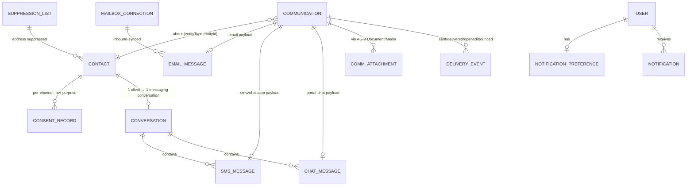

> **Document control** · Version **1.26** · **2026-10-27** · Status: **CC-8 applied: only emails a person writes are copied; system emails go to their usual recipient with no Cc (the product owner, 26 Oct)**; earlier: **AG19-D61 applied as a pointer (the product owner, 25 Oct: "yes"): a file the client attaches to a portal message also goes to the record's To file list, where a locked file uploaded as is carries "Password protected"**; earlier: **AG19-D58 applied as a pointer (the product owner, 25 Oct, later: "yes"): a password-protected PDF attached to a portal message gets the client password prompt before upload**; earlier: **AG19-D50 applied as a pointer (the product owner, 25 Oct: "yes"): a password-protected PDF attachment on an email from the client only gets the "Password protected" label; the automatic unlock email and its unlock link are withdrawn**; earlier: **Duplicates + copy on emails applied (the product owner, 24 Oct): the case's "Copy on emails" list is added as Cc at the single send path (new AG-10-89, BR-35, US-20), with a "Stop copying someone" no-login page (AG-10-85 rule 7)**; earlier: **AG-19 decisions AG19-D41 and AG19-D49 applied as pointers (the product owner, 23 Oct: no Sorter suggestion on the To file list; a password-protected attachment on an email reply gets one automatic email with a no-login unlock link, AG-09's rule)**; previously (v1.19): **AG-19 decision AG19-D32 applied as a pointer (the product owner, 23 Oct: where the attachments of a reply to a document-request email land is AG-09's rule)**; previously (v1.18): **AG-04 review decisions applied (the product owner, 21 Oct)**; previously (v1.17): **AG-02 review decisions applied (the product owner, 20 Oct): "Who is this" panel on every conversation; WhatsApp ad replies wait for "Create lead"; one alert per WhatsApp chat until opened; Message many delivery; `message.sent`; consent record and form-notification rule have their single home in AG-02; person host with a context tag; one owner-alert ladder; previously: AG-07 review applied (the product owner, 18 Oct: AG07-D16 Q29 a related contact's address counts when filing mail to that case only; AG07-D10 pointer; X-2 a letter naming a family member's UCI matches that person and their cases); previously: Second pass applied (AG16-54 to AG16-82, the product owner, 17 Oct): sending times by what a timer counts, one Unmatched list, reply from the address the mail arrived at with a From line, Google from day one, the letter task and its "Tell the client" safeguard, Waiting on us for every conversation, and the build cards for them; earlier (v1.14): AG-16 review round 2 applied (AG16-24 to AG16-53, the product owner, 14–17 Oct): AG-10 is the home of the mailbox, government-mail, letter-library, Waiting-on-us, WhatsApp-filing and client sending-window rules; build cards added (end of §4); earlier (v1.13):** **AG-16 review applied: mailboxes (firm shared and personal, AG16-15), WhatsApp only through the firm's own account (AG16-19), AI Drafter renamed Writer (AG16-4), supervised client messages and licence-based approval removed (R5, SA-Q3), staff notifications personal only (AG16-14); earlier: Automatic messages run from day one, nothing held for a review (SA05-R9a, the product owner 12 Oct); Bounce and spam handling applied from SA-08 v2.5 (SA8-X5); SA-03 v2.16 feature catalogue applied (SA3-X12); Updated — SA-06 v3.0 closing decision F4 follow-up applied (AI-written client messages are shown to every holder of the sending permission, first decision closes the item, Owner if none; the licence marking and supervised messages were withdrawn v1.13); SA-06 v3.0 closing decisions applied (`agent/communication:configure-rails` dropped; firm-wide mail and rail set-up is `agent/integration-<rail>:manage`, AG-16); SA-06 v3.0 permission renames applied (SA6-D10, SA6-D5); client conversation carries a case tag (CP1-D6); no masking and no reveal of personal data (AG7-D10, replacing AG7-D7)**\
> Part of: *Agent (RCIC/Lawyer) Console — Functional Requirements* · Split from `FINAL-Agent-FR.md` lines 6524–7148 on 2026-09-16 · Previous version: `_archive/AG-10-communication-hub_v1.25_2026-10-25.md`\
>
> | Version | Date | Change | Decisions |
> |---|---|---|---|
> | 1.26 | 2026-10-27 | **27 Oct follow-up (the product owner: "yes to both"), in place:** AG-10-89 rule 1 now says (a) a link a staff member puts in an email they write travels with the copy, and (b) the money emails sent from an invoice or payment action (Refund issued, Credit note, Correction note, Your statement) are system emails, never copied. The portal-chat line is confirmed as copied. **CC-8 applied (the product owner, 26 Oct: "keep it simple … System email will only go to the main applicant"; "yes to both"); home AG-10-89.** Only emails a person writes are copied. **Copied:** an email a staff member writes and sends on a case from the composer, including a template picked there; a message a staff member types to a WhatsApp client on a case goes to the copy list as an email (F10 kept). **Never copied:** every system email (anything ExpatReady sends or prepares, including a message a flow prepares and a person confirms) and any email with no case. System emails keep their usual recipient (individual case: the principal applicant; LMIA file: the employer's primary contact; worker's own case: the worker), with no Cc. Changed: AG-10-89 (requirement and card rules 1, 2, 3, 6, 7, Outcome, Why, Where, Safety, Tests, Edge cases), BR-35, AG-10-5, §3.1, AG-10-85 (requirement and card rule 7 and its example: "Stop copying someone" appears only on copied emails), US-20, §9 edge cases. **Removed from the build path:** the long "copied / never copied" lists ("document requests and their reminders; the questionnaire link; invoices, payment links, invoice reminders (AG-6-12) and receipts (AG-6-22) … status notices; the Welcome (AG-7-103 rule 4)"; "Document received", "Document needs replacing", AG-9-55, AG-13 reminders); the invoice rule "Bill to is To and the list is Cc, also when Bill to is another client" (AG-6-41; invoices now go To the Bill-to person with no Cc); "Automatic case emails get the same Cc at send time"; the "Accepted risk" line (fix pass G11: "copied people receive the questionnaire and upload links … No change"), because system emails carry the no-login links and are never copied; the tests for the copied automatic document request, the copied invoice and the held chase; the edge case "removed while an automatic message is held". Unchanged: `CaseCopy`, the composer chips and "+ add", reply keeps outside Cc, a bounced Cc is skipped, the worker rule on LMIA files, the stop-copying page, F6 filing. Row added to "Decisions that change this epic"; CC-2/CC-5 and F10 rows marked narrowed. No ID added or withdrawn. | CC-8 |
> | 1.25 | 2026-10-25 | **AG19-D61 applied (the product owner, 25 Oct: "yes"), pointer only; home AG-09 (AG-9-68, AG-9-69).** A file the client attaches to a portal message shows in the conversation and is also placed on the record's To file list; locked and uploaded as is, it carries "Password protected" there, and staff unlock it in PDF Studio and file it. One clause in §3.4 (conversation view). Row added to "Decisions that change this epic". | AG19-D61 |
> | 1.24 | 2026-10-25 | **AG19-D58 applied (the product owner, 25 Oct, later: "yes"), pointer only; home AG-09 (AG-9-69).** AG19-D58 widens AG19-D50: the client password prompt is one rule of the shared client upload component and shows in every place a client uploads inside ExpatReady, portal message attachments included. One line in §3.4 (portal chat attachments). Email attachments still only get the "Password protected" label (AG19-D50). Row added to "Decisions that change this epic"; the AG19-D50 row is marked widened. No requirement ID added or withdrawn. | AG19-D58 |
> | 1.23 | 2026-10-25 | **AG19-D50 applied (the product owner, 25 Oct: "yes"), pointers only; home AG-09 (AG-9-69).** AG19-D50 narrows AG19-D49 and withdraws its part (2). A password-protected PDF attachment on an email from the client is labelled "Password protected" and nothing is sent to the client; staff unlock it in PDF Studio (AG-19-13). **Withdrawn (recorded here, removed from the build path):** the §3.8 sentence on the ONE automatic email "One file is password protected – tap here to unlock it" and its no-login unlock link; the AG-10-85 requirement sentence "The unlock link for a password-protected attachment (AG-9-69) is the upload-by-code door"; AG-10-85 card rule 1 line "password-protected attachment notice → upload by code (AG-9-7), opened on the locked file (AG-9-69)"; "the unlock email (AG-9-69)" in the copied examples of AG-10-89 (requirement and card rule 1). Row added to "Decisions that change this epic"; the AG19-D49 row is marked narrowed. No requirement ID added or withdrawn. | AG19-D50 |
> | 1.22 | 2026-10-25 | Version bump only: carries the 25 Oct in-place follow-ups already logged in the 1.21 row (no content change). 25 Oct final audit: card AG-10-86 gains the "Copied on" rule already in the requirement (rule 6, Data, Access, Events, one test; Decision adds fix pass F12; AG-7-78 rule 4); AG-10-89 examples use Client B's case number C-2026-00012 (was MAP-0142); missing-translation carve-out in §3.9 and §9 (pack content → English, firm-written → firm default; AG-08 v1.13 BR-12, SA-1-44, SA1-D2). | — |
> | 1.21 | 2026-10-24 | **Duplicates + copy on emails applied (the product owner, 24 Oct).** AG-10 carries only the "copy on emails" part; the duplicate checks (DUP-1 to DUP-9) change no AG-10 rule. (1) **New AG-10-89 "Copy on emails at send"** (requirement and card) and **BR-35**: every client-facing email that belongs to a case (`caseId` set) goes as ONE email, To the usual recipient, Cc the people on the case's copy list (`CaseCopy`, home AG-7-97 rules 6–15, data AG-07 C3.8a); copied: staff-written emails, document requests and reminders, questionnaire link, invoices, payment links, invoice reminders (AG-6-12) and receipts (AG-6-22) even when Bill to is another client (AG-6-41), status notices, Welcome (AG-7-103 rule 4); never copied: signing request, signing reminders and the executed copy (AG-5-31), portal invitation, login and security emails, marketing / Message many, anything with no case, WhatsApp. Footer "Copied on this case: <names>. Stop copying someone"; a bounced or suppressed Cc address is skipped and the rest still send; removal stops copies at once. (2) **Composer (§3.1, AG-10-5):** Cc pre-filled from the list, each chip removable for one email; "+ add" copies one person on this email only through AG-2-14, with a one-click offer "Copy them on every email for this case?". (3) **Reply keeps external Cc** by default (§3.3, AG-10-9). (4) **AG-10-85 rule 7:** the "Stop copying someone" page is a new no-login door (requirement, card rules, data, tests, non-goals). (5) **AG-10-22:** a copy has the class of the email it copies; never marketing; no consent step for the copied person. (6) **AG-10-60:** a suppressed Cc address never blocks the send. (7) **AG-10-78:** a person on the case's copy list counts as linked; "Add to case" offers the "Copy on emails" tick (AG-7-97). (8) **AG-10-10 and AG-10-78 non-goals** reworded: the "Not on this case" label is not an authorisation record; the copy list is a firm instruction to send copies with an optional note of how the client asked (C-R1). (9) **US-20**, §3.5 timeline note, §3.6 gate note, §7 `EmailMessage.cc` and `ccSkipped`, §9 edge cases, §12 (Cc is NEW in the worker adapters), §13 SME note. **Open — needs the product owner:** whether a copied person's address counts as a linked address when filing a new inbound email (AG-10-89). Rows added to "Decisions that change this epic". §13 open question 42 added. Next free IDs: AG-10-90, BR-36, US-21, Q43. Fix pass (24 Oct): cross-epic audit findings and decisions F1-F13 applied. (Here: F6 a copied person's address files a new email to that case, AG-10-10 rule 3, Q42 and AG-10-89 rule 11 closed; F10 a WhatsApp message to the client goes to the copy list as its email version; G3 employer exceptions in the non-goal; G4 worker refusal on "+ add" and reply; G5 reply never brings back a stopped person; G7 audit "removed via email link"; G11 accepted risk stated; G13 full names in the footer; G14 AG-10-85 exception for the stop-copying page.) 25 Oct mop-up: AG-10-89 rule 1 defines once when an email is "of a case" (sent from the case or from something on it) and names more copied examples (Document received, Document needs replacing, AG-9-55, AG-9-69, AG-13 reminders); rule 2, BR-35 and the requirement add the portal invitation reminder (AG-15-32) and unsubscribe / STOP confirmations (AG-12 B.9) as never copied (Resolved (25 Oct)). | CC-1 – CC-7 · DUP (none applied here) · C-R1 · C-R7 · F6 · F10 |
> | 1.20 | 2026-10-23 | **AG-19 decisions AG19-D41 and AG19-D49 applied (the product owner, 23 Oct: "yes"), pointers only.** (1) AG19-D41 (home AG-09, AG-9-68 rule 11): no Sorter suggestion shows on the To file list; AG-10-37 (c) still proposes a document type for the attachment record, and that proposal is not shown as a target (AG-10-37; open question 41 closed). (2) AG19-D49 (home AG-09, AG-9-69): a password-protected PDF on an email reply from the client is labelled "Password protected", and ONE automatic email "One file is password protected – tap here to unlock it" goes to the client, with a no-login link of the upload-by-code door; a fix-it notice, not a chase; client-facing automation approved by the product owner (AG16-76) (§3.8, AG-10-85 requirement and card rule 1). Rows added to "Decisions that change this epic". No requirement ID added or withdrawn. | AG19-D41 · AG19-D49 |
> | 1.19 | 2026-10-23 | **AG-19 decisions applied (the product owner, 23 Oct), pointers only.** AG19-D32 (home AG-09, AG-9-68): the attachments of a reply to a request email that asked for one document land on that line as parts; the attachments of a reply to a request email that asked for several documents wait on the To file list, each showing the requested lines as one-click targets; nothing is filed by guesswork (AG16-44). "Mark '[Document]' request as received?" (AG-9-62, pointer AG-10-80) is not shown on a reply to a request email. Changed: AG-10-80 (requirement and pointer section), §3.8 attachments, AG-10-37 (c) (one clause). New open question 41 (a Sorter suggestion next to the targets; same as AG-09 open question 41). Row added to "Decisions that change this epic". | AG19-D21 · AG19-D32 |
> | 1.18 | 2026-10-21 | **AG-04 review fixes applied (the product owner, 21 Oct).** (1) F-7: card AG-10-85 rule 10 (Safety) describes the booking token as AG-04 v2.0 does — stored hashed, valid until the meeting ends, void on cancel or payment expiry, replaced on reschedule, the current token in the confirmation, every reminder and "Booking updated"; "single-use" dropped. (2) F-7: card AG-10-85 rule 3 (Where) lists every booking reminder and "Booking updated" as carrying the current booking token. (2a) F-7, F-41: card AG-10-85 rule 12 (Edge cases) cites AG-4-36 / AG-4-38 instead of the AG-04 line number and names the new void cases. Open question 38 unchanged (it already points to AG-4-38). (3) Row added to "Decisions that change this epic". *22 Oct: AG-04 final cross-epic check fixes applied in place (marked "changed 22 Oct — final check").* | AG-04 review F-7, F-41 |
> | 1.17 | 2026-10-21 | **AG-02 review decisions applied (the product owner, 20 Oct).** (1) AG02-D5: new **AG-10-86** "Who is this" panel on every email and WhatsApp conversation (requirement and card); "Create lead lives only in Unmatched" removed (§3.2a, §3.3, AG-10-65, AG-10-84 card rule 3). (2) AG02-D4(3), S1: AG-10-58 creates a lead, not a "lead (prospect)"; a click-to-WhatsApp ad reply waits for the click; web forms, Lead API / Zapier and form-notification rules still create leads automatically; a clicked lead gets the "Call now" task but no thanks email and no reply reminder; `UnmatchedInboundEmail.createdProspectId` renamed `createdLeadId` (§7). (3) AG02-D10(9): one alert when a WhatsApp chat starts, none until the owner opens it (AG-10-29a, AG-10-40). (4) AG02-D8, AG02-D15(4): new **AG-10-88** delivery of "Message many" (requirement and card); BR-3, US-4, §2 persona, `agent/communication:bulk-send` row, §11 plan gating and §11 async bullet renamed from campaign wording to "Message many". (5) AG02-D7, AG02-D13(3): new **AG-10-87** `message.sent` contract (`messageId`, `partyId`, `channel`, `sentByUserId` empty when automatic). (6) X-2, AG02-D8(2): §7 `ConsentRecord` is a pointer to AG-02's person-keyed record; the AG18-D10(i) clause struck (row AG18-D10, §7, §12 note). (7) AG02-D4(3): AG-10-77 cut to the Unmatched offer display; the rule, states and data are AG-2-67's. (8) X-2, AG02-D10(11): `Communication` and related records attach to the person with a context tag `LEAD|PROSPECT|CASE` (Visual Overview model note, §7); `preferredChannel` on `PartyProfile`. (9) AG02-D12 (D8.77): AG-10-69 is the one home of the owner alert; the ladder gains the lead and prospect rungs ahead of the case and client rungs (AG-10-11, card AG-10-69 rule 5, events, test). Pending block: AG02-P23, P24, P25, P26, P89, P90, P91, P92 closed; AG02-P93 kept for its open part. Next free IDs: AG-10-89, BR-35, US-20. Final hand-over check (21 Oct): lead response time removed from the open-hours clocks list in §13 item 21 (AG02-D7). AG02-D18 / X-5 (21 Oct): one marketing email to one person from the firm's own mailbox, without consent, warns "Send anyway?" and may be sent, and the send is recorded; Message many stays strict (AG-10-22, BR-2, edge case). AG02-D19 (21 Oct): any WhatsApp marketing message, one-to-one or Message many, needs the express `WHATSAPP_MARKETING` consent with no "Send anyway?"; "Send anyway?" is for one email from the firm's own mailbox only and is recorded as an audit entry on that message in SA-11's audit log (who, when, "marketing consent missing") (AG-10-22, BR-2, edge case, AG-10-88). | AG02-D4 · AG02-D5 · AG02-D7 · AG02-D8 · AG02-D10 · AG02-D12 · AG02-D13 · AG02-D15 · AG02-D18 · AG02-D19 · X-2 |
> | 1.16 | 2026-10-18 | *18 Oct (later): `MailboxConnection` uses AG-16's shared `ConnectionStatus` (AG-16 §7); "Error" now reads "Failed".* **AG-07 review (the product owner, 18 Oct), mail filing only.** **Related contact (AG07-D16 Q29, with AG16-60):** the email address of a related contact (a brother, HR, an agent added with "Add to case", AG-7-97) now counts as a linked address when filing mail, **for the case they were added to and no other case** (AG-10-10 step 3 and card). Before: the card named only the client, spouse, dependant and employer HR contact. A related contact on two open cases fits several cases, so the mail goes to Unmatched with both suggested. **People model (X-2):** a UCI in a subject or letter picks that person, who may be a family member with a person record of their own, and then the cases they are on (AG-10-10 step 2, AG-10-70 step 6); the application number still wins when present. **Pointer only (AG07-D10):** when a second letter arrives for a step that already exists, the AG-7-96 card decides whether it joins that step or records a new one ("Also recorded on [date]"); AG-10 adds no control (AG-10-71 step 6). **Consistency (AG7-D10, audit C-37):** the letter-task example in AG-10-71 no longer shows a masked number; the task title has no number (home: AG-9-60 rule 9). **Changed:** AG-10-10 (requirement and card), AG-10-70 (card step 6), AG-10-71 (card steps 3 and 6), AG-10-78 (card step 2). **Flagged, not applied (AG07-D6):** AG-10-69 alerts the owner when a filed email arrives in a mailbox that is not theirs; whether that stays under "notify only when handed work" is open question 40. No requirement IDs added or withdrawn. *18 Oct (later): consistency fixes after expert review — AG16-89(2) (Q40 closed), X-2 (2), X-2 (5).* *18 Oct (later): AG07-D26 applied — the government-mail matcher finds the filing by its application number and, with no number, staff pick the filing (AG-10-70, AG-10-71); a letter with no deadline offers one-click "Record step" (AG-10-71); "Step done" is AG-07's and "Mark done" on the letter task stays separate (AG-10-73).* *18 Oct (later): AG01-29 / AG16-105 and gap-check fixes applied — AG01-29(6): safety line in AG-10-69 for a filed client email whose file owner is deactivated (no owner, "Needs an owner", never sent to the departed person).* *18 Oct (later): check fixes applied — `MailboxConnection` states restated in the shared `ConnectionStatus` terms (AG-10-67, AG-10-68, §6); AG-10-69 edge case and test for a deactivated file owner.* | AG07-D16 (Q29) · AG07-D10 · X-2 · AG7-D10 (C-37) · AG07-D6 (flagged) · AG07-D26 |
> | 1.15 | 2026-10-17 | Second pass (AG16-54 – AG16-82, the product owner, 17 Oct). **Changed:** automatic messages send **by what their timer counts** (days → 09:00 client time on the due day; booked time or payment hold → the exact time; other automatic → 08:00–20:00) and the client time zone uses the phone code only for single-zone countries (AG16-56, AG16-72; AG-10-8, AG-10-17, AG-10-57, BR-9, US-3); **one Unmatched list** for firm mail and WhatsApp, personal-mailbox items marked "Only you", "Create lead" only in Unmatched, "Not brought in" is machine mail only (AG16-57; AG-10-65, AG-10-82, AG-10-84, BR-34, §3.2a, US-19); automatic filing for every role, hand actions by role (AG16-66; AG-10-65, AG-10-68); a reply goes from the address the mail arrived at, with a **From line** (AG16-58; AG-10-63, BR-33; new card AG-10-63; Q24 closed); letter task due 2 working days after filing, visible at once, case step recorded on confirm, "Tell the client" safeguard, no automatic client reminder (AG16-59, AG16-61, AG16-75; AG-10-71, AG-10-73); unrecognised-letter pattern holds three fields and no letter text (AG16-62, AG16-81; AG-10-74); form-notification rule by sender + subject (AG16-65; AG-10-77); "Waiting on us" for every filed conversation: firm mailbox, personal mailbox and WhatsApp (AG16-67; AG-10-76); "Continue with Google" is a launch requirement and the send-only Gmail route is dropped (AG16-70; AG-10-67); Group addresses kept, mailbox office link dropped (AG16-71; AG-10-62, §7); Translate and Summarise in the staff member's language, saved with the email (AG16-74; AG-10-81); past WhatsApp chats: one default and an opt-out (AG16-78; AG-10-84); AI switch is Owner-only (AG16-80); one rule for a broken connection (AG16-82, pointer to AG-16-16); consistency fixes AG16-54 #8, #9, #10, #11, #12, #14, #15, #19, #21. **Withdrawn here:** cards AG-10-72, AG-10-75 and AG-10-80 (now one-line pointers to AG-09; AG16-54 #19, AG16-64); "Remind [client] until they confirm" (AG16-75); the "All chats" import choice (AG16-78); the separate "possible new enquiries" list (AG16-57); `agent/communication:connect-mailbox` for one's own mailbox (AG16-54 #9); `MailboxConnection.officeId`; the send-only Gmail route and its `authType`; AI drafting and sentence/name masking of letter patterns. **Open questions:** Q24, Q25, Q26, Q28, Q29, Q32, Q35 closed; Q27, Q30, Q31, Q33, Q34 narrowed; Q22, Q23 left open (no stated default); Q36 and Q37 added. **Standing rules cited:** AG16-60, AG16-63, AG16-76 (with AG16-31, -33, -42, -44). **Pointers only:** AG16-64, AG16-68, AG16-69, AG16-77, AG16-79, AG16-82. Cards updated or written: AG-10-8, -10, -62, -63 (new), -65, -66, -67, -68, -70, -71, -73, -74, -76, -77, -78, -79, -81, -82, -83, -84. Next free IDs: AG-10-85, BR-35, US-20, Q38. *Same-day fixes (17 Oct): AG16-83 – AG16-88 — BR-33 and BR-34 are one-line pointers to their cards (#9); plain words for the government and the anti-spam law in product text (#8); "Only you" items store the message id only (#17); Q36 closed (after 09:00: at once inside 08:00–20:00, else 09:00 next day, #15); Q37 closed (government mail only in a personal mailbox is a firm item, #16). AG16-85: "Also in: client-g@" kept, no change to AG-10-83.* *Same-day fixes (18 Oct): AG16-89 — simplified mailbox model, option A. **Withdrawn:** "Only you" items and the personal "Show me possible new enquiries" switch (AG16-25(4); AG16-57 personal part, (4), (6), (7)), the greyed buttons and reason line on own items (AG16-66(3)), `MailboxConnection.showPossibleEnquiries`, `SeenMessageRef`, `UnmatchedInboundEmail.visibility` / `ownerUserId`. **Back to AG16-15(3):** a personal mailbox brings in known clients, leads and government mail only; other unknown senders stay in the person's own mailbox and are never stored (§3.2a, AG-10-65, -66, -70, BR-34, tests; card AG-10-65 rewritten). **Owner alert, one rule:** alerts only when the email arrived in a mailbox that is not the owner's own; "reads" = the owner's own connected mailbox only (§3.2a, AG-10-11, -69, card AG-10-69). **Assignment:** Assign to… on any conversation the person can see, Take it, Unassign; assigning sets `EmailThread.ownerUserId`; picker lists only people who can open the item; audit on assign and unassign; deactivated assignee → unassigned (§3.3, AG-10-76 and card, three tests and non-goals added). **Inbox filters** Mine and Unassigned; Done = archive (§3.3, AG-10-14). **Questions touched:** Q32(b) and Q37 annotated. Decision row added; no version bump.* *Same-day fixes (18 Oct): AG16-90 — card AG-10-69 gains "Person decides:" and "Clicks:"; card AG-10-78 Tests rewritten as separate Given / When / Then lines with one named failure case.* *Same-day fixes (18 Oct): AG16-92 — email-first, the portal is optional. **New AG-10-85** (with card): every action link in a client email or WhatsApp is a no-login token link (upload by code, questionnaire link, signing, hosted pay, booking), works whatever the client's portal status, writes the same record as the portal; a signed-in client lands in the portal. **AG-10-16, §3.4:** a staff message in portal chat or a message ask is delivered in full (text and attachments) on the client's preferred channel with the reply token; one staff send = one client message. **Standing rule** "Email-first" added beside "Quiet by default" (§3.7). Open questions 38 and 39 added. Decision row added; no version bump.* *18 Oct: new section 'Decisions that change this epic' (index of AG16 decisions; no requirement changed).* *Same-day fixes (18 Oct): AG16-96 — AG-10-77: the form-lead offer appears on the 3rd matching item (offer text and example; home: AG-2-67); question 27, the number part, closed.* | AG16-54 – AG16-82 (AG16-60, AG16-63, AG16-76 standing; AG16-55 closes questions); AG16-89 (18 Oct); AG16-90 (18 Oct); AG16-92 (18 Oct); AG16-96 (18 Oct) |
> | 1.14 | 2026-10-17 | AG-16 review round 2 (AG16-24 – AG16-53, the product owner, 14–17 Oct). **Build cards** written for every new or changed home requirement (section "Build cards", end of §4). **Mailboxes:** one "Connect your email" button; role set by context; second-user notice; personal "Show me possible new enquiries"; separation model and "via info@" (AG16-25, new AG-10-68, AG-10-69; AG-10-65 changed); **several firm mailboxes**, one main, reply from the address the mail arrived at (AG16-28; AG-10-62, AG-10-63, `MailboxConnection` changed); connect flow with Microsoft admin approval, three Gmail routes, Nylas fallback, one-line deactivation warning (AG16-37; AG-10-66, AG-10-67 changed). **Filing order** replaced: thread → reference in subject → linked address (one open case) → several cases/none to Unmatched (AG16-26; AG-10-10, AG-10-12, BR-7, §3.2 changed). **Government mail** (AG16-27 as corrected by AG16-42, AG16-44; new AG-10-70 – AG-10-75): recognise by domain, match by number, letter library, three kinds, deadline by rule, "Tell the client", same-letter prompt, unrecognised-letter type picker, PDFs on upload. **Inbox:** owner, Assign to…, Waiting on us, No reply needed (AG16-29; AG-10-76); form-notification suggestion in Unmatched (AG16-32, AG16-44; AG-10-77); "Not on this case" (AG16-35; AG-10-78); Make task and Remind me if no reply (AG16-36; AG-10-79); attachment marks a request received (AG16-38; AG-10-80); Translate and Summarise thread (AG16-39; AG-10-81); "Not brought in" list, "Also in", Move, Un-file (AG16-42, AG16-44; AG-10-82, AG-10-83). **WhatsApp:** inbound filing by the mailbox rule, "Sent from phone", one-time past-chat import choice (AG16-48; AG-10-84). **Sending window:** automatic non-urgent messages only 08:00–20:00 in the client's local time, fixed; staff-written messages never held; composer cue (AG16-49 as trimmed by AG16-51; AG-10-8, AG-10-17, BR-9, BR-31, US-3 changed; §13 Q21 closed). **Standing rules cited:** AG16-31, AG16-33, AG16-42, AG16-44. **Pointer lines only:** AG16-24, AG16-30, AG16-40, AG16-47, AG16-52. §10 row for `agent/communication:connect-mailbox` flagged (AG16-52); §12 corrected: shared sending is built in the worker, not in `apps/api/src/rails/adapters/email`. Next free IDs: AG-10-85, BR-35, US-20. | AG16-24 – AG16-53 (AG16-31, AG16-33, AG16-42, AG16-44 standing; AG16-51 trims) |
> | 1.13 | 2026-10-14 | AG-16 review (the product owner, 14 Oct). **AG-10 is the single home of the mailbox rules; AG-16 only places the screens.** **Mailboxes (AG16-15):** email works on day one through ExpatReady's shared sending with the firm's name and a reply-to; the firm may connect one **shared mailbox** (Settings → Connections) and each person may connect **their own** (My account → Email); Gmail and Microsoft 365 are buttons, "Other provider (IMAP/SMTP)" is collapsed; automatic messages always send from the firm mailbox (or shared sending), a message a person writes from their own mailbox, else the firm's, else shared sending; one email in several mailboxes is filed once (message ID); the firm mailbox sends unknown senders to the Unmatched inbox with "Create lead", a personal mailbox brings in only known clients and leads (a person can file one by hand); deactivating a person ends their connection (filed emails stay); Google and Microsoft approval is the longest lead-time item. New: AG-10-62 – AG-10-67, BR-33, BR-34, US-18, US-19, section 3.2a. Changed: design decisions 2 and 3, AG-10-4, AG-10-12, §3.1, §3.2, mailbox lifecycle, `MailboxConnection`, §10 mailbox rows, §12, §13 (Q5 decided; the "per-user mailboxes Phase-2" deferral withdrawn). **WhatsApp (AG16-19):** only through the firm's own connected WhatsApp Business account, no shared ExpatReady number; without a connection, an approved template, or when a template is Paused or Rejected, the message goes by email (AG-10-43, AG-10-56, AG-10-57, BR-15, BR-30). **Rename (AG16-4):** the AI writer is now **Writer** everywhere in this file (it was "Drafter"; the "AG-10-15" manual path is unchanged). **Removed (R5, SA-Q3, SA-Q1b):** supervised client messages (AG-10-49, AG-10-50, BR-26, US-15 withdrawn), the licensed-approver rule for AI-written client text (AG-10-15, AG-10-44, BR-20, US-14, §3.3, §6, §7, §10 changed), the "preferred" licence mark, and the firm settings for who approves AI text and for supervision. AI-written text is still approved by a human: any holder of the sending permission (SR-Q10). **Notifications (AG16-14):** personal only — no firm matrix, no quiet hours, no digest for staff notifications (§3.7, AG-10-29a, AG-10-29b, BR-13, US-7, §12 changed). **Automatic messages page (AG16-11):** autonomy choice and on/off now point to the Automatic messages page (AG-12); AG-10 documents no control of its own (§3.10, AG-10-45, AG-10-61). Open question 21 added (client-message quiet hours). Next free IDs: AG-10-68, BR-35, US-20. *Same-day audit corrections (14 Oct): AI-edited-template per-send floor removed from AG11-D1, §3.3, AG-10-44, AG-10-45, BR-20, lifecycle, US and edge case (approved once at publish, AG12-D25); `originType` value DRAFTER corrected to WRITER.* | AG16-15, AG16-19, AG16-4, AG16-14, AG16-11 (R5, SA-Q3, SR-Q10, G-Q2 cited) |
> | 1.12 | 2026-10-12 | **SA05-R9a (the product owner, 12 Oct): automatic messages run from day one.** Nothing is held for a review: the seeded recipes' client messages (acknowledgements, chases, follow-ups, reminders) no longer wait in Needs you until the firm confirms "Review your standard messages"; that screen is now the optional "Review your automatic messages" on/off page (AG-12-52). A message missing a firm detail is not sent and the firm sees a note (Guard 1, AG-12-109); one-time dashboard notice (Guard 2, AG-12-110). Class 3 now simply means self-firing. **Unchanged:** autonomy levels and AI floors, consent gate, WhatsApp opt-in, 7-day update notice, imported clients quiet until switched on (AG-10-55). Changed: AG11-D1 row, AG11-D12 row (hold struck through), §3.10 autonomy paragraph, AG-10-45, BR-19, US-14. New: AG-10-61; new "Applied from SA-05" row; open questions 19 and 20. Next free IDs: AG-10-62, BR-33, US-18. **Same-day closing (SA05-R9b, the product owner, 12 Oct):** open questions 19 and 20 are closed — a missing firm detail follows Guard 1 (not sent, the firm is told), a missing client detail keeps the AG-10-30 approval route unchanged, and the on/off permission is `agent/template:configure`; AG-10-30 and AG-10-61 say so. *(revised same day — SA05-R9b)* | SA05-R9a (SA5-X46) · SA05-R9b |
> | 1.11 | 2026-10-10 | Applied from SA-08 v2.5 (SA8-X5; merge decided by the product owner, 10 Oct): a **spam complaint suppresses the address like a hard bounce**; staff **see why** before sending ("Emails to <address> bouncing since <date> — correct the address to send"), and **correcting the address on the client record resumes sending** (AG-7-93). Applies to the shared email service and the firm's own mailbox. New AG-10-60. | SA8-D6 (SA8-X5) |
> | 1.10 | 2026-10-10 | Applied from SA-03 v2.16 (SA3-X12; the product owner, 10 Oct): plan gating now uses SA-3's **feature catalogue**. Mailer and Messenger are module features (every plan, intended); **Inbox sync**, **Bulk email campaigns** and **Communication analytics** are sellable extras; **WhatsApp** is part of the extra *Own email, calendar, payment or WhatsApp account* (AG-16-38); **AI Doers** are one extra with one firm switch (AG-16-35), still off until the provider terms are recorded (AG11-D13). Anything else in this module follows its module feature. The §11 gating bullet and §13 Q9 updated (Q9 closed). | SA3-D10 (SA3-X12) |
> | 1.9 | 2026-10-07 | **SA-06 v3.0 closing decision F4 follow-up (the product owner, 7 Oct).** An item awaiting a professional approval is **shown at once to every active holder of the relevant approval permission**; **active licensed holders are marked "preferred"** (a mark and sort order, not a restriction); **the first decision closes the item for everyone**, the others seeing who decided and when; **if no one holds the permission, the Owner approves**, recorded. In AG-10 this replaces "the file's lead RCIC, or any licensed user" and "a licensed user's Needs you" for supervised and AI-written client messages. **Unchanged:** AG11-D11(a) — AI-written client text needs a licensed approver by default, a firm setting that is **on by default**; for items that setting requires a licensed approver, they are shown at once to every active licensed user, and to the Owner if none is active (recorded "approved by Owner without a licensed user"); approval needs the same permission as sending by hand (AG-10-46); author does not approve their own supervised message while another eligible approver exists (AG-10-50). Requirement IDs unchanged. Changed: Document control, new SA6-D9 row in "Applied from SA-06 v3.0", §3.10 Drafter text, AG-10-15, AG-10-44, AG-10-49, BR-20, BR-26, approval lifecycle note, US-14 and US-15 acceptance lines, §10 approval row. | SA6-D9 |
> | 1.8 | 2026-10-07 | **SA-06 v3.0 closing decisions (the product owner, 7 Oct).** `agent/communication:configure-rails` is dropped from §10: firm-wide mail and rail set-up (SMTP / relay, messaging gateway, WhatsApp account) is governed by `agent/integration-<rail>:manage` (owned by AG-16 and SA-06), not by a key in this module. `agent/communication:connect-mailbox` stays for a user's personal mailbox (Gmail, Microsoft 365 or IMAP). Requirement IDs unchanged. Changed: Document control, new SA6-D10 row in "Applied from SA-06 v3.0", §10 (`configure-rails` row replaced by a pointer, `connect-mailbox` row clarified), §10 enforcement, §11 permissions bullet. | SA6-D10 |
> | 1.7 | 2026-10-07 | Permission renames from SA-06 v3.0 Appendix B (the product owner, 7 Oct). `agent/communication:manage-consent` becomes `agent/consent:manage` (the SA-11 register key; owned there, so §10 now says "see SA-11"); the withdrawn `agent/communication:reveal-pii` and `agent/pii:export-unmasked` rows stay as withdrawn; `agent/notification:manage-preferences` is the canonical key that AG-16's `agent/settings/notification-preference:edit` merged into. Role names follow the six starter roles (Manager → Case Manager, Accounts / Billing → Billing / Finance). Changed: §2 personas, §10. Requirement IDs unchanged. | SA6-D10, SA6-D5 |
> | 1.6 | 2026-10-05 | Knock-ons from CP1-D6 and AG7-D7 (the product owner, 5 Oct). **Case tag (CP1-D6):** each `Communication` in the client conversation carries `caseId?` (null = General) — §7 `Communication` changed; new **AG-10-59** sets the tagging rules (client from inside a case; "About:" in the portal inbox; replies keep the tag; new inbound to the only open case or a quoted case code, otherwise General and untagged to the file owner; Sorter may only suggest, staff confirm; staff from a case screen; staff re-tag, audited) and says the case timeline shows only messages tagged to that case (§3.5 text added); BR-14 stays and now says the conversation carries case tags. **Sensitive data (AG7-D7):** passport, financial and other Restricted fields show in full on screens to users who may see the record and are masked in lists, search, exports, notifications/emails, reports and logs; an unmasked export needs the platform-wide `agent/pii:export-unmasked` and is audited. Changed: AG-10-35 ("PII reveal" becomes "unmasked export"), §9 long-export edge case, §10 honesty note, `agent/communication:export` row, §10 enforcement text, §11 per-action permissions, PII and audit bullets. `agent/communication:reveal-pii` **withdrawn** (row kept); new row `agent/pii:export-unmasked` (owned by SA-06's catalogue). Added: AG-10-59. Same day (AG7-D10): masking and reveal removed — personal data is never masked and has no reveal action; `agent/pii:export-unmasked` withdrawn (row kept); `agent/communication:reveal-pii` stays withdrawn; exports need only `agent/communication:export` and are audited; the "unmasked export" audit event type is removed; AG-10-35, the long-export edge case, §10 honesty note, export row, enforcement, §11 permissions, PII, audit and summary bullets reworded. Kept: no PII in logs, no passport or financial numbers in message content, encryption at rest. | CP1-D6, AG7-D7, AG7-D10, AG11-D13 |
> | 1.5 | 2026-10-04 | Applied the Agent-native decisions owned by AG-11 (the product owner, 4 Oct): the **Sorter** matches, classifies and files inbound email / WhatsApp beyond header/reply-token matching, with low confidence going to the Unmatched inbox and Needs you, and emits `message.received` (§3.2, AG-10-37 to AG-10-40); the AI-assist drafter becomes the **Drafter Doer** callable by recipes, and AI drafts to clients are always APPROVE (AG-10-15 changed; AG-10-44); **WhatsApp inbound and in-window replies move to Release 1**, proactive outbound WhatsApp and SMS stay Release 2 *(proactive outbound WhatsApp moved to Release 1 on 5 Oct, see the last part of this row)* (§3.4, AG-10-16/17 changed; AG-10-41 to AG-10-43; phasing text fixed in §3.4, §12, §13); automated client messages default to APPROVE and appear in Needs you, CASL gate unchanged (§3.10, AG-10-45 to AG-10-47). Added AG-10-37 to AG-10-48, BR-19 to BR-25, US-12 to US-14, entities, edge cases, permissions, §12 NEW markers, §13 open questions. **Same day (simplify, "easy for solo, safe for teams"):** automated client messages no longer all default to APPROVE — a **template message** (an active AG-12 template with only merge fields filled) defaults to `AUTO`, because the firm approved the template once; the `APPROVE` floor stays for AI-written text, a template whose body was edited by AI, any government form and any unlooked-at verified-profile write; "anything that reads as advice" is removed as a mechanical floor (AG-10-44, AG-10-45, BR-19, BR-20, §3.10, US-14 revised); a person who is the one acting approves inline with no Needs you item (AG-10-15, AG-10-46, AG-10-45 revised); under **Team safeguards** (AG11-D9, on automatically at 5 or more active staff) a client message written or edited by **unlicensed** staff waits for a licensed user (AG-10-49, AG-10-50, BR-26, US-15 new). **Same day (closing decisions):** AG11-D9 part 2 revised — with no active licensed user, a supervised message goes to the **Owner's** Needs you and still never sends on its own (AG-10-49, §9 edge case, US-15 revised). **Same day (review fixes):** principle added — **we work for the firm, not the regulator**: ExpatReady ships safe defaults and keeps a record, the firm decides (§1 paragraph; "regulator-safe" and "regulated-profession" wording replaced in §1, §2, §3.3, §3.5, §12, §13, BR-10). **AG11-D11 (licence-aware defaults):** supervision of client messages written or edited by unlicensed staff is now its own firm setting, **on by default as soon as the firm has an active unlicensed user who can message clients** (no longer tied to 5 staff), the Owner may switch it off with a recorded reason; with no licensed user the **Owner may approve**, recorded "approved by Owner without a licensed user" (closes the open note); AI-written text to a client needs a **licensed** approver by default, the Owner may widen it, and a Drafter draft sent unedited counts as AI-written; the wrong AG1-D6 citations now cite AG11-D11 / AG-01 §3.5 (AG-10-15, AG-10-44, AG-10-46, AG-10-49, AG-10-50, BR-20, BR-26, US-14, US-15, §3.3, §3.10, §6, §9, §10 revised). **AG11-D13:** AI Doers are **off** until Super Admin records the provider terms and the Owner switches AI on once (one switch for all four Doers); Sorter safeguards — an **AI-only match is never filed automatically**, firm-scoped candidate list, client content passed as delimited data, an unverified sender never triggers client-facing `AUTO` (AG-10-15, AG-10-37, AG-10-38, AG-10-39, AG-10-43, AG-10-47, AG-10-48, BR-22, BR-23, US-10, US-12, §3.2, §3.4, §6, §9 revised; new AG-10-54, BR-27). **Acknowledgement rule** for Sorter-filed attachments: approval first (new AG-10-51, BR-28). **Missing merge variable** drops the send to `APPROVE`, never a placeholder (AG-10-30, BR-8, §3.9, §9 revised). **WhatsApp window:** a pending reply's due time is the window close minus a margin, shown as a countdown; in-window replies skip quiet-hours deferral; on expiry the item becomes "choose another channel", not a silent drop (AG-10-17, AG-10-41, AG-10-42, BR-24, §3.4, §6, §9, US-3, US-13 revised; new AG-10-52). **AG11-D12:** a template message is a firm-scope **PUBLISHED** template version, and the seeded recipes' client messages wait in Needs you until the firm confirms one "Review your standard messages" screen (AG-10-45, BR-19, §3.10, US-14 revised). **AG18-D10:** imported correspondence is historical and never-send, never passes through the Sorter and never emits `message.received` (new AG-10-53); an imported consent column is never written to `ConsentRecord` (§7); automated sends skip any record or recipient party that is QUIET, shown in the UI as "Not started" (new AG-10-55, BR-29). New: AG-10-51 to AG-10-55, BR-27 to BR-29; new open questions 15 to 17. Same day (final alignment): an unverified sender's client-facing action drops to `APPROVE` and waits in Needs you — never skipped (AG11-D13 row, §3.2, AG-10-47, BR-27, US-12, §9); the Owner may approve a message the Owner wrote when no licensed user is active, recorded (AG-10-50, BR-26, §9; §13 Q16 closed); supervision is not re-enabled automatically after an Owner switch-off — one notice with a one-click "switch supervision on" (AG-10-49). Same day (5 Oct): AG1-D19 — no licence monitoring; licensed user = linked by the firm. 5 Oct (open questions closed): AG11-D14 to D17 and AG18-D11 applied. Inbound email split (D16): Gmail and Microsoft 365 connection (OAuth) with Sorter filing is Release 1, plain IMAP for other providers is Release 2 *(moved to Release 1 on 5 Oct, see the last part of this row)* — changed AG-10-4, §3.0 design decision 3, §3.2 screens and data flow, mailbox lifecycle, `MailboxConnection`, §12 reference lines, §13 deferrals; Q3 decided. Verified sender defined by AG-11 and confirmed (AG18-D11(g)) — changed AG-10-47; Q17 decided. AI processing in Canada only (D15) — AG-10-48, AG-10-54, §0 and Q14; outside providers only for AI/OCR, WhatsApp and mailbox connections, each approved by Super Admin (D14) — no text change needed, the existing rule that no third-party messaging tool is a user surface stands; Needs you due time "2 business days, capped by a linked deadline" is now "2 working days, and 2 working days before a government deadline" (D17) — §6 and Q11; a pending message for a paused client is marked "client paused" and cannot send (AG18-D11(e)) — §6. No new requirement numbers. **5 Oct (Release 1 scope review):** the product owner moved three items into Release 1 (AG11-D18). (a) **Proactive outbound WhatsApp** — firm-started messages, chases and reminders using provider-approved templates, outside the customer-service window — is Release 1; each client has a preferred channel (email or WhatsApp), the firm can send the same message to both, recipes send on the preferred channel, a WhatsApp message must map to a provider-approved template or the recipe falls back to email, and consent per recipient, the quiet state, supervision, autonomy, rate caps and quiet hours apply exactly as for email; SMS stays Release 2 (changed AG-10-16, AG-10-17, AG-10-41, AG-10-42, AG-10-43, BR-24, §3.4 window text, §6 window lifecycle, §7, §9, §10, §12, §13 Q1, Q4 and deferrals; new AG-10-56, AG-10-57, BR-30, BR-31, US-16, Q18). (b) **Unknown WhatsApp number → new lead:** an inbound WhatsApp message from an unknown number lands in the Unmatched inbox with a **"Create lead"** action that a person clicks; it is never automatic (changed AG-10-12, AG-10-40, BR-25, §3.2, §3.4, §7 `UnmatchedInboundEmail`, §9; new AG-10-58, BR-32, US-17). (c) **IMAP** mailbox connection for other email providers is Release 1, alongside Gmail and Microsoft 365 OAuth, so all three inbound options are Release 1 (revises AG11-D16: changed AG-10-4, §3.0 design decision 3, §3.2, diagram A, §6 mailbox lifecycle, §7 `MailboxConnection`, §11, §12, §13 Q3 and deferrals; US-11 extended). **5 Oct (Release 1 scope review, small fix):** AG-10-58 now cites AG-2-62 (AG-02's "Create lead from WhatsApp", which sets source `WHATSAPP` and sends the speed-to-lead acknowledgement on WhatsApp as an in-window reply, falling back to email if the window has closed); AG-10-57's rate-cap reference (AG-11 guardrails "Rate caps", AG-11 BR-11) checked and still exists. 5 Oct (final check fixes): open questions 2 and 12 closed as decided (consent gate ships in Release 1 for email and WhatsApp, AG11-D18(a); the Reader, not the Sorter, classifies documents, AG11-D18(e)); the positioning sentence in §1 now says the consent gate "protects the firm's practice"; the AI heading in §3 renamed "Safe AI drafts"; user stories US-14 and US-15 moved before US-16 and US-17 (no renumbering). No requirement changed. | AG11-D1 (revised), AG11-D2 (revised), AG11-D4, AG11-D5, AG11-D6, AG11-D9 (revised), AG11-D11, AG11-D12, AG11-D13 · AG18-D10 · AG1-D19 · AG11-D14 to D17 · AG18-D11 · AG11-D18 (Release 1 scope review, 5 Oct) |
> | 1.4 | 2026-10-03 | Consistency review fixes (3 Oct): change-log row 1.2 repaired (it had lost its table marker); "Applied from AG-17" table added below the module heading, listing where AG17-D4, AG17-D6 and AG17-D61 are applied. No requirement changed. | AG17-D4, AG17-D6, AG17-D61 |
> | 1.3 | 2026-10-02 | Notifications are never filtered by the Individual / Corporate **view** ("view" = the Individual / Corporate switch; "workspace" = the firm's whole account). §3.7 paragraph; AG-10-29a changed; AG-10-36 and BR-18 added; US-7, edge case and §12 note added. No other requirement changed. | AG17-D6, AG17-D61 |
> | 1.2 | 2026-10-02 | Applied AG17 terminology/consistency changes (safe set): communication subject entities collapsed to contact / prospect / case + client type; corporate client = organisation party. | AG17-D4 |
> | 1.1 | 2026-08-28 | Baseline — complete document v1.1 | — |

## Decisions that change this epic (14–25 Oct) *(new 18 Oct; AG-02 rows added 21 Oct; copy-on-emails rows added 24 Oct; AG19-D50 row added 25 Oct; AG19-D58 row added 25 Oct, later; AG19-D61 row added 25 Oct, latest)*

Product-wide rules (apply here as everywhere; home: Agent `00-Overview` → "Product rules every epic follows"): AG16-11, AG16-31, AG16-33, AG16-42, AG16-44, AG16-60, AG16-63, AG16-76, AG16-89, AG16-92.

The "AG16" prefix is historical: these decisions began in the AG-16 review and apply across the product. Full text: `TEMPLATE-MAP-working_2026-10-10.md`.

| Decision | What was decided (one line) | What it changes in this epic | Where (requirement / card / section) |
|---|---|---|---|
| AG16-4 | One family of "Doers"; the AI writer is renamed "Writer" (the code's `drafter` stays the non-AI document generator) | Every mention of the AI writer, formerly "Drafter", now reads "Writer" | Whole file · AG-10-15 / AG-10-44 text (§3.3, §3.10) |
| AG16-6 | Business hours and closed days (firm default, per-office, firm's own closed-day list) | Deadline-by-rule dates are counted in calendar days and never moved by closed days; the 2-working-day "waiting" clock counts the firm's closed days | AG-10-71 card (rule, line ~877) · AG-10-76 card · open question on quiet hours |
| AG16-9 | Backup approver removed | Open items of a deactivated person become unassigned (no backup approver) | AG-10-65 deactivation text · AG-10-76 card (Given/When/Then) · §3.2a |
| AG16-11 | One "Automatic messages" page, documented only in AG-12 | Automatic-message timings and the page are not specified here; AG-10 points to AG-12 | §3.10 · AG-10-45 · AG-10-61 · AG11-D12 row |
| AG16-12 | Where timings live (on the row of the Automatic messages page) | Cited as context in the "Tell the client" card; no timing is defined in AG-10. Referenced only (no change here) | AG-10-73 card |
| AG16-14 | Staff notifications are personal settings only | No firm notification matrix, no firm quiet hours, no digest; each person sets their own In-app and Email switches | §3.7 · AG-10-29a, AG-10-29b · BR-13 · US-7 · §9 · §12 |
| AG16-15 | Mailboxes: firm and personal, nothing required | Email works on day one through shared sending; optional firm shared mailbox and personal mailbox; sending-address rule; dedupe by message ID; deactivation ends the connection. AG-10 is the single home of the mailbox rules | §3.0 · §3.1 · §3.2 · §3.2a · AG-10-4, AG-10-12, AG-10-62 – AG-10-67 · BR-33, BR-34 · US-18, US-19 |
| AG16-18 | Calendars: personal only | Referenced only (no change here): booking confirmations carry the calendar invite, unaffected by AG-10 | Pending knock-ons note (§0) |
| AG16-19 | No shared ExpatReady WhatsApp number | WhatsApp works only through the firm's own WhatsApp Business account; email fallback when there is no connection, no approved template, or the template is Paused or Rejected | §3.4 · AG-10-43 · AG-10-56, AG-10-57 · BR-15, BR-30 |
| AG16-21 | Undoing deletes | Cited in the form-notification card: spam leads are removed with bulk delete. Referenced only (no change here) | AG-10-77 card |
| AG16-24 | Own mailbox and own calendar on every plan | Pointer only: firm and personal mailboxes with automatic filing are on every plan; "Inbox sync" merged into this (home SA-03) | §11 gating bullet |
| AG16-25 | Mailbox roles, solo setup, how email data separates | One "Connect your email" button; mailbox role set by context; separation model ("via info@", who is alerted); the "Show me possible new enquiries" part later replaced by AG16-89 | §3.2a · AG-10-65, AG-10-68, AG-10-69 · cards |
| AG16-26 | Email filing order | New filing order: thread, then subject reference, then linked address, then Unmatched (replaces reply token, address, alias) | §3.2 · AG-10-10, AG-10-12 · BR-7 · card AG-10-10 |
| AG16-27 | Government mail: recognise, match, identify the letter, sort, deadline | Government email is recognised, matched to the case, identified in the letter library, sorted FYI / Action / Noise, with a deadline by rule | AG-10-70, AG-10-71 (+ cards) · AG-10-72 pointer to AG-09 |
| AG16-28 | Several firm mailboxes | More than one firm mailbox allowed, one main; a reply goes out from the address the email arrived at | AG-10-62, AG-10-63 · `MailboxConnection` · card |
| AG16-29 | Who's handling a firm-mailbox email | Owner, Assign to…, Waiting on us, No reply needed on filed conversations | AG-10-76 (+ card) |
| AG16-30 | Payment emails become a suggested payment record | Pointer only: recognising payment notices lives in AG-06; AG-10 adds no control | §11 note · no requirement |
| AG16-32 | Lead notification emails become leads | Unmatched shows "These look like website-form notifications" as a suggestion; lead creation is in AG-02 | AG-10-77 (+ card) |
| AG16-34 | AI is included in higher plans, not sold as an add-on | The AI Doers used here (Sorter, Reader, Writer) are plan-gated, not an extra | §11 gating · cards AG-10-10, AG-10-70, AG-10-74, AG-10-81 (Engine line) |
| AG16-35 | "Not on this case" label | New thread action to mark an email as not belonging to the case | AG-10-78 (+ card) |
| AG16-36 | "Make task" and "Remind me if no reply" | New thread actions; the task record is in AG-13 | AG-10-79 (+ card) |
| AG16-37 | Mailbox go-live essentials | Connect flow handles Microsoft admin approval; "Continue with Google" from day one; deactivation screen warns which firm mailboxes will stop syncing | AG-10-66, AG-10-67 · cards · §3.2a |
| AG16-38 | Lower-volume email items (an emailed attachment can mark a document request received) | Thread action added as a pointer; the rule home is AG-09 | AG-10-80 |
| AG16-39 | Translate and Summarise thread | New thread action using the Writer, only on plans with AI | AG-10-81 (+ card) |
| AG16-40 | Home screen sections | Pointer only: home is AG-11; AG-10 adds nothing | no requirement |
| AG16-41 | Letter library also runs on uploaded PDFs | Pointer: upload rule lives in AG-09 | AG-10-75 |
| AG16-42 | Quiet by default, plus telling the client | Alerts only for real work; new "Tell the client" action from a letter task | §3.7 · AG-10-69, AG-10-73, AG-10-82 · cards |
| AG16-43 | Keeping the letter library current | Staff pick the type of an unrecognised letter ("Letter — type not recognised"); pattern review and publishing are in SA-01 / SA-05 | AG-10-74 (+ card) |
| AG16-44 | ExpatReady never quietly judges (standing rule) | "Not brought in", "Also in", Move, Un-file and a same-letter prompt, so nothing is dropped silently | AG-10-72 pointer, AG-10-82, AG-10-83 · cards |
| AG16-45 | Office time zones and escalation by office | Cited in the sending-time card: the client's time zone fallback is the case's office time zone (the firm's while there is one office). Referenced only (no other change here) | AG-10-8 card (line ~600) |
| AG16-47 | Automatic messages page: find and fix | Pointer only: the history line shows "Automatic · [name] · Change" and opens the row on the Automatic messages page (home AG-12). AG-10 adds no control | no requirement |
| AG16-48 | WhatsApp inbound filing, "Sent from phone", past-chat import choice | WhatsApp messages are filed to the case; staff phone sends are marked; one-time past-chat import choice | AG-10-84 (+ card) |
| AG16-49 | Client sending window in the client's own time zone | Automatic client messages send between 08:00 and 20:00 in the client's time zone; the window is fixed | AG-10-8, AG-10-17 · BR-9, BR-31 · US-3 · card AG-10-8 |
| AG16-50 | Government-deadline reminder with no one assigned goes to the Owner | Cited as the safety net in the "Tell the client" card: staff deadline reminders 2 days before and on the day. Referenced only (no change here) | AG-10-73 card (Safety) |
| AG16-51 | Three trims to avoid over-building | The client sending window is fixed and has no setting; the WhatsApp pre-connection checklist is a plain list | AG-10-8 · AG-10-84 · card AG-10-8 · §3.4 (sending-window sentence) |
| AG16-52 | Connecting one's own mailbox needs no permission | Pointer: `connect-mailbox` for one's own mailbox needs no key (home AG-16 / SA-06) | §10 `connect-mailbox` row |
| AG16-53 | Video links are per person; no firm video account | Cited — see change-log row 1.14 (range AG16-24 – AG16-53); no specific change found in this document | Change-log row 1.14 |
| AG16-54 | 25 consistency fixes after the 17 Oct write | One mailbox entity `MailboxConnection`; pack-content patterns for application numbers and UCI; AI-read fields shown as "Suggested details"; low-confidence Sorter match goes to Unmatched only; "Remind me if no reply" is a home-screen item, not a push | §7 `MailboxConnection` · AG-10-65, AG-10-68, AG-10-79 and related cards · §10 |
| AG16-55 | Writers' defaults accepted for the detail questions | Open questions Q22 – Q35 closed where a default was stated | §13 |
| AG16-56 | Sending times by what a timer counts | Day-based messages go at 09:00 client time; booked-time or payment-hold messages at the exact time | AG-10-8, AG-10-17, AG-10-57 · BR-9 · US-3 · §9 · card AG-10-8 |
| AG16-57 | One Unmatched list; "Not brought in" only for machine mail | One Unmatched list for firm items; "Not brought in" limited to machine mail (the personal "Only you" part was later withdrawn by AG16-89) | §3.2a · AG-10-65, AG-10-68, AG-10-82, AG-10-84 · BR-34 · US-19 |
| AG16-58 | Reply from the address the mail arrived at, with a From line | The composer shows a From line; replies leave from the receiving address | §3.1, §3.2a · AG-10-63 · BR-33 · card AG-10-63 |
| AG16-59 | A government letter records its case step; one event, one client message | The letter records its case step on confirm; "Tell the client" is a safeguard so one event gives one client message | AG-10-71 (+ card) · AG-10-73 |
| AG16-61 | Due date and visibility of the task made from a government letter | Letter task is due 2 working days after the letter is filed, never later than the government deadline, and shows to the owner at once (closes Q28) | AG-10-71, AG-10-73, AG-10-79 · cards · §13 Q28 |
| AG16-62 | Unrecognised-letter pattern holds domain, masked file name and type | A pattern keeps no letter text | AG-10-74 (+ card) |
| AG16-64 | Letter copies: same person required | Pointer: copy handling lives in AG-09 (AG-9-61) | AG-10-72 |
| AG16-65 | Form-notification rule matches sender + subject | Learned rule shown to staff | AG-10-77 (+ card) |
| AG16-66 | Limited roles and their own mailbox: automatic filing for all, hand actions by role | Any staff member's own mailbox files automatically; hand actions (move, file, assign) follow the role's permissions | §3.2a · AG-10-65, AG-10-68 · BR-34 · US-19 |
| AG16-67 | "No reply" signals kept as layers; "Waiting on us" covers every client conversation | "Waiting on us" applies to firm mailbox, personal mailbox and WhatsApp threads (closes Q34) | AG-10-76 (+ card) · §13 Q34 |
| AG16-68 | Payment notices: amount-only is a candidate; "Record all" covers invoice-number matches only | Pointer only (home AG-06); AG-10 adds no control | Change-log row 1.15 ("Pointers only") |
| AG16-69 | Evidence before build for payment notices | Pointer only (home AG-06); AG-10 adds no control | Change-log row 1.15 ("Pointers only") |
| AG16-70 | "Continue with Google" from day one | Send-only Gmail route and Nylas fallback dropped | AG-10-62, AG-10-67 · §7 · cards |
| AG16-71 | Group addresses kept, office link dropped | A group address is kept but is not linked to an office | AG-10-62, AG-10-67 · §7 |
| AG16-72 | Client time zone from the phone code, single-zone countries only | Multi-zone codes (+1, +7, +61 and others) are skipped; the case's office zone is the fallback | AG-10-8 (+ card) · BR-9 |
| AG16-73 | UCI is a canonical answer on the person | UCI lives on the person; the deadline lives on the case step record | AG-10-70, AG-10-71 · cards |
| AG16-74 | Translate and Summarise in the staff member's language | Output is in the staff member's language and saved with the email | AG-10-81 (+ card) |
| AG16-75 | "Remind [client] until they confirm" dropped; the officer decides | The optional "Remind [client] until they confirm" tick is removed from "Tell the client"; no automatic client reminder | AG-10-73 (+ card) |
| AG16-77 | Client deadline reminders by formula (two reminders at 50% and 90% of the window) | Pointer only (homes SA-05, AG-12); AG-10 adds no control | Change-log row 1.15 ("Pointers only") |
| AG16-78 | Past WhatsApp chats: one default and an opt-out | One default for importing past chats, with an opt-out | AG-10-84 (+ card) |
| AG16-79 | Closed days: one "Add these every year" tick, asked once | Pointer only (home AG-16); AG-10 adds no control | Change-log row 1.15 ("Pointers only") |
| AG16-80 | AI switch and plans | Only the Owner switches AI on and off (`agent/ai:switch`) | §10 · AG-10-81 |
| AG16-81 | "New letter patterns" review in Super Admin | AI drafting of unrecognised-letter entries removed; a pattern holds three fields and no letter text | AG-10-74 (+ card) |
| AG16-82 | One rule for every broken connection | Pointer: one email at the moment and one home-screen item until fixed; home AG-16-16 | §9 · AG-10-84 |
| AG16-83 | 26 follow-through fixes after the second pass (batch A) | Day-based message sends at once if the client's time is inside 08:00–20:00, else 09:00 next day (#15); government mail only in a personal mailbox is a firm item (#16); plain words for the government (#8) | AG-10-8 / AG-10-17 · AG-10-65 · AG-10-70 card · Q36, Q37 |
| AG16-85 | "Also in: client-g@" kept | Label kept; no change to AG-10-83 | Change-log row 1.15 · AG-10-83 |
| AG16-88 | Release 1 is English-first; French later | Cited — see change-log row 1.15 (range AG16-83 – AG16-88); no specific change found in this document | Change-log row 1.15 |
| AG16-89 | Simplified mailbox model (option A, 18 Oct) | "Only you" items and the "Show me possible new enquiries" switch dropped; Assign to… / Take it / Unassign on any visible conversation; inbox filters Mine and Unassigned; deactivated assignee leaves the item unassigned | §3.2a · AG-10-65, AG-10-68, AG-10-69, AG-10-76 · §3.3 (AG-10-14, archived) · cards |
| AG16-90 | Batch C: consistency fixes from the 17 Oct audit | Card AG-10-69 gains "Person decides" and "Clicks" lines; card AG-10-78 Tests rewritten as separate Given / When / Then lines | AG-10-69, AG-10-78 cards |
| AG16-92 | Email-first, the portal is optional (18 Oct) | Every action link in a client email or WhatsApp is a no-login link writing the same record as the portal; one staff send is one client message | AG-10-85 (+ card) |
| AG16-93 | Client replies without a connected mailbox: unchanged; connecting is the obvious step | Replies go to the firm's own address; ExpatReady files them only once a mailbox is connected; it runs no reply or forwarding address of its own | §3.1 Design decision (line ~266) |
| AG16-96 | Form-lead offer appears on the 3rd matching email. | The offer ("From info@ with subject '…' — N so far. Always create leads from these?") appears on the 3rd matching Unmatched item (same sender + subject pattern, digit runs ignored); a person still clicks Yes. Home: AG-02 (AG-2-67). | AG-10-77 (requirement, card rule 1, tests) · §13 Q27 |
| AG07-D16 (Q29) | A related contact's email address counts when filing mail to that case only (with AG16-60) | The linked-address step also accepts the address of a related contact added with "Add to case", for that case only; on two open cases it goes to Unmatched with both | AG-10-10 (requirement, card rule 3, tests, edge cases) · AG-10-78 (card rule 2) |
| X-2 | One person record per real person; the UCI is an answer about that person | A UCI picks that person (a family member has a record of their own) and then the cases they are on; the application number still wins | AG-10-10 (rule 2) · AG-10-70 (rule 6) |
| AG07-D10 | A second letter for the same step: join the open step only if it has no deadline, else a new step with "Also recorded on [date]" | Referenced only: the rule and wording are in the AG-7-96 card; AG-10 adds no control | AG-10-71 (rule 6) |
| AG7-D10 (audit C-37) | No masking of personal data | The letter-task example shows no masked number; the task title carries no number (home: AG-9-60 rule 9) | AG-10-71 (rule 3 example) |
| AG07-D6 | Staff notifications only when someone is handed work | ~~**Flagged, not applied:** the owner alert on a filed email (AG-10-69) is not on the AG07-D6 list; the product owner to decide~~ **Closed 18 Oct (AG16-89(2)):** the owner alert on a filed email is kept, one rule; nothing changes in AG-10-69 / AG-10-11 *(fixed 18 Oct — AG16-89(2))* | §13 Q40 (closed) |
| AG07-D26(1) | Application numbers sit on each filing; a letter with a number matches its filing; with no number, staff pick the filing; the matcher returns the filing | The matcher compares the number with `Filing.applicationNumber` and returns the filing and its case; a letter matched without a number leaves the filing to staff | AG-10-10 (rule 2) · AG-10-70 (requirement, card rules 5–7, data, tests) · AG-10-71 (rule 6) |
| AG07-D26(4) | One-click "Record step" for a letter with no deadline (for example AOR) | The letter review offers "Record step: <step>, <date>"; one click records the step | AG-10-71 (requirement, rule 9, tests) |
| AG07-D26(6) Q101 | A government step gets "Step done" (AG-07 owns it); it stops the step's reminders | Referenced only: "Mark done" on the letter task closes the task and is separate from "Step done" | AG-10-73 (requirement, rule 4) |
| AG02-D5 | "Who is this" panel on every email and WhatsApp conversation: one main button by stage, the rest under "More"; creates and sends nothing (AG02-P23) | New requirement and card; AG-10 is the home, AG-2-95 points here; "Create lead" is no longer only in Unmatched | AG-10-86 (+ card) · §3.2a · §3.3 · AG-10-58 · AG-10-65 · AG-10-84 card rule 3 |
| AG02-D4(3), AG02-D0 (S1) | A click-to-WhatsApp ad reply waits for a person's "Create lead"; other doors still create leads automatically; a lead is not a prospect (AG02-P24) | AG-10-58 creates a "lead" (not "lead (prospect)"), covers ad replies, and gives the "Call now" task without thanks email or reply reminder; field renamed `createdLeadId` | AG-10-58 · §7 `UnmatchedInboundEmail` |
| AG02-D10(9) | WhatsApp chat: one alert when a chat starts, nothing more until the owner opens it (AG02-P25) | One alert per chat start, by each person's own switches; no new setting | AG-10-29a · AG-10-40 |
| AG02-D8, AG02-D15(4) | "Message many": express consent on that channel only (WhatsApp needs "WhatsApp marketing"), frequency limit 1 per week firm-changeable, cancel, results; AG-02 builds the audience, AG-10 delivers (AG02-P26) | New delivery requirement and card; consent rule at send time; campaign wording renamed "Message many" | AG-10-88 (+ card) · BR-3 · US-4 · §2 persona · §10 `agent/communication:bulk-send` · §11 plan gating and async bullet |
| AG02-D7(2), AG02-D13(3) | A message a person writes and sends counts as the reply to a lead (AG02-P89) | New `message.sent` contract with `sentByUserId` empty for automatic and Message many sends | AG-10-87 |
| X-2, AG02-D8(2) | One consent record, keyed to the person; imported consent per MAP:368 (AG02-P90) | §7 `ConsentRecord` becomes a pointer to AG-02's record; the AG18-D10(i) clause is struck | §7 `ConsentRecord` · AG18-D10 row · §12 note |
| AG02-D4(3) | Form-notification rules still create leads automatically; AG-2-67 is the rule's one home (AG02-P91) | AG-10-77 keeps only the offer display in Unmatched; rule, states, data and audit point to AG-2-67 | AG-10-77 (requirement and card) |
| X-2, AG02-D10(11) | One person record; history stays on the person with a context tag (AG02-P92) | `Communication` and related records attach to the person (`party`) with `contextType` `LEAD|PROSPECT|CASE`; `preferredChannel` on `PartyProfile` | Visual Overview model note · §7 `Communication` · §7 Client contact preference |
| AG02-D12 (D8.77) | Owner alert ladder: open lead owner, else open prospect owner, else client file owner (AG02-P93, decided part) | AG-10-69 is the one home; lead and prospect rungs added ahead of the case and client rungs; `lead-replied` for those rungs | AG-10-11 · card AG-10-69 (rules 5, 9, tests) |
| AG01-29(6) | The handover moves all of the leaver's clients (file owner) to the main choice, in the same click *(the product owner, 18 Oct)* | Safety line only: an item for a client whose file owner is deactivated is created with no owner and shows in "Needs an owner", never sent to the departed person (the move itself is AG-01's) | AG-10-69 (Safety, edge cases) |
| AG02-D19 | Any WhatsApp marketing message, one-to-one or Message many, needs the express `WHATSAPP_MARKETING` consent; no "Send anyway?" on WhatsApp; "Send anyway?" is for one email from the own mailbox only; a "Send anyway?" email is an audit entry on that message in SA-11's audit log (21 Oct, the product owner; Home: SA-05 §3.6.5) | The consent gate checks `WHATSAPP_MARKETING` on every WhatsApp marketing send, one-to-one or Message many, and never offers "Send anyway?" on WhatsApp; WhatsApp service messages and replies are unchanged (WhatsApp opt-in); the "Send anyway?" email is recorded as an audit entry (who, when, "marketing consent missing") | AG-10-22 · BR-2 · §9 edge case · AG-10-88 |
| AG02-D18 | "Send anyway?" for one marketing email to one person from the firm's own mailbox; Message many stays strict (Home: SA-05 §3.6.5) | The consent gate warns "Send anyway?" for one marketing email to one person from the own mailbox when consent is missing; the staff member may send, and the send is recorded (who, when, that consent was missing). Message many (AG-10-88) has no such warning | AG-10-22 · BR-2 · §9 edge case "Send to a non-consented marketing recipient" |
| AG-04 review F-7 (21 Oct) | The booking token is stored hashed, lives until the meeting ends, is void on cancel or payment expiry and is replaced on reschedule; every reminder and "Booking updated" carries the current token (home AG-04, AG-4-36 / AG-4-38) | The booking door's safety and edge-case lines follow AG-04; "single-use" dropped; the AG-04 line cite replaced by requirement IDs (F-41) | Card AG-10-85 rules 10 and 12 |
| AG19-D32 *(23 Oct)* | A reply to a request email for one document lands on that line as parts; a reply to a request email for several documents waits on the To file list, each file showing the requested lines as one-click targets; no filing by guesswork (AG16-44). Home: AG-09 (AG-9-68) | AG-10-80 says the "Mark request as received?" button is not shown on such a reply; §3.8 and AG-10-37 (c) point to AG-09 for where an attachment lands | AG-10-80 (requirement and pointer section) · §3.8 · AG-10-37 |
| AG19-D41 *(23 Oct)* | No AI (Sorter) suggestion on the To file list (the product owner, 23 Oct: approved). Home: AG-09 (AG-9-68 rule 11) | AG-10-37 (c)'s proposed document type is not shown on the To file list; open question 41 closed | AG-10-37 · §13 Q41 |
| AG19-D49 *(23 Oct)* | Password-protected uploads; for an email reply with a locked attachment, ONE automatic email with a no-login unlock link; a fix-it notice like SA8-D2, not a chase; new client-facing automation approved by the product owner (AG16-76). Home: AG-09 (AG-9-69) | Pointer: the attachment is labelled and the email goes once; its link is the upload-by-code door (AG-10-85 rule 1). *(25 Oct: narrowed by AG19-D50; the email and its link withdrawn)* | §3.8 · AG-10-85 (requirement, card rule 1) |
| AG19-D50 *(25 Oct; narrows AG19-D49 and withdraws AG19-D49(2); 25 Oct, later: widened by AG19-D58)* | The password prompt shows only where the client uploads inside ExpatReady (portal Documents tab, questionnaire upload, no-login upload page). A locked PDF that arrives as an email attachment only gets the "Password protected" label; staff unlock it in PDF Studio. The automatic unlock email is withdrawn (the product owner: too much engineering). Home: AG-09 (AG-9-69) | Pointer: the attachment is labelled; nothing is sent; no unlock link in AG-10-85; the unlock email leaves the AG-10-89 copied examples | §3.8 · AG-10-85 (requirement, card rule 1) · AG-10-89 (requirement, card rule 1) |
| AG19-D58 *(25 Oct, later; widens AG19-D50)* | The client password prompt shows in every place a client uploads inside ExpatReady (questionnaire document-request card, portal Documents tab, no-login upload page, portal message attachments), as one rule on the shared client upload component; only email attachments get the label instead. Home: AG-09 (AG-9-69) | Pointer: a locked PDF attached to a portal message gets the prompt before upload | §3.4 |
| AG19-D61 *(25 Oct, latest)* | A file a client attaches to a portal message shows in the conversation and is also placed on the record's To file list. Locked and uploaded as is, it carries the "Password protected" label there; staff unlock it in PDF Studio and file it, as for an email attachment. Home: AG-09 (AG-9-68, AG-9-69) | Pointer: a portal message attachment also goes to the record's To file list | §3.4 |
| CC-2, CC-5 *(24 Oct; 26 Oct: narrowed by CC-8, only staff-written emails are copied)* | Copy on emails: a case-level copy list (`CaseCopy`, home AG-7-97 rules 6–15); every client-facing case email is one email, To the usual recipient, Cc the list. Copied: staff-written, document requests and reminders, questionnaire link, invoices, payment links, invoice reminders and receipts (even when Bill to is another client, AG-6-41), status notices, Welcome. Never copied: signing request, signing reminders, executed copy (AG-5-31), portal invitation, login and security, marketing / Message many, no case, ~~WhatsApp~~ (the product owner, 24 Oct; WhatsApp superseded by F10 below) | New single-send-path rule and card | AG-10-89 (+ card) · BR-35 · §3.1 · §7 · US-20 · §9 |
| CC-4 (as reworded 24 Oct) | No consent step for a copied person; footer "Copied on this case: <names>. Stop copying someone"; one no-login link opens a page with a "Stop copying <name>" button per copied person; works while one of them is still on the list, then "Already stopped" (C-R7: one body, so a list page, not separate versions) | New no-login door; copy is the class of the email it copies | AG-10-85 (requirement, card rule 7) · AG-10-89 · AG-10-22 |
| CC-1, CC-6 (composer, 24 Oct) | Cc pre-filled from the list, removable per email; "+ add" copies one person on this email only (through AG-2-14) and offers "Copy them on every email for this case?"; a reply keeps external Cc; a bounced or suppressed Cc address is skipped, the rest still send | Composer, reply and bounce behaviour | §3.1 · §3.3 · AG-10-5 · AG-10-9 · AG-10-60 · AG-10-89 |
| C-R1 *(24 Oct)* | The "Not on this case" label is not an authorisation record; the copy list is a firm instruction to send copies with an optional note of how the client asked; a person on the copy list counts as linked for the label | Non-goal wording; label rule | AG-10-10 card (non-goals) · AG-10-78 (requirement, card rules 1–2, non-goals) |
| F6 *(fix pass, 24 Oct)* | A copied person's new email (not a reply) is filed to that case like a related contact (closes Q42, option A) | Filing rule 3 gains the copy list | AG-10-10 (requirement, card rule 3, data, tests, edge cases) · AG-10-89 rule 11 · §13 Q42 |
| F10 *(the product owner, 24 Oct: A; 26 Oct: narrowed by CC-8 to a message a staff member types)* | When a case message that would be copied by email goes to the client by WhatsApp, the people on the copy list get the email version of the same message (the AG-10-56 email fallback version) with the same footer; the client is not also emailed | WhatsApp sends now reach the copy list by email | AG-10-89 (requirement, card rules 1–2, tests, non-goals) · BR-35 · §9 |
| CC-8 *(the product owner, 26 Oct; narrows CC-2, CC-5 and F10)* | Only emails a person writes are copied. Copied: an email a staff member writes and sends on a case from the composer, including a template picked there; a message a staff member types to a WhatsApp client on a case goes to the copy list as an email. Never copied: every system email (anything ExpatReady sends or prepares, including a message a flow prepares and a person confirms) and any email with no case. System emails go to their usual recipient with no Cc: the principal applicant (individual case), the employer's primary contact (LMIA file), the worker (worker's own case). Invoices go To the Bill-to person with no Cc (withdraws the Cc part of AG-6-41). Home: AG-10-89 | The two-line rule replaces the copied / never-copied lists; automatic emails, invoices and the Welcome lose the Cc; the "Accepted risk" line (G11) is removed; the "Stop copying someone" footer appears only on staff-written emails | AG-10-89 (requirement and card) · BR-35 · AG-10-5 · §3.1 · AG-10-85 (requirement, card rule 7) · US-20 · §9 |

## Module AG-10: Communication Hub (Mailer + Messenger)

**Applied from AG-17 (Corporate Cases & LMIA, 2026-10-02; table added 2026-10-03)** — decisions owned by AG-17 / the Corporate LMIA decision log:

| ID | Decision | Applied here |
|---|---|---|
| **AG17-D4** | Corporate is a client type, not a separate entity type: communication subjects are contact / prospect / case; a corporate client is an organisation party | §3.0 · AG-10-3 · `Communication`, `Conversation` entities |
| **AG17-D6** | The Individual / Corporate view never filters notifications | §3.7 · AG-10-29a, AG-10-36 · BR-18 · US-7 |
| **AG17-D61** | "View" = the Individual / Corporate switch; "workspace" = the firm's whole account | §3.7 · BR-18 |

**Applied from AG-11 / AG-18 (Agent-native decisions, 2026-10-04)** — decisions owned by AG-11 and AG-18 (the product owner, 4 Oct):

| ID | Decision | Applied here |
|---|---|---|
| **AG11-D1 (revised)** | Every automated action carries an autonomy level (`AUTO` / `APPROVE` / `OFF`). A **template message** (published firm template version, merge fields only — AG11-D12) defaults to `AUTO` — the firm approved the template once; seeded recipes' client messages are template messages and run from day one, with nothing held for a review (SA05-R9a, AG12-D23). *(changed v1.12 - SA05-R9a)*. Floor, never below `APPROVE`: one-off AI-written text to a client, any government form, any verified-profile value written without a human looking at its source. "Reads as advice" is no longer a mechanical floor. A human writing and sending their own message is a normal manual send, not an approval item. A template whose body AI edited is approved once, when published (AG12-D25), not per send. *(Supervision and licensed approvers withdrawn v1.13 — R5; AI-edited-template floor removed 14 Oct — AG12-D25.)* | §3.3 · §3.10 · AG-10-15 · AG-10-44, AG-10-45 · BR-19, BR-20 · US-14 |
| **AG11-D2 (revised)** | Approve inline, queue only what is waiting. When the person who would approve is the person acting (e.g. the RCIC asks the Writer for a draft and sends it), approval is inline and no Needs you item is created. Needs you holds only work a Doer prepared with no human present (recipe-prepared AI text; *changed v1.15 — AG16-54 #12:* AI-only or low-confidence Sorter matches go to Unmatched only, not also Needs you). Same permission as a manual action; never auto-execute on timeout; audited | §3.2 · §3.10 · AG-10-15 · AG-10-38 · AG-10-45, AG-10-46 · BR-21 · `Communication` fields |
| **AG11-D4** | Four AI Doers (Reader, Sorter, Writer, Checker). Applies here: **Sorter** (inbound matching and classification) and **Writer** (AG-10's AI-assist Writer, callable by any recipe). Proposals carry provenance + confidence; never fabricate; manual fallback; model calls logged; no training on client data. *(Revised same day — AG11-D13: all AI Doers are off until the provider terms are recorded.)* | §3.2 · §3.3 · AG-10-15 · AG-10-37 to AG-10-40 · AG-10-44 · AG-10-48 · BR-22, BR-23 |
| **AG11-D5** | New trigger `message.received` (carries the Sorter's classification) | §3.2 · AG-10-37 · AG-10-47 |
| **AG11-D6** | WhatsApp inbound and in-window replies in Release 1; provider choice → SA-08 (pending). *(Revised 5 Oct — AG11-D18(a): proactive outbound WhatsApp is also Release 1; only SMS stays Release 2.)* | §3.4 · AG-10-16, AG-10-17 · AG-10-40 to AG-10-43, AG-10-56, AG-10-57 · BR-24, BR-25, BR-30, BR-31 · §12 · §13 |
| **AG11-D9 (revised same day)** | ~~Team safeguards keeps four-eyes on government forms, Minder escalation, at-risk marks and routing to supervisors. The supervised client messages part was moved out of it into AG11-D11(c).~~ **Withdrawn v1.13 — R5 (supervised client messages removed entirely), SR-Q1b/c (four-eyes and Team safeguards withdrawn).** | ~~AG-10-49, AG-10-50 · BR-26 · US-15~~ withdrawn |
| **AG11-D11 (new same day)** | ~~**Licence-aware defaults; the firm decides.** *Licensed user* = an active user whom the firm has linked to a regulator credential it entered (AG1-D19) (AG-01 §3.5). (a) **AI-written text to a client:** a human always approves (product floor); by default the approver must be a licensed user; the Owner may allow other roles (a firm setting, recorded, with a one-line note on the screen); Writer output sent unedited counts as AI-written. (c) **Supervision** of client messages written or edited by unlicensed staff: a standalone firm setting, **on by default as soon as the firm has an active unlicensed user who can message clients**; the Owner may switch it off with a recorded reason. (d) **No licensed user active:** items that need a licensed approver go to the Owner, who may approve; recorded as "approved by Owner without a licensed user"; nothing is blocked~~ **Withdrawn v1.13 — R5 and SA-Q3:** no licence-based approval of AI-written client text, no supervision of unlicensed staff, no 'who may approve' setting. AI-written text is still approved by a human; approval uses the sending permission (SR-Q10). | ~~§3.3 · §3.10 · AG-10-15, AG-10-44, AG-10-46, AG-10-49, AG-10-50 · BR-20, BR-26 · US-14, US-15 · §6 · §9 · §10~~ changed or withdrawn v1.13 |
| **AG11-D12 (new same day)** | **Standard messages reviewed once at setup.** A template message is a firm-scope **PUBLISHED** template version (AG-12). ~~Seeded recipes' templates are adopted as firm drafts; their client messages do not send until the firm confirms one "Review your standard messages" screen; until then they wait in Needs you as `APPROVE` and internal actions run.~~ **Hold withdrawn v1.12 - SA05-R9a:** nothing is held; the seeded recipes' client messages run from day one with ExpatReady's neutral wording (AG12-D23). "Review your automatic messages" is now an optional on/off page (AG-12-52), replaced by the Automatic messages page (AG-12, AG16-11, v1.13). Guard 1 (AG-12-109) and Guard 2 (AG-12-110) are owned by AG-12. | §3.10 · AG-10-45 · AG-10-61 · BR-19 · US-14 |
| **AG11-D13 (new same day)** | **AI Doers off until processing terms are recorded; injection safeguards.** AI is off for every firm until Super Admin records the provider, the processing region (Canada only, AG11-D15) and a no-training/no-retention agreement (SA-08 / SA-11); then the Owner switches AI on once, with an audited acknowledgement — one firm switch for all four Doers. Client content reaches models as delimited data, never as instructions; models have no tool access; the Sorter picks only from a firm-scoped candidate list; **a match made only by the AI, with no deterministic signal (reply token, header chain, known sender address), is never filed automatically** (it goes to Unmatched, AG16-54 #12); a classification of a message from an unverified sender never triggers client-facing `AUTO` actions — such an action drops to `APPROVE` and waits in Needs you; it is not skipped *(final alignment)* | §3.2 · §3.4 · AG-10-15, AG-10-37 to AG-10-39, AG-10-43, AG-10-47, AG-10-48, AG-10-54 · BR-22, BR-23, BR-27 · US-10, US-12 |
| **AG18-D10 (new same day)** | **Imports usable and safe.** Parts applied here: (a) a **quiet** ("Not started") record or recipient party blocks automated client-facing sends; ~~(i) an imported consent column is never written to `ConsentRecord` until legal decides~~ *(replaced by MAP:368; consent rows are AG-02's — 21 Oct, AG02-D8(2))*; (j) imported correspondence and notes never pass through the Sorter, never emit `message.received`, and are marked historical and never-send (AG-18 defines the minimal fields on `Communication` and `Note` until AG-10 / AG-13 apply them) | AG-10-53, AG-10-55 · BR-29 · §7 `ConsentRecord`, `Communication` |
| **AG11-D14 (5 Oct)** | **Core in-house, approved providers.** The client record and all Doer logic are built and owned by ExpatReady. Outside providers only for AI/OCR, WhatsApp and the connection of a firm's own mailbox (Gmail, Microsoft 365, IMAP), each approved by Super Admin (SA-08). | §3.0 · AG-10-1 |
| **AG11-D15 (5 Oct)** | **AI processing in Canada only.** Applies to the Sorter and the Writer; the provider and region are recorded by SA-08 / SA-11 and AI stays off until they are. | AG-10-48 · AG-10-54 · §13 Q14 |
| **AG11-D16 (5 Oct)** | **Inbound email.** Release 1: connect the firm's own Gmail or Microsoft 365 mailbox (OAuth); the Sorter files the inbound mail. *(Revised 5 Oct — AG11-D18(c): plain IMAP for other email providers is also Release 1, so all three inbound options are Release 1; nothing in this row stays Release 2.)* | §3.0 design decision 3 · §3.2 · AG-10-4 · §7 `MailboxConnection` · §13 Q3 and deferrals |
| **AG11-D17 (5 Oct)** | **Timings the firm can change.** A pending client message or Sorter match is overdue after 2 working days; anything linked to a government deadline must be approved no later than 2 working days before it (if less remains, due immediately and urgent). Both values are the firm's own in Release 1 (AG-16-52). | §6 approval lifecycle · §13 Q11 |
| **AG18-D11 (5 Oct)** | (e) A pending message for a paused client stays in Needs you marked "client paused" and cannot be sent until the client is started again or the item is deleted. (g) **Verified sender** = a sender tied to a known contact by a reply token, the email header chain, or a known email address or WhatsApp number — matches the definition this module already used; AG-11 owns it. | §6 · AG-10-47 · §13 Q17 |
| **AG11-D18 (5 Oct, Release 1 scope review)** | **Release 1 scope additions** (owned by AG-11; this module owns the channel detail). (a) **Proactive outbound WhatsApp** — firm-started messages, chases and reminders using provider-approved templates, needed outside the customer-service window. Each client has a preferred channel (email or WhatsApp); the firm can send the same message to both; recipes send on the preferred channel. Consent per recipient at send time, the quiet state, autonomy, rate caps and quiet hours apply as for email *(supervision withdrawn v1.13 — R5)*. A WhatsApp message must map to a provider-approved template; if none exists the recipe falls back to email *(WhatsApp only through the firm's own account, AG16-19)*. Same WhatsApp provider as inbound (SA-08, pending). **SMS stays Release 2.** (b) **Unknown WhatsApp number → new lead:** the message lands in the Unmatched inbox with a **"Create lead"** action; it creates a lead with source WhatsApp, links the conversation and starts speed-to-lead; never automatic. (c) **IMAP** for other email providers is Release 1 (revises AG11-D16). | §3.2 · §3.4 · AG-10-4, AG-10-12, AG-10-16, AG-10-17, AG-10-40 to AG-10-43, AG-10-56 to AG-10-58 · BR-24, BR-25, BR-30 to BR-32 · US-16, US-17 · §7 · §13 |

**Applied from SA-05 (Template and message rules, 2026-10-12)** - decision owned by SA-05 (the product owner, 12 Oct):

| ID | Decision | Applied here |
|---|---|---|
| **SA5-X46 (SA-05) - SA05-R9a** | SA5-X46 (SA-05) - SA05-R9a automatic messages run from day one - applied v1.12. Note: SA5-X46 is not yet listed in SA-05 v3.3 section 0.2 (next free row); its text is not invented here beyond the decision. The decision is also applied in AG-12 as AG12-D23. | AG11-D1 and AG11-D12 rows above · §3.10 · AG-10-45 · AG-10-61 · BR-19 · US-14 |

**Applied from AG-16 review (the product owner, 14 Oct 2026)** — decisions owned by the decision log, `TEMPLATE-MAP-working_2026-10-10.md`:

| ID | Decision | Applied here |
|---|---|---|
| **AG16-15** | Mailboxes, firm and personal, nothing required: shared sending on day one; firm shared mailbox (Settings → Connections); personal mailbox (My account → Email); sending-address rule; dedupe by message ID; firm vs personal inbound handling; deactivation ends the connection; Google and Microsoft approval lead time. **AG-10 is the single home of the mailbox rules** | §3.0 · §3.1 · §3.2 · §3.2a · AG-10-4 · AG-10-12 · AG-10-62 – AG-10-67 · BR-33, BR-34 · US-18, US-19 · §6 · §7 · §10 · §12 · §13 |
| **AG16-19** | No shared ExpatReady WhatsApp number; WhatsApp only through the firm's own account; email fallback when there is no connection, no approved template, or the template is Paused or Rejected | §3.4 · AG-10-43 · AG-10-56, AG-10-57 · BR-15, BR-30 |
| **AG16-4** | The AI writer is renamed **Writer** (the code's `drafter` stays the non-AI document generator) | whole file; the AI writer, formerly "Drafter", is now "Writer" |
| **R5, SA-Q3, SR-Q10** (applied via the AG-16 sweep, AG16-11) | Supervised client messages and licence-based approval of AI-written text removed; the "preferred" mark removed; AI-written text still approved by a human, using the sending permission | AG11-D1, D9, D11 rows · §3.3 · §3.10 · AG-10-15, AG-10-44, AG-10-46, AG-10-49, AG-10-50 · BR-20, BR-26 · §6 · §7 · US-14, US-15 · §9 · §10 |
| **AG16-14** | Staff notifications are personal settings only (no firm matrix, no quiet hours, no digest) | §3.7 · AG-10-29a, AG-10-29b · BR-13 · US-7 · §9 · §12 |
| **AG16-11** | One Automatic messages page, documented only in AG-12 | §3.10 · AG-10-45 · AG-10-61 · AG11-D12 row |
| **AG16-24** *(pointer, v1.14)* | Own mailbox and own calendar are on every plan; SA-03 #27 "Inbox sync" is merged into this. Home: SA-03. | §11 gating bullet |
| **AG16-25** *(v1.14)* | Mailbox roles by context, one "Connect your email" button, separation model, "Show me possible new enquiries" | §3.2a · AG-10-65, AG-10-68, AG-10-69 · cards |
| **AG16-26** *(v1.14)* | Filing order: thread → subject reference → linked address → Unmatched | §3.2 · AG-10-10, AG-10-12 · BR-7 · card |
| **AG16-27** *(v1.14, as corrected by AG16-42 and AG16-44)* | Government mail: recognise, match, letter library, three kinds, deadline by rule | AG-10-70, AG-10-71 · cards; AG-10-72 pointer to AG-09 (v1.15) |
| **AG16-28** *(v1.14)* | Several firm mailboxes; one main; reply from the receiving address | AG-10-62, AG-10-63 · `MailboxConnection` · card |
| **AG16-29** *(v1.14)* | Owner, Assign to…, Waiting on us, No reply needed | AG-10-76 · card |
| **AG16-30** *(pointer, v1.14)* | Recognising payment notices and "Payments to record". Home: AG-06. AG-10 adds no control. | none |
| **AG16-31, AG16-33** *(standing rules)* | ExpatReady suggests, the firm decides. AI reads, rules check, a person confirms; the core works without AI. | cited in every card, Safety field |
| **AG16-32** *(Unmatched side, v1.14)* | "These look like website-form notifications" suggestion. Lead creation and duplicates: AG-02. | AG-10-77 · card |
| **AG16-35** *(v1.14)* | "Not on this case" label | AG-10-78 · card |
| **AG16-36** *(thread side, v1.14)* | Make task; Remind me if no reply. Task record: AG-13. | AG-10-79 · card |
| **AG16-37** *(v1.14; Gmail routes changed v1.15 — AG16-70)* | Connect flow: Microsoft admin approval, ~~three Gmail routes, Nylas fallback~~ "Continue with Google" from day one, deactivation warning line | AG-10-66, AG-10-67 · cards |
| **AG16-38** *(thread action, v1.14)* | An emailed attachment can mark a document request received. Rule home: AG-09. | AG-10-80 (pointer to AG-09, v1.15) |
| **AG16-39** *(v1.14)* | Translate and Summarise thread (Writer, plans with AI) | AG-10-81 · card |
| **AG16-40** *(pointer, v1.14)* | Home screen sections. Home: AG-11. | none |
| **AG16-41** *(v1.14, as corrected by AG16-44)* | Letter library also runs on PDFs uploaded or dropped. Upload rule home: AG-09. | AG-10-75 (pointer to AG-09, v1.15) |
| **AG16-42** *(standing rule, v1.14)* | Quiet by default; "Tell the client" | §3.7 · AG-10-69, AG-10-73, AG-10-82 · cards |
| **AG16-43** *(v1.14)* | Unrecognised-letter type picker. Pattern review and publishing: SA-01/SA-05. | AG-10-74 · card |
| **AG16-44** *(standing rule, v1.14)* | ExpatReady never quietly judges: "Not brought in", "Also in", Move, Un-file, same-letter prompt | AG-10-72 (pointer to AG-09, v1.15), AG-10-82, AG-10-83 · cards |
| **AG16-47** *(pointer, v1.14)* | History line shows "Automatic · [name] · Change", opening the row on the Automatic messages page. Home: AG-12. | none |
| **AG16-48** *(v1.14, as trimmed by AG16-51)* | WhatsApp inbound filing, "Sent from phone", one-time past-chat import choice. Connect screen: AG-16. | AG-10-84 · card |
| **AG16-49** *(v1.14, as trimmed by AG16-51)* | Client sending window 08:00–20:00 in the client's time zone, fixed | AG-10-8, AG-10-17 · BR-9, BR-31 · US-3 · card |
| **AG16-52** *(pointer, v1.14)* | Connecting one's own mailbox needs no permission. Home: AG-16 / SA-06. | §10 `connect-mailbox` row |
| **AG16-54** *(v1.15)* | Consistency fixes touching AG-10: #8 one mailbox entity `MailboxConnection` (AG-16 `FirmConnection` refers here); #9 `connect-mailbox` withdrawn for one's own mailbox, mail keys reworded "firm mailbox"; #10 application-number and UCI patterns are pack content; #11 AI-read form fields shown as "Suggested details"; #12 a low-confidence or AI-only Sorter match goes to Unmatched only; #14 "Remind me if no reply" is a home-screen item, not a push alert; #15 "Add to case" uses `PartyRelationship`; #19 AG-10-72, -75, -80 become pointers to AG-09, AG-10-71 keeps the email path; #21 Move and Un-file are one audit event type, mail audit entries hold ids only | §3.2 · §7 · §10 · AG-10-38, -70, -71, -72, -75, -77, -78, -79, -80, -83 · BR-22 · cards |
| **AG16-55** *(v1.15)* | Writers' defaults close open questions Q22–Q35 where a default was stated | §13 |
| **AG16-56**, **AG16-72** *(v1.15)* | Sending times by what a timer counts; client time zone from the phone code only for single-zone countries | AG-10-8, AG-10-17, AG-10-57 · BR-9 · US-3 · §9 · card AG-10-8 |
| **AG16-57**, **AG16-66** *(v1.15)* | One Unmatched list ("Only you" for personal items); "Not brought in" is machine mail only; automatic filing for every role | §3.2a · AG-10-65, AG-10-68, AG-10-82, AG-10-84 · BR-34 · US-19 · cards |
| **AG16-58** *(v1.15)* | Reply from the address the mail arrived at; From line in the composer | §3.1, §3.2a · AG-10-63 · BR-33 · card AG-10-63 |
| **AG16-59**, **AG16-61**, **AG16-75** *(v1.15)* | Government letter records its case step; letter task due in 2 working days and visible at once; "Tell the client" safeguard; no automatic client reminder | AG-10-71, AG-10-73, AG-10-79 · cards |
| **AG16-60**, **AG16-63**, **AG16-76** *(standing rules, v1.15)* | A duplicate beats a miss (for what staff see); design checks (clicks, over-engineering); help people, don't replace them | cited in every card: Safety ("Person decides") and Edge cases ("Clicks") |
| **AG16-62**, **AG16-81** *(v1.15)* | Unrecognised-letter pattern holds sender domain, masked file-name pattern and chosen type; no letter text; no AI drafting of entries | AG-10-74 · card |
| **AG16-64** *(pointer, v1.15)* | Letter copies: same person required; a look-alike gets its own task. Home: AG-09 (AG-9-61) | AG-10-72 |
| **AG16-65** *(v1.15)* | Form-notification rule matches sender + subject, learned and shown | AG-10-77 · card |
| **AG16-67** *(v1.15)* | "Waiting on us" covers every filed conversation (firm mailbox, personal mailbox, WhatsApp) | AG-10-76 · card |
| **AG16-70**, **AG16-71** *(v1.15)* | "Continue with Google" from day one, send-only route dropped; Group addresses kept, office link dropped | AG-10-62, AG-10-67 · §7 · cards |
| **AG16-73** *(v1.15)* | UCI is a canonical answer on the person; the deadline lives on the case step record | AG-10-70, AG-10-71 · cards |
| **AG16-74** *(v1.15)* | Translate and Summarise in the staff member's language, saved with the email | AG-10-81 · card |
| **AG16-78** *(v1.15)* | Past WhatsApp chats: one default and an opt-out | AG-10-84 · card |
| **AG16-80** *(v1.15)* | Only the Owner switches AI on and off (`agent/ai:switch`) | §10 · AG-10-81 |
| **AG16-82** *(pointer, v1.15)* | One rule for every broken connection (one email at the moment, one home-screen item until fixed). Home: AG-16-16 | §9 · AG-10-84 |
| **AG16-89** *(18 Oct)* | Simplified mailbox model, option A: "Only you" items and the "Show me possible new enquiries" switch dropped (replaces AG16-25(4) and the personal part of AG16-57; personal mailbox back to AG16-15(3)); one owner-alert rule (own mailbox only); Assign to… / Take it / Unassign on any conversation the person can see; inbox filters Mine and Unassigned; assignee notified through the personal "assigned to me" notification (AG-16 §3.3); deactivated assignee → unassigned. Not built: shared tag system, routing by tag, more than one assignee, teams, writing tags back to Gmail or Outlook | §3.2a, §3.3 · AG-10-11, -14, -65, -66, -69, -70, -76 · BR-34 · §7 · tests · edge cases · cards |
| **AG16-92** *(18 Oct)* | Email-first, the portal is optional (standing rule, option A). Every action link in a client email or WhatsApp is a no-login token link (upload by code, questionnaire link, signing, hosted pay, booking), whatever the client's portal status, writing the same record as the portal. A staff message in portal chat or a message ask is delivered in full on the client's preferred channel with the reply token; one staff send = one client message. Homes elsewhere: Welcome (SA-05, AG-07), activation link and "Last update" (AG-15) | §3.4, §3.7 · AG-10-16 · AG-10-85 · card |
| **AG16-68, AG16-69, AG16-77, AG16-79** *(pointers, v1.15)* | Payment-notice matching (AG-06); client deadline reminders by formula (SA-05, AG-12); closed days yearly add (AG-16). AG-10 adds no control | none |

*Pending knock-ons owned elsewhere (not decided here):* AG-16 (places the Connections and My account → Email screens and owns the connection health; its WhatsApp rail 4 and "platform shared rail" fallback, line 271, are corrected in AG-16's own review), AG-12 (the Automatic messages page), AG-11 (engine behaviour of "Ask me first"; the supervision rows, AG-11-82, and licence-based approval go there), AG-07 BR-23 and AG-16-46 / AG-16-47 / AG-18-86 (licensed approval and the approval settings, R5), AG-01 (a deactivated person's mailbox connection ends automatically; one-click handover), AG-02 (lead creation from an unknown email sender), SA-08 (Google and Microsoft app approval on the "before go-live" list, and the WhatsApp provider), AG-04 (booking confirmations carry the calendar invite, AG16-18, unaffected here).

**Applied from SA-06 v3.0 (roles, 2026-10-07)** — decisions owned by SA-06 (decided by the product owner, 7 Oct 2026):

| ID | Decision | Applied here |
|---|---|---|
| **SA6-D10** | Key naming: one kebab-case resource, one action, duplicates merged; old → new names in SA-06 Appendix B. `agent/communication:manage-consent` → `agent/consent:manage` (SA-11 register key); `agent/communication:reveal-pii` and `agent/pii:export-unmasked` stay withdrawn | §10 |
| **SA6-D5** | Six starter roles; older names mapped (Manager → Case Manager; Accounts / Billing → Billing / Finance) | §2 personas |
| **SA6-D10** *(closing decision N12, 7 Oct)* | `agent/communication:configure-rails` is dropped; firm-wide mail and rail set-up is `agent/integration-<rail>:manage` (AG-16); `agent/communication:connect-mailbox` is kept for a user's personal mailbox | §10 · §10 enforcement · §11 |
| **SA6-D9** *(closing decision F4, 7 Oct — new v1.9; changed v1.13 — SA-Q3, R5)* | An item awaiting an approval is shown at once to every active holder of the relevant approval permission; the first decision closes the item for everyone; if no one holds the permission, the Owner approves, recorded. ~~Active licensed holders marked "preferred"; AG11-D11(a) as a firm setting requiring a licensed approver~~ — withdrawn v1.13 (SA-Q3, R5): no licence marking, no licence-based routing. Replaces "the file's lead RCIC, or any licensed user" | §3.10 · AG-10-15 · AG-10-44 · AG-10-49 · BR-20 · BR-26 · US-14 · US-15 · §10 |

### Module Index

Scan the whole module in ~30 seconds; jump to any part.

1. **Purpose & Goal**
2. **Users & Jobs-to-be-Done**
3. **Functional Design — How It Works** (core)
   - 3.0 Channels, rails, and the per-entity model (the foundation) · 3.1 Mailer — outbound email (template-driven, tracked, locale-selected) · 3.2 Mailer — inbound mailbox sync, entity matching & the Unmatched inbox · 3.2a Mailboxes: firm and personal *(NEW v1.13)* · 3.3 The agent inbox (threads, drafts, AI assist) · 3.4 Messenger — SMS / WhatsApp / in-app portal chat (one conversation per client) · 3.5 The per-entity Communication Timeline (interleaving channels) · 3.6 Consent & contactability gating (anti-spam law / transactional-vs-marketing) · 3.7 Notifications (in-app + email, personal preferences) · 3.8 Attachments (via AG-9) · 3.9 Templates & locale selection · 3.10 How sequences (AG-2/AG-11) send *through* here
4. **Detailed Functional Requirements** (AG-10-x)
5. **Business Rules & Logic**
6. **States & Lifecycle**
7. **Key Entities & Fields**
8. **User Stories + Acceptance Criteria**
9. **Edge Cases & Validations**
10. **Permissions** (LOCAL `agent/*`)
11. **Scalability · Security · Performance**
12. **Reference Note** (exists / NEW / changed)
13. **Open Questions / Founder Decisions**

### Visual Overview

**A. Communication flow — outbound, inbound, and in-app, all converging on one per-entity timeline** (every channel is a Doer riding a rail; every message is gated by consent and lands on the entity's timeline):

```mermaid
flowchart LR
    subgraph Composer["Agent / Conductor"]
      AG[Agent composer<br/>on a lead/case]
      CO[Conductor<br/>sequence step / system event]
    end
    AG --> GATE
    CO --> GATE
    GATE{Consent &<br/>contactability gate<br/>txn vs marketing}
    GATE -->|blocked| SKIP[Skip + log reason<br/>no send]
    GATE -->|allowed| ROUTE{Channel}
    ROUTE -->|email| MAILER[Mailer Doer]
    ROUTE -->|sms / whatsapp| MSGR[Messenger Doer]
    ROUTE -->|in-app| CHAT[Portal chat]
    MAILER --> RELAY[[Email rail<br/>SMTP / relay]]
    MSGR --> GW[[SMS/WhatsApp rail<br/>gateway]]
    RELAY --> OUT((recipient))
    GW --> OUT
    CHAT --> PORTAL((client portal))
    RELAY -. delivery/open/bounce webhook .-> TL
    GW -. delivered/read/STOP webhook .-> TL
    MBOX[[Connected mailbox (firm shared or personal)<br/>Gmail / Microsoft 365 (OAuth)<br/>or Other provider (IMAP/SMTP)]] -- inbound sync --> MATCH{Sorter<br/>headers / reply-token / address<br/>+ content match + classify}
    WA[[WhatsApp gateway<br/>inbound and outbound, Release 1]] -- inbound --> MATCH
    PORTAL -- inbound reply --> TL
    MATCH -->|match backed by a deterministic signal| TL[(Per-entity<br/>Communication Timeline)]
    MATCH -->|AI-only match / low confidence / AI off or down| UNM[Unmatched inbox]
    MATCH -. message.received .-> CONDUCTOR[Conductor]
    UNM -- manual link --> TL
    UNM -- Create lead (WhatsApp, a person clicks) --> NEWLEAD[New lead<br/>source WhatsApp]
    TL --> NOTIF[Notification:<br/>reply / bounce / new message]
```

**B. Channel & consent model** (a Communication is one channel on one entity; consent class decides whether it may send; a HALT on marketing is permanent until re-consent):

```mermaid
stateDiagram-v2
    [*] --> Draft : compose
    Draft --> Gated : submit / scheduled
    Gated --> Queued : consent OK (txn always; marketing needs express consent)
    Gated --> Skipped : consent withheld / unsubscribed (marketing)
    Queued --> Sent : rail accepted
    Sent --> Delivered : delivery webhook
    Delivered --> Opened : open/read webhook (email/WA)
    Sent --> Bounced : hard/soft bounce
    Sent --> Failed : rail error (retry, then dead-letter)
    Bounced --> Suppressed : hard bounce → suppression list
    Delivered --> Replied : inbound reply matched
    note right of Skipped : marketing only; logged, never silently dropped
    note right of Suppressed : channel address suppressed firm-wide
```



**C. Data model** (a `Communication` is the polymorphic spine; channel payloads hang off it; consent and suppression live on the Contact / channel address):



> `Communication · EmailMessage · SmsMessage · ChatMessage · DeliveryEvent · Notification` attach to the **person** (`entityType = party`) with a context tag (`contextType`: `LEAD`, `PROSPECT` or `CASE`; `contextId`) (a corporate case or prospect is a case or prospect whose client type is Corporate — AG17-D4) — defined once (AG-02 C3.7), reused here, never redefined. Consent rows are AG-02's `ConsentRecord`, keyed to the person (§7). *(changed 21 Oct — X-2, AG02-D10(11); was `CONTACT`, `PROSPECT`, `CASE`)* *(Honest note: today's code uses fixed FK columns, not a clean polymorphic pair — see §12.)*

---

### 1. Purpose & Goal

**What it is.** AG-10 is the firm's **single nervous system for every word that passes between the firm and a human** — prospects, clients, family members on a file, and (internally) staff. It is not an email client bolted onto a CRM; it is the **communication substrate** that every other module sends *through*: the Sales CRM (AG-2) and the Automation/RNA engine (AG-11) compose messages but **AG-10 delivers them, records them, and proves they were (or were not) allowed**. Two in-house **Doers** live here — **Mailer** (email) and **Messenger** (SMS / WhatsApp / in-app portal chat) — and one cross-cutting facility, **Notifications**, that tells staff what just happened.

**The business outcome it must produce.** Immigration firms run on correspondence, and they get hurt three ways: (1) **the record is incomplete** — an email or a WhatsApp message happened off-platform and never reached the file, so a case officer can't reconstruct what was promised (a failure that exposes the firm's practice); (2) **messages slip the law** — a marketing blast goes to someone who never consented, breaching CASL or Quebec's Law 25, with real fines; (3) **clients are scattered across channels** — email here, WhatsApp there, a portal message somewhere else, with no single conversation. AG-10 makes **"every communication is on the file, in the client's language, and provably within the law"** structurally true: every send (manual or automated) is logged against the entity, gated by consent-by-construction, and rendered in the recipient's locale, while inbound from the firm's own mailbox and from the portal is matched back onto the right file automatically.

**Principle — we work for the firm, not the regulator** *(new same day, the product owner)*. AG-10 ships safe defaults and keeps a record of what happened; **the firm decides**. ExpatReady never reports to a regulator, never declares a firm non-compliant, and never blocks the firm's own licensed judgement. Product copy talks about protecting the firm's practice; it never cites a regulator's code section as a rule and never says "violation", "breach of regulation" or "non-compliant". The floors that stay fixed protect ExpatReady's own product, not regulation: a human approves AI-written text before it reaches a client, nothing is fabricated (AG-07 BR-7), ExpatReady submits nothing to an authority, and AI processing waits until the provider terms are recorded because ExpatReady is the data processor (AG11-D13). The consent gate (§3.6) is unchanged: it enforces consent law (CASL, Law 25) at send time to protect the firm's practice and is not monitoring of the firm. (AG-11 §3.4: ExpatReady assists firms; it does not monitor them.)

**Why it matters / world-class positioning.** A generic CRM gives you a "send email" button and an activity log. Expat Ready's hub is different in three ways that matter to a global immigration firm. First, **it is consent-native, not consent-optional** — the *system itself* refuses to fire a marketing message at a non-consenting recipient, even mid-batch, and an unsubscribe permanently halts marketing automation; this protects the firm's practice. Second, **it is multi-channel under one roof, in-house** — email, SMS, WhatsApp, and portal chat are all first-class Doers riding the firm's own rails, with **one conversation per client** rather than four disconnected tools; there is no third-party messaging product the firm must buy, learn, and reconcile. Third, **it is per-entity and audit-grade** — every message is a typed event on the lead/case timeline, so the relationship is fully reconstructable for the firm's own review, an auditor, or the next case officer. Layered on top: **optional own-mailbox sync** (the firm keeps using its real Gmail/Outlook, and replies flow back onto the file), **bilingual templates** chosen by the recipient's locale, and **timezone-aware send windows** so a Quebec client isn't messaged at 3 a.m.

**How it ties to the journey.** AG-10 is the connective tissue of the whole revenue-and-delivery spine: the **speed-to-lead** auto-acknowledgement (AG-2), the **consult confirmation** (AG-4), the **retainer link** and the **e-sign** notifications (AG-5), the **payment receipt** (AG-6), the **document request** and **SQR link** (AG-8/AG-9), and the **portal conversation** that runs through delivery — all of these *are* AG-10 sends. Client A gets her French confirmation, her WhatsApp nudge, her portal reply, and her receipt — all through this module, all on her file.

**Global ambition.** The same hub serves a solo RCIC provisioned for Canada and a firm provisioned for Australia or the UK with **no code change per country** (FD-68 — the platform is multi-country, a firm is not): locale comes from the Contact (EN/FR/… ), send windows from the firm/office **timezone and business hours**, consent law from the recipient's jurisdiction (CASL today; the model is jurisdiction-aware so GDPR/Law-25/other regimes slot in), and rails are configured per firm. Single-locale, single-timezone, single-jurisdiction is just the degenerate case.

---

### 2. Users & Jobs-to-be-Done

The "Agent" persona is an umbrella; AG-10 serves each sub-role differently. JTBD framing keeps the design honest about what each person is actually trying to do.

| Role | Primary job in AG-10 | Jobs-to-be-done (representative) |
|---|---|---|
| **Intake / Sales Rep** (heavy user) | Reach a lead fast, on the right channel, and have it land on the file. | "When a hot lead comes in, I want to email or WhatsApp them in one click from their record, in their language, and have it logged automatically, so I act fast and nothing is off-record." · "When they reply to my email in my own Gmail, I want that reply to appear on their file without me copying it over." |
| **Case Officer** *(changed 18 Oct — AG07-D12: Paralegal folded into Officer)* | Keep the client informed and keep the file complete. | "When I request documents or send an update, I want it on the case timeline with read/delivery status, so I know it landed and the file is audit-complete." · "When a client messages the portal, I want it in the same conversation as everything else, not a separate inbox." |
| **RCIC / Consultant** | Communicate advice that is on-record and compliant. | "When I send substantive advice, I want it captured verbatim on the file with a timestamp, because I need to be able to reconstruct every communication." · "When I write a client email, I want an AI draft I can edit — that never over-promises an outcome." |
| **Marketing / Owner** | Run outreach that is effective *and* lawful. | "When I send one message to many people (Message many), I want the system to guarantee it only goes to people who consented, and to stop the moment someone unsubscribes, so my practice stays protected under CASL/Law 25." · "When I connect the firm's mailbox and gateway, I want one place to configure the rails and see deliverability health." |
| **Case Manager** *(changed v1.7 — SA6-D5; was Manager)* | Oversee responsiveness and deliverability. | "When I review the week, I want to see response times, unread inbound, bounce/suppression rates, and any messages that failed, segmentable by rep and channel." |
| **Billing / Finance** *(changed v1.7 — SA6-D5; was Accounts / Billing)* | Touch AG-10 at the money edge only. | "When an invoice or receipt goes out, I want it delivered and logged on the client's file in the right currency/locale." (Owns AG-6; consumes AG-10 delivery.) |
| **Client / Portal user** (external, gated) | Talk to the firm in one place. | "When I message my consultant, I want one conversation thread, in my language, with my documents attached — not five tools." (Portal plane; AG-10 is the firm-side counterpart.) |

**Design implication.** The **per-entity composer** (on a lead/case) is the protagonist surface for staff — one click to email/SMS/WhatsApp/chat, pre-filled, locale-aware, logged. The **agent inbox** serves email-heavy reps. The **conversation view** serves messaging. **Notifications + per-user preferences** serve everyone. The **rails/consent/mailbox configuration** serves the owner/marketing. Permissions (§10) separate these cleanly.

---

### 3. Functional Design — How It Works (core)

This is the heart of the spec. Each sub-function is designed in depth: **how it works**, the **world-class behaviour** that beats a generic CRM, the **key screens & interactions**, and the **data flow**.

#### 3.0 Channels, rails, and the per-entity model (the foundation everything sits on)

**Design decision 1 — Doers, not third-party tools.** Communication is delivered by two in-house **Doers**: **Mailer** (email) and **Messenger** (SMS / WhatsApp / in-app portal chat). They are product surfaces the firm uses *inside* Expat Ready. **There is no embedded third-party messaging app** (no "open Twilio's console," no external inbox). This keeps the experience unified, the data on the file, and the moat in-house.

**Design decision 2 — rails are wires, not surfaces.** A **rail** is the transport a Doer uses to actually move a message: an **SMTP server / email relay** for Mailer, an **SMS/WhatsApp gateway** for Messenger. Rails are **configuration**, swappable per firm, and **never exposed as a UI the user works in**. "Connect a rail" is an owner-level setup action; "send a message" is the Doer. This separation means the same Mailer works over shared sending, a connected mailbox or a firm's own SMTP with zero change to how reps send. For email, ExpatReady's **shared sending is the default and is always available** *(changed v1.13 — AG16-15)*.

**Design decision 3 — optional mailboxes, firm and personal** *(changed v1.13 — AG16-15)*. Nothing about email needs set-up: on day one every email goes through ExpatReady's shared sending with the firm's name and a reply-to. *(18 Oct — AG16-93)* Replies go to the firm's own address; ExpatReady files them only once a mailbox is connected (free on every plan); until then the firm reads them in its own inbox and uploads attachments by hand. ExpatReady runs no reply or forwarding address of its own. The firm MAY connect **one or more firm mailboxes** (for example info@, documents@; one is the main address) and each person MAY connect **their own mailbox**; the rules are in §3.2a *(changed v1.14 — AG16-28)*. Each connection is **Gmail or Microsoft 365 via OAuth** (two buttons) or **Other provider (IMAP/SMTP)** (collapsed; GoDaddy, Zoho Mail and others) *(changed 5 Oct — AG11-D16, revised AG11-D18(c): all three options are Release 1)*. Connecting is **opt-in**: a firm that connects nothing still sends and logs everything through shared sending; it just gets no automatic inbound capture from outside the portal.

**Design decision 4 — everything is per-entity, polymorphically.** Every message — outbound or inbound, email or SMS or chat — is a **`Communication`** row attached to a subject entity via `(entityType, entityId)` (a `CONTACT`, `PROSPECT`, or `CASE`). The channel-specific payload (`EmailMessage` / `SmsMessage` / `ChatMessage`) hangs off the `Communication`. This is the doctrine that lets the **per-entity timeline** (§3.5) interleave channels and lets AG-2/AG-8 render the relationship without re-implementing comms.

**Design decision 5 — consent-by-construction.** No message leaves the building without passing the **consent/contactability gate** (§3.6). The gate is not a checkbox the rep is trusted to honour; it is a **service every send path calls**, transactional messages pass freely, marketing messages require recorded express consent for that channel, and an unsubscribe permanently halts marketing. This is enforced *inside the async worker at send time*, not only at compose time.

> **Reference-note callout.** Today three modules exist — `message` (SMTP send engine), `mail` (agent email inbox/threads + IMAP-style sync), and `communication` (entity-scoped timeline with email + in-app chat). **There is no SMS/WhatsApp, no consent layer, and no clean polymorphic pair (fixed FK columns are used instead).** The rebuild unifies these under the Doer model and adds Messenger, consent, and the polymorphic spine. See §12 for the honest map.

#### 3.1 Mailer — Outbound email (template-driven, tracked, locale-selected) — "send from the file, in their language, and know it landed"

**How it works.** A staff member (or the Conductor) sends an email **from an entity context** (a lead, a case). The Mailer: resolves the **from-identity** by the sending-address rule (AG-10-63: automatic messages from the main firm mailbox or shared sending; a reply from the address the email arrived at; a new message a person writes from their own mailbox, else the main firm mailbox, else shared sending), selects or renders the **template** in the **recipient's locale** (§3.9), adds the case's **Copy on emails** list as Cc when a staff member writes the email on a case (AG-10-89, BR-35) *(changed 26 Oct — CC-8)*, runs the **consent gate** (§3.6), resolves **attachments via AG-9** (§3.8), **queues** the send on the Bull-backed email queue, and on dispatch writes a `Communication` (+ `EmailMessage` payload) onto the entity's timeline with threading headers. **Delivery, open, and bounce events** flow back from the rail's webhooks and update the message state (§6) and the timeline.

**World-class behaviour.**
- **Compose from the record, never re-key.** The composer is launched from the lead/case, pre-filled with the recipient and entity context; template variables (name, program, office, consultant, fee) are populated from the record.
- **Tracked, honestly.** Sends record `sent → delivered → opened` and `bounced/failed` from rail webhooks; tracking is **per-firm-configurable** (a firm can disable open-tracking pixels for privacy/jurisdiction reasons) and is **never used to fabricate** a status (no "opened" without a real signal).
- **Locale-correct.** A Quebec recipient gets the French template automatically; the template variant is chosen from the Contact's `language` (§3.9) — a Law-25 requirement *and* good UX.
- **Idempotent & resilient.** The send is queued (returns immediately); a worker dispatches with **at-least-once** delivery and a dedupe key so a retried job never sends twice; failures retry then **dead-letter** with a Notification rather than silently vanishing.
- **Copy on emails** *(changed 26 Oct — CC-8)*. On an email a staff member writes on a case, the composer pre-fills **Cc** with the people on the case's copy list ("People on this case", AG-7-97), one chip each; staff may remove a chip for this one email. **"+ add"** copies one more person on this email only: the typed name and email run AG-2-14 (find or create the person record), and a one-click offer "Copy them on every email for this case?" adds them to the list (AG-7-97, source offered, never required). System emails (anything ExpatReady sends or prepares) are never copied; they go to their usual recipient with no Cc. Rules and the footer: AG-10-89.

**Key screens & interactions.** *Per-entity email composer* (recipient pre-filled, **Cc chips** from the case's copy list with "+ add" — AG-10-89 *(changed 24 Oct, CC-1)*, a **From line** pre-set by the sending-address rule and changeable for one email — AG-10-63, AG16-58; template picker with locale auto-selected, attachment picker via AG-9, send/schedule), *send-status chip* on the timeline entry (queued/sent/delivered/opened/bounced), *scheduled-send* indicator (the client's time zone, AG-10-8) and the composer cue "It's 23:40 for Client B (Dubai)" *(changed v1.14 — AG16-49)*.

**Data flow.** Composer → render template (recipient locale) → **Cc from the case's copy list, on a staff-written case email only** (AG-10-89; skip suppressed Cc addresses) *(changed 26 Oct — CC-8)* → **consent gate** (transactional vs marketing) → resolve AG-9 attachments → enqueue on email queue → worker dispatches via the **email rail** (the mailbox or shared sending chosen by AG-10-63) → write `Communication`+`EmailMessage` (threading headers, reply-token) on the entity timeline → rail webhooks update `DeliveryEvent` (delivered/opened/bounced) → bounce → suppression (§3.6) + Notification.

#### 3.2 Mailer — Inbound own-mailbox sync, entity matching & the Unmatched inbox — "replies the firm gets in its real mailbox land on the right file"

**The Sorter reads every inbound message *(changed v1.5 — AG11-D4, AG11-D5, AG11-D1/D2; revised same day — AG11-D13)*.** Inbound matching is done by the **Sorter** Doer. The Sorter first applies the rule-based filing steps below (thread, reference in the subject, linked address — AG-10-10) and then goes **beyond header and reply-token matching**: it reads the message content to propose the right file, **classifies** the message (the classification values are pack/firm content routed to the Immigration-SME, not set here), and **files each attachment to AG-9 with a proposed document type**. Its output is always a **proposal with provenance and a confidence**; it never guesses a file. *(Revised same day — AG11-D13)* The Sorter picks only from a **firm-scoped candidate list**; client-supplied content reaches the model as **delimited data, never as instructions**, and the model has no tool access. **A match made only by the AI, with no deterministic signal (reply token, header chain, known sender address), is never filed automatically.** A confident match backed by a deterministic signal goes to the timeline as before. **An AI-only match, low confidence, or no match goes to the Unmatched inbox only** (not also Needs you; AG16-54 #12 changes AG11-D2 for this case) for a human to confirm, link or dismiss. Filing a message or document to a record is an internal action (`AUTO`, AG11-D1) only when a deterministic signal backs the match. A classification of a message from an **unverified sender** (one that no reply token, header chain, or known email address or WhatsApp number ties to a known contact — AG18-D11(g)) never triggers client-facing `AUTO` actions: such an action drops to `APPROVE` and waits in Needs you; it is not skipped *(final alignment)*. On every inbound message the Sorter **emits `message.received`** (AG11-D5), carrying its classification, for the Conductor. If the Sorter's AI is off (the default until the provider terms are recorded and the Owner switches AI on, AG11-D13), not configured, or its provider is down, matching falls back to the deterministic signals and everything else goes to the **Unmatched inbox for manual linking** (AG-10-39); mail is never dropped and never held back.

**How it works.** When a mailbox is connected (the firm's shared mailbox or a person's own, §3.2a), a background sync pulls inbound messages and runs **entity matching** to attach each to the correct file, in the order of AG-10-10 *(changed v1.14 — AG16-26; replaces: ~~(1) reply token / header chain, (2) sender address, (3) plus-address or alias~~)*: (1) **thread** — the email is part of a thread already filed, sent or received, so it goes to the same case even from a new address; (2) a **reference in the subject** — the ExpatReady file number, an IRCC application number or a UCI; (3) the **address of anyone linked to the case** (client, spouse, dependant, employer HR contact; a related contact or a person on the case's copy list counts for that case only *(changed 24 Oct, fix pass F6)*), only if **exactly one open case** fits; (4) the address fits **several open cases**, or (5) nothing fits → **Unmatched**. **An email domain is never used to match people.** Automatic messages carry the file number in the subject (for example "Documents needed – MAP-0142"); the per-case plus-address stays as a hidden fallback. Government mail has its own recognition and matching before this order (AG-10-70). A confidently matched message becomes an **inbound `Communication`** on that entity's timeline and raises a **`new-inbound-message`/`lead-replied`** Notification. A message that **cannot be matched** lands in the **Unmatched inbox** — never silently dropped, never guessed onto the wrong file — where a staff member links it to the right entity in one click (which also teaches the matcher the address→Contact mapping for next time).

**World-class behaviour.**
- **Thread first.** A reply to anything already filed goes to the same case even if the human replies from a different address *(changed v1.14 — AG16-26; the reply token is kept as part of the thread signal)*.
- **Unmatched, not lost.** Anything ambiguous is triaged in a dedicated inbox, with suggested matches ranked — the firm decides, the system never mis-files PII.
- **Privacy-bounded sync.** Sync pulls only what's needed, respects the connected account's scopes, and the firm controls which folders/labels sync; tokens are encrypted; the firm can disconnect and purge.
- **Bidirectional thread integrity.** A synced reply continues the same `Communication` thread as the original outbound message (so the timeline shows a coherent back-and-forth, not two orphan rows).

**Key screens & interactions.** *Mailbox connection* (two buttons, Gmail and Microsoft 365 by OAuth; under them a collapsed **Other provider (IMAP/SMTP)** form — server, port, secure connection and the mailbox password or app password, stored encrypted; folder/label selection, sync status + last-synced, disconnect/purge; the firm's screen is Settings → Connections and each person's is My account → Email, both placed by AG-16), *Unmatched inbox* (ranked suggested entities with those cases suggested when the address fits several, one-click link, an "Add this address to [client]'s record?" offer on linking, each item marked "via documents@" ~~or, for a personal mailbox, "Only you" (AG16-57)~~ *(Withdrawn 18 Oct — AG16-89)*, **Assign to… / Take it** (AG-10-76) *(changed 18 Oct — AG16-89)*, "create lead from this" using AG-2 capture (the only place "Create lead" lives); for an unmatched WhatsApp number the same **"Create lead"** action, AG-10-58), *connection health* (token expiry, error surface).

**Data flow.** OAuth or IMAP sync job → fetch inbound → **government-mail matcher** (AG-10-70) → **entity matcher** (thread → subject reference → linked address with one open case; AG-10-10) → matched: inbound `Communication`+`EmailMessage` on entity timeline + Notification; unmatched: **Unmatched inbox** row → manual link re-points it to the entity (and records the address↔Contact mapping) → AuditLog.

#### 3.2a Mailboxes: firm and personal — "nothing to set up on day one; connect your own address when you want to" *(NEW v1.13 — AG16-15)*

**Single home.** AG-10 owns the mailbox rules below. AG-16 only places the screens (Settings → Connections for the shared mailbox, My account → Email for a personal one) and owns the connection health; every other document refers to this section in one line.

**Day one.** Email goes through ExpatReady's shared sending with the firm's name and a reply-to. *(Corrected v1.14: only the sending itself is built — the worker's SES and SMTP adapters, `apps/worker/src/jobs/mailer/ses-mailer.adapter.ts:20-44` and `smtp-mailer.adapter.ts:20-38`, chosen at `apps/worker/src/jobs/mailer-adapters.ts:58-84`. They send from one fixed address (`MAIL_FROM_ADDRESS`) with no per-firm display name and no Reply-To. The firm's name and reply-to are **NEW**. The API-side email adapter, `apps/api/src/rails/adapters/email/email-log-fake.adapter.ts`, is an in-memory fake.)* A firm that connects nothing works fully.

**Optional connections** *(changed v1.14 — AG16-25, AG16-28)*. One **"Connect your email"** button appears in onboarding, Settings → Connections and My account → Email (AG-10-68). The firm MAY connect **any number of firm mailboxes** (for example info@, documents@), one of them the **main** address (AG-10-62). Each person MAY connect **their own mailbox**; any signed-in staff member may do so with no permission (AG16-52). Gmail and Microsoft 365 are buttons; **Other provider (IMAP/SMTP)** is collapsed (GoDaddy, Zoho Mail and others). How the connection itself works, including Microsoft admin approval and "Continue with Google": AG-10-67.

**Which address a message comes from** (AG-10-63). Automatic messages always send from the **main firm mailbox**, or from shared sending if there is none; **a reply goes out from the address the email arrived at** *(changed v1.14 — AG16-28)*, and the composer shows a **From line** the person may change for one email; if that mailbox is disconnected the reply falls back to the main firm mailbox, then shared sending *(changed v1.15 — AG16-58)*. A new message a person writes sends from their **own mailbox** if connected, else the **main firm mailbox**, else **shared sending**. The consent rules by route (G-Q2) apply to the route actually used.

**What comes in** (AG-10-65, AG-10-70, AG-10-82) *(changed v1.15 — AG16-57, AG16-66; changed 18 Oct — AG16-89)*. **Unmatched is the one to-do list for a person who wrote and was not filed**, for firm-mailbox mail and WhatsApp. The **firm mailbox**: an email from an unknown sender goes to the **Unmatched inbox** with **"Create lead"** (also offered by the "Who is this" panel on every conversation, AG-10-86 *(changed 21 Oct — AG02-D5)*), except machine mail, which is listed under "Not brought in" (machine mail only; no "Create lead" there). A **personal mailbox**: only emails with known clients and leads are brought in and filed, **for every role** (a record of communication, not a change by the user); **government mail is brought in from every connected mailbox** (AG-10-70); other unknown senders stay in the person's own Gmail or Outlook and are never stored; a new enquiry to a personal address is handled by the person (**New lead**, or forward it to the firm mailbox) *(changed 18 Oct — AG16-89)*. ~~The per-mailbox switch "Show me possible new enquiries", the "Only you" items, and the greyed buttons with a reason line on own items.~~ *(Withdrawn 18 Oct — AG16-89)* File to client, Create lead, Move / Un-file and sending follow the role's normal permissions. An email received in more than one connected mailbox is **filed once**, deduplicated by message ID, and shown once as the firm item (AG-10-64). ~~A person's "Only you" items are removed when their connection ends. Each person's home-screen Unmatched count includes their own private items only (AG-11).~~ *(Withdrawn 18 Oct — AG16-89)*

**When a person leaves** (AG-10-66). Deactivating a person ends their mailbox connection automatically. Emails already filed stay in the client file. ~~Their "Only you" items in Unmatched are removed (AG16-57).~~ *(Withdrawn 18 Oct — AG16-89)* Threads assigned to them become unassigned (AG16-9, AG16-89(6)). The deactivate screen warns, in one line, about any firm mailbox that person connected *(changed v1.14 — AG16-37)*.

**Lead time and connect flow** (AG-10-67) *(changed v1.15 — AG16-70)*. **"Continue with Google" (read, file, send) is a launch requirement.** Google verification and the annual security assessment (CASA) start now; the Gmail connection is built first among the mail features and submitted at least 10 weeks before launch; pilot firms use it before approval within Google's 100-user allowance. "Other provider (IMAP/SMTP)" with an app password is always available. Microsoft needs a tenant admin to approve apps that read mail. Both are on the "before go-live" list (SA-08) and are the longest lead-time items: start now. The send-only Gmail route is dropped.

> *Honest grounding (corrected v1.14):* only the worker's SES/SMTP sending is built (see Day one); the firm's display name and reply-to are not. No firm-mailbox or personal-mailbox code is built; OAuth connection, the sync, the dedupe and the Unmatched inbox are **NEW** (§12). Pattern: Clio, MyCase and Docketwise (personal mailboxes), HubSpot (shared inbox).

#### 3.3 The agent inbox (threads, drafts, AI assist) — "the rep's email home, but file-aware"

**How it works.** Beyond per-entity sends, AG-10 offers an **agent inbox**: a folder view (inbox / sent / drafts / snoozed) of email **grouped into threads**, with read/unread, star, archive, snooze, labels, reply, forward, and draft management. Because every email is also a `Communication`, the inbox and the per-entity timeline are **two views of the same data**. The inbox has the filters **Mine** (threads I own) and **Unassigned**; **Done** is the existing archive; personal labels, star and snooze stay (built: `Expat V1.5/DevAPI-main/src/mail/mail.service.ts:23`, `:1134`); AG16-89 excludes only a shared tag system *(changed 18 Oct — AG16-89(4))*. The **AI-assist Writer is the Writer Doer** *(changed v1.5 — AG11-D4)*: it proposes a subject + body the rep edits, and any recipe can also **call it as a Doer**. It is bound by a rule that protects the firm's practice: it **never promises an outcome** (ranges/"typically", not guarantees). **AI-written text to a client is always `APPROVE`** (AG11-D1 floor): a recipe-called draft waits in Needs you (AG11-D2) and is sent only after a human approves or edits it; the firm cannot lower this to `AUTO`. When the rep asks the Writer for a draft in the composer and sends it, that is **inline approval** — the rep is the person acting, so no Needs you item is created *(revised same day — AG11-D2)* — provided the rep holds the sending permission for that channel (SR-Q10). A recipe-prepared draft is shown at once in the Needs you of every active user who holds the sending permission; it is one item and the first to decide closes it for all, the others seeing who decided. If no one holds the permission, it goes to the Owner's Needs you (recorded). There is no licence-based routing and no setting for who may approve AI-written text *(changed v1.13 — R5, SA-Q3, SR-Q10)*. A Writer draft sent unedited counts as AI-written; a draft a human has edited is that human's own message and is a normal manual send.

**World-class behaviour.**
- **Thread-grouped, file-linked.** A thread shows its linked entity (lead/case) so the rep always knows whose file they're on; replying preserves the entity link and threading headers. **A reply keeps the external Cc recipients** of the email it answers by default (reply-all for addresses outside the firm); staff may remove any of them for that reply (AG-10-9, AG-10-89) *(changed 24 Oct, CC-1)*. A person who was stopped from that case's copy list is dropped, and on an employer's LMIA file a worker is dropped with the one-line refusal (AG-17-96 rule 5) *(changed 24 Oct, fix pass G4, G5)*.
- **Superhuman-grade speed.** Keyboard-first triage (read, star, snooze, reply); drafts auto-save; snooze returns a thread at a chosen time (in the firm timezone).
- **Safe AI drafts.** AI drafts carry the no-guarantee constraint in the system prompt and are clearly labelled as drafts the human owns before send.

**Key screens & interactions.** *Inbox* (thread list, folders, filters, bulk read/star/archive), *thread view* (full chain + attachments + linked entity + the **"Who is this" panel**, AG-10-86 *(added 21 Oct — AG02-D5)*), *composer* (reply/forward/new, template + AI assist), *drafts/snoozed* views.

**Thread actions and labels on a filed thread** *(NEW v1.14; each is a build card at the end of §4)*: the owner, **Assign to…**, **Take it** and **Unassign** *(changed 18 Oct — AG16-89)*, **Waiting on us · N days** and **No reply needed** (AG-10-76); **Make task** and **Remind me if no reply** (AG-10-79); the **"Not on this case"** label (AG-10-78); **"Mark '[Passport]' request as received?"** when a filed attachment fits an open request (AG-10-80); **Translate** and **Summarise thread** on plans that include AI (AG-10-81); **Move**, **Un-file** and **"Also in: client-g@"** (AG-10-83); **"via info@"** (AG-10-69). The Unmatched inbox and the "Not brought in" list (AG-10-82) are the two places for mail the system did not file.

**Data flow.** Reuses the §3.1 send path for outbound and §3.2 sync for inbound; thread grouping and folder state are read off the `EmailMessage`/`Communication` store; AI draft calls the configured model and returns subject+body to the composer (never auto-sends).

#### 3.4 Messenger — SMS / WhatsApp / in-app portal chat (one conversation per client) — "every channel, one thread, on the file"

**How it works.** **Messenger** is the in-house Doer for non-email channels. It supports **SMS** and **WhatsApp** (via the firm's configured messaging **gateway** rail; WhatsApp only through the firm's own connected WhatsApp Business account — there is no shared ExpatReady WhatsApp number, AG16-19) and **in-app portal chat** (the firm↔client thread that runs in the client portal). The unifying model is **one `Conversation` per client** (per entity): SMS, WhatsApp, and chat messages all attach to that conversation and to the entity's timeline, so the firm sees a **single continuous thread** regardless of channel. Outbound goes through the **consent gate** (§3.6) and, for automatic non-urgent messages, the **client's sending time** (by what the message's timer counts, in their time zone; AG-10-8). Inbound (a WhatsApp message, a reply, an SMS, a **STOP** keyword, a portal message) arrives via the gateway webhook or the portal, attaches to the conversation, and raises a Notification; **STOP/unsubscribe** keywords flip consent and **halt marketing** on that channel automatically. **A staff message in portal chat, or a "message ask", is delivered in full** (text and attachments) on the client's preferred channel with the reply token, so a reply by email or WhatsApp files into the same conversation (AG-10-59(c)); one staff send is one client message, and no new chain starts *(changed 18 Oct — AG16-92; AG-10-16)*. *(Release 1, changed 5 Oct — AG11-D18: Messenger carries portal chat and WhatsApp — inbound, in-window replies and proactive template messages. SMS is Release 2.)*

**World-class behaviour.**
- **One conversation, many channels.** The rep isn't juggling tools; the client's WhatsApp, SMS, and portal messages are one thread on the file.
- **Consent + quiet-hours native.** Marketing SMS/WhatsApp require channel consent at send time; automatic non-urgent sends respect the recipient's locale **and** the sending times of AG-10-8 in the **client's** local time (days-based messages at 09:00, booked-time messages at the exact time, others inside 08:00–20:00), so messages arrive at a humane hour *(changed v1.14 — AG16-49; v1.15 — AG16-56)*. *(Messages a staff member writes and in-window WhatsApp replies are never held — AG-10-8, AG-10-41.)*
- **Template-disciplined where the channel requires it.** WhatsApp's session/template rules are respected (pre-approved templates for business-initiated messages, sent in Release 1 — AG-10-57); the model stores template references and the gateway handles the rail specifics.
- **Webhook-idempotent.** Inbound and status webhooks (delivered/read/failed/STOP) are **idempotent** on the provider message id — a redelivered webhook updates state once, never duplicates a timeline row or double-toggles consent.

**Key screens & interactions.** *Conversation view* (channel-tagged bubbles, one thread per client, attachments via AG-9; *(25 Oct, later — AG19-D58)* a password-protected PDF that the client attaches to a portal message gets the password prompt before upload, rule home AG-9-69; the attached file also goes to the record's To file list, where a locked file uploaded as is carries "Password protected", AG19-D61, rule home AG-9-68), *channel picker* in the composer (email/SMS/WhatsApp/chat, disabled with a reason when consent/rail is missing; a message sent as chat is also delivered on the client's preferred channel, AG-10-16 *(changed 18 Oct — AG16-92)*; the client's preferred channel is preselected and a "send on both" choice is offered, AG-10-56), *gateway configuration* (owner; numbers, WhatsApp sender, the list of provider-approved WhatsApp templates; the sending window is fixed and has no setting — AG16-51), *delivery/read receipts* on each message.

**Data flow.** Composer (channel = SMS/WhatsApp/chat) → **consent gate** + **send-window check** → Messenger Doer → **messaging gateway rail** (or portal for chat; a chat message or message ask is also delivered in full on the client's preferred channel with the reply token, AG-10-16 *(changed 18 Oct — AG16-92)*) → `Communication`+`SmsMessage`/`ChatMessage` on the conversation + entity timeline → gateway webhook updates delivery/read; inbound webhook/portal → attach to conversation + Notification; **STOP** → consent flip + marketing halt (§3.6). *(Phase note, changed v1.5 — AG11-D6: **Release 1** ships portal chat, **WhatsApp inbound** (messages and attachments land on the client's file via the Sorter) and **in-window WhatsApp replies**, that is, replies the firm sends within the provider's customer-service window. **Changed 5 Oct — AG11-D18(a): Release 1 also ships proactive outbound WhatsApp** (business-initiated template messages, chases and reminders, AG-10-57). **Only SMS stays Release 2.** The WhatsApp provider is not chosen: SA-08, pending knock-on. Revised same day — AG11-D13: WhatsApp inbound and outbound ship built but switched off until Super Admin records a provider (SA-08 / SA-11).)*

**WhatsApp customer-service window *(new v1.5 — AG11-D6)*.** A WhatsApp reply is allowed only while the provider's customer-service window for that client is open (the window is opened by the client's last inbound message; its length is set by the provider and is not fixed in this document). The conversation view shows the window state. When the window has expired, the **reply is blocked with a reason** (wording taken from the provider's actual rule once chosen), nothing is sent, and the rep is offered another channel (email, portal chat). *(Changed 5 Oct — AG11-D18(a).)* Sending an approved template message is how the firm starts or reopens a conversation outside the window: it is proactive outbound, is Release 1 (AG-10-57), and is not blocked by the expired window; free-text replies are allowed again once the client answers and the window is open. *(Revised same day.)* A reply that is **waiting** (for example an AI draft in Needs you) has a **due time equal to the window close minus a margin**, shown as a **countdown** on the item and in the conversation view (the margin value is open, §13 Q15). **In-window replies skip quiet-hours deferral** (the client has just written; the consent gate still runs). If the window closes before the reply is sent, the item does **not** vanish and nothing is sent: it becomes **"Choose another channel"** in the same place, with email, portal chat and (when an approved template fits) a WhatsApp template message offered.

**WhatsApp on the firm's existing number: filing, "Sent from phone" and past chats** *(NEW v1.14 — AG16-48, AG-10-84)*. When the firm keeps its current WhatsApp Business number and app (coexistence; connect screen in AG-16), new messages are filed by the same rule as mail (a number on exactly one record is filed, otherwise Unmatched; a new number is a possible enquiry), replies typed on the phone appear in the history marked **"Sent from phone"**, and the last 6 months of chats with clients and leads already in ExpatReady are imported once at connect, unless the firm clicks "Don't bring in past chats" (AG16-78).

**Proactive outbound WhatsApp, preferred channel and unknown numbers *(new 5 Oct — AG11-D18(a), (b))*.** Each client has a **preferred channel** (email or WhatsApp; email by default) that staff can set on the record, and the composer preselects it. The firm can send the same message to **both** channels when staff choose to; **recipes send on the preferred channel only**. A firm-started WhatsApp message (a chase, a reminder, a follow-up) is sent as a **template message**: the firm template (AG-12) must map to a template the WhatsApp provider has pre-approved, and the mapping is kept with the integration (AG-16). If no approved template exists for that message (or the template is Paused or Rejected, or the firm has not connected its own WhatsApp account — AG16-19), or the client has no WhatsApp number or consent, the **recipe falls back to email** and the run history shows why; a person sending by hand sees the WhatsApp option disabled with the reason. A proactive WhatsApp message passes exactly the same rails as an email: **consent per recipient at send time**, the **quiet state** ("Not started"), the **autonomy level** (a template message is `AUTO`, AI-written text is `APPROVE`), **rate caps** and **quiet hours** — the in-window reply exception (AG-10-41) does not apply to it. An inbound WhatsApp message from a number that matches no client lands in the **Unmatched inbox** with a **"Create lead"** action: a person clicks it and the system creates a lead with source WhatsApp, links the conversation (and the media already filed) to it, and starts the speed-to-lead recipe (AG-2). A lead is **never** created automatically from an unknown number.

#### 3.5 The per-entity Communication Timeline (interleaving channels) — "one reverse-chronological record of every word, on the file"

**How it works.** Each entity (lead/case/contact) has a **unified Communication timeline**: a reverse-chronological, **typed and filterable** interleave of every channel — emails sent/received, SMS, WhatsApp, portal chat, plus delivery/open/read/bounce markers — assembled per entity via the polymorphic `(entityType, entityId)`. Each row shows the channel, direction, who sent it, a preview, the timestamp (in the firm timezone), delivery status, and attachments. This is the same timeline AG-2's lead detail and AG-8's case view render — AG-10 owns it; the others display it. *(added v1.6 — CP1-D6)* A message in the client conversation carries a case tag (AG-10-59), and the case timeline shows only messages tagged to that case. *(changed 24 Oct, CC-2)* An email sent with copies shows its Cc names on the row; a list person who was skipped shows "not copied: address bouncing" (AG-10-89).

**World-class behaviour.**
- **Channel-agnostic truth.** A case officer reads the whole relationship — email, text, chat — in one stream, filterable by channel/direction/date, without hopping tools.
- **Audit-grade & reconstructable.** Every advice/touch is captured verbatim with a timestamp and delivery proof — a record the firm needs to protect its practice, and good UX.
- **Keyset-paginated, never unbounded.** The timeline is paginated by a stable composite cursor `{occurredAt, channel, communicationId}` so a long relationship loads fast and equal timestamps never skip/duplicate.

**Key screens & interactions.** *Timeline* (embedded in lead/case detail; channel/direction/date filters; status chips), *message detail* (full content, headers/metadata, delivery events, attachments), *composer at the top* (reach out on any channel — §3.1/§3.4).

**Data flow.** Entity detail load → fetch a **paginated slice** of `Communication` for `(entityType, entityId)` with channel payloads + delivery events (never the whole history) → render interleaved; composer actions write back via the relevant Doer and append to the timeline.

#### 3.6 Consent & contactability gating (anti-spam law / transactional-vs-marketing) — "the system itself won't break the law"

**How it works.** Every outbound send — manual or automated — passes a **consent/contactability gate** before it can queue. The gate classifies the message as **transactional** (a booking confirmation, a retainer link, a receipt, a document request, a direct reply to the client's own message) or **marketing** (a nurture step, a newsletter, a promotional blast). **Transactional messages are always allowed** to a reachable address. **Marketing messages require a recorded `ConsentRecord` of express consent** for that **channel** (email/SMS/WhatsApp) and that **purpose**, evaluated **per recipient at send time**. An **unsubscribe** (link click, STOP keyword, or manual flag) writes a withdrawal and **permanently halts marketing** on that channel until the contact re-consents. A **hard bounce** or invalid number adds the address to a **firm-wide suppression list** (no further sends to a dead address). Consent capture records **timestamp, channel, purpose, source, and locale** (the CASL/Law-25 audit trail). *(changed 24 Oct, CC-4)* A **copy** (a Cc from the case's copy list, AG-10-89) has the class of the email it copies and is never marketing; the copied person gets no consent step, and their address is checked against the firm-wide suppression list like any address.

**World-class behaviour.**
- **Gate is a service, not a habit.** Every send path (composer, Mailer, Messenger, Conductor sequence step) calls the same gate; there is no code path that can send marketing without it. In a **bulk/sequence fan-out**, consent is checked **per recipient inside the worker** — consented recipients receive the step, non-consented are **skipped and logged**, never sent to (BR-9 of AG-2 mirrored here).
- **Unsubscribe is instant and permanent.** A withdrawal stops the *next* step immediately (even mid-sequence) and is honoured everywhere; re-subscription is an explicit new consent.
- **Jurisdiction-aware.** Consent is modelled per purpose/channel and is **jurisdiction-tagged**, so CASL today and Law-25/GDPR/other regimes are configuration, not a rewrite. Implied-consent windows (e.g. CASL's existing-business-relationship) are representable as a typed, time-bounded consent rather than a free-for-all.
- **Provable.** Any send can show *why it was allowed* (transactional, or which consent record) — the answer to an auditor or a complaint.

**Key screens & interactions.** *Consent panel* on the Contact (per-channel/per-purpose state, source, timestamps, history), *unsubscribe/STOP handling* (automatic; surfaced as a timeline event + consent change), *suppression list* (firm-wide, with reason), *send preflight* (composer shows "marketing — N of M recipients consented" before a bulk send).

**Data flow.** Send request → classify (transactional/marketing) → gate reads live `ConsentRecord` + suppression list for the recipient/channel → allow (queue) or **skip + log reason** → on inbound unsubscribe/STOP/bounce: write consent withdrawal / suppression → halt marketing automation (notify Conductor to exit marketing steps) → AuditLog.

#### 3.7 Notifications (in-app + email, personal preferences) — "tell the right person what just happened, the way they want"

**How it works.** Notifications are the cross-cutting facility that surfaces events to **staff** (and, where relevant, drives client-facing alerts through the Doers). AG-10 raises in-app notifications and, per each user's **`NotificationPreference`**, also delivers by **email** for: a **lead/client reply**, a **new inbound message**, a **bounce/suppression**, a **send failure/dead-letter**, an **@mention** in an internal note, and the events other modules emit (assignment, SLA, task-due, e-sign signed, payment received) that route through here. *(changed v1.13 — AG16-14)* Notification settings are **personal to each user** (My account → Notifications, owned by AG-16): a few plain groups, each with an **In-app** and an **Email** switch. There is **no firm-wide notification matrix and no quiet hours**. **Who** is told is decided by the product (assignee, file owner, approver), not configured.

**Quiet by default** *(standing rule, AG16-42, v1.14)*. Every alert raised by a mail, letter or payment feature passes one test: *real work for this person that they would otherwise miss*, decided from facts the product already holds (who owns the item; which mailbox the email arrived in and whether it is the owner's own; permissions). **Filing is silent** — filed items appear on the record and in Done for you, never as an alert. A filed client email alerts its owner **only if it arrived in a mailbox that is not the owner's own** ("reads" = the owner's own connected mailbox only; in a one-user firm every mailbox is that user's; no permission check) *(changed 18 Oct — AG16-89)*. Nothing is created only to inform. No setting is needed (AG-10-69). This **changes** the earlier "a matched inbound email raises a Notification" (AG-10-11) for emails the owner already sees.

**Email-first (AG16-92):** the portal is optional; anything the client must do or know reaches them on email or their preferred channel, and can be done without a login. *(standing rule, added 18 Oct — AG16-92; AG-10-85)*

**The Individual / Corporate view never filters notifications** *(AG17-D6, D61)*. The Individual / Corporate **view** is the switch that changes a user's menu, dashboard and default list filters; it is not a workspace (that word means the firm's whole account). Notifications are exempt: the bell, the unread count and every notification list show the user's notifications whichever view is selected, so a corporate deadline reminder or a reply on a corporate file is never hidden because the user happens to be in the Individual view (and the reverse). A notification may carry a client-type label so it can be told apart, but the label never hides it.

**World-class behaviour.**
- **Per-user preferences by group** (In-app and Email switches) — no firehose and no firm-wide matrix. *(changed v1.13 — AG16-14)*
- **Tenant- and user-scoped, never leaky.** A notification is scoped to its `firm_id` and its recipient `userId`; cross-firm leakage is impossible by construction (this closes a known gap — see §12).
- **Actionable.** A notification deep-links to the entity/message it's about (one click to the file), not a dead "you have an update."
- ~~**Digest-capable.** High-volume event types can roll into a periodic digest.~~ **Withdrawn v1.13 — AG16-14:** no digest and no daily summary email for now.

**Key screens & interactions.** *Notification center* (bell + list, unread count, mark-read, deep-links), *preference settings* (My account → Notifications, owned by AG-16), *@mention* affordance in notes/timeline.

**Data flow.** Module event → Notification service creates a tenant+user-scoped `Notification` → reads recipient `NotificationPreference` → fan-out to in-app and email per the user's own switches (AG16-14) → deep-link payload; mark-read updates state.

#### 3.8 Attachments (via AG-9) — "files ride on messages, but live in the document system"

**How it works.** Attachments on any channel are **not stored by AG-10** — they reference the **Document/Media system (AG-9)**. Composing with an attachment picks (or uploads to) an AG-9 media item; the `Communication` stores a reference (with filename/contentType/size for display), and the Doer streams the file to the rail at send time. Inbound attachments (a synced email attachment, a WhatsApp media message) are **ingested into AG-9** and referenced from the inbound `Communication`. This keeps a single source of truth for files (retention, permissions, virus scanning, versioning all live in AG-9) and avoids duplicating blobs in the comms store.

**World-class behaviour.**
- **One file system.** A document a client sends by WhatsApp lands in AG-9 like any upload — discoverable, retained, permissioned — not trapped in a chat.
- **Safe by inheritance.** AG-9's scanning, size/type limits, and access control apply to every attachment automatically; AG-10 doesn't re-implement file security.
- **Presigned, not proxied.** Display/download uses AG-9 presigned URLs scoped to the firm; large files never pass through the app server.

**Key screens & interactions.** *Attachment picker* in every composer (pick existing AG-9 doc or upload), *attachment chips* on timeline rows (presigned download), *inbound-attachment → document* link.

*(changed 23 Oct — AG19-D32)* **Where an inbound attachment lands is AG-09's rule** (AG-9-68): a reply to a request email for one document → that line; a reply to a request email for several documents → the To file list, each file with the requested lines as one-click targets; anything else that answers no request → the To file list; no filing by guesswork (AG16-44). AG-10 only finds the request email the reply belongs to, by its thread (AG-10-10). *(changed 23 Oct — AG19-D41)* No Sorter suggestion shows on the To file list (AG-9-68 rule 11). *(changed 25 Oct — AG19-D50)* **A password-protected PDF attachment** on an email from the client is labelled "Password protected". Nothing is sent to the client. Staff unlock it in PDF Studio (AG-19-13). The rule and its tests are AG-09's (AG-9-69 rule 8); AG-10 adds no control.

**Data flow.** Compose → AG-9 media ref(s) on the `Communication` → Doer streams from AG-9 to the rail; inbound media → ingest into AG-9 → reference from the inbound `Communication`.

#### 3.9 Templates & locale selection — "one template set, the right language, every time"

**How it works.** Outbound messages can be **template-driven**. A template exists as a **set keyed by locale** (EN, FR, …) and by **channel** (email vs SMS/WhatsApp have different length/format constraints). When a send fires, AG-10 selects the variant matching the **recipient's `language`** (from the Contact, captured at the per-locale web form in AG-2), falling back to the firm's default locale only if a translation is missing. On a missing translation, pack content (questionnaire text, pack document names, government step names — SA-1-44, SA1-D2) falls back to English; firm-written content (templates, firm text) falls back to the firm's default language. *(changed 25 Oct — final audit: missing-translation carve-out; AG-08 v1.13 BR-12)* Templates render with **entity variables** (name, program, office, consultant, fee, dates) pulled from the record. System messages (retainer link, SQR link, portal access, password reset, document request) are themselves templated and locale-selected.

**World-class behaviour.**
- **Locale-correct by default**, not by the rep remembering — the Law-25/CASL-in-language requirement is structural.
- **Channel-appropriate variants** — an SMS variant is short and link-bearing; the email variant is rich; the same logical template covers both.
- **Variable-safe.** *(Revised same day.)* A missing variable drops an automated send to `APPROVE` with the field flagged; **no placeholder and no raw `{{token}}` is ever sent to a client**. Template changes are versioned, and a template is a message the firm sends on its own only once a PUBLISHED version exists (AG11-D12).

**Key screens & interactions.** *Template library* (per-locale, per-channel variants, variable preview, active/inactive), *template picker* in composers (locale auto-selected, override allowed), *variable-preview* against a sample record.

**Data flow.** Send → pick template → choose locale variant (recipient language → firm default) → render with entity variables → hand the rendered subject/body (or SMS text) to the Doer.

#### 3.10 How sequences (AG-2/AG-11) send *through* here — "the cadence is theirs; the delivery, consent, and logging are ours"

**How it works.** **Sequences/cadences are defined and scheduled in AG-2 (sales) and AG-11 (RNA/automation)** — AG-10 does **not** own the cadence logic. But **every step that sends a message sends *through* AG-10's Doers**: the Conductor, at a step's scheduled moment, calls the Mailer or Messenger exactly as a human composer would — which means the step automatically inherits **the consent gate, locale selection, send-window, attachment handling, timeline logging, and delivery tracking**. This is the "two sides, one wire" principle: the firm's follow-up runs itself, but it cannot escape the compliance and audit guarantees because there is only one send path. An unsubscribe (handled here) tells the Conductor to **exit marketing steps**; a reply (matched here) tells it to **auto-exit on progress**.

**World-class behaviour.**
- **Single send path.** Automated and manual sends are indistinguishable to the gate/logger — no automation backdoor around consent.
- **Bilingual & timezone-aware for free.** A sequence step to a Quebec lead goes out in French inside the 08:00–20:00 window of the lead's own time zone because AG-10 chooses the locale and window — the sequence author doesn't re-specify it *(changed v1.14 — AG16-49)*.
- **Consent + exit signals flow back.** AG-10's inbound events (reply, unsubscribe, STOP, bounce) are the signals AG-2/AG-11 consume to advance/exit cadences.

**Autonomy on automated client messages *(new v1.5 — AG11-D1, AG11-D2; revised same day — AG11-D1, AG11-D2, AG11-D9, AG11-D11, AG11-D12)*.** A recipe step that sends a client-facing message carries an autonomy level. A **template message** — sent from a published firm template version (AG-12 PUBLISHED, AG11-D12) with only its merge fields filled — **defaults to `AUTO`**: the firm approved the template once, so it does not approve every send. The seeded recipes' client messages (speed-to-lead acknowledgement, document-received acknowledgement, missing-document chase) are template messages and go out on their own **from day one** with ExpatReady's neutral wording; nothing is held for a review (SA05-R9a, AG12-D23). The firm sets each automatic message to Send automatically, Ask me first or Off on the **Automatic messages page (AG-12, AG16-11)**; AG-10 adds no control of its own *(changed v1.13)*. A message missing a firm detail it needs is not sent and the firm sees a note naming the detail (Guard 1, AG-12-109); a one-time dashboard notice says the messages are on (Guard 2, AG-12-110). Imported clients stay quiet until switched on (AG-10-55). Class 3 now simply means self-firing, with no hold. *(changed v1.12 - SA05-R9a)* A message whose text was written by the Writer (one-off AI-written text) is `APPROVE`: the Doer prepares it (rendered in the recipient's locale, consent-checked in advance for display) and it **waits in Needs you**; only approve (or edit then approve) sends it. The floor cannot be lowered (one-off AI-written text, any government form, any unlooked-at verified-profile write). Whether a template message reads as advice is controlled by the firm approving the template and by the AI floor — not by a mechanical check *(message supervision withdrawn v1.13 — R5)*. On approval, or on `AUTO`, the message enters the **same single send path**: the **CASL consent gate runs at send time and is unchanged** — a message to a recipient who has withdrawn marketing consent is still skipped and logged. Pending drafts never send on timeout. A send is also skipped, with the reason logged, if any record it concerns or the recipient party is QUIET ("Not started", AG-10-55), and a missing merge variable drops it to `APPROVE` (AG-10-30).

**Data flow.** Conductor step fires → calls Mailer/Messenger with entity + template ref → **same gate/locale/window/log path as §3.1/§3.4** → delivery + inbound events → emitted back to the Conductor (reply → auto-exit; unsubscribe → marketing halt; bounce → step skip + Notification).

---

### 4. Detailed Functional Requirements

Numbered `AG-10-x`, granular, covering every function in §3.

**Channels, rails, model**
- **AG-10-1.** The system SHALL deliver communication via two in-house Doers — **Mailer** (email) and **Messenger** (SMS / WhatsApp / in-app portal chat) — and SHALL NOT embed any third-party messaging tool as a user surface.
- **AG-10-2.** Delivery SHALL ride configurable **rails** (email: SMTP/relay; messaging: SMS/WhatsApp gateway). Rails SHALL be firm-scoped configuration, swappable without changing send call-sites, and never exposed as a working UI.
- **AG-10-3.** Every message (outbound or inbound, any channel) SHALL be a **`Communication`** attached to a subject entity via the polymorphic **`(entityType, entityId)`** (`CONTACT | PROSPECT | CASE`); the channel payload SHALL hang off it (`EmailMessage | SmsMessage | ChatMessage`). *(changed v1.2 — AG17-D4)*
- **AG-10-4 *(changed 5 Oct — AG11-D16; changed 5 Oct (Release 1 scope review) — AG-10-4, AG11-D18(c); changed v1.13 — AG16-15)*.** A firm MAY **connect one or more firm mailboxes** and each user MAY **connect their own mailbox** (AG-10-62, AG-10-68) — **Gmail or Microsoft 365 via OAuth, or Other provider (IMAP/SMTP) for any other provider — all three in Release 1**; connection SHALL be opt-in, scope-limited, credential- and token-encrypted, and disconnect-and-purge-able. An IMAP connection SHALL feed the same sync, matching and Sorter path as an OAuth connection. *(changed 5 Oct — AG11-D16, revised AG11-D18(c))* The connect flow and Gmail routes are AG-10-67 *(changed v1.14 — AG16-37)*.

**Mailer — outbound**
- **AG-10-5.** Staff with `agent/communication:send-email` SHALL compose and send email **from an entity context**, pre-filled with the recipient and entity variables, optionally template-driven (AG-10-30). *(changed 24 Oct, CC-1; 26 Oct — CC-8)* On an email the staff member writes on a case (including a template picked in the composer), Cc SHALL be pre-filled from the case's copy list, each chip removable for that email, with "+ add" for a one-email copy through AG-2-14 (AG-10-89).
- **AG-10-6.** Outbound email SHALL be **queued** (async), dispatched with **at-least-once** delivery and a dedupe key so a retried job never double-sends; failures SHALL retry then **dead-letter** with a Notification (never silent loss).
- **AG-10-7.** The Mailer SHALL record **delivery state** (`queued → sent → delivered → opened`, `bounced/failed`) from rail webhooks; open/click tracking SHALL be **firm-configurable** and SHALL never fabricate a status without a real signal.
- **AG-10-8.** *(changed v1.14 — AG16-49, AG16-51; changed v1.15 — AG16-56, AG16-72; build card AG-10-8)* The Mailer SHALL support **scheduled send**. Automatic messages SHALL send **by what their timer counts**, in the **client's time zone**: (1) **counted in days** (chases, follow-ups, invoice and signing reminders, the government deadline countdown) at **09:00 on the due day** (a message that falls due after 09:00 on its day sends at once if the client's time is inside 08:00–20:00, otherwise at 09:00 the next day *(fix 17 Oct — AG16-83 #15)*); (2) **tied to a time the client booked or to a payment hold** (booking reminders, "Complete your payment", "Payment expired") at **the exact time, any hour**; (3) **any other automatic message** only between **08:00 and 20:00**, otherwise waiting until 08:00. The rules are fixed and have no setting. A **message a staff member writes and sends** SHALL never be held. Class 1 direct responses (booking confirmed, payment receipt, signing link, password and security emails) SHALL send at once. The client's time zone comes from the address, then the phone country code only for a single-zone country, then the case's office time zone (the person's time zone (`PartyProfile.timezone`; field AG-02, fill rule AG-07 AG-7-98) *(fixed 18 Oct — X-2 (5))*). The composer SHALL show the client's local time when it is outside 08:00–20:00, with a one-click **"Send at 08:00 their time"**; a plain Send sends at once. ~~Window in the firm/office time zone with optional quiet hours.~~ ~~One 08:00–20:00 window for every automatic non-urgent message (v1.14).~~
- **AG-10-9.** Replies and forwards SHALL preserve **threading headers** (`In-Reply-To`/`References`) and the **entity link** of the parent message. *(changed 24 Oct, CC-1)* A reply SHALL keep, by default, the Cc recipients of the parent message whose addresses are outside the firm (reply-all for external addresses); staff MAY remove any of them for that reply. *(changed 24 Oct, fix pass G4, G5)* The reply SHALL drop anyone whose `CaseCopy` row for that case has ended (any `removedVia`), and on an employer's LMIA file SHALL drop a worker with the refusal of AG-17-96 rule 5; other outside addresses stay.

**Mailer — inbound sync & matching**
- **AG-10-10.** *(changed v1.14 — AG16-26; build card AG-10-10)* When a mailbox is connected, a background sync SHALL ingest inbound email and SHALL run **entity matching** in this order, by rules that work with AI off: (1) **thread** (part of a thread already filed, sent or received); (2) **reference in the subject** (ExpatReady file number, IRCC application number or UCI; an application number names its filing and so its case — AG07-D26(1); the number patterns are pack content, not code — AG16-54 #10; the UCI is read from the person's canonical answer — AG16-73; a family member's UCI picks that family member and the cases they are on — X-2); (3) **address of anyone linked to the case**, including a **related contact** added to that case (AG-7-97), which counts for that case only *(changed 18 Oct — AG07-D16 Q29, AG16-60)*, and a person on that case's copy list (`CaseCopy`, AG-7-97), likewise for that case only *(changed 24 Oct, fix pass F6)*, only if exactly one open case fits; (4) the address fits several open cases → Unmatched with those cases suggested; (5) no match → Unmatched, with an "Add this address to [client]'s record?" offer on linking. The email domain SHALL never be used to match people. ~~(1) reply-token / header chain, (2) address, (3) alias/plus-address~~ — the per-case plus-address stays as a hidden fallback.
- **AG-10-11.** A confidently matched inbound email SHALL become an **inbound `Communication`** on the entity's timeline (continuing the original thread). It SHALL raise a `lead-replied`/`new-inbound-message` Notification to the owner found by the AG-10-69 ladder (open lead owner, else open prospect owner, else case officer or file owner — *changed 21 Oct, AG02-D12*) **only when it arrived in a mailbox that is not its owner's own** (AG-10-69); otherwise filing is silent. *(changed v1.14 — AG16-42; changed 18 Oct — AG16-89(2))*
- **AG-10-12.** An inbound email that **cannot be matched** SHALL land in the **Unmatched inbox** (never silently dropped, never auto-attached to a guessed file), with ranked suggested entities; a staff member SHALL link it in one action, which SHALL record the address↔Contact mapping for future matching only when the person accepts "Add this address to [client]'s record?" *(changed v1.14 — AG16-26)*. An unmatched inbound WhatsApp message SHALL appear in the same inbox with the additional **"Create lead"** action (AG-10-58). An unmatched inbound email from the firm mailbox offers the same **"Create lead"** action, performed by a person (AG-10-65); "Create lead" lives only in Unmatched (AG16-57). *(changed 5 Oct — AG11-D18(b); changed v1.13 — AG16-15)*
- **AG-10-13.** Inbound attachments SHALL be **ingested into AG-9** and referenced from the inbound `Communication` (AG-10-28).

**Agent inbox**
- **AG-10-14.** The agent inbox SHALL present email **grouped into threads** with folders (inbox/sent/drafts/snoozed), read/unread, star, archive, snooze, labels, reply, forward, and draft CRUD; inbox and per-entity timeline SHALL be **views of the same `Communication` data**. It SHALL offer the filters **Mine** (threads I own) and **Unassigned**; **Done** is the existing archive; personal labels, star and snooze stay (built: `Expat V1.5/DevAPI-main/src/mail/mail.service.ts:23`, `:1134`); AG16-89 excludes only a shared tag system. *(changed 18 Oct — AG16-89(4))*
- **AG-10-15.** The **AI-assist Writer** is the **Writer Doer**, callable by the rep in the composer and by any recipe (AG11-D4). It MAY propose subject + body for an email; it SHALL be clearly a draft the human owns before send and SHALL be constrained to **never promise an immigration outcome** (ranges/"typically" only). AI-written text to a client SHALL always be `APPROVE` (AG-10-44); when the rep who requested the draft reviews and sends it in the composer (the rep holds the sending permission), that is inline approval and creates no Needs you item (AG11-D2); otherwise the draft is shown at once to every active holder of the sending permission (the first decision closes it for all; the Owner if no one holds it) *(changed v1.13 — R5, SA-Q3, SR-Q10)*. AI is **off for every firm until Super Admin records the provider terms and the Owner switches AI on** (AG-10-54); while it is off, or not configured, the composer shows a clear "AI is not switched on" message and the rep writes the message by hand. *(changed v1.5 — AG11-D4; revised same day — AG11-D2, AG11-D13; the AI writer is renamed Writer, v1.13 — AG16-4)*

**Messenger**
- **AG-10-16.** Messenger SHALL support **SMS**, **WhatsApp** (via the gateway rail), and **in-app portal chat**, all attaching to **one `Conversation` per client/entity** and to the entity timeline. **Release 1:** portal chat, WhatsApp inbound, in-window WhatsApp replies and proactive outbound WhatsApp (approved templates, AG-10-57); **Release 2:** SMS only (AG11-D6; changed 5 Oct — AG11-D18(a)). *(changed v1.5 — AG11-D6)* **A staff message in portal chat, or a message ask (AG-15-18), SHALL be delivered in full — text and attachments — on the client's preferred channel with the reply token, so a reply files into the same conversation and keeps its case tag (AG-10-59(c)); one staff send SHALL be one client message, with no new chain. Content rules are unchanged (AG-15, no passport or financial numbers in message content).** *(changed 18 Oct — AG16-92)*
- **AG-10-17.** *(changed v1.14 — AG16-49; build card AG-10-8)* Outbound SMS/WhatsApp SHALL pass the **consent gate** (AG-10-22) and, when automatic, the **client's sending time** (AG-10-8), except that an in-window WhatsApp reply skips quiet-hours deferral (AG-10-41); WhatsApp business-initiated sends (**Release 1**, AG-10-57) SHALL use **pre-approved templates** and SHALL pass the consent gate and the client's sending time (AG-10-8) like an automatic email; a WhatsApp reply inside the provider's customer-service window (Release 1) is not business-initiated (AG-10-41) and skips quiet-hours deferral. *(changed v1.5 — AG11-D6; revised same day — AG11-D6; changed 5 Oct — AG11-D18(a))*
- **AG-10-18.** Inbound SMS/WhatsApp/chat (including **STOP/unsubscribe keywords**) SHALL attach to the conversation and raise a Notification; **STOP** SHALL flip channel consent and **halt marketing** automatically (AG-10-24).
- **AG-10-19.** Messaging-gateway **webhooks** (delivered/read/failed/STOP, inbound) SHALL be **idempotent** on the provider message id — a redelivered webhook updates state once and never duplicates a timeline row or double-toggles consent.

**Per-entity timeline**
- **AG-10-20.** Each entity SHALL expose a **unified Communication timeline** interleaving all channels and directions, typed and **filterable** (channel/direction/date), with delivery status and attachments.
- **AG-10-21.** The timeline SHALL be **keyset-paginated** by the composite cursor `{occurredAt, channel, communicationId}`; no read SHALL return an unbounded set; detail load SHALL never fetch the full history.

**Consent & contactability**
- **AG-10-22.** Every outbound send (manual or automated) SHALL pass a **consent/contactability gate** that classifies the message **transactional vs marketing**; **transactional** SHALL be allowed to a reachable address; **marketing** SHALL require a recorded **express `ConsentRecord`** for that **channel and purpose**, evaluated **per recipient at send time**. One exception: a staff member sending **one** marketing email to **one** person from the firm's own mailbox, when that person has no marketing consent, SHALL see the warning "Send anyway?" and MAY send; the send SHALL be recorded as an audit entry on that message in SA-11's audit log (who sent it, when, "marketing consent missing"). "Send anyway?" exists for that email only: a "Message many" send never gets it (AG-10-88), and **any WhatsApp marketing message, one-to-one or Message many, SHALL require the express `WHATSAPP_MARKETING` consent for every send, with no "Send anyway?"**. Service emails, WhatsApp service messages and replies are not affected (a WhatsApp service message needs the WhatsApp opt-in). *(changed 21 Oct — AG02-D18, AG02-D19; home SA-05 §3.6.5)* *(changed 24 Oct, CC-4)* A copy to a person on the case's copy list (AG-10-89) SHALL have the class of the email it copies and SHALL never be marketing; the copied person needs no consent step; their address passes the suppression check like any address.
- **AG-10-23.** In a **bulk/sequence** send, consent SHALL be evaluated **per recipient inside the worker**; consented recipients receive it, non-consented are **skipped and logged** (never sent), and the skip count is reported.
- **AG-10-24.** **Unsubscribe** (link click, STOP keyword, or manual flag) SHALL write a withdrawal and **permanently halt marketing** on that channel until explicit re-consent; the withdrawal SHALL be honoured by every send path including the Conductor.
- **AG-10-25.** A **hard bounce** or invalid number SHALL add the address to a **firm-wide suppression list**; suppressed addresses SHALL receive no further sends (transactional included) until corrected.
- **AG-10-26.** Consent capture SHALL record **timestamp, channel, purpose, source, locale, and jurisdiction**; the model SHALL be **jurisdiction-aware** (CASL now; Law-25/GDPR/others as config) and SHALL represent time-bounded implied consent as a typed record.
- **AG-10-27.** Any send SHALL be able to show **why it was allowed** (transactional, or the specific consent record) for audit.

**Attachments (via AG-9)**
- **AG-10-28.** Attachments SHALL reference **AG-9 media** (not be stored by AG-10); inbound media SHALL be ingested into AG-9; display/download SHALL use **AG-9 presigned URLs** and inherit AG-9 scanning/limits/permissions.

**Notifications**
- **AG-10-29a.** The module SHALL raise **Notifications** (in-app and email per each user's own **`NotificationPreference`** switches — AG16-14) on: lead/client reply and new inbound message *(email: only as AG-10-11 says — AG16-42; WhatsApp: one alert when a chat starts, then none for that chat until the owner opens it, AG-10-40 — changed 21 Oct, AG02-D10(9))*, bounce/suppression, send failure/dead-letter, @mention, and the cross-module events routed through here (assignment, SLA, task-due, e-sign signed, payment received). Notifications SHALL be **tenant- and recipient-scoped** and SHALL never leak cross-firm or cross-user (closes the current `global:true` gap, §12). Notifications SHALL NOT be filtered by the Individual / Corporate view (AG-10-36). *(changed v1.3 — AG17-D6)*
- **AG-10-29b.** *(changed v1.13 — AG16-14)* Notification settings SHALL be **personal to each user** (My account → Notifications, owned by AG-16): a few plain groups, each with an In-app and an Email switch. There SHALL be **no firm-wide notification matrix, no firm quiet hours for staff notifications and no digest or daily summary email**. Who is told is decided by the product (assignee, file owner, approver), not configured.

**Notifications and the Individual / Corporate view**
- **AG-10-36.** The notification bell, unread count and notification lists SHALL show every notification the user is entitled to receive regardless of the Individual / Corporate view currently selected; the view SHALL NOT filter, hide or re-order notifications. A notification MAY show a client-type label (Individual / Corporate); the label is information only. *(new v1.3 — AG17-D6, AG17-D61)*

**Templates & locale**
- **AG-10-30.** Templates SHALL exist as **locale × channel variants**; a send SHALL select the variant from the **recipient's `language`** (→ firm default), render **entity variables**, and, when a variable is missing for an automated send, SHALL drop that send to `APPROVE` with the missing field flagged and SHALL **never send a placeholder or a raw token** *(revised same day)*. This applies to a missing **client** detail (for example the client's name); a missing **firm** detail (for example payment instructions) is Guard 1 instead: the message is not sent and the firm is told (AG-12-109). *(revised same day — SA05-R9b)* Merge fields that AG-11 marks immigration-significant (dates, status, numbers, program) SHALL render only from verified values; otherwise the send drops to `APPROVE` with the field flagged. A template merge field SHALL be pack-, profile- or system-sourced, never staff free text. System messages SHALL be templated and locale-selected.

**Sequences send through here**
- **AG-10-31.** Sequence/cadence **steps that send** (defined in AG-2/AG-11) SHALL execute **through AG-10's Doers**, inheriting the **consent gate, locale, send-window, attachments, timeline logging, and delivery tracking**; AG-10 SHALL emit **reply / unsubscribe / STOP / bounce** signals back to the Conductor for auto-exit/halt.

**Security & hardening (functional)**
- **AG-10-32.** All inbound webhooks (rail delivery, gateway status, inbound message) SHALL **verify signatures**, be **idempotent**, rate-limited, and schema-validated; nothing SHALL be persisted on a failed verification.
- **AG-10-33.** All external-facing surfaces (webhooks, portal chat endpoints, mailbox OAuth callback) SHALL be authenticated/verified and tenant-scoped; portal chat SHALL be scoped to the authenticated client and their entity only.
- **AG-10-34.** Every read/list/inbox/timeline/export SHALL be **paginated/streamed** and tenant-scoped; no unbounded fetch.
- **AG-10-35.** *(changed v1.6 — AG7-D10: "PII reveal" and "unmasked export" event types removed)* Sensitive actions (mailbox connect/disconnect, rail config, consent override, suppression edit, bulk send, message/timeline export) SHALL be **audited** (actor, target, before/after).

**Sorter — inbound classification and matching** *(new v1.5 — AG11-D4, AG11-D5, AG11-D2)*
- **AG-10-37.** For every inbound message (synced email, WhatsApp), after the deterministic matching of AG-10-10 the **Sorter** SHALL (a) propose the file by reading the message beyond header/reply-token matching, (b) **classify** the message, (c) **file each attachment to AG-9** with a proposed document type (a proposal only; which document line it lands on is AG-09's rule, AG-9-68, AG19-D32 — *changed 23 Oct*; the proposal is never shown on the To file list, AG19-D41 — *changed 23 Oct*), and (d) **emit `message.received`** carrying the classification (AG11-D5). The classification and document-type values SHALL be pack/firm content, not hard-coded; the values are routed to the Immigration-SME, founder final. The Sorter SHALL choose only from a firm-scoped candidate list, and client-supplied content SHALL reach the model as delimited data, never as instructions (AG-10-54). *(new v1.5 — AG11-D4, AG11-D5; revised same day — AG11-D13)*
- **AG-10-38.** Every Sorter output SHALL be a **proposal with provenance and confidence**. A message or attachment below the confidence threshold, with no match, **or matched only by the AI with no deterministic signal (reply token, header chain, known sender address)**, SHALL go to the **Unmatched inbox** only, with the suggested file(s) *(changed v1.15 — AG16-54 #12: not also Needs you)*, where a user can approve the match, link it elsewhere, or dismiss it; the Sorter SHALL NOT attach such an item to any file. Until a threshold is set, every proposal below a deterministic match goes to review; no threshold can make an AI-only match file automatically (§13 Q10). *(new v1.5 — AG11-D4, AG11-D2; revised same day — AG11-D13)*
- **AG-10-39.** When the Sorter's AI is off (the default until AG11-D13 is satisfied and the Owner switches it on), not configured, or its provider is down, inbound SHALL continue on the deterministic matching of AG-10-10; anything not matched by it SHALL go to the **Unmatched inbox for manual linking**, with no message dropped or delayed, and a Notification to the owner when the outage persists. *(new v1.5 — AG11-D4)*

**WhatsApp (Release 1: inbound, in-window replies and proactive outbound)** *(new v1.5 — AG11-D6; changed 5 Oct — AG11-D18)*
- **AG-10-40.** Inbound WhatsApp messages and media SHALL be received through the messaging gateway webhook (AG-10-19, AG-10-32), run through the Sorter (AG-10-37), attach to the client's `Conversation` and entity timeline, ingest media into AG-9 (AG-10-28), and raise **one** Notification when a chat starts: the first inbound message of a chat alerts the owner (by the AG-10-69 ladder) once; later messages in that chat raise no further alert until the owner opens the chat; the next inbound message after the owner has opened it alerts once again. The alert follows each person's own In-app and Email switches (AG-10-29b); no new setting. *(changed 21 Oct — AG02-D10(9); was a Notification for every inbound message)* A message from a number that matches no client SHALL go to the Unmatched inbox (AG-10-38), where a person can link it or click **"Create lead"** (AG-10-58); no lead is created automatically. *(new v1.5 — AG11-D6; changed 5 Oct — AG11-D18(b))*
- **AG-10-41.** A firm user with `agent/communication:send-message` SHALL be able to **reply on WhatsApp only while the provider's customer-service window for that client is open**. The reply passes the consent gate; being a reply inside the open window, it **skips quiet-hours deferral** and sends at once (AG-10-17); a template message (AG-10-57) is not a reply and is not limited to the window. *(new v1.5 — AG11-D6; revised same day — AG11-D6; changed 5 Oct — AG11-D18(a))*
- **AG-10-42.** When the window has expired, the system SHALL **block the reply, send nothing, and show the reason** and the alternative channels available; the conversation view SHALL show whether the window is open and when it closes. The rep SHALL be offered another channel (email, portal chat) and, when an approved template fits, a WhatsApp template message (AG-10-57). SMS SHALL be unavailable in Release 1 (shown disabled with a reason, BR-15) and is Release 2. A pending reply whose window closes before it is sent SHALL become a "Choose another channel" item, never a silent drop (AG-10-52). *(new v1.5 — AG11-D6; revised same day — AG11-D6; changed 5 Oct — AG11-D18(a))*
- **AG-10-43.** The WhatsApp provider and sender are firm-scoped rail configuration (AG-10-2). The platform provider choice is not decided (SA-08, pending knock-on); with no provider configured, WhatsApp is shown disabled with a reason (BR-15). WhatsApp (inbound and outbound) ships built and switched off until Super Admin records a provider (SA-08 / SA-11, AG11-D13). Outbound uses the same provider and sender as inbound, and the firm's list of provider-approved templates (provider template id, language, status) is kept as part of this rail configuration, managed in the firm's integrations settings (AG-16). *(changed v1.13 — AG16-19)* WhatsApp SHALL work **only through the firm's own connected WhatsApp Business account**; there is **no shared ExpatReady WhatsApp number**, and the general fallback to the platform shared rail does **not** apply to WhatsApp (it applies to email only). Without a connection, without an approved template, or when a template is Paused or Rejected, the message SHALL go **by email**. *(new v1.5 — AG11-D6; revised same day — AG11-D13; changed 5 Oct — AG11-D18(a))*

**Autonomy and approval of automated client messages** *(new v1.5 — AG11-D1, AG11-D2, AG11-D4)*
- **AG-10-44.** AI-written text sent to a client, whether drafted by hand-invoked or recipe-called Writer, SHALL always require human approval (`APPROVE`); this level SHALL NOT be lowered by the firm, by a recipe, or by any setting. A Writer draft sent unedited counts as AI-written. A template whose body AI edited is **not** a per-send floor: it is approved once, when the firm publishes it (AG12-D25). **Any staff member who holds the sending permission for that channel MAY approve** (`agent/communication:send-email` for email, `agent/communication:send-message` for WhatsApp or portal chat — SR-Q10); there is no licence requirement and no setting for who may approve AI-written text. A draft waiting on an approver SHALL be **shown at once in the Needs you of every active holder of the sending permission**; it is one item, and the first to decide closes it for all, the others seeing who decided and when. If **no one holds the permission**, the Owner MAY approve and the approval SHALL be recorded; nothing is blocked. "Anything that reads as advice" is **not** a mechanical floor (it cannot be detected); it is covered by firm-approved templates and this AI floor. *(new v1.5 — AG11-D1; revised same day — AG11-D1; changed v1.13 — R5, SA-Q3, SR-Q10: licensed-approver rule, "preferred" mark and approver setting removed)*
- **AG-10-45.** A **template message** prepared by a recipe (a firm-scope **PUBLISHED** AG-12 template version with only merge fields filled; AG11-D12) SHALL default to `AUTO` and send through the single send path. *(Revised same day — AG11-D12)* ~~The seeded recipes' client messages SHALL NOT send until the firm has confirmed its one "Review your standard messages" screen; until then they SHALL wait in Needs you as `APPROVE` and the recipes' internal actions SHALL run.~~ *(hold withdrawn v1.12 - SA05-R9a: the seeded recipes' client messages SHALL run from day one, see AG-10-61)* A recipe-prepared client message that is not a template message (one-off AI-written text) SHALL be `APPROVE`: it SHALL be created as a pending draft, appear in **Needs you** with its rendered content, the recipe/trigger that caused it and the recipient/channel, and SHALL NOT send until approved (or edited then approved). A pending draft SHALL never auto-send on timeout. A firm MAY set an automatic message to Ask me first (`APPROVE`) or Off on the Automatic messages page (AG-12, AG16-11); it SHALL NOT lower a message covered by AG-10-44. A human writing and sending their own message is a normal manual send, not an approval item. *(new v1.5 — AG11-D1, AG11-D2; revised same day — AG11-D1)* *(changed v1.12 - SA05-R9a)*
- **AG-10-46.** Approving a pending message SHALL require the same permission as sending it by hand (AG11-D2), and SHALL send through the single send path: the **consent/contactability gate (AG-10-22) runs at send time**, after approval, and an approved message that the gate blocks SHALL be skipped and logged with the reason, not forced. The approval, edit or rejection SHALL be audited (actor, time, before/after). Where the approver is the person acting at that moment (for example the rep who requested a Writer draft) **and holds the sending permission** (AG-10-44), the approval SHALL be inline on the composer and SHALL NOT create a Needs you item; the audit record is still written. *(new v1.5 — AG11-D1, AG11-D2; revised same day — AG11-D2)*
- **AG-10-47.** AG-10 SHALL emit `message.received` for each inbound message (AG-10-37) in addition to the existing reply / unsubscribe / STOP / bounce signals (AG-10-31), using the same event envelope and idempotency key as other triggers (AG11-D5). The event SHALL carry whether the sender is verified (a reply token, the email header chain, or a known email address or WhatsApp number ties it to a known contact — AG18-D11(g)); a classification of a message from an **unverified sender** SHALL NOT trigger any client-facing `AUTO` action; such an action SHALL drop to `APPROVE` and wait in Needs you, and SHALL NOT be skipped *(final alignment)*. *(new v1.5 — AG11-D5; revised same day — AG11-D13; changed 5 Oct — AG18-D11(g))*
- **AG-10-48.** Every Sorter and Writer model call SHALL be logged with the model and prompt version; client data SHALL NOT be used to train models. **AI SHALL be off for every firm** until Super Admin has recorded the provider, the processing region (Canada only, AG11-D15) and a no-training/no-retention agreement (SA-08 / SA-11, pending knock-on); after that the Owner switches AI on **once, as one firm switch for all four Doers**, with an audited acknowledgement, and the product supplies client-notice wording the firm may use (AG-10-54). Each AI path here (Sorter, Writer) SHALL have the manual fallback described in AG-10-39 and AG-10-15. *(new v1.5 — AG11-D4; revised same day — AG11-D13)*
- **AG-10-49.** *(Withdrawn v1.13 — R5)* Message supervision — a licensed user's approval of client messages written or edited by unlicensed staff — is removed entirely: ExpatReady does not decide who must check whose work (rule 7). A client message written or edited by any user holding the sending permission is a normal manual send. The ID is kept so references stay stable. *(was new same day — AG11-D9; revised same day — AG11-D11)*
- **AG-10-50.** *(Withdrawn v1.13 — R5)* The approval of a supervised message, the licensed approver and the Owner-without-a-licensed-user record are removed with AG-10-49. Approval of AI-written text is AG-10-44; approval of any pending message needs the same permission as sending it by hand (AG-10-46). *(was new same day — AG11-D9, AG11-D2; revised same day — AG11-D11)*

**Review fixes** *(new same day — AG11-D11, D13 · AG18-D10)*
- **AG-10-51.** A recipe acknowledgement of client documents SHALL send `AUTO` only for a client upload made against a request (a portal upload against a checklist item). A document that the Sorter filed from an inbound message SHALL be acknowledged only after a human has approved the filing, and an acknowledgement template SHALL never list document names that come from inferred filings. *(new same day — AG11-D13)*
- **AG-10-52.** A WhatsApp reply waiting for approval or sending SHALL have a due time equal to the provider window's close minus a margin, shown as a countdown on the item and in the conversation view (margin value open, §13 Q15). An in-window reply SHALL skip quiet-hours deferral (the consent gate still runs). When the window closes before the reply is sent, the item SHALL become a "Choose another channel" item offering email and portal chat; nothing SHALL be sent late and nothing SHALL be dropped silently. *(new same day — AG11-D6)*
- **AG-10-53.** Correspondence imported by AG-18 SHALL be stored as historical `Communication` entries marked as imported, historical and never-send. They SHALL NOT pass through the Sorter, SHALL NOT emit `message.received`, SHALL NOT be re-sent, and SHALL NOT count as a new inbound message. The minimal fields are those AG-18 defines on `Communication` until AG-10 applies them in §7. *(new same day — AG18-D10(j))*
- **AG-10-54.** AI Doers (here: Sorter and Writer) SHALL be off for every firm until Super Admin has recorded the provider, the processing region (Canada only, AG11-D15) and a no-training/no-retention agreement; then the Owner switches AI on once with an audited acknowledgement (one firm switch for all four Doers). Client-supplied content SHALL reach models as delimited data, never as instructions; models SHALL have no tool access; the Sorter SHALL choose only from a firm-scoped candidate list; an AI-only match SHALL never be filed automatically (AG-10-38). *(new same day — AG11-D13)*
- **AG-10-55.** An automated client-facing send SHALL be skipped, with the reason logged, if any record it concerns, or the recipient party, is QUIET (AG18-D10(a)); in the interface the state is shown as **"Not started"** ("client automations not started"). A person sending by hand is not blocked, and a manual message does not switch the record on. *(new same day — AG18-D10(a), AG18-D9)*

**Release 1 scope review — proactive WhatsApp and Create lead** *(new 5 Oct — AG11-D18)*
- **AG-10-56.** Each client SHALL have a **preferred channel** (`EMAIL` or `WHATSAPP`, default `EMAIL`) that staff can set on the record. The composer SHALL preselect it and SHALL let staff send the same message on **both** channels in one action. A recipe SHALL send a client-facing message on the preferred channel only. If the preferred channel cannot be used (no WhatsApp number, no consent, no rail, no connected WhatsApp account of the firm, no approved template or a template that is Paused or Rejected — AG-10-57, AG16-19), the send SHALL fall back to email, and the fallback and its reason SHALL be logged and shown in the run history. *(new 5 Oct — AG11-D18(a))*
- **AG-10-57.** A **firm-started WhatsApp message** (outside the customer-service window — a chase, reminder or follow-up, from a recipe or by hand) SHALL be sent only as a **template message that maps to a template the WhatsApp provider has pre-approved**; the mapping from the firm template (AG-12) to the provider template, its language and its approval status SHALL be kept in the firm's WhatsApp integration (AG-16). If no approved template exists for the message (or the template is Paused or Rejected, or the firm has not connected its own WhatsApp account — AG16-19), the system SHALL NOT send it on WhatsApp: a recipe SHALL fall back to email (AG-10-56) and a person sending by hand SHALL see WhatsApp disabled with the reason. The message SHALL pass **exactly the rails an email passes**: the consent gate **per recipient at send time** (AG-10-22), the quiet state (AG-10-55), the autonomy level and floors (AG-10-44, AG-10-45), AG-11's **rate caps** and the client's sending time (AG-10-8, AG-10-17) *(changed v1.14 — AG16-49; v1.15 — AG16-56)*; an in-window reply exception (AG-10-41) SHALL NOT apply. Merge-field rules (AG-10-30) apply. The provider is the same as for inbound (AG-10-43). SMS is not part of this requirement and stays Release 2. *(new 5 Oct — AG11-D18(a))*
- **AG-10-58.** An inbound WhatsApp message from a number that matches no client SHALL be offered in the Unmatched inbox with a **"Create lead"** action (the same action is the main button of the "Who is this" panel for an unknown sender, AG-10-86). This includes a reply to a click-to-WhatsApp ad: it waits for the click like any other unknown number, and the lead keeps the ad's referral facts (AG-2-82; AG02-D4(3)). The action SHALL be performed by a person; it SHALL NOT run automatically and no AI or recipe SHALL trigger it. Web forms, the Lead API / Zapier and form-notification rules still create leads automatically; they are AG-02's doors, not this action (AG02-D4(3)). On click the system SHALL create a lead with source `WHATSAPP` through the AG-2 capture path, link the unmatched conversation and its media to the lead's timeline, mark the Unmatched item `LINKED`, and start the speed-to-lead recipe (AG-2-62, AG-2-56); the recipe makes the "Call now" task, and a lead made by this click gets no thanks email and no reply reminder (AG-2-56 rules 6 and 15; AG02-D9(4), AG02-D16(1)). *(changed 21 Oct — AG02-D4(3), S1: a lead, not a prospect)* It requires `agent/communication:resolve-unmatched` and `agent/prospect:create`. The consent gate, the quiet state and the unverified-sender rule (AG-10-47) still apply to anything the recipe sends: an unverified sender's client-facing action waits in Needs you. If the number later matches a different client, the item is linked there instead and no lead is created. *(new 5 Oct — AG11-D18(b))*
- **AG-10-59.** *(NEW v1.6 — CP1-D6; CP-1-93)* Every `Communication` in a client's conversation SHALL carry a **case tag** `caseId?` — one of the client's cases, or null for **General**: (a) a message the client writes from inside a case SHALL be tagged to that case; (b) from the portal inbox the client SHALL pick "About:" (a case or General), pre-selected to the case when the client has exactly one open case; (c) an email or WhatsApp reply SHALL keep the tag of the message it answers; (d) a new inbound message SHALL be tagged to the client's only open case, or to a case whose code it quotes, and otherwise SHALL be General, shown to the file owner as untagged; (e) where AI is on, the Sorter MAY only suggest a case, which staff confirm — nothing is filed on an AI match alone (AG11-D13); (f) staff sending from a case screen SHALL tag the message to that case; (g) staff MAY re-tag a message, audited (AG-10-35); the client SHALL NOT re-tag firm messages. The case timeline and case screen SHALL show only messages tagged to that case.
- **AG-10-60.** *(NEW v1.11 — SA8-D6, SA8-X5)* A hard bounce **or a spam complaint** on any email — sent through the shared email service or the firm's own mailbox — SHALL suppress that address and mark the client record (AG-7-93). Before a send to a suppressed address, staff SHALL see **"Emails to <address> bouncing since <date> — correct the address to send"** and the send SHALL be blocked; automated sends to it are skipped and logged. *(changed 24 Oct, CC-1)* This applies to the To recipient. A suppressed address in **Cc** SHALL never block the send: that copy is skipped, the other recipients get the email and the timeline shows "not copied: address bouncing" (AG-10-89). When the address is corrected on the client record, suppression of the old address does not block the new one and sending resumes.
- **AG-10-61.** *(NEW v1.12 - SA05-R9a, AG12-D23)* Every automatic client message of a recipe, including the self-firing ones (acknowledgements, chases, lead follow-ups, reminders, onboarding series, countdowns), SHALL run from day one with ExpatReady's neutral wording unless it is off by default. Nothing SHALL be held for a review: there is no confirm step, no gate and no "paused until you review" banner. The firm's on/off and Ask-me-first choices are the **Automatic messages page**, owned by AG-12 (AG16-11; it replaces the older "Review your automatic messages" on/off page, AG-12-52). A message missing a firm detail it needs SHALL NOT be sent, with a note naming the detail (AG-12-109); the one-time dashboard notice is AG-12-110. A missing **client** detail (for example the client's name) is not Guard 1: AG-10-30's staff-approval route applies, unchanged. *(revised same day — SA05-R9b)* **Unchanged:** autonomy levels and the AI floors (AG-10-44), the consent gate, WhatsApp opt-in, the 7-day update notice, and imported clients staying quiet until switched on (AG-10-55).

**Mailboxes: firm and personal** *(NEW v1.13 — AG16-15; AG-10 is the single home)*
- **AG-10-62.** *(changed v1.14 — AG16-28; changed v1.15 — AG16-71; build card AG-10-62)* Email SHALL work on day one through ExpatReady's **shared sending** with the firm's name and a reply-to, with no set-up. The Owner or Admin MAY connect **any number of firm mailboxes** (Settings → Connections), each under firm-mailbox rules (everything brought in; unknown senders → Unmatched). **One is the main address**: the first one connected, changeable in one click. Under Advanced, **Group addresses** ("Mail sent to info@ reaches us through staff mailboxes") list addresses, such as a Google Group, whose copies arrive in staff mailboxes; mail to a listed address follows firm-mailbox rules and is stored once. A mailbox has no office link. Each user MAY connect **their own mailbox** (My account → Email). Gmail and Microsoft 365 SHALL be buttons; **Other provider (IMAP/SMTP)** SHALL be collapsed. AG-16 places the screens and owns the connection health. ~~At most one firm mailbox.~~
- **AG-10-63.** *(changed v1.14 — AG16-28; changed v1.15 — AG16-58, AG16-66; build card AG-10-63)* **Sending address.** (a) An **automatic message** SHALL always send from the **main firm mailbox**, or from shared sending if none is connected. (b) A **new message** a person writes SHALL send from their **own mailbox** if connected, else the **main firm mailbox**, else **shared sending**. (c) A **reply** SHALL go out **from the address the email arrived at**, shown as the sender's name and firm with their signature. (d) The composer SHALL show a **From line** pre-set by (a)–(c); the person MAY change it for one email to their own address or a firm mailbox. (e) If the arrived-at mailbox is disconnected, the reply SHALL fall back to the main firm mailbox, then shared sending, and the From line SHALL show the address used. (f) An email received in both a firm and a personal mailbox is a firm item (AG-10-64), so the reply goes from the firm address. The consent rules by route (G-Q2) SHALL apply to the route actually used.
- **AG-10-64.** An email received in **more than one connected mailbox** SHALL be **filed once**, deduplicated by the email's message ID, and shown once as the firm item (AG16-57).
- **AG-10-65.** *(changed v1.14 — AG16-25, AG16-27, AG16-42; changed v1.15 — AG16-57, AG16-66; changed 18 Oct — AG16-89; build card AG-10-65)* **Firm mailbox:** an email from an unknown sender SHALL go to the **Unmatched inbox** with a **"Create lead"** action (a person clicks it; it is never automatic — same rules as AG-10-58; "Create lead" is in Unmatched and on the "Who is this" panel of every conversation, AG-10-86 *(changed 21 Oct — AG02-D5)*), except machine mail (AG-10-82). **Personal mailbox:** only emails with **known clients and leads**, and **government mail** (AG-10-70), SHALL be brought in and filed, **for every role**; other unknown senders SHALL stay in the person's own Gmail or Outlook and SHALL never be stored; a new enquiry to a personal address is handled by the person (New lead, or forward to the firm mailbox) (AG16-89(1); back to AG16-15(3)). An email in both a firm and a personal mailbox shows once, as the firm item. ~~"Show me possible new enquiries" (per personal mailbox), the "Only you" items, their message-id-only storage and removal when the connection ends, the private Unmatched count, the greyed buttons, and a separate private list of possible new enquiries (AG16-25(4)).~~ *Withdrawn 18 Oct — AG16-89.*
- **AG-10-66.** *(changed v1.14 — AG16-37; build card AG-10-66)* **Deactivating a person SHALL end their mailbox connection automatically** and ExpatReady SHALL delete that person's stored mailbox access. Emails already filed SHALL stay in the client file. The deactivate screen SHALL list, in one line, any firm mailbox the person connected with their own sign-in ("These mailboxes will stop syncing: documents@ (connected by Client G). [Reconnect as me]") and point to their open items, which become unassigned (AG16-9). ~~Their "Only you" items in Unmatched are removed (AG16-57).~~ *Withdrawn 18 Oct — AG16-89.* It warns and never blocks.
- **AG-10-67.** *(changed v1.14 — AG16-37; changed v1.15 — AG16-70; build card AG-10-67)* The Connect screen SHALL handle Microsoft tenant-admin approval and SHALL offer **"Continue with Google"** (read, file, send), a **launch requirement**, with **Other provider (IMAP/SMTP)** and an app password always available. The send-only Gmail route is dropped. Google verification with the annual security assessment (CASA) and Microsoft publisher verification are on the "before go-live" list (SA-08); the Gmail connection is built first and submitted at least 10 weeks before launch; pilot firms use it before approval within Google's 100-user allowance. ~~Three Gmail routes with a vendor fallback.~~


**Mailbox roles, filing, government mail, inbox actions, WhatsApp filing** *(NEW v1.14 — AG16-25 to AG16-49; each requirement below has a build card in "Build cards" at the end of this section)*
- **AG-10-68.** *(AG16-25)* A single **"Connect your email"** button SHALL appear in onboarding, Settings → Connections and My account → Email. The role of the mailbox SHALL be set by context (firm mailbox when the firm has one user, or the Owner connects the first mailbox and none exists; otherwise personal); one address SHALL have one role at a time; any staff member MAY connect their own mailbox, including Read-only and Billing / Finance, and automatic filing then works for their role while hand actions follow the role's permissions (AG16-66); when a second user joins while the firm mailbox was assigned automatically, a one-time notice SHALL offer "Keep it as the firm email", "Connect a separate firm address…" or "Decide later". Warns, never blocks. *Card AG-10-68.*
- **AG-10-69.** *(AG16-25, AG16-42)* An email SHALL be filed to one record and never tagged to people; who sees it is whoever can open that record; each email SHALL show the address it came through ("via info@"); unfiled personal mail SHALL never be visible to colleagues; and a filed email SHALL alert its owner only if it arrived in a mailbox that is not the owner's own ("reads" = the owner's own connected mailbox only; in a one-user firm every mailbox is that user's; no permission check). *(changed 18 Oct — AG16-89(2))* *Card AG-10-69.*
- **AG-10-70.** *(AG16-27, AG16-44)* Government mail SHALL be recognised by sender domain, brought in from every connected mailbox, unwrapped when forwarded, and matched by rule: application number (the matcher returns the **filing** that holds it, and so its case) → UCI → provincial file number → Unmatched marked "Government mail". A letter matched without an application number is filed to the case; staff pick the filing when they record its step *(changed 18 Oct — AG07-D26(1))*. Government mail found only in a personal mailbox that matches no case is a firm item (government mail is firm business, AG16-27; fix 17 Oct — AG16-83 #16) *(changed 18 Oct — AG16-89)*. *Card AG-10-70.*
- **AG-10-71.** *(AG16-27, AG16-42; changed v1.15 — AG16-59, AG16-61, AG16-73, AG16-54 #19)* A recognised government letter that arrives **by email** SHALL be identified from the letter library, sorted FYI / Action / Noise, and given a **suggested** deadline by rule; an Action letter SHALL create one task for the case officer, **due 2 working days after the letter is filed and never later than the government deadline**, visible on the officer's home screen from creation. Confirming the deadline SHALL also record the matching case step (AG-07) for the filing found by application number; with no number, staff pick the filing *(changed 18 Oct — AG07-D26(1))*. A letter whose type names a step but has no deadline (for example an acknowledgement of receipt) SHALL offer one-click "Record step: <step>, <date>" in the letter review *(new 18 Oct — AG07-D26(4))*. A letter uploaded or dropped runs the same library under AG-09. *Card AG-10-71.*
- **AG-10-72.** *(pointer, v1.15 — AG16-54 #19, AG16-64)* Letter copies, the "Same letter / Different letter" prompt and the look-alike task are owned by AG-09 (AG-9-61). AG-10 adds no control and has no card. ~~Every copy of a government letter SHALL be kept and filed; a copy that looks like a letter already filed SHALL ask "Same letter / Different letter" (AG16-44).~~
- **AG-10-73.** *(AG16-42; changed v1.15 — AG16-59, AG16-75)* "Tell the client" on a letter task SHALL open a message pre-filled from the letter library with the letter attached; the officer reviews and sends. Sending completes the task; "Mark done" without sending asks once and never blocks. There is no automatic client reminder. "Mark done" here closes the letter task only; marking the government step done ("Step done", which stops that step's reminders) belongs to AG-07 (AG-7-101, AG-11-125) *(pointer, 18 Oct — AG07-D26(6) Q101)*. *Card AG-10-73.*
- **AG-10-74.** *(AG16-43; changed v1.15 — AG16-62, AG16-81)* Staff SHALL pick the type of an unrecognised letter; only the sender domain, a masked file-name pattern and the chosen type SHALL go to ExpatReady, never any text of the letter. *Card AG-10-74.*
- **AG-10-75.** *(pointer, v1.15 — AG16-54 #19)* The letter library on a PDF uploaded to a case or dropped on the case page or the home screen is owned by AG-09. AG-10 adds no control and has no card. ~~The letter library SHALL also run on a PDF uploaded to a case or dropped on the case page or the home screen (AG16-41, AG16-44).~~
- **AG-10-76.** *(AG16-29; changed v1.15 — AG16-67)* Every filed conversation with a client or lead — firm mailbox, personal mailbox and WhatsApp — SHALL have an owner (the record's owner, or the person it is assigned to), "Waiting on us · N days" and "No reply needed". **"Assign to…"** SHALL be available on any conversation the person can see, filed or in Unmatched, with **"Take it"** on an unassigned item and **"Unassign"**; assigning sets `EmailThread.ownerUserId`, so "Waiting on us" follows the assignee; the picker lists only people who can open the item (AG16-89(3)–(6)). ~~"Assign to…" only for an unfiled firm-mailbox email.~~ *(changed 18 Oct — AG16-89)* *Card AG-10-76.*
- **AG-10-77.** *(AG16-32, AG16-44; changed v1.15 — AG16-65)* For repeated items from the same sender and subject line, Unmatched SHALL offer "From info@ with subject 'New enquiry from website' — 3 so far. Always create leads from these?" — the offer appears on the **3rd** matching item *(changed 18 Oct — AG16-96; home: AG-2-67)*; each form gets its own rule; the rule, its states and data, lead creation and duplicates are owned by AG-02 (AG-2-67) *(changed 21 Oct — AG02-P91: AG-10 keeps the offer display only)*. *Card AG-10-77.*
- **AG-10-78.** *(AG16-35)* An email or draft whose sender or recipient is not linked to the case SHALL show "Not on this case", with "Add to case". A person on the case's copy list (`CaseCopy`, AG-7-97) counts as linked *(changed 24 Oct, CC-5)*. *Card AG-10-78.*
- **AG-10-79.** *(AG16-36; changed v1.15 — AG16-61, AG16-54 #14)* "Make task" SHALL be available on any email, due in 2 working days, and "Remind me if no reply" (off by default) on sending, shown as a home-screen item and never as a push alert. The task record is owned by AG-13. *Card AG-10-79.*
- **AG-10-80.** *(pointer, v1.15 — AG16-54 #19)* An emailed attachment filed to a case with a matching open document request offers "Mark '[Passport]' request as received?". The rule and its test are owned by AG-09. AG-10 adds no control and has no card. ~~Card AG-10-80.~~ *(changed 23 Oct — AG19-D32)* A **reply to a request email** does not show this button: its attachments land on the requested line (a request for one document) or wait on the To file list with one-click targets (a request for several documents). Rule home: AG-09 (AG-9-62, AG-9-68).
- **AG-10-81.** *(AG16-39; changed v1.15 — AG16-74)* On plans that include AI, with AI switched on by the Owner, an incoming email in another language than the staff member's own SHALL offer "Translate" and a thread SHALL offer "Summarise thread", both in the staff member's interface language and saved with the email (Writer, staff only). *Card AG-10-81.*
- **AG-10-82.** *(AG16-42, AG16-44; changed v1.15 — AG16-57)* Machine mail SHALL not be brought in; each mailbox SHALL have a "Not brought in" list (machine mail only: sender and count, last 30 days) with "Bring these in" per sender and no "Create lead". *Card AG-10-82.*
- **AG-10-83.** *(AG16-44; changed v1.15 — AG16-54 #21)* A filed email SHALL show "Also in: client-g@" when it sits in several mailboxes, and SHALL offer **Move** and **Un-file** (audit-logged as one event type). *Card AG-10-83.*
- **AG-10-84.** *(AG16-48, AG16-51; changed v1.15 — AG16-57, AG16-78, AG16-82)* WhatsApp on the firm's existing number (coexistence): inbound messages SHALL be filed by the mailbox rule (an unknown number goes to Unmatched), replies typed on the phone SHALL show "Sent from phone", and the last 6 months of chats with clients and leads already in ExpatReady SHALL be imported once at connect unless the firm clicks "Don't bring in past chats". A broken connection follows the one rule of AG-16-16. *Card AG-10-84.*
- **AG-10-85.** *(NEW 18 Oct — AG16-92)* **Every action link in a client email or WhatsApp SHALL be a no-login token link.** The doors are: document upload by code (AG-9-7), the questionnaire link `sqrLinkCode` (AG-8-12), the signing token (AG-5-19), the hosted pay link (AG-6-15) and the booking token (AG-04, AG-4-36). *(changed 24 Oct, CC-4)* The **"Stop copying someone"** link in the footer of an email sent with copies (AG-10-89; only a staff-written email is ever copied, *changed 26 Oct — CC-8*) is a door of this module: it opens a page listing the copied people named in that email, with a "Stop copying <name>" button each (card rule 7). Each link SHALL work whatever the client's portal status and SHALL write the same record the portal writes; a client who is signed in SHALL land in the portal. *(changed 24 Oct, fix pass G14)* Exception: the stop-copying page writes `CaseCopy` (not a portal record) and never lands a signed-in client in the portal. No magic login and no portal account is needed. *Card AG-10-85.*
- **AG-10-86.** *(NEW 21 Oct — AG02-D5, X-4)* **Every email and WhatsApp conversation SHALL show a "Who is this" panel** (thread view, WhatsApp conversation and Unmatched item): who the sender is, their stage, **one main button**, and the rest under **"More"**. Unknown sender → **Create lead** (More: Add client · Add client and start case · Link to existing). Lead → **Engage** (More: Convert to client · Start case). Prospect → **Convert to client** if not signed (More: Start case). Client → **Start case** if none is open, else **Open case**. Every button SHALL open an existing flow (AG-2-62, AG-2-75, AG-2-47, AG-07), run the same-person check (AG-2-68), create nothing by itself and send nothing. In a one-user firm the panel shows no owner line and no Assign; it offers email only until WhatsApp is connected (X-4). AG-2-95 is a pointer to this requirement. *(changed 24 Oct, fix pass — F12)* When the sender is on any case's copy list, the panel also shows "Copied on: C-…, C-…", each with **Remove** (`agent/case:edit`; `removedVia = STAFF`, audited), listing only cases the viewer may open and the nameless line for the rest; this is the person-side view for a copied person who is not a client (the client's own view is AG-7-78 rule 4). *Card AG-10-86.*
- **AG-10-87.** *(NEW 21 Oct — AG02-D7, AG02-D13(3))* AG-10 SHALL emit **`message.sent`** once for each outbound email or WhatsApp message when it is sent, using the same event envelope and idempotency rules as `message.received` (AG-10-47, AG11-D5). Payload: `messageId` (the business key), `partyId`, `channel` (`EMAIL` or `WHATSAPP`), `sentByUserId`. `sentByUserId` SHALL be set only when a person wrote and sent the message; it SHALL be empty for an automatic message (a recipe step, the thanks email, a follow-up step) and for a Message many send (AG-10-88). AG-02's lead service reads it to set the first response, stop the reply reminder and clear going cold (AG-2-56 rules 8–9; AG-02 C4b.2). Imported correspondence never emits it (AG-10-53).
- **AG-10-88.** *(NEW 21 Oct — AG02-D8, AG02-D15(4))* **AG-10 SHALL deliver a "Message many" send** (AG-2-90). AG-02 builds the audience and the preview and owns the consent rules (AG-2-91); AG-10 sends. One message per recipient from the chosen template, email or WhatsApp, always marketing. The worker SHALL check again, per recipient at send time, express consent on that channel (a WhatsApp send needs the express `WHATSAPP_MARKETING` consent; the WhatsApp opt-in is not enough; AG02-D19), the quiet state, suppression and the frequency limit (default 1 marketing message per person per week, counting every marketing message; firm-changeable on the Timings screen, X-5), and SHALL skip and log anyone who fails (AG-10-23, BR-3). WhatsApp SHALL never fall back to email by itself (AG-2-90 rule 3), and WhatsApp sending starts only once the firm's provider is connected (AG02-D8(8)). **Cancel** stops the recipients still queued; messages already sent stay sent. Results per recipient: sent, opened, replied, or skipped with its reason. "Stop" or an unsubscribe click opts the person out at once (AG-10-24). A reply is filed to the person and creates no lead. Permission `agent/communication:bulk-send`; plan SA-03 #28 "Message many" (WhatsApp also #26). Not built: campaign objects, schedules, A/B tests, drips, list uploads, marketing dashboards (AG02-D8(7)). *Card AG-10-88.*

**Copy on emails** *(NEW 24 Oct — CC-1 to CC-7)*
- **AG-10-89.** *(NEW 24 Oct — CC-2, CC-4, CC-5; changed 26 Oct — CC-8)* **Only emails a person writes SHALL be copied.** **Copied:** an email a staff member writes and sends on a case from the composer (AG-10-5), including a template the staff member picks and sends there. It SHALL go through the single send path (BR-1) as ONE email: **To the usual recipient, Cc every active person on that case's copy list** (`CaseCopy`, home AG-7-97 rules 6–15, data AG-07 C3.8a), each chip removable for that email. No separate version; the same body and links. When a message a staff member types on a case goes to the client by WhatsApp, the people on the list SHALL receive the email version of the same message (the version AG-10-56 sends on fallback) with the same footer; the client SHALL NOT also be emailed. **Never copied:** every system email, that is anything ExpatReady sends or prepares, including a message a flow prepares and a person then confirms; and any email with no case. Examples of system emails: the Welcome, questionnaire links, document-request and upload links, reminders of every kind, status updates, invoices, pay links, payment reminders, receipts, deposit and trust requests, signing emails, the portal invitation, login and security emails, marketing and Message many (AG-10-88), booking emails. A system email SHALL go to its usual recipient with no Cc: the principal applicant on an individual case; the employer's primary contact (HR or admin) on an LMIA file (AG-17-96); the worker on the worker's own work-permit case. When an email is "of a case" is defined once in card AG-10-89 rule 1. Every email with list people in Cc SHALL carry the footer "Copied on this case: <names of the list people in this email's Cc>. Stop copying someone" (link: AG-10-85 rule 7). A removal from the list stops copies at once; earlier emails are unchanged. A bounced or suppressed Cc address SHALL be skipped while the others still get the email, and the timeline SHALL show "not copied: address bouncing". *Card AG-10-89.*

**Pointer lines (no control, no card here)** *(v1.14)*
- **Own mailbox and calendar on every plan** — SA-03 (AG16-24). **Recognising payment notices and "Payments to record"** — AG-06 (AG16-30). **Home screen sections** — AG-11 (AG16-40). **History line "Automatic · [name] · Change"** — AG-12 (AG16-47). **Connecting one's own mailbox needs no permission** — AG-16 / SA-06 (AG16-52). **Letter copies, letter upload and drop, attachment fulfils a request** — AG-09 (AG16-54 #19, AG16-64). **One rule for a broken connection (mailbox, WhatsApp)** — AG-16-16 and AG-11 (AG16-82): one email at the moment it breaks to whoever can fix it, one home-screen item until fixed; AG-10 adds no control. **Standing rules** AG16-31 (ExpatReady suggests, the firm decides), AG16-33 (AI reads, rules check, a person confirms; the core works without AI), AG16-42 (quiet by default), AG16-44 (never quietly judge), AG16-60 (a duplicate beats a miss, for what staff can see), AG16-63 (design checks), AG16-76 (help people, don't replace them) apply to every card below; each card names what the person still decides (field 10) and the clicks added or removed (field 12).


#### Build cards *(NEW v1.14; updated v1.15 — format: `BUILD-CARD-STANDARD_2026-10-17.md`; ordered by requirement ID)*

Common to all cards below: no mailbox-sync, Unmatched, letter-library or filing code exists in `ERv2-sanitized` (searched `apps/` and `packages/` on 17 Oct; the only mailer code is the worker's sending adapters, `apps/worker/src/jobs/mailer/ses-mailer.adapter.ts:20-44`, `smtp-mailer.adapter.ts:20-38`, selected at `apps/worker/src/jobs/mailer-adapters.ts:58-84`; the API email adapter, `apps/api/src/rails/adapters/email/email-log-fake.adapter.ts:30-53`, is a fake). Every card is therefore **Not built** unless it says otherwise. Fixtures are de-identified, built from `research_notes/Mailbox connection design for ExpatReady/` (`ircc_email_samples.md`, `ircc_pdf_letters.md`, `inbox_mix_snapshot.md`); no real names or unmasked numbers. Standing rules AG16-31, AG16-33, AG16-42 and AG16-44 apply to all.

### AG-10-8 — When automatic messages send (also AG-10-17, BR-9, BR-31)      Decision: AG16-49, AG16-51, AG16-56, AG16-72   Status: Not built

1. Outcome      A client receives each automatic message at a sensible hour in the client's own time zone, or at the exact time they booked; a message a staff member writes goes at once.
2. Why          Clients are often abroad. Under one 08:00–20:00 window, a held "Complete your payment" (10 minutes into a 30-minute hold) or a "1 hour before" booking reminder could arrive after the hold or the meeting, and the government deadline countdown would send at 03:00 client time (AG16-56). Pattern: HubSpot, Klaviyo (recipient time zone), Calendly (reminders at the exact offset). No setting (AG16-51).
3. Where        AG-10 §3.1 / §3.4 single send path (BR-1); worker send queue; composer. the client's time zone is the person's time zone (`PartyProfile.timezone`; field AG-02, fill rule AG-07 AG-7-98) *(fixed 18 Oct — X-2 (5))* (one-line reference here). Scheduled send and hold logic are NEW: the worker adapters only send (`apps/worker/src/jobs/mailer-adapters.ts:58-84`). Which timer counts what is set where the message is defined: AG-11 (sending engine), AG-04 (bookings and payment hold), AG-12 (class labels).
4. Engine       Rules (no AI). Doers: Reminder, Mailer, Messenger, Scheduler. AI OFF: not applicable.
5. Rules        Decide by what the message's timer counts (AG16-56). Engine only: no setting, no label, no UI.
                1) Sent at once, never held: class 1 direct responses (booking confirmed, payment receipt, signing link, password and security emails); any message a staff member writes and sends; in-window WhatsApp replies (AG-10-41).
                   e.g. staff-written email to a client in Dubai at 23:40 Dubai → sends now.
                2) **Counted in days** (chases, follow-ups, invoice and signing reminders, the government deadline countdown): sent at **09:00 in the client's time zone on the due day**. If the message is created or released after 09:00 on its due day: sent at once when the client's time is inside 08:00–20:00, otherwise at 09:00 the next day *(fix 17 Oct — AG16-83 #15)*.
                   e.g. passport chase due 20 Oct, client in Dubai → sent 09:00 Dubai time on 20 Oct.
                3) **Tied to a time the client booked, or to a payment hold** (booking reminders, "Complete your payment", "Payment expired"): sent **at the exact time, any hour**.
                   e.g. call at 23:00 Manila time, "1 hour before" reminder → sent 22:00 Manila time.
                4) **Any other automatic message** (for example marketing): only from 08:00 to before 20:00 client time; otherwise it waits until 08:00.
                   e.g. marketing email ready at 00:00 Dubai → sent 08:00 Dubai.
                5) DST follows the zone, not a fixed offset (BR-9).
                6) Client time zone = the person's time zone (`PartyProfile.timezone`; field AG-02, fill rule AG-07 AG-7-98) *(fixed 18 Oct — X-2 (5))*. If empty, it is filled in this order (AG16-72): (a) the address (country and province or state); (b) the phone country code, **only when that country has exactly one time zone** (+91 India, +971 UAE, +63 Philippines, +234 Nigeria); codes covering several zones (+1, +7, +61 and others) are skipped; (c) the case's office time zone (the firm's while it has one office, AG16-45). The country-to-zone table comes from a standard library, not custom logic. Shown as "Time zone: Dubai (auto)", editable.
                   e.g. Dubai client, no address, phone +971 → `Asia/Dubai`; Vancouver client, no address, phone +1 → the office time zone.
                7) Composer cue when the client's local time is outside 08:00–20:00: "It's 23:40 for Client B (Dubai)" and a button "Send at 08:00 their time" (uses scheduled send). Plain Send sends at once (Rule 7: warn, never block).
                8) The consent gate runs at the moment of the real send, after any hold (BR-3).
                9) Open: class 2 messages (offered to staff, ticked), Open question 31(a); a day-based message that falls due after 09:00 on its due day is decided (question 36 closed, AG16-83 #15).
6. States       Prepared → Held (until its send time) → Queued → Sent; Held → Skipped (consent gate).
7. Data         The person's time zone, `PartyProfile.timezone` (IANA, nullable, auto-filled; field AG-02, fill rule AG-07 AG-7-98) *(fixed 18 Oct — X-2 (5))*. `Communication.sendAfter?` (timestamp) and `holdReason?` (`SENDING_TIME`) — NEW. Firm-scoped (`firm_id`).
8. Access       No new key. Sending keeps `agent/communication:send-email` / `agent/communication:send-message`.
9. Events       Run history line "Held until 09:00 Dubai (sending time)"; audit of the send as today. No alert.
10. Safety      Warn, never block (Rule 7). Quiet by default: a hold raises no alert. A duplicate-beats-a-miss check (AG16-60): nothing is dropped by a hold, it is only moved later. Message content is never logged. Person decides: the staff member sends at once or at 08:00 their time; a plain Send is never held. AG16-76: no new client-facing automation, only the timing of messages the firm already controls on the Automatic messages page (AG-12).
11. Tests       Given a chase counted in days and due 20 Oct for a client in Dubai, when the worker runs, then it is queued for 09:00 Dubai time on 20 Oct and sent then.
                Given a call booked for 23:00 Manila time, then the "1 hour before" reminder is sent at 22:00 Manila time.
                Given a marketing email ready at 00:00 Dubai, then it is sent at 08:00 Dubai.
                Given a staff-written email at 23:40 Dubai, when staff click Send, then it sends at once and is not held.
                Given the client unsubscribed between the hold and the send time, then the gate skips it and logs the reason.
                Given a Dubai client with no address and phone +971, then the zone is `Asia/Dubai`; given phone +1 and no address, then the office time zone is used. (AI-OFF: not applicable.)
12. Edge cases  Time zone edited while a message is held → recompute from the new zone. DST change day → zone rules, not a fixed offset. WhatsApp template message outside the service window → follows the same timer rule as email (AG-10-57).
                Clicks: none added or removed for staff (the cue and "Send at 08:00 their time" are unchanged).
13. Non-goals   No weekend rules, no per-client quiet hours, no smart send time, no firm setting or Advanced line, no label or UI for the three timer kinds (AG16-51, AG16-56).
14. Mode        HARDEN (worker/async, PII).

### AG-10-10 — Email filing order (also AG-10-12, BR-7)      Decision: AG16-26, AG16-33, AG16-44(b), AG16-54 #10 #12, AG16-73, F6 (24 Oct)   Status: Not built

1. Outcome      Each incoming email is filed to the right case by rules, or lands in Unmatched with the right cases suggested.
2. Why          Old order (reply token → address → alias) misses mail from a new address and from relatives; 2 threads in 14 days where a relative wrote for a client (`inbox_mix_snapshot.md` §3). Pattern: MyCase, Clio, INSZoom, Lawmatics.
3. Where        AG-10 §3.2 entity matcher, worker job after sync; NEW service `EmailFilingMatcher`; government mail is matched first by AG-10-70.
4. Engine       Rules + AI. Doers: Mailer; Sorter (plan-gated, AG16-34; locked until provider recorded, AG11-D13). AI OFF: steps 1–5 run unchanged; Unmatched shows the candidate cases without AI ranking (AG-10-39).
5. Rules        1) **Thread:** the provider thread id or `In-Reply-To` / `References` ties it to a filed message, sent or received → same case, even from a new address.
                   e.g. reply from a brother's new address in a thread filed on Case MAP-0142 → MAP-0142.
                2) **Reference in the subject:** ExpatReady file number (format: Open question 22), application number `\b[A-Z]{1,2}\d{8,9}\b` (found on a filing, `Filing.applicationNumber`; the mail goes to that filing's case, AG07-D26(1)), UCI (10 digits or `NN-NNNN-NNNN`, hyphens stripped; a UCI picks the person, who may be a family member with a person record of their own (X-2), then step 3 logic on the open cases that person is on). The number patterns are pack content (SA-01), not code (AG16-54 #10); the UCI is read from the person's canonical answer (AG16-73).
                   e.g. subject "Documents needed – MAP-0142" → Case MAP-0142.
                3) **Linked address:** sender or recipient equals the email of anyone linked to the case (client, spouse, dependant, employer HR contact, **related contact**) → file only if **exactly one open case** fits. *(changed 18 Oct — AG07-D16 Q29)* A related contact counts for the case they were added to and no other case. *(changed 24 Oct, fix pass F6)* A person on a case's copy list (`CaseCopy`, active row) counts the same way, for that case only.
                   e.g. spouse@ linked to one open case → that case. e.g. brother@ added to Case MAP-0142 only → mail from brother@ files to MAP-0142; brother@ added to MAP-0142 and MAP-0150, both open → Unmatched with both suggested. e.g. Client A, copied on Client B's case only, writes a new email about it → files to Client B's case.
                4) Address fits **several open cases** → Unmatched with those cases suggested, one click to file.
                5) Nothing fits → Unmatched; on linking, offer "Add this address to [client]'s record?" (Yes → related contact with relationship, AG-07).
                6) The email **domain is never used** to match people. e.g. hr@acme.com does not match a client because acme.com appears on the file.
                7) Plus-address `firm+caseCODE@…` stays as a hidden fallback (position in the order: Open question 22).
                8) AI (Sorter): ranks the suggestions in Unmatched and proposes attachment types; **an AI-only match is never filed** (BR-22); an AI-only or low-confidence match goes to Unmatched only, not also Needs you (AG16-54 #12).
6. States       Synced → Filed (rule) | Unmatched → Filed (manual) | Dismissed.
7. Data         `EmailMessage.messageId`, `threadId`, `inReplyTo`, `references` (existing §7); `UnmatchedInboundEmail.suggestedEntities[]`; related contact via AG-07 (`PartyRelationship` with `caseId`, AG-7-97; read here, not changed); copy list via AG-07 (`CaseCopy` active rows, C3.8a; read here, not changed) *(changed 24 Oct, fix pass F6)*. All rows carry `firm_id`; address matching stays inside `firm_id` (BR-7).
8. Access       Filing: system. Unmatched: `agent/communication:resolve-unmatched`.
9. Events       `message.received` (AG-10-47); audit "email filed (rule: thread | subject reference | linked address)".
10. Safety      Filing with exactly one open case is silent and reversible with Move and Un-file (AG-10-83). Subjects and bodies are personal data: never logged. Sorter reads only mail already brought in.
                Person decides: staff confirm in Unmatched anything the rules do not file; Move and Un-file reverse any filing.
                Duplicate beats a miss (AG16-60): an address or UCI that fits several open cases is never guessed; it goes to Unmatched with all of them, and nothing is hidden.
11. Tests       Given a reply from a new address in a thread filed on a case, when sync runs, then it files to that case.
                Given a linked spouse address that fits two open cases, then it is in Unmatched with both suggested and nothing is filed.
                Given brother@ was added to Case A as a related contact and writes about Case A, then it files to Case A. Given brother@ is a related contact on Case A only and the email belongs to another case of the same client, then it does not file to that other case. Given brother@ is on two open cases, then Unmatched with both. *(changed 18 Oct — AG07-D16 Q29)*
                Given Client A is on the copy list of Client B's case only and sends a new email (not in a filed thread), then it files to Client B's case; given her row was ended, then it goes to Unmatched. *(added 24 Oct, fix pass F6)*
                Given a UCI in a subject that belongs to the client's spouse, then the mail files to the case the spouse is on (X-2); given it fits two open cases, then Unmatched with both.
                Given only a client's employer domain matches, then it is Unmatched (domain never matches).
                Given AI is OFF and an unknown sender writes "job offer for Client B", then it is in Unmatched without ranking. Fixture: `fixtures/email-filing/*.eml` (de-identified, from `inbox_mix_snapshot.md` §3 threads).
12. Edge cases  Client with two open cases and a UCI in the subject → Unmatched with both. Address linked to a closed case only → Unmatched. A related contact removed from the case → its address no longer files to it. A person stopped from the copy list (and not otherwise linked) → their address no longer files to that case *(added 24 Oct, fix pass F6)*. Same address on a lead and a client → Unmatched with both.
                Clicks: none added (Unmatched is the existing place; one click to file).
13. Non-goals   No name matching, no domain matching, no auto-filing from AI. ~~No separate "authorised contacts" list.~~ The "Not on this case" label is not an authorisation record; the case's copy list (AG-7-97) is a firm instruction to send copies, with an optional note of how the client asked *(changed 24 Oct, C-R1)*.
14. Mode        HARDEN (worker, PII, tenancy).

### AG-10-62 — Several firm mailboxes, one main, Group addresses (also AG-10-63 card below)      Decision: AG16-28, AG16-71, AG16-54 #8 #9   Status: Not built

1. Outcome      The Owner or Admin can connect info@, documents@ and others; automatic messages send from the main one; mail that reaches staff through a Google Group is handled as firm mail.
2. Why          An IRCC sender wrote to a second firm Gmail address, not info@ (`ircc_email_samples.md` §3 item 9). Many small Google Workspace firms make info@ a Google Group that copies mail into members' personal inboxes (`google_microsoft_constraints.md:40, :49`); without Group addresses those copies follow personal-mailbox rules and new enquiries to info@ would be ignored (AG16-60).
3. Where        AG-10 §3.2a; `MailboxConnection` (NEW; the one mailbox entity, AG-16's `FirmConnection` refers to it, AG16-54 #8); screen Settings → Connections (AG-16 places it).
4. Engine       Rules. Doer: Mailer. AI: none. AI OFF: not applicable.
5. Rules        1) Any number of firm mailboxes, each under firm-mailbox rules (everything brought in; unknown senders → Unmatched).
                2) The first one connected is **main** ("Automatic messages send from this address"); change in one click.
                3) A reply goes out from the address the original arrived at (card AG-10-63).
                4) All firm mailboxes feed **one Unmatched list**, each item marked "via documents@". A mailbox has no office link: "via toronto@" already tells staff which office's mail it is (AG16-71).
                5) Advanced → **Group addresses**: "Mail sent to info@ reaches us through staff mailboxes." Mail to a listed address follows firm-mailbox rules (Unmatched, Create lead, Waiting on us), is stored once (message-ID dedupe), and replies go from that address (AG-10-63; needs "send as" in Gmail, otherwise the From line shows the fallback). One hint line on the Connect firm mailbox screen: "Is info@ a Google Group? Add it as a group address." No automatic detection and no offer. Header reliability for Group delivery is tested at build.
                6) If the main mailbox is disconnected: Open question 23. Any disconnected firm mailbox raises the one email and one home-screen item of AG-16-16 (AG16-82).
                   e.g. email to documents@, reply sent by Client A → From documents@. Mail to info@ (a listed Group address) that arrives in Client A's inbox → firm Unmatched, once.
6. States       NotConnected → Connected (main | not main) ↔ Failed (token expiry; Degraded while a check is failing) → Disconnected (+ purged) — the shared `ConnectionStatus` of AG-16 §6 *(changed 18 Oct — gap check #6; was "Error ↔ Healthy")*.
7. Data         `MailboxConnection`: `kind` (`FIRM|PERSONAL`; the "at most one `FIRM_SHARED`" rule is removed), `isMain` (boolean; at most one true per firm among active firm mailboxes), `aliases[]` (string, lower-cased; shown as "Group addresses"). `officeId` is dropped (AG16-71). `firm_id` on every row.
8. Access       Owner and Admin: `agent/integration-mail-receive:manage` (key described as "firm mailbox", AG16-54 #9; AG-16 / SA-06).
9. Events       Audit: mailbox connected, disconnected, main changed, Group address added (AG-10-35).
10. Safety      Credentials and tokens encrypted. No client data in logs. Person decides: which mailbox is main and which Group addresses to list.
11. Tests       Given two firm mailboxes, when the first was connected first, then it is main; when the Owner changes main, then automatic messages use the new one.
                Given mail arrives at documents@, when staff reply, then From = documents@. Given a Group address is listed, when mail arrives to it in a staff mailbox, then firm-mailbox rules apply and it is stored once.
12. Edge cases  The same address connected as firm and personal → refused ("one address has one role", AG-10-68). A Group address that is already a connected mailbox → refused.
                Clicks: none added (one optional hint line on one screen).
13. Non-goals   No office routing, no round-robin, no per-mailbox rules in Release 1, no automatic Group detection.
14. Mode        HARDEN (schema, auth, PII).

### AG-10-63 — Sending address and the From line (also BR-33)      Decision: AG16-15, AG16-28, AG16-58, AG16-66(3)   Status: Not built

1. Outcome      A reply goes out from the address the client wrote to, and the sender can see and change the From address before sending.
2. Why          AG16-15 (a person's message from their own mailbox) and AG16-28(3) (a reply from the address it arrived at) conflicted. Firm conversations stay in firm mailboxes, visible when staff are away and unbroken when they leave (23 bounces for one deleted staff address in 14 days, `inbox_mix_snapshot.md:44`). Pattern: Gmail and Outlook (From line), Front, Help Scout.
3. Where        AG-10 §3.1, §3.2a; worker send path; composer From line (NEW). Today the worker adapters send from one fixed address (`apps/worker/src/jobs/mailer/ses-mailer.adapter.ts:20-44`, `mailer-adapters.ts:58-84`).
4. Engine       Rules. Doer: Mailer. AI none. AI OFF: not applicable.
5. Rules        1) **A reply goes from the address the email arrived at.**
                   e.g. a client writes to info@; Client G, who has his own Gmail connected, replies → it goes from info@, shown as "Client G, Maple Immigration" with his signature, lands in info@'s Sent folder, and the client's next email returns to info@. A client who wrote to client-g@ gets the reply from client-g@.
                2) **A new message** (AG16-15): own mailbox if connected, else the main firm mailbox, else shared sending. An automatic message: the main firm mailbox, else shared sending.
                3) **From line in the composer:** shows the sending address, pre-set by 1–2; the person may change it for one email to their own address or a firm mailbox.
                4) **Arrived-at mailbox disconnected:** fall back to the main firm mailbox, then shared sending; the From line shows the address used.
                5) An email received in both a firm and a personal mailbox is a firm item (AG-10-64), so the reply goes from the firm address.
                6) Who may send from a firm mailbox follows the role's normal permissions (AG16-66(3)).
                7) Consent rules by route (G-Q2) apply to the route actually used.
6. States       None.
7. Data         None new: the sending address is recorded on `EmailMessage.from` and `mailboxConnectionId` (existing §7).
8. Access       `agent/communication:send-email`. A role without it sees the From line greyed.
9. Events       Audit as any send; the From address is on the message.
10. Safety      Tokens encrypted; no client data in logs. Person decides: which address the message goes from (the From line is always visible and changeable).
11. Tests       Given a client wrote to info@ and Client G has his own mailbox, when Client G replies, then From = info@ and the message is in info@'s Sent folder.
                Given Client G changes the From line to his own address, then that one email goes from his mailbox.
                Given info@ is disconnected, when Client G replies to a mail that arrived there, then it goes from the main firm mailbox (else shared sending) and the From line shows that address.
                Given the same email is in info@ and in Client G's mailbox, then the reply goes from info@.
12. Edge cases  A Group address is the arrived-at address and Gmail has no "send as" for it → the From line shows the fallback (AG-10-62).
                Clicks: none added in the normal case; one only to change the From line.
13. Non-goals   No per-client sender memory, no rule engine for the From address.
14. Mode        HARDEN (auth, tokens, async).

### AG-10-65 — Personal mailbox: known clients, leads and government mail only      Decision: AG16-15(3), AG16-27(1), AG16-42(3), AG16-66, AG16-89(1)   Status: Not built   *(rewritten 18 Oct — AG16-89; the "Only you" items and the "Show me possible new enquiries" switch of AG16-25(4) and AG16-57 are withdrawn)*

1. Outcome      A person's own mailbox files mail with their clients, leads and government mail; every other unknown sender stays in the person's own Gmail or Outlook and is never stored.
2. Why          Privacy: unknown personal mail must not reach colleagues, so it is not brought in. A per-mailbox switch and a private "Only you" list added a setting, a visibility state and a second view to a small firm's product; the product owner, 18 Oct: the firm gives access and moves work by assigning, without automating every case (AG16-89). Pattern: Front, Pipedrive (known-contact filter).
3. Where        AG-10 §3.2a; worker sync; My account → Email (AG-16 places the screen).
4. Engine       Rules. AI none. AI OFF: same.
5. Rules        1) Bring in and file an email if the sender or a recipient is a known client or lead address, or it is government mail (AG-10-70). This works for **every role**, including Read-only and Billing / Finance: it is a record of communication, not a change by the user (AG16-66).
                   e.g. Client P (Read-only) emails Client B from Gmail about a bank letter → it appears in Client B's history.
                2) Everything else stays in the person's own Gmail or Outlook and is **never stored** (AG16-89(1)).
                   e.g. enquiry from client-al@gmail.com in Client A's mailbox → not brought in, nothing stored, no colleague sees it.
                3) A new enquiry to a personal address is handled by the person: **New lead** (AG-02), or forward the email to the firm mailbox, where an unknown sender goes to Unmatched (AG-10-58).
                4) **Once only:** an email in both a firm mailbox and a personal mailbox shows once, as the firm item (message-ID dedupe, AG-10-64).
6. States       None (filed mail is a normal `Communication`).
7. Data         No new fields. Removed 18 Oct — AG16-89: `MailboxConnection.showPossibleEnquiries`; `SeenMessageRef` (it existed only for the switch; dedupe is by message ID on the filed email, AG-10-64); `UnmatchedInboundEmail.visibility = ONLY_OWNER` and `ownerUserId`.
8. Access       Filing: system, any role. Hand actions on firm items: `agent/communication:resolve-unmatched`. New lead also needs `agent/prospect:create`. Keys for the hand actions: Open question 32(b), closed with the nearest existing key.
9. Events       None added (filing is silent, AG16-42).
10. Safety      Unknown personal mail is never stored, never visible to colleagues and never logged.
                Person decides: whether to create a lead from an enquiry in their own mailbox or forward it to the firm mailbox; ExpatReady does not watch unknown senders in a personal mailbox (AG16-89).
11. Tests       Given Client A's own mailbox, when an unknown sender writes to her, then nothing is stored or shown to anyone and the email stays in her Gmail.
                Given Client P has the Read-only role, when she emails a known client, then the email is filed to that client's history.
                Given Client A uses New lead for the enquiry in her own mailbox, then the lead is created (AG-02); given she forwards it to info@, then it is in Unmatched as a firm item.
12. Edge cases  Same email in a firm mailbox and a personal mailbox → one firm item. Government mail that matches no case, found only in a personal mailbox → a firm item (AG-10-70; Open question 37, closed).
                Clicks: removes the per-mailbox switch and the "Only you" items; adds 0.
13. Non-goals   No "Only you" items, no per-mailbox switch, no separate private list, no shared "possible enquiries", no automatic lead creation (BR-32).
14. Mode        HARDEN (PII, privacy).

### AG-10-66 — Deactivation ends the mailbox connection, with a one-line warning      Decision: AG16-37(1), ~~AG16-57(6)~~   Status: Not built   *(changed 18 Oct — AG16-89)*

1. Outcome      When a person is deactivated, their mailbox stops syncing and the admin is told which firm mailboxes will stop.
2. Why          23 bounces to one deleted staff alias in 14 days (`inbox_mix_snapshot.md` §4 item 9).
3. Where        AG-10 §3.2a; AG-01 deactivate screen / handover (AG-16 places the line); worker.
4. Engine       Rules. Doer: Mailer. AI none.
5. Rules        1) On deactivation, end all that person's `MailboxConnection` rows and delete their stored mailbox access. ~~Remove their "Only you" items from Unmatched (AG16-57(6)).~~ *Withdrawn 18 Oct — AG16-89.*
                2) The deactivate screen lists any firm mailbox that person connected with their own sign-in: "These mailboxes will stop syncing: documents@ (connected by Client G). [Reconnect as me]", and points to their open items (unassigned under AG16-9).
                3) Warns and never blocks. Dropped: the IRCC-representative-email line and a separate reassignment step.
                   e.g. Client G connected documents@ → deactivating Client G shows the line.
6. States       Connected → Disconnected (`endedReason = USER_DEACTIVATED`).
7. Data         `MailboxConnection.endedAt`, `endedReason` (existing §7 fields); `connectedByUserId`.
8. Access       Deactivation: existing user-management key (AG-01); "Reconnect as me": the admin's own sign-in, no key (AG16-52) for personal; a firm mailbox needs `agent/integration-mail-receive:manage`.
9. Events       Audit "mailbox disconnected (user deactivated)".
10. Safety      Filed emails stay (AG-10-66). Tokens deleted, not just disabled. Person decides: the Owner decides whether to proceed after reading the line, and who takes over the person's open items.
11. Tests       Given Client G connected documents@, when the Owner opens Deactivate Client G, then the line appears and Deactivate still works.
                Given deactivation completes, then no sync runs for Client G's connections and filed emails remain. ~~His "Only you" items in Unmatched are gone.~~ *Withdrawn 18 Oct — AG16-89.*
12. Edge cases  Person connected only a personal mailbox → no warning line (their connection simply ends).
                Clicks: none added (one line on an existing screen).
13. Non-goals   No blocking step, no forced reassignment screen.
14. Mode        HARDEN (auth, destructive).

### AG-10-67 — Connect flow: Microsoft admin approval and "Continue with Google" from day one      Decision: AG16-37(2), AG16-70, AG16-54 #23   Status: Not built

1. Outcome      A firm connects Microsoft 365 or Gmail without calling support, and Google's verification starts now so it is ready at launch.
2. Why          Since late 2025 Microsoft requires a tenant admin to approve apps that read mail (MC1163922). Google verification "can potentially take several weeks"; CASA Tier 2 is a scan of the running app, 1–3 weeks plus fixes (`google_microsoft_constraints.md:18-21`); Google's verification asks to see the feature in use (confirm at application), so the clock starts when the Gmail connection works. The product owner, 17 Oct: "I need Google — we can initiate the process now — we have more than 12 weeks." The send-only route (`gmail.send`) cannot file mail and adds a half-connected state and a forced reconnect, so it is dropped (AG16-70).
3. Where        AG-10 §3.2a connect flow; AG-16 Connections screen; platform config and before-go-live list (SA-08); DEV-TASKS (start Google setup now). OAuth callback is an external surface (AG-10-33).
4. Engine       Rules. Doer: Mailer. AI none.
5. Rules        1) **Microsoft:** if sign-in returns "admin approval needed", show "Approve for your whole firm" when the user is a tenant admin, otherwise "Send this link to whoever manages your Microsoft 365". Happens once per firm. ExpatReady completes free Microsoft publisher verification.
                2) **"Continue with Google"** (read, file, send) is a **launch requirement**.
                3) **Start now:** Google Cloud project, OAuth consent screen, domain and brand verification, privacy policy and scope justification. Owner: the product owner.
                4) **Build order:** the Gmail connection is built first among the mail features and submitted for verification and CASA **at least 10 weeks before launch**.
                5) **Pilot firms** use "Continue with Google" before approval, within Google's 100-user allowance for unverified apps (warning screen, `google_microsoft_constraints.md:25`).
                6) **Always available:** "Other provider (IMAP/SMTP)" with an app password, with a guided screen.
                7) **Trigger:** if approval has not arrived **6 weeks before launch**, the product owner decides between Nylas and launching with the app-password route (a one-line item in SA-08's before-go-live list; no card).
                   e.g. before Google approves, a pilot firm clicks Continue with Google, sees Google's warning screen, continues, and mail syncs.
6. States       NotConnected → Pending → Connected | Failed (shared `ConnectionStatus`, AG-16 §6); "NeedsAdminApproval" is a sub-reason of Pending, shown while a Microsoft 365 administrator has not yet approved *(changed 18 Oct — gap check #6; was "Connecting … Error")*.
7. Data         `MailboxConnection.authType`: `OAUTH_MICROSOFT | OAUTH_GOOGLE_FULL | IMAP_PASSWORD` (`VENDOR_NYLAS` is added only if the product owner chooses Nylas at step 7); tokens encrypted. `OAUTH_GOOGLE_SEND_ONLY` is dropped.
8. Access       Firm mailbox: `agent/integration-mail-receive:manage` (Owner, Admin). Personal: no permission (AG16-52).
9. Events       Audit: connect, disconnect, route used (AG-10-35).
10. Safety      Scopes limited to what the connection needs; tokens encrypted; callback verified and tenant-scoped. Person decides: whether to connect, and with which provider.
11. Tests       Given a Microsoft tenant that requires admin approval and the user is not admin, then the screen shows the link to send and no mailbox is connected.
                Given an unverified pilot firm, when the user continues past Google's warning, then the connection works and mail syncs.
                Given "Other provider (IMAP/SMTP)" with an app password, then the connection is tested and mail syncs.
                Given a failed sign-in, then the screen shows Failed and the firm still sends through shared sending. (AI-OFF: not applicable.)
12. Edge cases  Admin approves later → the user retries and connects. More than 100 unverified Google users → the firm uses the app-password route (AG16-70(6)).
                Clicks: none added; the three-route choice and the send-only step are removed.
13. Non-goals   No ExpatReady-run mail server, no scraping, no send-only Gmail route, no route-ladder platform setting.
14. Mode        HARDEN (auth, tokens, third party).

### AG-10-68 — "Connect your email", roles by context, second-user notice      Decision: AG16-25(1)(2)(3), AG16-52, AG16-55 (Q35), AG16-66   Status: Not built

1. Outcome      A solo firm connects one mailbox with one click and it becomes the firm mailbox; a team gets a personal one.
2. Why          Solo firms must be complete (FD-19); no vendor documents a solo flow, so this is our own design (AG16-25).
3. Where        Onboarding (AG-01 places the step), Settings → Connections, My account → Email (AG-16); AG-10 owns the rules.
4. Engine       Rules. AI none.
5. Rules        1) One "Connect your email" button; Gmail and Microsoft 365 buttons, Other provider collapsed.
                2) If the firm has one user, or the Owner connects the first mailbox and no firm mailbox exists → **firm mailbox**, no question. Screen text: "Clients and new enquiries write to this address. Automatic messages will send from it."
                3) Advanced: "This is my personal address, not the firm's" → personal.
                4) Anyone else connecting from My account → **personal** mailbox.
                5) One address, one role at a time.
                6) **Second user joins** while the firm mailbox was assigned under rule 2: one-time notice to the Owner: staff handling Unmatched will see unknown mail from it. Options: "Keep it as the firm email" · "Connect a separate firm address (e.g. info@) and make it my personal email" · "Decide later". Warns, never blocks. Trigger: any firm mailbox assigned automatically to a solo Owner (`roleSource = AUTO_SOLO`), the writer's default (AG16-55, Q35).
                   e.g. Owner Client C connects client-c@firm.ca alone → firm mailbox; Client H joins → notice to Client C.
                7) Any staff member may connect their own mailbox, including Read-only and Billing / Finance (AG16-66). Their mail with known clients and leads is filed for every role; File to client, Create lead, Move / Un-file and sending follow the role's normal permissions, shown greyed with "Your role can't file emails — ask a colleague."
                   e.g. Client P (Read-only) connects her Gmail → her emails with Client B appear in Client B's history.
6. States       Role: Firm | Personal; notice: Pending → Kept | Changed | Deferred.
7. Data         `MailboxConnection.kind`, `roleSource` (`AUTO_SOLO|CHOSEN`), `secondUserNoticeState`.
8. Access       Firm mailbox: `agent/integration-mail-receive:manage`; personal: none (AG16-52).
9. Events       Audit: role assigned, notice answered.
10. Safety      Connect-time line: "Emails with your clients are visible to colleagues on that client's file. Nothing else is shared." Never blocks. Person decides: whether the first mailbox is the firm's or personal (Advanced), and how to answer the second-user notice.
11. Tests       Given a firm with one user, when the Owner connects, then the mailbox is the firm mailbox and no question is asked.
                Given a second user is added, then the Owner sees the notice once. Given Client H connects her address, then it is personal.
                Given an address already connected as firm, when it is connected as personal, then it is refused.
12. Edge cases  Owner answers "Decide later" → notice returns once at next sign-in only (no repeated alerts, AG16-42).
                Clicks: none added for a solo firm (one click to connect); the second-user notice adds one click for the Owner, once.
13. Non-goals   No role question for solo firms; no blocking.
14. Mode        HARDEN (auth, privacy).

### AG-10-69 — Separation model, "via info@", who is alerted      Decision: AG16-25(5)(6), AG16-42(1)(2)(4), AG16-89(2)   Status: Not built   *(changed 18 Oct — AG16-89)*

1. Outcome      Colleagues see an email only through the record it is filed to; owners are alerted only for real work they would miss.
2. Why          Colleagues must not see unfiled personal mail; the whole office must not be alerted. Pattern: HubSpot, Front.
3. Where        AG-10 §3.2a, §3.7; AG-02 (lead owner alert), AG-07 (case access).
4. Engine       Rules. AI none.
5. Rules        1) An email is filed to one record (BR-6) and never tagged to people.
                2) Who sees it = whoever can open the record (SA6-D1 open by default; a role can be own-only; AG-7-88 case own = owned or on the case team; AG-2-64 leads).
                3) Each email shows the address it came through, "via info@".
                4) Unfiled personal mail is never visible to colleagues; unknown senders in a personal mailbox are never brought in or stored (AG16-89(1)) *(changed 18 Oct — AG16-89)*.
                5) Alert target, one ladder *(changed 21 Oct — AG02-D12, D8.77)*: the open lead's owner; else the open prospect's owner (a prospect in an ACTIVE stage); else, as before, the case officer (email filed to a case) or the file owner (client). AG-02 supplies the lead and prospect rungs; AG-2-69 is a pointer to this rule. Open: for a client with an open case, whether the case officer comes before the file owner (§13, AG02-P93). Alert **only if the email arrived in a mailbox that is not the owner's own**; otherwise filing is silent. "Reads" = the owner's own connected mailbox only; in a one-user firm every mailbox is that user's. No permission check. Why: "Waiting on us" shows only after 2 working days (AG-10-76 rule 5), so dropping the alert would hide a lead's email to info@ (AG16-60). This is the one alert rule; it closes the AG-10-69 / AG-11 Q40 conflict. AG-2-69 is this same alert for leads. *(changed 18 Oct — AG16-89)*
                   e.g. client emails Client A's own mailbox, Client A is file owner → no alert. Client emails info@, Client A is not the owner of info@ → Client A alerted once. One-user firm, client emails info@ → no alert.
6. States       None.
7. Data         `EmailMessage.mailboxConnectionId` (existing §7); "reads" = the owner's own **personal** mailbox only (a firm mailbox the owner happened to connect, e.g. info@, does not count); in a one-user firm every mailbox is that user's; no permission check, so no key (AG16-89(2)). ~~The `agent/communication:resolve-unmatched` definition of "reads" (Open question 32(b)).~~ *Withdrawn 18 Oct — AG16-89.*
8. Access       `agent/communication:view` plus record access.
9. Events       Notification only under rule 5: `lead-replied` when the lead or prospect rung is used (AG-2-48a), `new-inbound-message` otherwise *(changed 21 Oct — AG02-D12; whether to keep two names is open, §13 AG02-P93)*; audit unchanged.
10. Safety      Quiet by default. Message content never in logs.
                Person decides: *(added 18 Oct — AG16-90)* the owner decides whether to open the email and reply; ExpatReady only alerts once and files, and who the owner is stays as set on the record (AG16-76).
                Never to someone who has left *(changed 18 Oct — AG01-29(6))*: an item for a client whose file owner is deactivated is created with no owner and shows in "Needs an owner"; it is never sent to the departed person (AG-1-15; AG16-25(6), AG16-29(1), AG16-67(2)).
11. Tests       Given a filed email in Client A's own mailbox, when sync runs, then no notification; given a client email to info@ and Client A, the file owner, is not the owner of info@, then Client A gets one alert. Given a one-user firm, when a client emails info@, then no alert. *(changed 18 Oct — AG16-89)* Given Client B has no open lead and an open prospect owned by Client C, when he emails info@ and Client C is not the owner of info@, then Client C gets one `lead-replied` alert *(added 21 Oct — AG02-D12)*.
                Given Client H opens a client's file she can access, then she sees the email with "via info@".
                Given Client H is deactivated and owns client X, when an email for X is filed, then it has no owner, shows in "Needs an owner", and Client H gets nothing. *(added 18 Oct — AG01-29(6); gap check #7)*
12. Edge cases  One-user firm → no alert (every mailbox is that user's). ~~Owner is also reading info@ → no alert.~~ *(changed 18 Oct — AG16-89)* No owner → shown in Unmatched holders' list, no alert. File owner deactivated → treated as no owner and shown in "Needs an owner" (AG-1-47; see Safety), not the Unmatched holders' list; the departed person gets nothing *(changed 18 Oct — AG01-29(6); gap check #7)*.
                Clicks: *(added 18 Oct — AG16-90)* none added for anyone; no setup and no switch; filing stays silent and the alert is one notification, not a task (AG16-63(4)).
13. Non-goals   No per-email tags, no office-wide alert.
14. Mode        HARDEN (tenancy, privacy).

### AG-10-70 — Recognise and match government mail      Decision: AG16-27(1)(2)(6), AG16-44(2), AG16-33, AG16-54 #10 #13, AG16-64, AG16-73   Status: Not built

1. Outcome      The case officer gets each federal or provincial government email filed *(fix 17 Oct — AG16-83 #8)*, to the right case without forwarding it by hand.
2. Why          58.5% of one firm's incoming mail was government mail; 44 manual forwards in 14 days (`inbox_mix_snapshot.md` §2, §3). About half of federal immigration emails only say "sign in" (`ircc_email_samples.md` §3 item 6).
3. Where        AG-10 §3.2 matcher, runs before AG-10-10; worker job after mailbox sync; NEW service `GovernmentMailMatcher`.
4. Engine       Rules. Doer: Mailer. AI optional: Reader reads a scanned PDF (plan-gated, AG16-34; locked until provider recorded, AG11-D13). AI OFF → a number found only inside a scan is not found; the item goes to Unmatched marked "Government mail".
5. Rules        1) Recognise by **sender domain** from a `GovernmentDomain` list kept by ExpatReady (subdomains included): cic.gc.ca, notification.canada.ca, international.gc.ca, auth.canada.ca, cbsa-asfc.gc.ca, ontario.ca, gov.ab.ca, gov.mb.ca, gov.sk.ca, gnb.ca, gov.nl.ca (sample senders, `ircc_email_samples.md` §1). Never fixed addresses.
                   e.g. donotreply@cic.gc.ca → yes; noreply@docusign.net → no.
                2) Brought in from **every** connected mailbox, personal ones included. Unmatched government mail found only in a personal mailbox is a **firm item** (any holder of `agent/communication:resolve-unmatched` can file it) *(fix 17 Oct — AG16-83 #16; "Only you" no longer exists, AG16-89)*.
                3) "Fwd:" is unwrapped: original From, Date, Subject are read from the body header block and used for matching.
                4) Every copy is kept; copy handling (identical bytes, look-alike letters) is owned by AG-09 (AG-9-61, AG16-64).
                5) **Application number** `\b[A-Z]{1,2}\d{8,9}\b` (pack content, SA-01, not code — AG16-54 #10) in subject → body → PDF file name → PDF text layer (rules read the text layer; the Reader is used only for scans — AG16-54 #13); match `Filing.applicationNumber` and return that filing and its case *(changed 18 Oct — AG07-D26(1))*. e.g. subject "We updated your client's application status (E•••••••••)" → the case with that number. Two filings hold the number → Unmatched with both.
                6) Else **UCI** (10 digits or `NN-NNNN-NNNN`, hyphens stripped; read from the person's canonical answer, `ClientCanonicalAnswer`, `client-spine.prisma:245`, indexed for this lookup — AG16-73) → the person → their single open case; several open cases → Unmatched with candidates. One application can have several UCIs (family): the application number wins when present. *(changed 18 Oct — X-2)* A family member's UCI picks that family member (a person record of their own), then the open cases that person is on; the principal's cases are not matched by it unless that person is on them. *(AG07-D26(1))* A UCI, like a provincial file number, names a person or case but no filing: the letter is filed to the case and staff pick the filing when they record the step (required when the case has more than one open filing).
                7) Else **provincial file number**: `JOIS-\d{8}`, `WEOI-\d{6}`, `EOI-[A-Z]+-\d{8}`, `AAIP:\d{10}` (patterns from samples 12, 17, 22; list is pack content).
                8) Else Unmatched, marked "Government mail".
                9) A salutation or "For: [name]" is **never** used to match.
6. States       Synced → Filed | Unmatched → Filed (manual) | Dismissed | Listed under Not brought in (AG-10-82, kind Noise).
7. Data         `Filing.applicationNumber?` (text; each filing's own application number; owner AG-07, AG07-D26(1)), the person's UCI as a canonical answer (`ClientCanonicalAnswer`, `client-spine.prisma:245`; owner AG-07, AG16-73), `Case.provincialFileNumbers: string[]` (owner AG-07). `GovernmentDomain{domain, kind}` and provincial patterns: pack content (SA-01). `firm_id` on firm rows.
8. Access       Filing: system. Unmatched: `agent/communication:resolve-unmatched`.
9. Events       `message.received` (AG-10-47); audit "government mail filed (rule: application number)".
10. Safety      Filing is silent (AG16-42). Subjects, bodies and attachment file names are personal data: never logged. Raw identifiers echoed by the government (passport, date of birth, client email) are not indexed into logs (`ircc_email_samples.md` §3 item 13). Person decides: staff file by hand anything that lands in Unmatched.
11. Tests       Given an email from donotreply@cic.gc.ca whose subject holds a case's application number, when sync runs, then it is filed to that case and no alert is raised.
                Given the number is only inside a scanned PDF and AI is OFF, then it is in Unmatched marked "Government mail".
                Given a staff "Fwd:" of a letter, then the original block is used and it files to the same case.
                Given the application number appears on two filings, then Unmatched with both.
                Given a case with filings for Client B (W123456789) and Client A (W234567890) and a letter whose subject holds W234567890, then it is filed to Client A's filing and its case.
                Given a letter matched only by a UCI on a case with two open filings, then it is filed to the case and the filing is left for staff to pick.
                Fixtures: `fixtures/government-mail/*.eml` from `ircc_email_samples.md` §2 rows 1, 6, 9, 12, 13, 19, 21, 22 (de-identified).
12. Edge cases  Same letter emailed and staff-forwarded → two copies kept; AG-09 decides whether a prompt or a second task follows (AG-9-61). Government sender, no number anywhere → Unmatched. Lowercase number in subject → not matched (the pattern is upper case).
                Clicks: none added (filing is silent); one click to file an Unmatched item by hand. Unmatched government mail that arrived only in a personal mailbox: Open question 37.
13. Non-goals   No IRCC portal login, no scraping, no browser extension (AG16-41). No name matching.
14. Mode        HARDEN (worker, PII).

### AG-10-71 — Identify the letter, sort FYI / Action / Noise, suggest the deadline      Decision: AG16-27(3)(4)(5), AG16-42(1), AG16-31, AG16-59, AG16-61, AG16-73, AG16-54 #19   Status: Not built

1. Outcome      Each government letter is named, sorted, and, when action is needed, becomes one task with a suggested deadline and its source sentence.
2. Why          Only a minority of government mail needs action; the rest must not create work (`inbox_mix_snapshot.md` §4 item 2). 16 letter types were seen (`ircc_pdf_letters.md` §2).
3. Where        AG-10 §3.2; NEW `LetterLibraryMatcher`; library entries are pack content (SA-01 / SA-05 home); task record AG-13; deadline kept by AG-07 / Minder.
4. Engine       Rules + AI. Doers: Tasker, Minder, Messenger (rules); Reader optional. AI OFF: scans and unseen types show "Letter — type not recognised", still filed, one task is still created; a locked hint may say "Letter type not recognised — included on higher plans" (AG16-33).
5. Rules        1) Identify in this order: attachment file name form code (`IMM5756` = biometric instruction letter, `IMM1017` = medical, `IMM5812` = work permit letter of introduction, `IMM0276` = refusal notes), then email subject pattern, then PDF title or first-sentence phrases. e.g. `IMM5756.pdf` → Biometric instruction letter.
                2) Each entry holds: letter type, phrases (EN and FR), form codes, **kind** (FYI | Action | Noise), standard action, deadline rule, client note per language (SA-05).
                3) **FYI** (status updated, account linked, receipt) → filed silently, no task, no notification (AG16-42(1)). **Action** (new portal message, "waiting to hear from your client", a letter, an information request) → one task for the case officer, named after the letter, **due 2 working days after the letter is filed, never later than the government deadline** (suggested or confirmed). Working days skip weekends and the firm's closed days. The task is in the officer's home-screen My Tasks **from creation**, shown "due Wed", and stays until done (AG16-60). Its date does not move if the deadline is later changed. With no officer assigned it is in the Unassigned list (AG1-D7).
                   e.g. filed Monday, deadline in 30 days → due Wednesday; filed Friday → Tuesday; filed late with the deadline tomorrow → tomorrow; no deadline → 2 working days.
                   **Noise** (sign-in and one-time codes, GCKey, CRA, newsletters) → not brought in (AG-10-82).
                   e.g. task "Biometrics instruction letter — Client B: tell the client, deadline 13 Nov" (no number in the title, AG7-D10; home: AG-9-60 rule 9) *(changed 18 Oct — C-37)*.
                4) **Deadline by rule**, in calendar days (never moved by closed days, AG16-6): "within N days of the date of this letter", "on or before [date]", "seven (7) calendar days", labelled dates. e.g. letter dated 14 Oct 2026, "30 days from the date of this letter" → suggested 13 Nov 2026; "seven (7) calendar days" → 21 Oct 2026.
                5) Anchor not in the letter (status expiry, PR landing date, date received) → taken from the case if stored; otherwise the item shows "Deadline rule found — add the [date]". Never guessed.
                6) Screens say **"Suggested"** with the source sentence until the officer confirms; confirming makes it a government deadline (Minder). Never "Deadline set" before. Confirming also records the matching case step for the person the letter names (e.g. "Biometrics requested, 2 Nov, due 13 Nov"); each letter type names its step in the library (pack content, SA-01) and a type with no step records none; dismissing or not confirming records nothing and sends nothing (AG16-59). *(AG07-D10 — pointer only)* If the person already has a step of this kind, the AG-7-96 card decides whether this letter joins it (only if it is open and has no deadline) or records a new step shown "Also recorded on [date]" on both; AG-10 adds no control. The deadline is held on that step record, `CaseMilestone` (AG-07, AG16-73).
                7) Unknown type → "Letter — type not recognised", kind Action, filed, one task.
                8) This card covers the email path. A PDF uploaded or dropped runs steps 1–7 under AG-09 (AG16-54 #19).
                9) *(AG07-D26(4))* A letter whose type names a step but has no deadline rule (for example AOR) has no deadline to confirm. Its letter review offers **"Record step: <step>, <date>"** (the date is the letter's date); one click records the step for the person the letter names, with no due date. Without the click nothing is recorded. The filing follows the same rule as step 6: by application number, else staff pick (AG07-D26(1)). Holders of `agent/case:edit` see the button.
                   e.g. AOR letter for Client D dated 3 Nov → "Record step: Acknowledgement of receipt, 3 Nov"; one click records it.
6. States       Filed → Identified | Unrecognised; deadline: Suggested → Confirmed | Dismissed.
7. Data         `LetterLibraryEntry{type, phrases[], formCodes[], kind, standardAction, deadlineRule, stepType?, clientNoteByLanguage}` (pack content, SA-01/SA-05). `Communication.letterType?`. The suggested deadline is held on the case step record (`dueDate`, `dueStatus` SUGGESTED | CONFIRMED, source letter, rule text, source sentence; owner AG-07, AG16-73), not on `Communication`.
8. Access       Filing: system. Confirm deadline: the case permission that sets deadlines in AG-07 (key not named in the map; Open question 32(b), closed with the nearest existing key, AG16-55). Task: `agent/task:create`.
9. Events       Audit "letter identified (rule: file name)"; "deadline confirmed by [user]"; `message.received`.
10. Safety      AG16-31: suggests, a person confirms. Fails safe. Letter text never in logs. Person decides: the officer confirms or dismisses the deadline and does the task. AG16-60: the task is visible at once, not only when due.
11. Tests       Given a PDF named `IMM5756.pdf` dated 14 Oct 2026 with "30 days from the date of this letter", when filed, then a task exists and the suggested deadline is 13 Nov 2026 marked Suggested.
                Given a status-updated notice, then it is filed with no task and no alert.
                Given a scanned ATIP release and AI is OFF, then it is filed, shows "Letter — type not recognised" and creates one task.
                Given an AOR letter (no deadline) for Client D, when the officer clicks "Record step: Acknowledgement of receipt, 3 Nov", then the step is recorded with no due date; given the officer does not click, then no step is recorded.
                Given a user without `agent/case:edit`, then "Record step" is not offered on the letter.
                Given the letter carries W234567890, then the recorded step belongs to Client A's filing; given no number and a case with two open filings, then the step is not recorded until staff pick the filing.
                Given a letter filed on Monday whose deadline is in 30 days, then the task is due Wednesday and is on the officer's home screen at once.
                Fixtures: `fixtures/government-letters/*.txt` from `ircc_pdf_letters.md` §2 rows 1–4, 11, 15–17 (text only, de-identified).
12. Edge cases  Letter in EN and FR in one PDF → phrases tried in both. Letter dated but anchor missing → "add the date". Types not yet sampled (passport request, procedural fairness, AOR for PR, COPR, ITA, PNP approvals): confidence medium; collect 2–3 samples each before build. No officer assigned → Unassigned list (closed, AG16-61).
                Clicks: none added (task and suggestion appear without a click); confirming the deadline also records the step, so the officer does not type it twice. A letter with no deadline records its step with one click on "Record step" (AG07-D26(4)).
13. Non-goals   No automatic deadline, no automatic client message on decisions or refusals.
14. Mode        HARDEN (worker, PII, legal deadlines).

### AG-10-72 — Same-letter prompt *(pointer, v1.15 — AG16-54 #19, AG16-64; no card here)*

Letter copies are owned by AG-09 (AG-9-61): identical bytes on the same case are stored once, silently; a look-alike (same case, letter type, letter date, application number and the same person) gets its own task until the officer answers "Same letter / Different letter". AG-10 adds no control. ~~Card AG-10-72 (v1.14).~~

### AG-10-73 — "Tell the client" from a letter task      Decision: AG16-42 (F3), AG16-12, AG16-59, AG16-75, AG16-76   Status: Not built

1. Outcome      The officer sends the client a pre-written message about the letter in two clicks, and a letter task is not closed without the client having been told or the officer choosing not to.
2. Why          Supports the representative's duty to tell the client; a reminder, never a block. One event must give one client message, not two (AG16-59). No automatic client reminder chain: "I want to leave it to the case officer or firm" (the product owner, 17 Oct, AG16-75).
3. Where        AG-10 composer and letter task; wording per letter type and language is pack content (SA-05 / AG-12 notes); case step record: AG-07; portal "Last update" date: AG-15; task record: AG-13.
4. Engine       Rules (template, not AI). Doers: Messenger, Mailer, Minder, Tasker. AI optional: "Rewrite (AI)" uses the Writer, plan-gated (AG16-34). AI OFF: the button is hidden; the library text is sent as is.
5. Rules        1) "Tell the client" on an Action letter task opens a message pre-filled with the client's name, the deadline (the suggested date until confirmed) and the letter attached. This message is the client message for the case step recorded from the letter; the step's class-2 box is **not offered** for such a step (AG16-59(2)).
                2) The officer reviews and clicks Send; that click is the approval (AG11-D2). A staff-written send is never held (AG-10-8).
                3) Delivery: portal, plus the client's preferred channel (email, or WhatsApp if connected; a WhatsApp message outside the service window needs an approved template, AG-10-57, otherwise email).
                4) *(AG07-D26(6) Q101 — pointer)* "Mark done" on the letter task and "Step done" on the government step are two separate controls; AG-10 owns only the first, AG-07 owns the second. **Sending completes the letter task.** "Mark done" without sending asks once: "Client B hasn't been told about this letter. [Tell the client] [Done without telling]". It warns and never blocks, and adds no click in the normal case.
                5) **Reverse order:** if the step was recorded by hand and the client was told, "Tell the client" still appears on the letter task with "Client B was told about this on 12 Oct"; nothing is hidden or blocked.
                6) Dismissing the letter, or not confirming its deadline, records no step and sends nothing.
                7) The message carries "Remind me if no reply" (AG-10-79), **off by default**. It reminds the officer only ("No reply from Client B · 3 days") and sends nothing to the client. No "Got it" link, no automatic client reminder, no extra home-screen item.
                8) The client sees a "Last update" date on their case (AG-15).
                   e.g. Client B's biometrics letter → message "Please book your biometrics by 13 Nov (letter attached)"; Send → task done, note "Client told on 14 Oct".
6. States       Draft → Sent; letter task: Open → Done (after Sent, or Done without telling).
7. Data         Reuses `Communication`; task note "Client told on [date]". No reminder state.
8. Access       `agent/communication:send-email` / `agent/communication:send-message`.
9. Events       Audit as any send; task note "Client told on [date]".
10. Safety      No automatic client message on decisions or refusals. Consent gate runs (BR-1). Safety net unchanged: staff deadline reminders 2 days before and on the day (AG16-50). Person decides: whether and how to tell the client, whether to edit the text, whether to remind themselves.
11. Tests       Given an Action letter task, when the officer clicks Tell the client and Send, then one message with the PDF goes out, the task is done and notes it.
                Given the officer clicks Mark done without sending, then the prompt appears; "Done without telling" closes the task and sends nothing.
                Given the step was recorded by hand and the client told on 12 Oct, then the task still offers Tell the client and shows "Client B was told about this on 12 Oct".
                Given AI is OFF, then no Rewrite button shows and the library text is used.
12. Edge cases  Client has no WhatsApp consent → email. Deadline still only suggested → the message says the suggested date; the officer edits.
                Clicks: Tell the client is still two clicks (open, Send); the optional client-reminder tick is removed; the Mark-done prompt appears only when the client was not told.
13. Non-goals   No automatic client reminder, no "Got it" link, no automatic "update received" line on the portal, no automatic message on decisions or refusals.
14. Mode        THIN SLICE.

### AG-10-74 — Unrecognised-letter type picker and pattern      Decision: AG16-43, AG16-62, AG16-81, AG16-54 #21   Status: Not built

1. Outcome      Staff name an unrecognised letter in one pick, and ExpatReady learns its file-name pattern without seeing any text of the letter.
2. Why          The library must grow; types not yet sampled remain (`ircc_pdf_letters.md` §1). The earlier masked first sentence masked only names on the case record, so other names (a sponsor not in ExpatReady, an officer, parts of an address) could reach a list that ExpatReady staff see across firms (AG16-62, `SA-01…:610-616`).
3. Where        AG-10 task for "Letter — type not recognised"; the "New letter patterns" list and publishing in SA-01; audit SA-11.
4. Engine       Rules. AI none (AI drafting of entries is removed, AG16-81). AI OFF: same.
5. Rules        1) On the task, staff pick the type from the library list, or "Other: [free text]".
                2) A pattern submission holds exactly **three content fields**: (a) sender domain, e.g. `cic.gc.ca`; (b) file-name pattern with digit runs masked **except public form codes** matching `IMM\s?\d{4}[A-Z]?`; (c) the type chosen (library code or `OTHER`). No title, sentence, subject, body or attachment.
                   e.g. `IMM5756.pdf` → `IMM5756.pdf` (public form code kept); `W300000000.pdf` → `W#.pdf`.
                3) "Other: [free text]" stays with the firm as the document's label; only `OTHER` is sent.
                4) The submission is sent on the pick, with no screen line. ExpatReady's Content publisher sees type, file-name clue and firm count in "New letter patterns" and writes entries from de-identified samples (SA1-Q5); publishing needs a second person (AG16-81, SA-01).
                5) Removed: the name masker, its fail-closed rule and its fixtures.
6. States       Pattern: Queued → Sent.
7. Data         `LetterPatternSubmission{senderDomain, fileNamePattern, chosenType, firmHash}` — `firmHash` is a one-way hash used only to count distinct firms ("seen at 4 firms"). No other field leaves the firm.
8. Access       Any staff member handling the task; automatic.
9. Events       Audit of each submission holds the pattern id and the type only (SA-11, AG16-54 #21).
10. Safety      Privacy: only the three content fields and the firm hash leave the firm. Terms of service state that file-name patterns of government letters are shared (not a screen line). Person decides: which type to pick, or "Other".
11. Tests       Given `W300000000.pdf` from cic.gc.ca picked as the biometric instruction letter, then the submission is {`cic.gc.ca`, `W#.pdf`, the library code} and nothing else.
                Given `IMM5756.pdf`, then the form code is kept in the file-name pattern.
                Given the pick "Other: custom notice for Client B", then only `OTHER` is sent and the text stays with the firm.
12. Edge cases  A PDF uploaded or dropped has no sender domain → the submission holds the file-name pattern and type only.
                Clicks: none added beyond the existing pick; nothing for the firm to approve or review.
13. Non-goals   No firm setting, no sending of the letter, no title, sentence or other text, no name masking.
14. Mode        HARDEN (data leaves the tenant).

### AG-10-75 — Letter library on uploaded and dropped PDFs *(pointer, v1.15 — AG16-54 #19; no card here)*

The upload and drop rules, including the home-screen drop and bulk drop, are owned by AG-09. The library run itself is AG-10-71 steps 1–7. AG-10 adds no control. ~~Card AG-10-75 (v1.14).~~

### AG-10-76 — Owner, Assign to…, Take it, Waiting on us, No reply needed      Decision: AG16-29, AG16-67, AG16-60, AG16-89(3)(4)(5)(6)   Status: Not built   *(changed 18 Oct — AG16-89)*

1. Outcome      Every filed conversation with a client or lead has an owner, and a client waiting too long shows on the owner's home screen, whichever channel the client wrote on. Anyone who can see a conversation can assign it, or take an unassigned one *(changed 18 Oct — AG16-89)*.
2. Why          Clients re-asked after 1–4 days in 4 threads in 14 days; about 4 human replies were sent from info@ in that time (`inbox_mix_snapshot.md` §3). Gap found 17 Oct: the v1.14 rule covered firm-mailbox threads only, so an unanswered client email in a personal mailbox, or a WhatsApp message, showed nowhere (AG16-67). Pattern: Front, Help Scout, HubSpot.
3. Where        AG-10 agent inbox (§3.3) and WhatsApp conversation view; inbox filters Mine / Unassigned are AG-10-14; home-screen section "Waiting on us · No reply" is AG-11; "Overdue by person" is AG-13.
4. Engine       Rules. Doers: Minder, Mailer, Messenger. AI none. AI OFF: same.
5. Rules        1) Owner = the record's owner, set when the conversation is filed: case officer (case), file owner (client), lead owner (lead). "Create lead" sets the lead owner.
                2) **Assign to…** on any conversation the person can see, filed or Unmatched (2 clicks); **Take it** (1 click) on an unassigned item; **Unassign**. Assigning sets `EmailThread.ownerUserId`, so Waiting on us follows the assignee. The picker lists only people who can open the item (Unmatched: `agent/communication:resolve-unmatched`; filed: record access). *(changed 18 Oct — AG16-89)* ~~"Assign to…" only as a small menu item for a firm-mailbox email that cannot be filed to a record.~~
                   e.g. Client H opens an unassigned client email in Unmatched and clicks Take it → she is the owner.
                3) **"Waiting on us · N days"** shows when the last message of a filed conversation is from the client or lead. It applies to **firm-mailbox threads, personal-mailbox threads and WhatsApp conversations**. N counts calendar days. It resets when anyone replies, including a reply sent outside ExpatReady (for example from Gmail), which is synced.
                4) **"No reply needed"** clears it (e.g. "Thanks!") until the next client message.
                5) Waiting more than **2 working days** (AG11-D17 clock, counted against the firm's closed days, AG16-6) → shows on the owner's home screen and in the Owner's "Overdue by person" view. **No extra alerts.**
                   e.g. client writes Fri 10:00; Mon shows "Waiting on us · 3 days"; Wed 10:00 (3 working days elapsed) it shows on the home screen.
                6) A personal-mailbox thread on the Owner's list shows subject and age; the email is already filed and follows normal case visibility.
                7) The four "no reply" signals stay as they are (AG16-67): (1) Waiting on us — we owe the client; (2) Remind me if no reply — the client owes us (AG-10-79); (3) lead-owner alert — the AG-10-69 alert (own-mailbox rule: only when the mail arrived in a mailbox that is not the owner's own; AG-2-69) *(changed 18 Oct — AG16-89)*; (4) Overdue by person — the same items as (1), for the Owner. They are shown together in the home-screen section (AG-11). A duplicate beats a miss (AG16-60).
6. States       Answered | Waiting → Waiting overdue → Answered | NoReplyNeeded.
7. Data         `EmailThread.ownerUserId`, `waitingSince?`, `noReplyNeededAt?`; the same `waitingSince?` and `noReplyNeededAt?` on a WhatsApp `Conversation`. `firm_id`.
8. Access       View: `agent/communication:view` plus record access. Assign, Take it, Unassign: `agent/communication:manage-inbox` (existing; no new key; Billing / Finance and Read-only cannot assign) *(changed 18 Oct — AG16-89)*. Applies to firm-mailbox, personal-mailbox and WhatsApp conversations (AG16-67). Portal chat: Open question 34.
9. Events       Audit on assign and unassign (ids only). The assignee gets the personal "assigned to me" notification (AG-16 §3.3) *(changed 18 Oct — AG16-89)*. No other notification.
10. Safety      Quiet by default: a list, not an alert (AG16-51). Person decides: who handles each email; the owner answers, or clicks "No reply needed". ExpatReady only files known mail and shows the owner.
11. Tests       Given a client email in info@ filed to a case, when filed, then the owner is the case officer.
                Given the client wrote 3 working days ago and nobody replied, then the home screen item shows; given "No reply needed" is clicked, then it clears.
                Given a client email in Client A's own mailbox, filed to Client A's client and unanswered for 3 working days, then it is on Client A's home screen with subject and age.
                Given a client WhatsApp message unanswered for 3 working days, then the conversation is on the owner's list; given a reply typed on the phone, then it clears.
                Given an unassigned email in Unmatched, when Client H clicks Take it, then Client H is the thread owner, Waiting on us follows her, and an assign audit entry (ids only) is written. *(changed 18 Oct — AG16-89)*
                Given a filed email whose record Client A cannot open, when Client G opens Assign to…, then Client A is not in the picker (failure case). *(changed 18 Oct — AG16-89)*
                Given a thread assigned to Client G, when Client G is deactivated, then the thread becomes unassigned (AG16-9). *(changed 18 Oct — AG16-89)*
12. Edge cases  Owner or assignee deactivated → the thread becomes unassigned (AG16-9). Staff reply from a personal mailbox → counts as a reply (same thread).
                Clicks: Assign 2, Take it 1, filters 1; removes the per-mailbox switch ("No reply needed" stays one optional click) *(changed 18 Oct — AG16-89)*.
13. Non-goals   No "someone is replying" marker, ticket numbers, statuses, SLA settings or round-robin; no new alert. Not built (AG16-89): a shared tag system or routing by tag, more than one assignee, teams, routing rules, response-time timers, a per-email private flag, writing tags back to Gmail or Outlook *(changed 18 Oct — AG16-89)*.
14. Mode        THIN SLICE.

### AG-10-77 — Form-notification suggestion in Unmatched (offer display only)      Decision: AG16-32, AG16-44(e), AG16-65, AG16-54 #11, AG02-D4(3)   Status: Not built

*(cut 21 Oct — AG02-D4(3), AG02-P91: this card keeps only how the offer shows in Unmatched. The rule, its states, its data, field reading, duplicates and the lead it creates are specified once in AG-2-67 (home). AG-16's rule list points there too.)*

1. Outcome      The Owner or Admin sees, in Unmatched, a one-click offer to turn a repeated website-form email into leads.
2. Why          64 form notifications in 14 days, about 20 chat transcripts and 3 Facebook lead-ad emails, sent from the firm's own address to itself (`inbox_mix_snapshot.md` §2). A sender-only rule would turn every self-sent staff email into a lead (AG16-65). Pattern: Zapier Email Parser, Mailparser (sender + subject filters).
3. Where        AG-10 Unmatched inbox (the offer). Home of the rule, field reading, duplicates and lead creation: AG-2-67. Rule list: AG-16 Connections (shows sender + subject).
4. Engine       Rules. The grouping is by rule; no AI. Field reading (and the optional Sorter) is AG-2-67's.
5. Rules        1) Unmatched groups repeated items by **sender + subject line (digit runs ignored)** and shows exactly what it will match: "From info@ with subject 'New enquiry from website' — 3 so far. Always create leads from these?" The offer appears on the **3rd** matching item *(changed 18 Oct — AG16-96; Open question 27, number part, closed; home: AG-2-67)*. No set-up by the firm.
                2) The offer shows [Yes] [No] and only to holders of the key in field 8. Clicking Yes hands over to AG-2-67, which saves one rule per form and creates the leads from then on.
                3) **Anything that does not match stays in Unmatched**, visible. A changed subject after a website redesign lands there and the offer reappears (no miss, AG16-60).
                   e.g. 3 items "From forms@firm.ca, subject 'New enquiry from website'" → the offer shows on the 3rd → Yes → AG-2-67 takes over.
                ~~Rules 2 (rule per form), 4 (possible duplicate), 5 (no email and no phone, Suggested details) and 6 (turn a rule off).~~ *Moved to AG-2-67 (home), 21 Oct — AG02-P91.*
6. States       Offer: shown | answered. The rule's states (Offered → Active | Declined; Active → Off) are AG-2-67's. ~~Suggested → Enabled | Dismissed; Enabled → Disabled.~~
7. Data         None here. `FormNotificationRule` is AG-02's (AG-2-67). ~~`FormNotificationRule{firm_id, senderAddress, subjectPattern, sourceLabel, enabled, enabledByUserId, enabledAt}`.~~
8. Access       The offer shows only to holders of `agent/integration-mail-receive:manage` (Owner, Admin; AG-2-67 rule 3, AG16-97).
9. Events       None here. The audit of a rule switched on or off is AG-2-67's.
10. Safety      AG16-31 and AG16-44: a person decides. Person decides: whether each form becomes a rule.
11. Tests       Given 2 notifications from forms@firm.ca with the subject "New enquiry from website" in Unmatched, then no suggestion shows; given the 3rd arrives, then the suggestion shows sender and subject *(added 18 Oct — AG16-96)*.
                Given a staff email from forms@firm.ca with another subject, then it stays in Unmatched.
                Given the website subject changes, then new items land in Unmatched and the offer reappears.
                Failure: given a Case Officer without `agent/integration-mail-receive:manage`, then the offer does not show.
                Lead creation, field reading and duplicates are tested in AG-2-67.
12. Edge cases  Sender is the firm's own address → allowed (that is the case). Chat transcripts and Facebook lead-ad emails: Open question 27.
                Clicks: one Yes per form, once.
13. Non-goals   No automatic rule without a click; no sender-only rule; no rule data here.
14. Mode        THIN SLICE (display only; the record-creating part is AG-2-67, HARDEN).

### AG-10-78 — "Not on this case" label      Decision: AG16-35, AG16-54 #15, CC-5, C-R1 (24 Oct)   Status: Not built

1. Outcome      Staff see before replying that a sender or recipient is not linked to the case.
2. Why          2 threads in 14 days where a relative wrote for a client, and one where staff had to refuse information (`inbox_mix_snapshot.md` §3).
3. Where        AG-10 thread header and composer; people linked to the case: AG-07 (AG-07 §7 `CaseApplicant`, roles principal, spouse, child, other *(fixed 18 Oct — X-2 (2))*; employer contacts AG-7-72; related contact).
4. Engine       Rules. AI none.
5. Rules        1) A label "⚠ Not on this case" shows on any email or draft where the sender or any recipient (To, Cc) is not linked to the case. No pop-up, no extra click. A person on the case's copy list (`CaseCopy`, AG-7-97) counts as linked *(changed 24 Oct, CC-5)*.
                   e.g. Client A is on the copy list of Client B's case → no label for her on that case's emails.
                2) *(changed 24 Oct, CC-1)* "Add to case" opens AG-7-97's form, which offers the **"Copy on emails"** tick, pre-ticked with the source filled as "client copied them" when the person was in the Cc of the client's own email (AG-7-97 rules 6–15). "Add to case" adds them as a related contact with a relationship (brother, HR, agent) using the built `PartyRelationship` (`client-spine.prisma:125`) plus an optional `caseId`, with no new table (AG16-54 #15); the label then disappears for them. *(changed 18 Oct — AG07-D16 Q29)* Their address then also counts when filing mail to this case, and to no other case (AG-10-10 rule 3).
                3) Filing still works.
                   e.g. brother@ writes about Client B's case, not linked → label; staff click Add to case → "brother".
6. States       Unlinked → Linked.
7. Data         Built `PartyRelationship` (`client-spine.prisma:125`) plus an optional `caseId` (AG-07). No new table here. Reads `CaseCopy` (active rows of the case; owner AG-07, C3.8a) *(changed 24 Oct, CC-5)*.
8. Access       Viewing: `agent/communication:view`. Add to case: `agent/case:edit`.
9. Events       Audit "related contact added from email".
10. Safety      Rule 7: remind, never enforce. No consent records, no "Send anyway" dialog. Person decides: whether to add the person to the case or reply anyway.
11. Tests       *(changed 18 Oct — AG16-90: three Givens split into separate lines; failure case named)*
                Happy path: Given an email on a case from brother@, who is not linked to the case, When a staff member opens the thread, Then the label "Not on this case" shows.
                Add to case: Given that label, When the staff member clicks Add to case and chooses the relationship "brother", Then a related contact is saved and the label disappears for brother@.
                Draft: Given a reply draft with a non-linked address in Cc, When the staff member opens the draft, Then the label shows on the draft.
                Failure: Given a user without `agent/case:edit`, When they try Add to case, Then nothing is saved, the label stays, and they can still file and reply (warn, never block).
                Copy list: Given Client A is on the copy list of Client B's case, When staff open an email on that case with Client A in Cc, Then no label shows for her *(added 24 Oct, CC-5)*.
                AI-OFF: not applicable (no AI).
12. Edge cases  Firm staff and firm mailboxes are never labelled. Email filed to a client or lead (no case): no label (per map wording, "this case").
                Clicks: none added (the label is passive; Add to case is one optional click).
13. Non-goals   No consent records or extra logging. ~~No authorised-contacts list.~~ The label is not an authorisation record; the case's copy list (AG-7-97) is a firm instruction to send copies, with an optional note of how the client asked *(changed 24 Oct, C-R1)*.
14. Mode        THIN SLICE.

### AG-10-79 — Make task and Remind me if no reply      Decision: AG16-36, AG16-51, AG16-61, AG16-75, AG16-54 #14   Status: Not built

1. Outcome      One click turns an email into a task; a sender can ask to be reminded when a client does not reply.
2. Why          About 65% of human email threads asked for an action (`inbox_mix_snapshot.md` §3). Pattern: Front, HubSpot, Gmail nudges, Clio.
3. Where        AG-10 thread actions and composer; task record: AG-13; home screen item: AG-11.
4. Engine       Rules + AI. Doers: Tasker, Reminder; Sorter suggests a clearer title (plan-gated). AI OFF: title = subject.
5. Rules        1) **Make task:** title pre-filled from the subject, assigned to the email's owner (AG-10-76), due in 2 working days (AG16-61), linked to the email; one click to save.
                2) **Remind me if no reply:** a tick on sending, **off by default**; when ticked, choose 3 days (default), 7 days or a date.
                3) If no reply arrives by then, the home screen shows "No reply from [client] · N days"; there is no push alert (AG16-54 #14). It clears itself on reply and appears with the other signals in the home-screen section "Waiting on us · No reply" (AG-11).
                4) A reply = any inbound message from a recipient on the thread, except an automatic reply (auto-submitted / out-of-office) (proposed).
                   e.g. email sent Mon, reminder 3 days; no reply → Thursday "No reply from Client B · 3 days".
6. States       Waiting → Replied | Due → Cleared.
7. Data         `Task.linkedCommunicationId` (AG-13); `ReplyReminder{communicationId, remindAt, state}`.
8. Access       `agent/task:create`; sending keys unchanged.
9. Events       Audit as any task; no extra event.
10. Safety      No push alert: the reminder is a home-screen item only (AG16-51, AG16-54 #14). Person decides: whether to make a task and whether to set a reminder; nothing is sent to the client (AG16-76).
11. Tests       Given Make task on an email, then a task titled with the subject is due in 2 working days, linked.
                Given a reminder set for 3 days and no reply, then on day 3 the home screen item shows; given a reply on day 2, then no item.
                Given AI is OFF, then the title is the subject.
12. Edge cases  Sender deactivated → reminder dropped. Thread moved to another case → reminder follows the thread.
                Clicks: Make task is one click; Remind me is one optional tick, off by default.
13. Non-goals   No automatic tasks from every email, email-triggered task templates or rules engine.
14. Mode        THIN SLICE.

### AG-10-80 — Emailed attachment marks a document request received *(pointer, v1.15 — AG16-54 #19; no card here)*

The prompt "Mark '[Passport]' request as received?" on an emailed attachment filed to a case with a matching open request, and its test, are owned by AG-09. AG-10 adds no control. ~~Card AG-10-80 (v1.14).~~ *(changed 23 Oct — AG19-D32)* Where the attachments of a reply to a request email land (that line, or the To file list with one-click targets) is AG-09's rule (AG-9-68).

### AG-10-81 — Translate and Summarise thread      Decision: AG16-39, AG16-34, AG16-74, AG16-80   Status: Not built

1. Outcome      Staff read an email in another language, and a long thread as a short summary, in their own language.
2. Why          14% of client contact in the sample firm was non-English (French) (`inbox_mix_snapshot.md` §3); keeps client data out of public translation tools. Saving means the next colleague pays no second AI call and sees the same wording (AG16-74).
3. Where        AG-10 thread view; Writer Doer (AG-11).
4. Engine       AI. Doer: Writer. Plan-gated (AG16-34); locked until provider recorded (AG11-D13); the Owner switches AI on (`agent/ai:switch`, Owner only, AG16-80). AI OFF or plan lacks AI: the two buttons are **not shown**. Provider down while on: "Translation is not available right now"; the original stays visible.
5. Rules        1) **Translate** and **Summarise thread** use the **staff member's interface language** (no setting).
                   e.g. a Montréal officer using French reads a Spanish email in French.
                2) The Translate button is **hidden when the email is already in that language**.
                3) **Saved with the email** the first time it is asked for, per target language. The next colleague sees it at once, with no second AI call and the same wording. Deleted with the email. A summary is regenerated only when a new message arrives in the thread.
                4) The original stays visible. Marked "Translated by AI". Staff only, never sent.
                5) Summarise shows 3–5 lines at the top (what the client asked, what was promised, what is pending), with the source thread next to it.
                6) Replying in the client's language is unchanged (Writer drafts, a person approves, AG11-D1).
6. States       Per email and language: None → Saved. Summary: None → Saved → Stale (new message) → Saved.
7. Data         `EmailTranslation{emailMessageId, targetLanguage, text, createdAt}`; `ThreadSummary{threadId, targetLanguage, text, basedOnMessageId}`. `firm_id` on both; deleted with the email; treated as message content (encrypted at rest, never logged). Model call logged without content (AG-10-48).
8. Access       `agent/communication:view`.
9. Events       Model call log (model, prompt version).
10. Safety      Client content passed as delimited data; no tool access (AG-10-54); Canada-only processing (AG11-D15). Person decides: whether to ask for a translation or summary; nothing reaches the client.
11. Tests       Given a Spanish email and a French-language officer with AI on, when she clicks Translate, then French shows under the original and nothing is sent.
                Given a colleague opens the same email in French, then the saved text shows with no second AI call.
                Given the email is already in the officer's language, then no Translate button shows.
                Given a new message arrives in the thread, then the summary is regenerated on the next click.
                Given AI is OFF, then neither button shows.
12. Edge cases  Very long thread → length limit: Open question 30. Provider down → the message above; the original stays visible.
                Clicks: one per translation or summary, the first time only; none for later readers.
13. Non-goals   No client-facing AI output; no translation of outgoing mail; no language setting.
14. Mode        HARDEN (AI, PII).

### AG-10-82 — "Not brought in" list (machine mail only)      Decision: AG16-42(3), AG16-44(3), AG16-27(4), AG16-57   Status: Not built

1. Outcome      Machine mail stays out of Unmatched, and the firm can see and reverse that for any sender.
2. Why          12.6% of incoming mail was tool, ad or e-sign notifications and 88 one-time login codes (`inbox_mix_snapshot.md` §2). Two places for unfiled mail, not three: Unmatched for a person who wrote, "Not brought in" for machine mail (AG16-57).
3. Where        AG-10 sync filter; list on each **firm** mailbox (Settings → Connections). A personal mailbox has no list: it brings in only known clients, leads and government mail, so other mail is never stored (AG16-89(1)). *(changed 18 Oct — AG16-89)*
4. Engine       Rules. AI none. AI OFF: same.
5. Rules        1) Not brought in: no-reply senders, mailing-list headers, known app senders (e-sign, booking, ads, bounces) from a list ExpatReady maintains, and government letters of kind Noise (AG-10-71).
                2) Each mailbox has a **"Not brought in"** list: sender and count, last 30 days. It holds **machine mail only** and has **no "Create lead"**: a person who wrote and was not filed is in Unmatched (AG16-57).
                3) **[Bring these in]** per sender: future mail from that sender is brought in, and the last 30 days are fetched from the provider and filed by the normal order.
                   e.g. noreply@adobesign.com, 28 in 14 days → listed; Bring these in → filed.
6. States       Listed → Brought in.
7. Data         `NotBroughtInSender{mailboxConnectionId, senderAddress, reason, count30d, lastSeenAt, broughtIn}`. No subjects or bodies stored (they carry personal data). Rolling 30 days.
8. Access       Firm mailbox: holders of `agent/communication:resolve-unmatched` (Open question 32(b), closed with the nearest existing key). ~~personal: that person~~ withdrawn 18 Oct — AG16-89.
9. Events       Audit "sender brought in" (ids only, AG16-54 #21).
10. Safety      AG16-44: ExpatReady shows what it decided and the firm can reverse it. No alert for the list. Person decides: whether to bring a sender in.
11. Tests       Given a no-reply sender writes 5 times, then the list shows the sender with 5 and Unmatched is empty. Given Bring these in, then the 5 are filed or unmatched normally.
                Given an unknown human sender writes to the firm mailbox, then the item is in Unmatched and not in "Not brought in".
12. Edge cases  A form-notification sender wrongly listed → Bring in (see AG-10-77). Messages older than 30 days → not recoverable.
                Clicks: none added; one per sender to reverse.
13. Non-goals   No stored copy of machine mail; no ephemeral code view (not decided); no "Create lead" here.
14. Mode        HARDEN (privacy).

### AG-10-83 — Also in, Move, Un-file      Decision: AG16-44(a)(b), AG16-57(5), AG16-54 #21   Status: Not built

1. Outcome      Staff can see where an email also sits and can correct any filing in one click.
2. Why          Rule-based filing is silent (AG16-42), so it must be reversible.
3. Where        AG-10 email header actions; dedupe by message id (AG-10-64).
4. Engine       Rules. AI none.
5. Rules        1) An email in several connected mailboxes is stored once and shows "Also in: client-g@".
                2) **[Move]** re-files to another case, client or lead; **[Un-file]** returns it to Unmatched. Move and Un-file are audited as one event type, "email re-filed" (AG16-54 #21).
                   e.g. wrongly filed to Case A → Move to Case B.
6. States       Filed → Moved | Unmatched.
7. Data         `EmailMessage.filedToType/Id`, history of filings.
8. Access       `agent/communication:resolve-unmatched` plus access to both records (Open question 32(b), closed with the nearest existing key, AG16-55).
9. Events       One audit event type "email re-filed" (actor, from, to, kind Move | Un-file); ids only, never content.
10. Safety      Reversible; no data deleted. Person decides: whether a filing is wrong and where it goes.
11. Tests       Given an email filed to Case A, when staff Move to Case B, then it shows on B only and the audit has the change. Given Un-file, then it appears in Unmatched.
12. Edge cases  A letter task created from the email: the task re-links with Move and stays with a note on Un-file. An email in a firm and a personal mailbox is one firm item, so "Also in" names the other mailbox (AG16-57(5)).
                Clicks: none added (one click to correct a filing).
13. Non-goals   No bulk move.
14. Mode        HARDEN (audit, destructive-adjacent).

### AG-10-84 — WhatsApp on the firm's existing number: filing, "Sent from phone", past chats      Decision: AG16-48, AG16-51, AG16-42, AG16-57, AG16-78, AG16-82   Status: Not built (only the `messenger.whatsapp` placeholder, `ERv2-sanitized/packages/contracts/src/schemas/capability.ts:227`)

1. Outcome      The firm keeps using WhatsApp on its phone and the messages are on the client's file.
2. Why          Pattern: HubSpot (coexistence, 180 days imported), Wati, Zoho, 360dialog. Provider not chosen (SA8-D31). A business phone often holds personal or family chats, so the import brings in only chats with people already in ExpatReady; old unknown enquiries stay in the WhatsApp app where staff can act by hand (AG16-78, AG16-76).
3. Where        AG-10 inbound filing and history; connect screen and checklist: AG-16 (plain list: Meta business admin, app up to date, number used 7+ days; AG16-51); provider: SA-08. Build on Meta's current Embedded Signup version (AG16-54 #25).
4. Engine       Rules. Doer: Messenger. AI none. AI OFF: same.
5. Rules        1) Connect offers "Keep my current WhatsApp Business number and app" (default) or "Use a new number" (AG-16).
                2) **Past chats, one-time:** the connect screen states "We'll bring in the last 6 months of chats with clients and leads already in ExpatReady", with a small link **"Don't bring in past chats"** (AG16-78). Chats with numbers not in ExpatReady are not imported. Earlier media shows "Photo — on the phone". The phone's address book is never imported. Meta's import is one-time, at connection.
                3) New messages are filed by the mailbox rule: a number on exactly one record is filed; otherwise it goes to **Unmatched** with "Create lead" (AG-10-58; also on the "Who is this" panel, AG-10-86 *(changed 21 Oct — AG02-D5)*); a number on two records → Unmatched with both.
                4) Replies typed on the phone appear in the history marked **"Sent from phone"**.
                5) A broken connection follows the one rule of AG-16-16 (AG16-82): one email at the moment it breaks to the Owner and Admins, never repeated; one home-screen item until fixed, "WhatsApp disconnected — Reconnect"; no "fixed" email. Owned by AG-16 and AG-11; no other alerts.
                   e.g. +1 416 555 0123 on one client record → filed; unknown +971… → Unmatched.
6. States       Disconnected → Connected → Importing (once) → Syncing ↔ Disconnected.
7. Data         `Communication.channel = WHATSAPP`, `sentFromPhone` (boolean), `importChoice` (`KNOWN_ONLY|NONE`, default `KNOWN_ONLY`, set once), phone numbers normalised E.164.
8. Access       Owner and Admin: `agent/integration-whatsapp:manage`.
9. Events       Audit "WhatsApp connected; import choice".
10. Safety      Consent changes: none (the "WhatsApp opt-in" warning is unchanged). Nothing becomes a lead or client without a click. Person decides: whether to keep the past-chat import or opt out; which unknown numbers become leads.
11. Tests       Given the default, then only chats with known numbers from the last 6 months are imported. Given "Don't bring in past chats", then none are imported. Given a phone reply, then it shows "Sent from phone". Given a number on two records, then Unmatched with both. Given an unknown number writes, then it is in Unmatched with "Create lead".
12. Edge cases  The choice cannot be changed after connecting (one-time). Old unknown enquiries cannot be bulk-recovered (accepted, AG16-78).
                Clicks: one choice removed at connect (a three-way choice becomes a default and an opt-out link).
13. Non-goals   No address-book import, group sync, staff personal WhatsApp, "All chats" import or consent changes.
14. Mode        HARDEN (third party, PII, async).

---

### AG-10-85 — Every action link in a client email or WhatsApp is a no-login token link      Decision: AG16-92, CC-4 (24 Oct, rule 7), CC-8 (26 Oct, rule 7), fix pass G7, G14   Status: Not built as one rule (the doors are built or specified in their own documents)

1. Outcome      A client can do what an email or WhatsApp asks, upload, answer, sign, pay or book, by tapping its link, without a portal account or login.
2. Why          the product owner, 18 Oct: "we can't force clients to log in … a lot of clients may never log in and can produce things on email and through SQR." Audit `AUDIT-email-first.md` C2: "Document request" says "portal link" (`SA-05:1445`), AG-09 links the email "to the portal request list" (`AG-09:242`), and CP-1-69 sends every client notification "to the portal behind login" (`CP-01:415`), so a client who never activated would land on a login page.
3. Where        AG-10 §3.1 send path and §3.4 Messenger: the link placed in a client email or WhatsApp comes from the door's own token, never a portal address. The doors stay in their homes: upload by code AG-9-7 (`AG-09:539`), questionnaire `sqrLinkCode` AG-8-12, signing token AG-5-19, hosted pay link AG-6-15, booking token AG-4-36. Amends CP-1-69; closes CP-01 Q12 and Q24 (CP-01 gets a pointer only). NEW: the one rule on the link variable of the client templates (SA-05).
4. Engine       Rules (no AI). Doers: Mailer, Messenger. AI none. AI OFF: same.
5. Rules        1) A link that asks the client to act uses the door for that action:
                   document request → upload by code (AG-9-7); questionnaire → `sqrLinkCode` (AG-8-12); agreement to sign → signing token (AG-5-19); invoice → hosted pay link (AG-6-15); booking confirmation, every booking reminder, "Booking updated", reschedule, cancel → the current booking token (AG-4-36) *(changed 21 Oct — AG-04 review F-7)*; case booking invitation → the case booking link, the same booking token with purpose `CASE_LINK` (AG-4-64); Complete your payment → hosted pay link (AG-6-15) *(changed 22 Oct — final check)*.
                   e.g. "Please upload your passport" email → the by-code upload link, not the portal request list.
                2) The link works whatever the client's portal status (no portal, invited, active). Opening it never asks for a login or a password.
                   e.g. client never activated the portal opens the questionnaire link → the questionnaire opens.
                3) The link writes the same record the portal writes (same work item, same document, same answers, same signature, same payment). The firm sees no difference.
                   e.g. passport uploaded by the code link → the request shows Received, as for a portal upload.
                4) A client who is signed in to the portal when they open the link lands in the portal on the matching item. Rules 3 and 4 do not apply to the stop-copying page (rule 7): it writes `CaseCopy`, not a portal record, and always opens as its own small page *(changed 24 Oct, fix pass G14)*.
                5) The same links go in a WhatsApp message.
                6) A used, expired or voided link behaves as its own door already says (Edge cases). This rule adds no new message.
                7) *(NEW 24 Oct, CC-4, C-R7; changed 26 Oct — CC-8)* **"Stop copying someone"** (the footer link of an email sent with copies, AG-10-89) is one no-login link per email. It appears only on copied emails, which are always written by a staff member (AG-10-89 rule 1); a system email never carries it. It opens a small page listing exactly the copied people named in that email's footer (names only, people already visible in its Cc header), each with a **"Stop copying <name>"** button. A click removes that person from that case's copy list (`removedAt` set, `removedVia = OPT_OUT_LINK`), writes the audit entry "copy removed via email link" *(changed 24 Oct, fix pass G7: anyone holding the email may use it, so the audit does not claim it was the copied person)*, and shows "Done. <name> will no longer be copied on <client's name>'s case emails." Names are full names, as in the footer (AG-10-89 rule 6). Anyone holding the email may use it (the client in To or any copied person). The link works while at least one listed person is still on the list; afterwards the page says "Already stopped". People added for one email only are not on the page.
                   e.g. Client A, copied on Client F's email to Client B, taps "Stop copying someone" → "Stop copying Client A" → she gets no further emails on that case; earlier emails are unchanged.
6. States       None for the other doors: link validity is each door's own state (AG-8-36, AG-5-32, AG-4-38). Stop-copying link (rule 7): Active (at least one listed person still on the list) → Already stopped.
7. Data         None new for the other doors. Tokens and expiry stay with their door. Rule 7 (NEW, owner AG-10): `CopyStopLink{firm_id, tokenHash, communicationId, caseId, partyIds[]}` — the token is stored hashed; `partyIds` are the list people named in that email's footer; writes only `CaseCopy.removedAt` and `removedVia` (owner AG-07, C3.8a). `firm_id` scoping stays with each door (the by-code endpoint is entity- and `firm_id`-scoped, AG-9-7).
8. Access       The link is the authority: no login, no permission key. Sending the message needs the existing send permission (this module). No new key; no new plan entitlement.
9. Events       None new. Each door keeps its own: questionnaire opened (AG-8), signing VIEWED and SIGNED (AG-5-19), payment (AG-6), booking events (AG-4), upload audit (AG-9). Rule 7: audit "copy removed via email link" *(changed 24 Oct, fix pass G7)* and `case.updated` (no new event name).
10. Safety      Each door keeps its own hardening: rate limits, payload limits and non-expired check on questionnaire links (AG-8-36), single-use signing token (AG-5-19), booking token stored hashed, valid until the meeting ends, void on cancel or payment expiry and replaced on reschedule; the current token is in the confirmation, every reminder and "Booking updated" (AG-4-36, AG-4-38) *(changed 21 Oct — AG-04 review F-7)*. No magic login: a link opens one action, never the portal account. Stop-copying page (rule 7): token stored hashed, rate-limited, firm- and case-scoped; it shows only the names already in the email's Cc header and the client's name, no other case data; it can only remove, never add.
                Person decides: what to ask the client for, and when to send or re-send it; ExpatReady only builds the right link into the message (AG16-76). Adds no automatic message to a client (AG16-60).
11. Tests       Given a client whose portal was never activated, when they open the by-code upload link in a document request and upload a file, then the file is on the case and the request shows Received, with no login page.
                Given a client with an invited-but-not-activated portal, when they open the questionnaire link, then the questionnaire opens and answers save to the same assignment.
                Given a client signed in to the portal, when they open a document-request link, then they land on that request in the portal.
                Given the same document request goes by WhatsApp, then it carries the same upload link.
                Failure: given a questionnaire link has expired, when the client opens it, then they see "this link has expired — contact your consultant" and no case data is exposed (`AG-08:535`).
                Failure: given a signing envelope is expired, voided or declined, when the client opens its link, then the link is dead and no signature is accepted (`AG-05:688`, `AG-05:630`).
                Stop copying: given an email on Client B's case copied to Client A and to Client B's brother, when anyone opens its link, then the page lists Client A and the brother by full name; when "Stop copying Client A" is clicked, then Client A's `CaseCopy` row is ended with `OPT_OUT_LINK`, the audit entry "copy removed via email link" is written and the next case email is not copied to her. *(added 24 Oct, CC-4; wording fix pass G7, G13)*
                Given Client B is signed in to the portal, when he opens the stop-copying link, then the stop-copying page opens (not the portal) and only `CaseCopy` changes. *(added 24 Oct, fix pass G14)*
                Stop copying, failure: given both listed people were already removed, when the link is opened, then the page says "Already stopped" and nothing changes. *(added 24 Oct, CC-4)*
12. Edge cases  Questionnaire link expired → the client sees the AG-08 message above; staff regenerate the link and answers are kept (AG-8-14). Signing link past `expiresAt` → dead; the firm re-issues (AG-5-32). Booking link after a reschedule → the old link no longer works (AG-4-38); after a cancel, after the payment hold expires or after the meeting ends, the link is void (AG-4-36, AG-4-38) *(changed 21 Oct — AG-04 review F-7, F-41)*. Upload-by-code link and hosted pay link: expiry and invalid-link behaviour are not written in AG-09 or AG-06 → open question 38. Client whose portal is suspended or revoked: not written → open question 39.
                Clicks: removes the client's login (1 sign-in) for each action; adds 0 for staff.
13. Non-goals   No magic login or passwordless portal sign-in. No requirement to create a portal account. No new door and no new token type beyond the stop-copying page of rule 7 *(changed 24 Oct, CC-4)*; no change to a door's lifetime or single-use rule. No new reminder or chase message. No link that opens the portal on its own for a client who is not signed in.
14. Mode        HARDEN (public token endpoints, auth boundary, payment, PII).

### AG-10-86 — "Who is this" panel on every conversation      Decision: AG02-D5, X-4, fix pass F12   Status: Not built

1. Outcome      On any email or WhatsApp conversation, staff see who the sender is and their stage, and take the next step with one click.
2. Why          the product owner, 19 Oct: "yes, go with this design" (AG02-D5). Before, "Create lead" lived only in Unmatched, so a known sender's next step (Engage, Convert, Start case) meant leaving the conversation. Pattern: HubSpot contact sidebar, Front contact panel.
3. Where        AG-10 thread view (§3.3), WhatsApp conversation (§3.4) and each Unmatched item (§3.2a). The flows it opens stay in their homes: Create lead (AG-2-62), Engage (AG-2-75), Convert to client (AG-2-47), Add client, Start case and Open case (AG-07), Link to existing (AG-2-68). AG-2-95 points here.
4. Engine       Rules. No AI. AI OFF: same.
5. Rules        1) The panel reads the sender's person record and stage: unknown, lead, prospect or client.
                2) It shows one main button by stage, and the rest under "More":
                   Unknown → **Create lead** (More: Add client · Add client and start case · Link to existing).
                   Lead → **Engage** (More: Convert to client · Start case).
                   Prospect → **Convert to client** if not signed (More: Start case).
                   Client → **Start case** if none is open, else **Open case**.
                3) Every button opens an existing flow and runs the same-person check (AG-2-68). The panel creates nothing by itself and sends nothing.
                4) Each button needs the key of the flow it opens; the server refuses otherwise.
                5) One-user firm: no owner line and no Assign (X-4). Email only until WhatsApp is connected (X-4).
                6) *(changed 25 Oct — final audit: "Copied on" rule of AG-10-86 added to the card; AG-07 AG-7-78 rule 4, fix pass F12)* **Copied on.** When the sender is on any case's copy list, the panel also shows "Copied on: C-…, C-…", each case number with **Remove**. **Remove** ends that copy row (`removedVia = STAFF`, audited). Only cases the viewer may open are listed (AG-7-88); the rest show as one nameless line on the pattern of AG-2-68 rule 11, with no number or name. This is the person-side view for a copied person who is not a client; the client's own view is AG-7-78 rule 4.
                   e.g. an email from an unknown address in info@ → the panel shows "Unknown sender" and **Create lead** → the AG-2-62 flow opens with the email's name and address.
                   e.g. Client B, a client with no open case, writes on WhatsApp → the panel shows "Client" and **Start case**.
6. States       None of its own. The stage shown is the person's (AG-02, AG-07).
7. Data         None new. Reads `Party`, `Lead`, `Prospect`, `ClientFile` and open cases (AG-2-1, AG-07). Rule 6 reads `CaseCopy` (AG-07 C3.8a) and ends a row on Remove. *(changed 25 Oct — final audit: "Copied on" rule of AG-10-86 added to the card; AG-07 AG-7-78 rule 4, fix pass F12)*
8. Access       Seeing the panel: `agent/communication:view` plus record access (AG-10-69 rule 2). Each button: the key of its flow (for example `agent/prospect:create` for Create lead, `agent/prospect:convert` for Convert to client). Remove on the Copied on line (rule 6): `agent/case:edit` on that case. *(changed 25 Oct — final audit: "Copied on" rule of AG-10-86 added to the card; AG-07 AG-7-78 rule 4, fix pass F12)*
9. Events       None here. Each flow emits its own events. Rule 6 Remove: audit "copy removed" with the user, `removedVia = STAFF` (AG-7-97 field 9). *(changed 25 Oct — final audit: "Copied on" rule of AG-10-86 added to the card; AG-07 AG-7-78 rule 4, fix pass F12)*
10. Safety      Quiet by default: no alert. Person decides: whether and which next step to take; the panel only offers it (AG16-76). Duplicate beats a miss: every button runs the same-person check (AG16-60).
11. Tests       Given an unknown sender in Unmatched, then the panel shows **Create lead** with More: Add client · Add client and start case · Link to existing, and nothing is created until a person clicks.
                Given the sender is a lead, then the main button is **Engage**. Given a prospect not signed, then it is **Convert to client**.
                Given a client with no open case, then it is **Start case**; given one open case, then it is **Open case**.
                Given a one-user firm, then the panel shows no owner line and no Assign.
                Given a firm without WhatsApp connected, then the panel offers no WhatsApp item.
                Failure: given a user without `agent/prospect:create`, when they call Create lead, then the server refuses and no lead exists.
                *(changed 25 Oct — final audit: "Copied on" rule of AG-10-86 added to the card; AG-07 AG-7-78 rule 4, fix pass F12)* Given Client A writes and is on the copy list of Client B's C-2026-00012 and of one case the viewer may not open, then the panel shows "Copied on: C-2026-00012" with **Remove** and one nameless line; when a user with `agent/case:edit` clicks Remove, then the row ends with `removedVia = STAFF` and audit "copy removed"; a user without it gets a server refusal.
12. Edge cases  A sender who matches two people → the Unmatched item shows both suggested (AG-10-10); the panel offers Link to existing. A same-person match found by the flow → the flow's own banner (AG-2-68).
                Clicks: removes leaving the conversation to find the person (about 3 clicks); adds 0.
13. Non-goals   No new flow, no automatic lead, no message sent by the panel. Offering files received on chat or email for a new case's checklist is parked to the AG-09 review (AG02-P10).
14. Mode        THIN SLICE (reads only; the flows it opens are hardened in their homes).

### AG-10-88 — Delivering a "Message many" send      Decision: AG02-D8, AG02-D15(4), AG02-D19, X-5   Status: Not built

1. Outcome      One message, sent once by a person, reaches each consented person on a filtered list, and the sender sees who got it, opened it and replied.
2. Why          AG02-D8: one small action instead of a marketing tool. AG-02 builds the audience; this card is the delivery (AG-2-90 rule 5).
3. Where        AG-10 send path (Mailer, Messenger) and worker. Audience, preview and consent rules: AG-2-90, AG-2-91 (home). Templates: AG-12. Frequency limit: AG-16 Timings screen (X-5).
4. Engine       Rules. Doers: Mailer, Messenger. No AI in the send. AI OFF: same.
5. Rules        1) One message per recipient, from the chosen template, on the chosen channel (email or WhatsApp). It is always marketing.
                2) At send time the worker checks each recipient again: express consent on that channel (a WhatsApp send needs `WHATSAPP_MARKETING`; the WhatsApp opt-in is not enough, AG02-D15(4), AG02-D19), the quiet state, suppression, and the frequency limit. Anyone who fails is skipped with the reason and logged (AG-10-23, BR-3).
                3) The frequency limit counts every marketing message: default 1 per person per week; the firm changes it on the Timings screen (AG02-D8(4), X-5).
                4) WhatsApp never falls back to email by itself (AG-2-90 rule 3). WhatsApp is offered only once the firm's provider is connected (AG02-D8(8)).
                5) **Cancel** stops the recipients still queued. Messages already sent stay sent.
                6) Results per recipient: sent, opened, replied, or skipped with its reason.
                7) "Stop" or an unsubscribe click writes an opt-out at once on that channel (AG-10-24).
                8) A reply is filed to the person and alerts the owner (AG-10-69). It creates no lead.
                9) Each message emits `message.sent` with `sentByUserId` empty, so it never counts as a reply to a lead and never resets going cold (AG-10-87).
                   e.g. Client F sends to 3 leads; 2 have email consent → 2 sent, 1 skipped "no consent"; one replies → filed on that person, the owner is alerted.
6. States       Per recipient: queued → sent | skipped | cancelled; sent → opened → replied. The send's own states are AG-2-90's.
7. Data         `BulkSend`, `BulkSendRecipient` are AG-02's (AG-2-90, AG-2-91). AG-10 writes each recipient's delivery status on them and a `Communication` per message sent.
8. Access       `agent/communication:bulk-send` (Owner, Admin, Case Manager; AG02-D8(6)). Plan: SA-03 #28 "Message many"; WhatsApp also #26.
9. Events       `message.sent` per message (AG-10-87). Delivery events as for any send. `bulk-send.started` and `bulk-send.completed` are AG-2-90's.
10. Safety      Consent is checked again at send time, per person. Nothing follows the send automatically. Person decides: the list, the template and the click that sends (AG16-76).
11. Tests       Given 3 recipients and 1 without email consent, when the send runs, then 2 are sent and 1 is skipped "no consent" and logged.
                Given a WhatsApp send and a person with only the WhatsApp opt-in, then that person is skipped "no consent".
                Given a person already sent a marketing message this week and the limit is 1, then they are skipped "frequency limit".
                Given a send of 112 under way, when the sender clicks Cancel, then queued recipients get nothing and sent messages stay sent.
                Given a person replies "Stop", then they are opted out at once and the next send skips them.
                Failure: given WhatsApp cannot send to a person, then nothing goes by email instead and the reason is shown.
12. Edge cases  Consent withdrawn after the preview → skipped at send time. The firm's WhatsApp number disconnects mid-send → new WhatsApp sends stop (AG-2-90 edge cases).
                Clicks: 0 added for staff beyond AG-2-90's send; removes one-by-one sends.
13. Non-goals   No campaign objects, schedules, A/B tests, drips, list uploads or marketing dashboards (AG02-D8(7)). No SMS (Release 2). No email fallback for WhatsApp.
14. Mode        HARDEN (sends to many people; consent and personal data).

### AG-10-89 — Copy on emails at send      Decision: CC-1, CC-2, CC-4, CC-5, CC-6 (24 Oct), CC-8 (26 Oct), C-R7; fix pass F6, F10, G3, G4, G5, G13   Status: Not built   *(NEW 24 Oct; changed 26 Oct — CC-8)*

1. Outcome      When a client asks the firm to copy someone (a spouse, an HR contact), that person is copied on every email a staff member writes on that case, from one place, and can stop it themself. System emails go only to their usual recipient. *(changed 26 Oct — CC-8)*
2. Why          Clients ask by email or phone to "keep my wife in the loop"; today the composer has one recipient (§3.1), so staff re-type addresses or forget them. `EmailMessage` already stores `cc` (§7). The product owner, 24 Oct: one list per case, one email with Cc, no separate versions (CC-2, CC-5). The product owner, 26 Oct (CC-8): "keep it simple. Generic email or typed email could be cc'd. System email will only go to the main applicant." Pattern: Lawcus and PracticePanther copy extra recipients on invoices; ExpatReady copies only staff-written case emails, a product decision (CC-8; summary §5 item 6).
3. Where        AG-10 single send path (BR-1, §3.1) and composer; worker send. The list: `CaseCopy`, the "People on this case" panel and "Copy on emails" tick, owner AG-07 (AG-7-97 rules 6–15, C3.8a); people enter it through AG-2-14; questionnaire entries AG-8-51; LMIA files and worker cases AG-17-96. System-email recipients stay with their homes (invoices AG-6-41, the Welcome AG-7-103); CC-8 removes their Cc. Cc is NEW in the worker: both adapters send to one `toAddress` only (`ERv2-sanitized/apps/worker/src/jobs/mailer/ses-mailer.adapter.ts:34`, `smtp-mailer.adapter.ts:33`).
4. Engine       Rules. Doer: Mailer. No AI. AI OFF: same.
5. Rules        1) **Which emails** *(changed 26 Oct — CC-8)*. Only emails a person writes are copied. Copied: an email a staff member writes and sends on a case from the composer (AG-10-5), including a template the staff member picks and sends there. A staff message in portal chat delivered by email with a case tag (AG-10-16, AG-10-59) is such an email; one tagged General has no case and is not copied. A link a staff member puts in an email they write (for example a questionnaire or upload link) goes with the copy; the sender sees the Cc chips and may remove one before sending. An email sent from a money action on an invoice or payment screen (Refund issued, Credit note, Correction note, Your statement) is a system email and is never copied *(the product owner, 27 Oct)*.
                   **When an email is "of a case" (the one definition).** An email is of a case when its message carries that case: it was sent from the case or from something on it. An email written from a person record, not from any case, has no case and no copy list.
                   e.g. Client F writes to Client B from inside C-2026-00012 → To Client B, Cc Client A. Client F picks the "Documents needed" template in the composer on the same case and sends it → To Client B, Cc Client A.
                   **Client on WhatsApp.** When a message a staff member types on a case goes to the client by WhatsApp (preferred channel, AG-10-56), the people on the list receive the email version of the same message (the version AG-10-56 sends on fallback), with the footer of rule 6; the client is not also emailed.
                   e.g. Client F types a message to Client B on his case and it goes to him by WhatsApp → Client A gets the email version of that message, with the footer.
                2) **Never copied** *(changed 26 Oct — CC-8)*: every system email, and any email with no case (a lead, a prospect, a person-level invoice). A system email is anything ExpatReady sends or prepares, including a message a flow prepares and a person then confirms. Examples: the Welcome; questionnaire links; document-request and upload links; reminders of every kind; status updates; invoices, pay links, payment reminders, receipts, deposit requests and trust requests; signing emails (AG-5-31); the portal invitation and its reminder (AG-15-1, AG-15-32); login and security emails; marketing, nurture and Message many (AG-10-88); booking emails. A copied person never gets a WhatsApp message.
                   e.g. the automatic "Documents needed – C-2026-00012" request goes To Client B only, with no Cc and no footer.
                3) **One email.** To the usual recipient, Cc the active list people; one body, same links. An address already in To is not repeated in Cc. An LMIA file: the employer's primary contact is To (AG-17-96).
                   *(changed 26 Oct — CC-8)* **System-email recipients do not change.** A system email goes to its usual recipient, with no Cc: individual case → the principal applicant; LMIA file → the employer's primary contact (HR or admin, AG-17-96); worker's own work-permit case → the worker. Where an epic already sends a person their own message (for example a spouse's own questionnaire link), that recipient stays. Invoices go To the Bill-to person (AG-6-41), with no Cc.
                4) **Composer.** Cc pre-filled from the list, one chip each, removable for this email. **"+ add"** copies one more person on this email only: name and email run AG-2-14 (find or create the person record; no loose typed address); then a one-click offer "Copy them on every email for this case?" adds a `CaseCopy` row (AG-7-97; the source pick is offered, never required). *(changed 24 Oct, fix pass G4)* On an employer's LMIA file, "+ add" runs the worker check of AG-17-96 rule 5: a worker is not added, with the one-line refusal "<Name> is a worker on this file. Workers are not copied on the employer's LMIA emails."
                   e.g. Client F adds Client B's brother for one email → he is copied once; she clicks "Copy them on every email" → he is on the list.
                5) **Reply** keeps the external Cc of the email it answers (AG-10-9); staff may remove any. *(changed 24 Oct, fix pass G4, G5)* It drops anyone whose `CaseCopy` row for that case has ended (any `removedVia`), so a reply never brings back a stopped person; on an employer's LMIA file it drops a worker with the refusal of AG-17-96 rule 5. Other outside addresses stay.
                   e.g. Client A stopped copies on Client B's case; Client B replies to an older email that had her in Cc → Client F's reply goes to Client B without Client A.
                6) **Footer** on every email with list people in Cc (always a staff-written email, rule 1; *changed 26 Oct — CC-8*): "Copied on this case: <full names of the list people in this email's Cc>. Stop copying someone" *(full names, fix pass G13)*. The link is AG-10-85 rule 7. People added for one email only are not named. No list people in Cc → no footer.
                7) **Read at the real send** *(changed 26 Oct — CC-8)*. A staff email uses the chips as they stood on Send. A removal stops copies on later emails at once; earlier emails are unchanged.
                8) **Bounce and suppression.** A Cc address that is suppressed (AG-10-25, AG-10-60) is skipped; To and the other Cc still get the email; the timeline row shows "not copied: address bouncing" for that person. A hard bounce or complaint from a copied address suppresses it firm-wide like any address (BR-5).
                9) **Class.** A copy has the class of the email it copies (AG-10-22); no consent step for the copied person.
                10) *(reworded 24 Oct, fix pass G4)* Who is on the list and the LMIA cue are AG-7-97 and AG-17-96. AG-10 adds no one to the list by itself. On an employer's LMIA file, every place AG-10 lets staff put an address in Cc ("+ add", rule 4; reply, rule 5) runs the worker check of AG-17-96 rule 5 and drops a worker with its refusal (BR-19 of AG-17).
                11) **Decided (the product owner, 24 Oct, F6):** a list person's address counts as a linked address when AG-10-10 rule 3 files a NEW inbound email (not a reply in the thread, which rule 1 already files), for that case only, like a related contact (AG07-D16 Q29). ~~Open — needs the product owner: options (A) yes, (B) no.~~
                   e.g. Client A writes a new email about Client B's case → it files to Client B's case without staff help.
6. States       Per Cc address on a send: copied | skipped (address bouncing). The list's own states are AG-7-97's.
7. Data         `EmailMessage.cc` holds the addresses actually copied (existing field, §7). NEW: `EmailMessage.ccSkipped?` (list of `partyId` + reason `SUPPRESSED`) for the timeline note. Reads `CaseCopy` (active rows; owner AG-07, C3.8a). Stop-copying link: AG-10-85 rule 7. `firm_id` on every row.
8. Access       No new key. Sending: `agent/communication:send-email`. Removing a chip for one email: the sender. "+ add" for one email: the sender; adding to the list: `agent/case:edit` (AG-7-97). Stop copying: the no-login link (AG-10-85 rule 7).
9. Events       None new. Audit as any send; the Cc is on the message. List changes: audit "copy added / removed" and `case.updated` (AG-7-97).
10. Safety      Message content and addresses are never logged. A copy never carries more than the email it copies. Person decides: staff choose who is on the list and may remove a copy for any one email; the copied person may stop it themself; ExpatReady only applies the list the firm keeps (AG16-76). Duplicate beats a miss (AG16-60): a bouncing copy is skipped and shown on the timeline, never silently dropped, and never stops the client's own email.
                *(changed 26 Oct — CC-8)* System emails are never copied, so the no-login links they carry (AG-10-85) reach only their usual recipient.
11. Tests       Given Client A is on the copy list of Client B's case, when Client F writes to Client B from the case, then Cc shows Client A; when Client F removes the chip and sends, then only Client B gets it and the list is unchanged.
                Given Client A is on the copy list of Client B's case, when Client F picks a template in the composer on that case and sends it, then it is one email To Client B, Cc Client A, with the footer "Copied on this case: Client A. Stop copying someone". *(changed 26 Oct — CC-8)*
                Given the automatic document request for Client B's case, when it sends, then it goes To Client B only, with no Cc and no footer. *(changed 26 Oct — CC-8)*
                Given an invoice whose Bill to is Client B's employer, when it is emailed, then To is the employer and nobody is in Cc. *(changed 26 Oct — CC-8)*
                Given a signing request for Client B, then Client A is not copied; given a portal invitation, then Client A is not copied.
                Given Client A's address is suppressed, when Client F next writes on the case, then Client B gets it and the timeline shows "not copied: address bouncing" for Client A.
                Given Client B replies with his brother in Cc, when Client F replies, then the brother stays in Cc.
                Given Client A's row was ended (any `removedVia`) and Client B replies to an older email that had her in Cc, when Client F replies, then Client A is not in Cc and the brother still is. *(added 24 Oct, fix pass G5)*
                Given an employer's LMIA file, when staff "+ add" a worker on that file, or reply to an email that had the worker in Cc, then the worker is dropped from Cc with "<Name> is a worker on this file. Workers are not copied on the employer's LMIA emails." *(added 24 Oct, fix pass G4)*
                Given "+ add" for Client B's brother on one email, then he is copied on that email only and is not named in the footer; given Client F accepts "Copy them on every email for this case?", then a `CaseCopy` row exists.
                Given an employer's LMIA file with a copy list, when a system email of that file sends, then it goes To the employer's primary contact with no Cc. *(changed 26 Oct — CC-8)*
                Given the client's preferred channel is WhatsApp, when Client F types a message to Client B on the case and it goes by WhatsApp, then Client A gets the email version of the message with the footer, and Client B gets no email. *(changed 26 Oct — CC-8)*
                Failure: given an automatic chase or a signing request goes to Client B by WhatsApp, then nobody gets an email version (rule 2). *(changed 26 Oct — CC-8)*
12. Edge cases  The client has two cases and Client A is on one list → copied only on emails staff write on that case. All list chips removed by staff → no footer. "Send on both" (AG-10-56) → only the email is copied.
                Clicks: none added in the normal case (the Cc is pre-filled); one to remove a chip; "+ add" and the "every email" offer are optional.
13. Non-goals   No separate version per recipient; no Bcc; no copy list on a lead, prospect or client; no WhatsApp message to a copied person (they get the email version, rule 1) *(changed 24 Oct, fix pass F10)*; no consent records for the copied person; no automatic copying of people from earlier cases (AG-7-1 rule 12 offers it), except AG-17-96 rule 2 (the employer's own onboarding answer on its new LMIA files) and Change stream (F11) *(changed 24 Oct, fix pass G3)*.
14. Mode        HARDEN (personal data to third parties, send path, public link).

---

### 5. Business Rules & Logic

- **BR-1 (One send path).** Every outbound message — manual or automated, any channel — goes through the same Doer + consent gate + logger. There is no code path that sends without gating and logging.
- **BR-2 (Transactional vs marketing).** Transactional messages (confirmations, links, receipts, document requests, direct replies) are allowed to a reachable address without marketing consent. Marketing messages require an express `ConsentRecord` for that channel and purpose. Exception: one marketing email to one person from the firm's own mailbox shows "Send anyway?", may be sent, and the send is recorded as an audit entry on that message in SA-11's audit log (who, when, "marketing consent missing"); never for a Message many send and never on WhatsApp (AG02-D18, AG02-D19). Any WhatsApp marketing message, one-to-one or Message many, needs `WHATSAPP_MARKETING` for every send. *(changed 21 Oct)*
- **BR-3 (Consent at send time, per recipient).** Marketing consent is evaluated **at the moment of each send**, per recipient — a consent withdrawn after enrollment blocks the next step. A "Message many" send (AG-10-88) never goes all-or-nothing: consented are sent, non-consented are skipped and reported. For Message many, consent means express consent on that channel only (a WhatsApp send needs the separate "WhatsApp marketing" consent; the WhatsApp opt-in is not enough), and the frequency limit is checked at the same moment (AG02-D8(2), (4); AG02-D15(4)). *(changed 21 Oct)*
- **BR-4 (Unsubscribe is permanent until re-consent).** A withdrawal halts marketing on that channel immediately and everywhere (including the Conductor) until an explicit new consent is recorded. STOP keyword == unsubscribe.
- **BR-5 (Suppression on hard bounce).** A hard bounce / invalid number suppresses that address firm-wide; no further sends until corrected. Suppression is firm-scoped.
- **BR-6 (Per-entity always).** Every message attaches to exactly one subject entity via `(entityType, entityId)`. A message that cannot be matched to an entity goes to the **Unmatched inbox** — never silently dropped, never auto-attached to a guessed file.
- **BR-7 (Entity-match priority).** *(changed v1.14 — AG16-26)* Inbound matching order is thread → reference in the subject → address of anyone linked to the case (only with exactly one open case) → Unmatched; government mail is matched first (AG-10-70). ~~reply-token → header chain → address→Contact → alias~~. The email domain never matches a person. Address matching is always within `firm_id` (a cross-tenant match would itself be an isolation breach).
- **BR-8 (Locale selection).** Outbound template variant = recipient `language` → firm default. A missing translation falls back to default; a missing variable drops an automated send to `APPROVE` with the field flagged, never a placeholder or a leaked raw token *(revised same day)*.
- **BR-9 (Sending times in the client's time zone).** *(changed v1.14 — AG16-49, AG16-51; changed v1.15 — AG16-56, AG16-72; card AG-10-8)* Automatic messages send by what their timer counts: days-based at 09:00 on the due day (after 09:00 on that day: at once inside 08:00–20:00, else 09:00 next day, AG16-83 #15); tied to a booked time or a payment hold at the exact time; any other only 08:00–20:00 (fixed, no setting), all in the **client's** time zone; a message a staff member writes is never held; DST uses the zone, not a fixed offset. ~~Computed in the firm/office timezone with business-hours/quiet-hours config.~~
- **BR-10 (No-guarantee rule).** AI-drafted and template copy never promise an immigration outcome; the firm-protecting constraint applies to every client-facing message origin.
- **BR-11 (Webhook idempotency).** Delivery/status/inbound webhooks are idempotent on the provider message id; redelivery updates state once and never duplicates a `Communication` or double-toggles consent. Unverified-signature webhooks are rejected and persist nothing.
- **BR-12 (Attachments live in AG-9).** AG-10 stores references, not blobs; inbound media is ingested into AG-9; file security (scan/limits/permissions/retention) is AG-9's, inherited not re-implemented.
- **BR-13 (Notification scoping).** A notification is scoped to its `firm_id` and recipient `userId`; delivery honours the user's own `NotificationPreference` switches (no quiet hours, no digest — AG16-14); cross-firm/cross-user leakage is impossible (corrects the current `global:true` read).
- **BR-14 (One conversation per client).** SMS, WhatsApp, and portal chat for a client attach to a single `Conversation` on that entity, so the thread is continuous across channels. *(changed v1.6 — CP1-D6)* The one conversation carries **case tags** (`caseId?`, null = General; AG-10-59): it stays one conversation per client, and each message is tagged to a case or General.
- **BR-15 (Rails are configuration).** Rails (SMTP/relay, SMS/WhatsApp gateway) are firm-scoped config swappable without changing send call-sites; a firm with no messaging gateway simply has SMS/WhatsApp channels disabled (shown disabled with a reason), not a broken send. *(changed v1.13 — AG16-15, AG16-19)* **Email** falls back to ExpatReady's shared sending when no mailbox is connected; **WhatsApp has no shared ExpatReady rail** and, without the firm's own connection, goes by email.
- **BR-16 (Provable allow).** Every send retains the reason it was allowed (transactional, or the consent record id) for audit/complaint response.
- **BR-17 (Sequences inherit guarantees).** Steps authored in AG-2/AG-11 cannot bypass the gate/locale/window/log because they call the same Doers; AG-10 owns delivery and compliance, not the cadence.
- **BR-18 (View never filters notifications).** The Individual / Corporate view changes menus, dashboards and default list filters elsewhere, but never the notifications a user receives or sees; only firm, recipient and the user's own preferences decide that (BR-13). *(new v1.3 — AG17-D6)*
- **BR-19 (Template messages are automatic; the rest approve).** A template message (published firm template version, merge fields only) defaults to `AUTO`; the firm approved the template once, and the seeded recipes' messages run from day one with nothing held for a review (SA05-R9a, AG12-D23). An automated client-facing message that is not a template message defaults to `APPROVE` and waits in Needs you. The firm may not lower anything covered by BR-20. *(new v1.5 — AG11-D1, AG11-D2; revised same day — AG11-D1)* *(changed v1.12 - SA05-R9a)*
- **BR-20 (Floor on AI text).** One-off AI-written text to a client (a Writer draft sent unedited counts) is always `APPROVE`; an AI-edited template is approved once, when published (AG12-D25). Any staff member holding the sending permission may approve it; a draft waiting on an approver is shown at once to every such holder and the first decision closes it for all; if no one holds the permission the Owner may approve, recorded. There is no licence rule, no "preferred" mark and no firm setting for who approves *(changed v1.13 — R5, SA-Q3, SR-Q10)*. "Reads as advice" is not a floor (it cannot be detected); it is covered by firm-approved templates and this floor. The no-guarantee rule (BR-10) still applies to the draft. *(new v1.5 — AG11-D1; revised same day — AG11-D1)*
- **BR-21 (Approval does not bypass consent).** Approval is a decision to send, not a consent override. The consent gate (BR-1 to BR-5) runs at send time after approval; consent is read live. CASL behaviour is unchanged. *(new v1.5 — AG11-D1)*
- **BR-22 (Sorter never guesses).** The Sorter proposes; below the confidence threshold, with no match, or with a match made only by the AI (no deterministic signal), the item goes to the Unmatched inbox only (AG16-54 #12). An unreadable or missing attachment is flagged, not guessed (AG-07 BR-7 applies). This refines BR-6. *(new v1.5 — AG11-D4)*
- **BR-23 (AI off by default, manual fallback).** AI Doers are off for every firm until the provider terms are recorded and the Owner switches AI on once (AG11-D13). When AI is off or the provider is unavailable the deterministic matching continues and the rest is handled manually; no inbound message is lost or delayed. *(new v1.5 — AG11-D4; revised same day — AG11-D13)*
- **BR-24 (WhatsApp replies only inside the provider window).** A WhatsApp reply is sent only while the provider's customer-service window is open; otherwise it is blocked with a reason and not queued for later; a pending reply whose window closes becomes "Choose another channel", never a silent drop. Proactive outbound WhatsApp is a different path — an approved template message (BR-31); SMS is Release 2. *(new v1.5 — AG11-D6; changed 5 Oct — AG11-D18(a))*
- **BR-25 (Inbound WhatsApp is handled like inbound email).** It runs through the Sorter, is idempotent on the provider message id (BR-11), files media to AG-9 (BR-12), and an unmatched number goes to the Unmatched inbox (BR-6), where a person may click "Create lead" (BR-32). *(new v1.5 — AG11-D6; changed 5 Oct — AG11-D18(b))*
- **BR-26 (Supervised messages).** *(Withdrawn v1.13 — R5)* Removed with message supervision (AG-10-49). A client message written by a user holding the sending permission is a normal manual send. The ID is kept.
- **BR-27 (Injection-safe Sorter).** Client-supplied content is data, never instructions; the model has no tool access; the Sorter picks only from the firm's own candidate list; an AI-only match is never filed automatically; a message from an unverified sender never triggers client-facing `AUTO` actions — they drop to `APPROVE` and wait in Needs you, never skipped *(final alignment)*. *(new same day — AG11-D13)*
- **BR-28 (Acknowledge only what was asked for or approved).** `AUTO` acknowledgements cover client uploads against a request; a Sorter-filed attachment is acknowledged only after the filing is approved, and acknowledgement templates never list document names from inferred filings. *(new same day — AG11-D13)*
- **BR-29 (Not started means no automated send).** A QUIET record or recipient party blocks automated client-facing sends, whatever the trigger; manual sends are allowed and do not switch the record on. Imported correspondence is historical and never-send. *(new same day — AG18-D10)*
- **BR-30 (Preferred channel; email is the fallback).** A client has one preferred channel (email or WhatsApp). Recipes send on it; staff may send on both. When the preferred channel is WhatsApp but no approved template (or a Paused or Rejected one), WhatsApp number, consent, or connected WhatsApp account of the firm exists, the send falls back to email with the reason logged *(AG16-19)*. A fallback never skips the consent gate on the channel used. *(new 5 Oct — AG11-D18(a))*
- **BR-31 (Proactive WhatsApp follows email's rails).** A firm-started WhatsApp message is a provider-approved template message and passes consent per recipient at send time, the quiet state, autonomy and floors, rate caps and the client's sending window (AG-10-8; *changed v1.14 — AG16-49, was "quiet hours"*), exactly as email does. Nothing is sent as free text outside the window. SMS stays Release 2. *(new 5 Oct — AG11-D18(a))*
- **BR-32 (A person creates the lead).** A lead is created from an unknown WhatsApp number only when a person clicks "Create lead" in the Unmatched inbox; no recipe, Sorter result or AI classification creates it. *(new 5 Oct — AG11-D18(b))*
- **BR-33 (Sending address).** *(NEW v1.13; changed v1.14, v1.15)* Pointer only: the full rule is the card AG-10-63 *(fix 17 Oct — AG16-83 #9)*.
- **BR-34 (Personal mailbox: known clients, leads and government mail only; one email is filed once).** *(NEW v1.13; changed v1.14, v1.15; changed 18 Oct — AG16-89)* Pointer only: the full rule is the cards AG-10-65 and AG-10-64 *(fix 17 Oct — AG16-83 #9)*.
- **BR-35 (Copy on emails at the one send path).** *(NEW 24 Oct — CC-2, CC-5; changed 26 Oct — CC-8)* Only emails a person writes are copied. Copied: an email a staff member writes and sends on a case from the composer, including a template picked there. It goes as one email, To the usual recipient and Cc the case's copy list (`CaseCopy`, AG-7-97), added by the single send path (BR-1), so no module copies anyone by itself. When a message a staff member types on a case goes to the client by WhatsApp, the copy list gets its email version with the footer; the client is not also emailed. Never copied: every system email (anything ExpatReady sends or prepares, including a message a flow prepares and a person confirms) and any email with no case. A system email goes to its usual recipient with no Cc: the principal applicant (individual case), the employer's primary contact (LMIA file), the worker (worker's own work-permit case). When an email is "of a case" is defined once in AG-10-89 rule 1. A suppressed Cc address is skipped and never blocks the send. The full rule is the card AG-10-89.

---

### 6. States & Lifecycle

**Message (Communication) lifecycle** — channel-agnostic, with channel-specific terminal signals:

```
  compose ─► [DRAFT] ─submit/schedule─► [GATED]
                                          │  consent OK (txn always; marketing→express)
                                          ▼
                                       [QUEUED] ─worker dispatch─► [SENT]
        consent withheld / unsubscribed │                           │ rail/gateway events
        (marketing)                     ▼                           ▼
                                     [SKIPPED]            [DELIVERED] ─► [OPENED/READ]
                                   (logged, reported)        │
                                                              ├─► [REPLIED] (inbound matched)
                              rail error (retry→dead-letter)  ▼
                                          [FAILED]        [BOUNCED] ─hard─► [SUPPRESSED] (address)
```

**Inbound email lifecycle.** `Synced → Matched (→ timeline)` or `Synced → Unmatched (→ Unmatched inbox) → Linked (manual) → Matched`.

**Consent (per contact × channel × purpose) lifecycle.** `None → Express (granted: timestamp/source/locale/jurisdiction)` and `Express → Withdrawn (unsubscribe/STOP) → (re-consent) → Express`. Implied consent is a typed, time-bounded `Express` variant that expires.

**Conversation lifecycle.** `Open` (one per client/entity) → messages append across channels; never closed (a relationship is continuous) but archivable from the inbox view.

**Inbound match lifecycle (changed v1.5 — AG11-D4).** `Synced / Received → Sorted → Matched (→ timeline, attachments to AG-9, message.received emitted)` or `Sorted → Unmatched → Linked / Approved (manual) → Matched` or `→ Dismissed`. If the Sorter is unavailable or AI is off: `Synced → deterministic match → Matched` or `→ Unmatched (manual)`. A match made only by the AI always takes the `Unmatched` path (AG11-D13; Unmatched only, not also Needs you — AG16-54 #12).

**Automated client-message approval lifecycle (new v1.5 — AG11-D1, AG11-D2; revised same day).** Template messages and `AUTO` go `Prepared → GATED` directly. For `APPROVE` items (one-off AI-written text): `Prepared → Pending (Needs you) → Approved / Edited+Approved → GATED (consent gate at send time) → QUEUED → SENT…` or `Pending → Rejected` (reason optional, recorded). A pending item has an age and a due time (2 working days, firm-changeable; an item linked to a government deadline is due no later than 2 working days before it, otherwise due immediately and urgent — AG11-D17; for a WhatsApp reply, the window close minus a margin — AG-10-52); it never auto-sends. A pending item for a paused client is marked "client paused" and cannot be sent until the client is started again or the item is deleted (AG18-D11(e), AG-11-101). Where the approver is the person acting and holds the sending permission, approval is inline and no Pending state is queued. A pending item is one item shown at once to every active holder of the sending permission; the first decision closes it for all. If no one holds the permission it goes to the Owner, who may approve it (recorded) *(changed v1.13 — R5, SA-Q3)*.

**WhatsApp window lifecycle (new v1.5 — AG11-D6).** `No window → Open (client inbound message) → Expired (provider window elapsed) → Open (next client inbound)`. A free-text reply is allowed only in `Open`; an approved template message (AG-10-57) may be sent in any state, including `No window` and `Expired` *(changed 5 Oct — AG11-D18(a))*. A reply still pending when the window closes becomes "Choose another channel" (AG-10-52).

**Mailbox connection lifecycle.** `NotConnected → Pending (NeedsAdminApproval is a sub-reason) → Connected (OAuth, or IMAP/SMTP credentials; scopes; firm shared or personal) ↔ Degraded | Failed (token expiry) → Disconnected+Purged` — the shared `ConnectionStatus` of AG-16 §6 *(changed 18 Oct — gap check #6)*. A personal connection also ends automatically `→ Disconnected` when its person is deactivated; emails already filed stay in the client file *(changed v1.13 — AG16-15)*.

| Transition | Guard | Trigger / side-effect |
|---|---|---|
| DRAFT → GATED | submit/schedule | classify txn/marketing |
| GATED → QUEUED | consent OK / reachable | enqueue; dedupe key set |
| GATED → SKIPPED | marketing & no consent / unsubscribed | log reason; report in batch; no send |
| QUEUED → SENT | worker dispatch | `Communication` written; threading headers |
| SENT → DELIVERED/OPENED | rail/gateway webhook (idempotent) | update `DeliveryEvent`; timeline |
| SENT → BOUNCED → SUPPRESSED | hard bounce | address → suppression list; Notification |
| SENT → FAILED | rail error | retry → dead-letter + Notification |
| DELIVERED → REPLIED | inbound matched | continue thread; `lead-replied` Notification; Conductor auto-exit |
| Express → Withdrawn | unsubscribe/STOP | marketing halt everywhere; timeline event |
| Sorted → Unmatched | AI-only match / confidence below threshold / no match / Sorter off or down | no attach; user confirms or links (new v1.5; revised same day) |
| Pending → Approved → GATED | human approves in Needs you | send path runs; consent gate at send time (new v1.5) |
| WhatsApp reply → BLOCKED | window expired | nothing sent; reason shown; a pending reply becomes "Choose another channel"; an approved template may still be sent (new v1.5; revised same day; changed 5 Oct) |
| Unmatched WhatsApp → LINKED (new lead) | a person clicks "Create lead" | lead created with source WhatsApp; conversation linked; speed-to-lead starts (new 5 Oct — AG11-D18(b)) |

---

### 7. Key Entities & Fields

> Names follow the rebuild's conventions (`firm_id` tenant key, RLS, polymorphic cross-cutting). Where current code differs, the Reference Note (§12) maps it.

- **`Communication`** *(the polymorphic spine — generalises today's `unifiedCommunication`)* — `id`, `firm_id`, **`entityType`** (`party`), **`entityId`** (the person) *(NEW: a clean polymorphic pair; today uses fixed FK columns)*, **`contextType?`** (`LEAD|PROSPECT|CASE`), **`contextId?`** *(changed 21 Oct — X-2, AG02-D10(11); AG-02 C3.7: history stays on the person and is never moved at Engage, win or case opening; was `CONTACT|PROSPECT|CASE`)*, `channel` (`EMAIL|SMS|WHATSAPP|CHAT`), `direction` (`OUTBOUND|INBOUND`), `conversationId?` (messaging), **`caseId?`** *(NEW v1.6 — CP1-D6: the case tag of a message in the client conversation, null = General; AG-10-59)*, `subject?`, `preview`, `occurredAt`, `status` (DRAFT/GATED/QUEUED/SENT/DELIVERED/OPENED/REPLIED/BOUNCED/FAILED/SKIPPED/SUPPRESSED), `consentBasis` *(NEW — transactional | consentRecordId)*, `sentByUserId?` (null = system/inbound), `isRead`, `createdAt`.
- **Added v1.5 on `Communication`** *(NEW — AG11-D1, D2, D4; revised same day, D9)* — `autonomyLevel` (`AUTO|APPROVE|OFF`, set by the recipe step or composer), `approvalState` (`NONE|PENDING|APPROVED|REJECTED`), `approvedByUserId?`, `approvedAt?`, `originType` (`HUMAN|RECIPE|WRITER`), `aiGenerated` (boolean; true forces `APPROVE`), `templateId?` and `templateBodyEditedBy` (`NONE|HUMAN|AI` — a message is a template message only when `NONE`), `approvalBasis` (`PERMISSION_HOLDER|OWNER_NO_HOLDER`; the earlier `supervisionState` and the licence-based `approvalBasis` values are withdrawn v1.13 — R5, SA-Q3), `dueAt?` (a pending WhatsApp reply: window close minus margin), `sorterResultId?`, `fallbackFromChannel?` (set when a WhatsApp send fell back to email, with the reason — AG11-D18(a), 5 Oct); plus the minimal imported / historical / never-send fields that AG-18 defines (AG18-D10(j)) until AG-10 applies them here. A pending draft is a `Communication` in `DRAFT` with `approvalState = PENDING`.
- **`SorterResult`** *(NEW — AG11-D4)* — `id`, `firm_id`, `sourceCommunicationId` or `emailMessageRef`, `proposedEntityType?`/`proposedEntityId?` (ranked alternatives), `classification?`, `confidence`, `provenance` (which signals matched, and whether a deterministic signal backed the match — an AI-only match never files, AG11-D13), `attachmentProposals[]` (AG-9 media ref + proposed document type + confidence), `status` (`CONFIRMED|NEEDS_REVIEW|REJECTED|PROVIDER_UNAVAILABLE`), `modelId`, `promptVersion`, `createdAt`.
- **`EmailMessage`** *(email payload — generalises today's `Email`)* — `communicationId`, `messageId` (unique per firm — an email received in more than one connected mailbox is filed once, AG-10-64), `threadId`, `inReplyTo?`, `references?`, `replyToken?` *(NEW — entity-match)*, `from`, `to`, `cc?`, `bcc?`, `htmlContent?`, `textContent?`, `emailType` (SENT/RECEIVED/DRAFT), `isStarred`, `isArchived`, `snoozedUntil?`, `mailboxConnectionId?` *(NEW — inbound source)*, labels (via `EmailLabel`). *(changed 24 Oct, CC-2)* On an outbound case email, `cc` holds the addresses actually copied from the case's copy list and any one-email additions (AG-10-89); **`ccSkipped?`** *(NEW)* lists the list people skipped (`partyId`, reason `SUPPRESSED`) for the timeline note.
- **`CaseCopy`** *(pointer, 24 Oct — CC-5)* — not defined here. The case's copy list is AG-07's (AG-7-97 rules 6–15, C3.8a); AG-10 reads its active rows at send (AG-10-89) and the stop-copying page ends a row (`removedAt`, `removedVia = OPT_OUT_LINK`, AG-10-85 rule 7). **`CopyStopLink`** *(NEW, AG-10-85 rule 7)* — `firm_id`, `tokenHash`, `communicationId`, `caseId`, `partyIds[]`.
- **`SmsMessage`** *(NEW — SMS/WhatsApp payload)* — `communicationId`, `conversationId`, `channel` (SMS/WHATSAPP), `providerMessageId?` (idempotency), `direction`, `fromNumber`, `toNumber`, `body`, `templateRef?` (WhatsApp template), `deliveryStatus`, `errorCode?`.
- **`ChatMessage`** *(portal-chat payload — exists today)* — `messageId`, `content`, `messageType` (AGENT_REPLY/CUSTOMER_MESSAGE), `sentByUserId?`/`sentByClientCustomerId?`/`sentByCorporateCustomerId?` *(corporate client = organisation party; no separate corporate-customer identity — AG17-D4)*, `replyToMessageId?`, `mediaItems[]` (AG-9), `createdAt`.
- **`Conversation`** *(NEW — one per client/entity; v1.5 adds `whatsappWindowExpiresAt?` and `lastInboundWhatsappAt?` — AG11-D6)* — `id`, `firm_id`, `entityType`, `entityId`, `clientCustomerId?`/`clientCorporateCustomerId?` *(corporate client = organisation party; no separate corporate-customer identity — AG17-D4)*, `lastMessageAt`, `unreadCount`, `isArchived`.
- **`DeliveryEvent`** *(NEW — tracking)* — `id`, `communicationId`, `type` (SENT/DELIVERED/OPENED/READ/CLICKED/BOUNCED/FAILED/STOP), `providerEventId` (idempotency), `occurredAt`, `meta?`.
- **`ConsentRecord`** *(pointer, changed 21 Oct — X-2, AG02-D8(2))* — not defined here. The consent row is AG-02's built `ConsentRecord`, keyed to the person (`partyId`), one row per change, never edited; its purposes, status and evidence columns are in AG-2-83 (AG-02 C3). AG-10's send-time consent gate reads it (§3.6, AG-10-23); a STOP reply or unsubscribe click writes a new withdrawal row (AG-10-24). Imported consent follows MAP:368 (AG-2-59 rule 11). ~~`contactId`, `state` (EXPRESS/WITHDRAWN/IMPLIED), "an imported consent column is never written here until legal decides — AG18-D10(i)".~~
- **`SuppressionEntry`** *(NEW)* — `id`, `firm_id`, `channel`, `address`/`number`, `reason` (HARD_BOUNCE/INVALID/COMPLAINT/MANUAL), `createdAt`.
- **`MailboxConnection`** *(NEW — mailbox sync and sending; extends today's `mailRecieveSettings`; changed v1.13 — AG16-15)* — `id`, `firm_id`, **`kind`** (`FIRM|PERSONAL`; ~~`FIRM_SHARED`, at most one per firm~~ any number of firm mailboxes, AG16-28; corrected v1.15 to match the cards), **`isMain`** *(NEW v1.14 — AG16-28; at most one true per firm)*, ~~**`officeId?`**~~ *(dropped v1.15 — AG16-71: nothing uses it)*, **`aliases[]`** *(NEW v1.14; shown as "Group addresses" under Advanced, AG16-71: other addresses and Google Group addresses this mailbox receives for)*, `roleSource` (`AUTO_SOLO|CHOSEN`), ~~`showPossibleEnquiries` (boolean, default false; personal only)~~ *(removed 18 Oct — AG16-89)*, **`userId?`** (set for `PERSONAL`), `provider` (GMAIL/MICROSOFT/OTHER_IMAP_SMTP, all Release 1), `authType` (~~OAUTH/IMAP_PASSWORD~~ `OAUTH_MICROSOFT|OAUTH_GOOGLE_FULL|IMAP_PASSWORD`, AG-10-67; ~~`OAUTH_GOOGLE_SEND_ONLY`~~ dropped v1.15 — AG16-70; `VENDOR_NYLAS` is added only if the product owner chooses Nylas at the launch − 6 weeks decision, AG16-70(7)). This is the one mailbox entity; AG-16's `FirmConnection` refers to it for mailboxes (AG16-54 #8), `imapHost?`, `imapPort?`, `imapSecure?`, `smtpHost?`, `smtpPort?`, `smtpSecure?` *(Other provider only)*, `accountEmail`, `tokensEncrypted` (or encrypted IMAP/SMTP credential), `folders[]`/`labels[]`, `status` (`ConnectionStatus`, AG-16 §7: `NotConnected|Pending|Connected|Degraded|Failed|Disconnected`) *(changed 18 Oct — AG16 gap check #5)*, `lastCheckedAt`, `brokenNotifiedAt?` (replaces `isActive`), `lastSyncedAt`, `lastError?`, `endedAt?` / `endedReason?` (for example a deactivated user).
- **`UnmatchedInboundEmail`** *(NEW; v1.5: also holds unmatched WhatsApp messages — an `inboundMessageRef` and `channel` replace the email-only reference, plus `sorterResultId?` and `needsYouItemId?` — AG11-D4, D6)* — `id`, `firm_id`, `emailMessageRef`, `suggestedEntities[]` (ranked), `status` (PENDING/LINKED/DISMISSED), ~~`visibility` (`FIRM|ONLY_OWNER`) and `ownerUserId?` *(NEW v1.15)*~~ *(removed 18 Oct — AG16-89: no "Only you" items)*, `linkedEntityType?`/`linkedEntityId?`, `createdLeadId?` *(set when a person clicked "Create lead" on an unmatched WhatsApp number — 5 Oct, AG11-D18(b); renamed from `createdProspectId` 21 Oct — AG02-D4(3), X-2: a lead is not a prospect)*, `resolvedByUserId?`.
- **Shared sending (day one)** *(partly built; corrected v1.14: the worker's SES/SMTP adapters send from one fixed address, `apps/worker/src/jobs/mailer-adapters.ts:58-84`; the firm's display name and reply-to are NEW; `apps/api/src/rails/adapters/email` holds only a fake; AG16-15)*: the firm's display name and reply-to are set on ExpatReady's own sending. **`SmtpSettings` / outbound rail config** *(exists — `smtpSettings`; kept for a firm's own SMTP)* — `firm_id`, `host`, `port`, `isSecure`, `username`, `from`, `fromName`, `replyTo`. **Messaging rail config** *(NEW)* — `firm_id`, gateway provider *(WhatsApp provider not chosen: SA-08 pending)*, sender number(s)/WhatsApp sender, webhook secret, quiet-hours/business-window, and the **approved WhatsApp templates** (provider template id, language, status, the firm template (AG-12) it maps to — 5 Oct, AG11-D18(a)).
- **`MessageTemplate`** *(extends today's Mongo `Template`)* — `id`, `firm_id?` (null = platform default), `type`/`purpose`, **`channel`** *(NEW — EMAIL/SMS/WHATSAPP)*, **`localeVariants`** *(NEW — keyed by locale)*, `subject?`, `body`, `isActive`, version. Rendered with entity variables (the existing `TemplateRendererService` + flatten pattern).
- **Cross-cutting (Part 2, attached via `(entityType, entityId)`):** **`Notification` + `NotificationPreference`** *(preference model is NEW; notification scoping CHANGED to firm+user)*, `AuditLog`, `Document/Media` (AG-9). Not redefined here — attached per doctrine.
- **Client contact preference** *(NEW 5 Oct — AG11-D18(a))* — `preferredChannel` (`EMAIL|WHATSAPP`, default `EMAIL`) on the person's `PartyProfile` *(changed 21 Oct — X-2; was "on the Contact"; AG-02 C3)*; the value is set by staff and read by the composer and by recipes (AG-10-56).
- **Firm config (referenced, owned by AG-1):** firm/office **timezone** + **business hours**, default **locale**, tracking on/off, jurisdiction defaults. *(changed v1.14 — AG16-49: client messages no longer use firm quiet hours; the client's own time zone applies.)*
- **Client time zone** *(referenced v1.14 — AG16-49)* — the person's time zone, `PartyProfile.timezone` (IANA, nullable, auto-filled; field AG-02, fill rule AG-07 AG-7-98) *(fixed 18 Oct — X-2 (5))*. Also referenced: `Communication.sendAfter?`, `holdReason?` (card AG-10-8); `EmailThread.ownerUserId`, `waitingSince?`, `noReplyNeededAt?` (AG-10-76); `NotBroughtInSender` (AG-10-82); `FormNotificationRule` (AG-10-77); `LetterPatternSubmission` (AG-10-74); `EmailTranslation` and `ThreadSummary` (AG-10-81) — fields are listed in each card.

---

### 8. User Stories + Acceptance Criteria

> Given/When/Then. These become the QA agent's test cases.

**US-1 — Rep: send a templated email from the file, in the client's language, and know it landed.**
*As a Sales Rep, I want to email a lead from their record in one click and have it logged with delivery status.*
- **Given** a lead with `language = fr-CA`, **When** I send a templated email from their record, **Then** the French variant renders with the lead's variables, a `Communication` (channel EMAIL, OUTBOUND) appears on the timeline with status `queued→sent`, and delivery/open update from the rail webhook.
- **Given** the rail returns a hard bounce, **When** the webhook arrives, **Then** the message shows `bounced`, the address is added to the firm suppression list, and I get a Notification.

**US-2 — Rep: a reply in my own Gmail lands on the file automatically.**
- **Given** the firm has connected its Gmail mailbox and I emailed a lead from Expat Ready, **When** the lead replies and my mailbox syncs, **Then** the reply attaches to the **same thread** on that lead's timeline (matched by reply-token/headers) and raises a `lead-replied` Notification.
- **Given** an inbound email whose sender matches no Contact and has no reply-token, **When** it syncs, **Then** it lands in the **Unmatched inbox** with ranked suggestions, not on a guessed file; linking it records the address↔Contact mapping.

**US-3 — Case officer: one conversation across channels.**
- **Given** a client who has messaged by WhatsApp and the portal, **When** I open their conversation, **Then** I see one continuous thread with channel-tagged messages and attachments (from AG-9), newest activity surfaced.
- **Given** I write and send an email to a client in Dubai at 23:40 Dubai time, **When** I click Send, **Then** it sends at once (a message a staff member writes is never held); the composer first showed "It's 23:40 for Client B (Dubai)" and "Send at 08:00 their time". **Given** an automatic chase counted in days is due on 20 Oct for that client, **Then** it is sent at 09:00 Dubai time on 20 Oct. **Given** a call booked for 23:00 Manila time, **Then** its "1 hour before" reminder is sent at 22:00 Manila time. **Given** I reply on WhatsApp inside the open window, **Then** it sends at once (the consent gate still runs). *(changed v1.14 — AG16-49; v1.15 — AG16-56; was: held to the firm's next allowed window)*

**US-4 — Marketing: a "Message many" send cannot breach CASL.** *(renamed 21 Oct — AG02-D8; was "a bulk campaign")*
- **Given** I send a marketing email to 50 leads where 30 have express email consent and 20 do not, **When** the send runs, **Then** the 30 consented are sent, the 20 non-consented are **skipped and reported**, and no message is sent to a non-consented recipient.
- **Given** a recipient unsubscribes (link or STOP) after enrollment, **When** the next marketing step would fire, **Then** it is **halted** for them permanently until re-consent, and the unsubscribe shows on their timeline.

**US-5 — Compliance/Owner: prove why a message was allowed.**
- **Given** any sent message, **When** I open its detail, **Then** it shows whether it was **transactional** or which **consent record** authorised it, with timestamp/channel/purpose/jurisdiction.

**US-6 — Sequences send through the hub.**
- **Given** a sales sequence (authored in AG-2) with a Day-1 email step, **When** the Conductor fires it for a Quebec lead, **Then** it sends **through the Mailer** in French within business hours, passes the consent gate, logs on the timeline, and a reply auto-exits the sequence.

**US-7 — Notifications respect my preferences.**
- **Given** my `NotificationPreference` has the "replies" group on for In-app and Email and the "bounces" group on for In-app only, **When** each event occurs, **Then** I receive them on exactly the In-app and Email switches I set in My account → Notifications (no quiet hours, no digest — AG16-14), and each deep-links to the message.
- **Given** a notification raised for a colleague's lead in another firm, **When** my notification list loads, **Then** I never see it (firm- and user-scoped).
- **Given** I have unread notifications about both individual and corporate files, **When** I switch between the Individual and Corporate view, **Then** the bell, unread count and list stay exactly the same *(AG17-D6)*.

**US-8 — Attachments live in the document system.**
- **Given** I attach a file to an email, **When** I send, **Then** the file references an AG-9 media item (not a copy in comms), and the recipient downloads via a firm-scoped presigned URL.
- **Given** a client sends a document by WhatsApp, **When** it's received, **Then** it is ingested into AG-9 and referenced from the inbound message.

**US-9 — Webhook redelivery is safe.**
- **Given** a delivery webhook for a message, **When** the same provider event id is redelivered, **Then** the state updates once and no duplicate timeline row or delivery event is created.
- **Given** a webhook with an invalid signature, **When** it arrives, **Then** it is rejected and nothing is persisted.

**US-10 — AI draft never over-promises.**
- **Given** I ask the AI to draft a client update, **When** it returns, **Then** it is clearly a draft I edit before send, and it phrases timelines/outcomes non-committally (no guarantee of approval).
- **Given** AI is not switched on for the firm (the default until the provider terms are recorded and the Owner switches it on, AG11-D13), **When** I open AI assist, **Then** I get a clear "AI is not switched on" message, not an error. *(revised same day)*

**US-11 — Owner: connect rails and a mailbox safely.**
- **Given** I connect the firm's shared Microsoft mailbox via OAuth (Settings → Connections), **When** I authorise, **Then** sync starts on the chosen folders, tokens are encrypted, and I can disconnect-and-purge later; the action is audited.
- **Given** the firm uses an email provider other than Gmail or Microsoft 365, **When** I enter the IMAP details, **Then** the connection is tested, the credential is stored encrypted, and inbound mail syncs and is filed by the Sorter like any other connected mailbox. *(new 5 Oct — AG11-D18(c))*
- **Given** no messaging gateway is configured, **When** a rep opens the channel picker, **Then** SMS/WhatsApp are **shown disabled with a reason** (not a broken send).

**US-12 — Sorter files an inbound email and WhatsApp message *(new v1.5 — AG11-D4, AG11-D5)*.**
- **Given** a client replies from their known address with a passport scan attached and no reply-token, **When** the Sorter reads it, **Then** the known address is a deterministic signal, the message lands on that client's file, the attachment is filed to AG-9 with a proposed document type, and `message.received` is emitted with the classification. *(revised same day — AG11-D13)*
- **Given** a reply arrives from a new address with no reply-token and the AI proposes a file, **When** the Sorter finishes, **Then** the AI-only match is not filed: the message is in the Unmatched inbox with the suggested file, and attached to none until a user approves it. **Given** a message from an unverified sender is classified as "documents received", **Then** no client-facing `AUTO` acknowledgement is sent; the acknowledgement waits in Needs you as `APPROVE` *(final alignment)*.
- **Given** the Sorter's confidence is low, **When** it finishes, **Then** the message is in the Unmatched inbox with suggested files, and is attached to none until a user approves or links it.
- **Given** the Sorter's AI is off or its provider is down, **When** an email arrives that has no reply-token and an unknown sender, **Then** it appears in the Unmatched inbox for manual linking and nothing is lost.

**US-13 — Reply on WhatsApp inside the window *(new v1.5 — AG11-D6)*.**
- **Given** a client sent a WhatsApp message and the provider's window is open, **When** I reply, **Then** the reply goes through the consent gate, sends, and appears in the one conversation.
- **Given** the window has expired, **When** I try to reply, **Then** the reply is blocked with a reason, nothing is sent, and email and portal chat are offered.
- **Given** a WhatsApp reply is waiting in Needs you, **When** the window is about to close, **Then** the item shows a countdown to the window close minus the margin, and **when** the window closes unsent, **Then** it becomes "Choose another channel" and nothing is dropped silently. *(revised same day)*
- **Given** the window has expired and an approved template fits, **When** I choose "Send template message", **Then** the template is sent (consent, quiet state and rate caps checked) and appears in the one conversation. *(new 5 Oct — AG11-D18(a))*

**US-14 — Template messages send; AI text waits for approval *(new v1.5 — AG11-D1, AG11-D2; revised same day — AG11-D1, AG11-D2)* *(changed v1.12 - SA05-R9a)*.**
- **Given** a recipe prepares a document-received acknowledgement from a published firm template with only merge fields filled, for a client upload made against a request, **When** it runs, **Then** the client receives it automatically and it appears in the run history (no Needs you item). The firm does not need to open any review page first. **Given** the message needs a firm detail that is not filled in, **Then** it is not sent and the firm sees a short note naming the detail (Guard 1, AG-12-109). *(revised same day — AG11-D12; changed v1.12 - SA05-R9a)*
- **Given** a recipe's merge variable is missing, **When** the send is prepared, **Then** it drops to `APPROVE` with the field flagged and no placeholder is ever sent.
- **Given** a recipe called the Writer, **When** the draft is ready, **Then** it waits in Needs you even if the firm set that recipe to `AUTO` (floor).
- **Given** I hold the sending permission and ask the Writer for a draft in the composer, **When** I review and send it, **Then** that is my inline approval and no Needs you item is created. **Given** a recipe prepared the draft with no one present, **Then** it is shown at once in the Needs you of every active holder of the sending permission, the first decision closes it for all, and if no one holds the permission it goes to the Owner, recorded *(changed v1.13 — R5, SA-Q3, SR-Q10)*. A Writer draft sent unedited counts as AI-written. *(revised same day — AG11-D11; changed v1.13)*
- **Given** I approve a message to a client who withdrew marketing consent in the meantime, **When** the send runs, **Then** the gate skips it and logs the reason.

**US-15 — Supervised client message** *(withdrawn v1.13 — R5)*. Removed with message supervision; the ID is kept. A client message written by any staff member who holds the sending permission is a normal manual send.

**US-16 — Proactive WhatsApp chase with email fallback *(new 5 Oct — AG11-D18(a))*.**
- **Given** a client whose preferred channel is WhatsApp, who has consented, and a missing-document chase with a provider-approved template, **When** the recipe runs, **Then** the chase goes out on WhatsApp as that template, outside the customer-service window, and appears in the one conversation and the run history.
- **Given** the same client but no approved template exists for that message, **When** the recipe runs, **Then** it falls back to email, the reason is logged, and nothing is sent as free-text WhatsApp.
- **Given** the client is "Not started" (quiet), has withdrawn marketing consent for a marketing-type message, or the firm's rate cap is reached, **When** the recipe runs, **Then** the WhatsApp send is skipped or held exactly as an email would be, with the reason logged.
- **Given** I choose "send on both" for a hand-written update, **When** I send, **Then** one email and one WhatsApp message go out and both appear on the timeline.

**US-17 — Create a lead from an unknown WhatsApp number *(new 5 Oct — AG11-D18(b))*.**
- **Given** a WhatsApp message arrives from a number that matches no client, **When** the Sorter finishes, **Then** it is in the Unmatched inbox with a "Create lead" action and no lead exists yet.
- **Given** I click "Create lead", **When** it completes, **Then** a lead with source WhatsApp exists, the conversation and media are on its timeline, the Unmatched item shows linked, and speed-to-lead has started.
- **Given** nobody clicks it, **When** time passes, **Then** no lead is created.

**US-18 — Mailboxes: nothing to set up, then firm and personal** *(NEW v1.13 — AG16-15)*.
- **Given** a firm that has connected nothing, **When** a rep sends an email, **Then** it goes through ExpatReady's shared sending with the firm's name and a reply-to, and it is logged on the file.
- **Given** the firm connected a shared mailbox (info@) and Client A connected her own, **When** a speed-to-lead acknowledgement sends automatically, **Then** it comes from the firm mailbox; **When** Client A writes to a client herself, **Then** it comes from her own mailbox; **When** a colleague with no mailbox of their own writes, **Then** it comes from the firm mailbox.
- **Given** the firm connected no mailbox and a rep writes a message, **When** it sends, **Then** it goes by shared sending.
- **Given** the same email arrives in the firm mailbox and in Client A's mailbox, **When** both syncs run, **Then** it is filed once.

**US-19 — Mailboxes: unknown senders, leavers** *(NEW v1.13 — AG16-15)*.
- **Given** an email from an unknown sender arrives in the firm mailbox, **When** the sync runs, **Then** it is in the Unmatched inbox with "Create lead"; **Given** the same kind of email arrives in a personal mailbox, **Then** it is not brought in and not stored; it stays in the person's own mailbox, and the person may use New lead *(changed 18 Oct — AG16-89)*.
- **Given** a person is deactivated, **When** it takes effect, **Then** their mailbox connection ends automatically and the emails already filed stay in the client file.

**US-20 — Case officer: copy the person the client asked for, and let them stop it** *(NEW 24 Oct — CC-1, CC-2, CC-4; card AG-10-89)*.
- **Given** Client B asked by phone to copy his wife Client A and Client F added her to the case's copy list, **When** Client F writes to Client B from the case, **Then** Cc is pre-filled with Client A, and the email carries "Copied on this case: Client A. Stop copying someone".
- **Given** the same case, **When** the automatic document request, the invoice and the signing request go out, **Then** each goes to its usual recipient (Client B, or the Bill to party for the invoice) with no Cc, and Client A is not copied. *(changed 26 Oct — CC-8)*
- **Given** Client A's address bounces, **When** Client F next writes on the case, **Then** Client B still gets it and the timeline shows "not copied: address bouncing".
- **Given** Client A taps "Stop copying someone" and then "Stop copying Client A", **Then** she is removed from that case's list, the audit says "copy removed via email link" *(changed 24 Oct, fix pass G7)*, and later case emails are not copied to her.

---

### 9. Edge Cases & Validations

- **Send to a non-consented marketing recipient** → blocked at the gate; logged with reason; reported in any batch; never sent (BR-2/BR-3). Exception: one marketing email to one person from the firm's own mailbox → "Send anyway?"; if the staff member sends, the send is recorded as an audit entry on that message in SA-11's audit log (who, when, "marketing consent missing") (AG02-D18, AG02-D19). Email only: a WhatsApp marketing message to a person without `WHATSAPP_MARKETING` is blocked with no "Send anyway?", one-to-one or Message many (AG02-D19). *(changed 21 Oct)*
- **Unsubscribe mid-sequence** → next step halted immediately and permanently until re-consent; Conductor exits marketing steps (BR-4).
- **Hard bounce then re-send attempt** → address suppressed firm-wide; further sends blocked until corrected (BR-5).
- **Copied person's address suppressed** → that copy is skipped, To and the other Cc still get the email, the timeline shows "not copied: address bouncing"; a suppressed Cc never blocks the send (AG-10-60, AG-10-89). *(new 24 Oct, CC-2)*
- **System email on a case with a copy list** (any email ExpatReady sends or prepares: Welcome, requests, reminders, invoices, signing, portal invitation, login, marketing) → nobody is copied; it goes to its usual recipient (AG-10-89 rule 2). *(changed 26 Oct — CC-8)*
- **Staff-typed message to the client by WhatsApp on a case with a copy list** → the people on the list get the email version with the footer; the client gets only the WhatsApp (AG-10-89 rule 1). *(changed 26 Oct — CC-8)*
- **Inbound with no entity match** → Unmatched inbox with ranked suggestions; never auto-attached to a guessed file; never dropped (BR-6).
- **Inbound matched to a Contact in another firm** → impossible; address matching is within `firm_id` only (cross-tenant match = isolation breach) (BR-7).
- **Reply from a different address than the original recipient** → reply-token/header chain still threads it to the right file; if token absent and address unknown → Unmatched.
- **Webhook redelivery / out-of-order** → idempotent on provider event id; an `opened` after a `bounced` doesn't resurrect; duplicate inbound doesn't double-post (BR-11).
- **Webhook with bad/missing signature** → rejected; nothing persisted (AG-10-32).
- **Missing template translation** → falls back to firm default locale (On a missing translation, pack content (questionnaire text, pack document names, government step names — SA-1-44, SA1-D2) falls back to English; firm-written content (templates, firm text) falls back to the firm's default language. *(changed 25 Oct — final audit: missing-translation carve-out; AG-08 v1.13 BR-12)*); **missing variable** → an automated send drops to `APPROVE` with the field flagged; never a placeholder or a leaked raw `{{token}}` (BR-8, AG-10-30).
- **Automatic send timing** → days-based messages at 09:00 client time on the due day; booked-time and payment-hold messages at the exact time, any hour; any other automatic message waits until 08:00 if outside 08:00–20:00; DST handled by zone (BR-9). A message a staff member writes, class 1 direct responses and an in-window WhatsApp reply send at once (AG-10-8, AG-10-41). *(changed v1.14 — AG16-49; v1.15 — AG16-56; was the firm timezone)*
- **No messaging gateway configured** → SMS/WhatsApp disabled with a reason; email + portal chat still work (BR-15).
- **Attachment too large / unsafe type** → rejected by AG-9 inheritance (AG-10 doesn't re-implement); send blocked with a clear message (BR-12).
- **AI draft returns malformed/over-promising text** → draft only (never auto-sent); over-promising is constrained by the system prompt; rep edits before send (BR-10).
- **Mailbox token expired** → connection shows Failed; sync pauses; one email at that moment to whoever can fix it and one home-screen item until fixed (AG-16-16, AG16-82); queued outbound (which uses the send rail, not the mailbox) is unaffected.
- **Portal chat from a client not entitled to that entity** → rejected; portal chat scoped to the authenticated client and their own entity (AG-10-33).
- **Duplicate outbound (retried job)** → dedupe key prevents a second send; one `Communication` only (AG-10-6).
- **Timeline at scale** → keyset cursor `{occurredAt, channel, communicationId}`; equal timestamps never skip/duplicate; detail never loads full history (AG-10-21).
- **User switches between Individual and Corporate view** → notification bell, unread count and lists are unchanged; a notification about a corporate file is still visible in the Individual view and the reverse (AG-10-36, BR-18).
- **Notification firehose** → per-user group preferences (In-app and Email switches); no firm matrix, no quiet hours, no digest; no cross-firm/cross-user leakage (BR-13, AG16-14).
- **STOP keyword in a casual message** → conservative keyword handling flips marketing consent; ambiguous text surfaces for review rather than mis-halting transactional (documented behaviour).
- **WhatsApp window expired** → the reply is blocked with a reason, nothing is sent or queued, and the rep is offered email, portal chat or an approved WhatsApp template message (AG-10-42, AG-10-57, BR-24); a reply already pending becomes "Choose another channel", never a silent drop (AG-10-52). *(new v1.5; revised same day)*
- **Sorter AI off or provider down** → deterministic matching continues; everything unmatched goes to the Unmatched inbox for manual linking; owner notified if the outage persists (AG-10-39, BR-23). *(new v1.5)*
- **Sorter match below the confidence threshold, or made only by the AI** → Unmatched inbox only (AG16-54 #12); attached to no file (AG-10-38, BR-22). *(new v1.5; revised same day — AG11-D13)*
- **Message from an unverified sender, classified** → the classification is recorded but triggers no client-facing `AUTO` action; the action drops to `APPROVE` and waits in Needs you, it is not skipped (AG-10-47) *(final alignment)*. *(new same day — AG11-D13)*
- **Sorter-filed attachment** → acknowledged only after the filing is approved; an acknowledgement never lists document names from inferred filings (AG-10-51). *(new same day)*
- **Automated send to a QUIET ("Not started") record or recipient party** → skipped and logged; a manual message is allowed and does not switch the record on (AG-10-55). *(new same day — AG18-D10)*
- **Imported correspondence** → historical, never-send; not Sorted, no `message.received`, not counted as new inbound (AG-10-53). *(new same day — AG18-D10)*
- **Inbound WhatsApp from an unknown number** → Unmatched inbox with a "Create lead" action; media is still ingested into AG-9 and referenced from the unmatched item; no lead exists until a person clicks (AG-10-40, AG-10-58, BR-32). *(new v1.5; changed 5 Oct — AG11-D18(b))*
- **Proactive WhatsApp with no approved template, or a client with no WhatsApp number or consent** → the recipe falls back to email with the reason logged; a person sending by hand sees WhatsApp disabled with the reason; free-text WhatsApp outside the window is never sent (AG-10-56, AG-10-57, BR-30, BR-31). *(new 5 Oct — AG11-D18(a))*
- **"Create lead" clicked twice, or the number later matches an existing client** → one lead only; the item is already `LINKED`; if the number now matches a client the item links there and no lead is created (AG-10-58). *(new 5 Oct — AG11-D18(b))*
- **IMAP login fails or the password changes** → the connection shows Failed, sync pauses, one email and one home-screen item (AG-16-16, AG16-82), the owner re-enters the credential; outbound is unaffected (same as an expired OAuth token). *(new 5 Oct — AG11-D18(c))*
- **Same email in two connected mailboxes** → filed once, by message ID (AG-10-64, BR-34). *(new v1.13 — AG16-15)*
- **Personal mailbox email from an unknown sender** → not brought in and not stored; it stays in the person's own mailbox; the person may use New lead (AG-10-65, AG16-89). *(new v1.13 — AG16-15; changed 18 Oct — AG16-89)*
- **Person deactivated with a connected mailbox** → the connection ends automatically; emails already filed stay (AG-10-66). *(new v1.13 — AG16-15)*
- **No mailbox connected at all** → everything sends through shared sending; nothing is blocked (AG-10-62). *(new v1.13 — AG16-15)*
- **WhatsApp template Paused or Rejected, or no firm WhatsApp account** → the message goes by email, the reason is logged (AG-10-56, AG-10-57). *(new v1.13 — AG16-19)*
- ~~**Unlicensed user's message, no licensed user available**~~ *(Withdrawn v1.13 — R5: no supervised messages.)*
- ~~**Unlicensed user edits a Writer draft**~~ *(Withdrawn v1.13 — R5.)* An edited draft is that user's own message and a normal manual send; an unedited draft waits as AI-written text (AG-10-44).
- **Government letter copies, form notifications, machine mail, unfiled personal mail, wrongly filed email** → see AG-09 (letter copies, AG-9-61) and cards AG-10-77, AG-10-82, AG-10-65 and AG-10-83; nothing is merged, dropped or judged silently (AG16-44). *(new v1.14)*
- **Pending client message never approved** → it stays in Needs you with its age shown and is reminded to the owner through the Minder (AG11-D2); it never auto-sends. *(new v1.5)*
- **Approved message blocked by the consent gate** → skipped and logged with the reason; approval does not override consent (AG-10-46, BR-21). *(new v1.5)*
- **Recipe set to `AUTO` includes Writer output** → the AI text still requires approval (AG-10-44, BR-20). *(new v1.5)*
- **Firm template body edited by AI** → approved once, when the firm publishes the template (AG12-D25); later sends follow the choice on the Automatic messages page row. *(changed 14 Oct — AG12-D25; was a per-send floor)*
- **Export of a long thread/timeline** → streamed/async, tenant-scoped, never masked, governed by `agent/communication:export` and audited (who, what, when) (AG-10-34/35). *(changed v1.6 — AG7-D10)*

**Validation doctrine.** All input (compose, config, webhook payloads, consent changes, export filters) is validated by **schema** (class-validator/Zod), not ad-hoc `if/else`. Reject early with a clear, localised message; never persist on validation failure; verify webhook signatures before any processing.

---

### 10. Permissions (LOCAL `agent/*`)

Default-deny; additive; always evaluated within the caller's `firm_id`.

> **Honesty note.** Today the codebase enforces communication access loosely: the agent **mail** controllers gate on broad `agent/mail:*`-style or general agent permissions, the **communication** (timeline/chat) endpoints are reachable to authenticated agents with entity access, and **notifications** are **user-self-scoped only** (`getUserNotifications` runs with `global:true` and no `clientId` filter — a scoping gap flagged in the code). There is **no granular permission set** for send-channel separation, consent management, rail/mailbox config, or export *(changed v1.6 — AG7-D10)*. The keys below marked **NEW** do not exist yet and must be added; consent/config/export must not ride on a generic "agent can use mail" grant.

| Permission Key | Status | Description |
|---|---|---|
| `agent/communication:view` | partial (today broad) | View the per-entity timeline / inbox (paginated) |
| `agent/communication:send-email` | partial (today broad) | Compose/send/reply/forward email |
| `agent/communication:send-message` | **NEW** | Send SMS / WhatsApp / portal chat (Messenger); in Release 1 this covers WhatsApp (in-window replies and approved template messages) and portal chat; SMS is Release 2 (changed v1.5; changed 5 Oct — AG11-D18(a)) |
| `agent/communication:bulk-send` | **NEW** | "Message many": one template message to a filtered list of leads or clients (consent-gated, reported; AG-10-88, AG-2-90). Seeded to Owner, Admin and Case Manager (AG02-D8(6)) *(changed 21 Oct)* |
| `agent/communication:manage-inbox` | **NEW** | Star/archive/snooze/label/draft management |
| `agent/communication:resolve-unmatched` | **NEW** | Link/dismiss Unmatched-inbox items, including Sorter low-confidence matches and unmatched WhatsApp; "Create lead" on an unmatched WhatsApp number also needs `agent/prospect:create` (changed v1.5; changed 5 Oct — AG11-D18(b)) |
| `agent/consent:manage` | see SA-11 §10 | View/override consent; manage suppression list (audited). Defined by the SA-11 register; not redefined here. *(was `agent/communication:manage-consent` — SA6-D10)* |
| `agent/communication:manage-templates` | **NEW** | Create/edit locale × channel templates |
| `agent/integration-mail-receive:manage` *(cited v1.14 — AG16-28, AG16-32, AG-10-67; reworded v1.15 — AG16-54 #9)* | defined in AG-16 / SA-06 | Owner and Admin connect or disconnect **firm mailboxes**, change the main one, set Group addresses, and turn form-notification rules on or off (exact key for the last use: Open question 32(b), closed with the nearest existing key, AG16-55) |
| *(no key here)* — firm-wide mail and rail set-up | owned by AG-16 / SA-06 | Configuring the firm mailbox's SMTP / relay (reworded "firm mailbox", AG16-54 #9), the messaging gateway and the WhatsApp rail needs `agent/integration-<rail>:manage` (for example `agent/integration-smtp:manage`, `agent/integration-whatsapp:manage`), defined in AG-16 and the SA-06 catalogue; connecting the firm's shared mailbox is part of it; this module defines no key for it *(changed v1.8 — SA6-D10; was `agent/communication:configure-rails`)* |
| ~~`agent/communication:connect-mailbox`~~ | ~~NEW~~ **withdrawn for connecting one's own mailbox — AG16-54 #9, AG16-52** | Any signed-in staff member connects, changes or disconnects their own mailbox with no permission key, whatever their role (AG16-66). The row is kept as history; the SA-06 catalogue follows. Firm mailboxes use `agent/integration-mail-receive:manage`. |
| `agent/communication:export` | **NEW** | Export messages/timeline; every export is audited *(changed v1.6 — AG7-D10)* |
| `agent/communication:reveal-pii` | ~~NEW~~ **withdrawn — AG7-D10** (WITHDRAWN in SA-06 Appendix B) | No reveal action: personal data is never masked |
| `agent/pii:export-unmasked` | ~~NEW v1.6~~ **withdrawn — AG7-D10** | No unmasked-export key: exports are never masked and need only the module's export key |
| `agent/communication:view-analytics` | **NEW** | Response-time / deliverability / bounce dashboards |
| `agent/notification:manage-preferences` | **NEW** | Manage own notification preferences (every user; self-scoped). Canonical owner row; AG-16's `agent/settings/notification-preference:edit` is merged into it *(SA6-D10)* |
| *(approving a pending client message)* | — | No new key: approving in Needs you, or inline, needs the same permission as sending by hand (`send-email` or `send-message`; AG11-D2, SR-Q10). A pending item is shown at once to every active holder of that permission and the first decision closes it for all; the Owner approves when no one holds it (recorded). There is no licence-based routing and no supervised-message author rule *(changed v1.13 — R5, SA-Q3)* |
| *(lowering a recipe's client messages to `AUTO`)* | owned by AG-11 | The key is defined in AG-11's permissions; AG-10 only honours the level and the floor (AG-10-44) *(v1.5; revised same day)* |
| *(firm settings: AI on/off; the Automatic messages page)* | owned by AG-16 / AG-12 / AG-11 | The AI switch is in AG-16 (Settings section 6) and **only the Owner switches AI on and off, with one key `agent/ai:switch`, Owner only (AG16-80, owned by SA-06; the Admin no longer does)**; the Automatic messages page is AG-12; the keys are defined there. AG-10 only honours them: AI switch (default off, AG11-D13). The settings "who may approve AI-written client text" and "message supervision on/off" are **withdrawn v1.13 (R5)** |

**Enforcement.** Route-level (`@RequirePermissions`) **and** object-level (`firm_id` + entity access). Notification reads must be **firm- and user-scoped** server-side (close the `global:true` gap). Consent override, bulk send, and export are each on their **own** key here (connecting one's own mailbox needs no key — AG16-52), and firm-wide rail set-up is on `agent/integration-<rail>:manage` (AG-16) (never a generic mail grant). Approval of a pending draft is checked at approve time against the sending key, not against the recipe author's rights. Portal chat endpoints are scoped to the authenticated client and their entity. Entitlement gating (plan/feature, §11) layers on top.

---

### 11. Scalability · Security · Performance

**Scalability / Expandability.**
- **Config-driven, not code-driven:** rails, templates (locale × channel), consent purposes/jurisdictions, quiet-hours, and notification preferences are **data**; a firm reshapes its communication without a deploy. A new channel is a new Doer adapter onto the same `Communication` spine, not a new module.
- **Country/locale/jurisdiction-aware:** locale from the Contact, send-window from the firm timezone, consent law from the recipient's jurisdiction — single-locale/single-jurisdiction is the degenerate case; adding Law-25/GDPR is configuration.
- **Polymorphic cross-cutting:** every message attaches via `(entityType, entityId)`; extending to new entity types is configuration, not migration.
- **Stateless services + queue-backed work:** outbound sends, inbound sync, bulk sequence fan-out, webhook processing, and exports run on the **Bull queue**; workers scale horizontally and independently of the API. Target: a large tenant at **100k → 1M messages** with the inbox/timeline still fast.

**Security (security-by-design).**
- **Per-action permissions (§10):** send-channel separation, consent management, and export each on their own key (connecting one's own mailbox needs none, AG16-52), with firm-wide rail set-up on `agent/integration-<rail>:manage` (AG-16); default-deny. *(changed v1.6 — AG7-D10; v1.8 — SA6-D10)*
- **Tenant isolation — honest TARGET.** Today isolation is **application `clientId` filtering**, with the **notification read path running `global:true`** (a real gap). **TARGET/NEW:** rename the tenant key to **`firm_id`**, add **PostgreSQL RLS (enabled + forced)**, and **scope notifications to firm + recipient user**. Until RLS lands, app-side scoping is the only backstop — flagged as the gap to close.
- **External surfaces are the attack surface.** Webhooks (rail delivery, gateway status, inbound), the **portal chat endpoint**, and the **mailbox OAuth callback** are hardened: **signature verification**, **idempotency**, rate limits, payload-size limits, strict schema validation, and tenant scoping; nothing persists on a failed check. Portal chat is scoped to the authenticated client + entity (no IDOR).
- **PII everywhere.** Message bodies are Confidential and contain heavy PII. **NEW/TARGET:** *(changed v1.6 — AG7-D10)* personal data is never masked and has no reveal action: anyone allowed to see the record sees it in full; exports are governed by `agent/communication:export` and audited; personal data is never written to system logs or traces; passport and financial numbers are never put into the content of emails, WhatsApp messages or notifications; **encryption of mailbox tokens and message content at rest**, and consent/communication records retained per the firm's retention policy. CASL/PIPEDA/Law-25 consent is captured, timestamped, jurisdiction-tagged, and honoured.
- **Consent integrity is a security property.** The gate is the single chokepoint; consent state is read live at send time; unsubscribe/STOP are authoritative; suppression is firm-wide; every send retains its allow-reason for audit. Tampering paths (sending around the gate, editing consent without permission) are closed and audited.
- **Audit of sensitive actions:** mailbox connect/disconnect, rail config, consent override, suppression edit, bulk send and export write immutable audit entries (actor, target, before/after). Mail-related audit entries hold ids only, never content (AG16-54 #21).

**Performance (highest priority).**
- **Async everything heavy:** sends (one at a time or fanned out), inbound sync, webhook processing, Message many sends (renamed 21 Oct — AG02-D8), and exports are **queued, never blocking** the request; the UI shows progress; failures dead-letter with a Notification.
- **Webhook fast-path:** webhook handlers verify + enqueue + return quickly (no synchronous DB-heavy work in the request); processing is idempotent on the provider event id.
- **Inbox/timeline pagination (NEW):** the inbox is **thread-grouped with bounded pages**; the per-entity timeline uses the **composite keyset cursor** `{occurredAt, channel, communicationId}`; no endpoint returns an unbounded set.
- **Indexed, always:** indexes on `(firm_id, entityType, entityId, occurredAt)` (timeline), `(firm_id, channel, status)`, `EmailMessage.messageId` (unique, threading), `providerMessageId`/`providerEventId` (webhook idempotency), `(firm_id, conversationId, occurredAt)` (conversation), and consent `(firm_id, contactId, channel, purpose)`.
- **Cache-invalidation contract (NEW).** **Cached:** inbox/timeline **unread counts**, conversation unread, and deliverability KPI tiles, in **Redis**, keyed `(firm_id, scope)`. **Invalidated by:** new message (in/out), read-state change, delivery/bounce events. **Staleness:** counts may lag by a short TTL (≤ 60s); the **open thread/timeline and the composer are always live** (never served stale). Consent and suppression reads are **always live** at send time (never cached for the gate decision).
- **Conductor delivery — at-least-once + idempotent (NEW):** sequence-step sends and inbound signals back to the Conductor are at-least-once; the send path is idempotent (dedupe key) so redelivery never double-sends.
- **Plan / entitlement feature-gating (NEW; changed v1.10 — SA3-D10):** gating uses SA-3's feature catalogue (SA-03 §3.3): Mailer and Messenger are module features; **Message many** (SA-03 #28, renamed from "Bulk email campaigns"; WhatsApp sending also needs #26 — AG02-D8(8), *changed 21 Oct*) and **Communication analytics** are sellable extras; ~~**Inbox sync** is a sellable extra~~ — **firm and personal mailboxes with automatic filing are on every plan and #27 "Inbox sync" is merged into this** (AG16-24, home SA-03); WhatsApp comes with the extra **Own WhatsApp account** only (AG16-24, SA-03 #26); ~~the **AI Doers** extra~~ the AI Doers (Sorter, Reader, Writer) are **included in higher plans, not sold as an add-on** (AG16-34; which plans: SA-03 plan builder), still one switch (AG-16-35). *(changed v1.14)* Everything else here follows its module feature. Separately, AI is off for every firm until the provider terms are recorded and the Owner switches it on, AG11-D13). A firm lacking an entitlement sees the feature **hidden or disabled with an upgrade affordance** (never a hard mid-flow error); the server enforces the gate (UI hiding alone is not security).
- **Budgets:** compose/read p95 ≤ 300 ms; send-enqueue p95 ≤ 200 ms (actual delivery is async); webhook ack p95 ≤ 150 ms; all lists/inboxes/timelines/exports paginated/streamed.

---

### 12. Reference Note — what exists today vs NEW vs CHANGED

> Kept scrupulously honest — no "already enforced" claim that isn't true today. Grounded in a read of `src/message`, `src/mail`, `src/communication`, `src/notification`.

**EXISTING (current codebase — audited read-only; a real foundation).**
- **`message` = the SMTP send engine.** `MessageService` queues email on a Bull `email` queue; `EmailProcessor` dispatches via nodemailer/`@nestjs-modules/mailer`, resolving **per-client SMTP settings** (`smtpSettings`) and falling back to defaults; **pug templates** render system mails (retainer link, SQR link, portal access, forgot/set password, document request). Sends carry **entity context** (caseId/corporateCaseId/prospectId/corporateProspectId/clientCustomerId/clientCorporateCustomerId) onto the saved `Email`. **No SMS/WhatsApp.**
- **`mail` = the agent email inbox.** `MailService` provides thread-grouped **list/inbox/sent**, get-thread, get-detail, **send/reply/forward** (template-rendered via `TemplateRendererService` with a flatten-variables pattern, entity-aware), **mark read/unread, star, archive, snooze, labels, drafts CRUD, bulk actions**, **contact suggestions**, **email tracking** (`EmailTrackingService`), **AI draft** (Anthropic, with a no-over-promise system prompt and a graceful "not configured" path), and **inbound sync** via `EmailFetchService` + `mailRecieveSettings` (an IMAP-style own-mailbox pull) with a `triggerSync` action. The `Email` model has SENT/RECEIVED/DRAFT types and threading (`messageId`/`threadId`/`references`/`inReplyTo`/`parentEmailId`).
- **`communication` = the entity-scoped timeline.** `CommunicationService` builds a per-entity **`unifiedCommunication`** feed interleaving **email + in-app chat**, with `channel` (EMAIL/CHAT), `direction`, **agent chat** (`sendAgentChatMessage`) and **customer chat** (`sendCustomerChatMessage`, individual + corporate portal controllers), template-rendered ad-hoc email (`sendAgentEmail`), mark-read, and a timeline query via the `PrismaQueryBuilderService`. Chat messages (`chatMessage`) support replies and **media items (AG-9)**.
- **`notification` = in-app notifications.** `NotificationService` creates single/bulk notifications, emits `notification.created`, lists per user, unread count, mark-read.

**NEW in v1.5 (nothing below is built; marked NEW per AG11).** The **Sorter** (content-based inbound matching, classification, attachment filing, `message.received`); **Needs you** approval of AI-written client messages, template messages defaulting to `AUTO` (revised same day), and the `autonomyLevel`/`approvalState` fields *(message supervision withdrawn v1.13 — R5)*; the **Writer as a Doer callable by recipes** (CHANGED: today's AI draft is a single endpoint in `mail` invoked by the user; there is no AI switch today); **WhatsApp inbound, in-window replies and proactive outbound template messages in Release 1** (built but switched off until a provider is recorded, AG11-D13; proactive outbound and the preferred channel per client added 5 Oct — AG11-D18(a)), and **Create lead** from an unmatched WhatsApp number (5 Oct — AG11-D18(b)); the WhatsApp window state on `Conversation`; the AI switch (off by default). Today's inbound sync has no content matching, no classification and no approval step.

**CORRECTIONS to avoid over-claiming (stated honestly).**
- **There is NO SMS/WhatsApp today.** "Messenger" is currently **email + in-app portal chat only**; SMS/WhatsApp channels, the gateway rail, the `Conversation` model, and STOP handling are **NEW**.
- **There is NO consent/CASL layer today.** No `ConsentRecord` in V1.5 (the ERv2 feature branch has one, keyed to the person; AG-02 owns it — AG-2-83, *noted 21 Oct — AG02-D8(2)*), no transactional-vs-marketing gate, no unsubscribe-halts-marketing, no suppression list. **All of §3.6 is NEW** — and it is the headline build.
- **The polymorphic pattern is NOT clean today.** `unifiedCommunication` and `Email` attach via **fixed FK columns** (caseId/prospectId/…), not a `(entityType, entityId)` pair. The rebuild generalises to the clean polymorphic spine.
- **Notifications are NOT firm-scoped on read.** `getUserNotifications` runs with **`global:true`** and no `clientId` filter (a comment in the code admits the gap); it is self-scoped by `userId` only. **Firm+user scoping is NEW/CHANGED.** There is also **no `NotificationPreference`** model (per-user channel prefs are NEW), and email/push delivery of notifications is not wired.
- **Inbound matching is thin.** `EmailFetchService`/`mailRecieveSettings` pull mail, but **reply-token entity matching and an Unmatched inbox are NEW**; OAuth (Gmail/Graph) connect is **NEW**, and IMAP connection is carried forward into Release 1 on the new sync path (today is IMAP-style settings).
- **Tenant key is `clientId`, app-filtered.** **`firm_id` + RLS (enabled+forced) are NEW**, not current; message content and mailbox tokens are not field-encrypted today (TARGET).
- **No Cc in the built sending.** *(added 24 Oct — CC-2)* Both worker adapters send to one address only (`ERv2-sanitized/apps/worker/src/jobs/mailer/ses-mailer.adapter.ts:34` `ToAddresses: [mail.toAddress]`; `smtp-mailer.adapter.ts:33` `to: mail.toAddress`). Cc, the copy-list footer and the stop-copying page (AG-10-89, AG-10-85 rule 7) are **NEW** backend work.
- **`fromAddress` quirk.** `communication.sendAgentEmail` uses `smtpSettings?.fromName || user.email` as the from-address (a likely bug — `fromName` is a display name, not an address); the rebuild's from-identity resolution fixes this.

- **There is no Individual / Corporate view in the notification path today.** The view is introduced by AG-17 (AG17-D6); today's notification read path is self-scoped by `userId` only (above) and has no client-type filter. The rule in AG-10-36 is a constraint on the new view, so it must not add one to the notification read path. *(Not checked against a newer `dev` commit than the existing §12 audit.)*

**NEW (requires build).**
- **Sorter, Writer-as-Doer, Needs-you approval and autonomy levels** (v1.5 — AG11-D1, D2, D4, D5; revised same day, plus D9, D11, D12, D13): see the NEW-in-v1.5 note above. None of the review-fix additions is built today.
- **Messenger channels:** SMS + WhatsApp via a **gateway rail** (Release 1: WhatsApp inbound, in-window replies and proactive outbound template messages; Release 2: SMS only — AG11-D6, AG11-D18(a)), **one `Conversation` per client**, quiet-hours/business-window send control, WhatsApp template discipline, **STOP** handling.
- **Consent-by-construction:** `ConsentRecord` (channel × purpose × jurisdiction), the **transactional-vs-marketing gate as a single chokepoint** evaluated **per recipient at send time** (incl. bulk fan-out), **unsubscribe → permanent marketing halt**, **suppression list** on hard bounce, **provable allow-reason** on every send.
- **Mailboxes (AG16-15, AG16-28):** one or more firm mailboxes and personal mailboxes (Gmail/Microsoft 365 by OAuth, and Other provider (IMAP/SMTP) — all Release 1, AG11-D16 revised by AG11-D18(c)), the sending-address rule, dedupe by message ID, personal-mailbox privacy filter, automatic end on deactivation, **reply-token entity matching**, and the **Unmatched inbox**. **Corrected v1.14:** only the worker's SES/SMTP sending is built (`apps/worker/src/jobs/mailer/ses-mailer.adapter.ts:20-44`, `smtp-mailer.adapter.ts:20-38`); it sends from one fixed address and has no firm display name or Reply-To, which are NEW; the API email adapter is a fake (`apps/api/src/rails/adapters/email/email-log-fake.adapter.ts`). No firm- or personal-mailbox code is built. Google verification with CASA ("Continue with Google" from day one, AG16-70) and Microsoft admin approval are the longest lead-time items (AG-10-67).
- **Clean polymorphic `Communication` spine** with channel payloads (`EmailMessage`/`SmsMessage`/`ChatMessage`) and a **`DeliveryEvent`** tracking model.
- **Notifications overhaul:** **firm+user scoping** (close `global:true`), **`NotificationPreference`** (per group, In-app and Email switches; no quiet hours, no digest — AG16-14), and email delivery.
- **Locale × channel templates** with recipient-locale selection and safe variable rendering; messaging rail config; deliverability/response-time **analytics**.
- **Hardened external surfaces:** signed, idempotent webhooks; tenant-scoped portal chat + OAuth callback; content/token encryption *(changed v1.6 — AG7-D10)*; granular `agent/communication:*` permissions; pagination on every read; entitlement gating; full audit.

**CHANGED (deliberate corrections, summarised).**
- Tenant key **`clientId` → `firm_id`** with **RLS enabled+forced**; notifications **scoped to firm+user**.
- Entity attachment **fixed FK columns → `(entityType, entityId)`** polymorphic spine.
- The AI draft endpoint becomes the **Writer Doer** (callable by recipes; AI text always `APPROVE`, inline when the requester sends it and is an allowed approver) — v1.5, revised same day.
- Three siloed modules (`message`/`mail`/`communication`) **unified under the Doer model** (Mailer + Messenger) with one send path and one timeline.
- `sendAgentEmail` **from-identity bug fixed**; inbound sync **upgraded to OAuth + reply-token matching + Unmatched inbox**.
- Templates **gain locale × channel variants**; every send **gains the consent gate** (new structural chokepoint).

---

### 13. Open Questions / Founder Decisions

**Pending from the AG-02 review (20 Oct 2026) — settle in this epic's review:**
- **AG02-P93 (open part) — Owner-alert ladder: case officer or file owner first, and one notification name?** The decided part is applied (21 Oct, AG02-D12): AG-10-69 is the one home of the alert on a filed email; the open lead's owner comes first, then the open prospect's owner, then the case officer or file owner (AG-10-11, card AG-10-69 rule 5); AG-2-69 is a pointer. Still open: (a) Question for the product owner: for a client with an open case, does the case officer come before the file owner? (b) Whether the two notification names (`lead-replied` for the lead and prospect rungs, AG-2-48a; `new-inbound-message` otherwise, card AG-10-69 field 9) become one.

**Locked / assumed for the demo (state, confirm if wrong):**
1. **Demo channels.** *Changed v1.5 (AG11-D6): email (Mailer), in-app portal chat, **WhatsApp inbound and in-window WhatsApp replies** and proactive outbound WhatsApp (changed 5 Oct — AG11-D18(a)) are Release 1; SMS is Release 2 (designed now).* Confirm what the demo shows, since the WhatsApp provider is not chosen.
2. ~~**Consent in Phase-1.**~~ **Decided (AG11-D18(a), 5 Oct):** the consent gate (transactional-vs-marketing, per-recipient, unsubscribe-halts-marketing, suppression) ships in Release 1 for email and WhatsApp (SMS is Release 2); AG-2/AG-11 sequences depend on it.
3. ~~**Own-mailbox connect at demo.** *Assumed: outbound via the firm SMTP rail ships; OAuth own-mailbox inbound sync + Unmatched inbox are designed and may be a fast-follow if demo time is short (the current IMAP-style sync is the interim).* Confirm whether OAuth inbound is in the demo.~~ **Decided (the product owner, 5 Oct):** inbound mailbox connection by OAuth for **Gmail and Microsoft 365 is Release 1**, with the Sorter filing the mail and the Unmatched inbox; **plain IMAP for other providers was Release 2 (AG11-D16) and is now also Release 1 (revised 5 Oct, Release 1 scope review — AG11-D18(c); AG-10-4)**.

**Still genuinely open (need a founder decision):**
4. **Messaging gateway provider.** Which SMS/WhatsApp gateway rail (and WhatsApp Business sender) does the firm use? The model/consent/conversation ship regardless; live WhatsApp (inbound and outbound, Release 1) and SMS (Release 2) depend on this. **WhatsApp provider → SA-08, pending knock-on.**
5. ~~**Email rail strategy.** Per-firm own SMTP only (today), or also a managed/shared relay with per-firm sending identities and deliverability (SPF/DKIM/DMARC) handled centrally? Affects bounce/suppression and tracking fidelity.~~ **Decided v1.13 — AG16-15:** ExpatReady's shared sending is the day-one default with the firm's name and a reply-to; a firm shared mailbox and personal mailboxes are optional. Deliverability set-up for shared sending remains a platform matter.
6. **Open/click tracking default.** On or off by default per firm/jurisdiction (privacy vs insight)?
7. **STOP/keyword policy.** Exact keyword set and whether ambiguous text auto-halts marketing or surfaces for review (default proposed: conservative auto-halt on canonical STOP words; ambiguous → review).
8. **Notification channels at demo.** In-app only for the demo, or also email? *(push not offered — AG16-14)* `NotificationPreference` is designed regardless.
9. ~~**Entitlement tiers.** Which channels/features sit behind which plan?~~ **Closed v1.10 (SA-03 v2.16, SA3-D10):** see the §11 gating bullet; which plan includes each extra is launch plan configuration in SA-3.
10. **Sorter confidence threshold** *(new v1.5; revised same day — AG11-D13; narrowed v1.14 — AG16-26, AG16-33)*. **Answered in part by AG16-26 / AG16-33:** the rule steps (thread, file / application number / UCI in the subject, address linked to the case with exactly one open case, government domain, known letter types) are the deterministic signals; AI never files alone. **Decided in part:** a match made only by the AI is never filed automatically, whatever its confidence; until a threshold is set, everything below a deterministic match goes to review (defaulted, AG-11). Still open: what the threshold ranks or flags for review items, and whether any signal beyond reply token, header chain and known sender address counts as deterministic.
11. ~~**Needs-you due time for pending client messages and Sorter matches**~~ **Decided (AG11-D17, the product owner 5 Oct):** overdue after 2 working days; anything linked to a government deadline must be approved no later than 2 working days before it (if less remains, due immediately and urgent); the firm can change both in Release 1 (AG-16-52). A WhatsApp reply's due time is the window close minus a margin (Q15). Per-item-type overrides are not decided.
12. ~~**Which document types the Sorter proposes** *(new v1.5)*. Classification and document-type values go to the Immigration-SME, founder final; Release 1 document-type scope beyond identity documents is not decided.~~ **Decided (AG11-D18(e), 5 Oct):** the Reader — not the Sorter — classifies documents. Release 1 covers identity documents, IRCC/government letters, language test results and ECA reports; the final list is pack content confirmed by the Immigration-SME. See AG-09 Q11.
13. **WhatsApp window wording** *(new v1.5)*. The window length is the provider's rule; confirm it after the provider is chosen, then write the blocked-reply message (EN/FR) to match.
14. **AI provider, hosting region (Canada only, AG11-D15), data-processing terms, platform kill switch** *(new v1.5; revised same day — AG11-D13)*. Super Admin decisions (SA-08, SA-11, SA-12; pending knock-ons). The gate is decided: AI Doers and WhatsApp inbound stay off for every firm until these are recorded; the values are not.
15. **WhatsApp reply margin** *(new same day)*. How long before the window closes is a pending reply due (the margin in AG-10-52)? Not decided; the length of the window itself is the provider's rule (Q13).
16. ~~**Owner as author and sole approver**~~ *(new same day — AG11-D11)* — **Decided (the product owner, 4 Oct, same day — final alignment):** when no licensed user is active, the Owner may approve a message the Owner wrote; it is recorded as "approved by Owner without a licensed user" and as self-approved (AG-10-50). A firm whose only user is an unlicensed Owner is therefore not blocked; the record is kept. Closed. *(Moot v1.13 — R5: no supervised messages.)*
17. ~~**"Verified sender"** *(new same day — AG11-D13)*. AG-10 treats a sender as verified when a deterministic signal (reply token, header chain, known sender address or number) ties it to a known contact. AG-11 owns the definition; confirm it matches.~~ **Decided (the product owner, 5 Oct):** a **verified sender** is a sender tied to a known contact by a reply token, the email header chain, or a known email address or WhatsApp number. AG-11 owns the definition (AG11-D13, AG-11-94) and it matches this module's use (AG-10-47).
18. **WhatsApp template approval** *(new 5 Oct — AG11-D18(a))*. Who submits the firm's templates to the provider for approval (the firm in its integration settings, or ExpatReady for a standard set), how long approval takes, and what the firm sees while a template is pending or rejected. Depends on the provider (SA-08, pending); until it is decided, a message with no approved template falls back to email (AG-10-57).
19. **Firm details each automatic message needs (Guard 1)** *(new v1.12 - SA05-R9a)*. Which firm detail each recipe message needs before it can send (for example payment instructions, office address) is owned by AG-12 (AG-12-109). **Closed same day — SA05-R9b:** each message needs the firm details it uses; if one is blank, it is not sent and the firm is told (dashboard note to the Owner and Admins); skipped messages are not sent late. *(revised same day — SA05-R9b)*
20. **Who may switch automatic messages on or off, and a missing merge variable** *(new v1.12 - SA05-R9a)*. (a) Which permission may use the on/off page for recipe messages in this module's context (AG-12-52, AG-11 autonomy settings) is `agent/template:configure` (Owner and Admin; no new key) — **closed same day, SA05-R9b**. (b) AG-10-30 drops a send with a missing merge variable to `APPROVE` (waits in Needs you), while Guard 1 says a message missing a firm detail is not sent with a note; whether a missing firm detail follows Guard 1 and a missing per-client variable follows AG-10-30 is **closed same day — SA05-R9b**: a missing firm detail follows Guard 1; a missing client detail follows AG-10-30, unchanged (AG-10-30, AG-10-61). *(revised same day — SA05-R9b)*
21. ~~**Client-message send windows and "quiet hours"**~~ **Closed v1.14 — AG16-49, AG16-51:** automatic non-urgent messages send only 08:00–20:00 in the client's own time zone; the window is fixed with no setting; messages staff write are never held (AG-10-8). *(Original question, kept for history:)* AG-10-8, BR-9, §3.4 (gateway configuration) and §7 (firm config) schedule client messages inside a business-hours / quiet-hours window. AG16-14 removes firm quiet hours for **staff notifications** only, and AG16-6 lists the firm's internal clocks (Needs you, deadline lead, bookable slots, and the optional lead reply reminder when switched on, which uses the firm's open hours (the lead response clock is removed, AG02-D7); case target filing dates are not a business-hours clock, AG07-D27(7)) without client-message send windows. Whether the client-message window follows the firm's business hours (AG16-6) or has its own setting is not decided here. Left unchanged.

**Open questions raised in v1.14** *(owner: the product owner unless stated; none is guessed in the text above)*. **v1.15 (AG16-55):** each question below is closed with the default its writer recommended, unless marked open; where a default overlaps AG16-56 – AG16-82 the later decision wins; a question with no stated default stays open.
22. **File-number format and plus-address position (AG-10-10).** AG16-26 gives "Documents needed – MAP-0142" as an example only; no format for the ExpatReady file number was found in AG-07. Which format does the subject match use, and where does the hidden plus-address fallback sit in the order? Owner: AG-07 / the product owner. **Left open v1.15 — AG16-55: the question states no default.**
23. **Main mailbox disconnected or its connector deactivated (AG-10-62).** AG16-28 says the first connected is main and changeable. Which becomes main now: none (automatic messages use shared sending until the Owner picks) or the next oldest? **Left open v1.15 — AG16-55: no default stated.** AG16-82 adds one email and one home-screen item when a mailbox disconnects; it does not say which mailbox becomes main.
24. ~~**Reply address versus own mailbox (AG-10-63).** AG16-15 sends a person's message from their own mailbox; AG16-28(3) sends a reply from the address the email arrived at. For a colleague with a personal mailbox replying to mail that came to info@, which wins?~~ **Closed v1.15 — AG16-58 (AG16-55):** a reply goes from the address the email arrived at; a new message from the person's own mailbox; the composer's From line shows the address and can be changed for one email (card AG-10-63).
25. ~~**What "looks like a letter already filed" means (AG-10-72).** The card proposes: identical PDF hash, or same application number, letter type and letter date. Should an identical PDF hash (a technical copy) be silent instead of asking?~~ **Closed v1.15 — AG16-64 (AG16-55):** identical bytes on the same case are stored once and are silent; a look-alike (same case, letter type, letter date, application number and the same person) gets its own task until answered. Owned by AG-09 (AG-9-61).
26. ~~**Removing names from the letter sentence (AG-10-74).** AG16-43 says all names and numbers are removed. No method is given and free-text name removal is unreliable. Send the sentence only after it passes the fixtures, or never send a sentence?~~ **Closed v1.15 — AG16-62 (AG16-55):** no sentence is ever sent; the pattern holds the sender domain, a masked file-name pattern and the chosen type only (card AG-10-74).
27. **Form-notification suggestion (AG-10-77).** How many notifications count as "repeated"? Chat transcripts and Facebook lead-ad emails come from app senders that AG16-42(3) keeps out of Unmatched ("ads"): which rule wins for them? **Narrowed v1.15 — AG16-65:** the offer groups repeated Unmatched items by sender + subject line (digit runs ignored); each form, including chat transcripts, gets its own rule. ~~the number of items that counts as "repeated"~~ **closed 18 Oct — AG16-96: the 3rd matching item.** **Still open (no stated default):** whether an app sender such as a Facebook lead-ad sender reaches Unmatched or is first listed under "Not brought in".
28. ~~**Letter task due date and assignee; "Make task" days (AG-10-71, AG-10-79).** AG16-27 names the task but not its due date. A case with no officer assigned: who owns it? "Due in 2 days" in AG16-36: calendar or working days?~~ **Closed v1.15 — AG16-61 (AG16-55):** due 2 working days after the letter is filed, never later than the government deadline; no officer assigned → Unassigned list; "Make task" is due in 2 working days.
29. ~~**"Remind [client] until they confirm" (AG-10-73).** What counts as the client confirming (portal button, reply, either)? Not defined.~~ **Moot v1.15 — AG16-75:** the automatic client reminder is dropped; "Remind me if no reply" reminds the officer only.
30. **Translate and Summarise (AG-10-81).** ~~Target language is English only in AG16-39: should it follow the staff member's language (as notifications do, AG-16-11)? Saved or regenerated?~~ **Closed v1.15 — AG16-74 (AG16-55):** the staff member's interface language; saved with the email per language. **Still open (no stated default):** maximum thread length for Summarise.
31. **Sending window details (AG-10-8).** (a) Are class 2 messages (offered to staff, ticked) held? AG16-49 names class 3 and "chases, reminders, follow-ups, marketing" only. ~~(b) The card treats 20:00 itself as outside the window.~~ ~~(c) A client with a country that has several time zones and no province or state: next source, or ask?~~ **v1.15 (AG16-55):** (b) closed with the card's default: 20:00 is outside the window (08:00 to before 20:00). (c) closed by AG16-72: a country with several time zones is skipped, then the case's office time zone. **(a) stays open:** no default stated; AG16-56 does not mention class 2.
32. ~~**Permission keys not named in the decisions.** (a) Is `agent/communication:connect-mailbox` withdrawn now that AG16-52 needs no permission to connect one's own mailbox (§10 row, SA-06)? (b) Keys for: turning a form-notification rule on or off, Move / Un-file, "Not brought in", the personal enquiries list, confirming a letter deadline, "reads this mailbox" for alerts.~~ **v1.15 (AG16-55):** (a) closed by AG16-54 #9: withdrawn for connecting one's own mailbox. (b) closed with the writer's default: the cards cite the nearest existing key (`agent/integration-mail-receive:manage`, `agent/communication:resolve-unmatched`, `agent/communication:view`, the AG-07 deadline permission); SA-06 confirms the final names. Owner: SA-06. **Updated 18 Oct — AG16-89:** the "personal enquiries list" key is moot (the list is withdrawn), and "reads" for alerts needs no key: it means the owner's own connected mailbox only (AG-10-69).
33. **Gmail connection (AG-10-67).** ~~(a) Which platform setting holds the live route and who sets it?~~ **Moot v1.15 — AG16-70:** "Continue with Google" is the single Google route; no route ladder or platform route setting. ~~(b) What happens at the 100-user cap before Google verification?~~ **Closed — AG16-70(5), (6):** pilot firms use it within the 100-user allowance; "Other provider (IMAP/SMTP)" with an app password is always available. **Still open:** (c) Gmail app-password IMAP is stated in AG16-37 but is not covered in the research report: verify it still works for Workspace accounts at launch. (d) Nylas: the product owner decides at launch − 6 weeks if approval has not arrived (AG16-70(7)); if chosen, it needs Super Admin approval as an outside provider (AG11-D14) and its data residency is unknown.
34. **WhatsApp and portal-chat alerts (AG-10-76, AG-10-84).** ~~Do inbound WhatsApp and portal-chat messages follow the same alert rule and "Waiting on us"?~~ **Closed for WhatsApp v1.15 — AG16-67 (AG16-55):** "Waiting on us" applies to every filed conversation with a client or lead, WhatsApp included; no new alert. **Still open (no stated default):** whether portal-chat messages follow "Waiting on us", and whether AG-10-18's Notification for inbound WhatsApp/portal chat stays under AG16-42 "quiet by default".
35. ~~**Second-user notice trigger (AG-10-68).** AG16-25(3) speaks of a "named person's address". The card triggers on any firm mailbox assigned automatically to a solo Owner (`roleSource = AUTO_SOLO`), so an info@ connected first also triggers it. Detect by address pattern instead?~~ **Closed v1.15 — AG16-55:** the card's default stands: the notice triggers on any firm mailbox assigned automatically to a solo Owner (`roleSource = AUTO_SOLO`); no address-pattern detection.
36. ~~**Day-based message that falls due after 09:00 on its due day (AG-10-8)** *(new v1.15)*. AG16-56 sends messages counted in days at 09:00 client time on the due day. A message created or released after 09:00 that day (for example a chase triggered at 15:00 for "today") has no defined time. Send at once if inside 08:00–20:00 client time, otherwise 08:00 next day? Not decided here. Owner: the product owner.~~ **CLOSED by AG16-83 #15 (fix 17 Oct):** send at once if inside 08:00–20:00 client time, otherwise at 09:00 the next day.
37. ~~**Unmatched government mail that arrived only in a personal mailbox (AG-10-70, AG-10-65)** *(new v1.15)*. Government mail is brought in from every connected mailbox (AG-10-70). If it matches no case, is the Unmatched item a firm item (any holder of `resolve-unmatched` can file it) or an "Only you" item (AG16-57 covers a person who wrote and was not filed)? Not decided here. Owner: the product owner.~~ **CLOSED by AG16-83 #16 (fix 17 Oct):** it is a firm item (government mail is firm business, AG16-27). *Annotation 18 Oct — AG16-89: the "Only you" alternative no longer exists; the answer stands.*
38. **Expired or invalid upload-by-code link and hosted pay link (AG-10-85)** *(new 18 Oct — AG16-92)*. AG-9-7 and AG-6-15 say nothing about what a client sees when the link no longer works, or how long it lives. Questionnaire (`AG-08:535`), signing (`AG-05:688`) and booking (AG-4-38) already say. Owner: the product owner. Until decided, nothing is invented.
39. **Doors for a suspended or revoked portal client (AG-10-85)** *(new 18 Oct — AG16-92)*. AG-15 BR-5 stops login for Suspended / Revoked clients but says nothing about their email links. Do the doors keep working? Owner: the product owner.
40. ~~**Does the owner alert on a filed email stay under "notify only when handed work"?** *(new 18 Oct — AG07-D6)* AG-10-69 and AG-10-11 alert the record's owner when a filed email arrives in a mailbox that is not the owner's own. AG07-D6 lists four staff notifications (assigned to me, review requested from me, my review sent back, approval waiting) and says everything else shows on the case, its timeline and the queue. The map does not say whether this alert is an exception. Left as written. Simpler option: show the email on the record and in the inbox filter "Mine" with no push. Owner: the product owner.~~ **CLOSED by AG16-89(2) (fix 18 Oct):** the owner alert is kept, one rule; this also closes the AG-10-69 / AG-11 Q40 conflict. Left as written *(fixed 18 Oct — AG16-89(2))*.
41. ~~**A Sorter suggestion next to the To file targets**~~ **Closed 23 Oct — AG19-D41: no AI (Sorter) suggestion on the To file list (AG-9-68 rule 11 in `AG-09-document-management_v1.18_2026-10-23.md`).** *(new 23 Oct — AG19-D32)*. With AI on, the Sorter proposes a document type for each inbound attachment (AG-10-37 (c)). AG-09's To file list shows the requested lines as one-click targets and no AI suggestion (AG-9-68). May the Sorter's proposal show as "Suggested" next to the targets, with a person still clicking? Left as written: no suggestion. Simpler option: none in Release 1. Same question: AG-09 open question 41 (`AG-09-document-management_v1.17_2026-10-23.md`). Owner: the product owner.
42. **Copied person's address and filing a new inbound email (AG-10-89 rule 11, AG-10-10 rule 3)** *(new 24 Oct — CC-5)*. Does a person on a case's copy list count as a linked address when a new email (not a reply in a filed thread) is filed? (A) yes, for that case only, like a related contact (recommended); (B) no, only the "Not on this case" label counts them. ~~Until decided, AG-10-10 is unchanged.~~ Owner: the product owner. **Decided (the product owner, 24 Oct): A (F6)** — applied in AG-10-10 (requirement, card rule 3) and AG-10-89 rule 11.

**Named deferrals (explicitly Phase-2 / Phase-3, not in the demo):**
- **SMS** (Release 2) — model/consent/conversation/portal-chat, WhatsApp inbound, in-window replies and proactive outbound template messages now (Release 1, AG11-D6, AG11-D18(a)).
- ~~**Own-mailbox sync at scale + per-user mailboxes** (Phase-2) — firm-level connect now.~~ **Per-user (personal) mailboxes are Release 1 (AG16-15, v1.13).** Only sync at scale remains later.
- **Deliverability analytics suite & A/B template testing** (Phase-2/3) — basic send/bounce status now.
- **Materialized message-timeline table** (Phase-2, if read cost grows) — read-time aggregation behind the same cursor contract now.
- **Voice/call channel** — owned by the **Dialer** Doer (AG-2 §3.12), not AG-10.

> **Domain-correctness items routed to the Immigration-SME; founder is final authority:** the precise **CASL / Law-25 consent wording and the bilingual (FR-CA) phrasing** of consent, unsubscribe, and disclaimer copy; which messages are correctly classed **transactional vs marketing** under CASL (esp. implied-consent / existing-business-relationship windows); the **retention period** for communications and consent evidence under PIPEDA; and the **no-guarantee** phrasing, written to protect the firm's practice, baked into client-facing templates and AI drafts; the Sorter's message classifications and document types; *(added 24 Oct — CC-1 to CC-4, summary §5 item 1)* confirmation that transactional, non-marketing case emails copied to a third party at the client's request (AG-10-89) fit CASL and the representative's confidentiality rules before go-live (an SME ruling, not legal advice). This BA spec defines structure and behaviour; the immigration/legal *values* are confirmed there.
