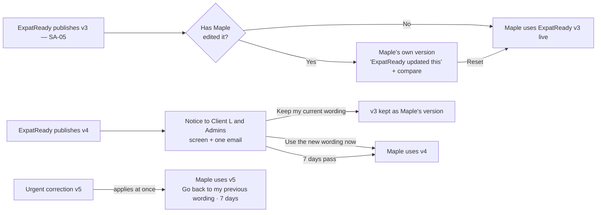

> **Document control** · Version **2.11** · **2026-10-27** · Status: **CC-8 applied: only emails a person writes are copied; system emails go to their usual recipient with no Cc (the product owner, 26 Oct)**; earlier: **AG19-D50 applied (the product owner, 25 Oct: "yes"): the "Password-protected file — unlock" row is withdrawn from the Automatic messages page**; earlier: **Knock-ons from the duplicates / copy-on-emails work closed (the product owner, 25 Oct): the "Sent by ExpatReady" emails, the Invoice overdue row and every automatic message now state their send path and whether the case's copy list is copied (AG-10 BR-1, AG-10-22, AG-10-89; new AG-12-126)**; earlier: (v2.8) **AG19-D49 applied (the product owner, 23 Oct: a new automatic client message, the "password-protected file" email, is a row on the Automatic messages page)**; previously (v2.7): **AG-04 review decisions applied (the product owner, 21 Oct)**; previously (v2.6): **AG-02 review decisions applied (the product owner, 20 Oct): the "Lead acknowledgement" (thanks email) row goes only to leads from unattended doors; new template use "Message many" (always marketing, express consent on the channel, no "Send anyway", no WhatsApp-to-email fallback); previously AG-16 second pass applied (the product owner, 17 Oct): AG16-54 #17, AG16-55 (Q12 closed), AG16-56, AG16-59, AG16-77; previously AG-16 review round 2 applied (the product owner, 17 Oct): the Automatic messages page can be searched and grouped by journey stage (AG16-47); previously AG-16 review applied (14 Oct): AG-12 is the single home of the Automatic messages page (AG16-11, AG16-12) — for the product owner's review**\
> Part of: *Agent (RCIC/Lawyer) Console — Functional Requirements* · Split from `FINAL-Agent-FR.md` lines 7826–8420 on 2026-09-16 · Previous version: `_archive/AG-12-templates_v2.10_2026-10-25.md`\
> Decisions source: `FINAL-SuperAdmin-FR/TEMPLATE-MAP-working_2026-10-10.md` (the map), including Q1–Q24, O1–O32 and SA05-R9a (12 Oct, end of the file). Companion and **single source of the shared rules**: `FINAL-SuperAdmin-FR/SA-05-global-templates_v3.9_2026-10-25.md` (SA-05).
>
> | Version | Date | Change | Decisions |
> |---|---|---|---|
> | 2.11 | 2026-10-27 | **27 Oct follow-up (the product owner), in place:** Refund issued, Credit note, Correction note, Trust request and Your statement are sent from the AG-06 action, so they are system emails, never copied; the §13 open point is resolved. **CC-8 applied (the product owner, 26 Oct; home AG-10-89): only emails a person writes are copied.** Every template ExpatReady sends — every Automatic messages row (including Ask me first rows a person confirms), every "Sent by ExpatReady" email, and a Library starter sent by a flow (Trust request from Request payment, Your statement from Send statement) — is a system email and is never copied. A template a staff member picks and sends from the composer is a staff-written email and is copied (AG-10-89). **Withdrawn:** "a client-facing email that belongs to a case goes as one email with the list in Cc" (§3.3, AG-12-126); AG-12-115 "Cc the case's copy list, whoever is Bill to (AG-6-41 'Copy on emails')"; the Appendix A "Copied when the email belongs to a case" list (payment reminders, Final notice, Deposit request, receipts, Government deadline reminder, Decision: refused, Welcome, booking rows with a `caseId`) and the "Never copied" list, replaced by the two-line rule. Changed: §3.1 table (copy reason), §3.3 "How every row is sent", AG-12-38, AG-12-115, AG-12-126, AG-12-120 card test, AG-12-127 card rule 6, US-30, Appendix A note, decisions table (CC-8 row; AG-10-89 row marked narrowed). **Open — needs the product owner:** Refund issued, Credit note and Correction note (Library, "a person sends") — sent from the AG-06 action (system, never copied) or picked in the composer (copied)? No requirement ID added or removed. Next free IDs unchanged: AG-12-130, US-32. | CC-8 |
> | 2.10 | 2026-10-25 (final check) | **25 Oct (final check): verification fixes.** AG-12-128 adds the Library starter **Trust request** (SA-05 A.4 #10, MS-D16(4)); the signing-reminder numbers are no longer open (3 days then every 4, MAP:97; stop after 3 per signer, MS-D24(3)). | MS-D16(4), MS-D24(3) |
> | 2.10 | 2026-10-25 (later: MS-D24 and writer follow-ups) | **MS-D24 and writer follow-ups applied (the product owner, 25 Oct), in place.** (1) Q18 closed: Deposit request set to Off prepares no request; the deposit row is billed as the first invoice once earned (AG-12-127 and its build card). (2) Q19 closed: no separate refund receipt; the "Refund issued" email is the record (AG-12-128, the deferred-features table). (3) Q20 closed: the "Updated agreement" email is edit-only, no Off choice (AG-12-128). (4) New Library starter **Your statement**, sent by a person (AG-12-128, §3.1, Appendix A, US test, AG12-D28). (5) Stale references: SA-05 now v3.9, SA-06 v3.15 (§10). §13 Q18 – Q20 removed. Next free IDs unchanged. | MS-D24 |
> | 2.10 | 2026-10-25 (money slice + AG-05 review) | **Money-slice and AG-05 decisions applied (the product owner, 25 Oct), in place.** (1) **Withdrawn:** the Proposal document template and the "Here is your proposal" email (MS-D2; SA-05 A.1 #6, #7). (2) **New starters:** **Amendment** (Documents, MS-D5); **Refund issued** and **Credit note** (Library, sent by a person, MS-D11(6)); **Correction note** (Library, MS-D20(19)); **Updated agreement — please sign this version** (the signing email of an edited retainer, MS-D2(2)). The pre-consultation agreement is now named **Consultation agreement** everywhere (MS-D3; the template and its wording are unchanged). (3) **New rows on the Automatic messages page:** **Deposit request** with Send automatically · Ask me first · Off, default **Ask me first** (MS-D6); **Trust receipt** and **Payment receipt** (MS-D6(5), MS-D21(12)); the single "Invoice overdue" row is replaced by **Payment reminder**, **Payment overdue** and **Final notice**, timing −3 / 0 / +3 / +7 days on Timings (MS-D21(13)). (4) **Retainer template:** no clause is locked by ExpatReady or the pack; the Owner locks the firm's own clauses (AG05-D4 applied as decided); a Service points to its retainer template, which stays in this list (MS-D18(2)); no per-template countersign setting (AG05-D1(2)). (5) New AG-12-127 – AG-12-129 (with one build card), US-31, AG12-D28; AG-12-41, AG-12-96, AG-12-115 and AG-12-126 changed; §13 Q18 – Q20 added; Q10 row for the reminder days settled. Next free IDs: requirement AG-12-130, story US-32, decision AG12-D29. SA-05 holds the wording and stage tags of the new templates (pending, SA writer). | MS-D2 · MS-D3 · MS-D5 · MS-D6 · MS-D11 · MS-D18 · MS-D20 · MS-D21 · AG05-D1 · AG05-D4 |
> | 2.10 | 2026-10-25 | **AG19-D50 applied (the product owner, 25 Oct: "yes"; home AG-09, AG-9-69).** AG19-D50 narrows AG19-D49 and withdraws its part (2), the automatic unlock email (the product owner: too much engineering). **Withdrawn row:** "Password-protected file — unlock" (group Documents and questionnaire, class 1, default Send automatically; added v2.8). Its §3.3 note is removed from the build path; it read, in full: « *(new 23 Oct — AG19-D49)* **Password-protected file — unlock.** A row in **Documents and questionnaire**, class 1 ("Sends from day one"), pre-set to **Send automatically**. When an email reply from the client brings a password-protected PDF, it sends ONE email, "One file is password protected – tap here to unlock it", with a no-login unlock link. It is a fix-it notice, like the infected-file notice (SA8-D2), not a chase: it never repeats and has no timing. The product owner approved it as new client-facing automation (AG16-76). The rule is AG-09's (AG-9-69); the wording and the stage tag are SA-05's (pending). Like every row, the firm may choose Ask me first or Off (AG-12-52). *(changed 25 Oct — copy-on-emails knock-on)* It goes through AG-10's single send path (AG-10 BR-1, AG-10-22) and, when the record is a case, is copied to the case's copy list (AG-9-69 as changed 25 Oct; AG-10-89). » A locked email attachment now only gets the "Password protected" label for staff (AG-9-69 rule 8); there is no client message, so no row. The SA-05 wording and stage tag for this email are no longer needed. Rows added to "Decisions that change this epic"; the AG19-D49 row is marked withdrawn. No requirement ID added or withdrawn. | AG19-D50 |
> | 2.9 | 2026-10-25 | **Knock-ons from the duplicates / copy-on-emails work closed (the product owner, 25 Oct).** AG-12 sends nothing; this version only states, with sources, which send path each message uses and whether AG-10-89 copies the case's copy list. (1) **"Sent by ExpatReady" (§3.1, AG-12-38):** who receives each kind-1 email and who owns it (SA-05 Appendix B.7 – B.9, SA-5-50): client security emails go to clients and employer contacts through AG-10's single send path (BR-1, AG-10-22) and are never copied (AG-10-89); staff account emails go to firm staff (AG-1-70), sent by AG-10's Mailer, outside the client copy rules; unsubscribe / STOP confirmations go through the single send path, copy status **Open — needs the product owner**. (2) **Invoice overdue (§3.3, AG-12-115):** sent through AG-10's single send path, To the Bill to party, Cc the case's copy list (AG-6-41, AG-6-12, AG-10-89). (3) **New AG-12-126:** every row on the Automatic messages page goes through AG-10's single send path and AG-10-89 decides copying; AG-12 adds no copy rule. Password-protected file row (§3.3) points to AG-9-69; Appendix A gains a "Send path and copy" note per row. (4) **Tests:** new US-30; AG-12-120 card test added. Next free IDs: requirement AG-12-127, story US-31. 25 Oct mop-up: §13 Q17 closed "Resolved (25 Oct)" — unsubscribe / STOP confirmations are never copied (no case; AG-10-89 rule 2), applied in the §3.1 table and AG-12-38; line 3's SA-05 citation moved from v3.7 to v3.8 (v3.8 changes only booking items: AG04-D2 – D5, D11). 25 Oct final audit: US-30 copy-list tests name Client Q, full name in the footer (AG-10-89 rule 6). | AG-10-89 · AG-10 BR-1 · AG-10 BR-35 · AG-10-22 · AG-6-41 |
> | 2.8 | 2026-10-23 | **AG19-D49 applied (the product owner, 23 Oct: "yes").** One new automatic client message: when an email reply from the client brings a password-protected PDF, ExpatReady sends ONE email "One file is password protected – tap here to unlock it" with a no-login unlock link (home AG-09, AG-9-69). The product owner approved it as new client-facing automation (AG16-76); it is a fix-it notice like the infected-file notice (SA8-D2), not a chase. It is a row on the Automatic messages page like every automatic client message (AG-12-52), group Documents and questionnaire, class 1, default Send automatically (§3.3 note). Wording and stage tag: SA-05 (pending). No requirement ID added or withdrawn. | AG19-D49 |
> | 2.7 | 2026-10-21 | **AG-04 review decisions applied (the product owner, 21 Oct).** AG04-D4: booking reminder rows are switched on or off by the row's choice; their timing (24 h and 1 h before) is a Timings-screen default that an appointment type may change under its Advanced, shown read-only on the row (AG12-D24, Appendix A "Appointment reminder"); §13 Q10 closed for bookings (24 h and 1 h; "Complete your payment" at 10 min of a 30-min hold). No `AFTER_MEETING` or automatic no-show wording was present; the no-show and post-consult rows stay Off (unchanged). Row added to "Decisions that change this epic". *22 Oct: AG-04 final cross-epic check fixes applied in place (marked "changed 22 Oct — final check").* | AG04-D4 |
> | 2.6 | 2026-10-21 | **AG-02 review decisions applied (the product owner, 20 Oct).** (1) AG02-D9(4): the "Lead acknowledgement" row (the thanks email) goes only to leads from unattended doors (web form, Lead API / Zapier, form-notification email) (Appendix A). (2) AG02-D8, AG02-D14(10), AG02-D15(4): new **AG-12-125** template use "Message many": email templates and WhatsApp templates Approved for the firm's number; always marketing; express consent on that channel only (WhatsApp needs "WhatsApp marketing"); no "Send anyway"; a Message many WhatsApp message never goes by email; email templates live here and AG-02's sales settings link here (§4.8, §3.6 standing notice). Pending block: AG02-P68 closed; AG02-P67 and AG02-P69 kept open (design choice; question for the product owner). Next free ID: AG-12-126. Final hand-over check (21 Oct): AG02-P69 settled — timings are edited on the one Timings screen and shown read-only on the row (X-5, AG-2-31 rule 2; AG-12-114, decisions row). AG02-D18 / X-5 (21 Oct): AG12-D3, AG12-D24, §3.3 (row contents, Timing on the row, the Reset rule, Who), AG-12-56, AG-12-118 and its card, BR-28, `FirmTemplateState.timing`, §8 tests, §10 and §13 Q10, Q16 now say timings are edited on the Timings screen and shown read-only with a link on the row; Reset to default on this page covers the choice only. AG02-D18 changes nothing here (AG-12-125 already matches). | AG02-D8 · AG02-D9 · AG02-D14 · AG02-D15 · X-5 |
> | 2.5 | 2026-10-17 | *Same-day fixes (17 Oct): AG16-83 – AG16-88 — the portal invitation reminder is an ordinary row with a choice, Must on every plan; "portal auto-nudge" is no longer an extra (AG16-86). Nothing for AG-12 from AG16-83, AG16-84 or AG16-88.* **AG-16 second pass applied (the product owner, 17 Oct).** (1) **Employer (LMIA) group is always visible** and editable (corporate is on every plan, AG17-D35); read-only only if ExpatReady switches it off (AG16-54 #17; AG-12-119). (2) **Government deadline reminder is no longer class 1** (not exempt from timing): it is a timed message that sends at 09:00 client time on the due day (AG16-56); class label, diagram and Appendix A corrected. (3) **Its timing sentence is a formula, not editable numbers:** "Reminders at the halfway point and near the end; a third early one for deadlines over 15 days" (25% / 50% / 90% for windows over 15 days, 50% / 90% otherwise; fixed percentages; row choice unchanged) (AG16-77; **new AG-12-123**, replaces the 30 / 14 / 7 / 3 / 1 example). (4) **The class-2 box is not offered for a step recorded from a letter** (AG16-59; AG-12-102). (5) **Open questions:** Q12 closed with the writer's default (AG16-55); Q13 – Q16 have no stated default and stay open. Changed: §0.2 table, §0.3, §3.3, §3.10, AG-12-102, AG-12-114, AG-12-119, AG-12-52 card note, AG-12-102 and AG-12-119 cards, US-29, §13 Q10, Q12. **New:** AG12-D27, AG-12-123 (with card). *Same-day fixes (18 Oct): AG16-90 — AG-12-123 card reduced to the row sentence and a pointer to the AG-11-123 card (single home of the client-reminder formula, AG16-77); Clicks / Person decides lines added to AG-12-52, AG-12-117, AG-12-118 and AG-12-120.* *18 Oct: new section 'Decisions that change this epic' (index of AG16 decisions; no requirement changed).* *18 Oct (later): AG01-29 / AG16-105 and gap-check fixes applied — AG01-29(7): AG-12-109 points to AG-01 for the public phone, public email and website fields it reads.* | AG16-54 · AG16-55 · AG16-56 · AG16-59 · AG16-77 · AG16-90 |
> | 2.4 | 2026-10-17 | **AG-16 review round 2 applied (the product owner, 17 Oct): find and fix on the Automatic messages page (AG16-47).** (1) Rows are **grouped by journey stage** — Enquiries, Bookings, Retainer and signing, Invoices, Case updates, Documents and questionnaire, Portal, Employer (LMIA) — collapsed, each with a count (e.g. "Invoices · 5 · 1 off"); the **firing class** becomes a small label on the row instead of the three groups. (2) **One search box** (name and trigger). (3) **One filter, "Changed from default"**: any row whose choice or timing differs from ExpatReady's default, or whose wording is the firm's; a changed row shows the default beside it and **Reset to default**, which covers the **choice and the timing only** — resetting wording stays in Templates. (4) Groups for an extra or feature that is off **stay visible, collapsed and read-only** (consistent with §3.11). (5) **New:** "Automatic · [message name] · Change" on every automatic message in a client's or lead's history opens that row. (6) **Pointers, no new control here:** the file number in the subject of automatic messages (AG16-26) is a subject-line rule that belongs in SA-05 §3.6 (AG-12-121); letter-library "Tell the client" notes are templates held in SA-05 (AG-12-122, AG16-42). Changed: §0.3, §3.3, AG-12-52, AG-12-112, AG-12-113, AG-12-114, AG-12-115, §7 (note on `FirmTemplateState`), §9, §10 (`:configure`), §12, §13, the "Applied from the AG-16 review" table. AG-12-42 and AG12-D3 are unchanged (referred to). **New:** AG12-D26, AG-12-117 – AG-12-122, BR-28, US-29, §13 Q12 – Q16, Build cards section. | AG16-47 · AG16-26 · AG16-42 · AG16-44 |
> | 2.3 | 2026-10-14 | **AG-16 review (the product owner, 14 Oct) applied — AG-12 is the single home of the Automatic messages page.** (1) The optional "Review your automatic messages" page (AG12-D3, AG-12-52, AG-12-56 and related) is rewritten as the **Automatic messages page** (Settings section 6 → Automatic messages; also reachable from Templates): one row per automatic client or lead message — every recipe, reminder, chase, follow-up, sequence step and countdown — showing when it sends, a preview, the ExpatReady default and **one choice: Send automatically · Ask me first · Off** (AG16-11). Defaults: most Send automatically; going-cold follow-up, no-show recovery and post-consultation follow-up Off; class-2 "Starts ticked / unticked" stays on the row. Locked floor rows: AI-written text is always Ask me first. Permission `agent/template:configure`. Guard 1 and Guard 2 unchanged. Internal actions (tasks, staff alerts, filing) are not on the page. The **Invoice overdue** reminder is a row (AG16-13; rules in AG-06). (2) **Timing** is one plain sentence on the row with editable numbers, e.g. "First reminder 5 days after we ask, then every 7 days, up to 4 times"; limits 1–30 days and 1–10 reminders; the two Needs you timings stay under AG-16 Advanced → Waiting times (AG16-12). (3) AG-11 keeps only the engine meaning of the three choices and the floors list; no other document restates the page (AG16-11). (4) The Templates area's own **Switch off / on** and **Starts ticked / unticked** actions move to the page, so the choice lives in one place; the Templates list keeps its wording actions and shows the choice read-only (AG12-D21, AG-12-39, AG-12-49, AG-12-102, AG-12-103 changed). (5) A template whose body AI edited is **approved once, when published**, and is no longer a per-send floor; the "AI-edited" mark stays on the version (R7, knock-on A19; AG12-D25, AG-12-94, AG-12-116, BR-23, US-20 changed). (6) Supervised-message wording removed from US-17 (R5). (7) No "Drafter" wording existed in AG-12; the Writer rename (AG16-4) needed no change here. Changed: AG12-D3, D20, D21, §0.2, §0.3, Module Index, diagram B, §1, §2, §3.1, §3.3, §3.8, §3.10, AG-12-39, 49, 52, 56, 94, 95, 100, 102, 103, 104, 109, 110, 111, §6, §7, §9, §10, §12, §13, BR-23, US-11, US-17, US-20, US-22, US-23, US-26. **New:** AG12-D24, AG12-D25, AG-12-112 to AG-12-116, BR-27, US-28, §13 Q9 to Q11. **Withdrawn:** the `AutomaticMessagesReview` entity (leftover of the v2.1 review); §13 Q3 closed. *Same-day audit corrections (14 Oct): §13 Q10 — timing for every timed row lives on the AG-12 row; Q10 stays open only for the numbers.* | AG16-11 · AG16-12 · AG16-13 · AG16-1 · R5 · R7 |
> | 2.2 | 2026-10-12 | **Automatic messages run from day one — SA05-R9a (the product owner, 12 Oct).** Nothing is held for a review any more. Every automatic message, including timed ones (reminders, chases, follow-ups, onboarding series, countdowns, recipe steps), runs from day one in ExpatReady's neutral wording unless it is off by default. "Review your automatic messages" becomes an optional on/off page: no confirm step, no gate, no "paused until you review" banner (AG12-D3, AG-12-52, AG-12-56 changed; AG-12-53, 54, 55, 57, BR-18 and the review state machine withdrawn). **Guard 1** (a message missing a firm detail it needs is not sent; the firm sees a note naming the detail) = AG-12-109. **Guard 2** (one-time dashboard notice "Your automatic messages are on. See or switch them off.") = AG-12-110. New: AG12-D23, AG-12-109, AG-12-110, BR-26, US-27. Unchanged: 7-day notice, switch-off rules, class 1 and class 2, AG-18 import quiet mode, WhatsApp opt-in. SA5-X46 recorded as applied (§0.2). Four new open questions (§13 Q4 – Q7), not decided. **Same-day closing (SA05-R9b, the product owner, 12 Oct):** §13 Q1, Q4, Q5, Q6 and Q7 are closed — Guard 1 and Guard 2 details are in AG-12-109 and AG-12-110, and new automatic messages arrive on and start sending only after the normal 7-day notice (new AG-12-111; Q8 closed). *(revised same day — SA05-R9b)* | SA05-R9a · SA05-R9b · AG12-D23 |
> | 2.1 | 2026-10-11 | **Applied the follow-up decisions Q1–Q24 and O1–O32 and fixed the cross-check (A1–A18, B1–B12, D1–D5); duplication with SA-05 removed.** The firing classes, foundation, catalogue, special-types table and every knock-on row now live only in SA-05; this document keeps the firm's screens and actions and points to SA-05 by section number. Review screen: three groups by SA-05's three firing classes, confirmed by holders of `agent/template:publish` (Owner and Admin by default) with an Owner notice; held messages are not queued in "Needs you"; release preview and one catch-up per sequence (Q1, Q4; A1–A3, B3, B4). New firm-side screens: "start ticked" setting for class-2 messages (Q2, Q6), switching off with edit-only rows and the Must warning (Q8), "Use the new wording now" (O9), urgent-correction panel with "Go back to my previous wording" (Q14), retirement notice (Q15), extras switched off (Q7), read-only "Sent by ExpatReady" list (O12), support-session block (O25). WhatsApp status per firm per template, three states (Q12; A6). Delete block covers any on automation, appointment type or reminder rule; an off automation does not block (O13; A7, B2). Pre-consultation agreement added to Documents (D3). Firm permission keys decided (O17, Q1, Q13). AG12-X1 – X20 moved to SA-05 §0.2 (cross-check C). Old BR-1 – BR-14 and US-1 – US-10 withdrawn one by one with reasons (D5). New: AG12-D21 – D22, AG-12-102 – AG-12-108, US-22 – US-26. | AG12-D21 – D22 · map Q1–Q24, O1–O32 |
> | 2.0 | 2026-10-11 | **Rewritten from the template management review (the product owner, 10–11 Oct).** Title becomes "Templates — firm side". The adopt-by-copy, bulk-adopt, fast-forward, 3-way re-sync and locale-strictness model of v1.1–v1.3 is replaced by: three kinds of template; "use until you edit" with no copies; reset to ExpatReady's wording; a one-time "Review your automatic messages" screen; a 7-day update notice with "Keep my current wording"; delete blocked while an automation uses a template; starter-wording label; French optional with notices; per-template purpose; WhatsApp variant with approval status; must-fill marks, free-text slot and conditional sections; versions on every send; AI-edited tracking. Rule 7 applied. AG-12-1 – AG-12-37 dispositioned in §4.0; AG-12-38 – AG-12-101 added. | AG12-D1 – AG12-D20 |
> | 1.3 | 2026-10-10 | **Marked "being redesigned — do not build yet"** (the product owner, 10 Oct); no requirement changed. | — |
> | 1.2 | 2026-10-07 | **SA-06 v3.0 closing decisions (the product owner, 7 Oct).** `agent/template:render` removed from §10 as a grantable key: using a template is allowed by the permission of the module that does it. Requirement IDs unchanged. | SA6-D10 |
> | 1.1 | 2026-08-28 | Baseline — complete document v1.1 | — |

## Decisions that change this epic (14–25 Oct) *(new 18 Oct; AG-02 rows added 21 Oct; AG19-D50 row added 25 Oct)*

Product-wide rules (apply here as everywhere; home: Agent `00-Overview` → "Product rules every epic follows"): AG16-11, AG16-31, AG16-42, AG16-44, AG16-60, AG16-76.

The "AG16" prefix is historical: these decisions began in the AG-16 review and apply across the product. Full text: `TEMPLATE-MAP-working_2026-10-10.md`.

| Decision | What was decided (one line) | What it changes in this epic | Where (requirement / card / section) |
|---|---|---|---|
| AG16-1 | Settings structure (approved) | Settings section 6 holds the Automatic messages page; the "one Reminders page" idea is dropped | AG12-D3, §3.3, AG-12-112 |
| AG16-4 | Doer family and the "Drafter" name clash | Referenced only (no change here): AG-12 has no AI-writer wording; the non-AI document generator keeps its name | §0.2 table row |
| AG16-11 | One "Automatic messages" page, documented in one place only | AG-12 becomes the single home of the page: one row per automatic message with one choice (Send automatically · Ask me first · Off); the older review page is replaced | AG12-D3, AG12-D21, §3.3, AG-12-52, AG-12-56, AG-12-112, AG-12-113, US-28 |
| AG16-12 | Where timings live | Timing is one plain sentence on the row with editable numbers (1–30 days, 1–10 reminders); the two Needs you timings stay in AG-16 Waiting times | AG12-D24, §3.3, AG-12-114, §13 Q10 |
| AG16-13 | "Getting paid" defaults and scenarios | The overdue reminders are rows on the page (three rows since MS-D21(13), 25 Oct); invoicing rules stay in AG-06 | §3.3, AG-12-115, US-28 |
| AG16-26 | Email filing order | Pointer only: the file number in the subject of automatic messages is a shared subject-line rule held in SA-05 §3.6; which messages carry it is not decided | AG-12-121, §13 Q15 |
| AG16-42 | "Quiet by default", plus telling the client | Pointer only: letter-library "Tell the client" notes are templates held in SA-05; the page itself raises no alert | AG-12-122, AG-12-52 card (Safety) |
| AG16-47 | Automatic messages page: find and fix | Rows grouped by journey stage, one search box, a "Changed from default" filter with Reset to default (choice and timing), groups for an extra that is off stay visible, a history link opens the row | AG12-D26, §3.3, AG-12-52, AG-12-112 – AG-12-115, AG-12-117 – AG-12-120, US-29 |
| AG16-50 | Government-deadline reminder with no one assigned goes to the Owner | Referenced only (no change here): staff deadline reminders are cited as separate from the client reminder row | AG-12-123 (withdrawn card text) |
| AG16-54 | 25 consistency fixes after the 17 Oct write | #17: the Employer (LMIA) group is always visible and editable (corporate is on every plan); read-only only if ExpatReady switches it off | AG12-D27, §3.3, AG-12-119, US-29 |
| AG16-55 | Writers' recommended defaults accepted | Search behaviour closed: while the box has text, groups with a match open and groups with none are hidden | §13 Q12, AG-12-117 |
| AG16-56 | When automatic messages send, by what their timer counts | The Government deadline reminder is a timed message (no longer class 1) that sends at 09:00 in the client's time zone on the due day; class label, diagram and Appendix A corrected | AG12-D27, §3.3, §3.10, AG-12-123, diagram B |
| AG16-59 | A government letter records its case step; one event, one client message | The class-2 "Starts ticked / unticked" box is not offered for a step recorded from a letter; the letter note is the client message | AG12-D27, §3.3, §3.10, AG-12-102 |
| AG16-73 | One record per government step with its deadline | Referenced only (no change here): the reminder row reads the due date from the AG-07 step record | AG-12-123 (withdrawn card text) |
| AG16-77 | Client deadline reminders by formula (50% and 90% of the window) | The Government deadline reminder row has a fixed formula sentence with no editable numbers; the row keeps its choice; replaces the 30 / 14 / 7 / 3 / 1 example | AG12-D27, §3.3, AG-12-114, AG-12-123 |
| AG16-83 | 26 follow-through fixes after the second pass | Referenced only (no change here): the v2.5 change log records "Nothing for AG-12" | Change-log row 2.5 |
| AG16-84 | Very short deadlines: the letter note is the client message | Referenced only (no change here): the v2.5 change log records "Nothing for AG-12" | Change-log row 2.5 |
| AG16-86 | Portal nudging is a feature on every plan, not a sold extra | The portal Invitation reminder is an ordinary row with the full choice, Must on every plan; "portal auto-nudge" is no longer an extra | AG12-D22, §3.10, AG-12-103 |
| AG16-88 | Release 1 is English-first; French later | Referenced only (no change here): the v2.5 change log records "Nothing for AG-12" | Change-log row 2.5 |
| AG16-90 | Batch C: consistency fixes from the 17 Oct audit | Wording only: "Clicks" and "Person decides" lines on five cards, and the AG-12-123 card cut to the row sentence plus a pointer to the AG-11-123 card; no requirement changed | AG-12-52, AG-12-117, AG-12-118, AG-12-120, AG-12-123 cards |
| AG01-29(7) | Firm details: who edits *(the product owner, 18 Oct)* | Pointer only: AG-12-109 reads the firm's public phone, public email and website, which AG-01 owns (new fields; Owner and Admin edit) | AG-12-109 |
| AG02-D9(4) | Automatic "thanks" email only for unattended doors (web form, Lead API / Zapier, form-notification email) | The "Lead acknowledgement" row is marked as sent only to leads from those doors | Appendix A |
| AG02-D8, AG02-D14(10), AG02-D15(4) | "Message many": express consent on that channel only; WhatsApp needs a separate "WhatsApp marketing" consent; no silent channel change; email templates live in AG-12 (AG02-P68) | New template use "Message many": always marketing, no "Send anyway", no WhatsApp-to-email fallback; AG-02's sales settings link here | AG-12-125 (§4.8) · §3.6 standing notice |
| X-5, AG-2-31 rule 2 (closes AG02-P69; final hand-over check, 21 Oct) | Firm-changeable timings sit on the one Timings screen (AG-16 Settings → Advanced → Timings, AG-16-51); AG-11 and AG-12 show them read-only | AG-12-114: the row shows its timing read-only with a link to the Timings screen, where the numbers, limits and Reset to default apply. Where AG12-D3, AG12-D24, §3.3 "Timing on the row", the Reset rule, AG-12-56 or `FirmTemplateState.timing` still say the numbers are edited on the row, this row wins until this epic's review rewrites them | AG-12-114 |
| X-5 (leftovers applied, 21 Oct — AG02-D18 / X-5 pass) | The same rule as the row above, now written in every place that still said "edited on the row" | Timings are shown read-only with a link to the Timings screen; the numbers, limits and timing Reset to default are on that screen. Reset to default on the Automatic messages page covers the choice only. AG02-D18 (one-to-one "Send anyway?") needs no change here: AG-12-125 already says Message many has none | AG12-D3 · AG12-D24 · §3.3 · AG-12-56 · AG-12-118 (+ card) · BR-28 · §7 `FirmTemplateState` · §8 tests · §10 · §13 Q10, Q16 |
| AG04-D4 | Booking timings: firm defaults on the Timings screen (reminders 24 h and 1 h before; paid hold 30 min with "Complete your payment" at 10 min), each appointment type may change any of them under its "Advanced" (the product owner, 21 Oct) | Booking reminder rows: on or off by the row's choice; timing read-only on the row, edited on the Timings screen and per type under the type's Advanced; §13 Q10 closed for bookings | AG12-D24 · §13 Q10 · Appendix A, Appointment reminder |
| AG-10-89, AG-10 BR-1, BR-35 *(25 Oct — copy-on-emails knock-ons)* | Copy on emails at the one send path: every client-facing email of a case goes through AG-10's single send path as one email, Cc the case's copy list (`CaseCopy`, AG-7-97); never copied: signing emails, portal invitation, login and security emails, marketing / Message many, anything with no case | AG-12 sends nothing and adds no copy rule. The "Sent by ExpatReady" list states who gets each email, its owner and its send path; the payment reminder rows state they are copied (AG-6-41); every automatic message row goes through the single send path (new AG-12-126). **Narrowed 26 Oct — CC-8** (row below): only staff-written emails are copied | §3.1 · §3.3 · AG-12-38 · AG-12-115 · AG-12-126 · US-30 · AG-12-120 card · Appendix A |
| **CC-8** *(26 Oct; home AG-10-89; narrows the AG-10-89 row above)* | Only emails a person writes are copied. Every system email goes to its usual recipient with no Cc (the product owner, 26 Oct) | Every template ExpatReady sends (Automatic messages rows, "Sent by ExpatReady" emails, Library starters sent by a flow) is never copied. A template a staff member picks and sends from the composer is staff-written and is copied (AG-10-89). Payment reminders go To the Bill to party with no Cc (AG-6-41) | §3.1 · §3.3 · AG-12-38 · AG-12-115 · AG-12-126 · AG-12-120 card · AG-12-127 card · US-30 · Appendix A |
| AG19-D49 *(23 Oct)* | Password-protected uploads; for an email reply with a locked attachment, ONE automatic email with a no-login unlock link; a fix-it notice like SA8-D2, not a chase; new client-facing automation approved by the product owner (AG16-76). Home: AG-09 (AG-9-69) | A new row on the Automatic messages page: "Password-protected file — unlock", group Documents and questionnaire, class 1, default Send automatically; it never repeats and has no timing. **Withdrawn 25 Oct — AG19-D50** (row below) | §3.3 (note under ExpatReady defaults; removed v2.10) |
| AG19-D50 *(25 Oct; narrows AG19-D49 and withdraws AG19-D49(2))* | The password prompt shows only where the client uploads inside ExpatReady; a locked email attachment only gets the "Password protected" label and staff unlock it in PDF Studio; the automatic unlock email and its Automatic messages row are withdrawn. Home: AG-09 (AG-9-69) | The "Password-protected file — unlock" row is withdrawn; no SA-05 wording or stage tag is needed for it | §3.3 (note removed) |
| AG05-D1(2) *(25 Oct)* | Any document can be sent for signature; the sender picks who signs at send time; no per-template countersign setting | Documents list: a template carries no signers and no countersign setting; "Send for signature" is on the document, not on the template | AG-12-129 |
| AG05-D4 *(25 Oct; applied as already decided)* | Starter retainer clauses are ordinary editable text; the Owner locks the firm's own clauses (`agent/legal-settings:manage`) | The starter retainer has no clause locked by ExpatReady or the pack; locks are the Owner's, in AG-05 | AG-12-96 · AG-12-129 |
| MS-D2 | No separate proposal; a sent retainer is editable until the client signs | The Proposal document template and the "Here is your proposal" email are withdrawn; a new email "Updated agreement — please sign this version" goes with an edited retainer | §3.1 Documents · AG-12-41 · AG-12-128 |
| MS-D3 | Consultation agreement on by default for first consults | The template is named Consultation agreement (was Pre-consultation agreement); wording stays the firm's own template | §3.1 Documents · AG-12-128 · Appendix A |
| MS-D5 | "Prepare amendment" on a signed retainer | New starter **Amendment** (Must) in the Documents list; it shows only what changes | AG-12-128 · AG-12-41 |
| MS-D6, MS-D21(12) | Deposit request is an Automatic messages row, Ask me first by default; trust receipt and payment receipt, one numbered series | New rows Deposit request, Trust receipt, Payment receipt; rules stay in AG-06 | AG-12-127 + card · US-31 · Appendix A |
| MS-D11(6) | Refund issued and Credit note become starter templates sent by a person | Both added to the Library (Must); removed from "Deferred and removed" | AG-12-128 · §0.1 |
| MS-D18(2) | A Service may carry a retainer template | The retainer template is picked from the Documents list; the template stays here, Services holds only the link | AG-12-129 |
| MS-D20(19) | An "Attended" clicked by mistake is undone in one action; client told | New Library starter **Correction note**, sent by a person | AG-12-128 |
| MS-D21(13) | Payment reminders: Payment reminder, Payment overdue, Final notice at −3 / 0 / +3 / +7 days, on Timings | The Invoice overdue row is replaced by these three rows; timing read-only on the row, edited on the Timings screen | AG-12-115 · §3.3 · US-28, US-30 |
| MS-D24 *(25 Oct; items settled under MS-D6(2), MS-D11(6), MS-D2)* | Writer follow-ups settled: a Deposit request row set to Off prepares no request and the deposit row is billed as the first invoice once earned; a refund has no separate receipt (the "Refund issued" email is the record); the "Updated agreement" email is edit-only, no Off choice; new Library starter "Your statement", sent by a person | Open questions Q18 – Q20 removed; AG-12-127 and AG-12-128 state the answers; "Your statement" added to the Library starters | AG-12-127 · AG-12-128 · §3.1 Library · Appendix A · US test (Library list) |

## Module AG-12: Templates — firm side

> **What this document is.** The build specification for the firm's **Templates** area in the Agent console: what a firm sees and what it can do with ExpatReady's ready-made wording and with its own templates. **SA-05 defines; AG-12 uses.** The kinds and firing classes (SA-05 §3.2), "use until you edit" (§3.3), the notices (§3.5), the shared foundation (§3.6), the catalogue (Appendix A) and the special types (§3.9) are defined only in SA-05; this document points to them by section and never restates them. Knock-ons to other modules are listed once, in SA-05 §0.2.
>
> **Rule 7 governs every line** (SA-05 §3.8). The firm owns its legal and regulatory compliance.
>
> **Plane:** LOCAL (firm). **Permissions:** `agent/*` only. **Release:** Release 1, except where a template's feature is later (SA-05 §0.3).
>
> **IDs are permanent.** A changed item keeps its number and is marked "(changed v2.5 — AG16-77)", "(changed v2.4 — AG16-47)", "(changed v2.3 — AG16-11)", "(changed v2.2 — SA05-R9a)" or "(changed v2.1)" (earlier marks stay in the history of the item). A withdrawn item stays as one line with a reason. Next free IDs after this version: requirement AG-12-130, decision AG12-D29, rule BR-29, story US-32 *(changed 25 Oct — AG-12-127 – AG-12-129 and US-31 used for the money rows and starters)*.

---

### 0. Decision log

| ID | Decision | Source | Where applied |
|---|---|---|---|
| **AG12-D1** *(changed v2.1)* | **Kinds, as the firm sees them.** Defined in SA-05 §3.2. The firm sees kinds 2 and 3 in three lists (Automatic messages, Library, Documents) and kind 1 in a read-only "Sent by ExpatReady" list. | SA5-D20; **O12** | §3.1 · AG-12-38 – AG-12-43 |
| **AG12-D2** *(changed v2.1)* | **Use until you edit, firm side.** Rule in SA-05 §3.3. The firm keeps a Draft / Published / Superseded history of its versions; Reset stops using the firm version, which stays in History; the "ExpatReady updated this" note is cleared by **Keep mine** (dismiss) or Reset. | SA5-D21; **O9**; cross-check A9, A10 | §3.2 · AG-12-44 – AG-12-51 |
| **AG12-D3** *(changed v2.3 — AG16-11, AG16-12; was v2.2 — SA05-R9a)* | **The Automatic messages page — the single home.** Settings section 6 → **Automatic messages** (AG16-1), also reachable from Templates. One row per automatic client or lead message (every recipe, reminder, chase, follow-up, sequence step, countdown): when it sends (its timing as one plain sentence, read-only, with a link to the one Timings screen (AG-16 Settings → Advanced → Timings, AG-16-51) where the numbers are edited, AG12-D24 — changed 21 Oct, X-5), a preview, whose wording, the ExpatReady default and **one choice: Send automatically · Ask me first · Off**. Most messages default to Send automatically; Going-cold follow-up, No-show recovery and Post-consult follow-up default to Off; class-2 messages keep "Starts ticked / unticked" on the row. Locked rows show the product floors. **No confirm step, no gate and no banner** — nothing is held (SA05-R9a). AG-12 is the **only** spec home for the page (rows, choices, defaults, preview, permission `agent/template:configure`); AG-11 keeps only the engine meaning of the choices and the floors; every other document refers to it in one line. Removed: the separate recipe on/off for client-message recipes (AG-11), the AG-16 autonomy table, any per-module message toggle, and the separate Reminders page. Replaces AG11-D12's "Review your standard messages". Held messages never appeared in "Needs you" and still do not. | SA5-D22, D42; **Q2, Q3, Q5, Q6**; **SA05-R9a**; **AG16-11, AG16-12** | §3.3 · AG-12-52, AG-12-56, AG-12-112 – AG-12-115 (AG-12-53 – 55, 57 withdrawn) |
| **AG12-D4** *(changed v2.1)* | **Notices, firm side.** Rules in SA-05 §3.5. The firm sees the 7-day notice with "Keep my current wording" and "Use the new wording now", the urgent-correction panel and the retirement notice. | SA5-D23, D44, D45; **O2, O3, O5, O9, Q14, Q15** | §3.4 · AG-12-58 – AG-12-63, AG-12-105 – AG-12-107 |
| **AG12-D5** *(changed v2.1)* | **No delete while referenced.** Rule in SA-05 §3.6.13: any automation that is on, any appointment type or booking reminder rule blocks deletion; an automation that is off does not. | SA5-D35; **O13**; cross-check A7, B2 | §3.7 · AG-12-86 – AG-12-88 |
| **AG12-D6** *(changed v2.1)* | Starter-wording label — defined in SA-05 §3.6.10. | SA5-D34 | AG-12-51 |
| **AG12-D7** *(changed v2.1)* | Languages — defined in SA-05 §3.6.4; AG-12 shows the standing notice (§3.6). | SA5-D26 | §3.6 · AG-12-78 – AG-12-80 |
| **AG12-D8** *(changed v2.1)* | Purpose and sending rules — defined in SA-05 §3.6.5; AG-12 shows the purpose control and the marketing → service warning. | SA5-D27; **Q11** | §3.5 · AG-12-81 |
| **AG12-D9** *(changed v2.1)* | Unsubscribe and STOP — defined in SA-05 §3.6.6. | SA5-D28 | AG-12-82 |
| **AG12-D10** *(changed v2.1)* | Fill-in fields, must-fill, list fields, free-text slot — defined in SA-05 §3.6.1 – §3.6.2. | SA5-D29; **O11** | §3.5 · AG-12-70 – AG-12-76 |
| **AG12-D11** *(changed v2.1)* | Conditional sections — defined in SA-05 §3.6.3; no firm-made conditions. | SA5-D30; **O10** | AG-12-77 |
| **AG12-D12** *(changed v2.1)* | Channels and WhatsApp — defined in SA-05 §3.6.7; AG-12 shows the firm's own approval status per template. | SA5-D31; **Q12** | §3.6 · AG-12-83 – AG-12-85 |
| **AG12-D13** *(changed v2.1)* | Versions, send record, reach count, AI-edited mark — defined in SA-05 §3.6.8 and §7. | SA5-D32; **O1, O4, O31** | §3.8 · AG-12-67, AG-12-92 – AG-12-95 |
| **AG12-D14** *(changed v2.1)* | Preview and test — defined in SA-05 §3.6.9. | SA5-D33 | §3.8 · AG-12-89 – AG-12-91 |
| **AG12-D15** *(changed v2.1)* | Layout settings — defined in SA-05 §3.6.12. | SA5-D38 | AG-12-101 |
| **AG12-D16** *(changed v2.1)* | Steps point to templates — defined in SA-05 §3.6.13. | SA5-D35 | AG-12-98 |
| **AG12-D17** *(changed v2.1)* | Special types — listed once in SA-05 §3.9. | SA5-D39 | §3.9 · AG-12-96, AG-12-97 |
| **AG12-D18** *(changed v2.1)* | Fixed-wording boundary — defined in SA-05 §3.2 ("Outside template management"). | SA5-D20 | §1 · AG-12-43 |
| **AG12-D19** *(changed v2.1)* | Rule 7 — defined in SA-05 §3.8. The firm's own retainer-clause locks are a **"Manage legal settings"** action (Owner by default, delegable), not an everyday template action. | SA5-D19, D47; **Q13** | AG-12-96 |
| **AG12-D20** *(changed v2.1)* | **Firm permission keys decided** (§10): withdraw `agent/template:adopt`, `:resync`, `:archive`; fold `agent/communication:manage-templates` into `agent/template:*`; keep `agent/retainer:configure-template` (narrowed) and `agent/task:template`; the notice choices are `agent/template:publish` (Owner and Admin by default); legal-type settings are the new "Manage legal settings" key (Owner only at the start, delegable); ExpatReady support sessions cannot choose on a notice or change the choice on a message. *(changed v2.2 — SA05-R9a: there is no review to confirm)* *(changed v2.3 — AG16-11: `agent/template:configure` is the permission of the Automatic messages page)* | **O17, Q1, Q13, O25** | §10 |
| **AG12-D21** *(new v2.1; changed v2.3 — AG16-11)* | **Choosing Off and "start ticked" — now on the Automatic messages page.** Each row carries the choice Send automatically · Ask me first · Off (rules in SA-05 §3.2.3: Signing request and Portal invitation are edit-only, so their rows show no choice; choosing Off on a Must warns). For class-2 messages the row also carries **"Starts ticked / Starts unticked"**, which decides how the box appears to staff in the owning module. The Templates area's own switch and "start ticked" actions are removed so the choice lives in one place. | **Q2, Q6, Q8**; **AG16-11** | §3.3 · §3.10 · AG-12-49, AG-12-102, AG-12-103 |
| **AG12-D22** *(new v2.1; fix 17 Oct — AG16-86: portal nudging is no longer an extra)* | **Extras switched off.** When an extra is switched off (WhatsApp, AI…), its templates stay in the lists **read-only** with a note, dependent sends stop or fall back (rule in SA-05 §3.10), nothing is deleted. | **Q7** | §3.11 · AG-12-108 |
| **AG12-D23** *(new v2.2 — SA05-R9a)* | **Automatic messages run from day one (the product owner, 12 Oct).** Every automatic message, including timed ones, runs from day one in ExpatReady's neutral wording unless it is off by default (e.g. Going-cold follow-up, No-show recovery, Post-consult follow-up). **Guard 1:** a message that needs a firm detail the firm has not filled in is not sent, and the firm sees a note naming the detail (AG-12-109). **Guard 2:** a one-time dashboard notice informs the firm that its automatic messages are on (AG-12-110). Unchanged: the 7-day update notice, the switch-off rules, class 1 and class 2, AG-18 import quiet mode, WhatsApp opt-in. Class 3 now means "self-firing" and has no hold. Details of the guards: AG-12-109, AG-12-110, AG-12-111 (SA05-R9b). *(revised same day — SA05-R9b)* | **SA05-R9a** (TEMPLATE-MAP, end of file); replaces decision 3a's hold | §3.3 · AG-12-52, AG-12-109, AG-12-110 · BR-26 |
| **AG12-D24** *(new v2.3 — AG16-12)* | **Timing on the row.** Every timed automatic message shows its timing as one plain sentence, read-only, on its own row of the Automatic messages page, with a link to the one Timings screen (AG-16 Settings → Advanced → Timings, AG-16-51), where the numbers are edited *(changed 21 Oct — X-5)* — for the Missing-document chase: "First reminder **5** days after we ask, then every **7** days, up to **4** times." Limits: 1–30 days and 1–10 reminders (AG11-D17). The two Needs you timings (overdue after 2 working days; government-deadline approvals 2 working days before) are not on this page: they are under Waiting times on the same Timings screen. Per-client exceptions use the existing per-client pause ("Client paused"), not firm settings. There is no separate Reminders page. Booking reminders follow the same rule: the row's choice switches them on or off; the timing sentence reads "24 hours and 1 hour before the meeting"; the firm default is on the Timings screen, and an appointment type may change it under the type's Advanced (AG-04) *(changed 21 Oct — AG04-D4)*. | **AG16-12**, AG04-D4 | §3.3 · AG-12-114 |
| **AG12-D25** *(new v2.3 — R7, knock-on A19)* | **A template whose body AI edited is approved once, when the firm publishes it.** Publishing shows "This wording was edited with AI. Publishing confirms you've reviewed it."; the confirmation is the human approval, and later sends follow the choice on the row. It is **not** a per-send floor. The "AI-edited" mark stays on the version for the record (it no longer clears on a rewrite). One-off AI-written messages still need approval each time (AG-11). Replaces the every-send rule of SA-5-75 and the clearing rule of O31. | **R7**; AG16 knock-on A19 | §3.8 · AG-12-94, AG-12-116 · BR-23 |
| **AG12-D26** *(new v2.4 — AG16-47)* | **Find and fix on the Automatic messages page.** Rows are grouped by journey stage (Enquiries, Bookings, Retainer and signing, Invoices, Case updates, Documents and questionnaire, Portal, Employer (LMIA)), collapsed, each with a count; the firing class is a small label on the row; one search box; one filter "Changed from default" with the default shown beside a changed row and "Reset to default" for choice and timing only (wording reset stays in Templates); groups for an extra that is off stay visible, collapsed and read-only; every automatic message in a client's or lead's history links to its row. Not added: a visual journey map, per-module toggles in other epics, bulk on/off, sorting options, saved views. | map AG16-47 | §3.3 · AG-12-52, AG-12-112 – AG-12-115, AG-12-117 – AG-12-120 |
| **AG12-D27** *(new v2.5 — AG16-56, AG16-77, AG16-59, AG16-54 #17)* | **Government deadline reminder row and the Employer (LMIA) group.** (1) The row is a timed message, not class 1: it sends at 09:00 in the client's time zone on the due day (AG16-56). (2) Its timing sentence is fixed: "Reminders at the halfway point and near the end; a third early one for deadlines over 15 days"; percentages 25% / 50% / 90% (window over 15 days) or 50% / 90% (15 days or less) are not settings; the row keeps the choice Send automatically · Ask me first · Off (AG16-77). (3) The class-2 box is not offered for a step recorded from a letter (AG16-59). (4) The Employer (LMIA) group is always visible and editable; read-only only if ExpatReady switches it off (AG16-54 #17). | AG16-54, -56, -59, -77 | §3.3, §3.10 · AG-12-102, AG-12-119, AG-12-123 |
| **AG12-D28** *(new 25 Oct — MS-D2, MS-D3, MS-D5, MS-D6, MS-D11, MS-D18, MS-D20, MS-D21)* | **Money and agreement templates.** The Proposal template and the "Here is your proposal" email are withdrawn. New starters: Amendment (Documents); Refund issued, Credit note, Correction note, Trust request and Your statement (Library, MS-D24); the email "Updated agreement — please sign this version". New rows on the Automatic messages page: Deposit request (default Ask me first), Trust receipt, Payment receipt, Payment reminder, Payment overdue, Final notice. The Consultation agreement is the renamed Pre-consultation agreement. The rules of every money message stay in AG-06 and AG-05; this document holds the rows, the wording list and the choices. | MS-D2, D3, D5, D6, D11, D18, D20, D21; AG05-D1, D4 | AG-12-41, AG-12-96, AG-12-115, AG-12-127 – AG-12-129 |

**Decisions applied from other modules**

| ID | Decision | How it stands in v2.1 |
|---|---|---|
| **SA6-D10** *(SA-06)* | `agent/template:render` is not a grantable key; using a template is allowed by the consuming module's permission. | **Carried forward** unchanged (§10). |
| **SA5-X2** *(SA-05, applied in SA-06 v3.4)* | `agent/template:adopt` redefined; `:resync` held for this review. | **Superseded** by O17: both withdrawn (§10; SA5-X11). |
| **AG11-D12** *(AG-11)* | "Review your standard messages": seeded templates adopted as firm drafts; all seed client messages wait until one confirm publishes them. | **Superseded** by AG12-D2, AG12-D3 and SA-05 §3.2.2 *(changed v2.2 — SA05-R9a)*: no drafts; nothing held; the page is optional (AG12-D23); *(changed v2.3 — AG16-11)* it is now the Automatic messages page, specified only here (AG12-D3). |
| **AG11-D1 / AG-11-53 / AG-10-44** | A template whose body was edited by AI is always `APPROVE` (floor). | **Changed v2.3 — R7:** approved once, at publishing (AG12-D25); the mark stays on the version (SA-05 §3.6.8). |
| **AG-10-57 / AG-16-54** | A firm-started WhatsApp message must map to a provider-approved template; the mapping and its status are kept in the firm's WhatsApp integration. | **Applied and settled by Q12**: status per firm per template (SA-05 §3.6.7); AG-12 shows it (AG-12-83). |
| **AG-16 §3.12 / AG-16 §13 Q11** | The review is confirmed by the Owner or a holder of AG-12's template-publish permission. | **No longer needed** *(changed v2.2 — SA05-R9a)*: there is no confirm step. Q1 still sets who chooses on notices (`agent/template:publish`). |

#### 0.1 Deferred and removed

| Item | Why | Reopen when |
|---|---|---|
| Adopt-by-copy, bulk adopt, one-adoption guard | AG12-D2 — nothing is copied | Not planned |
| Fast-forward, auto-fast-forward setting, staleness badges, 3-way merge | AG12-D2, AG12-D4 | Not planned |
| Locale-coverage strictness (hard-block legal types missing French) | SA-05 §3.6.4, rule 7 | Not planned |
| Mandated-clause protection, SME confirmation of wording | SA-05 §3.8 | Not planned |
| Per-locale consent text inside each template | Consent wording lives in its own setting (SA-05 §3.9) | Not planned |
| Firm-made conditional sections | O10 | Not planned |
| Queuing held messages in "Needs you" | Q4 — held messages are not generated | Not planned |
| SMS variants | SA-05 §3.6.7 | Release 2 |
| Refund receipt (a separate receipt for a refund); call-recording notice; recruitment-engine messages | Follow their features (SA-05 Appendix A.16). Refund issued and Credit note are no longer deferred: they are Release 1 starters (MS-D11(6), AG-12-128). A refund has no separate receipt: the "Refund issued" email is the record (MS-D24; MS-D6(5), MS-D11(6)) | With their feature |
| A/B variants, drag-and-drop email builder, auto-translation | Not in the review's scope | Not planned for Release 1 |

#### 0.2 Decisions other modules must apply

**Knock-ons to other modules are listed once in SA-05 §0.2 (SA5-Xnn).** AG-12 keeps no rows of its own. v2.0's rows moved as follows:

| v2.0 row | Target | Status |
|---|---|---|
| AG12-X1 | AG-02 | moved to SA5-X20 |
| AG12-X2 | AG-04 | moved to SA5-X22 |
| AG12-X3 | AG-05 | moved to SA5-X23 |
| AG12-X4 | AG-06 | moved to SA5-X24 |
| AG12-X5 | AG-07 | moved to SA5-X25 |
| AG12-X6 | AG-08 | moved to SA5-X26 |
| AG12-X7 | AG-09 | moved to SA5-X27 |
| AG12-X8 | AG-10 | moved to SA5-X28 |
| AG12-X9 | AG-11 | moved to SA5-X29 |
| AG12-X10 | AG-10 · AG-11 · AG-16 · Glossary (template message) | moved to SA5-X28 (a), X29 (n), X34 |
| AG12-X11 | AG-13 | moved to SA5-X30 |
| AG12-X12 | AG-15 | moved to SA5-X31 |
| AG12-X13 | AG-16 | moved to SA5-X32 |
| AG12-X14 | AG-17 | moved to SA5-X33 |
| AG12-X15 | AG-18 | moved to SA5-X39 |
| AG12-X16 | CP-01 | moved to SA5-X31 |
| AG12-X17 | SA-06 (firm keys) | moved to SA5-X11 (b)–(c); keys decided by O17 |
| AG12-X18 | Overview · Phasing & Glossary | moved to SA5-X34 |
| AG12-X19 | AG-03 | moved to SA5-X21 |
| AG12-X20 | SA-05 (confirm foundation items) | closed — applied in SA-05 v3.1 (§3.6, §7) |

| Applied from SA-05 | What | Status in v2.2 |
|---|---|---|
| **SA5-X46** (SA-05) | SA05-R9a: automatic messages run from day one, Guard 1, Guard 2 | **Applied v2.2.** Note: SA-05 v3.3 §0.2 does not list SA5-X46 yet (its next free row is X46); the row text there is not seen by this document. |

| Applied from the AG-16 review (14 and 17 Oct) | What | Status |
|---|---|---|
| **AG16-11** | One "Automatic messages" page, documented in AG-12 only; AG-11 keeps the engine meaning; other documents refer to it in one line | **Applied v2.3** (AG12-D3, AG12-D21, §3.3, AG-12-52, AG-12-56, AG-12-112, AG-12-113) |
| **AG16-12** | Timing on the row as one plain sentence with editable numbers; no separate Reminders page | **Applied v2.3** (AG12-D24, AG-12-114) |
| **AG16-13** | The overdue reminders are rows on the page; invoicing rules stay in AG-06 | **Applied v2.3**; three rows since 25 Oct (AG-12-115) |
| **AG16-1** | Settings section 6 holds the page; "one Reminders page" dropped | **Applied v2.3** (AG-12-112) |
| **R7 / knock-on A19** | AI-edited template approved once, at publishing; not a per-send floor | **Applied v2.3** (AG12-D25, AG-12-94, AG-12-116, BR-23, US-20) |
| **R5** | Supervised client messages removed | **Applied v2.3** (US-17) |
| **AG16-47** *(17 Oct)* | Automatic messages page: groups by journey stage, one search box, one "Changed from default" filter with Reset to default (choice and timing), extras that are off stay visible, history link | **Applied v2.4** (AG12-D26, §3.3, AG-12-52, AG-12-112 – AG-12-115, AG-12-117 – AG-12-120) |
| **AG16-26** *(17 Oct)* | Automatic messages carry the file number in the subject | **Placed in SA-05 §3.6 (shared subject-line rule); pointer AG-12-121 only** |
| **AG16-42** *(17 Oct)* | Letter-library "Tell the client" notes are templates | **Placed in SA-05 (content per letter type and language); pointer AG-12-122 only** |
| **AG16-54 #17 / AG16-55 / AG16-56 / AG16-59 / AG16-77** *(17 Oct)* | Employer (LMIA) group always visible; Q12 closed; countdown no longer class 1; no class-2 box for a letter step; countdown timing by formula | **Applied v2.5** (AG12-D27, §3.3, §3.10, AG-12-102, AG-12-114, AG-12-119, AG-12-123, §13 Q12) |
| **AG16-4** | AI writer renamed "Writer" | **No change needed** — AG-12 has no AI-writer wording; the non-AI document generator (`drafter`) keeps its name |

#### 0.3 Release phasing

| Slice | Priority | Covers |
|---|---|---|
| Templates area: three lists, "Sent by ExpatReady", edit, reset, create, hide, delete *(changed v2.3 — AG16-11: switch off and start ticked moved to the Automatic messages page)* | **Must now** | AG-12-38 – AG-12-51, AG-12-86 – AG-12-88 |
| Automatic messages page (choice per message, defaults, timing sentences, Starts ticked, groups by journey stage, search, "Changed from default" filter and reset, history link), missing-detail note (Guard 1), one-time dashboard notice (Guard 2) *(changed v2.3 — AG16-11, AG16-12; v2.4 — AG16-47)* | **Must now** | AG-12-52, AG-12-56, AG-12-102, AG-12-103, AG-12-104, AG-12-109, AG-12-110, AG-12-112 – AG-12-115, AG-12-117 – AG-12-120, AG-12-123 |
| Notices: 7-day, urgent correction, retirement; "ExpatReady updated this" compare | **Must now** | AG-12-46, AG-12-58 – AG-12-63, AG-12-105 – AG-12-107 |
| Editing, publishing, history, reach count | **Must now** | AG-12-64 – AG-12-69, AG-12-92 – AG-12-95 |
| Editor use of the foundation, standing notices | **Must now** | AG-12-70 – AG-12-84 |
| Preview with a real client, "Send me a test" | **Must now** | AG-12-89 – AG-12-91 |
| Extras switched off | **Must now** | AG-12-108 |
| SMS variants | **Release 2** | AG-12-85 |

---

### Module Index

0. Decision log · 0.1 Deferred · 0.2 Other modules (pointer) · 0.3 Phasing
1. Purpose · 2. Users
3. Functional design — 3.1 The Templates area · 3.2 Use until you edit · 3.3 The Automatic messages page · 3.4 Notices · 3.5 Writing a template · 3.6 Standing notices · 3.7 Where used; hide and delete · 3.8 Preview, test, history, AI-edited · 3.9 Special types · 3.10 Choosing Off and "start ticked" (on the page) · 3.11 Extras switched off
4. Requirements (4.0 old IDs) · 5. Business rules · 6. States · 7. Entities · 8. User stories · 9. Edge cases · 10. Permissions · 11. Scalability · Security · Performance · 12. Code state · 13. Open questions

### Visual overview

**A. What the firm is using at any moment** (one ExpatReady template, e.g. "Upload reminder"):



**B. A new firm's first day** (Maple Immigration, Owner Client L, Admin Client M):

```mermaid
flowchart LR
    NEW[Maple created] --> C1[Class 1 sends now<br/>booking confirmation · invoice email · signing request<br/>document received · lead acknowledgement]
    NEW --> C2[Class 2 offered to staff, ticked<br/>case events · Welcome at case opening]
    NEW --> C3[Class 3 self-firing: on from day one<br/>chases · follow-ups · reminders · recipe steps<br/>deadline countdown (09:00 client time, AG16-56)<br/>unless off by default]
    C3 -->|needs a firm detail that is missing| G1[Not sent · note names the detail<br/>'Invoice reminders are waiting for your payment instructions']
    C3 --> G2[One-time notice: 'Your automatic messages are on. See or switch them off.']
    G2 --> REV[Client M opens the Automatic messages page<br/>chooses Off for some]
```

---

### 1. Purpose

**For the firm:** "My clients get sensible, on-brand messages from day one without me writing thirty templates. Reminders and follow-ups run from day one, and I can see and switch off any of them whenever I like. If I change a message, it stays mine. If ExpatReady improves a message I haven't touched, I see the change a week before it happens and can keep my wording."

AG-12 owns the firm's **Templates** area: the lists and every firm action on a template, the Automatic messages page (the single home of its rows, the choice per message, the timing sentences, the defaults and the permission — AG16-11), the missing-detail notes and the one-time dashboard notice, the notice screens, the standing notices, the delete-in-use screen, the "start ticked" setting, firm versions and firm template settings, and firm permissions. It does **not** own sending (AG-10, AG-11), the rules, catalogue or ExpatReady's authoring (SA-05), or the behaviour of special types (SA-05 §3.9).

**Not in template management:** staff notifications and firm notices to the Owner and Admins are fixed ExpatReady wording (SA-05 §3.2).

---

### 2. Users

Starter roles are SA-06's six: Owner, Admin, Case Manager, Case Officer, Billing / Finance, Read-only (SA6-D5). Keys and defaults: §10.

| Who (Maple Immigration) | Job in AG-12 | Example |
|---|---|---|
| **Client L — Owner** | Everything an Admin does; holds "Manage legal settings" (retainer clause locks, consent texts, keep-period); sees the one-time dashboard notice. | "I saw 'Your automatic messages are on' on my dashboard and opened the list to check what goes out." |
| **Client M — Admin** | Uses the Automatic messages page (chooses Send automatically · Ask me first · Off, sets timing and "start ticked"), edits and publishes templates, chooses on notices. | "I set 'Decision: refused' to start unticked so the consultant always decides." |
| **Client B, Client P — consultants (Case Manager)** | Preview, use library templates in manual sends. | "I preview 'Passport request' with Client A's case before sending." |
| **Client H — case officer (Case Officer)** | Sees the class-2 box when recording a step; uses templates; sees the starter label. | "I record 'Refused' and leave the box ticked." |
| **Billing / Finance** | Sends invoices through AG-06; no template keys. | — |
| **Read-only** | Lists and opens templates. | — |
| **ExpatReady support (support session)** | May look; cannot choose on a notice, or change the choice on a message (O25). | — |
| **Clients (Client A, Client C, Client X), employer contact Client AB (Northern Foods); Client Q, a relative on the copy list of Client A's case (25 Oct)** | Receive messages; never see the starter label or this area. | — |

---

### 3. Functional design

#### 3.1 The Templates area

One area, three lists, plus one read-only list. Each list can be searched and filtered by module, channel, language coverage, purpose, firing class and state ("ExpatReady's wording", "Your wording", "Update coming", "Switched off", "Hidden", "Draft", "Read-only — extra off"). What ExpatReady provides is SA-05 Appendix A.

**Automatic messages.** One row per automatic message, e.g. "Booking confirmed", "Decision: refused", "Welcome — your case has started", "Government deadline reminder", "Missed appointment". Each row shows: name; the event or recipe that sends it ("Sent when a booking is made"; "Sent by No-show recovery — off"); firing class in plain words ("Sends at once" / "Offered to staff — starts ticked" / "Timed — on from day one"); whose wording; the firm's current choice, read-only here — Send automatically · Ask me first · Off, with a link to the Automatic messages page ("Edit only" for Signing request and Portal invitation); languages ("EN ✓ FR —"); channels and WhatsApp status; purpose; a missing-detail note if one applies (AG-12-109); notices ("Update coming 18 Oct", "ExpatReady updated this", "No French version — 4 clients this month"). Actions: **Preview**, **Edit**, **Reset to ExpatReady's wording** (only on "Your wording"), **Compare**, **Send me a test**, **Where used**, **History**, and **Change when or whether it sends**, which opens the message's row on the Automatic messages page. No delete, no hide. *(Changed v2.3 — AG16-11: Switch off / on and Starts ticked / unticked moved to that page so the choice lives in one place.)*

**Library.** ExpatReady's starters (e.g. "Follow-up", "Going-cold nudge", "Invitation to book a consultation", "Case update (general)", "Request outstanding items"), the money starters **Refund issued**, **Credit note**, **Correction note**, **Trust request** and **Your statement** (a person sends them from the AG-06 action, AG-12-128; system emails, never copied, AG-10-89 *(changed 27 Oct — CC-8)*) and every template Maple created. Same columns, plus "Starter from ExpatReady" or "Created by Maple", and any recipe or sequence that sends it ("Sent by Going-cold follow-up — off · timed"). Actions: **Use** (opens the owning module's composer), **Edit**, **Reset** (starters with a firm version), **Duplicate**, **Hide** (starters) / **Delete** (firm-created), **Show hidden**, **Create template**.

**Documents.** Document templates: client retainer, employer retainer, short employer retainer, **amendment**, **consultation agreement**, assessment summary, job advertisement, job offer letter, recruitment report, employment contract, engagement letter, withdrawal letter, document checklist letter. Same actions as the library. Generating a document happens in the owning module; this list holds the wording. There is no proposal template (MS-D2): the retainer is the document the firm sends. Invoice and receipt are layout settings (SA-05 §3.9); the emails that carry them are rows on the Automatic messages page (AG-12-127).

**Sent by ExpatReady** (read-only, O12). The kind-1 emails Maple's clients and staff receive — client security emails, staff account emails, unsubscribe / STOP confirmations — with preview in Maple's branding. No actions other than Preview.

*(changed 25 Oct — copy-on-emails knock-on: who receives them, who owns them and how they are sent)* ExpatReady owns and publishes all of them (SA-05 §3.7, SA-5-50, Appendix B). AG-12 only shows them; it sends nothing.

| Email (SA-05 Appendix B) | Who receives it | Owning module | Send path | Copied to the case's copy list? |
|---|---|---|---|---|
| Client security emails: password reset, email-change confirmation, sign-in code (B.7) | Client or employer contact | AG-15 / CP-01 | AG-10's single send path (AG-10 BR-1); transactional under the consent gate (AG-10-22); sent at once (AG-10-8 card rule 1, "password and security emails") | **Never** — ~~login and security emails (AG-10-89; AG-10 BR-35)~~ a system email (CC-8, AG-10-89) *(changed 26 Oct — CC-8)* |
| Firm staff account emails: invitation, password reset, password changed, two-step reset (B.8) | Firm staff member | AG-01 / AG-16 (AG-1-70) | AG-10's Mailer (AG-01 "Secure invite": "delivered by Mailer"); BR-1 covers every outbound message | **Not applicable** — not client-facing; AG-10-89 covers only client-facing emails of a case |
| Unsubscribe and STOP confirmations (B.9) | The person who unsubscribed or sent STOP (a lead or a client) | SA-05 (§3.6.6) | AG-10's single send path (AG-10 BR-1, AG-10-22; transactional) | **Never** — ~~no case (AG-10-89 rule 2, which now names them) *(changed 25 Oct — §13 Q17 resolved)*~~ a system email (CC-8, AG-10-89) *(changed 26 Oct — CC-8)*. ~~**Open — needs the product owner.** AG-10-89 does not name them. They concern the firm's list, not a case (SA-05 §3.6.6: per firm), and the unsubscribe link sits only on marketing emails, which are never copied (AG-10-89) — this points to "never copied", but it is not written.~~ |

**Example.** Client M opens Templates → Automatic messages, filters "Timed — on from day one", and sees fourteen rows. He filters "No French version" and sees "Upload reminder — 4 French-speaking clients received it in English this month. Add French?"

#### 3.2 Use until you edit (firm side of SA-05 §3.3)

- **Unedited:** Maple uses ExpatReady's current published wording. Notices per §3.4.
- **Edit:** Client L clicks Edit on "Upload reminder". The editor opens with the wording in use. Saving creates a **draft**; nothing changes for clients until she **publishes**. From then on the row shows "Your wording".
- **History:** every Maple version (Draft → Published → Superseded) and every ExpatReady version Maple used, with who and when; any earlier Maple version can be **restored** as a new published version.
- **ExpatReady updated this:** when ExpatReady publishes a new version of the original, Maple's row shows the note. **Compare** shows Maple's wording · ExpatReady's new wording, and ExpatReady's previous · new wording. The note stays until someone chooses **Keep mine** (note dismissed, recorded) or **Reset to ExpatReady's wording**.
- **Reset** stops using Maple's version (it stays in History) after a confirmation that names what changes: "Clients will receive ExpatReady's wording from now on. Your version stays in History. This message is sent about 12 times a week."

#### 3.3 The Automatic messages page *(rewritten v2.3 — AG16-11, AG16-12; changed v2.4 — AG16-47; was "Review your automatic messages — an optional page", v2.2 — SA05-R9a)*

**This is the only place the page is specified.** AG-11 keeps the engine meaning of the three choices and the floors list; every other document refers to it in one line ("the Automatic messages page (AG-12)") and adds no control of its own.

**Where.** Settings section 6, Client messages & AI → **Automatic messages** (AG16-1); also reachable from Templates and from the dashboard notice (Guard 2). Nothing waits for this page: every automatic message is already on from day one in ExpatReady's wording, unless it is off by default. There is no confirm step, no gate and no "paused" banner.

**One row per automatic client or lead message** — every recipe, reminder, chase, follow-up, sequence step and countdown. Internal actions (tasks, staff alerts, filing) are not on the page. Rows are **grouped by journey stage** *(changed v2.4 — AG16-47; was three groups by firing class)*, using SA-05's plain-word stage tag on each automatic row (Appendix A): **Enquiries, Bookings, Retainer and signing, Invoices, Case updates, Documents and questionnaire, Portal, Employer (LMIA)**. Groups are **collapsed** and each shows a count, e.g. "Invoices · 5 · 1 off" (rows in the group · rows whose choice is Off). The **firing class** — "Sends from day one" (class 1), "Offered to staff when they record it" (class 2), "Timed — on from day one" (class 3, self-firing) — is a small plain label on the row. Build cards: AG-12-52 and AG-12-117 – AG-12-120. Each row shows:
- **Name and when it sends** — the event or recipe, and its timing as one plain sentence, read-only, with a link to the Timings screen (below) *(changed 21 Oct — X-5)*.
- **Preview** — with a sample record, or with a real client (§3.8).
- **Whose wording** — ExpatReady's or the firm's, linking to the message in Templates.
- **One choice: Send automatically · Ask me first · Off**, pre-set to ExpatReady's default. *Send automatically* sends it; *Ask me first* prepares it and holds it for a person to approve in Needs you (what that does: AG-11 §3.13); *Off* sends nothing. What *Ask me first* means on a class-2 row is open (§13 Q11).
- For class-2 messages: **"Starts ticked / Starts unticked"**, deciding how the box appears to staff in the owning module (§3.10). *(changed v2.5 — AG16-59)* The box is **not offered** for a step recorded from a letter; the letter note is the client message (AG-12-102).
- Any missing-detail note (Guard 1) and any notice ("Update coming 18 Oct").

**ExpatReady defaults.** Most messages are pre-set to **Send automatically**. **Going-cold follow-up, No-show recovery and Post-consult follow-up** are pre-set to **Off** and show "Off — switch on?". The firm can change any default.

*(new 25 Oct — MS-D6, MS-D21)* **Money rows (AG-12-127).** The Invoices group also holds **Deposit request**, **Trust receipt** and **Payment receipt**. **Deposit request is the one automatic client message pre-set to Ask me first**: when a retainer is signed, the request is prepared and waits in Needs you; one click sends it; the firm may switch the row to Send automatically. The rules (what is in the request, who it waits for, the trust payment details) are AG-06's; the row holds only the choice.

*(new 25 Oct — copy-on-emails knock-on)* **How every row is sent.** AG-12 holds the choice and the wording only. Every message on this page is sent by AG-10's single send path (AG-10 BR-1): the consent gate runs on each send (AG-10-22), ~~and AG-10-89 decides copying — a client-facing email that belongs to a case goes as one email with the case's copy list in Cc; the signing request and signing reminders, the portal invitation, login and security emails, marketing and anything with no case (for example a lead) are never copied.~~ Every message on this page is a system email, so it goes to its usual recipient and is never copied (CC-8, AG-10-89) *(changed 26 Oct — CC-8)*. AG-12 adds no copy rule of its own (AG-12-126).

**Locked rows (product floors).** Where a message's text is AI-written, the choice shows **Ask me first** and cannot be changed ("AI-written text always needs a person's approval"). A template whose body AI edited is **not** a locked row: the firm approves it once, when it publishes it (§3.8, AG12-D25), and its sends then follow the row's choice (R7, knock-on A19). **Edit-only rows** (Signing request; Portal invitation / set-your-password) show no choice (§3.10). Choosing Off on a **Must** message asks for confirmation (§3.10).

**Find and fix (AG16-47).** At the top of the page: one **search box** and one filter, **"Changed from default"**.
- **Search** matches the message name and its trigger (the "when it sends" line), so "invoice" or "biometrics" finds the row. It behaves as the Templates lists do (AG-12-42).
- **Changed from default** shows any row whose choice or timing differs from ExpatReady's default, or whose wording is the firm's own. A row with a changed choice shows the default beside it, e.g. "Off — ExpatReady's default: Send automatically", and a **Reset to default** link. A row with a changed timing shows the default beside it and a link to the Timings screen, where the timing is reset. **Reset on this page covers the choice only** *(changed 21 Oct — X-5)*. Resetting wording stays in Templates ("Reset to ExpatReady's wording"), linked from the row (single home, AG16-11). This is the same pattern as AG-16 Waiting times.
- **Groups for a feature that is off stay visible**, collapsed and read-only — they are not hidden (consistent with §3.11). *(changed v2.5 — AG16-54 #17)* **Employer (LMIA) is always visible and editable**, because corporate is on every plan (AG17-D35); it is read-only only if ExpatReady switches the feature off.
- **Not added** (AG16-47): a visual journey map, per-module toggles in other epics, bulk on/off, sorting options, saved views.

**From a client's or lead's history.** Every automatic message in a client's or lead's history shows **"Automatic · [message name] · Change"**. It opens that exact row on this page, with its group expanded. It uses the send record that already stores the template and recipe (SA-05 §3.6.8). The history line itself is drawn by AG-10 (AG-12-120).

**Timing on the row (AG16-12; changed 21 Oct — X-5).** A timed message shows its timing on its row as one plain sentence, read-only, with a link to the one Timings screen (AG-16 Settings → Advanced → Timings, AG-16-51), where the numbers are edited. There is no separate Reminders page. Example, Missing-document chase: "First reminder **5** days after we ask, then every **7** days, up to **4** times." Limits: 1–30 days and 1–10 reminders. Other timed messages show theirs the same way on their own row. *(changed v2.5 — AG16-77)* **The Government deadline reminder row is the exception: its sentence has no numbers the firm can change, so it has no Timings screen link.** It reads "Reminders at the halfway point and near the end; a third early one for deadlines over 15 days" (25% / 50% / 90% of the time left when the client was told for windows over 15 days; 50% / 90% otherwise; fixed, not settings). It sends at 09:00 in the client's time zone (AG16-56). The row keeps its choice (AG-12-123). A change applies to requests and items created after it. *(changed 25 Oct — MS-D21(13))* The payment reminders are three rows here: **Payment reminder** (3 days before the due date and on it), **Payment overdue** (3 days after) and **Final notice** (7 days after), the days being −3 / 0 / +3 / +7 on the Timings screen; their rules are in AG-06 (AG-12-115). Each is sent through AG-10's single send path, To the invoice's Bill to party, with no Cc, because they are system emails (AG-6-41, AG-6-12, AG-10-89) *(changed 26 Oct — CC-8)*. A changed timing shows the default beside it; its **Reset to default** is on the Timings screen (AG-12-114). Signing reminders (default 3 days after sending, then every 4) and the signing expiry (default 14 days) are shown the same way, read-only, with a link to the Timings screen (AG-16-51; rule in AG-05). The two Needs you timings (overdue after 2 working days; government-deadline approvals 2 working days before) are **not** on this page: they are under Waiting times on the Timings screen. Per-client exceptions use the existing per-client pause ("Client paused"), not firm settings.

**Who.** Holders of `agent/template:configure` (Owner and Admin by default) change a choice or reset it; timing numbers are changed on the Timings screen (AG-16-51) *(changed 21 Oct — X-5)*. Every change, including a reset, is recorded with who and when. Who may open the page without that key is not decided (§13 Q14). An ExpatReady support session cannot change a choice (O25).

**Guards.**
- **Guard 1 — missing firm detail (AG-12-109).** A row whose message needs a firm detail that is not filled in shows a note naming it, e.g. "Invoice reminders are waiting for your payment instructions — add them", and the message is not sent until the detail is added. The note also shows on the dashboard to the Owner and Admins; skipped messages are not sent late. *(revised same day — SA05-R9b)*
- **Guard 2 — one-time dashboard notice (AG-12-110).** The dashboard shows once: "Your automatic messages are on. See or switch them off." It links to this page and does not block anything. The Owner and Admins see it until one of them clicks "Got it". *(revised same day — SA05-R9b)*
- Nothing held ever appears in "Needs you". Approval items that exist for other reasons (for example a missing value) are unaffected.
- Imported clients stay quiet until the firm switches them on (AG-18); this page does not change that.

#### 3.4 Notices (UI for SA-05 §3.5)

**7-day notice** (a template Maple uses unedited):
1. The row shows "Update coming 18 Oct" and the Templates area shows a notice panel: old and new wording side by side per language and channel, what changed highlighted, the reach ("sent about 12 times a week"), and for WhatsApp "WhatsApp keeps your approved wording until Meta approves the new one".
2. **Keep my current wording** — freezes today's wording as Maple's version (recorded). The row becomes "Your wording".
3. **Use the new wording now** — switches at once (recorded).
4. **No choice** — the new wording is used from the switch date; the change appears in History.
- A second ExpatReady publish replaces the panel's new wording and shows the restarted date. A switched-off or hidden template shows the panel only, without the email.

**Urgent correction** (applied at once): the panel reads "ExpatReady corrected 'Upload reminder' — reason: broken link", shows old and new wording, and offers **Go back to my previous wording** for 7 days, which creates Maple's version with the previous wording.

**Retirement:** "ExpatReady no longer provides 'Call follow-up / next steps'. Your copy is kept as your own template." The row becomes "Your wording" and keeps working where it is used.

Templates Maple has edited only get "ExpatReady updated this" (§3.2). ExpatReady-owned emails change without notice.

#### 3.5 Writing a template (editor; rules in SA-05 §3.6)

The editor is the same for kinds 2 and 3. It shows: name; purpose; channels; English and French side by side (French optional); subject and body for email; the WhatsApp version; a **field picker**; **must-fill** ticks; the **free-text slot**; **conditional sections**; a live preview.

- **Fields:** picked from SA-05's dictionary (§3.6.1); the picker never offers passport or financial numbers in message templates; an immigration-significant field carries the mark "sent only from a verified value; otherwise the message waits for approval".
- **Must-fill:** a tick per field (SA-05 §3.6.2). The starter client retainer arrives with client name and fee ticked.
- **Free-text slot:** shown with "Manual sends only — not offered to automations" (O11).
- **Conditional sections:** only SA-05's four conditions; the firm edits the wording inside each (O10).
- **Purpose:** "Service" or "Marketing", with one line on the effect. Changing **marketing → service** asks: "Service messages go to everyone, including people who haven't agreed to marketing. Use 'service' only for messages about the person's own enquiry or case." Recorded (Q11).
- **Unsubscribe and STOP lines** show greyed in preview: "Added automatically — ExpatReady's wording, in your branding".

#### 3.6 Standing notices

- **Language:** a template without a version in a language one of Maple's clients prefers shows "No French version — 4 French-speaking clients received it in English this month. Add French?" (count from the send record's `languageFellBack` — SA-05 §7).
- **WhatsApp** (firms with WhatsApp connected): each row shows Maple's own status — **Waiting for Meta** · **Approved** · **Rejected: <Meta's reason> [Edit and resubmit]** — and "Goes by email until WhatsApp approves" when not approved.
- **Purpose:** a marketing template shows "Not sent to people without recorded marketing consent on ExpatReady's shared email or by automations." In a **Message many** send it is never sent to anyone without express consent on that channel, and there is no "Send anyway" (AG-12-125; AG02-D8(2)) *(added 21 Oct)*.
- **Reach** when publishing: "Affects about N sends a week" (4-week average).

#### 3.7 Where used; hide and delete (UI for SA-05 §3.6.13 – §3.6.14)

- **Where used** lists every automation (with on / off), appointment type, booking reminder rule and module setting that points to the template, e.g. "Missing-document chase (on) · Appointment type 'Initial consultation' reminder".
- **Delete** (firm-created templates) is refused while an automation that is on, an appointment type or a booking reminder rule refers to it: "Used by 'Going-cold follow-up' (on). Switch that automation off, or choose a different message for it, then delete." A reference from an automation that is off does not block; after deletion that automation shows "Message deleted — choose a message before switching on".
- **Hide** (ExpatReady starters): the starter leaves Maple's pickers and lists (visible under "Show hidden"), reversible, recorded. While an automation that is on, an appointment type or a booking reminder rule refers to it, hide is refused with the same message (§13 Q2).
- A deleted template keeps its versions so past sends and generated documents still show what was sent.

#### 3.8 Preview, test, history and the AI-edited mark (UI for SA-05 §3.6.8 – §3.6.9)

- **Preview with a real client:** pick a lead, client, case or organisation the user may open; see the message as that person would receive it, in their language, conditional sections resolved, must-fill gaps highlighted, values that would wait for approval marked. Without a record, a sample record.
- **Send me a test:** to the user's own staff email, subject prefixed "[Test]", recorded on the template's history only.
- **History:** §3.2.
- **AI-edited:** a version written or changed with AI help shows "AI-edited" on the row and in History. Publishing it asks the user to confirm "This wording was edited with AI. Publishing confirms you've reviewed it." — that is the human approval, given once; sends then follow the row's choice. The mark stays on the version for the record (R7, AG12-D25; replaces the every-send rule and the clearing rule).

#### 3.9 Special types

Listed once in SA-05 §3.9. AG-12 holds their wording where the type is a template (Documents list, §3.1); the owning module holds behaviour.

#### 3.10 Choosing Off and "start ticked" — on the Automatic messages page (UI for SA-05 §3.2.1, §3.2.3) *(changed v2.3 — AG16-11)*

- **Choice** (Send automatically · Ask me first · Off) on any automatic message except **Signing request** and **Portal invitation / set-your-password**, which show "Edit only — this message delivers the signing link / portal access" and no choice. The **Invitation reminder** ("You haven't activated your portal yet") is not one of them: it is an ordinary row with the full choice, **Must on every plan** (fix 17 Oct — AG16-86; portal nudging is not a sold extra).
- Choosing Off on a **Must** asks, e.g.: "Final notice is part of your overdue-invoice reminders. Clients with unpaid invoices will not get it. Switch off anyway?"
- **Starts ticked / Starts unticked** on each class-2 message decides how the box appears to staff in the owning module ("☑ Also send 'Decision: refused' to Client A"). Example: Client M sets "Decision: refused" to start unticked; when Client H records a refusal, the box appears unticked. *(changed v2.5 — AG16-59)* If the step is recorded from a letter (confirming the letter's suggested deadline), no box is offered; the client message for that step is the letter note via "Tell the client" (AG-10). A step recorded by hand without a letter works as above.
- Every change is recorded with who and when.

#### 3.11 Extras switched off (UI for SA-05 §3.10)

When Maple switches off an extra (WhatsApp, AI…), its templates stay in the lists marked "Read-only — WhatsApp is off"; nothing is deleted; switching the extra on again restores them as they were.

---

### 4. Detailed Functional Requirements

#### 4.0 Previous requirements (v1.3) — disposition

| ID | Disposition | Why · replacement |
|---|---|---|
| AG-12-1 | **Withdrawn** | SYSTEM / CLIENT scope replaced by kinds (SA-05 §3.2). → AG-12-38, AG-12-44 |
| AG-12-2 | **Changed** | "The firm SHALL see and use only ExpatReady's published template versions; drafts on ExpatReady's side SHALL never reach a firm." |
| AG-12-3 | **Withdrawn** | Nothing is adopted. → AG-12-40 |
| AG-12-4 | **Withdrawn** | Row columns redefined. → AG-12-39 – AG-12-41 |
| AG-12-5 | **Changed** | "A template a firm creates SHALL belong to that firm only (fixes the code writing `scope = SYSTEM`, §12)." |
| AG-12-6 | **Withdrawn** | Adopt-by-copy removed. → AG-12-44, AG-12-45 |
| AG-12-7 | **Withdrawn** | No adoption, so no duplicate-adoption guard. |
| AG-12-8 | **Withdrawn** | Replaced by a firm version created on edit. → AG-12-45 |
| AG-12-9 | **Withdrawn** | Bulk adopt removed. |
| AG-12-10 | **Withdrawn** | Replaced by the 7-day notice and "ExpatReady updated this". → AG-12-46, AG-12-58 |
| AG-12-11 | **Withdrawn** | Fast-forward replaced by follow-after-notice. → AG-12-60 |
| AG-12-12 | **Withdrawn** | 3-way merge replaced by a two-way compare. → AG-12-46, AG-12-47 |
| AG-12-13 | **Changed** | "The firm SHALL be able to compare its wording with ExpatReady's current wording at any time." → AG-12-48 |
| AG-12-14 | **Withdrawn** | Field dictionary is SA-05's (§3.6.1). → AG-12-70 |
| AG-12-15 | **Changed** | Picker kept; fields recorded per version. → AG-12-70 |
| AG-12-16 | **Kept** | Unknown fields block publish. → AG-12-66 |
| AG-12-17 | **Withdrawn** | Formatting is SA-05's (SA-5-12). |
| AG-12-18 | **Withdrawn** | Rendering safety is SA-05's (§3.6.11). |
| AG-12-19 | **Changed** | Preview with a real client + sample + test. → AG-12-89 – AG-12-91 |
| AG-12-20 | **Kept** | Date fields render in the firm's time zone (SA-5-20). |
| AG-12-21 | **Changed** | One body per language, French optional; no per-template consent text. → AG-12-64, AG-12-78 |
| AG-12-22 | **Changed** | Side-by-side editor kept; coverage shown as the standing notice. → AG-12-64, AG-12-78 |
| AG-12-23 | **Changed** | Language at send per SA-5-70. → AG-12-79, AG-12-80 |
| AG-12-24 | **Withdrawn** | Rule 7: no mandated wording, no SME confirmation. |
| AG-12-25 | **Withdrawn** | No locale hard-block for any type. |
| AG-12-26 | **Kept** | Drafts are never sent. → AG-12-65 |
| AG-12-27 | **Changed** | Draft / Published / Superseded for versions; Archived removed (hide / delete). → §6, AG-12-50 |
| AG-12-28 | **Kept** | History and restore. → AG-12-68 |
| AG-12-29 | **Changed** | Publish checks per SA-5-25; no language guard. → AG-12-66 |
| AG-12-30 | **Kept** | Where-used tracking. → AG-12-86 |
| AG-12-31 | **Changed** | Delete block per SA-5-80. → AG-12-87 |
| AG-12-32 | **Changed** | Reach count. → AG-12-67 |
| AG-12-33 | **Changed** | Kinds + channels; checklists are pack content, invoices are settings. → AG-12-38, AG-12-83, AG-12-97 |
| AG-12-34 | **Changed** | WhatsApp Release 1, SMS Release 2. → AG-12-83 – AG-12-85 |
| AG-12-35 | **Kept** | Paginated, firm-scoped reads. → AG-12-99 |
| AG-12-36 | **Changed** | Audited actions list. → AG-12-95 |
| AG-12-37 | **Changed** | Notifications replaced by the notices of §3.4. → AG-12-58 |

#### 4.1 The Templates area

- **AG-12-38** *(changed v2.1 — O12)* The firm SHALL have one **Templates** area with three lists — **Automatic messages**, **Library**, **Documents** — covering every template of kinds 2 and 3 (SA-05 §3.2) that applies to the firm's features, and a read-only **"Sent by ExpatReady"** list of the kind-1 emails its clients and staff receive, with preview in the firm's branding. *(changed 25 Oct — copy-on-emails knock-on)* AG-12 SHALL NOT send these emails. Client security emails and unsubscribe / STOP confirmations SHALL go through AG-10's single send path (AG-10 BR-1, AG-10-22); client security emails SHALL never be copied to a case's copy list (AG-10-89); staff account emails go to firm staff, are sent by AG-10's Mailer (AG-1-70; AG-01 "Secure invite") and are outside the client copy rules. ~~Whether unsubscribe / STOP confirmations are copied is open (§3.1 table; §13 Q17).~~ Unsubscribe / STOP confirmations SHALL never be copied: they have no case (AG-10-89 rule 2; §13 Q17) *(changed 25 Oct — §13 Q17 resolved)*. Every email in this list is a system email and SHALL never be copied (CC-8, AG-10-89) *(changed 26 Oct — CC-8)*.
- **AG-12-39** *(changed v2.3 — AG16-11; was v2.2 — SA05-R9a)* Each automatic-message row in the Templates list SHALL show name, the event or recipe that sends it, its firing class (SA-05 §3.2.1) in plain words, whose wording, the firm's current choice (read-only, with a link to the Automatic messages page; "Edit only" where it applies), languages present, channels with the firm's WhatsApp status, purpose, any missing-detail note (AG-12-109), and any notice.
- **AG-12-40** *(changed v2.1)* The Library SHALL show ExpatReady's starters and the firm's own templates, each marked "Starter from ExpatReady" or "Created by <firm>", with the AG-12-39 columns that apply and any recipe or sequence that sends it.
- **AG-12-41** *(changed v2.1 — cross-check D3)* The Documents list SHALL show the document templates of SA-05 Appendix A (retainers, amendment, consultation agreement, assessment summary, corporate documents, letters, document checklist letter; no proposal, MS-D2) with the AG-12-39 columns that apply; generation SHALL stay in the owning module.
- **AG-12-42** *(kept v2.0)* All lists SHALL be searchable by name and filterable by module, channel, language coverage, purpose, firing class and state.
- **AG-12-43** *(kept v2.0)* ExpatReady-owned templates (kind 1), staff notifications and firm notices SHALL NOT be editable in this area.

#### 4.2 Use until you edit

- **AG-12-44** *(kept v2.0)* A template the firm has not edited SHALL be used from ExpatReady's current published version, with no copy stored in the firm.
- **AG-12-45** *(kept v2.0)* Editing an ExpatReady template SHALL create a firm draft; publishing it SHALL make the firm's version the one used for that firm, and from then on ExpatReady's changes SHALL NOT change what the firm sends.
- **AG-12-46** *(changed v2.1 — O9)* When ExpatReady publishes a new version of a template the firm has edited, the row SHALL show **"ExpatReady updated this"** with a compare (firm's wording vs ExpatReady's new wording; ExpatReady's previous vs new) and two actions, **Keep mine** (dismisses the note, recorded) and **Reset to ExpatReady's wording**; the note SHALL stay until one is chosen.
- **AG-12-47** *(kept v2.0)* **Reset to ExpatReady's wording** SHALL, after a confirmation showing the reach, stop using the firm's version (kept in history) and use ExpatReady's current published version from the next send.
- **AG-12-48** *(kept v2.0)* The firm SHALL be able to compare its wording with ExpatReady's current wording at any time.
- **AG-12-49** *(changed v2.1 — Q8; changed v2.3 — AG16-11)* An automatic message SHALL carry one of the choices Send automatically · Ask me first · Off, set on the Automatic messages page per SA-5-93 and AG-12-113, and SHALL NOT be deletable or hideable. When Off, its event SHALL send nothing and the row SHALL say so.
- **AG-12-50** *(changed v2.1 — cross-check A8)* In the Library and Documents lists the firm SHALL be able to **use, edit, reset, duplicate** and **create** templates without limit, **hide** ExpatReady starters (reversible, "Show hidden") and **delete** only templates it created, subject to AG-12-87.
- **AG-12-51** *(changed v2.1)* Every ExpatReady starter SHALL show the starter-wording label of SA-05 §3.6.10 in the Library and Documents lists and in the editor when first used or edited.

#### 4.3 The Automatic messages page *(rewritten v2.3 — AG16-11, AG16-12; was "Review your automatic messages (optional page)", v2.2 — SA05-R9a)*

- **AG-12-52** *(changed v2.3 — AG16-11, AG16-12; was v2.2 — SA05-R9a; v2.1 — Q2, Q3, Q5, Q6)* The firm SHALL have an **Automatic messages page** (Settings section 6, also reachable from Templates), reachable at any time, with one row per automatic client or lead message — every recipe, reminder, chase, follow-up, sequence step and countdown — grouped by journey stage (Enquiries, Bookings, Retainer and signing, Invoices, Case updates, Documents and questionnaire, Portal, Employer (LMIA)). Each row SHALL show when it sends, a preview, whose wording, and **one choice: Send automatically · Ask me first · Off** (AG-12-113). The page SHALL have no confirm step, no gate and no banner, and nothing SHALL be held until it is opened. It SHALL be specified only in this document (AG16-11). *(changed v2.4 — AG16-47)* The rows SHALL be grouped by journey stage, collapsed, each group with a count, and each row SHALL show its firing class as a small plain label instead of the three groups named above (AG-12-117 – AG-12-120; build card below).
- ~~**AG-12-53**~~ *(withdrawn v2.2 — SA05-R9a)* Held sends until the screen was confirmed: nothing is held now.
- ~~**AG-12-54**~~ *(withdrawn v2.2 — SA05-R9a)* "Paused until you review" dashboard banner: replaced by the one-time notice AG-12-110.
- ~~**AG-12-55**~~ *(withdrawn v2.2 — SA05-R9a)* "Start sending", the release preview, the catch-up and the Owner confirmation notice: there is no confirm step.
- **AG-12-56** *(changed v2.3 — AG16-11; was v2.2 — SA05-R9a; kept v2.0)* The page SHALL offer, for each message, preview with a real client, a link to edit the wording, the choice, the timing read-only with a link to the Timings screen (AG-12-114), "Starts ticked / unticked" for class 2 and "Send me a test", and SHALL show off-by-default messages as "Off — switch on?". Changing a choice SHALL be available to holders of `agent/template:configure` (§10); the timing numbers are changed on the Timings screen (AG-16-51) *(changed 21 Oct — X-5)*.
- ~~**AG-12-57**~~ *(withdrawn v2.2 — SA05-R9a)* Holding class-3 messages ExpatReady adds later: nothing is held. How the firm learns of a newly added message is closed by SA05-R9b: AG-12-111. *(revised same day — SA05-R9b)*

#### 4.4 Notices

- **AG-12-58** *(changed v2.1 — O2, O3)* For a 7-day notice (SA-5-58) the row SHALL show "Update coming <date>" and the Templates area a panel with old and new wording side by side per language and channel and the reach; a second publish SHALL update the panel and its date; a switched-off or hidden template SHALL get the panel only.
- **AG-12-59** *(kept v2.0)* **Keep my current wording** SHALL publish the current wording as the firm's version, recorded with who and when; the template SHALL then follow AG-12-45 and AG-12-46.
- **AG-12-60** *(kept v2.0)* If no one chooses, the new wording SHALL be used from the first send after the switch date; the change SHALL appear in History.
- **AG-12-61** *(kept v2.0)* ExpatReady-owned templates (kind 1) SHALL change when ExpatReady publishes, without notice.
- **AG-12-62** *(kept v2.0)* A template the firm has edited SHALL NOT get a 7-day countdown; it SHALL get only the AG-12-46 note.
- **AG-12-63** *(changed v2.1 — cross-check A11, A12)* Each notice and its outcome SHALL be recorded in SA-05's `TemplateUpdateNotice` (SA-05 §7).
- **AG-12-105** *(new v2.1 — O9)* During a 7-day notice the panel SHALL offer **Use the new wording now**, which switches at once and is recorded.
- **AG-12-106** *(new v2.1 — Q14)* After an urgent correction (SA-5-94) the firm SHALL see a panel with the reason, old and new wording, and **Go back to my previous wording**, available for 7 days, which publishes the previous wording as the firm's version.
- **AG-12-107** *(new v2.1 — Q15)* After ExpatReady retires a starter the firm used (SA-5-95), the firm SHALL see "ExpatReady no longer provides '<name>'. Your copy is kept as your own template." and the row SHALL show "Your wording".

#### 4.5 Editing and publishing

- **AG-12-64** *(kept v2.0)* The editor SHALL show name, purpose, channels, English and French versions side by side (French optional), subject and body for email, the WhatsApp version, the field picker, must-fill ticks, the free-text slot, conditional sections and a live preview.
- **AG-12-65** *(kept v2.0)* A draft SHALL never be sent or used to generate a document; publishing SHALL make the version the one in use.
- **AG-12-66** *(changed v2.1)* Publishing SHALL apply the checks of SA-5-11 and SA-5-25 that concern firm versions and show the reason when refused; a missing French version SHALL NOT block publishing.
- **AG-12-67** *(changed v2.1 — O4)* Publishing a version of a template an automatic recipe uses SHALL first show "Affects about N sends a week" (SA-5-77) and SHALL be recorded with the publisher and version.
- **AG-12-68** *(kept v2.0)* History SHALL list every version used by the firm (its own and ExpatReady's) with who, when and what changed; any earlier firm version SHALL be restorable as a new published version.
- **AG-12-69** *(kept v2.0)* When two people edit the same draft, the second save SHALL show a conflict and SHALL NOT overwrite the first.

#### 4.6 Fill-in fields

- **AG-12-70** *(changed v2.1)* Fields SHALL be inserted only from the picker, which SHALL offer only SA-05 dictionary fields for the template's type (SA-05 §3.6.1).
- **AG-12-71** *(changed v2.1)* The picker SHALL apply the privacy rule of SA-5-63.
- **AG-12-72** *(changed v2.1)* A field marked immigration-significant SHALL show that mark in the editor; the send rule is SA-5-64.
- **AG-12-73** *(changed v2.1)* A manual send SHALL show any missing value before sending; the automatic rule is SA-5-65.
- **AG-12-74** *(changed v2.1)* The firm SHALL be able to tick any field "must be filled before sending"; the effect is SA-5-66.
- **AG-12-75** *(changed v2.1)* List fields per SA-5-67.
- **AG-12-76** *(changed v2.1 — O11)* A template MAY contain one free-text slot per SA-5-68; the editor SHALL say "Manual sends only" and automation pickers SHALL NOT list such templates.
- **AG-12-77** *(changed v2.1 — O10)* A template MAY contain conditional sections using only SA-05's conditions (SA-5-69); the firm edits the wording inside each.

#### 4.7 Languages

- **AG-12-78** *(changed v2.1)* A template without a version in a language one of the firm's clients prefers SHALL show the standing notice of §3.6 with the number of such clients who received it in another language this calendar month and an "Add <language>" action.
- **AG-12-79** *(changed v2.1)* A manual send SHALL ask the question of SA-5-70 when the client's language has no version.
- **AG-12-80** *(changed v2.1 — O14)* Automatic sends follow SA-5-70; no firm setting SHALL block a send for language.

#### 4.8 Purpose and channels

- **AG-12-81** *(changed v2.1 — Q11)* Every template SHALL show its purpose and its effect; anyone who can edit templates SHALL be able to change it; changing marketing → service SHALL show the warning of §3.5 and be recorded. AG-10 applies the rules of SA-05 §3.6.5 at send.
- **AG-12-82** *(changed v2.1)* The unsubscribe and STOP lines (SA-5-72) SHALL show greyed in preview and SHALL NOT be editable.
- **AG-12-83** *(changed v2.1 — Q12; cross-check A6)* For firms with WhatsApp connected, each template with a WhatsApp version SHALL show the firm's own approval status for it — Waiting for Meta, Approved, or Rejected with Meta's reason and "Edit and resubmit" — on the row and in the editor; while not Approved the row SHALL say "Goes by email until WhatsApp approves"; publishing an edited WhatsApp version SHALL resubmit it (SA-5-99).
- **AG-12-84** *(kept v2.0)* Firms with WhatsApp connected SHALL have the WhatsApp conversation opener starter in their library.
- **AG-12-85** *(kept v2.0)* SMS variants SHALL be Release 2.
- **AG-12-125** *(new 21 Oct — AG02-D8, AG02-D14(10), AG02-D15(4))* **Template use "Message many".** The template picker of a Message many send (AG-2-90) SHALL offer the firm's published email templates and, for WhatsApp, only templates Approved for the firm's own number (AG-12-83). Whatever the template's purpose, a Message many message SHALL be treated as **marketing**. It SHALL go only to people with express consent on that channel; a WhatsApp send needs the separate "WhatsApp marketing" consent, and the WhatsApp opt-in is not enough (AG02-D8(2), AG02-D15(4)). There SHALL be **no "Send anyway"** for a person without that consent, and a Message many WhatsApp message SHALL **never go by email instead**: "Goes by email until WhatsApp approves" (AG-12-83) does not apply to it (AG-2-90 rule 3). The audience and the consent check are AG-02's (AG-2-91); delivery is AG-10's (AG-10-88). Email templates live in AG-12; AG-02's sales settings link here and keep no template list of their own (AG02-D14(10)).

#### 4.9 Where used; hide and delete

- **AG-12-86** *(changed v2.1 — O13)* Each template SHALL show **Where used**: every automation (on or off), appointment type, booking reminder rule and module setting that points to it.
- **AG-12-87** *(changed v2.1 — O13; cross-check B2)* Deleting a firm template, or hiding a starter, SHALL be refused while an automation that is on, an appointment type or a booking reminder rule refers to it, with "Used by '<name>' (<on>). Switch that automation off, or choose a different message for it, then delete." A reference from an automation that is off SHALL NOT block; that automation SHALL then show "Message deleted — choose a message before switching on". (Hide: §13 Q2.)
- **AG-12-88** *(kept v2.0)* Deleting a firm template SHALL remove it from lists and pickers and keep its versions.

#### 4.10 Preview and test

- **AG-12-89** *(kept v2.0)* Preview SHALL render with a real lead, client, case or organisation chosen by the user, only from records the user may open; it SHALL show the recipient's language, resolved conditional sections, unmet must-fill fields and values that would send to approval.
- **AG-12-90** *(kept v2.0)* Without a chosen record, preview SHALL use a sample record.
- **AG-12-91** *(kept v2.0)* **Send me a test** SHALL send the previewed message to the user's own staff email with "[Test]" in the subject, recorded on the template's history and not on any client record.

#### 4.11 Versions, send record, AI-edited

- **AG-12-92** *(changed v2.1 — cross-check A13)* Every send and generated document SHALL carry SA-05's send record (SA-05 §7).
- **AG-12-93** *(changed v2.1)* Frozen documents per SA-5-76.
- **AG-12-94** *(changed v2.1 — O31)* The AI-edited mark (SA-5-75) SHALL be shown on the row and in History *(changed v2.3 — R7: it stays on the version, and sends are not held because of it; AG-12-116)*.
- **AG-12-95** *(changed v2.1)* The system SHALL audit: edit, publish, restore, reset, keep mine, keep my current wording, use the new wording now, go back to my previous wording, choice changed (Send automatically / Ask me first / Off), timing changed, starts ticked / unticked, hide / show, delete, purpose change, must-fill change, AI-edited publish confirmed, update took effect, test sent.

#### 4.12 Special types

- **AG-12-96** *(changed v2.1 — Q13, O21)* Retainer templates SHALL be edited in the Documents list as ordinary text; clause locks, consent text and the keep-period SHALL be "Manage legal settings" actions owned by AG-05 / AG-16; an Owner lock or edit on an unedited retainer starter SHALL make the row "Your wording". *(changed 25 Oct — AG05-D4, applied as decided)* The starter retainer SHALL arrive with no clause locked by ExpatReady or the pack; the Owner may lock the firm's own clauses (`agent/legal-settings:manage`, AG-05). Refund policy and payment terms are the firm's clause text (MS-D4).
- **AG-12-97** *(changed v2.1)* Types SA-05 §3.9 lists as settings or pack content SHALL NOT be templates in this area.
- **AG-12-98** *(changed v2.1)* References per SA-5-81.

#### 4.13 Firm-side controls (new v2.1)

- **AG-12-102** *(new v2.1 — Q2, Q6)* Each class-2 automatic message SHALL have a **Starts ticked / Starts unticked** setting, default ticked, on its row of the Automatic messages page (AG16-11), that decides the box's initial state in the owning module; changes SHALL be recorded. *(changed v2.5 — AG16-59)* The box SHALL NOT be offered for a step recorded from a letter (the letter note is the client message); a step recorded by hand works as before. Build card below.
- **AG-12-103** *(new v2.1 — Q8)* Signing request and Portal invitation / set-your-password SHALL show "Edit only" and no choice; choosing Off on a Must SHALL ask the confirmation of §3.10; every change of choice SHALL be recorded *(changed v2.3 — AG16-11)*. The **Invitation reminder** SHALL be an ordinary row (Send automatically · Ask me first · Off), a Must on every plan, not tied to any extra *(fix 17 Oct — AG16-86)*.
- **AG-12-104** *(changed v2.2 — SA05-R9a; was new v2.1 — O25)* An ExpatReady support session SHALL NOT choose Keep my current wording, Use the new wording now or Go back to my previous wording, or change the choice on an automatic message.
- **AG-12-108** *(new v2.1 — Q7)* When an extra is switched off, its templates SHALL stay listed read-only with "Read-only — <extra> is off" and SHALL become editable again when the extra is switched on.
- **AG-12-109** *(new v2.2 — SA05-R9a, Guard 1)* **Missing firm detail.** When an automatic message needs a firm detail that is not filled in (for example payment instructions or an office address), the system SHALL NOT send it, and SHALL show the firm a short note naming the missing detail, with a link to where it is added, on the message's row on the Automatic messages page and in the Templates list. Each message needs the firm details it uses; if one is blank, that message SHALL NOT be sent. Once the detail is added, new messages SHALL send from then on; messages skipped meanwhile SHALL NOT be sent late. The note SHALL also show on the dashboard to the Owner and Admins. The unsent message is not queued in "Needs you". A missing **client** detail (for example the client's name) is not Guard 1: the staff-approval route of AG-10-30 applies, unchanged (SA05-R9b; §13 Q4 closed). *(revised same day — SA05-R9b)* *(changed 18 Oct — AG01-29(7))* The firm's public phone, public email and website are firm-detail fields kept in AG-01 (placed in AG-16 §3.1; Owner and Admin edit them); this requirement only reads them.
- **AG-12-110** *(new v2.2 — SA05-R9a, Guard 2)* **One-time dashboard notice.** The firm's dashboard SHALL show once: "Your automatic messages are on. See or switch them off.", linking to the Automatic messages page. It SHALL inform and SHALL NOT block any action or any send. The Owner and Admins SHALL see it until one of them clicks "Got it"; after that it does not return. The product is pre-launch, so every firm is new (SA05-R9b; §13 Q1, Q6 closed). *(revised same day — SA05-R9b)*
- **AG-12-111** *(new same day — SA05-R9b)* **Automatic messages ExpatReady adds later.** A new automatic message that ExpatReady adds after launch SHALL arrive switched on (unless it is off by default), SHALL appear as a row on the Automatic messages page, and the Owner and Admins SHALL get the normal 7-day notice (AG12-D23; SA-5-109). It SHALL start sending only after the 7 days, never immediately — the same as a wording update (AG12-D23; §13 Q8 closed). *(revised same day — SA05-R9b)*
- **AG-12-112** *(new v2.3 — AG16-1, AG16-11)* **One page, one home.** Settings section 6 and the Templates area SHALL link to the Automatic messages page. No other screen or document SHALL carry its own on/off or autonomy control for an automatic client or lead message; the separate Reminders page, the recipe on/off for client-message recipes, the per-recipe autonomy table and any per-module message toggle SHALL NOT exist. Internal actions (tasks, staff alerts, filing) SHALL NOT be on the page. *(changed v2.4 — AG16-47)* The page SHALL NOT offer a visual journey map, per-module toggles in other documents, bulk on/off, sorting options or saved views; its only finding tools are one search box and one filter (AG-12-117, AG-12-118).
- **AG-12-113** *(new v2.3 — AG16-11)* **The choice.** Each row's choice SHALL be pre-set to ExpatReady's default: Send automatically for most messages; Off for Going-cold follow-up, No-show recovery and Post-consult follow-up. Where the message text is AI-written, the choice SHALL be locked to Ask me first, with the reason shown. A template whose body AI edited SHALL NOT be locked (AG12-D25). Edit-only messages SHALL show no choice. Choosing Off on a Must SHALL ask the confirmation of §3.10. For class-2 rows "Starts ticked / unticked" SHALL stay on the row (AG-12-102). "Ask me first" SHALL hold the message as AG-11 §3.13 describes. *(changed v2.4 — AG16-47)* When a row's choice differs from its default, the row SHALL show the default beside it and **Reset to default** (AG-12-118). A locked row (AI-written text) has no reset.
- **AG-12-114** *(new v2.3 — AG16-12)* **Timing on the row.** A timed message SHALL show its timing on its own row as one plain sentence (for the Missing-document chase: first reminder after N days, then every N days, up to N times), read-only, with a link to the one Timings screen (AG-16 Settings → Advanced → Timings), where the numbers are edited *(changed 21 Oct — X-5, AG-2-31 rule 2; was editable numbers on the row)*. The numbers SHALL be limited to 1–30 days and 1–10 reminders; a change SHALL apply to requests and items created after it. *(changed v2.5 — AG16-77)* The Government deadline reminder row has no editable numbers (AG-12-123). The two Needs you timings SHALL NOT be on this page (AG-16 Advanced → Waiting times). *(changed v2.4 — AG16-47)* When a row's timing differs from its default, the row SHALL show the default beside it; **Reset to default** is on the Timings screen (AG-16 §3.13) *(changed 21 Oct — X-5)*.
- **AG-12-115** *(new v2.3 — AG16-13; changed 25 Oct — MS-D21(13))* **Payment reminders.** The Automatic messages page SHALL show three rows in the **Invoices** group — **Payment reminder**, **Payment overdue** and **Final notice** — each with its choice and timing like any other row; the single "Invoice overdue" row no longer exists. Their timing is −3 / 0 / +3 / +7 days from the due date (Payment reminder: 3 days before and on the due date; Payment overdue: 3 days after; Final notice: 7 days after; SA-05 A.4 #3 – #5), read-only on the row, edited on the Timings screen (AG-16-51). Final notice is a Must (§3.10). Their rules — which invoices (issued, with a balance, not disputed, not written off), the payment instructions, the "Pay now" link, and stopping at a zero balance, a cancel or a write-off — are in AG-06 (MS-D21(13)). Each reminder SHALL be sent through AG-10's single send path (AG-10 BR-1, AG-10-22) ~~so that the case's copy list is applied: one email, To the invoice's Bill to party, Cc the case's copy list, whoever is Bill to (AG-6-41 "Copy on emails", AG-6-12, AG-10-89). An invoice with no case SHALL go to its party alone (AG-6-41). These rows add no copy rule of their own.~~ as one email To the invoice's Bill to party, with no Cc: a payment reminder is a system email (CC-8; AG-6-41, AG-6-12) *(changed 26 Oct — CC-8)*.
- **AG-12-116** *(new v2.3 — R7, knock-on A19)* **AI-edited wording is approved once.** Publishing a version whose body was written or changed with AI SHALL ask the user to confirm "This wording was edited with AI. Publishing confirms you've reviewed it."; the confirmation SHALL count as the human approval and SHALL be recorded; later sends SHALL follow the row's choice, and the "AI-edited" mark SHALL stay on the version.
- **AG-12-117** *(new v2.4 — AG16-47)* **Search.** The Automatic messages page SHALL have one search box that matches the message name and its trigger (the "when it sends" line), the same behaviour as the Templates lists (AG-12-42). Build card below.
- **AG-12-118** *(new v2.4 — AG16-47)* **"Changed from default" and Reset to default.** The page SHALL have one filter, "Changed from default", that shows every row whose choice or timing differs from ExpatReady's default, or whose wording is the firm's own. A row with a changed choice or timing SHALL show the default beside it. A changed choice SHALL have a **Reset to default** control on the row; a changed timing SHALL link to the Timings screen, where its Reset to default is (AG-16 §3.13) *(changed 21 Oct — X-5)*. Reset on this page SHALL cover the choice only; resetting wording SHALL stay in Templates ("Reset to ExpatReady's wording"), linked from the row. Reset SHALL need `agent/template:configure` and SHALL be recorded with who and when. Build card below.
- **AG-12-119** *(changed v2.5 — AG16-54 #17; new v2.4 — AG16-47)* **Groups for a feature that is off.** A group for a feature that is off SHALL stay visible, collapsed and read-only, consistent with §3.11; it SHALL NOT be hidden. The **Employer (LMIA)** group SHALL always be visible and editable (corporate is on every plan, AG17-D35) and SHALL be read-only only if ExpatReady switches the feature off. Build card below.
- **AG-12-120** *(new v2.4 — AG16-47)* **History link.** Every automatic message in a client's or lead's history SHALL show "Automatic · [message name] · Change", which opens that exact row on the Automatic messages page. It SHALL use the send record's stored template and recipe (SA-05 §3.6.8). AG-10 draws the history line and holds no control of its own. Build card below.
- **AG-12-121** *(new v2.4 — AG16-26; pointer)* **File number in the subject.** That automatic messages carry the ExpatReady file number in the subject (for example "Documents needed – MAP-0142") is a shared subject-line rule. It is specified once, in SA-05 §3.6 (shared foundation); AG-12 adds no control and no card. Filing of the replies is AG-10's. *(see §13 Q15)*
- **AG-12-122** *(new v2.4 — AG16-42; pointer)* **Letter notes are templates.** The "Tell the client" note for each letter type and language is a template whose wording is held in SA-05 (letter-library content); it appears in the Library list like any starter and is edited, reset and published as AG-12 already describes. The letter task and the Send click are AG-10 / AG-11's. No control or card here.
- **AG-12-123** *(new v2.5 — AG16-56, AG16-77)* **Government deadline reminder row.** The row SHALL be a timed message (not class 1) that sends at 09:00 in the client's time zone on each reminder day (AG16-56). Its timing sentence SHALL read "Reminders at the halfway point and near the end; a third early one for deadlines over 15 days" and SHALL have no editable numbers. Reminders follow the formula of the build card; the row SHALL keep the choice Send automatically · Ask me first · Off. The engine is AG-11's; the firm control is only this row. Build card below.
- **AG-12-126** *(new 25 Oct — copy-on-emails knock-on; AG-10-89, AG-10 BR-1, BR-35)* **Send path of every automatic message.** Every message on the Automatic messages page SHALL be sent by AG-10's single send path (AG-10 BR-1), with the consent gate run on each send (AG-10-22). ~~Whether the case's copy list is copied SHALL be decided only by AG-10-89: a client-facing email that belongs to a case (for example the Government deadline reminder, "Decision: refused", the Welcome and the payment reminders) goes as one email with the list in Cc; the signing request and signing reminders, the portal invitation, login and security emails, marketing and Message many, and any email with no case (for example the Lead acknowledgement to a lead) SHALL NOT be copied. Booking and appointment rows are copied only when the email belongs to a case (`caseId` set, AG-10-89).~~ Every message on this page is a system email and SHALL NOT be copied to the case's copy list, including a row a person confirms (Ask me first) (CC-8, AG-10-89). A template a staff member picks and sends from the composer is a staff-written email; AG-10-89 copies it *(changed 26 Oct — CC-8)*. AG-12's choice, wording and preview SHALL NOT add, remove or change a copy. Tests: US-30; AG-12-120 card.
- **AG-12-127** *(new 25 Oct — MS-D6, MS-D21(12), MS-D21(13), MS-D20(2))* **Money rows.** The Automatic messages page SHALL carry, in the **Invoices** group, a row **Deposit request** with the choices Send automatically · Ask me first · Off, pre-set to **Ask me first**, and rows **Trust receipt** and **Payment receipt**, pre-set to Send automatically (each sends once, when the money is recorded). The Deposit request row SHALL hold the choice only: what is prepared, for whom it waits and how it is paid are AG-06's (MS-D6, MS-D20(8)). Its wording and stage tag are SA-05's (pending). The row SHALL show the Guard 1 note "Deposit requests are waiting for your trust payment details — add them" while the firm's trust payment details are empty (MS-D20(2)). Each row SHALL be sent through AG-10's single send path (AG-12-126). Choosing Off on the Deposit request row prepares no request; AG-06 bills the deposit row as the first invoice once it is earned (MS-D24, as MS-D6(2) when trust is off). Build card below.
- **AG-12-128** *(new 25 Oct — MS-D2, MS-D3, MS-D5, MS-D11(6), MS-D20(19))* **Starter templates.** ExpatReady SHALL provide these starters, each editable, resettable and hideable like any starter (AG-12-50, AG-12-51): in the Documents list **Amendment** (Must; shows only what changes: services, fees, schedule rows, disbursement estimate) and **Consultation agreement** (the renamed Pre-consultation agreement); in the Library **Refund issued** (Must), **Credit note** (Must), **Correction note** (a short note a person sends when a payment, an invoice or an "Attended" click was recorded wrongly and corrected), **Trust request** (the email a person sends from "Request payment" when trust is on, AG-06; MS-D16(4); SA-05 A.4 #10) and **Your statement** (the email a person sends with a client's statement, AG-06 Send statement; MS-D24); and the signing email **Updated agreement — please sign this version**, which AG-05 sends when staff resend an edited retainer. A person sends Refund issued, Credit note, Correction note, Trust request and Your statement; none is automatic. "Refund issued" is the only record of a refund sent to the client: there is no separate refund receipt (MS-D24). The wording of all of them is held in SA-05 (pending); AG-12 only lists and edits them. The email "Here is your proposal" and the Proposal template SHALL NOT exist (MS-D2). The Updated agreement email has no Off choice and no row on the Automatic messages page: it is edit-only like the Signing request, because it carries the only valid signing link (MS-D24).
- **AG-12-129** *(new 25 Oct — AG05-D1(2), AG05-D4, MS-D18(2))* **Retainer templates: signers, locks and the Service link.** A template SHALL carry no signers and no countersign setting: who signs is picked at send time (AG-05; AG05-D1(2)). The firm's own clause locks are the Owner's (AG-12-96). A Service (AG-16 Settings → Services; list owned by AG-02) MAY name one retainer template; the picker SHALL list the retainer templates of the Documents list, and the template stays in this list (single home, AG16-11). Editing a template later never changes a retainer already sent (MS-D18(3)).

#### 4.14 Cross-cutting

- **AG-12-99** *(kept v2.0)* Every list, history and where-used read SHALL be firm-scoped and paginated.
- **AG-12-100** *(kept v2.0)* Every input (edit, publish, purpose, must-fill, starts ticked, preview request, test request, timing numbers, message choice, notice choice) SHALL be schema-validated and rejected early with a clear message.
- **AG-12-101** *(changed v2.1)* Rendering inside the firm's layout per SA-5-82; layout settings SHALL NOT be edited in this area.

### Build cards *(new v2.4 — BUILD-CARD-STANDARD 17 Oct 2026)*

Ordered by requirement ID. AG-12-121 and AG-12-122 are pointers to SA-05 and have no card. The map cites `ERv2-frontend/src/features/automation/automation-page.tsx` (a 51-line route table) as the only existing code; it was not opened for this version.

### AG-12-52 — Automatic messages page grouped by journey stage      Decision: AG16-47, AG16-11   Status: Not built

1. Outcome      The Owner or an Admin finds an automatic message by the step of the client journey it belongs to.
2. Why          The page would list about 59 automatic messages (SA-05 Appendix A, kind "Auto") in three groups by firing class with no search or filter (map AG16-47, citing `AG-12…:234`). A non-technical owner thinks in journey steps, not firing classes.
3. Where        Settings section 6 → Automatic messages (AG-12 §3.3). Screen NEW; frontend route table `ERv2-frontend/src/features/automation/automation-page.tsx` (51 lines, per the map). Needs a journey-stage tag on every Auto row in SA-05 Appendix A (SA-05 owns the tag).
4. Engine       Rules (no AI). Doer: none (a settings screen). AI: none, so no AI-OFF case.
5. Rules        1) Eight groups in this order: Enquiries, Bookings, Retainer and signing, Invoices, Case updates, Documents and questionnaire, Portal, Employer (LMIA).
                2) A row belongs to the one group named by its SA-05 stage tag. e.g. "Payment overdue" → Invoices; "Missing-document chase" → Documents and questionnaire (as tagged in SA-05).
                3) Every group is collapsed when the page opens.
                4) The group header reads "[Group] · N" and adds " · M off" when M is above 0. N = rows in the group; M = rows whose choice is Off. e.g. Invoices holds 5 rows, 1 is Off → "Invoices · 5 · 1 off".
                5) The firing class shows as a small plain label on the row: "Sends from day one" (class 1), "Offered to staff when they record it" (class 2), "Timed — on from day one" (class 3). *(changed v2.5 — AG16-56)* The Government deadline reminder is class 3 (it was class 1), sending at 09:00 client time on the due day.
                6) The row's contents are unchanged (name and when it sends, preview, whose wording, choice, timing, Starts ticked, notes; §3.3).
6. States       Group: collapsed ↔ expanded (view state only, not saved).
7. Data         Reads `FirmTemplateState` (AG-12 §7) and the stage tag and firing class from SA-05 Appendix A. No new field per firm.
8. Access       Changing anything: `agent/template:configure`. Who may only look: not decided (§13 Q14). Plan entitlement: none.
9. Events       None new. Existing change entries (who and when).
10. Safety      Quiet by default (AG16-42): the page raises no alert. Nothing is held or sent differently by grouping. Rule 7: no statute or regulator names in group names. Person decides: nothing new; grouping changes where a message is found, not who decides its choice or timing (rule 6) *(changed 18 Oct — AG16-90)*.
11. Tests       Given a new firm with default settings, when Client M opens the page, then eight groups show collapsed in the order above, each with a count.
                Given Invoices holds 5 rows and 1 is Off, then its header reads "Invoices · 5 · 1 off".
                Given a row is class 3, then it shows the label "Timed — on from day one".
                Failure: given the page data fails to load, then an error with "Try again" shows and no partial list.
                AI-OFF: not applicable (no AI).
12. Edge cases  A row with no stage tag in SA-05 → cannot be placed (§13 Q13); the catalogue check should stop it before release. | A group with no rows → not shown. | A message that fits two stages → one tag only, SA-05 decides.
13. Non-goals   No visual journey map, no per-module toggles in other epics, no bulk on/off, no sorting options, no saved views (AG16-47).
                Clicks: one added to open a group (all start collapsed, rule 3); none added to change a choice *(changed 18 Oct — AG16-90)*.
14. Mode        THIN SLICE.

### AG-12-102 — Class-2 box "Starts ticked / unticked", not offered for a step recorded from a letter      Decision: AG16-59, AG16-11   Status: Not built

1. Outcome      The case officer is offered the client-message box only when the step is recorded by hand; for a step recorded from a letter the letter note is the one client message.
2. Why          One government event had two client-message paths: the class-2 box and the letter's "Tell the client" (map AG16-59). The client could get two messages and the officer typed the event twice.
3. Where        AG-12 §3.3 and §3.10 (row setting, unchanged); the box appears in AG-07 (step rail); the letter note in AG-10 / SA-05. NEW rule.
4. Engine       Rules (no AI). Doer: Messenger (box), Tasker (letter task). AI: none, so no AI-OFF case.
5. Rules        1) A step recorded by hand without a letter: the box is offered and starts ticked or unticked as the row says. e.g. Client H records "Refused" → box "Also send 'Decision: refused' to Client A" starts ticked.
                2) A step recorded by confirming a letter's suggested deadline (AG-07 / AG-09): the box is not offered. e.g. biometrics letter confirmed → step "Biometrics requested" recorded, no box; Client H uses "Tell the client" on the letter task.
                3) Reverse order: the step was recorded by hand and the client told; the letter task still shows "Tell the client" with "Client B was told about this on 12 Oct". Nothing hidden or blocked (AG16-59(4), AG16-60).
6. States       None here (view rule only).
7. Data         No new field. `FirmTemplateState` keeps the row's Starts ticked setting (AG-12 §7).
8. Access       Changing the setting: `agent/template:configure`. Plan entitlement: none.
9. Events       Existing change entries (who and when).
10. Safety      Nothing is suppressed without a visible alternative: the letter task offers "Tell the client" (AG16-60). Person decides: whether to tell the client, by the box (hand-recorded step) or the letter note (letter step). Warn, never block (AG-10 safeguard: "Done without telling" asks, does not block).
11. Tests       Given a decision step recorded by hand, when Client H opens the record dialog, then the box shows as the row's Starts setting says.
                Given a step recorded by confirming a letter deadline, then no box is shown and the letter task shows "Tell the client".
                Failure: given a direct call that asks for the box on a letter-recorded step, then it is ignored and no client message is queued.
                AI-OFF: not applicable.
12. Edge cases  Letter dismissed or deadline not confirmed → nothing recorded, no box, nothing sent. | Step recorded by hand, then a letter arrives → the letter task still offers "Tell the client".
                Clicks: none added; one click removed (no second message to untick) on a letter-recorded step.
13. Non-goals   No merging of the hand-recorded and letter paths; no blocking; no new setting.
14. Mode        THIN SLICE.

### AG-12-117 — One search box on the Automatic messages page      Decision: AG16-47   Status: Not built

1. Outcome      The Owner or an Admin types a word and sees only the messages that match.
2. Why          About 59 rows with no search (AG16-47).
3. Where        AG-12 §3.3; same behaviour as the Templates lists (AG-12-42). NEW.
4. Engine       Rules. Doer: none. AI: none, so no AI-OFF case.
5. Rules        1) One text box at the top of the page.
                2) A row matches when the typed text, ignoring upper or lower case, appears in its name or in its trigger (the "when it sends" line). e.g. "invoice" matches "Invoice sent"; "biometrics" matches a row whose trigger line mentions biometrics.
                3) Matching rows stay in their groups; groups with a match open; groups with none are hidden while the box has text (closed — AG16-55; §13 Q12).
                4) With the filter of AG-12-118 on, both must be true.
                5) Clearing the box restores the collapsed page.
6. States       Search text: empty ↔ filled (view state only).
7. Data         Read-only over the rows already loaded; no new field. The search text is not stored and not logged.
8. Access       Same as viewing the page (§13 Q14).
9. Events       None.
10. Safety      None needed beyond schema validation of the text (max 100 characters). Person decides: nothing new; the person only chooses what to look for *(changed 18 Oct — AG16-90)*.
11. Tests       Given the page, when Client M types "invoice", then only rows with "invoice" in name or trigger are listed.
                Failure: given "zzzz", then the page says "No messages match" and offers to clear.
                AI-OFF: not applicable.
12. Edge cases  Leading and trailing spaces → ignored. | Text matches only the preview body → not a match (name and trigger only).
13. Non-goals   No search of message wording (that is Templates); no saved searches.
                Clicks: none added; typing in the box replaces scrolling through about 59 rows *(changed 18 Oct — AG16-90)*.
14. Mode        THIN SLICE.

### AG-12-118 — "Changed from default" filter and Reset to default      Decision: AG16-47, AG16-44   Status: Not built

1. Outcome      The Owner or an Admin sees everything the firm changed and can put a choice back to ExpatReady's default in one click; a changed timing links to the Timings screen, where it is reset (X-5).
2. Why          Without a filter the firm cannot see what it changed. Same pattern as AG-16 Waiting times (`AG-16…:497`, per the map). Shows the default so the firm can reverse its own change (AG16-44, never quietly judge).
3. Where        AG-12 §3.3; `FirmTemplateState` (AG-12 §7). NEW.
4. Engine       Rules. Doer: none. AI: none, so no AI-OFF case.
5. Rules        1) A row is "changed" when (a) its choice differs from ExpatReady's default, or (b) its timing numbers differ from the default, or (c) its wording is the firm's own (`inUse = FIRM`).
                2) The filter "Changed from default" shows only changed rows (with the search of AG-12-117 if used).
                3) A row changed in (a) shows the default beside it and a **Reset to default** link. e.g. "Going-cold nudge: Send automatically — ExpatReady's default: Off [Reset to default]". A row changed in (b) shows the default beside it and a link to the Timings screen, where the timing is reset (AG-16 §3.13). e.g. "First reminder 3 days after we ask, then every 7 days, up to 3 times — ExpatReady's default: 5, 7, 4 [Change on the Timings screen]". *(changed 21 Oct — X-5)*
                4) Reset to default on this page sets the choice of that row back to the default and records who and when. It does not touch timing or wording.
                5) A row changed only in (c) shows "Your wording" with a link to Templates ("Reset to ExpatReady's wording") and no Reset to default link.
                6) Locked rows (AI-written text, Ask me first) and edit-only rows never count as changed in (a) or (b).
                7) A timing reset on the Timings screen applies to requests and items created after it (as AG-12-114).
6. States       Row: Default → Changed → Default (on reset).
7. Data         `FirmTemplateState.sendChoice` (written here) and `timing` (read here; written from the Timings screen) (AG-12 §7); defaults come from SA-05 Appendix A. "Changed" is worked out at read time and not stored. Firm-scoped by `firm_id`.
8. Access       `agent/template:configure` to reset. An ExpatReady support session is refused (O25).
9. Events       Audit "automatic message reset to default (choice)" with row, before and after values, actor and time.
10. Safety      Reset is reversible by choosing again. Guard 1 still stops a message that is missing a firm detail. The confirmation of §3.10 applies only when choosing Off on a Must, so a reset to a default of Off on a Must is the one case to confirm (the default of a Must is never Off, so none exists today). Person decides: whether to put a row's choice back to ExpatReady's default (a timing on the Timings screen), and whether to keep the firm's own wording (never reset on this page) *(changed 18 Oct — AG16-90)*.
11. Tests       Given Going-cold nudge was switched On, when Client M filters "Changed from default", then the row shows with "ExpatReady's default: Off" and Reset to default; when he clicks it, then the choice is Off, the audit entry names him, and the row leaves the filter.
                Given the chase is 3 / 7 / 3, when Client M follows the row's link and resets it on the Timings screen, then the row reads 5 / 7 / 4 and requests made afterwards follow 5 / 7 / 4.
                Failure: given Client H holds no `agent/template:configure`, then no Reset link shows and the API refuses a reset with 403.
                AI-OFF: not applicable.
12. Edge cases  Reset while a chase is running → running chases keep their numbers (AG-12-114). | Default changes later (ExpatReady release) → "changed" is recomputed on the next load. | "Starts ticked / unticked" → whether it counts as part of the choice is not decided (§13 Q16).
13. Non-goals   No reset of wording on this page. No "reset all". No change history view beyond the existing who-and-when record.
                Clicks: one for the "Changed from default" filter and one per row for Reset to default (rule 3); no confirmation click added *(changed 18 Oct — AG16-90)*.
14. Mode        HARDEN (writes firm settings that gate client messages; permission check; audit).

### AG-12-119 — Groups for an extra that is off stay visible, read-only      Decision: AG16-47   Status: Not built

1. Outcome      The Owner sees which automatic messages exist for an extra the firm does not have, and is not left wondering where they went.
2. Why          Consistency with §3.11 (features switched off keep their templates in the lists, read-only) and AG16-47(5). *(changed v2.5 — AG16-54 #17)* Employer (LMIA) is the one group that is always on: corporate is on every plan (AG17-D35).
3. Where        AG-12 §3.3 and §3.11. NEW.
4. Engine       Rules. Doer: none. AI: none, so no AI-OFF case.
5. Rules        1) A group whose messages all depend on a feature that is switched off still shows, collapsed, read-only; the header wording is not decided (§13 Q13). *(changed v2.5 — AG16-54 #17)* **Employer (LMIA) is always visible and editable**; it is read-only only if ExpatReady switches the feature off. e.g. default firm → Employer (LMIA) group open to edit; ExpatReady switches it off → collapsed, read-only.
                2) Expanding it lists the rows read-only: no choice, timing or Starts ticked control can be changed.
                3) A single row that depends on an off extra inside a group that is otherwise on shows "Read-only — [extra] is off" (the wording of §3.11).
                4) Switching the extra on restores the rows as they were (§3.11); nothing is deleted.
6. States       Group: Off (read-only) ↔ On, following the firm's plan or extras.
7. Data         Reads the firm's entitlements (SA-03 / AG-16 Plan & billing). No new field.
8. Access       View as in AG-12-52. No one can change an off row, whatever the role.
9. Events       None.
10. Safety      Off rows send nothing (the feature is off). Quiet by default: no upsell alert. Person decides: nothing new; ExpatReady switches the feature off, not the firm.
11. Tests       Given any firm on default settings, when Client M opens the page, then the Employer (LMIA) group is listed and its rows can be changed.
                Given ExpatReady switches the feature off for the firm, then the group shows collapsed and its rows cannot be changed.
                Given the firm switches the extra on, then the group becomes normal with its previous settings.
                Failure: given a direct API call to change a read-only row, then it is refused.
                AI-OFF: not applicable.
12. Edge cases  Extra switched on and off repeatedly → settings are kept. | Wording of the header when ExpatReady switches a feature off → not decided (§13 Q13).
13. Non-goals   No upgrade button on the page; no alert.
                Clicks: none added; one removed for Employer firms (no plan notice to get past). Person decides: the choice of each Employer (LMIA) message, like any row.
14. Mode        THIN SLICE.

### AG-12-120 — "Automatic · [message name] · Change" in a client's or lead's history      Decision: AG16-47   Status: Not built

1. Outcome      From a message a client or lead received, staff reach the exact setting that sent it in one click.
2. Why          The firm sees a message in the history and wants to change it; finding its row among about 59 is the problem (AG16-47(6)).
3. Where        History lines drawn by AG-10 (communication timeline), shown on the client record (AG-07) and lead record (AG-02); target is the AG-12 §3.3 page. Uses the send record of SA-05 §3.6.8 (template and recipe). NEW.
4. Engine       Rules. Doer: Messenger / Mailer already write the send record. AI: none, so no AI-OFF case.
5. Rules        1) A history line whose send record belongs to a message on the Automatic messages page shows "Automatic · [message name] · Change". A message a person wrote by hand does not.
                2) Change opens the page with the row's group expanded and the row highlighted. e.g. history "Documents needed – MAP-0142" → Change → page opens on the Documents and questionnaire group, row "Missing-document chase".
                3) The message name comes from the send record's template or recipe.
                4) A person who cannot open the page sees no link (§13 Q14).
6. States       None.
7. Data         Reads the send record (SA-05 §3.6.8, §7): template, recipe, version. No new field.
8. Access       Same as opening the page (§13 Q14). Changing the row: `agent/template:configure`.
9. Events       None.
10. Safety      The link carries only a row identifier, no client data. Person decides: whether to change the setting once the row is open; nothing changes from the history line itself *(changed 18 Oct — AG16-90)*.
11. Tests       Given Client A received an automatic "Documents needed" message, when Client H opens Client A's history, then the line shows "Automatic · Documents needed · Change"; clicking opens that row.
                Given staff wrote an email by hand, then the line shows no such link.
                *(new 25 Oct — AG-12-126; changed 26 Oct — CC-8)* Given the automatic Payment overdue reminder for Client A's case went as one email To Client A with no Cc, although Client Q is on the case's copy list (CC-8), then Client A's history shows one line "Automatic · Payment overdue · Change", and Change opens the Payment overdue row.
                Failure: given the recipe was retired, then the page opens with no highlighted row and says "This message is no longer sent".
                AI-OFF: not applicable.
12. Edge cases  One template used by two recipes → the recipe on the send record decides the row. | Message sent before this release (no recipe on the record) → no link.
13. Non-goals   No change of the message from the history line itself; no per-client override (use "Client paused").
                Clicks: one, on Change, instead of finding the row among about 59 *(changed 18 Oct — AG16-90)*.
14. Mode        THIN SLICE.

### AG-12-123 — Government deadline reminder row: timing by formula      Decision: AG16-77, AG16-56   Status: Not built

**Pointer (changed 18 Oct — AG16-90).** What the firm sees on the Automatic messages page: the row sentence "Reminders at the halfway point and near the end; a third early one for deadlines over 15 days", and the choice Send automatically · Ask me first · Off (`agent/template:configure`, Owner and Admin by default). The percentages are fixed, not settings (Rule 9). **Formula, examples and tests: AG-11 card (AG16-77), AG-11-123.**

*Withdrawn here as duplicated by the AG-11-123 card (fix 18 Oct — AG16-90):*

~~1. Outcome      The firm sees one plain sentence for when clients are reminded of a government deadline, and can still choose Send automatically · Ask me first · Off.~~
~~2. Why          Five fixed points (30 / 14 / 7 / 3 / 1) do not fit deadlines of 7, 10, 14, 15, 21, 28, 30, 60 or 90 days and meant five client messages per deadline (map AG16-77). Fewer, proportional reminders respect AG16-76 (do, don't overdo).~~
~~3. Where        AG-12 §3.3 (the row); engine in AG-11 (Reminder); step done stops reminders in AG-07; send time per AG16-56. Row NEW as a formula; no existing code.~~
~~4. Engine       Rules (no AI). Doer: Reminder (Messenger sends). AI: none, so no AI-OFF case.~~
~~5. Rules        1) Window = from the day the client was told (the letter note, AG16-59; else the day the deadline was confirmed) to the deadline day.~~
                ~~2) Window over 15 days: three reminders at 25%, 50% and 90% of the window, each rounded down. e.g. 16 days → days 4, 8, 14 · 21 → 5, 10, 18 · 28 → 7, 14, 25 · 30 → 7, 15, 27 · 60 → 15, 30, 54 · 90 → 22, 45, 81.~~
                ~~3) Window of 15 days or less: two reminders at 50% and 90%, rounded down. e.g. 7 days → days 3, 6 · 10 → 5, 9 · 14 → 7, 12 · 15 → 7, 13. Never on the deadline day.~~
                ~~4) Minimum gap 2 days after the previous client message; a reminder that cannot meet it is skipped.~~
                ~~5) Stops when the step is marked done (e.g. "Biometrics completed").~~
                ~~6) Sends at 09:00 in the client's time zone on the reminder day (AG16-56).~~
                ~~7) The row shows the sentence "Reminders at the halfway point and near the end; a third early one for deadlines over 15 days". The percentages are fixed, not settings (Rule 9).~~
~~6. States       Reminder: Scheduled → Sent | Skipped (gap) | Stopped (step done).~~
~~7. Data         No new field in AG-12. Reads the step's due date (AG-07 step record, AG16-73) and `FirmTemplateState.sendChoice`.~~
~~8. Access       Choice: `agent/template:configure` (Owner and Admin by default).~~
~~9. Events       message.sent (existing); audit when a reminder is skipped or stopped.~~
~~10. Safety      ExpatReady suggests, the firm decides (AG16-31): the firm can set Ask me first or Off. No new client automation beyond this firm-controlled row (AG16-76). Staff deadline reminders (2 days before and on the day, AG16-50) are separate and unchanged, so a skipped client reminder never removes the staff safety net (AG16-60). Person decides: the row's choice; the officer decides whether to tell the client first via the letter note. Warn, never block (Rule 7).~~
~~11. Tests       Given a 30-day window told on 1 Nov, when the engine schedules, then reminders are set for days 7, 15 and 27 at 09:00 client time.~~
                ~~Given a 10-day window, then reminders are on days 5 and 9.~~
                ~~Failure: given the due date is missing, then the message waits in "Needs you" with "Due date missing" (US-16).~~
                ~~Given the step is marked done on day 6 of a 30-day window, then reminders on days 15 and 27 do not send.~~
                ~~AI-OFF: not applicable.~~
~~12. Edge cases  Window of 3 days → 50% = day 1, 90% = day 2; the 2-day gap after the letter note skips day 1. | Deadline extended → window recalculated from the new date; reminders already sent stay sent. | Choice Off → nothing sent; staff reminders unchanged.~~
~~13. Non-goals   No editable numbers; no fixed 30 / 14 / 7 / 3 / 1 points; no per-client override beyond "Client paused".~~
                ~~Clicks: none added; the five editable numbers are removed from the row.~~
~~14. Mode        THIN SLICE.~~

### AG-12-127 — Deposit request row on the Automatic messages page      Decision: MS-D6, MS-D20(2), MS-D20(8)   Status: Not built

1. Outcome      The Owner or an Admin decides whether the deposit request goes to the client on its own, waits for a click, or does not go.
2. Why          MS-D6 replaced the automatic deposit invoice at signing with a deposit request that a person sends by default. The firm's own choice on the one Automatic messages page keeps this message under the same control as every other client message (AG16-11, AG16-76).
3. Where        AG-12 §3.3 (the row); the request, its reference (DR-…), pay link and receipts are AG-06; the trust payment details are AG-16 Getting paid. The row is new; the map cites `ERv2-frontend/src/features/automation/automation-page.tsx` as the only existing code, not opened for this version.
4. Engine       Rules (no AI). Messenger sends through AG-10's single send path. AI: none, so no AI-OFF case.
5. Rules        1) The row is in the Invoices group; its class and stage tag are SA-05's (pending).
                2) Choices: Send automatically · Ask me first · Off. Default Ask me first (MS-D6(1)).
                3) Send automatically: the request goes to the client when the retainer is signed. Ask me first: it waits in Needs you for the case lead, or the file owner before a case exists (AG-06; MS-D20(8)); one click sends it. Off: no request is prepared; the deposit row is billed as the first invoice once it is earned (MS-D24, as MS-D6(2) when trust is off).
                4) Nothing is prepared when the retainer has no deposit row or the firm says it holds no trust account (AG-06; MS-D6(2), MS-D20(17)); the row stays visible.
                5) While the firm's trust payment details are empty, the row shows "Deposit requests are waiting for your trust payment details — add them" (Guard 1, MS-D20(2)).
                6) Sent by AG-10's single send path. A system email: never copied (CC-8, AG-12-126) *(changed 26 Oct — CC-8)*.
6. States       Request: Prepared → Waiting (Ask me first) → Sent | Not sent (Off). Row: Ask me first | Send automatically | Off.
7. Data         No new field in AG-12. Reads and writes `FirmTemplateState.sendChoice` for this row.
8. Access       Change the choice: `agent/template:configure` (Owner and Admin by default). Send from Needs you: the key AG-06 names.
9. Events       Choice changed (audit, who and when); message.sent (existing).
10. Safety      Client-facing automation approved by the product owner under AG16-76 for the Send automatically choice; the default is Ask me first so a person decides. The request is not an invoice. Person decides: the Needs you click, or the firm's switch to Send automatically. Warn, never block (Rule 7).
11. Tests       Given Maple's row is Ask me first, when Client B signs a retainer with a deposit row of CAD 1,000, then a Deposit request waits in Needs you for Client C; when Client C clicks Send, one email goes To Client B with a pay link.
                Given Client L switches the row to Send automatically, when Client B signs, then the request goes at once.
                Given the row is Off, when Client B signs, then nothing is sent.
                Given the retainer has no deposit row, then nothing is prepared.
                Given Maple's trust payment details are empty, then the row shows the Guard 1 note and nothing sends.
                AI-OFF: not applicable.
12. Edge cases  The retainer is edited and signed again (AG-06: one request per retainer version, MS-D20(9)). | A signed-offline retainer starts the same request. | Choice changed while a request waits: the waiting item keeps its choice; new requests follow the new one.
13. Non-goals   No amount, tax or pay-link setting here; no timing (it has none); no second deposit message.
                Clicks: none added for the firm; one in Needs you.
14. Mode        THIN SLICE.

---

### 5. Business Rules & Logic

**v1.3 rules — withdrawn, one by one:**
- **BR-1 (Scope authority)** — withdrawn: SYSTEM / CLIENT scopes replaced by kinds and firm versions (SA-05 §3.2, §3.3); firm-created templates stay firm-scoped (AG-12-5).
- **BR-2 (Override precedence)** — withdrawn: replaced by BR-15 (one wording in use).
- **BR-3 (Adopt = copy + link, once)** — withdrawn: nothing is copied (SA5-D21).
- **BR-4 (No silent clobber)** — withdrawn: replaced by BR-16 and BR-17.
- **BR-5 (Consumers render published-only)** — withdrawn as a duplicate: AG-12-65 and SA-5-21 state it.
- **BR-6 (Publish guards)** — withdrawn: the required-locale guard is removed (SA-05 §3.6.4); field checks are SA-5-25.
- **BR-7 (Variables typed and entity-bound)** — withdrawn: moved to SA-05 (SA-5-8, SA-05 BR-8).
- **BR-8 (Render treats values as data)** — withdrawn: moved to SA-05 §3.6.11 (SA-5-18).
- **BR-9 (Locale resolution)** — withdrawn: replaced by SA-5-70; its statute-based French rule is removed (rule 7).
- **BR-10 (Mandated clauses)** — withdrawn: rule 7, no mandated wording or SME check (SA5-D19).
- **BR-11 (Usage gating)** — withdrawn: replaced by BR-19 (scope per O13).
- **BR-12 (Versioning immutable)** — withdrawn as a duplicate of SA-05 BR-12.
- **BR-13 (Tenant isolation)** — withdrawn as a duplicate: AG-12-99 and §11 state it.
- **BR-14 (Channel determines rendering)** — withdrawn: moved to SA-05 BR-14.

**v2.0 rules:**
- **BR-15 (One wording in use)** *(kept v2.0)* For each template and firm there is exactly one wording in use: ExpatReady's current published version, or the firm's published version.
- **BR-16 (Edits stay the firm's)** *(kept v2.0)* Once the firm publishes its own version, ExpatReady's changes never alter what the firm sends.
- **BR-17 (Unedited follows after notice)** *(changed v2.1 — Q14)* An unedited template changes after 7 days' notice unless the firm chooses otherwise, or at once for an urgent correction (with 7 days to go back). ExpatReady-owned emails change on publish.
- ~~**BR-18 (Held until reviewed)**~~ *(withdrawn v2.2 — SA05-R9a)* Nothing is held for a review; replaced by BR-26.
- **BR-26 (Missing detail means not sent)** *(new v2.2 — SA05-R9a)* A message that needs a firm detail that is not filled in is not sent, and the firm sees a note naming the detail (AG-12-109). Every other automatic message runs from day one unless it is off by default. Skipped messages are not sent late once the detail is added; a missing client detail follows AG-10-30 instead (AG-12-109). *(revised same day — SA05-R9b)*
- **BR-27 (One choice per message, in one place)** *(new v2.3 — AG16-11)* Each automatic message has exactly one firm choice (Send automatically · Ask me first · Off), set only on the Automatic messages page. No other screen, document or setting offers a second on/off or autonomy control for it.
- **BR-28 (Default is shown, reset is narrow)** *(new v2.4 — AG16-47)* A row is "changed from default" when its choice or timing differs from ExpatReady's default, or its wording is the firm's. Reset to default on the page changes only the choice; a timing is reset on the Timings screen (X-5); wording is reset in Templates only. *(changed 21 Oct — X-5)*
- **BR-19 (Never delete what is referenced)** *(changed v2.1 — O13)* Per SA-05 BR-18.
- **BR-20** *(changed v2.1)* No placeholder ever — per SA-05 BR-17.
- **BR-21** *(changed v2.1)* Language never blocks — per SA-5-70.
- **BR-22** *(changed v2.1)* Fixed lines stay — per SA-5-72.
- **BR-23** *(changed v2.1; changed v2.3 — R7)* AI-edited wording is approved once, at publishing — per AG12-D25 (replaces SA-5-75's every-send rule).
- **BR-24** *(changed v2.1)* Frozen documents — per SA-05 BR-19.
- **BR-25 (Rule 7)** *(changed v2.1 — Q13)* No wording in this area is locked by ExpatReady, certified, expert-checked or refused for legal reasons. Locks exist only where a holder of "Manage legal settings" sets them on the firm's own retainer clauses.

---

### 6. States & Lifecycle

**A. A template as the firm sees it**

| State | Meaning | Leaves by |
|---|---|---|
| ExpatReady's wording | Unedited; ExpatReady's current version used live | Edit + publish → Your wording; new ExpatReady version → Update coming; urgent correction → Corrected; retirement → Your wording |
| Update coming | 7-day notice running | Keep my current wording → Your wording; Use the new wording now or 7 days → ExpatReady's wording (new version); firm publishes an edit → Your wording |
| Corrected | Urgent correction applied; "Go back" open for 7 days | Go back → Your wording; 7 days → ExpatReady's wording |
| Your wording | Firm version published | New ExpatReady version → Your wording + "ExpatReady updated this"; Reset → ExpatReady's wording |
| Off | The firm chose Off on the Automatic messages page (overlay) | Choose Send automatically or Ask me first |
| Ask me first | The firm chose Ask me first (overlay): each send is held for approval in Needs you | Choose another *(new v2.3 — AG16-11)* |
| Hidden | ExpatReady starter hidden (overlay) | Show |
| Read-only | The extra it needs is off (overlay) | Extra switched on |
| Deleted | Firm-created template removed (versions kept) | — |

**B. A firm version:** `Draft → Published → Superseded` (by a later publish, a reset or a restore). A restore creates a new Published version with the old content. Origin: EDITED, KEPT, REVERTED (go back), RETIRED_KEPT, OWNER_LOCK.

**C. The review** *(withdrawn v2.2 — SA05-R9a)*: the `Pending → Confirmed` state is removed; the page is optional and has no state. A message that is missing a firm detail is shown as "Waiting for <detail>" until the detail is added (AG-12-109).

**D. A notice:** outcomes as SA-05 §6 (`TemplateUpdateNotice`).

---

### 7. Key Entities & Fields

ExpatReady's templates, `TemplateUpdateNotice`, the send record and `FirmWhatsAppTemplateStatus` are defined once in SA-05 §7. AG-12 defines the firm versions and firm settings.

- **`FirmTemplateVersion`** — `id`, `firm_id`, `templateId` (ExpatReady template or firm template), `basedOnExpatReadyVersion?`, `versionNumber`, `state` (DRAFT / PUBLISHED / SUPERSEDED), `origin` (EDITED / KEPT / REVERTED / RETIRED_KEPT / OWNER_LOCK), `bodies` (per language and channel: subject, body, WhatsApp version), `mustFillFields[]`, `freeTextSlot?`, `conditionalSections[]`, `purpose`, `aiEdited` (bool), `createdBy`, `publishedBy?`, `publishedAt?`, `changeNote?`.
- **`FirmTemplate`** — a template the firm created: `id`, `firm_id`, `kind` (LIBRARY / DOCUMENT), `module`, `name`, `deletedAt?`.
- **`FirmTemplateState`** (firm settings per template) — `firm_id`, `templateId`, `inUse` (EXPATREADY / FIRM), `firmVersionId?`, `sendChoice` (AUTOMATIC / ASK_FIRST / OFF; default per message) with `sendChoiceBy?`, `sendChoiceAt?`, `timing?` (the numbers of the timing sentence; edited on the Timings screen, AG-16-51, and shown read-only on the row, AG12-D24 — changed 21 Oct, X-5), `startsTicked` (bool, class 2; default true), `hidden` (bool), `updatedNoteOpen` (bool), `purposeOverride?` with `purposeChangedBy?`, `purposeChangedAt?`, `readOnlyReason?` (extra off).
- *(changed v2.4 — AG16-47)* "Changed from default" is **not stored**: it is worked out when the page loads by comparing `sendChoice`, `timing` and `inUse` with the defaults in SA-05 Appendix A. The journey-stage tag is SA-05's, per Auto row; nothing is stored per firm.
- ~~**`AutomaticMessagesReview`**~~ *(withdrawn v2.3 — AG16-11)* Leftover of the v2.1 review: since v2.2 the page has no state, no confirm and no snapshot.
- **`TemplateUsageRef`** — `firm_id`, `templateId`, `consumerType` (AUTOMATION / APPOINTMENT_TYPE / BOOKING_REMINDER_RULE / MODULE_SETTING), `consumerId`, `consumerLabel`, `consumerOn` (bool). Blocks deletion when `consumerType` ≠ AUTOMATION or `consumerOn` is true.
- **Referenced, owned elsewhere:** firm layout settings, main language, keep-period and "Manage legal settings" (AG-16); retainer clause locks (AG-05); WhatsApp integration (AG-16); `AuditLog` (cross-cutting).

---

### 8. User Stories + Acceptance Criteria

**v1.3 stories — withdrawn, one by one:**
- **US-1 (Owner: adopt the global catalogue and brand it)** — withdrawn: nothing is adopted (AG12-D2) → US-11.
- **US-2 (Owner: central updates flow without clobbering my edits)** — withdrawn: replaced by US-12 and US-13.
- **US-3 (Manager: a broken merge field is caught)** — withdrawn: field checks are SA-05's (SA-05 US-2).
- **US-4 (Compliance/Security: rendering is injection-safe)** — withdrawn: SA-05 foundation (SA-05 US-2).
- **US-5 (Rep: the right language is sent automatically)** — withdrawn: replaced by US-15.
- **US-6 (Owner: legal templates are versioned and reversible)** — withdrawn: replaced by US-13 and AG-12-68.
- **US-7 (Manager: know what uses a template before changing it)** — withdrawn: replaced by US-14 and AG-12-86.
- **US-8 (Required-locale governance on a legal type)** — withdrawn: no locale hard-block (SA-05 §3.6.4).
- **US-9 (Tenant isolation)** — withdrawn as a story: AG-12-99 and US-18.
- **US-10 (Bulk adopt is resilient)** — withdrawn: nothing is adopted.

**US-11** *(changed v2.2 — SA05-R9a; was v2.1 — Q1, Q4)* **— Automatic messages run from day one; the Automatic messages page is optional to open.**
- **Given** Maple was created today, **When** Client C books a consultation, **Then** the booker receives "Booking confirmed" in ExpatReady's wording at once *(changed 22 Oct — final check)*.
- **Given** Maple was created today and Client A's requested passport is 5, 8 and 11 days outstanding, **When** each day arrives, **Then** her chases are sent on schedule in ExpatReady's wording, and nothing waits in "Needs you".
- **Given** Client M (Admin) opens the Automatic messages page and chooses Off for "Upload reminder", **When** he leaves the page, **Then** no confirm is asked and the message stops for every client.


**US-12** *(changed v2.1 — O9)* **— Unedited message follows ExpatReady after notice.**
- **Given** Maple has not edited "Upload reminder" and ExpatReady publishes a new version on 11 Oct, **When** Client L opens Templates, **Then** she sees "Update coming 18 Oct" with old and new wording side by side, and Client L and each Admin received one email.
- **Given** nobody acts, **When** a chase sends on 19 Oct, **Then** it uses the new wording.
- **Given** Client L clicks Keep my current wording on 12 Oct, **When** a chase sends on 19 Oct, **Then** it uses the old wording, recorded as Maple's version kept by Client L.
- **Given** instead Client M clicks Use the new wording now on 12 Oct, **When** a chase sends on 13 Oct, **Then** it uses the new wording.

**US-13** *(kept v2.0)* **— Edited message keeps the firm's wording.**
- **Given** Maple published its own "Welcome — your case has started", **When** ExpatReady publishes a new welcome, **Then** Maple's clients still get Maple's wording and the row shows "ExpatReady updated this".
- **Given** Client L opens the compare, chooses Reset and confirms "sent about 6 times a week", **When** Client B opens a case for Client C with the box ticked, **Then** Client C gets ExpatReady's new welcome and Maple's version is in History.

**US-14** *(changed v2.1 — O13)* **— Delete blocked while referenced.**
- **Given** Maple's own "Second follow-up" is used by Going-cold follow-up (on), **When** Client P tries to delete it, **Then** she sees "Used by 'Going-cold follow-up' (on). Switch that automation off, or choose a different message for it, then delete." and nothing is deleted.
- **Given** Client P switches Going-cold follow-up off, **When** she deletes the template, **Then** it is deleted and the automation shows "Message deleted — choose a message before switching on".

**US-15** *(kept v2.0)* **— French missing.**
- **Given** "Payment reminder" has no French version and Client X prefers French, **When** it sends automatically, **Then** it goes on time in English, Client X's record shows "Sent in English — no French version", and the row shows the standing notice.
- **Given** the same template, **When** Client H sends it by hand, **Then** she is asked "…It will be sent in English. Send anyway?" and can send.

**US-16** *(kept v2.0)* **— Must-fill and missing values.**
- **Given** the client retainer marks client name and fee, **When** Client B generates a retainer for Client A with no fee recorded, **Then** generation stops with "Fee must be filled before sending".
- **Given** "Government deadline reminder" and the due date is missing, **When** the countdown runs, **Then** the message waits in "Needs you" with "Due date missing".

**US-17** *(changed v2.3 — R5; was "Free-text slot and supervision")* **— Free-text slot.**
- **Given** Client H sends "Reminder from your consultant" with "Please book your medical exam this week", **Then** it is an ordinary manual send and goes at once, and the send record shows free text used.

**US-18** *(kept v2.0)* **— Preview and test.**
- **Given** Client H may open Client A's case but not Client C's, **When** she previews "Passport request", **Then** she can pick Client A and not Client C.
- **Given** Client L presses Send me a test, **Then** her email shows "[Test]" in the subject and nothing is added to Client A's file.

**US-19** *(changed v2.1 — Q12)* **— WhatsApp status is Maple's own.**
- **Given** "Upload reminder" is Approved for Maple and Client L edits its WhatsApp version, **When** she publishes, **Then** the row shows "Waiting for Meta — goes by email until WhatsApp approves", and Client A (WhatsApp opted in) receives the next chase by email.
- **Given** Meta rejects it, **Then** the row shows "Rejected: <Meta's reason>" with Edit and resubmit; another firm's status for the same template is unaffected.

**US-20** *(kept v2.0)* **— Reach count and AI-edited.**
- **Given** "Upload reminder" is used by Missing-document chase (on), **When** Client L publishes a new version, **Then** she sees "Affects about 12 sends a week".
- **Given** Client L used AI to improve "Going-cold nudge" and publishes it, **Then** she is asked to confirm "This wording was edited with AI. Publishing confirms you've reviewed it."; **When** Going-cold follow-up (switched on) runs, **Then** each message goes at the level on its row — nothing waits only because of the AI edit — and the row shows AI-edited *(changed v2.3 — R7)*.

**US-21** *(kept v2.0)* **— Unsubscribe line.**
- **Given** "Nurture check-in" is marketing, **When** Client L previews it, **Then** the unsubscribe line is greyed and cannot be edited or removed.

**US-22** *(new v2.1 — Q2)* **— Case-event box and "start unticked".**
- **Given** "Decision: refused" starts ticked, **When** Client H records a refusal on Client A's case, **Then** she sees "☑ Also send 'Decision: refused' to Client A [Preview] [Edit]" and, on save, Client A gets it.
- **Given** Client M sets "Decision: refused" to start unticked, **When** Client H records the next refusal, **Then** the box appears unticked and nothing is sent unless she ticks it.

**US-23** *(new v2.1 — Q8)* **— Choosing Off.** *(changed v2.3 — AG16-11)*
- **Given** Client L chooses Off for "Final notice" on the Automatic messages page, **Then** she is asked "Final notice is part of your overdue-invoice reminders… Switch off anyway?" and the change is recorded.
- **Given** "Please sign your agreement", **Then** the row shows "Edit only" and no choice.

**US-24** *(new v2.1 — Q14)* **— Urgent correction.**
- **Given** Maple uses "Upload reminder" unedited and ExpatReady publishes an urgent correction "broken link", **Then** Client A's next reminder uses the fixed link, and Client L sees the panel with the reason and "Go back to my previous wording" until 7 days later.

**US-25** *(new v2.1 — Q15)* **— Retired starter keeps working.**
- **Given** Maple's firm-built automation uses ExpatReady's "Call follow-up / next steps" unedited, **When** ExpatReady retires it, **Then** Client L sees "ExpatReady no longer provides 'Call follow-up / next steps'. Your copy is kept as your own template.", the row shows "Your wording", and the automation keeps sending it.

**US-26** *(new v2.1 — O25, Q7)* **— Support session and extras.**
- **Given** an ExpatReady support agent is in a support session at Maple, **When** they open the Automatic messages page, **Then** the notice choices and the message choices are unavailable. *(changed v2.2 — SA05-R9a)*
- **Given** Maple switches off WhatsApp, **Then** the opener shows "Read-only — WhatsApp is off" and Client A's next reminder goes by email.


**US-27** *(new v2.2 — SA05-R9a)* **— Guards: missing detail and the one-time notice.**
- **Given** Maple has not entered payment instructions, **When** an invoice reminder is due for Client C, **Then** it is not sent, and the row shows "Invoice reminders are waiting for your payment instructions — add them".
- **Given** Client L opens the dashboard for the first time after Maple is created, **Then** she sees "Your automatic messages are on. See or switch them off." once, and nothing is blocked.

**US-28** *(new v2.3 — AG16-11, AG16-12, AG16-13)* **— The Automatic messages page.**
- **Given** Client M opens Settings → Client messages & AI → Automatic messages, **When** the page loads, **Then** every automatic client or lead message is a row with when it sends, a preview and one choice pre-set to ExpatReady's default, and "Going-cold nudge" shows Off.
- **Given** the Missing-document chase row reads "First reminder 5 days after we ask, then every 7 days, up to 4 times", **When** Client M follows the row's link and changes 5 to 3 and 4 to 3 on the Timings screen, **Then** the row's sentence shows the new numbers, read-only, and requests made afterwards follow them; **When** he enters 45 days or 11 reminders, **Then** the save is refused with the allowed range (1–30 days, 1–10 reminders) *(changed 21 Oct — X-5)*.
- **Given** a message's text is AI-written, **When** Client M opens its row, **Then** the choice is Ask me first and locked, with the reason shown.
- **Given** Maple has no payment instructions, **When** Client M opens the "Payment overdue" row, **Then** it shows the Guard 1 note and the reminder is not sent.
- **Given** Client H holds no `agent/template:configure`, **When** she opens the page, **Then** she cannot change a choice, and the timings are read-only for everyone on this page *(changed 21 Oct — X-5)*.

**US-29** *(new v2.4 — AG16-47)* **— Find and fix on the Automatic messages page.**
- **Given** Client M opens the page, **When** it loads, **Then** eight groups show collapsed with counts (for example "Invoices · 5 · 1 off") and each row carries a small label for its firing class.
- **Given** Client M types "biometrics" in the search box, **Then** only rows whose name or trigger contains it are listed, their groups open.
- **Given** Client M turned "Going-cold nudge" on and changed the Missing-document chase to 3 days, **When** he ticks "Changed from default", **Then** both rows show with their defaults beside them; **When** he follows the chase row's link to the Timings screen and clicks Reset to default there, **Then** the row reads 5 / 7 / 4 again and the change is recorded with his name and the time *(changed 21 Oct — X-5)*.
- **Given** a row's wording is Maple's own and its choice is unchanged, **When** Client M filters "Changed from default", **Then** the row shows with a link to reset the wording in Templates and no Reset to default control.
- *(changed v2.5 — AG16-54 #17)* **Given** any firm, **When** Client M opens the page, **Then** the Employer (LMIA) group is listed and its rows can be changed. **Given** ExpatReady has switched the feature off for the firm, **Then** the group shows collapsed and read-only.
- **Given** Client A's history shows "Automatic · Documents needed · Change", **When** Client H clicks Change, **Then** the page opens with the Documents and questionnaire group expanded on that row.

**US-30** *(new 25 Oct — AG-12-115, AG-12-126, AG-12-38; AG-10-89)* **— Send path and copies of automatic and ExpatReady emails.**
- **Given** Client A's case has ~~Client C~~ Client Q on its copy list and the "Payment reminder" row is Send automatically, **When** her invoice reaches its first reminder, **Then** one email goes through AG-10's single send path To the Bill to party ~~and Cc Client Q, with the footer "Copied on this case: Client Q. Stop copying someone" (AG-10-89)~~ with no Cc and no footer (CC-8) *(changed 26 Oct — CC-8)*.
- **Given** the same case's Bill to is Northern Foods (another client), **When** the reminder sends, **Then** it goes To Northern Foods ~~and Client Q is still in Cc (AG-6-41)~~ only; Client Q is not copied (CC-8, AG-6-41) *(changed 26 Oct — CC-8)*.
- **Given** a paid consult invoice with no case is overdue, **When** the reminder sends, **Then** it goes to its party alone, with no Cc and no footer (AG-6-41).
- **Given** the "Payment overdue" row is Off, **Then** no overdue reminder is sent to anyone, the copy list included.
- **Given** Client A asks for a password reset on the portal, **When** the email sends, **Then** it goes to Client A only, never to Client C (AG-10-89: login and security emails).
- **Given** Maple invites a new staff member, **Then** the invitation goes to that person only and no case copy list is read (AG-1-70; not client-facing).
- **Given** a lead receives "Lead acknowledgement", **Then** nobody is copied (no case, AG-10-89).
- **Given** Client H picks the "Reminder from your consultant" starter in the composer on Client A's case, **When** the composer opens, **Then** Client Q is pre-filled as a Cc chip she may remove for this email (a staff-written email, AG-10-89) *(new 26 Oct — CC-8)*.

**US-31** *(new 25 Oct — AG-12-115, AG-12-127 – AG-12-129)* **— Money rows and starters.**
- **Given** Maple is new, **When** Client L opens the Automatic messages page, **Then** "Deposit request" shows Ask me first, "Trust receipt" and "Payment receipt" show Send automatically, and "Payment reminder", "Payment overdue" and "Final notice" sit in the Invoices group.
- **Given** Client M follows the Payment overdue row's link to the Timings screen, **Then** he sees the reminder days −3 / 0 / +3 / +7 and can change them within the limits; the row shows the new days read-only.
- **Given** Client F opens Documents, **Then** she sees "Amendment" and "Consultation agreement" and no "Proposal"; **Given** Client C opens Library, **Then** he sees "Refund issued", "Credit note", "Correction note", "Trust request" and "Your statement".
- **Given** Client L opens Client B's retainer template, **Then** it shows no countersign setting and no clause locked by ExpatReady; the Owner may lock Maple's own clause.
- **Given** a Service "PR application" points to Maple's retainer template, **When** Client L edits the template wording later, **Then** retainers already sent keep the wording they were sent with.

---

### 9. Edge Cases & Validations

- **ExpatReady publishes twice within 7 days** → the panel shows the latest wording and the restarted date (SA-5-58).
- **Firm edits a template during its notice** → publishing the firm version ends the notice as FIRM_EDITED (SA-05 §6).
- **Draft open when ExpatReady's update takes effect** → the draft stays a draft; its compare shows the new ExpatReady wording.
- **Reset while a chase run is part-way** → later steps use the wording in use at each send (SA-5-100).
- ~~**Review not confirmed for weeks**~~ *(withdrawn v2.2 — SA05-R9a)* No review to confirm. **New:** a message missing a firm detail stays unsent, with the note of AG-12-109, until the detail is added; skipped messages are not sent late and no catch-up is sent afterwards (SA05-R9b; §13 Q7 closed). *(revised same day — SA05-R9b)*
- ~~**Automatic message switched off before confirmation** → it stays off after confirmation.~~ *(withdrawn v2.3 — SA05-R9a, AG16-11: there is no confirmation.)*
- **Class-2 message set to Off** → no box appears to staff.
- **Search or filter matches nothing** *(new v2.4 — AG16-47)* → the page says "No messages match" and offers to clear the search and the filter.
- **A history link points to a row for a message since retired** *(new v2.4 — AG16-47)* → the page opens without a highlighted row and says "This message is no longer sent" (SA05-Q5 – Q9: an automatic message is never retired while its event exists, so this is a safety case only).
- **Timing number outside the limits** *(new v2.3 — AG16-12)* → refused with the allowed range (AG-12-114).
- **A firm changes a timing while a chase is running** *(new v2.3 — AG16-12)* → requests created after the change follow the new numbers; chases already running keep theirs (AG-11-99).
- **Template referenced only by an automation that is off** → deletion allowed; the automation shows "Message deleted — choose a message before switching on".
- **Template referenced by an appointment type** → deletion refused, naming the appointment type.
- **Preview record the user cannot open** → not selectable; the API refuses it even if requested directly.
- **A field removed from SA-05's dictionary after the firm used it** → the firm version keeps rendering until republished; publishing a new version requires removing it.
- **WhatsApp version rejected** → email only; the row shows Meta's reason.
- **Firm's main language is French, template has no French** → sent in English, noted (SA-5-70).
- **Purpose changed to service on a nurture message** → warning, recorded; sends follow the new purpose.
- **Two Admins press Keep my current wording at once** → one firm version is created; the second sees "Already kept by <name>".
- **Owner locks a retainer clause; Client B generates a retainer** → the clause is not editable for Client B (AG-05).
- **Signed agreement or issued invoice opened after a wording change** → shows the frozen document.
- **ExpatReady support session** → cannot choose on a notice or change a message's choice (AG-12-104).

**Validation doctrine.** All input is schema-validated (Zod or class-validator per the backend's convention); no hand-written if/else validation; nothing is saved on a failed validation.

---

### 10. Permissions (LOCAL `agent/*`)

Default-deny; evaluated within the caller's `firm_id`. **Decided 11 Oct (O17, Q1, Q13, O25).** Starter-role ticks follow SA-06 v3.15 (Owner and Admin hold all `agent/template:*`; Case Manager and Case Officer hold list, show, preview, view-usage; Read-only holds list, show, view-usage; Billing / Finance none). SA-06 applies this table through SA5-X11.

| Key | Meaning | Status |
|---|---|---|
| `agent/template:list` | See the lists, including "Sent by ExpatReady" | Kept |
| `agent/template:show` | Open a template, history, compare | Kept |
| `agent/template:preview` | Preview with a sample or real record (also needs the record's read permission); Send me a test | Kept |
| `agent/template:view-usage` | See Where used and reach | Kept |
| `agent/template:create` | Create or duplicate a library / document template | Kept |
| `agent/template:edit` | Edit wording, fields, must-fill, conditional sections, purpose, WhatsApp version; save drafts; reset | Kept |
| `agent/template:publish` | Publish, restore, Keep mine, Keep my current wording, Use the new wording now, Go back to my previous wording | Kept *(changed v2.2 — SA05-R9a: nothing to confirm)* |
| `agent/template:delete` | Delete a firm template; hide / show a starter | Kept |
| `agent/template:configure` | On the Automatic messages page: choose Send automatically · Ask me first · Off; Starts ticked / unticked; Reset a choice to default *(changed v2.4 — AG16-47)*; timing numbers are edited on the Timings screen, whose key is open (AG-16 §13 AG02-P35) *(changed 21 Oct — X-5)* | Kept with this meaning *(changed v2.3 — AG16-11)* |
| `agent/template:adopt` | — | **Withdrawn** (O17) |
| `agent/template:resync` | — | **Withdrawn** (O17) |
| `agent/template:archive` | — | **Withdrawn** (O17) |
| `agent/communication:manage-templates` (AG-10) | — | **Folded into `agent/template:*`** (O17) |
| `agent/retainer:configure-template` (AG-05) | Retainer settings other than the legal settings below; AG-05 states its remaining scope | Kept, narrowed (O17, Q13) |
| `agent/task:template` (AG-13) | To-do list templates | Kept separate (O17) |
| **"Manage legal settings"** (new; name set by SA-06) | Retainer clause locks, e-sign consent text, consent screen text and switch-off, keep-period, shareable document types (screens in AG-05, AG-15, AG-16) | **New** (Q13): Owner role only at the start; grantable to custom roles; every change recorded |
| *(no key)* rendering / using a template | Allowed by the consuming module's permission (SA6-D10) | Unchanged |

**Enforcement.** Route-level and object-level (`firm_id`). Real-record preview requires `:preview` **and** the record's own read permission. Kind-1 templates are read-only to every firm key. An ExpatReady support session is refused `:publish` notice choices and `:configure` choices whatever role it acts under (O25).

---

### 11. Scalability · Security · Performance

- **Resolution is hot.** Every send asks "which wording is in use for this firm and template, in this language and channel". Cache the resolved version per `(firm_id, templateId, language, channel)`; evict on publish, reset, restore, keep, go back, update taking effect, urgent correction, retirement and ExpatReady publish.
- **Notices fan out** as a background job per ExpatReady publish (SA-05 §11).
- ~~**Release on confirm**~~ *(withdrawn v2.2 — SA05-R9a)* No release job: nothing is held.
- **Reach counts** come from send records, not live scans.
- **Rendering safety** is SA-05 §3.6.11.
- **Tenant isolation:** every read and write firm-scoped; preview data limited to records the user may open; no personal data in logs.
- **Pagination** on all lists, history and where-used (AG-12-99).

---

### 12. Reference Note — code state

**Carried from v1.3 — not re-checked 11 Oct.** Grounded then in `DevAPI-main/src/template-management/*`.

- A `template-management` module (NestJS, Mongo via `MongoPrismaService`; tenant via a SQL user lookup → `clientId`) with agent, system and base controllers.
- A two-scope enum `TemplateScope.SYSTEM | CLIENT`; firms see SYSTEM templates only when `status = PUBLISHED`; `isDeleted` soft-delete.
- `cloneTemplate` / `bulkCloneTemplates` copy a SYSTEM template into the firm as a DRAFT with `clonedFromTemplateId`, with one-clone-per-firm and no-clone-of-clone guards. Not used by this design (nothing is cloned).
- `TemplateVariableMapperService`: typed, entity-bound variables per template type, structured array rendering for retainers (`payment_plan_table`, `payment_milestones`) — input to SA-05's field dictionary.
- `TemplateRendererService`: regex `{{key}}` substitution with **no HTML escaping** and unknown tokens left unreplaced; injects `currentDate` / `currentYear` in UTC ISO.
- **No versioning** (single mutable `template` string); **no bilingual bodies**; **no usage tracking**; **no author-time token validation**; DRAFT / PUBLISHED only.
- Permissions in code: `agent/template:list | create | edit | delete`; clone rides on `:create`.
- **Bug:** the agent create endpoint writes `scope = SYSTEM` for a firm-created template (AG-12-5).
- `TemplateType` is entity-binding (RETAINER_AGREEMENT, PROSPECT, CORPORATE_PROSPECT, CLIENT, CORPORATE_CLIENT, DOCUMENT_CHECKLIST, REMINDER, BILLING, CALENDAR_MANAGEMENT, INVOICE, CASE, CORPORATE_CASE); no channel dimension.
- CRUD + presigned media upload (S3) for template images; `@AuditLog` on create / edit / clone / delete; `class-validator` DTOs; pagination via `PrismaQueryBuilderService` with `searchableFields: ['name']`.

**Not built (v2.5):** the Government deadline reminder row's formula (AG-12-123) has no code. **Not built (v2.4, per the map AG16-47):** `ERv2-frontend/src/features/automation/automation-page.tsx` is a 51-line route table (cited by the map; not opened for this version); the grouped, searchable, filterable page and the history link have no code.

**Not built (v2.1 design):** firm versions and history; "in use" resolution; notices (7-day, urgent, retirement) and their choices; the Automatic messages page (choice per message, timing sentences, classes); the missing-detail note and the one-time dashboard notice (v2.2); the per-message choice, edit-only rows and starts-ticked (now on the Automatic messages page, v2.3); hide; where-used and the delete block; editor use of the foundation; standing notices; per-firm WhatsApp status display; reach count; send-record fields; AI-edited mark; Send me a test; "Sent by ExpatReady"; extras read-only; support-session block.

---

### 13. Open Questions

**Pending from the AG-02 review (20 Oct 2026) — settle in this epic's review:**
- **AG02-P67 — No template type for a lead (BR-22, AG02-D9(4)).** `TemplateType` (`:981`: PROSPECT, CORPORATE_PROSPECT and so on) has no value for a lead, but the thanks email goes to a lead, which has no type (AG02:76). Add a lead (person) type, or a person source, so the field picker has fill-in fields for it (same change as SA-05, AG02-P72). The starter row is named "Lead acknowledgement" (`:1045`); AG-02 calls it the thanks email, so state one name.

v2.0's questions are closed or carried as follows.

| v2.0 # | Status |
|---|---|
| 1 Urgent correction | **Decided 11 Oct — Q14** (SA-05 §3.5.2; AG-12-106) |
| 2 Retiring a starter | **Decided 11 Oct — Q15** (SA-05 §3.5.3; AG-12-107) |
| 3 Version used mid-run | **Decided 11 Oct — O1** (SA-5-100) |
| 4 Lead acknowledgement class | **Decided 11 Oct — Q5** (class 1) |
| 5 Which messages may be switched off | **Decided 11 Oct — Q8** (AG-12-103) |
| 6 Permission keys | **Decided 11 Oct — O17, Q1, Q13** (§10). Retainer lock: "Manage legal settings", Owner by default, delegable. Notice email: Owner and Admins (SA-05 §3.5.1). |
| 7 WhatsApp submission | **Decided 11 Oct — Q12** (SA-05 §3.6.7; AG-12-83) |
| 8 Firm-made conditional sections | **Decided 11 Oct — O10** (none) |
| 9 Delete-in-use beyond automations | **Decided 11 Oct — O13** (any reference; an off automation does not block). Hide carried as Q2 below. |
| 10 Banner audience | **Replaced v2.2** — the paused banner is withdrawn; the audience of the one-time notice is Q1 below |
| 11 Firms existing before v2.0 | **Decided 11 Oct — O7** |
| 12 Read-only kind-1 emails | **Decided 11 Oct — O12** (AG-12-38) |
| 13 Reach count | **Decided 11 Oct — O4** |
| 14 AI-edited mark | **Decided 11 Oct — O31** |
| 15 Free-text slot in automations | **Decided 11 Oct — O11** (manual only) |
| 16 Hidden starters and notices | **Decided 11 Oct — O3** (screen only, no email) |
| 17 Use the new wording now | **Decided 11 Oct — O9** (AG-12-105) |
| 18 Second publish during a notice | **Decided 11 Oct — O2** |
| 19 Clearing the "ExpatReady updated this" note | **Decided 11 Oct — O9** (Keep mine dismisses; AG-12-46) |
| 20 Which messages the review covers | **Decided 11 Oct — Q2, Q3, Q5, Q6** and SA-05 §3.2.1 (all three classes listed). *Changed v2.2 — SA05-R9a:* class 3 is no longer held; the page is optional |

**Still open — not decided.**

1. **Who sees the one-time dashboard notice (Guard 2).** *(changed v2.2 — SA05-R9a)* **Closed same day — SA05-R9b:** the Owner and Admins, until one of them clicks "Got it" (AG-12-110). *(revised same day — SA05-R9b)*
2. **Hiding a starter that is referenced.** O13 sets the delete scope; hiding is not addressed. AG-12-87 refuses hide on the same references until decided. *Recommendation:* keep that — a hidden starter would vanish from the pickers of the automation or appointment type that uses it. — not decided
3. ~~**Which key changes "Starts ticked / unticked"** for class-2 messages.~~ **Closed v2.3 — AG16-11:** `agent/template:configure`, the permission of the Automatic messages page (Owner and Admin by default).
4. **Which firm detail each message needs (Guard 1).** *(new v2.2 — SA05-R9a)* **Closed same day — SA05-R9b:** each message needs the firm details it uses; if one is blank, it is not sent; skipped messages are not sent late; the note shows on the dashboard to the Owner and Admins (AG-12-109). *(revised same day — SA05-R9b)*
5. **Messages ExpatReady adds later.** *(new v2.2 — SA05-R9a)* They run from day one like the rest; **Closed same day — SA05-R9b:** they arrive switched on, with the normal 7-day notice, and start sending only after the 7 days (AG-12-111). *(revised same day — SA05-R9b)*
6. **Guard 2 scope.** *(new v2.2 — SA05-R9a)* Once per firm or once per person who can see it; **Closed same day — SA05-R9b:** once for the firm (the Owner and Admins see it until one of them clicks "Got it"); it does not return when messages are added later — new messages get the 7-day notice instead (AG-12-110, AG-12-111). *(revised same day — SA05-R9b)*
7. **After a missing detail is added.** *(new v2.2 — SA05-R9a)* **Closed same day — SA05-R9b:** skipped messages are not sent late; new ones go out once the detail is added (AG-12-109). *(revised same day — SA05-R9b)*
8. **When a new automatic message first sends.** *(new same day — SA05-R9b)* SA05-R9b says new messages arrive on "with the normal 7-day notice" but not whether the first send is at once or only after the 7 days. **Closed same day — SA05-R9b item 5:** it starts sending only after the 7 days, never immediately (AG-12-111). *(revised same day — SA05-R9b)*
9. **Two screens named "Automatic messages"** *(new v2.3 — AG16-11)*. The Templates area has a list called "Automatic messages" (wording actions) and Settings section 6 has the Automatic messages page (the choice). The same name for two screens may confuse a non-technical owner. Rename the Templates list (for example "Message wording") or keep both? — not decided
10. **Which rows show a timing sentence, and the numbers on each** *(new v2.3 — AG16-12)*. The Missing-document chase is decided (5 / 7 / 4). The other timed messages (Government deadline countdown: decided, a formula with no editable numbers, AG16-77, AG-12-123; booking reminders: decided, 24 h and 1 h before, and "Complete your payment" at 10 minutes of a 30-minute paid hold — Timings defaults, changeable per type under the type's Advanced, AG04-D4 *(changed 21 Oct)*; questionnaire reminders; onboarding series) need their numbers confirmed. Signing reminders are decided: 3 days after sending, then every 4 days (MAP:97), and they stop after 3 reminders per signer, then one item for the case lead (MS-D24(3)). *(changed 25 Oct — MS-D21(13))* The payment reminders are decided: −3 / 0 / +3 / +7 days on Timings (Payment reminder, Payment overdue, Final notice). The timing for every timed row is edited on the Timings screen (AG-16-51) and shown read-only on its AG-12 row (X-5), not in the owning epic; AG-06 keeps only what "overdue" means. Open only: which numbers each row uses. — not decided
11. **What "Ask me first" means on a class-2 row** *(new v2.3 — AG16-11)*. A class-2 message is offered to staff with a box that starts ticked or unticked, so a person already decides when they record the step. How the three-way choice combines with the box (for example Send automatically = box shown, Off = no box, Ask me first = ?) is not stated in the decision. — not decided
12. ~~**Search and filter behaviour**~~ *(new v2.4 — AG16-47)*. **Closed v2.5 — AG16-55:** the writer's default stands: while the box has text, groups with a match open and groups with none are hidden (AG-12-117).
13. **Stage tags and group labels** *(new v2.4 — AG16-47)*. The page needs one journey-stage tag on every Auto row in SA-05 Appendix A (SA-05 job; not in this file). Not decided: what happens to a row with no tag; which stage a message that spans two goes in; the header wording for a group that is off for a reason other than the plan (the map gives only "Employer (LMIA) · not on your plan"). — not decided (the product owner)
14. **Who may open the page without `agent/template:configure`** *(new v2.4 — AG16-47)*. §10 says only who may change. The history link shows "Change" to everyone who can read the history. Not decided: whether Case Manager, Case Officer and Read-only can open the page read-only, or the link is hidden for them. — not decided (the product owner)
15. **File number in the subject** *(new v2.4 — AG16-26)*. The rule is placed in SA-05 §3.6 (AG-12-121), which does not state it yet. Not decided: which messages (leads and enquiries have no file number yet; messages the firm edits; staff-written emails), the separator and format beyond the example "Documents needed – MAP-0142", and whether the firm can edit the subject. — not decided (the product owner)
16. **"Starts ticked / unticked" and the filter** *(new v2.4 — AG16-47)*. The filter covers "choice or timing"; Reset on this page covers the choice (X-5). Not decided: whether a changed Starts ticked / unticked on a class-2 row counts as a change and is reset by Reset to default. — not decided (the product owner)
17. ~~**Are unsubscribe and STOP confirmations copied?**~~ **Resolved (25 Oct):** never copied — they have no case (AG-10-89 rule 2 and AG-10 BR-35 now name them); applied in the §3.1 table and AG-12-38. Original text: *(new 25 Oct — copy-on-emails knock-on)* ~~**Open — needs the product owner.**~~ AG-10-89 names what is never copied but does not name these kind-1 confirmations (SA-05 Appendix B.9). They concern the firm's list, not a case (SA-05 §3.6.6), and the unsubscribe link sits only on marketing emails, which are never copied (AG-10-89) — this points to "never copied". If confirmed, AG-10-89 and BR-35 should name them in the never-copied list. ~~— not decided (the product owner)~~

---

### Appendix A — What a new firm sees (illustrative)

The authoritative list is SA-05 Appendix A. Example rows for Maple Immigration on day one:

| List | Row | Wording | Class / state |
|---|---|---|---|
| Automatic messages | Booking confirmed | ExpatReady's | Sends from day one |
| Automatic messages | Lead acknowledgement | ExpatReady's | Sends from day one · only to leads from unattended doors (web form, Lead API / Zapier, form-notification email); none for typed-in, booking-born, imported, WhatsApp-born or returning-client leads (AG02-D9(4), AG-2-56) *(changed 21 Oct)* |
| Automatic messages | Government deadline reminder | ExpatReady's | Timed · on from day one (09:00 client time) |
| Automatic messages | Please sign your agreement | ExpatReady's | Sends from day one · Edit only |
| Automatic messages | Decision: refused | ExpatReady's | Offered to staff · starts ticked |
| Automatic messages | Welcome — your case has started | ExpatReady's | Offered at case opening · starts ticked |
| Automatic messages | Appointment reminder | ExpatReady's | Timed · on from day one · 24 h and 1 h before (Timings; per type under the type's Advanced — AG04-D4) |
| Automatic messages | Deposit request | ExpatReady's | Ask me first (the only row pre-set this way) · Invoices group *(new 25 Oct — MS-D6)* |
| Automatic messages | Payment receipt · Trust receipt | ExpatReady's | Sends from day one · Invoices group *(new 25 Oct — MS-D6(5))* |
| Automatic messages | Payment reminder · Payment overdue | ExpatReady's | Timed · on from day one · −3 / 0 / +3 days (Timings) *(new 25 Oct — MS-D21(13))* |
| Automatic messages | Final notice | ExpatReady's | Timed · on from day one · +7 days (Timings) · Must |
| Automatic messages | Missed appointment (No-show recovery) | ExpatReady's | Off |
| Library | Going-cold nudge | Starter from ExpatReady | Sent by Going-cold follow-up — off |
| Library | Reminder from your consultant | Starter from ExpatReady (free-text slot, manual only) | — |
| Library | WhatsApp conversation opener | Starter from ExpatReady (firms with WhatsApp) | — |
| Documents | Client retainer agreement | Starter from ExpatReady (must-fill: client name, fee) | — |
| Documents | Consultation agreement | Starter from ExpatReady *(renamed 25 Oct — MS-D3)* | — |
| Documents | Amendment | Starter from ExpatReady (Must) *(new 25 Oct — MS-D5)* | — |
| Library | Refund issued · Credit note · Correction note · Trust request · Your statement | Starter from ExpatReady (a person sends them) *(new 25 Oct — MS-D11(6), MS-D20(19), MS-D24)* | — |
| Sent by ExpatReady | Password reset (client) | ExpatReady's, Maple's branding | Read-only |

*(new 25 Oct — copy-on-emails knock-on; AG-12-126)* **Send path and copy, per row above.** Every row goes through AG-10's single send path (AG-10 BR-1, AG-10-22); AG-10-89 decides copying.
- **Never copied: every row above that ExpatReady sends** — every Automatic messages row (including Ask me first rows a person confirms), every "Sent by ExpatReady" email, and a Library starter sent by a flow (Trust request from Request payment; Your statement from Send statement) (CC-8, AG-10-89) *(changed 26 Oct — CC-8)*.
- **Copied: a template a staff member picks and sends from the composer** (for example Reminder from your consultant). It is a staff-written email; on a case the Cc is pre-filled from the list and removable per email (AG-10-5, AG-10-89) *(changed 26 Oct — CC-8)*.
- ~~**Open — needs the product owner (26 Oct — CC-8):** Refund issued, Credit note and Correction note say only "a person sends" (AG-12-128).~~ **Resolved (the product owner, 27 Oct):** they are sent from the AG-06 action, so they are system emails and are never copied (AG-10-89 rule 1).
- ~~**Copied when the email belongs to a case:** Payment reminder and Payment overdue (invoice reminders, AG-6-41); Deposit request, Payment receipt and Trust receipt (AG-10-89 decides; AG-12 adds no rule); Government deadline reminder; Decision: refused (a status notice); Welcome — your case has started (AG-7-103 rule 4, named in AG-10-89); Final notice (an invoice reminder, AG-6-41); Booking confirmed, Appointment reminder and Missed appointment only when the email has a `caseId` (AG-10-89).~~
- ~~**Never copied:** Please sign your agreement (signing request, AG-5-31); Lead acknowledgement (a lead has no case); Password reset (client) (security email); Going-cold nudge (sent to a lead or prospect, SA-05 Appendix A.1 #3; no case, AG-10-89 card rule 2).~~
- ~~**Manual starters** (Reminder from your consultant): a staff-written email; on a case the Cc is pre-filled from the list and removable per email (AG-10-5, AG-10-89).~~ **WhatsApp conversation opener:** WhatsApp; when a message that would be copied goes by WhatsApp, the list gets the email version (AG-10-89, fix pass F10).
- **Documents** (client retainer, consultation agreement, amendment): generated in the owning module; the email that carries a document follows its own rule (a signing request is a system email and is never copied, AG-5-60) *(changed 26 Oct — CC-8)*.
