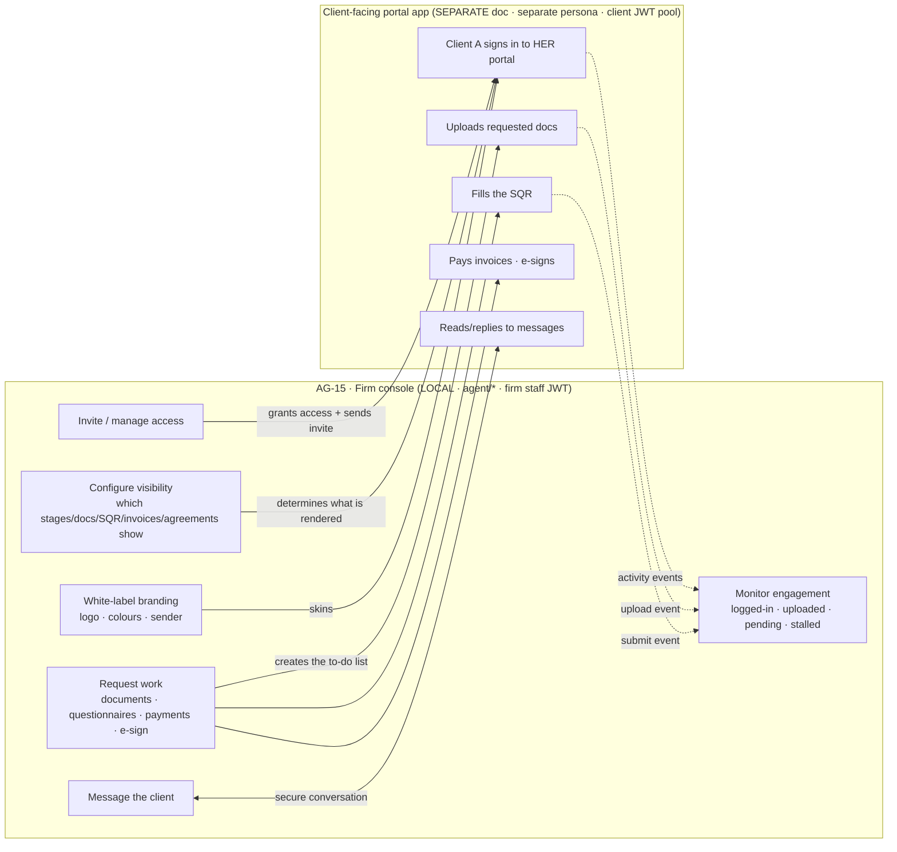
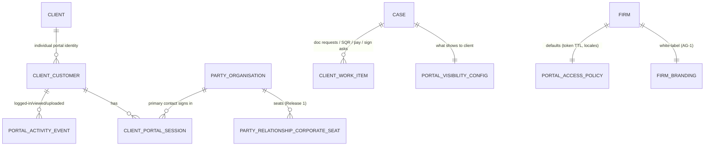

> **Document control** · Version **1.15** · **2026-10-27** · Status: **CC-8 applied: only emails a person writes are copied; system emails go to their usual recipient with no Cc (the product owner, 26 Oct)**; earlier: **AG-19 pointers added (the product owner, 25 Oct: "yes"): the client's portal upload offers phone scan (AG19-D10) and asks for the password of a locked PDF (AG19-D50)**; earlier: **Knock-ons from the duplicates / copy-on-emails work closed (the product owner, 25 Oct): the portal invitation, its resend and the Nudge go through AG-10's single send path; earlier: AG19-D18 / D19 applied (the product owner, 23 Oct: a client upload always adds a file and never replaces; an upload to an Accepted document leaves it Accepted); earlier: AG-07 review and the people model applied (X-2, AG07-D1, AG07-D8(a), AG7-D24 under AG07-D15); earlier: second pass (AG16-55): open question 12 closed; earlier: AG-16 review round 2 applied (AG16-42, with AG16-44): the client sees a "Last update" date; "Tell the client" is pointed to AG-10; no automatic "update received" line; earlier: AG-16 review decisions applied (see 1.8 row); SA-03 v2.16 applied — portal plan features named in the feature catalogue; extra corporate seats deferred (SA3-X8);** Session knock-on applied (AG1-D20, from AG-01 v1.16); knock-on changes applied (from AG-07 v2.3 and CP-01 v0.1)**\
> Part of: *Agent (RCIC/Lawyer) Console — Functional Requirements* · Split from `FINAL-Agent-FR.md` lines 9648–10255 on 2026-09-16 · Previous version: `_archive/AG-15-client-portal-management_v1.14_2026-10-25.md`\
>
> *21 Oct 2026 (final hand-over check of AG-02): lead response time removed from the open-hours clocks list in §13 item 10 (AG02-D7); §13 gains the block "Pending from the AG-02 review" (AG02-P120 to P122). Not re-versioned.*
>
> | Version | Date | Change | Decisions |
> |---|---|---|---|
> | 1.15 | 2026-10-27 | **CC-8 applied (the product owner, 26 Oct; homes AG-10 v1.26 AG-10-89, AG-07 v3.11 AG-7-103): only emails a person writes are copied.** The portal invitation, its resend and the invitation reminder stay never copied. **Withdrawn (struck, text kept):** the rule "when the Welcome has Cc recipients, the set-up line is left out and the portal invitation goes as its own email" (§3.1, AG-15-1, BR-18, US-1, §10); the Welcome never has Cc, so its portal set-up line returns on every first-case Welcome and still needs `agent/portal:invite` (AG-7-103 field 8). The Nudge "is copied when it chases a document, questionnaire or payment request of a case" is withdrawn: the Nudge is a system email, To the client only, whatever it chases (§3.6, AG-15-32, BR-18, US-5 tests, §9; the bouncing-Cc edge case withdrawn). Notes added to §13 Q19 and Q22. Row added to "Decisions that change this epic". No requirement ID changed. | CC-8 |
> | 25 Oct (final check) | 2026-10-25 | **25 Oct (final check): verification fixes.** Open question 23 settled: the trust balance line follows the "Money & documents to sign" tick, no new setting (MS-D24(5); §3.3, AG-15-23). AG-15-23: how refunds and credit notes show to the client (MS-D11(6)); "Cleared" points to AG-06 (MS-D23(3)). Decision-table rows MS-D11 and MS-D23 added. | MS-D11(6), MS-D23, MS-D24(5) |
> | 25 Oct (later): MS-D24 and writer follow-ups | 2026-10-25 | **MS-D24(5) and triage item 14 applied (the product owner, 25 Oct); targeted edits only.** AG-15-23 and §3.3: the client sees the trust balance per case (screen CP-1-101, rule home AG-06); online card payment is the full amount only (CP-1-102). The earlier "Open: trust balance in the portal" is settled. New §13 item 23 asks whether the Money tick controls the trust balance line. Row added to "Decisions that change this epic". | MS-D24 |
> | 25 Oct (money slice + AG-05 review) | 2026-10-25 | **Money-slice and AG-05 decisions that touch AG-15 applied (the product owner, 25 Oct); targeted edits only.** (1) **MS-D6(3), MS-D22(1), AG16-92:** the client pays a deposit request, a trust request or an invoice by the no-login pay link in the email (or from the same portal item, which opens the same link); no saved-card charging; AG-15-23, §3.4. (2) **MS-D6(5), MS-D21(16):** the portal lists the client's receipts (two kinds) and the statements the firm sent (AG-15-23). (3) **AG05-D1, AG05-D2:** any document can be sent for signature; the signing item is one work item per client signer, "N of M signed" shows on the case; one public signing page for the email link and the portal to-do (CP1-D4); keys follow AG05-D1(4); "signed offline" for any signature item (AG-15-18, AG-15-24, AG-15-45, §10, §7 `ClientWorkItem`, US-9). (4) **MS-D16(6):** a firm-service case shows the client "In progress" or "Done" (§3.3). Open: whether the client sees a trust balance in the portal (CP-01 open question 15). Rows added to "Decisions that change this epic". | AG05-D1 · AG05-D2 · MS-D6 · MS-D16(6) · MS-D21(16) · MS-D22(1) |
> | 1.14 | 2026-10-25 | **AG-19 pointers added (the product owner, 25 Oct: "yes"; homes AG-19 AG-19-19 and AG-09 AG-9-69).** AG-15 does not describe the client's upload screen; that screen is CP-01's (§3.5, CP-1-97). So the two one-line pointers go where AG-15 mentions the client's upload: §3.4 "Document request" and AG-15-20. (1) Phone scan: the client's upload offers **Scan with camera** (AG19-D10; AG-19-19). (2) Password prompt: before upload, a password-protected PDF triggers the prompt (AG19-D50; AG-9-69). Two rows added to "Decisions that change this epic". No requirement ID changed. | AG19-D10 · AG19-D50 |
> | 1.13 | 2026-10-25 | **Knock-ons from the duplicates / copy-on-emails work (the product owner, 25 Oct; homes AG-10 v1.22, AG-07 v3.8).** **Changed:** AG-15-1, AG-15-2 and §3.1 (how it works, data flow): the portal invitation and its resend go through AG-10's single send path (BR-1: consent gate AG-10-22, logged on the timeline AG-10-3) and are never copied to the case's copy list (AG-10-89 rule 2); the built `sendPortalInvitation` stays the service name and hands the email to that path instead of queuing it directly (§12, file:line). AG-15-1 and §3.1: the Welcome carries the portal set-up line only when it has no Cc; with Cc the invitation goes as its own email, To the client only (AG-7-103 rule 6). AG-15-32 and §3.6: the one-click Nudge goes through the same path; a Nudge about a document, questionnaire or payment request on a case is copied (AG-10-89 rule 1), a Nudge about a signature is a signing reminder and is not (rule 2). **Added:** BR-18; tests in US-1, US-5 and §9. **Open questions added:** 19 – 22. 25 Oct mop-up: open questions 19 – 22 closed "Resolved (25 Oct)" and applied — (Q19) a Nudge over requests on several cases sends one Nudge per case, each copied by that case's list; a Nudge with no case goes To the client only (AG-15-32, §3.6, BR-18, US-5); (Q20) the Invitation reminder is never copied (AG-10-89 rule 2; AG-15-32, §3.6, BR-18, US-5); (Q21) a send refused by the consent gate leaves the client not invited, with the reason shown (AG-15-1, §3.1, BR-18, lifecycle table, US-1, §9, §12); (Q22) the Welcome's portal set-up line or separate invitation needs `agent/portal:invite` (AG-15-1, §3.1, §10, US-1~~; AG-7-103 field 8 does not yet say so~~). Pre-existing conflicts fixed: §3.1 data flow (`client-activated-portal`), §3.4 data flow and US-2 (`client-uploaded-document`) struck under AG07-D20(g) / AG-7-39; "short TTL" in §3.1, AG-15-1 and US-1 replaced by BR-4's 7 days. 25 Oct: Resolved (25 Oct) — follows AG07-D6 / AG-7-39 — `client-submitted-sqr` struck from the §3.4 data flow and AG-15-25 excepts a questionnaire submit (shown on the case, timeline and queue colour, not notified). 25 Oct: refused resend — AG-15-2, BR-4 and §9: if the consent gate refuses a resend, the earlier link works until its own 7-day expiry, the status is unchanged and staff see the reason. 25 Oct final audit: §3.4 data flow and AG-15-25 — `invoice-paid` is the AG-16 §3.3 group 7 (Payments) notice and `agreement-signed` is governed by AG-16 / AG-02 (group still open, AG-16 §13 AG02-P101); neither is a case notification (AG-7-39 rule 1). Stale "knock-on for AG-07" removed from AG-15-1 and §13 Q22 (AG-07 v3.8 AG-7-103 field 8 already requires `agent/portal:invite`). Missing-translation carve-out in §3.8, AG-15-37, BR-10, US, §9 and §12 (pack content → English, firm-written → firm default; AG-08 v1.13 BR-12). Source pins updated to AG-10 v1.22, AG-07 v3.8. | CC-2 · CC-4 · CC-5 · AG-7-103 rule 6 (fix pass G1) |
> | 1.12 | 2026-10-23 | **AG-19 decisions D18 and D19 (the product owner, 23 Oct; home AG-09 v1.16), wording only.** BR-8, US (review upload), §9 edge cases "Needs replacing" and "on behalf, then the client uploads": a client upload is added as a part of the document and never replaces a file; the earlier upload stays until staff remove it (AG-9-67); an upload to an Accepted document leaves it Accepted and nothing is re-checked (AG19-D19). Before: "retained (versioned)", "held for review like any re-upload". The "Scan with camera" pointer (AG19-D10) is still pending. | AG19-D18 · AG19-D19 |
> | 1.11 | 2026-10-18 | *18 Oct (later): AG01-29(1) applied — client portal sessions end after 28 days unused, not never: AG1-D18, AG1-D20, AG-15-43, §9 edge case.* AG-07 review and the people model (the product owner, 18 Oct). **Added:** AG-15-56 (pointer, X-2: the principal sees family members' answers on shared cases; minors always; an adult can be kept private; a family member's record gives no login by itself) · AG-15-57 (client-facing words for the five document statuses; AG-09 owns the list) with build card · AG-15-58 (a staff-changed client email moves the portal login only after the client confirms a code; wording written here) with build card · AG-15-59 (one case with several filings: the client sees each filing's progress and requests). **Changed:** AG-15-19, AG-15-21, §3.4 document request line, "Re-request with reason", BR-7, BR-8, lifecycle line, US test, edge case and permission text now use the five AG-09 statuses (Needed, Received, Accepted, Needs replacing, Not needed) instead of requested / under-review / rejected · AG-15-50 and §3.1 (a family member's record gives no login by itself). **Open questions added:** 13 – 16. *18 Oct (later): consistency fixes after expert review — AG07-D12, SA6-D5: persona "Case Officer / Paralegal" renamed "Case Officer".* *18 Oct (final): AG07-D17 – D21 applied — AG07-D20(g) (a client upload or first portal login raises no staff notification; it shows on the case and in the "Review document" task: AG-15-25, §3.4 two-sides-one-wire text, lifecycle table), AG07-D20(m) (keep-private tick, one per adult on the applicant list; open question 16 closed). AG-15-58 code values checked: the 10-minute window already matches BR-4, so nothing changed.* *18 Oct (final): AG07-D22 applied — Q49 (employer portal seats are Release 1: §3.2, AG-15-12, BR-13, BR-17, §11, lifecycle line, `CorporatePortalSeat`, US-6 test, §13 Q1; open question 17 added), Q43 and Q79 (AG-15-56; open question 18 added).* *18 Oct (final): AG07-D23 applied — (1) a minor's answers show to both parents on the case, in each parent's portal (AG-15-56; open question 18 closed); (2) employer seats are Release 1 and a separate plan extra (AG-15-12, BR-17, §11; open question 17 closed; "when built" dropped).* *18 Oct (later): check fix — `pool-descriptor.ts` lines corrected to `:103, 125` (AG1-D20, AG-15-43).* | X-2, AG07-D1, AG07-D8(a), AG07-D15 (AG7-D24), AG07-D20(g), AG07-D20(m), AG07-D22, AG07-D23 |
> | 1.10 | 2026-10-17 | *Same-day fixes (17 Oct): AG16-83 – AG16-88 — portal nudging on every plan, not a sold extra (AG16-86: AG-15-32, SA3-D10 row, BR-17, §11, Q4 closed); Release 1 portal screens English only, translation-ready (AG16-88: AG-15-37, test); legal French left as written and listed for the product owner.* Second pass (the product owner, 17 Oct). **Open question 12 closed** with the writer's recommended default: "Last update" has one trigger, a "Tell the client" send; sharing a letter to the portal or changing the progress label does not set it. No requirement text changes (AG-15-54 already says this). No other decision AG16-56 – AG16-82 names this file. *Same-day fixes (18 Oct): AG16-90 — activation-email test uses a test locale instead of a French email (AG16-88); card AG-15-54 gains "Person decides:" and "Clicks:".* *Same-day fixes (18 Oct): AG16-92 — email-first, the portal is optional. **Purpose line** (§2) states that the portal is optional and email reaches every client; **§3.7 and AG-15-18:** pointer to AG-10-16 (a staff chat message or message ask is delivered in full on the client's preferred channel); **BR-4 and the lifecycle diagram:** activation link valid 7 days, re-sendable, as the Portal invitation template (S8; reset window unchanged); **AG-15-55:** the "Remind [client]" tick removed (AG16-75, M2); **AG-15-54 and its card:** "Last update" is set on a successful "Tell the client" send on any channel, whatever the client's portal status, and a failed send sets nothing (M3). The stall flag (§3.6) is not changed here. Decision row added; no version bump.* *Same-day fixes (18 Oct): AG16-94 — a client is stalled when their oldest open request is 7 or more calendar days old, on any channel; flag only, no pushed notification, no settings. **§3.6** (how it works, anti-stall instrument, business-hours bullet withdrawn, key screens, data flow), **AG-15-29, AG-15-31** (new build card), **AG-15-33 withdrawn** (`client-stalled`), **BR-12** (calendar days, fixed 7), **`PortalActivityEvent`** (portal stream kept; "last heard from" is derived from other modules), **`PortalAccessPolicy`** (`stallThresholdDays` and `businessHoursMode` struck), `agent/portal:nudge` description, **US-5** tests, edge case, §12 summary lines, purpose and persona lines; **Q6 and Q10 closed**. Supersedes the stall part of AG16-86(4).* *18 Oct: new section 'Decisions that change this epic' (index of AG16 decisions; no requirement changed).* *18 Oct: AG-15-31 — the 7 calendar days are counted in the office's time zone; with no client action on record the card shows "no reply yet" (AG16-94).* | AG16-55, AG16-90, AG16-92, AG16-94 |
> | 1.9 | 2026-10-17 | AG-16 review round 2 (AG16-42, the product owner, 17 Oct). **Added:** AG-15-54 — the client sees a **"Last update" date** on their case; it is set when the firm sends a "Tell the client" message and by nothing that arrives from the government; with a build card (new section "Build cards" at the end of §4). AG-15-55 — pointer: "Tell the client" (pre-filled from the letter library, optional "Remind [client] until they confirm") is specified in AG-10-73 and its wording in SA-05; this module adds no control for it. **Stated:** the portal shows **no automatic "update received from IRCC" line** and sends no automatic message on a decision or refusal (it could create chasing before the firm has looked). §3.3 gets one bullet. New: §13 Q12. **Open questions closed:** none. | AG16-42 (AG16-44, AG16-31) |
> | 1.8 | 2026-10-14 | AG-16 review decisions (the product owner, 14 Oct) and the AG-01 review (13 Oct) applied to AG-15. **Client two-step:** the firm "require" policy is removed (`clientMfaRequired`, AG-15-41, §2, §13 Q3 settled); the client may turn it on for themselves (new AG-15-52). **Deleted documents** leave the portal at once (new AG-15-53); **BR-6** and the deletion edge case: a client with any history is closed, not deleted. **Payment page** when the firm's payment account is down: pointer to AG-06 (§3.4). **Automatic nudges:** which ones run, their timing and Send automatically / Ask me first / Off live on the Automatic messages page (AG-12) — pointers in §3.6, AG-15-32, US-5, §13 Q4. **WhatsApp:** only through the firm's own connected account, falls back to email (§13 Q8). **Branding:** single home is AG-01 (`FirmBranding`, was `PortalBranding`); portal address is the firm's ExpatReady web address, read-only; **custom portal domain moved to Release 2** (AG-15-27, §3.5, BR-9, BR-17, §9, US-4, §13 Q2). Two open points added (§13 Q10, Q11). Requirement IDs unchanged; AG-15-52 and AG-15-53 added. *Same-day audit corrections (14 Oct): `reportingCurrency` removed (AG01-9).* | AG16-11, AG16-12, AG16-17, AG16-19, AG16-21, AG16-23 · AG01-1, AG01-3, AG01-14, AG01-19 |
> | 1.7 | 2026-10-10 | Applied from SA-03 v2.16 (SA3-X8; the product owner, 10 Oct): plans now switch **features** from SA-3's feature catalogue. The client portal is one module feature (every plan, intended); **Custom portal domain**, **Advanced portal branding** and **Portal auto-nudge playbooks** are named sellable extras. **Extra corporate seats** are not in Release 1 (AG17-D38) and, when built, become one on/off extra — not a counted limit. Excluded extras are always shown locked with an upgrade prompt (SA3-D16). BR-17 and the §11 feature-gating bullet changed. | SA3-D10, SA3-D16, SA3-D20 |
> | 1.6 | 2026-10-08 | Session knock-on from AG-01 v1.16 (the product owner, 8 Oct): a firm has no session setting — the firm session policy (AG-16-23) is withdrawn in AG-16 v1.12. Client rules unchanged: several devices, never auto-logged out. References to the firm policy removed from the AG1-D17 and AG1-D18 rows, AG-15-43 and §9; AG1-D20 added. A password change or second-step reset ending other sessions is specified in AG-1-67 and CP-1-96. Requirement IDs unchanged. | AG1-D20 |
> | 1.5 | 2026-10-05 | Knock-on changes from AG-07 v2.3 and the new client-portal document CP-01 v0.1 (5 Oct). **Changed:** lifecycle diagram (§3.1, §6) — a client is created by AG-02 convert, AG-07 Add client, AG-18 import or "Create work permit case" (AG-7-55), per AG-7-70 · §3.1 and §3.2 key screens — the Client-Portal panel is embedded in the AG-07 client screen (AG-7-82) · every "separate console document" reference now names `FINAL-ClientPortal-FR/CP-01-client-portal-app` (header A, scope boundary, §3.0) · **AG-15-34, AG-15-35, BR-14** and the "client/case thread" wording in §3.3, §3.7, §7 and §9 — one conversation per client, each message tagged to a case or General (CP-1-93; AG-10 BR-14) · §3.2 employer roster and US-6 — position counts after the decision (requested, approved, not approved), no worker details, and no recruitment candidates in Release 1 · §3.1 invites — manual invite to a Not started client allowed and does not switch the client on; automated invites stay blocked; Release 1 portal login for the principal applicant only · §13 Q2–Q4 and Q8 restated in Release 1 / Release 2 vocabulary (AG17-D60). **Added:** AG-15-48 (panel embedding), AG-15-49 (manual invite to a Not started client), AG-15-50 (principal applicant only, Release 1), AG-15-51 (employer position counts; no recruitment candidates). Other requirement IDs unchanged. Same day (final check): §11 and §12 PII wording aligned to AG7-D7. Same day (AG7-D10): masking and reveal removed — the §11 and §12 PII lines now say client personal data is never masked and has no reveal action, exports are audited, and the unmasked-export key is withdrawn; no-PII-in-logs and encryption at rest kept. | AG7-D1, AG7-D2, AG7-D10, AG-7-70, AG-7-82 · CP1-D6, CP1-D7, CP1-D8, CP1-D9, CP1-D10 · AG17-D60 |
> | 1.4 | 2026-10-03 | Consistency review fixes (3 Oct). Corporate record scoping moved from today's `clientCorporateCustomerId` to the organisation party: **BR-2** now scopes a client by `clientCustomerId` or `organisationPartyId` (a seat is scoped by its `CORPORATE_SEAT` relationship id), and the `CorporatePortalSeat`, `ClientPortalSession`, `ClientWorkItem` and `PortalActivityEvent` entries follow; today's field names stay only in the descriptions of today's code. AG17-D74 (done on behalf needs no new permission) added to the Applied-from table and AG-15-44. AG-15-25 added to the v1.3 "Changed" list (it points to AG-15-44). "Corporate seats in Phase-1?" restated as Release 1 (AG17-D60). Requirement IDs unchanged. | AG17-D38, AG17-D74 · AG17-D60 |
> | 1.3 | 2026-10-02 | Decisions from the corporate-cases (AG-17) review, 2 Oct: staff may complete a client's portal upload or questionnaire on the client's behalf, individual and corporate (BR-7 exception; payments through billing's offline payment; signatures never done on behalf). Corporate access (§3.2, US-6) rewritten: the employer roster shows the employer's LMIA files only (no worker milestone view); the worker gets portal access to their own individual case; employer and client items appear when the file's portal switch is on, a field of the existing per-case `PortalVisibilityConfig`; the corporate client is an organisation party with seats, not the V1-era `ClientCorporateCustomer`; Release 1 gives the employer's primary contact access, more seats later. Changed: AG-15-10, AG-15-11, AG-15-12, AG-15-25, BR-7, BR-13, US-6, US-9, §6 lifecycle, §7, §12, §13 Q1. New: AG-15-44 to AG-15-47, US-12. | AG17-D12, AG17-D18, AG17-D21, AG17-D38, AG17-D40, AG17-D49, AG17-D66, AG17-D74 |
> | 1.2 | 2026-10-02 | Session decisions (the product owner, 2 Oct): clients may be signed in on several devices with no platform auto-logout, and a firm's session policy never applies to clients (AG1-D18; AG1-D16 and AG1-D17 apply to firm staff only). New AG-15-42 and AG-15-43; §9 edge cases added. | AG1-D16, AG1-D17, AG1-D18 |
> | 1.1 | 2026-08-28 | Baseline — complete document v1.1 | — |

## Decisions that change this epic (14–18 Oct) *(new 18 Oct)*

Product-wide rules (apply here as everywhere; home: Agent `00-Overview` → "Product rules every epic follows"): AG16-11, AG16-31, AG16-42, AG16-44, AG16-60, AG16-63, AG16-76, AG16-92.

The "AG16" prefix is historical: these decisions began in the AG-16 review and apply across the product. Full text: `TEMPLATE-MAP-working_2026-10-10.md`.

| Decision | What was decided (one line) | What it changes in this epic | Where (requirement / card / section) |
|---|---|---|---|
| AG16-6 | Business hours and closed days | Superseded here by AG16-94 for the stall flag: the stall counts plain calendar days, with no business-hours setting (open question 10 closed) | §3.6 · BR-12 · §13 Q10 |
| AG16-11 | One Automatic messages page, documented in one place only | Which automatic nudges run, their timing and Send automatically / Ask me first / Off live on the Automatic messages page (AG-12); AG-15 holds pointers | §3.6 · AG-15-32 · US-5 · §13 Q4 |
| AG16-12 | Where timings live | Nudge timing moves to the AG-12 rows (invitation reminder, document and questionnaire chases) | §3.6 · AG-15-32 · US-5 · §13 Q4 |
| AG16-17 | Payment account down: money never falls back | Payment page shows "Online payment is temporarily unavailable" plus the firm's offline instructions; owner is AG-06 | §3.4 |
| AG16-19 | No shared ExpatReady WhatsApp number | WhatsApp only through the firm's own connected account, with email fallback | §13 Q8 |
| AG16-21 | Undoing deletes | A deleted document leaves the client portal at once; a client with any history is closed, not deleted | AG-15-53 · BR-6 · §9 |
| AG16-23 | Client two-step sign-in: no firm "require" switch | The firm "require two-step for clients" policy is removed; the client may turn it on for themselves | AG-15-41 · AG-15-52 · §2 · §13 Q3 |
| AG16-27 | Government mail: recognise, match, identify, sort, deadline | Referenced only (no change here) (cited as the reason there is no automatic "update received from IRCC" line) | Build card AG-15-54 (Why) |
| AG16-42 | "Quiet by default", plus telling the client | The client sees a "Last update" date, set only by a "Tell the client" send; no automatic "update received" line or message on a decision or refusal; "Tell the client" is pointed to AG-10 | §3.3 · AG-15-54 · AG-15-55 · build card |
| AG16-45 | Office time zones and escalation by office | The "Last update" date is shown without a time, in the case's office time zone | Build card AG-15-54 (rule 4) |
| AG16-55 | Writers' recommended defaults accepted for the detail questions | Open question 12 closed: "Last update" has one trigger, a "Tell the client" send; sharing a letter or changing the progress label does not set it | §13 Q12 |
| AG16-56 | When automatic messages send, by what their timer counts | Referenced only (no change here) (named only in the second-pass range in the change log) | Change log, row 1.10 |
| AG16-75 | "Remind [client] until they confirm" dropped | The optional "Remind [client]" tick is withdrawn from the "Tell the client" pointer | AG-15-55 |
| AG16-82 | One rule for every broken connection | Referenced only (no change here) (named only in the second-pass range in the change log) | Change log, row 1.10 |
| AG16-83 | 26 follow-through fixes after the second pass | Carried the AG16-86 and AG16-88 fixes below (change log, 17 Oct) | Change log, row 1.10 |
| AG16-86 | Portal nudging is a feature on every plan, not a sold extra | Portal nudging is on every plan; the separate auto-nudge playbook is withdrawn; its stall-flag part is superseded here by AG16-94 | AG-15-32 · SA3-D10 row · BR-17 · §11 · §13 Q4 |
| AG16-88 | Release 1 is English-first; French later | Release 1 portal screens are English only, all text in one place so French switches on later without code changes | AG-15-37 · US-1 and US-10 tests |
| AG16-90 | Batch C: consistency fixes from the 17 Oct audit | The activation-email test uses a test locale instead of a French email; card AG-15-54 gains "Person decides" and "Clicks" | US-1 test · US-10 test · build card AG-15-54 |
| AG16-92 | Email-first: the portal is optional | Purpose line says the portal is optional; chat and message asks delivered in full on the preferred channel; activation link valid 7 days and re-sendable; "Last update" set on a successful send on any channel; "Remind" tick removed | §2 · §3.7 · AG-15-18 · AG-15-54 · AG-15-55 · BR-4 · lifecycle diagram · build card AG-15-54 |
| AG16-93 | Client replies without a connected mailbox: unchanged; connecting is the obvious step | Email counts toward "last heard from" only when the firm's mailbox is connected; the open request still shows without it | §3.6 · AG-15-31 (rule 4 and edge cases) |
| X-2 | One person record per real person; role per filing; answers live under the person they describe | Principal sees family members' answers on shared cases (minors always; adults by default; staff can tick "Keep private from the principal"); a family member's record gives no login by itself. Pointer only: AG-02 is the home | §3.1 · AG-15-50 · AG-15-56 |
| AG07-D1 | One document status list, owned by AG-09 | Client-facing words for the five statuses; the work-item status for a document request follows AG-09's list | §3.4 · AG-15-19 · AG-15-21 · AG-15-57 · build card AG-15-57 |
| AG07-D8(a) | Several filings in one case: Release 1 | The client sees each filing's progress and requests under the one case; visibility stays one setting per case | AG-15-59 · §13 Q15 |
| AG07-D15 (AG7-D24) | A staff-changed client email moves the portal login only after the client confirms a code; AG-15 confirms the wording | Wording confirmed and written here; old address keeps working until the code is entered | AG-15-58 · build card AG-15-58 · §13 Q13, Q14 |
| AG16-94 | Client stall = oldest open request, any channel; flag only | Stall = oldest open request 7 or more calendar days old, on any channel; flag and firm-wide list only, no pushed notification (client-stalled withdrawn); fixed 7 days, no settings (stallThresholdDays, businessHoursMode withdrawn); "Invited, not activated" is a label only; 7 days counted in the office's time zone and "no reply yet" shown when no client action is on record (changed 18 Oct) | §1 · §2 · §3.6 · AG-15-29 · AG-15-31 · AG-15-33 (withdrawn) · BR-12 · PortalActivityEvent · PortalAccessPolicy · US-5 · §12 · §13 Q6, Q10 · build card AG-15-31 |
| AG07-D20(g) | A client upload or first portal login raises no staff notification; it shows on the case and in the "Review document" task. | AG-15-25, the "two sides, one wire" text and the Invited → Active lifecycle row no longer promise a case-officer notification for an upload or activation. Payment and signature wording is not changed by this decision. | AG-15-25, §3.4 "Two sides, one wire", lifecycle table |
| AG07-D20(m) | "Keep private from the principal": one tick per adult on the case's applicant list. | AG-15-56 pointer names the tick; open question 16 closed. The screen is AG-07 / AG-08 (AG-02 owns the person record). | AG-15-56, §13 Q16 |
| AG07-D22 (Q49) | Employer portal seats: Release 1 (roster and seats). | The employer's primary contact and additional seats both get portal access in Release 1. The wording "primary contact only" and "seats later" is changed; it replaces AG17-D38 for seats. Whether seats stay a plan extra (SA3-D20) was open question 17; answered by AG07-D23 (2): they do. | §3.2 · AG-15-12 · BR-13 · BR-17 · §11 · `CorporatePortalSeat` · US-6 · §13 Q1, Q17 |
| AG07-D22 (Q43, Q79) | The case's principal is the case's client. A child's answers show in the portal to the principal unless "Keep private from the principal" is ticked. *(Q79 words for a minor replaced by AG07-D23 (1).)* | AG-15-56 names the case's principal. Open question 18 asked how the tick works for a child; AG07-D23 (1) answered it. | AG-15-56 · §13 Q18 |
| AG07-D23 (1) | A minor's answers are shown to both parents on the case: the case's client and the other parent, when that parent is on the case (Client B and Client A see Client D's answers), on the staff case screen and in each parent's portal. There is no "Keep private from the principal" tick for a minor; the tick stays one per adult. | AG-15-56 now says both parents see a minor's answers in their own portal. Open question 18 closed. *(changed 18 Oct — AG07-D23)* | AG-15-56 · §13 Q18 |
| AG01-29(1) | Sign-out after 28 days unused stays (built; staff and clients) | Clients have no short idle timeout and sign in again after 28 days unused; "never auto-logged out" wording removed; several devices and "a firm's session policy never applies to clients" unchanged | AG1-D18 · AG1-D20 · AG-15-43 · §9 |
| AG07-D23 (2) | Employer portal seats are Release 1 and stay a separate plan extra the owner switches on (SA3-D20). The words "when built" are dropped. | AG-15-12, BR-17 and §11 say seats are a separate plan extra in Release 1. Open question 17 closed. *(changed 18 Oct — AG07-D23)* | AG-15-12 · BR-17 · §11 · §13 Q17 |
| CC-2, CC-4, CC-5 *(25 Oct; home AG-10 v1.22 AG-10-89, BR-35; the Welcome Cc and the Nudge copy withdrawn by CC-8, next row)* | Every client-facing email of a case goes through the one send path as one email, To the usual recipient, Cc the case's copy list; the portal invitation, signing reminders and login emails are never copied. With Cc on the Welcome, the portal invitation goes as its own email, To the client only (AG-7-103 rule 6). | The invitation and its resend go through AG-10's send path and are never copied; the Nudge goes through it and is copied when it chases a document, questionnaire or payment request on a case, not when it chases a signature; the Welcome's portal line follows AG-7-103 rule 6. *(changed 25 Oct — copy on emails)* | §3.1 · §3.6 · AG-15-1 · AG-15-2 · AG-15-32 · BR-18 · US-1 · US-5 · §9 · §12 · §13 Q19 – Q22 |
| CC-8 *(the product owner, 26 Oct; home AG-10 v1.26 AG-10-89; AG-07 v3.11 AG-7-103)* | Only emails a person writes are copied. Every system email goes to its usual recipient with no Cc. The Welcome never has Cc, so the "separate invitation when the Welcome has Cc" rule is withdrawn | The invitation, resend and invitation reminder stay never copied. The Nudge is a system email and is never copied, whatever it chases. The Welcome's portal set-up line returns on every first-case Welcome and still needs `agent/portal:invite` (AG-7-103 field 8) | §3.1 · §3.6 · AG-15-1 · AG-15-32 · BR-18 · US-1 · US-5 · §9 · §10 · §13 Q19, Q22 |
| AG19-D18 *(23 Oct)* | Staff Replace one file or Remove one or many; client uploads always add, never replace; home AG-09 (AG-9-67) | A client's upload after "Needs replacing" or after an on-behalf upload is a new part; the earlier upload stays until staff remove it | BR-8 · US (review upload) · §9 |
| AG19-D19 *(23 Oct)* | A file uploaded to an Accepted document attaches as a part; status unchanged, nothing re-checked; home AG-09 (AG-9-65 rule 2) | An upload after acceptance leaves the document Accepted | §9 |
| AG19-D10 *(22 Oct; home AG-19, AG-19-19)* | Phone scan on every client upload route | Pointer: the client's portal upload offers Scan with camera | §3.4 · AG-15-20 |
| AG19-D50 *(25 Oct; narrows AG19-D49; home AG-09, AG-9-69)* | The password prompt shows only where the client uploads inside ExpatReady: the portal Documents tab, the questionnaire's upload and the no-login upload page; a locked email attachment only gets the "Password protected" label | Pointer: the client's portal upload asks for the password of a locked PDF before upload | §3.4 · AG-15-20 |
| AG05-D1 *(25 Oct; home AG-05)* | One signing tool for every document: any document can be sent for signature; no-login signing link by email; the same signing page from the portal to-do (CP1-D4); keys: retainers keep `agent/retainer:*`, any other document needs `agent/portal:request-work` to send and to mark signed offline | The signing work item is not retainer-only; `AGREEMENT_SEND` follows these keys; "signed offline" applies to any signature item | AG-15-18 · AG-15-24 · AG-15-45 · §10 · §7 `ClientWorkItem` · US-9 |
| AG05-D2 *(25 Oct; home AG-05)* | Several client signers sign a retainer in any order, each with their own link; the firm signs after all; reminders go only to those who have not signed; status shows "1 of 2 signed" | One signing work item per client signer; the case shows "N of M signed" | AG-15-24 · §3.4 · §7 `ClientWorkItem` |
| MS-D6(3) *(25 Oct; home AG-06)* · MS-D22(1) | A deposit request is not an invoice: own reference (DR-…), no-login pay link, the firm's offline details; no saved-card automatic charging | The client pays by the no-login pay link in the email (email-first, AG16-92); the portal item opens the same link; no saved-card charging | §3.4 · AG-15-23 |
| MS-D6(5) · MS-D21(16) *(25 Oct; home AG-06)* | A numbered trust receipt for an advance payment and a payment receipt for an invoice payment; "Send statement" at any time | The portal lists the client's receipts (two kinds) and the statements the firm sent; AG-06 owns what they say | AG-15-23 |
| MS-D24(5) *(25 Oct; home AG-06, AG-15, CP-01)* | The client sees their trust balance per case in the portal and on statements, e.g. "Held in trust for your work permit: CAD 1,500"; online card payment is the full amount only (triage item 14) | The portal shows a trust balance line per case; no part card payment; CP-01 open question 15 closed | AG-15-23 · §3.3 · §13 item 23 |
| MS-D11(6) *(25 Oct; home AG-06)* | A refund is told to the client by the "Refund issued" email; a credit note is a PDF the firm sends | The portal's money list and the statements show the credit note PDF; the refund shows by its email; AG-06 owns the wording | AG-15-23 |
| MS-D23 *(25 Oct; home AG-06)* | Scenario rules: receipts have "Cleared"; "In transit" on the monthly check; a payment in another currency is noted; "Paid by" may be a typed name | Pointer only: whether "Cleared" shows to the client is AG-06's; this page adds no rule | AG-15-23 |
| MS-D16(6) *(25 Oct; home AG-07)* | A firm-service case: the portal shows In progress / Done | The client sees no stage labels for such a case; to-dos, documents and payments work as on any case | §3.3 |


## Module AG-15: Client Portal Management

**Applied from AG-01 v1.5 (sessions, 2026-10-02)**

| ID | Decision | Where applied here |
|---|---|---|
| **AG1-D18** | **Clients may be signed in on several devices, with no short idle timeout.** A client can use the portal on a laptop and a phone at the same time. No short idle timeout for clients; after 28 days unused they sign in again (AG1-D20) *(changed 18 Oct — AG01-29(1))*. Questionnaires save every answer as typed and reopen at the same question (AG-8-15). *(changed v1.6 — AG1-D20: a firm has no session setting, so no firm policy can reach clients.)* | AG-15-42 · AG-15-43 · §9 |
| **AG1-D16** | One session at a time applies to **firm staff only** (AG-1-55); it does not apply to clients. | AG-15-42 · §9 |
| **AG1-D17** | *(superseded v1.6 — AG1-D20)* Was: a firm's optional session policy applied to firm staff only, never to clients. | AG-15-43 · §9 |
| **AG1-D20** | Session rules are set by the platform only; a firm has no session setting (AG-16-23 withdrawn). Clients have no short idle timeout; after 28 days unused they sign in again (the portal pool uses the same remembered idle window, `pool-descriptor.ts:103, 125`; platform setting `platform.session.remembered_idle_days`, seeded 28, `api/infra/18-platform-setting-seed.sql:250-251`) *(changed 18 Oct — AG01-29(1))*. A password change or second-step reset ends the client's other sessions (AG-1-67, CP-1-96). | AG-15-43 · §9 |

**Applied from AG-17 v0.1 (corporate cases and LMIA, 2026-10-02)**

| ID | Decision | Where applied here |
|---|---|---|
| **AG17-D66** (refines **AG17-D40**) | **"Done on behalf of client" — individual and corporate, signatures excluded.** Staff may complete a client's portal upload or questionnaire on the client's behalf; the portal shows "received by your case officer on <date> ✓"; the audit log records who and "on behalf of". Payments are recorded by staff through billing's offline payment. Signatures are never done on behalf: a paper signature is uploaded and marked "signed offline". Exception to BR-7. | BR-7 · §6 · AG-15-44 · AG-15-45 · US-12 · §9 |
| **AG17-D18** | One switch per file: "Client/employer does their items in the portal — on / off". Off = staff do everything; on = to-dos appear in the portal and staff can still step in. Staff can always complete any item on someone's behalf. | §3.2 · §3.3 · AG-15-47 · §7 |
| **AG17-D49** (withdraws **AG17-D21**) | The employer's portal shows the employer's LMIA files only — no worker milestone view, no worker consent tick, no worker-status feature. | §3.2 · AG-15-11 |
| **AG17-D12** | The worker is a normal person on the position; once an individual case exists, the worker's tracking comes from that case. The worker's portal access is to their own individual case. | §3.2 · AG-15-46 |
| **AG17-D38** | Release 1: only the employer's primary contact gets portal access; more employer seats later. *(Seats part replaced 18 Oct — AG07-D22 Q49: seats are Release 1.)* | §3.2 · AG-15-12 · §13 Q1 |
| **AG17-D74** | "Done on behalf of client" needs no new permission: whoever may do the item on the case may do it on the client's behalf (document upload rights for uploads, case edit rights for questionnaires). | AG-15-44 · §13 Q9 |

**Applied from AG-07 v2.3 and CP-01 v0.1 (client screen and client-portal app, 2026-10-05)**

| ID | Decision | Where applied here |
|---|---|---|
| **AG7-D1 · AG-7-70 · AG-7-82** | A client is created only by AG-02 convert, AG-07 Add client, the AG-18 import or "Create work permit case" (AG-7-55). The Client-Portal panel is embedded in the AG-07 client screen (AG-7-82). | §3.1 · §3.2 · §6 · AG-15-48 |
| **AG7-D2** | The client's own portal screens are specified in `FINAL-ClientPortal-FR/CP-01-client-portal-app`, for both client types. | §1 · §3.0 |
| **CP1-D6** | One conversation per client, each message tagged to one of the client's cases or to "General" (CP-1-93; AG-10 BR-14). | §3.3 · §3.7 · AG-15-34 · AG-15-35 · BR-14 |
| **CP1-D7** | In Release 1 the employer portal shows nothing about recruitment candidates (no list, no counts, no notes). | §3.2 · AG-15-51 |
| **CP1-D8** | A manual portal invitation to a Not started client is allowed and does not switch the client's automations on; automated invitations stay blocked. | §3.1 · AG-15-49 |
| **CP1-D9** | Release 1: only the principal applicant has a portal login; adult family logins are Release 2. | §3.1 · AG-15-50 |
| **CP1-D10** | The employer's roster shows position counts only (requested, approved, not approved) after the decision; AG17-D49 unchanged. | §3.2 · AG-15-51 · US-6 |
| **AG17-D60** | Release 1 / Release 2 vocabulary replaces "demo" and "Phase-2". | §13 Q2–Q4, Q8 |

**Applied from SA-03 v2.16 (feature catalogue, 2026-10-10)**

| ID | Decision | Where applied here |
|---|---|---|
| **SA3-D10** | Plans switch features, not screens. Client portal = one module feature; Custom portal domain and Advanced portal branding = named extras (SA-03 §3.3 #18, #23, #24). **Portal nudging is not an extra: it is on every plan** (fix 17 Oct — AG16-86; SA-03 #25 retired). An extra is off whenever the Client portal feature is off. | BR-17 · §11 |
| **SA3-D16** | A feature not on the firm's plan is always shown locked with an upgrade prompt; "hidden" is withdrawn. | BR-17 · §11 |
| **SA3-D20** | Extra corporate seats (AG-15-12) are Release 1 (AG07-D23), one separate on/off extra, not a fifth limit. *(Words "not in Release 1 (AG17-D38); when built" dropped 18 Oct — AG07-D23.)* | BR-17 · §11 · AG-15-12 note |

**Applied from the AG-16 and AG-01 reviews (the product owner, 13–14 Oct 2026)**

| ID | Decision | Where applied here |
|---|---|---|
| **AG16-23 · AG01-3** | No firm "require two-step for clients" switch; the client may turn two-step on for themselves; never forced. | AG-15-41 · AG-15-52 · §2 · §13 Q3 |
| **AG16-21** | A deleted item leaves the client portal at once; clients with any history are closed, not deleted. | AG-15-53 · BR-6 · §9 |
| **AG16-17** | Payment account down: "Online payment is temporarily unavailable" plus the firm's offline payment instructions; money never falls back to ExpatReady processing. Owner: AG-06. | §3.4 |
| **AG16-11 · AG16-12** | Automatic client messages (incl. nudges) are rows on the Automatic messages page (AG-12). | §3.6 · AG-15-32 · US-5 · §13 Q4 |
| **AG16-19** | No shared ExpatReady WhatsApp number; email fallback. | §13 Q8 |
| **AG16-42** *(v1.9)* | Quiet by default; the client sees a "Last update" date; "Tell the client" is pre-filled from the letter library (specified in AG-10-73); no automatic "update received" line in the portal. | §3.3 · AG-15-54 · AG-15-55 · card |
| **AG16-92** *(18 Oct)* | Email-first, the portal is optional: the client is reached by email or preferred channel and can act without a login (home: AG-10-85). Here: chat messages and message asks delivered in full (AG-10-16); activation link 7 days; "Last update" on any channel; "Remind" tick removed (AG16-75). | §2 · §3.7 · AG-15-18 · AG-15-54 · AG-15-55 · BR-4 · diagram · card |
| **AG16-94** *(18 Oct)* | Client stall = the oldest open request (document, questionnaire, signature, payment) 7 or more calendar days old, on any channel; "last heard from" reads email/WhatsApp filed, uploads, questionnaire, signing, payment and portal login; flag and list only, no pushed notification (`client-stalled` withdrawn); fixed 7 calendar days, no settings (`stallThresholdDays`, `businessHoursMode` withdrawn); "Invited, not activated" is a label only. Changes AG16-86(4). | §1 · §2 · §3.6 · AG-15-29 · AG-15-31 · AG-15-33 · BR-12 · `PortalActivityEvent` · `PortalAccessPolicy` · US-5 · §12 · §13 Q6 · Q10 · card |
| **AG01-1 · AG01-14 · AG01-19** | Portal address read-only; custom portal domain is Release 2; branding single home is AG-01 (`FirmBranding`). | §3.5 · AG-15-26 · AG-15-27 · BR-9 · BR-17 · §7 · §13 Q2 |

### Module Index

Scan the whole module in ~30 seconds; jump to any part.

1. **Purpose & Goal**
2. **Users & Jobs-to-be-Done**
3. **Functional Design — How It Works** (core)
   - 3.0 The boundary: firm-side **control plane** vs the client-facing portal app (separate persona, separate auth) · 3.1 Invite & access lifecycle (individual) · 3.2 Corporate access (employer's LMIA files; worker's own case; primary contact and seats in Release 1 — changed 18 Oct, AG07-D22 Q49) · 3.3 Visibility configuration (what the client sees/does, per case) · 3.4 Client work orchestration — document requests, questionnaires, invoices, agreements, messages · 3.5 White-label / branding (per AG-1) · 3.6 Engagement monitoring & nudges (the "is my client moving?" surface) · 3.7 Secure messaging firm ↔ client (via AG-10) · 3.8 Per-locale client experience · 3.9 Access audit & security monitoring
4. **Detailed Functional Requirements** (AG-15-x)
5. **Business Rules & Logic**
6. **States & Lifecycle**
7. **Key Entities & Fields**
8. **User Stories + Acceptance Criteria**
9. **Edge Cases & Validations**
10. **Permissions** (LOCAL `agent/*`)
11. **Scalability · Security · Performance**
12. **Reference Note** (exists / NEW / changed)
13. **Open Questions / Founder Decisions**

### Visual Overview

**A. The two-plane relationship — the firm *configures*, the client *experiences*** (this module is the LEFT box only; the client-facing portal app is specified in `FINAL-ClientPortal-FR/CP-01-client-portal-app`):



**B. Invite & access lifecycle** (firm-driven; mirrors the existing `portalStatus` field and `sendPortalInvitation` service, extended with revoke/suspend):

```mermaid
stateDiagram-v2
    [*] --> NoAccess : client created (AG-02 convert / AG-07 Add client / AG-18 import / Create work permit case), no portal yet
    NoAccess --> Invited : firm sends invite (activation token, valid 7 days · resendable)
    Invited --> Active : client sets password (activation)
    Invited --> Expired : token TTL elapsed
    Expired --> Invited : firm resends invite
    Active --> Suspended : firm pauses access (reason)
    Suspended --> Active : firm restores
    Active --> Revoked : firm revokes (all sessions killed)
    Suspended --> Revoked
    Revoked --> Invited : firm re-invites (new token, fresh consent)
    note right of Active : lastPortalLogin tracked; sessions in ClientPortalSession
    note right of Revoked : record retained (PIPEDA); login blocked; data not deleted
```



**C. Data model** (firm-side config + the separate client identity pool it administers; cross-cutting attaches polymorphically):



> `Note · Task · Reminder · Communication · Document · AuditLog · Notification` attach to a `ClientCustomer`, `Case`, or `ClientWorkItem` via the polymorphic `(entityType, entityId)` pattern — defined once (Part 2), reused here, never redefined.

---

### 1. Purpose & Goal

**What it is.** AG-15 is the firm's **control plane for the client experience**: the screens and rules by which firm staff (a) **grant, manage, suspend, and revoke** a client's access to the self-service portal, (b) **configure what each client can see and do** there (which case stages, which document requests, which questionnaire, which invoices, which agreements, which messages), (c) **white-label** the portal so it looks like the firm, not like Expat Ready, (d) **monitor each client's engagement** — who logged in, who uploaded, who is stalled — and **nudge** the stalled ones, and (e) **converse securely** with the client. It is the firm-facing twin of the client-facing portal app.

**The scope boundary (read this first — it shapes the whole document).** This module is **NOT the client-facing portal application** that Client A logs into. That app — its dashboard, its upload screens, its payment flow, its mobile layout — is a **separate persona on a separate auth context** and is specified in its own console document, `FINAL-ClientPortal-FR/CP-01-client-portal-app`. AG-15 is everything the **firm** does *to and about* that experience, executed with firm-staff identity and `agent/*` permissions. The clean test: **if a logged-in firm employee does it, it is AG-15; if the logged-in immigrant client does it, it is the client portal app.** The two planes share data (the same Case, the same Documents) but never share an identity, a session, a permission model, or a screen. §3.0 makes this boundary precise; §12 is honest that today most of the *client-facing* half exists and most of the *firm-side control plane* (this module) does **not**.

**The business outcome it must produce.** Immigration files stall on the **client's** side at least as often as the firm's: documents not uploaded, the questionnaire half-finished, an invoice unpaid, a retainer unsigned, a portal invite that the client never opened. A case officer who cannot *see* that a client has had a request open for three weeks cannot rescue the file before a deadline slips *(changed 18 Oct — AG16-94)*. AG-15 exists to make **"the client is never the silent bottleneck"** structurally true: every ask the firm makes of the client is a **tracked work item** with a status the firm can watch; every request the client has left open for 7 or more days is **visible and nudgeable** *(changed 18 Oct — AG16-94)*; and the firm controls — per client, per case — exactly what is exposed, so the portal is a precise, professional, **branded** extension of the firm rather than a leaky window into internal work.

**Why it matters / world-class positioning.** A generic "client portal" is a login + a file drop. Expat Ready's is a **firm-governed, white-labelled, compliance-native client cockpit**: the firm decides what is visible (internal case notes and staff workflow are *never* exposed); the client sees a clean checklist *in their own language*; the firm watches progress and intervenes before a deadline dies; and every byte respects that the client is a **separate identity** who may see **only their own case(s)** — record-level isolation enforced server-side, not by hiding a link. The moat versus a bolt-on portal is two-fold: (a) **firm-governed visibility + engagement monitoring** turns the portal from a passive file-share into an *active anti-stall instrument the firm steers*, and (b) **white-label + bilingual + record-level-isolated + PIPEDA-audited** makes it safe and on-brand for a regulated immigration firm to put in front of a client. A leaky or off-brand portal actively damages a regulated firm; ours protects it.

**How it ties to the journey.** Case created and retainer signed (AG-2 → AG-5/AG-6) → firm **invites** the client here → firm **configures** what shows and **requests** the documents/SQR/payments the file needs → the client does the work in *their* portal → firm **monitors** completion and **nudges** stalls → firm and client **message** as needed → the file moves. AG-15 owns the firm-side of every one of those verbs.

**Global ambition.** The same module serves a solo RCIC provisioned for Canada and a firm provisioned for Australia — the platform is multi-country, a firm is not (FD-68). The portal is **white-labelled per firm** (and, where configured, per office/brand). The **client chooses their own locale** (EN/FR/…), independent of the firm's staff language; every client-facing string, email, and nudge renders in the client's language. Money the client pays is in the **case/invoice currency** (AG-6). Timezones for "last seen / N days" are computed in the **firm/office timezone**; stall days are calendar days *(changed 18 Oct — AG16-94)*. Single-locale/single-brand is the degenerate case — no code change.

---

### 2. Users & Jobs-to-be-Done

The "Agent" persona is an umbrella; AG-15 is the firm-staff side. (The **immigrant client** is a *different* persona, served by the separate client-portal app — listed last for boundary clarity, not because they use AG-15.)

| Role | Primary job in AG-15 | Jobs-to-be-done (representative) |
|---|---|---|
| **Case Officer** (heaviest user) *(fixed 18 Oct — AG07-D12, SA6-D5)* | Get the client doing their part, on time, without chasing by email. The portal is optional (AG16-92): email, or the client's preferred channel, reaches every client, and every action can be done from the message without a login (AG-10-85). *(changed 18 Oct — AG16-92)* | "When a case needs documents, I want to request them as a checklist the client sees in their portal, and watch each one get uploaded — so I stop emailing 'did you send the bank statement yet?'." · "When a client has had a request open for two weeks, I want to see \"Waiting on client: [item] · 14 days\" and send a nudge in one click, in their language." *(changed 18 Oct — AG16-94)* · "When the client uploads something, I want to know immediately and review it without leaving my case." |
| **RCIC / Consultant** | Control what the client sees; keep advice and internal work private. | "When I open the portal a client to access, I want to choose which case stages and statuses they see, so they get reassuring progress *without* seeing my internal workflow or notes." · "When I send the questionnaire (SQR) or a retainer to e-sign, I want it to appear in their portal and come back to me complete — no re-keying." |
| **Intake / Onboarding** | Get the client *in*, fast and branded. | "When a new client is retained, I want to invite them to the portal in one click and have them receive a branded, on-brand email in their language with a secure activation link." · "When the link expires or they lost it, I want to resend without recreating anything." |
| **Manager / Owner** | Brand, govern, and see portal health across the book. | "When we onboard the firm, I want to white-label the portal — logo, colours, our sender name — so clients never see 'Expat Ready'." · "When I look across active clients, I want to see who's engaged and who's stalled, firm-wide, to spot files at risk." · "When I set policy, I want to decide invite-link TTL and which locales we offer *(changed v1.8 — AG16-23: no firm "require two-step for clients" setting)*." |
| **Accounts / Billing** | Surface what's payable; watch it get paid. | "When an invoice is issued (AG-6), I want it visible in the client's portal to pay, and to see paid/unpaid status without phoning them." (Owns AG-6; AG-15 governs its *exposure* and watches the *status*.) |
| **Corporate Account Manager** | Run an employer client with many applicants. | "When a corporate client (an employer) has several LMIA files, I want the employer's primary contact to see those files in the portal and do the employer's items there when the file's portal switch is on — and when they don't, I want to do the item for them." |
| *(separate persona)* **Immigrant Client / Applicant** | Do their part; see their progress. *(Served by the client-portal app, NOT AG-15.)* | "When my firm asks for documents, I want a clear checklist in my language, upload from my phone, pay my invoice, sign my retainer, and see my case moving — without calling my consultant." *(These JTBD drive the **separate** client-portal console doc; listed here only to make the boundary explicit.)* |

**Design implication.** The Case Officer is the protagonist of the AG-15 UI — the per-case "Client Portal" panel (invite state + visibility config + work-item tracker + engagement + message conversation) is their home. The Owner/Manager get the white-label config and the firm-wide engagement dashboard. The client never sees an AG-15 screen — they see the separate portal app, skinned by the branding configured here.

---

### 3. Functional Design — How It Works (core)

This is the heart of the spec. Each sub-function is designed in depth: **how it works**, the **world-class behaviour** that beats a bolt-on portal, the **key screens & interactions** (functional, not pixel-level), and the **data flow**.

#### 3.0 The boundary — firm control plane vs client portal app (separate persona, separate auth)

**Design decision: the client is a first-class but *separate* persona, on a separate authentication pool, and AG-15 is only the firm's side.** This is the single most important architectural fact in the module, and the codebase already gets the *identity* half right (see §12): there is a dedicated client auth service, a dedicated client JWT (`{id, clientType, clientId}`), dedicated strategies and guards, and a dedicated session store — entirely distinct from firm-staff auth.

- **Two identity pools, never mixed.** Firm staff authenticate against the staff/user pool and carry `agent/*` permissions within a `firm_id`. Clients authenticate against the **client pool** (`ClientCustomer` for individuals; for corporates the organisation party and its portal contact — see §3.2 and §12) and carry a **client JWT** scoped to their own client identity. A firm token can never act as a client; a client token can never reach an `agent/*` endpoint. (Today the client-facing controllers are marked `@Public()` and protected by client-specific guards + record scoping — *not* by `agent/*` perms; this is correct and stays.)
- **Two permission models.** AG-15 endpoints (invite, configure, monitor, message-as-firm) are firm endpoints guarded by **`agent/portal:*`** (§10). Client-facing endpoints (upload, fill SQR, pay) are guarded by the **client guards** and **record-level scoping** — a client may touch only rows belonging to their own `clientCustomerId`. These are two different doctrines and must not be conflated.
- **Two surfaces, one data spine.** Both planes read/write the *same* Case, Documents, SQR responses, Invoices, Retainer agreements — but through different doors with different authorisation. AG-15 decides *what is exposed and requested*; the client app *renders and fulfils* it. Internal-only data (staff workflow, internal notes, case strategy, other clients) is **never** in the client's door at all.
- **Where the line falls (the test).** *Firm employee does it → AG-15.* *Client does it → client-portal app (`FINAL-ClientPortal-FR/CP-01-client-portal-app`).* Inviting = AG-15. Setting a password from the invite = client app. Configuring which docs to request = AG-15. Uploading the doc = client app. Watching the upload land + reviewing it = AG-15. Messaging *as the firm* = AG-15; reading/replying *as the client* = client app.

> **Reference-note callout:** the client *identity & auth* foundation, and a meaningful slice of the client-*facing* endpoints (profile, cases, documents, SQR, invoices, retainer-agreements, media), already exist. The **firm-side control plane defined by this document is almost entirely NEW** — there is no firm endpoint today to invite/resend/revoke/suspend, no visibility config, no document-request orchestration, no white-label config, no engagement monitoring, and no `agent/portal:*` permissions. See §12 for the honest line-by-line.

#### 3.1 Invite & Access Lifecycle (individual client) — "grant access in one click; govern it for life"

**How it works.** Once a client exists (created by AG-02 convert, AG-07 Add client, AG-18 import or "Create work permit case" — AG-7-70), a firm user with `agent/portal:invite` triggers an **invitation** from the client's record or the case's Client-Portal panel. Inviting sets the client's **`portalStatus`** to `PENDING_ACTIVATION`, generates a single-use ~~short-TTL~~ **activation token** valid 7 days (BR-4) *(changed 25 Oct — matches BR-4)*, and sends a **branded** activation email (in the client's chosen locale) ~~via the Mailer~~ through **AG-10's single send path** (AG-10 BR-1: the consent gate AG-10-22, then the Mailer, then a `Communication` on the timeline, AG-10-3). The invitation is a login email: it goes To the client only and is **never copied** to the case's copy list, even when sent from a case (AG-10-89 rule 2; BR-35). The same holds for a resend. *(changed 25 Oct — copy on emails, CC-2)* If the consent gate refuses the invitation (AG-10-22: no reachable address), the client stays not invited (No access; `portalStatus` is not set to `PENDING_ACTIVATION`) and the panel shows staff the reason, "Invitation not sent: <reason>". *(changed 25 Oct — §13 Q21 resolved)* **With the Welcome** (AG-7-103 rule 6): ~~when the Welcome has no Cc, it carries the portal set-up as one optional line; when the Welcome has Cc recipients, the set-up line is left out and the portal invitation goes as its own email, To the client only, never copied.~~ the Welcome is a system email with no Cc (AG-7-103 rule 4), so it carries the portal set-up as one optional line; no separate invitation email goes with it *(changed 26 Oct — CC-8)*. A returning client's Welcome has no portal set-up (AG-7-103 rule 3). *(changed 25 Oct — AG-7-103 rule 6, fix pass G1)* The set-up line~~, or the separate invitation,~~ goes only when the staff member sending the Welcome holds `agent/portal:invite`; otherwise the Welcome goes without it and someone with the key invites later (AG-15-1; AG-7-103 field 8). *(changed 25 Oct — §13 Q22 resolved; changed 26 Oct — CC-8)* The client follows the link in *their* app and sets a password — which flips them to `ACTIVE` and records the activation. The firm can, at any later time, **resend** the invite (new token, old one invalidated), **suspend** (pause access without deleting — reversible, reason captured), **revoke** (kill all sessions; login blocked), and **re-invite** a revoked/expired client (fresh token, fresh consent). *(changed v1.5 — CP1-D8, CP1-D9)* A **manual** invitation to a client who is **Not started** (a quiet-lead or imported client, e.g. one who asks for access) is allowed: it is a deliberate staff action and **does not switch the client's automations on**; **automated** invitations stay blocked until the firm starts the client. In **Release 1 only the principal applicant** is invited and has a portal login; they handle the whole family's to-dos, documents and questionnaire sections. Separate logins for adult family members are Release 2. *(changed 18 Oct — X-2)* A family member's person record gives no login and no emails by itself; only a client with an activated portal login (or a corporate seat) can sign in. The firm can also **force-logout all sessions** for a client and see **last-seen** and **active-session** counts.

This lifecycle maps directly onto fields and behaviour that already exist (`portalStatus`, `lastPortalLogin`, the activation-token/expiry mechanism, the `ClientPortalSession` store, the `sendPortalInvitation` service method) — but the **firm-facing endpoints and screens that drive it are NEW** (today `sendPortalInvitation` has no firm-side caller, and there is no revoke/suspend at all). See §12.

**World-class behaviour.**
- **One-click, branded, localized invite.** Inviting is a single action from the case; the email is white-labelled (firm logo/colours/sender) and rendered in the **client's** locale — never a generic "Expat Ready has invited you."
- **Self-healing access.** Expired link? Resend in one click (no data recreation). Client locked out? Force-logout + resend. The firm is never stuck.
- **Suspend ≠ delete.** Suspension pauses login (e.g. payment dispute, case on hold) without destroying the client's data or history — fully reversible, audited with a reason. Revoke kills sessions immediately but **retains the record** (PIPEDA: access is removed, data is not silently destroyed; a client with any history is closed, not deleted — BR-6, AG16-21).
- **Access is always visible.** The Client-Portal panel always shows the current `portalStatus`, last-seen, active sessions, and the invite history (sent/resent/activated/revoked) — the firm never wonders "did we even invite them?"

**Key screens & interactions.** *Client-Portal panel* (embedded in the AG-07 client screen, AG-7-82 — and shown on the case record): status chip (No access / Invited / Active / Suspended / Revoked), `Invite` / `Resend` / `Suspend` / `Restore` / `Revoke` / `Force-logout` actions, last-seen, active-session list (device/IP/last-used, each individually revocable), and an invite-history timeline. *Invite confirmation* (preview the branded, localized email before sending). *Suspend/Revoke modal* (reason required).

**Data flow.** Firm action → `agent/portal:invite|manage` check → set `portalStatus` + token/TTL (invite) **or** flip sessions `isValid=false` (revoke/force-logout) **or** set suspended flag + reason (suspend) → ~~Mailer sends branded localized email (invite/resend)~~ `sendPortalInvitation` hands the branded localized email (invite/resend) to AG-10's single send path (consent gate → Mailer → timeline; no Cc) *(changed 25 Oct — copy on emails)* → `AuditLog` (actor, client, action, reason) → ~~`Notification` to the assigned case officer on activation (`client-activated-portal`).~~ no staff notification on activation; the activation shows on the case *(changed 25 Oct — AG07-D20(g); AG-7-39 rule 1: only four staff notifications exist; lifecycle table row Invited → Active)*. A send refused by the consent gate sets no status and no token; the reason shows on the panel (§13 Q21). The client's own activation/login path is the **client app** (separate doc), which writes `lastPortalLogin` and creates a `ClientPortalSession`.

#### 3.2 Corporate Access — "the employer sees their LMIA files; the worker sees their own case" *(changed v1.3 — AG17-D12, D18, D38, D49)*

**How it works.** A **corporate client** (an employer engaging the firm) is an **organisation party** on the platform's client spine (`PartyKind` ORGANISATION), not a separate portal identity. The separate `ClientCorporateCustomer` record in today's code (keyed on the primary-contact email, `AG-15-10`) is **V1-era** and is replaced by the organisation party. Additional contacts at the company are **seats**: a `CORPORATE_SEAT` relationship from the organisation to a person (`client-spine.prisma`). **Release 1: the employer's primary contact and additional seats get portal access** (AG17-D38 said primary contact only; replaced by AG07-D22 Q49). *(changed 18 Oct — AG07-D22 Q49)*

What each person sees:
- **The employer's primary contact** sees the **employer's LMIA files** — the roster of the firm's LMIA files for that employer, with each file's step and status and, **after the decision**, its position counts — requested, approved, not approved (*changed v1.5 — CP1-D10*). There is **no worker milestone view** in the employer's portal (AG17-D49): no worker names, permit dates, consent tick or status-update feature, and the position counts carry no worker details. In Release 1 the employer also sees **no recruitment candidates** — no list, no counts, no notes (CP1-D7); staff keep the candidate log. Staff keep the employer informed about workers their own way, using the worker milestones visible on each position (AG-17).
- **The worker** gets portal access to **their own individual case** — a normal individual client (3.1), not through the employer's portal. Where the worker is not yet in an individual case, they have no portal; once an individual case exists, the worker is invited like any individual client (AG17-D12).
- **Items on the employer's file** (documents, questions) appear in the employer's portal **only when the file's portal switch is on** (AG17-D18). The switch is a field of the existing per-case `PortalVisibilityConfig` (3.3) — **no new settings screen and no new permission**. Switch off: staff do every item. Switch on: the to-dos appear in the portal, and staff can still step in and complete them on the employer's behalf (3.4).

**World-class behaviour.**
- **The employer sees their own files only.** Scope is set by the firm: which LMIA files appear on the roster is the firm's decision, never the client's.
- **Same lifecycle, organisation semantics.** Invite/resend/suspend/revoke (3.1) apply to the employer's portal access. Revoking the company revokes all its seats. *(changed 18 Oct — AG07-D22 Q49)*
- **No second identity for the same employer.** The employer is one organisation party shared with AG-2 and AG-17; the portal reads it rather than keeping its own copy.

**Key screens.** *Corporate Client-Portal panel* (embedded in the AG-07 client screen, AG-7-82): employer status, the roster of the employer's LMIA files (add/remove from scope), the portal switch per file (in the per-case visibility panel, 3.3), and the invite/suspend/revoke actions for the primary contact and for each seat. The seat list and per-seat scope are Release 1. *(changed 18 Oct — AG07-D22 Q49)*

**Data flow.** Firm sets which LMIA files are in the employer's roster → the primary contact or a seat signs in to the employer's portal → the client app renders only the in-scope files (record-level scoping by the authenticated organisation contact) and, per file, only what `PortalVisibilityConfig` allows; items show only if the file's switch is on → AuditLog on every scope or access change. Seat invites reuse the 3.1 lifecycle against the `CORPORATE_SEAT` relationship.

#### 3.3 Visibility Configuration — "the firm decides exactly what the client sees; internal work stays internal"

**How it works.** For each case (with a firm default the Owner sets in AG-1), AG-15 exposes a **portal-visibility config** controlling what the client sees in *their* app:
- **Case progress:** which **stages/milestones** and which **status** are client-visible, and *how* they are labelled for the client (a client-friendly label can differ from the internal stage name). The firm can show a reassuring high-level progress ("In review with IRCC") while the internal workflow (the granular staff steps, assignments, internal notes) remains entirely hidden.
- **Documents:** which document **requests** appear (3.4); whether the client can see firm-produced documents (e.g. a copy of the submitted package) or only their own uploads.
- **Questionnaire (SQR):** whether the case's SQR is exposed for the client to complete (3.4).
- **Money & documents to sign:** whether payment requests, invoices, receipts and statements are shown, and whether documents are shown to sign (3.4) *(changed 25 Oct — AG05-D1, MS-D6)*. The trust balance per case follows this same tick: it shows to the client exactly when invoices, receipts and statements show; there is no separate setting (MS-D24(5); AG-15-23; §13 item 23).
- **Firm-service cases** *(new 25 Oct — MS-D16(6))*: a case of kind Firm service has no pack steps, so the client sees only **In progress** while it is open and **Done** once staff mark it done; the stage-label map does not apply. Its to-dos, documents and payments work as on any case.
- **Messaging:** whether the secure conversation is enabled for this client/case (3.7).
- **Client/employer does their items in the portal — on / off** *(changed v1.3 — AG17-D18)*: one switch per case. Off = staff do every item; on = the client's or employer's to-dos appear in the portal (and staff can still complete any of them on their behalf, 3.4). It is a field of this same config — no separate settings screen or permission.
- **"Last update" date** *(added v1.9 — AG16-42)*: with case progress shown, the client also sees the date the firm last told them something about the case (AG-15-54). The portal shows **no automatic "update received from IRCC" line**: it could create chasing before the firm has looked.
- **Deleted documents leave the portal at once** *(added v1.8 — AG16-21 rule 3)*: when staff delete a document, the client no longer sees it in the portal from that moment; "Recently deleted" is staff-only (AG-16 places the screen; AG-09 owns documents). See AG-15-53.

**World-class behaviour.**
- **Allow-list, not leak-by-default.** Nothing internal is exposed unless explicitly turned on. Internal notes, staff workflow, case strategy, *other clients* — structurally out of the client's door. The default config is conservative.
- **Client-friendly relabelling.** Internal stage "RNA-3: PR-portal upload" can present to the client as "Submitting your application" — professional and reassuring without revealing internal machinery.
- **Per-case override of a firm default.** The Owner sets a sensible firm-wide default (AG-1); a case officer can tune a specific case (e.g. hide invoices for a pro-bono file) within policy.

**Key screens.** *Visibility config panel* (per case + firm default in AG-1): toggles for progress/documents/SQR/invoices/agreements/messaging, the stage→client-label mapping, and a **live "what the client sees" preview** so the firm can verify the client's view before it goes live.

**Data flow.** Firm edits `PortalVisibilityConfig` (case-scoped, NEW) → persisted → the client app reads this config to decide what to render (the config is the contract between the two planes) → AuditLog on change. **Server enforces it both ways:** the client app's endpoints return only what the config + record-scope permit (visibility is enforced server-side, never by the client UI merely hiding a section).

#### 3.4 Client Work Orchestration — document requests · questionnaires · payments · e-sign — "every ask becomes a tracked to-do the firm can watch"

**How it works.** This is the operational core. The firm doesn't just *expose* things — it **asks the client to do** specific things, and each ask is a **`ClientWorkItem`** (NEW) with a type, a target, a due date, and a status the firm tracks to completion:
- **Document request:** the firm requests named documents (from the firm's document library / case checklist — AG-8/AG-9). Each appears in the client's portal as a to-do; the client uploads *(25 Oct — pointers: the upload offers Scan with camera, AG-19-19, AG19-D10; a locked PDF triggers the password prompt before upload, AG-9-69, AG19-D50; the screen is CP-01's)*; the firm sees AG-09's five statuses *(changed 18 Oct — AG07-D1)*: **Needed → Received → Accepted / Needs replacing**, plus **Not needed** (the list is owned by AG-9-26; the client's words are AG-15-57). (The client-*facing* upload endpoints — standard & custom document upload, presigned S3, media linking — already exist; the **firm-side request + status orchestration is NEW**.)
- **Questionnaire (SQR):** the firm assigns the case's smart questionnaire; the client fills and submits it (which locks it); the firm sees `assigned → in-progress → submitted`. (Client-facing SQR save/submit/lock exists today; the firm-side *assign + track* is NEW.)
- **Payment to make (invoice, deposit request or trust request):** the firm sends it (AG-6); the client pays by the **no-login pay link in the email** (email-first, AG16-92; MS-D6(3)) or from the same item in the portal, which opens the same link; the firm tracks `issued → viewed → paid`. The client is never charged by saved card (MS-D22(1)). (Exposure + status-watch is the AG-15 part; the payment rails, receipts and statements are AG-6.) *(changed 25 Oct — MS-D6, MS-D22(1))* *(added v1.8 — AG16-17:* when the firm's payment account is paused, failed or disconnected, the client's payment page shows "Online payment is temporarily unavailable" with the firm's offline payment instructions, or the firm's name, phone and email if none are filled in. Money never falls back to ExpatReady processing. Behaviour is specified in AG-06; AG-15 only exposes the invoice.*)*
- **Document to sign:** any document sent for signature (AG05-D1: a retainer, a generated letter, or any PDF in the client's Documents; AG-5/Signer) is exposed as one to-do for **each client signer** (AG05-D2); the firm tracks `sent → viewed → signed` per person and the case shows "1 of 2 signed". The client signs on the one public signing page, which the no-login email link and the portal to-do both open (CP1-D4). (The signature event, `envelope.signed`, comes from the Signer; AG-15 surfaces and watches it.) *(changed 25 Oct — AG05-D1, AG05-D2)*
- **Message ask:** a question to the client (3.7) that expects a reply.

**Done on behalf of the client** *(changed v1.3 — AG17-D66, D40, D18).* Real clients email, phone or hand over paper. Staff may therefore complete a client's portal **upload** or **questionnaire** on the client's behalf with one action, "Done on behalf of client" — for individual and corporate clients alike, whether the file's portal switch is on or off. The client's portal then shows "received by your case officer on <date> ✓"; the work item shows who completed it and that it was on behalf of the client; the audit log records the staff member and "on behalf of". **Payments** are not completed this way: staff record them through billing's offline payment (AG-6), as today. **Signatures are never done on behalf** — a signature made by the firm would be false and worthless; a paper signature is **uploaded and marked "signed offline"**, the audited manual offline-sign path in AG-5, for any document sent for signature (AG05-D1(4)).

**World-class behaviour.**
- **The "client checklist" is a status board the firm steers.** Instead of an email thread, the firm sees one panel: every outstanding ask, its status, how long it's been pending. A file's client-side blockers are visible at a glance.
- **Library-first requests.** Document requests draw from the firm's document library and the case's checklist (AG-8/AG-9), so the firm requests "the usual package" in a couple of clicks — not free-typing each item.
- **Two sides, one wire.** Completing the client side flips the firm-side status automatically (upload → "uploaded"; submit → "submitted"; pay → "paid"; sign → "signed"), and fires the right `Notification` to the case officer for a payment or a signature — no manual reconciliation, no "did they do it?" guessing. *(changed 18 Oct — AG07-D20(g))* A client **upload** raises no staff notification: it shows on the case and in the "Review document" task.
- **Re-request with reason.** A document marked **Needs replacing** *(changed 18 Oct — AG07-D1; was "rejected")* re-opens as a fresh to-do for the client with the firm's reason ("photo blurry — please re-scan"), in the client's language.

**Key screens.** *Client work tracker* (per case): the list of `ClientWorkItem`s with type/status/due/age, `Request documents` (pick from library/checklist), `Assign SQR`, `Expose invoice`, `Send for e-sign`, and per-item actions (review upload → accept / needs-replacing-with-reason, remind, withdraw).

**Data flow.** Firm creates a `ClientWorkItem` → it surfaces in the client app (subject to 3.3 visibility, the file's portal switch, and record scope) → client fulfils via the client-facing endpoint (upload/submit/pay/sign), **or staff complete an upload or questionnaire on the client's behalf** → completion event flips the work-item status + fires `Notification` (~~`client-uploaded-document` /~~ ~~`client-submitted-sqr` /~~ ~~`invoice-paid` / `agreement-signed`) to the case officer~~; no case notification: `invoice-paid` is an AG-16 §3.3 group 7 (Payments) notice — "Payment received", in-app only, to billing holders — and `agreement-signed` is governed by AG-16 / AG-02 (which group holds "Retainer signed" is still open, AG-16 v1.23 §13 AG02-P101) *(changed 25 Oct — final audit: these are not case notifications; AG-07 AG-7-39 rule 1 lists the four case notifications)*; an upload raises no staff notification and shows on the case and in the "Review document" task *(changed 25 Oct — AG07-D20(g); AG-7-39 rule 5)*; a questionnaire submit raises no staff notification and shows on the case, its timeline and the queue colour; `sqr.submitted` stays an event (AG-08 AG-8-33) *(changed 25 Oct — Resolved (25 Oct) — follows AG07-D6 / AG-7-39, rules 1 and 5)* → AuditLog. Heavy artifacts (files) go through presigned S3 (existing); AG-15 stores the *request/status*, not the bytes.

#### 3.5 White-label / Branding — "the portal is the firm's, not ours"

**How it works.** The portal the client sees is **white-labelled** per firm (config and screens owned by AG-01 — the single home for profile and branding, AG01-19; AG-15 only refers to it): firm **logo**, **brand colours/accent**, **display name**, **support contact**, the email **sender name/address** (and reply-to), and the portal address. *(changed v1.8 — AG01-1, AG01-14)* The portal lives at the firm's own ExpatReady web address (for example `maple.expatready.com`), shown **read-only** — to change it the firm contacts support. A **custom domain** for the portal and portal email links is **Release 2**. Branding applies to the portal app, the activation/invite emails, the nudges, and the notification emails. *(Per AG-1: a multi-brand firm may scope branding per office/brand; the demo ships one firm brand.)*

**World-class behaviour.**
- **Clients never see "Expat Ready."** Logo, colours and sender are the firm's. The product is the firm's quiet engine.
- **Brand follows the client everywhere.** Not just the portal UI — the invite email, the nudge, the "your document was accepted" notification all carry the firm's brand and sender, in the client's language.
- **Safe by construction.** Custom-domain setup (Release 2, AG01-14) will include the right verification (e.g. domain/sender verification for deliverability) — designed as config with validation, gated by plan (§11).

**Key screens.** *Portal branding panel* (in AG-1, linked from AG-15): logo upload, colour/accent picker, display name, support contact, email sender/reply-to, the read-only portal address, and a **live portal/email preview** in a chosen locale.

**Data flow.** Owner edits `FirmBranding` (firm-scoped, AG-1) → validated (asset constraints) → the client app and all portal-context emails read it at render/send time → AuditLog on change. Advanced portal branding is plan-gated (§11); custom domain is Release 2.

#### 3.6 Engagement Monitoring & Nudges — "see who's moving, rescue who's stalled"

**How it works.** AG-15 surfaces, per client and firm-wide, the **client's engagement signal**: invited-but-never-activated, last-seen (`lastPortalLogin`), active sessions, outstanding work items and their age, and a derived **stall flag** *(changed 18 Oct — AG16-94)*: the client's **oldest open request** (document, questionnaire, signature or payment) is **7 or more calendar days old**, shown as "Waiting on client: [item] · N days · last heard from N days ago". The 7 is fixed; there is no setting (BR-12). **"Last heard from"** is the client's last action on **any channel** — email or WhatsApp filed to them, an upload, questionnaire progress or submit, signing, payment, or a portal login; email counts only when the firm's mailbox is connected (AG16-93), and the open request still shows correctly without it. The flag shows on the client and the case and in the firm-wide list; **there is no pushed notification** (AG16-42, AG16-76). "Invited, not activated" is an information label, not a risk factor. A **`PortalActivityEvent`** stream (NEW) records the portal-side client touches the firm cares about — logged in, viewed a case/document, started/submitted the SQR, uploaded a document — so the firm sees not just "active" but *what* the client did and when. Stalls can be **nudged** in one click (a branded, localized reminder ~~via Mailer/Messenger~~ through **AG-10's single send path**: BR-1, consent gate AG-10-22, logged on the timeline AG-10-3; ~~copied to the case's copy list by AG-10-89 rule 1 when it chases a document, questionnaire or payment request on a case, and not copied when it chases a signature, rule 2 — see AG-15-32 *(changed 25 Oct — copy on emails)*; a Nudge over open requests on more than one case goes as one Nudge per case, each copied by that case's list, and a Nudge with no case goes To the client only *(changed 25 Oct — §13 Q19 resolved)*~~ a system email: To the client only, never copied (AG-10-89 rule 2); a Nudge over open requests on more than one case goes as one Nudge per case — see AG-15-32 *(changed 26 Oct — CC-8)*), or reminded automatically by rows on the Automatic messages page (the invitation reminder, the document and questionnaire chases) (fix 17 Oct — AG16-86: no separate playbook). The invitation reminder is a system email, like the invitation, and is never copied (AG-10-89 rule 2) *(changed 25 Oct — §13 Q20 resolved; changed 26 Oct — CC-8)*. *(added v1.8 — AG16-11, AG16-12:* which automatic nudges run, their timing, and the choice Send automatically / Ask me first / Off are set on the Automatic messages page (AG-12), not here.*)*

**World-class behaviour.**
- **The anti-stall instrument.** The firm-wide list shows the clients with a stall flag, sorted by oldest open request first *(changed 18 Oct — AG16-94)*, so a manager spots at-risk files before a deadline dies. This is the client-side analogue of AG-2's going-cold queue.
- **Nudge in one click, in their language, on brand.** No copy-pasting reminder emails. The nudge is templated, localized, branded, and logged — and **auto-exits** when the client acts (no "please upload" *after* they uploaded).
- ~~**Timezone- and business-hours-aware staleness.** "No login for 7 days" is measured in the firm's local calendar, so a quiet weekend doesn't false-flag a client.~~ Withdrawn 18 Oct — AG16-94: the stall is 7 calendar days of an open request, with no business-hours awareness (BR-12); a client who works by email and never logs in is not flagged for that.
- **Consent-aware.** Nudges about *the client's own active file* are transactional (service messages tied to a retained engagement), not marketing — but the system still honours hard opt-outs and channel preferences, and never sends marketing-class content under the transactional banner.

**Key screens.** *Firm-wide engagement dashboard* (stalled clients sorted by oldest open request *(changed 18 Oct — AG16-94)*; filters: status, pending-work, case officer, office), *per-client engagement strip* (last-seen, activity timeline, pending items, `Nudge` action), *nudge composer/preview* (localized, branded).

**Data flow.** Client touches (login/view/upload/submit) emit `PortalActivityEvent` (NEW) → engagement aggregates (paginated, firm-scoped, timezone-aware) feed the dashboard and per-client strip → stall evaluation (oldest open request 7 or more calendar days old; fixed; derived, flag only, no `Notification` — AG16-94) *(changed 18 Oct — AG16-94)* and the automatic nudge rows of AG-12 apply → manual nudge writes a Communication + AuditLog and auto-exits on the client's next qualifying action.

#### 3.7 Secure Messaging firm ↔ client (via AG-10) — "one private conversation per client, on the record"

**How it works.** AG-15 surfaces the **secure conversation** between firm staff and the client — **one conversation per client, each message tagged to one of the client's cases or to "General"** (CP1-D6; CP-1-93; AG-10 BR-14) — rendered inside the (white-labelled, localized) portal for the client and inside the case for the firm. Messaging is owned by the **Communications module (AG-10)**; AG-15 governs *whether it's enabled* (3.3) for a given client/case, *who on the firm side* can send, and *surfaces the conversation* (the case screen shows only the messages tagged to that case) — it does not re-implement messaging. **A staff message in the portal conversation, or a message ask, is also delivered in full (text and attachments) on the client's preferred channel with the reply token; one staff send is one client message (AG-10-16).** *(changed 18 Oct — AG16-92)* Firm-side sends are attributed to the staff member; the client sees the firm's brand, not the individual's personal contact details unless the firm chooses to expose them.

**World-class behaviour.**
- **Private, scoped, auditable.** A client sees only their own conversation; staff see the messages tagged to a case in that case's context; everything is logged (a regulated-profession requirement — every client communication reconstructable).
- **Attachments flow as work, not chaos.** A message can carry or request a document, tying into the work-item tracker (3.4) rather than becoming an untracked email attachment.
- **Localized + branded.** The client reads/writes in their language; the firm composes in theirs; the surface is the firm's brand.

**Key screens.** *Conversation* (the case-tagged messages in the case Client-Portal panel for firm; one inbox with a case filter in the portal for the client), *enable/disable messaging* (3.3), composer with optional document attach/request.

**Data flow.** Enable flag (3.3) gates the conversation → firm send → AG-10 Communication record in the client's conversation, tagged to a case or General → surfaced in both planes → `Notification` to the other side → AuditLog. A chat message or message ask is also delivered in full on the client's preferred channel (AG-10-16). *(changed 18 Oct — AG16-92)* (AG-10 owns the message store and delivery; AG-15 owns governance + surfacing.)

#### 3.8 Per-locale Client Experience — "the client picks their language; everything follows"

**How it works.** The client's **preferred locale** is captured (at invite, defaulting from the contact's `language` carried from AG-2; the client can change it in their own app). Every client-facing string, the activation/invite email, every nudge, every notification, and the document-request labels render in the **client's** locale — independent of the firm staff's UI language. The firm offers a configured set of locales (AG-1 policy); the client picks among them. Where a translation is missing, ~~the system falls back to the firm's default locale~~ *(changed 25 Oct — final audit)* pack content (questionnaire text, pack document names, government step names; SA-1-44, SA1-D2) falls back to English and firm-written content (templates, firm text) falls back to the firm's default language (never a broken/empty string).

**World-class behaviour.**
- **Client language ≠ firm language.** A Montreal client reads French while the firm's staff work in English — from one configuration.
- **Compliance dimension.** For Quebec, French-language client communication is not a nicety but a Law-25/Charter expectation; per-locale rendering makes it structural.
- **Consistent everywhere.** Locale follows the client across portal UI, emails, nudges, and notifications — not just the first screen.

**Key screens.** *Locale picker at invite* (firm sets initial; client can override in their app), *locale set in the firm's portal policy* (AG-1). Previews (3.3/3.5/3.6) render in a chosen locale.

**Data flow.** Locale stored on the client identity → every Doer (Mailer/Messenger) and the client app select the matching template/strings → ~~fallback to firm default on a missing translation~~ on a missing translation, pack content falls back to English and firm-written content to the firm default (BR-10) *(changed 25 Oct — final audit: missing-translation carve-out; AG-08 v1.13 BR-12)* → (no PII in template selection logs).

#### 3.9 Access Audit & Security Monitoring — "every client touch on the record; isolation provable"

**How it works.** Because the client is an external identity touching real case data, AG-15 makes the firm able to **see and prove** what happened: an **access/audit log** of client portal events (login success/failure, activation, document view/upload, SQR submit, payment, message) and of **firm actions on access** (invite/resend/suspend/revoke/force-logout, visibility changes, scope/seat changes). The firm can see a client's **active sessions** (device/IP/last-used) and revoke any individually. Suspicious patterns (repeated failed logins, login from an unusual location) raise a `Notification`.

**World-class behaviour.**
- **Provable isolation.** The audit makes it demonstrable that a client accessed *only* their own records — a PIPEDA/regulator-grade property, not a hope.
- **Session control.** Per-session visibility and revoke (the `ClientPortalSession` store exists) lets the firm cut off a compromised or shared device without locking the client out everywhere.
- **Anomaly nudges.** Failed-login bursts or geo-anomalies flag for the firm — security as a visible feature.

**Key screens.** *Client access log* (filterable timeline), *active sessions* (revocable per session), *security alerts strip*.

**Data flow.** Client auth/portal events + firm access-management actions → `AuditLog` (existing decorator already audits client auth events) + `PortalActivityEvent` → access-log view (paginated, firm-scoped) → anomaly evaluation → `Notification`.

---

### 4. Detailed Functional Requirements (AG-15-x)

> Grouped by sub-function. **Status tags:** *exists* (in code today), *NEW* (build), *CHANGED* (deliberate correction). Honesty per §12.

**Invite & access lifecycle (3.1)**
- **AG-15-1** *(NEW, firm endpoint):* Firm user with `agent/portal:invite` invites a client → sets `portalStatus=PENDING_ACTIVATION`, generates single-use activation token (~~short TTL~~ valid 7 days, BR-4 *(changed 25 Oct — matches BR-4)*), sends branded localized activation email. *(Wraps the existing `sendPortalInvitation` service, which has no firm-side caller today.)* *(changed 25 Oct — copy on emails, CC-2)* `sendPortalInvitation` stays the service name; it SHALL hand the email to **AG-10's single send path** (AG-10 BR-1) and SHALL NOT queue it directly, as it does today (§12): the send passes the consent gate as a transactional message (AG-10-22) and is logged as a `Communication` on the timeline (AG-10-3). The invitation is a login email: To the client only, **never copied** to the case's copy list, whether sent from the client or the case (AG-10-89 rule 2). ~~When the Welcome has Cc recipients, the portal invitation SHALL go as its own email, To the client only; when it has none, the Welcome carries the portal set-up line instead (AG-7-103 rule 6). Either way it is this invitation (AG-10-89 rule 2 names it AG-15-1).~~ The Welcome never has Cc (AG-7-103 rule 4), so on a first case it carries the portal set-up line, which is this invitation (AG-7-103 rule 6); no separate invitation email is sent with the Welcome *(changed 26 Oct — CC-8)*. *(changed 25 Oct — §13 Q21 resolved)* `portalStatus` SHALL change to `PENDING_ACTIVATION`, and the token SHALL be kept, only after the send path accepts the email. If the consent gate refuses it (AG-10-22), the client SHALL stay not invited (No access) and the panel SHALL show staff "Invitation not sent: <reason>". Today's code sets the status before it sends (§12). *(changed 25 Oct — §13 Q22 resolved)* The Welcome's portal set-up line~~, and the separate invitation of AG-7-103 rule 6,~~ SHALL go only when the staff member sending the Welcome holds `agent/portal:invite`; without the key the Welcome SHALL go without either, and a user with the key invites later. ~~AG-7-103 v3.7 does not yet say this: its field 8 (Access) names only AG-10's permission to send client email (knock-on for AG-07).~~ AG-07 v3.8 AG-7-103 field 8 (Access) requires the same key *(changed 25 Oct — final audit: stale knock-on removed; AG-07 v3.8 AG-7-103 field 8 already requires `agent/portal:invite`)*; AG-07 v3.11 AG-7-103 field 8 still requires it for the portal set-up line *(changed 26 Oct — CC-8)*.
- **AG-15-2** *(NEW):* Resend invite — invalidates the prior token, issues a fresh one, re-sends; no record recreation. *(changed 25 Oct — copy on emails, CC-2)* The resend goes as AG-15-1 does: through AG-10's single send path (BR-1, consent gate AG-10-22, timeline AG-10-3), To the client only, never copied (AG-10-89 rule 2). *(changed 25 Oct — Resolved (25 Oct) — follows AG-15-1 / §13 Q21 and BR-4)* If the consent gate refuses the resend, nothing changes: no new token is issued, the earlier link keeps working until its own 7-day expiry (BR-4), `portalStatus` is unchanged, and staff see "Invitation not re-sent: <reason>" on the panel. The prior token is invalidated only when the send path accepts the resend.
- **AG-15-3** *(exists, client app):* Client activates by setting a password → `portalStatus=ACTIVE`, activation recorded. *(Client-facing; listed for the seam.)*
- **AG-15-4** *(NEW):* Suspend access — reversible pause (reason required); login blocked while suspended; data retained.
- **AG-15-5** *(NEW):* Restore a suspended client → `ACTIVE`.
- **AG-15-6** *(NEW):* Revoke access — set all `ClientPortalSession.isValid=false`, block login; **record retained** (no data deletion).
- **AG-15-7** *(NEW):* Force-logout-all / revoke an individual session (the session store + `logoutAllSessions` exist; the **firm-initiated** path is NEW).
- **AG-15-8** *(NEW):* Re-invite a revoked/expired client (fresh token; re-prompt any required consent).
- **AG-15-9** *(NEW):* Show access state — `portalStatus`, `lastPortalLogin`, active sessions, invite history.

**Corporate access (3.2)**
- **AG-15-10** *(changed v1.3 — AG17-D38)* *(exists today as V1-era; target NEW):* The corporate client is an **organisation party** (`PartyKind` ORGANISATION) with its primary contact as the portal user, on the same auth/session model; the separate `ClientCorporateCustomer` identity is V1-era and is replaced. *(Firm-side management of it is NEW.)*
- **AG-15-11** *(changed v1.3 — AG17-D49)* *(NEW):* Corporate scope — firm sets which of the employer's **LMIA files** are in the company's portal roster. The employer's portal shows no worker milestone view, no worker consent tick and no worker status-update feature.
- **AG-15-12** *(changed v1.3 — AG17-D38)* *(NEW):* Corporate seats — firm grants/suspends/revokes additional named contacts under the organisation party (a `CORPORATE_SEAT` relationship), each with a firm-set visibility scope. **Release 1: the employer's primary contact and additional seats have portal access.** *(changed 18 Oct — AG07-D22 Q49)* *(Before: primary contact only, seats later — AG17-D38.)* *(v1.7 — SA3-D20: additional seats are one on/off plan extra, not a counted limit.)* *(changed 18 Oct — AG07-D23)* Seats are Release 1 and stay a separate plan extra the owner switches on.
- **AG-15-13** *(NEW):* Revoking the company revokes all its seats (cascade).

**Visibility configuration (3.3)**
- **AG-15-14** *(NEW):* Per-case `PortalVisibilityConfig` (with an AG-1 firm default): toggles for progress / documents / SQR / invoices / agreements / messaging.
- **AG-15-15** *(NEW):* Internal stage → client-friendly label mapping; only mapped/allowed stages are exposed.
- **AG-15-16** *(NEW):* "What the client sees" live preview.
- **AG-15-17** *(NEW, enforcement):* The client-facing endpoints return only what the config + record-scope permit — **server-enforced**, not UI-hidden.

**Client work orchestration (3.4)**
- **AG-15-18** *(NEW):* Create a `ClientWorkItem` of type document-request / SQR-assign / invoice-expose / payment-request-expose (deposit or trust request, MS-D6) / agreement-send (any document sent for signature, one item per client signer, AG05-D1, AG05-D2) / message-ask, with target, due date, status. A message-ask is delivered in full on the client's preferred channel with the reply token (AG-10-16; AG16-92). *(changed 18 Oct — AG16-92)*
- **AG-15-19** *(NEW):* Document request from the firm's library/case checklist (AG-8/AG-9); status per AG-09's five statuses: Needed → Received → Accepted / Needs replacing, plus Not needed *(changed 18 Oct — AG07-D1; was requested → uploaded → under-review → accepted | rejected; "Under review" is Received not yet checked)*.
- **AG-15-20** *(exists, client app):* Client uploads standard/custom documents via presigned S3 + media linking. *(Firm-side request + status orchestration around it is NEW.)* *(25 Oct — pointers)* Phone scan: AG-19-19 (AG19-D10). Password prompt for a locked PDF: AG-9-69 (AG19-D50).
- **AG-15-21** *(NEW):* Review an uploaded document → accept, or mark **Needs replacing** with a reason (re-opens a fresh to-do in the client's language) *(changed 18 Oct — AG07-D1)*.
- **AG-15-22** *(exists, client app):* Client fills/submits/locks the case SQR. *(Firm-side assign + track is NEW.)*
- **AG-15-23** *(NEW; changed 25 Oct — MS-D6, MS-D21(16), MS-D22(1))*: Expose a payment to make — an invoice, a deposit request or a trust request (AG-6) — and watch `issued → viewed → paid`. The client pays by the no-login pay link in the email (AG16-92), or from the portal item, which opens the same link. The portal also lists the client's **receipts** (a trust receipt for an advance payment, a payment receipt for an invoice payment) and the **statements** the firm sent; AG-06 owns what each says. The portal also shows the client's **trust balance per case**, for example "Held in trust for your work permit: CAD 1,500" (MS-D24(5); rule home AG-06; screen CP-1-101). Online card payment is for the full amount only; a part payment is made offline and recorded by staff (CP-1-102). The trust balance line follows the "Money & documents to sign" tick for that client, with no new setting (MS-D24(5)). A refund reaches the client as the "Refund issued" email; a credit note is a PDF in the portal's money list and on statements (MS-D11(6); AG-06 owns what each says). Whether a receipt shows "Cleared" to the client is AG-06's (MS-D23(3)); this page adds nothing.
- **AG-15-24** *(NEW; changed 25 Oct — AG05-D1, AG05-D2)*: Send any document for signature (AG-5/Signer) + watch `sent → viewed → signed` for each client signer, with "N of M signed" on the case. The client opens the one public signing page by the no-login email link or from the portal to-do (CP1-D4). Keys: a retainer follows the `agent/retainer:*` keys (AG-05); any other document needs `agent/portal:request-work` to send and to mark signed offline (AG05-D1(4)).
- **AG-15-25** *(NEW):* Completion of any client side flips firm-side work-item status automatically ~~+ fires the matching `Notification` (two-sides-one-wire)~~ + raises no case notification: a payment fires the AG-16 §3.3 group 7 (Payments) notice `invoice-paid`, and a signature's `agreement-signed` is governed by AG-16 / AG-02 (group for "Retainer signed" still open, AG-16 v1.23 §13 AG02-P101) *(changed 25 Oct — final audit: these are not case notifications; AG-07 AG-7-39 rule 1 lists the four case notifications)*; ~~except~~ likewise, a client **upload**, which raises no staff notification and shows on the case and in the "Review document" task *(changed 18 Oct — AG07-D20(g))*, and a questionnaire **submit**, which raises no staff notification and shows on the case, its timeline and the queue colour *(changed 25 Oct — Resolved (25 Oct) — follows AG07-D6 / AG-7-39, rules 1 and 5)*. *(Staff completion on the client's behalf is AG-15-44.)*

**White-label (3.5)** — owned by AG-1, surfaced here
- **AG-15-26** *(NEW):* Portal branding — logo, colours, display name, support contact, email sender/reply-to. *(v1.8 — AG01-1, AG01-19: specified in AG-01 only; the portal address is the firm's ExpatReady web address, shown read-only; changing it is a support action.)*
- **AG-15-27** *(moved to Release 2 — v1.8, AG01-14; plan-gated extra, SA-03 #23 "Release 2 — coming later")* Custom domain/sub-domain for portal + portal email links, with verification.
- **AG-15-28** *(NEW):* Branding applies to portal UI, invite/activation emails, nudges, and notifications, in the client's locale, with live preview.

**Engagement monitoring & nudges (3.6)**
- **AG-15-29** *(NEW):* `PortalActivityEvent` stream (login / view / upload / SQR-progress / submit) per client. *(changed 18 Oct — AG16-94)* The stream stays the portal record; the "last heard from" value also reads client activity filed by other modules (see `PortalActivityEvent` in the data model).
- **AG-15-30** *(NEW):* Per-client engagement strip — last-seen, activity timeline, pending items + age.
- **AG-15-31** *(NEW; build card AG-15-31):* Firm-wide engagement dashboard listing stalled clients sorted by **oldest open request**, filterable; the stall flag on the client and case: "Waiting on client: [item] · N days · last heard from N days ago"; **calendar days, fixed 7, no business-hours awareness**, no pushed notification. *(changed 18 Oct — AG16-94)* ~~ranking by stall risk (invited-not-activated / long-silent / oldest-pending); timezone- & business-hours-aware staleness~~ Withdrawn 18 Oct — AG16-94.
- **AG-15-32** *(NEW):* One-click **Nudge** (branded, localized) on every plan, plus the automatic portal nudges that are rows on the Automatic messages page: the **invitation reminder** ("You haven't activated your portal yet") and the missing-document and questionnaire chases (AG16-12); the staff-side engagement signal and stall flag stay. The separate "auto-nudge playbook" engine is withdrawn (fix 17 Oct — AG16-86); **auto-exit** on client action; consent/opt-out honoured. *(v1.8 — AG16-11, AG16-12: which auto-nudges run, their timing and Send automatically / Ask me first / Off are rows on the Automatic messages page (AG-12).)* *(changed 25 Oct — copy on emails, CC-2)* **How the Nudge sends.** The one-click Nudge SHALL go through **AG-10's single send path** (AG-10 BR-1): consent gate as a transactional message (AG-10-22; BR-11), logged as a `Communication` on the timeline (AG-10-3). The Nudge is a reminder of the client's open request (the stall-flag item: document, questionnaire, signature or payment; AG-15-31 rule 1). ~~Copying follows AG-10-89 rule 1: a Nudge that chases a **document, questionnaire or payment request of a case** is a client-facing email of that case (a document reminder, the questionnaire link or an invoice reminder) and SHALL be copied, To the client and Cc the case's copy list with the footer; when it goes to the client by WhatsApp, the list gets the email version (AG-10-89 rule 1). A Nudge that chases a **signature** is a signing reminder and SHALL NOT be copied (AG-10-89 rule 2; AG-5-31). AG-15 adds no copy logic of its own (AG-10 BR-35). e.g. Client B's bank statement is 12 days open and Client A is on the copy list of his case → the Nudge goes To Client B, Cc Client A, with "Copied on this case: Client A. Stop copying someone"; a Nudge on his unsigned retainer goes To Client B only. **Several cases, or none.** A Nudge that covers open requests on more than one case SHALL send one Nudge email per case, each Cc'd with that case's copy list under the rules above; a Nudge with no case SHALL go To the client only (AG-10-89 rule 2: anything with no case).~~ *(changed 26 Oct — CC-8)* **Never copied.** The Nudge is a system email: staff click it, but ExpatReady prepares it. It SHALL go To the client only, by email or WhatsApp, with no Cc and no footer, whatever request it chases (AG-10-89 rule 2). AG-15 adds no copy logic of its own (AG-10 BR-35). e.g. Client B's bank statement is 12 days open and Client A is on the copy list of his case → the Nudge goes To Client B only. *(changed 25 Oct — §13 Q19 resolved; changed 26 Oct — CC-8)* **Several cases, or none.** A Nudge that covers open requests on more than one case SHALL send one Nudge email per case, each To the client only; a Nudge with no case SHALL go To the client only. *(changed 25 Oct — §13 Q20 resolved; changed 26 Oct — CC-8)* **Invitation reminder.** The automatic invitation reminder is a system email, like the invitation, and SHALL NOT be copied (AG-10-89 rule 2).
- ~~**AG-15-33** *(NEW):* `client-stalled` Notification to the case officer on threshold crossing.~~ Withdrawn 18 Oct — AG16-94: the stall is a flag and a list only, no pushed notification (AG16-42, AG16-76); the automatic chases already go to the client (AG16-12). ID kept.

**Secure messaging (3.7)** — owned by AG-10, governed here
- **AG-15-34** *(NEW, governance; changed v1.5 — CP1-D6):* Enable/disable the client's conversation, per client/case (via 3.3); choose who on the firm may send. Each message is tagged to one of the client's cases or to General (CP-1-93; AG-10 BR-14).
- **AG-15-35** *(NEW, surfacing; changed v1.5 — CP1-D6):* Surface the AG-10 conversation — one per client, each message tagged to a case or General — in the case (firm: only messages tagged to that case) and in the portal (client: one inbox with a case filter); attachments tie to work items (3.4).

**Per-locale (3.8)**
- **AG-15-36** *(NEW):* Capture client preferred locale at invite (default from AG-2 `language`); client can change in their app.
- **AG-15-37** *(NEW):* All client-facing strings/emails/nudges/notifications render in the client's locale; ~~fallback to firm default on missing translation.~~ On a missing translation, pack content (questionnaire text, pack document names, government step names — SA-1-44, SA1-D2) falls back to English; firm-written content (templates, firm text) falls back to the firm's default language. *(changed 25 Oct — final audit: missing-translation carve-out; AG-08 v1.13 BR-12)* **Release 1 ships English only, with all screen text kept in one place so French switches on later without code changes** (fix 17 Oct — AG16-88).

**Access audit & security (3.9)**
- **AG-15-38** *(partly exists):* Audit client auth events (login/refresh/logout/activation) — the `AuditLog` decorator already covers client auth; **extend** to portal data events (view/upload/submit/pay) and firm access-management actions.
- **AG-15-39** *(NEW):* Firm-visible client access log + active-session list (revocable per session).
- **AG-15-40** *(NEW):* Anomaly detection (failed-login burst / geo-anomaly) → `Notification`.

**Access policy & defaults (AG-1)**
- **AG-15-41** *(NEW):* Firm portal policy — invite-link TTL, offered locales, default visibility config — set in AG-1, consumed here. *(changed v1.8 — AG16-23: "client-MFA required (yes/no)" removed; the firm cannot require client two-step.)*

**Sessions (2 Oct — AG1-D18)**
- **AG-15-42** *(NEW — AG1-D18):* **Several devices at once.** A client SHALL be able to stay signed in on **more than one device at the same time** (e.g. laptop and phone); signing in on a second device SHALL NOT end the first session. The one-session-at-a-time rule (AG1-D16, AG-1-55) applies to firm staff only. Each session stays listed and individually revocable (AG-15-39).
- **AG-15-43** *(NEW — AG1-D18):* **No short idle timeout for clients; signed out after 28 days unused.** The platform SHALL NOT sign a client out for being idle for a short time or after a maximum session length. A client who has not used the portal for 28 days SHALL sign in again (built: the portal pool uses the remembered idle window, `pool-descriptor.ts:103, 125`; platform setting `platform.session.remembered_idle_days`, seeded 28, editable 1–365 days, `api/infra/18-platform-setting-seed.sql:250-251`). A firm has no session setting that could change this *(changed v1.6 — AG1-D20; changed 18 Oct — AG01-29(1))*. Client questionnaire answers SHALL be saved as they are typed and the questionnaire SHALL reopen at the same question (AG-8-15), so a client sign-out or a firm force-logout (AG-15-7) never loses work.

**Done on behalf, corporate and worker access, portal switch (v1.3 — AG17 decisions)**
- **AG-15-44** *(NEW — AG17-D66, D40, D18, D74):* **Done on behalf of client.** Staff SHALL be able to complete a client's portal **upload** or **questionnaire** work item on the client's behalf with one action ("Done on behalf of client"), for individual and corporate clients, whatever the file's portal switch. The client's portal SHALL show "received by your case officer on <date> ✓"; the work item SHALL record the staff member and "on behalf of the client"; the audit log SHALL record who and "on behalf of". Payments SHALL be recorded by staff through billing's offline payment (AG-6), not through this action. *(Permission — AG17-D74:)* no new permission; whoever may do that item on the case may do it on the client's behalf — document upload rights for uploads, case edit rights for questionnaires.
- **AG-15-45** *(NEW — AG17-D66):* **Signatures never on behalf.** The system SHALL NOT offer "Done on behalf of client" for a signature. A paper signature SHALL be uploaded and marked "signed offline" (the audited manual offline-sign path in AG-5), for any document sent for signature, not only a retainer (AG05-D1(4)).
- **AG-15-46** *(NEW — AG17-D12, D49):* **Worker portal access.** A worker SHALL get portal access to their own **individual case** as an ordinary individual client (3.1), and not through the employer's portal. The employer's portal SHALL NOT show the worker's case or milestones.
- **AG-15-47** *(NEW — AG17-D18):* **Portal switch.** `PortalVisibilityConfig` SHALL carry one per-case field, "Client/employer does their items in the portal — on / off". Off: staff do every item; on: the client's or employer's items appear in the portal, and staff can still complete any item on their behalf. No new settings screen and no new permission.

**Panel embedding, invites and employer counts (v1.5 — AG-07 v2.3, CP-01 v0.1)**
- **AG-15-48** *(NEW — AG-7-82):* **Panel embedding.** The Client-Portal panel (§3.1; for an employer §3.2) SHALL be embedded in the AG-07 client screen (AG-7-82), and remains available on the case record. Every portal action SHALL stay AG-15's, under `agent/portal:*`.
- **AG-15-49** *(NEW — CP1-D8):* **Manual invite to a Not started client.** A user with `agent/portal:invite` MAY send a manual portal invitation to a client who is Not started (e.g. an imported client who asks for access). It SHALL be recorded as a deliberate staff action and SHALL NOT switch the client's automations on; **automated** invitations SHALL stay blocked until the firm starts the client.
- **AG-15-50** *(NEW — CP1-D9):* **Principal applicant only (Release 1).** In Release 1 only the principal applicant SHALL be offered an invitation and a portal login, and they handle the whole family's to-dos, documents and questionnaire sections. Separate logins for adult family members are Release 2. *(changed 18 Oct — X-2)* A family member's person record gives no login by itself.
- **AG-15-51** *(NEW — CP1-D10, CP1-D7; AG17-D49 unchanged):* **Employer position counts; no candidates.** For each LMIA file on the employer's roster, once a decision is recorded, the employer's portal SHALL show position counts — requested, approved, not approved — and SHALL NOT show position rows, worker names, milestones or permit status. In Release 1 the employer portal SHALL show nothing about recruitment candidates (no list, no counts, no notes).

**Client two-step and deleted items (v1.8 — AG16 review)**
- **AG-15-52** *(exists, client app — AG16-23, AG01-3; built `portal-self-mfa.controller.ts`):* **Client two-step is the client's own choice.** A client MAY turn two-step sign-in on for themselves in their own portal account; it is off unless they choose it; recovery codes as built. The firm SHALL NOT have a "require two-step for clients" setting: the firm policy for the client pool (`mfa-policy-admin.controller.ts:56-63`) is not shown to firms and stays dormant. With no policy row, two-step is not required, so clients are never forced.
- **AG-15-53** *(NEW — AG16-21 rule 3):* **Deleted documents leave the portal at once.** When staff delete a document, it SHALL stop appearing in the client's portal immediately. The "Recently deleted" bin is staff-only; a restored document returns to where it was and reappears only if its portal visibility still allows it.

**"Last update" date and "Tell the client" (v1.9 — AG16-42)**
- **AG-15-54** *(NEW — AG16-42; build card AG-15-54):* **"Last update" date.** The client SHALL see, on their case, the date the firm last told them something about it. The date SHALL be set when a staff member sends a "Tell the client" message for that case (AG-10-73) and the send succeeds on any channel, whatever the client's portal status *(changed 18 Oct — AG16-92)*, and SHALL NOT be set by a government email or letter arriving or being filed. The portal SHALL NOT show an automatic "update received from IRCC" line and SHALL NOT send an automatic message on a decision or refusal.
- **AG-15-55** *(pointer — AG16-42):* "Tell the client" on a government-letter task (a message pre-filled from the letter library, with the client's name, the deadline and the letter attached; the officer reviews and clicks Send) is specified once in **AG-10-73**; the template wording per letter type and language is SA-05. AG-15 adds no control. ~~The optional tick "Remind [client]" is withdrawn~~ *(withdrawn 18 Oct — AG16-75, AG16-92)*. The message is delivered on the client's preferred channel and in the portal conversation (AG-10-16, §3.7) and sets the "Last update" date (AG-15-54).

- **AG-15-56** *(pointer — X-2; home AG-02; changed 18 Oct)* **Family members' answers.** The case's principal (the case's client — *changed 18 Oct, AG07-D22 Q43*) SHALL see the answers of the family members on the cases they share, in the portal as on the staff case screen, unless "Keep private from the principal" is ticked on those answers. *(changed 18 Oct — AG07-D22 Q79)* **A minor's answers are shown to both parents on the case:** the case's client and the other parent, when that parent is on the case. Client B and Client A both see Client D's answers, each in their own portal and on the staff case screen. There is no "Keep private from the principal" tick for a minor. *(changed 18 Oct — AG07-D23)* *(changed 18 Oct — AG07-D20(m))* For an adult the tick is **one per adult** on the case's applicant list (AG-07, AG-08, AG-15 show it). Where a person's answers live and how the tick is set are specified once in AG-02 (person record) and AG-08 (questionnaire); AG-15 adds no control. A family member's record gives no portal login and no emails by itself (AG-15-50). Release 1 logins for adult family members stay Release 2 (CP1-D9).
- **AG-15-57** *(NEW — AG07-D1; build card AG-15-57)* **Document status words for the client.** The client SHALL see each requested document with one of five words that match AG-09's list (AG-9-26): Needed, Received, Accepted, Needs replacing, Not needed. The portal SHALL show no other document status. The words match the client emails "Document received" and "Document needs replacing" (SA-05). AG-09 owns the list; AG-15 owns only the client's words.
- **AG-15-58** *(NEW — AG07-D15 / AG7-D24; build card AG-15-58)* **Staff-changed client email.** When staff change the email of a client who has portal access (AG-7-87), the portal login SHALL move to the new address only after the client enters a code sent to that new address. Until then the old address keeps signing in. The client's wording is written in the build card.
- **AG-15-59** *(NEW — AG07-D8(a))* **Several filings in one case.** When a case holds several filings (AG-7-45; for example a work permit, a spouse open work permit and a child study permit), the client's case view SHALL show each filing by name with its own progress label and its own document requests and questionnaire. The visibility settings stay one set per case (AG-15-14), not one per filing. The filing model is AG-07's; AG-15 adds no control.

### Build cards

> One card per new requirement in this module (`BUILD-CARD-STANDARD_2026-10-17.md`). AG-15-55 is a pointer and has no card. Cards are ordered by requirement ID.

### AG-15-31 — Stall flag and firm-wide list            Decision: AG16-94 (AG16-92, AG16-93, AG16-86, AG16-42, AG16-76)   Status: Not built

1. **Outcome.** A case officer or manager sees which clients are waiting on a request and for how long, on the client, the case and one firm-wide list, without anyone being notified.
2. **Why.** Files stall on the client's side; many clients work only by email and never log in, so "no login for N days" flagged the wrong people and missed the right ones (the product owner, 18 Oct; audit S7; AG16-92).
3. **Where.** AG-15 §3.6; the engagement dashboard and the per-client strip (AG-15-30); NEW derived query over open `ClientWorkItem` rows (AG-15-18) and the "last heard from" value (see `PortalActivityEvent`). Nothing in code.
4. **Engine.** Rules (no AI). Doer: Minder. **AI:** none; nothing to switch off.
5. **Rules.**
   1. Open request = a `ClientWorkItem` of type document request, questionnaire (SQR) assign, agreement send (signature) or invoice expose (payment) whose status is not completed. e.g. a document request made 12 days ago, not uploaded → open.
   2. Stall = the client's **oldest** open request is **7 or more calendar days** old. Fixed; no setting; weekends and closed days count. The 7 calendar days are counted in the office's time zone (as BR-12) *(changed 18 Oct — AG16-94)*. e.g. oldest request 6 days old → no flag; 7 days → flag.
   3. Text: "Waiting on client: [item] · N days · last heard from N days ago". e.g. "Waiting on client: Bank statement · 12 days · last heard from 3 days ago".
   4. "Last heard from" = the client's latest action on any channel: email or WhatsApp filed to them (email only when the firm's mailbox is connected, AG16-93), upload, questionnaire progress or submit, signing, payment, portal login. With no client action on record, show "no reply yet". *(changed 18 Oct — AG16-94)*
   5. The firm-wide list shows only flagged clients, sorted by oldest open request first; filters: status, case officer, office.
   6. "Invited, not activated" is an information label next to the portal status. It never raises the flag by itself.
   7. No pushed notification, email or task is created by the flag.
6. **States.** Derived, not stored: Not stalled ↔ Stalled, re-evaluated when a request opens or completes and once a day.
7. **Data.** No new table. Reads `ClientWorkItem` and the other modules' client activity (`PortalActivityEvent` entry). `lastHeardFromAt` is a working name for a rollup value only if the dashboard needs one. `firm_id`-scoped. No settings: `stallThresholdDays` and `businessHoursMode` are withdrawn.
8. **Access.** `agent/portal:view-engagement` for the firm-wide list; the flag on the client and case follows `agent/portal:show`. Every plan (AG16-86).
9. **Events.** None. No audit entry is needed for a derived read.
10. **Safety.** Quiet by default (AG16-42): no notification. The flag is a view; nothing is sent to the client by it (AG16-76); the automatic chases are the AG-12 rows (AG16-12). Does not block anything (Rule 7).
    **Person decides:** whether to nudge, call or leave the client alone. The flag only shows. Duplicate beats a miss (AG16-60): a client with two stalled cases shows on both.
11. **Tests.**
    - *Happy path.* Given a client whose oldest open request is a document made 12 days ago, when the officer opens the client, then it shows "Waiting on client: Bank statement · 12 days" and the client is in the firm-wide list; no notification exists.
    - *Failure.* Given an email-only client who has never logged in and has sent every requested document, then the client is not flagged.
    - *Ordering.* Given clients with oldest requests of 9, 20 and 7 days, then the list order is 20, 9, 7.
    - *Label.* Given a client invited 10 days ago, never activated, with no open request, then "Invited, not activated" shows and there is no stall flag.
    - *AI-OFF.* AI: none; same result.
12. **Edge cases.** Request completed → flag clears at once. Two cases, one stalled → flag on that case and on the client. Mailbox not connected → email replies are not seen, and the open request still shows. Request cancelled by the firm → not open.
    **Clicks:** added 0; removes the manual scan of the client list for silent clients (AG16-63(4)).
13. **Non-goals.** No pushed notification. No threshold or business-hours setting. No scoring of clients by risk. No automatic message to the client from the flag.
14. **Mode.** THIN SLICE.

### AG-15-54 — "Last update" date on the client's case            Decision: AG16-42 (AG16-44, AG16-31)   Status: Not built

1. **Outcome.** A client sees "Last update: Fri 13 Nov 2026" on their case, so they know the firm is on it, without being told about every government letter.
2. **Why.** Clients are often abroad and wonder whether anything is happening. An automatic "update received from IRCC" line could create chasing before the firm has looked (AG16-42). 58% of a sample firm's incoming mail was government mail, and only some of it needs the client (`inbox_mix_snapshot.md`, via AG16-27).
3. **Where.** AG-15 §3.3 (what the client sees; `PortalVisibilityConfig`, AG-15-14); drawn by the client portal app (`FINAL-ClientPortal-FR/CP-01-client-portal-app`); written by the "Tell the client" send (AG-10-73). NEW `Case.clientLastUpdateAt` (the case entity is AG-07's; AG-07 lists the field). Nothing in code.
4. **Engine.** Rules (no AI). Doers: Mailer, Messenger (a successful send on the client's channel is the trigger) *(changed 18 Oct — AG16-92)*. **AI OFF:** identical; the optional "Rewrite (AI)" on the message (Writer) does not change this rule.
5. **Rules.**
   1. When a staff member clicks Send on a "Tell the client" message for the case, and the send succeeds on any channel (email, WhatsApp or portal chat), whatever the client's portal status, set `clientLastUpdateAt` to now *(changed 18 Oct — AG16-92)*. e.g. sent Fri 13 Nov 2026 at 14:05 → "Last update: Fri 13 Nov 2026".
   2. Never set by: a government email or letter arriving or being filed, a task or deadline being created, suggested or confirmed, or any automatic message. e.g. a biometrics letter is filed on 14 Nov → the date still reads 13 Nov.
   3. A message tagged "General" and not to a case sets nothing (CP1-D6).
   4. The date is shown without a time, in the case's office time zone (AG16-45). e.g. sent 23:30 Toronto time → the Toronto date.
   5. If the firm has never sent an update, the line is not shown.
   6. It is shown only when case progress is visible to the client (`showProgress`, AG-15-14); there is no extra switch.
   7. Other staff actions that might also set it (sharing a letter to the portal, a staff-made change to the client-visible progress label) are **not** included until the product owner decides (open question 12).
6. **States.** None. One timestamp, overwritten by a later send; earlier sends stay in the case timeline.
7. **Data.** `Case.clientLastUpdateAt` (timestamp, nullable; `firm_id`-scoped through the case).
8. **Access.** The client sees it through the portal (case visibility as AG-15-14). Setting it is a side effect of the send, which needs the sending permission (AG-10).
9. **Events.** Audit: "client last-update date set (message id)". No other event.
10. **Safety.** Quiet by default (AG16-42): no alert and no client message comes from the date itself. Nothing about a letter's content is shown to the client by this line. Only a person's send changes it (AG16-31, AG16-44).
    **Person decides:** *(added 18 Oct — AG16-90)* whether to send a "Tell the client" message, and what it says; the date moves only when they send (AG16-76).
11. **Tests.**
    - *Happy path.* Given a case with progress shown and no earlier update, when the officer sends a "Tell the client" message on 2026-11-13, then the client's case shows "Last update: Fri 13 Nov 2026".
    - *Any channel.* Given a client whose portal was never activated and who prefers email, when the officer sends a "Tell the client" message and the email send succeeds, then the case shows the new "Last update" date *(changed 18 Oct — AG16-92)*.
   - *Failure.* Given a government email is filed to the case on 2026-11-14, then the client's date is unchanged and no message is sent.
    - *Hidden.* Given `showProgress` is off, then the line is not shown.
    - *AI-OFF.* Same as the happy path; the rule uses no AI.
12. **Edge cases.** The send fails → the date is not set *(changed 18 Oct — AG16-92)*. Two sends the same day → one date. Case reassigned → unchanged. Client with two cases → each case has its own date.
    **Clicks:** *(added 18 Oct — AG16-90)* none added; the date is a side effect of the existing Send click on "Tell the client" (AG16-63(4)). Removed: none.
13. **Non-goals.** No automatic "update received" line. No automatic message on a decision or refusal. No list of every update for the client. No "last checked" date. No time of day.
14. **Mode.** THIN SLICE.


### AG-15-57 — Document status words for the client            Decision: AG07-D1 (AG16-11)   Status: Not built

1. **Outcome.** A client sees "Bank statement — Received" or "Passport — Needs replacing" in the same words the emails use, and never sees staff-only states.
2. **Why.** Two status lists confused the product (AG-7-15 had 7 values, AG-9-26 had 10). One list now lives in AG-09 (AG07-D1); the client needs short words that match "Document received" and "Document needs replacing" in SA-05.
3. **Where.** AG-15 §3.3 and §3.4; drawn by the client portal app (`FINAL-ClientPortal-FR/CP-01-client-portal-app`); status owned by AG-09 (AG-9-26). Replaces the `ClientWorkItem` document statuses `requested/uploaded/under-review/accepted/rejected`. Nothing in code.
4. **Engine.** Rules (no AI). Doers: none. **AI OFF:** identical.
5. **Rules.**
   1. Needed → "Needed" with "Please upload" and the due date. e.g. "Bank statement — Needed — due 20 Nov".
   2. Received → "Received". The client sees it as soon as the file is uploaded or staff mark it received for them. "Under review" is Received not yet checked, so it shows as "Received".
   3. Accepted → "Accepted".
   4. Needs replacing → "Needs replacing", with the firm's reason and an upload button. e.g. "Passport — Needs replacing — photo blurry, please re-scan".
   5. Not needed → "Not needed", greyed, no action (open question 13).
   6. "Superseded" and "Quarantined" are states of a file, not request statuses (AG07-D1). The client never sees those two words.
6. **States.** Needed → Received → Accepted or Needs replacing; Needs replacing → Received again on a new upload; any → Not needed by staff.
7. **Data.** None new. Reads the AG-09 request status.
8. **Access.** The client sees only their own and their family's requests on cases they share (BR-2, AG-15-56). No new permission.
9. **Events.** None new. The emails "Document received" and "Document needs replacing" are sent by AG-12 / SA-05 as today.
10. **Safety.** The word is shown from the stored status, never worked out by the portal. **Duplicate beats a miss:** if the status is unclear, show the request as "Needed" rather than hide it.
    **Person decides:** staff decide Accepted or Needs replacing and write the reason; the portal changes nothing by itself.
11. **Tests.**
    - *Happy path.* Given a Needed request, when the client uploads, then it reads "Received".
    - *Needs replacing.* Given staff mark it Needs replacing with the reason "photo blurry", then the client sees "Needs replacing" and that reason.
    - *Failure.* Given a file that failed the virus check, then the client never sees "Quarantined"; the request still reads as in rule 6 (open question 13).
    - *AI-OFF.* Same as the happy path.
12. **Edge cases.** Two uploads for one request → the newest decides the word. Request removed → it leaves the list.
    **Clicks:** none added; removed: none.
13. **Non-goals.** No new status. No per-firm renaming of the words. No staff-side list (AG-09).
14. **Mode.** THIN SLICE.

### AG-15-58 — Staff-changed client email: the login follows after a code            Decision: AG07-D15 (AG7-D24)   Status: Not built

1. **Outcome.** When staff correct a client's email, the client keeps signing in with the old address until they prove they own the new one.
2. **Why.** Moving a login on a staff edit alone could lock the client out or hand the account to a wrong address (AG7-D24). AG-07 asked AG-15 to confirm the wording.
3. **Where.** AG-07 AG-7-87 (the edit); this card (the client side); the client portal app (`CP-01`). The email template wording is held in SA-05 by pointer. Nothing in code.
4. **Engine.** Rules (no AI). Doers: Mailer. **AI OFF:** identical.
5. **Rules.**
   1. Only for a client with portal access. A client with no portal access: the new email applies at once, no code.
   2. On save, the new address is stored as "pending". The old address keeps working for sign-in and for the portal login.
   3. A 6-digit code is emailed to the new address. It works for 10 minutes (same window as the password reset, BR-4). A new code can be sent at any time and cancels the old one.
   4. When the client enters the right code, the login moves to the new address and the old address stops working.
   5. Wording of the email to the new address. Subject: "Confirm your new email address". Body: "Hi [first name], [Firm name] changed the email on your file to this address. To use it to sign in to your portal, enter this code: [123456]. The code works for 10 minutes. Until you enter it, keep signing in with your old email. If you did not expect this, ignore this email or contact [Firm name] on [firm phone]."
   6. Portal banner while a change is pending: "[Firm name] changed your email to j***@example.com. Enter the code we sent there to switch your sign-in." Buttons: "Enter code", "Send a new code". Wrong code: "That code did not match. Try again." Expired: "That code has expired. Send a new code."
   7. The pending change stays until the code is entered or staff cancel or replace it. It does not expire by itself (open question 14).
6. **States.** None on the client; the change is Pending → Confirmed, or Pending → Cancelled by staff.
7. **Data.** The pending email, the code hash, its expiry and the number of wrong tries (stored on the client's portal identity, `ClientCustomer`).
8. **Access.** Staff need `agent/client:edit` (AG-7-87). The client needs only the code. No new permission.
9. **Events.** Audit: "email change requested", "confirmed", "cancelled" (before/after).
10. **Safety.** The code is single-use and stored hashed. Five wrong tries lock the code until a new one is sent (a default, open question 14). **Duplicate beats a miss:** if it is unclear whether a change is pending, show the banner.
    **Person decides:** the client decides by entering the code; staff decide to edit or cancel the change.
11. **Tests.**
    - *Happy path.* Given a client with portal access and staff change the email, then the old address still signs in; after the client enters the code, only the new address does.
    - *Failure.* Given a wrong or expired code, then the login does not move and the banner stays.
    - *No portal access.* Given a client who was never invited, then the new email applies at once.
    - *AI-OFF.* Same as the happy path.
12. **Edge cases.** Staff change the email again before the code is entered → the first code stops working. The new address is already another client's login → refused with the duplicate message from AG-7-73. Email bounces → staff see the bounce and the change stays pending.
    **Clicks:** none added for staff; the client adds one step (enter a code). Removed: none.
13. **Non-goals.** No change to a client's own email request from the portal (CP1-D5: a task for the file owner). No code to the old address (open question 14).
14. **Mode.** THIN SLICE.

---

### 5. Business Rules & Logic

- **BR-1 (Separate identity — never mixed).** Firm staff and clients are **distinct identity pools**. A client JWT can never reach an `agent/*` endpoint; a firm JWT can never act as a client. Client-facing endpoints authorise via client guards + record scope; firm endpoints via `agent/portal:*` + `firm_id`.
- **BR-2 (Record-level isolation — the cardinal rule).** A client may read/write **only rows belonging to their own** `clientCustomerId` or `organisationPartyId` (for a seat-holder, the `CORPORATE_SEAT` relationship id; for corporate, only in-scope cases for that seat). *(changed v1.4 — today's code scopes corporate rows by `clientCorporateCustomerId`.)* Cross-client access is an isolation breach, blocked server-side — never by the client UI merely not showing a link. No client-supplied id is trusted; scope is derived from the authenticated client identity.
- **BR-3 (Firm-governed visibility — allow-list).** A client sees **only** what the case's `PortalVisibilityConfig` explicitly enables; internal notes, staff workflow, case strategy, and *other clients* are never exposed. Default config is conservative. Visibility is enforced on the **server** for every client-facing read.
- **BR-4 (Invite token integrity).** Activation/reset tokens are single-use. The **activation link is valid 7 days** and is re-sendable (as the Portal invitation template, SA-05); the reset window stays 10 minutes (existing); a resend invalidates the prior token *(changed 25 Oct)* only when AG-10's send path accepts it; a refused resend leaves the earlier link valid until its own expiry (AG-15-2). *(changed 18 Oct — AG16-92)* Expired/used tokens are rejected with a clear message and a "request a new link" path.
- **BR-5 (Access lifecycle).** `portalStatus` governs login: only `ACTIVE` may authenticate. `PENDING_ACTIVATION` cannot log in until a password is set; `Suspended`/`Revoked` cannot log in. Revoke invalidates all sessions immediately.
- **BR-6 (Retain, don't destroy).** Suspend and revoke **remove access, not data** — the client record, documents, and history are retained for PIPEDA/audit. Data **deletion** is never a side-effect of revoke. *(changed v1.8 — AG16-21)* A client with any history is **closed, not deleted** (reopenable, searchable); delete is offered only for an empty client or lead (duplicate, spam). A client's data is removed only through an approved "delete my data" request (own 7-day grace, G-Q1), and never while on legal hold (G-Q5). The rule's owners are AG-05 and AG-07 (clients, cases).
- **BR-7 (Work-item status is derived from the client action — with one exception)** *(changed v1.3 — AG17-D66, D40).* A work item's completion (`uploaded`/`submitted`/`paid`/`signed`) is set by the client's fulfilling action via the client-facing endpoint, not hand-toggled by the firm; firm actions are review verbs (accept / needs replacing / remind / withdraw) *(changed 18 Oct — AG07-D1)*. Two-sides-one-wire. **Exception:** staff may complete a client's **upload** or **questionnaire** on the client's behalf ("Done on behalf of client", AG-15-44), individual and corporate; the portal shows "received by your case officer on <date> ✓" and the audit log records who and "on behalf of". **Payments** are recorded by staff through billing's offline payment. **Signatures are never done on behalf** — a paper signature is uploaded and marked "signed offline" (AG-15-45).
- **BR-8 (Document re-request).** Marking an uploaded document **Needs replacing** *(changed 18 Oct — AG07-D1)* requires a reason and re-opens a fresh client to-do (in the client's locale); the prior upload is retained, not destroyed. *(changed 23 Oct — AG19-D18)* The client's new upload is added as a part of the document; the prior upload stays until staff remove it (AG-9-67).
- **BR-9 (White-label everywhere).** Every client-facing surface — portal UI, invite/activation email, nudges, notifications — renders the firm's brand and the **client's** locale; no surface leaks "Expat Ready" to a client. *(changed v1.8 — AG01-1, AG01-14)* The portal address is the firm's ExpatReady web address, read-only; custom domain is Release 2.
- **BR-10 (Client locale independence).** The client's locale is independent of firm-staff UI language; ~~missing translations fall back to the firm default,~~ On a missing translation, pack content (questionnaire text, pack document names, government step names — SA-1-44, SA1-D2) falls back to English; firm-written content (templates, firm text) falls back to the firm's default language. *(changed 25 Oct — final audit: missing-translation carve-out; AG-08 v1.13 BR-12)* Never an empty/broken string. For Quebec, French availability is a compliance expectation (route exact wording to the Immigration-SME / founder).
- **BR-11 (Nudge consent & class).** Nudges about the client's **own active retained file** are transactional service messages; the system still honours hard opt-outs and channel preferences and never sends marketing-class content under the transactional banner. Nudges **auto-exit** when the client performs the awaited action.
- **BR-12 (Calendar-day stall).** *(changed 18 Oct — AG16-94)* A client is stalled when their **oldest open request** is **7 or more calendar days** old. The 7 is fixed (no setting; matches AG-2 going-cold); weekends and closed days are counted; there is no business-hours awareness. Days are counted in the firm/office timezone. ~~"No login for N days" / "pending N days" with business-hours awareness~~ Withdrawn 18 Oct — AG16-94.
- **BR-13 (Corporate scope is firm-set)** *(changed v1.3 — AG17-D49, D38).* Which of the employer's LMIA files the employer (and each seat) sees is set by the **firm**, not the client. The employer sees no worker milestones. Revoking the company cascades to all seats.
- **BR-14 (Messaging governance)** *(changed v1.5 — CP1-D6)*. There is one conversation per client, each message tagged to a case or General (CP-1-93; AG-10 BR-14). It exists only if enabled in `PortalVisibilityConfig`; AG-10 owns the store/delivery; AG-15 owns enablement + surfacing; a client sees only their own conversation.
- **BR-15 (Audit of access).** Every firm access-management action (invite/resend/suspend/restore/revoke/force-logout, visibility/scope/seat change) and every client portal data event (view/upload/submit/pay/sign) writes an immutable `AuditLog` entry (actor, target, action, reason where applicable).
- **BR-16 (No PII leakage in ops).** No client PII in logs/traces/template-selection logs; presigned URLs are short-lived; the firm staff's *personal* contact details are not exposed to the client unless the firm chooses to.
- **BR-17 (Plan/entitlement gating).** *(changed v1.7 — SA3-D10, SA3-D20)* Custom portal domain (Release 2, AG01-14), advanced portal branding are **named extras** in SA-3's feature catalogue; portal nudging (invitation reminder, chases, manual Nudge, stall flag) is on every plan, not an extra (fix 17 Oct — AG16-86); additional corporate seats are in Release 1 (AG07-D22 Q49) and stay a separate on/off plan extra the owner switches on (SA3-D20) *(changed 18 Oct — AG07-D23)*; the server enforces the gate (UI hiding alone is not security); a lacking entitlement shows a disabled-with-upgrade affordance, never a hard mid-flow error.
- **BR-18 (Portal emails use AG-10's one send path).** *(NEW 25 Oct — copy on emails, CC-2, CC-5)* The portal invitation, its resend and the Nudge go through AG-10's single send path (AG-10 BR-1): consent gate (AG-10-22), Mailer or Messenger, logged on the timeline (AG-10-3). AG-15 has no code path that sends on its own and never adds or removes a Cc. ~~The invitation and its resend are login emails, never copied (AG-10-89 rule 2); a Nudge is copied when it chases a document, questionnaire or payment request of a case and not when it chases a signature (AG-10-89 rules 1 and 2; AG-15-32).~~ *(changed 26 Oct — CC-8)* The invitation, its resend, the invitation reminder and the Nudge are system emails: each goes To the client only and is never copied (AG-10-89 rule 2; AG-15-32). The Welcome's portal set-up line is the invitation and needs `agent/portal:invite` (AG-15-1; AG-7-103 field 8). *(changed 25 Oct — §13 Q19 – Q21 resolved)* A Nudge over requests on several cases goes as one Nudge per case~~, each copied by its own case's list~~; a Nudge with no case goes To the client only. ~~The invitation reminder is never copied (AG-10-89 rule 2).~~ An invitation refused by the consent gate leaves the client not invited, with the reason shown (AG-15-1).

---

### 6. States & Lifecycle

**Portal access (per client identity)** — `portalStatus` is the source of truth for login; suspend/revoke are firm-driven and reversible/terminal-for-access (not for data):

```
 client created (AG-02 convert · AG-07 Add client ·
  AG-18 import · "Create work permit case" AG-7-55)
        │  (no portal yet)
        ▼
   [No access] ──invite──► [Invited / PENDING_ACTIVATION] ──client sets pw──► [Active]
        ▲                          │  token TTL                                  │
        │                          ▼                                             │ suspend (reason)
        │                     [Expired] ──resend──► [Invited]                    ▼
        │                                                               [Suspended] ──restore──► [Active]
        └────re-invite──── [Revoked] ◄──revoke (kill sessions)──────────────────┘
                              (record retained; login blocked)
```

**Transitions, guards, triggers (summary).**

| From | To | Guard / trigger | Side-effect |
|---|---|---|---|
| No access | Invited | `agent/portal:invite` | token + branded localized email; `portalStatus=PENDING_ACTIVATION`; AuditLog; status and token are set only after AG-10's send path accepts the email — refused by the consent gate → stays No access, "Invitation not sent: <reason>" *(changed 25 Oct — §13 Q21 resolved)* |
| Invited | Active | client sets password (client app) | `portalStatus=ACTIVE`; activation recorded; no staff notification, the activation shows on the case *(changed 18 Oct — AG07-D20(g))* |
| Invited | Expired | token TTL elapsed | login blocked; "request new link" |
| Expired / Revoked | Invited | `agent/portal:manage` resend / re-invite | fresh token; prior invalidated |
| Active | Suspended | `agent/portal:manage` (reason) | login blocked; sessions optionally killed; data retained; AuditLog |
| Suspended | Active | `agent/portal:manage` | login restored |
| Active / Suspended | Revoked | `agent/portal:manage` | all sessions `isValid=false`; login blocked; **record retained**; AuditLog |
| (any) | force-logout | `agent/portal:manage` | sessions invalidated; client must re-auth |

**ClientWorkItem lifecycle** — `requested/assigned/sent/issued → (viewed) → uploaded/submitted/paid/signed → accepted | needs replacing→re-request` *(changed 18 Oct — AG07-D1: a document is Received on upload and is Accepted or Needs replacing after the check; the list is AG-9-26)*. Completion is client-driven (BR-7), **except** that staff may complete an upload or questionnaire on the client's behalf (marked "Done on behalf of client"; AG-15-44) *(changed v1.3 — AG17-D66)*; payments are recorded by staff through billing's offline payment, and a signature is only ever a paper signature uploaded and marked "signed offline" (AG-15-45). Accept / needs replacing is firm-driven (BR-8).

**Corporate identity lifecycle** — same access lifecycle at the company level (Release 1: the primary contact and seats); **seats** each follow 3.1 independently; revoking the company cascades to seats (BR-13).

---

### 7. Key Entities & Fields

> Names follow the rebuild's conventions (`firm_id` tenant key — TARGET; today `clientId`). Where current code differs, §12 maps it. Cross-cutting attaches via `(entityType, entityId)`.

- **`ClientCustomer`** *(exists — individual portal identity)* — `clientCustomerId`, `clientId` (→ firm; TARGET `firm_id`), `firstName`, `lastName`, `email`, `phone`, `passwordHash?`, **`portalStatus`** (`PENDING_ACTIVATION | ACTIVE` today; **add** `SUSPENDED`, `REVOKED` — NEW), `lastPortalLogin?`, `forgotPasswordUniqueId?`/`forgotPasswordSendTime?` (token + expiry), `officeId?`, **`preferredLocale?`** *(NEW)*, **`suspendedReason?`/`suspendedAt?`/`suspendedBy?`** *(NEW)*, **`mfaEnabled?`** *(client's own choice, never firm policy — v1.8, AG16-23)*, `createdAt`.
- **`ClientCorporateCustomer`** *(exists today — V1-era; replaced by the organisation party, `PartyKind` ORGANISATION, v1.3 — AG17-D38)* — `clientCorporateCustomerId`, `clientId`, `companyLegalName`, `companyBusinessName?`, `primaryContact{FirstName,LastName,Email,Phone}`, `passwordHash?`, `portalStatus`, `lastPortalLogin?`, token fields, `officeId?`, **`preferredLocale?`** *(NEW)*, suspend fields *(NEW)*, `createdAt`.
- **`CorporatePortalSeat`** *(NEW; Release 1 — AG07-D22 Q49; expressed as a `CORPORATE_SEAT` party relationship from the organisation to the seat-holder person, v1.3 — AG17-D38)* — `id`, `firm_id`, `organisationPartyId` (→ company; today's code: `clientCorporateCustomerId`), `contactName`, `contactEmail`, `portalStatus` (own lifecycle), `scopeJson` (which applicant cases / what this seat may see), token fields, `createdAt`.
- **`ClientPortalSession`** *(exists)* — `sessionId`, `clientCustomerId?`/`organisationPartyId?` *(today's code: `clientCorporateCustomerId?`)*, `clientType`, `refreshTokenHash`, `ipAddress`, `userAgent`, `isValid`, `createdAt`, `lastUsedAt?` *(add — NEW)*. Firm can list + revoke per session.
- **`PortalVisibilityConfig`** *(NEW)* — `id`, `firm_id`, `caseId` (+ a firm-default row), `showProgress`, `stageLabelMapJson` (internal→client label, allow-list), `showDocuments`, `showFirmProducedDocs`, `showSqr`, `showInvoices`, `showAgreements`, `enableMessaging`, **`clientItemsInPortal`** *(on/off — the portal switch, v1.3 — AG17-D18)*, `updatedBy`, `updatedAt`.
- **`ClientWorkItem`** *(NEW)* — `id`, `firm_id`, `caseId`, `clientCustomerId?`/`organisationPartyId?`/`seatId?` (the `CORPORATE_SEAT` relationship id), `type` (`DOCUMENT_REQUEST | SQR_ASSIGN | INVOICE_EXPOSE | PAYMENT_REQUEST | AGREEMENT_SEND | MESSAGE_ASK`; `PAYMENT_REQUEST` is new 25 Oct, MS-D6, name for the backend lead; `AGREEMENT_SEND` is one item per client signer of any document sent for signature, AG05-D1, AG05-D2), `targetRef` (documentDefId / sqrId / invoiceId / paymentRequestId / envelopeId), `status` (per 3.4), `dueAt?`, `rejectReason?`, `requestedBy`, `completedAt?`, **`completedByStaffId?` / `completedOnBehalf`** *(v1.3 — AG17-D66: who completed it, and whether on the client's behalf)*, `createdAt`. Notes/reminders attach polymorphically.
- **`PortalActivityEvent`** *(NEW)* — `id`, `firm_id`, `clientCustomerId?`/`organisationPartyId?`/`seatId?`, `caseId?`, `eventType` (`LOGIN | VIEW_CASE | VIEW_DOCUMENT | SQR_PROGRESS | SQR_SUBMIT | UPLOAD | PAYMENT | MESSAGE`), `meta?`, `occurredAt`. Indexed `(firm_id, clientCustomerId, occurredAt)`. Feeds engagement (3.6) + access log (3.9). *(changed 18 Oct — AG16-94)* This entity stays the **portal** stream only. "Last heard from" (3.6) is a **derived value**: the latest of this stream and the client's activity filed by other modules — inbound email or WhatsApp filed to the client (AG-10), uploads (AG-09), questionnaire progress or submit (AG-08), signing (AG-05), payment (AG-06). No new table. If the dashboard rollup needs a stored value, a field `lastHeardFromAt` (working name, not decided) is added to the rollup, not to the client record.
- **`FirmBranding`** *(NEW — owned by AG-1, referenced here; one branding entity, AG01-19; was `PortalBranding`)* — `firm_id` (+ optional `officeId`/brand scope), `logoMediaId`, `accentColor`, `displayName`, `supportContact`, `emailSenderName`, `emailReplyTo`, `customDomain?`, `domainVerifiedAt?` (Release 2, AG01-14), `updatedBy/At`.
- **`PortalAccessPolicy`** *(NEW — owned by AG-1, referenced here)* — `firm_id`, `inviteTokenTtl`, `offeredLocales[]`, `defaultVisibilityConfigJson`, ~~`stallThresholdDays`, `businessHoursMode`~~ *(withdrawn 18 Oct — AG16-94: the stall is a fixed 7 calendar days, no settings; §13 Q10 closed)*. *(`clientMfaRequired` removed v1.8 — AG16-23.)*
- **Cross-cutting (Part 2, attached via `(entityType=CLIENT_CUSTOMER|CASE|CLIENT_WORK_ITEM, entityId)`):** `Note`, `Task`, `Reminder`, `Communication` (AG-10 — the client conversation + nudges), `Document` (AG-8/AG-9 — the bytes; AG-15 stores the *request/status*), `AuditLog`, `Notification` + `NotificationPreference`. Not redefined here — attached per the polymorphic doctrine.
- **Consumed (read-only) from other modules:** `Case` + stages/status (AG-7/workflow), `Invoice` (AG-6), `RetainerAgreement`/`envelope.signed` (AG-5/Signer), `SqrResponse` (AG-8), document definitions/checklist (AG-8/AG-9), firm `language`/`timezone`/branding (AG-1).

---

### 8. User Stories + Acceptance Criteria

> Given/When/Then. These become the QA agent's test cases.

**US-1 — Case Officer: invite a client to their portal, branded and localized.**
*As a Case Officer, I want to invite a retained client to their portal in one click so they can start their part fast.*
- **Given** a retained client with `portalStatus = No access` and `preferredLocale` set to a test locale (French text ships after Release 1, AG16-88) *(changed 18 Oct — AG16-90; was `fr-CA` and a French email)*, **When** I click `Invite`, **Then** `portalStatus` becomes `PENDING_ACTIVATION`, a single-use ~~short-TTL~~ token valid 7 days (BR-4) *(changed 25 Oct — matches BR-4)* is issued, a **firm-branded** activation email is sent in that locale, falling back to English where a string has no translation (no "Expat Ready" visible), and the action is audited.
- **Given** the invite link has expired, **When** I click `Resend`, **Then** the prior token is invalidated, a fresh token is issued and re-sent, and no record is recreated.
- *(added 25 Oct — copy on emails)* **Given** Client A is on the copy list of Client B's case, **When** I click `Invite` from the case's Client-Portal panel, **Then** one email goes To Client B with no Cc and no "Copied on this case" footer, it is a `Communication` on the timeline that passed the consent gate as transactional, and nothing is put on the mail queue outside AG-10's send path. **When** I click `Resend`, **Then** the same holds.
- ~~*(added 25 Oct — AG-7-103 rule 6)* **Given** Client B's first case and Client A on its copy list, **When** Client C sends the Welcome, **Then** the Welcome (Cc Client A) has no portal set-up line and the portal invitation goes as its own email To Client B only. **Given** no one is on the copy list, **Then** the Welcome carries the portal set-up line and no separate invitation is sent.~~ *(changed 26 Oct — CC-8)* **Given** Client B's first case and Client A on its copy list, **When** Client C, who holds `agent/portal:invite`, sends the Welcome, **Then** the Welcome goes To Client B only, with no Cc, carries the portal set-up line, and no separate invitation is sent (AG-7-103 rules 4 and 6).
- *(added 25 Oct — §13 Q22 resolved)* **Given** Client B's first case and Client C does not hold `agent/portal:invite`, **When** Client C sends the Welcome, **Then** the Welcome has no portal set-up line~~, no separate invitation is sent,~~ and Client B stays No access until a user with the key invites him.
- *(added 25 Oct — §13 Q21 resolved)* **Given** Client B's address is suppressed, **When** I click `Invite`, **Then** the consent gate refuses the email, `portalStatus` stays No access (not `PENDING_ACTIVATION`), no token is kept, and the panel shows "Invitation not sent: <reason>".

**US-2 — Case Officer: request documents and watch them arrive.**
*As a Case Officer, I want to request a document checklist that the client fulfils in their portal so I stop chasing by email.*
- **Given** a case, **When** I request three documents from the case checklist, **Then** three `ClientWorkItem`s (status `requested`) appear, and they surface in the client's portal as to-dos in the client's locale.
- **Given** a requested document, **When** the client uploads it, **Then** the work item flips to `uploaded` automatically, ~~I get a `client-uploaded-document` Notification,~~ no staff notification is sent and the document shows on the case and in my "Review document" task *(changed 25 Oct — AG07-D20(g); AG-7-39 rule 5)*, and I can review → accept (status Accepted) or mark Needs replacing with a reason (a fresh to-do re-opens for the client with my reason in their language; the prior upload is retained, and the client's new upload is added beside it — AG19-D18).

**US-3 — RCIC: control exactly what the client sees.**
*As an RCIC, I want to expose reassuring progress without revealing internal work.*
- **Given** a case with internal stage "RNA-3: PR-portal upload", **When** I map it to the client label "Submitting your application" and enable progress but disable internal notes, **Then** the client's portal shows "Submitting your application" and **never** the internal stage name, staff workflow, or internal notes — verified by the "what the client sees" preview and by the server returning only allowed fields.

**US-4 — Owner: white-label the portal.**
*As an Owner, I want the portal to look like my firm, not Expat Ready.*
- **Given** I set logo, accent colour, display name, and email sender, **When** a client opens the portal or receives any portal email/nudge, **Then** every surface shows my brand and sender (no "Expat Ready"), in the client's locale.
- *(Release 2 — v1.8, AG01-14)* **Given** I am not on a plan that includes custom domains, **When** I open branding, **Then** the custom-domain field is shown disabled with an upgrade affordance (not a hard error), and the server rejects any attempt to set it.

**US-5 — Manager: rescue stalled clients.**
*As a Manager, I want to see who's stalled and nudge them in one click.*
- *(changed 18 Oct — AG16-94)* **Given** clients across the firm with open requests of different ages, **When** I open the engagement dashboard, **Then** the clients with a stall flag are sorted by oldest open request first, **and** one click sends a branded, localized nudge that auto-exits if the client then acts.
- **Given** an email-only client who has never logged in and has sent every requested document (no open request), **When** I open the dashboard, **Then** the client is not flagged.
- **Given** a client whose oldest open request is a document "Bank statement" made 12 days ago, **When** I open the client or the dashboard, **Then** it shows "Waiting on client: Bank statement · 12 days" (followed by "last heard from N days ago"), and no notification is sent to anyone.
- **Given** a client invited 4 days ago who never activated, **When** the Invitation reminder row (Send automatically) runs, **Then** a reminder is sent once and logged; the client shows "Invited, not activated" as a label only, no stall flag, and no `client-stalled` Notification exists.
- *(added 25 Oct — copy on emails)* **Given** Client B's "Bank statement" request on his case is 12 days open and Client A is on that case's copy list, **When** I click `Nudge`, **Then** one email goes ~~To Client B, Cc Client A, with the footer "Copied on this case: Client A. Stop copying someone",~~ To Client B only, with no Cc and no footer, *(changed 26 Oct — CC-8)* and it is a `Communication` on the case timeline.
- *(added 25 Oct — copy on emails)* **Given** the same case and Client B's oldest open request is his unsigned retainer, **When** I click `Nudge`, **Then** the email goes To Client B only, with no Cc and no footer.
- *(added 25 Oct — copy on emails)* **Given** Client B's preferred channel is WhatsApp and the Nudge chases a document request, **When** I click `Nudge`, **Then** Client B gets it by WhatsApp~~, Client A gets the email version with the footer,~~ and Client B is not also emailed; Client A gets nothing (AG-10-89 rule 2) *(changed 26 Oct — CC-8)*.
- *(added 25 Oct — §13 Q19 resolved)* **Given** Client B has an open document request on case A (Client A on its copy list) and one on case B (nobody on its list), **When** I click `Nudge`, **Then** two Nudge emails go, ~~case A's To Client B, Cc Client A, with the footer; case B's To Client B only.~~ both To Client B only, with no Cc *(changed 26 Oct — CC-8)*. **Given** Client B's only open request is on no case, **Then** the Nudge goes To Client B only.
- *(added 25 Oct — §13 Q20 resolved)* **Given** Client B was invited from a case with Client A on its copy list and has not activated, **When** the Invitation reminder row runs, **Then** the reminder goes To Client B only, with no Cc and no footer.

**US-6 — Corporate: the employer's LMIA files; the worker's own case** *(changed v1.3 — AG17-D12, D18, D38, D49).*
*As a Corporate Account Manager, I want an employer to see their LMIA files in the portal, and a worker to see only their own case.*
- **Given** an employer client with four LMIA files, **When** I place three in scope, **Then** the employer's primary contact sees those three files with their step and status and, once a decision is recorded, position counts (requested, approved, not approved), and no worker milestones, worker names, worker case or recruitment candidates.
- **Given** a file whose portal switch is **off**, **When** the primary contact opens it, **Then** no to-dos appear and staff complete the items; **When** I switch it **on**, **Then** the employer's to-dos appear grouped on that file, and staff can still complete any item on the employer's behalf.
- **Given** a worker with an individual case, **When** I invite them, **Then** they sign in as an ordinary individual client and see only their own case, never the employer's portal.
- **Given** an employer with a primary contact, **When** I add a second named contact as a seat with a firm-set scope, **Then** the seat can sign in and sees only the in-scope LMIA files; **When** I revoke the company, **Then** the primary contact and every seat lose access. *(changed 18 Oct — AG07-D22 Q49)*

**US-7 — Security: record-level isolation is enforced server-side.**
*As an Owner, I need certainty a client can only ever see their own file.*
- **Given** Client A is authenticated, **When** A requests Client B's case/document by guessing an id, **Then** the server denies it (record-scope by A's identity), nothing of B's is returned, and the attempt is audited — isolation does not depend on the client UI hiding anything.

**US-8 — Access governance: suspend/revoke retains data.**
- **Given** an `ACTIVE` client, **When** I suspend with a reason, **Then** login is blocked, the reason is audited, and no data is deleted; **When** I restore, **Then** login works again.
- **Given** I revoke a client, **When** revoke completes, **Then** all their sessions are invalidated, login is blocked, the record is retained, and re-invite issues a fresh token.

**US-9 — Two-sides-one-wire on payment/e-sign.**
- **Given** an exposed invoice and a document sent for signature to Client B and his spouse, **When** the client pays (AG-6) by the no-login link and each signs (`envelope.signed` once both have, AG-5), **Then** the invoice item flips to `paid`, each signer's item flips to `signed` as they sign, the case shows "1 of 2 signed" in between, and the case officer is notified — no manual status toggling. *(changed 25 Oct — AG05-D2, MS-D6)* A payment the client made outside the platform is recorded by staff through billing's offline payment; a paper signature is uploaded and marked "signed offline".

**US-10 — Per-locale client experience.**
- **Given** a client sets their locale to a test locale in their app (French text ships after Release 1, AG16-88), **When** they next receive a document-request, a nudge, and a notification, **Then** all three render in that locale; **and** if a string lacks a translation, it falls back ~~to the firm default~~ to English for pack content and to the firm default for firm-written content (BR-10) *(changed 25 Oct — final audit: missing-translation carve-out; AG-08 v1.13 BR-12)* rather than showing empty.

**US-11 — Access audit & session control.**
- **Given** a client with three active sessions, **When** I open their access log, **Then** I see logins/uploads/submits and the three sessions (device/IP/last-used), I can revoke one individually, and a failed-login burst raises a security Notification.

**US-12 — Case Officer: complete an item on the client's behalf** *(NEW v1.3 — AG17-D66, D40).*
*As a Case Officer, I want to record what a client emailed or handed me, so the file moves without making them redo it.*
- **Given** a requested document the client emailed me, **When** I click "Done on behalf of client" and attach it, **Then** the work item completes, the client's portal shows "received by your case officer on <date> ✓", and the audit log records me and "on behalf of".
- **Given** a questionnaire the client answered by phone, **When** I complete it on their behalf, **Then** the same marking and audit apply.
- **Given** a retainer or other signature item, **When** I look for "Done on behalf of client", **Then** it is not offered; I upload the paper signature and mark it "signed offline".
- **Given** an invoice the client paid by cheque, **When** I record it, **Then** I use billing's offline payment, not this action.

---

### 9. Edge Cases & Validations

- **Invite to a client with no email** → blocked with a clear message (existing service already guards "no email address"); prompt to add an email first.
- **Activation token expired/used** → rejected with "request a new link"; resend issues a fresh token and invalidates the old (BR-4).
- **Two firm users invite simultaneously** → idempotent: one active token wins; the other is invalidated; no duplicate identity.
- **Client tries to log in while `PENDING_ACTIVATION` / `Suspended` / `Revoked`** → blocked with the correct message (not-activated / access-paused / access-removed) — never a generic failure (existing login already distinguishes not-activated vs not-active).
- **Revoke then client uses a cached token** → all sessions invalidated; the cached refresh fails (session `isValid=false`); access denied.
- **Cross-client id guessing (IDOR)** → denied by record-scope derived from the authenticated client identity; audited (BR-2). Never trust a client-supplied id.
- **Visibility config exposes nothing** → the client sees a clean "your firm hasn't shared anything yet" state, never an error or a leak.
- **Internal note / other client / staff workflow** → structurally never in a client-facing response (allow-list, BR-3) — verified server-side, not by the client UI.
- **Document marked Needs replacing** *(changed 18 Oct — AG07-D1)* → reason required; fresh to-do re-opens in the client's locale; prior upload retained; the new upload is added as a part (BR-8; AG19-D18).
- **Oversized / wrong-type upload** → rejected at the (existing) presigned-upload validation; nothing persisted; clear message to the client.
- **Nudge after the client already acted** → suppressed (auto-exit, BR-11) — no "please upload" after upload.
- **Nudge to an opted-out channel** → the channel is skipped/halted; opt-out honoured; no marketing-class content under the transactional banner (BR-11).
- **Resend refused by the consent gate** (AG-10-22) → nothing changes: the earlier link works until its own 7-day expiry (BR-4), the status is unchanged, and the panel shows "Invitation not re-sent: <reason>" (AG-15-2). *(added 25 Oct — Resolved (25 Oct) — follows AG-15-1 / §13 Q21)*
- **Invitation, resend, invitation reminder or Nudge on a case with a copy list** → To the client only; nobody is copied (AG-10-89 rule 2; BR-18). *(added 25 Oct — copy on emails; changed 26 Oct — CC-8)*
- **Invitation refused by the consent gate** (AG-10-22) → the client stays not invited (No access, not `PENDING_ACTIVATION`) and the panel shows "Invitation not sent: <reason>" (AG-15-1). *(added 25 Oct — §13 Q21 resolved)*
- ~~**Nudge when a copied person's address is bouncing** → that Cc is skipped, the client still gets the Nudge, and the timeline shows "not copied: address bouncing" (AG-10-89 rule 8). *(added 25 Oct — copy on emails)*~~ *(withdrawn 26 Oct — CC-8: a Nudge is never copied)*
- **Stall flag over a weekend** → weekends and closed days are not special: the 7 days are calendar days (BR-12) *(changed 18 Oct — AG16-94)*; DST uses the firm's zone, not a fixed offset.
- **Employer or seat sees an out-of-scope LMIA file** → impossible: scope is firm-set and server-enforced (BR-13); revoking the company cascades to seats.
- **Employer asks to see their worker's status in the portal** → not offered (AG17-D49); staff update the employer their own way.
- **Staff complete an item on behalf, then the client uploads the same item** → the second upload is added as a part of the same document; both are kept and marked (who, when, on behalf or not). The status does not change; an Accepted document stays Accepted (AG19-D18, AG19-D19). *(changed 23 Oct; was: "held for review like any re-upload")*
- **Staff try "Done on behalf of client" on a signature or a payment** → refused: signatures are uploaded as paper and marked "signed offline"; payments go through billing's offline payment (AG-15-45, BR-7).
- **File's portal switch is off** → no to-dos in the portal; staff do every item (on behalf where it is the client's); switching it on later shows the open items.
- *(Release 2 — v1.8, AG01-14; not in Release 1)* **Custom domain set without verification / on a lacking plan** → rejected server-side; UI shows disabled-with-upgrade for the plan case (BR-9/BR-17).
- **Missing translation** → ~~fall back to firm default;~~ On a missing translation, pack content (questionnaire text, pack document names, government step names — SA-1-44, SA1-D2) falls back to English; firm-written content (templates, firm text) falls back to the firm's default language. *(changed 25 Oct — final audit: missing-translation carve-out; AG-08 v1.13 BR-12)* Never an empty/broken string (BR-10).
- **Client record deletion requested** → not a revoke side-effect. A client with any history is closed, not deleted; only an empty client can be deleted, and data is removed only through an approved "delete my data" request (BR-6, AG16-21).
- **Concurrent firm edits to one case's visibility config** → last-write-wins with an audit trail; the live preview reflects the saved state.
- **Engagement dashboard at scale** → paginated, firm-scoped, served from aggregates/cache (never a full per-client scan in app memory).
- **Client on laptop and phone at the same time** → both sessions stay active; filling the questionnaire on the laptop while uploading a passport photo from the phone works with no sign-out; answers autosave per field and a reopened questionnaire returns to the same question (AG-8-15), with concurrent edits handled by AG-8's rules. The firm still sees both sessions and can revoke either (AG1-D18, AG-15-42).
- **Firm asks to set a session timeout for clients** → not available; sessions are a platform rule: no short idle timeout, and a client unused for 28 days signs in again (AG1-D20, AG-15-43; *changed 18 Oct — AG01-29(1)*).
- **Messaging disabled but a client has an old conversation** → the conversation is hidden per the current config; history retained for audit, not destroyed.
- **Firm staff's personal contact details** → not exposed to the client unless the firm opts in (BR-16).

**Validation doctrine.** All input (invite, suspend/revoke, visibility config, work-item creation, branding, policy, nudge composition) is validated by **schema** (class-validator/Zod), not ad-hoc `if/else`. Reject early with a clear, localized message; never persist on failure.

---

### 10. Permissions (LOCAL `agent/*`)

Default-deny; additive; always evaluated within the caller's `firm_id`.

> **Honesty note.** There are **no `agent/portal:*` permissions in the codebase today.** The client-facing controllers are `@Public()` + client guards + record scope (correct for the *client* persona). The entire firm-side permission surface below is **NEW** and must be added; the firm-side endpoints they guard are NEW too (today there is no firm endpoint to invite/manage/configure/monitor the portal).

| Permission Key | Status | Description |
|---|---|---|
| `agent/portal:list` | **NEW** | View clients' portal status / engagement list |
| `agent/portal:show` | **NEW** | Open a client's portal panel (access, activity, work items) |
| `agent/portal:invite` | **NEW** | Invite / resend a portal invitation; also needed for the Welcome's portal set-up line~~ or separate invitation~~ (AG-15-1; AG-7-103 rule 6, field 8) *(changed 25 Oct — §13 Q22 resolved; changed 26 Oct — CC-8)* |
| `agent/portal:manage` | **NEW** | Suspend / restore / revoke / force-logout / revoke a session |
| `agent/portal:configure-visibility` | **NEW** | Edit per-case visibility config + stage labels |
| `agent/portal:request-work` | **NEW** | Create document requests / assign SQR / expose an invoice or payment request / send any non-retainer document for signature and mark it signed offline (AG05-D1(4)); a retainer follows `agent/retainer:*` (AG-05) *(changed 25 Oct)* |
| `agent/portal:review-upload` | **NEW** | Review client uploads (accept / needs replacing with a reason) |
| `agent/portal:message` | **NEW** | Send messages to the client (governs the AG-10 conversation) |
| `agent/portal:nudge` | **NEW** | Send nudges (no stall configuration — AG16-94) |
| `agent/portal:view-engagement` | **NEW** | Firm-wide engagement dashboard |
| `agent/portal:configure-branding` | **NEW** | Edit white-label branding (shared with AG-1) |
| `agent/portal:configure-corporate` | **NEW** | Manage corporate scope + seats |
| `agent/portal:view-access-log` | **NEW** | View client access/audit log + active sessions |
| `agent/portal:configure-policy` | **NEW** | Set firm portal policy (TTL, locales, defaults) — shared with AG-1 |

**Enforcement.** Route-level (`@RequirePermissions('agent/portal:...')`) **and** object-level (`firm_id` ownership of the client/case). The **client** plane is *not* governed by these keys — it is governed by the client guards + record scope (BR-1/BR-2). Entitlement gating (plan/feature, §11) layers on top (e.g. custom domain, extra seats, auto-nudge).

---

### 11. Scalability · Security · Performance

**Scalability / Expandability.**
- **Config-driven, not code-driven:** visibility configs, stage-label maps, work-item types, branding, portal policy, and offered locales are **data**; a firm reshapes the client experience without a deploy.
- **Country- & locale-aware:** the client picks their locale; branding/policy are per-firm (optionally per-office/brand); single-locale/single-brand is the degenerate case — no code change.
- **Polymorphic cross-cutting:** notes/tasks/reminders/communications/documents/audit/notifications attach via `(entityType, entityId)` — extending is configuration, not migration.
- **Separate, independently-scalable client plane:** the client auth pool, sessions, and client-facing endpoints scale independently of the firm console; nudges and automatic messages are queue-backed (Bull) and scale horizontally. Target: a large firm with **thousands of active clients** and a fast engagement dashboard.

**Security (security-by-design — paramount for this module).**
- **Two identity pools, provably separate (TARGET state, honest).** The client auth pool, JWT, strategies, guards, and session store are **already separate** today (a real strength). **TARGET/NEW:** rename the tenant key `clientId → firm_id` and add **PostgreSQL RLS (enabled + forced)** so even a query bug cannot cross firms; object-level + record-level checks back it up. Until RLS lands, app-side scoping + the client guards are the backstop — explicitly flagged as the gap.
- **Record-level isolation is the cardinal control (BR-2).** Every client-facing read/write derives scope from the **authenticated client identity** — never a client-supplied id. No IDOR: a client cannot reach another client's case/documents/invoices even by guessing ids. Corporate seats are scoped to firm-set in-scope cases. This is enforced server-side and **audited**.
- **Firm-governed allow-list visibility (BR-3).** Internal data is *structurally absent* from the client door, not merely hidden by the client UI; the server returns only config-permitted fields.
- **Client PII is Confidential.** **TARGET/NEW:** field-level PII encryption on the firm side; client personal data is never masked and has no reveal action — anyone allowed to see the record sees it in full, and every export is audited *(changed same day — AG7-D10)*; passport and financial numbers are never put into the content of emails, WhatsApp messages or notifications; presigned URLs short-lived; **no PII in logs/traces** or template-selection logs; consent + locale captured and honoured (CASL/PIPEDA/Law-25).
- **Auth hardening:** bcrypt password hashes (existing), single-use short-TTL tokens (existing), session-hash storage (existing); **Client two-step sign-in** is the client's own choice, never forced by the firm (built; AG-15-52, AG16-23); **NEW:** failed-login throttling, anomaly detection (geo/burst), and per-session revoke. Invite/activation links are single-use and expiring.
- **Audit of access (BR-15):** invite/resend/suspend/restore/revoke/force-logout, visibility/scope/seat/branding/policy changes, and client data events (view/upload/submit/pay/sign) all write immutable `AuditLog` entries — provable isolation and access governance for a regulator.
- **Input validation everywhere:** schema validation on every firm action and every client-facing endpoint — no manual chains.
- **Public surface:** invite/activation/reset endpoints are rate-limited and token-gated; no enumeration (forgot-password already returns success regardless of account existence — keep this).

**Performance (high priority).**
- **Engagement dashboard via DB-side aggregation (NEW).** "Who's stalled" across thousands of clients must **not** be computed per-row in app memory (the AG-2 `salesPerformance` anti-pattern). Use grouped/indexed queries + periodically-refreshed rollups off the read replica; the dashboard reads aggregates, filters re-query the cache.
- **Cache-invalidation contract (NEW).** *Cached:* engagement counts/rankings, per-firm portal-status tallies, stall lists — in **Redis**, keyed `(firm_id, filter-hash)`. *Invalidated by:* `client-activated`, `client-login`, `client-uploaded`, `client-submitted-sqr`, `invoice-paid`, `agreement-signed`, suspend/revoke, visibility change (targeted eviction, not global flush). *Staleness:* the dashboard may lag ≤ 60s; the **per-client panel and access log are always live** (never served stale).
- **Indexed + paginated, always:** indexes on `(firm_id, portalStatus)`, `(firm_id, lastPortalLogin)`, `(firm_id, caseId)` on work items, `(firm_id, clientCustomerId, occurredAt)` on `PortalActivityEvent`, and `(entityType, entityId, occurredAt)` on cross-cutting. **No unbounded fetches** — engagement lists, activity logs, work-item lists, and access logs are keyset-paginated.
- **Async for heavy work:** nudges, automatic nudge messages, and any bulk invite run on the Bull queue (never blocking the request); UI shows progress.
- **Conductor delivery — at-least-once + idempotent (NEW):** work-item status flips and nudge auto-exit consume events (`envelope.signed`, `invoice-paid`, upload/submit) **idempotently** — a redelivered event must flip a status or exit a nudge **once**, never double-fire.
- **Plan/entitlement feature-gating (NEW; changed v1.7 — SA3-D10):** custom portal domain (Release 2, AG01-14), advanced portal branding are named extras in SA-3's feature catalogue (portal nudging is on every plan (fix 17 Oct — AG16-86)) (corporate seats: Release 1, AG07-D22 Q49; a separate on/off plan extra — SA3-D20 *(changed 18 Oct — AG07-D23)*); the server enforces the gate; lacking entitlement shows disabled-with-upgrade, never a hard mid-flow error.
- **Budgets:** read p95 ≤ 300 ms, write p95 ≤ 600 ms; lists/logs/dashboards paginated; nudges async.

---

### 12. Reference Note — what exists today vs NEW vs CHANGED

> Kept scrupulously honest — no "already enforced" claim that isn't true today. Audited read-only from `client-portal-auth`, `individual-client-portal`, `corporate-client-portal`.

**EXISTING (current codebase — a genuine, demo-active foundation, but it is the *client-facing* + *identity* half, not this module's firm-side control plane).**
- **A separate client identity & auth foundation (a real strength).** Dedicated `ClientPortalAuthService`/controller; a **client JWT** payload `{id, clientType, clientId}`; dedicated access/refresh **strategies and guards** (`ClientJwtAuthGuard`, `ClientJwtRefreshGuard`, `IndividualClientGuard`, `CorporateClientGuard`, `ClientTypeGuard`); a dedicated **`ClientPortalSession`** store (hashed refresh token, ip/userAgent, `isValid`); **bcrypt** hashes; **single-use, short-TTL tokens** (activation window today: five minutes, changed to 7 days in BR-4 *(changed 18 Oct — AG16-92)*; 10-min reset). Login distinguishes not-activated vs not-active. `logout`, `logout-all`, `who-am-i` exist. Forgot-password is enumeration-safe (returns success regardless of existence). Client auth events are **audited** (the `@AuditLog` decorator is applied).
- **Two client types modelled:** `ClientCustomer` (individual, login by `email`) and `ClientCorporateCustomer` (corporate, login by `primaryContactEmail`), each with `portalStatus`, `lastPortalLogin`, token fields, `clientId` + `officeId`.
- **`portalStatus` field with `PENDING_ACTIVATION` and `ACTIVE`**, and a **`sendPortalInvitation(id, clientType)` service method** that sets `PENDING_ACTIVATION`, issues a token, and sends a set-password email — **but its own comment says "to be called by internal staff," and there is NO firm-side controller endpoint that calls it.** The firm-side trigger does not exist. *(added 25 Oct — copy on emails)* Where: `Expat V1.5/DevAPI-main/src/client-portal-auth/client-portal-auth.service.ts:642`; it sends by calling `messageService.sendClientPortalSetPasswordMail` directly (`:668` individual, `:693` corporate), which puts a "Set Password" job straight on the email queue (`Expat V1.5/DevAPI-main/src/message/message.service.ts:236–251`): no consent gate, no `Communication` row, no timeline entry. No `sendPortalInvitation` exists in `ERv2-sanitized` (searched 25 Oct).
- **Client-*facing* feature endpoints (the client app's half) exist:** individual & corporate portal controllers expose profile (get/update), cases (list/detail), case documents, **document upload** (standard & custom) via **presigned S3** + media linking, **invoices** (per case), **retainer agreements** (per case), **SQR** (get/save/submit-lock), dependents (individual), employees (corporate). Authorisation is via the **client guards + record scoping** (service-side `user.id` lookups), and the controllers are `@Public()` (i.e. *not* `agent/*`-gated) — correct for the client persona.

**CORRECTIONS to any prior over-claim (stated honestly).**
- **v1.3 additions — not checked against `dev` in this version.** The statements below were not re-verified against GitHub `dev` for v1.3 (DOCS-6); the §12 audit above predates it. What was read: the client-spine model in `ERv2-sanitized/apps/api/prisma/models/client-spine.prisma` (local working copy, not `origin/dev`) defines `PartyKind` PERSON / ORGANISATION and the platform-pinned `CORPORATE_SEAT` party relationship (organisation to seat-holder person). Today's portal code still runs on the V1-era `ClientCorporateCustomer`; moving the corporate portal onto the organisation party is NEW work.
- **"Done on behalf of client" does not exist today** (no firm-side work-item plane exists); the portal switch (`clientItemsInPortal` on `PortalVisibilityConfig`) and the "received by your case officer" marking are NEW.
- **There is essentially NO firm-side client-portal management plane today.** No firm endpoint to **invite / resend / suspend / restore / revoke / force-logout**; no **visibility config**; no **document-request / SQR-assign / invoice-expose / e-sign orchestration**; no **white-label branding** config; no **engagement monitoring / nudges**; no **firm↔client secure-messaging governance/surfacing**; no **access-log / session-management UI** for the firm; no **per-client locale** field. This entire module is, in code terms, **new build on top of a solid identity/auth + client-facing foundation.**
- **No `agent/portal:*` permissions exist.** The whole permission surface in §10 is NEW.
- **Tenant key is `clientId` application-filtering, not `firm_id` + RLS.** RLS (enabled+forced) and the `firm_id` rename are NEW/TARGET.
- **`portalStatus` has only `PENDING_ACTIVATION | ACTIVE` today** — `SUSPENDED`/`REVOKED` (and the suspend/reason fields) are NEW.
- **Record-level isolation today is application-discipline** (service-side `user.id` scoping + client guards) — correct in shape but not DB-enforced; RLS + explicit object/record checks are the TARGET backstop.
- **PII field-level encryption is NOT present** — NEW/TARGET *(changed same day — AG7-D10: no masking or reveal is built)*.

**NEW (requires build).**
- **Firm-side invite & access lifecycle** (invite/resend/suspend/restore/revoke/force-logout/per-session-revoke) wrapping + extending the existing `sendPortalInvitation` and session store; **`SUSPENDED`/`REVOKED`** statuses + suspend-reason fields.
- **Corporate org-scoping + seats** (`CorporatePortalSeat`, firm-set case scope, seat lifecycle, cascade revoke).
- **`PortalVisibilityConfig`** (per-case + firm default; allow-list; stage→client-label mapping; server-enforced; live preview).
- **`ClientWorkItem`** orchestration (document requests from library/checklist, SQR assign, invoice expose, e-sign send) with **two-sides-one-wire** status flips + Notifications; review accept / needs replacing with a reason.
- **White-label branding** (logo/colours/display name/sender/reply-to; custom domain + verification is Release 2, AG01-14) applied to portal UI + all portal emails/nudges/notifications, in the client's locale.
- **Engagement monitoring** (`PortalActivityEvent` stream; per-client strip; firm-wide list of stalled clients sorted by oldest open request; fixed 7 calendar days) + **one-click & auto nudges** (auto-exit, consent-aware); ~~`client-stalled` Notifications~~ withdrawn 18 Oct — AG16-94.
- **Secure-messaging governance/surfacing** (enable per config; surface the AG-10 conversation in both planes; attachments tie to work items).
- **Per-client locale** (`preferredLocale`) + locale-aware rendering everywhere with ~~firm-default fallback~~ the BR-10 fallback (pack content → English; firm-written → firm default) *(changed 25 Oct — final audit: missing-translation carve-out; AG-08 v1.13 BR-12)*.
- **Access audit & security** (extend audit to portal data events + firm access actions; firm-visible access log + session list; anomaly detection; client two-step stays the client's own choice, AG-15-52).
- **Firm portal policy** (`PortalAccessPolicy`: TTL, locales, default visibility; ~~stall threshold, business-hours mode~~ withdrawn 18 Oct — AG16-94).
- **DB-side engagement aggregation + Redis cache-invalidation contract**, board/list pagination, queue-backed nudges, plan/entitlement gating, `firm_id` + **RLS**, PII encryption *(changed same day — AG7-D10)*.

**CHANGED (deliberate corrections, summarised).**
- Tenant key **`clientId` → `firm_id`** with **RLS enabled+forced**; record-level isolation backed by DB enforcement, not only app discipline.
- `portalStatus` enum **extended** with `SUSPENDED`/`REVOKED`.
- `sendPortalInvitation` gains a **firm-side endpoint + lifecycle** (today it is an orphan service method).
- *(added 25 Oct — copy on emails, BR-18)* `sendPortalInvitation` keeps its name but hands the invitation email to AG-10's single send path instead of calling `messageService.sendClientPortalSetPasswordMail` (`client-portal-auth.service.ts:668`, `:693`), so the invitation and its resend pass the consent gate (AG-10-22), are logged on the timeline (AG-10-3) and get no Cc (AG-10-89 rule 2). The one-click Nudge (NEW) is built on the same path. *(added 25 Oct — §13 Q21 resolved)* CHANGED order: today the service writes `portalStatus: 'PENDING_ACTIVATION'` and the token (`client-portal-auth.service.ts:658–665`) before it sends (`:668`); it SHALL write them only after the send path accepts the email (AG-15-1).
- Client identity gains **`preferredLocale`**; the portal experience becomes **white-labelled** and **locale-independent of staff**.
- Audit **extended** from client-auth-only to full portal data events + firm access actions.

---

### 13. Open Questions / Founder Decisions

**Pending from the AG-02 review (20 Oct 2026) — settle in this epic's review:** *(added 21 Oct, final hand-over check; from AG-02 v2.0 Part D, table D3.2, AG-15 row. This epic was not re-versioned; its text is unchanged until its own review.)*
- **AG02-P120 — "Created by AG-02 convert" wording (AG02-D2).** `:86`, `:173`, `:257` and `:648` say a client is "created by AG-02 convert". Under AG02-D2 a person becomes a client in AG-02 once, in one of three ways: ExpatReady Signer EXECUTED, Signed offline, or manual "Convert to client". Change the wording to "becomes a client in AG-02".
- **AG02-P121 — Portal access for a client made by "Convert to client" before signing: allowed or not?** Convert to client can make a client before the retainer is signed (AG02-D2(1)). Decide whether such a client may be invited to the portal before signing. Owner: the product owner.
- **AG02-P122 — Portal locale and returning inquiries (AG-02 D3.2, AG-15 row, item 3).** The portal takes the client's locale from `PartyProfile`, and a returning client's new inquiry (a new lead) never shows in the portal. State both here.

1. **Corporate seats in Release 1?** *(Settled v1.3 — AG17-D38: Release 1 gives the employer's primary contact portal access; more seats later.)* *(Changed 18 Oct — AG07-D22 Q49: employer seats are Release 1.)*
2. **Custom domain in Release 1?** White-label logo/colours/sender in Release 1; custom **domain** (with verification) likely a plan-gated fast-follow. *(Proposed: brand assets + sender in Release 1; custom domain Release 2.)* *(Settled v1.8 — AG01-14: custom domain is Release 2; the portal address is read-only, AG01-1.)*
3. **Client MFA — required, optional, or off in Release 1?** Policy field is designed; default value is a founder call (security vs friction). *(Proposed: optional, off by default in Release 1.)* *(Settled v1.8 — AG01-3, AG16-23: optional, off by default, never forced; the client may turn it on for themselves; no firm "require" switch.)*
4. ~~**Auto-nudge playbooks live in Release 1?**~~ **Closed 17 Oct — AG16-86:** yes, in Release 1 on every plan, but as the Invitation reminder row and the chases on the Automatic messages page (AG-12), not a separate playbook engine; manual Nudge ships too. One-click manual nudge ships regardless; the Conductor **auto**-nudge cadences (invited-not-activated, document-pending) — Release 1 or Release 2? *(Proposed: manual nudge in Release 1; one seeded auto-nudge if time permits.)* *(v1.8 — AG16-11: any auto-nudge is a row on the Automatic messages page (AG-12).)*
5. **Default visibility config.** What does a fresh case expose by default (progress + documents + SQR on; invoices/agreements/messaging per policy)? Needs a founder-blessed conservative default.
6. ~~**Stall threshold + business-hours mode defaults.** Seeded "no login for N days" (propose **7**, mirroring AG-2 going-cold) and business-hours-mode on/off — confirm.~~ **Closed 18 Oct — AG16-94:** fixed 7 calendar days of an open request; no threshold setting, no business-hours mode.
7. **Firm staff identity exposure.** Does the client see the case officer's name (and contact), or only the firm brand? *(Proposed: firm brand + first name of the assigned officer; no personal direct contact unless opted in.)*
8. **Live messaging channel.** The in-portal conversation is in scope; do nudges/notifications also go by SMS/WhatsApp in Release 1, or email-only (mirroring AG-2)? *(Proposed: email-only in Release 1; channels designed.)* *(v1.8 — AG16-19: WhatsApp works only through the firm's own connected WhatsApp Business account; with none, or no approved template, the message goes by email. No shared ExpatReady number.)*

9. ~~Who may use "Done on behalf of client"?~~ **Decided (AG17-D74):** no new permission — the existing permission for that item (document upload for uploads, case edit for questionnaires).

10. ~~**Business hours for the stall flag — open (added v1.8, AG16-6/7).** AG-15 §3.6, AG-15-31, BR-12, US-5 and `businessHoursMode` make the "no login for N days" stall flag business-hours-aware. AG16-6 says the firm's hours and closed days are used **only** for five internal clocks (Needs you overdue, government-deadline approval lead time, bookable slots, and the optional lead reply reminder when switched on, which uses the firm's open hours (the lead response clock is removed, AG02-D7); case target filing dates are not a business-hours clock, AG07-D27(7)), and the stall flag is not among them. Decide: add the stall flag to that list, or make it plain calendar days and drop `businessHoursMode`. Text left unchanged until the product owner rules.~~ **Closed 18 Oct — AG16-94:** plain calendar days; `businessHoursMode` dropped; the stall flag is not among the five clocks of AG16-6.
11. **ExpatReady in the portal address — open (added v1.8, AG01-1, AG01-14).** BR-9 and US-4 say no client-facing surface shows "Expat Ready", but until the custom domain (Release 2) the portal address is the firm's ExpatReady web address (`maple.expatready.com`). Decide whether this is accepted for Release 1 and BR-9 / US-4 are reworded.

12. ~~**What sets the "Last update" date besides "Tell the client"?**~~ *(NEW v1.9 — raised by this edit; AG16-42)* AG16-42 says the client sees a "Last update" date but not what sets it. AG-15-54 sets it only on a "Tell the client" send, because the decision says the date must not move on arrival of government mail. Open: should sharing a letter to the portal, or a staff-made change to the client-visible progress label, also set it? ~~Recommended: no, keep one trigger. Owner: the product owner.~~ **Closed v1.10 — AG16-55:** no; keep one trigger (a "Tell the client" send). Sharing a letter to the portal and changing the progress label do not set the date.

13. **Client words for "Not needed" and for a file that failed the virus check — open (added 18 Oct, AG07-D1).** AG-15-57 shows "Not needed" greyed and shows a quarantined file's request as in rule 6. Decide: hide "Not needed" requests from the client, and say what the client sees for a file that failed the virus check (AG-09 decides the state; the client's words are open). Owner: the product owner.
14. **Staff-changed email — details not in the decision — open (added 18 Oct, AG7-D24).** AG-15-58 uses 10 minutes (the reset window), five wrong tries, no automatic expiry of a pending change, and no notice to the old address. Decide: send the old address a "your sign-in email is being changed" notice; and where firm messages go while a change is pending (old or new address). Owner: the product owner.
15. **Several filings: one visibility setting per case, or per filing? — open (added 18 Oct, AG07-D8(a)).** AG-15-59 keeps one set per case and one portal switch per case (AG-15-47). Decide if a firm may hide one filing from the client (for example a sensitive family member's). Owner: the product owner.
16. ~~**Family answers: who may tick "Keep private from the principal" — open (added 18 Oct, X-2).** X-2 says staff may tick it; the permission and the screen are AG-02 / AG-08 (backend lead decides). AG-15-56 shows the result only. Owner: backend lead.~~ **Closed 18 Oct — AG07-D20(m):** the tick is one per adult on the case's applicant list (AG-07, AG-08, AG-15). Which permission sets it is not stated by the decision and stays with AG-07 / AG-08.
17. ~~**Employer seats: still a separate plan extra? — open (added 18 Oct, AG07-D22 Q49).**~~ **Closed 18 Oct — answered by AG07-D23 (2): employer portal seats are Release 1 and stay a separate plan extra the owner switches on (SA3-D20); "when built" is dropped.** Original text: AG07-D22 puts employer seats in Release 1 but says nothing about plans. SA3-D20 made extra seats one on/off extra "when built", and BR-17 / §11 here repeat it. Decide: keep the extra, or include seats in the portal feature. SA-03 would change with the answer. Owner: the product owner.
18. ~~**A child's answers and the "Keep private" tick — open (added 18 Oct, AG07-D22 Q79).**~~ **Closed 18 Oct — answered by AG07-D23 (1): a minor's answers show to both parents on the case, in each parent's portal; there is no tick for a minor; the tick stays one per adult.** Original text: AG07-D20(m) says one tick per adult; AG07-D22 Q79 says a child's answers are hidden from the principal when the tick is ticked. Decide whether the tick also exists per child. AG-15-56 follows Q79 and keeps the D20(m) sentence. Owner: the product owner.
19. ~~**A Nudge whose open requests span two cases, or none — open (added 25 Oct, copy on emails).**~~ *(26 Oct — CC-8: the Nudge is never copied; one Nudge per case stays.)* **Resolved (25 Oct):** a Nudge covering requests on more than one case sends one Nudge email per case, each Cc'd with that case's copy list; a Nudge with no case goes To the client only (applied: AG-15-32, §3.6, BR-18, US-5). Original text: AG-15-32 copies a Nudge by the case it chases (AG-10-89 rule 1). AG-15 does not say whether one Nudge covers only the oldest request or all of the client's open requests. If one Nudge lists requests from two cases (each with its own copy list), or a request with no case, which copy list applies? Options: (A) one Nudge per case, each copied by its own list; (B) one Nudge per client, copied only when every item is on one case. Owner: the product owner.
20. ~~**The Invitation reminder: copied or not — open (added 25 Oct, copy on emails).**~~ **Resolved (25 Oct):** never copied — a portal set-up / login email, like the invitation (AG-10-89 rule 2, which now names it; applied: AG-15-32, §3.6, BR-18, US-5). Original text: The automatic Invitation reminder ("You haven't activated your portal yet", AG-12-103; AG-15-32) is about the portal login, which suggests "login email, never copied" (AG-10-89 rule 2), but AG-10-89 does not list it and its content (whether it carries the activation link) is not stated here or in AG-12. Decide: never copied (as the invitation), or copied. Owner: the product owner; AG-10-89 rule 2 should name it either way.
21. ~~**Invitation refused by the send path — open (added 25 Oct, copy on emails).**~~ **Resolved (25 Oct):** if AG-10's consent gate refuses the invitation, the portal status stays not invited (not `PENDING_ACTIVATION`) and staff see the reason (applied: AG-15-1, §3.1, BR-18, lifecycle table, US-1, §9, §12). Original text: Today `sendPortalInvitation` sets `PENDING_ACTIVATION` and the token before it sends (`client-portal-auth.service.ts:657–668`). With the consent gate in front (AG-10-22), an unreachable or suppressed address would leave a client "Invited" with no email sent. Decide: change the status only after the send path accepts the email, or keep "Invited" and show "Invitation not sent: <reason>" on the panel. Owner: the product owner / backend lead.
22. ~~**Who may send the Welcome's portal invitation — open (added 25 Oct, AG-7-103 rule 6).**~~ *(26 Oct — CC-8: the Welcome never has Cc, so the separate invitation is withdrawn; the key rule stays for the portal set-up line, AG-7-103 field 8.)* **Resolved (25 Oct):** the Welcome carries the portal set-up line, or triggers the separate invitation, only when the staff member holds `agent/portal:invite`; otherwise the Welcome goes without it and someone with the key invites later (applied: AG-15-1, §3.1, §10, US-1). ~~AG-7-103 v3.7 field 8 still names only AG-10's send permission; AG-07 must add this.~~ AG-07 v3.8 AG-7-103 field 8 now requires it *(changed 25 Oct — final audit: stale knock-on removed; AG-07 v3.8 AG-7-103 field 8 already requires `agent/portal:invite`)*. Original text: AG-15-1 needs `agent/portal:invite`; AG-7-103 (Access) needs only AG-10's permission to send client email. When the Welcome sends the separate invitation (or carries the set-up line), is `agent/portal:invite` also checked? AG-7-103 rule 8 already holds both back for a Not started case. Owner: the product owner.
23. **Closed 25 Oct (final check) — the trust balance line follows the "Money & documents to sign" tick (§3.3) for that client; no new setting (MS-D24(5)).** Applied in §3.3 and AG-15-23; mirrored in CP-01.

> **Domain-correctness items routed to the Immigration-SME; founder is final authority:** the exact client-friendly stage labels (what reassures without revealing internal machinery or over-promising), the precise bilingual (FR-CA) wording of invite/nudge/consent copy and the no-guarantee posture in any client-facing progress text, which documents a client is *typically* asked to upload per pathway (the default request checklists), and whether any portal-exposed progress text risks an implied promise of outcome. This BA spec defines structure and behaviour; the immigration *values* are confirmed there.
