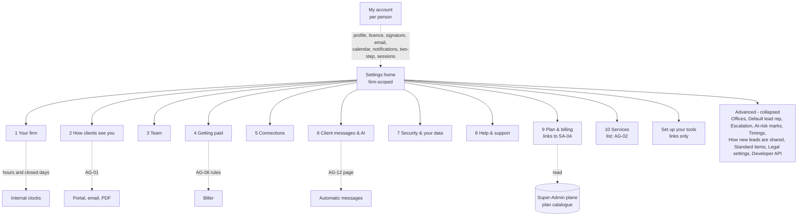
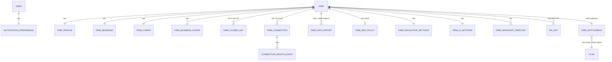

> **Document control** · Version **1.24** · **2026-10-25** · Status: **AG-19 decision AG19-D53 applied (the product owner, 25 Oct: "yes": a removed infected file is never listed in Recently deleted)**; previously (v1.23): **AG-19 decision AG19-D35 applied (the product owner, 23 Oct: in Recently deleted, a holder of the document-edit key sees and restores the files they replaced or removed on a document; the delete key sees all)**; previously (v1.22): **AG-19 decisions AG19-D18 and AG19-D29 applied as a one-line pointer (the product owner, 23 Oct: Recently deleted also lists files replaced or removed on a document, except Accepted files)**; previously (v1.21): **AG-04 review decisions applied (the product owner, 21 Oct)**; previously (v1.20): **AG-02 review decisions applied, minimal (the product owner, 20 Oct: AG02-D1, D3, D6, D7, D8(4), D9(6), D10(9), D12, D13(1), X-5); previously: AG-07 review applied, minimal (the product owner, 18 Oct: AG07-D6 personal notification settings list only the four case events); previously: AG-16 second pass applied where it touches AG-16 (the product owner, 17 Oct): AG16-54, AG16-55 (Q20 – Q25), AG16-57, -58, -65, -70, -71, -78, -79, -80, -82; previously AG-16 review decisions AG16-24 – AG16-53 applied where they touch AG-16 (own mailbox and calendar on every plan; several firm mailboxes with a main address; form-notification lead rules; AI included in higher plans; deactivation and Microsoft approval placement; office time zones; closed-days suggestions; WhatsApp coexistence; no client quiet-hours setting; unassigned government-deadline reminders to the Owner; no permission to connect one's own mailbox or calendar; video moves to My account). Build cards for each new or changed screen requirement (see the v1.17 row).** *Earlier status (v1.16):* **AG-16 review decisions AG16-1 – AG16-23 applied (settings rebuilt around nine sections; Automatic messages page is AG-12's; Getting paid placed here, rules in AG-06; personal notifications only; Recently deleted; Get help; Developer API; business hours and closed days; Escalation and At-risk marks; Team safeguards, supervision, backup approver, IP allow-list, firm calendar, payment fallback and shared WhatsApp withdrawn); knock-on batch A1 – A35 and AG-01 v1.19 pending rows applied. *Earlier status (v1.15):* SA05-R9a applied (automatic messages run from day one; "Review your standard messages" is now an optional page "Review your automatic messages" — AG11-D12 superseded; AG-16-48 withdrawn); SA-08 v2.5 knock-ons applied (SA8-X2); SA-03 v2.16 feature catalogue applied (SA3-X12); Session rules for firm staff are now a platform rule, not a firm setting: no idle timeout, no maximum session length, no "remember me" setting; AG-16-23 withdrawn (AG1-D20, owned by AG-01 v1.16); typo fix in the security-policy key rename; SA-06 v3.0 closing decisions applied (notification-policy, entitlement, integration `:manage` and security-policy keys renamed); subscription billing screen split — Admin updates the card and pays an overdue bill, the rest Owner-only (SA6-D5 extended, SA-04 v2.8); SA-06 v3.0 review decision applied (SA6-D5): Owner-only actions never on a custom role; payment account defined; Baseline — session decisions applied (from AG-01 v1.5); AG-17 decisions applied (views, Minder switches, notification matrix, export scope); consistency-review fixes applied; agent-native decisions applied (from AG-11 / AG-18, 4 Oct); same-day simplify decisions applied (AG11-D1, D2 revised; AG11-D9 Team safeguards); same-day review fixes applied (AG11-D11, D12, D13; AG18-D10); AG7-D7 sensitive-data rule replaced by AG7-D10 (no masking and no reveal of personal data); SA-06 v3.0 permission renames and Owner-only / credential / audit knock-ons applied (SA6-D10, D5, D11)**\
> Part of: *Agent (RCIC/Lawyer) Console — Functional Requirements* · Split from `FINAL-Agent-FR.md` lines 10256–10802 on 2026-09-16 · Previous version: `_archive/AG-16-firm-settings-and-integrations_v1.23_2026-10-23.md`\
>
> | Version | Date | Change | Decisions |
> |---|---|---|---|
> | 1.24 | 25 Oct (later): MS-D24 and writer follow-ups | **MS-D24 applied (the product owner, 25 Oct), in place.** The five open questions Q30, Q31, Q32, Q34 and Q35 are settled and removed from §13: Services stays at section 10; the Owner edits the tax number; the receipt prefix is editable under Advanced (default R-); the new timings follow the other Timings rows (whole days, 1–30); a person who is not the Owner sees "Ask <Owner name> to answer the trust question" and the request waits. No `agent/e-sign:*` key is named in this epic (MS-D24(4)). Stale file versions in §10 and §13 updated. Q33 (SA-08) stays open. | MS-D24 |
> | 1.24 | 2026-10-25 (money slice + AG-05 review) | **Money-slice and AG-05 decisions applied (the product owner, 25 Oct), in place; this epic is already with developers.** (1) **Services (MS-D18):** new section 10, **Services** (Settings → Services), placed here; the list is AG-02's, the defaults are AG-05's and AG-06's (new §3.21, AG-16-76). The Settings home now has ten sections; the numbers 1 – 9 are unchanged so existing references hold. (2) **Getting paid rebuilt (MS-D21(18), MS-D7, MS-D10, MS-D20(2), (16), (17)):** the main screen is *how clients pay*: the main card account, an optional **trust card account**, offline details for operating (with the **Interac e-Transfer email**) and for trust, tax with the **tax number** (its one home), and the trust question. **Advanced** holds *Invoice payments go to* (with "Last changed"), invoice numbering, the receipt number series and "Due in N days" (new AG-16-77; AG-16-6, AG-16-8 changed). (3) **Trust asked once, just in time, by the Owner** (MS-D20(17); new AG-16-78). (4) **Tax number removed from the firm profile** (single home: Getting paid; AG-16-1, §3.1, §7, §10 changed). (5) **Receipt series (MS-D21(12)):** one receipt number series per firm; it replaces the AG16-13(14) "no own series" for receipts. (6) **Timings** gain payment-reminder days (−3 / 0 / +3 / +7, MS-D21(13)) and signing-reminder and expiry rows (3 days then every 4; 14 days; AG05-D4 applied as decided) (§3.13, AG-16-51, defaults table). (7) **AG-01 checklist:** "Set up getting paid" is an optional item that links here (pointer). (8) **Instalments withdrawn from this epic's text** (payment plans and saved-card charging are out, MS-D21(19), MS-D22(1)). (9) New US-23, §13 Q30 – Q35. | MS-D7 · MS-D10 · MS-D18 · MS-D20 · MS-D21 · MS-D22 · AG05-D4 |
> | 1.24 | 2026-10-25 | **AG-19 decision AG19-D53 applied (the product owner, 25 Oct: "yes"), minimal; this epic is already with developers.** Recently deleted never lists a removed Quarantined (infected) file; staff see "Removed — infected file" on the document's line instead (§3.5 pointer, AG-16-65 card rule 1a and one test). The rule's home is AG-09 (AG-9-67 rule 7, AG-9-55). Row added to "Decisions that change this epic". | AG19-D53 |
> | 1.23 | 2026-10-23 | **AG-19 decision AG19-D35 applied (the product owner, 23 Oct: "yes"), minimal; this epic is already with developers.** Recently deleted: for files replaced or removed on a document, a person who holds `agent/document:edit` sees and restores, within 30 days, the files they replaced or removed; holders of `agent/document:delete` see and restore all of them (§3.5, AG-16-65 requirement and card rule 1a and test, §10 restore-key note). The rule's home is AG-09 (AG-9-67 rule 10). Open question 29 closed. Row added to "Decisions that change this epic". | AG19-D35 |
> | 1.22 | 2026-10-23 | **AG-19 decisions applied (the product owner, 23 Oct), minimal; this epic is already with developers.** Recently deleted (§3.5, AG-16-65) also lists files that staff replaced or removed on a document (AG19-D18). An Accepted file is not listed, because it stays in the document's history; until AG-07 records submissions, only Accepted files are kept this way (AG19-D29). The rules are AG-09's (AG-9-67); one-line pointer only. New open question 29: who sees and restores a file removed with the edit key only (AG19-D34 against AG16-104). Rows added to "Decisions that change this epic". | AG19-D18 · AG19-D29 · AG19-D34 |
> | 1.21 | 2026-10-21 | **AG-04 review decisions applied (the product owner, 21 Oct).** Minimal; this epic is already with developers. (1) **AG04-D4:** the Timings screen gains a Bookings block — reminders 24 h and 1 h before, shortest notice 4 h, booking window 60 days, gap 0 / 10 min, client self-service up to 4 h before, paid hold 30 min with "Complete your payment" at 10 min; each type may change them under its Advanced; the attendance prompt is fixed and not shown (§3.13, defaults table, AG-16-51, §7 `FirmAutomationTimings`, one test). (2) **AG04-D5:** My account → Video gains "Use for my video bookings: Meet/Teams · Zoom · My meeting link", pre-set to the first source; with no source Video is still offered ("Your join link will follow", one home-screen item); a moved booking gets the new host's link; a person's Zoom has no plan gate (§3.4 item 5, §3.19, defaults table, AG-16-73 and card, AG-16-71 card, §9 edge case). (3) **AG04-D6:** a closed day closes the public booking page only; staff may book after a warning (card AG-16-59 test, card AG-16-74 rule 7). (4) **AG04-D11:** §3.17 says the booking consent sentence lives with the booking page settings in AG-04. (5) **F-34:** booking reminders and paid-hold messages send at the exact time and never move for a closed day (§3.14). (6) **F-43:** §0.2 AG-04 row marked Applied (AG-04 v1.7). (7) Rows added to "Decisions that change this epic". *22 Oct: AG-04 final cross-epic check fixes applied in place (marked "changed 22 Oct — final check").* | AG04-D4, AG04-D5, AG04-D6, AG04-D11 |
> | 1.21 (22 Oct) | 2026-10-22 | **AG04-D17, AG04-D19 applied (the product owner, 22 Oct).** My account "availability" now reads "your named sets of booking hours (one default)" (§3.0 My account line, §3.19). The out-of-office line adds that an Owner or Admin may enter dates for a colleague (§3.0, §3.19). My account stays "each person, for themselves"; the colleague clause is the one exception. No reporting-currency or FX instruction was live in this epic (R18, AG04-D20: one total per currency, never converted); nothing changed there. | AG04-D17, AG04-D19 |
> | 1.21 (22 Oct) | 2026-10-22 | **AG04-D21, AG04-D22 applied (the product owner, 22 Oct).** **D22 (amends AG16-6):** business hours no longer limit booking slots. §3.14 used-only-for line, AG-16-59 (requirement, outcome, rule 3; the Calgary example in AG-16-75) and the cross-epic AG-04 row no longer list bookable slots among the things business hours drive. Business hours stay for the internal clocks and as the starting copy of a new person's booking hours (AG-04 AG-4-62). Closed days still block public booking (AG-16-46). **D21:** no text change; the office zone is the starting zone of a new set of booking hours (AG-04). Decisions rows D21, D22 added. | AG04-D21, AG04-D22 |
> | 1.21 (22 Oct) | 2026-10-22 | **X-6 applied (the product owner, 22 Oct).** The firm default currency is CAD or USD only, default CAD, changeable by Owner and Admin (`agent/settings:edit`); "changeable per case" and the ISO-4217 validation are gone (§0.2/§3.1 Profile and Your firm line, defaults table, AG-16-3, AG-16-4, data flow, §10 key rows, §7 note, reference-data line). Business rule: new prospects and cases take this default; the lock and the per-prospect/case rule live in the Agent overview (X-6). Row added to "Decisions that change this epic". | X-6 |
> | 1.20 | 2026-10-21 | **AG-02 review decisions applied (the product owner, 20 Oct).** Minimal and precise; this epic is already with developers. (1) **AG02-D1:** Advanced gains "How new leads are shared" (Anyone takes it / Round robin / Always one person), shown from the second user, `agent/firm-capability:manage`; rules stay in AG-2-85 (§3.0, §3.18, §3.20, §10). (2) **X-5:** Advanced → Waiting times becomes the one **Advanced → Timings** screen; client chasers and follow-up timings are edited there and shown read-only on the Automatic messages page (§3.0, §3.13, §3.20, AG-16-51, AG-16-52, BR-23, §8; AG16-12 rows annotated). (3) **AG02-D7, AG02-D13(1):** the lead reply reminder (Off by default; 1 hour pre-selected when switched on) and going cold (7 open days) sit on the Timings screen; new test (§3.13, §3.20, AG-16-51, §8). (4) **AG02-D8(4), AG02-D9(6):** the Message many frequency limit and follow-up timings sit on the Timings screen. (5) **AG02-D7:** "lead response clock / lead response time" removed everywhere; the clocks list names "the lead reply reminder when switched on" (§3.14, AG-16-59 and AG-16-60 cards, AG-16-72 rule 6, §0.2 row AG-02). (6) **AG02-D3:** Connections gains Lead API keys and the ExpatReady Zapier app link on every plan (`agent/prospect:configure-source`), apart from the Developer API; non-goal "No Meta Lead Ads connection", the Zapier-listing phase question and the "Zapier" key test rewritten (§3.0, §3.4, §3.16, AG-16-61, AG-16-72, §8, §10, §12, §0.2). (7) **AG02-D6:** AG-16-72 rule 4 points to AG-2-68. (8) **AG02-D1(7), AG02-D7, AG02-D10(9), AG02-D12:** AG-02's notices placed in the eight groups; group 4 renamed "A client or lead messaged me" (§3.3). **Kept open in §13:** AG02-P35 (which key guards the Timings screen), AG02-P101 (group for "Retainer signed" and "Follow-up needs attention"). AG02-P36 and AG02-P100 closed. No requirement ID added or withdrawn. AG02-D18 / X-5 (21 Oct): §7 `FirmAutomationTimings` — the chase fields are edited on the Timings screen and shown read-only on the row, matching AG-16-51. AG02-D19 pass / X-5 (21 Oct): the `agent/template:configure` permission row no longer says a row's timing sentence is edited on the Automatic messages page; timings are edited on the Timings screen (X-5). | AG02-D1 · AG02-D3 · AG02-D6 · AG02-D7 · AG02-D8(4) · AG02-D9(6) · AG02-D10(9) · AG02-D12 · AG02-D13(1) · X-5 |
> | 1.19 | 2026-10-18 | **AG-07 review (the product owner, 18 Oct), one wording change; this epic was already handed to developers.** **Case notifications (AG07-D6):** the personal notification defaults in §3.3 listed "every document upload, every stage change" as email-off items. Under AG07-D6 a case notifies staff only when someone is handed work: **assigned to me, review requested from me, my review sent back, approval waiting (Needs you)**. Everything else shows on the case, its timeline and the queue. The §3.3 defaults line now names those four case events and no other case event; the non-case items in that line (my deadlines, payment failed, new lead assigned to me, a client messaged me) are unchanged, and "a client messaged me" is flagged as open question 28 for the product owner. The groups, switches, language and permission `agent/notification:manage-preferences` are unchanged. **Referenced only:** AG07-D12 (no Watcher role, Paralegal folded into Officer) and AG07-D2, D10, D11, D16 (Q36 office change: the Offices screen is unchanged) need no change here. No requirement IDs added or withdrawn. | *18 Oct (later): consistency fixes after expert review — AG07-D2 / AG07-D4 ("Use the newer rules" removed from configure-pack / Advanced; adoption is the per-filing case action AG-7-56).* *18 Oct (final): AG07-D17 – D21 applied — AG07-D20(g): open question 28 closed; "a client messaged me" is kept as an email-on default (AG-10).* *18 Oct (later): AG01-29 / AG16-105 and gap-check fixes applied — **AG16-105(1):** Recently deleted shows each person the items whose delete key they hold, from records they are allowed to see; Owner and Admin see everything (§3.5, AG-16-65 and new card, BR-26, US-7, §10). **AG16-105(2):** the eight notification groups are a fixed list with who sees each group, the email defaults and one test per group (§3.3, AG-16-10, US-6, §7). **AG01-29(7):** who edits which firm detail, and the new public phone, public email and website fields (§3.1, §3.20, AG-16-1, AG-16-2, §7, §10). **AG01-29(1) and (4):** one-line pointers (§3.6, §9, §3.18). **Gap check, confirmed findings only:** the whole-firm export is the built Owner-only archive, not a new `ExportJob` (AG-16-20, AG-16-22, §3.5, §6, §7, US-7, §12); `EncryptionUtil`, `testSmtp`, `ClientBranding`, `ClientConfig`, `AuditLog` and "`clientId`, no RLS" corrected to what ERv2 has (§3.4, §7, §11, §12, AG-16-12 card); one shared connection status and health fields, mail kinds and personal-owner field off `FirmConnection` (§6, §7, AG-16-16 and AG-16-71 cards); at most one main mailbox (AG-16-12 card); `agent/settings:edit` marked NEW and the default-currency key settled (§10); calendar-day reminders and the corrected example (AG-16-60, §3.14, US-19); US-4, US-6 and the "Firm notices" line match AG-16-16; activity-log read API is built (AG-16-26, §12); WhatsApp downgrade points to SA3-D17 (AG-16-19); no new AI acknowledgement on an Owner change (AG-16-35 card); build cards for AG-16-59, -60, -65, -66; warning at the top of §4 about withdrawn text; wording fixes (§3.13, §10). Added: §13 "Developer decides (gap check, 18 Oct)". No requirement ID added or withdrawn.* *18 Oct (later): AG01-30(2) and check fixes applied — dunning escalation joins the Payments group, in-app only (§3.3, AG-16-10 test 7); the Payments group is shown to holders of `agent/invoice:list`; shared sending is built in the worker (§3.4, §12); session wording (AG1-D17, D18, D20, §3.6); calendar-day list; `FirmProfile` name field; stale "pending knock-on" sentence and garbled `FirmConnection` sentence repaired; test for AG01-29(7).* *18 Oct (last): AG16-106 — `agent/billing-config:currency` withdrawn.* | AG07-D6 · AG07-D12 (referenced only) · AG07-D16 (referenced only) · AG07-D2 / AG07-D4 · AG07-D20(g) · AG01-29(1), (4), (7) · AG16-105 · AG01-30 · AG16-106 |
> | 1.18 | 2026-10-17 | *Same-day fixes (17 Oct): AG16-83 – AG16-88 — `agent/automation:configure-ai` withdrawn (item 6); AG-16-69 reduced to a pointer to AG-16-16 (item 9); Q26 closed: yearly closed-days add is one firm setting (per office once offices exist), turned off on the closed-days screen, a removed holiday is never re-added (item 18); Q27 closed: broken-connection email only when Failed, payment-account email to the Owner only (item 19); notification copy and firm language: English only at launch, translation-ready (AG16-88); legal French not changed, listed for the product owner.* **AG-16 second pass applied (the product owner, 17 Oct).** **One mailbox entity:** `FirmConnection` refers to AG-10's `MailboxConnection` for mailboxes and keeps PAYMENT and WHATSAPP (AG16-54 #8); mailbox keys reworded "firm mailbox" (#9). **Escalation:** AG-16 keeps the switch and the key; who is alerted is a pointer to AG-11 (#20; §3.8, AG-16-32, BR-15, §9, US-10). Team-list column "Email / Calendar connected" has its home in AG-01 (#22). WhatsApp go-live note: build on Meta's current Embedded Signup version (#25). **My account → Email:** unfiled mail from a personal mailbox shows in Unmatched marked "Only you"; the separate "possible new enquiries" list is gone (AG16-57). **Reply address and From line:** one-line pointer to AG-10 (AG16-58). **Form-notification rule list** shows sender + subject (AG16-65; AG-16-72). **Gmail:** "Continue with Google" (read, file, send) from day one; the send-only route is dropped (AG16-70). **Firm mailbox fields:** office link dropped; aliases become **"Group addresses"** under Advanced with a one-line hint (AG16-71). **WhatsApp past chats:** one default plus a "Don't bring in past chats" link; "All chats" removed (AG16-78; AG-16-38). **Closed days:** one pre-ticked **"Add these every year"** tick, asked once; no December item; no per-day tick (AG16-79; AG-16-74). **AI switch:** Owner only (on and off), key `agent/ai:switch` (AG16-80; AG-16-35). **One rule for every broken connection:** one email when it breaks, one home-screen item until fixed (AG16-82; AG-16-16, AG-16-38 rule 6, AG-16-69). **Open questions:** Q20 closed except one wording; Q21 closed; Q22 and Q23 partly closed; Q25 closed; Q24 open; new Q26, Q27 (AG16-55 and the decisions above). **Changed:** AG-16-12, -16, -32, -35, -38, -69, -71, -72, -74; BR-15; §3.4, §3.8, §3.9, §3.14, §3.19, §3.20, §7, §9, §10, §13; US-10, US-19. **Build cards:** new AG-16-16; updated AG-16-12, -35, -38, -71, -72, -74. *Same-day fixes (18 Oct): AG16-89 — My account email line: the "Only you" sentence and the per-mailbox switch are withdrawn; a personal mailbox brings in mail with your clients and leads, and government mail, and other mail stays in your own mailbox (AG-10); decision row 72 withdrawn. Notification defaults (§3.3) unchanged: "assigned to me" also covers a conversation assigned to the person.* *Same-day fixes (18 Oct): AG16-90 — broken connection: AG-16-16 is the only card; the §6 lifecycle Degraded row is "shown on the card; no alert"; the payment-account and flap lines now say one email (payment account: Owner only) and one home-screen item; "one of the five Owner-only actions" is six (AG16-80); payment instructions and invoice footer are English, French later (AG16-88); decision-table rows 203 and 207 marked "changed by AG16-80"; Clicks / Person decides lines added to AG-16-73 and AG-16-75.* *18 Oct: new section 'Decisions that change this epic' (index of AG16 decisions; no requirement changed).* *Same-day fixes (18 Oct): AG16-95 – AG16-100 — AI switch locked note has exact words (AG16-95; Q20 closed); the form-lead offer appears on the 3rd matching Unmatched item (AG16-96; Q22(a) closed); turning a form-lead rule on or off uses `agent/integration-mail-receive:manage`, no new key (AG16-97; Q22(c) closed); providers are fixed in code, ExpatReady chooses the WhatsApp vendor before go-live, the firm never picks (AG16-98; A25 row, Q23(c) closed); "Connect Zoom" is hidden until Zoom approves the app, "My meeting link" covers Zoom users meanwhile (AG16-99; AG-16-73); saved meeting link fields are AG-04's: `MeetingAccountConnection`, `myMeetingLink`, `Booking.meetingLink` (AG16-100; Q24 closed). No AG-16 question is left in §13 that these decisions touch.* *Same-day fixes (18 Oct): AG16-101 – AG16-104 — Q4 closed: which plans include Developer (API and webhooks), SA-03 #21, is a pricing decision listed in SA-03 next to "which plans include AI" (AG16-101); Q9 closed: when the firm switches AI off, proposals already waiting in Needs you stay, labelled "Made by AI before AI was switched off", staff approve or dismiss each, nothing runs by itself — the same rule as the ExpatReady pause (AG16-102; §3.9 item 8, AG-16-35, AG-16-37 note, edge case, one test); Q16 closed: "Allow support to make changes" sits in Help & support, §3.15 (AG16-103); Q18 closed: restoring from Recently deleted uses the same key as deleting that kind of record, no new key, and "Move to another client or case" stays with the AG-09 review (AG16-104; §3.5, AG-16-65, BR-26, §10 note, test). All four open questions in §13 are now closed.* | AG16-54 · AG16-55 · AG16-57 · AG16-58 · AG16-65 · AG16-70 · AG16-71 · AG16-78 · AG16-79 · AG16-80 · AG16-82 · AG16-89 · AG16-90 · AG16-95 – AG16-100 · AG16-101 – AG16-104 |
> | 1.17 | 2026-10-17 | **AG-16 review decisions AG16-24 – AG16-53 applied where they touch AG-16 (the product owner, 14–17 Oct); AG16-51 trims applied.** **Connections:** the firm mailbox and personal mailboxes with automatic filing, and personal calendars, are **included on every plan**; the extra #26 is now **"Own WhatsApp account" only**, #27 "Inbox sync" is merged into the free inclusion (AG16-24, AG-16-19, BR-2). **Any signed-in staff member may connect, change or disconnect their own mailbox, calendar and Zoom with no permission key**; firm-level connections stay restricted; `agent/integration-calendar:create` is withdrawn (AG16-52, AG16-53, AG-16-71, §10). **Several firm mailboxes** with one **main address**, aliases under Advanced, one "Connect your email" button, Microsoft admin-approval step placed on the Connect screen (AG16-25, AG16-28, AG16-37; AG-16-12). **Per-sender "Always create leads" rule list** under Connections → firm mailbox (AG16-32, AG16-44; new AG-16-72). **AI** is included in higher plans, not sold as an add-on; locked note on plans without it (AG16-34; AG-16-35, BR-2). **WhatsApp** connect screen: keep the current number and app (coexistence) or use a new number; plain read-me list; "what changes" list; one-time past-chat choice (AG16-48, AG16-51; AG-16-38). **Video:** the Connections video card is removed; **My account → Video** holds Connect Zoom and My meeting link (AG16-53; new AG-16-73; §13 Q17 closed). **Closed days:** "Add holidays for [province] [year]" and "Same date every year" (AG16-46; new AG-16-74; amends AG-16-59). **Offices:** time zone per office, hours in the office's zone, **no escalation by office** (AG16-45, AG16-51; AG-16-59, AG-16-68, new AG-16-75). **No client quiet-hours setting:** the 08:00–20:00 client-time window is fixed and owned by AG-10 (AG16-49, AG16-51). **Government-deadline reminder with no one assigned goes to the Owner** (AG16-50; pointer in AG-16-32, §3.8, BR-15; rule and card in AG-11; §13 Q19 closed). Deactivation warning line is specified in AG-01 (AG-1-75); AG-16 points to it. **Requirements added:** AG-16-71 – AG-16-75. **Changed:** AG-16-12, -13 (note), -19, -32 (pointer), -35, -38, -59, -68; BR-2, BR-15 (pointer); §3.0, §3.3, §3.4, §3.8, §3.9, §3.10, §3.14, §3.18, §3.19, §3.20; US-5, US-19; §6, §7, §9, §10, §12. **Withdrawn:** the Connections video card and `FirmConnection.kind = VIDEO`; the Advanced quiet-hours line (never added). **Build cards written:** AG-16-12, -35, -38, -71, -72, -73, -74, -75. **Open questions closed:** Q17, Q19; the self-scoped-key note (AG-04 Q13) is closed here. **Opened:** Q20 – Q25. | AG16-24, AG16-25, AG16-28, AG16-32, AG16-34, AG16-37, AG16-45, AG16-46, AG16-48, AG16-49, AG16-50, AG16-51, AG16-52, AG16-53 |
> | 1.16 | 2026-10-14 | **AG-16 review decisions AG16-1 – AG16-23 applied (the product owner, 14 Oct), with the knock-on batch A1 – A35 and the AG-01 v1.19 pending rows.** **Settings rebuilt around nine sections** (Your firm, How clients see you, Team, Getting paid, Connections, Client messages & AI, Security & your data, Help & support, Plan & billing) with "Set up your tools" links, a collapsed Advanced area and My account (AG16-1); new §3.0 map and §3.20 "Settings — defaults and placement". **Added:** business hours and the firm's own closed-days list, with due dates on closed days moving earlier, never later (AG16-6, AG16-7); Recently deleted and Undo (AG16-21); Get help and the support-access toggle (AG16-16, A8); Developer API under Advanced, spec following code (AG16-10); Legal settings and Standard items under Advanced (A23, A24); Offices and Default lead representative (A11, A12); Escalation and At-risk marks as two independent switches, on for every firm, changed by Owner and Admin with `agent/firm-capability:manage` (AG16-8, AG16-22). **Changed:** one Automatic messages page, specified only in AG-12 (AG16-11); chase timings on the chase row, Needs you timings under Advanced → Waiting times, no Reminders page (AG16-12); Getting paid placed here, rules owned by AG-06 (AG16-13); personal notification settings only (AG16-14); firm and personal mailboxes, Other provider collapsed (AG16-15); payment account through hosted sign-up on every plan, money never falls back (AG16-17, A20); calendars personal, AG-04 the home (AG16-18); WhatsApp only on the firm's own account, otherwise email (AG16-19); AI switch details, pause banner and provider-change email (AG16-20); client two-step has no firm switch, staff two-step is one switch default off (AG16-23, AG01-3); AI writer renamed Writer (AG16-4); portal address read-only (AG01-1); WhatsApp template status per firm (A28); plan screen replaced by a link to SA-04 (A22). **Withdrawn:** Team safeguards, its 5-staff turn-on, grace, banner and switch-off reason (SR-Q1c); four-eyes on government forms (SR-Q1b); Supervised client messages, AI-text approver setting and supervisor routing (R5); backup approver (AG16-9); IP allow-list (AG16-5); firm-wide calendar (AG16-18); payment fallback to ExpatReady processing (AG16-17); shared WhatsApp number (AG16-19); firm notification matrix, quiet hours, ceiling (AG16-14); overdue-task escalation to a manager (AG16-22); per-recipe autonomy table (AG16-11); reporting currency and FX (R18); designated person (AG01-5); "Legal declarations" (AG16-2); regulator and law citations (A33). **Requirements changed:** AG-16-1, -2, -3, -6, -7, -8, -10, -11, -12, -14, -16, -17, -19, -20, -21, -22, -24, -26, -29, -32, -34, -35, -37, -38, -50, -51, -52, -53, -54, -55, -56. **Withdrawn:** AG-16-4, -9, -13, -25, -27, -33, -36, -40 – -47, -49 (AG-16-23 and -48 earlier). **Added:** AG-16-57 – AG-16-70. BR-3, -4, -8, -9, -15, -17, -23 changed; BR-6, -7, -10, -13, -19, -20, -22 withdrawn; BR-24 – BR-26 added. US-12, US-13 withdrawn; US-19 – US-22 added. §13: Q1, Q2, Q3, Q5, Q6, Q7, Q8, Q13, Q14 closed; Q4 and Q9 narrowed; Q15 – Q18 opened (Q15 closed same day; Q19 added). AG16-11's locked-row wording vs R7 is closed (§13 Q15). *Same-day audit corrections (14 Oct): AG-16 no longer restates AG-06 invoicing rules (pointers to AG-6-44 – AG-6-47, AG-6-49), AG-12 automatic-message rules (AG-12-113, -114) or the AG-09 / AG-13 / AG-02 delete rules; Waiting times use `agent/firm-capability:manage`; escalation rule stated completely in §3.8, AG-16-32 and BR-15, with unassigned items visible at once (new §13 Q19); personal mailbox and calendar connected by the person in My account; "14 everyday (non-AI) Doers"; AI-edited template is not a floor (Q15 closed); "Advanced → Deadlines" replaced by Escalation, At-risk marks and Waiting times.* | AG16-1 – AG16-23 · A1 – A35 · AG01-1, -3, -5, -10, -14, -16 |
> | 1.15 | 2026-10-12 | SA05-R9a (the product owner, 12 Oct; owned by SA-05 and AG-12 v2.2). **Nothing is held for a review.** The seeded recipes' client messages no longer wait in Needs you until a confirm screen: every automatic message runs from day one with ExpatReady's neutral wording, unless it is off by default. "Review your standard messages" becomes the **optional page "Review your automatic messages"** (an on/off list, no confirm step, no gate, no banner; page owned by AG-12-52). A message missing a firm detail it needs is not sent and the firm sees a short note (AG-12-109); the dashboard shows a one-time notice (AG-12-110). Unchanged: imported clients stay quiet until switched on (AG-18), the 7-day update notice, the switch-off rules, WhatsApp opt-in, the AI floors, autonomy levels; a template message still defaults to Send automatically. Changed: §3.9 (autonomy paragraph, key screens), §3.12, AG-16-36, AG-16-37, BR-17 note, §7 entity line, §9 edge case, US-12 criterion, §10 row, §12 note, §13 Q11. New: AG-16-56, US-18, §13 Q13 and Q14 (not decided). Withdrawn: AG-16-48, US-14, `FirmStandardMessagesReview`. Same-day closing (SA05-R9b): §13 Q13 is closed — the on/off permission is `agent/template:configure` (Owner and Admin), no new key; Q14 stays open. *(revised same day — SA05-R9b)* | AG12-D23 · SA05-R9a (SA5-X46) · SA05-R9b |
> | 1.14 | 2026-10-10 | Applied from SA-08 v2.5 (SA8-X2; merge decided by the product owner, 10 Oct): (1) **shared email stated plainly** — without its own mailbox, a firm's emails go through ExpatReady's shared service **under the firm's name, with replies to the firm's own address** (new AG-16-55); (2) the **"Stripe keys stored in plain text today" note is corrected** — that old storage has been removed and the storage for firms' own connections is not built yet; encryption is a must-build (§3.4, AG-16-18, §9, §11, §12, §14). **Calendar linking (AG-16-13) and WhatsApp (AG-16-38, AG-16-54) stay Release 1** (SA8-D25, SA8-D26) — unchanged. | SA8-D17, SA8-D25, SA8-D26 (SA8-X2) |
> | 1.13 | 2026-10-10 | Applied from SA-03 v2.16 (SA3-X12; the product owner, 10 Oct): own-account rails (email, calendar, payment, WhatsApp) are one sellable extra in SA-3's feature catalogue — *Own email, calendar, payment or WhatsApp account*; the four AI Doers are one extra (one switch, AG-16-35). BR-2's example list corrected: **multi-currency reporting is standard on every plan** (AG-14 v1.11) and "advanced exports" is now **Advanced reports** (AG-14 §3.12). Excluded features are shown locked with an upgrade prompt (SA3-D16). | SA3-D10, SA3-D16, SA3-D19 (SA3-X12) |
> | 1.12 | 2026-10-08 | Session decision (the product owner, 8 Oct; **AG1-D20**, owned by AG-01 v1.16). **Session rules for firm staff are set by the platform only.** One rule for every firm: no idle timeout and no maximum session length for firm staff; no "remember me" setting (removed); clients never expire (unchanged); a password change or second-step reset ends the person's other sessions (AG-1-67, owned by AG-01); one session at a time stays a platform rule, Release 1. **AG-16-23 withdrawn** (ID kept, nothing renumbered). `FirmSecurityPolicy` loses `idleTimeoutMin?`, `absoluteLifetimeMin?`, `rememberMeAllowed`. The Security policy screen now holds MFA requirement + factors and IP allowlist, plus a locked, read-only session row. AG1-D17 marked superseded. **Typo fix (approved):** the v1.11 rename read "`agent/security-policy:manage` is now `agent/security-policy:manage`"; the former name is `agent/mfa-policy:manage` (corrected in the v1.11 row, the SA6-D10 v1.11 row and §10); the key description is now "(MFA, IP allow-list)", without "session timeout". Changed: §1 differentiator line, §3.6, AG-16-23, `FirmSecurityPolicy`, edge cases, §10, §12, Applied-from tables. | AG1-D20 |
> | 1.11 | 2026-10-07 | SA-06 v3.0 closing decisions (the product owner, 7 Oct; owned by SA-06 v3.0). **Renamed (each "was" is in §10):** `agent/settings-notification-policy:edit` is now `agent/notification-policy:edit`; `agent/settings-entitlement:list` is now `agent/entitlement:view`; each per-rail `agent/integration-<rail>:list`, `:create`, `:edit` set (smtp, mail-receive, whatsapp, calendar) is now one `agent/integration-<rail>:manage`, held by Owner and Admin; `agent/mfa-policy:manage` is now `agent/security-policy:manage` (MFA, IP allow-list; Owner and Admin). `agent/communication:configure-rails` is dropped in favour of `agent/integration-<rail>:manage` (it is not used in this document). The payment-terms defaults in AG-16-8 now cite `agent/billing-config:terms` (owned by AG-06; this document does not define it). Changed: §3.6 key-screens note, AG-16-8, AG-16-24, §10, §12 who-can-edit line; Applied-from table. Requirement IDs unchanged. | SA6-D10 |
> | 1.10 | 2026-10-07 | Subscription billing screen split (the product owner, 7 Oct; decision owned by SA-06 v3.0 SA6-D5, extended; screen specified in SA-04 v2.8). Replaces the wording added earlier today ("an Admin may update the card; invoices and cancellation stay Owner-only"). **On the firm's own Expat Ready subscription billing screen the Admin may update the subscription card and pay an overdue bill; Owner-only: upgrades, invoices and credit notes, billing details, downgrades and cancellation.** The client-payments payout account (`agent/payment-rail:connect`) stays Owner-only and can never be put on a custom role. Changed: §3.4 (own payment processor), AG-16-14, §10 (Owner-only paragraph), Applied-from-SA-06 table (SA6-D5 v1.9 row corrected, new v1.10 row). Requirement IDs unchanged. | SA6-D5 |
> | 1.9 | 2026-10-07 | SA-06 v3.0 review decision SA6-D5 (the product owner, 7 Oct; owned by SA-06 v3.0). The five Owner-only actions can never be put on a custom role, even by the Owner (the server rejects it). "Connect the payment account" is the account where the firm's clients' payments are paid out (`agent/payment-rail:connect`); the firm's own subscription card follows SA-04 (an Admin may update the card; invoices and cancellation stay Owner-only). Changed: §3.4 (own payment processor), AG-16-14, §10 (`agent/payment-rail:connect` row, Owner-only paragraph). Requirement IDs unchanged. | SA6-D5 |
> | 1.8 | 2026-10-07 | Permission renames from SA-06 v3.0 Appendix B (the product owner, 7 Oct). Every `agent/settings/*` and `agent/integration/*` key renamed to a single-segment key (SA6-D10); merged keys now point to the module that owns them (AG-01, AG-06, AG-10, AG-13) instead of redefining them. Owner-only is the five actions of SA6-D5 (allow Expat Ready support to make changes, cancel the subscription, edit the legal firm profile, export all firm data, connect the payment account). Regulator credentials: each licensed person maintains their own on their profile; Owner or Admin may edit anyone's (`agent/firm-credential:manage`). The firm audit log is firm-wide for `agent/audit:read` holders, seeded on Owner and Admin (SA6-D11). Changed: §3.1, §3.4, §3.5, §3.6, AG-16-1, AG-16-14, AG-16-20, AG-16-21, AG-16-24, AG-16-26, AG-16-34, AG-16-54, US-7, §10, §12; Applied-from table. Requirement IDs unchanged. | SA6-D10, SA6-D5, SA6-D11 |
> | 1.7 | 2026-10-07 | Role clean-up from SA-06 v3.0 (the product owner, 7 Oct): no licensed-representative role template. `agent/case:form-approve` is seeded on the **Owner and Case Manager** starter roles (was "licensed role templates only"); `agent/sqr:verify` on Owner, Case Manager and Case Officer; either may be granted to any role and every use is audited. Role names follow the six starter roles (Firm Admin → Admin, Accounts / Billing → Billing / Finance). Licensed **user** (a person with a regulator credential) rules are unchanged. Requirement IDs unchanged. Changed: AG-16-44, §3.10 four-eyes, §10, personas, US-2, US-3. | SA6-D2, SA6-D5 |
> | 1.6 | 2026-10-05 | Knock-on from AG-07 v2.3 (sensitive data — AG7-D7, the product owner, 5 Oct): firm-data exports are masked unless the caller also holds the platform-wide `agent/pii:export-unmasked` (owned by SA-06's catalogue), and an unmasked export is audited; `agent/settings/reveal-pii` withdrawn; "PII reveals" in the audit view and audited actions become "unmasked exports". No firm security setting about reveal or masking existed, so none changed or added. Changed: §3.5 (firm-data export), audit-visibility bullet, AG-16-20, AG-16-26, AG-16-29, AG-16-34, AG-16-39, BR-16, US-7 and the candidate-export criterion, two edge cases, §9/§10 (`agent/settings/export`; `agent/settings/reveal-pii` withdrawn v1.6; new row `agent/pii:export-unmasked`; who-can-edit and Export PII bullets), AG17-D42 row in the applied-decisions table, §12 export line. Same day (AG7-D10): masking and reveal removed — firm-data exports are no longer masked and are governed only by `agent/settings/export` (every export audited); `agent/pii:export-unmasked` and `agent/settings/reveal-pii` both withdrawn; "unmasked exports" removed from the audit view and audited actions; the inspection-pack exception (AG17-D42, AG-16-34, BR-16) is moot; two rules kept in §3.5 (personal data never in system logs or traces; passport and financial numbers never in the content of emails, WhatsApp messages or notifications); secret handling (write-only, masked hint) and encryption at rest unchanged. Changed: §3.5, audit-visibility bullet, AG-16-20, AG-16-26, AG-16-29, AG-16-34, AG-16-39, US-7, the candidate-export criterion, §9/§10 permission rows, who-can-edit and Export PII bullets, `ExportJob`, AG17-D42 row, §12 export line; withdrawn: BR-16 and the inspection-pack edge case. | AG7-D7, AG7-D10 |
> | 1.5 | 2026-10-04 | Agent-native decisions (4 Oct, the product owner). New §3.9 and AG-16-35 – AG-16-39: a firm switch for **AI Doers** (AI is optional; every AI path keeps its manual fallback); a **per-recipe autonomy level for client-facing messages** (AUTO or APPROVE, default APPROVE) with the **hard floors shown locked**; a **WhatsApp connection** added to own-account integrations (inbound in Release 1; provider pending SA-08; proactive outbound added to Release 1 by the 5 Oct scope review below); the firm-data **export scope** now includes **Needs-you (approval) history** and **import batch reports**. Changed: AG-16-20, AG-16-29, §3.4 (fourth rail), §3.5, §7 `FirmConnection`, §10, §12, §13. New: AG-16-35 – AG-16-39, BR-17, BR-18, US-11, entities `FirmAiSettings` and `FirmRecipeAutonomy`. Same day: §10 permission row aligned with AG-11's dedicated keys (`agent/automation:configure-ai`, `agent/automation:set-autonomy`). Same day (simplify): the main settings screen now shows only **AI Doers** and **Team safeguards**; new §3.10 and AG-16-40 – AG-16-45 for **Team safeguards** (one switch: four-eyes on government forms, supervised client messages from unlicensed staff, Minder escalation, at-risk marks, Needs-you routing to supervisors; **on automatically at 5 or more active staff**; only the Owner may switch it off, with a recorded reason; owner and admins notified at 5; quarterly reminder while off). Escalation and at-risk marks (AG-16-32) become **parts of Team safeguards** under Advanced. **Per-recipe autonomy moves under Advanced**; template messages default to AUTO, "anything that reads as advice" is no longer a hard floor, and the floors are now AI-written client text, an AI-edited template, any government form and any unlooked-at value written into the verified profile (AG-16-36 revised). Changed: AG-16-29, AG-16-32, AG-16-35, AG-16-36, AG-16-37, BR-15, BR-17, §3.8, §3.9, §6, §7, §8 US-10, US-11, §9, §10, §12, §13. New: AG-16-40 – AG-16-45, BR-19, BR-20, US-12, entity `FirmTeamSafeguards`, §13 Q10. Same day (fix): **AG11-D9 part 1 revised** — four-eyes on government forms applies only while the firm has 2 or more active users who hold `agent/case:form-approve`; with exactly one, that person may approve a draft they prepared, recorded as **self-approved**, never blocked; the "Another approver is needed" block and the last-editor rule are removed (behaviour owned by AG-07). Revised same day: §3.10 part 1, AG-16-40, AG-16-44, BR-20; edge case "Only one approver exists" replaced. Same day (review fixes): **overriding principle — we work for the firm, not the regulator** (§1, BR-21): ExpatReady ships safe defaults and a record; the firm decides; it never reports to a regulator, never declares a firm non-compliant, never blocks the firm's licensed judgement. **Licence-aware defaults (AG11-D11):** licensed user defined by AG-01 §3.5 (the wrong AG1-D6 citation is fixed); new setting **who may approve AI-written client text** (default licensed users; AG-16-46); **supervised client messages leave Team safeguards and become a standalone setting** (on as soon as the firm has an active unlicensed user who can message clients; Owner may switch off with a recorded reason; AG-16-47, new §3.11); **Owner route** when no licensed user is active (BR-22). Team safeguards now has **four parts**. **AI Doers locked off until processing terms are recorded (AG11-D13):** AG-16-35 revised — one switch for all four Doers, Owner switches it on once with an audited acknowledgement, client-notice wording supplied; default decided (plan-gating stays open). **Standard messages reviewed once (AG11-D12):** new §3.12 and AG-16-48 ("Review your standard messages"); AG-16-36 revised. **Team safeguards governance:** parts and switch-off Owner-only with a reason (AG-16-43 revised, Q10 closed), backup approver and one-time 7-day grace (AG-16-49), banner on re-crossing 5, `FirmTeamSafeguards` is the single owner entity with AG-11's fields merged in. **UI labels** "Send automatically / Ask me first / Off" (AG-16-50). Changed: AG-16-29, AG-16-32, AG-16-35, AG-16-36, AG-16-37, AG-16-39, AG-16-40 – AG-16-45, BR-17, BR-18, BR-19, §1, §3.2, §3.8 – §3.10, §6, §7, §9, §10, §12, §13 Q7, Q9, Q10. New: AG-16-46 – AG-16-50, BR-21, BR-22, US-13, US-14, §3.11, §3.12, §13 Q11, Q12, entities `FirmSupervisedMessages`, `FirmAiTextApproval`, `FirmStandardMessagesReview`. Same day (final alignment): the Owner route covers government form drafts — the Owner may approve one without `agent/case:form-approve` when no licensed user is active (§3.11, AG-16-47, BR-22, §9; AG-7-68); main settings screen = AI Doers, Team safeguards and Supervised client messages (shown only while an active unlicensed messaging user exists), with who approves AI-written client text, per-recipe autonomy and parts under Advanced (§3.9, AG-16-35, AG-16-40, US-11, §12); backup approver receives items whose approver is suspended or deactivated and overdue items (§3.10, AG-16-49); supervised messages after an Owner switch-off — one notice with a one-click "switch supervision on", never automatic (§3.11, AG-16-47, §6, US-13); §13 Q11 and Q12 closed (7-day grace = the Owner may once choose switch-on 7 days later; standard-messages review confirmed by the Owner or AG-12's template-publish permission); "compliance event" renamed "at-risk event"; unverified-sender actions drop to APPROVE (AG11-D13 row). Same day (5 Oct): AG1-D19 — no licence monitoring; licensed user = linked by the firm. 5 Oct (open questions closed): AG11-D14 to D17 and AG18-D11 applied. Changed: AG-16-12 (own mailbox: Gmail and Microsoft 365 in Release 1, IMAP in Release 2 — D16; the IMAP part superseded by the 5 Oct Release 1 scope review at the end of this row), §1 principle 1 and §3.4 (outside providers only for AI/OCR, WhatsApp and mailbox connections, each approved by Super Admin — D14), AG-16-35 and §3.9 (AI processing in Canada only — D15), §3.4 rail 1, §7 `FirmAiSettings`, §10 mail-receive row, §13 Q7 and Q9 ("2 business days" is now "2 working days"). New: §3.13 Reminders and waiting times, AG-16-51 to AG-16-53 (the firm can change the chase timings, the Needs you overdue time and the deadline lead in Release 1 — D17), BR-23, US-15, `FirmAutomationTimings`, one edge-case group. **5 Oct (Release 1 scope review):** the product owner moved two items into Release 1 (AG11-D18). **IMAP** mailbox connection for other email providers is Release 1, alongside Gmail and Microsoft 365 OAuth, so all three inbound options are Release 1 (revises AG11-D16; changed AG-16-12, §3.4 rail 1 and lifecycle, §7 `FirmConnection`, §9 edge case, §10 mail-receive row, §13 deferrals). **Proactive outbound WhatsApp** is Release 1: the firm's WhatsApp connection now also covers the list of **provider-approved WhatsApp templates**, managed in Integrations and mapped to the firm's templates (AG-12); a message with no approved template falls back to email (AG-10); SMS stays Release 2 (changed AG-16-38, §3.4 rail 4, §3.9, §7, §9, §10, §12, §13 Q8 and deferrals; new AG-16-54, US-16, US-17, entity `FirmWhatsappTemplate`). The deferral "live SMS/WhatsApp notification channels" is about notifying staff and is unchanged. 5 Oct (final check fixes): the two Phase-2 SMS mentions replaced by "SMS (Release 2)" (AG-16-9 and the notification policy paragraph); user stories US-12 to US-15 moved before US-16 and US-17 (no renumbering). No requirement changed. | AG11-D1, D2, D4, D6 · AG18-D4 · AG11-D9 · AG11-D11, D12, D13 · AG18-D10 · AG1-D19 · AG11-D14 to D17 · AG18-D11 · AG11-D18 (Release 1 scope review, 5 Oct) |
> | 1.4 | 2026-10-03 | Consistency review fixes (3 Oct): AG-16-32 now states that escalation has no settings beyond its on/off switch — when on, the firm's users who can reassign cases (`agent/case:assign`) are alerted 2 days before a standard deadline and on the day — and that at-risk marks are a separate switch (AG17-D70, AG17-D81; also §3.8 text, BR-15, US-10, edge case); the notification-matrix citation now reads AG-17-60 (AG17-D46; orphan notice AG17-D56) instead of AG17-D56 (§3.3, AG-16-33, applied table); the read-only rule is tied to an SA-12 flag covering client records, any scope (AG17-D69), instead of "the firm's plan / a Super Admin setting"; named deferrals and open questions moved to Release terms (AG17-D60). | AG17-D46, AG17-D56, AG17-D60, AG17-D69, AG17-D70, AG17-D81 |
> | 1.3 | 2026-10-02 | AG-17 decisions applied (founder-decided, AG-17 §0.2). New §3.8 and AG-16-30 – AG-16-34: every firm sees the Individual / Corporate view switch (corporate is in every plan); when a switch covering client records is off the records are read-only, never hidden, and reminders never pause (general SA-12 rule); no per-role default view and no dedicated LMIA settings screen (firm practices are firm-added checklist items; no built-in job-posting email practice); **two on/off settings, both off by default — Minder escalation chains and at-risk marks** (with them off, reminders go to the file owner only); the AG-17-60 events are registered in the firm notification matrix; positions, advertising channels, candidates and inspection packs join the firm-data export scope, masked unless `reveal-pii`, except the inspection pack, which always shows candidate names in full. §3.3, §3.5, AG-16-20 (changed), BR-14 – BR-16, §6, §7, §8 US-10, §9, §10, §12 updated. | AG17-D1, AG17-D6, AG17-D23, AG17-D35, AG17-D37, AG17-D42, AG17-D44, AG17-D56, AG17-D69, AG17-D70 |
> | 1.2 | 2026-10-02 | Session decisions (the product owner, 2 Oct): the firm session policy (AG-16-23) is optional and off by default, applies to firm staff only and never to clients; one-session-at-a-time stays a platform rule the firm cannot switch off (AG1-D17; AG1-D16 and AG1-D18 referenced). §3.6, `FirmSecurityPolicy` and §9 updated. | AG1-D16, AG1-D17, AG1-D18 |
> | 1.1 | 2026-08-28 | Baseline — complete document v1.1 | — |

## Decisions that change this epic (14–25 Oct) *(new 18 Oct; AG-02 rows added 21 Oct; AG19-D53 added 25 Oct)*

Product-wide rules (apply here as everywhere; home: Agent `00-Overview` → "Product rules every epic follows"): AG16-31, AG16-33, AG16-42, AG16-44, AG16-60, AG16-76 (AG16-11 and AG16-89 also have rows below because they changed requirements).

The "AG16" prefix is historical: these decisions began in the AG-16 review and apply across the product. Full text: `TEMPLATE-MAP-working_2026-10-10.md`.

| Decision | What was decided (one line) | What it changes in this epic | Where (requirement / card / section) |
|---|---|---|---|
| AG16-1 | Settings structure: nine sections. | Defines the settings map; AG-01 is the single home for profile and branding. | §3.0 · §3.20 · AG-16-57 |
| AG16-2 | "Legal declarations" tab removed. | Tab removed (frontend task; no backend exists). | §3.0 · AG-16-58 |
| AG16-3 | AI Doers stay in Release 1. | AI Doers built but locked until Super Admin records the Canadian provider; one Owner switch in section 6. | §3.9 · AG-16-35 |
| AG16-4 | Doer family and the "Drafter" name clash. | One Doers family (14 everyday, 4 AI); the AI writer is named "Writer". | §3.9 · AG-16-35 · §12 |
| AG16-5 | IP allow-list: not in Release 1. | IP allow-list withdrawn (wish list). | §3.6 · AG-16-25 (withdrawn) · BR-10 (withdrawn) |
| AG16-6 | Business hours and closed days. | Default Mon–Fri 9–17; closed days start empty, no seeded holidays; used only for internal clocks. | §3.14 · AG-16-59 · BR-24 |
| AG16-7 | Due date on a closed day moves earlier, never later. | Reminder or approval due dates on a closed day move earlier; government dates never move. | §3.14 · AG-16-60 · BR-24 |
| AG16-8 | Who changes Escalation and At-risk marks. | Owner and Admin via `agent/firm-capability:manage`; no reason; activity log. | §3.8 · AG-16-32 · §10 |
| AG16-9 | Backup approver removed. | Backup approver withdrawn (covered by AG-11 routing and AG-01 handover). | §3.10 · AG-16-49 (withdrawn) |
| AG16-10 | Developer API: spec follows code. | Keys (hash only), read-only search, 31 webhook events, Owner and Admin, off by default, plan-gated. | §3.16 · AG-16-61 · AG-16-62 · §10 · §12 |
| AG16-11 | One "Automatic messages" page (product-wide rule). | Recipe on/off for client messages, the Advanced autonomy table and per-module toggles removed; page is specified only in AG-12. | §3.9 · §3.12 · AG-16-36 (withdrawn) · AG-16-56 · BR-25 |
| AG16-12 | Where timings live. | Chase timings on the Missing-document chase row; Needs-you timings under Advanced → Waiting times; separate Reminders page dropped. *Placement replaced 21 Oct by X-5: one Advanced → Timings screen.* | §3.13 · AG-16-51 – AG-16-53 |
| AG16-13 | "Getting paid" defaults and scenarios. | Places the Getting paid defaults screen; AG-06 owns the rules. | §3.2 · AG-16-6 – AG-16-8 · BR-3 · BR-4 |
| AG16-14 | Staff notifications: personal settings only. | Firm matrix, quiet hours, ceiling and `FirmNotificationPolicy` removed; about 8 groups in My account (the list is fixed by AG16-105(2)); no digest. | §3.3 · AG-16-9 – AG-16-11 · AG-16-33 · BR-6 |
| AG16-15 | Mailboxes: firm and personal, nothing required. | One firm mailbox in Connections, own mailbox in My account; Gmail and Microsoft buttons; shared sending on day one. | §3.4 · AG-16-12 · AG-16-55 · §3.19 |
| AG16-16 | Get help: who raises and sees tickets. | Every user raises and sees own tickets; Owner and Admin see all; "?" button on every screen. | §3.15 · AG-16-63 · §10 |
| AG16-17 | Payment account down: money never falls back. | Page says "Online payment is temporarily unavailable" with offline instructions; firm alerted at once. | §3.4 · AG-16-17 · AG-16-69 · BR-8 · US-4 |
| AG16-18 | Calendars: personal only. | Firm-wide calendar removed; choose which calendars to check and add to. | §3.4 · AG-16-13 (withdrawn) · §3.19 |
| AG16-19 | No shared ExpatReady WhatsApp number. | Own WhatsApp account only; shared-rail fallback applies to email only. | §3.4 · AG-16-17 · AG-16-38 · BR-8 |
| AG16-20 | AI switch details. | Owner turns on (acknowledgement text); optional client-notice wording; pause banner; provider-change email. Owner-only later restated by AG16-80. | §3.9 · AG-16-35 · US-11 |
| AG16-21 | Undoing deletes. | Undo; Recently deleted 30 days; clients and cases with history are closed, not deleted. | §3.5 · AG-16-65 · BR-26 · US-7 |
| AG16-22 | One escalation rule. | Escalation switch on by default alerts everyone who can reassign cases for government deadlines and overdue Needs you; no overdue-task push. | §3.8 · AG-16-32 · BR-15 · US-10 |
| AG16-23 | Client two-step sign-in: no firm "require" switch. | No firm switch; the client's own choice is kept; the built firm policy stays dormant. | §3.6 · AG-16-24 |
| AG16-24 | Own mailbox and own calendar on every plan. | Firm mailbox, personal mailboxes and calendars are included on every plan. | AG-16-19 · AG-16-71 · BR-2 · §3.4 |
| AG16-25 | Mailbox roles, solo setup, and email data separation. | One "Connect your email" button; role set by context (rules in AG-10). | AG-16-12 · §3.4 · §3.19 |
| AG16-27 | Government mail: recognise, match, sort, deadline. | Referenced only (no change here); AG16-44 takes precedence over it (§0.1 note). | §0.1 (note) |
| AG16-28 | Several firm mailboxes. | Any number of firm mailboxes; one main address; aliases under Advanced, later renamed "Group addresses" (AG16-71). | AG-16-12 |
| AG16-32 | Lead notification emails become leads. | Per-sender "Always create leads" rule list under Connections → firm mailbox (rules in AG-02 and AG-10). | AG-16-72 |
| AG16-34 | AI is included in higher plans, not an add-on. | AI is included in higher plans; locked note on plans without it. | AG-16-35 · BR-2 · §3.9 |
| AG16-37 | Mailbox go-live essentials. | Microsoft admin-approval step on the Connect screen; three ways to connect Gmail; deactivation warning (AG-01). | AG-16-12 · AG-01 (AG-1-75) · §3.4 |
| AG16-45 | Office time zones and escalation by office. | Hours and closed days per office time zone; escalation by office dropped (AG16-51). | AG-16-59 · AG-16-68 · AG-16-75 |
| AG16-46 | Closed days: suggested holidays, firm adds. | "Add holidays for [province] [year]" button. Amended by AG16-79. | AG-16-74 · AG-16-59 |
| AG16-48 | WhatsApp: keep the firm's existing number and app. | Connect screen: keep current number and app, or a new number; plain list; "what changes" list; one-time past-chat choice. | AG-16-38 |
| AG16-49 | Client quiet hours in the client's own time zone. | Window is fixed; no Advanced line (AG16-51). | §3.3 · §3.20 |
| AG16-50 | Government-deadline reminder with no one assigned goes to the Owner. | Rule is AG-11's; AG-16 points to it. Closes Q19. | §3.8 · AG-16-32 · BR-15 · §13 |
| AG16-51 | Three trims to avoid over-building. | No escalation by office and no client quiet-hours setting; trims applied in v1.17. The third trim is not named in this document. | §3.0 (not-built list) · §3.3 · AG16-45 and AG16-49 rows |
| AG16-52 | Connecting one's own mailbox or calendar needs no permission. | No permission needed to connect your own mailbox or calendar. | AG-16-71 · §10 · §13 |
| AG16-53 | Video links are per person; no firm video account. | My account → Video: Connect Zoom, My meeting link. `agent/integration-calendar:create` withdrawn. Closes Q17. | AG-16-73 · §3.4 · §10 |
| AG16-54 | 25 consistency fixes after the 17 Oct write. | `FirmConnection` refers to AG-10's `MailboxConnection`; mailbox keys reworded; Escalation recipients are AG-11's; Team-list column is AG-01's; WhatsApp go-live note. | §3.4 · §3.8 · §7 · §10 · AG-16-12 · AG-16-32 · AG-16-38 · AG-16-71 · BR-15 · US-10 |
| AG16-55 | Writers' recommended defaults accepted. | Open questions closed with defaults: Q20 (AI locked-plan wording, holiday year), Q21 (main mailbox disconnected falls back to shared sending), Q23 (WhatsApp go-live list). | AG-16-35 · AG-16-12 (edge cases) · AG-16-38 · AG-16-74 · §13 |
| AG16-57 | Two places for unfiled messages. | Unfiled personal-mailbox mail "Only you" in Unmatched; withdrawn 18 Oct by AG16-89. | §3.19 · AG-16-12 · AG-16-72 |
| AG16-58 | Reply address and a From line in the composer. | One-line pointer to AG-10. | §3.19 · AG-16-12 |
| AG16-65 | Form-notification rule matches sender + subject. | The "Always create leads" list shows sender and subject pattern. | AG-16-72 |
| AG16-66 | Limited roles and their own mailbox. | A Read-only person may connect a mailbox; automatic filing for all roles, hand actions follow the role. Closes Q25. | AG-16-71 · §13 Q25 |
| AG16-70 | Google from day one; send-only route dropped. | "Continue with Google" (read, file, send); send-only route dropped. | §3.4 · AG-16-12 |
| AG16-71 | Firm mailbox fields: drop office link, keep Group addresses. | Office link dropped; aliases become "Group addresses" under Advanced. | §3.4 · AG-16-12 |
| AG16-78 | Past WhatsApp chats: one default and an opt-out. | One default plus "Don't bring in past chats" link; "All chats" removed. | AG-16-38 |
| AG16-79 | Closed days: one "Add these every year" tick. | One pre-ticked tick, asked once; no December item; no per-day tick (changes AG16-46). | §3.14 · AG-16-74 · §7 · US-19 |
| AG16-80 | AI switch and plans. | AI switch is Owner only (on and off); key `agent/ai:switch`; AI per plan is on or off only. | §3.9 · AG-16-35 · §10 |
| AG16-82 | One rule for every broken connection. | One email when a connection breaks, one home-screen item until fixed. | AG-16-16 (new) · AG-16-38 rule 6 · AG-16-69 |
| AG16-83 | 26 follow-through fixes after the second pass. | `agent/automation:configure-ai` withdrawn (item 6); AG-16-69 becomes a pointer to AG-16-16 (item 9); broken-connection email only when Failed, payment-account email to the Owner only (item 19); closed-days yearly add is one firm setting, can be turned off (item 18). | §10 · AG-16-69 · AG-16-16 · AG-16-74 · §13 Q26, Q27 |
| AG16-88 | Release 1 is English-first; French later. | Firm language and notification copy: English only at launch, translation-ready. | §1 · §3.1 · §3.20 · §4 notifications |
| AG16-89 | Simplified mailbox model: assign and file (product-wide rule). | My account email line: "Only you" sentence and per-mailbox switch withdrawn; a personal mailbox brings in mail with clients, leads and government mail only. | §3.19 · decision row for AG16-57 / -58 / -65 |
| AG16-90 | Batch C: consistency fixes from the 17 Oct audit. | AG-16-16 is the only broken-connection card; Degraded shows on the card with no alert; payment instructions are English, French later; "five" Owner-only actions corrected to six; Clicks / Person decides lines added. | AG-16-16 · AG-16-73 · AG-16-75 · §3.2 · §3.15 · §6 |
| AG16-95 | AI switch locked note wording. | While the AI provider is not recorded the switch says: "AI helpers aren't available yet. ExpatReady is finishing its AI set-up." No provider name. Closes Q20. | §3.9 · AG-16-35 (rule 1, card rule 2) · §13 Q20 |
| AG16-96 | Form-lead offer appears on the 3rd matching email. | The offer appears once 3 Unmatched items share sender + subject pattern (digit runs ignored); a person still clicks Yes. Home: AG-02 (AG-2-67). Closes Q22(a). | AG-16-72 (rule 1) · §13 Q22 |
| AG16-97 | Form-lead rules use the existing firm-mailbox key. | Turning a form-lead rule on or off uses `agent/integration-mail-receive:manage` (Owner and Admin); no new key. Closes Q22(c). | AG-16-72 (rule 8) · §10 · §13 Q22 |
| AG16-98 | Providers fixed in code; vendor chosen by ExpatReady. | The firm never picks a provider; which WhatsApp company ExpatReady contracts is a before-go-live task in SA-08, not a firm question. Closes Q23(c). | Decision table A25 row · §13 Q23 |
| AG16-99 | "Connect Zoom" hidden until Zoom approves the app. | Until the Zoom Marketplace approval (SA8-D43(5)) the button is not shown; Zoom users save their personal room as "My meeting link"; Meet and Teams links come from the calendar. Closes Q24(a). | AG-16-73 (card rules, edge cases, tests) · §13 Q24 |
| AG16-100 | Saved meeting link fields are AG-04's. | `MeetingAccountConnection`, `myMeetingLink` and `Booking.meetingLink` (AG-04 §7) hold the data. Closes Q24(b). | AG-16-73 (card, data line) · §13 Q24 |
| AG16-101 | Developer API plans move to SA-03 pricing. | Which plans include Developer (API and webhooks) (SA-03 #21) is a pricing decision, listed in SA-03 next to "which plans include AI" (AG16-80). Closes Q4 (now a pointer). | §3.16 · §13 Q4 |
| AG16-102 | Firm switches AI off: waiting AI proposals stay for review. | Same as the ExpatReady pause: proposals already in Needs you stay, labelled "Made by AI before AI was switched off"; staff approve or dismiss each; nothing runs by itself (AG11-D2). Home: AG-11 (Needs you). Closes Q9. | §3.9 (item 8) · AG-16-35 · AG-16-37 · card AG-16-35 (edge cases, tests) · §9 · §13 Q9 |
| AG16-103 | "Allow support to make changes" sits in Help & support. | Section 8, §3.15, as placed (AG01-16). Closes Q16. | §3.15 · §13 Q16 |
| AG16-104 | Restore from Recently deleted uses the delete permission. | Restoring a record uses the same key as deleting that kind of record; the deleter holds it by definition; Owner and Admin hold all delete keys (AG16-21). No new key. "Move to another client or case" stays with the AG-09 review. Closes Q18. | §3.5 · AG-16-65 · BR-26 · §10 note · §13 Q18 |
| AG07-D6 | Staff notifications only when someone is handed work (assigned to me, review requested from me, my review sent back, approval waiting); personal bell choices follow AG16-89(5) | The §3.3 defaults line names only those four case events; "every document upload, every stage change" is removed from the email-off examples (they notify nobody and show on the case and its timeline) | §3.3 (Defaults), AG-16-10 (by reference), §13 Q28 |
| AG07-D20(g) | Notifications kept beyond AG07-D6: @mentions, reminders a person set for themselves, "client messaged me" (AG-10), "a deadline nobody is watching". | The §3.3 defaults line keeps "a client messaged me" as an email-on item, and says why; a client upload or first portal login shows on the case and in the "Review document" task with no notification. Open question 28 closed. | §3.3 (Defaults), §13 Q28 |
| AG07-D2 / AG07-D4 | Rules pin is per filing; adopting newer rules is a case action using the built key `agent/pack:adopt` (SA-06 Q30 closed). | "Use the newer rules" is removed from the Advanced / configure-pack list (it is not a firm-wide setting). | AG-16-67 · §3.18 · §10 `agent/case:configure-pack` row *(fixed 18 Oct)* |
| AG07-D12 | Team roles: Watcher dropped, Paralegal folded into Officer | Referenced only (no change here): no Watcher or Paralegal role is named in AG-16 | — |
| AG07-D16 (Q36) | Changing a case's office needs `agent/case:edit`, shown once a second office exists; unsent reminders recalculated; government dates never move | Referenced only (no change here): the Offices screen (AG-16-75) and the clocks are unchanged; the rule is AG-11-119 and AG-7-102 | AG-16-75 (by reference) |
| AG01-29(7) | Firm details: who edits (the product owner, 18 Oct). Home: AG-01. | Legal name and trading name: ExpatReady support (Super Admin), like the portal address. Business address and billing email: Owner only (`agent/firm-profile:manage`); the tax number moved to Getting paid on 25 Oct (MS-D21(18)). Public phone, public email, website (new fields, read by AG-12-109), logo, colours, sender name, footer, email signature, language, time zone, default currency, offices: Owner and Admin (`agent/settings:edit`, not yet in code). | §3.1 · §3.20 · AG-16-1 · AG-16-2 · §7 · §10 |
| AG01-29(1) | Sign-out after 28 days unused stays (built; platform setting 1 – 365 days; staff and clients). AG1-D20 now reads "no short idle timeout and no firm session setting; after 28 days unused, sign in again." Home: AG-01. | One-line pointer where this epic says staff are never signed out for being idle. | §3.6 · §9 · §0.2 (AG1-D20 row) |
| AG01-29(4) | A licence removed from someone who still leads cases: nothing moves. Home: AG-01, AG-07. | The Default lead representative row shows "<name> is no longer licensed — choose another"; new cases get no default until one is picked. | §3.18 |
| AG16-105(1) | Recently deleted shows each person what they could restore. | A person sees the items whose delete key they hold (AG16-104), from records they are allowed to see (SA6-D1 visibility); Owner and Admin see everything. No new key or setting. | §3.5 · AG-16-65 (and card) · BR-26 · US-7 · §10 |
| AG01-30(2) | Dunning escalation (the product owner, 18 Oct: "A, B, apply fixes"). Home: AG-16 §3.3. | Dunning escalation is in the Payments group (7), **in-app only**, email off: the "invoice overdue" email for the same invoice has already gone (AG16-42). Closes AG-06 open question 23. | §3.3 · AG-16-10 test 7 · AG-6-36 |
| AG16-105(2) | Notification groups: a fixed list of eight. Rules for events: AG-04, AG-06. | The eight groups, who sees each, the email defaults (on for groups 1 – 6 and 8; in Payments only payment failed and invoice overdue); security emails always on; one test per group. | §3.3 · AG-16-10 · US-6 · §7 |
| Gap check (18 Oct) | Verified findings of the AG-16 gap audit (`GAP-AUDIT-AG16.md`, checked in `VERIFY-GAPS-AG01-AG16.md`). | Text corrected to match the code or the newer decision, finding by finding: see the 18 Oct (later) change-log row. Developer-decides items are listed in §13. | AG-16-12 · AG-16-16 · AG-16-19 · AG-16-20 · AG-16-26 · AG-16-35 · AG-16-60 · AG-16-71 · AG-16-75 · §3.3 – §3.5 · §3.14 · §6 · §7 · US-4 · US-6 · US-7 · US-19 · §10 – §13 |
| AG16-106 | `agent/billing-config:currency` withdrawn (the product owner, 18 Oct: "ok"). Home: SA-06. | The row in §10 drops the key. The firm's default currency stays `agent/settings:edit`. | §10 |
| AG02-D1 | How new leads are shared: Anyone takes it (default) / Round robin / Always one person; no conditions; "Skip me for now"; Owner or Admin; shown from the second user (the product owner, 20 Oct). Home: AG-02. | New Advanced row "How new leads are shared" placed here; key `agent/firm-capability:manage`; rules stay in AG-2-85 / AG-2-13c. "Sharing reset" notice to the Owner joins group 6. | §3.0 · §3.18 · §3.20 · §3.3 · §10 |
| AG02-D3 | Lead API key and the ExpatReady Zapier app on every plan, made by Owner or Admin under Connections; native Meta Lead Ads is Release 2 (the product owner, 19 Oct). Home: AG-02, AG-16 (Connections). | Connections gains Lead API keys and the Zapier app link (`agent/prospect:configure-source`), apart from the Developer API and SA-03 #21; "No Meta Lead Ads connection" non-goal and the Zapier-listing phase question rewritten; the "Zapier" key test moved to the lead-key screen. | §3.0 · §3.4 · §3.16 · AG-16-61 · AG-16-72 (Non-goals) · §3.20 · US (Developer API test) · §10 · §12 · §0.2 row AG-02 |
| AG02-D6 | "Is this the same person?" banner on every way in; nothing links or merges by itself. Home: AG-02 (AG-2-68). | AG-16-72 rule 4 becomes a pointer to AG-2-68 (old "Possible duplicate of …" wording removed). | AG-16-72 card |
| AG02-D7 | A lead has its own owner; lead reply reminder optional, Off by default, unattended doors only; going cold is a quiet mark, 7 days the firm is open (the product owner, 20 Oct). Home: AG-02. | "Lead response clock / lead response time" removed: the clocks list now names "the lead reply reminder when switched on" (AG-02 BR-12); the two lead timings sit on the Timings screen; possible-match, late-reply and engaged-by-other notices join group 1. | §3.3 · §3.13 · §3.14 · §3.20 · AG-16-51 · AG-16-59 card · AG-16-60 card · AG-16-72 rule 6 · BR-23 · §8 · §0.2 row AG-02 |
| AG02-D13(1) | When the lead reply reminder is switched on, 1 hour is pre-selected. Home: AG-02. | Stated on the Timings screen, in the defaults table and in a new test. | §3.13 · §3.20 · AG-16-51 · §8 |
| AG02-D8(4), AG02-D9(6) | Message many frequency limit (1 per person per week) and the library follow-up timings are firm timings. Home: AG-02. | Both rows placed on the Timings screen. | §3.13 · §3.20 · AG-16-51 |
| AG02-D12 | Small AG-02 defaults, including the closed list of lead and prospect notices (AG-2-48a; D8.71). Home: AG-02. | `prospect-reopened` (to the new owner) joins group 1. "Retainer signed" and "Follow-up needs attention" stay open (§13 AG02-P101). | §3.3 · §13 |
| AG02-D10(9) | WhatsApp chat: one alert when a chat starts. Home: AG-02 / AG-10. | Notification group 4 renamed "A client or lead messaged me" and holds `lead-replied`, including the chat-start alert. | §3.3 |
| X-5 | The firm sets the timings that shape its work, on one Timings screen under Advanced (the product owner, 20 Oct). Home: 00-Overview; screen AG-16. | "Advanced → Waiting times" becomes **Advanced → Timings**: Waiting times, client chasers and follow-up timings (edited here, shown read-only on the Automatic messages page) and the AG-02 lead timings; replaces the AG16-12 placement. Which key guards the screen stays open (§13 AG02-P35). | §3.0 · §3.13 · §3.20 · AG-16-51 · AG-16-52 · BR-23 · §8 · decision rows AG16-12 |
| X-5 (leftover applied, 21 Oct — AG02-D19 pass) | Same rule as the row above. | The `agent/template:configure` row in the permission table no longer says a row's timing sentence is edited on the Automatic messages page: a row's timings are edited on the Timings screen (AG-16-51). AG02-D19 changes nothing in this epic. | §10 permission table |
| X-5 (leftover applied, 21 Oct — AG02-D18 / X-5 pass) | Same rule as the row above. | The `FirmAutomationTimings` note no longer says the chase fields sit on the Missing-document chase row: they are edited on the Timings screen (AG-16-51) and shown read-only on the row (AG-12-114). AG02-D18 changes nothing in this epic. | §7 `FirmAutomationTimings` |
| AG04-D4 | Booking timings: firm defaults on the Timings screen, each appointment type may change any of them under its "Advanced" (the product owner, 21 Oct). Home: AG-04. | Timings gains a Bookings block with six rows and their defaults; the attendance prompt is fixed and not shown | §3.13 · defaults table · AG-16-51 · §7 `FirmAutomationTimings` · §11 test |
| AG04-D5 | Video: one "Use for my video bookings" choice, pre-set to the first source; Video offered with no source ("Your join link will follow", one home-screen item); a moved booking gets the new host's link; a person's own Zoom on every plan (the product owner, 21 Oct). Home: AG-04. | My account → Video gains the choice; the no-source case no longer asks to paste a link; Zoom joins mailbox and calendar with no plan gate | §3.4 item 5 · §3.19 · defaults table · AG-16-73 and card · AG-16-71 card · §9 edge case |
| AG04-D6 | Staff may book any time, with a warning; the public page stays strict (the product owner, 21 Oct). Home: AG-04. | A closed day removes slots from the public page only | Card AG-16-59 test · card AG-16-74 rule 7 |
| AG04-D17 *(22 Oct)* | A person keeps several named sets of booking hours, one default; a new person gets "Normal hours" (the product owner, 22 Oct). Home: AG-04. | My account "availability" reads "your named sets of booking hours (one default)" | §3.0 · §3.19 |
| AG04-D19 *(22 Oct)* | An Owner or Admin may enter a colleague's out-of-office dates (the product owner, 22 Oct). Home: AG-04. | One clause on the My account out-of-office line | §3.0 · §3.19 |
| AG04-D21 *(22 Oct)* | Each set of booking hours keeps its time-zone picker, pre-filled with the office zone (the product owner, 22 Oct). Home: AG-04. | No text change here; the office time zone (AG16-45) is also the starting zone of a new set of booking hours, and closed days stay in the office zone | AG-16-59 · AG-16-75 |
| AG04-D22 *(22 Oct)* | Each person decides their own booking hours; business hours no longer cap slots (the product owner, 22 Oct). Amends AG16-6. Home: AG-04. | Business hours serve the internal clocks and seed a new person's booking hours; they do not limit booking slots; closed days still block public booking | AG-16-59 · §3.14 · AG-04 AG-4-7 |
| AG04-D11 | The booking consent sentence is the firm's: an English starter the firm may edit (the product owner, 21 Oct). Home: AG-04. | One line in Legal settings says where it lives | §3.17 |
| AG-04 review F-34, F-43 (21 Oct) | Exact-time booking and payment messages never move for a closed day; the AG-04 knock-on row was applied in AG-04 v1.7 | One clause in §3.14; the §0.2 AG-04 row marked Applied | §3.14 · §0.2 knock-on table |
| AG19-D18 *(23 Oct)* | Staff Replace one file of a document or Remove one or many; replaced and removed files go to Recently deleted (Undo, then 30 days), except an Accepted or submitted file, which stays in the history (the product owner, 23 Oct). Home: AG-09. | Recently deleted also lists replaced and removed files; the rules stay in AG-09 | §3.5 · AG-16-65 |
| AG19-D29 *(23 Oct, later)* | Until AG-07 records which files went into a submission, only Accepted files are kept as evidence (the product owner, 23 Oct). Home: AG-09. | The exception on the Recently deleted pointer reads "Accepted" | §3.5 |
| AG19-D34 *(23 Oct, later)* | Replace, Remove and File to line need only `agent/document:edit` (the product owner, 23 Oct). Home: AG-09. | No text change; it conflicts with AG16-104 (restore with the delete key) for removed files: open question 29 (closed by AG19-D35, row below) | §13 Q29 |
| AG19-D35 *(23 Oct)* | Holders of `agent/document:edit` see and restore, within 30 days, files they removed or replaced; holders of `agent/document:delete` see and restore all (the product owner, 23 Oct: approved). Home: AG-09 (AG-9-67 rule 10). | For files replaced or removed on a document, the screen shows and restores them to the person who removed or replaced them with the edit key, as well as to delete-key holders; open question 29 closed | §3.5 · AG-16-65 (requirement, card rule 1a, test) · §10 note · §13 Q29 |
| AG19-D53 *(25 Oct)* | A removed Quarantined (infected) file never appears in Recently deleted; staff see "Removed — infected file" on the line (the product owner, 25 Oct: approved). Home: AG-09 (AG-9-67 rule 7, AG-9-55). | The screen never lists a removed infected file | §3.5 · AG-16-65 (card rule 1a, test) |
| X-6 | Two currencies, one per prospect or case (the product owner, 22 Oct). Home: Agent 00-Overview. | The firm default currency is CAD or USD only, default CAD; no per-case wording here | §3.1 · AG-16-3 · AG-16-4 · §10 |
| MS-D18 *(25 Oct)* | The Services model: one Settings → Services list; optional per-service defaults; copied on use (the product owner, 25 Oct). Home: AG-16 places the screen; AG-02 owns the list; AG-05, AG-06, AG-07 consume the defaults | New section 10 **Services**; AG-16 holds no rule of the defaults | §3.0 · §3.21 · AG-16-76 · §3.20 |
| MS-D21(18) *(25 Oct)* | The Getting paid page: main = how clients pay (card account; operating details incl. Interac e-Transfer email; trust details), tax and the tax number (its one home), trust; Advanced = where invoice payments go, numbering, due days. AG-01 checklist gains an optional item "Set up getting paid" (the product owner, 25 Oct) | §3.2 rewritten; numbering and "Due in N days" move to Advanced; tax number leaves the firm profile; AG-16-6 and AG-16-8 changed | §3.2 · AG-16-1 · AG-16-6 · AG-16-8 · AG-16-77 · §3.20 |
| MS-D7, MS-D20(1), (16) *(25 Oct)* | Invoice payments go to Operating account (default) or Trust first, set by the Owner, shown only when trust is on; "Last changed <date> by <person>", audited. Home: AG-06 (rule) | The control and its "Last changed" line sit under Getting paid → Advanced | §3.2 · AG-16-77 |
| MS-D10, MS-D20(2) *(25 Oct)* | An optional second payment account for the trust bank account (Owner only, as the first); two blocks of offline payment details (operating and trust) | The trust card account and the trust offline details sit on the Getting paid main screen, shown when trust is on; the second account is a second payment connection with the first's rules | §3.2 · §3.4 · AG-16-14 · AG-16-77 |
| MS-D20(17) *(25 Oct)* | Trust is asked once, the first time it matters: "Do you hold client money in a trust account? Yes · No"; the Owner answers | The answer shows on Getting paid; the question itself is asked in context by the feature that needs it | §3.2 · AG-16-78 |
| MS-D21(12) *(25 Oct)* | One receipt number series per firm; replaces AG16-13(14) "no receipt series" | The receipt series is placed under Getting paid → Advanced with numbering | §3.2 · AG-16-77 |
| MS-D21(13), AG05-D4 *(25 Oct)* | Payment reminder days −3 / 0 / +3 / +7; signing reminders 3 days then every 4; signing expiry 14 days (AG05-D4 applied as already decided; the product owner, 25 Oct). Homes: AG-06, AG-05; rows AG-12-115 | Rows on the Timings screen | §3.13 · AG-16-51 · §3.20 |
| MS-D24 *(25 Oct)* | Follow-ups settled (the product owner, 25 Oct); items 6–10 of the triage are settled under existing decisions. Home: per item | Services stays section 10; the Owner edits the tax number; receipt prefix editable under Advanced (default R-); new timings use 1–30 whole days; a non-Owner sees "Ask <Owner name> to answer the trust question" and the request waits. Q30, Q31, Q32, Q34, Q35 closed | §3.2 · §3.13 · AG-16-57 · AG-16-76 · AG-16-78 · §13 |
| MS-D21(19), MS-D22(1) *(25 Oct)* | Payment plans and saved-card automatic charging are out of Release 1 | "Instalments wait" and "instalment due" wording removed from this epic's text | §0.1 · §0.2 · §3.3 · §3.4 · AG-16-17 · US-4 · §9 |

## Module AG-16: Firm Settings & Integrations

### 0. AG-16 review — decisions (the product owner, 14 Oct 2026) *(new v1.16)*

Source: "AG-16 review — decisions (the product owner, 14 Oct)" in `TEMPLATE-MAP-working_2026-10-10.md`. Later decisions win: AG16-* over AG01-* (13 Oct) over the 12 Oct SA / W / R9 decisions.

| ID | Decision | Where applied here |
|---|---|---|
| **AG16-1** | **Settings structure.** Nine sections (1 Your firm, 2 How clients see you, 3 Team, 4 Getting paid, 5 Connections, 6 Client messages & AI, 7 Security & your data, 8 Help & support, 9 Plan & billing), "Set up your tools" links, Advanced, My account. AG-01 is the single home for profile and branding. Pending rulings closed by AG16-3, AG16-5, AG16-6. | §3.0 · §3.20 · AG-16-57 · Visual Overview A |
| **AG16-2** | **"Legal declarations" tab removed** (no spec, no reader, contradicts rules 7 and 9). Frontend task; no backend exists. | §3.0 · AG-16-58 |
| **AG16-3** | **AI Doers stay in Release 1**, built but locked until Super Admin records the Canadian provider; one Owner switch in section 6. The Writer is not the "AI-written content" wish-list example. SR-Q10 stays. | §3.9 · AG-16-35 |
| **AG16-4** | **One "Doers" family:** 14 everyday (non-AI) Doers (always on) and 4 AI Doers with an AI badge. The AI writer is renamed **"Writer"**; the code's `drafter` stays the non-AI generator. Glossary adds Qualifier and Finder. | §3.9 · AG-16-35 · §12 |
| **AG16-5** | **IP allow-list: not in Release 1**, parked on the wish list. | §3.6 · AG-16-25 (withdrawn) · BR-10 (withdrawn) |
| **AG16-6** | **Business hours and closed days.** Default Mon–Fri 9:00–17:00; closed days are the firm's own list, starting empty, no seeded holidays; used only for internal clocks; government and legal dates are calendar dates. | §3.14 · AG-16-59 · BR-24 |
| **AG16-7** | **A reminder or approval due date on a closed day moves earlier, never later;** the government date never moves; weekday shown. | §3.14 · AG-16-60 · BR-24 |
| **AG16-8** | **Who changes Escalation and At-risk marks:** Owner and Admin via `agent/firm-capability:manage`; no reason; activity log. Closes W-10(2). | §3.8 · AG-16-32 · §10 |
| **AG16-9** | **Backup approver removed** (AG-16-49, AG-11 line 526); covered by AG-11 routing and AG-01 handover. | §3.10 · AG-16-49 (withdrawn) |
| **AG16-10** | **Developer API: spec follows code.** Keys (hash only), read-only search, 31 webhook events, Owner and Admin, nothing on by default, plan-gated by SA-03 #21, no OAuth. | §3.16 · AG-16-61 · AG-16-62 · §10 · §12 |
| **AG16-11** | **One "Automatic messages" page**, specified only in AG-12 (engine behaviour in AG-11). Removed: recipe on/off for client messages, the Advanced autonomy table, per-module toggles. Single-home rule for all documents. | §3.9 · §3.12 · AG-16-36 (withdrawn) · AG-16-56 · BR-25 |
| **AG16-12** | **Timings live where they apply:** chase timings on the Missing-document chase row; the two Needs you timings under Advanced → Waiting times; the separate Reminders page is dropped. *Placement replaced 21 Oct by X-5: one Advanced → Timings screen (§3.13).* | §3.13 · AG-16-51 – AG-16-53 |
| **AG16-13** | **Getting paid defaults** (INV-0001, editable next number, Advanced year / month restart, CN-0001, tax from the billing party, Due in 14 days, offline instructions, language). AG-06 owns the rules; AG-16 places the screen. Four points for the AG-06 review. | §3.2 · AG-16-6 – AG-16-8 · BR-3 · BR-4 |
| **AG16-14** | **Staff notifications: personal only.** Firm matrix, quiet hours, ceiling and `FirmNotificationPolicy` removed; about 8 groups in My account; no digest. | §3.3 · AG-16-9 – AG-16-11 · AG-16-33 · BR-6 |
| **AG16-15** | **Mailboxes: firm and personal, nothing required.** Shared sending on day one; one firm mailbox in Connections; own mailbox in My account; Gmail and Microsoft buttons, Other provider collapsed; sending-address and filing rules (AG-10). | §3.4 · AG-16-12 · AG-16-55 · §3.19 |
| **AG16-16** | **Get help:** every user raises and sees their own tickets; Owner and Admin see all; "?" button on every screen; one text box plus attachments. Closes SA-10 Q7. | §3.15 · AG-16-63 · §10 |
| **AG16-17** | **Payment account down: money never falls back.** Page says "Online payment is temporarily unavailable" with offline instructions; overdue reminders carry the instructions; firm alerted at once. | §3.4 · AG-16-17 · AG-16-69 · BR-8 · US-4 |
| **AG16-18** | **Calendars: personal only,** choose calendars to check and to add bookings to. Firm-wide calendar removed. AG-04 is the single home. | §3.4 · AG-16-13 (withdrawn) · §3.19 |
| **AG16-19** | **No shared ExpatReady WhatsApp number.** Own account only; otherwise email. Fallback to shared rail applies to email only. | §3.4 · AG-16-17 · AG-16-38 · BR-8 |
| **AG16-20** | **AI switch details:** only the Owner turns on (acknowledgement text); Owner or Admin turn off; optional client-notice wording; ExpatReady pause banner and automatic resume; provider-change email before the change. Plan inclusion is SA-03 #30. | §3.9 · AG-16-35 · US-11 |
| **AG16-21** | **Undoing deletes:** Undo; Recently deleted 30 days; leaves the portal at once; clients and cases with history are closed, not deleted; issued invoices, sent messages and the activity log never deletable. | §3.5 · AG-16-65 · BR-26 · US-7 |
| **AG16-22** | **One escalation rule** (push the high-stakes, show the routine): Escalation switch on by default alerts everyone who can reassign cases for government deadlines and overdue Needs you; no overdue-task push; no alert to the responsible person. | §3.8 · AG-16-32 · BR-15 · US-10 |
| **AG16-23** | **Client two-step: no firm "require" switch;** the client's own choice is kept; the built firm policy for the portal pool stays dormant. | §3.6 · AG-16-24 |

#### 0.1 AG-16 review, second round — decisions AG16-24 – AG16-53 *(new v1.17)*

Source: same section of `TEMPLATE-MAP-working_2026-10-10.md`. Later wins: AG16-44 over AG16-27/-32/-41/-42; AG16-51 over AG16-45, -48, -49; AG16-53 over AG16-52's knock-on. Only the decisions that place a screen or setting in AG-16 are listed; the rest are owned elsewhere (AG-10, AG-11, AG-12, AG-13, AG-06, AG-09, AG-02, SA-01, SA-05).

| ID | Decision (as it applies here) | Where applied here |
|---|---|---|
| **AG16-24** | Firm mailbox, personal mailboxes and personal calendars are **included on every plan**. SA-03 #27 merged into this; #26 becomes **Own WhatsApp account** only. | AG-16-19 · AG-16-71 · BR-2 · §3.4 |
| **AG16-25** | One "Connect your email" button; role set by context (rules AG-10); personal mailbox rules AG-10. | AG-16-12 · §3.4 · §3.19 |
| **AG16-28** | Any number of firm mailboxes; one main address; aliases under Advanced *(renamed "Group addresses", office link dropped — AG16-71)*. | AG-16-12 |
| **AG16-32** | Per-sender "Always create leads" rule list under Connections → firm mailbox (rules AG-02 and AG-10). | AG-16-72 |
| **AG16-34** | AI is **included in higher plans**, not an add-on. | AG-16-35 · BR-2 |
| **AG16-37** | Deactivate screen warning (specified in AG-01, AG-1-75); Microsoft admin approval step on the Connect screen; three ways to connect Gmail (rules AG-10). | AG-16-12 · AG-01 |
| **AG16-45** | `Office.timezone` (AG-01); hours and closed days per office time zone; **no escalation by office** (AG16-51). | AG-16-59 · AG-16-68 · AG-16-75 |
| **AG16-46** | Closed days: "Add holidays for [province] [year]", "Same date every year". Amends AG16-6; "Same date every year" replaced by "Add these every year" (AG16-79). | AG-16-74 · AG-16-59 |
| **AG16-54 #8, #9, #20, #22, #25** | `FirmConnection` refers to `MailboxConnection` (AG-10) for mailboxes; mailbox keys reworded; Escalation recipients are AG-11's; Team column is AG-01's; WhatsApp go-live note | §3.4 · §3.8 · §7 · §10 · AG-16-12 · AG-16-32 · AG-16-38 · AG-16-71 · BR-15 · US-10 |
| **AG16-57 / -58 / -65** | ~~Unfiled personal-mailbox mail shows as "Only you" in Unmatched~~ Withdrawn 18 Oct — AG16-89 (unknown senders in a personal mailbox are not brought in; AG-10); reply address pointer; form-notification list shows sender + subject | §3.19 · AG-16-12 · AG-16-72 |
| **AG16-70 / -71** | Google from day one, send-only route dropped; "Group addresses" under Advanced, office link dropped | §3.4 · AG-16-12 |
| **AG16-78** | WhatsApp past chats: one default and an opt-out link | AG-16-38 |
| **AG16-79** | Closed days: one "Add these every year" tick, no December item, no per-day tick (changes AG16-46) | §3.14 · AG-16-74 · §7 · US-19 |
| **AG16-80** | AI switch is Owner only (on and off); key `agent/ai:switch` | §3.9 · AG-16-35 · §10 |
| **AG16-82** | One rule for every broken connection | AG-16-16 · AG-16-38 · AG-16-69 |
| **AG16-48** | WhatsApp connect screen: keep the current number and app, or a new number; plain list; "what changes" list; one-time past-chat choice. | AG-16-38 |
| **AG16-49** | Client quiet hours: window fixed, **no Advanced line** (AG16-51). | §3.3 · §3.20 |
| **AG16-50** | Government-deadline reminder with no one assigned goes to the Owner (rule: AG-11). Closes Q19. | §3.8 · AG-16-32 · BR-15 · §13 |
| **AG16-52** | Connecting one's own mailbox or calendar needs **no permission**. | AG-16-71 · §10 |
| **AG16-53** | No firm video account. **My account → Video**: Connect Zoom, My meeting link. Closes Q17. `agent/integration-calendar:create` withdrawn. | AG-16-73 · §3.4 · §10 |

**Applied from earlier decisions (knock-on batch A1 – A35, read from the v1.15 line references).** Where a row conflicts with an AG16 decision, AG16 wins.

| ID | Source decisions | What changed here |
|---|---|---|
| **A1** | AG01-1, AG01-14 | Portal address read-only from `Firm.slug`; no firm-editable subdomain; custom domain Release 2; Q6 closed (§3.1, AG-16-2, US-1, §13) |
| **A2** | AG01-19 | `FirmBranding` and `FirmConfig` referenced, not redefined (§7) |
| **A3** | R18, AG01-9 | Reporting currency, FX source and `FxRateSnapshot` removed; AG-16-4 and BR-7 withdrawn; Q1 closed |
| **A4** | R18 (numbering) | Numbering placed as AG-06's; **AG16-13 wins:** year restart is available under Advanced, so "the counter never resets" is not used (§3.2) |
| **A5** | R18 (tax, terms, offline) | No tax-profile editor; no per-office invoice-currency override; "Due in N days"; offline payment instructions (§3.2, AG-16-8) |
| **A6** | R20 | Personal notification settings only; **AG16-14 wins** on group count and defaults (§3.3) |
| **A7** | R9-27, SA8-D41, W-3(14) | Firm notices use fixed wording to Owner and Admins by email; "Team safeguards turned on" notice removed (AG-16-16) |
| **A8** | R9-pass ruling 2, AG01-16 | "Allow support to make changes for 7 days" toggle and session history (§3.15, AG-16-64) |
| **A9** | AG01-16, SA10-X5 | Get help ticket form and "My tickets" (§3.15); **AG16-16 wins** on the form shape |
| **A10** | AG01-3, AG01-3a, AG01-12 | One two-step switch, default off; passkeys; `FirmMfaPolicy.mandatory` (§3.6, AG-16-24) |
| **A11** | AG01-5, AG01-20 | Designated-person card dropped; "Default lead representative for new cases" under Advanced (§3.18, AG-16-68) |
| **A12** | AG01-10 | Advanced → Offices → "Add an office" (§3.18) |
| **A13** | SA5-D38, SA5-X32(e), SA-05 §3.12 row 19, AG01-2 | "How clients see you" layout area; neutral branding until set (§3.1, AG-16-70); **AG16-1 wins:** invoice footer and offline details sit in Getting paid |
| **A14** | SA5-X46(g), N6(c)(d), SA05-R9b(2) | AG-16 owns the firm details Guard 1 checks; the note is not in Settings; Q14 closed (§3.12) |
| **A15** | SA05-R9a | Remaining confirm-step wording removed (§3.12, §6, §9) |
| **A16** | SR-Q1c, SA6-X11 | Team safeguards deleted; Escalation and At-risk marks remain, both on (§3.8, §3.10) |
| **A17** | SR-Q1b | Four-eyes on government forms removed; "Self-approved" stays (§3.10, AG-16-44) |
| **A18** | R5, SA-Q3, SR-Q10, SA6-D9 | Supervised client messages, AI-text approver setting, supervisor routing removed; licence plays no part in routing (§3.11, AG-16-45 – AG-16-47, BR-22) |
| **A19** | R7 | AI-edited template approved once when published, not a per-send floor (§3.9, BR-17); AG16-11's locked-row wording is corrected to match: **closed same day (audit)** — approved once at publish (R7, AG12-D25), never a per-send floor (§13 Q15 closed) |
| **A20** | SA-Q1, SA3-D27, SA8-D36, AG01-2, AG01-11 | Payment account on every plan, hosted sign-up, step-up; #26 is "email, calendar or WhatsApp" *(superseded v1.17 — AG16-24: #26 is "Own WhatsApp account" only)* (§3.4, AG-16-14, AG-16-19) |
| **A21** | R37, SA4-X22, R9-17 | Owner, Admin and Billing / Finance view subscription invoices; cancel, downgrade, billing details Owner-only (§3.7, §10) |
| **A22** | SA4-X8, R9-17, R9-18, W-18 | Plan & billing links to SA-04; AG-16's own plan screen and the self-service deferral removed (§3.7, AG-16-27) |
| **A23** | Q13, SA6-D17, SA5-X32, G-Q4, SA05-Q4, R9-pass ruling 3 | Advanced → Legal settings (§3.17, AG-16-66) |
| **A24** | SA1-X11, R9-pass SA-01, W-17 | Advanced → Standard items (§3.18, AG-16-67) |
| **A25** | SA8-D31, SA8-X15, R32 | Providers are a fixed list in code ~~; WhatsApp provider no longer pending SA-08~~ (§3.4, AG-16-38) *(changed 18 Oct — AG16-98)* The firm never picks a provider (one supported provider per service, fixed in code); which WhatsApp company ExpatReady contracts is a before-go-live task in SA-08, not a firm question. |
| **A26** | SA8-D18, SA8-X21 | Gmail and Microsoft 365 buttons; IMAP as "Other provider"; Q3 closed (AG-16-12) |
| **A27** | R16, SA8-D26, SA6-X15, W-21 | Each person connects their own calendar. **The clause "firm-wide calendar configuration stays with Owner and Admin" is superseded by AG16-18** (personal calendars only) (AG-16-13) |
| **A28** | Q12, R25, SA05-Q11, R9-24 | WhatsApp template submission and per-firm status; Paused treated as Rejected; key is `:manage` (AG-16-54, US-17) |
| **A29** | SA8-D17 (v2.6), SA8-D33, Q9(3) | Marketing rule of the route actually used after email fallback; firm told who was not sent (AG-16-55) |
| **A30** | SA05-Q3, G-Q6 | Per-individual package is the AG-13 "Copy of my file" task plus the built engine; developer notes (§3.5, AG-16-21) |
| **A31** | R15, SA12-X6, SA5-D54 | Timings stay firm settings and never say "fixed in code"; **defaults come from AG16-12, not "B7"** (§3.13) |
| **A32** | SA-03 #30 | AI is one sellable extra with one switch; plan part of Q7 closed (AG-16-35) *(superseded v1.17 — AG16-34: AI is included in higher plans, not sold as an add-on)* |
| **A33** | Rule 7, AG01-19 | Regulator and law citations removed from product text; "Compliance / Designated Person" persona removed; SME routing of "compliant filings" removed |
| **A34** | SA6-D10, register Q10 | `integration-whatsapp:edit` → `:manage`; "SA-06 open question N6" dropped; "Safeguards" in `settings:edit` removed (§10) |
| **A35** | R14 | SA-12 kill switch is decided, with a reason and an audit record (§3.9, AG-16-35) |

**Applied from AG-01 v1.19 §0.2 (AG-16 row, AG01-16, AG01-5, AG01-10, AG01-2, AG01-3).** The support toggle and Get help screen (§3.15), the Default lead representative setting and Offices (§3.18), the firm layout settings (§3.1) and the placement of the two-step switch — main Security & your data screen, section 7 (§3.6) — are specified here. AG-01's other AG-16 mentions need no change here.

#### 0.2 Pending knock-ons to other documents *(new v1.16 — AG16 decisions)*

Other writers are applying these rows in parallel on 14 Oct. Each row names what the other document must change because of an AG16 decision.

| Document | What changes there | From | Status |
|---|---|---|---|
| **AG-02** | The "Sequence library — toggle on/off, edit steps" becomes rows on the Automatic messages page (AG-12); whether steps stay editable is an AG-02 review question against R2. ~~Inbound lead API keys (AG-2-6) share the one "API keys" screen with the Developer API; phase of a Zapier directory listing.~~ *(changed 21 Oct — AG02-D3)* Lead API keys sit in Connections on every plan, apart from the Developer API; the ExpatReady Zapier app is Release 1 (§3.4). Leads are restorable from Recently deleted; delete only for an empty lead, bulk delete for spam leads. The lead reply reminder (when switched on) uses the firm's business hours and closed days. | AG16-11, AG16-10, AG16-21, AG16-6 | **Applied, R5 leftovers corrected same day (audit)** |
| **AG-04** | Single home for calendars: personal calendars only, choose which calendars to check and which one bookings go to; confirmation emails carry a calendar invite; office closures come from the firm's closed-days list; "holidays seeded from the country pack" (AG-4-7, §13 Q8) replaced by the firm's own list; closed days block public booking and business hours no longer limit slots *(amended 22 Oct — AG04-D22)*. The video account (Connections card) is specified here. *(superseded 17 Oct — AG16-53: no firm video account; AG-04 §3.6 rewritten.)* | AG16-18, AG16-6, AG16-1 | **Applied 14 Oct** |
| **AG-06** | Single home for invoicing rules (numbering, tax, due date, language) per AG16-13; payment-account-down behaviour on the payment page and for overdue reminders (AG16-17); issued invoices are cancelled, never deleted. Review points in order: (a) refunds are Phase 2 (lines 74-75, 169) against the Release 1 principle; (b) retainer paid before work is done (client / trust handling); (c) milestone billing triggered by a case event; (d) small-balance write-off. Phase of native QuickBooks / Xero sync. | AG16-13, AG16-17, AG16-21, AG16-10 | **Applied 14 Oct** |
| **AG-07** | Reminder and approval due dates on a closed day move earlier, never later; case target dates count calendar days (changed 18 Oct — AG07-D27(7)); four-eyes already withdrawn ("Self-approved" stays); Escalation rule; clients and cases with history are closed, not deleted; "Move to another client or case". | AG16-7, AG16-6, AG16-22, AG16-21 | **Applied 14 Oct** |
| **AG-09** | Document delete goes to Recently deleted for 30 days, with Undo; a deleted document leaves the portal at once; confirm whether a true "move to another client or case" exists beyond cross-client linking; replacing a document makes a new version. | AG16-21 | **Applied 14 Oct** |
| **AG-10** | Single home for mailbox rules (sending address, de-duplication, unknown senders, personal-mailbox bring-in, deactivation ends the connection); WhatsApp only through the firm's own account, else email; supervised messages and AI-approver routing removed; Automatic messages page references; "Writer" rename. | AG16-15, AG16-19, AG16-11, AG16-4 | **Applied 14 Oct** |
| **AG-11** | The Automatic messages page is AG-12's; AG-11 keeps only engine behaviour of "Ask me first" and the floors list; recipe on/off for client messages removed; backup approver (line 526) and the "preferred" licensed mark (line 510) withdrawn; one escalation rule replaces line 510's always-on overdue escalation; chase timing on the row and Needs you timings under Advanced → Waiting times; weekend wording at line 492 follows the closed-days rule; AI pause banner; Writer rename. | AG16-11, AG16-9, AG16-22, AG16-12, AG16-6, AG16-20, AG16-4 | **Applied 14 Oct** |
| **AG-12** | Sole spec home for the Automatic messages page: rows, "Send automatically · Ask me first · Off", defaults, preview, locked rows, permission `agent/template:configure`; timing sentence on each timed row (Missing-document chase 5 / 7 / 4); "Invoice overdue" row; template list for WhatsApp. | AG16-11, AG16-12, AG16-13 | **Applied 14 Oct** |
| **AG-13** | Overdue tasks are not pushed to others: assignee reminder plus an "Overdue by person" list on the team view; AG-13-7 opt-in escalation, its "manager" concept and rule builder withdrawn; AG17-D57 superseded; notes and tasks go to Recently deleted. | AG16-22, AG16-21 | **Applied 14 Oct** |
| **AG-15** | Client two-step: no firm policy shown; the client's own choice stays; the portal address is read-only; a deleted item leaves the portal at once. | AG16-23, AG01-1, AG16-21 | **Applied 14 Oct** |
| **AG-18** | Imported clients' automatic messages stay quiet until switched on, now as the Automatic messages page choices; imported old invoices keep their original numbers and do not affect the sequence (Release 2). | AG16-11, AG16-13 | **Applied 14 Oct** |
| **Agent 99-Glossary / 00-Overview** | One "Doers" family: 14 everyday (non-AI) Doers and 4 AI Doers (Reader, Sorter, Checker, **Writer**); add Qualifier (`capability.ts:202`) and Finder (`capability.ts:307`); note Reminder and Messenger have no separate code entry yet; remove "Autonomy level" and "Standard messages review"; remove Team safeguards, Supervised client messages and AI-approver wording; add Escalation, At-risk marks, Recently deleted, Closed days. | AG16-4, AG16-11, AG16-22, AG16-21, AG16-6 | **Applied 14 Oct** |
| **SA-03** | Catalogue #30 is the plan inclusion for AI (one extra, one switch); #21 Developer (API and webhooks) — which plans include it is a plan choice (code tier `enterprise`, FOUNDER-CONFIRM); #26 reads "email, calendar or WhatsApp" *(changed 17 Oct — AG16-24, AG16-34: #26 is "Own WhatsApp account" only; #27 merged into the free inclusion; #30 is a plan feature included in higher plans)*. | AG16-20, AG16-10, A20 | **Applied 14 Oct; 17 Oct changes pending** |
| **SA-08** | AI provider recorded as Canadian with no training and no retention; the Owner is emailed before a provider change; Google app verification (annual security assessment) and Microsoft approval stay on the before-go-live list; no shared WhatsApp rail; ExpatReady submits starter WhatsApp templates. | AG16-20, AG16-15, AG16-19, A28 | **Applied 14 Oct** |
| **SA-10** | Q7 closed (one text box plus attachments; support sets category and priority); SA10-X5 resolved; keys `agent/support-ticket:create` and `:list` to add with SA-07 / SA-06 seed parity. | AG16-16 | **Applied 14 Oct** |
| **AG-04** *(17 Oct)* | §3.6 video rewritten: Meet or Teams from the host's calendar, optional Connect Zoom, "My meeting link", paste on one booking; no firm video account; AG-4-29, §3.9, §10 key withdrawn, §13 Q13 closed; calendars on every plan. | AG16-24, AG16-52, AG16-53 | **Applied 17 Oct (AG-04 v1.7)** *(changed 21 Oct — AG-04 review F-43)* |
| **AG-10** *(17 Oct)* | Roles by context, several firm mailboxes, filing order, "Not brought in", form-notification suggestion, deactivation ends the connection, Microsoft approval, three Gmail routes, WhatsApp coexistence filing and history import, fixed client quiet-hours window. | AG16-25, AG16-28, AG16-32, AG16-37, AG16-44, AG16-48, AG16-49 | Pending (other writer) |
| **AG-11** *(17 Oct)* | Home-screen items "WhatsApp disconnected", December closed-days item *(withdrawn v1.18 — AG16-79: replaced by a quiet "Done for you" line)*; one home-screen item for every broken connection *(AG16-82)*; deadline reminder with no one assigned goes to the Owner (closes Q34); clocks and recipients by office zone, no escalation by office. | AG16-46, AG16-48, AG16-50, AG16-45 | Pending (other writer) |
| **SA-03 / SA-06 / SA-08 / DEV-TASKS** *(17 Oct)* | #26 "Own WhatsApp account", #27 merged, #30 included in higher plans; key `agent/integration-calendar:create` withdrawn; Zoom Marketplace approval and a coexistence-capable WhatsApp provider on the go-live list. | AG16-24, AG16-34, AG16-53, AG16-48 | Pending (other writers) |

**Applied from AG-17 (corporate cases and LMIA, 2026-10-02)** — founder-decided rows of AG-17 §0.2 ("AG-16 Firm settings / AG-01 set-up") and the AG-17 decision log.

| ID | Decision | Where applied here |
|---|---|---|
| **AG17-D35** | Corporate is in every plan, so **every firm sees the Individual / Corporate view switch**; plans differ only by capacity. | AG-16-30 · §3.8 |
| **AG17-D6** *(with D23a)* | The view switch changes the menu, dashboard and default list filter only. **No per-role default view**; each user's last choice is remembered by the application; the switch never changes who can see what. | AG-16-30 · §3.8 |
| **AG17-D23** *(b)* | **No dedicated LMIA settings screen.** A firm practice is a **firm-added checklist item**, nothing more. | AG-16-30 · §3.8 |
| **AG17-D44** | The product manages process and stages, not people's inboxes: **no built-in job-posting email practice** (no preset items, prompts or monitoring); a firm adds its own item if it wants one. | AG-16-30 · §3.8 |
| **AG17-D37 / D69** | When a switch covering client records is off, the records are **read-only, never hidden**, and **reminders never pause** (general SA-12 rule, SA-12-30). | AG-16-31 · BR-14 · §9 |
| **AG17-D70** *(changed same day — AG11-D9)* | **Two on/off settings: Minder escalation chains and at-risk marks.** Off = reminders go to the file owner only. Now parts of Team safeguards: off below 5 active staff unless switched on, on from 5 staff. | AG-16-32 · BR-15 · §3.8 · §7 · §8 US-10 |
| **AG17-D81** | Escalation has no settings beyond its on/off switch: when on, the firm's users who can reassign cases are alerted 2 days before a standard deadline and on the day; at-risk marks stay a separate switch. | AG-16-32 · §3.8 · US-10 |
| **AG17-D46** *(AG-17-60; orphan notice AG17-D56)* | The AG-17-60 events are **registered rows** in the firm notification matrix. | AG-16-33 · §3.3 |
| **AG17-D42** | Positions, advertising channels, candidates and inspection packs join the firm-data export scope; exports are governed only by `agent/firm-data-export:request` and audited *(changed v1.6 — AG7-D10; key renamed v1.8 — SA6-D10, was `agent/settings/export`)*. | AG-16-34 · §3.5 |
| **AG17-D1** | Content neutrality: nothing in these settings is immigration-specific in code; the AG-01 representative-update task (AG-1-52) names the authority from the pack. | AG-1-52 (AG-01 v1.6) |

**Applied from AG-11 / AG-18 (Agent-native decisions, 2026-10-04)** — decisions owned by `AG-11-automation` and the new module `AG-18` Data Import & Migration; cross-referenced by decision ID.

| ID | Decision | Where applied here |
|---|---|---|
| **AG11-D1** *(revised same day — AG11-D1; reviewed same day — AG11-D11, D12, D13)* | Every automated action carries an autonomy level (AUTO / APPROVE / OFF; shown to the firm as "Send automatically / Ask me first / Off"). **A template message** (a firm-scope PUBLISHED template, only its merge fields filled) **defaults to AUTO**; the firm approved the template once — **and, from v1.15, the seeded recipes' client messages run from day one too — nothing waits for a review (SA05-R9a; AG12-D23).** *(changed v1.15 — SA05-R9a)* **Product floors, cannot go below APPROVE:** a human approves AI-written text before it reaches a client (by default a licensed user — a firm setting, AG11-D11), a template whose body was edited by AI, any government form, any value written into the verified profile without a human having looked at its source. ExpatReady never submits to a government authority on its own. "Anything that reads as advice" is not a mechanical floor. | AG-16-36 · AG-16-46 · AG-16-56 · BR-17 · §3.9 · §7 |
| **AG11-D2** *(revised same day — AG11-D2)* | The Needs-you approval inbox holds only work a Doer prepared with no human present, and work waiting on a different person (Team safeguards routing; supervised client messages; the Owner route when no licensed user is active — AG11-D11); when the approver is the person acting, approval is inline and creates no item. Every decision is audited (who, when, before/after); rejected and edited items are recorded. | AG-16-39 · AG-16-20 · AG-16-37 · AG-16-47 · §3.5 |
| **AG11-D9** *(part 2 moved same day — AG11-D11 c)* | **Team safeguards: one switch with four parts** — four-eyes on government forms, Minder escalation, at-risk marks, Needs-you routing to supervisors. On automatically at 5 or more active staff (one-time "turn on in 7 days" grace); the Owner alone may switch it off, or adjust a part, with a recorded reason; firms under 5 may switch it on. **Supervised client messages from unlicensed staff are no longer a part**: they are a standalone setting (AG11-D11 c, §3.11). *(Part 1: four-eyes applies only while the firm has 2 or more active, non-suspended holders of `agent/case:form-approve`; with exactly one, self-approval is allowed and recorded as self-approved.)* | AG-16-32 · AG-16-40 – AG-16-45 · AG-16-49 · BR-15 · BR-19 · BR-20 · §3.10 |
| **AG11-D4** *(revised same day — AG11-D13)* | Four AI Doers (Reader, Sorter, Drafter, Checker). **AI is optional per firm and every AI path has a manual fallback** (as AG-10-15). **One firm switch for all four, locked off until Super Admin records the provider, processing region (Canada only, AG11-D15) and a no-training / no-retention agreement; the Owner then switches it on once with an audited acknowledgement** (AG11-D13). | AG-16-35 · BR-18 · §3.9 |
| **AG11-D6** | WhatsApp inbound in Release 1; provider choice pending SA-08. *(Revised 5 Oct — AG11-D18(a): proactive outbound WhatsApp is also Release 1; only SMS stays Release 2.)* | AG-16-38 · AG-16-54 · §3.4 · §7 |
| **AG18-D4** | Imports produce a downloadable result report and are audited (batch undo, dry-run and mapping are owned by AG-18). | AG-16-39 · §3.5 |
| **AG11-D11** | **Licence-aware defaults; the firm decides.** Licensed user = an active user whom the firm has linked to a regulator credential it entered (AG1-D19) (AG-01 §3.5). (a) AI-written text to a client: a human always approves (product floor); by default the approver must be a licensed user; the Owner may allow other roles (a recorded firm setting with a one-line note); Drafter output sent unedited counts as AI-written. (b) `agent/case:form-approve` is seeded on the Owner and Case Manager starter roles *(changed v1.7 — SA6-D2)*; the firm may grant it to any role (plain note, grant recorded; every use audited); approvers are counted as active, non-suspended holders. (c) Supervision of client messages written or edited by unlicensed staff is a standalone setting, on as soon as the firm has an active unlicensed user who can message clients; the Owner may switch it off with a recorded reason. (d) No licensed user active: the item goes to the Owner, who may approve it — recorded as "approved by Owner without a licensed user"; nothing is blocked. (e) Verifying Reader values needs `agent/sqr:verify` (AG-08 / AG-11 own the rule). | AG-16-46 · AG-16-47 · AG-16-44 · AG-16-45 · BR-21 · BR-22 · §3.9 – §3.11 |
| ~~**AG11-D12**~~ | ~~Standard messages reviewed once at setup (confirm screen "Looks good — start sending"; client messages wait in Needs you until then).~~ **Superseded v1.15 — SA05-R9a:** nothing is held for a review; the review is an optional page "Review your automatic messages" (AG-12-52), with Guard 1 (AG-12-109) and Guard 2 (AG-12-110). Still stands from D12: a template message is a firm-scope PUBLISHED template version (publisher and version recorded); publishing a new version of a template used by an automatic recipe shows how many sends it will affect and is audited. *(changed v1.15 — SA05-R9a)* | AG-16-56 · AG-16-36 · §3.12 |
| **AG11-D13** | **AI Doers off until processing terms are recorded; injection safeguards.** AI Doers are OFF for every firm until Super Admin records provider, processing region (Canada only, AG11-D15) and a no-training / no-retention agreement (SA-08 / SA-11); then the Owner switches AI on once with an audited acknowledgement; the product supplies client-notice wording. One firm switch for all four Doers. Injection safeguards (client content as delimited data; Sorter candidate list; an AI-only match is never filed automatically; no client-facing AUTO from an unverified sender — such an action drops to APPROVE and waits in Needs you, it is not skipped *(final alignment)*) are owned by AG-11. | AG-16-35 · BR-18 · §3.9 |
| **AG18-D10** | **Imports usable and safe** (owned by AG-18). Touches AG-16 only lightly: import batch reports in the export scope are exportable only by callers who hold the import permissions, and `agent/import:*` is authoritative (the code's `agent/firm:import` is renamed `agent/import:run`, SA-06 Appendix B *(changed v1.8 — SA6-D10)*); the Owner's data-transfer attestation, reminders and "Not started" copy belong to AG-18; AG-16 adds no import setting. | AG-16-39 · §3.5 · §10 |
| **AG11-D14** *(5 Oct)* | **Doctrine: core in-house, approved providers.** The client record and all Doer logic are built and owned by ExpatReady. Outside providers only for AI/OCR, WhatsApp and mailbox connections (Gmail, Microsoft 365, IMAP), each approved by Super Admin (SA-08). A firm still connects its **own** accounts (§3.4). | AG-16 §1 principle 1 · §3.4 |
| **AG11-D15** *(5 Oct)* | **AI processing in Canada only.** AI and OCR processing of client data happens only in Canada; the provider and region are recorded by SA-08 / SA-11; the AI switch stays locked off until they are recorded (AG11-D13). | AG-16-35 · §3.9 · `FirmAiSettings` · §13 Q7 |
| **AG11-D16** *(5 Oct)* | **Inbound email.** Release 1: connecting the firm's own Gmail or Microsoft 365 mailbox (OAuth) with Sorter filing. *(Revised 5 Oct — AG11-D18(c): plain IMAP for other providers is also Release 1; all three inbound options are Release 1.)* | AG-16-12 · §3.4 rail 1 · §7 · §9 · §10 · §13 deferrals |
| **AG11-D17** *(5 Oct)* | **Timings: defaults the firm can change in Release 1.** Missing-document chase: first after 5 days, then every 7 days, at most 4 reminders. An approval waiting in Needs you is overdue after 2 working days. Anything linked to a government deadline must be approved no later than 2 working days before it (if less remains, due immediately and urgent). Limits: 1 to 30 days, at most 10 reminders. | §3.13 · AG-16-51 to AG-16-53 · BR-23 · US-15 · `FirmAutomationTimings` · §9 · §10 |
| **AG18-D11** *(5 Oct)* | Import decisions owned by AG-18. Touches AG-16 only lightly: the import-batch-report export rule is unchanged; AG-16 adds no import setting. Assisted migration is free for every firm at launch (AG18-D11(a)), so no plan or price setting is added here. | AG-16-39 · §10 |
| **AG11-D18** *(5 Oct, Release 1 scope review)* | **Release 1 scope additions** (owned by AG-11; AG-10 owns the channel detail). Applies here: (a) proactive outbound WhatsApp uses provider-approved templates, so the firm's WhatsApp connection also holds the list of approved templates, managed in Integrations and mapped to the firm's templates; a message with no approved template falls back to email; SMS stays Release 2. (c) IMAP for other email providers is Release 1 (revises AG11-D16). | AG-16-12 · AG-16-38 · AG-16-54 · §3.4 · §7 · §9 · §10 · §13 |

*Superseded in v1.16 (the rows above are kept as history):* **AG11-D1** (per-recipe autonomy, and "a template whose body was edited by AI" as a per-send floor — AG16-11, R7; the page is AG-12's); **AG11-D2** (Team safeguards routing, supervised client messages and the Owner route — SR-Q1c, R5); **AG11-D9** (Team safeguards, four-eyes, the 5-staff rule, backup approver — SR-Q1c, SR-Q1b, AG16-9); **AG17-D70 / D81** (escalation and at-risk marks are now two switches, on for every firm — AG16-22); **AG11-D4 / D13** (AI switch details — AG16-20; "Drafter" is now "Writer" — AG16-4); **AG11-D11 a, c, d** (withdrawn — R5; b follows AG-07); **AG11-D12** (already superseded); **AG11-D17** (chase timings move to the Automatic messages row, the two Needs you timings to Advanced → Waiting times — AG16-12); **AG11-D6 / D18** (no shared WhatsApp rail — AG16-19).

*Pending knock-ons (v1.15 list) — **superseded v1.16**.* Team safeguards, the 5-staff notice and grace, and licensed-user routing are withdrawn (SR-Q1c, R5); the SA-08 / SA-11 provider record is in §3.9 (AG16-20); the SA-12 kill switch is decided (A35); SA-03 plan inclusion is catalogue #30 (AG16-20); the AG-12 knock-ons are in §0.2. The current list of knock-ons to other documents is §0.2 above.

**Applied from SA-05 (message templates, 2026-10-12)** — decisions owned by SA-05 and AG-12.

| ID | Decision | Applied here |
|---|---|---|
| **SA5-X46 (SA-05)** | SA05-R9a automatic messages run from day one — applied v1.15. Note: SA5-X46 is not yet listed in SA-05 v3.3 section 0.2 (next free row); only the decision is recorded here, its wording is not invented. | AG-16-36 · AG-16-37 · AG-16-48 (withdrawn) · AG-16-56 · §3.12 |

**Applied from SA-06 v3.0 (roles, 2026-10-07)** — decisions owned by SA-06 (decided by the product owner, 7 Oct 2026):

| ID | Decision | Applied here |
|---|---|---|
| **SA6-D2** | No licensed-representative role template and no licence check on permissions; professional-approval permissions seeded on Owner and Case Manager, grantable to any role, every use audited | §3.10 four-eyes · AG-16-44 · §10 rows for `agent/case:form-approve` and `agent/sqr:verify` |
| **SA6-D5** | Six starter roles; older names mapped *(extended v1.8)*: **Owner-only is five actions** *(changed by AG16-80: six, with the AI switch)* — allow Expat Ready support to make changes, cancel the subscription, edit the legal firm profile, export all firm data, connect the payment account. Regulator credentials are not Owner-only: each licensed person maintains their own on their profile; Owner or Admin may edit anyone's (`agent/firm-credential:manage`, owned by AG-01) | §2 personas · US-2, US-3 · §3.1 · §3.4 · §3.5 · AG-16-1 · AG-16-14 · AG-16-20 · §10 defaults and Owner-only note |
| **SA6-D10** *(v1.8)* | Naming rule `^(system\|agent\|portal)/[a-z0-9-]+:[a-z0-9.-]+$`: one kebab-case resource, one action, duplicates merged. Every AG-16 key renamed per SA-06 Appendix B; merged keys point to their owner module | §3.4 · §3.5 · §3.6 · AG-16-20, -21, -24, -26, -34, -54 · US-7 · §10 · §12 |
| **SA6-D10** *(v1.11)* | Closing decisions: `agent/settings-notification-policy:edit` to `agent/notification-policy:edit`; `agent/settings-entitlement:list` to `agent/entitlement:view`; per-rail `agent/integration-<rail>:list`, `:create`, `:edit` to one `agent/integration-<rail>:manage` each (smtp, mail-receive, whatsapp, calendar; Owner and Admin); `agent/mfa-policy:manage` to `agent/security-policy:manage` (MFA, IP allow-list; Owner and Admin); `agent/communication:configure-rails` dropped in favour of `agent/integration-<rail>:manage`; `agent/billing-config:terms` (owned by AG-06) cited for payment-terms defaults | AG-16-8 · AG-16-24 · §3.6 · §10 · §12 |
| **SA6-D11** *(v1.8)* | The firm audit log is **firm-wide** for holders of `agent/audit:read`, seeded on **Owner and Admin**; there is no own-only variant | §3.6 · AG-16-26 · §10 |
| **SA6-D5 (v1.9)** | The five Owner-only actions *(changed by AG16-80: six)* can never be put on a custom role, even by the Owner (server rejects). "Connect the payment account" = the account where clients' payments are paid out (`agent/payment-rail:connect`); the firm's subscription billing screen follows SA-04 v2.8 (Admin may update the card and pay an overdue bill; the rest Owner-only; see v1.10 row) | §3.4 · AG-16-14 · §10 |
| **SA6-D5 (v1.10)** | **Subscription billing screen (SA-04 v2.8):** the Admin may update the subscription card and pay an overdue bill; Owner-only: upgrades, invoices and credit notes, billing details, downgrades, cancellation. Replaces the earlier "Admin may update the card; invoices and cancellation stay Owner-only". The client-payments payout account (`agent/payment-rail:connect`) stays Owner-only and never goes on a custom role | §3.4 · AG-16-14 · §10 |

*Superseded v1.16:* the AG11-D11 supervision and approver routing (R5) are withdrawn; "licensed user" is still defined by AG-01 §3.5 but plays no part in routing or approval. The "Owner / Principal RCIC" and "RCIC / Consultant" personas stay.

**Applied from AG-01 v1.5 (sessions, 2026-10-02)**

| ID | Decision | Where applied here |
|---|---|---|
| **AG1-D17** | **No platform auto-logout for firm staff.** The firm's session policy (idle timeout / maximum session length) is **optional and off by default**; "Remember me" stays within it. *(superseded v1.12 — AG1-D20: the platform sets one rule for every firm — no idle timeout and no maximum session length for firm staff; no firm session policy and no "remember me" setting.)* | AG-16-23 · §3.6 · `FirmSecurityPolicy` · §9 |
| **AG1-D16** | **One session at a time for firm staff** is a platform rule; the firm cannot switch it off (AG-1-55). | AG-16-23 *(withdrawn v1.12)* · §3.6 · §9 |
| **AG1-D18** | The firm's session policy applies to **firm staff only, never to clients** (clients: several devices, no short idle timeout, signed out only after 28 days unused — AG-15-42, AG-15-43). *(changed v1.12 — AG1-D20: the firm-level policy is gone; the client part stands: clients have no short idle timeout and sign in again after 28 days unused, AG01-29(1).)* | AG-16-23 *(withdrawn v1.12)* · §9 |
| **AG1-D20** *(8 Oct, v1.12)* | **Session rules for firm staff are set by the platform only** (owned by AG-01 v1.16). *(reworded 18 Oct — AG01-29(1): no short idle timeout and no firm session setting; after 28 days unused, sign in again — a platform setting of 1 – 365 days, built, for staff and clients.)* One rule for every firm: **no short idle timeout and no maximum session length** for firm staff; **no "remember me" setting** (removed — nothing to work within); **one session at a time** stays a platform rule, Release 1 (AG1-D16, AG-1-55); a **password change or second-step reset ends all the person's other sessions** (AG-1-67, owned by AG-01). Clients: no short idle timeout, and sign in again after 28 days unused (AG1-D18 client part; AG01-29(1)). The firm sees this as a **locked, read-only row** with its plain-English reason and cannot change it. Supersedes AG1-D17. | AG-16-23 *(withdrawn)* · §3.6 · `FirmSecurityPolicy` · §9 · edge cases |

### Module Index

Scan the whole module in ~30 seconds; jump to any part.

1. **Purpose & Goal**
2. **Users & Jobs-to-be-Done**
3. **Functional Design — How It Works** (core)
   - 3.0 Settings map (ten sections, tools, Advanced, My account) · 3.1 Your firm and How clients see you · 3.2 Getting paid (placement; rules in AG-06) · 3.3 Staff notifications (personal only) · 3.4 Connections and the payment account (firm mailboxes, WhatsApp; fallback; money never falls back) · 3.5 Data export and Recently deleted · 3.6 Security & your data (two-step switch) · 3.7 Plan & billing · 3.8 Escalation and At-risk marks · 3.9 Client messages & AI (Automatic messages page is AG-12; AI switch) · ~~3.10 Team safeguards~~ · ~~3.11 Supervised client messages~~ · ~~3.12 Review your automatic messages~~ (withdrawn / replaced) · 3.13 Waiting times and chase timings · **3.14 Business hours and closed days** · **3.15 Help & support** · **3.16 Developer API** · **3.17 Legal settings** · **3.18 Other Advanced settings** · **3.19 My account** · **3.20 Settings — defaults and placement** *(3.14 – 3.20 new v1.16)*
4. **Detailed Functional Requirements** (AG-16-x)
5. **Business Rules & Logic**
6. **States & Lifecycle**
7. **Key Entities & Fields**
8. **User Stories + Acceptance Criteria**
9. **Edge Cases & Validations**
10. **Permissions** (LOCAL `agent/*`)
11. **Scalability · Security · Performance** (per function)
12. **Reference Note** (exists / NEW / changed — honest)
13. **Open Questions / Founder Decisions**

### Visual Overview

**A. Settings map** *(rebuilt v1.16 — AG16-1)* — one Settings home with ten sections, "Set up your tools" links, a collapsed Advanced area and a personal My account; the Super-Admin plane is a separate control plane, never editable here:

**B. Connection flow** (connect the firm's OWN account; verify; health-monitored; email falls back to shared sending, WhatsApp falls back to email, **money never falls back**). The same shape serves the mailbox, WhatsApp and the payment account; calendars follow it per person (AG-04):

```mermaid
stateDiagram-v2
    [*] --> NotConnected : default
    NotConnected --> Pending : OAuth, server details or hosted sign-up
    Pending --> Connected : verify OK
    Pending --> Failed : verify fails
    Failed --> Pending : re-enter / re-authorise
    Connected --> Degraded : health check fails / token expiring
    Degraded --> Connected : auto-reconnect OK
    Degraded --> Failed : token revoked / hard error / account paused
    Connected --> Disconnected : firm disconnects
    Disconnected --> [*]
    note right of NotConnected : Email uses shared sending under the firm's name. WhatsApp messages go by email. Online card payment is not offered.
    note right of Failed : Email falls back. WhatsApp goes by email. Payment page says "temporarily unavailable" and shows offline instructions. Instalments wait. Owner and Admins alerted.
    note right of Connected : secrets encrypted; never returned to the client
```

**C. Core data model** (one firm; singletons; many connections and whole-firm exports; entitlement is read-projected):

> `AuditLog · Notification · Media (logo/signature)` attach via the established polymorphic `(entityType, entityId)` pattern — reused, never redefined. Invoice numbering and billing config are owned by AG-06; calendar connections belong to the staff member (AG-04).

---

### 1. Purpose & Goal

**What it is.** AG-16 is the firm's **control room** — the single place where a firm makes Expat Ready *theirs*: its identity and brand, the money rules its invoices obey, who gets pinged about what, the firm's own mail/calendar/payment rails, how its data leaves the building, and the security posture every user inherits. It is mostly used by the Owner/Principal and Admin, infrequently but consequentially: a wrong setting here is felt everywhere (a wrong invoice prefix produces invoices the accountant cannot reconcile; an unencrypted SMTP password is a breach).

**The business outcome it must produce.** A prospective firm must be able to **self-serve onboard** — brand the portal, set their locale/currency, configure invoice numbering for their accountant, connect their own mailbox so client emails come *from them*, and trust their data is theirs — **without a support ticket**. The outcome is **autonomy with safety**: the firm controls its configuration; the platform guarantees tenant isolation, credential encryption, and graceful degradation (nothing breaks if the firm hasn't connected its own accounts — email goes through ExpatReady's shared sending under the firm's name, WhatsApp messages go by email, and online card payment waits for a connected account).

**Why it matters / world-class positioning.** Generic SaaS settings are a junk drawer of toggles. Expat Ready's settings are **the firm's operating contract with the platform**, designed around three differentiators a regulated immigration firm actually needs:
1. **Own-account connections, not tool integrations.** The firm connects *its own* Gmail or Microsoft 365 mailbox, *its own* WhatsApp Business account and *its own* payment account (hosted sign-up), and each person connects *their own* calendar and mailbox — so client communications, bookings and payments run on the firm's own brand and rails (deliverability, trust, money lands in the firm's account). Nothing is required: email works on day one through ExpatReady's shared sending under the firm's name, and **money never falls back** to ExpatReady. This is the inverse of a Zapier-style "connect 1000 apps" model — it is "make our own infrastructure first-class." *(Changed v1.16 — AG16-15, AG16-17, AG16-18, AG16-19; providers are a fixed list in code, A25; 5 Oct — AG11-D14: the client record and all Doer logic are built and owned by ExpatReady.)*
2. **Data the firm controls.** Firm-controlled, **audited** data export, a Recently deleted bin for undoing deletes, encrypted credentials, and an optional two-step sign-in switch — the controls a firm is *asked about* in a security questionnaire. *(Changed v1.16 — AG16-5, AG16-21, A33.)*
3. **Global-by-construction config.** Language and timezone defaults, a firm default currency (CAD or USD, X-6), and per-firm translation-ready notification copy (English only at launch (fix 17 Oct — AG16-88)) mean the same module serves a solo RCIC provisioned for Canada and a firm provisioned for Australia or the UK, with no code change per country (FD-68) — single-locale/single-currency is the degenerate case within a firm.

**The clean boundary (the founder's core point).** **Firm settings are self-service and firm-scoped; platform-wide configuration is Super-Admin.** A firm tunes *its own* world here; it cannot see or touch the plan catalogue, the global shared rails, other tenants, or country-pack publishing. The seam is sharp: AG-16 *reads* the firm's entitlement (provisioned by Super-Admin) and *writes* only firm-scoped config. This boundary is a security property, not just IA.

**The firm decides — we work for the firm, not the regulator** *(overriding principle, 4 Oct review)*. ExpatReady ships safe defaults and keeps a record of what happened; **the firm decides**. It never reports to a regulator, never declares a firm non-compliant, and never blocks the firm's own licensed judgement. Product copy talks about "protecting your practice"; it never cites a regulator's code section as a rule and never says "violation", "breach of regulation" or "non-compliant". The few **product floors** that stay fixed protect ExpatReady's own product, not regulation: a human approves AI-written text before it reaches a client; nothing is fabricated (AG-07 BR-7); nothing is submitted to an authority by ExpatReady; AI processing waits until the provider terms are recorded, because ExpatReady is the data processor (AG11-D13). This builds on AG-11 §3.4: ExpatReady assists firms; it does not monitor them (BR-21).

---

### 2. Users & Jobs-to-be-Done

| Role | Primary job in AG-16 | Jobs-to-be-done (representative) |
|---|---|---|
| **Owner / Principal RCIC** (heaviest user) | Make the firm theirs; own the firm's security and data. | "When I onboard, I want to upload my logo, check my portal address, language and default currency, and connect my firm mailbox — so clients see *my* brand, not a generic SaaS." · "When someone leaves, I want to export our data, restore a wrong delete and see in the activity log who changed what." *(changed v1.16 — A33, AG01-1, R18)* |
| **Admin** *(changed v1.7 — SA6-D5; was Firm Admin / Office Manager)* | Day-to-day config without bothering the owner. | "When we open a second office, I want to add it under Advanced → Offices so its hours and invoice numbering can differ." · "When a rep leaves, I want to see in the activity log what they changed and hand their work over in one click." *(changed v1.16 — AG16-5, AG01-10)* |
| **Billing / Finance** *(changed v1.7 — SA6-D5; was Accounts / Billing)* | The money-rules edge. | "When I issue invoices, I want the firm's tax rate, payment terms, and numbering format already correct, in the right currency, so I'm not editing every invoice." (Owns AG-6; consumes AG-16's billing config.) |
| **RCIC / Consultant** | Light: their own preferences only. | "When tasks pile up, I want to choose which notifications hit my inbox vs in-app, in my language, so I'm not drowning." (Edits only their own `NotificationPreference`.) |
| ~~**Compliance / Designated Person**~~ | ~~Designated-person record + governance.~~ | **Withdrawn v1.16 — AG01-5, A33.** The designated-person card is dropped; each licensed person keeps their own licence and signature on their own profile. |
| **Super Admin** (NOT an AG-16 user) | Provisions the plan; owns global rails. | (Separate plane.) AG-16 only *reads* what Super-Admin set (entitlements); it never edits the platform. |

**Design implication.** The Owner/Admin are the protagonists; the UI is a **calm, sectioned settings home** (not a dense daily surface), with destructive/sensitive actions (disconnect a rail, export data, switch two-step sign-in on for everyone) clearly gated and confirmed. Everyone else sees only **My account**. Permissions (§10) enforce the split: firm-config keys for admins, a self-scoped `notification-preference` key for everyone.

---

### 3. Functional Design — How It Works (core)

#### 3.0 The settings map *(new v1.16 — AG16-1)*

Settings has one home with **ten sections** *(changed 25 Oct — MS-D18: section 10, Services; sections 1 – 9 keep their numbers)*, a row of "Set up your tools" links, one collapsed **Advanced** area and a personal **My account** area. One screen, one job; every default is pre-set (rule 9). Rule: each rule or screen is specified in exactly one epic; this module places the screen and refers to the owner in one line (AG16-11).

| # | Section | What is on it | Specified in |
|---|---|---|---|
| 1 | **Your firm** | Firm profile, language, timezone, default currency, business hours and closed days | Profile: AG-01 · hours and closed days: §3.14 |
| 2 | **How clients see you** | Logo, colours, sender name, footer and licence text, email signature (firm default), portal address (read-only), live preview | AG-01 (profile and branding) |
| 3 | **Team** | Staff, roles, invitations | AG-01 |
| 4 | **Getting paid** *(changed 25 Oct — MS-D21(18))* | Main: how clients pay (the main card account, an optional trust card account, offline details for operating with the Interac e-Transfer email and for trust, invoice footer), tax and the tax number, the trust answer. Advanced: invoice payments go to, invoice numbering, receipt numbers, "Due in N days" | Money rules: AG-06 · screen and settings placement: §3.2 · payment accounts and their health: §3.4 |
| 5 | **Connections** | Firm mailboxes (any number, one main address), the "Always create leads" rule list (sender + subject), WhatsApp; "Other provider (IMAP/SMTP)" collapsed; Lead API keys and the link to the ExpatReady Zapier app, on every plan *(21 Oct — AG02-D3)*. *(Video account removed v1.17 — AG16-53.)* | Mailbox rules: AG-10 · calendars and booking: AG-04 · lead keys and the Zapier app: AG-2-6 · screens and health: §3.4 |
| 6 | **Client messages & AI** | The **Automatic messages** page (one page for every automatic client or lead message), the AI switch | Page: AG-12 · engine behaviour of "Ask me first": AG-11 · AI switch: §3.9 |
| 7 | **Security & your data** | Two-step sign-in switch, activity log, export all firm data, Recently deleted | §3.5, §3.6 |
| 8 | **Help & support** | Get help, "Allow support to make changes" | §3.15 |
| 9 | **Plan & billing** | Subscription and the extras that are on | SA-04 · §3.7 |
| 10 | **Services** *(new 25 Oct — MS-D18)* | The firm's Services list: pack programmes it uses and its own services, each with optional defaults | List: AG-02 · defaults: AG-05, AG-06 · placement: §3.21 |

**Set up your tools** *(links only — each list lives in its own feature screen; nothing is configured here)*: Leads (AG-02) · Booking (AG-04) · Templates (`/app/templates`, AG-12) · Client portal (AG-15) · Reports (AG-14) · Import (AG-18).

**Advanced** *(collapsed; Owner and Admin unless a row says otherwise)*: Offices (with a time zone per office once a second office exists — AG16-45) and Default lead representative for new cases (§3.18) · Escalation and At-risk marks — the two switches (§3.8) · **Timings** — the one screen for every timing the firm may change (§3.13; *21 Oct — X-5*) · **How new leads are shared**, shown once the firm has 2 or more users (§3.18; *21 Oct — AG02-D1*) · Standard items (§3.18) · Legal settings (§3.17) · Developer API (§3.16) · the 1-day and 30-day choices for support access (§3.15) · the invoice extras under Getting paid (§3.2).

**My account** *(every person, for themselves)*: profile and language · licence (licensed people) · stored signature · email signature · email (own mailbox) · calendar · video (Connect Zoom, My meeting link, "Use for my video bookings" — AG16-53, AG04-D5) · availability (your named sets of booking hours, one default — AG04-D17) · out-of-office (an Owner or Admin may enter them for a colleague — AG-04 AG-4-62, AG04-D19) · notifications · two-step sign-in · sessions (§3.19). *(changed 22 Oct — AG04-D17, AG04-D19)*

**Not in Settings (withdrawn or moved):** a separate Reminders page (AG16-12), a firm-wide calendar (AG16-18), a firm notification grid (AG16-14), an IP allow-list (AG16-5), a firm video account (AG16-53), a client quiet-hours setting (AG16-49, AG16-51), escalation by office (AG16-51), Team safeguards (SR-Q1c), reporting currency and FX source (R18), "Legal declarations" (AG16-2) and a questionnaires tab (W-17).

**Frontend clean-up (pull of 14 Oct).** Templates already live at `/app/templates` (aligned). To remove: the "questionnaires" tab (conflicts W-17), the mock "plan" tab (duplicate of Plan & billing) and the "Legal declarations" tab with its mock (`src/features/settings/profile/legal-declarations/*`; no backend exists — AG16-2). `src/features/settings/company-details/business-hours-tab.tsx` renders the mock plan details, not business hours, and goes with the plan tab (AG16-6).

#### 3.1 Your firm and How clients see you (sections 1 and 2) — "the firm makes the product unmistakably theirs" *(changed v1.16 — AG16-1, AG01-1, AG01-9, A2, A13; changed 18 Oct — AG01-29(7))*

**AG-01 is the single specification home for the firm profile and branding** (entity `FirmBranding`, locale and defaults in `FirmConfig`). This section only places the screens and states what is added on top.

- **Profile (section 1).** Pre-filled from sign-up (AG01-9): name, address, Owner contact; language English (Canada) (French is added after Release 1 (fix 17 Oct — AG16-88)); timezone from the address's province, else America/Toronto; **default currency CAD** (the Owner or Admin may switch it to USD; new prospects and cases take it, X-6) *(changed 22 Oct — X-6)*. Who may edit which detail is in the table below *(changed 18 Oct — AG01-29(7); the Owner-only key `agent/firm-profile:manage` is owned by AG-01; changed v1.8 — SA6-D5, SA6-D10)*. The designated-person card and its two flags are dropped (AG01-5); each licensed person records their licence on their own profile and their signature in My account (AG01-20; `agent/firm-credential:manage`, owned by AG-01, lets Owner or Admin edit anyone's licence).
- **How clients see you (section 2).** Logo and colours (upload only, `accentHex`), **sender name**, **footer** (address, phone, licence text written by the firm), **email signature** (the firm default; each person may adjust theirs in My account), and the **portal address**, shown **read-only** from `Firm.slug` with "To change it, contact support" (AG01-1; custom domain is Release 2, AG01-14). Until the firm sets these, ExpatReady's neutral branding applies (O27). The **invoice footer and offline payment instructions** are not here; they sit in Getting paid (AG16-1, §3.2).
- **Live preview.** A preview shows the portal header, a sample email and a sample invoice with the chosen logo and colour, before saving.
- **Locale defaults cascade, never trap.** The firm default seeds new contacts and users; a contact's own `language` always wins for that person's messages.
- **Business hours and closed days** are in section 1 (§3.14).

**Who edits which firm detail** *(new 18 Oct — AG01-29(7); the fields and rules are AG-01's)*:

| Detail | Who edits | Key |
|---|---|---|
| Legal name and trading name (built `legalName`, `operatingName`) | ExpatReady support (Super Admin), like the portal address. The firm sees them read-only. | — |
| Business address; billing email *(changed 25 Oct — MS-D21(18): the tax number is no longer part of the profile; its one home is Getting paid, §3.2)* | Owner only | `agent/firm-profile:manage` (built; `packages/contracts/src/schemas/firm-record.ts`) |
| Tax number *(new 25 Oct — MS-D24)* | Owner only | `agent/firm-profile:manage` |
| Public phone, public email, website (new fields; AG-12-109 reads them); logo, colours, sender name, footer, email signature (firm default); language; time zone; default currency (CAD or USD); offices | Owner and Admin | `agent/settings:edit` (new; not in code, §10) |

**Data flow.** Upsert → validate (hex format, IANA timezone, currency is CAD or USD) → persist firm-scoped → **AuditLog** → branding read by the portal, email and PDF renderers; locale and currency read by every module.

#### 3.2 Getting paid (section 4) — "invoices that satisfy the firm's accountant" *(changed v1.16 — AG16-13, A4, A5; rebuilt 25 Oct — MS-D21(18), MS-D7, MS-D10, MS-D20)*

**One page for the firm's money settings.** AG-06 owns the money rules (invoices, requests, receipts, trust); AG-16 owns this page and the settings that live only on it: the tax number, the trust answer, and the offline payment details (AG16-13, single home). Firm invoicing is not built in the backend (`apps/api/src/billing` is ExpatReady's own subscription billing); the frontend numbering dialog is a mock (`invoice-configuration-dialog.tsx:31-53`). Kept from AG-06: the number is given at issue, not at draft (AG-6-5); issued invoices are immutable and corrected by credit note (AG-6-6); numbering is atomic (BR-4).

**Main screen — how clients pay.** In this order:
1. **Card payments — main account.** The firm's payment account, connected through the provider's hosted sign-up (no keys typed), on every plan, optional and nudged; Owner only with step-up (§3.4). Invoices are paid here by card.
2. **Card payments for trust — optional second account.** *(MS-D10)* Shown only when the answer to the trust question (item 6) is Yes. Owner only, connected as the first (§3.4). While it is not connected, a deposit request offers only the offline ways to pay. Rules: AG-06.
3. **Offline payment details — operating.** *(AG-6-47; changed 25 Oct — MS-D20(2))* How clients pay an invoice offline: the instructions text, the **Interac e-Transfer email**, and the invoice footer. English; French later (AG16-88). The Interac line on invoices and reminders is SA-5-115.
4. **Offline payment details — trust.** *(new 25 Oct — MS-D20(2))* A second block, shown when the answer to the trust question is Yes. Deposit requests, trust requests and paid-consult requests use this block. While it is empty, the request waits with "Add your trust payment details" (AG-06; its Automatic messages row shows the Guard 1 note, AG-12-127).
5. **Tax.** *(rules: AG-6-45)* The tax pre-fill, the "Not registered for tax" switch and the **tax number**, which has no other home: it is not part of the firm profile (§3.1). Only the Owner edits the tax number, as for the business address (AG01-29(7); MS-D24), with `agent/firm-profile:manage`; the tax pre-fill and the switch keep AG-06's tax key.
6. **Trust.** *(MS-D20(17))* The answer to "Do you hold client money in a trust account? Yes · No", with the date and the person who answered. The question is asked once, the first time it matters, by the feature that needs it (AG-16-78); the Owner may change the answer here. Turning it off while money is held keeps the trust screens visible until every balance is zero (warning, never a block; MS-D20(7), AG-06).

**Advanced (under section 4).**
- **Invoice payments go to** *(MS-D7; home AG-06)*: **Operating account** (default) or **Trust first**. Shown only when the answer to the trust question is Yes. Owner only. It applies to payments recorded after a change. The line **"Last changed 14 Mar by Client F"** shows beside it, and every change is audited (MS-D20(16)).
- **Invoice numbering** *(rules: AG-6-44; moved here 25 Oct — MS-D21(18))*: the numbering with a live next-number preview and the editable "Next invoice number"; the year-and-restart option, monthly restart and a separate sequence per office. Credit notes have their own series, set by AG-6-44.
- **Receipt numbers** *(new 25 Oct — MS-D21(12); rules: AG-06, MS-D6(5))*: one receipt number series for the firm, covering trust receipts and payment receipts. It replaces AG16-13(14), "payment receipts have no series of their own". The firm may edit the receipt prefix (default **R-**) under Advanced, as it edits the invoice prefix (MS-D24).
- **Due in N days** *(rules: AG-6-46; moved here 25 Oct — MS-D21(18))*.
- **Prices include tax** *(rules: AG-6-45)*.

**Reminders** are not settings here: payment reminders are the Payment reminder, Payment overdue and Final notice rows on the Automatic messages page (AG-12-115), and their days are on the Timings screen (§3.13).

**Setup checklist.** *(pointer, 25 Oct — MS-D21(18))* AG-01's setup checklist gains an optional item, "Set up getting paid", which links to this page and to Services (§3.21). AG-01 owns the checklist.

**Example.** Client L (Owner of Maple Immigration) opens Getting paid. She sees "Card payments — main account: Connected". Maple holds client money in trust, so she also sees the trust card account, "Not connected", and the trust offline details block. Under Advanced, "Invoice payments go to" reads "Operating account — Last changed 3 Feb by Client L".

**Data flow.** Upsert → schema validation → persist → **AuditLog** → read by the Biller at invoice creation and by the request and receipt services.

#### 3.3 Staff notifications (My account → Notifications) — "personal settings only" *(rewritten v1.16 — AG16-14; changed 18 Oct — AG16-105(2))*

The firm notification matrix, firm quiet hours and the firm-as-ceiling rule are **removed** (`FirmNotificationPolicy` withdrawn). **Who** is told is decided by the product (assignee, file owner, approver), not configured.

- **My account → Notifications:** **eight groups** (a fixed list, *changed 18 Oct — AG16-105(2)*), each with an **In-app** and an **Email** switch. A person sees only the groups that can reach them.

| # | Group | What is in it | Who sees it | Email by default |
|---|---|---|---|---|
| 1 | **Work handed to me** | A case, task or lead assigned to me (including a new lead and a handover); a review requested from me; my review sent back; a client booked a consultation with me (AG-04). Leads and prospects (AG-2-48a; *21 Oct — AG02-D1, AG02-D7*): a possible match on a person I look after; a new lead of mine with no reply after the reminder time (only when the firm has switched the reply reminder on; also to Owner and Admin when no person picked the lead); someone else engaged my lead; a Lost prospect reopened to me | Everyone | On |
| 2 | **Needs you** | An item waiting for me in Needs you (AG-11) | Everyone | On |
| 3 | **My deadlines and reminders** | Government deadlines on my cases; the target filing date (AG-11-126); the expiry watch (X-3); my overdue tasks; reminders I set for myself | Everyone | On |
| 4 | **A client or lead messaged me** *(renamed 21 Oct — AG-02 D3.2)* | A client or lead messaged me (AG-10), including one alert when a WhatsApp chat starts (`lead-replied`, AG-2-48a; AG02-D10(9)) | Everyone | On |
| 5 | **Mentions** | @mentions | Everyone | On |
| 6 | **Team watch** | A deadline nobody is watching; escalation alerts; work left unassigned after someone left; "How new leads are shared" went back to Anyone takes it because the one person left or the rotation is empty (`lead-sharing-reset`, to the Owner, AG-2-48a; *21 Oct — AG02-D1(7)*) | Holders of `agent/case:assign` only | On |
| 7 | **Payments** | Payment failed; invoice overdue (email on). Payment received; invoice sent; refund; dunning escalation (in-app only, email off — for dunning the "invoice overdue" email for the same invoice has already gone, AG16-42; AG01-30(2)). Events: AG-06 (AG-6-36) | Billing holders only: holders of `agent/invoice:list` (AG-06 §10; developer default, §13) *(changed 18 Oct — gap check #11)* | On for payment failed and invoice overdue; off for the rest |
| 8 | **Firm and connections** | Connection problem; token expiring; payment account paused. Which of these sends an email, and to whom, is AG-16-16 (token expiring sends none; the payment-account email goes to the Owner only) | Owner and Admin only | On, as AG-16-16 allows |

Security emails (new sign-in, password change) are always on, with no switch.
- **Defaults.** In-app **on** for everything. Email defaults are in the table above: **on** for groups 1 – 6 and 8, and in group 7 only for payment failed and invoice overdue; "a client messaged me" stays an email-on item *(kept 18 Oct — AG07-D20(g); a waiting client is real work, AG-10 "Waiting on us")*. *(changed 18 Oct — AG07-D6)* **Case events notify only when someone is handed work:** assigned to me, review requested from me, my review sent back, approval waiting (Needs you). Every other case event, such as a document upload or a stage change, notifies nobody; it shows on the case, its timeline and the queue. A client upload or first portal login shows on the case and in the "Review document" task, with no notification *(AG07-D20(g))*. Also kept: @mentions, reminders a person set for themselves, and "a deadline nobody is watching" (AG-13). Personal bell choices stay as above (AG16-89(5)). Security emails (new sign-in, password change) are always on and not switchable.
- **No quiet hours. No digest and no daily summary email** for now (client quiet hours are not a setting either: the 08:00–20:00 client-time window is fixed and owned by AG-10 — AG16-49, AG16-51); the "Done for you" home screen covers the daily view.
- **Language** follows the user's own language (AG-16-11 kept). Permission `agent/notification:manage-preferences` (self) kept. Not built.
- **Firm notices** (connection problem, token expiring, payment account paused) use fixed wording. *(changed 18 Oct — gap check)* Who is told and when an email is sent is **AG-16-16** (one email when the connection fails, to whoever can fix it; the payment-account email to the Owner only; token expiring shows on the card and sends no email), not a rule here (R9-27, SA8-D41). The "Team safeguards turned on" notice is gone.

#### 3.4 Connections (section 5) and the payment account — "connect the firm's own accounts; nothing is required" *(rewritten v1.16 — AG16-15, AG16-17, AG16-18, AG16-19, A20, A25, A26; changed v1.17 — AG16-24, AG16-25, AG16-28, AG16-37, AG16-48, AG16-52, AG16-53)*

**The centrepiece and clearest differentiator.** A firm connects **its own accounts**, not third-party tools. Providers are a fixed list in code; the earlier "each approved by Super Admin" is now a one-time product decision *(A25, SA8-D31)*. Email, WhatsApp and the payment account are firm connections; **calendars and video are personal** (My account → Calendar and Video, AG16-18, AG16-53, specified in AG-04). *(v1.17 — AG16-24, AG16-52)* Any signed-in staff member connects, changes or disconnects their **own** mailbox, calendar and Zoom with **no permission key**; the firm-level connections stay restricted (firm mailboxes and WhatsApp: Owner and Admin; payment account: Owner only).

**The rails.**
1. **Mailboxes (AG16-15, AG16-24, AG16-25, AG16-28, AG16-37; rules owned by AG-10).** Included on **every plan** (AG16-24). *Day one:* email goes through ExpatReady's shared sending **under the firm's name, with replies to the firm's own address** (*corrected 18 Oct — gap check:* **sending is built** — the worker sends through real SES and SMTP adapters from one fixed address, chosen at `apps/worker/src/jobs/mailer-adapters.ts:58-84`; the per-firm display name and reply-to are **NEW**; the API-side `EMAIL_RELAY_PORT` adapter, `rails/adapters/email/email-log-fake.adapter.ts`, is an in-memory fake and is not wired; AG-16-55; AG-10). *Settings → Connections:* one **"Connect your email"** button; the Owner or Admin may connect **any number of firm mailboxes** (info@, documents@, toronto@). One is the **main address**, the one automatic messages send from: the first one connected, changeable in one click. Under Advanced a firm mailbox lists **"Group addresses"** — "Mail sent to info@ reaches us through staff mailboxes" — with the hint line "Is info@ a Google Group? Add it as a group address." *(changed v1.18 — AG16-71; no office link)* *My account → Email:* each person may connect **their own** mailbox. **Gmail** ("Continue with Google": read, file, send — a launch requirement, no send-only route; *changed v1.18 — AG16-70*) and **Microsoft 365** are buttons; **"Other provider (IMAP/SMTP)"** is collapsed (GoDaddy, Zoho Mail and others) and always available. When Microsoft needs a tenant administrator's approval, the Connect screen offers **"Approve for your whole firm"** (to the administrator) or **"Send this link to whoever manages your Microsoft 365"**, once per firm. *(v1.18 — AG16-54 #8)* The mailbox record is AG-10's `MailboxConnection`; `FirmConnection` covers the payment account and WhatsApp. *(AG16-58)* A reply goes from the address the email arrived at, and the composer shows a From line: AG-10. Role by context (firm or personal), the second-user notice, which Gmail routes are open, sending address, filing order, de-duplication, unknown senders and deactivation are AG-10's; the **deactivation warning line** is on AG-01's deactivation screen (AG-1-75). Gmail read access needs Google app verification with an annual security assessment, and Microsoft publisher verification — both on the "before go-live" list (SA-08), the longest lead-time items. Not built.
2. **Calendar (AG16-18; AG-04 is the single home).** No firm-wide calendar. Each person may connect their own Google or Microsoft calendar in **My account → Calendar** (optional), choosing **which calendars to check for busy times** and **which calendar bookings are added to** (may be a shared firm "Consultations" calendar). Without a calendar, booking works from the hours the person sets in ExpatReady. Office closures come from the closed-days list (§3.14); the team's bookings are seen in ExpatReady's schedule view; booking confirmation emails carry a calendar invite. Included on **every plan** (AG16-24); no permission needed to connect one's own (AG16-52). Not built.
3. **Payment account (section 4; behaviour owned by AG-06).** Connect through the provider's **hosted sign-up**, not by typing keys *(A20)*; **on every plan**; **Owner-only** (`agent/payment-rail:connect`); **step-up confirmation** before connecting or changing it (authenticator code or passkey for people who use two-step, otherwise the password; valid 5 minutes — AG01-11). Optional and nudged; card payment stops only at the point of action. Client money never passes through ExpatReady (funds go to the firm's account). *(new 25 Oct — MS-D10)* A firm that holds client money in trust MAY connect a **second payment account** for its trust bank account, with the same rules as the first: hosted sign-up, Owner only, step-up, every plan. It takes card payments for deposit and trust requests; the processor fee is the firm's own cost and never reduces the client's balance (AG-06). Whether the trust processor account can bill fees, refunds and disputes to the operating account is open for the payment rail (§13 Q33). When either account is paused, failed or disconnected, see "Fallback" below.
4. **WhatsApp (AG16-19, AG16-48, AG16-51).** The firm's **own WhatsApp Business account only**; no shared ExpatReady number. *(Changed v1.17 — AG16-48)* One **"Connect WhatsApp"** button (Owner and Admin) with two choices: **"Keep my current WhatsApp Business number and app"** (default; Meta coexistence) or **"Use a new number"**; a plain read-me list before connecting; a "what changes" list before confirming; and a one-time statement of past chat: the last 6 months of chats with clients and leads already in ExpatReady, with a small link "Don't bring in past chats" *(changed v1.18 — AG16-78)*. Filing of inbound messages, "Sent from phone" and the history import are AG-10's. Replies within the provider's customer-service window; proactive messages go out as provider-approved templates (AG-16-54). Without a connection, without an approved template, or when a template is Paused or Rejected, the message goes **by email** (R9-24). A dropped connection is one home-screen item for the Owner (AG-11). The extra *Own WhatsApp account* is plan-gated (SA-03 #26). Only the `messenger.whatsapp` placeholder exists in code (`capability.ts:227`).
5. ~~**Video account (listed in Connections, AG16-1).**~~ **Withdrawn v1.17 — AG16-53.** There is **no firm video account** and **no video card in Connections**. Video lives in **My account → Video**: "Connect Zoom" (optional, per person) and "My meeting link" (one saved link). Meet or Teams links come automatically from the host's connected calendar. One choice, **"Use for my video bookings: Meet/Teams · Zoom · My meeting link"**, is pre-set to the first source the person has, in the AG16-53 order *(changed 21 Oct — AG04-D5(1))*. The order in which a booking gets its link is AG-04 AG-4-29 *(changed 22 Oct — final check)*; the in-house video room is not in Release 1. Go-live item: Zoom Marketplace app approval (SA-08). Closes §13 Q17.
6. **Lead API keys and the ExpatReady Zapier app (AG02-D3; rules owned by AG-02, AG-2-6 and AG-2-81).** *(new 21 Oct)* On **every plan**. Owner or Admin makes, sees and revokes lead API keys under Connections → **Lead API keys** (`agent/prospect:configure-source`, AG-02's key; not `agent/developer-api:manage`). A key can only create leads. The screen links to the **ExpatReady app on Zapier** ("Create lead" action, invite-only at first) and to the ready-made Zap "Facebook Lead Ads → ExpatReady lead". Lead keys are not Developer API keys: they do not need SA-03 #21, and Developer API keys stay on their own screen (§3.16). Native Meta Lead Ads is Release 2.

**The unified connection lifecycle** (Visual Overview B).
- **Default = NotConnected.** What happens then differs by rail (see Fallback). A new firm works on day zero with zero set-up.
- **Connect.** The **firm shared mailbox** is connected by Admin or Owner (OAuth for Gmail or Microsoft 365, or server details for IMAP/SMTP with a password or app password); **WhatsApp** by Admin or Owner (`agent/integration-whatsapp:manage`); the **payment account** by the provider's hosted sign-up, **Owner-only**. A **personal mailbox**, a **personal calendar** and a person's **Zoom** are connected **by the person themselves in My account** (AG16-15, AG16-18, AG16-53; rules in AG-10 and AG-04), never by Owner or Admin on their behalf. **No permission key is needed** for these personal connections (AG16-52; closes AG-04 Q13). The connection enters **Pending**. The mailbox and the calendar are included on **every plan** (AG16-24); the extra *Own WhatsApp account* is plan-gated (SA-03 #26); the payment account is on every plan (SA-Q1).
- **Verify.** A real test send (SMTP), token exchange plus a probe call (OAuth), a real IMAP login and folder listing (IMAP), or the payment provider's account-status check. Success → **Connected**; failure → **Failed** with a specific human reason.
- **Health-monitored.** A periodic and reactive check moves a working rail to **Degraded** (token expiring, soft errors) or **Failed** (token revoked, hard error) and records a **`ConnectionHealthEvent`**. *(changed v1.18 — AG16-82)* **One rule for every broken connection** (mailbox, WhatsApp, payment account, calendar): **one email at the moment it breaks** to whoever can fix it — the Owner and Admins for firm connections, only that person for their own mailbox or calendar — never repeated; and **one home-screen item until fixed** ("[info@ / WhatsApp / Payment account] disconnected — Reconnect", AG-11) that clears on reconnect; no "fixed" email. A connection is never silently dead. The payment account is driven by the provider's account-status notice.
- **Fallback — what happens when a rail is not working.**
  - **Email:** goes through ExpatReady's shared sending under the firm's name. The marketing-consent rule of the route actually used applies, and the firm is told who was not sent *(A29)*.
  - **WhatsApp:** goes by email (AG16-19). The shared-rail fallback applies to **email only**.
  - **Payment account:** **money never falls back** (AG16-17). What the client's payment page and the payment reminders do while the account is down is AG-06's (AG-6-49). AG-16 owns the connection health and the alert: the one-email, one-home-screen-item rule of AG-16-16 applies *(changed v1.18 — AG16-82)* (AG-16-69).
  - **Calendar:** booking uses the hours the person set in ExpatReady.

**World-class behaviour.**
- **Credentials are secrets, handled like secrets.** Connection secrets (for example an IMAP password) are **encrypted at rest** with ERv2's own envelope and field-codec seam (`apps/api/src/crypto/key-envelope.util.ts`, `crypto/field-codec/field-encryption-codec.service.ts`; no parallel mechanism — `AGENTS.md:82`; every token and password column is classified Restricted in `CLASSIFICATION_REGISTRY` with a `retentionClass` — `ERv2-sanitized/CLAUDE.md:11`; *changed 18 Oct — gap check*) and **never returned to the client**; the API returns status and a masked hint (`••••@firm.com`), never the raw secret. *(v1.14 — code checked 8 Oct: the old storage that held firm Stripe keys in plain text has been removed, and storage for the firm's own connections is not built yet; this is a must-build.)* The payment account holds no typed keys.
- **Verify-before-trust.** A connection is only "Connected" after a real probe.
- **One mental model across rails** — Connect → Verify → Health → Fallback.
- **Plan-gating, gracefully.** An un-entitled extra is shown disabled with an upgrade note, and the server enforces the gate (BR-2).

**Key screens.** *Connections* (cards for the firm mailboxes (main-address marker; Group addresses under Advanced; the "Always create leads" rule list showing sender + subject, AG-16-72) and WhatsApp — with its template list and one status line, detail only on a rejection (there is no video card, AG16-53); Lead API keys with the Zapier app link (AG-2-6, *21 Oct — AG02-D3*); each shows a status badge, the masked identity, last-checked time), *Connect / Reconnect* per rail (**Test connection** with a specific error), *Connection history* (recent `ConnectionHealthEvent`s). The payment account card is in Getting paid.

**Data flow.** Connect → validate and **encrypt secrets** → `FirmConnection` (or `MailboxConnection` for a mailbox, AG-10) (status Pending) → verify probe → Connected or Failed → schedule health checks. Send / book / charge → resolve the rail → on hard-fail flip status, log a `ConnectionHealthEvent`, notify. All connect, disconnect and verify actions are **audited**.

#### 3.5 Data export and Recently deleted (section 7) — "the firm's data is theirs; a deleted item can come back" *(changed v1.16 — AG16-21, A30; changed 18 Oct — AG16-105(1), gap check)*

**How it works — two modes (firm-scoped, permissioned, audited).**
1. **Firm-data export — the built whole-firm archive** *(changed 18 Oct — gap check #1, #18: the earlier text asked for a new `ExportJob` with a dataset and format picker; the code already has this export)*. One request, **Owner-only**: the key `agent/firm-data-export:request` sits on `firm-owner` only (`packages/contracts/src/schemas/role-template.ts:197-209`) and the server also re-checks that the caller is an active Owner (`apps/api/src/firm/offboarding/firm-data-export.service.ts:211-212`) — **SA6-D5**. The request body is only an `operationId` (`firm-data-export.ts:294`); the states are QUEUED, READY, DOWNLOADED, EXPIRED, FAILED (`:78`); the built contents are CLIENTS, CASES, DOCUMENTS, INVOICES (`:86`); it is allowed for firms on trial, active or in payment hold, not only firms that are leaving (`firm-data-export-attempt.types.ts:44-48`). It is async and **tenant-scoped**; personal data is never masked and every export is audited *(changed v1.6 — AG7-D10; key renamed v1.8 — SA6-D10)*. **New content classes added to it:** leads, the corporate datasets (**positions, advertising channels, candidates and inspection packs** — AG17-D42), the **Needs-you approval history** and **import batch reports** (AG11-D2, AG18-D4; AG-16-39). There is no format picker and no dataset picker. Exporting one list ("our clients as CSV") is a button on that list with that list's own permission (AG-02, AG-2-49a) or a report export (AG-14), not a Settings export. Money is shown in each amount's own currency and never converted (R18).
2. **Per-individual data package.** For one client or contact, the package is the AG-13 **"Copy of my file"** task plus the built engine; due in 30 days by default. *Developer notes:* the staff download must use `agent/data-export:request`, not the withdrawn `agent/pii:reveal` (`governance/export/export-release.controller.ts:195`); the export must never be masked (`governance/dsr.service.ts:294` defaults to MASKED — fix).

**Every export writes an audit entry** (actor, scope, row count, timestamp). Exports never include another tenant's data and never widen a user's visibility.

**Recently deleted** *(new v1.16 — AG16-21; the rules' single homes are AG-09, AG-13 and AG-02 — changed same day, audit)*. AG-16 places only the screen: **Settings → Security & your data → Recently deleted**, a staff-only list of deleted items. *(changed 23 Oct — AG19-D18, AG19-D29)* It also lists files that staff replaced or removed on a document, except Accepted files, which stay in the document's history; the rules are AG-09's (AG-9-67). *(changed 23 Oct — AG19-D35)* For these files, a person who holds `agent/document:edit` also sees and restores the files they replaced or removed; holders of `agent/document:delete` see and restore all of them (AG-9-67 rule 10). *(changed 25 Oct — AG19-D53)* A removed infected (Quarantined) file is never listed; staff see "Removed — infected file" on the document's line (AG-9-67 rule 7). *(changed 18 Oct — AG16-105(1))* **Each person sees the items whose delete key they hold (AG16-104), taken from records they are allowed to see (SA6-D1 visibility); Owner and Admin see everything.** No new key and no setting. A person restores what they see *(changed 18 Oct — AG16-104)*: **restoring uses the same key as deleting that kind of record** (for example `agent/document:delete` for a document), which the deleter holds by definition and Owner and Admin hold for every kind (AG16-21); no new key (§13 Q18 closed). "Move to another client or case" is not part of this screen; it stays with the AG-09 review. The bin has no settings. The rules — Undo, how long items are kept, what leaves the portal at once, what can never be deleted, clients and cases that are closed not deleted, "delete my data" and legal hold — are owned by **AG-09** (documents), **AG-13** (notes, tasks) and **AG-02** (leads), with AG-05 and AG-07 for clients and cases; they are not restated here. Code (14 Oct): document delete is permanent (AG-09 line 418, manual `deleteDocument`); there is no deleted marker on documents, notes or tasks (only `Firm.deletedAt`, `tenancy-core.prisma:157`).

**Key screens.** *Export* (one request button, status, download), *Export history* (who, when), *Recently deleted*, *Per-individual export* (on the client record, gated by `agent/data-export:request`).

**Data flow.** Export request → permission, tenant and scope resolved (never widens) → async job → downloadable file → **AuditLog**. Deletion and restore follow AG-09, AG-13 and AG-02. *(Honest, changed 18 Oct — gap check: the whole-firm export is built and Owner-only; the new content classes are NEW; no recoverable delete exists today, §12.)*

#### 3.6 Security & your data (section 7) — "two-step sign-in is the firm's choice" *(rewritten v1.16 — AG16-5, AG16-23, AG01-3, AG01-11, AG01-12)*

- **Two-step sign-in — one switch.** "Require two-step sign-in for all staff", **default OFF** (AG01-3). The Owner (and an Admin with `agent/security-policy:manage`) may switch it on for the whole firm; any staff member may turn it on for themselves at any time (My account → Two-step sign-in). Each person chooses a **passkey** (device fingerprint, face or PIN, or phone via QR) or an **authenticator app**, with recovery codes for a lost device (AG01-12; built: `auth/firm/firm-account.controller.ts`). The none / privileged / all levels and the firm's choice of factors are removed. Use the built `FirmMfaPolicy.mandatory`, not a second flag. **Code change:** the built default when no policy row exists is mandatory (`identity-auth.prisma:283-293`; `auth/mfa-policy/mfa-policy.service.ts:69`) → make it not mandatory for both pools (DEV-TASKS C6). ExpatReady's own staff are unaffected (SA-07).
- **Client two-step sign-in is not a firm setting** (AG16-23). The built firm policy for the `portal` pool (`mfa-policy-admin.controller.ts:56-63`; `identity-auth.prisma:290-293`) is not shown; the code stays dormant (built stays). A client may turn two-step on for themselves in their own portal account (built, `portal-self-mfa.controller.ts`); it is off unless they choose it. Clients are never forced.
- **No IP allow-list** (AG16-5): parked on the wish list. Firm security in Release 1 is the optional two-step switch and one sign-in at a time (AG1-D16).
- **Sessions are a platform rule, not a firm setting** *(AG1-D20; reworded 18 Oct — AG01-29(1): no short idle timeout and no firm session setting; after 28 days unused, sign in again — a built platform setting of 1 – 365 days, for staff and clients; rule in AG-01)*, shown as a **locked, read-only row** with its plain-English reason: firm staff are not signed out for being idle for a short time or after a maximum time; **one session at a time** (AG-1-55); a **password change or second-step reset ends the person's other sessions** (AG-1-67). Clients have no short idle timer either; the 28-day rule above applies to them too.
- **Step-up** on the two high-stakes actions (giving or removing the Owner role; connecting or changing the payment account) is AG01-11; no setting.
- **Activity log.** The firm reviews its own log read-only (config changes, exports, connection changes, escalation and AI changes), firm-wide for holders of `agent/audit:read` (owned by AG-13), seeded on **Owner and Admin** *(SA6-D11)*.
- **Export all firm data** and **Recently deleted**: §3.5.

**Key screens.** *Security* (the two-step switch with one line on what it does; the locked sessions row), *Activity log*, *Export*, *Recently deleted*.

**Data flow.** Upsert policy → firm-scoped persist → enforced by Auth at sign-in → **AuditLog**. *(Honest: the firm MFA policy is built; the default and the firm switch placement are changes; the activity-log screen is NEW; its read API is built — `agent/audit:read`, `apps/api/src/governance/audit-read.controller.ts:90, 100`, §12.)*

#### 3.7 Plan & billing (section 9) — "the firm sees what it pays for" *(changed v1.16 — AG16-1, A21, A22)*

Plan & billing **links to the SA-04 billing screens** (Plan & payment, Invoices, Billing details). AG-16 keeps no plan screen of its own: the "request upgrade, no self-service" screen and the Release 2 deferral of self-service upgrade are removed *(A22)*. The mock "plan" tab in the frontend is removed (§3.0).
- Owner, Admin and Billing / Finance may **view** the firm's subscription invoices and credit notes (`agent/subscription-invoice:view`, R37). The Admin may update the subscription card and pay an overdue bill; cancel, downgrade and billing details stay **Owner-only** (SA6-D5).
- **Extras that are on** are read from the firm's entitlement (`FirmEntitlement`, projected from the Super Admin plan). An extra the plan lacks is shown disabled with an upgrade note and enforced on the server (BR-2).

#### 3.8 Escalation and At-risk marks (Advanced) — "one rule: push the high-stakes, show the routine" *(rewritten v1.16 — AG16-8, AG16-22, SR-Q1c, A16)*

**View switch** *(unchanged — AG17-D35, D6, D23, D44)*. Every firm sees the **Individual / Corporate** switch (corporate is in every plan; plans differ only by capacity). It changes the menu, dashboard and default list filter; it never hides records. No per-role default view; each user's last choice is remembered. No dedicated LMIA settings screen: a firm practice is a firm-added checklist item, and the product ships no built-in job-posting email practice.

**When a switch is off** *(unchanged — AG17-D37, D69)*. A switch that covers client records, when off, makes those records **read-only, never hidden**; a banner explains; **reminders never pause** (SA-12-30).

**Two independent settings, both ON for every firm, under Advanced → Escalation and Advanced → At-risk marks.** Team safeguards is withdrawn (SR-Q1c): no single switch, no automatic turn-on at 5 staff, no grace, banner, quarterly reminder or switch-off reason.
- **Escalation** (on by default). *(changed v1.18 — AG16-54 #20)* AG-16 keeps only the switch and its key. **Who is alerted, when, and the exceptions** (government deadlines; Needs you items overdue; no alert to the responsible person; the Owner for a case with no one assigned) are **AG-11's** (deadline reminder recipients and Needs you routing); overdue tasks are not pushed (AG-13 "Overdue by person"). With the switch off, only the responsible person is reminded. Withdrawn: AG-13-7 opt-in task escalation with its "manager" concept and rule builder; AG17-D57.
- **At-risk marks** (on by default). When on, a missed deadline marks the case at-risk and records an at-risk event. A separate switch.

**Who changes them (AG16-8).** Owner and Admin, through the built key `agent/firm-capability:manage` ("Manage the firm's capability switches", `permission-catalog-rows.ts:307-313`; held by firm-owner and firm-admin, `role-template.ts:146, 224`). **No reason required**; every change goes to the activity log. No new key (`agent/settings:edit` does not exist for this and is not used). Standard deadline reminders do not depend on either switch and are on for every plan (AG-11-48). Not built.

**Data flow.** Owner or Admin toggles → firm-scoped persist → **AuditLog** (actor, before and after) → read by the Minder and by Needs you when they decide who to alert.

#### 3.9 Client messages & AI (section 6) — "one page for automatic messages, one switch for AI" *(rewritten v1.16 — AG16-3, AG16-4, AG16-11, AG16-20, A19, A32, A35)*

**Automatic messages page.** Settings section 6 → **Automatic messages** is specified **only in AG-12** (rows, choices, defaults, preview, permission `agent/template:configure`). AG-11 keeps only the engine behaviour (what "Ask me first" does in Needs you; the floors list). AG-16 places the entry and documents no control of its own. Removed here: the Advanced → AI & automation autonomy table, any per-module message toggle, the separate on/off for client-message recipes, and the "Review your automatic messages" page (§3.12).

**The product floors** stay fixed and are shown locked on that page: any AI-written text sent to a client is always "Ask me first"; any government form and any value written into the verified profile without a human having looked at its source always need approval; ExpatReady never submits to a government authority on its own. **An AI-edited template is approved once, when it is published** (R7, A19); it is not a per-send floor. AI-written text is approved by anyone holding the sending key; the Owner approves only when nobody holds it; licence plays no part (R5, SA-Q3, SR-Q10). *(Closed same day — audit: the floors are one-off AI-written text only; an AI-edited template is approved once, when published — R7, AG12-D25 — and is never a per-send floor. §13 Q15 closed.)*

**Doers.** One family, "Doers" (AG16-4): **14 everyday (non-AI) Doers**, always on with no firm set-up, and **4 AI Doers** carrying an **AI** badge behind the single AI switch — **Reader, Sorter, Checker and Writer**. The AI writer is named **"Writer"** in every document; the code's `drafter` stays the non-AI document generator (built, `capability.ts:264-269`, `feature.docs.generate`). The AI provider is not a Doer; ExpatReady records it in SA-08 and the firm never sees it. All four AI Doers stay in Release 1 (AG16-3, AG11-D4); the Writer is not the "AI-written content" wish-list example of the 11 Oct principle. No AI Doer, AI or OCR provider code exists today (14 Oct).

**The AI switch (section 6).** One firm switch covers all four AI Doers; there is no per-Doer switch. Default **Off**.
1. **Locked until the provider is recorded.** It is locked off for every firm until Super Admin has recorded the AI provider, the processing region (**Canada only**, AG11-D15) and a no-training / no-retention agreement (SA-08, SA-11). While locked, the switch says: "AI helpers aren't available yet. ExpatReady is finishing its AI set-up." No provider name (Rule 7). *(changed 18 Oct — AG16-95)*
2. *(changed v1.18 — AG16-80)* **Only the Owner turns AI on and off.** The first switch-on comes with a short acknowledgement — "Client documents and messages will be processed by our AI provider in Canada. Nothing is used for training." — audited. This is the sixth Owner-only action, with its own key `agent/ai:switch`. An Admin cannot switch AI on or off. ExpatReady's platform-wide pause (item 5) covers emergencies.
3. ExpatReady supplies optional **client-notice wording** the firm *may* add to its privacy notice or retainer — never forced (rule 7).
4. **AI is optional.** With the switch off, every task the AI Doers would help with keeps its manual path (staff read documents, file messages, write drafts and cross-check by hand), and nothing else stops. With it on, an AI Doer's output is always a proposal with provenance and confidence, never a fact; it writes to the verified profile only through approval. Injection safeguards are owned by AG-11.
5. **ExpatReady pause** (kill switch, or provider terms withdrawn — SA-12 kill switch, decided, with a reason and an audit record; A35). AI helpers stop; the banner reads "AI helpers are paused by ExpatReady. Everything else works as normal." Proposals already made stay for review; staff work manually. AI **resumes automatically only for firms that had it on**; a firm that switched AI off meanwhile stays off; no new acknowledgement. A firm cannot switch on what the platform has switched off.
6. **Provider change** (still Canada, no training, no retention — Super Admin cannot record otherwise, AG11-D15): the Owner is emailed **before the change takes effect**, naming the new provider, so they can turn AI off if they object; no re-acknowledgement.
7. **Plan inclusion** *(changed v1.17 — AG16-34)*: AI is **included in higher plans, not sold as an add-on**; which plans is set in the SA-03 plan builder (catalogue #30). On a plan without AI the switch is shown **locked** with the note "AI helpers are included on higher plans" (wording: §13 Q20, closed AG16-55); the rules floor works on every plan (AG16-33). *(v1.18 — AG16-80)* AI per plan is on or off only: no tiers, no usage meter; which plans include it is a pricing item owned by the product owner (SA-04), not needed to build.
8. **The firm switches AI off** *(changed 18 Oct — AG16-102)*: the same rule as the ExpatReady pause (item 5). AI Doers stop; proposals already waiting in Needs you **stay**, labelled **"Made by AI before AI was switched off"**; staff **approve or dismiss each one**; nothing runs by itself (AG11-D2). The rule is specified in AG-11 (Needs you); AG-16 adds no control for it.

**WhatsApp** is a Connection (§3.4 rail 4). Email or WhatsApp for a client is the client's preferred channel (AG-10-56); not a firm setting.

**Data flow.** The Owner changes the switch → confirm (the one-time acknowledgement on first switch-on) → firm-scoped persist → **AuditLog** → read by the Conductor and the Doers at dispatch; a change applies to items created after it and never silently sends an item already waiting in Needs you (AG11-D2).

#### 3.10 Team safeguards — **withdrawn v1.16 (SR-Q1c, SR-Q1b, R5, AG16-9)**

~~"Easy for solo, safe for teams": one switch with four parts, automatic turn-on at 5 active staff, one-time 7-day grace, Owner-only switch-off with a reason, backup approver, quarterly reminder and re-crossing banner.~~ Nothing in the product turns on by staff count. What replaced each part:
1. **Four-eyes on government forms** — removed (SR-Q1b). Any holder of `agent/case:form-approve` may approve, including their own draft; the **"Self-approved"** record stays (owned by AG-07).
2. **Minder escalation** and 3. **At-risk marks** — two independent switches, on for every firm (§3.8).
4. **Needs-you routing to supervisors** — removed (R5). Approval items go to every holder of the approval permission; the Owner approves only when nobody holds it.
**Backup approver and the 5-staff grace** (AG-16-49) — removed (AG16-9, not built). Covered by AG-11 routing: a deactivated file owner's items become unassigned and visible to users with `agent/case:assign`; unassigned items are **visible at once** to those users (closed v1.17 — AG16-50: they are visible, not pushed; only a government-deadline reminder on a case with no one assigned goes to the Owner); professional approvals show to every holder of the approval permission; AG-01's one-click handover moves a leaver's work.

#### 3.11 Supervised client messages — **withdrawn v1.16 (R5)**

~~Unlicensed staff's client messages get a licensed second look; "Who may approve AI-written client text"; the Owner route when no licensed user is active.~~ Licence plays no part in routing. AI-written text is approved by anyone holding the sending key; the Owner approves only when nobody holds the key. A person writing their own message is a normal manual send. The "unlicensed grant" note is removed.

#### 3.12 Review your automatic messages — **replaced v1.16 (AG16-11)**

~~Optional page "Review your automatic messages" (AG12-D23, SA05-R9a).~~ Replaced by the **Automatic messages page** in section 6 (specified in AG-12). Nothing is held for a review; automatic messages run from day one with ExpatReady's neutral wording unless a row is off by default (SA05-R9a still stands). A message missing a firm detail is not sent (Guard 1, AG-12-109); the "missing detail" note appears on the dashboard and on the Automatic messages page, **not in Settings** (SA5-X46(g), A14). AG-16 owns the firm details Guard 1 checks (payment instructions, office address, layout).

#### 3.13 Timings (Advanced) — "the firm sets how patient the product is" *(changed v1.16 — AG16-12; original AG11-D17; changed 21 Oct — X-5)*

The separate "Reminders page" is dropped. *(changed 21 Oct — X-5; replaces the AG16-12 placement)* Every timing a firm may change sits on **one screen, Advanced → Timings**. A firm may change a timing only if it affects its clients or how the firm chooses to work. Each timing shows its default beside it and a "Reset to default". Every other timing is a fixed default and is not shown. Government deadlines and security or legal limits stay fixed.
- **Client chasers and follow-up timings.** *(changed 21 Oct — X-5)* The missing-document chase and every other timed message are edited on the Timings screen. The Automatic messages page shows each timing read-only, with a link to the Timings screen (AG-12 applies this in its review). The numbers and limits stay AG-12-114's.
- **Lead timings (AG-02).** *(new 21 Oct — AG02-D7, AG02-D8(4), AG02-D9(6), AG02-D13(1))* The behaviour is AG-02's (BR-12, AG-2-56, AG-2-31); AG-16 places the rows. (1) **Lead reply reminder:** "Remind us if a new lead has no reply after: Off / 1 hour / 4 hours / 1 working day / custom". **Off by default.** When the firm switches it on, **1 hour** is pre-selected. It covers leads from unattended doors only. (2) **Going cold:** **7 days the firm is open**. It is a quiet mark and notifies nobody. (3) **Message many frequency limit:** **1 marketing message per person per week**. (4) **Follow-up timings** of the library follow-ups (one-click "Add to follow-up").
- **Booking timings (AG-04).** *(new 21 Oct — AG04-D4)* The behaviour is AG-04's; AG-16 places the rows and holds the firm defaults. (1) **Client booking reminders:** **24 hours and 1 hour before** the meeting. (2) **Shortest notice:** **4 hours**. (3) **Booking window:** **60 days** ahead. (4) **Gap between meetings:** **0 minutes before, 10 minutes after**. (5) **Client self-service cancel or reschedule:** up to **4 hours before**; after that the client is told to reply to the email. (6) **Paid hold:** **30 minutes**, with "Complete your payment" at **10 minutes**. Each appointment type may change any of these under its "Advanced" (AG-04). The attendance prompt (30 minutes after the end) is fixed and not shown.
- **Money timings (AG-06).** *(new 25 Oct — MS-D21(13))* Payment reminders: **−3, 0, +3 and +7 days** from the due date. Payment reminder goes 3 days before and on the due date, Payment overdue 3 days after and Final notice 7 days after (the rows are AG-12-115). Each shows its default and "Reset to default". The limits follow the other Timings rows: whole days, 1–30, with the allowed range shown when a save is refused (MS-D24). Behaviour is AG-06's.
- **Signing timings (AG-05).** *(new 25 Oct — AG05-D4, applied as already decided)* Signing reminders: the first **3 days** after sending, then every **4 days**. Signing expiry: **14 days**. A retainer never expires once any client has signed (AG05-D4(6)). The limits follow the other Timings rows: whole days, 1–30, with the allowed range shown when a save is refused (MS-D24). Behaviour is AG-05's.
- **Other epics' timings** (for example task due dates, AG-13) join this screen as each epic's review applies X-5 (`FINAL-Agent-FR/_drafts/TIMINGS-SWEEP_2026-10-20.md`).
- **Waiting times** on the Timings screen (AG-16) hold the two Needs you timings, each with its default beside it and a "Reset to default": (1) **Approval overdue** — an approval waiting in Needs you becomes overdue after **2 working days**; (2) **Deadline lead** — anything linked to a government deadline must be approved no later than **2 working days before** it; if less remains it is due immediately and marked **urgent**. Limits: 1–30 working days. A value outside the limits is refused with the allowed range.
- **Per-client exceptions** use the existing per-client pause ("Client paused"), not firm settings.
- Working days follow the firm's business hours and closed days (§3.14).

A change applies to Needs you items created after it; nothing already waiting changes. Every change is audited. Waiting times need `agent/firm-capability:manage` — the same key as the Escalation and At-risk marks switches (AG16-8); no new key *(changed same day — audit)*. The lead timings are changed by Owner or Admin; which key guards the Timings screen as a whole is open (§13, AG02-P35). Behaviour is owned by AG-11 (AG-11-59, AG-11-76, AG-11-99, AG-11-100). The wording never says "fixed in code" (R15). Low-confidence AI results keep going to review until thresholds are set (unchanged — AG-11 §13 Q11). Not built.

**Data flow.** Owner or Admin (`agent/firm-capability:manage`) changes a value → schema validation (range) → persist → **AuditLog** → the Conductor and the Minder read the values when they create a chase step or an item.

#### 3.14 Business hours and closed days (section 1) *(new v1.16 — AG16-6, AG16-7)*

- **Default hours:** Monday to Friday, 9:00–17:00, in the firm's timezone. The firm can change them (Settings → Your firm); per-office hours sit under Advanced, with offices. *(Changed v1.17 — AG16-45)* Once a second office exists, an office's hours, closed days and clocks use **that office's time zone** (`Office.timezone`, AG-01 AG-1-74); the **case's office** decides which zone and closed days apply to the case. Screen: AG-16-75.
- **Closed days are the firm's own list**, maintained by the firm. ExpatReady does **not** seed or apply a provincial holiday list (one Ontario firm opens on Victoria Day, another closes); it only offers suggestions (below). The list **starts empty** and ExpatReady **seeds nothing**; until the firm adds days, every weekday counts as open. *(Changed v1.17 — AG16-46)* To save the firm looking up moving holidays, the closed-days screen has a button **"Add holidays for [province] [year]"** that shows that year's provincial and federal holidays **pre-ticked** and labelled "Suggested — check before adding"; **nothing is saved until the firm clicks Add** (AG-16-74). *(changed v1.18 — AG16-79)* The screen has **one tick, pre-ticked: "Add these every year"**, asked once. If ticked, each December ExpatReady adds next year's holidays from the province's reference list (moving dates handled) and repeats the firm's own added days on the same date; it is shown quietly in **Done for you** ("Closed days for 2027 added — see list", AG-11) with no home-screen item and no alert, and the firm can remove any day. There is no December item and no per-day "Same date every year" tick. The reference list is pack content (SA-01); the firm's saved list never changes when it changes.
- **Used only for the firm's internal clocks:** Needs you overdue (AG11-D17), the government-deadline approval lead time, and the lead reply reminder when switched on (AG-02 BR-12). *(changed 22 Oct — AG04-D22)* Business hours do not limit booking slots; they are also the starting copy of a new person's booking hours (AG-04 AG-4-62). Closed days still block public booking (AG-04 AG-4-7). *(Case target filing dates removed 18 Oct — AG07-D27(7): they count calendar days.)* Supersedes AG-04 "holidays seeded from the country pack" and clarifies AG-11 line 492 ("a deadline that lands on a weekend is handled per the firm's calendar").
- **Government and legal dates are calendar dates** (permit expiry, an IRCC request or procedural-fairness deadline, a biometrics deadline). They are never moved by the firm's hours or closed days.
- **A reminder that falls on a closed day moves to the open day before, never later** (AG16-7). *(changed 18 Oct — AG07-D27(7); gap check #8)* Government dates and the target filing date are **calendar dates**: "N days before" counts calendar days, and a reminder that lands on a closed day moves to the open day before it. The working-time clocks (Needs you overdue, the lead reply reminder when switched on, the government-deadline approval lead time) count the firm's open hours instead (§3.13). Example: permit expires Sun 7 Mar; "2 days before" → Fri 5 Mar (an open day); the "on the day" reminder would fall on the closed Sunday, so it moves to Fri 5 Mar. The file shows the date with its weekday ("Expires Sun 7 Mar (weekend)"). Applies to every government date (Minder, AG-07, AG-13). Booking reminders and the paid-hold messages ("Complete your payment", "Payment expired") are tied to a booked time or a payment hold: they send at the exact time and never move to the open day before (AG16-56; AG-04 AG-4-61) *(changed 21 Oct — AG-04 review F-34)*. Card AG-16-60.
- Not built; the frontend `business-hours-tab.tsx` is a mock plan view (§3.0).

#### 3.15 Help & support (section 8) *(new v1.16 — AG16-16, AG01-16, A8, A9)*

**Get help.** Every firm user may raise a ticket and sees **their own**; **Owner and Admin see all the firm's tickets** and may reply on any. Get help opens from a **"?" button on every screen** (the form opens with the current page noted automatically) and from Settings → Help & support. The form is **one text box plus optional attachments** (a screenshot is one); the queue shows the first line as the subject, and support sets category and priority — the firm sees **no priority field** (closes SA-10 Q7). A **"My tickets"** list shows each ticket's status, including "Waiting on firm". Keys `agent/support-ticket:create` (every starter role) and `agent/support-ticket:list` (own tickets for all; all firm tickets for Owner and Admin) are not in code yet (SA-10 line 496) — to add with SA-07 / SA-06 seed parity. The queue is SA-10's; AG-16 is the spec home for the firm screen (AG01-16).

**Allow support to make changes.** One toggle, **"Allow support to make changes for 7 days"**. It is **off** until the Owner turns it on and can be revoked at any time. The **1-day and 30-day** choices sit under Advanced. **Only the Owner** can use it (`agent/support-access:manage`, one of the ~~five~~ six Owner-only actions, AG16-80) *(changed 18 Oct — AG16-90)*. The screen also shows the support-session history. Built backend: `firm-support-access.ts:93-110`. Placement in section 8 is confirmed *(changed 18 Oct — AG16-103; §13 Q16 closed)*.

#### 3.16 Developer API (Advanced) *(new v1.16 — AG16-10; spec follows code)*

What is built in `apps/api/src/developer-api`:
- **API keys.** Created with a name and an optional expiry; the key is **shown once**, stored only as a hash, and **revoked at once** (`api-key.service.ts:28, 61-73`). Keys only; **no OAuth** (client ID and secret) in Release 1.
- **Read-only search** with a key (`external-search.controller.ts:13-14, 58`).
- **Webhooks** for the 35 published events *(changed 22 Oct — final check)* (leads, cases, documents, deadlines, invoices and payments, signing, bookings — `apps/worker/src/consumers/webhook-dispatch.consumer.ts`), each subscription **signed with its own secret**, with a **24-hour overlap** on secret change (`webhook-subscription.service.ts:36-44`); an **address safety check** (`webhook-url-guard.ts`); a **per-key request limit**.
- **Who and when.** Owner and Admin only (`agent/developer-api:manage`, `role-template.ts:179, 253`); every change in the activity log; **nothing is on by default**. Shown when the firm's plan includes SA-03 feature #21 "Developer (API and webhooks)"; otherwise an upgrade note. Which plans include it is a pricing decision in SA-03, next to "which plans include AI" *(changed 18 Oct — AG16-101)* (code tier `enterprise`, marked FOUNDER-CONFIRM, `capability.ts:331-337`).
- **Lead API keys are not here** *(changed 21 Oct — AG02-D3)*: they sit in Connections on every plan (§3.4 rail 6, AG-2-6). The ExpatReady Zapier app is Release 1, invite-only at first. **For later reviews:** AG-06 — phase of native QuickBooks / Xero sync (AG-06 line 744; ask whether day-to-day).

#### 3.17 Legal settings (Advanced) *(new v1.16 — AG16-1, A23)*

One Advanced page, `agent/legal-settings:manage` (**Owner by default; can be given to another role**). It is the one place these are reached; where behaviour is specified elsewhere the owner is named.
- Retainer clause locks (the screen is AG-05's).
- The firm's **e-sign consent text** (versioned; applies to new requests only).
- The **client consent screen** (on from day one with starter wording) and its switch-off (AG-15).
- **Shareable document types** (financial and licence types are not shareable by default).
- The **marketing-consent wording**.
- The **booking page consent sentence** is one of the consent wordings above (an English starter the firm may edit, so a Quebec firm can write French) (AG-04 AG-4-19) *(added 21 Oct — AG04-D11)* *(changed 22 Oct — final check)*.
- **"Keep closed client files for ___ years"** (not set by default). It is a reminder, not a lock; its text names send records and lost leads; a "past your keep-period" list appears once it is set. Deleting inside it uses `agent/document:dispose`, with a warning and a reason.
- Product wording: "Your activity log is kept for 7 years for security."

#### 3.18 Other Advanced settings *(new v1.16 — A11, A12, A24, AG01-5, AG01-10)*

- **Offices → "Add an office".** A firm has one office automatically and never sees "office". Owner or Admin adds one here; from then the office field shows in invites, staff profiles and filters, and per-office hours (§3.14) and per-office invoice numbering (§3.2) become available. Removing the second office hides it again. `officeId` stays on records from day one. *(Changed v1.17 — AG16-45)* Each office then has a **time zone** pre-filled from its address's province and editable (AG-01 AG-1-74); the screen is AG-16-75. Not built (frontend mock only).
- **Default lead representative for new cases.** Default **none (chosen per case)**, or one named licensed person; staff may change it per case (AG01-5; built into case creation by AG-07). *(changed 18 Oct — AG01-29(4); rule in AG-01 and AG-07)* If that person's licence record is removed, the row shows "<name> is no longer licensed — choose another" and new cases get no default until one is picked.
- **How new leads are shared** *(new 21 Oct — AG02-D1; rules owned by AG-02, AG-2-85 and AG-2-13c)*. One setting, shown only once the firm has 2 or more users (X-4). Owner or Admin (`agent/firm-capability:manage`). Three choices: **Anyone takes it** (default; the lead waits in Unassigned leads) · **Round robin** between the people the admin ticks · **Always one person**. No conditions (no programme, source, language or country), no weighting, no workload limits. Facts come first and the setting never overrides them. Each person in the rotation has "Skip me for now" on the Unassigned leads screen. Multi-host booking types get their own Round robin choice in AG-04 (AG02-D1(2)). Reuse the built frontend pane `prospect-assignment-rule-pane.tsx` with its conditions removed. Not built.
- **Standard items** (`agent/case:configure-pack`): the hidden standard-items list, "rename a step's client name" with "Reset to ExpatReady's name", ~~and "Use the newer rules (since <date>)" with a pre-filled reason (SA1-X11)~~ *(withdrawn 18 Oct — AG07-D2: adopting newer rules is a per-filing action on the case, AG-7-56, key `agent/pack:adopt`, not a firm-wide setting)*. The questionnaire items are withdrawn (W-17).

#### 3.19 My account *(new v1.16 — AG16-1, AG16-14, AG16-15, AG16-18)*

Each person, for themselves: **profile and language** · **licence** (licensed people, AG-01) · **stored signature** (AG01-20) · **email signature** (starts as the firm default) · **email** (connect your own mailbox, with no permission needed; what is brought in is AG-10's. *(changed v1.18 — AG16-57)* ~~Mail from your mailbox that was not filed shows in Unmatched marked "Only you", seen by you alone; the switch for this is per personal mailbox and off by default; the separate "possible new enquiries" list is gone~~ Withdrawn 18 Oct — AG16-89. A personal mailbox brings in mail with your clients and leads, and government mail; other mail stays in your own mailbox (AG-10, AG16-89). *(changed 18 Oct — AG16-89)*) · **calendar** (optional; choose which calendars to check and which one bookings go to — AG-04) · **video** (*new v1.17 — AG16-53*: "Connect Zoom", optional; "My meeting link", one saved link; *changed 21 Oct — AG04-D5(1)*: one choice "Use for my video bookings: Meet/Teams · Zoom · My meeting link" — AG-16-73) · **availability** (your named sets of booking hours, one default — AG-04 AG-4-62) *(changed 22 Oct — AG04-D17)* · **out-of-office** (the dates you are away, one list; booking offers no time in them; an Owner or Admin may enter them for a colleague — AG-04 AG-4-62, AG04-D19) *(changed 22 Oct — final check; AG04-D19)* · **notifications** (§3.3) · **two-step sign-in** (§3.6) · **sessions** (sign out other devices).

#### 3.20 Settings — defaults and placement *(new v1.16 — drawn only from AG16-*, AG01-* and the knock-on decisions)*

"Main" means the section's main screen. "Advanced" is collapsed. "My account" is per person.

| Setting | Default | Placement |
|---|---|---|
| Language | English (Canada); French later (fix 17 Oct — AG16-88) | Main — 1 Your firm |
| Timezone | From the address's province, else America/Toronto | Main — 1 Your firm |
| Default currency | CAD or USD, default CAD (X-6) | Main — 1 Your firm |
| Public phone, public email, website *(AG01-29(7))* | Empty until the firm sets them (AG-01); a message that needs one is not sent while it is empty (AG-12-109) | Main — 1 Your firm |
| Business hours | Mon–Fri 9:00–17:00, firm timezone (the office's time zone once a second office exists — AG16-45) | Main — 1 Your firm; per-office hours Advanced |
| Closed days | Empty list; every weekday counts as open. Button "Add holidays for [province] [year]" (nothing saved until Add); one tick "Add these every year", pre-ticked *(AG16-46; changed v1.18 — AG16-79)* | Main — 1 Your firm |
| Office time zone *(AG16-45)* | Pre-filled from the office address's province; editable. Not shown until a second office exists | Advanced — Offices |
| Logo, colours, footer | ExpatReady neutral branding until set | Main — 2 How clients see you |
| Portal address | From the firm's web address; read-only | Main — 2 (not editable) |
| Email signature | Firm default; each person may adjust | Main — 2; each person in My account |
| Payment account (main) | Not connected; optional, nudged | Main — 4 Getting paid |
| Trust payment account *(25 Oct — MS-D10)* | Not connected; optional; shown only when the trust answer is Yes | Main — 4 |
| Trust answer *(25 Oct — MS-D20(17))* | Not asked until it matters, then Yes · No, answered once by the Owner | Main — 4 (asked in context, AG-16-78) |
| Offline payment details — operating, with the Interac e-Transfer email; invoice footer | Per AG-6-47; empty until set | Main — 4 |
| Offline payment details — trust *(25 Oct — MS-D20(2))* | Empty until set; shown only when the trust answer is Yes | Main — 4 |
| Tax; Not registered for tax | Per AG-6-45 | Main — 4 |
| Tax number *(25 Oct — MS-D21(18))* | Empty until set; no longer part of the firm profile | Main — 4 |
| Invoice payments go to *(25 Oct — MS-D7)* | Operating account; "Last changed <date> by <person>"; shown only when the trust answer is Yes | Advanced (under 4) |
| Invoice numbering; restart each year; monthly restart; sequence per office; credit notes | Per AG-6-44 | Advanced (under 4) |
| Receipt numbers *(25 Oct — MS-D21(12))* | One series per firm, per AG-06; prefix R- (editable) | Advanced (under 4) |
| Due in N days | Per AG-6-46 | Advanced (under 4) |
| Prices include tax | Per AG-6-45 | Advanced (under 4) |
| Payment reminder days *(25 Oct — MS-D21(13))* | −3 / 0 / +3 / +7 days from the due date | Advanced — Timings; read-only on the AG-12 rows |
| Signing reminders; signing expiry *(25 Oct — AG05-D4)* | First after 3 days, then every 4; expires after 14 days, never once any client has signed | Advanced — Timings |
| Services *(25 Oct — MS-D18)* | The pack programmes the firm uses; every default blank | Main — 10 Services |
| Firm mailboxes | None connected; email uses ExpatReady shared sending under the firm's name. The first one connected is the main address. Included on every plan *(AG16-24, AG16-28)* | Main — 5 Connections |
| "Group addresses" (was "This mailbox also receives mail for", aliases) | Empty; hint "Is info@ a Google Group? Add it as a group address." *(changed v1.18 — AG16-71)* | Advanced (under the firm mailbox) |
| "Always create leads" from a sender | No rules; none until the Owner or Admin clicks Yes once per sender *(AG16-32)* | Main — 5, under the firm mailbox |
| Other provider (IMAP/SMTP) | Collapsed | Main — 5, collapsed |
| WhatsApp | Not connected; messages go by email. Connect choice: "Keep my current WhatsApp Business number and app"; past chats: only chats with clients and leads already in ExpatReady *(AG16-48)* | Main — 5 |
| Video | Meet or Teams from the calendar if connected; "Connect Zoom" and "My meeting link" empty *(AG16-53)*; "Use for my video bookings" pre-set to the first source the person has *(21 Oct — AG04-D5(1))* | My account |
| Client quiet hours | Fixed 08:00–20:00 in the client's local time; no setting *(AG16-49, AG16-51; AG-10)* | Not a setting |
| Own mailbox; own calendar | Not connected; booking works from the person's set hours. Included on every plan; connecting needs no permission *(AG16-24, AG16-52)* | My account |
| Automatic messages | Per AG-12 (AG-12-113) | Main — 6 (page in AG-12) |
| Chase timings | Per AG-12 (AG-12-114) | Advanced — Timings; shown read-only on the chase row of the Automatic messages page *(21 Oct — X-5)* |
| AI switch | Off; locked until the provider is recorded; on a plan without AI, locked with "included on higher plans" *(AG16-34)* | Main — 6 |
| Two-step sign-in for all staff | Off | Main — 7 Security & your data |
| Client two-step sign-in | Not a firm setting; client's own choice, off | Not shown to firms |
| Sessions | Platform rule; locked read-only row | Main — 7 |
| Recently deleted | 30 days; no settings | Main — 7 |
| Get help; support access | Help from every screen; support access Off (7 days when on) | Main — 8; 1-day and 30-day choices Advanced |
| Plan & billing | Per SA-04 | Main — 9 |
| Escalation | On | Advanced — Escalation |
| At-risk marks | On | Advanced — At-risk marks |
| Waiting times | Overdue after 2 working days; deadline lead 2 working days | Advanced — Timings |
| Lead reply reminder | Off; when switched on, 1 hour pre-selected *(21 Oct — AG02-D7(2), AG02-D13(1))* | Advanced — Timings |
| Going cold | 7 days the firm is open; no notice *(21 Oct — AG02-D7(3))* | Advanced — Timings |
| Message many frequency limit | 1 marketing message per person per week *(21 Oct — AG02-D8(4))* | Advanced — Timings |
| Booking reminders | 24 hours and 1 hour before *(21 Oct — AG04-D4)* | Advanced — Timings; per type under the type's Advanced (AG-04) |
| Shortest booking notice | 4 hours *(21 Oct — AG04-D4)* | Advanced — Timings; per type under the type's Advanced (AG-04) |
| Booking window | 60 days ahead *(21 Oct — AG04-D4)* | Advanced — Timings; per type under the type's Advanced (AG-04) |
| Gap between meetings | 0 minutes before, 10 minutes after *(21 Oct — AG04-D4)* | Advanced — Timings; per type under the type's Advanced (AG-04) |
| Client self-service cancel or reschedule | Up to 4 hours before *(21 Oct — AG04-D4)* | Advanced — Timings; per type under the type's Advanced (AG-04) |
| Paid hold | 30 minutes; "Complete your payment" at 10 minutes *(21 Oct — AG04-D4)* | Advanced — Timings; per type under the type's Advanced (AG-04) |
| How new leads are shared | Anyone takes it; hidden until the firm has 2 or more users *(21 Oct — AG02-D1)* | Advanced |
| Lead API keys; Zapier app | No keys; on every plan *(21 Oct — AG02-D3)* | Main — 5 Connections |
| Offices | One office, hidden until a second is added | Advanced |
| Default lead representative | None (chosen per case) | Advanced |
| Standard items | Hidden list; ExpatReady's names | Advanced |
| Legal settings | Client consent screen on, starter wording; shareable types exclude financial and licence; "keep files" not set | Advanced |
| Developer API | Nothing on by default | Advanced |
| Notifications | Eight groups (§3.3): in-app on for all; email on for groups 1 – 6 and 8, and in Payments only for payment failed and invoice overdue *(AG16-105(2))*; security emails always on; no quiet hours; no digest | My account |
| Notification language | The user's own language | My account |

#### 3.21 Services (section 10) *(new 25 Oct — MS-D18; placement only)*

**Settings → Services** is the firm's one list of what it sells: the pack programmes the firm uses and its own services. The same list is "Interested in" on a lead and on the web form. AG-16 places the screen; it holds no rule.
- **The list and its names** are AG-02's (`FirmService`). Adding a service needs `agent/prospect:edit`; renaming or removing one needs `agent/prospect:configure-pipeline` (AG-02's keys, MS-D18(8)).
- **Optional defaults per service**, all blank by default, are AG-06's (fee type and price, schedule rows, disbursement estimate), AG-13's (a task template, AG-13-4), AG-12's (a retainer template, AG-12-129), AG-09's (documents to ask for) and AG-05's ("Needs a signed agreement", on by default). Defaults are copied on use: a later edit never changes a sent or signed retainer, an open case or an invoice (MS-D18(3)). Changing the defaults needs `agent/billing-config:terms`.
- **Example.** Client L opens Settings → Services and sees "Work permit extension" and "Résumé review" (a firm service). For "Résumé review" she sets a fixed price and links the task template "Résumé review steps"; nothing else is set.

---

### 4. Detailed Functional Requirements

Numbered `AG-16-x`, granular, covering every function in §3. IDs are stable; withdrawn requirements keep their ID.

> **Do not build struck-through or WITHDRAWN text** *(added 18 Oct — gap check #16)*. In this section, §3.10 – §3.12 and US-12 – US-14, struck-through text and requirements marked WITHDRAWN stay only until the X-1 rewrite moves them to the appendix (X-1 rule 3).

**Settings structure** *(new v1.16 — AG16-1, AG16-2)*
- **AG-16-57** *(new v1.16 — AG16-1).* Settings SHALL be organised as ten sections (1 Your firm, 2 How clients see you, 3 Team, 4 Getting paid, 5 Connections, 6 Client messages & AI, 7 Security & your data, 8 Help & support, 9 Plan & billing, 10 Services *(changed 25 Oct — MS-D18; its place in the menu is section 10, settled in MS-D24)*), a row of "Set up your tools" links (Leads, Booking, Templates, Client portal, Reports, Import — links only), one collapsed **Advanced** area (Offices, Default lead representative, Escalation, At-risk marks, Waiting times, Standard items, Legal settings, Developer API) and a personal **My account** area (§3.0). Every setting SHALL have a default (§3.20).
- **AG-16-58** *(new v1.16 — AG16-1, AG16-2).* The frontend tabs "questionnaires" (W-17), the mock "plan" tab and "Legal declarations" (with `src/features/settings/profile/legal-declarations/*` and its mock) SHALL be removed. No firm field for practice or privacy jurisdiction SHALL exist: ExpatReady never decides which regulator or privacy law applies (rule 7).

**Profile & branding** *(specified in AG-01; AG-16 places the screens)*
- **AG-16-1** *(changed v1.16 — AG01-5, A11).* The system SHALL store a firm-scoped **profile** (legal and trading name, business address, billing email, public phone, public email and website; *the tax number is not in the profile — its one home is Getting paid, §3.2, MS-D21(18)*) pre-filled from sign-up where the firm gave them. *(changed 18 Oct — AG01-29(7))* Legal name and trading name are edited by ExpatReady support (Super Admin); business address and billing email are Owner-only (`agent/firm-profile:manage`); public phone, public email and website are edited by Owner and Admin (`agent/settings:edit`). The fields are AG-01's. The designated-person card and its two flags are **dropped**; each licensed person maintains their own licence and signature on their own profile, or Owner or Admin with `agent/firm-credential:manage` *(changed v1.8 — SA6-D5, SA6-D10)*.
- **AG-16-2** *(changed v1.16 — AG01-1, AG01-14, A1, A13).* The firm SHALL configure **how clients see it** — logo, colours, sender name, footer (address, phone, licence text), email signature (firm default); Owner and Admin edit them (`agent/settings:edit`) *(changed 18 Oct — AG01-29(7))*. The **portal address** SHALL be shown **read-only** from `Firm.slug` with "To change it, contact support"; there is no firm-editable portal subdomain, banner or tagline field. Custom domain is Release 2. Until set, ExpatReady's neutral branding applies.
- **AG-16-3** *(changed v1.16 — AG16-6, AG01-9).* The firm SHALL have a default language, a timezone and a default currency, **CAD or USD**, default CAD (pre-filled, §3.1; X-6) *(changed 22 Oct — X-6)* and **business hours and closed days** (AG-16-59). A contact's own `language` always overrides for that contact's messages.
- **AG-16-4** *(WITHDRAWN v1.16 — R18, AG01-9).* ~~Reporting currency and FX source feeding `FxRateSnapshot`; convert every roll-up into it.~~ Each case has one currency; totals are shown per currency and never converted; the firm default currency is CAD or USD, default CAD (X-6).
- **AG-16-5.** Branding edits SHALL offer a **live preview** of portal header, sample email and sample invoice before saving.

**Getting paid** *(single home: AG-06; AG-16 places the screen — AG16-13)*
- **AG-16-6** *(changed v1.16 — AG16-13, A4; single home AG-06; changed 25 Oct — MS-D21(18)).* Getting paid SHALL place invoice numbering, with a live next-number preview and the numbering extras, under Advanced (under section 4). The rules are AG-6-44.
- **AG-16-7** *(changed v1.16 — AG16-13).* Invoice-number generation SHALL be atomic (no duplicates under concurrent issuance); a next number lower than one already used SHALL be refused ("INV-0042 already exists"). Owned by AG-06 (BR-4).
- **AG-16-8** *(changed v1.16 — AG16-13, A5; single home AG-06).* Getting paid SHALL place on the main screen the tax pre-fill with the "Not registered for tax" switch and the tax number, and the offline payment details and invoice footer ("Prices include tax" and "Due in N days" under Advanced). The rules are AG-6-45, AG-6-46 and AG-6-47. *(changed 25 Oct — MS-D21(18))*

**Notification preferences** *(changed v1.16 — AG16-14)*
- **AG-16-9** *(WITHDRAWN v1.16 — AG16-14).* ~~Firm notification policy per event type with channels, audience and quiet hours.~~ No firm matrix and no quiet hours exist; the product decides who is told.
- **AG-16-10** *(changed v1.16 — AG16-14; changed 18 Oct — AG16-105(2)).* Each user SHALL set their own **In-app** and **Email** switches for the **eight groups** of §3.3 in My account → Notifications, with the defaults and the "who sees it" column of §3.3. A person SHALL see only the groups that can reach them. Security emails are always on. There is no firm ceiling and no digest.
  *Tests, one per group (AG16-105(2)):*
  1. **Work handed to me.** Given a case, task or lead is assigned to me, or a client books a consultation with me (AG-04), then I get an in-app notice and an email.
  2. **Needs you.** Given an item is waiting for me in Needs you, then I get an in-app notice and an email.
  3. **My deadlines and reminders.** Given a government deadline on my case is 2 days away (or my target filing date, expiry watch, overdue task or own reminder is due), then I get an in-app notice and an email.
  4. **Client messages.** Given a client messages me, then I get an in-app notice and an email.
  5. **Mentions.** Given I am @mentioned, then I get an in-app notice and an email.
  6. **Team watch.** Given I hold `agent/case:assign` and a deadline has nobody watching it, then I get an in-app notice and an email; given I do not hold the key, then I do not see the group and get nothing from it.
  7. **Payments.** Given I am a billing holder and a payment fails, then I get an in-app notice and an email; given a payment is received, then in-app only; given a dunning step escalates to staff, then in-app only and no email *(AG01-30(2))*; given I do not hold `agent/invoice:list`, then the group is not shown *(changed 18 Oct — gap check #11)*.
  8. **Firm and connections.** Given I am the Owner and the firm mailbox fails, then I get an in-app notice and the one email of AG-16-16; given I am a Case Officer, then the group is not shown.
- **AG-16-11.** Notification copy SHALL be **English only in Release 1 and translation-ready** (all text kept in one place so French can be switched on later), rendered in the recipient's language when more than one exists, falling back to English or the firm default *(kept — AG16-14; changed (fix 17 Oct — AG16-88))*. ~~Urgent events bypass quiet hours.~~ *(No quiet hours — v1.16.)*

**Connections** *(changed v1.16 — AG16-15, AG16-17, AG16-18, AG16-19)*
- **AG-16-12** *(changed v1.18 — AG16-54, AG16-58, AG16-70, AG16-71; v1.17 — AG16-24, AG16-25, AG16-28, AG16-37, AG16-52; earlier v1.16 — AG16-15, A26).* Connections SHALL offer one **"Connect your email"** button (also in onboarding and My account → Email). The Owner or Admin MAY connect **any number of firm mailboxes** (info@, documents@, toronto@); one is the **main address** ("Automatic messages send from this address"): the first one connected, changeable in one click. **Gmail** and **Microsoft 365** are buttons; **"Other provider (IMAP/SMTP)"** is collapsed. Under Advanced each firm mailbox SHALL list **"Group addresses"** ("Mail sent to info@ reaches us through staff mailboxes") with the hint line "Is info@ a Google Group? Add it as a group address."; there is no office link (AG16-71). The Gmail button SHALL be "Continue with Google" (read, file, send); there is no send-only route (AG16-70). The mailbox record is AG-10's `MailboxConnection` (AG16-54 #8); the reply address and the composer's From line are AG-10's (AG16-58). When Microsoft needs a tenant administrator's approval, the Connect screen SHALL offer **"Approve for your whole firm"** (administrator) or **"Send this link to whoever manages your Microsoft 365"**, once per firm. Every person MAY connect their own mailbox in My account → Email with no permission key (AG-16-71). Mailboxes are included on every plan (AG-16-19). An IMAP connection SHALL be verified by a real login and folder listing, store its credential encrypted and write-only (AG-16-18), and follow the same lifecycle and health monitoring (AG-16-15, AG-16-16). Nothing is required: with no mailbox, email goes through shared sending (AG-16-55). Role by context, the second-user notice, sending-address, filing, de-duplication, unknown-sender and deactivation rules are AG-10's; the deactivation warning line is AG-1-75. **Build card below.**
- **AG-16-13** *(WITHDRAWN at firm level v1.16 — AG16-18; supersedes A27).* ~~The firm connects its own calendar.~~ Calendars are **personal** (My account → Calendar); the person chooses which calendars to check for busy times and which one bookings are added to. **AG-04 is the single home.** No firm-wide calendar connection exists.
  *(v1.17 — AG16-24, AG16-52 — closes the self-scoped-key note)* Personal calendars are included on every plan and need no permission to connect (AG-16-71).
- **AG-16-14** *(changed v1.16 — A20, AG01-2, AG01-11).* The firm MAY connect **its payment account** through the provider's **hosted sign-up** (no keys typed), on **every plan**, and, when it holds client money in trust, a second **trust payment account** the same way (MS-D10; §3.2). Connecting or changing either is **Owner-only** (`agent/payment-rail:connect`) and needs **step-up confirmation**; the key can never be put on a custom role. It is optional and nudged; card payment stops only at the point of action. The firm's own subscription billing follows SA-04 (§3.7).
- **AG-16-15.** Each connection SHALL follow the lifecycle NotConnected → Pending → Connected → (Degraded) → Failed/Disconnected, and SHALL be **actively verified** on connect before reaching Connected.
- **AG-16-16** *(changed v1.18 — AG16-82; v1.16 — A7).* Connections SHALL be **health-monitored**; a degraded or failed rail SHALL record a `ConnectionHealthEvent`. When any firm connection breaks (mailbox, WhatsApp, payment account, calendar), the system SHALL send **one email at the moment it breaks** to whoever can fix it — the Owner and Admins for firm connections, only that person for their own mailbox or calendar — and SHALL NOT repeat it; and SHALL show **one home-screen item until fixed** ("[info@ / WhatsApp / Payment account] disconnected — Reconnect"; the item is AG-11's) that clears on reconnect. There SHALL be no "fixed" email. Payment-account client-side behaviour stays in AG-6-49. **Build card below.**
- **AG-16-17** *(changed v1.16 — AG16-17, AG16-19, AG16-18).* Fallback SHALL apply to **email only** (ExpatReady's shared sending under the firm's name). **WhatsApp** messages SHALL go by email when there is no connection, no approved template, or the template is Paused or Rejected. **Money SHALL never fall back:** what the client and the firm's reminders see while the payment account is down is AG-6-49; the connection health and the alert are AG-16-16 and AG-16-69. ~~Payment falls back to platform processing if the plan permits.~~ *(Withdrawn — AG16-17.)*
- **AG-16-55** *(NEW v1.14 — SA8-D17; changed v1.16 — A29).* Until a firm connects a mailbox — and whenever its connection fails — the firm's client emails SHALL go through ExpatReady's shared email service **shown under the firm's name, with replies going to the firm's own address**. After falling back, the **marketing-consent rule of the route actually used** applies, and the firm is told who was not sent.
- **AG-16-56** *(changed v1.16 — AG16-11, AG16-12; single home AG-12).* Settings section 6 SHALL link to the **Automatic messages page**, which is specified **only in AG-12** (AG-12-52, AG-12-113, AG-12-114). AG-16 SHALL add no control of its own for automatic messages. Automatic messages run from day one whether or not the page is opened (SA05-R9a).
- **AG-16-18.** All connection **secrets** SHALL be **encrypted at rest** and **never returned to the client** (status and masked hint only). *(Changed v1.14: the old plain-text storage is gone and firm connection storage is not built yet — build it encrypted, mask-on-read, write-only.)*
- **AG-16-19** *(changed v1.17 — AG16-24; earlier v1.16 — A20).* The extra *Own WhatsApp account* SHALL be **plan-gated** (SA-03 #26): an un-entitled WhatsApp card is shown disabled with an upgrade note and the gate is server-enforced (BR-2). The firm mailboxes, personal mailboxes and personal calendars are **included on every plan** and SHALL NOT be gated (AG-16-71); SA-03 #27 "Inbox sync" is merged into that inclusion and is no longer sellable. The payment account is on every plan. *(changed 18 Oct — gap check #19)* A downgrade that drops the WhatsApp extra follows SA3-D17: the lower plan's features switch off at the next renewal, and data from features that go off stays read-only (SA-3-11); WhatsApp messages then fall back to email (AG-16-17).
- **AG-16-69** *(changed v1.18 — AG16-82; new v1.16 — AG16-17).* **Pointer** (fix 17 Oct — AG16-83 item 9): a payment account that is paused, failed or disconnected follows AG-16-16 (the email goes to the Owner only, since only the Owner can reconnect). AG-06 owns the payment behaviour.

**Data export & recoverable deletes** *(changed v1.16 — AG16-21, A30)*
- **AG-16-20** *(changed v1.3 — AG17-D42; v1.5 — AG11-D2, AG18-D4; v1.6 — AG7-D10; rewritten 18 Oct — gap check #1, #18).* The firm SHALL keep the **built whole-firm export** (§3.5): Owner-only (`agent/firm-data-export:request`, `firm-owner` only, `role-template.ts:197-209`, plus the active-owner re-check, `firm-data-export.service.ts:211-212`), request body `operationId` only, states QUEUED / READY / DOWNLOADED / EXPIRED / FAILED, built contents CLIENTS / CASES / DOCUMENTS / INVOICES, allowed for trial, active and payment-hold firms. It is async, tenant-scoped, personal data **never masked**, and every export is audited (AG-16-22). The **new content classes** added to it are leads, the corporate datasets (AG-16-34), the Needs-you approval history and the import batch reports (AG-16-39). There SHALL be no format or dataset picker and no second export job. Exporting one list is a button on that list with that list's own permission (AG-02, AG-2-49a) or a report export (AG-14).
- **AG-16-21** *(changed v1.16 — A30).* Staff SHALL produce a **per-individual data package** for one client or contact: the AG-13 "Copy of my file" task plus the built engine, **due in 30 days by default**, separately permissioned (`agent/data-export:request`) and audited. The staff download SHALL NOT use `agent/pii:reveal` (withdrawn) and the export SHALL NEVER be masked.
- **AG-16-22** *(changed v1.16 — R18).* Every export SHALL write an **AuditLog** entry (actor, scope, row count, timestamp). Money columns are shown in their own currency and SHALL NOT be converted or summed across currencies.
- **AG-16-65** *(new v1.16 — AG16-21; changed same day — audit).* Settings → Security & your data SHALL show **Recently deleted**, a staff-only screen. *(changed 18 Oct — AG16-105(1))* Each person SHALL see only the deleted items whose delete key they hold, taken from records they are allowed to see (SA6-D1 visibility); Owner and Admin SHALL see everything. *(changed 18 Oct — AG16-104)* A person SHALL be able to restore an item they see; restoring SHALL use the same key as deleting that kind of record; no new key. The delete and restore rules are owned by AG-09 (documents, and files replaced or removed on a document — AG-9-67, AG19-D18), AG-13 (notes, tasks) and AG-02 (leads), and are not restated here. *(changed 23 Oct — AG19-D35)* For a file replaced or removed on a document, a holder of `agent/document:edit` SHALL also see and restore the files they replaced or removed (AG-9-67 rule 10). **Build card below.**

**Security** *(changed v1.16 — AG16-5, AG16-23)*
- **AG-16-23** *(WITHDRAWN v1.12 — AG1-D20).* The platform sets one session rule for every firm. The requirement ID is kept.
- **AG-16-24** *(changed v1.16 — AG01-3, AG01-12, AG16-23).* Security & your data SHALL have **one switch**, "Require two-step sign-in for all staff", **default OFF**, which the Owner (and an Admin with `agent/security-policy:manage`) may switch on; any staff member MAY turn two-step on for themselves. Each person picks a passkey or an authenticator app. The firm's levels (none / privileged / all) and choice of factors are removed. The built default when no policy row exists SHALL be changed to not mandatory for both pools. **No firm switch for client two-step SHALL be shown** (AG16-23); a client MAY turn it on for themselves.
- **AG-16-25** *(WITHDRAWN v1.16 — AG16-5).* ~~Optional IP allow-list with self-lockout guard.~~ Parked on the wish list; not built.
- **AG-16-26.** The firm SHALL view its own **AuditLog** read-only, firm-wide for holders of `agent/audit:read` (Owner and Admin by default; SA6-D11). *(Changed 18 Oct — gap check #14: the read API is built — `agent/audit:read`, `apps/api/src/governance/audit-read.controller.ts:90, 100`; only the screen is NEW. "AuditLog" in this document means the built `FirmAuditEvent`, `security-governance.prisma:140`.)*

**Plan & billing** *(changed v1.16 — A21, A22)*
- **AG-16-27** *(WITHDRAWN v1.16 — A22, R9-17, R9-18, W-18).* ~~A read-only plan screen with usage meters and a "request upgrade" action.~~ Plan & billing links to the SA-04 billing screens; Owner, Admin and Billing / Finance MAY view subscription invoices and credit notes; cancel, downgrade and billing details stay Owner-only. Gated extras are read from `FirmEntitlement`.

**Cross-cutting**
- **AG-16-28.** All settings reads and writes SHALL be **firm-scoped** and **schema-validated**; no endpoint returns or accepts cross-tenant data.
- **AG-16-29** *(changed v1.16).* All **sensitive** actions (connection connect, disconnect and verify; the AI switch and its acknowledgement; switching Escalation or At-risk marks; changes to Waiting times; the two-step switch; support-access toggle; developer API key and webhook changes; legal-settings changes; export; restore from Recently deleted; closed-days changes) SHALL be **audited** with actor and before/after.

**Firm views and deadlines** *(AG17; changed v1.16 — AG16-8, AG16-22)*
- **AG-16-30** *(AG17-D6, D23, D35, D44).* Every firm SHALL see the **Individual / Corporate** view switch on every plan; no per-role default view, no dedicated LMIA settings screen; firm practices are firm-added checklist items; no built-in job-posting email practice.
- **AG-16-31** *(AG17-D37, D69; SA-12-30).* When a switch covering client records is off, those records SHALL be **read-only, never hidden**, a banner SHALL explain, and **reminders SHALL never pause**.
- **AG-16-32** *(changed v1.18 — AG16-54 #20; v1.16 — AG16-8, AG16-22, SR-Q1c).* The firm SHALL have **two independent switches under Advanced → Escalation and Advanced → At-risk marks, both ON for every firm: Escalation and At-risk marks.** Owner and Admin SHALL change them with `agent/firm-capability:manage`; no reason is required; every change is audited. **Who is alerted and when Escalation is on or off is specified in AG-11** (deadline reminder recipients, Needs you routing); AG-16 adds no recipient rule. At-risk marks mark a missed-deadline case at-risk and record an at-risk event; they do not depend on Escalation.
  *(v1.17 — AG16-50 — closes §13 Q19)* A government-deadline reminder on a case with **no one assigned** SHALL go to the **Owner** on the same schedule (2 days before and on the day), whether Escalation is on or off; with Escalation on there is no duplicate to the Owner. No other unassigned item pushes an alert (they are visible at once to `agent/case:assign` holders). The rule and its build card are AG-11's.
- **AG-16-33** *(WITHDRAWN v1.16 — AG16-14).* ~~AG-17-60 events registered as rows of the firm notification matrix.~~ No matrix exists; the events notify the people the product chooses, under each user's own switches.
- **AG-16-34** *(AG17-D42; v1.6 — AG7-D10).* The firm-data export scope SHALL include **positions, advertising channels, candidates and inspection packs**, in full, under `agent/firm-data-export:request` alone. The export is audited (AG-16-22).

**AI** *(changed v1.16 — AG16-3, AG16-4, AG16-20)*
- **AG-16-35** *(changed v1.17 — AG16-34; v1.16 — AG16-3, AG16-4, AG16-20; A32, A35).* The firm SHALL have **one on/off setting for all four AI Doers** (Reader, Sorter, Checker, Writer); no per-Doer setting. It is **locked off** until Super Admin records the provider, the processing region (Canada only, AG11-D15) and a no-training / no-retention agreement; while locked, the screen says: "AI helpers aren't available yet. ExpatReady is finishing its AI set-up." No provider name (Rule 7). *(changed 18 Oct — AG16-95)* *(changed v1.18 — AG16-80)* **Only the Owner** SHALL switch it on or off (new key `agent/ai:switch`, Owner only); the first switch-on comes with the audited acknowledgement ("Client documents and messages will be processed by our AI provider in Canada. Nothing is used for training."). An Admin SHALL NOT switch it. AI per plan is on or off only. With it off, no AI Doer runs and every task stays available by hand. During an **ExpatReady pause** the banner "AI helpers are paused by ExpatReady. Everything else works as normal." SHALL show; proposals already made stay for review; AI resumes automatically only for firms that had it on, with no new acknowledgement. *(changed 18 Oct — AG16-102)* When the **firm** switches AI off, the same rule applies: proposals already waiting in Needs you SHALL stay, labelled "Made by AI before AI was switched off"; staff approve or dismiss each; nothing runs by itself (AG-11-111). Before a **provider change** the Owner SHALL be emailed, naming the new provider. ExpatReady supplies optional client-notice wording the firm may add. AI is a **plan feature included in higher plans, not sold as an add-on** (AG16-34; which plans: the SA-03 plan builder, catalogue #30). On a plan without AI the switch SHALL be shown **locked** with the note "AI helpers are included on higher plans"; the rules floor works on every plan (AG16-33). The default is **Off**. The switch is on the main screen of section 6. **Build card below.**
- **AG-16-36** *(WITHDRAWN v1.16 — AG16-11).* ~~Per-recipe autonomy table under Advanced.~~ Replaced by the Automatic messages page (AG-12). The product floors are shown locked on that page; this document does not restate them (§3.9). **Removed:** the separate recipe on/off for client-message recipes, the Advanced → AI & automation autonomy table and any per-module message toggle.
- **AG-16-37** *(changed v1.16).* A change to the AI switch, Escalation, At-risk marks, Waiting times or a row on the Automatic messages page SHALL apply only to items created after the change; an item already waiting in Needs you SHALL NOT be sent or executed because of the change. *(changed 18 Oct — AG16-102)* For the AI switch, a waiting AI proposal stays in Needs you labelled "Made by AI before AI was switched off" until staff approve or dismiss it.
- **AG-16-38** *(changed v1.18 — AG16-54 #25, AG16-78, AG16-82; v1.17 — AG16-48, AG16-51; v1.16 — AG16-19, A25).* The firm SHALL connect **its own WhatsApp Business account** (kind `WHATSAPP`) following the lifecycle of AG-16-15 to AG-16-19. One **"Connect WhatsApp"** button (Owner and Admin, `agent/integration-whatsapp:manage`) SHALL offer two choices: **"Keep my current WhatsApp Business number and app"** (default) or **"Use a new number"**. Before connecting, a **plain list to read** (not ticked, shown with the first choice only) SHALL state: admin of the firm's Meta business account; app up to date; number used in the app 7 days or more. Before confirming, a **"what changes" list** SHALL state: groups and calls stay on the phone; broadcast lists, disappearing messages, view-once and live location stop for one-to-one chats; linked computers need re-linking; the app must stay in use on the phone. *(Changed v1.18 — AG16-78)* **Past chats** SHALL be one default, stated as one-time: "We'll bring in the last 6 months of chats with clients and leads already in ExpatReady", with a small link **"Don't bring in past chats"**; there is no "All chats" option. Release 1 covers inbound messages and attachments, in-window replies, and proactive outbound using provider-approved templates (AG-16-54). There is **no shared ExpatReady WhatsApp number**; without a connection the message goes by email. SMS is Release 2. Filing, "Sent from phone", "Not brought in" and the history import are AG-10's; a dropped connection follows the one rule of AG-16-16 (the "WhatsApp disconnected — Reconnect" home-screen item is AG-11's). **Build card below.**
- **AG-16-39** *(AG11-D2, AG18-D4; v1.6 — AG7-D10).* The firm-data export scope SHALL include the **Needs-you approval history** and **import batch reports**, unmasked; an import batch report SHALL be exportable only by a caller who may also view import reports (`agent/import:*` is authoritative — AG18-D10 l). Audited (AG-16-22).

**Team safeguards, supervision, approvers** *(WITHDRAWN v1.16 — SR-Q1c, SR-Q1b, R5, AG16-9)*
- ~~**AG-16-40** Main screen shows AI Doers, Team safeguards and Supervised client messages.~~ Withdrawn v1.16 — SR-Q1c, R5.
- ~~**AG-16-41** Team safeguards turns on automatically at 5 or more active staff.~~ Withdrawn v1.16 — SR-Q1c.
- ~~**AG-16-42** Only the Owner switches Team safeguards off, with a reason; quarterly reminder.~~ Withdrawn v1.16 — SR-Q1c.
- ~~**AG-16-43** Owner-only adjustment of the four parts under Advanced.~~ Withdrawn v1.16 — SR-Q1c. The two surviving parts are AG-16-32.
- ~~**AG-16-44** Four-eyes on government forms.~~ Withdrawn v1.16 — SR-Q1b. Any holder of `agent/case:form-approve` MAY approve, including their own draft; the **"Self-approved"** record stays (AG-07).
- ~~**AG-16-45** Routing of unlicensed staff's items to supervisors.~~ Withdrawn v1.16 — R5.
- ~~**AG-16-46** Who may approve AI-written client text.~~ Withdrawn v1.16 — R5. AI-written text is approved by anyone holding the sending key; the Owner approves only when nobody holds it; licence plays no part.
- ~~**AG-16-47** Supervised client messages.~~ Withdrawn v1.16 — R5.
- ~~**AG-16-48** "Review your standard messages" confirm screen.~~ Withdrawn v1.15 — SA05-R9a.
- ~~**AG-16-49** Backup approver and the one-time "turn on in 7 days" grace.~~ Withdrawn v1.16 — AG16-9, SR-Q1c.
- **AG-16-50** *(changed v1.16).* Autonomy labels in the interface are **"Send automatically" / "Ask me first" / "Off"** (the enums stay internal); they appear on the Automatic messages page (AG-12). Product copy in this module SHALL NOT cite a regulator's code section as a rule or use "violation", "breach of regulation" or "non-compliant" (BR-21).

**Timings** *(changed v1.16 — AG16-12; changed 21 Oct — X-5)*
- **AG-16-51** *(changed v1.16 — AG16-12; single home AG-12; changed 21 Oct — X-5).* The missing-document chase timing, and the timing of every other timed message, SHALL be edited on the **Advanced → Timings** screen; the message's row on the Automatic messages page SHALL show it read-only with a link there. The numbers and limits are AG-12-114's. There is no separate Reminders page. The Timings screen SHALL also hold the AG-02 lead timings of §3.13: the lead reply reminder (**Off by default; 1 hour pre-selected when switched on**), going cold (7 days the firm is open), the Message many frequency limit (1 per person per week) and the follow-up timings (AG02-D7, AG02-D8(4), AG02-D9(6), AG02-D13(1)). *(changed 25 Oct — MS-D21(13), AG05-D4)* It SHALL also hold the payment-reminder days (−3 / 0 / +3 / +7) and the signing timings (reminders 3 days then every 4; expiry 14 days) of §3.13. It SHALL also hold the firm booking defaults of §3.13: client reminders 24 h and 1 h before, shortest notice 4 h, booking window 60 days, gap 0 min before and 10 min after, client self-service up to 4 h before, paid hold 30 min with "Complete your payment" at 10 min. Each appointment type MAY change any of them under its Advanced (AG-04) *(changed 21 Oct — AG04-D4)*.
- **AG-16-52** *(changed v1.16; place renamed 21 Oct — X-5).* Under **Advanced → Timings** (Waiting times) the firm SHALL be able to change the time after which an approval waiting in Needs you is overdue (default **2 working days**) and the lead time before a government deadline by which a linked approval must be done (default **2 working days**; where less remains the item is due immediately and urgent — AG-11-100). Limits: 1–30 working days. Working days follow AG-16-59.
- **AG-16-53** *(changed v1.16; permission changed same day — audit).* A Waiting times value outside its limits SHALL be refused with the allowed range. A change SHALL be audited, SHALL need `agent/firm-capability:manage` (the same key as the Escalation and At-risk marks switches, AG16-8) and SHALL apply only to Needs you items created after it. The screen shows the default beside each value and offers "Reset to default". The chase row's limits and permission are AG-12-114's.

**WhatsApp templates**
- **AG-16-54** *(rewritten v1.16 — A28, AG16-19).* ExpatReady SHALL **submit every starter WhatsApp version** to the provider when the firm connects, and resubmit a firm's edit when it is published. Status is kept **per firm per template**: *Waiting for Meta / Approved / Rejected / Paused*; **Paused is treated as Rejected** and the message is sent by email. The WhatsApp card shows **one status line**; detail appears only on a rejection. "WhatsApp opt-in" is a consent purpose. Mapping and status changes need `agent/integration-whatsapp:manage` (not `:edit`) and apply to sends created after the change. A firm template with no approved mapping SHALL NOT be sent on WhatsApp; the recipe falls back to email (AG-10-57).

**Business hours, help, developer API, legal and other Advanced** *(new v1.16)*
- **AG-16-59** *(new v1.16 — AG16-6; changed v1.17 — AG16-45, AG16-46).* The firm SHALL have business hours (default Monday–Friday 9:00–17:00 in the firm's timezone, or in the office's time zone once a second office exists — AG16-45; per-office hours under Advanced with offices) and a **closed-days list** that the firm maintains and that **starts empty**. ExpatReady SHALL NOT seed or apply a provincial holiday list; it offers suggestions only through AG-16-74 *(changed v1.17 — AG16-46, AG16-45)*. Hours and closed days SHALL be used only for the firm's internal clocks (Needs you overdue, deadline approval lead, the lead reply reminder when switched on; case target filing dates are calendar dates, AG07-D27(7)). *(changed 22 Oct — AG04-D22)* Business hours SHALL NOT limit booking slots; they are the starting copy of a new person's booking hours (AG-04 AG-4-62, AG-4-7), and closed days still block public booking; **government and legal dates SHALL never be moved by them.** **Build card below.**
- **AG-16-60** *(new v1.16 — AG16-7; changed 18 Oct — AG07-D27(7), gap check #8).* Government dates and the target filing date are calendar dates: a reminder "N days before" SHALL count **calendar days**, and a reminder that falls on a closed day SHALL move to the **open day before**, never later; the government date does not move. The file SHALL show the date with its weekday ("Expires Sun 7 Mar (weekend)"). The working-time clocks (Needs you overdue, the lead reply reminder when switched on, the government-deadline approval lead time) count the firm's open hours (AG-16-52, AG-16-59). **Build card below.**
- **AG-16-61** *(new v1.16 — AG16-10).* Advanced → Developer API SHALL let Owner and Admin (`agent/developer-api:manage`) create **API keys** (name, optional expiry; shown once; stored only as a hash; revoked at once), use **read-only search** with a key, and manage **webhooks** for the 35 published events *(changed 22 Oct — final check)*. Keys only; no OAuth in Release 1. A per-key request limit SHALL apply. Nothing is on by default; every change is in the activity log. It is shown when the plan includes SA-03 #21, otherwise an upgrade note. Lead API keys are separate: Connections, every plan, `agent/prospect:configure-source` (§3.4 rail 6, AG-2-6) *(21 Oct — AG02-D3)*.
- **AG-16-62** *(new v1.16 — AG16-10).* Each webhook subscription SHALL be signed with its own secret, keep a 24-hour overlap when the secret changes, and pass an address safety check before use.
- **AG-16-63** *(new v1.16 — AG16-16).* Every firm user SHALL be able to raise a support ticket from a "?" button on every screen (current page noted automatically) and from Settings → Help & support: one text box plus optional attachments, no priority field. Each user sees their own tickets, with status including "Waiting on firm"; **Owner and Admin see all the firm's tickets and may reply on any**. Keys `agent/support-ticket:create` and `agent/support-ticket:list` are NEW.
- **AG-16-64** *(new v1.16 — A8, AG01-16).* The firm SHALL have one toggle, "Allow support to make changes for 7 days", **off until the Owner turns it on**, revocable at any time, with 1-day and 30-day choices under Advanced and the support-session history shown. Only the Owner SHALL use it (`agent/support-access:manage`).
- **AG-16-66** *(new v1.16 — A23).* Advanced → Legal settings (`agent/legal-settings:manage`, Owner by default, grantable) SHALL hold: retainer clause locks, the firm's e-sign consent text (versioned; applies to new requests only), the client consent screen (on from day one with starter wording) and its switch-off, shareable document types (financial and licence types not shareable by default), marketing-consent wording, and "Keep closed client files for ___ years" (not set by default; a reminder, not a lock; a "past your keep-period" list once set; deleting inside it uses `agent/document:dispose` with a warning and a reason). Product wording: "Your activity log is kept for 7 years for security." **Build card below.**
- **AG-16-67** *(new v1.16 — A24).* Advanced SHALL offer the hidden standard-items list, "rename a step's client name" with "Reset to ExpatReady's name" (`agent/case:configure-pack`). ~~"Use the newer rules (since <date>)" with a pre-filled reason.~~ *(withdrawn 18 Oct — AG07-D2: per-filing case action, AG-7-56, key `agent/pack:adopt`)*
- **AG-16-68** *(new v1.16 — AG01-5, AG01-10, A11, A12).* Advanced SHALL offer **Offices → "Add an office"** (hidden until a second office exists; `officeId` stays on records; each office then has a time zone and its own hours — AG-16-75, AG16-45) and **Default lead representative for new cases** (default none).
- **AG-16-70** *(new v1.16 — A13).* Section 2 "How clients see you" SHALL be the one "layout" area (also an optional setup-checklist item, AG-01): logo and colours, footer, sender name and email signature. The invoice footer and offline payment details are in Getting paid.
- **AG-16-71** *(new v1.17 — AG16-24, AG16-52).* The firm mailboxes, personal mailboxes and personal calendars SHALL be available on **every plan**. Any signed-in staff member SHALL be able to **connect, change or disconnect their own** mailbox, calendar and Zoom (My account) with **no permission key**; the server SHALL check only that the connection belongs to the caller. Firm mailboxes and WhatsApp stay Owner and Admin; the payment account stays Owner only (`agent/payment-rail:connect`). The Team list column "Email: connected / Calendar: connected" has its home in AG-01 (AG16-54 #22). A Read-only person MAY connect a mailbox; hand actions follow the role (AG16-66; §13 Q25 closed). Deactivation ends the person's personal connections (AG-10, AG16-37). **Build card below.**
- **AG-16-72** *(changed v1.18 — AG16-65; new v1.17 — AG16-32, AG16-44).* Settings → Connections → each firm mailbox SHALL show a **list of "Always create leads" rules**, each matching **sender + subject pattern** (digit runs ignored), created when the Owner or Admin answers Yes once to an offer that shows exactly what it will match (for example "From info@ with subject 'New enquiry from website' — 3 so far. Always create leads from these?"; the offer appears on the **3rd** matching Unmatched item *(AG16-96)*; offer and lead creation: AG-10, AG-02 (AG-2-67)). Turning a rule on or off uses `agent/integration-mail-receive:manage` *(AG16-97)*. Each form gets its own rule. Each row SHALL show the sender, the subject pattern, the form name used as the lead source, and an on/off switch; a person can turn a rule off at any time (AG16-44). Anything that does not match stays in Unmatched. **Build card below.**
- **AG-16-73** *(new v1.17 — AG16-53).* **My account → Video** SHALL hold **"Connect Zoom"** (optional, per person), **"My meeting link"** (one saved link) and one choice **"Use for my video bookings: Meet/Teams · Zoom · My meeting link"**, pre-set to the first source the person has *(changed 21 Oct — AG04-D5(1))*. Settings → Connections SHALL have **no video card** and the firm SHALL have no video account. The order in which a booking gets its link, and Meet or Teams from the host's calendar, are AG-04 AG-4-29 *(changed 22 Oct — final check)*. *(changed 18 Oct — AG16-99)* "Connect Zoom" SHALL be hidden until Zoom approves ExpatReady's app (SA8-D43(5)); "My meeting link" covers Zoom users meanwhile. **Build card below.**
- **AG-16-74** *(new v1.17 — AG16-46; amends AG-16-59).* The closed-days screen SHALL have a button **"Add holidays for [province] [year]"** (province from the firm address, or the office's once offices exist) that lists that year's provincial and federal holidays **pre-ticked**, labelled **"Suggested — check before adding"**; the firm unticks any day it works and clicks **Add**; **nothing is saved until Add**. *(changed v1.18 — AG16-79)* The screen SHALL have one pre-ticked tick, **"Add these every year"**, asked once; if ticked, each December ExpatReady SHALL add next year's holidays from the reference list and repeat the firm's own added days on the same date, shown in **Done for you** only (AG-11). There SHALL be no per-day tick. The suggestions are a reference list kept as pack content (SA-01); the firm's saved list SHALL never change when it changes. The December home-screen item is withdrawn (AG16-79); the "Done for you" line is AG-11's. **Build card below.**
- **AG-16-75** *(new v1.17 — AG16-45, AG16-51).* Advanced → Offices SHALL show, for each office once a second office exists: name, address, **time zone** (pre-filled from the address's province, editable; field `Office.timezone`, AG-01 AG-1-74), **business hours** in that time zone and that office's **closed days**. There is **no escalation by office**. **Build card below.**
- **AG-16-76** *(new 25 Oct — MS-D18)* **Services screen.** Settings SHALL have a section **10, Services** (§3.21): the firm's one Services list, which is also the "Interested in" list and the web form's list (AG-02). This document places the screen only; the list is AG-02's (`FirmService`), the per-service defaults are AG-05's and AG-06's, the task-template link is AG-13-4 and the retainer-template link is AG-12-129. Its place in the Settings menu is section 10 (MS-D24).
- **AG-16-77** *(new 25 Oct — MS-D21(18), MS-D7, MS-D10, MS-D20(2), (16), MS-D21(12))* **Getting paid page.** The page SHALL be laid out as §3.2 says. **Main:** the main card account; the optional trust card account and the trust offline details, both shown only when the trust answer is Yes; the operating offline details with the Interac e-Transfer email, and the invoice footer; tax and the tax number; the trust answer. **Advanced:** *Invoice payments go to* (Operating account by default · Trust first; shown only when the trust answer is Yes; Owner only; "Last changed <date> by <person>"; audited; applies to payments recorded after the change), invoice numbering, receipt numbers (one series per firm), "Due in N days" and "Prices include tax". The tax number SHALL have no other home. The rules are AG-06's.
- **AG-16-78** *(new 25 Oct — MS-D20(17))* **The trust question.** The first time trust matters for a firm — a retainer is signed with a deposit row, or an appointment type is set to "Client pays: When booking" — the product SHALL ask the Owner "Do you hold client money in a trust account? Yes · No". It SHALL be asked once. The answer SHALL be stored with its date and the person and shown on Getting paid. What waits until it is answered, and what a person who is not the Owner sees when the question is due, is settled in MS-D24: they see "Ask <Owner name> to answer the trust question", and the request waits until the Owner answers. Not a setup step and not on by default. The rules the answer drives are AG-06's.

#### Build cards *(new v1.17 — BUILD-CARD-STANDARD_2026-10-17.md; ordered by requirement ID)*

### AG-16-12 — Connections: firm mailboxes, main address, Group addresses, Microsoft approval      Decision: AG16-24, AG16-25, AG16-28, AG16-37, AG16-54, AG16-58, AG16-70, AG16-71   Status: Not built

1. Outcome      An Owner or Admin connects one or more firm mailboxes, chooses the main address, and automatic messages send from it.
2. Why          A real firm's government mail arrived at a second Gmail address, not info@ (`research_notes/Mailbox connection design for ExpatReady/ircc_email_samples.md` §3 item 9, quoted in AG16-28). A solo firm on an entry plan must not send from the shared address (AG16-24, FD-19).
3. Where        AG-16 §3.4 rail 1; Settings → Connections and My account → Email (the same button); NEW mailbox rows in AG-10's `MailboxConnection` (AG16-54 #8; `FirmConnection` keeps PAYMENT and WHATSAPP). Sending is built in the worker (SES and SMTP adapters, `apps/worker/src/jobs/mailer-adapters.ts:58-84`; one fixed From address, no per-firm display name or Reply-To — NEW); the API-side EMAIL rail port (`apps/api/src/rails/email-relay.module.ts:9-12, 24-27`) has only a fake adapter and is not wired; no `testSmtp` and no IMAP fetch exist (§12) — all NEW *(corrected 18 Oct — gap check #2)*. Mailbox rules: AG-10.
4. Engine       Rules. Doer: Mailer (sends and files, AG-10). AI: none in this card (the Sorter's filing is AG-10's and plan-gated). AI-OFF: nothing changes; the rules floor works on every plan (AG16-33).
5. Rules        1) One "Connect your email" button; Gmail and Microsoft 365 buttons; "Other provider (IMAP/SMTP)" collapsed. e.g. an Owner of a one-user firm clicks it and sees three choices.
                2) The Owner or Admin may connect any number of firm mailboxes. Each follows firm-mailbox rules (AG-10): everything brought in, unknown senders to one Unmatched list marked "via documents@".
                3) The first firm mailbox connected is the main address ("Automatic messages send from this address"). One click on another firm mailbox ("Make this the main address") moves it. At most one is main; none means email goes through shared sending until the Owner or Admin picks one (AG-10: at most one; *changed 18 Oct — gap check #12*). e.g. info@ connected first, documents@ second → Main: info@; click on documents@ → Main: documents@.
                4) Under Advanced each firm mailbox shows "Group addresses": "Mail sent to info@ reaches us through staff mailboxes." One address per row, plus the hint line "Is info@ a Google Group? Add it as a group address." No automatic detection and no offer (AG16-71). Mail to a listed address follows firm-mailbox rules, is stored once, and replies go from that address (AG-10; needs "send as" in Gmail, else the From line shows the fallback). Header reliability for Group delivery is tested at build. e.g. an Admin adds info@ as a group address on documents@ → a copy of mail to info@ in Client C's inbox is handled as firm mail.
                5) Microsoft 365: if the Connect step returns "admin approval needed", show "Approve for your whole firm" when the person is the Microsoft administrator, otherwise "Send this link to whoever manages your Microsoft 365". Once per firm. e.g. a staff Admin who is not the Microsoft admin sees the link choice and the card stays Not connected.
                6) Gmail: the button is "Continue with Google" (read, file, send), a launch requirement; "Other provider (IMAP/SMTP)" with an app password is always available with a guided screen. There is no send-only route (AG16-70). Which is open to a pilot firm before Google approval is AG-10-66's and -67's.
                7) The firm role versus personal role is set by context (AG-10 §3.2a); this card does not restate it.
                8) No office link on a mailbox (dropped, AG16-71); "via toronto@" on Unmatched items already shows which address the mail came to.
                10) A reply goes from the address the email arrived at, and the composer shows a From line: AG-10 (AG16-58); this card adds no control.
                9) Every connect, disconnect, main-address change and alias change is audited (AG-16-29).
6. States       Per mailbox: NotConnected → Pending → Connected → Degraded | Failed → Disconnected (AG-16 §6). Main flag: true on at most one firm mailbox.
7. Data         AG-10's `MailboxConnection` (the one mailbox entity; AG16-54 #8): `isMain` boolean, `aliases[]` (shown as Group addresses; string, email-format, schema-validated, unique across the firm), `connectedByUserId`; `officeId` dropped (AG16-71). Secrets encrypted and write-only (AG-16-18). Tenant key `firm_id`.
8. Access       The "firm mailbox" keys `agent/integration-smtp:manage` and `agent/integration-mail-receive:manage` (Owner and Admin). Own mailbox in My account: no key (AG-16-71). Plan: every plan, no entitlement check.
9. Events       Audit: connection created, disconnected, main changed, alias added or removed. `ConnectionHealthEvent` on status change. Domain events are AG-10's.
10. Safety      Secrets never returned (BR-11). Addresses are not written to system logs. Warns, never blocks (the second-user notice is AG-10's). Quiet by default (AG16-42): failures follow AG-16-16 (one email, one home-screen item), nothing more. Person decides: which mailbox is main, which addresses are group addresses.
11. Tests       Given info@ is connected, when the Admin connects documents@, then both are listed, info@ is main, and "Make this the main address" on documents@ makes it main and info@ not main.
                Given the user is not the Microsoft administrator and approval is needed, when they connect, then the screen shows "Send this link to whoever manages your Microsoft 365" and the connection stays Not connected.
                Given a group address already used by another firm mailbox, when the Admin adds it, then it is refused with "That address is already used by documents@".
                AI-OFF case: not applicable to this card; with AI off, mail is still filed by the rules in AG-10.
12. Edge cases  The same address twice → refused (one address, one role). Main mailbox disconnected → email falls back to shared sending under the firm's name until the Owner or Admin picks another (AG16-55, Q21 closed). A connection made by a person who later leaves → AG-1-75.
13. Non-goals   No office-based routing screen. No per-mailbox permissions. No second main address. No video. No handling of "Not brought in" here (AG-10). No office link. No automatic Group detection.
                Clicks: none added; the hint line replaces any detection. Group addresses are optional.
14. Mode        HARDEN (credentials, OAuth, tenant data, worker).

### AG-16-16 — One rule for every broken connection      Decision: AG16-82, AG16-60, AG16-42   Status: Not built

1. Outcome      Whoever can fix a broken connection gets one email when it breaks and sees one home-screen item until it is fixed.
2. Why          A silently broken mailbox stops filing and blinds "Waiting on us" for days; a small-firm Owner may not open ExpatReady daily (map AG16-82). One pattern replaces a WhatsApp-only rule and an Owner-and-Admin email rule.
3. Where        AG-16 §3.4 (health-monitored); health check worker NEW; home-screen item: AG-11; mailbox health: AG-10; payment-account client behaviour: AG-06 (AG-6-49). Defined in §7: `ConnectionHealthEvent` (NEW).
4. Engine       Rules (no AI). Doers: Minder (health check), Mailer (the email). AI: none, so no AI-OFF case.
5. Rules        1) A connection "breaks" when its status becomes Failed or Disconnected (Degraded shows on the card only and sends no email; §13 Q27 closed (fix 17 Oct — AG16-83 item 19)).
                2) At that moment send one email: firm mailbox or WhatsApp → Owner and Admins; **payment account → the Owner only** (only the Owner can reconnect (fix 17 Oct — AG16-83 item 19)); a person's own mailbox or calendar → that person only. e.g. info@ token revoked → Owner Client L and Admin Client M each get one email; Client C's own calendar breaks → only Client C.
                3) Never repeat the email for the same break. A new break after a reconnect is a new email.
                4) Show one home-screen item until fixed, to the same people as the email in rule 2 (payment account: the Owner only): "[info@ / WhatsApp / Payment account] disconnected — Reconnect". *(changed 18 Oct — AG16-90)* It clears on reconnect. No "fixed" email.
6. States       Connection: Connected → Failed | Disconnected → Connected. Alert: Sent (once) → Cleared on reconnect.
7. Data         `ConnectionHealthEvent` with `(connectionType, connectionId)` (§7); the shared health fields `status`, `lastCheckedAt` and `brokenNotifiedAt` (working name; stops repeats) that every connection record carries — `FirmConnection`, AG-10 `MailboxConnection`, AG-04 `CalendarConnection` and `MeetingAccountConnection` (§6; *changed 18 Oct — gap check #5*).
8. Access       Receive: Owner and Admins (firm), the owner of a personal connection. Reconnect: the same people who may connect it (AG-16-71).
9. Events       Audit: connection broken, reconnected. Email send recorded.
10. Safety      A duplicate beats a miss (AG16-60) for the home-screen item; the email is sent once (AG16-42). Fixed wording; no addresses or message content in the email or logs. Person decides: when and whether to reconnect. Warn, never block (mail falls back to shared sending, AG-16-17).
11. Tests       Given info@ becomes Failed, when the health check runs, then Owner and Admins each get one email and the Owner's home screen shows "info@ disconnected — Reconnect".
                Given the same mailbox stays Failed for three days, then no second email is sent.
                Given the Owner reconnects, then the home-screen item clears and no "fixed" email is sent.
                Failure: given the email cannot be sent, then the home-screen item still shows.
                Given a connection is Degraded (token expiring), then it shows on the card and no email is sent. Given the payment account becomes Failed, then only the Owner gets the email (fix 17 Oct — AG16-83 item 19).
                AI-OFF: not applicable.
12. Edge cases  A person leaves with a personal calendar connected → connection ends (AG-10); no email. | Payment account breaks → email to the Owner only (§13 Q27 closed). | Two connections break at once → two emails, two items.
13. Non-goals   No "fixed" email, no repeat email, no SMS, no push. Clicks: none added (one Reconnect click on the item).
14. Mode        HARDEN (worker, credentials).

### AG-16-35 — AI switch: included in higher plans, Owner only      Decision: AG16-34, AG16-80 (with AG16-20, AG16-33)   Status: Not built (no AI Doer or provider code, §12)

1. Outcome      The Owner of a firm on a plan that includes AI can switch the four AI Doers on and off; a firm on a plan without AI sees why the switch is locked.
2. Why          AI is good to have, not a must; entry plans run on the rules floor (AG16-33). AG16-34 replaced "AI is a sellable extra" with "included in higher plans".
3. Where        AG-16 §3.9, section 6 main screen; reads `FirmEntitlement` (SA-03 #30) and the Super Admin provider record (SA-08, SA-11); NEW `FirmAiSettings`.
4. Engine       Rules (the gate). Gated Doers: Reader, Sorter, Writer, Checker (AI). AI-OFF behaviour: every task keeps its manual path (BR-18): staff read documents, file messages, write drafts and check by hand; the rules floor (thread, numbers, exact address, government domain, known letter types) still works.
5. Rules        1) Plan check first. Plan lacks AI → switch disabled; note "AI helpers are included on higher plans". e.g. entry-plan Owner opens section 6 → locked switch with that note.
                2) Plan includes AI, provider not recorded → locked with the reason (AG16-20): "AI helpers aren't available yet. ExpatReady is finishing its AI set-up." No provider name (Rule 7). *(changed 18 Oct — AG16-95; Q20 closed)*
                3) Plan includes AI, provider recorded → Off by default. Only the Owner switches it on, once, with the acknowledgement "Client documents and messages will be processed by our AI provider in Canada. Nothing is used for training." (audited). Only the Owner may switch it off too (AG16-80); an Admin has no switch.
                4) The server enforces 1) to 3) (BR-2). A forged "switch on" on a plan without AI is rejected.
                5) ExpatReady pause, provider-change email and resume rules are unchanged (AG-16-35).
6. States       NotOnPlan → Locked → Off → On; a platform Pause overlays any state. Plan upgrade moves NotOnPlan → Locked or Off.
7. Data         `FirmAiSettings` unchanged (§7); plan inclusion read from `FirmEntitlement.features[]`, not stored here.
8. Access       Switch on and off: Owner only, key `agent/ai:switch` (new, AG16-80; the sixth Owner-only action). Plan: AI is in higher plans only; per plan it is on or off, no tiers and no usage meter (AG16-80).
9. Events       Audit on switch change and acknowledgement (actor, before and after).
10. Safety      Confirm-before-commit: the acknowledgement. Person decides: whether AI is on for the firm (Owner). ExpatReady's platform pause covers emergencies (AG16-20(3)). AI output is a proposal with its source (AG16-31, AG16-33). Canada-only processing (AG11-D15). Nothing is sent to an AI provider while the switch is not On.
11. Tests       Given an entry plan without AI, when the Owner opens section 6, then the switch is locked with "AI helpers are included on higher plans".
                Given the same firm, when a client forges a switch-on request, then the server refuses it.
                Given an Admin on a plan with AI, when they call the switch route, then the server refuses it (Owner only).
                *(changed 18 Oct — AG16-102)* Given 3 AI proposals are waiting in Needs you, when the Owner switches AI off, then all 3 stay, each labelled "Made by AI before AI was switched off", none runs by itself, and staff can approve or dismiss each.
                Given a plan with AI and the provider recorded, when the Owner accepts the acknowledgement, then the four Doers are enabled and the audit shows the acknowledgement.
                AI-OFF case: given AI is off, when staff upload a passport, then no value is proposed and the staff member types it by hand.
12. Edge cases  Plan downgraded while AI is On → AI stops at once; proposals already made stay for review; the firm's stored value is kept (resumes on re-upgrade, no new acknowledgement; AG16-55, Q20 closed). Owner rights move to another person → no new acknowledgement; the firm's acknowledgement stands (as for resume and re-upgrade, AG16-20; *added 18 Oct — gap check #22*). An Admin cannot switch AI on or off; the control is not shown and the server refuses. *(changed 18 Oct — AG16-102)* Owner switches AI off while proposals wait in Needs you → they stay, labelled "Made by AI before AI was switched off"; staff approve or dismiss each; none runs by itself.
13. Non-goals   No per-Doer switch. No separate price for AI. No plan list here (the SA-03 plan builder sets it). No usage meter. Clicks: none added for the Owner; one removed for an Admin (no control).
14. Mode        HARDEN (entitlement gate, PII sent to a provider).

### AG-16-38 — Connect WhatsApp (keep the current number and app)      Decision: AG16-48, AG16-51, AG16-78, AG16-82   Status: Not built (only the `messenger.whatsapp` placeholder, `capability.ts:227`)

1. Outcome      An Owner or Admin connects the firm's existing WhatsApp Business number without losing the phone app, keeps or declines the one-time import of past chats, and the firm's WhatsApp messages reach ExpatReady.
2. Why          Firms already talk to clients on a WhatsApp Business number; a new number would lose that history. Pattern: HubSpot, Wati, Zoho, 360dialog (AG16-48). The earlier text said only "its own WhatsApp Business account".
3. Where        AG-16 §3.4 rail 4; Settings → Connections → WhatsApp card; NEW. Inbound filing, "Sent from phone", "Not brought in", history import: AG-10. Home-screen item: AG-11. Provider requirement: SA-08, DEV-TASKS.
4. Engine       Rules. Doer: Messenger (sending); inbound filing as for mail (Mailer-style rules, AG-10). AI: none. AI-OFF: not applicable.
5. Rules        1) One "Connect WhatsApp" button. Two choices: ◉ "Keep my current WhatsApp Business number and app" (default; Meta coexistence through Embedded Signup) · ○ "Use a new number".
                2) A plain list to read, not ticked: admin of the firm's Meta business account; app up to date; number used in the app 7 days or more (shown with the first choice only; AG16-55, Q23 closed).
                3) A "what changes" list before the confirm button: groups and calls stay on the phone; broadcast lists, disappearing messages, view-once and live location stop for one-to-one chats; linked computers need re-linking; the app must stay in use on the phone.
                4) Past chats, stated once and one-time: the screen says "We'll bring in the last 6 months of chats with clients and leads already in ExpatReady" with a small link "Don't bring in past chats". Only with "Keep". Chats from unknown numbers are not brought in; they stay in the WhatsApp app on the phone, where staff can act by hand (AG16-76); old unfollowed enquiries cannot be bulk-recovered later (accepted, AG16-78). Earlier media shows as "Photo — on the phone". The phone's address book is never imported. Nothing becomes a lead or client on its own.
                5) After connecting, ExpatReady submits the starter templates (AG-16-54) and shows one status line.
                6) Connection status and reconnect follow AG-16-15 to AG-16-19. A dropped connection follows the one rule of AG-16-16 (AG16-82): one email to the Owner and Admins when it breaks, never repeated, and one home-screen item "WhatsApp disconnected — Reconnect" (AG-11) until fixed; no "fixed" email.
                7) Go-live: the chosen provider must support coexistence; build on Meta's current Embedded Signup version (AG16-54 #25); exact Meta limits are checked against Meta and the provider at build time (confidence medium).
                e.g. a firm with an app number used for 9 days picks Keep and leaves the default → 14 chats with existing clients and leads are brought in; 3 chats from unknown numbers are not.
6. States       NotConnected → Pending → Connected → Degraded | Failed → Disconnected (AG-16 §6). The past-chat choice (default, or opted out) is set once and cannot be asked again.
7. Data         `FirmConnection` kind `WHATSAPP` + `coexistence` boolean + `historyImport` enum (`LINKED_ONLY | NONE`; `LAST_6_MONTHS` "All chats" removed, AG16-78). Secrets encrypted (AG-16-18). `FirmWhatsappTemplate` unchanged. Tenant key `firm_id`.
8. Access       `agent/integration-whatsapp:manage` (Owner and Admin). Plan: extra *Own WhatsApp account* (SA-03 #26).
9. Events       Audit: connect, disconnect, history opt-out. `ConnectionHealthEvent` on status change.
10. Safety      Nothing becomes a lead or client automatically (AG16-31). No address-book import. Message bodies, numbers and file names are personal data and never logged. The "WhatsApp opt-in" consent warning is unchanged.
11. Tests       Given the Owner picks "Keep" and leaves the default, when the connection is verified, then the card shows Connected and only chats with existing clients and leads are brought in.
                Given Meta refuses because the person is not admin of the Meta business account, when they connect, then the card shows Failed with that reason and email continues to be used.
                Given the plan lacks the extra, when the Owner opens Connections, then the WhatsApp card is disabled with an upgrade note and a forged connect request is refused.
                AI-OFF case: not applicable.
12. Edge cases  "Use a new number" → no past-chat statement and no coexistence list. Connection drops later → one email and one home-screen item (AG-16-16). Owner clicks "Don't bring in past chats" → nothing imported and it cannot be asked again. A template Paused or Rejected → the message goes by email (AG-16-54).
13. Non-goals   No address-book import. No group sync. No staff personal WhatsApp (plain WhatsApp cannot connect). No consent changes. No SMS. No "All chats" option. No "Past chat" mark.
                Clicks: none added (the default needs no click); one optional link. Person decides: whether to bring in past chats.
14. Mode        HARDEN (third-party connection, PII, async import).

### AG-16-59 — Business hours and closed days      Decision: AG16-6, AG16-45, AG16-46, AG07-D27(7)   Status: Not built (frontend mock only)

1. Outcome      The firm's open hours and its own closed-days list drive the internal clocks and block public booking on closed days; business hours do not limit booking slots *(changed 22 Oct — AG04-D22)*; a government date never moves. *(card added 18 Oct — gap check #15)*
2. Why          Booking, Needs you timings and the lead reply reminder when switched on must know when the firm is open; ExpatReady does not guess the firm's holidays (AG16-6).
3. Where        AG-16 §3.14; Settings → Your firm (hours and closed days); per-office hours under Advanced → Offices (AG-16-75). One shared clock helper reads the result for AG-11, AG-04 and AG-02. NEW; the frontend `business-hours-tab.tsx` is a mock plan view (§3.0).
4. Engine       Rules. Doers: none for the screen; the Minder and Reminder read the result (AG-11). AI: none. AI-OFF: not applicable.
5. Rules        1) Default hours are Monday to Friday, 9:00–17:00, in the firm's time zone (the office's time zone once a second office exists, AG16-45). e.g. a new firm opens the screen and sees Mon–Fri 09:00–17:00.
                2) The closed-days list is the firm's own and starts empty; ExpatReady seeds nothing. With an empty list every weekday inside the hours counts as open. Suggestions come only through AG-16-74.
                3) The working-time clocks count the firm's open hours: Needs you overdue, the government-deadline approval lead time, the lead reply reminder when switched on (AG07-D27(7)). Business hours also give the starting copy of a new person's booking hours (AG-04 AG-4-62); they do not limit booking slots (AG-04 AG-4-7, AG04-D22).
                4) A government or legal date is a calendar date and never moves; how a reminder counted from it behaves on a closed day is AG-16-60.
6. States       None. A firm-scoped setting; each update is audited.
7. Data         `FirmBusinessHours` and `FirmClosedDay` (§7). Tenant key `firm_id`.
8. Access       `agent/settings:edit` (§10).
9. Events       Audit: hours changed, closed day added or removed (AG-16-29).
10. Safety      Explicit Save; no alert. Person decides: the hours and which days are closed.
11. Tests       Given a new firm, then the hours are Mon–Fri 09:00–17:00 and the closed-days list is empty.
                Given the Admin adds Mon 24 May as a closed day, then the public booking page offers no slot that day; staff may still book it after a warning (AG-04) *(changed 21 Oct — AG04-D6)*.
                Given a permit expires on a closed day, then the permit date does not move.
                AI-OFF case: not applicable.
12. Edge cases  Closed-days list empty → every weekday inside the hours is open. A second office → hours and closed days use that office's time zone (AG-16-75). A government date on a weekend → the date stays and the file shows "(weekend)".
13. Non-goals   No seeded holidays. No per-person hours here (availability is AG-04). Clicks: none added.
14. Mode        HARDEN (clocks read by every module).

### AG-16-60 — A reminder on a closed day moves to the open day before      Decision: AG16-7, AG07-D27(7)   Status: Not built

1. Outcome      A reminder counted from a government date never lands on a day the firm is closed, and the government date never moves. *(card added 18 Oct — gap check #15)*
2. Why          A permit that expires on a Sunday must not be reminded about only on a Sunday nobody is in (AG16-7). AG07-D27(7) makes this one rule for the whole product.
3. Where        AG-16 §3.14; one shared clock helper used by AG-11 (Minder, Reminder), AG-07, AG-13 and AG-10. NEW.
4. Engine       Rules. Doers: the Minder and Reminder read the helper. AI: none. AI-OFF: not applicable.
5. Rules        1) Government dates and the target filing date are calendar dates: "N days before" counts calendar days. e.g. permit expires Sun 7 Mar; "2 days before" → Fri 5 Mar.
                2) If the result falls on a closed day, the reminder moves to the open day before it, never later. e.g. the "on the day" reminder for Sun 7 Mar → Fri 5 Mar.
                3) The government date itself does not move. The file shows the date with its weekday: "Expires Sun 7 Mar (weekend)".
                4) The working-time clocks (Needs you overdue, the lead reply reminder when switched on, the government-deadline approval lead time) count the firm's open hours instead (AG-16-59).
6. States       None.
7. Data         Nothing stored; computed from `FirmBusinessHours` and `FirmClosedDay` (§7) in the case office's time zone.
8. Access       None (a system rule).
9. Events       Audit: none beyond the reminder's own events (AG-11).
10. Safety      A reminder is never dropped because of a closed day; it moves earlier. Person decides: nothing (no setting).
11. Tests       Given a government deadline on Sun 7 Mar, then the "on the day" reminder fires Fri 5 Mar and the deadline date stays Sun 7 Mar.
                Given the firm adds Fri 5 Mar as a closed day, then that reminder fires Thu 4 Mar.
                Given a deadline on Wed 10 Mar, then its "2 days before" reminder fires Mon 8 Mar.
                AI-OFF case: not applicable.
12. Edge cases  A day outside the firm's weekly hours counts as closed. An empty closed-days list → only days outside the weekly hours move a reminder.
13. Non-goals   No later date, ever. No change to a government date. Clicks: none.
14. Mode        HARDEN (shared clock helper).

### AG-16-65 — Recently deleted: see and restore what you may delete      Decision: AG16-21, AG16-104, AG16-105(1), AG19-D35   Status: Not built   *(changed 23 Oct — AG19-D35)*

1. Outcome      A staff member opens Recently deleted, sees the deleted items they are allowed to restore, and restores one. *(card added 18 Oct — gap check #15)*
2. Why          A wrong delete can be undone (AG16-21), and the list must not show names of records the person could never open (AG16-105(1)).
3. Where        AG-16 §3.5; Settings → Security & your data → Recently deleted. The deleted marker and the delete rules: AG-09 (documents), AG-13 (notes, tasks), AG-02 (leads). NEW — only `Firm.deletedAt` exists today (`tenancy-core.prisma:157`).
4. Engine       Rules. AI: none. AI-OFF: not applicable.
5. Rules        1) A person sees a deleted item only if they hold the delete key for that kind of record (for example `agent/document:delete`) and could see the record before it was deleted (SA6-D1 visibility). e.g. a Case Officer who cannot open case X does not see documents deleted from X.
                1a) *(23 Oct — AG19-D35)* Files replaced or removed on a document (AG-9-67): a person who holds `agent/document:edit` also sees and restores the files they replaced or removed, within 30 days. Holders of `agent/document:delete` see and restore all of them. The rules are AG-09's (AG-9-67 rule 10). *(25 Oct — AG19-D53)* A removed infected (Quarantined) file is never listed, for anyone (AG-9-67 rule 7). e.g. Client F, a Case Officer with the edit key only, removed a pay stub → she sees it here and restores it; Farah, also edit key only, does not see it.
                2) Owner and Admin see every deleted item (they hold all delete keys).
                3) Restoring uses the same key as deleting that kind of record; no new key (AG16-104).
                4) Items stay for 30 days; the screen has no settings (AG16-21).
                5) "Move to another client or case" is not part of this screen (AG-09 review).
6. States       Deleted → Restored | Expired (rules: AG-09, AG-13, AG-02).
7. Data         The deleted marker is owned by AG-09, AG-13 and AG-02; this screen only reads it.
8. Access       The delete key of each kind; Owner and Admin hold all. No new key.
9. Events       Audit: restore (actor, item) per AG-16-29.
10. Safety      Nothing is shown that the person could not see before the delete. Person decides: whether to restore.
11. Tests       Given a Case Officer who cannot open case X, when they open Recently deleted, then documents deleted from X are not listed.
                Given a Case Officer without `agent/document:delete`, when they try to restore a deleted document, then the server refuses.
                Given an Admin, then every deleted item is listed and restore works.
                Given Client F holds `agent/document:edit` but not `agent/document:delete` and removed a file from a document, then she sees that file here and can restore it; given a file someone else removed, then she does not see it (AG19-D35).
                Given a Quarantined file was removed from a document, then nobody, Owner and Admin included, sees it here (AG19-D53).
                AI-OFF case: not applicable.
12. Edge cases  A deleted item whose record the person lost access to since → not shown. Item past 30 days → gone (rules: AG-09, AG-13, AG-02).
13. Non-goals   No new key, no setting, no "move to another client or case". Clicks: none added.
14. Mode        HARDEN (visibility, permissions).

### AG-16-66 — Legal settings      Decision: A23, AG16-1   Status: Not built

1. Outcome      The Owner (or a person the Owner gives the key to) keeps the firm's legal wording and keep-period in one Advanced page. *(card added 18 Oct — gap check #15)*
2. Why          These items are the firm's own legal choices; ExpatReady supplies starter wording and the firm decides (BR-21).
3. Where        AG-16 §3.17; Settings → Advanced → Legal settings. Retainer clause locks: the screen is AG-05's. Client consent screen: AG-15. NEW.
4. Engine       Rules. AI: none. AI-OFF: not applicable.
5. Rules        1) The page holds: retainer clause locks (AG-05), the firm's e-sign consent text, the client consent screen and its switch-off (AG-15), shareable document types, marketing-consent wording, and "Keep closed client files for ___ years".
                2) The e-sign consent text is versioned and applies to new requests only.
                3) The client consent screen is on from day one with starter wording. Financial and licence document types are not shareable by default.
                4) "Keep closed client files for ___ years" is not set by default. It is a reminder, not a lock. Deleting inside the period uses `agent/document:dispose`, with a warning and a reason. Once it is set, a "past your keep-period" list appears.
                5) Product wording: "Your activity log is kept for 7 years for security."
6. States       E-sign consent text: versions, newest applies to new requests.
7. Data         `FirmLegalSettings` (§7); the exact field list is confirmed at build.
8. Access       `agent/legal-settings:manage` (NEW; Owner by default, can be given to another role).
9. Events       Audit: every change (actor, before and after) per AG-16-29.
10. Safety      Warns, never blocks (BR-21); a keep-period is a reminder, not a lock. Person decides: every item on the page.
11. Tests       Given a new firm, when the Owner opens Legal settings, then the client consent screen is on with starter wording and the keep-period is not set.
                Given an Admin without `agent/legal-settings:manage`, then the page is not offered and the server refuses.
                Given a keep-period is set, when a user deletes a closed file inside it, then a warning and a reason are required and `agent/document:dispose` is checked.
                AI-OFF case: not applicable.
12. Edge cases  A new e-sign consent text → applies to requests created after it; requests already sent keep the old version.
13. Non-goals   No regulator code sections in product text (AG-16-50). Clicks: none added.
14. Mode        THIN SLICE (settings data; the consent and disposal rules are owned elsewhere).

### AG-16-71 — Own mailbox and calendar on every plan, no permission      Decision: AG16-24, AG16-52, AG16-54, AG16-66, AG04-D5   Status: Not built

1. Outcome      Any signed-in staff member connects, changes or disconnects their own mailbox, calendar and Zoom in My account without asking an Owner or Admin, on any plan.
2. Why          A solo firm on the entry plan must not get double bookings, emails from the shared address, or unfiled client replies (AG16-24). Everyone connects their own already; the old seeded key was Owner and Admin only (AG-04 AG-4-59, AG16-52).
3. Where        My account → Email, Calendar, Video (AG-16 §3.19); rules: AG-10 (mailbox), AG-04 (calendar, video). Plan gate removed for mailbox and calendar (AG-16-19, BR-2), and for a person's Zoom *(changed 21 Oct — AG04-D5(3))*. NEW.
4. Engine       Rules. Doers: Mailer, Scheduler. AI: none. AI-OFF: not applicable.
5. Rules        1) Mailbox, firm mailbox, personal calendar and a person's own Zoom are not entitlement-gated *(changed 21 Oct — AG04-D5(3))*. e.g. an entry-plan firm connects its own Gmail calendar without an upgrade note.
                2) No permission key is checked to connect, change or disconnect one's own connection; the server checks only that the connection's `userId` equals the caller. e.g. a Case Officer with no integration key connects their Google calendar → Connected.
                3) Firm-level connections stay restricted: firm mailboxes and WhatsApp (Owner and Admin), payment account (Owner only, `agent/payment-rail:connect`). e.g. a Case Officer opening Connections sees no connect buttons.
                4) The Team list column "Email: connected / Calendar: connected" has its home in AG-01 (AG16-54 #22); this card adds no control.
                5) Deactivation ends the person's personal connections (AG-10, AG16-37).
6. States       Connection lifecycle (AG-16 §6) per person.
7. Data         The caller's own rows: AG-10 `MailboxConnection.userId`, AG-04 `CalendarConnection.userId` and `MeetingAccountConnection.userId`; nothing personal is stored on `FirmConnection` (*changed 18 Oct — gap check #6*). Tenant key `firm_id`.
8. Access       None for one's own connection (AG16-52). `agent/integration-calendar:create` withdrawn (AG16-53).
9. Events       Audit: connect, disconnect (actor = owner).
10. Safety      A personal mailbox brings in only what the person chooses (AG-10). Quiet by default. Tokens encrypted, write-only.
11. Tests       Given a Case Officer without any integration key, when they connect their own calendar in My account, then it reaches Connected.
                Given the same user, when they call the firm-mailbox connect route, then the server refuses it.
                Given another user's personal connection id, when the Case Officer tries to disconnect it, then the server refuses it (no IDOR).
                AI-OFF case: not applicable.
12. Edge cases  Read-only role connecting a mailbox → allowed; automatic filing works, hand actions follow the role's permissions (AG16-66, Q25 closed). Person deactivated mid-sync → connection ends (AG-10). Plan downgraded → connections stay.
13. Non-goals   No firm-wide calendar. No new permission key. No Owner-on-behalf connection. No Team-list control here (AG-01).
                Clicks: none added; one removed (no request to an Owner or Admin). Person decides: whether to connect their own mailbox, calendar, Zoom.
14. Mode        HARDEN (auth, tenancy, credentials).

### AG-16-72 — "Always create leads" rule list (sender + subject)      Decision: AG16-32, AG16-44, AG16-65, AG16-96, AG16-97   Status: Not built

1. Outcome      An Owner or Admin sees which senders create leads automatically, and can turn any of them off.
2. Why          64 website-form notifications in 14 days arrived at info@ from the firm's own address to itself, plus about 20 chat transcripts and 3 Facebook lead-ad emails (`inbox_mix_snapshot.md`, quoted in AG16-32).
3. Where        AG-16 §3.4, Connections → firm mailbox → list; NEW. The offer in Unmatched and lead creation: AG-10 and AG-02 §3.1 ("form notification email" source), duplicates AG-02 §3.2.
4. Engine       Rules + AI. Doer: Mailer (reads and files). AI: the Sorter reads any layout, chat transcripts and Facebook emails (plan-gated, AG16-34). AI-OFF: fields are read by rule only ("Name:", "Email:", "Phone:", "Message:"); anything not understood goes into the lead's note.
5. Rules        1) When Unmatched holds repeated items with the same sender and the same subject (digit runs ignored), AG-10 offers, showing what it will match: "From info@ with subject 'New enquiry from website' — 3 so far. Always create leads from these?" The offer appears on the **3rd** matching Unmatched item, not before *(changed 18 Oct — AG16-96; Q22(a) closed)*. No setup by the firm.
                2) The Owner or Admin clicks Yes once per form. Each form (contact form, assessment form, chat transcripts) gets its own rule so each lead gets the right source. A row is added: sender, subject pattern, source name, switch On. A person clicked, so BR-32 ("a person creates the lead") holds.
                3) From then on each notification from that sender creates a lead with source = that form (AG-02). e.g. "Name: Client AH / Email: client-ah@example.com / Message: PR options" → lead "Client AH", note "PR options".
                4) A match on email or phone shows the possible-match banner; never a silent merge. The banner and its choices are AG-2-68's *(changed 21 Oct — AG02-D6)*.
                5) Turning a row off stops new leads from that rule; a changed subject after a website redesign matches no rule, so the mail lands in Unmatched and the offer reappears (no miss, AG16-60). Those mails are then handled as any unknown sender (Unmatched, AG-10). Leads already created stay.
                6) The lead reply reminder (when switched on) counts from the notification time, in open hours (AG-02 BR-12, AG-2-67) *(changed 21 Oct — AG02-D7)*.
6. States       Rule: On ↔ Off. Offer: Shown → Accepted | Dismissed.
7. Data         `FormLeadRule` (§7): `senderKey`, `subjectPattern`, `sourceName`, `enabled`, `connectionId`, `firm_id`.
8. Access       Owner and Admin, key `agent/integration-mail-receive:manage`; no new key *(changed 18 Oct — AG16-97; Q22(c) closed)*.
9. Events       Audit: rule created, turned on or off (actor, sender). Domain event `lead.created` (existing in AG-02) with source.
10. Safety      Confirm-before-commit: nothing is created before the Yes (AG16-31, AG16-44). Notification bodies are personal data, never logged.
11. Tests       Given a rule for sender X is On, when a notification from X arrives, then a lead is created with that source and the note holds unparsed text. Fixture: `fixtures/form-notifications/*.eml` (to create, de-identified from `inbox_mix_snapshot.md`).
                Given the rule is Off, when a notification from X arrives, then no lead is created and the mail is in Unmatched.
                Given a second notification with the same email, then "Possible duplicate" shows and no merge happens.
                AI-OFF case: given AI is off and the layout has no "Name:" label, then the lead is created (or the item stays in Unmatched; AG-02 decides) and the whole text is in the note.
12. Edge cases  Sender is the firm's own address → no longer a problem: the rule matches sender + subject, so a self-sent staff email with another subject creates no lead (AG16-65, Q22(b) closed). Notification with no email or phone → AG-02 decides whether a lead is created. Same notification twice → identical copy kept once by message ID (AG-10-64).
13. Non-goals   No automatic merge. No rules engine. No native Meta Lead Ads connection (Release 2; the ExpatReady Zapier app is Release 1, §3.4 — AG02-D3). No sender-only rule.
                Clicks: one Yes per form, once. Person decides: each form's Yes and any later switch-off.
14. Mode        HARDEN (PII, worker).

### AG-16-73 — My account → Video: Connect Zoom, My meeting link      Decision: AG16-53, AG16-99, AG16-100, AG04-D5   Status: Not built

1. Outcome      Each staff member sets how their video bookings get a link, in My account, and Settings → Connections has no video card.
2. Why          Meet and Teams links are created on the host's own calendar event, and Zoom licences are per host, so one firm video account puts meetings under the wrong host and clashes on overlapping bookings (AG16-53). Pattern: Calendly, Cal.com, HubSpot Meetings, Clio Scheduler, Jane.
3. Where        AG-16 §3.19 My account → Video; link order and booking: AG-04 AG-4-29; NEW. Removes the Connections video card and `kind = VIDEO`.
4. Engine       Rules. Doer: Scheduler. AI: none. AI-OFF: not applicable.
5. Rules        1) Link order for a video booking (AG-04): (a) Meet or Teams automatically from the host's connected Google or Microsoft calendar; (b) the host's Zoom, if connected; (c) "My meeting link"; (d) a link pasted on that one booking (always available). *(changed 21 Oct — AG04-D5(1))* The order sets the pre-set of the choice "Use for my video bookings: Meet/Teams · Zoom · My meeting link"; the person's choice wins. e.g. Client C has a Google calendar and Zoom and picks Zoom → his bookings get Zoom links.
                1a) *(new 21 Oct — AG04-D5(2))* With no source, the booking page still offers Video; the confirmation says "Your join link will follow", and the host gets one home-screen item "Add a video link for Client B's 10:00 call" (AG-11-115). A link added later reaches the client by "Booking updated" (AG-04).
                2) "Connect Zoom": optional, per person, in My account → Video. *(changed 18 Oct — AG16-99)* Hidden until Zoom approves ExpatReady's app (Zoom Marketplace approval, SA8-D43(5)). Until then Zoom users save their personal room as "My meeting link" (AG-04 source 3); Meet and Teams links come from the calendar.
                3) "My meeting link": one saved link (for example a Zoom personal room) used for that person's video bookings when it is their choice under "Use for my video bookings" *(changed 22 Oct — final check)*. It must be a valid https address (schema-validated).
                4) No firm video account; no Connections card; the in-house video room is not in Release 1.
                e.g. Client C has a connected Google calendar → his booking gets a Meet link; Client H has none but saved a Zoom room link → her bookings carry that link; Client T has neither → his client is told "Your join link will follow" and Client T gets "Add a video link" *(changed 21 Oct — AG04-D5(2))*.
6. States       Zoom connection: lifecycle per person (AG-16 §6). Meeting link: Empty | Saved.
7. Data         Per-person Zoom connection `MeetingAccountConnection`, saved link `myMeetingLink`, and the booking's link `Booking.meetingLink` (AG-04 C4) *(changed 18 Oct — AG16-100; Q24 closed)*. Tokens encrypted. Tenant key `firm_id`.
8. Access       None for one's own (AG16-52).
9. Events       Audit: Zoom connected or disconnected; meeting link changed (actor = owner).
10. Safety      Links are not secrets but meeting links are not logged with client names. Zoom tokens encrypted, write-only. Person decides: whether to connect Zoom, whether to save "My meeting link", and which link to paste on a single booking *(changed 18 Oct — AG16-90)*.
11. Tests       Given a host with a connected Google calendar, when a video booking is made, then it gets a Meet link without any other setup.
                Given "My meeting link" is `http://example.com/room`, when the host saves, then it is refused with "Use a link that starts with https://".
                Given no calendar, no Zoom and no saved link, when a client books a video call with Client T, then the booking page still offers Video, the confirmation says "Your join link will follow" and Client T sees "Add a video link for Client B's 10:00 call" *(changed 21 Oct — AG04-D5(2))*.
                Given Client C has a Google calendar and Zoom connected, when he picks Zoom under "Use for my video bookings", then his next video booking gets a Zoom link *(added 21 Oct — AG04-D5(1))*.
                Given Zoom has not yet approved the app, when a host opens My account → Video, then "Connect Zoom" is not shown and "My meeting link" is. *(added 18 Oct — AG16-99)*
                AI-OFF case: not applicable.
12. Edge cases  Host deactivated → removed as host (AG1-D4). Booking moved to a new host → the new host's link is made (AG-04) *(added 21 Oct — AG04-D5(2))*. Calendar disconnected after bookings exist → existing links stay. Zoom approval not yet granted → "Connect Zoom" is hidden; "My meeting link" is shown *(changed 18 Oct — AG16-99; Q24 closed)*.
13. Non-goals   No firm video account. No in-house video room in Release 1. No automatic Zoom licence handling. Clicks: none added for a host with a connected calendar; "Connect Zoom" and saving "My meeting link" are optional one-time clicks; pasting a link on one booking is one more step only when no other link exists *(changed 18 Oct — AG16-90)*.
14. Mode        HARDEN (OAuth tokens, third-party app approval).

### AG-16-74 — Closed days: suggested holidays, added every year      Decision: AG16-46 (amends AG16-6), AG16-79   Status: Not built

1. Outcome      An Owner or Admin adds a province's holidays for a year to the firm's closed days in a few clicks, after checking them.
2. Why          With an empty list the five internal clocks count holidays as working days and booking offers slots on Christmas Day; moving holidays (Good Friday, Family Day, Thanksgiving) must be looked up each year (AG16-46).
3. Where        AG-16 §3.14; Settings → Your firm → Closed days; NEW. Reference list: SA-01 pack content. "Done for you" line: AG-11. Bookable slots read the saved list: AG-04.
4. Engine       Rules. Doer: none (settings screen); the Reminder runs the yearly add in December (AG16-79); the "Done for you" line is AG-11's. AI: none. AI-OFF: not applicable.
5. Rules        1) Button "Add holidays for [province] [year]". Province from the firm address, or the office's once offices exist (AG16-45). The year defaults to the current year; the person may pick the next year (AG16-55, Q20 closed).
                2) Shows that year's provincial and federal holidays, all pre-ticked, labelled "Suggested — check before adding". e.g. Ontario 2027 (illustrative; the real list is pack content): Fri 1 Jan New Year's Day, Mon 15 Feb Family Day, Fri 26 Mar Good Friday.
                3) The firm unticks days it works and clicks Add. Nothing is saved until Add. e.g. untick Family Day, click Add → the list gains the other days.
                4) A day already on the list is not added twice.
                5) One tick on the screen, pre-ticked: "Add these every year", asked once. If ticked, each December ExpatReady adds next year's holidays from the province's reference list (moving dates such as Good Friday and Thanksgiving handled) and repeats the firm's own added days on the same date. e.g. ticked in 2026 → in December 2026 the 2027 list is added and an office anniversary on 3 Sept repeats. It is shown quietly in Done for you ("Closed days for 2027 added — see list"); no home-screen item, no alert. The firm can remove any day, and a day the firm removed is never added again. The tick is one firm setting (per office once offices exist) and is turned off on this screen at any time (fix 17 Oct — AG16-83 item 18). There is no per-day tick and no December item (AG16-79).
                6) The reference list is maintained by ExpatReady (about 1 hour a year); the firm's saved list never changes when it changes.
                7) The saved list drives only the internal clocks and booking; government dates never move (AG16-6, AG16-7). For booking it closes the public page only; staff may book a closed day after a warning (AG-04) *(changed 21 Oct — AG04-D6)*.
6. States       Suggestion list: Shown → Added | Dismissed. Closed day: Active.
7. Data         `FirmClosedDay`; one setting `addEveryYear` (boolean; firm-level, per office once offices exist; working name; Q26 closed (fix 17 Oct — AG16-83 item 18)); `repeatsYearly` removed. Reference list: pack content `HolidayReference{province, year, date, label}` (owner SA-01). Tenant key `firm_id`.
8. Access       `agent/settings:edit` (business hours and closed days, §10).
9. Events       Audit: closed days added or removed (actor, dates) per AG-16-29.
10. Safety      Suggest, the firm decides (AG16-31, AG16-44); labelled "Suggested". No alert (AG16-42); the yearly add is shown quietly in Done for you. Person decides: the one tick, once, and which days to remove.
11. Tests       Given an Ontario firm, when the Admin opens "Add holidays for Ontario 2027" and clicks Add with all ticked, then the saved list holds each suggested day once.
                Given the Admin unticks Good Friday, then it is not saved and booking still offers that day.
                Given the reference list has nothing for the province and year, then the button says so and the screen offers manual adding.
                Given the tick was left on, when December comes, then next year's holidays are added once, the firm's own days repeat, and Done for you shows "Closed days for 2027 added — see list" with no home-screen item.
                AI-OFF case: not applicable.
12. Edge cases  Reference list changes later → the saved list is unchanged. A firm's own day on 29 Feb → repeats only in leap years (AG16-55, Q20 closed). A day the firm unticked or removed (for example a holiday it works) → the December add never adds it again (Q26 closed (fix 17 Oct — AG16-83 item 18)). Offices in two provinces → each office's screen uses its own province.
13. Non-goals   No seeded list. No December home-screen item. No per-day tick. No weekend rules.
                Clicks: none added (the tick is pre-ticked); one December click and one nag removed. No holiday names in product text that cite a statute (Rule 7).
14. Mode        THIN SLICE (settings data; no tenancy or payment change). The pack-content feed is SA-01's HARDEN.

### AG-16-75 — Offices screen: time zone, hours and closed days per office      Decision: AG16-45, AG16-51   Status: Not built (frontend mock only)

1. Outcome      An Owner or Admin with two or more offices sets each office's time zone, hours and closed days.
2. Why          Per-office hours exist but use the firm time zone; `Office` had no time zone (AG16-45 "Now"). A Calgary office needs Mountain time.
3. Where        AG-16 §3.14 and §3.18; Settings → Advanced → Offices; NEW. The field and rules: AG-01 AG-1-74 (card there).
4. Engine       Rules. Doers: none for the screen; the Minder and Reminder read the result (AG-11). AI: none. AI-OFF: not applicable.
5. Rules        1) The Offices page and its fields appear only once a second office exists (AG01-10). With one office nothing changes.
                2) Per office: name, address, time zone (pre-filled from the address's province; editable; AG-1-74 rule 2), business hours (default Mon–Fri 09:00–17:00 in the office time zone), closed days (that office's list, with the AG-16-74 button).
                3) The case's office decides the zone and closed days used for that case (AG-1-74 rule 4).
                4) No escalation by office: alerts stay with everyone holding `agent/case:assign` (AG16-22, AG16-51).
                e.g. Calgary office: zone `America/Edmonton`, hours 09:00–17:00 → a new Calgary-office host's "Normal hours" start as 09:00–17:00 Mountain time (AG-04 AG-4-62; the host may change them, AG04-D21, AG04-D22).
6. States       None.
7. Data         `Office.timezone` (AG-01); `FirmBusinessHours.officeId` and `FirmClosedDay.officeId` (§7).
8. Access       Owner and Admin (`agent/settings:edit`, AG01-27; AG-01 Q16 is closed; *changed 18 Oct — gap check #7*).
9. Events       Audit on hours, closed-day and time-zone changes.
10. Safety      Explicit Save; no alert; government dates never move. Person decides: each office's time zone, hours and closed days (the time zone is pre-filled, the person confirms or edits it) *(changed 18 Oct — AG16-90)*.
11. Tests       Given two offices, when the Admin opens the Calgary office, then the time zone shows `America/Edmonton` and hours show 09:00–17:00.
                Given a firm with one office, when the Admin opens Advanced, then no time-zone or per-office hours fields are shown.
                Given a Calgary-office case, when a deadline alert is due, then everyone holding `agent/case:assign` is alerted, not only Calgary staff.
                AI-OFF case: not applicable.
12. Edge cases  Second office removed → fields hidden again; stored values unused. Office with no province in the address → AG-01 Q14.
13. Non-goals   No escalation by office. No per-office AI or message settings. No per-user time zone. Clicks: none added with one office; with two or more, one Save per office, and the AG-16-74 button for closed days *(changed 18 Oct — AG16-90)*.
14. Mode        HARDEN (schema, clocks).

---

### 5. Business Rules & Logic

- **BR-1 (Self-service ≠ platform admin — the boundary).** AG-16 writes **only firm-scoped** config. Plan catalogue, global shared rails, country-pack publishing and other tenants are **Super-Admin only** and are **read-only or invisible** here. Plan changes go through the SA-04 billing screens *(changed v1.16 — A22)*.
- **BR-2 (Plan-gating, server-enforced, graceful).** Plan-gated features — named in SA-3's feature catalogue (SA3-D10): the extra *Own WhatsApp account* (#26), Developer (API and webhooks) (#21) and Advanced reports (AG-14 §3.12) — are **enforced on the server**. *(Changed v1.17 — AG16-24, AG16-34)* The mailboxes and personal calendars are on every plan, and the AI Doers (#30) are a plan feature **included in higher plans**, not an add-on; both are still enforced on the server; UI hiding is never the security control. An un-entitled feature is **disabled with an upgrade note**, never a hard mid-flow error. The payment account is on every plan *(changed v1.16 — SA-Q1)*.
- **BR-3 (Invoice numbering)** *(changed v1.16 — AG16-13).* One sequence for the firm; a separate sequence per office exists only under Advanced, only with a second office and only with a different prefix. Rules owned by AG-06.
- **BR-4 (Invoice numbering is atomic).** Generate and increment are concurrency-safe. A restart is offered only with the year in the number. A deleted draft uses no number; a wrong issued invoice is cancelled, never deleted. *(Owned by AG-06; changed v1.16 — AG16-13: the counter does reset, only under the Advanced year or month options.)*
- **BR-5 (Locale default is a fallback, not an override).** The firm default language and timezone seed new entities; a contact's or user's own `language` wins for their own messages.
- **BR-6** *(WITHDRAWN v1.16 — AG16-14).* ~~Firm policy is the ceiling for user notification preferences.~~ There is no firm policy.
- **BR-7** *(WITHDRAWN v1.16 — R18).* ~~Reporting currency and FX snapshots.~~ Each case has one currency; totals are shown per currency and never converted or summed across currencies.
- **BR-8 (Fallback — email only; money never falls back)** *(rewritten v1.16 — AG16-17, AG16-19).* Email falls back to ExpatReady's shared sending under the firm's name. WhatsApp falls back to email. **Payment never falls back to ExpatReady processing**: the client sees "Online payment is temporarily unavailable" with the firm's offline instructions.
- **BR-9 (Consequential-change audit + confirm).** Disconnecting a live rail, switching AI on or off, switching on two-step for everyone, and switching Escalation off require explicit confirmation and are audited (actor + before/after). *(Changed v1.16: reporting currency and subdomain removed.)*
- **BR-10** *(WITHDRAWN v1.16 — AG16-5).* ~~No self-lockout for an IP allow-list or stricter MFA.~~ No IP allow-list exists. Switching on two-step for everyone keeps the rule that each person who has no second step is guided to set one up at next sign-in (AG-1) and is not locked out silently.
- **BR-11 (Secrets are write-only across the API).** Connection secrets are accepted on write, encrypted at rest and **never returned**; the API exposes status and a masked hint only. Developer API keys are shown once and stored only as a hash.
- **BR-12 (Verify-before-Connected).** A connection reaches **Connected** only after a successful live probe; an unverified connection is not used.
- **BR-13** *(WITHDRAWN v1.16 — AG01-5, A11).* ~~Designated-person single source.~~ The case's lead representative is the single source for retainers and forms (AG-01, AG-05, AG-07).
- **BR-14 *(AG17-D37, D69)* (Client records are never hidden or silenced).** A switch covering client records, when off, makes those records read-only, never hidden, and never pauses reminders (SA-12-30).
- **BR-15 *(changed v1.18 — AG16-54 #20; v1.16 — AG16-22, SR-Q1c)* (Escalation and At-risk marks are on for every firm).** Both are on by default and independent; Owner and Admin change them with `agent/firm-capability:manage` (AG16-8); no reason; audited; no staff-count rule exists. Standard deadline reminders do not depend on them. Who is alerted, and the exceptions, are AG-11's.
- **BR-16** *(withdrawn v1.6 — AG7-D10).*
- **BR-17 *(changed v1.16 — R7, AG16-11)* (Product floors are not settings).** Nothing in AG-16 can lower below "Ask me first" any AI-written text sent to a client, any government form, or any value written into the verified profile without a human having looked at its source; AI processing cannot be switched on before the provider is recorded. These rows are shown locked on the Automatic messages page (AG-12) and the server rejects any attempt to change them. An AI-edited template is approved once, when published (R7). Who approves is not a floor and licence plays no part.
- **BR-18 (AI is optional, never load-bearing).** A firm with the AI Doers off, a firm whose switch is still locked, or a platform that has paused them, loses only the AI assistance: every function keeps its manual path.
- **BR-19** *(WITHDRAWN v1.16 — SR-Q1c).* ~~Safeguards never switch off by themselves.~~
- **BR-20** *(WITHDRAWN v1.16 — SR-Q1b, SR-Q1c).* ~~A solo user never approves their own work twice (Team safeguards).~~ Approval is by anyone holding the permission, including the preparer; the "Self-approved" record stays.
- **BR-21 *(AG11-D11)* (The firm decides; we are not the regulator).** ExpatReady ships safe defaults and keeps a record; the firm decides. It never reports to a regulator, never declares a firm non-compliant, and never blocks the firm's own licensed judgement. Product copy never cites a regulator's code section as a rule. Only the product floors of BR-17 are fixed.
- **BR-22** *(WITHDRAWN v1.16 — R5).* ~~No licensed user is not a dead end (Owner route).~~ Approval items go to every holder of the approval permission; the Owner approves only when nobody holds it.
- **BR-23 *(changed v1.16 — AG16-12)* (Safe defaults, the firm's own timings).** The product ships default timings (chase 5 / 7 / 4; overdue after 2 working days; deadline approvals 2 working days ahead; lead reply reminder Off; going cold 7 days the firm is open). The firm may change each within the stated limits, on the one Timings screen (§3.13, X-5); every change is recorded. A government-deadline approval is never left to run past the deadline lead.
- **BR-24 (Closed days and government dates)** *(new v1.16 — AG16-6, AG16-7).* The firm's business hours and its own closed-days list drive only internal clocks. Government and legal dates are calendar dates and are never moved. A reminder or approval due date that falls on a closed day moves earlier, never later. *(v1.17 — AG16-46)* The list is still the firm's own and starts empty; suggestions are added only when the firm clicks Add.
- **BR-25 (Single home)** *(new v1.16 — AG16-11).* Each rule or screen is specified in exactly one epic. AG-16 places screens and refers to the owner in one line (the Automatic messages page → AG-12; invoicing → AG-06; calendars and booking → AG-04; mailbox rules → AG-10; profile and branding → AG-01) and adds no control of its own.
- **BR-26 (Deletes are recoverable)** *(new v1.16 — AG16-21; changed same day — audit).* A deleted item can be restored from the Recently deleted screen (placed here) *(changed 18 Oct — AG16-104)* with the same key that deletes that kind of record. The rules are owned by AG-09, AG-13 and AG-02. *(changed 18 Oct — AG16-105(1))* A person sees only the items whose delete key they hold, from records they are allowed to see; Owner and Admin see everything.

---

### 6. States & Lifecycle

**Connection lifecycle** (per rail — mailbox, WhatsApp, payment account; calendars are personal and follow the same shape in AG-04; see Visual Overview B). The behavioural states drive whether Doers use the firm's connection or the fallback of BR-8.

| State | Meaning | Behaviour |
|---|---|---|
| **NotConnected** | Never connected (default) | Email: shared sending under the firm's name. WhatsApp: message goes by email. Payment: no online card payment (offline instructions shown). |
| **Pending** | Credentials or OAuth entered, awaiting verify | Not used |
| **Connected** | Verified live | Use the firm's own connection |
| **Degraded** | Health check soft-fail / token expiring | Keep using it; ~~alert Owner and Admins~~ shown on the card; no alert *(changed 18 Oct — AG16-90; AG16-82, AG16-83 #19)*; attempt auto-reconnect |
| **Failed** | Hard auth error / token revoked / account paused | Email falls back to shared sending; WhatsApp goes by email; **payment**: "Online payment is temporarily unavailable" with offline instructions; alert |
| **Disconnected** | Firm intentionally disconnected | As NotConnected |

**Transitions, guards, triggers.**

| From | To | Guard / trigger |
|---|---|---|
| NotConnected | Pending | Connect by OAuth, server details or the provider's hosted sign-up (plan-gated for the WhatsApp extra only — BR-2; payment account step-up and Owner-only) |
| Pending | Connected | **Verify probe OK** (BR-12); secrets encrypted (BR-11) |
| Pending | Failed | Verify probe fails (specific reason) |
| Connected | Degraded | Health check soft-fail / token expiring (`ConnectionHealthEvent`; ~~notice~~ shown on the card, no alert) *(changed 18 Oct — AG16-90)* |
| Degraded | Connected | Auto-reconnect / re-verify OK |
| Degraded/Connected | Failed | Hard auth error / token revoked / account paused → fallback or wait (BR-8) |
| Failed | Pending | Re-enter credentials / re-authorise |
| Connected | Disconnected | Firm disconnects (confirm + audit — BR-9) |

**One status for every connection** *(new 18 Oct — gap check #5)*: the six states above are the shared `ConnectionStatus`, and `status`, `lastCheckedAt` and `brokenNotifiedAt` are the health fields every connection record carries. AG-16 owns them. AG-10's `MailboxConnection` (today `isActive`, `lastError`, `endedAt`) and AG-04's `CalendarConnection` and `MeetingAccountConnection` (today `ACTIVE | REVOKED | ERROR`) adopt them; the matching change was applied in AG-10 §7 and AG-04 §7 on 18 Oct.

**Firm-data export lifecycle** *(changed 18 Oct — gap check #1; built, `firm-data-export.ts:78`)*: `QUEUED → READY → DOWNLOADED`, then `EXPIRED`; or `FAILED` — async, tenant-scoped, audited.

**Deleted item lifecycle** *(changed same day — audit)*: owned by AG-09, AG-13 and AG-02; AG-16 shows the Recently deleted screen.

**Config singletons** (profile, branding, config, business hours, security policy, entitlement) have no multi-state lifecycle beyond `created → updated` (each update audited). **Escalation** and **At-risk marks** are simple on/off values, both on by default; each change is audited. **AI Doers switch** has states `NotOnPlan` *(v1.17 — AG16-34; plan lacks AI, shown locked with "included on higher plans")* → `Locked` (provider not recorded) → `Off` (recorded, not acknowledged) → `On` (Owner acknowledged; later on/off changes audited); a platform **pause** overlays any state without changing the firm's own value, and AI resumes only where the firm's value is On. **Support access** has `Off` and `On (until <date>)`.

---

### 7. Key Entities & Fields

> Names follow rebuild conventions (`firm_id` tenant key, RLS-target, polymorphic cross-cutting). Where current code differs, §12 maps it. AG-16 refers to entities owned elsewhere and does not redefine them *(AG16-11 single-home rule)*.

- **`FirmProfile`** *(owned by AG-01; fields as AG-01 §7 — changed 18 Oct, AG01-29(7))* — built on `Firm`: `name` (the trading name; the contracts call it `operatingName`, `firm-profile-commit.ts:121`), `legalName`, the business address, `billingEmail` (the tax number is not here: Getting paid, MS-D21(18)); new: public phone, public email and website. See §3.1 for who edits which.
- ~~**`DesignatedPerson`**~~ — **withdrawn v1.16** (AG01-5, A11). Licences and signatures live on each person's own profile (AG-01: `RegulatorCredential`, stored signature).
- **`FirmBranding`** *(owned by AG-01; the old system's `ClientBranding` does not exist in ERv2)* — one branding entity: upload-only `logo`, `accentHex`, sender name, footer text, firm-default email signature; **no URL fields, no `portalSubdomain`, no banner or tagline** (AG01-1, AG01-19). The portal address is read from `Firm.slug`. *(Changed v1.16 — A1, A2.)*
- **`FirmConfig`** *(owned by AG-01; the old system's `ClientConfig` does not exist in ERv2)* — `defaultLocale`, `defaultTimezone`, `defaultCurrency` (CAD). **`reportingCurrency` and `fxSource` are removed** (R18); `autoAssignOfficer?` and `enabledFeatures?` are not defined here *(changed v1.16 — A2, A3)*.
- **`FirmBusinessHours`** *(NEW v1.16 — AG16-6)* — `firm_id`, `officeId?`, `days[]` of `{ weekday, open, close }` (default Mon–Fri 09:00–17:00 in the firm's timezone, or the office's `Office.timezone` when `officeId` is set — AG16-45), `updatedBy`, `updatedAt`.
- **`FirmClosedDay`** *(NEW v1.16 — AG16-6; changed v1.17 — AG16-46; changed v1.18 — AG16-79)* — `id`, `firm_id`, `officeId?`, `date`, `label?`. The firm's own list; starts empty; never seeded. *(v1.18)* `repeatsYearly` is removed; the yearly add is one setting `addEveryYear` (boolean, set by the "Add these every year" tick and turned off on the closed-days screen; firm-level, per office once offices exist; working name; Q26 closed AG16-83 item 18). A holiday the firm removed is never re-added.
- **`InvoiceNumberConfig`, `InvoiceBillingConfig`** *(owned by AG-06; AG-16 places the screen — AG16-13)*. Fields and defaults are defined in AG-06 (AG-6-44 – AG-6-47). *(Changed v1.16 — single home AG-06.)*
- ~~**`FirmNotificationPolicy`**~~ — **withdrawn v1.16** (AG16-14).
- **`NotificationPreference`** *(EXISTS, cross-cutting; extended)* — `userId`, `firm_id`, `prefs[]` of `{ group, inApp, email }` for the eight groups of §3.3, `notificationLanguage` (follows the user's language). Security emails are not stored as switchable. *(Changed v1.16 — AG16-14.)*
- **`FirmConnection`** *(NEW; the payment account and WhatsApp — changed 18 Oct, gap check #6)* — `id`, `firm_id`, *(v1.17 — AG16-28, AG16-37, AG16-48)* *(changed v1.18 — AG16-54 #8, AG16-71, AG16-78)* **mailboxes are AG-10's `MailboxConnection`** (one entity: `isMain`, `aliases[]` shown as Group addresses, `connectedByUserId`; `officeId` dropped), so `FirmConnection` keeps `PAYMENT` and `WHATSAPP`; for WhatsApp `coexistence` (boolean) and `historyImport` (`LINKED_ONLY | NONE`, set once), `kind` (`PAYMENT | WHATSAPP`; the mail kinds, the mail providers and the IMAP host, port and secure flag are AG-10's `MailboxConnection`; `VIDEO` removed v1.17 — AG16-53), `provider`, `status` (the shared `ConnectionStatus`, §6: NotConnected / Pending / Connected / Degraded / Failed / Disconnected), **`encryptedSecrets`** (ERv2 field-codec, §3.4; the payment account stores the provider's account reference, not typed keys), `maskedHint`, `lastVerifiedAt?`, `lastCheckedAt?`, `brokenNotifiedAt?`, `createdAt/updatedAt`. A person's own mailbox, calendar and Zoom connections are not stored here: AG-10 `MailboxConnection.userId`, AG-04 `CalendarConnection.userId` and `MeetingAccountConnection.userId`. **`CALENDAR` is not a firm connection**: calendar connections belong to the staff member (`CALENDAR_CONNECTION` → `STAFF_MEMBER`, AG-04 line 118). *(Changed v1.16 — AG16-15, AG16-18, A20.)*
- **`ConnectionHealthEvent`** *(NEW; changed 18 Oct — gap check #5)* — `id`, `firm_id`, `connectionType`, `connectionId`, `status`, `detail`, `occurredAt`.
- ~~**`FxRateSnapshot`**~~ — **withdrawn v1.16** (R18).
- **`FirmDataExport`** *(EXISTS — built whole-firm export; contract `packages/contracts/src/schemas/firm-data-export.ts`; changed 18 Oct — gap check #1, replaces the proposed `ExportJob`)* — request `operationId`; `status` (`QUEUED | READY | DOWNLOADED | EXPIRED | FAILED`); built contents `CLIENTS | CASES | DOCUMENTS | INVOICES`. The new content classes of AG-16-20 are added to it. No `format`, no `dataset`, no `scopeJson`.
- **Deleted marker** *(owned by AG-09 for documents, AG-13 for notes and tasks, AG-02 for leads; AG-16's Recently deleted screen reads it — changed same day, audit)*. Only `Firm.deletedAt` exists today (`tenancy-core.prisma:157`).
- **`FirmMfaPolicy`** *(EXISTS; owned by AG-01)* — the single switch `mandatory` (default **false** for both pools after the code change) *(replaces `FirmSecurityPolicy`, withdrawn v1.16 — AG01-3, AG16-5: `mfaRequired` levels, `mfaFactors[]` and `ipAllowlistCidrs[]` removed)*. The `portal` pool row is not shown to firms (AG16-23).
- **`FirmEscalationSettings`** *(NEW v1.16 — AG16-22; replaces `FirmMinderSettings` and `FirmTeamSafeguards`, both withdrawn)* — `firm_id`, `escalationEnabled` (default true), `atRiskMarksEnabled` (default true), `updatedBy`, `updatedAt`. Whether these are stored through the built capability-switch mechanism (`agent/firm-capability:manage`) is confirmed at build.
- **`FirmAiSettings`** *(NEW v1.5; changed v1.16 — AG16-20)* — `firm_id`, `aiDoersEnabled` (default **false**), `termsRecorded` (read projection of the Super Admin record of provider, Canadian region and no-training agreement — SA-08 / SA-11; while false the switch is locked), `acknowledgedBy?`, `acknowledgedAt?`, `updatedBy`, `updatedAt`. The platform **pause** is a platform flag read here; it never changes the firm's own value. *(v1.17 — AG16-34)* Whether the plan includes AI is read from `FirmEntitlement`, not stored here.
- ~~**`FirmRecipeAutonomy`**~~ — **withdrawn v1.16** (AG16-11): the per-row choice (Send automatically / Ask me first / Off) is owned by AG-12.
- ~~**`FirmAiTextApproval`**~~ — **withdrawn v1.16** (R5). ~~**`FirmSupervisedMessages`**~~ — **withdrawn v1.16** (R5). ~~**`FirmTeamSafeguards`**~~ — **withdrawn v1.16** (SR-Q1c, AG16-9). ~~**`FirmStandardMessagesReview`**~~ — withdrawn v1.15 (SA05-R9a).
- **`FirmWhatsappTemplate`** *(NEW 5 Oct — AG11-D18(a); changed v1.16 — A28)* — `id`, `firm_id`, `connectionId`, `providerTemplateId`, `language`, `providerStatus` (`WAITING | APPROVED | REJECTED | PAUSED`; Paused is treated as Rejected), `firmTemplateId?` (the AG-12 template it maps to), `updatedBy`, `updatedAt`. Status is kept per firm per template.
- **`FormLeadRule`** *(NEW v1.17 — AG16-32; working name, owner to confirm between AG-02 and AG-10)* — `id`, `firm_id`, `connectionId` (the firm mailbox), `senderKey`, `subjectPattern` (digit runs ignored; AG16-65), `sourceName`, `enabled` (default true), `createdBy`, `createdAt`. A row exists only after the Owner or Admin said Yes.
- **`FirmAutomationTimings`** *(changed v1.16 — AG16-12)* — `firm_id`, `approvalOverdueAfterWorkingDays` (default 2), `deadlineLeadWorkingDays` (default 2), `updatedBy`, `updatedAt`. Limits 1–30. **The chase fields** (`chaseFirstAfterDays` 5, `chaseRepeatEveryDays` 7, `chaseMaxReminders` 4; limits 1–30 days and 1–10 reminders) **are edited on the Timings screen** (Advanced → Timings, AG-16-51); the Missing-document chase row of the Automatic messages page shows them read-only with a link there (AG-12-114). Where they are stored stays AG-12's (`FirmTemplateState.timing`) *(changed 21 Oct — X-5)*. **Firm booking defaults** *(new 21 Oct — AG04-D4; names as AG-04 C3)* *(changed 22 Oct — final check)*: `bookingReminderOffsetsMins` ([1440, 60]), `bookingMinNoticeMins` (240), `bookingWindowDays` (60), `bookingBufferBeforeMins` (0), `bookingBufferAfterMins` (10), `bookingSelfServiceNoticeMins` (240), `bookingHoldMins` (30), `bookingHoldPromptMins` (10). The per-type overrides live on the AG-04 appointment type.
- **Developer API** *(EXISTS; owned here as spec, `apps/api/src/developer-api` — AG16-10)* — `ApiKey` (name, `keyHash`, `expiresAt?`, `revokedAt?`, per-key request limit), `WebhookSubscription` (url, events[], signing secret, previous secret valid 24 hours), delivery records. Not redefined here; field names follow the code.
- **`SupportAccessGrant`** *(EXISTS — `firm-support-access.ts:93-110`)* — granted by the Owner for 1, 7 or 30 days; revocable; session history. **`SupportTicket`** *(owned by SA-10; keys NEW)* — the firm sees own tickets; Owner and Admin see all.
- **`FirmLegalSettings`** *(NEW v1.16 — A23)* — `firm_id`, `keepClosedFilesYears?` (not set by default), marketing-consent wording, shareable document types, e-sign consent text versions. The clause locks (AG-05) and the client consent screen (AG-15) are stored by their owners and reached from this page; the exact field list is confirmed at build.
- **`FirmEntitlement`** *(NEW — read projection of Super-Admin `Plan`)* — `firm_id`, `planId`, `features[]`, `limits`, `usage`. Used for gating and "extras that are on"; there is no AG-16 plan screen (§3.7).
- **Cross-cutting (polymorphic `(entityType, entityId)`):** `FirmAuditEvent` *(EXISTS, `security-governance.prisma:140` — reused for every sensitive action; "AuditLog" elsewhere in this document means it)*, `Notification` *(health alerts)*, `Media` *(logo, signature)*. Not redefined here.

---

### 8. User Stories + Acceptance Criteria

> Given/When/Then. These become the QA agent's test cases.

**US-1 — Owner: make the firm theirs.** *(changed v1.16 — AG01-1, AG01-9, A1, A3)*
*As an Owner, I want to upload my logo and pick my colour so clients see my brand, with my language and default currency already set.*
- **Given** I upload a logo and set `accentHex` `#0F4C81`, **When** I save, **Then** the values persist firm-scoped, the **live preview** shows my brand on the portal header, a sample email and a sample invoice, and the change is audited.
- **Given** I open How clients see you, **Then** the portal address is shown read-only with "To change it, contact support" and no field to edit it.
- **Given** a new firm, **When** I open Your firm, **Then** language, timezone and default currency (CAD) are already filled from sign-up.
- **Given** I am an Admin, **When** I edit the public phone, **Then** it is saved; **When** I edit the legal name, **Then** it is refused (ExpatReady support changes it); **When** I edit the business address or billing email, **Then** it is refused (Owner only). *(added 18 Oct — AG01-29(7); gap check #10; rule owned by AG-01)*

**US-2 — Billing / Finance: Getting paid is in one place.** *(changed v1.16 — AG16-13; rules and scenarios owned by AG-06, AG-6-44 – AG-6-47)*
- **Given** a new firm, **When** I open Getting paid, **Then** I find how clients pay, the offline payment details, tax with the tax number and the trust answer on the main screen, and invoice payments go to, numbering, receipt numbers and "Due in N days" under Advanced; what each one does is AG-06's *(changed 25 Oct — MS-D21(18))*.

**US-3 — Admin: connect the firm's shared mailbox, verified.** *(changed v1.16 — AG16-15)*
*As an Admin, I want to connect info@ so client emails come from us — and know it works.*
- **Given** I click **Connect Gmail** or **Connect Microsoft 365** and approve access, **When** verification passes, **Then** the connection is **Connected**, secrets are encrypted at rest, and the API returns status and a masked hint — never a secret.
- **Given** I enter a wrong password on the collapsed "Other provider (IMAP/SMTP)", **When** I test, **Then** the connection is **Failed** with "authentication rejected", and client email keeps going through shared sending under the firm's name.

**US-4 — Fallback keeps messages going; money never falls back.** *(changed v1.16 — AG16-17, AG16-19)*
- **Given** our mailbox was **Connected** and the token is revoked, **When** the next email is sent, **Then** the connection flips to **Failed**, a `ConnectionHealthEvent` is logged, the Owner and Admins are notified, and the email goes through shared sending.
- **Given** our payment account is disconnected, **When** a client opens a payment page, **Then** it shows "Online payment is temporarily unavailable" with our offline payment instructions (or our contact details if none are set), and the Owner gets one email when the account breaks and sees one home-screen item until it is fixed (AG-16-16 rules 2 and 4; AG-16-69) *(changed 18 Oct — gap check #10)*.
- **Given** WhatsApp is not connected or a template is Paused, **When** a recipe prefers WhatsApp, **Then** the message goes by email.

**US-5 — Plan-gating is graceful and server-enforced.** *(changed v1.16)*
- **Given** my plan excludes the *Own WhatsApp account* extra (the mailbox and calendar are on every plan, AG16-24), **When** I open Connections, **Then** the WhatsApp card is **disabled with an upgrade note**, and **Given** I forge a connect request, **Then** the server **rejects** it. The payment account is available on every plan.

**US-6 — Consultant: tune my own notifications.** *(changed v1.16 — AG16-14)*
- **Given** I open My account → Notifications, **Then** I see the eight groups of §3.3 that can reach me, each with In-app and Email switches, in-app on for all, email on for groups 1 – 6 and 8 and, in Payments, only for payment failed and invoice overdue; a document upload or a stage change has no switch because it notifies nobody (AG07-D6); **When** I turn email off for "Work handed to me", **Then** I get those in-app only; security emails (new sign-in, password change) have no switch *(changed 18 Oct — AG16-105(2), gap check #9)*.
- **Given** I am a firm Admin, **Then** no firm-wide notification grid or quiet-hours control exists.

**US-7 — Owner: export data, restore a delete.** *(changed v1.16 — AG16-21, A30)*
- **Given** I hold `agent/firm-data-export:request` (Owner-only), **When** I request "Export all firm data", **Then** I get a tenant-scoped archive (clients, cases, documents, invoices and the new content classes of AG-16-20) with personal data in full, the job runs **async**, money columns stay in each amount's own currency, and an **audit entry** records actor, scope and rows; **Given** an Admin, **Then** no request control is offered and the server refuses *(changed 18 Oct — gap check #1, #18)*.
- **Given** a client asks for a copy of their file, **When** I run the "Copy of my file" task, **Then** a complete, unmasked package is produced within 30 days by default and the action is separately audited.
- **Given** a staff member deletes a document, **Then** it appears in Recently deleted, where the deleter, Owner or Admin can restore it (delete and restore rules: AG-09). *(changed 18 Oct — AG16-104)* **Given** a Case Officer without `agent/document:delete`, **When** they try to restore a deleted document, **Then** the server refuses; **Given** an Admin, **Then** the restore works. *(changed 18 Oct — AG16-105(1))* **Given** a Case Officer who cannot open case X, **When** they open Recently deleted, **Then** documents deleted from X are not listed; **Given** a Case Officer who holds `agent/document:delete`, **Then** they see deleted documents from records they can open; **Given** an Admin, **Then** every deleted item is listed.

**US-8 — Owner: two-step sign-in is my choice.** *(changed v1.16 — AG01-3, AG16-5, AG16-23)*
- **Given** a new firm, **When** I open Security & your data, **Then** "Require two-step sign-in for all staff" is **Off**; **When** I switch it on, **Then** staff without a second step are guided to set one up at next sign-in and the change is audited; **Given** a staff member, **Then** they can turn two-step on for themselves in My account at any time.
- **Given** I look for an IP allow-list or a client two-step switch, **Then** neither is offered.

**US-9 — Owner: see the plan and invoices.** *(changed v1.16 — A21, A22)*
- **Given** I open Plan & billing, **Then** I am taken to the SA-04 screens (Plan & payment, Invoices, Billing details); **Given** a Billing / Finance user, **Then** they can view subscription invoices and credit notes but cannot cancel or downgrade.

**US-10 — Owner: escalation is on, quietly.** *(changed v1.16 — AG16-22, AG16-8)*
- **Given** a new firm on any plan, **When** it opens the app, **Then** it sees the Individual / Corporate switch, and Escalation and At-risk marks are **on**.
- **Given** a government deadline in 2 days, **Then** the people AG-11 names are alerted *(changed v1.18 — AG16-54 #20; recipients are AG-11's)*.
- **Given** I switch Escalation off, **Then** no reason is asked and the change is in the activity log; who is reminded then is AG-11's. Overdue tasks: AG-13 "Overdue by person".
- **Given** a switch covering client records is turned off, **Then** the records are visible and downloadable but read-only, a banner explains, and deadline reminders still arrive.
- **Given** I export candidates with `agent/firm-data-export:request`, **Then** candidate details are in full, as in the inspection pack.

**US-11 — Owner: choose whether AI helps.** *(rewritten v1.16 — AG16-3, AG16-4, AG16-20)*
- **Given** the provider is not yet recorded by Super Admin, **When** the Owner opens section 6, **Then** the AI switch is locked off with the reason; **Given** it is recorded, **When** the Owner switches AI on and accepts the acknowledgement, **Then** Reader, Sorter, Checker and Writer are enabled at once and the acknowledgement is audited; **Given** an Admin, **Then** no AI switch control is offered and the server refuses a switch request *(changed v1.18 — AG16-80)*.
- **Given** a firm with AI off, **When** staff upload a passport, **Then** no value is proposed by AI, the staff member enters it by hand, and nothing else is blocked.
- **Given** ExpatReady pauses AI, **Then** the banner "AI helpers are paused by ExpatReady. Everything else works as normal." shows, proposals already made stay for review, and **When** the pause ends, **Then** AI resumes only for firms that had it on, with no new acknowledgement.
- **Given** the AI provider changes (still Canada), **Then** the Owner is emailed before the change takes effect.
- **Given** section 6, **Then** the Automatic messages page is one link, specified in AG-12; no recipe table or approver setting exists in AG-16.

~~**US-12 — Team safeguards (AG-16-40 – AG-16-45).**~~ Withdrawn v1.16 — SR-Q1c, SR-Q1b, R5.
~~**US-13 — Supervised client messages and the Owner route (AG-16-46, AG-16-47).**~~ Withdrawn v1.16 — R5.
~~**US-14 — Owner: review the standard messages once (AG-16-48).**~~ Withdrawn v1.15 — SA05-R9a (its two criteria were struck then).

**US-15 — Owner: set how patient the product is (AG-16-51 – AG-16-53).** *(changed v1.16 — AG16-12)*
- **Given** I open Advanced → Timings, **Then** I see the two Needs you timings (2 working days, 2 working days), each with its default and "Reset to default". The chase-row limits are AG-12's (AG-12-114). *(changed 21 Oct — X-5)*
- **Given** a new firm, **When** I open Advanced → Timings, **Then** the lead reply reminder shows **Off**; **When** I switch it on, **Then** **1 hour** is pre-selected; going cold shows 7 days the firm is open, each with "Reset to default" *(new 21 Oct — AG02-D7, AG02-D13(1))*.
- **Given** a new firm, **When** I open Advanced → Timings, **Then** the booking rows show reminders 24 hours and 1 hour before, shortest notice 4 hours, booking window 60 days, gap 0 / 10 minutes, self-service up to 4 hours before, and paid hold 30 minutes with "Complete your payment" at 10 minutes, each with "Reset to default"; the attendance prompt is not shown *(new 21 Oct — AG04-D4)*.
- **Given** I change the Approval overdue time to 3 working days and save, **Then** the change is audited with before and after, and Needs you items created from now on become overdue after 3 working days; items already waiting keep their timing.
- **Given** I enter 45 working days, **Then** the save is refused and the allowed range (1–30) is shown.

**US-16 — Admin: connect a mailbox on any provider (AG-16-12).** *(changed v1.16 — AG16-15)*
- **Given** the firm's email is not on Gmail or Microsoft 365, **When** I expand "Other provider (IMAP/SMTP)", enter the server, port, secure connection and mailbox or app password and click Test connection, **Then** a real login and folder listing succeed, the card shows Connected, the credential is encrypted and never shown again, and inbound mail starts to sync and is filed by the Sorter.
- **Given** the password is wrong, **When** I test, **Then** the connection is Failed with a specific reason and outbound email is unaffected.

**US-17 — Admin: WhatsApp templates (AG-16-54).** *(rewritten v1.16 — A28)*
- **Given** I connect the firm's WhatsApp Business account, **Then** ExpatReady submits every starter WhatsApp version and the card shows one status line (Waiting for Meta / Approved / Rejected / Paused).
- **Given** I edit and publish a template, **Then** it is resubmitted; **Given** it is Rejected or Paused, **When** a recipe prefers WhatsApp, **Then** the email is sent instead and the card shows the reason.

**US-18 — Owner: automatic messages run from day one (AG-16-56).** *(changed v1.16 — AG16-11)*
- **Given** a newly provisioned firm, **When** a client uploads a document, **Then** the acknowledgement goes out on its own with ExpatReady's neutral wording and internal tasks are created; nothing waits for a review.
- **Given** I open section 6 → Automatic messages, **Then** I see the page specified in AG-12; I may leave it unopened and messages still run.
- **Given** a message needs a firm detail that is not filled in, **Then** it is not sent and the short note appears on the dashboard and on the Automatic messages page, not in Settings (AG-12-109).

**US-19 — Owner: business hours and closed days.** *(new v1.16 — AG16-6, AG16-7)*
- **Given** a new firm, **Then** hours are Monday to Friday 9:00–17:00 and the closed-days list is empty, so every weekday is open.
- **Given** a permit expires on Sunday 7 March, **Then** its "2 days before" reminder is due Friday 5 March, its "on the day" reminder (which would fall on the closed Sunday) also moves to Friday 5 March, and the file shows "Expires Sun 7 Mar (weekend)"; the permit date does not move *(changed 18 Oct — AG07-D27(7), gap check #8; card AG-16-60)*.
- **Given** I add Victoria Day as a closed day, **Then** a due date counted back across it moves earlier, never later.
- **Given** I click "Add holidays for Ontario 2027", **Then** the suggested days are pre-ticked and labelled "Suggested — check before adding", and nothing is saved until I click Add *(AG16-46; card AG-16-74)*.
- *(new v1.18 — AG16-79)* **Given** I leave "Add these every year" ticked and click Add, **When** December comes, **Then** next year's holidays are added and my own added days repeat on the same date, "Closed days for 2027 added — see list" shows in Done for you, and no home-screen item or alert appears.

**US-20 — Any user: get help.** *(new v1.16 — AG16-16)*
- **Given** I press "?" on any screen, **Then** a form with one text box and optional attachments opens with the current page noted; **When** I send it, **Then** it appears under My tickets with its status; **Given** I am an Admin, **Then** I see all the firm's tickets and may reply on any.

**US-21 — Owner: allow support to make changes.** *(new v1.16 — A8)*
- **Given** a new firm, **Then** the toggle is Off; **When** I turn it on, **Then** it lasts 7 days (1 or 30 under Advanced), can be revoked at any time and the session history is shown; **Given** an Admin, **Then** no control is offered.

**US-22 — Admin: use the developer API.** *(new v1.16 — AG16-10)*
- **Given** any plan, **When** an Owner or Admin creates a lead API key named "Zapier" under Connections → Lead API keys, **Then** the key is shown once and only a hash is stored; **When** they revoke it, **Then** it stops working at once (AG-2-6) *(moved 21 Oct — AG02-D3)*. **Given** my plan includes Developer (API and webhooks), **Given** a webhook, **Then** each delivery is signed with the subscription's own secret and a secret change keeps the old one valid for 24 hours.
- **Given** my plan excludes it, **Then** I see an upgrade note.

**US-23 — Owner: Getting paid, trust and Services.** *(new 25 Oct — MS-D18, MS-D21(18), MS-D20(16), (17))*
- **Given** Maple has not answered the trust question, **When** Client L opens Getting paid, **Then** the trust card account, the trust offline details and "Invoice payments go to" are not shown; **When** Client B's retainer with a deposit row is signed and Client L is asked "Do you hold client money in a trust account?" and clicks Yes, **Then** they appear and the answer shows with the date and her name.
- **Given** Client L changes "Invoice payments go to" to Trust first on 3 Feb, **Then** the line reads "Last changed 3 Feb by Client L", the change is in the audit log, and payments recorded before it are unchanged.
- **Given** Client F opens the firm profile, **Then** there is no tax number there; **When** she opens Getting paid → main screen, **Then** the tax number is there.
- **Given** Maple opens Advanced → Timings, **Then** it sees payment reminders −3 / 0 / +3 / +7, signing reminders 3 days then every 4, and signing expiry 14 days, each with Reset to default.
- **Given** Client L opens Settings → Services, **Then** she sees the pack programmes Maple uses and its own services, with every default blank.

---

### 9. Edge Cases & Validations

- **Portal address** *(changed v1.16 — AG01-1)* → read-only; a firm that wants it changed contacts support (Super Admin route, `POST firms/:firmId/slug`).
- ~~**Reporting-currency change with open deals / invoices**~~ → withdrawn v1.16 (R18): each case has one currency; totals are shown per currency.
- **Invalid hex / timezone / ISO-4217 / tax-rate out of range** → schema-rejected; never persisted.
- **Two invoices issued at the exact same instant** → atomic increment yields distinct sequential numbers (AG-06 BR-4).
- **Next invoice number lower than one already used** → refused ("INV-0042 already exists") *(AG16-13)*.
- **Payment account paused, failed or disconnected** *(changed v1.16 — AG16-17)* → behaviour for the client's payment page and the payment reminders per AG-6-49; ~~the firm sees an in-app alert, an email and a dashboard banner until fixed~~ one email to the Owner only when it becomes Failed or Disconnected, and one home-screen item until fixed, per AG-16-16 (AG-16-69) *(changed 18 Oct — AG16-90)*. Money never goes through ExpatReady.
- **Connection verify fails (wrong credentials / OAuth denied / network)** → **Failed** with a specific reason; never lands in Connected; email keeps using shared sending (BR-12).
- **Secret echoed back?** → never. Read returns status and a masked hint only; a regression that returns a raw secret is a security bug (BR-11).
- ~~**Stripe secret stored in plain text**~~ → *(v1.14: no longer applies — the old storage is removed; the payment account now connects by hosted sign-up and holds no typed keys.)*
- **Firm rail flaps (Degraded → Connected repeatedly)** → events logged; auto-reconnect attempted; ~~the Owner and Admins are notified once per degradation episode~~ Degraded is shown on the card with no alert (AG-16-16) *(changed 18 Oct — AG16-90)*.
- **OAuth token expiry** → ~~proactive **Degraded** notice before expiry~~ **Degraded** is shown on the card before expiry, with no alert *(changed 18 Oct — AG16-90)*; on hard expiry → Failed (one email to whoever can fix it and one home-screen item, per AG-16-16) and fallback (email shared sending; WhatsApp by email).
- **WhatsApp not connected, template Waiting / Rejected / Paused** *(changed v1.16 — AG16-19, A28)* → the message goes by email, never as free-text WhatsApp; Paused counts as Rejected; no shared ExpatReady number exists.
- **Person is deactivated** → their personal mailbox connection ends automatically; emails already filed stay in the client file (AG-10, AG16-15). *(v1.17 — AG16-37)* Firm mailboxes they connected with their own sign-in stop syncing, and the deactivation screen warns in one line (AG-1-75).
- **Closed-days suggestions** *(new v1.17 — AG16-46)* → a date already on the firm's list is not added twice; if the reference list has nothing for the province and year the button says so and the firm adds days by hand.
- **Second office added** *(new v1.17 — AG16-45)* → the new office's time zone is pre-filled from its province and editable; government dates stay calendar dates.
- **Zoom not connected, no saved link, no calendar** *(new v1.17 — AG16-53; changed 21 Oct — AG04-D5(2))* → the booking page still offers Video; the confirmation says "Your join link will follow"; the host sees "Add a video link for Client B's 10:00 call" on the home screen (AG-04).
- **Firm asks to set a session timeout** → not available; sessions are a platform rule (AG1-D20). One session at a time still applies (AG1-D16). After 28 days unused, sign in again (AG01-29(1)).
- **Firm asks for an IP allow-list or a client two-step "require" switch** → not offered (AG16-5, AG16-23).
- **Two-step switched on but a user has no second step** → that user is guided into set-up at next sign-in (AG-1), not locked out silently.
- **Export of a huge dataset** → streamed and async, never built unbounded in memory; audited (AG-16-22).
- **Export attempted by a `view.own` user** → only their own rows; export never widens visibility.
- **Cross-tenant access attempt** → rejected by `firm_id` scope and (target) RLS; an IDOR here is a tenant-isolation breach.
- **Entitlement says feature on, but Super-Admin revokes it** → AG-16 reflects the revocation on next read; in-flight gated actions re-check server-side.
- **Escalation and At-risk marks never touched** *(changed v1.16 — AG16-22)* → both are on for every firm.
- **Overdue task, a task linked to a government deadline, the only person who can reassign** → alert recipients are AG-11's *(changed v1.18 — AG16-54 #20)*; the Owner sees overdue tasks under "Overdue by person" (AG-13).
- **Provider terms not recorded** → the AI switch is locked off; the Owner cannot switch it on; every AI path keeps its manual fallback (AG-16-35, BR-18).
- **ExpatReady pauses AI** *(changed v1.16 — AG16-20)* → banner shown; proposals already made stay for review; AI resumes automatically only for firms that had it on; a firm that switched AI off meanwhile stays off; no new acknowledgement.
- **AI provider changes** → the Owner is emailed before the change takes effect; no re-acknowledgement.
- **Licence validity is not tracked** *(AG1-D19)* → a user stays licensed until the firm removes the licence from their profile. *(AG01-29(4))* Cases led by a person whose licence record is removed keep them, with the existing "No licensed representative on this case. Add one before submitting." warning (AG-01, AG-07).
- **Automatic message missing a firm detail** → the message is not sent; the note appears on the dashboard and on the Automatic messages page, not in Settings (AG-12-109).
- **Client-records switch turned off while a deadline falls due** → the reminder is still sent; records stay read-only and visible (AG-16-31, BR-14).
- **AI Doers switched off while items wait in Needs you** → waiting items are not deleted and never execute because of the change (AG-16-37); *(changed 18 Oct — AG16-102)* a waiting AI proposal stays in Needs you labelled "Made by AI before AI was switched off"; staff approve or dismiss each (§13 Q9 closed).
- **Timing value outside the limits** → refused with the allowed range; nothing is saved (AG-16-53).
- **Timing changed while chases run or items wait** → chases already running and items already waiting keep the timing they were created with.
- **Reminder or approval due date falls on a closed day** *(new v1.16 — AG16-7)* → moves to the open day before (calendar days are counted first, AG07-D27(7)); the government date itself never moves; the weekday is shown.
- **Closed-days list empty** *(new v1.16 — AG16-6)* → every weekday counts as open; no provincial holidays are assumed.
- **Government deadline on a weekend** → the date stays; the file shows "(weekend)" and the reminder is counted back to an open day.
- **Delete** *(new v1.16 — AG16-21; changed same day — audit)* → the item appears in Recently deleted (screen: §3.5); the rules are AG-09, AG-13 and AG-02.
- **Mailbox on a provider other than Gmail or Microsoft 365** → connect by "Other provider (IMAP/SMTP)"; if login fails the card shows Failed with the reason, and outbound, the portal and WhatsApp are unaffected (AG-16-12).
- **Developer API key lost** *(new v1.16)* → shown once; create a new one and revoke the old; a revoked key stops at once.
- **Webhook address fails the safety check** → refused (AG-16-62).
- **Non-Owner tries to use the support-access toggle or connect the payment account** → no control offered; server rejects (Owner-only, SA6-D5).

**Validation doctrine.** Every input (profile, branding, hours, connection details, export filter, security switch, timing, API key name and expiry) is validated by **schema**, not ad-hoc `if/else`. Reject early with a clear, localised message; never persist on failure.

---

### 10. Permissions (LOCAL `agent/*`)

Default-deny; additive; always evaluated within the caller's `firm_id`.

> **Honesty note.** *(rewritten v1.8 — SA6-D10; updated v1.16)* *(Corrected same day — audit: checked 14 Oct, ERv2-sanitized has **no** `agent/settings:*` key in `packages/contracts/src`, `apps/api/src` or `apps/api/infra`; the keys below are the old system's.)* The old system held the legacy keys **`agent/settings:list|edit`** and **`agent/integration/{smtp,payment,mail-receive}:{list,create,edit}`**. There is **no** key for data export, entitlement view or a self-scoped notification-preference key. The canonical names below follow SA-06 v3.15 §10b and Appendix B (one kebab-case resource, one action; duplicates merged). Where a key is owned by another module, the row says "see" that module and does not redefine it; the old key is shown as "was". Keys marked **NEW** must be added.

| Permission Key | Status | Description |
|---|---|---|
| `agent/settings:list` | old system only; not in ERv2 code (checked 14 Oct) — see AG-01 §10 | View firm profile, branding and config (row owned by AG-01) |
| `agent/settings:edit` | **NEW — not in code** (checked 14 Oct, again 18 Oct; see AG-01 §10) *(changed 18 Oct — gap check #7)* | Edit the non-legal firm settings: public phone, public email, website, logo, colours, sender name, footer, email signature, language, time zone, the firm's default currency, business hours and closed days, offices *(changed 18 Oct — AG01-29(7))*. **Not** the legal name and trading name (ExpatReady support, Super Admin) and **not** the business address or billing email (`agent/firm-profile:manage`, Owner only). *(changed v1.16 — Team safeguards removed; Waiting times moved to `agent/firm-capability:manage` same day — audit; AG16-8 records that this key does not exist in code)* |
| `agent/firm-profile:manage` | see AG-01 §10 | Edit the business address and the billing email (the "legal firm profile"). *(changed 25 Oct — MS-D21(18): the tax number moved to Getting paid)* **Owner-only** (SA6-D5; *changed 18 Oct — AG01-29(7)*). Legal name and trading name are ExpatReady support's (Super Admin). Not defined here |
| `agent/firm-capability:manage` | exists (`permission-catalog-rows.ts:307-313`; `role-template.ts:146, 224`) *(new use v1.16 — AG16-8)* | Manage the firm's capability switches: **Escalation**, **At-risk marks**, **Waiting times** *(Waiting times added same day — audit)* and **How new leads are shared** *(added 21 Oct — AG02-D1)*. Held by firm-owner and firm-admin; no reason required; audited. No new key |
| `agent/firm-credential:manage` | see AG-01 §10 | Any staff member's regulator credential. Owner and Admin by default; each licensed person also maintains their own; audited |
| `agent/billing-config:numbering` | see AG-06 §10 | Invoice numbering (AG-06 owns the rules; AG-16 places the screen) |
| `agent/billing-config:tax` + `agent/billing-config:terms` | see AG-06 §10 | Tax defaults, "Due in N days". The firm's default currency is `agent/settings:edit` *(changed 18 Oct — gap check #13; `agent/billing-config:currency` withdrawn 18 Oct — AG16-106)* |
| ~~`agent/notification-policy:edit`~~ | **withdrawn v1.16 — AG16-14** | No firm notification policy exists |
| `agent/notification:manage-preferences` | see AG-10 §10 | Edit **own** notification preferences (self-scoped, every user) |
| `agent/integration-smtp:manage` | exists (legacy `agent/integration/smtp:*`); Owner and Admin | *(reworded v1.18 — AG16-54 #9)* The **firm mailbox**: any number of firm mailboxes send. A person's own mailbox is connected under their own account with **no key** (AG16-52) |
| `agent/integration-mail-receive:manage` | exists (legacy `agent/integration/mail-receive:*`); Owner and Admin | *(reworded v1.18 — AG16-54 #9)* The **firm mailbox** receives (Gmail / Microsoft 365 by OAuth, or Other provider by IMAP — all Release 1), main address, Group addresses, and the "Always create leads" rule list (AG-16-72); also turns form-lead rules on or off *(changed 18 Oct — AG16-97)* |
| `agent/payment-rail:connect` | see AG-01 §10 | Connect or change the firm's payment account (hosted sign-up). **Owner-only** (SA6-D5) with **step-up** (AG01-11); never on a custom role |
| ~~`agent/integration-calendar:manage`~~, ~~`agent/integration-calendar:create`~~ | **withdrawn at firm level v1.16 — AG16-18; `:create` withdrawn v1.17 — AG16-53** | Calendars and Zoom are personal (My account); connecting one's own mailbox, calendar or Zoom needs **no permission key** (AG16-52). Behaviour belongs to AG-04 |
| `agent/integration-whatsapp:manage` | **NEW** *(v1.5)*; Owner and Admin | Own WhatsApp account (connect, past-chat choice, reconnect) and its template list (`:manage`, not `:edit` — A28) |
| *(v1.16 — AG16-20; changed v1.18 — AG16-80)* AI switch (§3.9) | **`agent/ai:switch` — new, Owner only** (SA-06 catalogue). Replaces AG-11 `agent/automation:configure-ai`, which is **withdrawn** (fix 17 Oct — AG16-83 item 6) | Switch AI Doers on or off once the provider is recorded; the first switch-on carries the acknowledgement. `agent/automation:set-autonomy` has no AG-16 use since v1.16 (the Automatic messages page uses `agent/template:configure`); its fate is AG-11's |
| `agent/template:configure` | see AG-12 / SA-05 (SA05-R9b) | Use the Automatic messages page, including a row's choice (Owner and Admin); a row's timings are edited on the Timings screen (X-5, AG-16-51) *(changed 21 Oct)* |
| ~~Team safeguards, AI-text approver setting, supervised client messages~~ | **withdrawn v1.16 — SR-Q1c, R5** | No keys or role checks remain |
| *(5 Oct — AG11-D17)* Waiting times (§3.13) | uses `agent/firm-capability:manage` (same as Escalation and At-risk marks, AG16-8; no new key) *(changed same day — audit; was `agent/settings:edit`)* | Change the Needs you overdue time and the deadline lead; audited |
| `agent/case:form-approve` | owned by AG-07 | Approve a government form draft, including one's own (four-eyes withdrawn, SR-Q1b); the "Self-approved" record stays. Cited only |
| `agent/sqr:verify` | owned by AG-08 §10 / AG-11 §10 | Verifying Reader values; cited only |
| `agent/case:assign` | cited (case ownership: AG-07) | Reassign cases; the audience for Escalation alerts. Cited only |
| `agent/case:configure-pack` | cited from SA-01 (A24) | Standard items: hidden list, rename a step's client name *(new use v1.16 — A24; "newer rules" removed 18 Oct — AG07-D2, now `agent/pack:adopt` on the case)* |
| `agent/import:*` | owned by AG-18 §10 | Cited for the import-batch-report export rule (AG-16-39) |
| `agent/integration:test` | **NEW** | Run connection verify / test |
| `agent/firm-data-export:request` | **NEW** (in ERv2) | Whole-firm data export; the only permission governing it; **Owner-only** (SA6-D5); audited |
| `agent/data-export:request` | **NEW** (in ERv2) | Per-individual data package ("Copy of my file"); audited. Not `agent/pii:reveal` |
| `agent/security-policy:manage` | see AG-01 §10 | The two-step sign-in switch for all staff; Owner and Admin by default *(changed v1.16 — IP allow-list removed, AG16-5)* |
| `agent/audit:read` | see AG-13 §10 | View the firm's activity log, firm-wide for holders; seeded on Owner and Admin (SA6-D11) |
| `agent/entitlement:view` | **NEW** | Read plan and extras for gating (no AG-16 plan screen — A22) |
| `agent/subscription-invoice:view` | see AG-01 §10 / SA-04 (R37) | View subscription invoices and credit notes: Owner, Admin, Billing / Finance |
| `agent/developer-api:manage` | exists (`role-template.ts:179, 253`) *(new use v1.16 — AG16-10)* | API keys, read-only search, webhooks; Owner and Admin; audited. Not lead API keys *(21 Oct — AG02-D3)* |
| `agent/prospect:configure-source` | owned by AG-02 / SA-06 *(cited 21 Oct — AG02-D3, AG02-D9(7))* | Connections → Lead API keys: make, see and revoke lead API keys (Owner, Admin), on every plan. Cited only |
| `agent/support-access:manage` | in SA-06 catalogue — **Owner-only** | The "Allow support to make changes" toggle (AG-16-64) |
| `agent/support-ticket:create` | **NEW** (not in code — SA-10 line 496) | Raise a ticket; every starter role |
| `agent/support-ticket:list` | **NEW** (not in code) | Own tickets for all; all firm tickets for Owner and Admin |
| `agent/legal-settings:manage` | **NEW** (A23) | Advanced → Legal settings; Owner by default, grantable |
| `agent/document:dispose` | owned by AG-09 | Delete inside the keep-period, with a warning and a reason. Cited only |
| ~~`agent/settings/reveal-pii`~~, ~~`agent/pii:export-unmasked`~~ | **withdrawn — AG7-D10** | No reveal action exists; personal data is never masked |

**Recently deleted — restore key** *(new 18 Oct — AG16-104).* Restoring from Recently deleted uses the same key as deleting that kind of record (see the owning module's §10); no key is added here. Owner and Admin hold all delete keys (AG16-21). *(AG16-105(1))* The list shows a person only the items whose delete key they hold, from records they are allowed to see (SA6-D1); Owner and Admin see everything. *(23 Oct — AG19-D35)* One addition: a file replaced or removed on a document is also shown to, and restorable by, the holder of `agent/document:edit` who replaced or removed it (AG-9-67 rule 10).

**Enforcement.** Route-level (`@RequirePermissions`) **and** object-level (`firm_id` ownership). The notification-preference key is **self-scoped**. **Connection secrets** are write-only across the API (BR-11). Plan and entitlement gating (BR-2) layers on top of permissions. **Super-Admin platform config is never reachable via any `agent/*` key** (BR-1). Who may restore from Recently deleted follows the delete key of that kind of record (AG16-104); who sees the list follows AG16-105(1). *(changed 18 Oct — gap check)*

**Owner-only (SA6-D5) — five actions, plus the AI switch as the sixth (AG16-80, `agent/ai:switch`).** Allow Expat Ready support to make changes (`agent/support-access:manage`); cancel the subscription; edit the legal firm profile (`agent/firm-profile:manage`); export all firm data (`agent/firm-data-export:request`); connect the payment account (`agent/payment-rail:connect`). Within AG-16 the support toggle, the export, the payment account and the AI switch apply. **None of the six can ever be put on a custom role, even by the Owner; the server rejects it.** The firm's own subscription billing follows SA-04: the Admin may update the subscription card and pay an overdue bill; upgrades, billing details, downgrades and cancellation are Owner-only; Owner, Admin and Billing / Finance may view subscription invoices and credit notes *(changed v1.16 — R37, A21)*. Regulator credentials are **not** Owner-only. The activity log is firm-wide for `agent/audit:read` holders, Owner and Admin by default (SA6-D11).

---

### 11. Scalability · Security · Performance (per function)

**Scalability / Expandability.**
- **Config-driven, not code-driven:** tax labels/rates, notification event-types, lead reference data, and connection providers are **data** — a firm in a new country configures without a deploy (currencies are CAD and USD only in Release 1, X-6) (global-by-construction). New rail providers (a second calendar/payment provider) are thin adapters onto the one `FirmConnection` lifecycle.
- **One connection status and one health-event shape** *(changed 18 Oct — gap check #2, #5)*: `FirmConnection` (payment account, WhatsApp), AG-10 `MailboxConnection` and AG-04's calendar and meeting connections share `ConnectionStatus` and `ConnectionHealthEvent(connectionType, connectionId)`, so adding a rail is a `kind`, not a new flow. ERv2 has no `SmtpSettings`, `MailReceiveSettings` or `PaymentSettings` to consolidate.
- **Singleton configs are cheap;** export/health are queue-backed and scale horizontally; the firm-scoped reads are tiny and cacheable.

**Security (security-by-design — the heart of this module).**
- **Credential storage (the critical control).** All connection secrets are **encrypted at rest** with ERv2's envelope and field-codec seam (`apps/api/src/crypto/`; §3.4) and **never returned to the client** (status + masked hint only) — BR-11. *(v1.14: the old plain-text storage has been removed; firm connection storage is not built yet and is built encrypted from the start.)* Decryption happens only in-service at send/charge time; secrets never enter logs/traces.
- **Who-can-edit.** Firm-config keys gate admin edits; `agent/notification:manage-preferences` is **self-scoped**; firm security policy is its own key (`agent/security-policy:manage`, was `agent/mfa-policy:manage`). *(changed v1.6 — AG7-D10)* Export is governed by `agent/firm-data-export:request` alone; no reveal or unmask key exists. Every sensitive action (connect/disconnect/verify, security change, escalation or AI change, export, restore from Recently deleted) is **audited** (actor + before/after).
- **Tenant isolation — built** *(changed 18 Oct — gap check #3)*. ERv2 already scopes by `firm_id` with **Postgres RLS enabled and forced** (for example `FirmSetting`, `api/infra/02-rls-policies.sql:38-39`). Every new table needs a MANIFEST row (`ERv2-sanitized/CLAUDE.md`); object-level checks back up RLS (no IDOR, no client-supplied tenant id).
- **Export PII.** Exports are tenant-scoped, async, personal data in full, and **audited** (egress event) — never widen visibility, never include another tenant's data. *(changed v1.6 — AG7-D10)* Two rules stand: personal data is never written to system logs or traces; passport and financial numbers are never put into the content of emails, WhatsApp messages or notifications.
- **Developer API** *(new v1.16 — AG16-10).* API keys are stored only as a hash and shown once; revocation is immediate; each webhook is signed with its own secret with a 24-hour overlap on change; webhook addresses pass a safety check; a per-key request limit applies; nothing is on by default.
- **The Super-Admin boundary is a security property** (BR-1): no `agent/*` route mutates platform config; entitlement is read-only here.
- **Input validation everywhere** (schema, not chains); **public-facing risk is low** (this is an authenticated admin module — the public attack surface lives in AG-2's capture forms, not here).

**Performance.**
- **Settings reads are tiny + cached.** Profile/branding/locale/entitlement are firm-scoped singletons cached in Redis keyed by `firm_id`, invalidated on update — read p95 ≤ 150 ms.
- **Connection verify + health are async/non-blocking.** Verify probes and periodic health checks run on the **Bull queue** (never blocking a request); a Doer's rail lookup reads cached connection status (not a live probe per send).
- **Exports are async + streamed.** Large exports run on the queue and stream to the artifact — never built unbounded in memory; UI shows progress.
- **Entitlement usage meters read cached counters** (the same counters Super-Admin uses — one source), refreshed incrementally; no live full-table scans.
- **Budgets:** read p95 ≤ 200 ms (settings), write p95 ≤ 500 ms; verify/health/export off the request path; no unbounded fetches.

---

### 12. Reference Note — what exists today vs NEW vs CHANGED

> Kept **scrupulously honest** — v1.16 additions use the code facts cited by the AG16 decisions (14 Oct). *(Corrected 18 Oct — gap check #2: the earlier "existing" list described the old system, not ERv2; the items below were checked against `ERv2-sanitized`.)*

**EXISTING (current codebase — a real foundation).**
- **Built on `Firm`** (AG-01 §7): `legalName`, address and tax block, `billingEmail`, `locale` (`tenancy-core.prisma`); `FirmSetting` (key-value, forced RLS, `tenancy-core.prisma:388`). **Not in ERv2** (the old system had them): an `agent/settings` or `agent/integration` module, `ClientBranding`, `ClientConfig`, `SmtpSettings`, `MailReceiveSettings`, `MailboxConnection`, `CalendarConnection`, `Office`, `NotificationPreference`, `testSmtp`. All are NEW.
- **Whole-firm data export** (`apps/api/src/firm/offboarding/`, `packages/contracts/src/schemas/firm-data-export.ts`): built, Owner-only *(added 18 Oct — gap check #1)*.
- **Envelope and field-codec seam** (`apps/api/src/crypto/key-envelope.util.ts`, `crypto/field-codec/field-encryption-codec.service.ts`) — there is no `EncryptionUtil`; the seam is used, never duplicated (`AGENTS.md:82`).
- **`FirmAuditEvent`** (`security-governance.prisma:140`) and the firm audit read API (`agent/audit:read`, `governance/audit-read.controller.ts:90, 100`), reused throughout.
- **Developer API** (`apps/api/src/developer-api`): API keys (`api-key.service.ts:28, 61-73`), read-only search (`external-search.controller.ts:13-14, 58`), webhooks for 31 events (`webhook-dispatch.consumer.ts`, `webhook-subscription.service.ts:36-44`, `webhook-url-guard.ts`); keys `agent/developer-api:manage` (`role-template.ts:179, 253`) *(new v1.16 — AG16-10)*.
- **Support access** backend (`firm-support-access.ts:93-110`).
- **Capability switches** key `agent/firm-capability:manage` (`permission-catalog-rows.ts:307-313`).
- **Firm MFA policy**, passkeys, TOTP, recovery codes (`auth/firm/firm-account.controller.ts`, `auth/mfa-policy/mfa-policy.service.ts:69`) and the client self two-step (`portal-self-mfa.controller.ts`).
- **Sending is built in the worker:** real SES and SMTP adapters (`apps/worker/src/jobs/mailer-adapters.ts:58-84`) send from one fixed address; the per-firm display name and Reply-To are NEW (AG-10). **The API-side EMAIL rail port** (`apps/api/src/rails/email-relay.module.ts:9-12, 24-27`) has only a fake adapter (`adapters/email/email-log-fake.adapter.ts`) and is not wired *(corrected 18 Oct — gap check #2)*. Platform system mail is queued in `MailOutbox` (`auth/mailer/mail-outbox.service.ts`).
- **Frontend:** templates already at `/app/templates`; settings tabs including "questionnaires", a mock "plan" tab and a "Legal declarations" tab (all three to be removed — §3.0).

**CORRECTIONS to easy over-claims (stated honestly).**
- **Firm connection secrets** *(v1.14 — checked on local backend `dev` @ `20523232`, 8 Oct)*: the old plain-text Stripe storage no longer exists; storage for the firm's own connections is **not built yet**. Build it encrypted, mask-on-read, write-only (BR-11).
- **No firm invoicing is built in the backend** *(AG16-13, 14 Oct)*: `apps/api/src/billing` is ExpatReady's own subscription billing; the frontend numbering dialog is a mock (`invoice-configuration-dialog.tsx:31-53`). The earlier "per-office invoice numbering exists" claim refers to the old system.
- **No shared payment processing for firm clients exists** (`rails/payment-rail.port.ts` and the Stripe adapter serve ExpatReady's own subscription billing); none is wanted (AG16-17).
- **No calendar, WhatsApp (only the `messenger.whatsapp` placeholder, `capability.ts:227`), AI Doer or AI / OCR provider code exists** (14 Oct).
- **Connection health does not exist** — no `testSmtp`, no health monitoring, status lifecycle, event log or admin alert. NEW *(corrected 18 Oct — gap check #2)*.
- **The whole-firm export is built and Owner-only** *(corrected 18 Oct — gap check #1)*. **There is NO recoverable delete**: document delete is permanent (AG-09 line 418); only `Firm.deletedAt` exists (`tenancy-core.prisma:157`). NEW.
- **The built MFA default is mandatory** when no policy row exists (`identity-auth.prisma:283-293`; `mfa-policy.service.ts:69`) — CHANGE to not mandatory for both pools (AG01-3, DEV-TASKS C6).
- **No notification preference UI, no entitlement surface, no activity-log screen** — NEW (the activity-log read API is built, `agent/audit:read`).
- **Tenant key is `firm_id` with forced RLS — built** (`firm-config-limits.prisma:127`, `api/infra/02-rls-policies.sql:38-39`); every new table needs a MANIFEST row *(corrected 18 Oct — gap check #3)*.
- **`drafter` in code** (`capability.ts:264-269`) is the non-AI document generator, not the AI Writer; no code rename (AG16-4). The built Doers **Qualifier** (`capability.ts:202`) and **Finder** (`capability.ts:307`) are to be added to the glossary; **Reminder** and **Messenger** have no separate code entry yet (Messenger exists only as SMS and WhatsApp sub-parts, `capability.ts:221-229`).

**NEW (requires build).**
- **`FirmConnection`** (payment account, WhatsApp; no video) with the full lifecycle, active verify, health monitoring and alerts, and the email-only fallback with the money-never-falls-back page, beside AG-10's `MailboxConnection` (several firm mailboxes with at most one main address, personal mailboxes) and AG-04's calendar connections *(repaired 18 Oct — gap check #16c)*.
- **Encrypt-all-secrets + mask-on-read.**
- **Personal mailbox** (My account → Email) and personal calendars (AG-04).
- **Business hours and the firm's closed-days list**; the earlier-not-later due-date rule.
- **Recently deleted** with a deleted marker on documents, notes, tasks and leads, "Undo", and closed-not-deleted for clients and cases with history.
- **New content classes for the built whole-firm export**, the per-individual package, and the **activity-log screen** (its read API is built).
- **Escalation / At-risk switches** (`FirmEscalationSettings`) and the single escalation rule; the AI switch with the Owner acknowledgement, pause banner and provider-change email.
- **The Automatic messages page** (AG-12) — no backend or frontend code exists.
- **Get help** (keys `agent/support-ticket:create|list` are not in code).
- **Legal settings** page (`agent/legal-settings:manage`).
- **Advanced:** Offices (frontend mock only; time zone per office — v1.17), Default lead representative, Standard items.
- **v1.17:** per-sender "Always create leads" list; My account → Video; closed-days suggestions and the yearly repeat; WhatsApp coexistence connect screen. All Not built.
- **Settings home** with the ten sections, "Set up your tools" links and My account.
- **Branding live preview.**

**CHANGED (deliberate corrections, summarised).**
- All connection secrets encrypted with the ERv2 field-codec and write-only; one `ConnectionStatus` for every connection record.
- `defaultCurrency` (`CAD | USD`, default CAD) is the firm default that new prospects and cases take (X-6); reporting currency and FX are removed.
- Settings IA: a calm ten-section home with Advanced collapsed and My account for personal items.
- Withdrawn: Team safeguards, four-eyes on forms, Supervised client messages, AI-text approver setting, backup approver, "preferred" licensed mark, IP allow-list, firm calendar, payment fallback, shared WhatsApp number, firm notification matrix, overdue-task escalation to a manager, firm client-two-step switch, per-recipe autonomy table, separate Reminders page, "Legal declarations".

---

### 13. Open Questions / Founder Decisions

**Pending from the AG-02 review (20 Oct 2026) — settle in this epic's review:**
- **AG02-P35 — Which key guards the Timings screen (X-5).** *(Decided parts applied 21 Oct: "How new leads are shared" in §3.18; the Timings screen with the lead reply reminder, going cold, the Message many limit and follow-up timings in §3.13.)* Still open: name the key that guards the screen. AG02:3213 and :3400 say Owner or Admin, SA-06:1020 puts "reminder timings" under `agent/settings:edit`, and AG16-8 (§3.13, AG-16-53) uses `agent/firm-capability:manage` for Waiting times. Question for the product owner: which key?
- **AG02-P101 — Two AG-02 notices still need a group (AG02-D12).** *(Applied 21 Oct: `possible-match`, `lead-reply-late`, `lead-engaged-by-other` and `prospect-reopened` in group 1; `lead-sharing-reset` in group 6; `lead-replied` in group 4, renamed "A client or lead messaged me"; `new-lead-assigned` was already in group 1 and `task-due` in group 3.)* Still open: which group holds "Retainer signed" (`retainer-signed`, to the prospect owner) and "Follow-up needs attention" (`follow-up-attention`, to the owner). No AG02-D decision places them. If a new group is needed, ask the product owner.

**Genuinely open (need a founder decision):**
4. ~~**Which plans include which AG-16 features.**~~ **Closed 18 Oct — AG16-101:** which plans include Developer (API and webhooks), SA-03 #21, is a pricing decision, listed in SA-03 next to "which plans include AI" (AG16-80); AG-16 keeps a pointer only. Narrowed v1.16: the payment account is on every plan (SA-Q1); SA-03 #26 is now "Own WhatsApp account" only (AG16-24); AI is included in higher plans (AG16-34, SA-03 #30); the IP allow-list is gone (AG16-5). Still open: which plans include **Developer (API and webhooks)** (SA-03 #21; code tier `enterprise` is marked FOUNDER-CONFIRM, `capability.ts:331-337`) — a Super Admin plan choice.
9. ~~**Pending items when the firm switches AI off**~~ **Closed 18 Oct — AG16-102:** proposals already waiting in Needs you stay, labelled "Made by AI before AI was switched off"; staff approve or dismiss each; nothing runs by itself (AG11-D2); same rule as the ExpatReady pause. *(new v1.5; narrowed v1.16 — AG16-20)*. During an **ExpatReady pause**, proposals already made stay for review (decided). Still open: what the queue shows for items already waiting when a **firm** switches AI off or when AI-written rows change; they are never auto-executed (AG11-D2).
16. ~~**Where "Allow support to make changes" sits**~~ **Closed 18 Oct — AG16-103:** it sits in section 8, Help & support (§3.15), as placed (AG01-16). *(new v1.16)*. AG01-16 says it is specified here; no decision names its section. Placed in section 8 Help & support (§3.15); confirm.
18. ~~**Permission to restore from Recently deleted**~~ **Closed 18 Oct — AG16-104:** restoring a record uses the same key as deleting that kind of record (the deleter holds it by definition; Owner and Admin hold all delete keys, AG16-21); no new key. "Move to another client or case" stays with the AG-09 review. *(new v1.16)*. AG16-21 says the deleter, Owner and Admin can restore; no key is named. Also: whether a true "Move to another client or case" exists beyond cross-client linking (AG-09 review).

20. ~~**Wording to confirm**~~ *(new v1.17)*. **Closed v1.18 — AG16-55 (writer's defaults), except one wording (closed 18 Oct — AG16-95):** plan without AI → "AI helpers are included on higher plans"; the closed-days screen's year defaults to the current year with the next year selectable; a firm's own day on 29 Feb repeats only in leap years; plan downgraded while AI is On → AI stops at once, proposals stay for review, the stored value is kept and resumes on re-upgrade with no new acknowledgement. ~~**Was open:** the exact words of the AI switch's locked note when the provider is not yet recorded (no default stated). Owner: the product owner.~~ **Closed 18 Oct — AG16-95:** the note reads "AI helpers aren't available yet. ExpatReady is finishing its AI set-up." No provider name (Rule 7).
21. ~~**Several firm mailboxes: three loose ends**~~ *(new v1.17 — AG16-28)*. **Closed v1.18:** (a) one entity, `MailboxConnection` (AG-10); `FirmConnection` keeps PAYMENT and WHATSAPP — AG16-54 #8; (b) when the main mailbox is disconnected another does not become main automatically; email falls back to shared sending until the Owner or Admin picks one — AG16-55; (c) the office link is dropped — AG16-71.
22. ~~**Form-notification rule**~~ *(new v1.17 — AG16-32)*. **(b) closed v1.18 — AG16-65:** a rule matches sender + subject pattern (digit runs ignored), so self-sent staff email does not become a lead. ~~**Was open (no default stated):** (a) how many repeated items trigger the offer (the map's example shows "12 so far" but gives no threshold); (c) whether the list uses `agent/integration-mail-receive:manage` (Owner and Admin) or another key. Owner: the product owner with the AG-02 and AG-10 writers.~~ **(a) Closed 18 Oct — AG16-96:** the offer appears when 3 Unmatched items share sender + subject pattern (digit runs ignored); a person still clicks Yes. **(c) Closed 18 Oct — AG16-97:** the list uses `agent/integration-mail-receive:manage` (Owner and Admin); no new key.
23. ~~**WhatsApp connect**~~ *(new v1.17 — AG16-48)*. **(a) closed v1.18 — AG16-82:** the email still goes (one email when it breaks, never repeated) and the home-screen item shows until fixed (AG-16-16). **(b) closed v1.18 — AG16-55:** the read-me list is shown with "Keep my current number" only. ~~**Was open (no default stated):** (c) AG-16 A25 says the provider is a fixed list in code; AG16-48 says the provider is not chosen (SA8-D31): which is current? Owner: the product owner.~~ **(c) Closed 18 Oct — AG16-98:** both agree. The firm never picks a provider (one supported provider per service, fixed in code); which WhatsApp company ExpatReady contracts is a before-go-live task in SA-08, not a firm question.
24. ~~**Zoom and meeting link**~~ *(new v1.17 — AG16-53)*. ~~Was open, no default stated: is "Connect Zoom" shown before the Zoom Marketplace app is approved, or hidden until then? Which entity and field hold the saved link (AG-04 names them)? Owner: the product owner with the AG-04 writer.~~ **(a) Closed 18 Oct — AG16-99:** hidden until Zoom approves the app (SA8-D43(5)); Zoom users save their personal room as "My meeting link"; Meet and Teams links come from the calendar. **(b) Closed 18 Oct — AG16-100:** AG-04 names them: `MeetingAccountConnection`, `myMeetingLink` and `Booking.meetingLink` (AG-04 §7).
25. ~~**Own connections for every role**~~ *(new v1.17 — AG16-52)*. **Closed v1.18:** a Read-only person may connect a mailbox; automatic filing works for every role and hand actions follow the role's permissions (AG16-66); the Team list column "Email / Calendar connected" has its home in AG-01 (AG16-54 #22).
26. ~~**Closed-days yearly add: where it is stored, and what it re-adds**~~ **Closed 17 Oct — AG16-83 item 18:** one firm setting `addEveryYear` (per office once offices exist), turned off on the closed-days screen; a holiday the firm removed is never re-added. *(new v1.18 — AG16-79)*. AG16-79 gives one pre-ticked tick but not (a) the field and its scope (firm or per office), (b) where the firm turns it off later, (c) whether next December's add skips a suggested holiday the firm unticked or removed (the firm "can remove any day"). Proposed: a firm-or-office setting `addEveryYear`; skip nothing and let the firm remove again. Owner: the product owner.
27. ~~**Broken-connection details**~~ **Closed 17 Oct — AG16-83 item 19:** email only when Failed (Degraded shows on the card); the payment-account email goes to the Owner only. *(new v1.18 — AG16-82)*. (a) Does a Degraded connection (token expiring, soft errors) send the one email, or only show on its card? Proposed: card only, email at Failed or Disconnected. (b) The payment account can be reconnected by the Owner only (`agent/payment-rail:connect`), but "Owner and Admins" get the email for firm connections: send the payment-account email to the Owner only? Owner: the product owner.
28. ~~**Is "a client messaged me" a case event under AG07-D6?** *(new 18 Oct — AG07-D6)* The §3.3 defaults list "a client messaged me" as an email-on item. AG07-D6 names four case notifications and does not mention client messages. Left as written. Simpler option: keep it, because a waiting client is real work for the person (AG-10 "Waiting on us"). Owner: the product owner.~~ **Closed 18 Oct — AG07-D20(g):** "a client messaged me" is kept (AG-10).
29. ~~**Recently deleted for a file removed with the edit key.**~~ **Closed 23 Oct — AG19-D35: holders of `agent/document:edit` see and restore, within 30 days, the files they removed or replaced; holders of `agent/document:delete` see and restore all (AG-16-65 rule 1a; home AG-9-67 rule 10).** *(new 23 Oct — AG19-D34)* AG19-D34 lets a holder of `agent/document:edit` replace or remove a file on a document (AG-09 AG-9-67). This screen shows and restores an item only to holders of that kind's delete key (AG16-104; AG-16-65 rules 1 and 3). So a Case Officer without `agent/document:delete` could remove a file and then not see or restore it here. Left as written. Simpler option: for a replaced or removed file, seeing and restoring it here uses `agent/document:edit`, the key that removed it. Same question: AG-09 open question 40 (`AG-09-document-management_v1.22_2026-10-25.md`). Owner: the product owner (with SA-06).

**Open questions added 25 Oct (money slice and Services):**
33. **Trust processor account fees** *(MS-D20(4))* Can the trust payment account bill processor fees, refunds and disputes to the operating account? Open for SA-08.

#### Developer decides (gap check, 18 Oct)

*(new 18 Oct — verified findings of the AG-16 gap audit that are not product questions; each line: the question, the suggested default, the requirement.)*

- Where do the Escalation and At-risk values live, given that a capability switch treats an absent row as OFF and the registry has no such key (`firm-config-limits.prisma:127`; `capability.ts:173-299`)? Default: built `FirmSetting` (forced RLS), keys `escalation.enabled` and `atRisk.enabled`, "absent = true"; keep `agent/firm-capability:manage`. — AG-16-32, §7 `FirmEscalationSettings`.
- Do the new singleton tables (`FirmBusinessHours`, `FirmAutomationTimings`, `FirmEscalationSettings`, `FirmAiSettings`, `FirmLegalSettings`) need their own tables? Default: no; use the built key-value `FirmSetting` (`tenancy-core.prisma:388-398`) with one Zod schema per key; only `FirmClosedDay` (many rows) gets a table. — §7.
- The code still uses `agent/mfa-policy:manage` (`role-template.ts:150, 228`; live routes `mfa-policy-admin.controller.ts:43, 53`); this spec says `agent/security-policy:manage`. Default: rename the key and re-seed (add the task to DEV-TASKS). — AG-16-24, §10.
- The defaults hard-code Canada ("English (Canada)", "America/Toronto", "CAD", "[province]"), which ERv2's content-neutrality gate treats as a defect (`ERv2-sanitized/CLAUDE.md:9`). Default: read them from the firm's country pack and provisioning record; say "region" in code and "province" only as Canadian pack text. — §3.1, §3.20, AG-16-74.
- `FxRateSnapshot` is withdrawn, but the table and the `fx` module are built (`events-rails.prisma:79`; `apps/api/src/fx/`). **Decided 22 Oct — X-6(8):** delete the table, the `fx` module and the `fxSnapshotId` event fields (DEV-TASKS J20). — §7.
- The per-key request limit has no number (a tiered limiter is built, `api-key.guard.ts:60-66`, `api-key-rate-tier.config.ts`; tier values not read). Default: cite the built tier values in this spec once read. — AG-16-61.
- Which key shows the Payments group (group 7)? AG16-105(2) says "billing holders". Default: holders of `agent/invoice:list` (AG-06 §10). — §3.3, AG-16-10.
- How are "2 working days" counted? AG07-D27(7) says working-time clocks count the firm's open hours; an item created Friday 16:30 with Mon–Fri 9–17 is not clearly overdue at Tuesday 16:30 or at the end of Tuesday, and part-day weekdays are undefined. Default: 2 × that weekday's open hours, in the case office's zone, from one shared clock helper. — AG-16-52, AG-16-59.
- Health-check numbers? None are given. Default: check every 15 minutes and on any send or sync error; Degraded when a token expires in 7 days or less or after 3 soft errors in a row; Failed on revoke or auth error; 3 auto-reconnect attempts. — AG-16-15, AG-16-16.
- Who receives the connection-broken email when "Owner and Admins" does not fit (a custom role holds the reconnect key, or no active Admin)? Default: active users holding the key that can reconnect that connection; the Owner if there are none. — AG-16-16.
- Which event does AG-11 consume to clear its home-screen item on reconnect? Only audit is named. Default: add `connection.status_changed {connectionType, connectionId, from, to}` to the event registry; AG-11-118 and AG-16-16 use the same name. — AG-16-16, AG-11-118.
- Who owns `FormLeadRule`? §7 says "owner to confirm between AG-02 and AG-10"; neither defines it. Default: AG-10 §7 owns it (it hangs off `MailboxConnection`); AG-16 places the screen only. — AG-16-72, §7.
- Two keys no requirement uses: `agent/integration:test` and `agent/entitlement:view` (§10). Default: `agent/integration:test` gates the "Test connection" button; `agent/entitlement:view` is read by feature gating; drop either if no requirement ends up citing it. — §10, AG-16-12.
- Legal settings details? The keep-period values, the consent text versioning and where the "past your keep-period" list shows are not stated. Default: keep-period an integer 1–25 years or empty; consent text append-only versions with an `effectiveAt`; the list shows on the Legal settings page. — AG-16-66, §7 `FirmLegalSettings`.
- Adding a second office: what happens to the firm-level hours, closed days and `addEveryYear`? Default: the first office keeps the firm-level values; the new office starts with copies. — AG-16-68, AG-16-75.
- Default lead representative whose person is deactivated (the removed-licence case is answered by AG01-29(4))? Default: fall back to "none (chosen per case)"; the row shows "<name> is no longer active"; no alert. — AG-16-68, §3.18.
- Two Admins editing the same setting at once? Default: check `updatedAt` on save; if it changed, return 409 "Changed by <name> — reload". — settings singletons (§7).
- Where does the firm see "who was not sent", and does a WhatsApp reconnect re-import past chats? Default: an AG-10 send-log line plus a "Done for you" line; a reconnect brings in no past chats (no backfill). — AG-16-55, AG-16-38.

**Closed by decisions (kept for the record):**
17. ~~**Which video account providers the Connections card offers.**~~ **Closed v1.17 — AG16-53:** no firm video account and no Connections card; video is per person in My account (Connect Zoom, My meeting link; Meet or Teams from the calendar); the in-house room is not in Release 1.
19. ~~**Unassigned items when Escalation is off.**~~ **Closed v1.17 — AG16-50:** a government-deadline reminder on a case with no one assigned goes to the Owner; other unassigned items are visible at once and push nothing.
1. ~~**FX source for `FxRateSnapshot`.**~~ **Closed v1.16 — withdrawn** (R18, AG01-9): no reporting currency, no FX; each case has one currency.
2. ~~**Payment fallback policy.**~~ **Closed v1.16 — AG16-17:** money never falls back; the payment page shows "Online payment is temporarily unavailable" with the offline instructions.
3. ~~**Calendar provider(s).**~~ **Closed v1.16 — A26, AG16-18:** Google and Microsoft are both offered, as personal calendars (AG-04).
5. ~~**MFA factors + IP allow-list in Release 1.**~~ **Closed v1.16 — AG01-3, AG16-5:** one optional two-step switch (default off); each person picks a passkey or authenticator app; no IP allow-list.
6. ~~**Custom domain.**~~ **Closed v1.16 — AG01-14, AG01-1:** the portal address is read-only; custom domain is Release 2.
7. ~~**AI Doers plan-gating and what the Owner sees if terms are withdrawn.**~~ **Closed v1.16 — AG16-20, A32:** plan inclusion is SA-03 #30 (one extra, one switch); an ExpatReady pause shows a banner, AI helpers stop, proposals stay for review and AI resumes only for firms that had it on.
8. ~~**WhatsApp provider and fallback.**~~ **Closed v1.16 — AG16-19, A25, A28:** the firm's own WhatsApp Business account only; no shared number; without a connection or approved template the message goes by email; ExpatReady submits the starter versions and keeps status per firm per template. (Approval timing: AG-10 §13 Q18.)
10. ~~**Who may adjust individual Team safeguards parts.**~~ Closed v1.5, now **moot — Team safeguards withdrawn** (SR-Q1c).
11. ~~**Who may confirm "Review your standard messages".**~~ Withdrawn v1.15 — SA05-R9a.
12. ~~**Supervised messages after an Owner switch-off; the 7-day grace.**~~ **Moot v1.16 — withdrawn** (R5, AG16-9).
13. ~~**Who may switch automatic messages on or off.**~~ **Closed — SA05-R9b / AG16-11:** `agent/template:configure` (Owner and Admin), on the Automatic messages page (AG-12).
14. ~~**Which firm details each automatic message needs; must Settings show the missing-detail note?**~~ **Closed v1.16 — A14, SA5-X46(g), N6(c)(d):** AG-16 owns the firm details Guard 1 checks (payment instructions, office address, layout); the note appears on the dashboard and on the Automatic messages page, **not in Settings**.
15. ~~**AG16-11 wording vs R7.**~~ **Closed same day (14 Oct, audit):** an AI-edited template is approved once, when published (R7, AG12-D25); it is not a per-send floor and is on no floor list. The locked rows are one-off AI-written text only. This document already followed R7 (§3.9, BR-17).

**Named deferrals (explicitly Release 2 or later):**
- **Custom portal domain + automated TLS** (Release 2, AG01-14) — listed in the SA-03 catalogue (#23) as "Release 2 — coming later".
- **IP allow-list** — wish list (AG16-5).
- **Live SMS / WhatsApp notification channels for staff** (Release 2) — in-app and email now. *(The Release 1 WhatsApp connection is for client conversations; only SMS stays Release 2 — AG11-D6, AG11-D18(a).)*
- **OAuth for the Developer API** (client ID and secret) — keys only in Release 1 (AG16-10).
- **Second payment or calendar providers** (Release 2 or later).
- **In-house video room** — not in Release 1 (AG16-53; the product owner accepted, 17 Oct); can be revisited.
- **Office-based routing of firm mailboxes** — queued (AG16-28(5)).
- **Scheduled or recurring exports and export-to-warehouse** (later release) — on-demand audited export now.
- **Native QuickBooks / Xero sync** — phase question for the AG-06 review (AG16-10). *(changed 21 Oct — AG02-D3)* The ExpatReady Zapier app is Release 1 (invite-only first; listing steps in SA-08); native Meta Lead Ads is Release 2.
- *(Removed v1.16: "Self-service plan upgrade — Release 2"; self-service lives in SA-04, A22.)*

> **Domain-correctness items routed to the Immigration-SME; founder is final authority:** the correct **tax labels and treatment** by billing-party location for invoice config (AG-06 owns); and the precise **bilingual (FR-CA) phrasing** of notification and invoice-footer copy. This BA spec defines structure and behaviour; the values are confirmed there.
