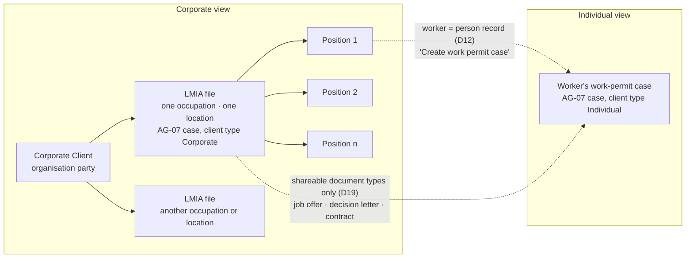
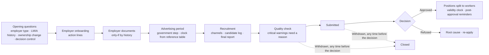
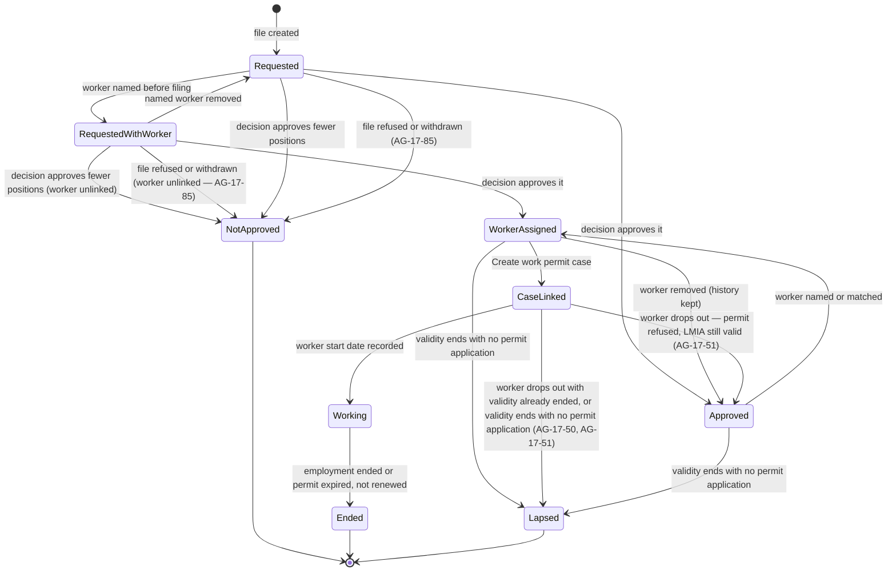

> **Document control** · Version **0.14** · **2026-10-27** · Status: **CC-8 applied: only emails a person writes are copied; system emails go to their usual recipient with no Cc (the product owner, 26 Oct)**; earlier: **Duplicates + copy on emails applied (the product owner, 24 Oct): LMIA file check, duplicate locations and business number, one candidate entry per applicant, copy on emails for LMIA files and worker cases; fix pass (24 Oct): employer copy carry-over decided (§13 item 9 closed); earlier: 21 Oct: AG-02 review decisions applied (employers on the same lead → prospect → client path, contacts linked once, eight stages from Engaged, leads in both views); three AG-02 items stay open; earlier: 18 Oct: X-2 applied as pointers (employer contacts and their roles are person records, home AG-02); earlier: Second pass (AG16-54 #3, AG16-55): AG-17-60 no longer routes to the removed notification matrix; open items 6, 7 closed; earlier: AG-16 review round 2 applied as pointers (AG16-27, AG16-45, AG16-47, AG16-50, AG16-51): government mail and letters, clocks and escalation recipients, the unassigned-case reminder, and the "Employer (LMIA)" group on the Automatic messages page; AG-17 owns none of these rules; earlier: AG-16 review decisions applied (AG16-8, AG16-21, AG16-22; SR-Q1c); SA-03 v2.16 wording applied (SA3-X11); Draft — SA-06 v3.0 roles-and-permissions decisions applied (SA6-D1, D2, D5, D6, D10); awaiting expert check of rule values**\
> Part of: *Agent (RCIC/Lawyer) Console — Functional Requirements* · New module. Decisions come from the brainstorming log `Corporate LMIA/DECISION-LOG.md` (2026-09-27 – 2026-10-03). Previous version: `_archive/AG-17-corporate-cases-and-lmia_v0.13_2026-10-25.md`
>
> | Version | Date | Change | Decisions |
> |---|---|---|---|
> | 0.14 | 2026-10-27 | **CC-8 applied (the product owner, 26 Oct; home AG-10-89): only emails a person writes are copied.** (1) **AG-17-96 rule 1:** system emails on an LMIA file go to the employer's primary contact (HR or admin) only, with no Cc; on a worker's own work-permit case they go to the worker only, with no Cc; an email a staff member writes on either is copied to that file's or case's list; invoices go To the Bill to with no Cc. Removed: "the file's copy list is Cc" on every client-facing email of the file. (2) **AG-17-96 rule 6:** removed "the worker case's copy list is still Cc. This is deliberate (the product owner, 24 Oct)"; CC-8 withdraws the invoice Cc (AG-6-41) and decision Q2 of 24 Oct. (3) §3.2 "Copy on emails" paragraph aligned. (4) **US-36:** the Cc test now uses an email Client C writes; the "Request outstanding items" email goes to Client T only; the invoice test has no Cc; one test added for a system email on the worker's case. Unchanged: the employer copy question and its carry-over (rule 2), rules 3 – 5 (the worker is never copied on the LMIA file), BR-19, AG17-D85. Row added to "Decisions that change this epic". | CC-8 |
> | 25 Oct (final check) | 2026-10-25 | **25 Oct (final check): verification fixes.** AG-17-81: the job offer and other employer documents can be sent with "Send for signature" (AG05-D1(1)); AG-17-47: "Paid by" may be a typed name (MS-D23(5)); decision-table rows AG05-D1 and MS-D23 added. | AG05-D1(1), MS-D23 |
> | 25 Oct (later): MS-D24 and writer follow-ups | 2026-10-25 | **MS-D24 applied (the product owner, 25 Oct); targeted edits only.** (1) **MS-D24(1):** the LMIA file links the employer's most recent signed retainer not already linked to another file; staff may change the link (one-line pointer in AG-17-74; rule home AG-07). (2) Stale versions of AG-07 and SA-01B corrected in the body (the shared case core is named AG-07, with no version). Row added to "Decisions that change this epic". | MS-D24 |
> | 25 Oct (money slice + AG-05 review) | 2026-10-25 | **Money-slice and AG-05 decisions that touch AG-17 applied (the product owner, 25 Oct); targeted edits only.** (1) **MS-D18(2), MS-D18(3):** the employer retainer offers the retainer template linked to the LMIA service in Settings → Services first, with its fee defaults copied (AG-17-74). (2) **MS-D13:** an invoice for an employer whose retainer is not signed shows a warning, not a block; this replaces the invoice part of AG17-D62 and all of AG17-D79 (AG-17-42, AG17-D62, AG17-D79). The CRITICAL "retainer not signed" warning in the quality-check view stays (AG-17-75). (3) **MS-D5:** "amendment if the fee changes" is closed: staff use "Prepare amendment" on the signed retainer (AG17-D39, BR-3). (4) **MS-D19(3), (4):** a worker case billed to the employer uses only money the employer paid, trust receipts record "Paid by", refunds default to the payer (AG-17-47). (5) **AG05-D4(4):** a retainer for an employer with no signatory on file warns, never blocks (AG-17-74). (6) **MS-D9, MS-D21(7), MS-D21(17):** the LMIA government fee is billed after the firm pays and reimbursed by "Pay from trust"; no pay-from-trust action for the fee; recruitment costs go in through "Add cost" (AG-17-42, AG-17-83). (7) **Open for the immigration expert:** employer-paid LMIA costs (§13 expert check item 9; MS-D19(4)). No master agreement (AG17-D50 stands). Rows added to "Decisions that change this epic". | MS-D5 · MS-D9 · MS-D13 · MS-D18 · MS-D19 · MS-D21 · AG05-D4 |
> | 0.13 | 2026-10-25 | Version bump only: carries the 25 Oct in-place follow-ups already logged in the 0.12 row (no content change). 25 Oct final audit: struck firm-added, hidden or reordered questionnaire questions in AG17-D8, the §0.2 SA-01B row (Extension 2) and §3.1 item 6 (SA-1B-93 withdrawn — W-17); firm checklist items and action lines kept. | — |
> | 0.12 | 2026-10-24 | **Duplicates + copy on emails applied (the product owner, 24 Oct).** **Added:** AG-17-95 (LMIA file check on employer + occupation + work location; replaces AG-7-1 rule 9 for Corporate clients; DUP-4), AG-17-96 (copy on emails for LMIA files and worker cases: employer PRIMARY contact is To, employer copy question, no automatic employer copies on a worker's case, workers never copied on the employer's file — rule 5 is the home of the worker definition and refusal text; CC-3, CC-7), BR-17, BR-19 (BR-18 not used: the text already cites AG-07 BR-18), AG17-D83 – D85, US-35, US-36, §13 item 9 (open). **Changed:** AG-17-3 (duplicate work location offer DUP-5; business number entered later re-runs the company match DUP-6), AG-17-26 and AG-17-80 (one entry per applicant, same-name offer, second channel as a note, CSV identical rows skipped and counted, same name with a different date or channel to the correction list; DUP-7), AG-17-69 (copy question pointer), AG-17-84 (contacts are linked to the company once — "carried over at conversion" removed, matching v0.11 §3.2), AG17-D46 (note: the same-name offer is not a standing duplicate-candidate flag), §3.2, §3.4 item 4, §3.7 item 2, §7 (`EmployerLocation`, `RecruitmentCandidate`, `CaseCopy` from the core), §9, §10, US-15, US-20, "Decisions that change this epic". BR-1 and AG17-D11 unchanged. Fix pass (24 Oct): cross-epic audit findings and decisions F1-F13 applied. 25 Oct: SA-01B pointers resolved (SA-1B-109, SA-1B-110). 25 Oct final pass: AG-17-80 runs as an adapter on AG-18's engine, keeping its template and rules (AG-18-1, AG-18 §13 Q32). | DUP-4, DUP-5, DUP-6, DUP-7, CC-1 – CC-4, CC-7, AG17-D83 – D85 |
> | 0.11 | 2026-10-21 | **AG-02 review decisions applied (the product owner, 20 Oct).** (1) Employers use the same lead → Engage → prospect → client path; a Corporate prospect becomes a client by signature, Signed offline or Convert to client; "convert" wording replaced in the §0.2 AG-02 row, §3.2 contacts paragraph, §3.2 quick check, AG17-D52, AG-17-78 and US-29 (AG02-D0 S3, AG02-D2). (2) Company contacts are linked once as `PartyRelationship` (`CLIENT_CONTACT`) with the roles PRIMARY, SIGNATORY, HR, BILLING or OTHER; nothing is linked or copied "on conversion"; `ProspectContactRole` removed from §3.4 item 6 (AG02-D10(1), AG02-D14(14)). (3) AG17-D75: the corporate pipeline has the same eight stages as the individual one, starting at Engaged (AG02-D10(3)). (4) A lead has no type: leads and their tasks show in both views, unlabelled (§3.0 Views, AG-17-2; AG02-D0 S1, AG-2-18 rule 11). (5) The quick LMIA Check values pre-fill the file when the company becomes a client by any of the three ways (AG02-D2); where the values are stored stays open. Pending block: P39, P40, P103 settled and removed; P102 narrowed to the storage question; P37 and P38 stay open. | AG02-D0, AG02-D2, AG02-D10(1), AG02-D10(3), AG02-D14(14) |
> | 0.10 | 2026-10-18 | X-2 (people model) applied as pointers only; home is AG-02, so no build card here. **Changed:** the employer's contacts and their roles (including SIGNATORY) are person records (Party) linked to the employer organisation by a relationship (`PartyRelationship`); no separate Contact record. Wording changed in the §0.2 AG-02 and AG-05 rows, the §0.3 employer row, the Action line in §3.2, the "Corporate client contacts" paragraph, the §3.9 panel set, AG-17-74 and AG-17-84. No requirement added, removed or renumbered. *18 Oct (later): consistency fixes after expert review — AG07-D4, AG07-D2, SA1-D15(a).* **AG07-D8(a)/(c) (several filings in one case): not applicable** - AG-17 describes one LMIA file per case and does not use the AG-07 Filing model. *18 Oct (final): AG07-D17 – D21 applied — AG07-D20(u) (the withdrawn `agent/case:view-dashboard` struck in the SA-06 row and the permission table); "a corporate exception to SA-1-58" replaced by "same as every case (AG-7-56)" in AG17-D53, the SA-01 row and AG-17-5, to match SA-01 (cases are not limited by SA-1-58, which now covers assessments only).* *18 Oct (final): AG07-D22 applied — Q49 (employer portal seats are Release 1: AG17-D51 row, AG-15 row of §0.2, the "extra employer seats" row of the staff-does-it table, the Release 2 list in §0.1); Q42, Q43, Q44, Q65, Q79, Q84 checked, nothing changed.* *18 Oct (final): AG07-D24 applied.* The default holders of `agent/case:waive-deficiency` now include the Case Officer starter role (AG17-D9, AG17-D17, the SA-06 row, the SA6-D2 row and the permission table). *18 Oct (final): AG07-D25 applied.* The default holders of `agent/case:waive-deficiency` now include the Admin starter role (the same five places). | X-2, AG07-D22, AG07-D24, AG07-D25 |
| 0.9 | 2026-10-17 | *Same-day fixes (17 Oct): AG16-83 – AG16-88 — notification matrix removed from the §0.2 AG-16 row and the US-30 test; open item 8 closed (item 4).* Second pass (the product owner, 17 Oct). **Changed:** AG-17-60 — the clause routing events to "AG-16's firm notification matrix" is deleted (AG16-14 removed the matrix; AG16-54 #3). **Open items closed (AG16-55, writer's stated default):** 6 (AG17-D56 and AG16-50 both kept; AG16-54 #18) and 7 (the "Employer (LMIA)" group is always visible; read-only only if ExpatReady switches corporate off; AG16-54 #17). **Left open:** 5 (no default stated); 8 (AG-17-60 done, two other mentions of the matrix remain, listed in item 8). No other decision AG16-56 – AG16-82 names this file. *18 Oct: new section 'Decisions that change this epic' (index of AG16 decisions; no requirement changed).* | AG16-54, AG16-55 |
> | 0.8 | 2026-10-17 | Applied from AG-16 review round 2 (AG16-24 – AG16-53, the product owner, 14–17 Oct). **Pointers only: AG-17 owns none of these rules, so no build card is written here.** **Added** AG-17-91 (government mail and letters on an LMIA file, AG16-27), AG-17-92 (clocks use the case's office time zone; escalation goes to everyone with `agent/case:assign`, not by office, AG16-45 as trimmed by AG16-51), AG-17-93 (a deadline reminder on a case with no one assigned goes to the Owner, AG16-50), AG-17-94 (the "Employer (LMIA)" group on the Automatic messages page, AG16-47, owned by AG-12). One cross-reference added to AG-17-60. **Not changed:** AG17-D56, AG17-D81 and AG-17-60's remaining text; the apparent overlaps are listed in §13 (new items 5 – 8). **Open questions closed:** none. | AG16-27, AG16-45, AG16-47, AG16-50, AG16-51 (AG16-6, AG16-22, AG16-31, AG16-44) |
> | 0.7 | 2026-10-14 | Applied from the AG-16 review (14 Oct) and SR-Q1c. **Changed:** AG17-D55 part (3), AG17-D70 and AG17-D81 — escalation and at-risk marks are no longer "off by default, opt-in": they are two separate firm switches under Advanced, **on by default** (SR-Q1c); escalation is one switch that alerts everyone who can reassign cases (`agent/case:assign`) for government deadlines (2 days before and on the day) and Needs you items overdue 2 working days, with no alert to the person who is themselves responsible (AG16-22); the switches are changed by Owner and Admin through `agent/firm-capability:manage` (AG16-8). **Withdrawn:** AG17-D57 (opt-in escalation of overdue tasks to managers) — overdue tasks are not pushed to others; the assignee is reminded and AG-13's "Overdue by person" list covers the Owner (AG16-22). AG-17-73 (reminders registered with the Minder) updated to match; one line added: government and legal dates never move for business hours or closed days, working-day reminders move earlier (AG16-6, AG16-7). AG17-D42 (candidate data deleted with the whole file) gets a note: clients and cases with history are closed, not deleted (AG16-21); question added to §13. History rows and the §0.2 pending list keep their original wording, marked superseded. No requirement ID added or renumbered. | SR-Q1c, AG16-6, AG16-7, AG16-8, AG16-21, AG16-22 |
> | 0.6 | 2026-10-10 | Applied from SA-03 v2.16 (SA3-X11; the product owner, 10 Oct): corporate's "product-map items" are now the **corporate-case feature** of SA-3's feature catalogue (still always on); the SA-03 knock-on row notes that limit modes are now fixed — seats and **all** active cases hard, storage the only warn limit (SA3-D15). No AG-17 requirement changed. | SA3-D10, SA3-D15 (SA3-X11) |
> | 0.5 | 2026-10-07 | Key renames from SA-06 v3.0 Appendix B (the product owner, 7 Oct; founder-authorised). **Changed:** `agent/case-management:review-approve` -> `agent/case:review-approve` everywhere (AG17-D28, §0.2 SA-02 and SA-06 rows, §3.5, AG-17-35, §10); `agent/case:list` -> `agent/case:view.own` with its sibling `agent/case:view.all` (§0.2 SA-06 row, §10 board row); `agent/billing/invoice:create` -> `agent/invoice:create` (§10); sign-off default holders named as the **Owner and Case Manager** starter roles (SA6-D2; sign-off row, AG-17-35, §3.5), the firm decides who else, every use audited. **Unchanged by design:** no "Firm Admin" term occurs in this document (Admin is a starter role, SA6-D5); AG17-D28 (no new permissions); personas "RCIC / Licensed representative" and "Owner / Principal RCIC" (user descriptions, not roles). Requirement IDs unchanged. | SA6-D2, SA6-D10 |
> | 0.4 | 2026-10-07 | Roles-and-permissions decisions from SA-06 v3.0 (the product owner, 7 Oct). **Changed:** AG17-D9 and AG17-D17 (default holder of `agent/case:waive-deficiency` is the **Owner and Case Manager** starter roles, not "RCIC"; the firm decides who else; every use audited — SA6-D2); §0.2 SA-06 row (default holder reworded; six starter roles named — SA6-D5; visibility defaults noted — SA6-D1/D6); §3.5 "Proceeding and sign-off" (no "licensed representative" signer by role); §3.9 Views (who sees what — SA6-D1/D6); §10 permission table (see-all and waive rows); "Decisions applied from other modules" table (three SA-06 rows added). **Unchanged by design:** AG17-D28 (no new permissions, no corporate-specific key); AG17-D35/D36/D37/D59/D68 plan rules; AG17-D61 "view" naming; AG17-D58 and AG-17-74 / US-33 (retainer needs an active licensed consultant — a licence credential, not a permission); personas "RCIC / Licensed representative" and "Owner / Principal RCIC" (user descriptions, not roles). | SA6-D1, SA6-D2, SA6-D5, SA6-D6 |
> | 0.3 | 2026-10-05 | Knock-on changes from AG-07 v2.3 and CP-01 v0.1 (5 Oct). **Changed:** AG-17-57 (the corporate client screen becomes the **corporate panel set** shown on AG-07's one client screen — AG7-D1); AG-17-3 (a missing business number raises a CRITICAL warning when the first LMIA file is opened — AG7-D8); AG-17-30 (candidates are not visible to the employer in Release 1 — CP1-D7); §3.0 fallback row (direct corporate client creation uses AG-07 Add client — corporate, AG-7-72); §3.3 step-kind column citation "AG-07 §3.2" → "AG-07 §3.3" (AG-07 §3 renumbered) and the employer's portal view (position counts — CP1-D10); §3.8 inspection pack and AG17-D42 (exception to the masked-export rule, AG7-D7); §3.9 items 2 and 4 and Key screens (corporate clients list = AG-07 client list in the Corporate view, AG-7-75; corporate panel set); §0 (AG17-D42 row; new "Decisions applied from other modules (v0.3)" table); §0.2 (AG-07, AG-15, AG-16 and SA-06 rows — `agent/case:reveal-pii` withdrawn, AG7-D7); §3.4 applicant personal data; §11 candidate data; US-4, US-27. **Added:** AG-17-90 (position counts in the employer's portal, after the decision — CP1-D10, AG17-D49 unchanged). **Withdrawn:** `agent/case:reveal-pii` in the §0.2 SA-06 key list (row kept, marked withdrawn — AG7-D7). **§13:** no contradiction note existed to close; the "Genuinely open: none" line is unchanged (corrected the same day — see below). Same day (AG7-D10): masking and reveal removed — the "exception to the masked-export rule" wording dropped from AG17-D42, §3.8 and AG-17-53 (the inspection pack contains the candidate log with names in full and the recruitment report, as every export does); AG7-D7 row in the applied-decisions table replaced by AG7-D10; §0.2 AG-07, AG-16 and SA-06 rows reworded (no reveal or unmasked-export key exists). §13 open list corrected (the product owner, 5 Oct): "Genuinely open: none" replaced by an honest list. | AG7-D1, AG7-D7, AG7-D8, AG7-D10, CP1-D7, CP1-D10 |
> | 0.2 | 2026-10-03 | Consistency review fixes (3 Oct): reminders on recorded dates keep working after a file closes; §6.A lifecycle redrawn (Decision → After decision → Closed; Withdraw and Change stream close the file); decision outcome approved · refused only; action lines carry their journey step; only steps up to Preparation & quality check count before submission; behavioural kind for each corporate journey step; decision correction through AG-7-58; neutral `labourAssessmentRef` (pending in AG-08); `ChangeRequest` entity and data homes for refusal root cause, previous refusal addressed and "edited since sign-off"; stale "Pending" / joint-session markers removed; D32 "no dragging" annotated with D64; hard dependency 6 (SA-01B row-and-line model); same-day `origin/dev` code check; authority-neutral representative task; Release vocabulary; AG-17-35 citation; permit-milestone reminders limited to expiry/renewal; Change stream under `agent/case:create`; "complete items" split by permission; retainer SHOULD; stale citations replaced by IDs; pending SA-05 row (recruitment report, job-offer merge fields); support-session block applies to every session; SA-06 row gains four keys; acceptance stories for signed offline, no licensed consultant and copy from previous. Changed: §0 (D24, D30, D32, D38, D39, D64 rows), §0.1, §0.2 (AG-07, AG-08, AG-16, SA-01, SA-01B, SA-06 rows), §3.0, §3.1, §3.3, §3.4, §3.6, §3.7, §3.7a, §4 intro, §6.A, §7, §9, §10, §11, §12, §13, AG-17-14, AG-17-16, AG-17-18, AG-17-21, AG-17-35, AG-17-45, AG-17-74, AG-17-86, AG-17-88, US-23. Added: AG17-D76 – D82 rows, §0.2 SA-05 pending row, `ChangeRequest`, US-32 – US-34. | AG17-D46, AG17-D60, AG17-D62, AG17-D63, AG17-D71, AG17-D72, AG17-D73, AG17-D74, AG17-D76 – D82 |
> | 0.1 | 2026-09-28 | Pass 1: decision log, pending changes for other modules, purpose, users, foundations used, LMIA as pack content; corrected after the pass-1 alignment check (version pinning per SA-1-58, Extension 3, firm action lines, fuller §0.2) | AG17-D1 – AG17-D26 |
> | 0.1 (cont.) | 2026-09-28 | Pass 2: building blocks §3.2 – §3.9; corporate journey | AG17-D27 |
> | 0.1 (cont.) | 2026-09-28 | Pass 3: §4 requirements AG-17-1 – AG-17-78, §5 business rules, §6 states, §7 entities, §8 user stories, §9 edge cases, §10 permissions, §11, §12 reference note, §13 open questions | AG17-D28 |
> | 0.1 (cont.) | 2026-09-29 | Part B fixes from the full conflict & gap review (CONFLICT-REGISTER.md) | — |
> | 0.1 (cont.) | 2026-09-30/10-01 | Conflict-register decisions applied | AG17-D29 – AG17-D45 |
> | 0.1 (cont.) | 2026-10-01 | End-to-end review fixes + lean pass 2 | AG17-D46 |
> | 0.1 (cont.) | 2026-10-02 | Change stream becomes a linked new file | AG17-D47 |
> | 0.1 (cont.) | 2026-10-02 | Shared documents copied, later versions offered with one click | AG17-D48 |
> | 0.1 (cont.) | 2026-10-02 | Employer milestone view withdrawn | AG17-D49 |
> | 0.1 (cont.) | 2026-10-02 | Master agreements become employer documents | AG17-D50 |
> | 0.1 (cont.) | 2026-10-02 | Release split; quick informational check on prospects | AG17-D51 – AG17-D52 |
> | 0.1 (cont.) | 2026-10-02 | New files start on current rules | AG17-D53 |
> | 0.1 (cont.) | 2026-10-02 | Minder first version fenced | AG17-D54 |
> | 0.1 (cont.) | 2026-10-02 | Uses AG-11's Minder (Release 1) with three additions | AG17-D55 |
> | 0.1 (cont.) | 2026-10-02 | Orphaned deadlines notify reassign-capable users | AG17-D56 |
> | 0.1 (cont.) | 2026-10-02 | Manager escalation opt-in per firm | AG17-D57 |
> | 0.1 (cont.) | 2026-10-02 | Retainer needs an active licensed consultant (accepted) | AG17-D58 |
> | 0.1 (cont.) | 2026-10-02 | Corporate rollout to existing firms | AG17-D59 |
> | 0.1 (cont.) | 2026-10-02 | Release vocabulary replaces Phases | AG17-D60 |
> | 0.1 (cont.) | 2026-10-02 | Names: My Tasks; Individual / Corporate view | AG17-D61 |
> | 0.1 (cont.) | 2026-10-02 | Acceptance criteria completed for uncovered requirements (§8) | — |
> | 0.1 (cont.) | 2026-10-02 | Final consistency pass; notification split; lean cuts (waived-warning metric, refusal analytics) | — |
> | 0.1 (cont.) | 2026-10-02 | Safe pending changes applied to AG-05, AG-06, AG-10, AG-11, AG-13, AG-00, AG-99, SA-05, SA-11, SA-12, SA-99 | — |
> | 0.1 (cont.) | 2026-10-02 | Joint-session questions decided by the product owner (retainer warning, after-decision stage, board override, per-case rules, done on behalf, organisation profile, limit defaults, read-only flags, Minder defaults, owners, code facts); §0.2 rows applied as listed there; §13 updated | AG17-D62 – AG17-D74 |
> | 0.1 (cont.) | 2026-10-02 | Remaining pending changes applied: AG-01 v1.6, AG-02 v1.4, AG-06 v1.3, AG-09 v1.2, AG-10 v1.3, AG-13 v1.6, AG-14 v1.5, AG-16 v1.3, SA-02 v2.15, SA-06 v2.3, SA-11 v2.4 | — |

## Decisions that change this epic (14–24 Oct) *(new 18 Oct; AG-02 rows added 21 Oct; duplicates and copy rows added 24 Oct)*

Product-wide rules (apply here as everywhere; home: Agent `00-Overview` → "Product rules every epic follows"): AG16-11, AG16-31, AG16-44.

The "AG16" prefix is historical: these decisions began in the AG-16 review and apply across the product. Full text: `TEMPLATE-MAP-working_2026-10-10.md`.

| Decision | What was decided (one line) | What it changes in this epic | Where (requirement / card / section) |
|---|---|---|---|
| AG16-6 | Business hours and closed days | Government and legal dates are calendar dates and never move for business hours or closed days | AG-17-73 · AG-17-92 |
| AG16-7 | A due date on a closed day moves earlier, never later | A reminder counted in working days back from a government or legal date lands on the last open day on or before the computed day | AG-17-73 |
| AG16-8 | Who changes Escalation and At-risk marks | Escalation and at-risk marks are changed by Owner and Admin through the firm-capability permission, no reason needed, every change in the activity log | AG17-D81 · change log 0.7 |
| AG16-11 | One Automatic messages page, documented in one place only | AG-17 messages appear on that page under the group "Employer (LMIA)"; AG-12 owns the page | AG-17-94 |
| AG16-14 | Staff notifications: personal settings only | The firm notification matrix no longer exists; the clause routing AG-17 events to it is deleted | AG-17-60 · §0.2 AG-16 row · US-30 test · §13 item 8 |
| AG16-21 | Undoing deletes | A client or case with history is closed, not deleted, so candidate data cannot follow "deleted with the whole file"; note added, question raised | AG17-D42 note · §13 item 4 |
| AG16-22 | One escalation rule: push the high-stakes, show the routine | Escalation is one switch, on by default; opt-in escalation of overdue tasks to managers is withdrawn (AG17-D57) | AG17-D55 part 3 · AG17-D57 (withdrawn) · AG17-D81 · AG-17-73 |
| AG16-24 | Own mailbox and own calendar on every plan | Referenced only (no change here) (named only in the round-2 range in the change log) | Change log, row 0.8 |
| AG16-27 | Government mail: recognise, match, identify, sort, deadline | Government mail rules apply to an LMIA file unchanged; the Minder registers a suggested deadline only after a person confirms | AG-17-91 · AG-17-73 · §0.2 · §13 item 5 |
| AG16-31 | Standing rule: ExpatReady suggests, the firm decides | A suggested deadline from a letter is registered only after a person confirms it | AG-17-91 |
| AG16-41 | Letters downloaded from the IRCC portal | The "Same letter / Different letter" prompt and the rules for an uploaded or dropped PDF apply on an LMIA file | AG-17-91 |
| AG16-45 | Office time zones and escalation by office | Once a second office exists, internal clocks use the case's office time zone; government and legal dates are unaffected | AG-17-92 |
| AG16-47 | Automatic messages page: find and fix | The page groups rows by journey stage, including "Employer (LMIA)" | AG-17-94 |
| AG16-50 | Government-deadline reminder with no one assigned goes to the Owner | A government-deadline reminder on an LMIA file with no one assigned goes to the Owner | AG-17-93 |
| AG16-51 | Three trims to avoid over-building | Escalation alerts everyone holding the case-assign permission, not only the case's office | AG-17-92 · AG17-D81 |
| AG16-53 | Video links are per person; no firm video account | Referenced only (no change here) (named only in the round-2 range in the change log) | Change log, row 0.8 |
| AG16-54 | 25 consistency fixes after the 17 Oct write | Matrix clause deleted from AG-17-60 (#3); open items 6 and 7 closed (#18, #17) | AG-17-60 · §13 items 6, 7 |
| AG16-55 | Writers' recommended defaults accepted for the detail questions | Open items 6 (AG17-D56 and AG16-50 both kept) and 7 ("Employer (LMIA)" group always visible) closed | §13 items 6, 7 |
| AG16-56 | When automatic messages send, by what their timer counts | Referenced only (no change here) (named only in the second-pass range in the change log) | Change log, row 0.9 |
| AG16-82 | One rule for every broken connection | Referenced only (no change here) (named only in the second-pass range in the change log) | Change log, row 0.9 |
| AG16-83 | 26 follow-through fixes after the second pass | Notification matrix removed from the §0.2 AG-16 row and the US-30 test; open item 8 closed | §0.2 AG-16 row · US-30 test · §13 item 8 |
| AG16-88 | Release 1 is English-first; French later | Referenced only (no change here) (named only in the AG16-83 – AG16-88 range in the change log) | Change log, row 0.9 |
| X-2 | One person record per real person; AG-02 is the home. Employer-contact roles point at Party. | Employer contacts and their roles (SIGNATORY and others) are person records linked to the employer by `PartyRelationship`; pointers only, no card, no new control | §0.2 AG-02 and AG-05 rows · §0.3 employer row · §3.2 Action line · "Corporate client contacts" · §3.9 panel set · AG-17-74 · AG-17-84 |
| AG07-D2 | One rules pin per filing *(added 18 Oct)* | The rules pin is per filing, not per case; adopting newer rules is per filing, reason pre-filled "Adopting the current rules" (SA1-D15(a)); an LMIA file holds one filing, so its behaviour is unchanged | AG17-D53 · AG17-D65 · AG-17-5 · BR-5 · §9 |
| AG07-D4 | Case permissions: use the built keys, fold everyday work into `agent/case:edit` *(added 18 Oct)* | `case:document-manage`, `case:form-prepare`, `case:milestone-record`, `case:review-submit`, `case:deficiency-manage` are withdrawn; uploads on behalf, employer documents and milestones use `agent/case:edit`; the job offer and filing summary use `agent/form:create` | §0.2 SA-06 row · §10 |
| AG07-D17 (consistency) | SA-01 limits SA-1-58, BR-5 and US-5 to assessments; cases follow AG-7-56. | The words "a corporate exception to SA-1-58" are replaced by "same as every case (AG-7-56)"; behaviour is unchanged. | AG17-D53, SA-01 row (§0.2), AG-17-5 |
| AG07-D22 (Q49) | Employer portal seats are Release 1 (roster and seats). | "Seats" is removed from the Release 2 list (AG17-D51 row, §0.1 phase table) and from the "staff do it in Release 1" row; the AG-15 row now says the primary contact and additional seats both get portal access in Release 1. "Employer portal entry" (the employer entering channels and candidates) stays Release 2. AG-15 owns seats. | AG17-D51 row · §0.2 AG-15 row · staff-does-it table row 3 · Release 2 phase row |
| AG07-D24 | The Case Officer holds the pass for a CRITICAL warning by default *(the product owner, 18 Oct: "3A + default on"; amends SA6-D2 for one key)* | The default holders of `agent/case:waive-deficiency` are the Owner, Case Manager and Case Officer starter roles. The firm may remove or grant it for any role; every pass is audited. The submit screen (a person who cannot pass a warning cannot record the submission) is in AG-07 | AG17-D9 · AG17-D17 · §0.2 SA-06 row · §10 |
| AG07-D25 | Admin also holds the pass of a CRITICAL warning by default *(option A; the product owner, 18 Oct; follows AG07-D24(b))* | The default holders of `agent/case:waive-deficiency` are the Owner, Admin, Case Manager and Case Officer starter roles. `agent/case:form-approve`, `agent/case:review-approve` and `agent/retainer:countersign` stay Owner and Case Manager by default. Home: SA-06 | AG17-D9 · AG17-D17 · §0.2 SA-06 row · §10 |
| AG02-D0 (S3) | Employers use the same lead → prospect → client path; AG-17 is revised last (the product owner, 19 Oct; home AG-02) | An employer arrives as a lead, is engaged as a Corporate prospect and becomes a client like any prospect; "corporate convert" wording replaced | §0.2 AG-02 row · §3.2 corporate client contacts |
| AG02-D2 | A prospect becomes a client once, by signature (EXECUTED), Signed offline or Convert to client; Undo convert while empty (the product owner, 19–20 Oct; home AG-02) | The quick LMIA Check values pre-fill the new LMIA file when the company becomes a client by any of the three ways, not only on signature | AG17-D52 · §3.2 quick check · AG-17-78 · US-29 · §0.2 AG-02 row |
| AG02-D10(1), AG02-D14(14) | Company contact roles are stored once as `PartyRelationship` and linked, not copied; `ProspectContactRole` is retired; roles HR, Signatory, Billing, Primary, Other (the product owner, 20 Oct; home AG-02) | Contacts are linked to the company record once, from Engage as Corporate on (type `CLIENT_CONTACT`); nothing is linked "on conversion"; the signatory check reads the SIGNATORY link (AG-2-77, AG-2-54) | §0.2 AG-02 row · §3.2 corporate client contacts · §3.4 item 6 |
| AG02-D10(3) | Eight seeded stages starting at Engaged; one WON, one LOST and one NURTURE stage (the product owner, 20 Oct; home AG-02) | AG17-D75 reads "the same eight stages", not nine; "Qualified" stays the stage staff move an employer to after the Check | AG17-D75 |
| AG02-D0 (S1) | A lead is neutral, with no Individual/Corporate type (the product owner, 19 Oct; home AG-02, AG-2-18 rule 11) | Leads, and tasks on a lead, are not filtered by the view and carry no Individual or Corporate label | §3.0 Views · AG-17-2 |
| DUP-4 | Duplicate LMIA file check at opening (the product owner, 24 Oct) | A new file whose employer, occupation and work location match another file of the employer is warned by the earlier file's state; never blocked; "create anyway" audited; replaces AG-7-1 rule 9 for Corporate clients | AG-17-95 · BR-17 · AG17-D83 · §3.2 · §9 · US-35 |
| DUP-5 | Duplicate work locations (the product owner, 24 Oct) | Adding a location offers an existing one with the same normalised street address and postal code; offer only | AG-17-3 · §3.2 · §7 `EmployerLocation` · US-15 |
| DUP-6 | Business number added later (the product owner, 24 Oct) | Entering a business number after the first save re-runs the company match on that key (AG-2-79 rule 2) and warns; merge allowed (AG-2-16 rule 8) | AG-17-3 · US-15 |
| DUP-7 | One recruitment log entry per applicant (the product owner, 24 Oct) | Same-name offer on the same file; second channel as a note; CSV identical rows skipped and counted, same name with other date or channel to the correction list | AG-17-26 · AG-17-80 · AG17-D84 · AG17-D46 note · §3.4 · §9 · US-20 |
| CC-1, CC-2, CC-4 | Copy on emails: the case copy list, which emails are copied, the footer and "Stop copying someone" (the product owner, 24 Oct; homes AG-7-97 rules 6 to 15, AG-10-89) | Apply to LMIA files and worker cases unchanged; AG-17 adds no send rule | AG-17-96 |
| CC-3 | LMIA employer and worker (the product owner, 24 Oct) | Employer contacts are never added automatically to a worker's own case (staff add with a cue; the worker's own questionnaire answer needs no cue); workers are never copied on the employer's LMIA file; the employer's PRIMARY contact is the usual recipient | AG-17-96 · BR-19 · AG17-D85 · §3.2 · §3.7 · US-36 |
| CC-7 (employer variant) | "Who else at your company should we copy?" in the employer onboarding questionnaire (the product owner, 24 Oct) | Stored on the employer's profile; writes copy rows on the file it was answered on and on later files opened with New LMIA file or Copy from a previous LMIA, never on a worker's case; carry-over decided (fix pass, F11): Change stream carries the list, Re-apply and other open files get a one-click offer | AG-17-96 rule 2 · AG-17-69 · §13 item 9 |
| MS-D13 *(25 Oct; home AG-06)* | Invoicing a client whose retainer is not signed is a warning, not a block (the product owner, 25 Oct). Reverses AG17-D79 and the invoice block of AG17-D62. | A new invoice for the employer or worker shows "Maple Foods' retainer isn't signed. Invoice anyway?"; the person may continue and the choice is recorded. Applies to the government-fee line too. The CRITICAL "retainer not signed" warning stays | AG-17-42 · AG17-D62 · AG17-D79 · AG-17-75 |
| MS-D5 *(25 Oct; home AG-05)* | "Prepare amendment" on a signed retainer, same signing flow, editable until signed (the product owner, 25 Oct). Closes AG-17's open "amendment if the fee changes" | Change stream keeps the retainer; if the fee changes, staff prepare an amendment | AG17-D39 · BR-3 |
| MS-D18(2), (3) *(25 Oct; home AG-16 places Settings → Services, AG-02 owns the list)* | A service may link a retainer template and fee defaults, copied on use; later edits never change sent or signed retainers | The employer retainer offers the LMIA service's template first and copies its fee defaults; no master agreement (AG17-D50 stands) | AG-17-74 |
| MS-D19(3), (4) *(25 Oct; home AG-06)* | Trust is held per case; "Pay from trust" uses only money paid by the invoice's Bill to party; every trust receipt records who paid; refunds default to the payer | A worker case billed to the employer draws only on the employer's money; "Paid by" and refund to payer apply | AG-17-47 |
| MS-D9, MS-D21(7), MS-D21(17) *(25 Oct; home AG-06)* | Government fees: the firm pays, then bills and reimburses from trust; no "pay government fee from trust" in Release 1 (open for the expert). "Add cost" on a client or case; government fees never taxed, other cost lines taxable by default | The LMIA processing fee follows MS-D9; a recruitment cost goes in through "Add cost" | AG-17-42 · AG-17-83 · §13 item 9 |
| AG05-D4(4) *(25 Oct; home AG-05)* | A corporate retainer with no organisation signatory on file warns "Pine Bakery has no signatory. Add one or choose who signs"; never a block | The same warning for an LMIA file's retainer | AG-17-74 |
| MS-D24(1) *(25 Oct, later; home AG-07; AG-05)* | When a case opens, it links that company's (or person's) most recent signed retainer not already linked to another case; staff may change the link | The same link for an LMIA file: the employer's most recent unlinked signed retainer; one-line pointer only, the rule is not repeated here | AG-17-74 |
| AG05-D1(1) *(25 Oct; home AG-05)* | Any document can be sent for signature from a "Send for signature" button where the document is | The job offer and other employer documents use the one signing tool; the rules stay in AG-05 | AG-17-81 |
| MS-D23(4), (5), (8) *(25 Oct; home AG-06)* | A payment in another currency is recorded at the amount that arrived, with a note, no conversion; "Paid by" may be a typed name; disbursements above the agreed estimate warn "Prepare an amendment?" | The employer-paid and LMIA-fee cases follow AG-06's rules; no second copy here | AG-17-47 |
| CC-8 *(26 Oct; home AG-10-89)* | Only emails a person writes are copied. Every system email goes to its usual recipient with no Cc. Invoices go To the Bill to with no Cc (the product owner, 26 Oct). | LMIA file: system emails go to the employer's primary contact (HR or admin) only. Worker's own work-permit case: system emails go to the worker only. Staff-written emails on either are copied to that case's list. The invoice Cc on a worker's case billed to the employer is withdrawn. The worker is still never copied on the LMIA file. | AG-17-96 rules 1 and 6 · §3.2 · US-36 |


## Module AG-17: Corporate Cases & LMIA

### Module Index

Scan the whole module in ~30 seconds; jump to any part.

0. **Decision log** · 0.1 Deferred · 0.2 Decisions other modules must apply (applied or pending, per row)
1. **Purpose & Goal**
2. **Users & Jobs-to-be-Done**
3. **Functional Design — How It Works** (core)
   - 3.0 What AG-17 uses — foundations, dependencies, what happens until each exists · 3.1 LMIA as pack content (SA-01B rows, action lines, pre-submission government steps, reference tables, firm additions) · 3.2 Block 1 — Employer & position set-up (wage check) · 3.3 Block 2 — LMIA Application Wizard · 3.4 Block 3 — Recruitment compliance · 3.5 Block 5 — LMIA quality checks before submission · 3.6 Block 6 — Submission & decision · 3.7 Block 7 — TFWP tracking linked to worker cases · 3.7a After approval — validity, changes, workers · 3.8 Block 8 (light) — After approval: reminders & inspection pack · 3.9 Work surfaces — LMIA board, corporate view, corporate panel set
4. **Detailed Functional Requirements** (AG-17-x)
5. **Business Rules & Logic**
6. **States & Lifecycle**
7. **Key Entities & Fields**
8. **User Stories + Acceptance Criteria**
9. **Edge Cases & Validations**
10. **Permissions** (LOCAL `agent/*`)
11. **Scalability · Security · Performance**
12. **Reference Note** (exists / NEW / changed — verified against same-day `origin/dev`, DOCS-6)
13. **Open Questions / Founder Decisions**

### Visual Overview

**A. The corporate structure** — the employer is the client; one LMIA file is one occupation at one work location; each approved position hands its worker to their own individual case (the one bridge between the two views):



**B. An LMIA file from start to finish** — the phases staff see; the advertising period is a government step that runs **before** submission, with its own clock (AG17-D15):



**C. Where each part lives** — nothing about LMIA is written in code (AG17-D1, D15):

| Layer | Owner document | Holds |
|---|---|---|
| **Pack content** | SA-01B (authored by Expat Ready's content team) | The corporate configurator row(s), questions, documents, forms, action lines, government steps, reference tables of rule values |
| **Shared case core** | AG-07 | Case, people, filings, checklist, forms, readiness and critical warnings, submission and decision, team, timeline, government fees, Bill to, case links |
| **Corporate functionality** | **AG-17 (this module)** | Position set-up and wage check, the Wizard, recruitment compliance, LMIA quality checks, TFWP tracking, after-approval reminders and inspection pack, corporate screens |
| **Firm additions** | SA-01B §11 firm extensions | A firm's own extra items (internal pre-checks, own sign-offs, job-posting email practice) |

---

### 0. Decision log (brainstorming session of 2026-09-27 – 2026-09-28)

Decisions are numbered **AG17-D1…** and match `D1…` in `Corporate LMIA/DECISION-LOG.md`, which holds the full reasoning.

| ID | Decision | Applied in |
|---|---|---|
| **AG17-D1** | **No rules, numbers, stages or immigration terms in code; LMIA is content.** Mechanism refined by AG17-D15: the "engine" is SA-01B's content model plus this module's functionality — no separate blueprint engine. | §3.1 |
| **AG17-D2** | **Firm-led; the employer and the worker have their own items.** A file is run one of three ways — staff do it · employer does it · employer with firm assistance — implemented by AG17-D18. | §3.0, §3.3 |
| **AG17-D3** | **Release 1 = blocks 1, 2, 3, 5, 6, 7 plus a light block 8** (post-approval reminders and a one-click inspection pack). Recruitment engine (block 4) and full post-approval compliance (block 8) are Release 2. *(refined by D51)* | §1, §0.1 |
| **AG17-D4** | **One shared case core with type-specific modules.** A corporate case *is* a case with client type Corporate; no duplicated corporate case tree. | §3.0 |
| **AG17-D4b** | **The case-core developer builds the shared case core**, to a shape agreed with the Minder developer and the reviewing developer; they review it; the individual side adopts it. | §3.0 |
| **AG17-D5** | **Corporate prospects stay in AG-02** (one CRM), with a **separate corporate pipeline** — brought forward from AG-02's Phase 3. Not in this module's build scope. | §0.2 |
| **AG17-D6** | **Individual / Corporate views, not filters.** The toggle changes the menu, dashboard and default list filter (with a visible, clearable chip); it never filters global search, notifications, "My Tasks" or links between records. Owners and managers get an "All" view. | §3.0, §3.9 |
| **AG17-D7** | *(Superseded by AG17-D35.)* **Corporate is a paid plan feature plus a per-firm on/off switch** (SA-03 commercial entitlement + SA-12 operational flag). Firms without it see no toggle. The flag key is neutral (e.g. `feature.corporate`) — code may not contain the word "LMIA" (SA-01B:365). | §1 |
| **AG17-D8** | **Locked legal core + firm additions.** Pack items cannot be removed or weakened by a firm (SA-1B-94, SA-1-34); firms add their own items — checklist items (SA-1-34) and action lines, never questions *(changed 25 Oct — firms add, hide or reorder no questions: SA-1B-93 withdrawn, W-17; SA-01B v1.10 :561; AG-08 v1.13 :44)*. Simplified by AG17-D23b. | §3.1 |
| **AG17-D9** | **The platform never blocks a firm — it warns and records.** Mechanism in AG17-D17; severities in AG17-D23c. *(changed v0.4 — SA6-D2: the default holder of the waive permission is the Owner and Case Manager starter roles; no licensed-representative role; the firm decides who else; every use audited — see AG17-D17.)* *(changed 18 Oct — AG07-D24)* *(changed 18 Oct — AG07-D25)* | §3.5 |
| **AG17-D10** | **Only work with an owner and a due date goes to "My Tasks" (AG-13)**; small checklist ticks stay in the file; completing in either place completes both. Until AG-13 exists, a "Mine" filter on the LMIA board serves as the work list (AG17-D23d). | §3.9 |
| **AG17-D11** | **One LMIA file = one occupation at one work location, holding several positions.** Recruitment, quality check, submission and decision happen once per file; the decision records how many positions were approved; after approval each position moves independently. Answers AG-07 §13 item 6. | §3.2, §3.6 |
| **AG17-D12** | **The worker is a person record on the position**; this module tracks worker milestones (permit applied, approved, arrival, start, permit expiry, renewal due) until an individual case exists; "Create work permit case" then opens one and tracking comes from it. | §3.7 |
| **AG17-D13** | **Government fees work the same on both sides** — a Government fees section on every case (AG-07 core); for LMIA the fee is calculated from reference tables; if the firm paid on the client's behalf, one click creates a non-taxable `GOVERNMENT_FEE` line via AG-06. | §3.0, §3.6 |
| **AG17-D14** | **This module is AG-17** in `FINAL-Agent-FR/`, same format as AG-01…AG-16, followed by a conflict and gap review against all current SA and AG documents before it is final. | — |
| **AG17-D15** | **LMIA fits SA-01B's content model with small generic extensions:** (1) government steps may sit **before** submission (the advertising period); (2) a new line kind **"action"** (a to-do), which firms may also add; (3) a clock's length may be read from a reference table (added after the pass-1 alignment check). Four rules: one engine, configurator split by Pathway; library shelves derived automatically from usage; complex logic in reference tables, not condition chains; the engine only shows/hides lines and runs clocks — anything smarter is this module's functionality. | §3.1 |
| **AG17-D16** | **Each view has one owner document; the shared core is one place.** Refined by AG17-D24. | §3.0 |
| **AG17-D17** | **Nothing is ever locked.** Critical items (AG-07 BR-3, BR-4, BR-5, AG-7-27) are critical warnings; a person holding `agent/case:waive-deficiency` (AG-7-28) gives a reason to proceed; recorded on the file *(owner notification removed by AG17-D46)*. *(changed v0.4 — SA6-D2: was "RCIC holds it by default")* It is seeded on the **Owner, Admin, Case Manager and Case Officer** starter roles by default *(changed 18 Oct — AG07-D24)* *(changed 18 Oct — AG07-D25)*; there is no licensed-representative role and no licence check on the permission; the firm decides who else holds it; every use is audited. | §3.5 |
| **AG17-D18** | **Who does an item follows its type**; only action lines carry a "done by"; staff can always complete an item on someone's behalf (the audit log records the real doer); **one switch per file**: "client/employer does their items in the portal — on/off". | §3.0, §3.1 |
| **AG17-D19** | **Employer documents reach the worker's case only through a fixed list of shareable document types** (job offer, LMIA decision letter, employment contract), flagged in SA-01B's master documents and copied into the worker's case *(later versions offered with one click — AG17-D48)*. Financial and business documents can never cross. | §3.7 |
| **AG17-D20** | **Every case has an optional "Bill to"**; default is the case's own client (for a worker's case, the worker); the linked employer is offered as a quick pick. The LMIA fee and recruitment costs stay on the LMIA file, billed to the employer. | §3.6 |
| **AG17-D21** | *(Withdrawn by AG17-D49 — nothing built in for employer updates; firms update employers their own way.)* **The employer sees worker milestones only**, per approved position, with the worker's consent on file — never the worker's case, documents or personal details. | §3.7 |
| **AG17-D22** | **Plan limits count what exists.** An LMIA = 1 corporate case (employer = 1 corporate client); each worker permit case = 1 individual case and the worker 1 individual client, once the case exists; a person only on a position does not count. | §1 |
| **AG17-D23** | **Lean pass:** (a) each user's last view is remembered; (b) firms only add their own items — no "tighten" settings, no default step owners; (c) AG-07's severities CRITICAL / MAJOR / MINOR / INFO; (d) interim work list = "Mine" filter on the LMIA board; (e) LMIA content ships **pre-built as Canada pack content** — brought in through pack import, never a code seed (SA-01B:365). | throughout |
| **AG17-D24** | **AG-07 itself becomes the shared Case Core** (v2.0 "Case Core & Delivery") — keeps its number and requirement IDs; corporate content moves here; changes applied after the joint session agrees them *(confirmed by D71 — a read-out replaced the joint session; applied in AG-07 v2.0)*. | §3.0, §0.2 |
| **AG17-D25** | **"Nothing is locked" also covers blocks set in pack content.** A pack "block" setting means severity CRITICAL (passed by a waive-permission holder with a reason); "warn" means a lower severity — for section coverage gaps (SA-1B-15), document expiry (SA-1B-23), government-step gates (SA-1B-45) and AG-07 BR-3's per-pack threshold. | §3.1, §3.5 |
| **AG17-D26** | **One configurator row per stream, chosen when the file is opened.** The wage check runs at creation and proposes the stream; staff confirm. *(Stream changes and re-applications revised by AG17-D29.)* | §3.1, §3.2 |
| **AG17-D27** | **Two standard journeys, one per client type.** Individual keeps SA-1B-46's delivery steps; corporate gets its own standard journey — Set-up → Employer onboarding → Employer documents → Advertising & recruitment → Preparation & quality check → Submitted → Decision → Workers & permits → Compliance. A step appears only if the file has something in it. Action lines carry their step; other lines are placed by kind. Board columns = corporate steps; the Wizard walks the file through them. | §3.3, §3.9 |
| **AG17-D28** | **No new permissions.** A corporate file is a case, so AG-17 uses AG-07's case keys: sign-off = `agent/case:review-approve` *(renamed v0.5 — SA6-D10; default holders Owner and Case Manager — SA6-D2)*, passing a CRITICAL warning = `agent/case:waive-deficiency`, inspection pack = `agent/case:export`, new linked files = `agent/case:create`. Supersedes "one new permission" in earlier drafts. | §10 |
| **AG17-D29** | *(Change-stream mechanics revised by AG17-D47: a linked new file, not the same file.)* **Change stream happens inside the same file, only before submission; Re-apply is a new file.** Before submission, "Change stream" moves the file to the new stream's row inside the same case (internally a new filing — SA-1B-64/65); answers, positions and employer documents carry forward; earlier advertising stays visible as reference, not counted. After submission there is no Change stream — withdraw and re-apply. **Re-apply** (after refusal or withdrawal) is a **new LMIA file** with an optional "Copy from a previous LMIA" and a reference link; it counts as a new corporate case. Staff never see the word "filing" — the header shows "Stream: High-wage → Low-wage (changed <date>)". | §3.1, §3.2, §3.6 |
| **AG17-D30** | **The decision is not the end of a case (both sides).** A decided case may enter an **after-decision stage** where its clocks and tasks keep running (for an LMIA: validity, positions, workers, compliance); it **closes** when that work is done (LMIA: every position ended or lapsed and the compliance period over) or staff close it with a reason. **Withdraw** is allowed at any point before the decision, including before submission. For plan limits a case is **active from creation until its decision or withdrawal** — the after-decision period does not count. Proposal for AG-07 v2.0, to be confirmed at the joint session *(confirmed by D63)*. | §3.6, §6, §0.2 |
| **AG17-D31** | **After approval: one "After approval" tab and lean change requests, in Release 1.** The approved file shows validity & positions, change requests, and workers & permits. A **change request** is a simple record (type from a pack answer list, date sent, outcome, revised letter, follow-up task). Types that affect workers (worker name change, worker replacement) also: name the affected positions, mark them **"Change pending"** (a CRITICAL warning if a permit is filed for them meanwhile), **prompt** staff to apply an approved change to the position and worker (history kept, never silent), and share the revised letter to the affected worker's case as a new version. Firm-wide view = **saved filters on the LMIA board**, no new screen. *(letter offered with one click, not pushed — D48)* | §3.7, §4 |
| **AG17-D32** | **Where a file sits on the board.** Before submission: the furthest step where work has started, with a badge for items outstanding in earlier steps *(shown inside the file only, not on board cards — AG17-D46)*. From submission on: recorded events decide. Refused, withdrawn and closed files sit in a Closed column, hidden by default. No dragging (amended by D64: forward-only manual placement before submission, self-clearing). Firms may rename step labels, not reorder or remove steps. Same rule proposed for individual cases in AG-07 v2.0. | §3.3, §3.9, §4 |
| **AG17-D33** | **No form capture, no portal mirroring.** The LMIA is filed online by the firm. ExpatReady collects (employer onboarding questionnaire, once per employer, saved to the employer's profile; LMIA pre-filing questionnaire per file), keeps evidence (recruitment log), and assembles a read-only **filing summary**; staff upload the submitted application copy. Three-way check = ad ↔ job offer ↔ job details. Staff never key the same thing twice. | §3.2, §3.5, §3.6, §4 |
| **AG17-D34** | **Slots.** The platform declares a short list of neutral named slots (reference tables, answer lists, government-step roles), each with required contents; a corporate row binds its content to them; publishing checks the bindings. Code reads only slots. SA-01B Extension 4. *(simplified to a fixed internal list validated at import — D46)* | §3.1, §4 |
| **AG17-D35** | **Corporate is in every plan; plans differ by capacity.** Every plan includes corporate; each plan sets a limit on **active LMIA files** (active = until decision, AG17-D30), like the existing limit on active individual cases — the numbers are SA-03 pricing. Super Admin's per-firm switch is an **emergency off-switch only**, never a grant. AG-17 works on any plan design: if a plan lacks the employer portal or reports, staff complete employer items and the board still works (AG17-D18). **Deadline and expiry reminders never depend on the plan** — reminding is assisting. No add-ons in Release 1 (SA-4-44). Replaces AG17-D7. | §1, §4 |
| **AG17-D36** | **The active-LMIA-case limit is hard.** When a firm reaches its plan's limit, opening another LMIA case (including Re-apply) is refused with an upgrade prompt; the owner can upgrade at once (SA4-D4). Existing cases are never affected. A case stops counting at its decision (AG17-D30). Work-permit cases count against the individual limit. SA-03's default becomes: seats and active LMIA cases = hard; other limits = warn. | §4, §0.2 |
| **AG17-D37** | **Emergency switch-off = read-only, reminders keep running.** When Super Admin switches corporate off for a firm, the firm can still see and download every corporate file (including the inspection pack) and still receives every deadline and expiry reminder; it cannot change anything, record anything new or open new LMIA files until switched back on. A banner explains the pause. SA-12 gains an exception: deadline reminders never pause. | §4, §9, §0.2 |
| **AG17-D38** | **The Minder: one reminder service on top of the whole application, its core in Release 1.** Any module registers the dates that matter (LMIA validity, officer deadlines, advertising minimum, passport expiry, overdue invoices…); the Minder watches them all, creates reminders, tasks (AG-13) and notifications (AG-10) at the right time, recalculates when a date changes, and never pauses (AG17-D35, D37). AG-17 builds no reminder logic of its own — it hands its dates to the Minder. Firm-designed automations stay after Release 1 (AG-11). Release 1 uses the LMIA board and saved filters instead of the corporate dashboard (AG-14 later) and gives the employer's primary contact portal access (extra seats with AG-15 later). Who builds the Minder core: recommended the Minder developer or the reviewing developer, before the case-core developer's reminder-heavy blocks — to confirm at the joint session *(confirmed by D71: the Minder developer)*. | §3.0, §4, §11, §0.2 |
| **AG17-D39** | *(Master agreements simplified by AG17-D50: a master is just an employer document; the system tracks only the per-file retainer.)* **Employer agreements: each employer uses one of two styles.** (1) A **full retainer** per LMIA file, or (2) a **master agreement** at employer level plus, per LMIA file, a **short retainer that points to the master** (position and fee only). A "schedule" is simply a file-level retainer pointing to a master — no separate document type. Staff choose the style for each employer the first time; ExpatReady then offers the right document for the next LMIA. The employer's **authorised signatory** signs on the company's behalf. Fees come from the file's retainer. No signed agreement on a file (or its master expired) = **CRITICAL warning, not a lock** — changes AG-05's block for both sides; to be agreed at the joint session *(confirmed by D62)*. Change stream keeps the file's retainer; if the fee changes, staff use "Prepare amendment" on the signed retainer (MS-D5; home AG-05); Re-apply gets a new file-level retainer. | §3.5, §4, §0.2 |
| **AG17-D40** | **Staff can complete a client's portal to-do on their behalf, clearly marked.** One action — "Done on behalf of client"; the client's portal shows e.g. "Business licence — received by your case officer on 3 Oct ✓"; the audit log records the staff member and "on behalf of". Applies to individual and corporate clients — an exception to AG-15 BR-7. | §3.3, §0.2 |
| **AG17-D41** | **The worker's permit case: the worker signs the retainer; if the employer pays, Bill to = employer.** Nothing else — no payer signature, no consent clause, nothing extra captured. | §3.7 |
| **AG17-D42** | **Candidate data is part of the LMIA file, kept as long as the file.** Deleted only when the whole file is deleted under the firm's normal retention (SA-11's case-file retention — period awaiting legal advice); no separate candidate clock. Inspection pack shows candidate names in full *(changed v0.3 — AG7-D10)*. *(note v0.7 — AG16-21: a client or case with any history is **closed, not deleted**; only an empty record can be deleted. So "when the whole file is deleted" can apply only to an empty file, or to an approved "delete my data" request (G-Q1, not blocked by legal hold G-Q5). See §13 open point 4.)* | §3.4, §4, §11 |
| **AG17-D43** | **Processing fee is a post-submission step; the board stays at 9 steps with chips and filters.** No fee warning before submission (the fee is paid after submission, once the request arrives). Recording the submission auto-creates "Fee: awaiting request"; staff update it when the request comes and close it with the receipt; MAJOR only if a logged due date passes; nothing blocked. Board: no expandable sub-columns in Release 1 — Submitted cards carry status chips; saved filters "Officer request open", "Fee requested, not paid", "Awaiting decision". No SA-01B change. Replaces the pre-submission fee check in AG17-D13. | §3.5, §3.6, §3.9, §4 |
| **AG17-D44** | **ExpatReady manages the process, workflow and stages — not people's inboxes.** No built-in items, prompts or monitoring for email practices (job-posting email set-up, forwarding applications or government emails, inbox checks, routine employer updates). A firm that wants such items adds its own (SA-01B firm extensions). | §1, §3.1, §3.3, §3.5 |
| **AG17-D45** | *(Timing revised by AG17-D52: Release 2; Release 1 uses a quick informational check.)* **Corporate prospects are qualified with the same qualifier as individuals.** The Canada pack gets an **employer qualifier block** (SA-01B PQR) — location, occupation, wage, positions, optionally workforce numbers — whose rules run the stream, refusal-area, cap and fee-estimate checks through the slots (AG17-D34); AG-03 shows a corporate result with reasons. It can point to the right corporate service as the pack grows (e.g. an exempt route instead of an LMIA — SA-1B-71). Answers carry into the new LMIA file and pre-fill the employer onboarding questionnaire (no question asked twice — SA1B-D21). Repeat employers skip it; the same checks run when a new file is opened (§3.2). | §3.2, §0.2 |
| **AG17-D46** | **Lean pass 2 (founder, 2026-10-01).** The inspection pack is evidence documents only — waived warnings, the sign-off record, the timeline and change-request audit entries stay inside the file, visible to the firm, not in the pack. Noise cuts across the module (target 0–1 signals per file in a normal week, ≤3 near a real deadline): no owner-notified-on-every-waiver, no "fee not yet logged" INFO note, reminders only for permit expiry/renewal (other milestones are plain dates), no outstanding-items board badge, no duplicate-candidate flag, no "onboarding incomplete" warning, notifications only to the file owner and only when someone else caused the event. Simpler sign-off: no automatic withdrawal on edit after sign-off (a note instead); submitting without sign-off asks one confirmation, not a CRITICAL. The three-way check is pre-filled from the job details, with a single duties-match tick. A fixed, platform-declared slot list, validated at pack import — no general binding mechanism or binding UI. Added basics: copy from a previous LMIA on any new file, CSV candidate import, job offer from a firm template, a one-click "request outstanding items" message, advertising cost as a billable expense. Rule applied throughout: strip anything fancy, unproductive, monitoring or regulator-oriented — ExpatReady assists firms with process, workflow and stages. *(note 24 Oct — AG17-D84, DUP-7: "no duplicate-candidate flag" still holds — there is no standing flag or warning; the one same-name offer at the moment of entry and the CSV rules of AG-17-80 are not a flag.)* | throughout |
| **AG17-D47** | **Change stream = a linked new file, created automatically (revises D29's mechanics).** Before submission only. One click: a new LMIA file for the new stream with everything copied (job details, positions, answers, still-valid employer documents) and the retainer carried over; the old file closes as "Stream changed", read-only and linked; the new header shows where it continues from; earlier ads are reference only. Active-LMIA count unchanged (allowed at the plan limit). No SA-01B re-filing extension needed. | §3.1, §3.2, §4, §5, §6, §7, §8 |
| **AG17-D48** | **Shared documents are copies, shared deliberately (revises D19/D31 mechanics).** On linking, the shareable documents (job offer, decision letter, contract) are copied into the worker's case. When one gets a new version on the LMIA file, the worker case's owner is offered it with one click ("share to Client O's case?") — never pushed automatically — so a revised letter is never missed before filing and a filed case keeps what was filed. No cross-client live link. | §3.7, §3.7a, §4, §5, §0.2 |
| **AG17-D49** | **Nothing built in for keeping the employer informed about workers (withdraws D21).** No portal milestone view, no consent tracking, no status-update feature. Staff update the employer their own way, using the worker milestones visible on each position. | §3.7, §4, §5, §0.2 |
| **AG17-D50** | **Master agreements are documents, not a system feature (simplifies D39).** A firm that uses masters uploads the signed master to the employer's record as a document and uses its own short retainer template per LMIA file. The system tracks only that each file has a signed retainer (CRITICAL warning if missing); no master record, no 'points to', no expiry tracking. No AG-05 master concept. | §4, §0.2 |
| **AG17-D51** | **Release 1 = a full-fledged LMIA, end to end**: everything in AG-17, plus the quick informational check on prospects; rare situations (ESDC revocation, employer inactive, reconsideration) handled by closing with a reason. **Release 2, in order:** other corporate services (exempt offers, endorsements) · full employer qualifier · employer portal entry ~~and seats~~ *(seats moved to Release 1 — changed 18 Oct, AG07-D22 Q49)* · corporate dashboard · full post-approval compliance · recruitment engine. Firm automations follow AG-11; direct government integration not planned. | §1, §0.1 |
| **AG17-D52** | **Prospect-stage check = a quick informational LMIA check in Release 1; the full employer qualifier in Release 2 (revises D45's timing).** Same checks as file set-up, information only — never stops the firm from taking an LMIA; no plan slot used; values pre-fill the file when the company becomes a client (signature, Signed offline or Convert to client) *(changed v0.11 — AG02-D2; was "on conversion")*. | §3.2, §4 |
| **AG17-D53** | **Every new LMIA file starts on the current rules; files in progress keep theirs.** Includes Re-apply and Change stream. Before submission, staff may adopt newer rules with one click — reason pre-filled "Adopting the current rules" *(fixed 18 Oct — SA1-D15(a))*. Same as every case (AG-7-56) *(changed 18 Oct — AG07-D17)*; the individual side follows AG17-D65. | §3.1, §4, §5, §9, §0.2 |
| **AG17-D54** | *(Superseded by AG17-D55: AG-17 uses AG-11\'s Minder, which is in ExpatReady Release 1.)* **The Minder's first version is deliberately minimal.** It does four things only: (1) remembers dates that matter (who to remind, how many days before); (2) checks once a day; (3) creates a task in "My Tasks" and/or a notification; (4) updates or cancels when a date changes or the file closes. **Not included:** firm-designed rules (AG-11 later phase), its own screens (results appear in My Tasks and notifications), per-person reminder settings beyond AG-16's notification preferences, any monitoring of people's activity. | §3.0, §4, §0.2 |
| **AG17-D55** | **AG-17 uses AG-11's Minder, which is part of ExpatReady Release 1** (the product owner, 2026-10-02). Three additions to AG-11: (1) **standard deadlines** can be registered directly by any module, not only armed by a firm-designed automation; (2) standard deadlines are **never plan-gated and never cancelled** when a firm's automations are switched off (D35, D37); (3) AG-11's escalation chains and at-risk flags are **opt-in per firm** — by default a standard deadline reminds only the file owner. Replaces D54. *(part (3) changed v0.7 — SR-Q1c, AG16-22: escalation and at-risk marks are two separate firm switches under Advanced, **on by default**; no longer opt-in. Parts (1) and (2) unchanged.)* | §3.0, §4, §0.2 |
| **AG17-D56** | **Orphaned deadlines reach someone who can act.** If a standard deadline fires on a file whose owner has been deactivated (staff-leaving rules, AG-01/AG-11/AG-13), the task goes to the Unassigned list as those rules say **and** a notification goes to the firm's users who can reassign cases (owner/admin): "<file> — <deadline> — no active owner. Reassign?" Standard deadlines only. | §4, §0.2 |
| **AG17-D57** | ~~**Escalating overdue tasks to managers is opt-in per firm, off by default** — the same rule as the Minder (D55). Applies to AG-13's overdue-task escalation (AG-13-7).~~ **Withdrawn v0.7 — AG16-22.** Overdue tasks are not pushed to anyone else: the assignee is reminded, and AG-13's "Overdue by person" list lets the Owner check any time. The "manager" concept and AG-13-7's task escalation are withdrawn. A task linked to a government deadline is covered by the deadline alert (AG-11, AG-16). | §0.2 |
| **AG17-D58** | **Retainer generation needs an active licensed consultant (AG-05 AG-5-49, BR-4) — accepted as-is.** If the firm has none, generating an LMIA file's retainer is refused ("No active licensed consultant"); all other work on the file continues. The one deliberate stop in the corporate flow: it prevents an invalid document (a retainer must name a licensed representative), not a professional judgement. | §4 |
| **AG17-D59** | **Corporate rollout to existing firms.** On release, corporate's product-map items *(v0.6: the corporate-case feature of SA-3's feature catalogue — SA3-D10)* are **always on** for every plan (SA3-D3a), approved by the Platform Owner like any live-plan change (SA-3-44). The hard active-LMIA limit (D36) applies to **all firms immediately** on release — existing subscribers included; open files are never affected, and the next LMIA beyond the limit needs an upgrade (applied at once, SA4-D4). | §1, §4, §0.2 |
| **AG17-D60** | **"Release 1 / Release 2" replaces the old Phase plan.** Release 1 is ExpatReady's real go-live and includes AG-17 (full LMIA) and the Minder; Release 2 follows. AG-99's "Phase 1 = demo with one individual client journey" is superseded; AG-99 and the AG Overview's lead-phase column are rewritten in Release terms. | §1, §0.2 |
| **AG17-D61** | **Names.** The personal work list is **"My Tasks"** everywhere (not "My Work" or "My Day"). The Individual / Corporate switch is a **"view"** — "Individual view / Corporate view" — because "workspace" already means the firm's whole account (AG Overview:140). | throughout, §0.2 |
| **AG17-D62** | **Unsigned retainer = CRITICAL warning, never a block — individual and corporate.** Work may start before signature; passed at submission with `agent/case:waive-deficiency` and a reason. Invoicing a client whose retainer is not signed shows a warning, not a block (MS-D13; home AG-06). | §3.6, §0.2 (AG-05, AG-07) |
| **AG17-D63** | **After decision → Closed, for both case types.** The case closes itself when its after-decision items are done, or staff close it with a reason; withdraw any time before the decision; reminders on recorded dates continue after closing. Confirms AG17-D30 for individual cases. | §3.7a, §6, §0.2 (AG-07) |
| **AG17-D64** | **Board: computed position, forward-only manual override before submission.** The card shows "Placed manually by <name>, <date>" with "Back to automatic" and a "Placed manually" saved filter; the override clears itself when the computed position catches up or on submission; "On hold" is a label; step labels renamable only. Step derived from item type — no pack tagging — except action lines, which carry their journey step (AG17-D76). Amends AG17-D32. | §3.9, §0.2 (AG-07, SA-01B) |
| **AG17-D65** | **Rules pinned per ~~case~~ filing *(fixed 18 Oct — AG07-D2)*, not per client — both sides.** New cases (incl. returning clients') start on current rules; in-progress cases keep theirs; adopting newer rules is one click, reason pre-filled "Adopting the current rules" *(fixed 18 Oct — SA1-D15(a))*, audited. Extends AG17-D53 to individual cases. | AG-17-5, §0.2 (SA-01, AG-07, AG-08) |
| **AG17-D66** | **"Done on behalf of client" — both sides, signatures excluded.** Uploads and questionnaires: yes. Payments: billing's offline payment. Signatures: never; a paper signature is uploaded and marked "signed offline". Refines AG17-D40. | §3.3, §0.2 (AG-15, AG-05) |
| **AG17-D67** | **A questionnaire can save to an organisation's profile** (declared per questionnaire in the pack). Confirms AG17-D33. | §3.2, §0.2 (AG-08, SA-01B) |
| **AG17-D68** | **SA-03 defaults: seats and active corporate cases = hard; other metrics = warn.** Confirms AG17-D36. | §0.2 (SA-03) |
| **AG17-D69** | **General SA-12 rule:** any flag covering client records, when off, makes them read-only (never hidden) and reminders never pause. Generalises AG17-D37. | §0.2 (SA-12) |
| **AG17-D70** | **Minder:** modules register standard deadlines directly; standard reminders never plan-gated or stopped; escalation and at-risk marks off by default, opt-in per firm. Confirms AG17-D55. *(defaults changed v0.7 — SR-Q1c: escalation and at-risk marks are two separate firm switches under Advanced, **on by default for every firm**; the rest of D70 stands.)* | §3.8, §0.2 (AG-11) |
| **AG17-D71** | **Owners.** The Minder developer builds the Minder core; the reviewing developer reviews the case-core developer's core work within 2 working days; the case-core developer adds the new case keys to SA-06 (SA-06 owner reviews) and builds AG-02's corporate pipeline (AG-02 owner reviews); LMIA content partner and rule-value checker — names to come; employer qualifier decided after Release 1. A 15-minute read-out replaces the joint session. | §13 |
| **AG17-D72** | **Code facts (local copies of 2026-09-27).** No Case table yet — nothing built to rework. SA-01B's row-and-line model is not built (old `StagePipeline` still in code): LMIA reference tables, questionnaires and document types can be imported now; AG-17's workflow blocks wait for SA-01B's line model — a new hard dependency. | §3.0, §3.1, §12 |
| **AG17-D73** | **Submitting without sign-off = one confirmation, both sides** (no reason); applied to AG-07 v2.0. Unsigned retainer and critical deficiencies stay warnings with a reason. | §3.5, §0.2 (AG-07) |
| **AG17-D74** | **"Done on behalf" needs no new permission** — the item's existing permission applies (AG-15-44). | §0.2 (AG-15) |
| **AG17-D75** | **Corporate sales pipeline = the same eight stages as the individual pipeline, starting at Engaged** (Engaged, Qualified, Consult, Proposal, Retainer Sent, Won – client, Lost, Nurture; AG-2-52) *(changed v0.11 — AG02-D10(3); was "nine stages")*; "Qualified" = staff move the employer there once the LMIA Check has been run (the Check never moves the card itself — refined by AG17-D80); returning employers open new files directly. | §0.2 (AG-02) |
| **AG17-D76** | **(Consistency review, 3 Oct) LMIA action lines carry their journey step — the one exception to D64's "step derived from item type".** Corporate steps (Employer onboarding, Advertising & recruitment…) cannot be told apart by item type alone. Every other item's step is still derived from its type. | §3.3, AG-17-16, AG-07 (AG-7-9), §0.2 (SA-01B) |
| **AG17-D77** | **"Change stream" uses the existing `agent/case:create` permission** (it creates a linked new case — D47). No new permission (D28). | §6.A, §10, AG-07 (§6, §10) |
| **AG17-D78** | **Unticked items on the firm's own review checklist = one confirmation, no reason** (AG-7-29), same as a missing sign-off (D73). Critical deficiencies and an unsigned retainer stay CRITICAL warnings with a reason. | AG-07 (AG-7-29) |
| **AG17-D79** | **Invoicing without a signed retainer is a warning, never a block — including government fees passed through to the client (MS-D13, 25 Oct; replaces the earlier "no invoice of any kind" rule).** A new invoice for a client or case whose retainer is neither signed nor signed offline shows "Maple Foods' retainer isn't signed. Invoice anyway?"; the person may continue and the choice is recorded with the person and time. The government fee stays recorded on the case until it is billed. | AG-07 (AG-7-51), AG-06 |
| **AG17-D80** | **Running the LMIA Check does not move an employer prospect to "Qualified".** The Check is information; staff move the card. | AG-02 (owner's review) |
| **AG17-D81** | **Escalation has one switch and no further settings:** the firm's users who can reassign cases (`agent/case:assign`) are alerted 2 days before a government or standard deadline and on the day, and when a Needs you item is overdue (2 working days). The person who is themselves responsible gets no extra alert (they already have their own reminders). At-risk marks are a separate switch (AG-16-32). *(changed v0.7 — SR-Q1c, AG16-8, AG16-22: the switch is **on by default**, under Advanced; Owner and Admin change it through `agent/firm-capability:manage`, no reason needed, every change in the activity log; was: "when a firm switches escalation on".)* | AG-11, AG-16 (owners' reviews) |
| **AG17-D82** | **AG-17 becomes v0.2** (draft until the expert check of rule values); consistency-review fixes are applied as new versions of every affected document, dated 2026-10-03. | document control |
| **AG17-D83** | **(The product owner, 24 Oct — DUP-4, DUP-5, DUP-6) Overlaps are warned at the moment of the action, never blocked.** A new LMIA file is checked on employer + occupation + work location (the BR-1 key) against the employer's other files, with the behaviour set by the earlier file's state; for a Corporate client this replaces AG-7-1 rule 9. A new work location is checked on normalised street address + postal code within the employer. A business number entered after the first save re-runs the company match. No warning creates a task, notification or follow-up; every "create anyway" is audited (AG16-44, AG16-60, AG16-76). | AG-17-95, AG-17-3, BR-17, §3.2, §9 |
| **AG17-D84** | **(The product owner, 24 Oct — DUP-7) One recruitment log entry per applicant.** A name already logged on the same file is offered ("Same person?"); a second channel is a note on the one entry, so counts by status count people; a CSV row identical on name, received date and channel is skipped and counted; a same-name row with a different date or channel goes to the correction list. This compares log entries on one file, not person records. | AG-17-26, AG-17-80, §3.4 |
| **AG17-D85** | **(The product owner, 24 Oct — CC-3, CC-7) Copy on emails for corporate.** The employer's PRIMARY contact is To on LMIA file emails; the employer onboarding questionnaire asks who else at the company to copy; employer contacts are never added automatically to a worker's own case; a worker is never copied on the employer's LMIA file. Copy list home AG-7-97; sending AG-10-89. *Fix pass (the product owner, 24 Oct — F9, F11):* the employer question is a library field on the onboarding questionnaire's rows; Change stream carries the copy list; Re-apply and the employer's other open files get a one-click offer. | AG-17-96, BR-19, §3.2, §3.7 |

**Decisions applied from other modules (v0.3; SA-06 rows added v0.4).**

| ID | Decision | Applied here |
|---|---|---|
| **AG7-D1** *(AG-07)* | One client screen for both client types; AG-17-57's corporate panels are shown on it, not on a second screen. | AG-17-57 · §3.9 · §3.0 |
| **AG7-D7** *(AG-07)* | *(withdrawn v0.3 — AG7-D10; replaced by the row below)* | §0.2 AG-07 / SA-06 rows · §3.8 · AG17-D42 |
| **AG7-D10** *(AG-07)* | No masking and no reveal of personal data anywhere; anyone allowed to see a record sees it in full; exports are governed only by the existing export permissions and are always audited; no `reveal-pii` or `export-unmasked` key. Kept: personal data never in system logs or traces; passport and financial numbers never in the content of emails, WhatsApp messages or notifications; secrets write-only; encryption at rest. | §0.2 AG-07 / SA-06 rows · §3.8 · AG17-D42 |
| **AG7-D8** *(AG-07)* | Corporate Add client requires legal name and one primary contact; business number optional at save, CRITICAL warning when the first LMIA file is opened. | AG-17-3 · §3.0 |
| **CP1-D7** *(CP-01)* | In Release 1 the employer portal shows nothing about recruitment candidates. | AG-17-30 · §3.4 · §11 |
| **CP1-D10** *(CP-01)* | The employer sees position counts only, after the decision. | AG-17-90 · §3.3 · §0.2 AG-15 row |
| **SA6-D1 / SA6-D6** *(SA-06)* *(added v0.4)* | Everyone in a firm sees all clients, cases and prospects by default ("see all" keys seeded on all six starter roles); a firm can switch a role to own-only; records attached to a client or case follow its visibility. | §0.2 SA-06 row · §3.9 Views · §10 |
| **SA6-D2** *(SA-06)* *(added v0.4)* | No licensed-representative / "RCIC" role template and no licence check on permissions; `agent/case:waive-deficiency` (and `agent/case:form-approve`) seeded on the Owner and Case Manager starter roles; the firm decides who else; every use audited *(changed 18 Oct — AG07-D24)*: `agent/case:waive-deficiency` is also seeded on the Case Officer starter role and on the Admin starter role *(changed 18 Oct — AG07-D25)*. | AG17-D9 · AG17-D17 · §0.2 SA-06 row · §3.5 · §10 |
| **SA6-D5** *(SA-06)* *(added v0.4)* | Starter roles: Owner, Admin, Case Manager, Case Officer, Billing / Finance, Read-only. | §0.2 SA-06 row |
| **AG16-27** *(AG-10 / AG-09 / SA-01; added v0.8)* | Government mail is recognised and matched by rule, letters are identified by the letter library and a deadline is suggested by rule; this applies to LMIA files too; the Minder registers the deadline after a person confirms. | AG-17-91 · AG-17-73 |
| **AG16-45 · AG16-51** *(AG-01 / AG-11; added v0.8)* | Clocks use the case's office time zone once a second office exists; escalation stays with everyone holding `agent/case:assign`, not by office. | AG-17-92 · AG17-D81 |
| **AG16-50** *(AG-11; added v0.8)* | A government-deadline reminder on a case with no one assigned goes to the Owner. | AG-17-93 |
| **AG16-47** *(AG-12; added v0.8)* | The Automatic messages page groups rows by journey stage, including "Employer (LMIA)". | AG-17-94 |

#### 0.1 Release 2 and not planned (AG17-D51)

**Release 2 — in this order:**

| # | Item | Why it waits |
|---|---|---|
| 1 | **Other corporate services** — offer of employment for exempt workers, employer designation or endorsement, inspection or compliance response (SA-1B-71) | Mostly pack content on the same engine; first in line |
| 2 | **Full employer qualifier** (SA-01B employer block + AG-03 corporate result) replacing the quick check (AG17-D52) | Most useful once there are several corporate services to choose between; needs SA-01B and AG-03 |
| 3 | **Employer entering channels and candidates in the portal** ~~; extra employer seats~~ *(seats moved to Release 1 — changed 18 Oct, AG07-D22 Q49)* | Depend on AG-15's employer portal; staff do it in Release 1 (CSV import, AG-17-80) |
| 4 | **Corporate dashboard** | Depends on AG-14; Release 1 uses the board and saved filters |
| 5 | **Full post-approval compliance** — ongoing wage and conditions monitoring, inspection response handling | Release 1 has reminders, change requests and the inspection pack |
| 6 | **Recruitment engine** — posting to boards, one applicant inbox, screening, interview scheduling | Almost a product of its own; Release 1 records all recruitment |

**Handled simply in Release 1:** ESDC revoking or suspending an approved LMIA, an employer becoming inactive or moving to another representative, and reconsideration after refusal — staff close the file with a reason (AG-17-86); no special flows.

**Owned by other modules:** firm-designed automations (AG-11, after Release 1).

**Not planned:** direct integration with Job Bank / LMIA Online (no sanctioned integration path); employers using ExpatReady without a firm (a company-level decision).

#### 0.2 Decisions other modules must apply (**Pending** — house rule 4)

Applied in each module's own review after this module's conflict and gap review. Rows marked "applied 2026-10-02" are edited in the named version (the safe set in the morning; the decided set from AG17-D62–D72 later the same day). Everything not marked is still pending.

| Module | Change | From |
|---|---|---|
| **AG-07 → v2.0 "Case Core & Delivery"** | Restructure (AG17-D24): **board position rule** — furthest step started before submission, events from submission on, a Closed column, no dragging (amended by D64: forward-only manual placement before submission, self-clearing), labels renamable only — replaces free stage moves (AG17-D32; AG-07:340, 349-350, 446); **after-decision stage kind** — a decision is no longer terminal; clocks and tasks continue until closed; withdraw allowed before the decision (AG17-D30, reverses the terminal-decision rule at AG-07:382-383, 451, 453); add §0 decision log; Government fees section and optional Bill to (D13, D20); owned case-to-case link with shareable document types (D19); filings and pre-submission government steps (SA-1B-64–69, D15); gates BR-3, BR-4, BR-5, AG-7-27, AG-7-29 (review approval needs every checklist item, `:376`) and AG-7-31 (submission needs clear readiness, `:380`) become critical warnings passed via `agent/case:waive-deficiency` (D17), with the matching passages rewritten — lifecycle note (`:52`), "cannot be submitted" (`:260`), disabled Ready-to-Submit screen (`:264`), lifecycle table (`:447`), acceptance criteria (`:507-510`), edge cases (`:541-542`) — and §13 item 3 reversed; the individual work-permit case accepts "Create work permit case" from an LMIA position and returns worker milestones to it (D12); severities per D23c; workers become linked individual cases, not `CaseApplicant role=EMPLOYEE` — reverses §13 item 2, AG-7-5, BR-13, US-6, §7 `CorporateCaseProfile` employee model (D12); `CASE | CORPORATE_CASE` collapses to case + client type (D4); corporate content and the corporate phasing line (§13 "Corporate / LMIA depth — Phase-2/3") move to AG-17; §13 item 6 answered by D11; the inspection pack shows candidate names in full under `agent/case:export` (AG17-D42; no reveal key exists — AG7-D10). **Decided by the product owner 2026-10-02 (AG17-D62–D66).** *(applied 2026-10-02 in AG-07 v2.0 "Case Core & Delivery" — with AG17-D62–D66 and an evidence-bundle requirement AG-7-57; file renamed `AG-07-case-core-and-delivery_v2.0_2026-10-02.md`)* *(consistency fixes applied 2026-10-03 in AG-07 v2.1 — AG17-D76 – D79; AG-7-58 added)* | D4, D11–D13, D15, D17, D19, D20, D23, D24, D30, D32, D42 |
| **AG-00 Overview** | Add AG-17 to the scope index; AG-7 row becomes "Case Core & Delivery"; add the view concept. Lead-phase column (P1/P2/P3, :72-89, AG-11 "P2" :84) rewritten as Release 1/Release 2 (AG17-D60). *(applied 2026-10-02 in 00-Overview v1.6 — scope-index row, Minder note, release vocabulary and view sentences; the AG-7 row rename is still pending)* *(AG-7 row rename applied 2026-10-02 in 00-Overview v1.7)* | D6, D14, D24 |
| **AG 99-Phasing-and-Glossary** | Add AG-17 to phasing; add terms: view, corporate case, position, linked worker case, critical warning. **Rewrite phasing in Release terms (AG17-D60):** Release 1 = ExpatReady go-live incl. AG-17 and the Minder; Release 2 after; the old "Phase 1 = single individual-client demo" (99:10-16) is superseded. Also: "Minder" entry (:45) no longer "compliance moat" Phase 2; one name for the personal work list — "My Tasks" (D61). **Names (AG17-D61):** "My Tasks" replaces "My Day" (:47); add "view (Individual / Corporate)" distinct from "workspace" (the firm's account). *(applied 2026-10-02 in 99-Phasing-and-Glossary v1.2 — release note, five glossary terms, "My Tasks", Minder entry; the phasing rows themselves are unchanged)* | D3, D6, D12, D17 |
| **AG-02 CRM** | Bring a second (corporate) pipeline forward from Phase 3 (`AG-02:241`); the board follows the view. An employer follows the same path as a person: lead → Engage as Corporate → Corporate prospect → client. The company becomes the organisation client when its prospect becomes a client by signature, Signed offline or Convert to client, and the card then offers "New LMIA file" (AG-2-54; AG02-D0 S3, AG02-D2) *(changed v0.11)*; the prospect's "Interested in" carries forward only as a hint, never binding the file to a stream or row. The company's contacts (person records) are linked to the company record once, from Engage as Corporate on, as `PartyRelationship` links of type `CLIENT_CONTACT` with a role of PRIMARY, SIGNATORY, HR, BILLING or OTHER; nothing is copied and nothing is linked at the moment it becomes a client *(changed 18 Oct — X-2; changed v0.11 — AG02-D10(1), AG02-D14(14))* (AG-02 owns the person record and the links, AG-2-77). *(applied 2026-10-02 in AG-02 v1.4 — AG-2-52 – AG-2-55; default stages decided — AG17-D75)* | D5, D6 |
| **AG-05 Retainers · AG-09 Documents · AG-11 Automation · AG-13 Tasks/Notes** | Separate `corporate-case` / `corporate-prospect` entity types (e.g. `AG-05:78,313`, `AG-13:150`, AG-13-25) collapse to case / prospect + client type. *(applied 2026-10-02 in AG-05 v1.4, AG-11 v1.5, AG-13 v1.5, and AG-10 v1.2 for the target-model collapse; AG-09 not touched; AG-11 :638 and AG-13-25 :343 describe today's code and were left)* *(AG-09 collapse applied 2026-10-02 in AG-09 v1.2)* | D4, D5 |
| **AG-03 Pathway assessment** | **Release 2 (AG17-D51/D52):** show a **corporate result** for the employer qualifier: proposed stream, refusal-area status, cap check, fee estimate, reasons, and the fitting corporate service where the pack defines more than one (AG17-D45). | D45 |
| **AG-05 Retainers (corporate agreements)** | A **"signs for the organisation"** recipient role (the SIGNATORY relationship on the person record, AG-02) *(changed 18 Oct — X-2)*. **No master-agreement concept** — a firm that uses masters uploads the signed master as an employer document and uses its own short retainer template per file (AG17-D50). **BR-1's hard gate** (no work until the retainer is executed, `AG-05:406`, AG-5-40) becomes a **CRITICAL warning** — for individual and corporate — decided (AG17-D39, D62). *(applied 2026-10-02 in AG-05 v1.5 — BR-1 is a CRITICAL warning (AG17-D62), organisation signatory AG-5-50, no master concept AG-5-52, no signing on behalf (AG17-D66))* | D17, D39, D50 |
| **AG-06 Billing** | Billing party loses `corporate-case` / `corporate-prospect` (`AG-06:143`); accept "create GOVERNMENT_FEE line" from a case; add optional Bill to. *(applied 2026-10-02 in AG-06 v1.2 — corporate types removed from the billing party; GOVERNMENT_FEE and Bill to not applied)* *(GOVERNMENT_FEE line and Bill to applied 2026-10-02 in AG-06 v1.3 — AG-6-40 – AG-6-43)* | D4, D13, D20 |
| **AG-09 Documents** | Cross-client reuse (forbidden today, `AG-09:309`) allowed only across a case-to-case link and only for flagged shareable types; shared documents are **copies**, not live references; a later version is **offered** to the linked case's owner with one click (AG17-D48) — so no cross-client live link is needed. Candidate data (non-client personal data) is deleted only with the whole file under the firm's file retention (AG17-D42) — no separate candidate retention clock. The inspection pack itself is assembled by the AG-07 v2.0 core, not by AG-09 (AG-09 has no export/bundle mechanism today). On a new file for an employer with an earlier file (§3.10), employer documents still within their validity period are offered from that earlier file rather than re-requested. *(applied 2026-10-02 in AG-09 v1.2 — AG-9-36 – AG-9-41)* | D19, D42 |
| **AG-08 Smart Questionnaire** | Where AG-08 lets a firm set unverified facts to **block** filing (`AG-08:231, 334, 364, 464`), "block" becomes severity **CRITICAL** — passed only with `agent/case:waive-deficiency` and a reason; nothing is locked (AG17-D17, D25). Version pinning (AG-17-5) applies to SQR question sets bound to a filing the same way it applies to configurator rows. Answers can also bind to an **organisation's** profile (employer questionnaires — AG17-D33). *(applied 2026-10-02 in AG-08 v1.2 — with per-case pinning (AG17-D65) and organisation profile (AG17-D67))* **Pending (v0.2):** a neutral, pack-defined profile field `labourAssessmentRef` (the labour-market assessment number and decision date carried into the worker's profile by "Create work permit case", AG-17-45) — no immigration term in the field name (AG17-D1). | D1, D15, D17 |
| **AG-11 Automation** | The Minder is in **ExpatReady Release 1** (AG17-D55) — update AG-11's phase and AG 99:15 / AG Overview:84 accordingly. Add: (1) **standard deadlines** registered directly by any module (today only armed via automation — AG-11:185, AG-11-17 :363); (2) standard deadlines **never plan-gated** ("advanced Minder" gating :306 applies to firm automations only) and **never cancelled** when automations are switched off (BR-13 :428, AG-11-32 :386); (3) escalation chains and at-risk flags (§3.4 :200-221) **opt-in per firm**; default = remind the file owner only *(superseded v0.7 — SR-Q1c, AG16-22: on by default, two separate switches)*. Collapse corporate types (:152, :638). *(applied 2026-10-02 in AG-11 v1.6 — AG-11-47 – AG-11-50 (AG17-D70, D69); the two escalation switches live in the firm's settings — see the AG-16 row)* | D38, D55 |
| **AG-13 Tasks** | "My Tasks" never filtered by view, with a type label; accept tasks created from dated case items, with two-way completion. **Orphaned standard deadlines (AG17-D56):** when the assignee is deactivated, the task is created unassigned (AG-13-62/64 :370-372) and the firm's reassign-capable users are notified; also correct the handover text at AG-13-63 :371 — only owned, dated LMIA work lives in tasks (D10), checklist items move with the case. **Manager escalation of overdue tasks (AG-13-7 :325) becomes opt-in per firm, off by default (AG17-D57).** *(withdrawn v0.7 — AG16-22)* **Name the personal work list "My Tasks"** (AG-13 :179, :323 use "My-Tasks / My Work") (AG17-D61). *(applied 2026-10-02 in AG-13 v1.5 — "My Tasks" name and AG-13-63 handover text only; the other items in this row are not applied)* *(remaining items applied 2026-10-02 in AG-13 v1.6 — AG-13-5, AG-13-7 changed; AG-13-65, AG-13-66 added)* | D6, D10 |
| **AG-10 Communications · AG-14 Reporting** | Notifications never filtered by view; per-view dashboards plus an "All" view. AG-14 gains `MetricDefinition`s for AG-17-56's corporate dashboard tiles, and a client-type (Individual/Corporate) segmenter. Release 1: corporate views are the LMIA board + saved filters; the corporate dashboard arrives with AG-14 (AG17-D38). *(applied 2026-10-02 in AG-10 v1.2 — corporate-type collapse and the corporate-customer fields note only; the view-filter and AG-14 items are not applied)* *(remaining items applied 2026-10-02 in AG-10 v1.3 and AG-14 v1.5 — corporate dashboard marked Release 2)* | D6 |
| **AG-15 Client portal** | Rewrite §3.2 Corporate Access (`AG-15:165-171`, US-6): employer roster shows the employer's LMIA files (no worker milestone view — AG17-D49), and after the decision each file's position counts — requested, approved, not approved (CP1-D10, AG-17-90 — *pending in AG-15*); worker gets portal access to their own individual case; client/employer items appear when the file's portal switch is on (D18). The portal switch is a field of the existing per-case `PortalVisibilityConfig` (AG-15 §3.3) — no new AG-17 settings screen or permission. The separate `ClientCorporateCustomer` identity (`AG-15:142`) is V1-era — the corporate client is an organisation party with seats.  Release 1: the employer's **primary contact** and additional employer seats get portal access *(changed 18 Oct — AG07-D22 Q49; was "additional employer seats arrive with AG-15 seats", AG17-D38)*. **BR-7 exception (AG17-D40):** staff may complete a client's portal to-do on the client's behalf — marked "received by your case officer" in the portal and "on behalf of" in the audit log — for individual and corporate clients. *(applied 2026-10-02 in AG-15 v1.3 — signatures excluded from 'on behalf' (AG17-D66); permission settled by AG17-D74)* | D12, D18, D21, D40 |
| **AG-16 Firm settings / AG-01 set-up** | Every firm sees the corporate toggle — corporate is in every plan (D35); when Super Admin's emergency switch is off for a firm, corporate is read-only, not hidden (D37). No per-role default view; no dedicated LMIA settings screen (firm practices are firm-added items). ~~Register the AG-17-60 events in the firm notification matrix (AG-16-33);~~ (fix 17 Oct — AG16-83 item 4): the matrix was removed by AG16-14. Positions, channels, candidates and inspection packs join the firm-data export scope (AG-16 §3.5), governed by the firm-data export permission alone, never masked, and audited (AG7-D10). **AG-01 / AG-07 representative-update task** (AG-1-52 :357; AG-7-44 :419, :317): fires for a case submitted to **any authority** and names the authority recorded on the filing's submission (pack data) — not IRCC only (content neutrality, AG17-D1). **Add two on/off settings: Minder escalation chains, and at-risk marks — both off by default (AG17-D70).** *(default changed v0.7 — SR-Q1c: both on by default)* *(applied 2026-10-02 in AG-16 v1.3 (AG-16-30 – AG-16-34) and AG-01 v1.6 (AG-1-52); AG-7-44 made authority-neutral in AG-07 v2.0)* | D6, D23, D35, D37, D44 |
| **SA-02 Tenant firm management** | The always-blocked list in a support session (SA-2-17) extends to AG-17's corporate keys: `agent/case:waive-deficiency`, `agent/case:review-approve`, `agent/case:record-decision`, `agent/case:export` are never exercised in a support session on a corporate file. Positions, channels, candidates and inspection packs join the firm-data export already covered by SA-2-33. *(applied 2026-10-02 in SA-02 v2.15 — SA-2-17 blocks the four actions in every support session, not only on corporate files)* | D9, D17 |
| **SA-01 Country and immigration pack management** | The Canada LMIA content (rows, action lines, reference table definitions) is brought in through the existing import tooling (`SA-1-56`, `PackTransferJob`) as a normal import → draft → second-person approval → publish sequence — not a bespoke AG-17 loader. **Same as every case (AG-7-56) *(changed 18 Oct — AG07-D17)* (AG17-D53):** every new corporate case starts on the current pack version; cases in progress keep theirs; adopting a newer version before submission is one click, reason pre-filled "Adopting the current rules" *(fixed 18 Oct — SA1-D15(a))*. Individual cases follow the same rule. **Decided for individual cases too (AG17-D65):** pinned per ~~case~~ filing *(fixed 18 Oct — AG07-D2)*, reason pre-filled "Adopting the current rules" *(fixed 18 Oct — SA1-D15(a))* — sent as a change note (`Corporate LMIA/SA-01-SA-01B-CHANGE-NOTE.md`), not edited here. | D23 |
| **SA-01B Content pack configurator** | **Release 2 (AG17-D52): employer qualifier block** in the PQR (SA1B-D21) for organisation prospects — Block 0 today is person-only; tiers pre-fill the employer onboarding questionnaire (AG17-D45). **SA-1B-52** (government fee table) gains a **per-position basis** for the LMIA processing fee — not a separate AG-17 fee table. **Extension 4 — slots (AG17-D34):** the platform declares a short, fixed internal list of named slots (reference tables, answer lists, government-step roles) with required columns/flags; a row binds its content to them, and that binding is validated when the pack is imported/published — no general binding mechanism or binding UI (extends SA-1B-41–44, SA-1B-45). **SA-1-38** narrowed: firms may rename journey step labels only, not reorder (AG17-D32). **Employer questionnaires:** sections on a corporate row may save answers to the **employer's (organisation's) profile** for reuse across files (AG17-D33). Phasing row (`SA-01B:72`, §0.1; also `SA-01B:99`; SA 99-Phasing-and-Glossary `:19`) — recruitment tracking and light post-approval compliance move into Release 1. **Extension 1:** government steps may sit before submission (amend SA-1B-69). **Extension 2:** line kind "action", the only kind with "done by" (SA-1B-57), and firms may add action lines (extend ~~SA-1B-93 /~~ SA-1-34) *(changed 25 Oct — firms add, hide or reorder no questions: SA-1B-93 withdrawn, W-17; SA-01B v1.10 :561; AG-08 v1.13 :44)*. **Extension 3:** a government step's deadline length may be read from a reference table (extend SA-1B-45). Configurator split by Pathway; shelves derived from usage. Master documents gain "shareable with linked worker case". LMIA reference tables via the table designer (SA-1B-41–44). **Journeys per client type (AG17-D27):** SA-1B-46 changes from one platform-standard list of delivery steps to one **per client type** (Individual — as today; Corporate — the corporate journey), and action lines carry the journey step they belong to — the one exception to AG17-D64's "step derived from item type" (AG17-D76). *(SA-01B is still in progress, so this lands as a proposal into an open module.)* **Blocks become severities (AG17-D25):** SA-1B-15 ("submission blocked until an explanation is given"), SA-1B-23 ("blocks submission or only warns") and SA-1B-45 gates are reworded so "block" = CRITICAL, passed only with a waive and a reason. *(sent 2026-10-02 as a change note to the SA-01B owner — `Corporate LMIA/SA-01-SA-01B-CHANGE-NOTE.md` — with AG17-D64 (rename only; step derived from item type), AG17-D67 and the row-and-line model date request (AG17-D72); not edited here)* | D3, D15, D18, D19, D25, D27, D32, D33, D34, D45, D47, D52, D53 |
| **SA-05 Global templates** | `TemplateType` values `CORPORATE_PROSPECT` / `CORPORATE_CLIENT` / `CORPORATE_CASE` (`SA-05:419`) collapse to prospect / client / case + client type; corporate-specific templates remain possible via client type. *(applied 2026-10-02 in SA-05 v2.2)* | D4, D5 |
| **SA-05 Global templates (recruitment report, job offer)** *(added v0.2)* | **Pending:** a `TemplateType` for the **final recruitment report** (AG-17-28, §3.4 item 5), and merge fields for the **job offer** generated from a firm template pre-filled with the file's job details (AG-17-81) — employer, location, occupation, wage, hours, duties, overtime rule, start date, duration — named neutrally (AG17-D1). | D1, D46 |
| **SA 99-Phasing-and-Glossary** | Update phasing row; fix the stale "Pathway" definition; add view, position, action line, pre-submission government step. *(applied 2026-10-02 in SA 99-Phasing-and-Glossary v2.11 — glossary terms and Pathway / Stream / Category definitions; the phasing row is not changed)* | D3, D6, D15 |
| **SA-03 Plans & entitlements** | **Corporate in every plan; per-plan limit on active LMIA files** (the existing `cases.corporate` metric); no add-on in Release 1 (AG17-D35). **Default limit modes change** (SA-03 §3.2): seats **and active corporate (LMIA) cases** = hard; other metrics = warn (AG17-D36). *(v0.6 — superseded by SA3-D15: modes are fixed platform-wide; seats and all active cases hard, storage warn; only four limits exist — SA3-D14.)* Define **active case** = from creation until decision or withdrawal (AG17-D30; SA-3-4 leaves it undefined). Counting rule for linked worker cases. **Rollout (AG17-D59):** corporate product-map items are **always on** (SA3-D3a) rather than new-items-off (SA3-D3d); release via Platform Owner approval of live plans (SA-3-44); the hard active-LMIA limit applies to all firms at once on approval — treated as an addition, not a renewal-deferred removal. *(applied 2026-10-02 in SA-03 v2.12 — SA3-D4, SA-3-39 and new SA-3-47 – SA-3-49)* | D22, D30, D35, D36 |
| **SA-06 RBAC** | **No new permission** (AG17-D28): a corporate file is a case, so AG-17 uses AG-07's case keys from §10 — `agent/case:view.own`, `agent/case:view.all`, `agent/case:show`, `agent/case:create`, `agent/case:edit`, `agent/case:assign`, ~~`agent/case:document-manage`~~, ~~`agent/case:form-prepare`~~, `agent/case:waive-deficiency`, `agent/case:submit`, ~~`agent/case:milestone-record`~~, `agent/case:record-decision`, `agent/case:export`, ~~`agent/case:view-dashboard`~~ *(withdrawn 18 Oct — AG07-D20(u): folded into `agent/case:view.all`)*, ~~`agent/case:review-submit`~~, ~~`agent/case:deficiency-manage`~~ *(fixed 18 Oct — AG07-D4: the five struck keys are withdrawn; their work is done with `agent/case:edit`, and forms with the built `agent/form:create`)*, `agent/case:configure-pack`, ~~`agent/case:reveal-pii`~~ *(withdrawn v0.3 — AG7-D10; no reveal or unmasked-export key exists)*, and `agent/case:review-approve` *(renamed v0.5 — SA6-D10; was `agent/case-management:review-approve`)* *(four keys added v0.2 to match AG-07 §10 and SA-06 v2.3)*. Default holders of `agent/case:waive-deficiency` (and `agent/case:form-approve`): the **Owner and Case Manager** starter roles (`agent/case:waive-deficiency` also the Case Officer starter role *(changed 18 Oct — AG07-D24)* and the Admin starter role *(changed 18 Oct — AG07-D25)*); no licensed-representative / "RCIC" role template and no licence check on permissions; the firm decides who else; every use audited *(changed v0.4 — SA6-D2; was: the licensed-representative role template, name to confirm)*. Starter roles: Owner, Admin, Case Manager, Case Officer, Billing / Finance, Read-only *(SA6-D5)*. Visibility: the "see all" keys are seeded on all six starter roles, so everyone in a firm sees all clients, cases and prospects, corporate included; a firm can switch a role to own-only; records attached to a client or case follow its visibility (SA6-D1/D6) — no corporate-specific key (AG17-D28 stands) *(added v0.4)*. *(applied 2026-10-02 in SA-06 v2.3 — SA-6-22, BR-16, §10 case-key table)* | D9, D17, D23, D28 |
| **SA-11 Audit, compliance & data governance** | Collapse the audit log's separate `corporateCaseId` / `corporateProspectId` links (SA-11 :114, :449, :579) into case / prospect + client type (AG17-D4). Case-file retention period (SA-11 open question :607) also governs LMIA files and their candidate data (AG17-D42). *(applied 2026-10-02 in SA-11 v2.3 — link collapse only; the retention-period part is not applied)* *(retention scope applied 2026-10-02 in SA-11 v2.4 — period value still open)* | D4, D42 |
| **SA-12 Feature flags** | The per-firm corporate flag is an **emergency off-switch only**, never a commercial grant (AG17-D35; consistent with SA-3-42). **When off: read-only, not hidden, and deadline reminders never pause** — an exception to SA-12-9 (hide/refuse) and SA-12-11 (pause running work) for corporate (AG17-D37). A real per-firm operational flag with a neutral key (not "LMIA"); the acceptance criteria that use `feature.lmia` (`SA-12:457-458`) switch to the neutral key. *(applied 2026-10-02 in SA-12 v2.4 — flag key renamed to `feature.corporate`; the read-only / reminders behaviour change is not applied)* *(read-only / reminders behaviour applied 2026-10-02 in SA-12 v2.5 as a general client-records rule — SA-12-30, BR-18, AC-4c (AG17-D69))* | D35, D37 |
| **BUILD-ORDER.md** (draft, `ERv2-sanitized/Docs/`, untracked) | Remove "AG-17 Pulse / Corporate-LMIA — Release 2" from the parking lot; add AG-17 and the AG-07 v2.0 core (built by the case-core developer) as early items. | D3, D4b, D24 |
| **Code — contracts (for the tech lead)** | Align `cases.family` / `forms.family` in `PLAN_LIMIT_METRICS` (`packages/contracts/src/schemas/sa3-plan-entitlement.ts:115,118`) with SA3-A5. Not a document change. | D22 |

---

### 1. Purpose & Goal

**What it is.** AG-17 is the firm's **corporate practice** — the part of the Agent console where the **employer is the client** (SA1B-D3). Its first and largest service is the **Labour Market Impact Assessment (LMIA)**: taking an employer from "we want to hire a foreign worker" through onboarding, advertising, recruitment, quality check, submission and decision, and then handing each approved position to the worker's own work-permit case. It is built so that the next corporate services (offers of employment for exempt workers, employer endorsements, inspection responses — SA-1B-71) arrive as **pack content, not new code** (AG17-D1).

**The business outcome it must produce.** LMIA files fail — refused, returned, or penalised years later at inspection — for avoidable reasons: an advertisement that ran 26 days instead of 28; a wage on the job offer that does not match the ad; an officer's deadline or a validity date nobody watched; recruitment proof that cannot be found six years on. AG-17 exists to make **"every LMIA file is compliant, provable and on time"** structurally true: the right steps for *this* employer and *this* stream laid out automatically, the advertising clock and recruitment rules checked as they happen, a quality check that cross-checks the ads and the job offer against the job details before anything is filed, and an inspection pack that can be produced in one click.

**Why it matters / world-class positioning.** The market for LMIA software is thin. Competing tools concentrate on **form filling**; **recruitment compliance, a quality check before submission, post-approval compliance and built-in wage checks are largely missing** (market scan, 2026-09-27 — `Corporate LMIA/DECISION-LOG.md` §6). AG-17 wins on exactly those. It is also the only place in the product where two views meet on purpose: the LMIA's approved positions hand each worker to an individual case, so the firm sees the whole journey — employer, LMIA, worker, permit, arrival, expiry — without anything being keyed twice.

**Rules change; the product does not.** The rules behind an LMIA change several times a year — in 2026 alone: the validity of a positive LMIA (6 months since 2024-05-01), low-wage advertising (8 weeks plus a youth channel from April 2026), and the wage thresholds (2026-07-17). Every such value lives as **dated reference data** in the Canada pack, with a source, a date checked and a next-review date (SA-1B-39), so a rule change is a data update by Expat Ready's content team, never a code release (§3.1).

**Release plan (AG17-D3, D51).** Release 1 is a **full-fledged LMIA**: a firm can run an LMIA from first call to compliance without any other tool.

| Release | Blocks | Notes |
|---|---|---|
| **1** | 1 Employer & position set-up · 2 LMIA Application Wizard · 3 Recruitment compliance · 5 Quality check before submission · 6 Submission & decision · 7 TFWP tracking linked to worker cases · **8 (light)** reminders after approval + one-click inspection pack · quick informational LMIA check on prospects (AG17-D52) | A complete LMIA file plus the worker link |
| **2** | Other corporate services · full employer qualifier · employer portal entry ~~and seats~~ *(seats moved to Release 1 — changed 18 Oct, AG07-D22 Q49)* · corporate dashboard · full post-approval compliance · recruitment engine — in that order | See §0.1 (AG17-D51) |

**Commercial shape (AG17-D35).** Corporate is available in **every plan**; plans differ by **capacity** — a limit on active LMIA files, the same way plans limit active individual cases. A small firm can serve the one employer who walks in; a busy corporate practice moves to a larger plan. Plan limits count what exists (AG17-D22) and only until the decision (AG17-D30). Super Admin's per-firm switch exists only to pause corporate for a firm in an emergency. Deadline and expiry reminders are in every plan. Pricing and the limits themselves are SA-03's commercial decision.

**Global ambition.** Nothing here is Canada-specific in code: "LMIA" is the Canada pack's name for a labour-market assessment, and the steps, forms, fees and rule values are Canada pack content. Another country's employer-sponsorship process is another pack's corporate row (FD-68 — a firm operates in one country).

---

### 2. Users & Jobs-to-be-Done

| Role | Primary job in AG-17 | Jobs-to-be-done (representative) |
|---|---|---|
| **Case Officer** (heaviest user) | Run LMIA files day to day. | "When a new employer signs, I want the right onboarding steps and document list laid out for *this* employer's history and stream, so nothing is missed." · "When the ad goes live, I want the clock started without setting reminders myself." · "When an employer changes the wage on the job offer, I want to be warned that it no longer matches the ad before we file." |
| **RCIC / Licensed representative** | Own the file's compliance and sign it off. | "Before a file goes out, I want one quality-check view — cross-checks, open warnings, recruitment evidence — and to sign it off." · "When I proceed past a critical warning, I want my reason recorded so I can defend it later." |
| **Owner / Principal RCIC** | Grow the corporate practice safely. | "I want to see every LMIA by phase, what is overdue, and which approvals expire soon." · "When ESDC inspects one of our employers, I want the inspection pack in one click." |
| **Accounts** | Bill the employer correctly. | "When we pay the processing fee on the employer's behalf, I want it on the employer's invoice automatically, untaxed." (AG-06, AG17-D13) |
| **Employer HR** (portal) | Do the employer's part and know where things stand. | "I want to see which documents and confirmations are mine, and do them online." |
| **Foreign worker** (portal, via their own individual case) | Provide their documents and follow their permit. | "I want to upload my passport and credentials once and see my permit's progress." |
| **Expat Ready content team** (Super Admin, SA-01B) | Keep the LMIA content and rule values current. | "When ESDC changes a threshold or a rule, I want to update one dated value, and see which values are due for review." (SA-1B-39, SA-1B-40) |

**Design implication.** The **Case Officer** is the protagonist — the LMIA board, the file view and the Wizard are designed for them. The **RCIC** gets the quality-check view and sign-off. The **Owner** gets the pipeline, expiry and compliance views. **Employer HR** and the **worker** see only their own items. The **content team** works in SA-01B, not here.

---

### 3. Functional Design — How It Works (core)

This section follows the house pattern: **how it works**, **world-class behaviour**, **key screens & interactions**, **data flow**.

#### 3.0 What AG-17 uses — "build only what is corporate; cite everything else"

**How it works.** AG-17 builds only what is genuinely corporate. Everything a case needs regardless of type comes from the **shared case core (AG-07)**, and everything that is content comes from **SA-01B**. This module never restates those; it cites them by ID.

| Capability AG-17 needs | Comes from | Until it exists |
|---|---|---|
| The employer as a client | Party of kind `ORGANISATION` (exists in code — `client-spine.prisma`); its contacts are person records (Party, kind PERSON) linked by `PartyRelationship`, with roles per AG-02 *(changed 18 Oct — X-2)* | — (exists) |
| Corporate prospects and the corporate pipeline | AG-02 (AG17-D5) | Corporate clients can be created directly with AG-07 **Add client — corporate** (AG-7-72, AG7-D8): legal name and one primary contact required; business number optional at save *(changed v0.3 — AG7-D8)* |
| The case record, client type, people, filings | AG-07 core; client type from the Pathway (SA-1B-50, SA-1B-51) | **Built by the case-core developer first** (AG17-D4b) — hard dependency 3 |
| Checklist, forms, readiness and critical warnings, submission and decision, case team, timeline | AG-07 core | Built with the core |
| Government fees and Bill to | AG-07 core; invoices via AG-06 | Fee shows "to be invoiced" in the file |
| Case-to-case link and shareable documents | AG-07 core; AG-09 | Built with the core |
| LMIA content — questions, documents, forms, action lines, government steps, rule values | SA-01B, Canada pack | Shipped pre-built as pack content (AG17-D23e) |
| Documents attached to any record | AG-09 (Wave 1 polymorphic model) | Use the version being built now |
| Tasks and reminders | AG-13 | "Mine" filter on the LMIA board (AG17-D23d) |
| **Date watching and reminders (the Minder)** | AG-11 Minder core, brought into Release 1 (AG17-D38) | **Hard dependency** — AG-17 registers its dates; no parallel reminder logic |
| Employer and worker portal | AG-15 | Staff complete those items on their behalf (AG17-D18) |
| Notifications | AG-10 | In-file alerts |
| Permissions | AG-07's case keys (§10) — no new key (AG17-D28) | Keys marked NEW in AG-07 arrive with the core |
| Corporate in every plan; emergency off-switch | SA-03, SA-12 | Firm-level switch (AG17-D35, D37) |
| The worker's individual work-permit case | AG-07 (individual side) | Worker milestones tracked on the position (AG17-D12) |

**Hard dependencies** (called out; each has an owner and a date):
1. **The SA-01B changes in §0.2** agreed with the SA-01B owner — four extensions (slots for platform-read content; government steps before submission; the "action" line kind, including firm-added action lines; clock lengths from reference tables), the "shareable with linked worker case" flag, the configurator split by Pathway with shelves derived from usage, and the phasing move (§3.1).
2. **AG-07's case permission keys** (several marked NEW in AG-07 §10 — e.g. `waive-deficiency`, `submit`, `record-decision`) accepted into the SA-06 catalogue with the core; AG-17 adds none (AG17-D28).
3. **The AG-07 core** — built by the case-core developer; the reviewing developer reviews within 2 working days (AG17-D71).
4. **Individual cases** before workers link to them — does **not** block: workers are held on the position (AG17-D12).
5. **Minder core (AG-11)** — the platform's single reminder service, brought into Release 1 (AG17-D38); AG-17 registers its dates with it and builds no reminder logic of its own.
6. **SA-01B's row-and-line model** must be built before AG-17's workflow blocks (AG17-D72). LMIA reference tables, questionnaires and document types can be imported before it; the Wizard, recruitment, quality checks and tracking cannot run without it. Not built today (§12). *(added v0.2)*

**Soft dependencies** (switch on later, no rebuild): client portal, tasks, full documents, notifications.

**Who does an item (AG17-D18).** Who does an item follows its type: a document's **provider** follows SA-1B-18's own vocabulary (client, employer or government) rather than a separate "who it's about" concept — for a corporate file this is normally the employer, or the worker for a document in their own case; questions → the person they are about (employer, or the worker in their own case); forms and file preparation → the firm; government steps → recorded by the firm; **action lines** carry their own "done by", set in the pack. Staff can always complete any item on someone's behalf; the audit log records who actually did it. Each LMIA file has **one switch** — *"Employer does their items in the portal: on / off"*. The three ways of working map onto it: staff do it = off; employer does it = on; employer with firm assistance = on (stepping in is always allowed).

**Views (AG17-D6, D23a).** A user in the **Corporate view** sees the corporate menu (LMIA board, corporate clients), the corporate dashboard (corporate dashboard from Release 2; Release 1 shows the LMIA board), and prospect / client / case lists filtered to Corporate by default, with a visible chip to clear the filter. Global search, notifications, "My Tasks" (each item labelled Individual or Corporate, except a task on a lead, which has no label) and links between records are **never** filtered — a link from an LMIA position to the worker's individual case simply opens it, badged. **A lead has no type**, so leads and their tasks show in both views, are never filtered by the view and carry no Individual or Corporate label; the type is chosen at Engage (AG-2-18 rule 11) *(changed v0.11 — AG02-D0 S1)*. Each user's last view is remembered; every firm sees the toggle, since corporate is in every plan (AG17-D35) — when Super Admin's emergency switch is off, corporate is read-only, not hidden (AG17-D37). **Who sees what** *(added v0.4 — SA6-D1/D6)*: by default everyone in a firm sees all clients, cases and prospects, LMIA files and employers included; a firm can switch a role to own-only; records attached to a client or case follow its visibility. There is no corporate-specific visibility key (AG17-D28); the view toggle changes the default list, not who may see a record.

**Content neutrality.** Code refers only to generic concepts — corporate case, position, recruitment channel, candidate, action line, government step, reference table. The word "LMIA", Canadian form numbers, streams and rule values appear only as **pack content**; the CI ban on immigration tokens in code applies (SA-01B:365).

**World-class behaviour.**
- **Nothing is built twice.** A fix to documents, forms, readiness or billing serves individual and corporate at once (AG17-D4).
- **Parallel by design.** Everything AG-17 needs from a module not yet built has a defined fallback, so the corporate build never waits (table above).

**Data flow.** Corporate client (organisation party) → create LMIA file = AG-07 case with client type Corporate (from the Pathway) bound, at creation, to the Canada pack's corporate row for the stream the wage check proposed and staff confirmed (AG17-D26) → SA-01B resolves the row's lines (sections, documents, forms, action lines, government steps) against the file's answers → AG-17 functionality (positions, recruitment, quality checks, tracking) reads the pack's reference tables → dated items registered with the Minder (AG-17-73), which creates tasks (AG-13) and notifications → submission, decision and positions → per position, worker person record → "Create work permit case" → AG-07 individual case, linked.

#### 3.1 LMIA as pack content — "the rules are data; the content team keeps them current"

**How it works.** The LMIA is authored in **SA-01B** like any other pack content (AG17-D15). No separate workflow engine exists.

**1. The row (AG17-D26, D29, D47).** A "stream" is SA-1B-50's **Sub-category** level (the variant that changes rules, questions or documents within a Category) — high-wage, low-wage, Global Talent, agricultural, in-home caregiver and permanent-residence-only are each a Sub-category of the one labour-market-assessment Category. Under the **Corporate Pathway**, the Canada pack holds the labour-market-assessment programme with **one configurator row per stream** (SA-1B-55, SA-1B-56) — high-wage, low-wage, Global Talent, agricultural, in-home caregiver, permanent-residence-only. The row is **chosen when the file is opened** (SA-1B-90): staff enter the occupation, work location and wage; the wage check (block 1, §3.2) proposes the stream from the wage-threshold table; staff confirm. **Before submission**, if the wage or stream changes, "Change stream" opens a **new linked LMIA file** for the new stream — job details, positions, answers and still-valid employer documents copied (the same copy as AG-17-79), the file's retainer carried over — and closes the old file as "Stream changed" (read-only, linked). The new file's header shows "Continues from file #… (High-wage, stream changed <date>)"; earlier advertising is visible there for reference and does not count. One file closes as the other opens, so the active-LMIA count does not rise (allowed even at the plan limit). After submission there is no Change stream — withdraw and re-apply (AG17-D47; see §3.6).

**2. Opening questions.** A short section of questions asked once per file drives which lines apply, through SA-1B's **"only if" conditions** (SA-1B-36, SA-1B-57). "Only if" conditions are not limited to opening answers — the recorded decision outcome (approved · refused) or a withdrawal can drive them too, so post-decision items (e.g. notify employer and worker, re-apply eligibility) are ordinary pack lines conditioned on the outcome, not a separate mechanism. On a Refused or Withdrawn file, these outcome-driven items stay completable even after the file sits in the Closed column (§3.3, §3.9). Opening questions, drawn from current practice:
- **Employer type** — new to Job Bank · existing Job Bank employer · employer managed by another representative.
- **LMIA history** — first time or previously refused · previously approved (and whether within the last three years).
- **Ownership or structure changed** since the last LMIA.
- **Who controls hiring decisions** — the firm or the employer.

**3. The lines.** One line shape for everything (SA-1B-57): *what → library item → who it is about → only if → order*. On a corporate row, the employer organisation holds the pack's **"employer"** role (SA-1B-72), the same role vocabulary used everywhere else; the configurator's own row preview is shown with a sample employer so the content team can see the resolved lines before publishing.

| Line kind | LMIA examples | Notes |
|---|---|---|
| **Section** (questions) | The opening questions; position details | SA-01B sections (SA-1B-57) |
| **Document** | Business registration; CRA business number proof; T4 Summary; financial statements; lease; current employees and wages; PD7A (previously approved employers) | "Only if" by history — e.g. a previously approved employer within three years gets the shorter list |
| **Form** | The job offer, where the pack provides a template | SA-01B master forms, edition-aware; generated from a firm template (AG-12) pre-filled with the job details (AG-17-81) |
| **Action** *(new — Extension 2)* | Set up the Job Bank for Employers account (done by: employer); confirm the firm as authorised representative; confirm the authorised signatory (reuses AG-02's `SIGNATORY` role on the person's relationship to the organisation — AG-02 is home, AG-2-54 — carried to the corporate client) *(changed 18 Oct — X-2)* | The only line kind with a **"done by"** (AG17-D18); a to-do with who, only-if and order |
| **Government step** | **Advertising period** *(before submission — Extension 1)*; submission; officer contact; decision; validity clock | Each with a deadline rule, reminders and a gate (SA-1B-45); the advertising period's length and the validity period are read from reference tables (Extension 3) |

**4. Four small, generic extensions to SA-01B** (part of hard dependency 1; listed in §0.2):
- **Extension 1 — government steps before submission.** SA-1B-45 already lists "an advertising period" for employers, but SA-1B-69 places government steps after submission. The extension lets a government step sit before submission with its own clock and reminders. Individual rows can use it too (e.g. a mandatory waiting period).
- **Extension 2 — the "action" line.** A to-do with who, only-if and order, and a **done by**. It covers work that is neither a section, a document nor a form. Firms may add their own action lines as firm extensions. Individual rows can use it too (e.g. "book biometrics").
- **Extension 3 — a clock's length may come from a reference table.** SA-1B-45 gives each government step its own deadline rule; this lets that rule read its length from a reference table (e.g. advertising weeks by stream, validity period), so a rule change needs no edit to the step itself.
- **Extension 4 — slots (AG17-D34).** The platform declares a short, fixed internal list of neutral named slots (reference tables, answer lists, government-step roles) — not a general binding mechanism and not a binding UI; a corporate row's content is matched to them, and that match is validated when the content is imported (and again at publish). Code reads only slots (see 5a below).

**5. Reference tables — the rule values.** Every value that the government sets lives in a **reference table** made with SA-01B's table designer (SA-1B-41 – SA-1B-44), versioned and dated, each row carrying a **government source, a date checked and a next-review date** (SA-1B-39, carried by the table definition itself — SA-1B-42), with overdue items on the content team's work queue (SA-1B-40). AG-17's functionality **reads** these tables; it never holds a value itself.

| Reference table | What it holds | How often it changes |
|---|---|---|
| **Wage thresholds** | High-wage / low-wage threshold per province and territory, with effective dates | Periodically (last 2026-07-17) |
| **Advertising rules by stream** | Minimum duration; window before submission; channels required (Job Bank plus how many others; youth or under-represented groups); Job Match invitation rule; whether one channel must stay active until the decision | When ESDC changes the program |
| **Refusal-to-process areas** | Census metropolitan areas where low-wage applications are not processed, and exempt sectors and occupations | Quarterly |
| **Low-wage cap** | Share of the workforce allowed per location, sector exceptions, small-employer rule | When ESDC changes the program |
| **Processing fee** *(SA-1B-52's own fee table, extended with a per-position basis — not a separate AG-17 table)* | Fee per position and exemptions | Rarely |
| **Validity** | How long a positive decision is valid, and exemptions | Rarely (last change 2024-05-01) |

**5a. Slots — how platform code finds the right content without naming it (AG17-D34; SA-01B Extension 4).** The platform declares a short, fixed internal list of **neutral named slots**, each with what it must contain — a known list of tables, answer lists and government-step roles, not a general binding mechanism and not a binding UI for firms. A corporate row's reference tables, answer lists and government steps are matched to these slots, and that match is **validated when the row's content is imported** (and again at publish), with the required columns, before any firm sees it. AG-17's functionality reads only slots — never a table or list by name.

| Slot | Kind | Must contain | Used by |
|---|---|---|---|
| Corporate wage threshold | Reference table | region, amount, effective from | Wage check (§3.2) |
| Prevailing wage | Reference table | occupation, region, amount, effective from | Prevailing-wage check (§3.2) |
| Refusal-to-process areas | Reference table | area, exempt sectors / occupations, effective from | Set-up check (§3.2) |
| Low-wage cap | Reference table | sector, share, small-employer rule, effective from | Set-up check (§3.2) |
| Advertising rules | Reference table | row (stream), minimum days, window before submission, channel mix, job-match rule, channel active until decision | Recruitment (§3.4) |
| Validity | Reference table | row (stream), validity length, exemptions | Validity clock (§3.6) |
| Record-keeping & lead times | Reference table | purpose, length / lead time | Reminders (§3.7, §3.8) |
| Processing fee | Reference table | position-basis amount, exemptions, effective from | Government fees (§3.6) |
| Occupations | Reference table | code, title, skill level | Set-up (§3.2) |
| Region codes | Reference table | area (e.g. metropolitan area, economic region), effective from | Employer locations (§3.2) |
| Channel kinds | Answer list | value, counts-as (e.g. national, youth, under-represented) | Recruitment (§3.4) |
| Residence statuses | Answer list | value, **needs rejection reason** flag | Candidate log (§3.4) |
| Outcomes | Answer list | value | Candidate log (§3.4) |
| Rejection reasons · refusal root causes · change-request types | Answer lists | value (change-request types also: **affects workers** flag) | §3.4, §3.6, §3.7a |
| Advertising clock · validity clock | Government-step role | the step on the row that plays the role | §3.4, §3.6 |
| Permit milestones (applied · approved · arrival · start · expiry) | Government-step role | the step on the worker's row for each milestone | §3.7 |
| Stream role | Government-step / row role | which row is high-wage / low-wage / subject to refusal-area and cap checks | §3.2, §3.4 |
| Opening answer — previously refused | Answer-list role | where the "previously refused" opening answer is read | §3.2, AG-17-33 |

Slot names describe corporate hiring in general, not a country's programme, so another country's employer-sponsorship content binds to the same slots.

**6. Firm additions (AG17-D8, D23b).** A firm adds its own items to its copy: ~~its own questions (SA-1B-93),~~ its own checklist items (SA-1-34) and — through Extension 2 above — its own **action lines**, for example an internal pre-check, a named senior sign-off, or a test of its job-posting email set-up. ~~A firm may reorder or hide **optional** pack questions (SA-1B-93) but~~ A firm can never change or remove a **required** pack item (SA-1B-94, SA-1-34), and adds, hides or reorders no questionnaire questions *(changed 25 Oct — firms add, hide or reorder no questions: SA-1B-93 withdrawn, W-17; SA-01B v1.10 :561; AG-08 v1.13 :44)*. There is no separate LMIA settings screen.

**7. Shipped pre-built (AG17-D23e).** The Canada LMIA content — configurator **rows**, their **lines** (including action lines), and **reference tables** (table definitions, SA-1B-42) — is prepared once by the case-core developer with the immigration expert and **brought in as Canada pack content through pack import** (SA-01, import tooling), following the same path as any pack content: import → draft → second-person approval (SA-1B-38, SA-1B-42) → publish. It is **never a code seed** (SA-01B:365). From then on the content team maintains changes.

**World-class behaviour.**
- **A rule change is a data change (AG17-D53).** When ESDC changes a threshold, the content team updates one dated row and publishes a new pack version. **Every new LMIA file** — including one created by Re-apply or Change stream — **starts on the current version**. A file already in progress keeps the version it started with, so nothing shifts mid-file; while it is still before submission and newer rules exist, staff see "newer rules available since <date>" and can **adopt them with one click** — reason pre-filled "Adopting the current rules" *(fixed 18 Oct — SA1-D15(a))*; it is their call.
- **Every line says why it is there** — "asked because this employer was previously refused" (SA-1B-59).
- **Nothing expires silently** — a value past its review date is on the content team's queue and warns at publish (SA1B-D19).

**Key screens & interactions.** None new in this module for content: the content team works in the SA-01B configurator, filtered to the Corporate Pathway (AG17-D15 rule 1). Firms see the resolved lines inside each LMIA file (§3.3).

**Data flow.** Content team edits a row or reference table in SA-01B → second-person approval where required (SA-1B-38, SA-1B-42) → pack version published → every new LMIA file binds to it; files in progress move to it only if staff adopt it (AG17-D53) → at runtime, the file's answers resolve the row's lines and AG-17 reads the reference tables for clocks, wage checks and recruitment rules.

**To confirm at the expert check (before this document is final).** Several current rule values came from secondary sources and must be confirmed on canada.ca by the immigration expert before they are entered: the April 2026 low-wage advertising changes (8 weeks, youth channel, Direct Apply), the 2024-10-28 change on accountant/lawyer attestations, and the numbers of the in-home caregiver and agricultural forms.

---

> **Note.** §3.5, §3.6 and §3.7 lean on the shared case core (AG-07 — readiness, submission and decision, case links).

#### 3.2 Block 1 — Employer & position set-up — "one source of truth for the job, checked against the rules before anything else happens"

**How it works.** A new LMIA file is opened from the **corporate client** (the employer). Employer-level data — legal and operating names, business number, registered address, and the employer's **work locations** — is stored **once** on the corporate client and reused by every file (current AG-07 BR-13's "employer-level data is stored once and shared" principle — the part of BR-13 that carries forward into AG-07; the same BR-13's "employees are `CaseApplicant`s inside the corporate case" model is superseded by AG17-D12 and reversed in §0.2's AG-07 row). The file itself captures the **job**:

- **Work location** — chosen from the employer's locations (the physical address where the work happens; the registered address comes from the employer record), each location also carrying its region codes (e.g. metropolitan area, economic region) picked from the pack's region-code slot list. Adding a location that has the same street address and postal code as one the employer already has offers "This employer already has this location. Use it?" — an offer only (AG-17-3) *(changed 24 Oct, DUP-5)*.
- **Occupation** — the occupation code and title, picked from the pack's occupation reference table.
- **Wage** — hourly wage offered, hours per week, overtime rule.
- **Positions** — how many workers the employer needs. Positions can be added or removed at any time before submission; each change re-runs the cap check and the fee estimate and is logged on the file's timeline (AG-17-87).
- **Expected start date and duration.**

These values are the file's **single source of truth**: the ad entries and the job offer are checked *against* them (§3.5), never the other way round.

**An overlapping file is caught when it is opened (AG-17-95, AG17-D83)** *(changed 24 Oct, DUP-4)*. Once employer, occupation and work location are entered, the system looks at the employer's other files with the same three (BR-1). Before that file is submitted, it suggests adding positions to it; once submitted, it only names it; an approved, still-valid file with unfilled positions is named with the count. Staff can always open a separate file anyway; the choice is audited and nothing else follows.

**The wage check (proposes the stream — AG17-D26).** On entry, the system reads the **wage-threshold table** for the work location's province or territory, effective on the entry date, and proposes **high-wage** or **low-wage**. It shows the threshold used, its source and the date it was checked, so staff can see *why*. Staff confirm the stream — or choose a stream the wage does not decide (Global Talent, agricultural, in-home caregiver, permanent-residence-only) — and the file binds to that stream's row at creation.

**Employer questionnaires (AG17-D33).** Two SA-01B questionnaires collect what the firm otherwise chases by email and phone — filled by staff, or by the employer in the portal when the switch is on:
- **Employer onboarding questionnaire** — once per employer, saved to the **employer's profile** (the organisation) and reused by every later LMIA. It includes one optional question, "Who else at your company should we copy?" (AG-17-96 rule 2) *(changed 24 Oct, CC-7)*.
- **LMIA pre-filing questionnaire** — once per file: full-time and part-time staff at the location, how many are Canadian citizens or permanent residents, existing LMIAs and foreign workers, recent layoffs, and similar facts the online application asks for.

Nothing is keyed twice: these answers, the job details and the recruitment log are what staff use to complete the online application in the government portal.

**Reusing what the employer already gave (AG-09 §3.10).** When a new file is opened for an employer who has an earlier file, employer documents still within their validity period are offered from that earlier file instead of being requested again.

**Corporate client contacts (AG-02).** The corporate client's contacts are person records linked to the organisation by relationships carrying AG-02's roles, including **SIGNATORY** *(changed 18 Oct — X-2)* (AG-02 is home; AG-17 adds no control). The contacts and their roles (PRIMARY, SIGNATORY, HR, BILLING or OTHER) are linked to the company record once, from Engage as Corporate on, as `PartyRelationship` links of type `CLIENT_CONTACT`; when the company becomes a client they are already in place, and nothing is linked or copied at that moment (AG-2-54, AG-2-77) *(changed v0.11 — AG02-D10(1), AG02-D14(14))*; a person already on file is offered, never duplicated silently; when a new LMIA file is opened for an existing employer, the signatory and other contacts are already in place.

**Copy on emails (AG-17-96, AG17-D85)** *(changed 24 Oct, CC-3, CC-7)*. Each LMIA file has its own copy list, like every case (AG-7-97). The employer's PRIMARY contact (HR or an admin) is the usual recipient of the file's emails. The people on the list are copied only on emails a staff member writes. System emails go to the primary contact only, with no Cc. On a worker's own case, system emails go to the worker only *(changed 26 Oct — CC-8)*. Being an employer contact does not put anyone on the list. A worker is never copied on the employer's file, and employer contacts are never added automatically to a worker's own case.

**Before the file exists — the quick LMIA check (AG17-D52).** On a corporate prospect, staff enter location, occupation, wage and number of positions and click **Check**. It runs the **same checks** as file set-up (stream proposal, refusal-area status, cap check where workforce figures are known, fee estimate) and shows the results **for information only** — it never stops the firm from taking the LMIA; the firm reviews, researches and decides. Nothing is saved except an optional note on the prospect, and it uses no plan slot. When the company becomes a client, by signature, Signed offline or Convert to client, the entered values pre-fill the new LMIA file *(changed v0.11 — AG02-D2; was "when the employer signs"; where the values wait is open, §13 AG02-P102)*. The full employer qualifier replaces it in Release 2 (§0.1). For a repeat employer, the checks simply run here when the file is opened.


**Prevailing wage.** Where the pack's prevailing-wage table holds a value for the occupation and region, the system compares the offered wage and raises a **critical warning** if it is lower. Where it holds none, staff record the prevailing wage and its source as a **required field** — not a warning. *(Whether Release 1 ships a loaded prevailing-wage table is confirmed at the expert check.)*

**Low-wage checks at set-up.** For the low-wage stream, two checks run immediately, both as warnings (AG17-D17):
- **Refusal-to-process area** — if the work location falls in an area on the current refusal list and the occupation or sector is not exempt → **critical**: "Low-wage applications are not currently processed in this area."
- **Low-wage cap** — the location's workforce figures come from the **LMIA pre-filing questionnaire** (above, AG17-D33); if the new positions would exceed the cap for the employer's sector → **critical**.

**Change stream (AG17-D47) — before submission only.** If the wage or stream changes while the file is being prepared — e.g. advertising started as high-wage and the wage drops below the threshold — "Change stream" opens a **new linked LMIA file** for the new stream — job details, positions, answers and still-valid employer documents copied (the same copy as AG-17-79), the file's retainer carried over — and closes the old file as "Stream changed" (read-only, linked). The new file's header shows "Continues from file #… (High-wage, stream changed <date>)"; earlier advertising is visible there for reference and does not count. One file closes as the other opens, so the active-LMIA count does not rise (allowed even at the plan limit). After submission there is no Change stream — withdraw and re-apply (§3.6).

**World-class behaviour.**
- **The stream is explained, not guessed** — "High-wage: $38.50 ≥ Ontario threshold $36.92 (effective 2026-07-17, source: canada.ca, checked 2026-09-27)".
- **Problems surface on day one**, not at submission — a low-wage file in a refusal area is flagged before any advertising money is spent.
- **Employer data is entered once** and serves every LMIA for that employer.

**Key screens & interactions.** *New LMIA file* (employer → location → occupation → wage and hours → positions → start date; wage check shown live) · *Position panel* on the file (positions with their status) · *Employer locations* in the corporate panel set of the AG-07 client screen.

**Data flow.** Corporate client + job details → wage-threshold, prevailing-wage, refusal-area and cap tables (Canada pack) → stream proposed → staff confirm → AG-07 case created with client type Corporate, bound to that stream's row → positions created (status Requested — §6.B) → set-up warnings raised.

#### 3.3 Block 2 — LMIA Application Wizard — "the file lays itself out, and always says what's next"

**How it works.** Every corporate file follows the **corporate journey** (AG17-D27), a standard set of steps defined by the platform — not by the pack and not per programme. What fills each step comes from the file's pack row, its answers and this module:

| Step | Kind (AG-07 §3.3) *(changed v0.3 — AG-07 §3 renumbered)* | What appears in it | Comes from |
|---|---|---|---|
| **1. Set-up** | `PRE_WORK` | Employer, location, occupation, wage and positions; wage check and stream; opening questions | §3.2; opening questions (§3.1) |
| **2. Employer onboarding** | `COLLECTION` | Action lines — e.g. job bank account, authorised representative, signatory; firm-added actions | Pack action lines tagged to this step; firm additions |
| **3. Employer documents** | `COLLECTION` | The employer's document list for this history | Pack document lines, filtered by "only if" |
| **4. Advertising & recruitment** | `COLLECTION` | The advertising clock, channels, candidate log, recruitment report | Pre-submission government step (Extension 1) + §3.4 |
| **5. Preparation & quality check** | `PREPARATION` / `REVIEW` | Job offer, filing summary, quality check, sign-off | Pack form lines + §3.5 |
| **6. Submitted** | `SUBMITTED` / `POST_SUBMISSION` | Submission record; officer contact | §3.6 |
| **7. Decision** | `DECISION` | Outcome, letter, positions approved, validity clock | §3.6 |
| **8. Workers & permits** | `AFTER_DECISION` | Positions, workers, milestones, work-permit cases | §3.7 |
| **9. Compliance** | `AFTER_DECISION` | Dated reminders; inspection pack | §3.8 |
| *(final)* **Closed** | `CLOSED` | Close outcome (completed · closed by staff · withdrawn · stream changed); the Closed board column | AG-07 §6 |

Each step carries the behavioural **kind** shown, so the shared core's logic (computed position, event-driven moves, After decision, Closed) works the same for corporate files *(changed v0.2)*.

**Rules for the steps.**
- **A step appears only if the file has something in it.** A future corporate service without advertising (an exempt-worker offer — SA-1B-71) simply has no step 4.
- **Each step shows a status** — not started · in progress · done · not applicable. A step is done when all its items are done, waived with a reason, or not applicable.
- **Steps can overlap.** Employer documents can still be arriving while advertising runs.
- **Where the file is (AG17-D32).** Before submission, the file's **current step** is the **furthest step where work has started**, counting only the steps up to Preparation & quality check — naming a worker on a Requested position before filing does not move the file to Workers & permits (AG-7-11); open items left in earlier steps are visible inside the file, not as a board badge. From submission on, **events decide**: recording the submission puts the file in *Submitted*; recording the decision puts it in *Decision*; **Workers & permits** begins **at the decision**, if any Approved position already has a worker, otherwise on the **first worker assignment**; **Compliance** begins when the first worker's start date is recorded (AG17-D32). Closed files — withdrawn, stream changed, completed or closed by staff — sit in a final **Closed** column with their outcome, hidden by default; a **refused** file stays in the *Decision* column while it has after-decision items (e.g. a reconsideration), then closes (AG17-D63). The one manual move: before submission, staff may move a file **forward** by hand; the card then shows "Placed manually by <name>, <date>" with "Back to automatic", and the override clears itself when the computed step reaches or passes it, or on submission (AG17-D64). After submission a file moves only by recording the event. "On hold" is a label on the card, not a column.
- **Labels, not order.** A firm may rename a step's label (e.g. "Advertising & recruitment" → "Job ads"); it cannot reorder or remove steps, because the order carries logic.
- **Action lines carry their step** — the one exception to deriving an item's step from its type (AG17-D76); documents, forms and government steps are placed by their kind (the table above).

**"What's next."** The top of every file lists the open items that need action now — the user's own items first, then the employer's, then everything else — each group ordered by due date (earliest first, undated items last), then by the step the item belongs to (earlier journey step first). Each item says why it is there ("because this employer is new to the job bank" — SA-1B-59) and opens with one click.

**How the file is run (AG17-D18).** The file's portal switch decides whether the employer does their own items. When it is **on**, the employer's portal shows the same steps, but only their items. Staff can always complete any item on the employer's behalf; the audit log records who did it. *(CP1-D10, v0.3)* For each LMIA file in the employer's roster, once the decision is recorded, the portal also shows position counts — requested, approved, not approved — and nothing about individual positions or workers (AG-17-90). One click sends the employer a **"Request outstanding items"** message listing what is still owed, through the Communication Hub, editable before it is sent (AG-17-82).

**Opening questions.** Asked in step 1, once. Their answers decide, through "only if", which onboarding actions and which documents appear in steps 2 and 3. If an answer changes later, the lists update and the file notes what was added or removed.

**World-class behaviour.**
- **No blank file** — a new file already shows every step, action, document and deadline that applies to *this* employer and *this* stream.
- **No guessing what to do next** — for staff and, when the switch is on, for the employer.
- **One journey for every corporate service** — the next service is pack content; the Wizard does not change.

**Key screens & interactions.** *LMIA file* — a step rail (status of each step) · "What's next" panel · each step's items (tick, upload, waive with reason, not applicable with reason, reassign) · the portal switch on the file header.

**Data flow.** File created (§3.2) → pack row lines resolved by the opening answers → items placed in steps (action lines by their step, others by kind) → step status computed from item status → "What's next" from open items + due dates → dated items registered with the Minder (AG-17-73), which creates tasks (AG-13) and notifications → employer items to the portal when the switch is on (AG-15).

#### 3.4 Block 3 — Recruitment compliance — "every ad, every applicant, every reason, provable six years later"

**How it works.** The advertising period is a **government step that runs before submission** (Extension 1). Its rules come from the **advertising-rules table for the file's stream**: minimum duration, the window before submission, the channel mix required, the job-match invitation rule, and whether a channel must stay active until the decision. AG-17 holds no rule values itself.

**1. Channels.** Staff log each advertising channel (Release 1 is staff-only for recruitment entry — §0.1): which kind (the national job bank; other boards; channels for youth or under-represented groups, where the stream requires them), where it was posted, start and end dates, the link, and **proof** (dated screenshots, stored as documents on the file). A channel can be marked "stays active until the decision" and MAY record its own cost, which staff can add as a billable expense on the employer (AG-06 `Expense`, AG-17-83).

**2. The advertising clock.** Each required channel must run for at least the stream's minimum number of **consecutive days** inside the window; the clock shows **"day X of Y"** for the **least-advanced required channel** — the one furthest from meeting its own minimum. From it the file computes the **earliest date recruitment is complete** and the **latest date the file can be submitted** before the advertising falls outside the allowed window. Both appear on the file and as dated items.

**3. Reviewing applications.** ExpatReady does not build in a recurring "review new applications" task. A firm that wants one adds it as its own item (SA-01B firm extensions; AG17-D44).

**4. The candidate log.** Every applicant gets one entry: name, date received, channel, a **residence status** from the pack's residence-status answer list (e.g. Canadian citizen · permanent resident · other · unknown — each flagged in the pack as needing a rejection reason or not), an **outcome** from the pack's outcome answer list (e.g. not qualified · qualified — interviewed · offered · declined offer · hired) and, for any candidate whose residence status needs one, a **rejection reason** chosen from the pack's answer list plus a note. Résumés are attached as documents. Entries can be added one by one or in bulk, or imported from a spreadsheet (AG-17-80). **One entry per applicant** *(changed 24 Oct, DUP-7; AG17-D84)*: a name already logged on the file is offered ("Same person?"), an applicant who also came through a second channel gets a note on the one entry, and a re-uploaded spreadsheet does not log anyone twice — so the counts in the recruitment report count people (AG-17-26, AG-17-80).

**5. The recruitment report.** One action generates the **final recruitment report** from a template (AG-12 / SA-05, its own `TemplateType` — pending in SA-05, §0.2): each channel with dates and proof, applicant counts by status, outcomes, and every rejection reason. It is stored on the file as a document and feeds the inspection pack (§3.8).

**6. Further coverage (as pack checks or fields, not hardcoded).** The pack SHALL be able to express: **Job Match invitations** sent, per the advertising-rules table's invitation rule; **interviewing all eligible Canadians and permanent residents** who applied, as a candidate-log field; the **job offer signed by the authorised signatory** (the employer's SIGNATORY contact: a `PartyRelationship` link of type `CLIENT_CONTACT` with role SIGNATORY — AG-2-77, AG-2-54 *(changed v0.11 — AG02-D10(1); `ProspectContactRole` is retired)*), as a document check; and **submission no earlier than the pack's allowed lead time** before the expected start date, as a set-up check. None of these are hardcoded in AG-17 — each reads a pack answer list, table value or action-line result.

**Warnings (AG17-D17, D23c).**

| Situation | Severity |
|---|---|
| Advertising shorter than the stream's minimum, or not consecutive | CRITICAL |
| Required channel mix not met (e.g. missing the youth or under-represented-group channel where required) | CRITICAL |
| Advertising will fall outside the allowed window before the planned submission | CRITICAL |
| One or more candidates needing a rejection reason are missing one | CRITICAL (one combined item for the file, not one per candidate) |
| After submission, no channel still active where the stream requires one | MAJOR |
| Proof missing for one or more logged channels | MAJOR (one combined item for the file, not one per channel) |

**Applicant personal data (AG17-D42).** Candidate entries and résumés are personal data of people who are not the firm's clients. They are **part of the LMIA file** and are kept for as long as the file is — deleted only when the whole file is deleted under the firm's normal retention (the case-file retention period set in SA-11 — still awaiting legal advice, SA-11 open question). In Release 1 the employer sees nothing about candidates in the portal — no list, counts or notes (CP1-D7). The inspection pack shows candidate names in full, as the evidence an inspector asks for.

**World-class behaviour.**
- **The rules check itself** — the file knows the stream's minimum, window and channel mix, and says what is missing in plain words.
- **The report writes itself** from the log — no end-of-recruitment scramble.
- **Rejection reasons are captured when the decision is made**, not reconstructed later — the single most common inspection weakness.

**Key screens & interactions.** *Recruitment tab* on the file: channels with the advertising clock · candidate log (filter by status, bulk add) · recruitment summary (counts by status) · *Generate report*.

**Data flow.** Advertising-rules table (by stream) → clock and checks → channels and candidates logged (staff or employer) or imported in bulk (AG-17-80) → warnings raised → dated clock items registered with the Minder (AG-17-73), which creates tasks (AG-13) and notifications → report generated from template → stored on the file → quality check (§3.5) and inspection pack (§3.8).

#### 3.5 Block 5 — LMIA quality checks before submission — "one view, everything that could sink the file"

**How it works.** The shared case core computes **readiness** for every case (AG-07). AG-17 contributes the **LMIA-specific checks**; pack-defined gates (section coverage rules — SA-1B-15; document expiry gates — SA-1B-23; eligibility gates — SA-1B-37) and core checks (checklist completeness, form editions, fees) sit alongside them in one readiness view — there is no separate "deficiency library."

**LMIA checks.**
1. **Three-way consistency** — the job ad and the job offer are **pre-filled from the file's job details** (§3.2), so staff only change what genuinely differs for that ad or that offer. Wage, hours and location are then compared automatically against the job details; any difference is **CRITICAL**, naming the field and the document. Duties are not compared field by field — staff give one **"duties match"** yes/no tick per ad/offer. There is no separate capture of the online form (AG17-D33).
2. **Advertising rules met** — the warnings from §3.4.
3. **Employer documents complete and current** — from the core checklist, with document expiry per its pack severity (AG17-D25).
4. **Previous refusal addressed** — where the employer was refused before, the reason and what changed are recorded.
5. **Set-up checks still valid** — refusal area and cap (§3.2), re-run at this point against the current tables.
6. **Processing fee** — shown for information only (calculated amount and who will pay); no warning before submission, because the fee is paid after submission (AG17-D43).

Employer onboarding is not a separate readiness check — its step status (§3.3) already shows whether the onboarding action lines are complete.

*(Job-offer timing — whether the job offer must be dated after recruitment is complete — is not checked in Release 1; it moves to the expert-check list (§13) until the exact rule is confirmed.)*

**Proceeding and sign-off.** Nothing is locked (AG17-D17, D25). Each CRITICAL item is either fixed or passed by a person with the waive permission, with a reason. A person holding the sign-off permission then **signs off** the file *(changed v0.4 — SA6-D2: no licensed-representative role; the firm decides who signs off)* — the case's internal review approval, `agent/case:review-approve` (AG17-D28) *(changed v0.5 — SA6-D2, D10: renamed from `agent/case-management:review-approve`; default holders are the Owner and Case Manager starter roles, grantable to any role, every use audited)*. The sign-off records the time, the signer, and the list of waived items and their reasons — not a full readiness snapshot. If the file is edited after sign-off, the file shows a note "edited since sign-off"; sign-off is **not** automatically withdrawn. Submitting without a sign-off asks for **one confirmation**, not a CRITICAL warning. Firms may add their own sign-offs as firm action lines (AG17-D8).

**"Ready for sign-off"** means: no unwaived CRITICAL item remains, and every pre-submission step item is done or not applicable. Reaching this state notifies the file owner — and only the file owner, and only when someone other than the file owner caused it to be reached.

**World-class behaviour.**
- **The cross-check nobody does by hand** — ad, job offer and job details compared field by field (AG17-D33).
- **Every check says how to fix it** — a link straight to the ad, the offer or the document.
- **A clear record** — the sign-off records who, when, and which items were waived.

**Key screens & interactions.** *Quality check view* on the file: readiness summary · items grouped by severity with fix links · waive-with-reason · *Sign off* (shows open items before confirming).

**Data flow.** Job details + ads (pre-filled) + job offer (pre-filled) + checklist + fee + tables → LMIA checks + pack checks + core checks → readiness view → waive (reason, audit) → sign-off (time, signer, waived items) → ready to submit.

#### 3.6 Block 6 — Submission & decision — "what happened, when, and what it means next"

**How it works.** The LMIA is filed on the **government portal**, outside Expat Ready. The file records what happened there, using the core's submission and decision records (AG-07).

- **Submission** — date, application number, the submitted package (uploaded as documents), who submitted. Recording it starts the post-submission government steps.
- **After submission** — the row's government steps with their clocks and reminders: acknowledgement; **officer contact** (a request for information or an interview), with the response deadline as a dated task; the decision. If the stream requires an advertising channel to stay active until the decision, the file keeps checking (§3.4).
- **Decision** — outcome (approved · refused), date, the decision letter (a shareable document type — AG17-D19), and **how many positions were approved** (AG17-D11). When fewer positions are approved than requested, staff choose which specific positions are marked "Not approved".
- **If approved** — the **validity clock** starts, with its length from the validity table (Extension 3), and reminders before it runs out. Each approved position moves to TFWP tracking (§3.7).
- **If refused** — staff may record a root-cause category (pack answer list: advertising · recruitment · documentation · financial · eligibility · other) and notes; the root cause is **optional**. **"Re-apply"** (after a refusal or a withdrawal) starts a **new LMIA file** — a new application, not the same case — with an optional **"Copy from a previous LMIA"** (job details, positions, answers, employer documents — AG-17-79) and a reference link to the earlier file (AG17-D29). It counts as a new corporate case (AG17-D22).
- **Withdraw** — a separate action, available **any time before the decision**, including before submission: staff record a date and reason; a withdrawal letter is optional. Withdraw does not require a decision outcome to be chosen — it is its own action (`agent/case:record-decision`), not one of the decision outcomes.

**The processing fee (AG17-D13, D20).** The fee is a normal SA-1B-52 government fee, extended with a **per-position basis** rather than a separate AG-17 fee table: the file calculates it as positions × the current fee, less exemptions, in the core's Government fees section: who pays (employer · firm on the employer's behalf), status (due → paid → receipt) and the receipt. If the firm paid, one click puts a non-taxable government-fee line on the employer's invoice (AG-06); the same click records it as an AG-06 `Expense` linked to that invoice line, so the fee is never recorded twice. The LMIA file is billed to the employer — its own client — so no Bill to change is needed.

**Fee payment after submission (AG17-D43).** The fee is paid **after** submission, once the government's fee request reaches the representative (days or weeks later). Recording the submission automatically creates a **"Fee: awaiting request"** item with the calculated amount — a government step of the LMIA row, inside the *Submitted* step (no new board column). Before the fee request arrives, the fee item does not appear in "What's next". When the request arrives, staff **update** that item (request date, due date if given); when paid, they attach the receipt and it closes. The Minder reminds before a logged due date (AG17-D38). A **MAJOR** warning appears only if a logged due date passes unpaid; there is no note or nudge before a due date is logged. Nothing is ever blocked — the file moves on regardless (AG17-D17). The card shows a chip: "Fee: awaiting request" · "Fee requested — due 22 Oct" · "Fee paid ✓".

**World-class behaviour.**
- **The officer's deadline is never missed** — a request for information becomes a dated task for the file owner the moment it is logged.
- **Partial approvals are first-class** — five requested, three approved, and the file says so everywhere.

**Key screens & interactions.** *Record submission* · *Log officer contact* · *Record decision* (outcome, date, letter, positions approved) · *Withdraw* (date, reason, optional letter) · *Re-apply* · *Government fees* panel.

**Data flow.** Sign-off → submission recorded → government steps and clocks → officer contact → decision → approved: validity clock + positions to §3.7; refused: root cause, re-apply as a new linked file → fees to AG-06 when the firm paid.

#### 3.7 Block 7 — TFWP tracking linked to worker cases — "from approved position to worker at work"

**How it works.** Each position gets a **worker** — named while still Requested (before filing), or matched once Approved (after the decision) (AG17-D12).

1. **The worker is a person record.** Staff pick an existing person or create one. Until the worker has their own case, the position tracks the worker's milestones directly: **work permit applied · approved · arrival · start date · permit expiry · renewal due** — each dated; only permit expiry and renewal due carry reminders (AG-17-44, AG17-D46).
2. **"Create work permit case."** One action opens the worker's **individual case** (client = the worker), linked to the position. It carries the employer, occupation, wage and location, plus the **LMIA number and decision date** into the case and the worker's profile (a neutral, pack-defined profile field `labourAssessmentRef` — pending in AG-08, §0.2); the **shareable documents** (job offer, decision letter, employment contract) are copied into it (later versions offered with one click — AG17-D48) (AG17-D19). **Bill to** defaults to the worker, with the employer offered as a quick pick (AG17-D20). It copies no one from the LMIA file's copy list; employer contacts reach the worker's copy list only as AG-17-96 rules 3 and 4 say *(changed 24 Oct, CC-3)*. From then on the milestones come from the worker's case — its government steps — and the position shows them. The worker's case lives in the Individual view, badged "linked to <employer>'s LMIA".
3. **Keeping the employer informed.** Nothing is built in (AG17-D49): staff update the employer their own way. The worker milestones on each position are visible to staff for that purpose.
4. **Validity.** If a position's worker has not applied for the permit and the LMIA's validity is running out, the position raises a **CRITICAL** warning at the pack-defined lead time; a position with no permit application by the time validity ends becomes **Lapsed** (§6.B).
5. **A worker drops out.** An Approved position returns to Approved (worker unassigned, history kept) and a new worker can be matched while the LMIA is still valid; a Requested position with a named worker returns to Requested. When a worker's permit is **refused**, staff record it as a milestone and then choose "worker drops out": the position returns to **Approved** while the LMIA is still valid, or becomes **Lapsed** if validity has ended.
6. **If the LMIA file is refused or withdrawn**, every Requested position (named or not) becomes **Not approved** and any named worker is unlinked.

**Plan limits (AG17-D22).** A worker counts as an individual client, and their permit case as an individual case, only once the case exists.

**World-class behaviour.**
- **The whole journey in one place** — employer, LMIA, positions, workers, permits, arrival, expiry — without keying anything twice.
- **Staff always know where each worker stands** — every position shows its worker's milestones, so answering "when does my worker arrive?" takes one look.
- **Private by design** — the employer never sees the worker's case.

**Key screens & interactions.** *Positions* on the LMIA file (worker, milestone dates, link to the worker's case) · *Create work permit case*.

**Data flow.** Decision (positions approved) → worker assigned (person record) → milestones on the position → "Create work permit case" → individual case (AG-07) linked, shareable documents copied, Bill to set → milestones read from the case.

#### 3.7a After approval — validity, changes, workers (AG17-D30, D31)

**How it works.** Once a file is approved it enters the **after-decision stage** (AG17-D30) and shows an **"After approval"** tab with three panels — all but one re-use what already exists:
- **Validity & positions** — days of validity left, unused positions, and the warning when a position has no permit application as validity runs out (AG-17-50). When the file reaches Closed, its still-open positions become Lapsed or Not approved; open-item reminders stop; reminders on recorded dates (permit expiry, renewal due) keep working after closing (AG-7-34, AG17-D63) (AG-17-86).
- **Changes to this LMIA** — the one new element: **change requests**.
- **Workers & permits** — each worker's permit status from their linked case (§3.7).

**Change requests.** Approved LMIAs are often changed — employer name changes, worker name changes, corrections, replacing a named worker. Each change is one **simple record**: type (from a short pack answer list), date sent, outcome (pending · approved · refused · withdrawn) and its date, the revised letter, and a follow-up task. It is not a new filing and carries no forms or fees.

**Changes that affect workers.** Types flagged in the pack list as affecting workers (e.g. worker name change, worker replacement) also:
1. **name the affected positions**, which show a **"Change pending"** flag while the request is open — checked, and raising a CRITICAL warning, both when **"Create work permit case"** is used on the position and when **permit applied** is recorded for it;
2. on approval, **prompt staff to apply the change** — update the worker's name, or replace the worker (the previous worker kept in the position's history). Nothing changes silently;
3. offer the **revised letter** to the affected worker's case with one click — "Maple's LMIA has a new decision letter (v2) — share to Client O's case?" — so staff decide whether the worker has already filed (AG17-D48).

**The firm-wide view.** No separate screen: the LMIA board gains **saved filters** — "Validity under 60 days", "Unused positions", "Worker without permit application", "Open change requests".

**Traceability.** Every change request appears on the file's timeline and in the audit log, visible to the firm inside the file (not in the inspection pack — AG17-D46); each revised letter is a new version, so the history is kept.

#### 3.8 Block 8 (light) — After approval: reminders and the inspection pack — "inspection-ready from day one"

**How it works.** ESDC can inspect an employer for years after a worker starts, and penalties are severe. Release 1 covers the two things that matter most at an inspection: **nothing forgotten** and **everything findable**. Full monitoring is Release 2 (§0.1). Generating the inspection pack stays available even while corporate is paused by Super Admin's emergency switch (AG17-D37) — a paused firm must still be able to produce evidence for an inspection.

**1. Dated items.** On approval and on each worker's start date, the file shows the **end of the record-keeping period** (six years from the worker's start date) as a plain date — no built-in reminder. A firm that wants a periodic check that the worker's wage and conditions still match the offer adds it as its own optional pack item (SA-01B firm extensions); it carries no reminder of its own beyond what the firm configures.

**2. The inspection pack.** One action on the LMIA file produces a single bundle (a document index plus files) of the **evidence documents** an inspector asks for — nothing else. The bundle is owned by the shared case core (AG-07 — AG-09 has no export or bundling mechanism of its own; the core assembles it from documents already stored under AG-09):
- each advertising channel with dates and proof;
- the candidate log and the recruitment report, with candidate names in full *(changed v0.3 — AG7-D10)*;
- the job offer and employment contract;
- the submitted application, the decision letter and the fee receipt;
- per position, the worker's milestone dates (not the worker's personal documents).

Waived warnings and their reasons, the sign-off record, the file's timeline and change-request audit entries stay **inside the file**, visible to the firm — they are not part of the pack.

**World-class behaviour.**
- **An inspection request is a click, not a week.**
- **Evidence only** — the pack is exactly what an inspector asks to see; the firm's own internal judgement stays in the file.

**Key screens & interactions.** *Compliance* panel on an approved file (upcoming dated items) · *Generate inspection pack*.

**Data flow.** Approval and worker start dates + pack reference values → dated items registered with the Minder (AG-17-73), which creates tasks (AG-13) and notifications · Inspection pack: evidence documents already stored under AG-09 (channels, candidate log, report, job offer, contract, application, decision letter, receipt, worker milestone dates) → bundled by the shared case core (AG-07) → bundle stored on the file.

#### 3.9 Work surfaces — "the corporate practice at a glance"

**1. The LMIA board.** One column per **corporate journey step** (AG17-D27), each file a card in its **current step**. A card shows the employer, occupation, positions (requested / approved), owner, one **"next due"** chip (the single nearest dated item) and the open-CRITICAL-warning count — nothing busier. A paired **list view** shows the same data in sortable columns.
- **Filters:** **Mine** (the interim work list until AG-13 exists — AG17-D23d), owner, employer, stream, step, has critical warnings, validity expiring.
- The board shows corporate files only; it is the corporate counterpart of the individual case pipeline.

**2. The corporate view (AG17-D6, D23a).** In the Corporate view the menu shows: corporate dashboard (corporate dashboard from Release 2; Release 1 shows the LMIA board) · corporate clients (AG-07's client list in the Corporate view — AG-7-75) · LMIA board · prospects (the corporate pipeline — AG-02) · tasks · reports. Search, notifications, "My Tasks" and links between records are never filtered by view. Each user's last view is remembered; every firm sees the toggle (AG17-D35) — when the emergency switch is off, corporate is read-only, not hidden (AG17-D37).

**3. The corporate dashboard** *(arrives with AG-14 — not Release 1, AG17-D38; Release 1 uses the LMIA board and saved filters instead)*. Files per step · overdue items · advertising periods ending this week · files ready for sign-off · decisions awaited · approvals whose validity is running out · work permits expiring. Owners and managers can switch to **All** to see individual and corporate together (AG-14).

**4. The corporate panel set** *(changed v0.3 — AG7-D1)*. The employer in one place, shown as the corporate panels of AG-07's one client screen (AG-07 §3.1, AG-7-86) — not a second screen; AG-17 owns the panels' content: profile and locations (stored once) · contacts (person records, AG-02) and portal seats (AG-15) *(changed 18 Oct — X-2)* · **LMIA files** with their step and status · **workers across all files** with their milestone lines · employer documents · billing summary (AG-06).

**World-class behaviour.**
- **The board is the daily stand-up** — where every file is, what's stuck, what's about to expire.
- **The employer screen answers the owner's question** — "how is our relationship with this employer going?" — across every LMIA and worker.

**Key screens & interactions.** *LMIA board* (the step is computed — before submission the furthest step where work has started, outstanding earlier items shown inside the file; from submission on, recorded events decide (AG17-D32); before submission a card may be dragged **forward** only, marked "Placed manually" and self-clearing (AG17-D64); saved filter "Placed manually") · *list view* · *corporate dashboard* · *corporate panel set* (on AG-07's client screen).

**Data flow.** Files and their step status (§3.3) + warnings (§3.5) + clocks (§3.4, §3.6) + positions and workers (§3.7) → board cards and dashboard tiles, scoped to the firm and to the user's permissions.

### 4. Detailed Functional Requirements

Requirement IDs are permanent and appear grouped by topic, not in numerical order.

Numbered `AG-17-x`, granular, covering every function in §3. "SHALL" is mandatory for Release 1. Requirements marked **(core)** are delivered by the shared case core (AG-07) and are listed here only where AG-17 depends on a specific behaviour.

**Access, view and foundation**
- **AG-17-1.** Corporate functionality SHALL be available in every plan, subject to the plan's limit on active LMIA files (SA-03; AG17-D35). Super Admin's per-firm operational switch (SA-12) SHALL act only as an emergency off-switch. Deadline and expiry reminders (validity, officer response deadlines, permit expiry, advertising minimum reached) SHALL NOT depend on the plan. Where a plan does not include a supporting feature (e.g. employer portal, reports), AG-17 SHALL fall back to staff completing items on the employer's behalf and to the board and file views. When the firm is at its limit of active LMIA cases, opening another (including Re-apply) SHALL be refused with an upgrade prompt; existing cases SHALL be unaffected (AG17-D36). When the emergency switch is off, corporate files SHALL be read-only — visible, downloadable, and the inspection pack SHALL remain generable — no other changes, no new records, no new LMIA files — deadline and expiry reminders SHALL continue, and a banner SHALL explain the pause (AG17-D37). On release, the limit SHALL apply to all firms immediately, including existing subscribers (AG17-D59).
- **AG-17-2.** The console SHALL offer an **Individual / Corporate view** toggle to every firm, since corporate is included in every plan (AG17-D35). The view SHALL change the menu, the dashboard (corporate dashboard from Release 2; Release 1 shows the LMIA board) and the **default** filter of prospect, client and case lists (shown as a clearable chip), and SHALL NOT filter global search, notifications, "My Tasks" or links between records (AG17-D6). Leads, and tasks on a lead, SHALL show in both views, unfiltered, with no Individual or Corporate label, because a lead has no type (AG-2-18 rule 11) *(changed v0.11 — AG02-D0 S1)*. The last view chosen SHALL be remembered per user; first use SHALL start in Individual (AG17-D23a).
- **AG-17-3.** Employer-level data — legal name, operating name, business number, registered address and **work locations** — SHALL be stored once on the corporate client (an organisation party) and reused by every corporate file of that employer. *(changed v0.3 — AG7-D8)* The business number is optional when the client is saved (AG-07 Add client — corporate, AG-7-72); a missing business number SHALL raise a CRITICAL warning when the client's first LMIA file is opened — it never blocks the save. Each work location SHALL carry region codes (e.g. metropolitan area, economic region) picked from the pack's region-code reference list. *(changed 24 Oct, DUP-5, DUP-6; AG17-D83)* Adding a work location SHALL compare its street address and postal code — case, spacing and punctuation ignored — with the employer's other locations; on a match the system SHALL offer "This employer already has this location. Use it?" with [Use it] [Add as new]. It is an offer only and never blocks. When a business number is entered or changed after the client's first save, the system SHALL re-run the company match on the business-number key (AG-2-79 rules 1 and 2) and, on a hit, warn "Another company record has this business number." with a link to that record, or the nameless line of AG-2-68 rule 11 when the viewer may not open it. The warning never blocks the save; the two companies may be merged (AG-2-16 rule 8). Neither check creates a task, notification or follow-up.
- **AG-17-95.** *(NEW 24 Oct — DUP-4; AG17-D83)* **LMIA file check.** When a new LMIA file is created, the system SHALL check it against the employer's other LMIA files. One server-side check serves every way in (New LMIA file, Copy from a previous LMIA, the quick-check pre-fill). For a Corporate client this check **replaces AG-7-1 rule 9**: Corporate clients get only this check, which reads the BR-1 key, not the program key.
   1. **Key:** same employer (corporate client), same occupation and same work location (BR-1, AG17-D11). Files in Recently deleted are not counted.
   2. **Earlier file not yet submitted:** banner "C-… already covers this occupation and location. Add positions to it, or open a separate file anyway." with [Open C-…] (positions are added there, AG-17-87) and [Open a separate file].
   3. **Earlier file submitted and awaiting decision:** an information banner naming the file. A second file is allowed, because positions cannot be added after submission.
   4. **Earlier file approved, LMIA still valid, with unfilled positions:** warning "C-… has N approved positions unfilled, valid until <date>." A position is unfilled when it is approved with no worker named, or with a worker named but no worker case yet (status Approved or Worker assigned, §6.B).
   5. **Earlier file refused, withdrawn, approved with validity ended, or approved with every approved position filled:** nothing is shown.
   6. **Same key, a different stream, earlier file not yet submitted:** the warning points to Change stream on that file (AG-17-13) instead of a second file.
   7. **Linked files are exempt:** a file opened by Change stream or Re-apply is not checked against the file it came from (AG17-D29, AG17-D47).
   8. **Double submit:** the create-request key of AG-7-1 rule 10 (one key per wizard session) returns the first file for a repeated request of the same form. Two staff opening the same file at the same time are not merged: the second sees the banner of rule 2.
   9. **A matching file the user cannot open:** "A matching LMIA file exists that you can't open. Ask a manager." (as AG-2-68 rule 11).
   10. **Never blocks.** Opening a separate file anyway SHALL be audited with the file it matched and the user; the warning creates no task, notification or follow-up (AG16-44, AG16-76). Person decides: whether the new work belongs on the existing file. Duplicate beats a miss (AG16-60): a second file made on purpose is kept and both stay visible on the corporate panel set (AG-17-57).
- **AG-17-84.** On a new LMIA file for an employer with an existing corporate client, the employer's contacts (person records linked by AG-02 roles, including SIGNATORY) *(changed 18 Oct — X-2)* SHALL already be present, because they are linked to the company record, not to a file: linked once from Engage as Corporate on, with nothing linked or copied when the company becomes a client (§3.2; AG-2-54, AG-2-77) *(changed 24 Oct — was "carried over at conversion or from an earlier file", which contradicted §3.2 v0.11)*. Being a contact does not put a person on the file's copy list (AG-17-96). The file SHALL offer employer documents still within their validity period from an earlier file of the same employer instead of requesting them again (AG-09 §3.10).
- **AG-17-96.** *(NEW 24 Oct — CC-3, CC-7; AG17-D85)* **Copy on emails — LMIA files and worker cases.** An LMIA file and a worker's case each have their own copy list ("Copy on emails", `CaseCopy`, home AG-7-97 rules 6 to 15); which emails are copied, the footer and "Stop copying someone" are AG-10-89. Adding and removing people uses `agent/case:edit` and is audited (AG-7-97). AG-17 adds only these rules:
   1. **Usual recipient on an LMIA file and on a worker's case.** *(changed 26 Oct — CC-8)* On an LMIA file, the employer's PRIMARY contact (AG-2-77), usually HR or an admin, SHALL be the To recipient of the file's emails. On a worker's own work-permit case, the worker SHALL be the To recipient. A system email (anything ExpatReady sends or prepares, AG-10-89) SHALL go to that recipient only, with no Cc. An email a staff member writes and sends from the composer on the file or the case SHALL be copied to that file's or case's copy list (AG-10-89). Invoices go To the Bill to with no Cc (AG-6-41). A colleague of the employer copied on the file is a person on the copy list, with an optional relationship (e.g. "HR"); adding them SHALL NOT also link them as an OTHER employer contact.
   2. **Employer copy question.** The employer onboarding questionnaire (AG-17-69) SHALL ask one optional question: "Who else at your company should we copy?" — name, email and relationship per person; skipping means nobody. The answer is stored on the employer's organisation profile (AG-8-38, AG-8-39). It SHALL write `CaseCopy` rows (`source` = `QUESTIONNAIRE`, `sourceRef` = the answer), each person found or created through AG-2-14, on the LMIA file it was answered on and on each later file of that employer opened with New LMIA file, Copy from a previous LMIA (AG-17-79) or from the quick-check pre-fill (AG-17-95) — never on a worker's case. Staff may remove anyone. *(changed 24 Oct, fix pass — G8)*
      - **Matching a typed email** *(fix pass — F2)*: an email that matches exactly one person record uses that person (a reference on the copy list, not a link; AG-2-14 rule 8 is not broken). Several matches (a shared address): use the one whose normalised name matches; if none or several match, create a new person and show staff "Possible duplicate?". The copy works at once either way, because the address is the same.
      - **Carry-over to other files** *(Decided (the product owner, 24 Oct) — F11; §13 item 9)*: a file opened by **Change stream** (AG-17-13) carries the old file's copy list as it stands (the same job continuing, AG17-D47). A file opened by **Re-apply** (AG-17-41) gets no rows automatically, even with Copy from a previous LMIA; staff see one offer "Copy the same people as on C-…?" (one click). When the employer answers or changes the question while other LMIA files of the employer are open, staff see one offer "Also copy them on N other open files?". None of these ever reaches a worker's case.
      - **Where the question sits** *(Decided (the product owner, 24 Oct) — F9, option A)*: a library field and section on the employer onboarding questionnaire's rows, like the individual question of AG-8-51; the pack-side changes are in SA-01B v1.12: SA-1B-109 (employer variant) and SA-1B-110 (publish check).
   3. **No automatic employer copies on a worker's own case.** On a worker's case (reached by a case link of kind worker-permit from a position, AG-17-45), employer contacts SHALL NOT be added to the copy list automatically, and "Create work permit case" SHALL copy no one from the LMIA file's list. When staff add a person linked to the employer as a contact, the panel SHALL show one cue: "This is <Worker>'s own case. Add <name> only if <Worker> asked." The source pick is offered as always (AG-7-97); nothing blocks.
   4. **The worker's own answer.** When the worker names an employer contact in their own questionnaire (AG-8-51), the row is written with `source` = `QUESTIONNAIRE` and no cue: it is the worker's own instruction.
   5. **Workers are never copied on the employer's LMIA file.** A **worker on a file** is a person named on any position of the file, or the client of a worker case linked from it. Such a person SHALL NOT be put on that file's copy list, by the staff panel or by the employer's questionnaire answer. The panel SHALL refuse with: "<Name> is a worker on this file. Workers are not copied on the employer's LMIA emails." An employer questionnaire answer that names a worker SHALL skip that entry, write the other entries, and show staff a note on the file with the same wording *(changed 24 Oct, fix pass — G17)*. Reason: the file's emails carry recruitment data on other candidates. This rule is the home of the definition and the wording; AG-7-97 cites it.
   6. **Invoices on a worker's case billed to the employer.** When Bill to is the employer (AG17-D20, AG17-D41), the invoice goes To the Bill to as AG-6-41 says, with no Cc. The worker case's copy list is not copied, as for every invoice *(changed 26 Oct — CC-8)*.
- **AG-17-4.** An LMIA file SHALL be an AG-07 case whose client type is **Corporate**, taken from the Pathway (SA-1B-50, SA-1B-51) — never set by hand. **(core)**
- **AG-17-5.** An LMIA file SHALL be bound, at creation, to one configurator row — the confirmed stream's row (AG17-D26) — and to the **current** pack version, including files created by Re-apply or Change stream. A file in progress SHALL stay on its version; before submission, when a newer version exists, staff SHALL be able to adopt it with one click, reason pre-filled "Adopting the current rules" *(fixed 18 Oct — SA1-D15(a))* (AG17-D53; same as every case, AG-7-56 *(changed 18 Oct — AG07-D17)*).
- **AG-17-6.** Code SHALL contain no immigration-specific terms, form numbers, streams or rule values; all such content SHALL come from the pack (SA-01B:365; AG17-D1).

**Block 1 — Employer & position set-up**
- **AG-17-7.** Creating an LMIA file SHALL capture: employer (corporate client), work location (from the employer's locations), occupation (from the pack's occupation reference table), hourly wage, hours per week, **duties**, an **overtime rule**, number of positions, expected start date and duration. These values SHALL be the file's single source of truth for §3.5 checks.
- **AG-17-8.** On entry of location and wage, the system SHALL read the **wage-threshold** reference table for the location's province or territory, effective on the entry date, and propose high-wage or low-wage, showing the threshold value, its source and its date checked.
- **AG-17-9.** Staff SHALL confirm the proposed stream or choose a stream the wage does not decide (as listed in the pack's rows for the Corporate Pathway); the file SHALL bind to the chosen stream's row on confirmation.
- **AG-17-10.** Where the pack's prevailing-wage table holds a value for the occupation and region, a wage below it SHALL raise a **CRITICAL** warning; where it holds none, the prevailing wage and its source SHALL be a **required field** for staff to record — not a warning.
- **AG-17-11.** For streams marked in the pack as subject to them, the system SHALL check the **refusal-to-process** table (location + occupation/sector exemptions) and the **low-wage cap** table (sector share, small-employer rule) against the workforce figures from the LMIA pre-filing questionnaire (AG17-D33), raising a **CRITICAL** warning for each breach.
- **AG-17-12.** A file SHALL hold its **positions** (one per requested worker), each with a status (§6.B).
- **AG-17-87.** Positions MAY be added or removed at any time **before submission**; each such change SHALL re-run the low-wage cap check (AG-17-11) and the processing-fee estimate (AG-17-42), and SHALL be logged on the file's timeline.
- **AG-17-13.** **"Change stream"** SHALL be offered only **before submission**. It SHALL create a new LMIA file for the new stream, linked to the old one (case link kind "stream changed", **core**), copying job details, positions, opening answers and still-valid employer documents (as AG-17-79) and carrying the file's retainer over; it SHALL close the old file as "Stream changed" (read-only). The new file's header SHALL show where it continues from; earlier advertising SHALL be shown for reference and not counted. The change SHALL NOT increase the firm's active-LMIA count and SHALL be allowed at the plan limit. After submission the action SHALL NOT be offered (AG17-D47).

**Block 2 — Application Wizard**
- **AG-17-14.** A corporate file SHALL present the **corporate journey** steps (AG17-D27): Set-up · Employer onboarding · Employer documents · Advertising & recruitment · Preparation & quality check · Submitted · Decision · Workers & permits · Compliance. Each step SHALL carry its behavioural kind (AG-7-9): Set-up → `PRE_WORK`; Employer onboarding, Employer documents, Advertising & recruitment → `COLLECTION`; Preparation & quality check → `PREPARATION`/`REVIEW`; Submitted → `SUBMITTED`/`POST_SUBMISSION`; Decision → `DECISION`; Workers & permits, Compliance → `AFTER_DECISION`; and the final Closed → `CLOSED`. *(changed v0.2)*
- **AG-17-15.** A step SHALL appear on a file only if the file has at least one item in it.
- **AG-17-16.** Each item SHALL be placed in a step: action lines by the step they carry (SA-01B Extension 2; the one exception to deriving the step from item type — AG17-D76); document lines in Employer documents; form lines in Preparation & quality check; government steps and AG-17 functions as listed in §3.3. *(changed v0.2 — AG17-D76)*
- **AG-17-17.** Each step SHALL show a status — not started · in progress · done · not applicable — where done means every item is done, waived with a reason, or marked not applicable with a reason.
- **AG-17-18.** Before submission, the file's **current step** SHALL be the furthest step in which any item has started, counting only the steps up to **Preparation & quality check** — naming a worker on a Requested position before filing SHALL NOT move the file to Workers & permits (AG-7-11) *(changed v0.2)*; open items in earlier steps SHALL remain visible inside the file, not as a board badge. From submission on, the current step SHALL be set by recorded events: submission → Submitted; decision → Decision; **Workers & permits** → at the decision, if any Approved position already has a worker, otherwise on the first worker assigned to a position; **Compliance** → the first worker's start date recorded (AG17-D32). Refused, withdrawn and closed files SHALL sit in a **Closed** column, hidden by default (AG17-D32).
- **AG-17-19.** Each file SHALL show **"What's next"**: open items needing action, the viewing user's own first, then the employer's, then others; within each group, ordered by due date (earliest first, undated last), then by journey step order; each with the reason it is there (SA-1B-59) and a one-click link.
- **AG-17-20.** Opening questions SHALL be asked in Set-up; a changed answer SHALL re-resolve the dependent lines and record on the file's timeline which items were added or removed.
- **AG-17-21.** Each file SHALL carry a **portal switch** — "Employer does their items in the portal: on / off" — a field of AG-15's per-case `PortalVisibilityConfig` (AG-15-47), not a bespoke AG-17 setting screen or permission. When the switch is on, the employer's items SHALL appear in the employer's portal grouped by step (AG-15). Staff SHALL always be able to complete any item on the employer's behalf; the audit log SHALL record the actual doer (AG17-D18). When staff complete a portal to-do on the employer's behalf, the to-do SHALL be marked completed "by <staff> on behalf of <client>" and the portal SHALL show it as received by the firm (AG17-D40). *(changed — AG17-D66)* This covers uploads and questionnaires; payments are recorded through billing's offline payment; a signature is never completed on the client's behalf — a paper signature is uploaded and marked "signed offline" (AG-05).

**Block 3 — Recruitment compliance**
- **AG-17-90.** *(NEW v0.3 — CP1-D10; AG17-D49 unchanged)* For each LMIA file in the employer's portal roster, once a decision is recorded, the portal SHALL show position counts — requested, approved and not approved — and SHALL NOT show individual position rows, worker names, milestones or permit status. Before the decision, no counts are shown.
- **AG-17-22.** Staff SHALL log each advertising **channel**: kind (from the pack's channel-kind answer list), where posted, start and end dates, link, proof documents, and whether it stays active until the decision. In Release 1, recruitment channels and candidates are entered by staff only — employer entry through the portal is deferred (§0.1).
- **AG-17-23.** Each required channel SHALL run for at least the stream's minimum number of **consecutive days** inside the advertising-rules table's window (SA-01B Extension 3); the **advertising clock** SHALL show "day X of Y" for the **least-advanced required channel** — the one furthest from meeting its own minimum.
- **AG-17-24.** The file SHALL compute and show the **earliest recruitment-complete date** and the **latest submission date** before advertising falls outside the table's window, and create dated items for both.
- **AG-17-25.** AG-17 SHALL NOT build in a recurring "review new applications" task. A firm that wants a recurring review task adds it as its own item (SA-01B firm extensions; AG17-D44).
- **AG-17-26.** The **candidate log** SHALL record per applicant: name, date received, channel, a **residence status** from the pack's residence-status slot (§3.1 5a), an **outcome** from the pack's outcomes slot, a rejection reason (pack answer list) with note where the residence status requires one, and attached documents; entries SHALL be addable singly, in bulk, or imported from a spreadsheet (AG-17-80). *(changed 24 Oct, DUP-7; AG17-D84)* The log SHALL hold **one entry per applicant**. When a name entered singly or in bulk matches an existing entry on the same file (case, punctuation and accents ignored), the system SHALL ask "<Name> is already logged (received <date> via <channel>). Same person?" with [Same person, open that entry] [Different person]; it is an offer only, and "Different person" saves the new entry. A second channel for the same applicant SHALL be recorded as an optional note on the one entry, so counts by status count people (AG-17-28). This compares recruitment log entries on one file; it is not person matching, creates no person record and does not use AG-2-14.
- **AG-17-27.** A candidate whose residence status is flagged "needs rejection reason" (§3.1 5a) with an outcome other than hired SHALL require a rejection reason; one or more missing reasons on a file SHALL raise a single combined **CRITICAL** warning, not one per candidate.
- **AG-17-28.** One action SHALL generate the **final recruitment report** from a template (AG-12 / SA-05) — channels with dates and proof, applicant counts by status, outcomes, and every rejection reason — and store it on the file as a document.
- **AG-17-29.** The system SHALL raise the recruitment warnings in §3.4 at the severities given there.
- **AG-17-30.** Candidate entries and their documents SHALL be retained as part of the LMIA file and disposed of only with the file, under the firm's file retention (SA-11 case-file retention — period awaiting legal advice) — never earlier (AG17-D42). *(changed v0.3 — CP1-D7)* In Release 1 the employer SHALL see nothing about recruitment candidates in any portal — no list, counts or notes; staff keep the candidate log (AG-17-22, US-4). The inspection pack SHALL show candidate names in full.

**Block 5 — Quality checks before submission**
- **AG-17-31.** AG-17 SHALL contribute LMIA checks to the case's **readiness** view alongside pack and core checks. **(core readiness)**
- **AG-17-32.** Each job ad and the job offer SHALL be **pre-filled from the file's job details**, with staff changing only what differs; wage, hours and work location SHALL be compared automatically, any difference raising a **CRITICAL** warning naming the field and the document; duties SHALL be captured as one **`dutiesMatch`** yes/no tick per ad/offer, not a field-by-field comparison (three-way consistency: ad ↔ job offer ↔ job details). The online application is not re-captured (AG17-D33).
- **AG-17-33.** The readiness view SHALL include: advertising rules met (§3.4); employer documents complete and current (per AG17-D25 severities); previous refusal addressed where the history answer requires it; set-up checks re-run against current tables; processing fee shown for information only (no warning before submission — AG17-D43). Employer onboarding is **not** repeated as a separate readiness warning — its own step status (§3.3) already shows whether it is complete. *(Job-offer timing is deferred to the expert-check list, §13, until the exact rule is confirmed.)*
- **AG-17-34.** A CRITICAL item SHALL be passable only by a user holding `agent/case:waive-deficiency`, with a mandatory reason; the waiver SHALL be recorded on the timeline and audit log (AG17-D17). **(core)**
- **AG-17-35.** **Sign-off** SHALL use the case's internal review approval (`agent/case:review-approve`; default holders Owner and Case Manager — SA6-D2) and SHALL record the time, the signer and the list of items waived at that moment with their reasons. **(core review)** If the file is edited after sign-off, it SHALL show a note "edited since sign-off"; sign-off SHALL NOT be automatically withdrawn. A file MAY be submitted without sign-off; doing so SHALL ask for **one confirmation**, not raise a CRITICAL warning (AG17-D46, D73). *(changed v0.2 — citation corrected)* "Ready for sign-off" means no unwaived CRITICAL item remains and every pre-submission step item is done or not applicable; reaching it SHALL notify the file owner only, and only when someone other than the file owner caused it.

**Block 6 — Submission & decision**
- **AG-17-36.** Staff SHALL record the **submission**: date, application number, the **submitted application copy** downloaded from the government portal (uploaded as a document — no re-typing), other submitted documents, submitter; recording it SHALL start the row's post-submission government steps. **(core submission)**
- **AG-17-37.** Staff SHALL be able to log **officer contact** (request for information or interview) with a response deadline, creating a dated task for the file owner.
- **AG-17-38.** Where the stream's advertising rules require a channel to stay active until the decision, the system SHALL raise a **MAJOR** warning if no logged channel is active after submission.
- **AG-17-39.** Staff SHALL record the **decision**: outcome (approved · refused), date, decision letter, and number of positions approved (≤ requested). Where the approved count is fewer than requested, staff SHALL choose which specific positions are marked "Not approved"; the remainder become Approved. **(core decision)** **Withdraw** is a separate action (AG-17-89), not a decision outcome.
- **AG-17-89.** Staff SHALL be able to **Withdraw** a file at any time before the decision, including before submission, via `agent/case:record-decision`: a date and reason SHALL be recorded; a withdrawal letter is optional.
- **AG-17-40.** On approval, a **validity clock** SHALL start with its length from the validity reference table, with reminders at pack-defined lead times.
- **AG-17-88.** A recorded decision MAY be corrected while the file is in After decision, through AG-07's decision correction (AG-7-58 — `agent/case:record-decision`, reason, audited), only while **no affected position has a linked worker case**; once any affected position has a worker case, the decision SHALL NOT be corrected. *(changed v0.2 — repointed from reopen to AG-7-58)*
- **AG-17-41.** On refusal, staff MAY record a root-cause category (pack answer list) and notes; it is optional, not required. **"Re-apply"** (after refusal or withdrawal) SHALL create a **new LMIA file** with an optional "Copy from a previous LMIA" (job details, positions, answers, employer documents) and a reference link (case-to-case link, **core**) to the earlier file. A new file created by Re-apply SHALL start on the current pack version (AG-17-5, AG17-D53).
- **AG-17-42.** The **processing fee** SHALL be a government fee (SA-1B-52) on a **per-position** basis, calculated in the case's Government fees section as positions × the current fee, less exemptions, with payer (employer · firm on the employer's behalf), status (due → paid → receipt) and receipt; if the firm paid, one action SHALL create a non-taxable government-fee line on the employer's invoice and a linked AG-06 `Expense`, so the fee is recorded once (AG-06; AG17-D13). A new invoice for an employer whose retainer is not signed shows "Maple Foods' retainer isn't signed. Invoice anyway?" and may go ahead; the choice is recorded, and the government-fee line is covered (MS-D13). Once the fee is billed, "Pay from trust" on that invoice reimburses the firm from the employer's trust money held for the file (MS-D9, MS-D19); there is no "pay the government fee from trust" action in Release 1, and whether one may exist waits for the immigration expert (MS-D9). **(core fees)** The fee SHALL NOT raise a warning before submission. Recording the submission SHALL create a "Fee: awaiting request" item (government step) that staff update when the fee request arrives and close with the receipt; a MAJOR warning SHALL appear only if a logged due date passes unpaid — no note or nudge SHALL appear before a due date is logged (AG17-D43).

**Block 7 — TFWP tracking**
- **AG-17-43.** A position SHALL accept a **worker** — an existing or new person record — named while still **Requested** (before filing) or matched once **Approved** (after the decision); a named worker on a Requested position that is not approved SHALL be unlinked when the position is marked "Not approved".
- **AG-17-44.** Until the worker has an individual case, the position SHALL track dated milestones — work permit applied · approved · arrival · start date · permit expiry · renewal due — shown as plain dates (AG17-D12). Only **permit expiry** and **renewal due** SHALL raise reminders; the other milestones carry no built-in reminder.
- **AG-17-45.** **"Create work permit case"** SHALL open an individual AG-07 case for the worker, linked to the position (case-to-case link), carrying employer, occupation, wage, location, the **LMIA number** and **decision date** into the worker's case and profile (bound to a neutral, pack-defined profile field `labourAssessmentRef` — pending in AG-08, §0.2); from then on the position SHALL show milestones read from that case. **(core link)** *(changed v0.2 — neutral field `labourAssessmentRef` replaces a reference to a non-existent AG-08 field)*
- **AG-17-46.** On linking, documents of **shareable types** (flag in SA-01B master documents) on the LMIA file SHALL be **copied** into the worker's case; no other employer document SHALL be shareable. When a shareable document on the LMIA file later gets a new version, the worker case's owner SHALL be offered "<file> has a new <document> (vN) — share to <worker>'s case?"; sharing is one click and never automatic (AG17-D19, D48).
- **AG-17-47.** The worker's case **Bill to** SHALL default to the worker, with the linked employer offered as a quick pick (AG17-D20). **(core)** The worker's permit case SHALL use the worker's own retainer (AG-05); when the employer pays, staff SHALL set Bill to = employer, with nothing further required (AG17-D41). Trust is held per case (MS-D19): "Pay from trust" on an invoice SHALL use only money paid by that invoice's Bill to party, so an invoice billed to Maple Foods draws on the money Maple Foods paid; using money held for another party or case is a deliberate pick, recorded with person and time (MS-D19(3)). Every trust receipt SHALL record who paid ("Paid by"; it may be a typed name, MS-D23(5); the rule is in AG-06), and a refund SHALL default to that payer (MS-D19(4)); whether employer-paid LMIA costs are refunded to the employer, and whether any may be recovered from the worker, is open for the immigration expert (§13 expert check item 9).
- **AG-17-48.** The worker's case SHALL show a badge "linked to <employer>'s LMIA" in the Individual view.
- **AG-17-49.** *(withdrawn 2026-10-02, AG17-D49: no built-in employer milestone view or consent tracking; firms update employers their own way.)*
- **AG-17-50.** A position whose worker has not applied for a permit SHALL raise a **CRITICAL** warning at the pack-defined lead time before the LMIA's validity ends; a position still without a permit application when validity ends SHALL become **Lapsed** (§6.B).
- **AG-17-51.** Removing a worker from an **Approved** position SHALL return it to **Approved** (worker unassigned), keeping its history; a new worker MAY be matched while the LMIA is valid. When a worker's permit application is **refused**, staff SHALL record it as a milestone and then choose "worker drops out": the position SHALL return to **Approved** if the LMIA is still valid, or become **Lapsed** otherwise.
- **AG-17-85.** When an LMIA file is recorded as **refused** or **withdrawn**, every **Requested** position (named or not) SHALL become **Not approved** and any named worker SHALL be unlinked.
- **AG-17-86.** When a file reaches **Closed** (after decision, or by withdrawal or stream change), every still-open position SHALL become **Lapsed** or **Not approved** (§6.B); open-item reminders stop; reminders on recorded dates (permit expiry, renewal due) keep working after closing (AG-7-34, AG17-D63). Staff closing a file SHALL give a reason. *(changed v0.2 — AG17-D63: dated reminders are not removed on closing)*

**After approval & change requests (AG17-D30, D31)**
- **AG-17-62.** An approved file SHALL show an **"After approval"** tab with three panels: validity & positions (days left, unused positions), change requests, and workers & permits.
- **AG-17-63.** Staff SHALL record a **change request** with: type (pack answer list), affected positions (required for types flagged as affecting workers), date sent, outcome (pending · approved · refused · withdrawn) and outcome date, revised letter (document), and a follow-up task.
- **AG-17-64.** While a worker-affecting change request is pending, each affected position SHALL carry a **"Change pending"** flag; using **"Create work permit case"** on that position, and recording **permit applied** for it, SHALL each raise a **CRITICAL** warning.
- **AG-17-65.** When a worker-affecting change request is recorded as approved, the system SHALL prompt staff to apply it to each affected position (update the worker's name, or replace the worker keeping the previous one in the position's history); the system SHALL NOT apply it without that action.
- **AG-17-66.** A revised letter SHALL be stored as a new version of the decision letter, and each affected linked worker case's owner SHALL be offered it with one click (AG-17-46; AG17-D48).
- **AG-17-67.** Change requests SHALL appear on the file's timeline and in the audit log, visible to the firm — not in the inspection pack (AG17-D46).
- **AG-17-68.** The LMIA board SHALL offer saved filters: validity under a firm-chosen number of days, unused positions, worker without permit application, open change requests, officer request open, fee requested not paid, awaiting decision (AG17-D43).

**Employer questionnaires & filing summary (AG17-D33)**
- **AG-17-69.** The file SHALL use two SA-01B questionnaires: an **employer onboarding questionnaire** answered once per employer and saved to the employer's (organisation's) profile for reuse, and an **LMIA pre-filing questionnaire** answered per file; either MAY be completed by the employer in the portal when the file's portal switch is on. The employer onboarding questionnaire SHALL include the copy question of AG-17-96 rule 2 *(changed 24 Oct, CC-7)*.
- **AG-17-70.** One action SHALL generate a read-only **filing summary** — job details, questionnaire answers and a recruitment summary (channels, dates, applicant counts by status, rejection reasons for candidates whose residence status requires one) — for staff to use when completing the online application. It SHALL require no data entry and SHALL NOT reproduce the government portal's layout.

**Employer agreements (AG17-D39)**
- **AG-17-74.** Each LMIA file SHOULD carry a signed file-level retainer (AG-05); its absence is the CRITICAL warning in AG-17-75 (AG17-D62) *(changed v0.2)*. It offers first the retainer template linked to the LMIA service in Settings → Services, with that service's fee defaults copied on use (MS-D18(2), (3)); staff may choose any other firm template (full, or a short one whose wording refers to a master agreement held as an employer document). When the LMIA file opens, it links the employer's most recent signed retainer that is not already linked to another file; staff may change the link (MS-D24(1); rule home AG-07, AG-05). If the employer has no signatory on file, the send screen warns "Maple Foods has no signatory. Add one or choose who signs"; never a block (AG05-D4(4)). The employer's authorised signatory (the SIGNATORY relationship on the person record, AG-02) *(changed 18 Oct — X-2)* SHALL sign on the company's behalf (AG17-D50). Generating a retainer requires an active licensed consultant in the firm (AG-05 AG-5-49, BR-4); if there is none, generation is refused and all other work on the file continues (AG17-D58).
- **AG-17-75.** A file without a signed file-level retainer SHALL raise a **CRITICAL** warning in the quality-check view; it SHALL NOT prevent work. The system does not track master agreements or their validity (AG17-D17, D50).
- **AG-17-76.** *(withdrawn 2026-10-02, AG17-D50: no master-agreement tracking; repeat employers use "Copy from previous LMIA", which includes the previous retainer as a starting point.)*

**Corporate prospects (AG17-D52)**
- **AG-17-77.** A corporate prospect SHALL offer a **quick LMIA check**: staff enter location, occupation, hourly wage and number of positions (optionally workforce figures); the system runs the stream proposal, refusal-area status, cap check (where workforce figures are known) and fee estimate, and shows the results with their sources, **for information only** — it SHALL NOT prevent any action. Nothing is stored except an optional note; it SHALL NOT count against the plan's LMIA limit (AG17-D52).
- **AG-17-78.** When the company becomes a client, by signature, Signed offline or Convert to client, the values entered in the quick check SHALL pre-fill the new LMIA file's job details (AG17-D52) *(changed v0.11 — AG02-D2; was "On conversion")*.

**Added basics (AG17-D46)**
- **AG-17-79.** **"Copy from a previous LMIA"** SHALL be available on any new LMIA file for an existing employer, copying job details, positions, answers and still-valid employer documents from the chosen earlier file.
- **AG-17-80.** The candidate log SHALL support **bulk import from a spreadsheet (CSV)** against a simple column template; rows that fail validation SHALL be listed for correction, not silently dropped. *(changed 24 Oct, DUP-7; AG17-D84)* A row identical to an existing entry on name, received date and channel SHALL be skipped and counted ("12 rows already in the log"). A row with the same name as an existing entry but a different received date or channel, and two rows of the same spreadsheet with the same name, SHALL go to the correction list, not be imported silently. *(changed 25 Oct — AG-18 §13 Q32, the product owner)* The import SHALL run as an adapter on AG-18's one import engine (AG-18-1, AG-18-3), like AG-02's lead import, keeping this column template and the rules above; AG-18 supplies the pipeline (upload and scan, mapping, mandatory dry run, job, report, undo).
- **AG-17-81.** The job offer SHALL be generatable from a firm template (AG-12), pre-filled with the file's job details. The job offer, and any other employer document, can be sent with "Send for signature" where the document is (AG05-D1(1); the tool and its rules are in AG-05).
- **AG-17-82.** A one-click **"Request outstanding items"** action SHALL compose a message to the employer listing what is still owed, sent through the Communication Hub (AG-10); staff SHALL be able to edit it before sending.
- **AG-17-83.** Each advertising channel MAY record its cost; staff SHALL be able to add it as a cost on the employer's file through "Add cost" (AG-06; MS-D21(7)), which shows it in Ready to bill and on close-out; a cost line is taxable by default and staff may change that per line (MS-D21(17)).

**Slots (AG17-D34)**
- **AG-17-71.** AG-17 functionality SHALL read pack content only through the platform's short, fixed internal list of named **slots** (§3.1, 5a) and SHALL NOT refer to any table, list or step by its content name; there is no general binding mechanism and no binding UI for firms.
- **AG-17-72.** Importing (and again at publish) a corporate row's content SHALL fail validation if any slot the row uses is unmatched, or matched to content missing a required column or flag.

**Reminders through the Minder (AG17-D38)**
- **AG-17-73.** Every item in AG-17 that carries a reminder — advertising clock milestones, the latest submission date, officer response deadlines, validity lead times, and permit expiry / renewal lead times — SHALL be registered with the platform's reminder service (the Minder, AG-11 core); AG-17 SHALL NOT implement its own date watching. A changed date SHALL be re-registered so reminders recalculate. Plain dates that carry no reminder (e.g. permit applied, arrival, start date, record-keeping period end) are shown on the file but are not registered with the Minder. AG-17's dates SHALL be registered with AG-11's Minder as **standard deadlines** — directly, without a firm-designed automation; standard deadlines SHALL run on every plan and SHALL NOT be cancelled when a firm's automations are switched off; they always remind the file owner; escalation and at-risk marks are two separate firm switches under Advanced, **on by default** (AG17-D55, D70, D81 — *changed v0.7: SR-Q1c, AG16-22*). Government and legal dates (permit expiry, IRCC request or procedural-fairness deadline, biometrics deadline, advertising and submission dates) are calendar dates and SHALL NOT be moved by the firm's business hours or closed days; a reminder counted in working days back from such a date SHALL land on the last open day on or before the computed day (AG16-6, AG16-7). *(changed v0.7)*

**Block 8 (light) — After approval**
- **AG-17-52.** AG-17 SHALL NOT build in a reminder for the end of the record-keeping period or for a periodic wage-and-conditions check. The record-keeping end date SHALL be shown as a plain date on the file. A periodic wage-and-conditions check SHALL be available only as an **optional** pack item a firm may add (SA-01B firm extensions).
- **AG-17-53.** One action SHALL produce an **inspection pack** — a document index plus files, assembled by the shared case core (AG-07; AG-09 stores the underlying documents but has no export mechanism of its own) — containing **evidence documents only**: each channel with dates and proof; the candidate log (names in full) and recruitment report; job offer and employment contract; submitted application, decision letter and fee receipt; and per position the worker's milestone dates (not the worker's personal documents). Waived warnings and their reasons, the sign-off record, the file timeline and change-request audit entries SHALL stay inside the file and SHALL NOT be included in the pack. The pack SHALL be stored on the file and SHALL remain generable even while corporate is paused by the emergency switch (AG17-D37).

**Work surfaces**
- **AG-17-54.** The **LMIA board** SHALL show one column per corporate journey step and each file as a card in its current step, with employer, occupation, positions requested/approved, owner, one **"next due"** chip (the nearest dated item) and the open-CRITICAL-warning count; a list view SHALL show the same data. Cards in the Submitted step SHALL show status chips for what the file is waiting on (e.g. officer request with due date, fee requested / paid, awaiting decision) (AG17-D43).
- **AG-17-55.** The board SHALL filter by: Mine, owner, employer, stream, step, has CRITICAL warnings, validity expiring, and show or hide the Closed column. Before submission, a file's current step SHALL be the furthest step where work has started, shown inside the file (not as a board badge); from submission on, recorded events decide the current step (AG17-D32). *(changed — AG17-D64)* Before submission, staff MAY drag a file **forward** only; the card SHALL show "Placed manually by <name>, <date>" with "Back to automatic", the board SHALL offer a "Placed manually" filter, and the override SHALL clear itself when the computed step reaches or passes it or on submission; after submission a file SHALL NOT be dragged. A firm MAY rename step labels but SHALL NOT reorder or remove steps (AG17-D32).
- **AG-17-56.** The **corporate dashboard** arrives with AG-14 — **not Release 1** (AG17-D38); Release 1 uses the LMIA board and saved filters instead. When built, it SHALL show files per step, overdue items, advertising periods ending, files ready for sign-off, decisions awaited, validity running out, and permits expiring — each expressed as an AG-14 `MetricDefinition` bound to a dashboard widget (AG-14-34), not a bespoke AG-17 query. Dashboards SHALL support a **client-type segmenter** (Individual / Corporate) alongside AG-14's existing rep/program/office/source segments. Owners and managers SHALL be able to switch to **All** (AG-14).
- **AG-17-57.** *(changed v0.3 — AG7-D1)* The **corporate panel set** SHALL show, as panels of AG-07's one client screen for a corporate client (AG-07 §3.1, AG-7-86, BR-27) — not a separate screen — the employer profile and locations, contacts and portal seats, all LMIA files with step and status, workers across all files with milestone lines, employer documents and a billing summary. AG-17 owns the content of these panels; AG-07 owns the screen. The corporate clients list is AG-07's client list in the Corporate view (AG-7-75).

**Cross-cutting**
- **AG-17-58.** Every create, change, waiver, sign-off, submission, decision, link and export on a corporate file SHALL be written to the audit log (actor, target, before/after, "on behalf of" where applicable).
- **AG-17-59.** The file timeline SHALL include recruitment events (channel logged, report generated — **not** one event per candidate added), set-up and stream events, officer contact, decision, position and worker events. **(core timeline)**
- **AG-17-60.** Notifications SHALL be split. Deadline reminders from the Minder (advertising minimum reached, officer deadline, fee due date passed, validity lead time, permit expiry/renewal lead time) go to the file owner. Event notifications (a file ready for sign-off) go to the file owner only when someone other than the owner caused them. (AG-10). If the file owner has been deactivated, a standard-deadline task SHALL go to the Unassigned list (AG-13) and a notification SHALL go to the firm's users who can reassign cases (AG17-D56). *(v0.8 — AG16-50: for a file with no one assigned, see AG-17-93.)* *(v0.9 — AG16-54 #3: the clause routing events to the firm notification matrix is deleted; the matrix was removed by AG16-14.)*
- **AG-17-61.** All corporate data SHALL be `firm_id`-scoped and row-level-security enforced; no cross-firm reads or writes (AG-07 BR-18).

**Pointers from the AG-16 review round 2 (v0.8)**
- **AG-17-91.** *(pointer — AG16-27, AG16-41; added v0.8)* **Government mail and letters on an LMIA file.** An LMIA file is a case (AG-07), so the rules for government mail apply to it unchanged: recognising the sender, matching by application number, UCI or provincial file number (AG-10-70), identifying the letter from the letter library, sorting it, suggesting a deadline by rule (AG-10-71), the "Same letter / Different letter" prompt for copies (AG-9-61), and the same rules for a PDF that is uploaded or dropped (AG-9-60). A suggested deadline is registered with the Minder as a government deadline only after a person confirms it (AG16-31), as AG-17-73 says for every AG-17 date. AG-17 adds no rule and no control. *Open: the LMIA letter types and the sender domains for LMIA mail are not in the research evidence (§13 item 5).*
- **AG-17-92.** *(pointer — AG16-45 as trimmed by AG16-51; added v0.8)* **Clocks and escalation recipients.** Once the firm has a second office, the firm's internal clocks on an LMIA file use the time zone of the case's office (`Office.timezone`, AG-01; clocks, AG-11). Government and legal dates stay calendar dates and never move (AG16-6), so AG-17's advertising, submission, officer-deadline, validity and permit dates are unaffected. Escalation (AG17-D81) alerts **everyone** who holds `agent/case:assign`, **not** only those in the case's office (AG16-51). AG-17 adds no setting.
- **AG-17-93.** *(pointer — AG16-50; added v0.8)* **No one assigned.** A government-deadline reminder on an LMIA file that has no one assigned goes to the **Owner**, on the same schedule (2 days before and on the day). With Escalation on nothing changes, and the Owner gets no duplicate. The rule is owned by AG-11; AG-17 adds none. *See §13 item 6 for its overlap with AG17-D56.*
- **AG-17-94.** *(pointer — AG16-47; added v0.8)* **Automatic messages page.** The messages AG-17 sends or triggers appear on the Automatic messages page (AG-12) under the group **"Employer (LMIA)"**, like every other automatic message (AG16-11). AG-12 owns the page, the search and the "Changed from default" filter. AG-17 adds no control. *See §13 item 7.*

---

### 5. Business Rules & Logic

- **BR-1 (One LMIA file = one occupation at one work location).** A file holds one occupation and one location with one or more positions. A different occupation or location is a different file under the same corporate client (AG17-D11; SA-1B-70).
- **BR-2 (The job details are the source of truth).** Wage, hours, duties and location on ads and the job offer are checked against the file's job details, never the reverse — the three-way check is ads ↔ job offer ↔ job details (AG17-D33).
- **BR-3 (Change stream only before submission; a linked new file).** A stream can change only before submission: "Change stream" creates a linked new file with everything copied and the retainer carried over, and closes the old one as "Stream changed" (if the fee changes, staff prepare an amendment to the carried-over retainer, MS-D5); after submission the path is withdraw and re-apply, which also creates a new file (AG17-D47).
- **BR-4 (Rule values live in the pack).** Every government-set value — thresholds, durations, windows, channel mix, fee, validity, record-keeping period, lead times — is read from a dated reference table; AG-17 holds none (AG17-D1).
- **BR-5 (Version pinning).** Every new LMIA file starts on the current pack version (including Re-apply and Change stream); a file in progress keeps its version; before submission staff may adopt a newer version with one click, reason pre-filled "Adopting the current rules" *(fixed 18 Oct — SA1-D15(a))* (AG17-D53). A wage check never runs against a threshold row that is not current for its effective date.
- **BR-6 (Nothing is locked).** No check prevents an action. A CRITICAL warning is passed only by a holder of `agent/case:waive-deficiency` with a reason; MAJOR, MINOR and INFO are acknowledged in one click. Pack "block" settings mean CRITICAL (AG17-D17, D25).
- **BR-7 (Some rejected candidates need a reason).** Every applicant whose residence status is flagged "needs rejection reason" (§3.1 5a) and who was not hired carries a recorded rejection reason.
- **BR-8 (Advertising run for one stream does not count for another).** After a Change stream, earlier advertising is reference only; a re-application starts its own advertising.
- **BR-9 (Approved positions ≤ requested).** The decision records how many positions were approved; staff choose which specific positions are "Not approved" and cannot receive workers.
- **BR-10 (A worker's permit is an individual case).** Worker permit work happens in the worker's own individual case, linked to the position — never inside the corporate file (AG17-D12).
- **BR-11 (Only shareable document types cross the link; copies, shared deliberately).** Only document types flagged shareable reach a linked worker case, as copies; later versions are offered with one click, never pushed silently, so a worker's case keeps what was actually filed. Employer financial and business documents never cross (AG17-D19, D48).
- **BR-12** *(withdrawn — AG17-D49: no employer milestone view.)*
- **BR-13 (Who does an item follows its type; staff can always step in).** The actual doer is always recorded (AG17-D18).
- **BR-14 (Plan limits count what exists).** An LMIA is one corporate case; a worker counts as an individual client, and their permit case as an individual case, only once the case exists (AG17-D22).
- **BR-15 (The LMIA fee stays with the employer).** The processing fee and recruitment costs belong to the LMIA file, billed to the employer, and are never placed on the worker's case.
- **BR-16 (Steps move by work; a forward override is allowed).** A file's current step is derived — furthest step started before submission, recorded events from submission on (AG17-D32). *(changed — AG17-D64)* Before submission staff may move a file forward by hand; the override is marked and clears itself when the computed step catches up or on submission; never backwards, never after submission; firms may rename step labels only.
- **BR-17 (An overlapping LMIA file is warned, never blocked).** *(NEW 24 Oct — DUP-4; AG17-D83)* Opening a file whose employer, occupation and work location match another of the employer's files shows the AG-17-95 message for that file's state; staff may open the existing file or open a separate one, audited; nothing else follows. BR-1 is unchanged: a different occupation or location is always a different file. *(BR-18 is not used in this epic: "BR-18" in AG-17-61 is AG-07's rule.)*
- **BR-19 (Workers and employers are copied only on purpose).** *(NEW 24 Oct — CC-3; AG17-D85)* A worker on a file is never copied on the employer's LMIA file emails; an employer contact is never copied automatically on a worker's own case — only when staff add them (with the cue) or the worker names them (AG-17-96 rules 3 to 5).

---

### 6. States & Lifecycle

**A. LMIA file** (derived from the core case status and the corporate journey — AG-07 §6; **Closed** is the only final state and carries how the file got there: completed, closed by staff, withdrawn or stream changed — AG-07 `Case.closeOutcome`; the decision outcome — approved or refused — stays on the decision record; a re-application is a new file; a stream change before submission closes this file and opens a linked new one (AG17-D47, D77)) *(changed v0.2 — AG17-D63)*:

```mermaid
stateDiagram-v2
    [*] --> InProgress : file created (stream confirmed, row bound)
    InProgress --> ReadyToSubmit : signed off (review approved; time, signer and waived items recorded)
    ReadyToSubmit --> ReadyToSubmit : file edited after sign-off — a note "edited since sign-off" is shown; sign-off is NOT auto-withdrawn (AG17-D46)
    ReadyToSubmit --> Submitted : submission recorded
    InProgress --> Submitted : submission recorded (missing sign-off asks one confirmation, not a block — AG17-D46)
    Submitted --> Decision : decision recorded — approved (positions approved ≥ 1) or refused (root cause optional)
    Decision --> AfterDecision : after-decision items open (approved — validity, positions, workers, record-keeping end; refused — outcome-driven pack items)
    AfterDecision --> AfterDecision : recorded decision corrected (AG-7-58, AG-17-88)
    AfterDecision --> Closed : after-decision items done — closes itself (e.g. latest record-keeping end date reached, or validity ended with no worker started)
    AfterDecision --> Closed : staff close with a reason (AG17-D30)
    InProgress --> Closed : Withdraw (date + reason; letter optional) — outcome Withdrawn
    ReadyToSubmit --> Closed : Withdraw — outcome Withdrawn
    Submitted --> Closed : Withdraw — outcome Withdrawn
    InProgress --> Closed : Change stream (before submission) — outcome Stream changed; a linked new file opens in InProgress
    ReadyToSubmit --> Closed : Change stream — outcome Stream changed
    Closed --> [*]
    note right of AfterDecision : approved — validity clock runs; positions move to workers. Refused — Requested positions become Not approved, named workers unlinked (AG-17-85); Re-apply = new LMIA file (AG-17-79)
    note right of Closed : open positions become Lapsed or Not approved; open-item reminders stop; reminders on recorded dates (permit expiry, renewal due) keep working (AG-17-86, AG-7-34, AG17-D63)
```

**B. Position:**



**C. Advertising clock** (a pre-submission government step — SA-01B Extension 1): *not started* → *running* ("day X of Y") → *minimum met* → *window closing* (latest submission date approaching) → *expired* (advertising now outside the window; CRITICAL) — or *satisfied* on submission within the window.

---

### 7. Key Entities & Fields

> Business-level. Field names are indicative and neutral — no immigration terms in code (BR-4, AG-17-6). **(core)** entities belong to AG-07 and are listed for completeness.

**Owned by AG-17**
- **`EmployerLocation`** — `id`, `firm_id`, `corporateClientId` (organisation party), `label`, address, province/territory, `regionCodes[]` (pack region-code reference list). Workforce figures are not stored here — they come only from the per-file LMIA pre-filing questionnaire (AG-17-11). No uniqueness constraint: a new location is compared on normalised street address + postal code within the employer and a match is offered, never refused (AG-17-3) *(changed 24 Oct, DUP-5)*.
- **`CorporateJob`** (1:1 with a corporate case) — `caseId`, `employerLocationId`, `occupationRef` (pack reference table row), `hourlyWage`, `hoursPerWeek`, `overtimeRule`, `duties`, `positionsRequested`, `expectedStartDate`, `durationMonths`, `streamRowRef` (pack row), `wageCheck` (threshold value, table row version, source, date checked, result), `prevailingWage` (value, source), `setupChecks` (refusal area, cap — results with table versions), `previousRefusalAddressed?` (earlier refusal reason, what changed, recorded by/at — §3.5 item 4, AG-17-33). *(changed v0.2)*
- **`CorporatePosition`** — `id`, `caseId`, `sequence`, `status` (§6.B), `workerPartyId?`, `linkedCaseId?`, `recordedBy`, `recordedAt`, `changePending` (flag, set while a worker-affecting change request is open — AG-17-64), milestone dates (`permitAppliedAt`, `permitApprovedAt`, `arrivalAt`, `startAt`, `permitExpiresAt`, `renewalDueAt`) — read from the linked case once it exists.
- **`RecruitmentChannel`** — `id`, `caseId`, `channelKind` (pack answer list), `postedWhere`, `link`, `startDate`, `endDate?`, `staysActiveUntilDecision`, `proofDocumentIds[]`, `cost?` (AG-17-83), `enteredBy`, `onBehalfOf?`.
- **`RecruitmentCandidate`** — `id`, `caseId`, `name`, `receivedAt`, `channelId`, `residenceStatusRef` (pack residence-status slot), `outcomeRef` (pack outcomes slot), `rejectionReasonRef?`, `rejectionNote?`, `otherChannelsNote?` (a second channel for the same applicant — AG-17-26) *(changed 24 Oct, DUP-7)*, `documentIds[]`.
- **`ConsistencyCapture`** — `id`, `caseId`, `source` (channel id or job offer), `wage`, `hours`, `dutiesMatch` (yes/no), `workLocation`, `capturedBy`, `capturedAt`.
- **`InspectionPack`** — `id`, `caseId`, `generatedBy`, `generatedAt`, `documentId` (the stored bundle), `contentsIndex`.
- **`ChangeRequest`** *(NEW v0.2 — AG-17-63)* — `id`, `firm_id`, `caseId`, `type` (pack change-request-type answer list, with its **affects workers** flag), `affectedPositionIds[]` (required when the type affects workers), `sentAt`, `outcome` (pending · approved · refused · withdrawn), `outcomeAt?`, `revisedLetterDocId?` (a new version of the decision letter — AG-17-66), `followUpTaskId?` (AG-13).

**Used from the shared core (AG-07)**
- **`Case`** with client type (from Pathway), pinned pack version, row reference, current journey step (derived). **(core)**
- **Readiness items / deficiencies** with severity CRITICAL / MAJOR / MINOR / INFO, waiver (by, reason, at). **(core)**
- **Internal review** (sign-off) with time, signer, waived items, and `editedSinceSignOffAt?` (set when the file is edited after sign-off; drives the "edited since sign-off" note — AG-17-35). **(core)** *(changed v0.2)*
- **Submission**, **Decision** (with `positionsApproved` for corporate, and for a refusal the optional `refusalRootCauseRef?` from the pack's refusal-root-cause answer list plus `refusalNote?` — AG-17-41), **government step instances** (clock start, length source, due date, status). **(core)**
- **Government fee** (amount, calculation source, payer, status, receipt) and **Bill to**. **(core)**
- **Case link** (from case, to case, link kind: stream changed · re-application of · worker-permit; status active · ended, ended at). **(core)**
- **`CaseCopy`** — the case's copy list ("Copy on emails"): one active row per case and person, with source, optional relationship, added by and at, removed at and how (AG-7-97, AG-07 C3.8a). AG-17 writes rows from the employer copy question and reads them for the rules of AG-17-96. **(core)** *(added 24 Oct, CC-3, CC-7)*

**Used from SA-01B (pack content)**
- Configurator rows per stream; lines (section, document, form, **action** with step and done-by, government step); reference tables (wage thresholds, prevailing wages, advertising rules by stream, refusal areas, low-wage cap, validity, record-keeping and lead times, occupations, channel kinds, rejection reasons, refusal root causes); master-document **shareable** flag.

**Cross-cutting (attached, not redefined):** Note, Task, Reminder, Document, AuditLog, Notification, TimelineEvent — via `(entityType, entityId)`.

---

### 8. User Stories + Acceptance Criteria

> Given/When/Then. These become the QA test cases. Values in examples are illustrative; real values come from the pack.

**US-1 — Case Officer: a new file proposes the right stream.**
- **Given** Maple Foods (corporate client) with a Toronto location, **When** I open a new LMIA file for a cook at $38.50/hour, **Then** the wage check reads Ontario's current threshold, proposes **high-wage**, and shows the threshold, its source and date checked.
- **Given** the same file at $30.00/hour, **When** the location is in an area on the current refusal list and the sector is not exempt, **Then** the file proposes **low-wage** and raises a CRITICAL warning "Low-wage applications are not currently processed in this area" before anything else is done.

**US-2 — Case Officer: the file lays itself out for this employer.**
- **Given** the opening answers "new to the job bank" and "previously refused", **When** the file is created, **Then** Employer onboarding shows the job-bank set-up and authorised-representative actions, Employer documents shows the full first-time list, and the refusal-addressed check appears in the quality-check view — each with the reason it is there.
- **Given** the answer changes to "previously approved within three years", **When** I save, **Then** the shorter document list applies and the timeline records which items were added and removed.

**US-3 — Case Officer: the advertising clock and channel mix are checked.**
- **Given** a low-wage file whose pack rules require a minimum duration, a youth channel and two further channels, **When** I log only the job bank and one other board, **Then** the file shows "day X of Y" and a CRITICAL warning naming the missing channels.
- **Given** the minimum has passed, **When** I open the file, **Then** the earliest recruitment-complete date and the latest submission date are shown and exist as dated items.

**US-4 — Recruitment entry is staff-only in Release 1.**
- **Given** any file, regardless of the portal switch, **When** the employer opens their portal, **Then** they see no recruitment channel or candidate entry items, and no candidate list, counts or notes (CP1-D7) — these are entered by staff only until the deferred employer-portal recruitment work ships (§0.1). *(changed v0.3 — CP1-D7)*
- **Given** a staff member adds a permanent-resident applicant as "not qualified" without a reason, **Then** the entry is saved and a single combined CRITICAL warning asks for the missing reason.

**US-5 — RCIC: quality check catches a mismatch and records a waiver.**
- **Given** the job ad says 40 hours and the job offer says 37.5, **When** I open the quality-check view, **Then** a CRITICAL warning names "hours" on the job offer.
- **Given** a CRITICAL warning I judge acceptable, **When** I waive it without a reason, **Then** the waiver is refused; **When** I give a reason, **Then** it is recorded on the file's timeline and in the sign-off record (AG17-D46).
- **Given** a user without `agent/case:waive-deficiency`, **Then** no waive action is offered for CRITICAL items.

**US-6 — Case Officer: partial approval.**
- **Given** a file for 5 positions, **When** I record an approval for 3, **Then** 3 positions become Approved, 2 become Not approved, and the validity clock starts with the pack's validity length.

**US-7 — Case Officer: from position to worker's case.**
- **Given** an approved position with a named worker, **When** I choose "Create work permit case", **Then** an individual case opens for the worker in the Individual view, badged with the employer's LMIA, the job offer and decision letter appear in it as copies, the employer's financial documents do not, and Bill to shows the worker with the employer as a quick pick.

**US-8** *(withdrawn — AG17-D49.)*

**US-9 — Case Officer: stream change keeps work, not advertising.**
- **Given** a high-wage file with 3 weeks of advertising, not yet submitted, **When** the wage drops below the threshold and I choose "Change stream", **Then** a new low-wage file opens with job details, positions, answers, still-valid employer documents and the retainer carried over, its header shows "Continues from file #… (High-wage, stream changed <date>)", the old file closes as "Stream changed", the earlier advertising shows as reference only, and the firm's active-LMIA count is unchanged.
- **Given** a submitted file, **Then** "Change stream" is not offered.
- **Given** a refused file, **When** I choose "Re-apply" and "Copy from a previous LMIA", **Then** a new LMIA file is created with the copied details and a reference link to the refused one.

**US-10 — Owner: inspection pack in one click.**
- **Given** an approved file with two working workers, **When** I generate the inspection pack, **Then** it contains every channel with proof, the candidate log and report, job offer and contract, application, decision letter, fee receipt, and the workers' milestone dates — and no worker personal documents, and no waived-warning reasons, sign-off record, timeline or change-request audit entries (those stay inside the file).

**US-11 — Case Officer: validity running out.**
- **Given** an approved position whose worker has not applied for a permit, **When** the pack's lead time before validity ends is reached, **Then** a CRITICAL warning is raised, and the Minder's deadline reminder (validity lead time) goes to the file owner.

**US-12 — Corporate in every plan; reminders never plan-dependent (AG17-D35).**
- **Given** a firm on the smallest plan, **When** an employer asks for one LMIA, **Then** staff can open an LMIA file (within the plan's limit on active LMIA files).
- **Given** a firm whose plan has no employer portal, **When** an LMIA file needs employer items, **Then** the portal switch is not shown and staff complete the items on the employer's behalf.
- **Given** any plan, **When** an approved LMIA's validity reaches the lead time with a position still lacking a permit application, **Then** the reminder and warning are raised.
- **Given** a firm at its plan's limit of 3 active LMIA cases, **When** staff try to open a 4th (or Re-apply), **Then** it is refused with an upgrade prompt, and the 3 existing cases continue unaffected; **When** one of them reaches its decision, **Then** a 4th can be opened (AG17-D36).
- **Given** corporate is switched off for a firm by Super Admin with live LMIA files, **When** staff open a file, **Then** they can view and download it (including the inspection pack) but not change it, a banner explains the pause, and an approaching validity or officer deadline still raises its reminder (AG17-D37).

**US-13 — Case Officer: the journey steps track work, not clicks (AG-17-14–18, BR-16).**
- **Given** a new file with no advertising or documents logged yet, **When** I open it, **Then** only the steps with at least one item appear (AG-17-15), each shows not started / in progress / done / not applicable (AG-17-17), and — before submission — the current step is the furthest step where work has started, with a note inside the file for items outstanding in earlier steps (AG-17-18, AG17-D32, D46).
- **Given** every item in Employer documents is done, waived with a reason, or not applicable, **Then** that step shows done; **When** I drag the file forward to a later column before submission, **Then** it moves and shows "Placed manually by Client A, <date>"; **When** work starts in that step or later, **Then** the marker disappears and the step is computed again; **When** I try to drag it backwards, or after submission, **Then** the board refuses it (AG-17-16, AG-17-55, BR-16; AG17-D64).

**US-14 — Owner: plan limits, compliance reminders and unpaid-fee visibility (AG-17-30, 42, 52, BR-14, BR-15).**
- **Given** an LMIA with two approved positions and no linked worker case yet, **When** I check the firm's corporate case count, **Then** the LMIA counts as 1 corporate case and neither position counts as an individual client or case (BR-14, AG17-D22).
- **Given** an approved file whose worker starts today, **When** the day passes, **Then** the record-keeping-period end date shows on the file as a plain date, with no built-in reminder (AG-17-52); candidate data is deleted only with the whole file under the firm's file retention (AG-17-30, AG17-D42).
- **Given** the processing fee is unpaid, **Then** it stays on the LMIA file's Government fees section, never the worker's case (BR-15); it does **not** appear in "What's next" until the fee request has actually arrived.

**US-15 — Case Officer: view, employer data and contacts (AG-17-2, AG-17-3, AG-17-84, AG-17-61, BR-1).**
- **Given** a user opening the console for the first time, **When** they switch to Corporate, **Then** the menu, dashboard (corporate dashboard from Release 2; Release 1 shows the LMIA board) and default list filters change (the filter shows as a clearable chip), global search, notifications and "My Tasks" are not filtered, and the next login remembers Corporate.
- **Given** Maple Foods with its legal name, business number and a Toronto work location carrying region codes from the pack's list, **When** I open a second LMIA file for Maple Foods, **Then** the employer data, locations and contacts (including the signatory) are already there and still-valid employer documents are offered instead of requested again.
- **Given** a file for a cook in Toronto, **Then** the file holds one occupation and one location; a baker needs a new file under Maple Foods (BR-1).
- **Given** Maple Foods has a location at "12 King St W, M5H 1A1", **When** Client C adds "12 king st w., m5h1a1", **Then** he is offered "This employer already has this location. Use it?"; **When** he chooses Add as new, **Then** the second location is saved (AG-17-3) *(added 24 Oct, DUP-5)*.
- **Given** Maple Foods was saved without a business number and another company record holds 123456789, **When** Client F enters 123456789 on Maple Foods, **Then** she sees "Another company record has this business number." with a link, the number is saved, and no task or notification is created (AG-17-3) *(added 24 Oct, DUP-6)*.
- **Given** a user from another firm, **When** they try to read or write Maple Foods' files, **Then** nothing is returned (AG-17-61).

**US-16 — Case Officer: job details, stream choice and positions (AG-17-7, AG-17-9, AG-17-12, AG-17-87, BR-1).**
- **Given** a new file, **When** I save it, **Then** it holds employer, location, occupation, hourly wage, hours per week, duties, overtime rule, number of positions, expected start date and duration.
- **Given** a proposed stream, **When** I confirm it (or choose a stream the wage does not decide), **Then** the file binds to that stream's row.
- **Given** a file with 3 requested positions before submission, **When** I add or remove one, **Then** the low-wage cap check and fee estimate re-run and the change is logged on the timeline.

**US-17 — Case Officer: prevailing wage and low-wage limits (AG-17-10, AG-17-11).**
- **Given** the pack holds a prevailing wage for the cook in Toronto, **When** the wage is below it, **Then** a CRITICAL warning is raised; **When** the pack holds none, **Then** the prevailing wage and its source are required fields, not a warning.
- **Given** a low-wage stream row subject to the refusal-to-process and cap tables, **When** the pre-filing workforce figures breach the sector share or small-employer rule, **Then** a CRITICAL warning is raised for each breach.

**US-18 — Case Officer: files stay on their rule version (AG-17-5, AG-17-71, AG-17-72, BR-4, BR-5).**
- **Given** a file in progress and a newer pack version, **When** I open the file before submission, **Then** it stays on its version and offers "newer rules available"; **When** I adopt, **Then** one click is enough (reason pre-filled "Adopting the current rules" *(fixed 18 Oct — SA1-D15(a))*), and checks re-run.
- **Given** a new file, a Re-apply or a Change stream, **Then** it starts on the current pack version.
- **Given** a corporate row whose content uses a slot that is unmatched or missing a required column or flag, **When** it is imported or published, **Then** validation fails.

**US-19 — Case Officer: what's next and the employer portal switch (AG-17-19, AG-17-21, BR-13).**
- **Given** open items for me, for Maple Foods and for others, **When** I open "What's next", **Then** mine come first, then the employer's, then others; within each group by due date (undated last) then step order; each with its reason and a one-click link.
- **Given** the portal switch is on, **Then** the employer's items appear in the portal grouped by step; **When** Client A completes one on Maple Foods' behalf, **Then** it shows "by Client A on behalf of Maple Foods", the portal shows it as received, and the audit log names Client A as the doer.

**US-20 — Case Officer: advertising channels, candidate log and recruitment report (AG-17-22, AG-17-25, AG-17-26, AG-17-27, AG-17-28, AG-17-80, AG-17-83, BR-7).**
- **Given** a channel logged with kind, where posted, dates, link and proof, and an optional cost, **When** I add the cost as a billable expense, **Then** it is placed on Maple Foods.
- **Given** a candidate log, **When** I add applicants singly, in bulk, or by CSV with two invalid rows, **Then** valid rows are saved and the invalid rows are listed for correction, not dropped.
- **Given** three applicants whose residence status needs a reason, not hired, none with a reason, **Then** one combined CRITICAL warning is shown, not three; **When** I generate the final recruitment report, **Then** it is stored as a document on the file with channels, proof, counts by status, outcomes and reasons.
- **Given** any file, **Then** no recurring "review new applications" task exists unless the firm added it.
- *(added 24 Oct, DUP-7)* **Given** "Lina Haddad" is logged (received 3 Nov via the job bank), **When** Client C adds "lina haddad" from another board, **Then** he is asked "Lina Haddad is already logged (received 3 Nov via job bank). Same person?"; **When** he chooses Same person, **Then** the existing entry opens and the second channel is added as a note, and the count by status still counts one applicant; **When** he chooses Different person, **Then** a second entry is saved.
- **Given** a CSV of 40 rows of which 12 are identical (name, received date, channel) to existing entries and 1 has an existing name with a different date, **When** Client C imports it, **Then** 27 rows are imported, "12 rows already in the log" is shown, and the 1 row is on the correction list.

**US-21 — RCIC: readiness checks, job offer and retainer (AG-17-31, AG-17-33, AG-17-74, AG-17-75, AG-17-81).**
- **Given** a file, **When** I open the readiness view, **Then** it shows advertising rules, employer documents complete and current, previous refusal addressed where required, set-up checks re-run on current tables, and the processing fee for information only with no warning.
- **Given** a file with no signed retainer, **When** staff start an invoice for Maple Foods, **Then** "Maple Foods' retainer isn't signed. Invoice anyway?" shows and Client F may continue (MS-D13); **Given** a file with no signed retainer, **Then** a CRITICAL warning shows but work is not prevented; **Given** a signed retainer by Maple Foods' signatory on a full or short template, **Then** the warning clears.
- **Given** the job details, **When** I generate the job offer from the firm template, **Then** it is pre-filled from them.

**US-22 — RCIC: sign-off, submission and officer contact (AG-17-35, AG-17-36, AG-17-37, AG-17-38, AG-17-60).**
- **Given** no unwaived CRITICAL item and every pre-submission item done or not applicable, **When** Client C (not the owner) causes that, **Then** the owner is notified; **When** the owner caused it, **Then** no notification is raised.
- **Given** a file without sign-off, **When** I submit, **Then** one confirmation is asked, not a CRITICAL warning; **Given** a signed-off file edited afterwards, **Then** "edited since sign-off" shows and sign-off remains.
- **Given** the submission recorded with date, application number, the downloaded application copy and submitter, **Then** the post-submission steps start; **When** I log an officer request with a deadline, **Then** a dated task is created for the owner.
- **Given** a stream requiring a channel active until decision and none active after submission, **Then** a MAJOR warning is raised.

**US-23 — Case Officer: refusal, withdrawal and corrections (AG-17-39, AG-17-41, AG-17-85, AG-17-86, AG-17-88, AG-17-89).**
- **Given** a file at any point before the decision (including before submission), **When** I withdraw with a date and reason (letter optional), **Then** the file is withdrawn; a user without `agent/case:record-decision` cannot.
- **Given** a refusal or withdrawal, **Then** Requested positions become Not approved, named workers are unlinked, open-item reminders stop while reminders on recorded dates keep working (AG-7-34, AG17-D63), and root cause is optional; **When** I choose "Re-apply", **Then** a new file starts on the current pack version, optionally copied from the earlier one with a reference link.
- **Given** a recorded decision with no worker case on an affected position, **When** I correct it with a reason (AG-7-58), **Then** it is corrected and audited; **Given** one affected position has a worker case, **Then** the correction is not allowed.
- **Given** a file closed by staff, **Then** a reason is required.

**US-24 — Case Officer: the processing fee (AG-17-42, AG-17-47, BR-15).**
- **Given** 3 requested positions, **Then** the Government fees section shows positions × current fee less exemptions with payer and status; **When** the firm paid, **Then** one action creates a non-taxable government-fee line on the employer's invoice and a linked expense, recorded once.
- **Given** the submission is recorded, **Then** a "Fee: awaiting request" item appears; **When** a due date is logged and passes unpaid, **Then** a MAJOR warning appears; before a due date is logged, no note or nudge appears.
- **Given** Client O's permit case, **Then** Bill to defaults to Client O with Maple Foods as a quick pick; **When** the employer pays, **Then** setting Bill to = Maple Foods is all that is needed, using Client O's own retainer.
- **Given** Maple Foods paid CAD 1,000 into trust for Client O's case and an invoice billed to Maple Foods is issued, **When** Client F uses "Pay from trust", **Then** only that CAD 1,000 is offered, the receipt reads "Paid by Maple Foods", and a later refund defaults to Maple Foods. *(new 25 Oct — MS-D19)*

**US-25 — Case Officer: workers on positions and milestones (AG-17-43, AG-17-44, AG-17-46, AG-17-51, BR-9, BR-11).**
- **Given** a Requested position with Client O named, **When** the position is marked Not approved, **Then** Client O is unlinked; a Not approved position cannot receive a worker.
- **Given** an Approved position with no worker case, **Then** work permit applied, approved, arrival, start date, permit expiry and renewal due show as plain dates; only permit expiry and renewal due raise reminders.
- **Given** a worker case created from the position, **Then** only shareable-type documents are copied, no other employer document is shared, and milestones now come from Client O's case.
- **Given** Client O is removed from an Approved position while the LMIA is valid, **Then** the position returns to Approved with history kept and a new worker can be matched.

**US-26 — Case Officer: after approval and change requests (AG-17-62, AG-17-63, AG-17-64, AG-17-65, AG-17-66, AG-17-67).**
- **Given** an approved file, **When** I open "After approval", **Then** three panels show validity and positions, change requests, and workers and permits.
- **Given** a worker-affecting change request (type, affected positions, date sent, follow-up task) pending, **Then** each affected position shows "Change pending", and "Create work permit case" or "permit applied" for it each raise a CRITICAL warning.
- **Given** the request is recorded approved, **Then** staff are prompted per position to rename or replace the worker (previous one kept in history); nothing is applied without that action.
- **Given** a revised letter stored as a new version of the decision letter, **Then** each affected worker case's owner is offered it with one click; change requests appear on the timeline and audit log but not in the inspection pack.

**US-27 — Case Officer: board, saved filters and corporate panel set (AG-17-54, AG-17-55, AG-17-57, AG-17-68).** *(changed v0.3 — AG7-D1)*
- **Given** the LMIA board, **Then** each card shows employer, occupation, positions requested/approved, owner, one "next due" chip and the open-CRITICAL count; Submitted cards show waiting-on chips (officer request with due date, fee requested/paid, awaiting decision); a list view shows the same data.
- **When** I filter by Mine, owner, employer, stream, step, has CRITICAL, validity expiring, or show Closed, **Then** the board narrows accordingly; a saved filter such as "worker without permit application" or "fee requested not paid" returns matching files.
- **Given** a firm renames a step label, **Then** it works; reordering or removing a step is not possible.
- **Given** Maple Foods' client screen (AG-07), **Then** its corporate panels show profile, locations, contacts and portal seats, all LMIA files with step and status, workers across files with milestones, employer documents and a billing summary.

**US-28 — Case Officer: questionnaires, filing summary and chasing the employer (AG-17-69, AG-17-70, AG-17-82).**
- **Given** the onboarding questionnaire answered once, **When** a second file opens, **Then** the answers are reused from the employer's profile; the pre-filing questionnaire is per file; with the portal switch on, the employer may complete either.
- **When** I generate the filing summary, **Then** a read-only summary of job details, answers and recruitment summary is produced without data entry.
- **When** I choose "Request outstanding items", **Then** a message listing what is owed is composed, editable, and sent through the Communication Hub.

**US-29 — Case Officer: quick LMIA check on Pine Bakery (AG-17-77, AG-17-78).**
- **Given** Pine Bakery as a prospect, **When** I enter location, occupation, wage and positions, **Then** the stream proposal, refusal-area status, cap check (where workforce figures are known) and fee estimate show with sources, for information only; no action is prevented, only an optional note is stored, and the plan's LMIA limit is not affected.
- **When** Pine Bakery becomes a client (by signature, Signed offline or Convert to client) and I open an LMIA file, **Then** the entered values pre-fill its job details *(changed v0.11 — AG02-D2)*.

**US-30 — Owner: audit, timeline, notifications and reminders (AG-17-40, AG-17-58, AG-17-59, AG-17-60, AG-17-73).**
- **Given** any create, change, waiver, sign-off, submission, decision, link or export, **Then** the audit log records actor, target, before/after and "on behalf of" where it applies.
- **Given** the timeline, **Then** it shows a channel logged and the report generated, not one event per candidate added.
- **Given** an approval, **Then** the validity clock starts with reminders at the pack's lead times; each dated reminder item is registered with the Minder, a changed date is re-registered, and plain dates (applied, arrival, start, record-keeping end) are not.
- **Given** a Minder deadline reminder (advertising minimum reached, officer deadline, fee due date passed, validity lead time, permit expiry/renewal lead time), **Then** it goes to the file owner.
- **Given** a file ready for sign-off, **When** someone other than the owner caused it, **Then** only the owner is notified (fix 17 Oct — AG16-83 item 4); **when** the owner caused it, **then** no notification is raised.

**US-31 — Case Officer: recruitment warnings (AG-17-29).**
- **Given** advertising that runs for fewer days than the stream's minimum, or not consecutively, **Then** a CRITICAL warning is raised; **given** a required channel is missing from the mix, **then** a CRITICAL warning is raised.
- **Given** one or more candidates who need a rejection reason have none, **Then** one combined CRITICAL item is raised for the file, not one per candidate.
- **Given** the file is submitted and the stream requires a channel to stay active until the decision, **When** no logged channel is still active, **Then** a MAJOR warning is raised.
- **Given** two logged channels have no proof attached, **Then** one combined MAJOR item lists both, not one item per channel.

**US-32 — Case Officer: a paper signature is "signed offline" (AG-17-21).** *(NEW v0.2)*
- **Given** Maple Foods' signatory signed the job offer on paper, **When** I upload the scan and mark it "signed offline", **Then** the item is complete, the audit log names me as the doer, and no signature is ever recorded as made on the employer's behalf.
- **Given** the portal switch is on, **When** I complete an upload or a questionnaire on Maple Foods' behalf, **Then** it shows "by Client A on behalf of Maple Foods"; a signature item offers no "on behalf" action.

**US-33 — Owner: no active licensed consultant (AG-17-74, AG17-D58).** *(NEW v0.2)*
- **Given** a firm with no active licensed consultant, **When** staff try to generate the retainer for an LMIA file, **Then** generation is refused with "No active licensed consultant", and every other action on the file still works.
- **Given** the same file with no signed retainer, **Then** the quality-check view shows the CRITICAL warning of AG-17-75; it can be passed with a reason and does not stop work.

**US-34 — Case Officer: copy from a previous LMIA on a new file (AG-17-79).** *(NEW v0.2)*
- **Given** Maple Foods has an earlier approved LMIA, **When** I open a new LMIA file (not a Re-apply) and choose "Copy from a previous LMIA", **Then** job details, positions, answers and still-valid employer documents are copied from the file I pick, the new file starts on the current pack version, and expired employer documents are not copied.

**US-35 — Case Officer: an overlapping LMIA file is caught (AG-17-95, BR-17).** *(NEW 24 Oct — DUP-4)*
- **Given** Maple Foods has C-2026-00031 for a cook in Toronto, not yet submitted, **When** Client C opens a new file for a cook in Toronto, **Then** he sees "C-2026-00031 already covers this occupation and location. Add positions to it, or open a separate file anyway."; **When** he opens a separate file, **Then** it is created, the choice is audited with C-2026-00031, and no task or notification is created.
- **Given** C-2026-00031 is approved, valid until 30 Apr 2027, with 2 of 3 approved positions without a worker case, **When** Client C opens a new file with the same key, **Then** he sees "C-2026-00031 has 2 approved positions unfilled, valid until 30 Apr 2027."
- **Given** C-2026-00031 is submitted and awaiting decision, **Then** an information banner names it and the new file is allowed; **given** it was refused, withdrawn or its validity ended, **then** nothing is shown.
- **Given** C-2026-00031 is high-wage and not submitted, **When** Client C opens a low-wage file with the same key, **Then** the warning points to Change stream on C-2026-00031.
- **Given** Client C double-clicks Create in one wizard session, **Then** one file is created; **given** Client C and Client F open the same file at the same time, **then** the second sees the banner of AG-17-95 rule 2.
- **Given** Maple Foods (a Corporate client), **When** a file is opened, **Then** the duplicate-case check of AG-7-1 rule 9 does not run; only AG-17-95 does.

**US-36 — Case Officer: copy on emails for an employer and a worker (AG-17-96, BR-19).** *(NEW 24 Oct — CC-3, CC-7)*
- **Given** Maple Foods' PRIMARY contact Client T and the onboarding answer "copy Jane Lee, HR", **When** Client C writes an email to Client T from the composer on C-2026-00031 and sends it, **Then** it goes To Client T with Jane in Cc, and Jane is not linked as an OTHER employer contact; **when** the system sends the "Request outstanding items" email on the same file, **then** it goes To Client T only, with no Cc *(changed 26 Oct — CC-8)*.
- **Given** the onboarding answer was given on C-2026-00031, **When** Client C later opens a new file with New LMIA file for Maple Foods, **Then** Jane is on its copy list with source "questionnaire"; **When** Client C creates Client O's work permit case from a position, **Then** Client O's case has no one on its copy list.
- **Given** Client O is named on a position of C-2026-00031, **When** Client F tries to add Client O to C-2026-00031's copy list, **Then** the panel refuses: "Client O is a worker on this file. Workers are not copied on the employer's LMIA emails."
- **Given** Client O's work permit case, **When** Client F adds Client T to its copy list, **Then** the cue "This is Client O's own case. Add Client T only if Client O asked." shows, the source pick is offered, and the save is not blocked; **given** Client O named Client T in her own questionnaire, **then** the row is written with source "questionnaire" and no cue.
- **Given** Jane is on C-2026-00031's copy list, **When** Client C uses Change stream on it, **Then** the new file starts with Jane on its list; **When** C-2026-00031 is refused and Client C uses Re-apply, **Then** the new file has no rows and Client C sees "Copy the same people as on C-2026-00031?" *(added 24 Oct, fix pass — F11)*.
- **Given** Maple Foods has three open files, **When** the employer adds "Client AA Park, payroll" to the onboarding answer on one of them, **Then** Client AA is copied on that file and Client C sees "Also copy them on 2 other open files?" *(added 24 Oct, fix pass — F11)*.
- **Given** Client O is named on a position of C-2026-00031, **When** the employer's onboarding answer names Client O and Jane, **Then** only Jane is added and staff see the note "Client O is a worker on this file. Workers are not copied on the employer's LMIA emails." *(added 24 Oct, fix pass — G17)*.
- **Given** Client O's case is billed to Maple Foods and Client O's spouse is on her copy list, **When** an invoice is emailed, **Then** it goes To the Bill to (AG-6-41) with no Cc, and the spouse is not copied; **when** a questionnaire link is sent on Client O's case, **then** it goes to Client O only, with no Cc *(changed 26 Oct — CC-8)*.

---

### 9. Edge Cases & Validations

- **A rule value changes mid-file, before submission** → the file stays on its version; staff see "newer rules available" and may adopt them with one click (BR-5). Checks re-run against the adopted version. Once the file is submitted, the note no longer shows.
- **Wage entered before the threshold table has a row for that date or province** → no stream is proposed; staff choose, and a MAJOR warning notes the missing threshold.
- **Stream not decided by wage** (Global Talent, agricultural, caregiver, PR-only) → no wage proposal overrides the staff choice; the wage check still runs where the row requires it.
- **Advertising started before the file was created** → channels can be back-dated; the clock uses the logged start dates.
- **A channel's end date is before its start date, or proof missing** → rejected / MAJOR warning respectively.
- **Advertising falls outside the window before submission** → CRITICAL; the file shows how many days are outside and which channels need re-posting.
- **Decision approves more positions than requested** → rejected; approved ≤ requested (BR-9).
- **Worker drops out after the work-permit case was created** → the position returns to Approved if the LMIA is still valid, or becomes Lapsed if validity has ended (history kept either way); the worker's case stays with the worker and its link is marked ended.
- **A refused permit on a CaseLinked position** → staff record the refusal as a milestone, then choose "worker drops out": Approved (LMIA still valid) or Lapsed (AG-17-51).
- **The same worker on two positions** → a MAJOR warning while both are active, not blocked (nothing is locked — AG17-D17); one-click acknowledgement.
- **A second file for the same employer, occupation and location** → the AG-17-95 message for the earlier file's state (add positions before submission; information once submitted; unfilled approved positions named; nothing for refused, withdrawn or expired); never blocked; "open a separate file" audited (BR-17) *(added 24 Oct, DUP-4)*.
- **The same street address added twice for one employer** → "This employer already has this location. Use it?"; offer only (AG-17-3) *(added 24 Oct, DUP-5)*.
- **The same applicant applies through two channels, or a CSV is uploaded twice** → one entry with a note for the second channel; identical rows skipped and counted; same name with a different date or channel to the correction list (AG-17-26, AG-17-80) *(added 24 Oct, DUP-7)*.
- **Staff add an employer contact to a worker's case, or a worker to the employer's file** → worker's case: one cue, the save goes ahead; employer's file: refused with the AG-17-96 rule 5 wording (BR-19) *(added 24 Oct, CC-3)*.
- **Employer ownership changes after an approval** → recorded on the corporate client; future files follow the "ownership changed" opening answer; existing files are unchanged.
- **Portal switch turned off mid-file** → employer items move to staff; anything the employer already did stays recorded as theirs.
- **Corporate switched off for a firm with live files (emergency switch)** → corporate files become read-only (view and download, including the inspection pack); no changes, no new records, no new LMIA files; deadline and expiry reminders continue; a banner explains the pause (AG17-D37).
- **Re-application after refusal** → new linked file; the refusal's root cause is visible on the new file's quality-check view.
- **Pack row withdrawn by Super Admin** → existing files keep their pinned version; the row is not offered for new files (SA-1B-90).
- **The file is edited after sign-off, before submission** → sign-off is **not** auto-withdrawn; the file shows a note "edited since sign-off" and stays Ready to Submit (§6.A, AG17-D46).
- **A CaseLinked position's worker case is closed or deleted** → the position's case link is marked ended (BR-10, AG17-D19) and its milestones stop updating; history is kept.
- **A file reaches Closed** (§6.A: the latest record-keeping end date across positions is reached, or validity ends with no worker started, or staff close it with a reason) → the file becomes read-only for edits other than notes and exports; open positions become Lapsed or Not approved; open-item reminders stop; reminders on recorded dates (permit expiry, renewal due) keep working after closing (AG-7-34, AG17-D63) (AG-17-86); the inspection pack remains generable.
- **A file is refused or withdrawn** → every Requested position becomes Not approved and any named worker is unlinked (AG-17-85); a withdrawn file sits in the board's Closed column; a refused file stays in *Decision* while its outcome-driven pack items are open, then closes (AG17-D63).

---

### 10. Permissions (LOCAL `agent/*`)

Default-deny; additive; evaluated within the caller's `firm_id`. **A corporate file is a case, so AG-17 uses AG-07's case keys (AG17-D28) — it introduces no new permission.**

| Action in AG-17 | Permission key (AG-07 §10) | Status in AG-07 |
|---|---|---|
| See the LMIA board, corporate dashboard, files | `agent/case:view.own` / `agent/case:view.all`, `agent/case:show`, ~~`agent/case:view-dashboard`~~ *(withdrawn 18 Oct — AG07-D20(u): folded into `agent/case:view.all`)* — `agent/case:view.all` is seeded on all six starter roles; a firm can switch a role to own-only *(changed v0.4 — SA6-D1/D6)* | exists (renamed from `agent/case:list`) / exists / NEW in AG-07 |
| Create an LMIA file; Re-apply; Create work permit case | `agent/case:create` | exists |
| Change stream (before submission) — opens a linked new file | `agent/case:create` (AG17-D77) *(changed v0.2)* | exists |
| Edit job details, positions, channels, candidates, portal switch | `agent/case:edit` | exists |
| Open a separate LMIA file despite the LMIA file check (AG-17-95) *(added 24 Oct, DUP-4)* | `agent/case:create` | exists |
| Add or remove people on an LMIA file's or worker case's copy list (AG-17-96; AG-7-97) *(added 24 Oct, CC-3)* | `agent/case:edit` | exists |
| Complete an upload on the employer's behalf | `agent/case:edit` (AG17-D74) *(changed v0.2)* *(fixed 18 Oct — AG07-D4; was the withdrawn `agent/case:document-manage`)* | exists |
| Complete a questionnaire on the employer's behalf | `agent/case:edit` (AG17-D74) *(changed v0.2)* | exists |
| Assign file owner / team | `agent/case:assign` | NEW in AG-07 |
| Manage employer documents and shareable documents | `agent/case:edit` *(fixed 18 Oct — AG07-D4; was the withdrawn `agent/case:document-manage`)* | exists |
| Prepare the job offer and filing summary | `agent/form:create` *(fixed 18 Oct — AG07-D4; was the withdrawn `agent/case:form-prepare`)* | exists in code |
| Pass a CRITICAL warning | `agent/case:waive-deficiency` — seeded on the Owner, Admin, Case Manager and Case Officer starter roles; the firm decides who else; every use audited *(changed v0.4 — SA6-D2; changed 18 Oct — AG07-D24, AG07-D25)* | NEW in AG-07 |
| Sign off the file | `agent/case:review-approve` — seeded on the Owner and Case Manager starter roles; the firm decides who else; every use audited *(changed v0.5 — SA6-D2; renamed from `agent/case-management:review-approve`, SA6-D10)* | exists (renamed) |
| Record submission | `agent/case:submit` | NEW in AG-07 |
| Log officer contact; record post-submission milestones | `agent/case:edit` *(fixed 18 Oct — AG07-D4; was the withdrawn `agent/case:milestone-record`)* | exists |
| Record the decision; Withdraw | `agent/case:record-decision` | NEW in AG-07 |
| Generate the inspection pack | `agent/case:export` | NEW in AG-07 |
| Record the processing fee; create the invoice line | AG-06 billing keys, canonical names per SA-06 Appendix B (e.g. `agent/invoice:create`) | per AG-06 |

**Enforcement.** Route-level and object-level (`firm_id` ownership; assignee same-firm). Corporate is entitled on every plan (AG17-D35); the per-firm emergency switch (AG-17-1) is checked before any change-making permission and, when off, limits the firm to read-only (AG17-D37) rather than refusing access outright. Portal actions by employer HR use AG-15's portal seat scopes, limited to the employer's own files and — when the switch is on — their own items.

---

### 11. Scalability · Security · Performance

**Scalability / Expandability.**
- **Content-driven:** new corporate services and new countries are pack content (rows, lines, reference tables); no code change (AG17-D1).
- **Shared core:** documents, forms, readiness, submission, decision, fees, links, tasks, notes and timeline come from AG-07 — one implementation for both views.
- **Queue-backed work:** inspection-pack and report generation run as background jobs; clocks and reminders run in the platform's single reminder service, the Minder (AG17-D38).

**Security & privacy.**
- **Tenant isolation:** `firm_id` on every row, row-level security enforced (AG-17-61).
- **Candidate data** belongs to people who are not clients: minimum fields; kept as part of the LMIA file and disposed of with it under the firm's file retention (AG-17-30, AG17-D42); never exposed in any portal in Release 1 (CP1-D7).
- **Worker privacy:** the employer never sees the worker's case; shareable document types are a fixed list, copied (BR-11).
- **Audit:** every waiver, sign-off, submission, decision, link and export is audited with actor and "on behalf of" (AG-17-58).
- **Content neutrality:** no immigration terms in code (AG-17-6), checked in CI (SA-01B:365).
- **Support sessions:** passing a CRITICAL warning, sign-off, recording the decision and generating the inspection pack are always blocked in a support session, alongside SA-2-17's existing always-blocked list (deleting records, billing, bulk export, users/roles/security, signing, messaging clients) — a support session never exercises `agent/case:waive-deficiency`, `agent/case:review-approve`, `agent/case:record-decision` or `agent/case:export` — in every support session, not only on a corporate file (SA-2-17). *(changed v0.2)*

**Performance targets (indicative — confirmed with the tech lead).**
- LMIA board: first paint with 500 files under 2 seconds; filters under 1 second.
- File open with "What's next" and step statuses under 1.5 seconds.
- Inspection pack for a file with 200 candidates and 50 documents generated in the background, ready within 2 minutes, shown on the file when ready.

---

### 12. Reference Note — what exists today vs NEW vs CHANGED

> First checked against `ERv2-sanitized` `dev` @ `e50ea0ef` and `ERv2-frontend` `dev` @ `9112c2e`, pulled **2026-09-27**. **Same-day check (DOCS-6), 2026-10-03** *(v0.2)*: `origin/dev` of `ERv2-sanitized` @ `313d6c6e` (2026-10-02) and `ERv2-frontend` @ `313a7653` (2026-10-03) — still no Case table, SA-01B's row-and-line model not built, the old `StagePipeline` / `StageTemplate` models still present; the frontend has mock UIs for AG-05 retainers and the client portal, running on fixtures only. File and line references below are from the 2026-09-27 check.

**EXISTING.**
- **Organisation parties** — `Party.kind` `PERSON | ORGANISATION` (`apps/api/prisma/models/client-spine.prisma`), with `PartyRelationship` and the `CORPORATE_SEAT` relationship constant (`packages/contracts/src/schemas/spine-identity.ts:9-10`); a reserved role template `portal-corporate-seat-admin` (`packages/contracts/src/schemas/role-template.ts:387-390`); portal corporate-seat webhook events (`webhook-publishability.ts:423-434`).
- **Plan limit metrics** for individual and corporate clients, cases and forms (`packages/contracts/src/schemas/sa3-plan-entitlement.ts:110-120`) — including `cases.family` / `forms.family`, which SA-03 removed (§0.2).
- **Frontend:** the Individual / Corporate toggle in the firm navigation, **unwired** — local state, filters nothing (`src/zones/firm/firm-nav-segment-toggle.tsx:22-24`); Individual / Corporate leaf routes under Clients and Cases (`src/zones/firm/firm-nav-config.tsx:166-212`); a commented-out "Corporate / LMIA" nav group (`firm-nav-config.tsx:284-296`); portal corporate-seat UI (`src/zones/portal/corporate-seat-section.tsx`); a mock Individual / Corporate switch in Super Admin authoring (`src/features/admin/spine-authoring/components/program-type-switcher.tsx:6-11`).
- **Content neutrality CI check** banning immigration tokens in code (`apps/api/tools/check-content-neutrality.ts:61`).

**NOT PRESENT (NEW in this module or its dependencies).**
- No `Case` or `Prospect` table in the backend (`client-spine.prisma` comment: no Prospect/Case table in locked scope) — the AG-07 core is new. Still true on `origin/dev` `313d6c6e` (2026-10-03).
- **SA-01B's row-and-line model is not built** — the old `StagePipeline` / `StageTemplate` models are still in code (`origin/dev` `313d6c6e`, 2026-10-03). AG-17's workflow blocks wait for it: hard dependency 6, §3.0 (AG17-D72).
- **Frontend mock UIs** (`ERv2-frontend` `313a7653`, 2026-10-03): AG-05 retainers and the client portal exist as mock screens on fixtures only — no backend behind them; nothing corporate-specific.
- No corporate job, position, recruitment channel, candidate, consistency capture or inspection pack model; no LMIA content in any pack; no corporate journey; no LMIA board.

**Behavioural references (read, not copied).**
- The firm's own **LMIA checklist v7** (setup questions → phases → typed items) — the source of the opening questions, onboarding actions, document lists and quality checks.
- **Nexus** (the firm's in-house system) — hard gates vs soft warnings, recruitment-channel records, reference tables for advertising rules and thresholds, stream-change lineage. Not copied: its hardcoded statuses, firm-specific roles, dual billing and external case numbering.
- **V1.5** — the lesson of a duplicated corporate case (two unlinked corporate schemas); not a model.

---

### 13. Open Questions / Founder Decisions

**Pending from the AG-02 review (20 Oct 2026) — settle in this epic's review:** *(21 Oct, v0.11: AG02-P39, P40 and P103 settled and removed; P102 narrowed to its open part; P37 and P38 open.)*
- **AG02-P37 — Is the sales retainer the first LMIA file's retainer (AG-02 D8.20).** AG-02 carries no assumption. AG17-D39 and D50 (`:201`, `:212`) and AG-17-74 (`:840`) give every LMIA file its own signed retainer; decide whether the retainer signed at the sale can serve as the first file's retainer.
- **AG02-P38 — A sponsored worker who is also an open Individual prospect (AG-02 D8.32).** "Create work permit case" (AG-17-45, `:816`) must run the person check and offer the existing lead, prospect or client rather than make a second person. The detail is for this review.
- **AG02-P102 — Where the quick LMIA Check values wait (AG02-D2, AG02-D10(1)).** *(Decided part applied 21 Oct, v0.11: the entered values pre-fill the new LMIA file when the company becomes a client by any of the three ways — signature, Signed offline or Convert to client (AG02-D2); AG17-D52, §3.2 quick check, AG-17-78, US-29.)* Still open: §3.2 says "Nothing is saved except an optional note on the prospect", yet the values must wait until the company becomes a client. AG-2-54 and AG-2-55 say AG-17 owns where they wait and AG-02 stores none. **Question for the product owner:** where do the inputs live (on the prospect or an AG-17 draft)?

**Decided** — AG17-D1 – AG17-D85 (§0).

**Joint-session questions — decided by the product owner on 2026-10-02 (AG17-D62 – AG17-D72).** A 15-minute read-out to the case-core developer, the Minder developer, the reviewing developer and the co-product owner replaces the session; SA-01 / SA-01B receive a change note (`Corporate LMIA/SA-01-SA-01B-CHANGE-NOTE.md`). **Still open:** names for the LMIA content partner and the rule-value checker (AG17-D71); a date from the SA-01B owner for the row-and-line model (AG17-D72).

**For the expert check (before this document is final):**
1. The April 2026 low-wage advertising changes (duration, youth channel, Direct Apply) — confirm on canada.ca.
2. The 2024-10-28 change on accountant / lawyer attestations — confirm.
3. The in-home caregiver and agricultural form numbers — confirm.
4. The job-offer timing rule used in the quality check (AG-17-33) — confirm the exact rule and source.
5. Whether Release 1 ships a loaded **prevailing-wage** table, or staff record prevailing wages by hand (AG-17-10).
6. Job-match invitation rule for the advertising-rules table.
7. The **"66% rule"** (the share of interviews/hires that must go to Canadians and permanent residents) — confirm the exact test and whether it is a hard gate or a reportable ratio, on canada.ca.
8. Which change types ESDC accepts on a positive LMIA, and whether a revised LMIA keeps the original validity date (AG17-D31).
9. **Employer-paid LMIA costs** *(new 25 Oct — MS-D19(4), MS-D9)*: when the employer pays the LMIA fee or recruitment costs into trust, are unused amounts refunded to the employer, and may any cost be recovered from the worker? Also open from MS-D9: may a government fee be paid straight from trust with the client's written permission before it is invoiced? **Open — ask the product owner and the immigration expert.**

**Genuinely open** *(corrected 5 Oct — the product owner)*:
1. **A date from the SA-01B owner for the row-and-line model** — hard dependency 6 (§3.0, line 337; AG17-D72, line 189; stated at line 1199). The old `StagePipeline` is still in code (§12, line 1184); AG-17's Wizard, recruitment, quality checks and tracking cannot run without it.
2. **Two names still missing under AG17-D71** (line 188; line 1199): the LMIA content partner and the rule-value checker.
3. **The expert-check items 1 – 9 listed above** (lines 1202 – 1209): advertising changes, the 2024-10-28 attestation change, caregiver and agricultural form numbers, the job-offer timing rule, prevailing-wage table, job-match invitation rule, the "66% rule", and ESDC change types.
4. **Candidate data and AG16-21 *(added v0.7)*:** AG17-D42, §3.4 (line 555), §0.2 AG-09 row (line 250) and the story at line 997 say candidate data is deleted "only with the whole file". Under AG16-21 a file with history is closed, never deleted, so the candidate data would stay indefinitely. Not resolved in the decision map: does candidate data follow the case-file retention period (SA-11, awaiting legal advice) or only an approved "delete my data" request? Left as written; the product owner to rule.
5. **LMIA letters and senders in the letter library** *(added v0.8 — AG16-27)*. The research (`ircc_pdf_letters.md`, §4) found no LMIA letter, no ESDC sender domain and no LMIA file-number format in the sampled mailbox. Until samples are collected from a design-partner firm that does LMIA work, LMIA mail is filed to Unmatched or by an application number and the letter shows as "type not recognised". Also open: when a person confirms a deadline from a letter on an LMIA file, does it only register with the Minder, or also create the "officer contact" entry of §3.6? Owner: the product owner with the Immigration-SME.
6. ~~**Overlap between AG17-D56 and AG16-50** *(added v0.8)*.~~ AG17-D56 (owner deactivated: task to the Unassigned list **and** a notification to users who can reassign cases) and AG16-50 (no one assigned: the Owner receives the reminder when Escalation is off) cover nearly the same situation with different recipients. ~~Both are kept as written. Owner: the product owner (simpler option in the report).~~ **Closed v0.9 — AG16-55:** both kept, no change (AG16-54 #18).
7. ~~**"Employer (LMIA) · not on your plan"** *(added v0.8 — AG16-47(5))*.~~ AG16-47 gives this as the example of a group that stays visible but read-only when a feature is off. AG17-D35 says corporate is in every plan, and AG17-D37 makes the emergency switch-off read-only. ~~Which wording applies is not stated. Owner: the product owner.~~ **Closed v0.9 — AG16-55, AG16-54 #17:** the group is always visible (corporate is on every plan, AG17-D35); it is read-only only if ExpatReady switches corporate off (AG17-D37). The wording "not on your plan" is not used.
8. **Stale reference to a withdrawn matrix** *(added v0.8)*. AG-17-60 and the §0.2 AG-16 row still send AG-17's events to "AG-16's firm notification matrix (AG-16-33)", which AG16-14 removed (14 Oct). **AG-17-60 fixed v0.9 (AG16-54 #3).** **Closed 17 Oct — AG16-83 item 4:** the matrix is deleted from the §0.2 AG-16 row and the US-30 test.
9. ~~**Open — needs the product owner: employer copy carry-over**~~ **Decided (the product owner, 24 Oct) — F11, option A, with offers:** Change stream carries the copy list; Re-apply gets the one-click offer "Copy the same people as on C-…?"; when the employer answers while other files are open, one offer "Also copy them on N other open files?"; never a worker's case. Files opened with Copy from a previous LMIA get the profile answer like New LMIA file (G8). Applied in AG-17-96 rule 2. *(Original text kept below.)* *(added 24 Oct — CC-7, AG-17-96 rule 2)*. Settled: the employer's answer to "Who else at your company should we copy?" writes copy rows on the LMIA file it was answered on and on each later file opened with New LMIA file, never on a worker's case. Not settled: (a) the employer's other files already open when the answer is given or changed; (b) the file opened by Change stream (AG-17-13); (c) the file opened by Re-apply (AG-17-41). Options: **A** Change stream carries the old file's copy list as it stands; nothing else gets rows automatically (staff add with one click); **B** all three get the profile answer; **C** none of the three. **Recommendation: A** — Change stream is the same work continuing on a new file (AG17-D47), so its list should continue; already-open files and a Re-apply are left for staff to adjust. Under A, a Re-apply file gets no rows even though it is a new file of the employer; this is why rule 2 names files opened with New LMIA file only.

New questions raised in review are added here and to the decision log.
