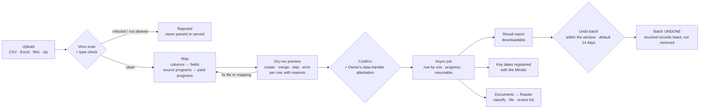
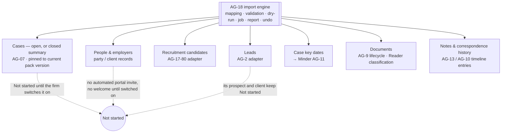

> **Document control** · Version **1.9** · **2026-10-25** · Status: **Knock-ons from the duplicates / copy-on-emails work closed (the product owner, 25 Oct): §13 item 28 closed — duplicate checks written into the dry run (AG-18-94, AG-18-96 to AG-18-98); earlier: AG-02 review decisions applied (21 Oct): imported consent per MAP:368, possible-match flags, no response clock, imported lead owner; earlier: AG-07 review and people model applied (18 Oct): X-2, AG07-D1, AG07-D15 (AG7-D20); earlier: second pass (AG16-55): open question 24 closed; earlier: Draft — new module; two one-line knock-ons from AG-16 review round 2 applied 17 Oct (AG16-44: imported leads are never merged automatically; AG16-49: imported contacts get their time zone filled automatically); earlier: AG-16 review applied 14 Oct (licensed approval for switch-on withdrawn, Automatic messages page pointer, Team safeguards and supervision leftovers removed); automatic messages run from day one, no review hold (SA05-R9a, 12 Oct; import quiet mode unchanged); knock-ons from AG-07 v2.3 and CP-01 v0.1 applied (CLIENT target fields, manual portal invite, Party service, sensitive-data rule); decisions AG18-D1 to AG18-D12 recorded; immigration values (key-date types and their lead times, program list, closed-case summary fields) awaiting the Immigration-SME; remaining open items (§13) awaiting the founder**\
> Part of: *Agent (RCIC/Lawyer) Console — Functional Requirements* · New module (agent-native decisions, the product owner, 4 Oct 2026) · Previous version: `_archive/AG-18-data-import-and-migration_v1.8_2026-10-21.md`\
>
> | Version | Date | Change | Decisions |
> |---|---|---|---|
> | 25 Oct (later): MS-D24 and writer follow-ups | 2026-10-25 | **MS-D24 applied (the product owner, 25 Oct); targeted edits only.** **Triage item 15:** AG-18-99 (opening balances) and AG-18-100 (firm-service cases) now state the ten points that were open: go-live day = import date (editable); trust question asked when importing a trust balance, Owner answers; person-level balance keeps its currency; "Paid by" optional; key `agent/payment:record`; repeated balance warns (default Skip); closed source matter imports as Done; service defaults not applied; client + service duplicate warns; a new service may be added in the mapping step (`agent/prospect:edit`). Open questions 33 and 34 closed. Row added to "Decisions that change this epic". Stale versions of AG-02, AG-07 and AG-17 corrected in the duplicate-check rows. | MS-D24 · MS-D14 · MS-D16(6) |
> | 25 Oct (money slice + AG-05 review) | 2026-10-25 | **Money-slice decisions that touch AG-18 applied (the product owner, 25 Oct); targeted edits only.** (1) **MS-D14, MS-D19(7), MS-D20(18):** opening balances move from Release 2 into Release 1. New target OPENING_BALANCE with three amount columns (trust balance, amount owed, credit), per case or, with no case imported, on the person; an amount owed gets reference OB-…, no due date and no reminders until staff set one (§3.4a, new AG-18-99 requirement and card, §0.1, AG18-D3, §0.2 AG-06 row, Phasing). Old invoice history and payment history stay Release 2. (2) **MS-D16(6):** program mapping may map a source program with no pack programme to a firm service, which creates a firm-service case (AG-18-10, AG-18-23, new AG-18-100 card). (3) Open — ask the product owner: ten points (§13 items 33 and 34). Rows added to "Decisions that change this epic". | MS-D14 · MS-D16(6) · MS-D19(7) · MS-D20(18) |
> | 1.9 | 2026-10-25 | **Duplicate checks written into the import (the product owner, 25 Oct; closes §13 item 28, the 24 Oct "check when we get here" note).** Every check warns in the dry run, never blocks, and has a default the importer can change. (a) A case row matching an open case of the same client and program path (AG-7-1 rule 9) is a possible duplicate, default **Use the open case**; a person matching an open filing of the same program on another case (AG-7-1 rule 11) is a warning, default **Import anyway**. (b) A Corporate client's case row runs the LMIA file check of AG-17-95 instead, by the earlier file's state. (c) Employers match on the AG-2-79 keys, never name alone; filling an empty business number re-runs the AG-17-3 check. (d) A family member runs AG-2-14 rules 1 to 6 and rule 12; an email or phone match on the row's own client or linked family is information only (AG-2-14 rule 12(d)). (e) Matching covers every email and phone on a person (AG-2-14 rule 1, `PartyChannel`). (f) The same file uploaded twice is caught by its content hash before mapping. Candidate-log rows follow AG-17-80 if they ever run on this engine. **Added:** AG-18-96, AG-18-97, AG-18-98 with build cards; US-30, US-31; §13 Q29 – Q32. **Changed:** AG-18-13, AG-18-94 (requirement and card), BR-3, §3.1, §3.3, §7, §9, §0.2. **Closed:** §13 item 28. Next free IDs: AG-18-99, BR-29, US-32, §13 Q33. 25 Oct final pass: §13 Q29 – Q32 resolved by the product owner and applied — Q29 later rows follow the importer's choice for a duplicate case (AG-18-96 rule 5); Q30 optional LMIA columns on the case template (§3.4, AG-18-96 rule 3); Q31 an exact business-number match preselects Use existing (AG-18-97); Q32 AG-17-80's candidate CSV import is an adapter on this engine (§3.0, §3.3, AG-18-3). Changed also: §0.2, §1 DUP-4 and DUP-7 rows, BR-3, §9, US-30, the AG-18-96 and AG-18-97 cards. 25 Oct final audit: card AG-18-94 rule 7 example uses the same date of birth (3 Aug 2018); audit string "added as new despite a match" (AG-7-107 rule 13); §0.2 duplicate-checks row marked applied. | DUP-1, DUP-2, DUP-4, DUP-6, DUP-7, DUP-8, DUP-9, AG07-D20(l) |
> | 1.8 | 2026-10-21 | **AG-02 review decisions applied (the product owner, 20 Oct).** (1) Imported consent: a mapped consent column with the importer's ticked declaration writes consent for that purpose (MAP:368, kept by AG02-D8(2)); AG18-D10(i), §3.7, AG-18-45, BR-18, the §9 edge case and §13 Q4 corrected. (2) A lead row that matches a known person raises a possible-match flag, with no notice per row; the report shows one count; an exact email match pre-selects "Use existing" (AG02-D12, AG02-D6(1)); AG-18-92 and §3.10. (3) No speed-to-lead SLA clock or breach flag; `lead.created` is sent once and never again on switch-on (AG02-D7); AG18-D9, §0.2 AG-02 row, §3.7, §3.10, US-4. (4) The path is lead → Engage → prospect → client; quiet carries on at each step (AG02-D2); AG18-D10(a), diagram, §0.2 AG-02 row, §3.10, §9 edge case. (5) Owner of an imported lead: in a one-user firm, that user; otherwise a row with no settable owner waits in Unassigned leads and never goes through the sharing setting (AG02-D13(4), X-4); §3.10. (6) Import stays Owner and Admin only (AG02-D15(2)); no change. Pending block: P41, P42, P105, P106 settled and removed. Final hand-over check (21 Oct): the AG02-D7 test in §8 no longer says "no speed-to-lead recipe"; speed-to-lead is the AG-11 recipe, not the reply reminder. | AG02-D2, AG02-D6, AG02-D7, AG02-D8(2), AG02-D12, AG02-D13(4), AG02-D15(2), X-4, MAP:368 |
> | 1.7 | 2026-10-18 | **People model and AG-07 review applied (the product owner, 18 Oct).** **X-2 (pointer plus local rules):** an import creates a person record (Party, kind PERSON) for every real person it names, family members included, and offers the firm's existing person first ("Client J, daughter, already on file — use her?"); nothing is merged silently; the role (principal, spouse, child, other) is stored per filing, not on the person; `Contact.timezone` becomes the person's time zone. **AG07-D15 / AG7-D20:** an imported case starts at the stage its data supports; imported documents start as "Received". **AG07-D1:** one document status list (Needed, Received, Accepted, Needs replacing, Not needed), owned by AG-09; "Superseded" and "Quarantined" are file states. **Added:** AG-18-94, AG-18-95; build cards for AG-18-32, AG-18-94, AG-18-95; §13 Q7 closed, Q25 – Q27 opened. **Changed:** AG-18-13, AG-18-23, AG-18-32, AG-18-93, §3.0, §3.3, §3.4, §3.5, §0.2. Next free IDs: AG-18-96, BR-29, §13 Q28. *18 Oct (final): AG07-D17 – D21 applied — AG07-D20(l).* **AG07-D20(l):** an exact email match for a person defaults to "Use existing" and is shown in the dry-run; it is never merged unseen (AG-18-94 requirement and card, AG-18-13, BR-3, §3.3 dry-run text). **Open questions:** Q26 closed. Requirement IDs unchanged. | X-2, AG07-D1, AG07-D15 (AG7-D20), AG07-D20(l) |
> | 1.6 | 2026-10-17 | Second pass (the product owner, 17 Oct). **Open question 24 closed** with the writer's recommended default: an undecided lead row is imported as a separate lead, with "Keep separate for all" and "Review the duplicates" one click each. AG-18-92 already says a lead is merged only when the importer chooses Merge; no requirement text changes. No other decision AG16-56 – AG16-82 names this file. *Same-day fixes (18 Oct): AG16-90 — AG11-D13 line: ~~Owner or Admin may turn it off~~ only the Owner turns AI on or off (AG16-80).* *18 Oct: new section 'Decisions that change this epic' (index of AG16 decisions; no requirement changed).* | AG16-55, AG16-90 |
> | 1.5 | 2026-10-17 | Two knock-ons from AG-16 review round 2 (the product owner, 17 Oct); nothing else changes and the quiet-import rules (AG18-D9, AG18-D10) are untouched. **(1) AG16-44, no quiet judging:** in the lead adapter a match on email or phone with an existing lead or contact is no longer merged by the natural-key rule; it is listed in the dry-run as **"Possible duplicate of [name] — Link · Merge · Keep separate"** and the importer chooses (AG-18-92; AG-02 §3.2 owns the lead duplicate rule). **(2) AG16-49, client time zone:** an imported contact gets `Contact.timezone` filled automatically by the AG-07 rule (AG-18-93); there is no import column. **Added:** AG-18-92, AG-18-93 (one line each, pointers to AG-02 and AG-07), one sentence in §3.10 and one in §3.0, §13 Q24. **Open questions closed:** none. | AG16-44, AG16-49 (AG16-27, AG16-31) |
> | 1.4 | 2026-10-14 | **AG-16 review decisions applied (the product owner, 14 Oct).** Import quiet mode (AG18-D9, AG18-D10) is unchanged. **Withdrawn (R5, applied here for the first time):** the licensed-user approval for switching on a single imported client — AG-18-86, the "unlicensed file owner" clauses of AG18-D11(b), AG-18-63, BR-20, the §6 state table, one user story and one edge case, §10 and §13 Q15; the file owner (or a user with `agent/import:run`) switches on one client with no second approval. Also withdrawn: Team safeguards row AG11-D9 (SR-Q1c, SR-Q1b, AG16-9), supervised client messages and licence-based approver routing in the synced rows AG11-D1, AG11-D2, AG11-D11 and AG-18-64 (R5). **Changed:** "Send automatically / Ask me first / Off", autonomy-level and "Review your automatic messages" wording now points to the Automatic messages page (AG-12) (AG16-11): AG11-D1, AG11-D12, §3.7 switch-on preview, AG-18-72, §13 Q22. AG-18-75 and the escalation wording aligned with AG16-22 (an import never raises escalation alerts or at-risk marks). AI wording: only the Owner turns AI on, and AI paused by ExpatReady behaves like AI off for imported documents (AG16-20; §3.5, AG-18-36). Imported old invoices (Release 2) keep their original numbers and do not affect the firm's invoice sequence (AG16-13 rule 15). Undo vs delete: closed-not-deleted and Recently deleted noted (AG16-21). **Not changed:** business hours and closed days (AG16-6/7; no mention here), Reader and AI Doer scope (AG16-3), quiet imports. **Added:** §13 Q23. Requirement IDs unchanged; next free IDs: AG-18-93, US-30, §13 Q24. | AG16-3, AG16-11, AG16-13, AG16-20, AG16-21, AG16-22 · R5, SR-Q1b, SR-Q1c, SA-Q3, AG16-9 |
> | 1.3 | 2026-10-12 | **SA05-R9a (the product owner, 12 Oct).** Nothing is held for a template or standard-message review any more: automatic messages run from day one with ExpatReady's neutral wording, and "Review your automatic messages" is an optional on/off page owned by AG-12 (AG12-D23, AG-12-52; missing-detail note AG-12-109; one-time notice AG-12-110). Here: the "waits until the firm publishes a seed template" wording is removed from AG11-D12 (synced row), the switch-on preview text (§3.5) and AG-18-72; one story line and one edge case withdrawn and replaced (US-29, new edge case). **Not touched:** import quiet mode (AG18-D9, AG18-D10, AG-18-43, AG-18-60 and the whole switch-on flow), autonomy levels and the AI floors. **Changed:** AG11-D12, AG-18-72, §3.5 Switching on paragraph. **Withdrawn:** US-19 seed-template line, one edge case. **Added:** US-29, §0.2 SA-05 row, open questions 21, 22. Requirement IDs unchanged; next free IDs: AG-18-93, US-30, §13 Q23. Same-day closing (SA05-R9b): open question 22 is closed (`agent/template:configure`); question 21 is partly closed (each message needs the firm details it uses) and the preview part stays open. *(revised same day — SA05-R9b)* | SA05-R9a, SA5-X46 · SA05-R9b |
> | 1.2 | 2026-10-07 | Role clean-up from SA-06 v3.0 (the product owner, 7 Oct): no licensed-representative role template. `agent/case:form-approve` is seeded on the **Owner and Case Manager** starter roles (was "licensed roles"); `agent/sqr:verify` on Owner, Case Manager and Case Officer (was "licensed roles and case officers"); either may be granted to any role and every use is audited. "Firm Admin" is now **Admin** (six starter roles) in §2, stories, §10 and defaults. The `agent/import:*` defaults stay Owner and Admin. Today's-code descriptions (firm-owner and firm-admin role templates in the current seed) are left as they are. Requirement IDs unchanged. | SA6-D2, SA6-D5, SA6-D3 |
> | 1.1 | 2026-10-05 | Knock-on changes from AG-07 v2.3 and CP-01 v0.1. **Changed:** §3.0 CLIENT target field list and AG-18-85 aligned with AG-07 Add client (individual AG-7-71, corporate AG-7-72, client lens fields AG-7-69 — AG7-D6, AG7-D8) and the PARTY / CLIENT targets note that they create identity records through AG-02's Party service (AG7-D9); §13 Q19 narrowed to past-date lead times only (CLIENT-field half closed); AG18-D9, AG-18-43, AG-18-60 and every "no portal invitation" line (§0 AG18-D9 row, §0.2 AG-15 row, §3.7 quiet-by-default paragraph, the Visual Overview diagram, US-4) now read "no **automated** portal invitation" — a manual invite by staff is allowed and does not switch the client on (CP1-D8); sensitive data: §3.3 "PII in the preview", AG-18-18, AG-18-47, AG-18-54, BR-15, BR-17, US-10, US-11, §3.9 assisted-migration paragraph, §10 permissions note and assisted-migration line, §11 PII handling and audit lines, §13 item 5 note and Phasing line — previews, result reports and logs are masked; an unmasked download needs the platform-wide `agent/pii:export-unmasked` (audited), which support never holds in an assisted session (AG7-D7); AG18-D10(g) row wording; §0.2 AG-01 row. **Added:** "Applied from AG-07 and CP-01" table in §0. **Withdrawn:** the PII-reveal permission (AG-18 defined no key of its own; it pointed to AG-2's `reveal-pii`). No requirement numbers added or renumbered. Same day (AG7-D10): masking and reveal removed — previews, result reports and audit views show personal data in full to anyone allowed to see the batch; `agent/pii:export-unmasked` is not used (never defined here; every reference removed); AG-18-18 and US-10 withdrawn (they existed only for masking); changed: AG7-D7 row (withdrawn, AG7-D10 row added), Visual Overview diagram, AG18-D8, AG18-D10(g), §3.3 "PII in the preview", result report paragraph, §3.9 assisted-migration paragraph, AG-18-21, AG-18-47, AG-18-54, BR-15, BR-17, §6 state table, US-26, §10 permission row and note and assisted-migration line, §11 PII handling and audit lines, §12 NEW line, §13 item 5 note and Phasing line. Kept: personal data never in system logs or traces; passport and financial numbers never in the content of emails, WhatsApp messages or notifications; encryption at rest; the assisted-migration support rule (support never sees personal data, AG18-D10(g)). | AG7-D6 · AG7-D7 · AG7-D8 · AG7-D9 · AG7-D10 · CP1-D8 |
> | 1.0 | 2026-10-04 | New module **AG-18 Data Import & Migration** (Release 1). One import engine for the platform, with AG-2's lead CSV import as an adapter on it. Release 1 scope: people and employers, clients, cases (open, and closed as summary records), case key dates registered with the Minder, documents (bulk upload or zip, classified and filed by the Reader, unmatched files to a review list), notes and correspondence history as timeline entries. Safe by construction: upload scan, field and program mapping, mandatory dry-run preview, asynchronous job with result report, duplicate detection, undo of a whole batch. Provenance on every imported value; imported profile values unverified; imported cases pinned to the pack version current at import. Imports fire no client-facing automation. Assisted migration by Expat Ready staff. New `agent/import:*` permissions. Requirements AG-18-1 to AG-18-58, BR-1 to BR-18, US-1 to US-14. Same day: AG18-D6 wording aligned with AG11-D10 (imported values stay unverified until checked against a source). **Same day (fix):** new decision **AG18-D9** — imported clients, leads and cases are **quiet** for client-facing automation until the firm switches them on ("Start client automations", per batch or per client, after a preview and a confirmation). Quiet holds for the import itself and for every later trigger or scheduled scan; internal work (Minder, tasks, Done for you) runs normally; a manual message does not switch a client on. §3.7 expanded; AG-18-42 and AG-18-43 revised; new AG-18-59 to AG-18-67, BR-19, BR-20, US-15 to US-17; BR-8 revised; `automationState` added to §7 and §6; §9, §10, §0.2 and §13 updated. Requirements are now AG-18-1 to AG-18-67, BR-1 to BR-20, US-1 to US-17. **Same day (closing decisions):** AG18-D9 completed — (a) a lead created by an import never starts the speed-to-lead SLA clock or breach flag, `prospect.created` is not replayed for it, and "Start client automations" does not start the clock (§3.7, §3.10); (b) the 7-day reminder for a batch still quiet goes to the **Owner's** Needs you / Done for you as one reminder, and the 7 days is decided (AG-18-66, §3.7, US-16, §9). Revised same day: AG-18-66; §3.7; §3.10; §9 (deactivated file owner); US-16 reminder line; §13 Q12 (who and 7 days marked decided; whether a later repeat is wanted and due times stay open). **Same day (review fixes):** overriding principle — ExpatReady works for the firm, not the regulator: the firm decides, ExpatReady never reports to a regulator, never declares a firm non-compliant and never blocks the firm's own licensed judgement; product copy says "protecting your practice" and cites no code section (§0). New decision **AG18-D10** — imports usable and safe, (a) to (q): (a) quiet carries over (cases and leads created on a quiet client, and clients created from a quiet lead, inherit QUIET; a client-facing action is skipped if any record it concerns or the recipient party is QUIET; party/client fields owned here until AG-01 adopts them; one marker, `IMPORT`, with the record state authoritative); (b) "Pause client automations" per client and per batch, and a switch-on preview by recipe and action type after the consent gate and rate caps with skip checkboxes and an open-cases filter, released through the normal scan, never a burst; (c) undo "worked on" widened, default window 14 days; (d) past key dates recorded with no reminder by default, never escalated, one "N past dates found" summary to the Owner; (e) "Verify imported values" per client with `agent/sqr:verify`, Reader values from imported documents verified on approval (AG11-D10); (f) imported documents reviewed one at a time in the document view, no Needs you item per value; (g) assisted migration: Owner uploads, support maps and runs, never reveals PII, blocked until the SA-07/SA-10 key exists; (h) Owner attestation on every batch containing personal data; (i) imported consent never written to `ConsentRecord`; (j) imported correspondence and notes historical and never-send, with minimal fields defined here; (k) key-date target only for pack-declared types; (l) `agent/import:*` authoritative, `agent/firm:import` to be migrated; (m) program near matches suggested and confirmed per group; (n) batch states DRY_RUNNING, UNDOING, CANCELLED, and PARTY / CLIENT targets defined; (o) "proposed" rules decided (undo order, merge fills empty fields only, case under an ACTIVE client takes its batch's state) or marked "(provisional)"; (p) Owner reminders at 7 and 30 days plus a permanent "N clients not started" badge; (q) UI copy "Not started". Applied-from-AG-11 table: AG11-D1 and D2 revised, D4 revised, AG11-D9 to D13 rows added; §3.6 "the same rule as a Reader value" removed; §12 line drifts fixed (`tenancy-core.prisma:579`, `import-run.job.ts:494`, `:484`) and the permission migration noted. §0.2 adds AG-01 and AG-08 and revises AG-02, AG-07, AG-09, AG-10, AG-11, AG-13, AG-15, SA-06, SA-07 / SA-10, SA-11. Changed: AG-18-10, 25, 27, 29, 30, 34 to 39, 41 to 43, 45 to 47, 49, 56, 60 to 62, 64 to 67; BR-2, BR-6, BR-8, BR-15, BR-18 to BR-20; US-2, US-3, US-7, US-8, US-15 to US-17; §3.0 to §3.10, §6, §7, §9, §10, §12, §13 (Q1 to Q3, Q11, Q12, Q14 decided or defaulted; Q4, Q5, Q13 revised). New: AG-18-68 to AG-18-85, BR-21 to BR-26, US-18 to US-26, §13 Q16 to Q19. Requirements are now AG-18-1 to AG-18-85, BR-1 to BR-26, US-1 to US-26. Same day (final alignment): §0 Applied-from-AG-11 rows for AG11-D1, D2, D9, D10, D11, D12 and D13 synced with AG-11's final wording (template message definition; Needs you scope; four-part Team safeguards with backup approver; Reader approve = verify for imported documents; the Owner form exception and the supervision re-notice; the one standard-messages review; unverified sender drops to `APPROVE`); §0.2 marks AG18-D9/D10 **applied** for AG-02, AG-07, AG-08, AG-09, AG-10 and AG-11 after a grep of each module (AG-01, AG-13, AG-15 and the SA rows stay pending); the AG-11 row no longer gives AG-11 the 30-day reminder (AG-18-66 owns both reminders). Same day (5 Oct): AG1-D19 — no licence monitoring; licensed user = linked by the firm. 5 Oct (open questions closed): **AG18-D11** recorded (a)–(g) — assisted migration included free for every firm at launch, with `03-Doc-1-Platform-Foundation.md` §8.9.1 superseded for these points (tech lead to re-base; that file is not edited here); switching on one client (licensed file owner or `agent/import:run`; an unlicensed owner's switch-on waits for a licensed user's approval); a case created from a quiet lead linked to an ACTIVE client follows the client; a paused record still counts as worked on ("provisional" removed); a paused client's waiting items stay marked "client paused" and cannot send; a running import cannot be stopped (CANCELLED only before the run starts); verified sender defined; a client in two batches is started by its own batch or individually. AG11-D14 to D17 applied (Applied-from table, §0.1, §13). Changed: AG18-D8 row, AG-18-41, AG-18-63, AG-18-67, AG-18-68, AG-18-83, BR-20; §3.7, §3.9, §6 state table, §9, §10, §12; the AG11-D13 row (AI processing in Canada only). New: AG-18-86 to AG-18-89, BR-27, BR-28, US-27, US-28. §13 Q2, Q6, Q13, Q15, Q17 and Q18 decided.  **5 Oct (Release 1 scope review, AG18-D12 and AG11-D18):** source-system import adapters for **Officio and CaseEasy are now Release 1** (revises AG18-D5), each built only after a real export sample from a willing firm is obtained and checked; until a sample exists that adapter is not available and the firm uses the CSV/Excel templates; the product team (the product owner) obtains the samples; **Clio and other adapters stay Release 2**; invoices, payment history and opening balances stay Release 2. The AG18-D11 note "unknown WhatsApp numbers creating a lead stays Release 2" is reversed by AG11-D18(b) (a person clicks "Create lead" in the Unmatched inbox; imports are unaffected). AG11-D16 row: IMAP is also Release 1 (AG11-D18(c)); AG11-D4 row: the Reader reads more document types (AG11-D18(e)) and imported documents of those types follow the same rules. Changed: AG18-D5 row, AG18-D11(g), §0.1, §3.1, §3.5, §8 (one engine), §12, §13 Phasing and domain-correctness note, AG-18-4. New: AG18-D12, AG-18-90 and AG-18-91, an edge case, §13 Q20. 5 Oct (final check fixes): "Applied from AG-11" table — AG11-D18 row added (parts (b) Create lead and (e) Reader types as they apply here). No requirement changed. | AG18-D1 to AG18-D10 · AG1-D19 · AG18-D11 · AG11-D14 to D17 · AG18-D12 · AG11-D18 |

## Decisions that change this epic (14–25 Oct) *(new 18 Oct; AG-02 rows added 21 Oct; duplicate-check rows added 25 Oct)*

Product-wide rules (apply here as everywhere; home: Agent `00-Overview` → "Product rules every epic follows"): AG16-11, AG16-31, AG16-44.

The "AG16" prefix is historical: these decisions began in the AG-16 review and apply across the product. Full text: `TEMPLATE-MAP-working_2026-10-10.md`.

| Decision | What was decided (one line) | What it changes in this epic | Where (requirement / card / section) |
|---|---|---|---|
| AG16-3 | AI Doers stay in Release 1 | Referenced only (no change here) (cited in the AI floors of synced row AG11-D1; Reader and AI Doer scope not changed) | §0 AG11-D1 row · change log 1.4 |
| AG16-6 | Business hours and closed days | Referenced only (no change here) (change log 1.4: not changed, no mention here) | Change log, row 1.4 |
| AG16-8 | Who changes Escalation and At-risk marks | Referenced only (no change here) (cited: at-risk marks are a separate switch) | §0 AG11-D9 row (withdrawn) |
| AG16-9 | Backup approver: removed | The Owner's option to nominate a backup approver is struck from the withdrawn Team-safeguards row | §0 AG11-D9 row (withdrawn v1.4) · change log 1.4 |
| AG16-11 | One Automatic messages page, documented in one place only | "Send automatically / Ask me first / Off" and the message review now point to the Automatic messages page (AG-12) | AG11-D1 · AG11-D12 · §3.7 switch-on preview · AG-18-72 · §13 Q22 |
| AG16-13 | "Getting paid" defaults and scenarios | Imported old invoices (Release 2) keep their original numbers and do not affect the firm's invoice sequence | §0.1 (AG18-D3 row) · §0.2 AG-06 row |
| AG16-20 | AI switch details | Only the Owner turns AI on; while ExpatReady has paused AI, imported documents go to the review list as when AI is off | §0 AG11-D13 line · §3.5 · AG-18-36 |
| AG16-21 | Undoing deletes | A client or case with history is closed, not deleted; delete only for an empty client or lead; Recently deleted noted for undo | §3.8 (Window) · §13 Q23 |
| AG16-22 | One escalation rule: push the high-stakes, show the routine | An import never raises escalation alerts or at-risk marks, whatever the firm's switches | AG-18-75 · §0 AG11-D9 row |
| AG16-27 | Government mail: recognise, match, identify, sort, deadline | Referenced only (no change here) (cited in the change log with AG16-31) | Change log, row 1.5 |
| AG16-44 | ExpatReady never quietly judges for the firm | In the lead adapter, a match on email or phone is never merged automatically; the dry-run lists "Possible duplicate of [name]" and the importer chooses Link, Merge or Keep separate | AG-18-92 · §3.10 · §0.2 AG-02 / AG-07 row |
| AG16-49 | Client quiet hours in the client's own time zone | An imported contact gets its time zone filled automatically by the AG-07 rule; no import column | AG-18-93 · §3.0 · §0.2 AG-02 / AG-07 row |
| AG16-55 | Writers' recommended defaults accepted for the detail questions | Open question 24 closed: an undecided lead row imports as a separate lead, with "Keep separate for all" and "Review the duplicates" one click each | §13 Q24 |
| AG16-56 | When automatic messages send, by what their timer counts | Referenced only (no change here) (named only in the second-pass range in the change log) | Change log, row 1.6 |
| AG16-80 | AI switch and plans | Only the Owner turns AI on or off (Owner or Admin may no longer turn it off) | §0 AG11-D13 line |
| AG16-82 | One rule for every broken connection | Referenced only (no change here) (named only in the second-pass range in the change log) | Change log, row 1.6 |
| X-2 | One person record per real person; the role is per filing; answers live under the person; one place for a person's details (the product owner, 18 Oct; home AG-02) | Imports create person records and offer the existing person first, never a silent merge; family members get their own record; the role goes on the case's filing; `Contact.timezone` is now the person's time zone | AG-18-94 · AG-18-13 · AG-18-93 · §3.0 · §3.3 · §0.2 · §13 Q25, Q26 |
| AG07-D1 | One document status list, owned by AG-09: Needed, Received, Accepted, Needs replacing, Not needed (the product owner, 18 Oct) | Imported documents start as "Received" and are never "Accepted" by the import; "Superseded" and "Quarantined" are file states, not request statuses | AG-18-32 · §3.5 Status · §13 Q7 |
| AG07-D15 (AG7-D20) | The AG-07 author's defaults approved as a batch; AG7-D20: an imported case starts at the stage its data supports; imported documents start as "Received" (the product owner, 18 Oct) | Home of the import side: the stage rule and the starting document status | AG-18-95 · AG-18-23 · §3.4 · §13 Q7, Q27 |
| AG07-D20(l) | Import exact email match defaults to "Use existing", shown in the dry-run; never merged unseen (the product owner, 18 Oct). Home: AG-18. | An exact email match for a person is preselected as "Use existing" in the dry-run offer; the importer can switch it to "Create new person" in one click; other matches stay undecided and import as a separate person. Q26 closed. | AG-18-94 (requirement, card rules 2, 3, states, tests, edge cases) · AG-18-13 · BR-3 · §3.3 · §13 Q26 |
| AG16-90 | Batch C: consistency fixes from the 17 Oct audit | AG11-D13 line corrected: only the Owner turns AI on or off | §0 AG11-D13 line |
| MAP:368 (kept by AG02-D8(2)) | Imported consent with a firm declaration: when a consent column is mapped and the importer ticks "I confirm these people agreed to receive marketing from [firm], and I can show how and when", each row whose column says yes gets one consent row for that purpose (the product owner, 11 Oct; kept 20 Oct). Replaces AG18-D10(i). | An import writes consent only from a mapped consent column with the ticked declaration; without either, no consent is written. The old "never written to `ConsentRecord`" lines are corrected | AG18-D10(i) · §3.7 consent paragraph · AG-18-45 · BR-18 · §9 edge case · §13 Q4 (closed) |
| AG02-D12 (D8.78), AG02-D6(1) | Imports raise the same possible-match flag as every other way in, with no notice per row; an exact email match pre-selects "Use existing", which counts as Link (the product owner, 20 Oct) | A lead row that matches a known person shows "Possible match: [name] — Use existing · Merge · Keep separate"; an undecided row imports with a possible-match flag; no per-row owner notice; the report shows one count | AG-18-92 · §3.10 |
| AG02-D7 | No speed-to-lead SLA clock or breach; one optional lead reply reminder, unattended doors only (the product owner, 20 Oct) | An imported lead has no response clock, no breach flag and no reply reminder; `lead.created` is sent once, quiet, and never again on switch-on (replaces "`prospect.created` is not replayed") | AG18-D9 · §0.2 AG-02 row · §3.7 · §3.10 · US-4 |
| AG02-D2 | A prospect becomes a client once; the path is lead → Engage → prospect → client (the product owner, 19–20 Oct) | "A lead converted to a client" becomes "a lead engaged as a prospect that becomes a client"; the quiet state carries on at each step | AG18-D10(a) · Visual Overview diagram · §0.2 AG-02 row · §3.10 · §9 edge case |
| AG02-D13(4), AG02-D1(4), X-4 | A one-user firm's user owns every imported lead; otherwise an imported lead with no owner waits in Unassigned leads and never goes through the sharing setting (the product owner, 20 Oct) | One-line pointer to AG-2-7 rule 2 for the lead owner | §3.10 |
| AG02-D15(2) | Import follows AG-18: Owner and Admin only (the product owner, 20 Oct) | Referenced only (no change here): the `agent/import:*` defaults stay Owner and Admin | §0.1 permissions line · §10 |
| DUP-1, DUP-2 (AG-07 v3.8) | Duplicate-case check on client + program path, and filing check per person and program; warn, never block; "create anyway" audited (the product owner, 24 Oct; home AG-7-1 rules 9 and 11) | An imported case row and its filings run the same checks in the dry run; defaults Use the open case (case) and Import anyway (filing) *(added 25 Oct)* | AG-18-96 · §3.3 · BR-3 |
| DUP-4 (AG-17 v0.13) | LMIA file check on employer + occupation + work location, by the earlier file's state; replaces AG-7-1 rule 9 for Corporate clients (the product owner, 24 Oct; home AG-17-95, AG17-D83) | An imported Corporate case row runs AG-17-95 instead of the case check *(added 25 Oct)*; the case template has optional LMIA columns, and without them the check is skipped and the dry run says so *(changed 25 Oct — §13 Q30)* | AG-18-96 · §3.3 · §3.4 |
| DUP-6 (AG-17 v0.13) | A business number entered after the first save re-runs the company match on that key (the product owner, 24 Oct; home AG-17-3) | An import that fills an empty business number shows the same warning in the dry run *(added 25 Oct)* | AG-18-97 |
| DUP-7 (AG-17 v0.13) | One recruitment log entry per applicant; CSV identical rows skipped and counted; same name with another date or channel to the correction list (the product owner, 24 Oct; home AG-17-80) | ~~Candidate rows follow AG-17-80 if they ever run on this engine; whether they do is open *(added 25 Oct)*~~ AG-17-80's candidate CSV import is an adapter on this engine and keeps AG-17-80's template and rules *(changed 25 Oct — §13 Q32)* | §3.3 · AG-18-3 · §13 Q32 |
| DUP-8, DUP-9 (AG-02 v2.5, AG-07 v3.8) | Family add matches email and phone (AG-2-14 rules 1 to 6) and name + date of birth (rule 12), offer only; an email or phone match on the client or linked family is information only (the product owner, 24 Oct; homes AG-2-14 rule 12, AG-7-107 rules 9 to 16) | AG-18-94 calls AG-2-14 rule 12 for family members; every email and phone on a person is matched *(added 25 Oct)* | AG-18-94 (requirement and card) · §3.3 |
| MS-D14 *(25 Oct; home AG-18 for the import, AG-06 for what the balances are)* | Opening balances are Release 1; old invoice history stays Release 2 (the product owner, 25 Oct) | New target OPENING_BALANCE: per client a trust balance, an amount owed and a credit, by the three-column import or typed on the client ("Add opening balance", AG-06). Past invoices and payments are not imported; the old statement may be uploaded as a document | AG-18-99 (requirement and card) · §3.4a · §0.1 · AG18-D3 |
| MS-D19(7) *(25 Oct; home AG-06)* | Opening trust balances are entered per case, or on the person when no case is imported | A row with a case reference goes to that case; a row without one goes to the person or company | AG-18-99 rule 2 |
| MS-D20(18) *(25 Oct; home AG-06)* | Imported amounts owed start with no due date and send no reminders until staff set one; reference OB-… | An amount-owed row creates one OB-… item with no due date | AG-18-99 rule 4 |
| MS-D16(6) *(25 Oct; home AG-07 case kind)* | A firm-service case may be created from an imported matter with no pack programme | Program mapping offers the firm's services beside the pack programs; such a row creates a firm-service case | AG-18-10 · AG-18-23 · AG-18-100 (requirement and card) |
| MS-D24 *(25 Oct, later; writer follow-up 15; home AG-06 for the money rules, AG-07 for the case kind)* | The import details are settled: go-live day = import date (editable); a trust balance asks the trust question (Owner answers); a person-level balance keeps its currency; "Paid by" optional; key `agent/payment:record`; a closed source matter imports as Done; service defaults are not applied; a client + service duplicate warns; a service may be added in the mapping step (`agent/prospect:edit`) | AG-18-99 and AG-18-100 are written with these points; open questions 33 and 34 closed | AG-18-99 rules 2, 3 and 8, Access, Edge cases · AG-18-100 rules 2, 4, 5, 6 and Access |


## Module AG-18: Data Import & Migration

**Applied from AG-07 v2.3 and CP-01 v0.1 (5 Oct 2026, v1.1)** — decided by the product owner (product owner):

| ID | Decision | Applied here |
|---|---|---|
| **AG7-D6** *(AG-07)* | Add client (individual): first and last name, plus email or phone, required; file owner and office optional. | §3.0 · AG-18-85 · §13 Q19 |
| **AG7-D7** *(AG-07)* | *(withdrawn v1.1 — AG7-D10; replaced by the row below)* | §3.3 · AG-18-18, AG-18-47, AG-18-54 · BR-15, BR-17 · §10 · §11 |
| **AG7-D10** *(AG-07)* | No masking and no reveal of personal data anywhere; anyone allowed to see a batch sees previews and reports in full; no reveal or unmask key. Kept: personal data never in system logs or traces; passport and financial numbers never in the content of emails, WhatsApp messages or notifications. | §3.3 · AG-18-21, AG-18-47 · BR-15, BR-17 · §10 · §11 |
| **AG7-D8** *(AG-07)* | Corporate Add client: legal name plus one primary contact required; everything else optional. | §3.0 · AG-18-85 · §13 Q19 |
| **AG7-D9** *(AG-07)* | AG-02 owns the `Party` record; AG-18 writes parties through AG-02's service. | §3.0 · AG-18-85 |
| **CP1-D8** *(CP-01)* | Staff may send a manual portal invitation to a Not started client; it does not switch the client on. Only the automated invitation stays blocked. | AG18-D9 · AG-18-43, AG-18-60 · §0.2 AG-15 row |

**Applied from SA-06 v3.0 (roles, 2026-10-07)** — decisions owned by SA-06 (decided by the product owner, 7 Oct 2026):

| ID | Decision | Applied here |
|---|---|---|
| **SA6-D2** | No licensed-representative role template and no licence check on permissions; professional-approval permissions seeded on Owner and Case Manager, grantable to any role, every use audited | AG18-D10 (AG11-D11 summary) · §10 `agent/sqr:verify` seeding |
| **SA6-D5** | Six starter roles; "Firm Admin" is now Admin | §2 · user stories · §10 defaults |

*Left unchanged on purpose:* "licensed user" and "unlicensed file owner" (a person's credential, AG11-D11), the "RCIC / Case Officer" and "Owner / Principal RCIC" personas, and the honesty-note references to today's firm-owner and firm-admin role templates in the current seed files (a description of existing code).

**Applied from AG-11 (Agent-native decisions, 2026-10-04)** — decisions owned by AG-11 (Automation — Conductor & Doers); decided by the product owner (product owner), 4 Oct 2026:

| ID | Decision | Applied here |
|---|---|---|
| **AG11-D1** *(revised same day; synced — final alignment)* | Autonomy level on every automated action (`AUTO` / `APPROVE` / `OFF`; the firm's choice per message is on the Automatic messages page, AG-12) *(changed v1.4 — AG16-11)*. A **template message** — sent from a firm-scope PUBLISHED template version with only its merge fields filled — is `AUTO` (AG11-D12). The hard floor, never below `APPROVE`: AI-written text to a client (a human approves it, using the ordinary sending permission — AG16-3 / SR-Q10) *(changed v1.4 — R5: licensed-user routing withdrawn)*, a template whose body was edited by AI, any government form, and any value written into the verified profile without a human having looked at its source. Imported spreadsheet values are unverified and the import never writes them into the verified profile | §3.6 · AG-18-37 · BR-6 · BR-24 |
| **AG11-D2** *(revised same day; synced — final alignment)* | Approve inline; Needs you holds only what is waiting — work a Doer prepared with no human present, and work waiting on a different person (routing per AG-11; Team safeguards, supervision and licensed approvers withdrawn v1.4 — SR-Q1c, R5). Nothing auto-executes on timeout. Reader results on imported documents are reviewed **one document at a time in the document view**, not as one Needs you item per value (AG18-D10(f)) | §3.5 · AG-18-34, AG-18-35, AG-18-78 · §3.7 · AG-18-66 (the 7-day and 30-day reminders use the Done for you / Needs you nudge) |
| **AG11-D4** *(revised same day)* | The Reader classifies documents and extracts identity-document data as proposals (*5 Oct — AG11-D18(e): also IRCC/government letters, language test results and ECA reports; the final list is pack content confirmed by the Immigration-SME; imported documents of those types follow the same rules; a deadline date read from a letter is proposed, approved, then registered with the Minder*) with provenance and confidence; never fabricates; AI is off for every firm until the provider terms are recorded (AG11-D13), with a manual fallback | §3.5 · AG-18-31 to AG-18-36 · BR-9 |
| **AG11-D5** | `document.extracted` trigger | §3.5 · AG-18-34 |
| **AG11-D9** *(synced — final alignment)* | ~~Team safeguards: one switch with four parts — four-eyes on government forms, Minder escalation, at-risk marks and Needs you routing to supervisors; on automatically at 5 or more active staff (one-time "turn on in 7 days" grace); only the Owner switches it off or adjusts a part, with a recorded reason; the Owner may nominate a backup approver. Supervised client messages are not a part (AG11-D11(c))~~ *Withdrawn v1.4 — SR-Q1c, SR-Q1b, AG16-9, R5. Escalation is now one Escalation switch (AG-16, AG16-22); at-risk marks are a separate switch (AG16-8).* | AG-18-75 (an import never triggers escalation alerts or at-risk marks — AG16-22) |
| **AG11-D10** *(synced — final alignment)* | Reader approve = verify: approving a Reader value in its review view, with the document region beside it, is the verification. Reader values from an imported **document** are verified on approval like any upload; spreadsheet-imported values have no document beside them and stay unverified until "Verify imported values" (AG-08); verifying needs `agent/sqr:verify` | §3.5 · §3.6 · AG-18-34, AG-18-76, AG-18-77 · BR-24 |
| **AG11-D11** *(synced — final alignment)* | *(Partly withdrawn v1.4 — R5: approver routing in (a), (c) and (d); (b) and (e) stand.)* Licence-aware defaults; the firm decides. Licensed user = an active user whom the firm has linked to a regulator credential it entered (AG1-D19) (AG-01 §3.5). (a) AI-written client text: a human always approves, using the sending permission (SR-Q10); ~~by default a licensed user; the Owner may allow other roles (recorded)~~ *(withdrawn v1.4 — R5)*. (b) `agent/case:form-approve` seeded on the Owner and Case Manager starter roles *(changed v1.2 — SA6-D2)*; the firm may grant it to any role (note, recorded; every use audited). ~~(c) Supervised client messages: a standalone setting, on as soon as the firm has an active unlicensed user who can message clients; the Owner may switch it off with a reason; it is not re-enabled automatically (one notice with a one-click "switch supervision on").~~ *(withdrawn v1.4 — R5)* ~~(d) No licensed user active: the Owner may approve, recorded "approved by Owner without a licensed user" — a government form even without `form-approve`.~~ *(withdrawn v1.4 — R5)* (e) Verifying a Reader value needs `agent/sqr:verify`. Applied here: verifying needs `agent/sqr:verify`; a manual message to a Not started client is an ordinary manual send | §10 · AG-18-64, AG-18-76 |
| **AG11-D12** *(synced — final alignment; changed v1.3 - SA05-R9a)* | A template message is a firm-scope PUBLISHED template version. **Nothing is held for a review:** automatic messages, including the seeded recipes' client messages, run from day one with ExpatReady's neutral wording unless off by default; the firm's per-message choice sits on the Automatic messages page (AG-12), not a separate review page *(changed v1.4 — AG16-11; was the optional "Review your automatic messages" on/off page)*; Guards AG-12-109 and AG-12-110 apply. *Previously: the seeded recipes' templates were adopted as firm drafts and their client messages waited in Needs you as `APPROVE` until the firm confirmed one review screen.* Applied here: the switch-on preview no longer lists messages as waiting because a seed template is not yet published | AG-18-72 *(changed v1.3)* |
| **AG11-D13** *(synced — final alignment)* | AI Doers off for every firm until Super Admin records the provider, region (Canada only, AG11-D15) and a no-training/no-retention agreement; then the Owner switches AI on once (one switch for all four Doers, audited acknowledgement). *(v1.4 — AG16-20: only the Owner turns AI on; ~~Owner or Admin may turn it off~~ *(changed 18 Oct — AG16-90; AG16-80)* only the Owner turns it on or off; while ExpatReady has paused AI, imported documents go to the review list as when AI is off.)* Injection safeguards: client content is delimited data, no tool access; the Sorter picks from a firm-scoped candidate list; an AI-only match is never filed automatically; an unverified sender's message never triggers client-facing `AUTO` — the action drops to `APPROVE` in Needs you. Applied here: the Reader on imported documents works only once the Owner has switched AI on; imported content reaches models as delimited data; until then every imported document goes to the review list; imported correspondence never passes through the Sorter (AG18-D10(j)) | §3.5 · AG-18-36 |
| **AG11-D14** *(5 Oct)* | **Core in-house, approved providers.** The client record and all Doer logic are built and owned by ExpatReady; outside providers only for AI/OCR, WhatsApp and mailbox connections, each approved by Super Admin (SA-08). Pulling data live from another product's API is not one of those three | §0.1 |
| **AG11-D15** *(5 Oct)* | **AI processing in Canada only.** The Reader reads imported documents only through the Canadian provider and region recorded by Super Admin; until they are recorded and the Owner has switched AI on, every imported document goes to the review list | §3.5 · AG-18-36 |
| **AG11-D16** *(5 Oct)* | **Inbound email split.** Gmail and Microsoft 365 mailbox connection is Release 1; plain IMAP is **also Release 1** *(revised 5 Oct — AG11-D18(c))*. Imported correspondence is unaffected (it never passes through the Sorter) | No change here |
| **AG11-D17** *(5 Oct)* | **Timings the firm can change.** The chase timing (5 days, then every 7, at most 4 reminders), the Needs you overdue time (2 working days) and the government-deadline lead (2 working days) are the firm's own values (AG-16-51, AG-16-52). The switch-on preview and the quiet-set simulation use the firm's current values. The Owner reminders at 7 and 30 days (AG-18-66) are not part of this setting | §3.7 · AG-18-66 |
| **AG11-D18** *(5 Oct, Release 1 scope review)* | Release 1 scope additions; two parts apply here. **(b)** "Create lead" for an unknown WhatsApp number is a person's click in the Unmatched inbox, never automatic, and is not an import path; leads created by an import stay quiet (AG18-D9). **(e)** The Reader also reads IRCC/government letters, language test results and ECA reports; imported documents of those types follow the same Reader rules as in the AG11-D4 row above; the final list is pack content confirmed by the Immigration-SME. Parts (a), (c) and (d) need no change here | (e): §3.5 · AG-18-31 to AG-18-36 · BR-9 · (b): no change here |

**Also followed (platform and other modules' decisions):**

| ID | Decision | Applied here |
|---|---|---|
| **FD-68** | A firm operates in exactly one country; the destination country is stamped, never chosen | §3.3 · AG-18-14 · BR-4 |
| **AG17-D55 / AG17-D70** | The Minder is in Release 1; modules register standard deadlines directly, always on, never plan-gated | §3.4 · AG-18-25 to AG-18-27 |
| **AG17-D63** | A case closing does not end reminders on recorded dates | AG-18-26 |
| **AG17-D65** | The pack version is pinned per case, at the version current when the case is created | AG-18-24 · BR-7 |
| **SA2-D7** | Support can always look; changes need the firm owner's time-limited permission; deleting records is always blocked in a support session | §3.9 · AG-18-48 · §0.2 (SA-02 row) · §13 |

### Module Index

Scan the whole module in ~30 seconds; jump to any part.

0. **Decision log** · 0.1 Release 2 and not in scope · 0.2 Pending knock-ons
1. **Purpose & Goal**
2. **Users & Jobs-to-be-Done**
3. **Functional Design — How It Works** (core)
   - 3.0 One engine, many targets (the foundation) · 3.1 Upload, formats and file safety · 3.2 Mapping — fields and programs · 3.3 Row validation and the dry-run preview · 3.4 The import job and key dates · 3.5 Documents — bulk upload, zip, Reader filing, review list · 3.6 Provenance and verification · 3.7 Silence to the client — quiet until switched on · 3.8 Undo a whole batch · 3.9 Assisted migration · 3.10 The AG-2 lead adapter
4. **Detailed Functional Requirements** (AG-18-x)
5. **Business Rules & Logic**
6. **States & Lifecycle**
7. **Key Entities & Fields**
8. **User Stories + Acceptance Criteria**
9. **Edge Cases & Validations**
10. **Permissions** (LOCAL `agent/import:*`)
11. **Scalability · Security · Performance**
12. **Reference Note** (exists / NEW / changed)
13. **Open Questions / Founder Decisions**

### Visual Overview

**A. The import pipeline — one shape for every target** (nothing is written before the dry-run is reviewed; everything written can be undone as one batch within the window):



**B. Where imported data lands** (AG-18 owns the pipeline; each target module owns its records):



---

### 0. Decision log — agent-native (2026-10-04)

Decided by the product owner (product owner), 4 Oct 2026. Principle: **one record per client; Doers do the work around it; the firm decides who approves what.** *(Revised same day: was "the licensed practitioner approves anything that leaves or that matters" — the firm now sets who approves, AG11-D11.)* **Overriding principle (the product owner, review fixes): we work for the firm, not the regulator.** ExpatReady ships safe defaults and keeps a record of what happened; the firm decides. It never reports to a regulator, never declares a firm non-compliant, and never blocks the firm's own licensed judgement; product copy talks about protecting the firm's practice and never cites a regulator's code section as a rule. The product's own floors stay fixed: a human approves AI-written text before it reaches a client; nothing is ever fabricated (AG-07 BR-7); ExpatReady submits nothing to an authority; AI processing waits until the provider terms are recorded (AG11-D13). In this module that means: an import never judges or blocks the firm's data; the data-transfer attestation is a record the firm keeps, not a report to anyone, and its wording cites no statute; imported values stay unverified until the firm's own people check them. These decisions are owned here; other modules apply them by ID.

| ID | Decision | Where applied |
|---|---|---|
| **AG18-D1** | **New module AG-18, Release 1.** A firm can bring its existing work into ExpatReady on day one. | §1 · §13 Phasing |
| **AG18-D2** | **One import engine for the platform.** AG-2's lead CSV import becomes an adapter on this engine and is un-parked into Release 1 through it. | §3.0 · §3.10 · AG-18-1, AG-18-2, AG-18-51 |
| **AG18-D3** | **Release 1 scope:** contacts/clients (people and employers); cases (open, and closed as summary records); case key dates, each registered with the Minder (e.g. permit expiry) so imported files are watched from day one; documents (bulk upload or zip, classified and filed by the Reader, unmatched files to a review list); notes and correspondence history as timeline entries. **Opening balances (trust balance, amount owed, credit) are Release 1** *(changed 25 Oct — MS-D14)*. **Release 2:** invoices and payment history; Clio and other source-system adapters. *(Changed 5 Oct — AG18-D12: Officio and CaseEasy adapters are Release 1.)* | §3.0, §3.4, §3.5 · AG-18-3, AG-18-23 to AG-18-36 · §0.1 |
| **AG18-D4** | **Safe by construction.** Mandatory dry-run preview (create / merge / skip / error, with reasons, per row); field and program mapping step (source program names mapped to the firm's Country Pack programs; unmapped flagged, never guessed); asynchronous job with progress and downloadable result report; duplicate detection within the file and against existing records; **undo a whole import batch** within a set window (default window 14 days, AG18-D10(c)). | §3.2, §3.3, §3.4, §3.8 · AG-18-8 to AG-18-22, AG-18-38 to AG-18-41 · BR-1 to BR-3, BR-12 to BR-14 |
| **AG18-D5** | **Formats.** Release 1: ExpatReady CSV / Excel templates plus free-column mapping. Source-system adapters: **Officio and CaseEasy are Release 1** *(changed 5 Oct — AG18-D12)*; Clio and others are Release 2. Every adapter is built only after a real export sample from a firm is obtained and checked — their export formats are not yet verified. | §3.1 · AG-18-4 to AG-18-7 · §0.1 · AG18-D12 |
| **AG18-D6** | **Provenance.** Every imported value is stamped "imported from <source>, <date>, by <user>"; imported profile values are **unverified** until a human verifies them against a source document *(revised same day — Reader values are now verified by approving them beside the document, AG11-D10; imported spreadsheet values have no document beside them, so they stay unverified until the firm checks them with "Verify imported values"; Reader values read from an imported document are verified on approval like any upload, AG18-D10(e))*; imported cases bind to the pack version current at import. | §3.6 · AG-18-24, AG-18-37, AG-18-38 · BR-5 to BR-7 |
| **AG18-D7** | **Imports never trigger client-facing automation.** Records created by an import do not fire client-facing recipes (no welcome-email blast to 500 imported clients); internal actions (Minder deadlines, tasks) do fire. *(extended same day — AG18-D9: the silence is no longer only at the import moment; it lasts until the firm switches the records on)* | §3.7 · AG-18-42 to AG-18-45 · BR-8 |
| **AG18-D8** | **Assisted migration.** *(5 Oct — AG18-D11(a): included free for every firm at launch.)* Expat Ready staff may run an import on a firm's behalf with the firm owner's written request, audited in both consoles. The firm attests it has the right to transfer the data. *(revised same day — AG18-D10(g), (h): the Owner uploads the source into firm storage, support maps and runs it, support never sees personal data, and assisted runs are blocked until the SA-07/SA-10 key exists; the Owner's attestation is required on every batch containing personal data, firm-run included)* | §3.9 · AG-18-46 to AG-18-50, AG-18-79 · BR-15, BR-26 · §0.2 |
| **AG18-D9** | **Imported clients are quiet until the firm switches them on.** Clients, leads and cases created by an import start **quiet for client-facing automation**: no recipe message, chase, acknowledgement, **automated** portal invitation or questionnaire link goes to them — from the import itself **and from every later trigger or scheduled scan** — until the firm switches them on. Internal work runs normally: Minder deadlines and reminders to staff, tasks, Done for you. **Switching on**, per import batch or per client, is the action "Start client automations": first a **preview** of what would be sent (for example "This will send 214 missing-document chases and 3 acknowledgements now", reusing the dry-run batch blast-radius count, AG-11 §3.7), then the firm **confirms**. Permission: `agent/import:run`, or the client's file owner for a single client (AG18-D11(b) of 5 Oct — a licensed file owner, an unlicensed owner's switch-on waiting for a licensed user's approval — withdrawn v1.4, R5: the file owner may switch on a single client, no second approval). The switch-on is audited. After it, the client behaves like any other client. The firm can still message a quiet client by hand; a manual message does not switch them on, and neither does a **manual portal invitation** sent by staff (for example to an imported client who asks for access — CP1-D8, *changed v1.1*). Quiet is shown on the client and case as a badge "Not started" *(revised same day — AG18-D10(q); was "Imported — client automations not started")*. A Done for you / Needs you nudge reminds the **Owner** of batches still quiet after 7 days *(revised same day: Owner, and 7 days is decided; revised again — AG18-D10(p): one reminder at 7 days, one at 30 days, and a permanent "N clients not started" badge on the import home)*. A lead created by an import has no response clock and no reply reminder; `lead.created` is sent once, quiet, and switching the lead on never sends it again *(changed v1.8 — AG02-D7; AG-2-7 rule 7)*. | §3.7 · §6 · §7 · AG-18-42, AG-18-43 · AG-18-59 to AG-18-67 · BR-8, BR-19, BR-20 · US-4, US-15 to US-17 · extended by AG18-D10 |
| **AG18-D10** | **Imports usable and safe** *(review fixes, 4 Oct)*. **(a) Quiet carries over.** Party/Client `automationState`, `activatedBy` and `activatedAt` are owned here until AG-01 adopts them (pending). A case or lead created on a quiet client, a prospect engaged from a quiet lead, and a client made from a quiet prospect **inherit QUIET** *(changed v1.8 — AG02-D2; AG-2-59 rule 14)*. A client-facing action is skipped if **any** record it concerns, **or the recipient party**, is QUIET. One marker for import origin: the record state is authoritative and `origin` is for audit only; the value is `IMPORT` everywhere (events and records). **(b) Pause and start.** "Pause client automations" exists per client and per batch, returns the record to QUIET and is audited. The switch-on preview shows counts **by recipe and action type** after the consent gate and rate caps, with a checkbox to skip any action type and a filter for open cases only. Confirm releases the messages through the normal scan with rate caps, never as a burst. AG-11 owns the quiet-set simulation that produces the counts. **(c) Undo.** "Worked on" also includes: switched ACTIVE, any client-facing message sent, a portal account created, and any inbound client message or upload. Default undo window **14 days**. **(d) Past key dates.** The default dry-run choice is "Past dates: record only, no reminder"; only dates on OPEN cases that are expired or due within the pack's lead time remind; **an import never triggers escalation or at-risk marks**; afterwards the Owner gets one "N past dates found — review" summary. **(e) Verifying imported values.** Spreadsheet-imported values stay unverified. A per-client **"Verify imported values"** action lists them; the verifier checks each against a document or their own records (attestation recorded) and can confirm all shown at once; a later Reader-approved document value supersedes the imported value. Reader values from an imported document are verified on approval like any upload (AG11-D10). Verifying needs `agent/sqr:verify`. **(f) Imported documents.** Reader results stay PROPOSED on the document and are reviewed **one document at a time in the document view**, with "approve all shown values" while the regions are visible; they do **not** create one Needs you item per value. **(g) Assisted migration.** The Owner uploads the source into firm storage; support maps and runs it; support never sees personal data; assisted runs are blocked until the SA-07/SA-10 key exists. **(h) Attestation.** The Owner's data-transfer attestation is required on every batch containing personal data (adopts the proposal of the former Q3). **(i) Imported consent.** *(replaced v1.8 — MAP:368, 11 Oct, kept by AG02-D8(2))* A mapped consent column, with the importer's ticked declaration, writes consent for the purpose the column names (§3.7, BR-18). **(j) Imported correspondence and notes** never pass through the Sorter, never emit `message.received`, and are marked historical and never-send; AG-18 defines minimal fields on Communication and Note until AG-10/AG-13 apply them. **(k) Key dates.** Key-date import is enabled only for pack-declared key-date types; otherwise the target is disabled, with a reason. **(l) Permissions.** `agent/import:*` is authoritative; the code's `agent/firm:import` is to be migrated (§12). **(m) Program mapping.** Near matches are suggested, flagged, pre-filled and confirmed per group, with "map all selected to X"; nothing is written without a human confirm. **(n) Batch states.** ImportBatch gains `DRY_RUNNING`, `UNDOING` and `CANCELLED`; a batch with excluded live records keeps the nudge and switch-on for those records; the PARTY and CLIENT targets are defined (§3.0). **(o) Rules once marked "proposed" but written as SHALL** are now decided (undo order as written; a merge fills empty fields only; a case imported under an ACTIVE client takes its batch's state, so a quiet batch wins and the skip rule in (a) applies) or were marked "(provisional)" — those are now decided (AG18-D11(d), (e), (f), (g)). **(p) Owner reminders:** one at 7 days, one at 30 days, and a permanent "N clients not started" badge on the import home. **(q) UI copy:** the quiet state is shown as "**Not started**" ("client automations not started"), to avoid clashing with "quiet hours"; `QUIET` stays the internal state name. | §3.0 to §3.9 · §6 · §7 · §9 · §10 · §12 · AG-18-10, 25, 27, 34 to 36, 38, 39, 41, 45 to 47, 49, 56, 62, 65 to 67 · AG-18-68 to AG-18-85 · BR-21 to BR-26 · US-18 to US-26 |
| **AG18-D11** *(the product owner, 5 Oct — open questions closed)* | **Import decisions.** **(a) Assisted migration is included free for every firm at launch**; pricing is revisited later. It is not plan-gated or billed. `ERv2-sanitized/Docs/03-Doc-1-Platform-Foundation.md` §8.9.1 (a migration run by us is billed separately; historical financials in scope) is **superseded by AG-18 for these points**; the tech lead must re-base that note (it is not edited here). **(b) Switching on one imported client or lead:** the client's file owner, or a user with `agent/import:run`, may switch on a single client; whole batches need `agent/import:run`. ~~If an unlicensed file owner switches on, the switch-on waits for a licensed user's approval.~~ *(changed v1.4 — R5: the "licensed" condition and the licensed approval are withdrawn)* **(c) A quiet imported lead linked to an existing ACTIVE client:** a case created from it follows the client (ACTIVE). **(d) A record that was started and later paused still counts as "worked on":** undo keeps it. **(e) Pausing a client:** drafts and items already waiting for approval stay, marked "client paused", and cannot be sent until the client is started again or the item is deleted. **(f) A running import cannot be stopped mid-way:** it finishes, then the firm undoes it in one click; CANCELLED applies only before the run starts. **(g) Verified sender** = a sender tied to a known contact by a reply token, the email header chain, or a known email address or WhatsApp number (stated in AG-11, AG11-D13 and AG-11-94); a client in two import batches is started either by its own batch or individually. Unknown WhatsApp numbers creating a lead was recorded here as Release 2 — **reversed 5 Oct by AG11-D18(b)** (Release 1: a person clicks "Create lead" in the Unmatched inbox; AG-2-62; no effect on imports). | §3.7 · §3.8 · §3.9 · §6 · §9 · §10 · §12 · AG-18-41, 63, 67, 68, 83, 86 to 89 · BR-20, BR-27, BR-28 · US-27, US-28 · §13 Q2, Q6, Q13, Q15, Q17, Q18 |
| **AG18-D12** *(the product owner, 5 Oct — Release 1 scope review; revises AG18-D5)* | **Source-system import adapters are Release 1.** **Officio and CaseEasy adapters** ship in Release 1. **Gate:** each adapter is built only after a real export sample from a firm is obtained and checked; until a sample exists, that adapter is not available and firms use the CSV/Excel templates. The product team (the product owner) obtains samples from willing firms. **Clio and other adapters stay Release 2.** **Unchanged:** invoice and payment history and opening balances stay Release 2 (AG18-D3). | §0.1 · §3.1 · §8 · §13 Phasing · AG-18-90, AG-18-91 · §13 Q20 |

**Permissions (decided with these decisions):** new `agent/import:*` keys (run, undo, view reports), default Owner and Admin (§10); they are authoritative, and today's single `agent/firm:import` is migrated to them (AG18-D10(l), §12). Verifying an imported value needs `agent/sqr:verify` (owned by AG-08; AG18-D10(e)).

#### 0.1 Release 2 and not in scope

| Item | Status | Basis |
|---|---|---|
| Invoices and payment history | Release 2 (recorded through the billing module's own records, never duplicated — AG-06); imported old invoices will keep their original numbers and do not affect the firm's invoice sequence *(v1.4 — AG16-13 rule 15)*; the old system's statement may be uploaded as a document for reference *(changed 25 Oct — MS-D14)* | AG18-D3 · MS-D14 |
| Source-system adapters for **Officio and CaseEasy** | **Release 1** *(changed 5 Oct)*, each built only after a real export sample from a firm is obtained and checked; until then the CSV/Excel templates | AG18-D12 (revises AG18-D5) |
| Source-system adapters for **Clio and others** | Release 2, built only after a real export sample from a firm is obtained and checked | AG18-D5, AG18-D12 |
| IRCC portal autofill or a browser extension | Not part of this module; not decided | Brief, 4 Oct |
| Live connections to other systems (pull from another product's API) | Not in Release 1. AG11-D14 allows outside providers only for AI/OCR, WhatsApp and mailbox connections, each approved by Super Admin, so this would need a new decision | Brief, 4 Oct · AG11-D14 |

#### 0.2 Pending knock-ons

| Module | What it must decide or apply | Status |
|---|---|---|
| **AG-02** | Lead CSV import runs as an adapter on this engine, Release 1; imported leads fire no client-facing recipe; import keys are AG-18's (AG18-D2, D4, D6, D7). **AG18-D9:** imported leads are quiet until switched on; no new-lead run, thanks email or reply reminder for them; `lead.created` is sent once and never again on switch-on *(changed v1.8 — AG02-D7)*. **AG18-D10(a):** a quiet lead's prospect (made at Engage) and the client it becomes stay quiet *(changed v1.8 — AG02-D2)* | Applied 2026-10-04 in AG-02 v1.6; AG18-D9 applied same day (AG-2-59, BR-19); **AG18-D10(a) applied same day** (AG-2-61, BR-21, §7 `Prospect`, §9) *(final alignment)* |
| **AG-01** | Adopts the party/client fields `automationState` (`QUIET` / `ACTIVE`), `activatedBy`, `activatedAt` and the `origin = IMPORT` audit marker, which AG-18 owns until then (AG18-D10(a)); the CLIENT target's field list now follows AG-07 Add client (§3.0, AG7-D6, AG7-D8) *(changed v1.1)* | Pending |
| **AG-07** | Imported cases: pinned to the current pack version, values unverified, key dates registered with the Minder, silent creation; undo excludes cases a user has since worked on (AG18-D3, D4, D6, D7). **AG18-D9:** imported cases are quiet until switched on. **AG18-D10(a):** a case created on a quiet client inherits QUIET; Verify imported values is offered on the case's client (AG18-D10(e)) | Applied 2026-10-04 in AG-07 v2.2, including AG18-D9 (AG-7-63, BR-25); **AG18-D10 applied same day** (AG-7-60, AG-7-63, AG-7-64, US-17, §9) *(final alignment)* |
| **AG-02 / AG-07** *(added v1.5)* | **AG16-44:** the lead adapter lists a possible duplicate and the importer chooses; AG-02 §3.2 owns the lead duplicate rule (AG-18-92). **AG16-49:** the imported person's time zone is filled automatically by the AG-07 rule (AG-18-93) *(changed 18 Oct — X-2: was `Contact.timezone`)* | Pending |
| **AG-02 / AG-07 / AG-09** *(added v1.7)* | **X-2:** AG-02 owns the person record and the "already on file" offer; imports use it (AG-18-94). **AG07-D1:** AG-09 owns the document status list (AG-9-26); imported documents start as "Received" (AG-18-32). **AG7-D20:** AG-18 owns the imported case's starting stage rule (AG-18-95); AG-07 owns the stage list | Pending |
| **AG-02 / AG-07 / AG-17** *(added 25 Oct)* | **Duplicate checks (§13 item 28 closed).** AG-2-14 field 3 and AG-7-107 rule 14 say the import call of AG-2-14 rule 12 is "pending in AG-18"; it is now written (AG-18-94), so both can drop "pending". AG-18-96 runs AG-7-1 rules 9 and 11 and AG-17-95 on imported case rows; AG-18-97 runs the AG-2-79 keys and the AG-17-3 business-number re-check on imported employers. **AG-17:** ~~AG-17-80 (candidate CSV import) is a second import pipeline, which AG-18-1 rules out; whether it moves onto this engine is open (§13 Q32)~~ AG-17-80 (candidate CSV import) runs as an adapter on this engine, keeping its own column template and rules (AG-18-1, §13 Q32); AG-17-80 states this (AG-17 v0.13, 25 Oct final pass) *(changed 25 Oct — §13 Q32)* | ~~Pending~~ Applied: AG-02 v2.5 (AG-2-14 Where, `:648`, `:1627`) and AG-07 v3.8 (AG-7-107 rule 14, `:1105`) now cite AG-18-94 (AG-18 v1.9) *(changed 25 Oct — final audit)* |
| **AG-08** | The verification mechanism for imported spreadsheet values: a per-client **"Verify imported values"** action (list, check against a document or the verifier's own records with an attestation, confirm all shown); `agent/sqr:verify` is the single verify permission; questionnaire links and reminders respect Not started on every later trigger and scan (AG18-D9, AG18-D10(a), (e)) | **Applied same day in AG-08 v1.4** — AG18-D9 and D10(a) (AG-8-43), D10(e) (AG-8-46), `agent/sqr:verify` (AG-8-26, §10) *(final alignment)* |
| **AG-09** | Imported documents classified and filed by the Reader; unmatched to a review list (AG18-D3). **AG18-D10(e), (f):** Reader values from imported documents are verified on approval like any upload (AG11-D10; replaces "values read from them unverified"); review is **one document at a time in the document view**, with "approve all shown values" while the regions are visible, never one Needs you item per value; verifying needs `agent/sqr:verify`; approving the values completes the "Review document" task; request reminders respect Not started | Applied 2026-10-04 in AG-09 v1.4 for AG18-D3, D6; **AG18-D9 and D10 applied same day** (AG-9-8, AG-9-45, AG-9-47, AG-9-49, AG-9-50, BR-14) *(final alignment)* |
| **AG-11** | Imported key dates registered with the Minder; imports never fire client-facing recipes (AG18-D3, D6, D7). **AG18-D9:** client-facing recipe actions skip quiet records on every trigger and scan and log the reason; the 7-day Done for you / Needs you nudge. **AG18-D10:** the skip applies if **any** record the action concerns, or the recipient party, is QUIET; AG-11 owns the **quiet-set simulation** behind the switch-on preview (counts by recipe and action type after the consent gate and rate caps; skip an action type; open cases only), and the release through the normal scan under rate caps; an import triggers no escalation or at-risk marks (AG18-D10(a), (b), (d)). The 7-day and 30-day Owner reminders are AG-18's (AG-18-66), using AG-11's Done for you / Needs you nudge *(final alignment)* | Applied 2026-10-04 in AG-11 v1.8 for AG18-D9 (AG-11-77, AG-11-87, BR-27); **AG18-D10 applied same day** (AG-11-77, AG-11-87, AG-11-95, BR-27) *(final alignment)* |
| **AG-10** | Imported correspondence history lands on the communication timeline as **historical, never-send** entries, with the minimal fields AG-18 defines in §7 (`origin = IMPORT`, `historical`, `neverSend`, original date, direction, parties) until AG-10 adopts them; imported messages never pass through the Sorter and never emit `message.received` (AG18-D3, D7, D10(j)). UI copy says "Not started" where AG-10 mentions the import state (AG18-D10(q)) | **Applied same day in AG-10 v1.5** — AG18-D9 and D10(a), (q) (AG-10-55, BR-29), D10(j) (AG-10-53, §7 `Communication`) *(final alignment)* |
| **AG-13** | Imported notes and history appear on the activity timeline marked "imported" and historical, with the minimal fields AG-18 defines in §7 until AG-13 adopts them; tasks created by the Minder for imported dates follow AG-13's normal rules, except that past dates create no reminder by default (AG18-D3, D6, D10(d), (j)) | Pending |
| **AG-15** | Importing a client never sends a portal invitation; the firm invites imported clients when it chooses (AG18-D7). **AG18-D9 (changed v1.1 — CP1-D8):** no **automated** portal invitation goes to an imported client until the firm has switched the client's automations on; a manual invitation by staff is allowed and does not switch the client on. A portal account created for an imported client counts as "worked on" for undo (AG18-D10(c)) | Pending |
| **AG-06** | Opening balances are Release 1 (MS-D14): the import writes them through AG-06's own services as a trust ledger entry, an OB-… amount owed and a credit (AG-18-99). Release 2: invoices and payment history, recorded through the billing module, not duplicated (AG18-D3); imported old invoices keep their original numbers and do not affect the firm's invoice sequence (AG16-13 rule 15) | Pending |
| **SA-01 / SA-01B** | The pack exposes, for mapping: its program list (pathway nodes) and the **key-date types** a case can carry (e.g. permit expiry), each marked as Minder-registrable — values from the Immigration-SME (AG18-D3, D4) | Pending |
| **SA-02** | Assisted migration needs write access in a support session: the firm owner's written request and the SA-2-28 change permission; **conflict to resolve:** SA-2-17 always blocks deleting clients, cases and documents in a support session, so undoing an assisted batch cannot be done by support staff today (AG18-D4, D8) | Pending |
| **SA-06** | The permission keys `agent/import:run`, `agent/import:undo`, `agent/import:view-report` are authoritative and replace today's single `agent/firm:import`, including migrating the existing role grants; default Owner and Admin (AG18-D4, D8, D10(l)) | Pending |
| **SA-07 / SA-10** | Assisted migration is a Support action: the platform role key that lets support map and run an import (assisted runs are **blocked until this key exists**), how the written request is attached to the ticket, and the platform-side audit entry (AG18-D8, D10(g)) | Pending |
| **SA-11** | Retention and disposal of import source files, dry-run previews and result reports; retention of data-transfer attestations and of imported-value verification attestations; the legal basis recorded for assisted migration (AG18-D8); AI provider terms gate for the Reader (AG11-D13) | Pending |
| **SA-03** | Whether import volumes (rows, files, batches) are plan-gated (assisted migration is **not** plan-gated or billed at launch — AG18-D11(a)); standard deadline reminders on imported dates stay never-gated (AG17-D55) | Pending |
| **SA-05** | **SA5-X46 (SA-05) - SA05-R9a automatic messages run from day one - applied v1.3.** Nothing is held for a template review; the review page is optional (AG-12-52). Not yet listed in SA-05 v3.3 §0.2 (next free row); no text of SA5-X46 is given here beyond the decision. Import quiet mode (AG18-D9, AG18-D10) is unchanged | Applied v1.3 (SA5-X46 row pending in SA-05) |
| **Platform design note** (`ERv2-sanitized/Docs/03-Doc-1-Platform-Foundation.md` §8.9 / §8.9.1) | **Superseded by AG-18 on two points (AG18-D11(a), 5 Oct):** a migration run by us is **not** billed separately (it is free for every firm at launch), and historical financials are **Release 2**, not in base scope. The tech lead must re-base the note. This file is **not** edited here | Pending (tech lead) |

---

### 1. Purpose & Goal

**What it is.** AG-18 is the **front door for a firm's existing work**. A firm that switches to ExpatReady already has hundreds of clients, open files with deadlines running, years of documents and a history of notes and emails — in spreadsheets, a shared drive or another case-management product. AG-18 brings that work in once, safely, so the firm runs on ExpatReady from day one rather than double-keying for months.

**The business outcome it must produce.** A firm only switches if switching is safe. The fears are concrete: a permit expiry that was watched in the old system and is not watched in the new one; 500 clients receiving a "Welcome to our portal" email they did not expect; a passport number typed wrong by a script and later copied into a government form; an import that goes wrong and cannot be taken back. AG-18 makes each of these structurally impossible: every imported key date is **registered with the Minder** the moment it lands; imports **never fire client-facing automation**, and imported clients stay **Not started** (quiet) until the firm switches them on, with a pause button if the firm changes its mind; imported values stay **unverified** until a human checks them, so the Filler never uses them unchecked; nothing is written until a **dry-run preview** has been reviewed; and the whole batch can be **undone**.

**Why it matters / world-class positioning.** Generic import tools are a CSV upload with "skipped 37 rows" at the end. AG-18 is **immigration-aware**: it maps the firm's own program names to the Country Pack's programs (and refuses to guess), stamps the firm's one country (FD-68), pins every imported case to the pack version current at import (AG17-D65), hands documents to the Reader for classification, and hands deadlines to the Minder. It is also **one engine**: leads (AG-2), people, cases, documents and notes all go through the same mapping, validation, preview, job, report and undo — not five importers with five different safety levels.

**How it ties to the journey.** AG-18 sits **before** the normal journey for existing work: an imported client or case is then indistinguishable in day-to-day use from one created in ExpatReady, except that its values carry import provenance and it is quiet until the firm switches its client automations on (AG18-D9).

**Global ambition.** The engine is country-neutral: programs, key-date types and document types come from the firm's Country Pack; templates and the result report are per-locale (EN/FR at launch); time is the firm's timezone. Nothing about one country's programs is written in code.

---

### 2. Users & Jobs-to-be-Done

| Role | Relationship to AG-18 | Jobs-to-be-done (representative) |
|---|---|---|
| **Owner / Principal RCIC** | Decides to migrate; attests the right to transfer; accountable for the data. | "When we switch, I want every open file and every deadline in ExpatReady before we turn the old system off." · "I must be sure no client is emailed because we migrated, and that nothing goes out later by surprise either — I will switch clients on when I am ready." · "If the import is wrong, I want to take the whole thing back." · "If I started a client by mistake, I want to pause them again." |
| **Admin / Operations** | Runs the import: prepares files, maps columns and programs, reviews the dry-run, confirms. | "I want to download a template, fill it from our spreadsheet and see exactly what will happen before anything is written." · "I want to map our program names to the pack's programs once and reuse that mapping." |
| **RCIC / Case Officer** | Works on imported files afterwards; verifies imported values. | "When I open an imported file, I want to see which values came from the old system and verify them before they go into a form." · "I want imported deadlines to remind me like any other." |
| **Sales / Intake** | Imports a lead list (AG-2 adapter). | "When I import a lead list from an event, I want the duplicates caught and nobody auto-emailed." |
| **Expat Ready Support (platform)** | Runs an assisted migration on the firm's written request. | "When a firm asks us to migrate their data, I want to run the same import they would, with their written request on record and every action audited on both sides." |
| **The client (indirect)** | Their data is moved; they receive nothing because of it. | "I should not be surprised by messages because my consultant changed software." |

---

### 3. Functional Design — How It Works (core)

#### 3.0 One engine, many targets (the foundation)

**Design decision: one pipeline, one safety level, many targets (AG18-D2).** Every import — a lead list, a client spreadsheet, a case export, a zip of documents — runs the same pipeline: upload and scan → map → dry-run preview → confirm → asynchronous job → result report → (optional) undo. A **target** is a thin adapter that knows one record type: its fields, its row schema, its natural key for duplicate detection, how to create or merge one row, and how to undo it. Adding a target never changes the pipeline.

**Release 1 targets (AG18-D3):** people and employers (PARTY and CLIENT); leads (the AG-2 adapter, §3.10); cases (open, and closed as summary records); case key dates; documents; notes; correspondence history; recruitment candidates on an LMIA file (the AG-17-80 adapter, §3.3) *(changed 25 Oct — §13 Q32)*; opening balances (§3.4a) *(new 25 Oct — MS-D14)*.

**What the PARTY and CLIENT targets each create (AG18-D10(n)).** *(changed v1.1 — AG7-D9: both targets write through AG-02's Party service — AG-02 owns the `Party` record and its dedup and merge — never directly.)* The **PARTY** target creates or merges an identity record only — a person or an employer (`kind` PERSON or ORGANISATION) with its contact details — and nothing else: no file owner, no client status, no case. The **CLIENT** target creates or merges the same identity record **and** makes it one of the firm's clients: the CRM lens at the client stage and a file owner (from the firm's own user reference column; none means unassigned, §9). A CLIENT row whose party already exists as a PARTY (earlier batch or by hand) adds the client lens to it by the natural-key merge (§3.3). Both create records with `automationState = QUIET` (§3.7). *(added v1.5 — AG16-49)* Both also get the person's **time zone** filled automatically by AG-07's rule (AG-18-93). *(changed 18 Oct — X-2)* Every person an import names, including family members, gets their own person record (Party, kind PERSON). The import offers the firm's existing person first and never merges silently (AG-18-94). AG-02 owns the person record; the "contact" in this module is the name of a screen, not a second table.

**CLIENT target fields** *(changed v1.1 — AG7-D6, AG7-D8; aligned with AG-07 Add client, AG-7-71, AG-7-72)*. The CLIENT target's row schema follows AG-07's Add client form, by client type:
- **Individual** (AG-7-71): first name and last name **required**, plus **email or phone** (at least one); optional: salutation, preferred language, office, file owner.
- **Corporate** (AG-7-72): legal name **required**, plus **one primary contact** (first name, last name, and email or phone); optional: operating name, business number, registered address, company size, website, office, file owner.
- **Client lens fields** (AG-7-69), both types: `clientCode` (firm-unique, distinct from a case code), `fileOwnerUserId` (labelled **"File owner"**; none means unassigned, §9) and `officeId` (from the firm's own office reference column).

A missing business number is not an import error; it raises a CRITICAL warning when the client's first LMIA file is opened (AG-17-3). Today's code has PARTY only (§12).

**Import batch.** One run of the engine over one uploaded source is an **import batch**. Every record the batch creates or changes is tagged with the batch, so the batch can be reported on and undone as one unit (§3.8). A migration usually takes several batches in order — people first, then cases, then key dates, documents and notes — with later batches referring to records created by earlier ones through the firm's own reference columns (for example the firm's client reference or email), never through raw internal IDs supplied in a file.

**Key screens.** *Import home* (batches list with state, counts, who, when, undo deadline, and the permanent "N clients not started" badge), *New import wizard* (target → upload → map → dry-run → confirm), *Batch detail* (progress, report, undo), *Document review list* (§3.5), *Saved mappings* (per source).

#### 3.1 Upload, formats and file safety

**Formats (AG18-D5).** Release 1 accepts: **ExpatReady templates** (one per target, downloadable in the firm's locale, with column headers, allowed values and an example row) in **CSV** (UTF-8) or **Excel (.xlsx)**; **any other CSV or Excel file** through free-column mapping (§3.2); and for documents, **individual files or a zip** with an optional manifest (§3.5). Excel files are read as values only — formulas are not evaluated, macros are never run, and macro-enabled workbooks are refused. **Source-system adapters** (*changed 5 Oct — AG18-D12*): **Officio and CaseEasy** are Release 1, each built only from a checked real export sample obtained by the product team from a willing firm; until a sample exists that adapter is not offered and the firm uses the templates or free-column mapping. Clio and other adapters are Release 2.

**File safety (as AG-9 §3.6).** Every uploaded file — the spreadsheet itself, every document, and every file inside a zip — is **virus-scanned before it is parsed or used**. An infected file is quarantined and never parsed, served or filed; the batch shows which file and why. Type is checked by content, not by extension, against AG-9's allow-list. Zips are checked for unsafe structure before extraction (path traversal, nested archives, encrypted entries, excessive file count or expansion ratio); limits are configured ceilings.

**Upload path.** Large files go **directly to the firm's storage area** (signed upload, as AG-9 §3.1), never streamed through a request body; the source file is stored encrypted, firm-prefixed, with its content hash recorded on the batch.

**The same file uploaded twice (AG-18-98)** *(changed 25 Oct — §13 item 28(f))*. After the scan and before mapping, the content hash is compared with the firm's earlier batches. A match shows "This file was imported on <date> (batch …)" with **Open that batch** and **Continue anyway**. Continuing is the importer's click and is audited; nothing is ever re-imported silently. If the earlier batch was undone, the notice says "… and undone on <date>" and is information only. A batch that was cancelled, or failed before writing a row, wrote nothing and is not counted. The row checks of §3.3 still run on a continued batch, so rows already in the firm show as matches, not new records.

#### 3.2 Mapping — fields and programs

**Field mapping.** Each source column is mapped to one target field (or ignored). A column may be mapped once and a field claimed once. Required fields not mapped block the dry-run with a clear message. Mappings can be **saved per source** ("our old spreadsheet", "the CaseEasy export") and reused; a saved mapping is re-checked against the file's columns every time.

**Value mapping.** Where a target field takes a fixed set of values (for example a client type, or a party kind), source values are mapped to allowed values in a value-mapping step. Values not mapped make the row an error — never a default.

**Program mapping (AG18-D4; revised same day — AG18-D10(m)).** For cases (and leads with a program interest), every **distinct source program name** found in the file is listed and must be mapped to a program in the firm's **Country Pack** — the firm's own judgement, made explicitly. The engine **groups** source names that look alike (for example "FSW", "Fed Skilled Worker", "fsw ") and may **suggest** a pack program for a group: an exact match on the pack's program name or code, or a near match. A suggestion is **flagged** as exact or near, **pre-filled** and shown, and still **confirmed per group**; the importer can also select several groups and use "map all selected to X". **Nothing is written without a human confirm** — a pre-filled suggestion that is not confirmed counts as unmapped. A group with no pack program may instead be mapped to one of the firm's **services** (Settings → Services); its rows then create **firm-service cases** (MS-D16(6); AG-18-100). A source program left **unmapped** makes every row that uses it an error ("program not mapped"); no case is created from a guess. Program mappings are saved with the source mapping. *(Which programs exist is pack content — Immigration-SME.)*

**Country (FD-68).** There is no country step. Every imported record is stamped with the firm's one country. A country column, if present, is checked: a value that disagrees with the firm's country makes the row an error (same rule as AG-2-7).

#### 3.3 Row validation and the dry-run preview

**Every row is schema-validated.** Each target has a versioned row schema (types, formats, required fields, allowed values, date formats, field lengths). A row that fails is an **error** with reasons — field and rule — and **never** the raw cell value (a passport number never appears in a reason). Spreadsheet formula prefixes are neutralised before any value is stored.

**Duplicate detection (AG18-D4).** Within the file (two rows with the same natural key) and against existing records in the firm (same natural key — for example the same normalised email for a person, the same firm reference for a case). The target decides the outcome: **merge** (fill empty fields on the existing record; a merge **never overwrites a non-empty value** — decided, AG18-D10(o)), **skip** (with reason), or **error**. Possible duplicates that are not exact (e.g. same name and date of birth, different email) are flagged as warnings in the preview, never merged automatically. *(changed 18 Oct — X-2)* For people, the preview shows the "already on file — use her?" offer (AG-18-94).

**Duplicate checks in the dry run** *(changed 25 Oct — closes §13 item 28)*. These checks run in the dry run, against the firm's records and between rows of the same file. Each one warns and never blocks. Each shows with a default already chosen, which the importer can change per row or for all rows of the same kind, and each choice is audited.
- **People** (AG-18-94). Every email and phone on the row is matched against every email and phone on the firm's persons, not only the primary (AG-2-14 rule 1, `PartyChannel`). A family member also runs the name and date-of-birth match of AG-2-14 rule 12. An email or phone match on the row's own client or that client's linked family is information only (AG-2-14 rule 12(d)).
- **Cases and filings** (AG-18-96). A case row matching an open case of the same client and program path is a possible duplicate, default **Use the open case** (AG-7-1 rule 9). A person matching an open filing of the same program on another case is a warning, default **Import anyway** (AG-7-1 rule 11). A Corporate client's case row runs the LMIA file check of AG-17-95 instead.
- **Employers** (AG-18-97). Matched on all four AG-2-79 keys (business number, normalised name, website domain, main phone), not on the name alone, so a company whose name differs is still found by its business number, domain or phone.
- **The same file twice** (AG-18-98). Caught before mapping (§3.1).
- **Recruitment candidates.** ~~AG-18 has no candidate target in Release 1. If candidate-log rows ever run on this engine, they follow AG-17-80:~~ AG-17-80's candidate CSV import is an adapter on this engine, like AG-02's lead import (AG-18-1, §3.10). It keeps its own column template and AG-17-80's rules *(changed 25 Oct — §13 Q32)*: a row identical on name, received date and channel is skipped and counted; a row with the same name but another date or channel, and the same name twice in one file, goes to the correction list (§13 Q32).

**The dry-run preview is mandatory (AG18-D4).** Before anything is written the engine runs every row through validation, duplicate detection and the target's "what would happen" check, and shows: totals (create / merge / skip / error), per-row outcome with reasons, warnings (possible duplicates, key dates already in the past, documents with no matching record), the **past-dates choice** (§3.4), and what will **not** happen (no messages to clients — the new clients start Not started, §3.7). An exact email match for a person shows with **Use existing** already chosen, so the importer sees it before anything is written *(AG07-D20(l))*. The preview also lists every possible duplicate case, filing, LMIA file and employer with its default (AG-18-96, AG-18-97) and, when the file was imported before, the earlier batch (AG-18-98) *(changed 25 Oct)*. While the dry-run job runs the batch is DRY_RUNNING (§6). The real run is only offered for a dry-run of **this exact file and this exact mapping**; changing either requires a new dry-run. The real run re-validates every row (data may have changed since); any row whose outcome differs from the preview is marked in the report.

**Personal data in the preview.** Restricted personal data (passport and other identity-document numbers, dates of birth, government reference numbers) is shown **in full** in the preview and the report to anyone allowed to see the batch *(changed v1.1 — AG7-D10)*; nothing is masked and there is no reveal step. Two rules stand: personal data is never written to system logs or traces, and passport and financial numbers are never put into the content of emails, WhatsApp messages or notifications.

#### 3.4 The import job and key dates

**Asynchronous, contained, resumable.** On confirm, the batch runs as a background job. Progress (rows processed, counts so far) is visible and refreshed; the importer can leave the page. Each row is written in its own transaction: a bad row is recorded as an error and the job continues; a crash resumes without duplicating rows already written. A job-level failure (e.g. the source file cannot be read) ends the batch as FAILED with a reason. **Confirming** a batch that contains personal data also needs the Owner's data-transfer attestation (§3.9, AG18-D10(h)).

**Imported cases (AG18-D3, D6).** An imported case is created through the case module's own rules (AG-07): bound to the **pack version current at import** (AG17-D65), program from the program mapping, destination country stamped (FD-68), marked as imported with the batch reference. An **open** case carries what the source carries — nothing is inferred; no government step, submission, decision or document status is set that the file did not carry. A **closed** case is imported as a **summary record**: the minimum the firm needs to see the history (client, program, opened/closed dates, outcome as carried by the source) — the exact summary fields are an Immigration-SME item (§13). *(changed 18 Oct — AG07-D15 / AG7-D20)* An open case **starts at the stage its data supports** (AG-18-95); it is not placed at the first stage by default and not placed past what the file carries. *(changed 18 Oct — X-2)* The people on an imported case are person records (AG-18-94); each person's role (principal, spouse, child, other) is stored on the applicant of the case's filing, not on the person.

**LMIA columns on the case template** *(changed 25 Oct — §13 Q30)*. For a Corporate client's case row the case template offers **optional** columns: employer, occupation (from the pack's occupation reference table, AG-17-7), work location, number of positions and stream. They feed the LMIA file check of AG-17-95 (AG-18-96 rule 3). When the row lacks the occupation or the work location, the check is skipped and the dry run says so on that row ("LMIA file check not run: no occupation or work location").

**Key dates and the Minder (AG18-D3; revised same day — AG18-D10(d), (k)).** Key-date import is **enabled only for key-date types the firm's Country Pack declares**; where the pack declares none, the key-date target is **disabled in the wizard with the reason** ("This firm's pack declares no key-date types") and no key date is guessed or created. Date columns are mapped to the declared **key-date types** (for example a permit expiry). Each imported key date is **registered with the Minder** through the standard deadline route (AG17-D55, AG17-D70) as part of the same row, so the file is watched from day one — on every plan, with no firm set-up. A key date on a closed summary record is still registered where the pack marks it as watched after closing (AG17-D63). *(Which key-date types exist, which keep being watched after a case closes, and each type's reminder lead time are pack values — Immigration-SME.)*

**Past key dates (AG18-D10(d)).** A key date already past, or already inside its type's reminder lead time, is still registered and is counted in the dry-run warning. The dry-run asks one question, and the default answer is **"Past dates: record only, no reminder"** — the date is kept and shown, and no reminder is created for it. If the importer chooses to remind, **only dates on OPEN cases that are expired or due within the pack's lead time** remind; dates on closed summary records never remind. Future dates beyond the lead time follow the Minder's normal schedule. **An import never triggers escalation or at-risk marks**, whatever the choice. After the import the **Owner** gets one summary, "N past dates found — review", linking to the list.

**Notes and correspondence history (revised same day — AG18-D10(j)).** Notes are attached to the matched person, client or case as timeline entries marked "imported" and **historical**. Past correspondence (emails, messages) is imported as **historical timeline entries** with their original date, direction and parties: they were never sent by ExpatReady, are **marked never-send**, are never re-sent, **never pass through the Sorter, never emit `message.received`** and never count as a new inbound message. AG-18 defines the minimal fields on Communication and Note (§7) until AG-10 and AG-13 apply them. A client's later reply to an old email is an ordinary new inbound message.

**Result report.** At the end, a downloadable report (CSV / Excel, in the importer's locale) lists every row: outcome, record link, reasons — with values that start like a formula neutralised so the report is safe to open in a spreadsheet.

#### 3.4a Opening balances — "what each client already holds, owes and is owed on go-live day" *(new 25 Oct — MS-D14, MS-D19(7), MS-D20(18))*

**What it is.** A firm moving to ExpatReady may carry in, per client, three amounts: a **trust balance** (client money the firm already holds), an **amount owed** (what the client owes for work already billed elsewhere) and a **credit** (what the firm owes the client against the next invoice). They come in through the same pipeline as every other target (AG18-D2): template, mapping, dry run, confirm, job, report, undo. The rules are one card, AG-18-99. AG-06 owns what a balance is and its screens; AG-18 owns only the import. Old invoices and payment history stay Release 2 (§0.1).

**What it is not.** It is not an invoice import, not a bank feed and not a trust reconciliation.

#### 3.5 Documents — bulk upload, zip, Reader filing, review list

**Two ways in.** (1) **With a manifest**: a CSV/Excel listing each file name with the client (and optionally case) reference and, optionally, a document type from the pack. (2) **Without a manifest**: files or a zip only.

**Filing (AG18-D3, AG11-D4).** Every file passes the scan (§3.1), then enters AG-9's normal document lifecycle. The **Reader** classifies the document type and proposes the record it belongs to; where a manifest names the record, the manifest is used and the Reader classifies only the type if the manifest has none. A file the Reader cannot place with enough confidence — or any file while AI is off (AI is off for every firm until the provider terms are recorded and the Owner has switched it on, AG11-D13; also while ExpatReady has paused AI, AG16-20) — goes to the **document review list**, never to a guessed owner. Imported file content reaches the model only as delimited data, never as instructions (AG11-D13). Staff file items from the review list by hand (manual fallback). *(Reader confidence thresholds are an open question.)*

**Status.** An imported document is never Verified or Approved by the import; it starts as **"Received"** against the case's document list and waits for a human check (AG-9 lifecycle). *(changed 18 Oct — AG07-D1, AG7-D20; closes §13 Q7)* The status list is AG-09's (AG-9-26): Needed, Received, Accepted, Needs replacing, Not needed. "Received" not yet checked is what staff see as "under review". Staff set "Accepted" or "Needs replacing" by hand. "Superseded" and "Quarantined" (virus check) are states of the file, not statuses of the request; a quarantined file is never filed (§3.1, AG-18-7).

**Extracted values (AG11-D4, AG11-D5; revised same day — AG18-D10(e), (f)).** For identity documents, the Reader may extract values (e.g. from a passport's machine-readable zone). These stay **PROPOSED on the document**, with provenance and confidence. They are reviewed **one document at a time in the document view**, with the document region beside each value; while the regions are visible the reviewer may **approve all shown values** at once. **Approving a value verifies it**, as for any uploaded document (AG11-D10), and needs `agent/sqr:verify`; approved values reach the client's profile that way and in no other. Review does **not** create one Needs you item per value, so a firm importing thousands of documents is not handed thousands of inbox items. `document.extracted` is emitted as usual. Unreadable or missing values are flagged, never guessed (AG-07 BR-7). Approving the values completes the "Review document" task.

#### 3.6 Provenance and verification

**Every imported value is stamped (AG18-D6):** "imported from <source label>, <date>, by <user>" (and "on behalf of <firm> by Expat Ready support — <name>" for an assisted migration). The stamp is visible beside the value wherever provenance is shown.

**Imported spreadsheet values are unverified (revised same day — AG18-D10(e)).** A value imported from a spreadsheet into a client's profile is **unverified** until a human verifies it. Writing a value into the verified profile is a floor (AG11-D1): the import never does it. Unverified values never feed the Filler unchecked (AG-07). **Reader values from an imported document are different:** they are verified when the reviewer approves them beside the document, exactly as for any upload (AG11-D10), and a later Reader-approved document value **supersedes** the imported value on the profile (the imported value stays in the value's history).

**Verify imported values (AG18-D10(e)).** Each client has a **"Verify imported values"** action that lists the client's unverified imported values with their provenance. The verifier checks each one **against a document or their own records**, a short attestation ("checked against: document / my records") is recorded with the verifier and time, and the verifier may **confirm all values shown at once**. The mechanism and the `agent/sqr:verify` permission belong to AG-08; AG-18 only stamps the values and starts the list.

**Merges never hide the old value.** When a merge fills or (with the importer's choice) updates a field on an existing record, the previous value is kept as the before-image for undo and audit.

#### 3.7 Silence to the client — quiet until the firm switches it on (AG18-D7, AG18-D9)

**Quiet by default.** Clients (people and employers), leads and cases **created by an import start quiet for client-facing automation**. *(UI copy, AG18-D10(q): staff see this state as **"Not started"** — "client automations not started" — never "quiet", which would clash with quiet hours. `QUIET` stays the internal state name.)* While a record is quiet, **no client-facing action goes to it**: no recipe message, no chase, no acknowledgement, no **automated** portal invitation, no questionnaire link, no speed-to-lead acknowledgement, no document request. A manual invitation sent by staff is allowed and does not switch the client on (CP1-D8). A lead created by an import also **has no response clock and no reply reminder**; `lead.created` is sent once, quiet, and switching the lead on with "Start client automations" never sends it again *(revised same day — AG18-D9; changed v1.8 — AG02-D7, AG-2-7 rule 7)*. This holds for the import itself (AG18-D7) **and for every later trigger or scheduled scan** — a missing-document scan the next morning, a stage change, an edit by a user — until the firm switches the record on. **Internal work runs normally** while quiet: Minder deadline registration and reminders to staff, internal tasks and notifications, and the Done for you feed.

**Mechanism.** Every imported client, lead and case carries `automationState = QUIET` (§7) and every event it produces carries `origin = IMPORT` and the batch reference. **The record's state is authoritative; `origin` is for audit only** — nothing decides whether to send by reading `origin`. `IMPORT` is the single marker, used the same on events and on records (AG18-D10(a)). The Conductor checks state **at the moment it would act**, not only at creation, and **skips a client-facing action if any record the action concerns — or the recipient party — is QUIET**, logging the skip with the reason (owned by AG-11). Because the check is on the record's state, a later user edit or a scheduled scan does not make a quiet client reachable.

**Quiet is inherited (AG18-D10(a)).** A case or lead created on a QUIET client is QUIET; a client created by converting or linking a QUIET lead is QUIET (AG-02 applies this on conversion, whichever of create-new or link the user chooses). The party/client fields `automationState`, `activatedBy` and `activatedAt` are **owned by AG-18 until AG-01 adopts them** (pending, §0.2); AG-02 and AG-07 apply the same fields to leads and cases. A case imported under an already ACTIVE client takes the state of its batch — QUIET, because every import batch starts quiet — so the **quiet batch wins**: a client-facing action about that case is skipped, while actions about the client alone are unaffected (decided). **A case created later from a quiet imported lead that is linked to an existing ACTIVE client follows the client and is ACTIVE** *(AG18-D11(c), 5 Oct)*.

**Switching on — "Start client automations".** The firm switches clients on **per import batch** (every quiet record the batch created) **or per client**. It is always two steps: (1) a **preview** of what would be sent now, **counted by recipe and action type after the consent gate and the rate caps** — for example "This will send 214 missing-document chases and 3 acknowledgements now" — which also shows separately any message that would **wait for approval** instead of sending (set to "Ask me first" on the Automatic messages page, AG-12; behaviour in AG-11) *(changed v1.3 - SA05-R9a: the "seed template the firm has not yet published" reason is removed, nothing is held for a template review, AG12-D23; a message missing a firm detail it needs is not sent, AG-12-109, and whether the preview lists it is not decided, §13 Q21)*. The preview has a **checkbox for each action type** to leave it out, and a **filter for open cases only**. The counts come from AG-11's **quiet-set simulation** (AG-11 owns it; it reuses the dry-run batch blast-radius count, AG-11 §3.7). (2) the firm **confirms**; **confirm releases the messages through the normal scan under the rate caps — never as a burst.** An action type the firm left out is not sent in this release; the normal scan may raise it again when that action's own schedule next fires *(decided 5 Oct — AG18-D11(e), closes Q17)*. A batch may be switched on by a user with `agent/import:run`; a **single client** may be switched on by a user with `agent/import:run` or by that client's file owner. ~~**If an unlicensed file owner switches a client on, the switch-on waits for a licensed user's approval** — a Needs you item for a licensed user (the Owner when none is active) showing the same preview — and the client stays Not started until it is approved *(AG18-D11(b), 5 Oct; AG-18-86)*.~~ *(withdrawn v1.4 — R5: no licensed approval step; the "when the file owner is a licensed user" condition is also withdrawn)* The switch-on is **audited** (who, when, scope, the preview counts, the action types left out, the open-cases filter), and the records keep `activatedBy` and `activatedAt`. After the switch-on, the client behaves **like any other client**: recipes, scans and portal invitations apply as for a client created by hand.

**Pause — "Pause client automations" (AG18-D10(b)).** The firm can return records to QUIET, **per client or per batch**, with the same right as starting (`agent/import:run`, or the client's file owner for one client). It is **audited** (who, when, scope, count) and takes effect at once: because state is checked when an action would run, anything not yet sent is skipped, and anything already sent is not recalled. A paused record shows "Not started" again and counts in the "N clients not started" badge. **Items already waiting (AG18-D11(e), 5 Oct):** drafts and items already waiting for approval for a paused client stay in Needs you, marked **"client paused"**, and cannot be sent until the client is started again or the item is deleted (AG-11-101). Pausing makes a record quieter and needs no approval. *(changed v1.4 — R5: the unlicensed-owner approval step on switch-on is withdrawn)*

**Manual messages are still allowed.** The firm can message a quiet client by hand at any time. A manual message **does not switch the client on**.

**Quiet is visible.** A quiet client, lead and case shows a badge **"Not started"**, with the tooltip "Client automations not started", so staff can see why a client has heard nothing *(revised same day — AG18-D10(q); was "Imported — client automations not started")*. The import home shows how many records of each batch are still quiet and a **permanent "N clients not started" badge** for the firm (AG18-D10(p)).

**Nudge (AG18-D10(p)).** The **Owner** gets one Done for you / Needs you reminder when a batch still has quiet records **after 7 days**, and **one more after 30 days**; there are no further repeats. The permanent "N clients not started" badge on the import home stays until the number is zero. *(History: 7 days and the Owner were decided at closing; the 30-day second reminder and the badge close the former "later repeat" question, §13 Q12.)*

**Merges and several batches.** The state belongs to the record, not to a batch. **Decided:** a merge **never changes** the state of an existing record — an imported row merged into a client who is already ACTIVE leaves that client ACTIVE, and a merge into a quiet client leaves it quiet. **Decided (the product owner, 5 Oct — AG18-D11(g)):** a client who appears in two batches (created by one, merged into by the other) is started either by its own batch (the batch that created it) or individually; switching on the other batch does not reach it. A client switched on individually also has its own quiet imported cases switched on in the same confirmed step; the preview lists them.

**Records the import did not touch are unaffected.** Clients, leads and cases created by hand or by a normal recipe are ACTIVE from creation; this section changes nothing for them.

**Consent is never invented (decided, MAP:368, 11 Oct; kept by AG02-D8(2); replaces AG18-D10(i))** *(changed v1.8)*. An import writes consent only when a consent column is mapped **and** the importer ticks the declaration "I confirm these people agreed to receive marketing from [firm], and I can show how and when". Each mapped consent column names one purpose (email marketing, SMS marketing or WhatsApp marketing). Each row whose column says yes gets one consent row for that purpose, recorded as "imported — declared by <user>, <date> (source column …)" (basis `IMPORT_DECLARED`). It counts as marketing consent for that channel only. A row whose column is empty or says no gets none. Without the tick, or with no mapped consent column, no consent is written and those people have no express marketing consent. Unsubscribe, STOP and bounce or spam suppression still apply. The switch-on preview counts messages "after the consent gate" on that basis. AG-02 owns the consent row (AG-2-83 rule 5, AG-2-7 rule 3); the import wizard owns the tick.

#### 3.8 Undo a whole batch (AG18-D4)

**What undo does.** Within the undo window, a user with `agent/import:undo` may undo a completed or partial batch. Undo runs as a background job (the batch is UNDOING while it runs, then UNDONE) and: removes the records the batch created (with their Minder registrations, tasks the Minder created for them, timeline entries and filed documents); restores the before-image of records the batch merged into; and records the undo in the audit log. It never touches records the batch did not create or change.

**What undo refuses (revised same day — AG18-D10(c), (o)).** A record a user has **worked on** since the import is **not** removed; undo lists those records for the importer instead, and the batch ends UNDONE with the exclusions shown. "Worked on" means: for a case, the AG-07 test (a document or form approved, a submission or decision recorded, a note added by a user); for other records, any user edit; and, for any record, **any of these**: it was **switched ACTIVE** (pausing it again does not clear this — decided 5 Oct, AG18-D11(d)), a **client-facing message was sent** about it, a **portal account was created** for it, or an **inbound client message or upload** arrived on it. A batch whose records are referenced by a later batch (e.g. people referenced by a later case batch) can only be undone after the later batch has been undone (decided: undo order as written). Excluded records that are still QUIET **keep the nudge and the switch-on** (AG-18-84).

**Window.** The default undo window is **14 days** from completion (AG18-D10(c)). After the window, records are removed only through the target modules' normal delete flows. *(v1.4 — AG16-21: a client or case with any history is closed, not deleted; delete is offered only for an empty client or lead; deleted documents, notes, tasks and leads can be restored for 30 days from Recently deleted, AG-16.)*

#### 3.9 Assisted migration (AG18-D8)

Expat Ready staff may run an import **on a firm's behalf** when the **firm owner has asked in writing**. The written request is attached to the batch (and to the support ticket). **The Owner uploads the source file(s) into the firm's own storage** (§3.1); **support maps and runs the import** from there, working inside a support session with the firm owner's change permission (SA2-D7) and using the same pipeline — no back door, no bypass of scan, mapping, dry-run or permissions. **Support never sees personal data** in an assisted session (AG18-D10(g)). **Assisted runs are blocked until the SA-07/SA-10 platform key exists** (AG-18-79). Every action is **audited in both consoles**: the firm's audit log shows "Expat Ready support — <name>" on the batch and on every record; the platform audit log records the same. The firm owner sees the dry-run and the batch like any other. **Attestation (every batch, AG18-D10(h)):** before any batch containing personal data runs — assisted or firm-run — the **Owner** records a data-transfer attestation that the firm has the right to move the data; who, when and the wording version are kept with the batch. The wording is the firm's own statement in plain words and cites no statute; the attestation is a record the firm keeps and is never sent to anyone.

**Commercial terms (AG18-D11(a), 5 Oct).** Assisted migration is **included free for every firm at launch**; pricing is revisited later. It is not plan-gated and not billed. The platform design note `ERv2-sanitized/Docs/03-Doc-1-Platform-Foundation.md` §8.9.1 says a migration run by us is outside base scope and billed separately, and puts historical financials in scope; **AG-18 supersedes it on both points** (financials are Release 2, §0.1). The tech lead must re-base that note; this specification does not edit it.

**Conflict to resolve (§0.2 SA-02):** SA-2-17 always blocks deleting clients, cases and documents in a support session, so an assisted batch can be undone by the firm's own Owner or Admin but not, today, by support staff.

#### 3.10 The AG-2 lead adapter (AG18-D2)

AG-2's lead CSV import (AG-2-7) is a target on this engine, in Release 1: column mapping (no destination-country column; a disagreeing country column is an error — FD-68), mandatory dry-run, duplicate detection within the file and against existing contacts, async job, report, undo. Imported leads are quiet until switched on (§3.7, AG18-D9). An imported lead gets no new-lead run, no "Call now" task, no thanks email and no reply reminder; there is no response clock or breach flag. `lead.created` is sent once, quiet, and switching the lead on never sends it again *(changed v1.8 — AG02-D7; AG-2-7 rule 7)*. What would be sent when a lead is switched on is shown in the preview before the firm confirms. The path is lead → Engage → prospect → client (AG02-D2): the prospect made at Engage, and the client it becomes, stay **Not started** (§3.7, AG18-D10(a); AG-2-59 rule 14) *(changed v1.8)*. AG-2 owns what a lead is; AG-18 owns the pipeline. Running a lead import also needs AG-2's own create permission. **Lead owner** *(new v1.8 — AG02-D13(4), X-4)*: in a one-user firm the only user owns every imported lead; in a firm with 2 or more users, a row whose owner cannot be set waits in Unassigned leads and never goes through the sharing setting (AG-2-7 rule 2). *(changed v1.5 — AG16-44; v1.8 — AG02-D12, AG02-D6(1))* A match with a known person is **never merged automatically**: the dry-run lists it as "Possible match: [name] — Use existing · Merge · Keep separate" and the importer chooses (AG-18-92).

---

### 4. Detailed Functional Requirements

Numbered `AG-18-x`, ~~AG-18-1 to AG-18-95. New requirements continue from AG-18-96~~ AG-18-1 to AG-18-98. New requirements continue from AG-18-99 *(changed 25 Oct)*; business rules from BR-29.

**Engine and targets**
- **AG-18-1.** The platform SHALL have **one import engine**; every import of firm data SHALL run through it. No module SHALL ship a second import pipeline (AG18-D2).
- **AG-18-2.** A **target** SHALL be an adapter that declares its fields, its row schema, its natural key, its create/merge behaviour, its dry-run check and its undo; the engine SHALL NOT branch on target type.
- **AG-18-3.** Release 1 SHALL provide targets for: people and employers (party / client records), leads (AG-2 adapter), cases (open; closed as summary records), case key dates, documents, notes, ~~and~~ correspondence history (AG18-D3), and recruitment candidates on an LMIA file (AG-17-80 adapter, keeping AG-17-80's column template and rules) *(changed 25 Oct — §13 Q32)*.

**Upload and formats**
- **AG-18-4.** *(changed 5 Oct — AG18-D12)* The engine SHALL accept CSV (UTF-8) and Excel (.xlsx) files, and for documents individual files or a zip with an optional manifest (AG18-D5).
- **AG-18-5.** The system SHALL offer a downloadable **ExpatReady template** per target, in the firm's locale, with headers, allowed values and an example row; templates SHALL be versioned.
- **AG-18-6.** Excel files SHALL be read as values only; formulas SHALL NOT be evaluated, macros SHALL NOT run, and macro-enabled workbooks SHALL be refused.
- **AG-18-7.** Every uploaded file, including every file inside a zip, SHALL be **virus-scanned before it is parsed, filed or served**; an infected file SHALL be quarantined, never parsed or served, and reported on the batch (as AG-9 §3.6). File type SHALL be checked by content against AG-9's allow-list; zips SHALL be checked for path traversal, nested archives, encrypted entries and excessive file count or expansion before extraction, against configured ceilings.

**Mapping**
- **AG-18-8.** The importer SHALL map each source column to one target field or ignore it; a column SHALL map at most once and a field SHALL be claimed at most once; unmapped required fields SHALL block the dry-run.
- **AG-18-9.** Where a field takes a fixed set of values, source values SHALL be mapped to allowed values; an unmapped value SHALL make the row an error, never a default.
- **AG-18-10.** *(revised same day — AG18-D10(m))* For cases and leads, every distinct **source program name** SHALL be listed, grouped with look-alike names, and mapped by the importer to a program in the firm's Country Pack. The system MAY **suggest** a program for a group (exact or near match); a suggestion SHALL be flagged as exact or near, pre-filled, and **confirmed per group** (with "map all selected to X" for several groups); nothing SHALL be written from an unconfirmed suggestion. A group with no pack program MAY be mapped to a firm service instead (MS-D16(6); AG-18-100). Rows using an unmapped program SHALL be errors and SHALL NOT create a record (AG18-D4).
- **AG-18-11.** Field, value and program mappings SHALL be savable per source and reusable; a saved mapping SHALL be re-checked against the current file's columns before use.

**Validation and dry-run**
- **AG-18-12.** Every row SHALL be validated against the target's **versioned row schema**; a failing row SHALL be an error with reasons naming the field and the rule, and SHALL NOT include the raw value. Formula prefixes SHALL be neutralised before storage.
- **AG-18-13.** The engine SHALL detect duplicates **within the file** and **against existing records** of the firm by the target's natural key, and SHALL resolve each as merge, skip or error per the target's rule (for person records, with the existing-person offer of AG-18-94 *(changed 18 Oct — X-2; an exact email match defaults to "Use existing", AG07-D20(l))*); non-exact possible duplicates SHALL be flagged as warnings and never merged automatically (AG18-D4). *(changed 25 Oct — §13 item 28)* Cases, filings and LMIA files SHALL also be checked by AG-18-96, employers by AG-18-97, and the whole file by AG-18-98.
- **AG-18-14.** Every imported record SHALL be stamped with the firm's one country; a country column whose value disagrees SHALL make the row an error (FD-68, as AG-2-7).
- **AG-18-15.** A **dry-run preview SHALL be mandatory** before any batch writes: it SHALL show totals (create / merge / skip / error), per-row outcome with reasons, warnings (possible duplicates, key dates already past, documents with no matching record), and SHALL write nothing to the target records (AG18-D4).
- **AG-18-16.** The real run SHALL be offered only for a dry-run of the same file (by content hash) and the same mapping; any change SHALL require a new dry-run.
- **AG-18-17.** The real run SHALL re-validate every row; rows whose outcome differs from the dry-run SHALL be marked in the result report.
- **AG-18-18.** *(withdrawn v1.1 — AG7-D10)*

**Job and report**
- **AG-18-19.** A confirmed batch SHALL run as an **asynchronous job**, never a blocking request, with visible progress refreshed at a checkpoint interval.
- **AG-18-20.** Each row SHALL be written in its own transaction; a failing row SHALL be recorded as an error without stopping the job; a crashed job SHALL resume without duplicating rows already written.
- **AG-18-21.** At the end of the job the system SHALL produce a **downloadable result report** (CSV / Excel, importer's locale) listing every row's outcome, record link and reasons, formula-safe.
- **AG-18-22.** The importer SHALL be notified when the job completes, partially completes or fails.

**Cases, key dates, notes, history**
- **AG-18-23.** An imported case SHALL be created through AG-07's case rules, marked as imported with the batch reference, program from the program mapping (or, for a group mapped to a firm service, a firm-service case, AG-18-100), and SHALL NOT be given a government step, submission, decision or document status the source did not carry (AG-07 BR-7). *(changed 18 Oct — AG7-D20)* Its starting stage follows AG-18-95.
- **AG-18-24.** An imported case SHALL be bound to the **pack version current at import** (AG18-D6, AG17-D65).
- **AG-18-25.** *(revised same day — AG18-D10(k))* Date columns SHALL be mappable to the **key-date types the firm's pack declares**; each imported key date SHALL be **registered with the Minder** through the standard deadline route in the same row transaction (AG18-D3, AG17-D55). Where the pack declares no key-date types, the key-date target SHALL be disabled with a stated reason.
- **AG-18-26.** A key date on a closed summary record SHALL be registered where the pack marks that date type as watched after closing (AG17-D63).
- **AG-18-27.** *(revised same day — AG18-D10(d))* A key date already in the past SHALL still be registered and SHALL be counted in the dry-run warnings; whether it reminds is governed by AG-18-74.
- **AG-18-28.** A closed case SHALL be importable as a **summary record** carrying the summary fields defined for it (Immigration-SME, §13); fields the source does not carry SHALL be left empty.
- **AG-18-29.** *(revised same day — AG18-D10(j))* Notes SHALL be imported as timeline entries on the matched person, client or case, marked "imported" and historical, with their original date and author name as carried by the source (minimal fields, §7).
- **AG-18-30.** *(revised same day — AG18-D10(j))* Correspondence history SHALL be imported as **historical, never-send timeline entries** with original date, direction and parties; they SHALL NOT be sent, re-sent, passed to the Sorter, or emit `message.received`.

**Documents**
- **AG-18-31.** Documents SHALL be importable as individual files or a zip, with or without a manifest naming the client (and optionally case) reference and document type.
- **AG-18-32.** Every imported document SHALL enter AG-9's document lifecycle after the scan, and SHALL NOT be set to Verified or Approved by the import. *(changed 18 Oct — AG07-D1, AG7-D20)* Every imported document SHALL start with the request status **"Received"** (AG-09's list, AG-9-26) and SHALL NOT be set to "Accepted" by the import.
- **AG-18-33.** The **Reader** SHALL classify each imported document's type and propose the record it belongs to; where a manifest names the record, the manifest SHALL be used (AG18-D3, AG11-D4).
- **AG-18-34.** *(revised same day — AG18-D10(e), (f); AG11-D2, AG11-D10)* Values the Reader extracts from an imported document SHALL stay **PROPOSED on the document**, with provenance and confidence, and SHALL be reviewed **one document at a time in the document view** with the document region beside each value; the reviewer MAY approve all values shown while their regions are visible. Approving a value SHALL verify it, as for any upload (AG11-D10), and SHALL need `agent/sqr:verify`; it is the only way an extracted value reaches the profile. `document.extracted` SHALL be emitted as for any upload (AG11-D5).
- **AG-18-35.** *(revised same day — AG18-D10(f))* A document the Reader cannot place with enough confidence SHALL go to the **document review list** with the reason, never to a guessed record. The review list is a firm screen; no Needs you item SHALL be created per file or per value.
- **AG-18-36.** *(revised same day — AG11-D13)* While AI is off — which is every firm's state until the provider terms are recorded and the Owner has switched AI on, and also while ExpatReady has paused AI (AG16-20) — every imported document without a manifest record reference SHALL go to the review list, and staff SHALL be able to classify and file it by hand (manual fallback, AG11-D4). Imported content SHALL reach a model only as delimited data.

**Provenance and verification**
- **AG-18-37.** *(revised same day — AG18-D10(e))* Every imported value SHALL be stamped "imported from <source>, <date>, by <user>" (with "Expat Ready support — <name>" on an assisted batch); imported **spreadsheet** values SHALL be **unverified** until a human verifies them (AG-18-76); verifying SHALL be an explicit, audited action (AG18-D6, AG11-D1). Reader values from an imported document SHALL be verified on approval (AG-18-34).
- **AG-18-38.** *(revised same day — AG18-D10(o))* A merge SHALL fill **only empty fields** and SHALL NOT overwrite a non-empty value; the previous state SHALL be kept as the before-image for undo and audit.

**Undo**
- **AG-18-39.** *(revised same day — AG18-D10(c), (n))* A user with `agent/import:undo` SHALL be able to undo a COMPLETED or PARTIAL batch within the **undo window**, **default 14 days**; undo SHALL run as an asynchronous, audited job during which the batch is UNDOING (AG18-D4).
- **AG-18-40.** Undo SHALL remove the records the batch created (with their Minder registrations, Minder-created tasks, timeline entries and filed documents) and SHALL restore the before-image of records the batch merged into; it SHALL NOT touch any other record.
- **AG-18-41.** *(revised same day — AG18-D10(c), (o); changed 5 Oct — AG18-D11(d))* Undo SHALL NOT remove a record a user has **worked on** since the import: for cases the AG-07 test; for other records any user edit; and for any record, being switched ACTIVE (a later pause does not clear this), a client-facing message sent about it, a portal account created for it, or an inbound client message or upload on it. Such records SHALL be listed for the importer and the batch SHALL end UNDONE with the exclusions shown. Undo of a batch whose records are referenced by a later batch SHALL be refused until the later batch is undone (decided).

**Silence to the client**
- **AG-18-42.** Every record and every event produced by an import SHALL carry `origin = IMPORT` and the batch reference (AG18-D7); `origin` is for audit only and the record's state is authoritative (AG-18-70). Every imported client, lead and case SHALL also carry `automationState = QUIET` (AG-18-59). *(revised same day — AG18-D9, AG18-D10(a))*
- **AG-18-43.** An import SHALL NOT fire any client-facing action: no message, **automated** portal invitation, questionnaire link, document request or acknowledgement to a client or lead (AG18-D7); a manual portal invitation by staff is a deliberate staff action, is allowed, and does not switch the client on (CP1-D8). The same SHALL hold for every later trigger or scheduled scan while a record the action concerns is QUIET (AG-18-60, AG-18-69). *(revised same day — AG18-D9, AG18-D10(a))*
- **AG-18-44.** An import SHALL fire internal actions as normal: Minder registration and reminders, internal tasks and internal notifications (AG18-D7).
- **AG-18-45.** *(changed v1.8 — MAP:368, kept by AG02-D8(2); replaces AG18-D10(i))* An import SHALL write consent only when a consent column is mapped to one purpose and the importer has ticked the consent declaration (§3.7). Each row whose column says yes SHALL get one consent row for that purpose, recorded as "imported — declared by <user>, <date> (source column …)". A row whose column is empty or says no, and every row of a batch without the tick or without a mapped consent column, SHALL get none. AG-02 owns the consent row (AG-2-83 rule 5).

**Assisted migration**
- **AG-18-46.** *(revised same day — AG18-D10(g))* Expat Ready staff SHALL be able to run an import on a firm's behalf only with the **firm owner's written request** attached to the batch, inside a support session where the firm owner has allowed changes (SA2-D7); the **Owner SHALL upload the source into the firm's storage** and support SHALL map and run it (AG18-D8).
- **AG-18-47.** *(revised same day — AG18-D10(g))* An assisted batch SHALL use the same pipeline, checks and permissions as a firm-run batch; there SHALL be no assisted-only bypass. Support staff SHALL NOT see personal data in an assisted session. *(changed v1.1 — AG7-D10)*
- **AG-18-48.** Every action of an assisted batch SHALL be audited in **both** consoles — the firm's audit log and the platform audit log — and every record SHALL show "Expat Ready support — <name>".
- **AG-18-49.** *(revised same day — AG18-D10(h))* Before **any** batch containing personal data runs, assisted or firm-run, the **Owner** SHALL record an **attestation** that the firm has the right to transfer the data: who, when, and the wording version. The wording SHALL cite no statute.
- **AG-18-50.** The firm owner SHALL be able to see every assisted batch, its dry-run, report and undo state, like any other batch.

**Lead adapter**
- **AG-18-51.** AG-2's lead CSV import SHALL run as a target on this engine, in Release 1, with all of AG-18-8 to AG-18-45 applying (AG18-D2).

**Isolation, audit and housekeeping**
- **AG-18-52.** Every batch, row, mapping, file and record SHALL be scoped to the importer's `firm_id` and protected by row-level security; a reference in a file SHALL only ever resolve to a record of the same firm.
- **AG-18-53.** A file SHALL NOT be able to supply internal record IDs; cross-batch references SHALL use the firm's own reference columns (e.g. client reference, email) resolved within the firm.
- **AG-18-54.** Creating a batch, every dry-run, confirming, completing, undo and every assisted action SHALL write an immutable audit entry (actor, firm, target, counts, outcome).
- **AG-18-55.** Source files, dry-run previews and result reports SHALL be stored encrypted in the firm's storage area and disposed of per the retention policy (SA-11, §13).
- **AG-18-56.** The import home SHALL list the firm's batches (paginated) with state, target, counts, importer, dates, undo deadline and the number of records still quiet, and SHALL show a permanent **"N clients not started"** badge while any imported client is QUIET (AG18-D9, AG18-D10(p)). *(revised same day)*
- **AG-18-57.** Every input to the engine (upload metadata, mappings, dry-run and run requests, undo requests, attestations) SHALL be validated by schema at the edge.
- **AG-18-58.** Import volumes SHALL be bounded by configured ceilings (file size, rows per batch, files per zip) and a per-firm heavy-job quota; a refusal SHALL say which limit was reached.

**Quiet until switched on** *(new same day — AG18-D9)*
- **AG-18-59.** *(new same day — AG18-D9)* Every client (person or employer), lead and case **created** by an import SHALL start with `automationState = QUIET`, with `activatedBy` and `activatedAt` empty. Clients, leads and cases created any other way SHALL be ACTIVE from creation.
- **AG-18-60.** *(new same day — AG18-D9; revised same day — AG18-D10(a))* While a record is QUIET, no client-facing action SHALL be taken for it or concerning it — no recipe message, chase, acknowledgement, **automated** portal invitation or questionnaire link — whether the trigger is the import itself, a later event, a user's edit or a scheduled scan. The state SHALL be checked when the action would run. Client-facing recipe actions that skip a QUIET record SHALL log the skip with the reason (owned by AG-11).
- **AG-18-61.** *(new same day — AG18-D9; revised same day — AG18-D10(d))* Internal work SHALL run normally for a QUIET record: Minder deadline registration and reminders to staff, internal tasks and notifications, and Done for you entries — except that past dates remind only as AG-18-74 allows and an import never escalates or marks at risk (AG-18-75).
- **AG-18-62.** *(new same day — AG18-D9; revised same day — AG18-D10(b))* The firm SHALL be able to switch records on with **Start client automations**, per import batch (the quiet records the batch created) or per client. The action SHALL first show a **preview** of what would be sent now (AG-18-72) and SHALL switch records on only after the firm **confirms**. Nothing SHALL be sent by the preview.
- **AG-18-63.** *(new same day — AG18-D9; changed 5 Oct — AG18-D11(b))* Switching on a batch SHALL need `agent/import:run`. Switching on a single client SHALL need `agent/import:run` or be done by that client's file owner *(changed v1.4 — R5: the licensed-user condition and the licensed approval, AG-18-86, are withdrawn)*. Every switch-on SHALL be audited (actor, firm, scope, preview counts, outcome) and SHALL set `automationState = ACTIVE`, `activatedBy` and `activatedAt` on each record. After switch-on the record SHALL behave like any other client, lead or case.
- **AG-18-64.** *(new same day — AG18-D9; revised same day — AG11-D11)* The firm SHALL be able to send a message to a QUIET client by hand. A manual message SHALL NOT switch the client on, and is an ordinary manual send *(changed v1.4 — R5: supervised client messages withdrawn)*.
- **AG-18-65.** *(new same day — AG18-D9; revised same day — AG18-D10(q))* A QUIET client, lead and case SHALL show the badge **"Not started"** with the tooltip "Client automations not started". Staff-facing copy SHALL NOT call the state "quiet".
- **AG-18-66.** *(new same day — AG18-D9; revised same day — AG18-D9, AG18-D10(p))* The **Owner** SHALL get one Done for you / Needs you reminder when an import batch still has QUIET records after **7 days** and one more after **30 days** (decided); there SHALL be no further repeat. The import home badge in AG-18-56 SHALL remain until no imported client is QUIET.
- **AG-18-67.** *(new same day — AG18-D9; revised same day — AG18-D10(o); changed 5 Oct — AG18-D11(g))* A merge SHALL NOT change the `automationState` of an existing record: a client merged into an existing ACTIVE client SHALL stay ACTIVE (decided). *(Decided 5 Oct — AG18-D11(g):)* a client in two batches SHALL be started either by the batch that created it or individually; switching on a single client SHALL also switch on that client's quiet imported cases, listed in the preview.

**Review fixes** *(new same day — AG18-D10)*
- **AG-18-68.** *(new same day — AG18-D10(a); changed 5 Oct — AG18-D11(c))* A case or lead created on a QUIET client, and a client created by converting or linking a QUIET lead, SHALL be QUIET. A case imported under an ACTIVE client SHALL take its batch's state (QUIET), so the quiet batch wins. A case created from a QUIET imported lead that is linked to an existing ACTIVE client SHALL follow the client and be ACTIVE.
- **AG-18-69.** *(new same day — AG18-D10(a))* A client-facing action SHALL be skipped if **any** record it concerns, **or the recipient party**, is QUIET; actions concerning only ACTIVE records SHALL be unaffected.
- **AG-18-70.** *(new same day — AG18-D10(a))* Import origin SHALL have one marker, `IMPORT`, on events and records alike. The record's `automationState` SHALL be authoritative; `origin` SHALL be used for audit only and SHALL NOT decide whether anything is sent.
- **AG-18-71.** *(new same day — AG18-D10(b))* The firm SHALL be able to **Pause client automations** per client and per batch, returning the records to QUIET. Pause SHALL need the same right as Start (AG-18-63), SHALL take effect at once, SHALL be audited (actor, scope, count), and SHALL NOT recall anything already sent.
- **AG-18-72.** *(new same day — AG18-D10(b); changed v1.3 - SA05-R9a: AG11-D12 no longer a reason to wait)* The switch-on preview SHALL show counts **by recipe and action type**, computed after the consent gate and the rate caps, SHALL show separately messages that would wait for approval because they are set to "Ask me first" (the Automatic messages page, AG-12), SHALL offer a **checkbox to skip any action type** and a **filter for open cases only**, and SHALL be produced by AG-11's quiet-set simulation.
- **AG-18-73.** *(new same day — AG18-D10(b))* Confirming a switch-on SHALL release the messages through the normal scan under the rate caps, never as a burst.
- **AG-18-74.** *(new same day — AG18-D10(d))* The dry-run SHALL ask how past key dates are treated; the default SHALL be **"Past dates: record only, no reminder"**. Only dates on OPEN cases that are expired or due within the pack's lead time SHALL remind, and only when the importer chose reminders. Lead times are pack values (Immigration-SME).
- **AG-18-75.** *(new same day — AG18-D10(d); AG11-D9 withdrawn v1.4 — AG16-22)* An import SHALL NOT trigger escalation alerts (the Escalation switch, AG-16) or at-risk marks, whatever the firm's switch settings. When the import ends, the Owner SHALL receive one summary, "N past dates found — review".
- **AG-18-76.** *(new same day — AG18-D10(e); AG11-D11(e))* Each client SHALL have a **Verify imported values** action that lists the client's unverified imported values. The verifier SHALL check each against a document or their own records, an attestation SHALL be recorded, and the verifier MAY confirm all values shown at once. It SHALL need `agent/sqr:verify`. The mechanism is owned by AG-08.
- **AG-18-77.** *(new same day — AG18-D10(e))* A later Reader-approved document value SHALL supersede an imported value; the imported value SHALL stay in the value's history.
- **AG-18-78.** *(new same day — AG18-D10(f))* Reader results on imported documents SHALL NOT create one Needs you item per value; they SHALL be reviewed per document in the document view (AG-18-34).
- **AG-18-79.** *(new same day — AG18-D10(g))* An assisted run SHALL be refused until the platform key defined by SA-07/SA-10 exists.
- **AG-18-80.** *(new same day — AG18-D10(j))* Until AG-10 and AG-13 apply them, AG-18 SHALL define these minimal fields: on **Communication** `origin = IMPORT`, `importBatchRef`, `historical = true`, `neverSend = true`, `originalAt`, `direction`, `partyRefs`; on **Note** `origin = IMPORT`, `importBatchRef`, `historical = true`, `originalAt`, `originalAuthorName`. A record with `neverSend` SHALL never be sent or re-sent by any module.
- **AG-18-81.** *(new same day — AG18-D10(k))* The key-date target SHALL be enabled only for key-date types the pack declares; otherwise it SHALL be disabled with the reason shown.
- **AG-18-82.** *(new same day — AG18-D10(l))* The module SHALL check only `agent/import:run`, `agent/import:undo` and `agent/import:view-report`. Today's `agent/firm:import` SHALL be migrated to them, including the existing role grants (§12).
- **AG-18-83.** *(new same day — AG18-D10(n); changed 5 Oct — AG18-D11(f))* `ImportBatch.state` SHALL include `DRY_RUNNING` (while the dry-run job runs), `UNDOING` (while undo runs) and `CANCELLED` (the importer discards the batch before it runs; nothing is written). `CANCELLED` SHALL apply only before the run starts; once a batch is RUNNING it cannot be cancelled (AG-18-88).
- **AG-18-84.** *(new same day — AG18-D10(n))* When a batch ends UNDONE with excluded live records, those records SHALL keep their state, the 7-day and 30-day reminders and the Start / Pause actions; the batch SHALL count them in the "N clients not started" badge while they are QUIET.
- **AG-18-85.** *(new same day — AG18-D10(n))* The PARTY target SHALL create or merge an identity record only; the CLIENT target SHALL create or merge the identity record and add the client lens and file owner (§3.0). Both SHALL create QUIET records. *(changed v1.1 — AG7-D6, AG7-D8, AG7-D9)* Both targets SHALL write parties through AG-02's Party service. The CLIENT target's fields SHALL be those of AG-07 Add client: individual — first and last name, and email or phone, required; salutation, language, office and file owner optional (AG-7-71); corporate — legal name and one primary contact required; operating name, business number, registered address, company size, website, office and file owner optional (AG-7-72); plus `clientCode`, `fileOwnerUserId` ("File owner") and `officeId` (AG-7-69).

**Decisions of 5 Oct (AG18-D11)**
- ~~**AG-18-86.** *(new 5 Oct — AG18-D11(b))* When an **unlicensed** file owner switches on a single client or lead, the system SHALL create a Needs you item for a licensed user (the Owner when no licensed user is active, AG11-D11(d)) showing the same preview as "Start client automations" (AG-11-102). The record SHALL stay "Not started" and nothing SHALL be released until that user approves. A licensed file owner or a user with `agent/import:run` SHALL NOT need this approval. Whole batches SHALL always need `agent/import:run`. Pausing SHALL NOT need approval.~~ *Withdrawn v1.4 — R5 (licensed approval for switching on an imported client). ID kept, not reused.*
- **AG-18-87.** *(new 5 Oct — AG18-D11(e))* When a client or lead is paused, drafts and items already waiting for approval for it SHALL stay in Needs you marked "client paused" and SHALL NOT be sendable until it is started again or the item is deleted (AG-11-101). Pausing SHALL NOT send, cancel or delete them.
- **AG-18-88.** *(new 5 Oct — AG18-D11(f))* A running import SHALL NOT be stoppable mid-way: it SHALL finish, and the firm SHALL then be able to undo the whole batch in one click within the undo window (AG-18-38 to AG-18-41). The control to discard a batch SHALL be offered only while the batch is DRAFT, MAPPED, DRY_RUNNING or DRY_RUN_READY.
- **AG-18-89.** *(new 5 Oct — AG18-D11(a))* Assisted migration SHALL be included free for every firm at launch. It SHALL NOT be plan-gated or billed at launch; pricing is revisited later. AG-18 supersedes `ERv2-sanitized/Docs/03-Doc-1-Platform-Foundation.md` §8.9.1 on billing and on historical financials (§3.9).

**Release 1 scope review** *(new 5 Oct — AG18-D12)*
- **AG-18-90.** *(new 5 Oct — AG18-D12)* The engine SHALL offer source-system adapters for **Officio** and **CaseEasy** in Release 1. An adapter SHALL be a format reader plus a saved mapping onto the existing targets and SHALL pass through the same pipeline (mapping check, mandatory dry-run, duplicate detection, undo, provenance, quiet state). Clio and other adapters SHALL NOT be offered in Release 1.
- **AG-18-92.** *(NEW v1.5 — AG16-44; pointer)* In the lead adapter (§3.10), a match on email or phone with an existing lead or contact SHALL NOT be merged by the engine's natural-key rule. The dry-run SHALL list it as "Possible match: [name] — Use existing · Merge · Keep separate", and a lead SHALL be merged only when the importer chooses Merge. An exact email match SHALL pre-select "Use existing", which counts as Link; any other match pre-selects nothing *(changed v1.8 — AG02-D6(1), AG02-D14(3))*. A row with nothing chosen SHALL import with the same possible-match flag as every other way in. The import SHALL raise no notice to an owner for each row; the import report SHALL show one line with the number of possible matches *(new v1.8 — AG02-D12, D8.78)*. The match rule, the flag and the Use existing, Link and Merge actions are AG-02's (AG-2-7 rule 8, AG-2-68). Exact duplicates *within the file* are still reported as in AG-18-13.
- **AG-18-93.** *(NEW v1.5 — AG16-49; pointer; changed 18 Oct — X-2)* A person created or merged by an import SHALL get their time zone (stored where AG-02 places it; `Contact.timezone` is retired) filled by AG-07's automatic rule (from the address's country and province or state, else the phone's country code, else the case's office time zone; editable). The import file has no time-zone column. The field is owned by AG-07 and AG-02; it does not change a record's quiet state (§3.7).
- **AG-18-94.** *(NEW 18 Oct — X-2; pointer to AG-02 plus the import rules)* Every real person an import names SHALL get their own person record (Party, kind PERSON), created through AG-02's Party service. This includes family members. Before it creates one, the dry-run SHALL offer the firm's existing person who matches, worded "[Name], [relation], already on file — use her?", with **Use existing** and **Create new person** one click each. The importer decides. **An exact email match SHALL default to Use existing** and SHALL be shown in the dry-run with that choice already made; the importer MAY switch it to Create new person *(AG07-D20(l))*. The import SHALL NOT merge two people without the importer seeing the offer. A row with any other match that the importer has not decided SHALL import as a separate person, and the batch SHALL NOT wait (as AG-18-92). "Keep separate for all" and "Review the duplicates" are one click each. The role (principal, spouse, child, other) SHALL be stored on the applicant of the case's filing, never on the person. An import SHALL NOT create a portal login for any person, family members included (CP-01; X-2 rule 4). Undo removes the person records the batch created and restores the before-image of those it filled (AG-18-40). AG-02 owns the person record, the match test and merge-as-repair; this requirement adds no rule of its own to them.
  *(changed 25 Oct — §13 item 28(d), (e); DUP-8, DUP-9)* **Which match test runs.** Every person SHALL be matched by AG-2-14 rules 1 to 11, on **every** email and phone the row carries, against every email and phone on the firm's persons, primary or not (`PartyProfile` and `PartyChannel`, AG-2-14 rule 1); an unreadable phone is left out of matching (AG-2-14 rule 5). An exact email match on any of a person's addresses counts as an exact email match for the default above. A **family member** (a row or column naming a spouse, child or other relation of the row's client) SHALL also run AG-2-14 rule 12: same normalised first and last name and the same date of birth, firm-wide, swapped names counting, no match when either side has no date of birth. A name and date-of-birth match is an offer with nothing chosen (AG-2-14 rule 12(c)). An email or phone match on the row's own client, or on a person already linked to that client as family, SHALL be information only ("shares an email with Client B"): no offer, no default, never a merge (AG-2-14 rule 12(d); AG-7-107 rule 10). A principal (the client of the row) SHALL NOT run rule 12 (AG-2-14 rule 12(f)). **Use existing** on someone outside the client's family also creates the missing relationship from the client (AG-7-107 rule 12); **Create new person** despite a match is audited ~~"created new despite a match"~~ "added as new despite a match" (AG-7-107 rule 13) *(changed 25 Oct — one audit string, AG-7-107 rule 13)*. Putting a person on a filing runs the filing check of AG-18-96.
- **AG-18-96.** *(NEW 25 Oct — §13 item 28(a), (b); DUP-1, DUP-2, DUP-4)* **Possible duplicate cases, filings and LMIA files in the dry run.** Each check SHALL run in the dry run against the firm's records, including records created by earlier batches, and between rows of the same file. Each SHALL warn and never block, SHALL show a default the importer can change per row or for all rows of that kind, and SHALL audit the choice.
  1. **Case check (AG-7-1 rule 9).** A case row of a non-Corporate client SHALL be a possible duplicate when the firm has a case of the same client and the same pathway, program and sub-category that is not closed, not in Recently deleted, and whose filing for that program is `OPEN` or `SUBMITTED`. The row SHALL show "C-… is already open for this program" with **Use the open case** (default) and **Import anyway**. Use the open case creates no case and changes nothing on the open case. Import anyway creates the case and is audited as "create anyway" with the matched case. A closed same-path case, or one whose filing is decided or withdrawn, SHALL show nothing, and the import SHALL make no *re-application of* link (staff may add one later, AG-7-53). A match the importer may not open SHALL show the nameless line of AG-7-1 rule 9(d).
  2. **Filing check (AG-7-1 rule 11).** For each person on a filing of an imported case, a match SHALL be shown when that person is an active applicant on an `OPEN` or `SUBMITTED` filing of the same program on another case: "Client A already has an open filing for this program on C-…", default **Import anyway**, with **Leave her off this filing** one click. The check SHALL NOT run for a Corporate client.
  3. **LMIA file check (AG-17-95).** A case row of a Corporate client SHALL run AG-17-95 instead of rules 1 and 2, on the same employer, occupation and work location, by the earlier file's state: **not yet submitted** — possible duplicate, default **Use the earlier file** (positions are added there by hand, AG-17-87), with **Import anyway**; **submitted, awaiting decision** — information only, imported; **approved, still valid, with unfilled positions** (approved with no worker named, or a worker named but no worker case yet, AG-17-95 rule 4, §6.B of AG-17) — warning "C-… has N approved positions unfilled, valid until <date>", default **Import anyway**; **refused, withdrawn, validity ended, or every approved position filled** — nothing; **same key, a different stream, earlier file not yet submitted** — warning pointing to Change stream on that file (AG-17-13), default **Import anyway**. A row that carries no occupation or no work location SHALL NOT run this check, and the dry run SHALL say so on that row *(changed 25 Oct — §13 Q30; the template columns are in §3.4)*.
  4. **Within the file.** A second row with the same key as an earlier row of the same file SHALL show as a possible duplicate of that row, with the same default as rule 1 or 3.
  5. **Later rows.** ~~Key-date, document and note rows that name the case reference of a row left out by Use the open case or Use the earlier file SHALL follow BR-2 (an unresolvable reference is an error, never guessed) until §13 Q29 is decided.~~ Key-date, document and note rows that name the case reference of a matched case row SHALL follow the importer's choice for that case: with **Use the open case** (or **Use the earlier file**) they attach to the existing case; with **Import anyway** they attach to the new case. They SHALL NOT be left as errors *(changed 25 Oct — §13 Q29)*. The dry run SHALL show where each such row will attach, and a changed choice moves them with it.
  6. The report SHALL show one line per check with its count ("4 possible duplicate cases — 3 used the open case, 1 imported anyway"). No check SHALL create a task, notification or follow-up (AG-7-1 field 10; AG-17-95 rule 10).
- **AG-18-97.** *(NEW 25 Oct — §13 item 28(c); DUP-6)* **Employers are matched on the company keys.** An employer (organisation) row SHALL be matched by AG-2-79 rules 1 to 6, strongest key first: business number, normalised name, website domain (a free-mail domain never matches), main phone. All four keys SHALL be checked, not the name alone. A hit SHALL show "Same company? [Name] (matched on <key>) — Use existing · New company", ~~with nothing chosen (§13 Q31)~~ with nothing chosen, except that **an exact business-number match SHALL default to Use existing**, shown in the dry run with that choice made, as an exact email match does for a person (AG07-D20(l)); the business number is the strongest company key (AG-2-79 rule 1) *(changed 25 Oct — §13 Q31)*. The importer MAY switch it to New company. An undecided row SHALL import as a new company, as AG-18-94 does for people. Use existing fills empty fields only (AG-18-38). When the row fills an empty business number on an existing company, the dry run SHALL also run the AG-17-3 re-check on that key and show "Another company record has this business number." when another company has it. The choice and the key matched SHALL be audited (AG-2-79 rule 9). The primary contact on the row is a person and follows AG-18-94.
- **AG-18-98.** *(NEW 25 Oct — §13 item 28(f))* **The same file uploaded twice.** After the scan and before mapping, the system SHALL compare the uploaded file's content hash (SHA-256 of its bytes) with the source files of the firm's batches that wrote at least one row. On a match it SHALL show "This file was imported on <date> (batch …)" with **Open that batch** and **Continue anyway**; the batch SHALL NOT go on to mapping until the importer chooses, and Continue anyway SHALL be audited. An undone earlier batch SHALL be named as undone, information only. The dry run of a continued batch SHALL repeat the notice and SHALL still run every duplicate check. A file whose bytes differ (for example re-saved) is not caught here; its rows are caught by the row checks.
- **AG-18-99.** *(NEW 25 Oct — MS-D14, MS-D19(7), MS-D20(18); build card AG-18-99)* **Opening balances.** The engine SHALL offer a target OPENING_BALANCE with three amount columns per row: **trust balance**, **amount owed** and **credit**. A row SHALL name the client by the firm's own reference (as for case rows) and MAY name a case; a row with a case reference SHALL put its amounts on that case, and a row without one on the person or company (MS-D19(7)). A trust balance SHALL become a trust ledger entry dated the go-live day, "Opening balance"; an amount owed SHALL become one item with a reference OB-…, payable and reminded like an invoice, with **no due date and no reminders until staff set one** (MS-D20(18)); a credit SHALL become credit for the client's next invoice. The records SHALL be written through AG-06's services, never directly. Invoices and payment history SHALL NOT be imported.
- **AG-18-100.** *(NEW 25 Oct — MS-D16(6); build card AG-18-100)* **A matter with no pack programme becomes a firm-service case.** In program mapping a source program with no pack program MAY be mapped to a service in Settings → Services; its rows SHALL create firm-service cases (AG-07 case kind; MS-D16), imported and quiet like any imported case.
- **AG-18-95.** *(NEW 18 Oct — AG07-D15 / AG7-D20)* An imported open case SHALL start at the stage its carried data supports, using AG-07's stage list. With no data that supports a later stage, it SHALL start at the first stage. It SHALL NOT start at a stage that needs a government step, submission or decision the file did not carry (AG-18-23). The dry-run SHALL show the starting stage per case row. A closed case stays a summary record (§3.4).
- **AG-18-91.** *(new 5 Oct — AG18-D12)* An adapter SHALL NOT be built or offered to firms until a real export sample from a firm has been obtained and checked by the product team; until then it SHALL show as not available and the firm SHALL be directed to the ExpatReady templates and free-column mapping. Adapter availability SHALL be recorded per adapter, not per firm.

### Build cards

> One card per new or changed home requirement, in requirement-ID order (`BUILD-CARD-STANDARD_2026-10-17.md`).

### AG-18-32 — Imported documents start as "Received"      Decision: AG07-D1, AG07-D15 (AG7-D20)   Status: Partly built

1. Outcome      Case officer sees every imported document as "Received" on the case's document list, ready to check, never already "Accepted".
2. Why          The old text left "uploaded or received" open (§13 Q7). One list for all firms avoids two meanings; the client emails say "Document received" (AG07-D1).
3. Where        AG-18 §3.5; the document target `document.target.ts:191` (inserts `ClientDocument`); status list owned by AG-09 (AG-9-26). Change: set the request status to Received on insert.
4. Engine       Rules (no AI). Doer: Binder. The Reader (AI, plan-gated) only proposes type and record; AI OFF → every file goes to the review list and still starts "Received" once a person files it.
5. Rules        1) File passes the scan (BR-11) → enters AG-9's lifecycle.  e.g. clean passport.pdf → document, status Received.
                2) The import never sets "Accepted" or "Needs replacing".  e.g. manifest column "status = approved" → ignored, reason shown in the report.
                3) Infected file → quarantined (a file state), no request status is set.  e.g. virus.pdf → listed on the batch, not filed.
6. States       Needed or none → Received (by import). Later states belong to AG-09 (Accepted, Needs replacing, Not needed).
7. Data         No new field. Uses AG-09's request status; `ImportedDocumentItem.state` (FILED / WAITING_REVIEW / REJECTED / QUARANTINED) stays an import item state, not a request status.
8. Access       `agent/import:run` plus AG-9's upload permission (§10). No plan entitlement.
9. Events       Existing document-created audit with `origin = IMPORT`; no client-facing message (quiet, AG18-D9).
10. Safety      Quiet by default: no document-received email to the client. Person decides: staff decide Accepted or Needs replacing. Duplicate beats a miss: a file that matches a request is filed once and shown on the case; an unplaced file stays on the review list, never dropped.
11. Tests       Happy: import 3 clean files with a manifest → 3 documents "Received", none "Accepted". Failure: one infected file → quarantined, not filed, other 2 filed. AI OFF: no manifest, AI off → all 3 on the review list; after hand filing each is "Received".
12. Edge cases  Manifest names a status → ignored. Document already exists on the case with status Accepted → the new file is a new file on the record; its status is AG-09's rule (AG-9-26).
                Clicks: removed 1 per document (no "mark as received" step after import); added 0.
13. Non-goals   No status list of our own; no auto-accept; no "Under review" status.
14. Mode        HARDEN (documents, PII, async job).

### AG-18-94 — Person records and the "already on file" offer in imports      Decision: X-2, AG07-D20(l), DUP-8, DUP-9 *(changed 25 Oct)*   Status: Not built

1. Outcome      The importer sees, before anything is written, which imported people already exist in the firm and chooses to use them or create new ones.
2. Why          A quiet merge on email can join two different people (a mother and daughter sharing one email). X-2 gives each real person one record and never merges silently.
3. Where        AG-18 §3.3 dry-run; PARTY and CLIENT targets (§3.0); AG-02 Party service (match test and merge owned by AG-02); client spine `Party` (`client-spine.prisma:20`); NEW offer step in the dry-run.
4. Engine       Rules (no AI). Doer: none. AI OFF: same.
5. Rules        1) Each person in a row is matched to the firm's existing persons by AG-02's match test.  e.g. "Client J, daughter" and an existing Client J on client Client K → offer.
                2) A match shows "[Name], [relation], already on file — use her?" with Use existing / Create new person.  e.g. choose Use existing → row fills empty fields only (AG-18-38).
                3) **Exact email match → "Use existing" is preselected** and shown in the dry-run; the importer can switch to Create new person in one click (AG07-D20(l)). Never merged unseen.  e.g. "Client J, daughter" has the same email as the existing Client J → "Use existing" is already chosen and listed in the dry-run.
                3b) Any other match with no decision → create a separate person (Duplicate beats a miss; merge stays the repair path in AG-02).
                4) The role goes to the case applicant on the filing (AG-18-23 case import).  e.g. daughter → role "child" on the filing, not on the person.
                5) No portal login is created.
                6) *(changed 25 Oct — §13 item 28(e))* Every email and phone on the row is matched against every email and phone on the firm's persons, primary or not (AG-2-14 rule 1, `PartyChannel`).  e.g. the row's email is Client B's second address → Client B is offered, and as an exact email match "Use existing" is preselected.
                7) *(changed 25 Oct — §13 item 28(d))* A family member also runs AG-2-14 rule 12: normalised first + last name + date of birth, firm-wide, swapped names count, both dates needed. Offer only, nothing preselected.  e.g. "Client E, Client D, daughter, 3 Aug 2018" and Client D born ~~3 Mar 2015~~ 3 Aug 2018 on file → offered. *(changed 25 Oct — AG-2-14 rule 12(b) needs the same date of birth)*
                8) *(changed 25 Oct — AG-2-14 rule 12(d))* An email or phone match on the row's own client, or on that client's linked family, is information only: "shares an email with Client B". No offer, no default.  e.g. daughter's row uses her mother's email and the mother is the row's client → information line only; the daughter is matched on name + date of birth alone.
                9) *(changed 25 Oct)* The principal of the row runs rules 1 to 11 of AG-2-14 only, never rule 12 (AG-2-14 rule 12(f)).
                10) *(changed 25 Oct)* Use existing on someone outside the client's family adds the missing relationship from the client (AG-7-107 rule 12). Create new person despite a match is audited (AG-7-107 rule 13). Putting the person on a filing runs the filing check of AG-18-96.
6. States       Offer: Preselected (exact email match: Use existing) or Undecided → Use existing | Create new. Undecided (non-exact match) imports as Create new; a preselected offer imports as Use existing unless the importer switched it. *(changed 25 Oct)* Information only (email or phone match on the row's own client or linked family): no offer, no state.
7. Data         Writes `Party` (PERSON) through AG-02. Role on `CaseApplicant` (shape per X-2; backend lead decides field placement). Batch tag on each created record (existing `ImportRow`). *(changed 25 Oct)* Reads `PartyProfile.email`, `PartyProfile.phone`, `PartyChannel` (AG-2-14 field 7) and the profile answer `personal.dateOfBirth` (AG-2-14 rule 12(b)). Each offer and its choice are kept on the row (`ImportRow.matchOffers[]`, §7).
8. Access       `agent/import:run`. No plan entitlement.
9. Events       Audit: "person created by import" or "existing person used", with batch id. No masked values logged (§11).
10. Safety      Confirm-before-commit: the dry-run is the confirmation (AG16-31). Quiet by default: new persons start Not started (§3.7). Person decides: use existing or create new, per row or in bulk. Duplicate beats a miss: an undecided row creates a second person record rather than joining two; the offer stays visible in the report.
11. Tests       Happy: row "Client J, daughter" with Client J already on file → offer shown; choose Use existing → no new person. Exact email: row with the same email as an existing person → "Use existing" preselected and listed in the dry-run; confirm without touching it → existing person used, empty fields filled; switch to Create new person → separate person. Failure: a non-exact match left undecided, then confirm → separate person created, report lists it. Undo: batch undone → created persons removed, used-existing person restored from before-image.
                *(added 25 Oct)* Second channel: the row's email equals an existing person's non-primary `PartyChannel` email → exact match, "Use existing" preselected. Second phone column: matches on that phone too. Unreadable phone "0000" → left out of matching, email still matched. Family name + date of birth: "Client E, Client D" with the same date of birth as Client D on file → offered, nothing preselected; undecided → separate person. No date of birth on the row → no name match, email and phone still matched. Shared family email: daughter's row carries her mother's email and the mother is the row's client → information line "shares an email with <mother>", no offer, no preselect. Principal row "Client D" with no shared email or phone → no name match (rule 12 not run). Create new despite an offer → audited.
12. Edge cases  Same email on two people in the file → two offers, never one merge. ~~A mother and daughter share one email already on file for the mother → the daughter's row shows "Use existing" preselected with her relation, and the importer switches it to Create new person.~~ *(changed 25 Oct — AG-2-14 rule 12(d): when the mother is the row's client or linked family, the shared email is information only; the daughter is offered only on a name + date-of-birth match. When the mother is someone else in the firm, the exact email match still preselects "Use existing" and the importer may switch it.)* Family member of a client not in the file → created as a person, linked on the case applicant.
                Clicks: added 0 when no match; added 0 for an exact email match the importer accepts; added 1 per matched person only if the importer wants to change the default; removed: a post-import manual merge.
13. Non-goals   No automatic merge. No second table for contacts. No portal login. No own match test (AG-02 owns it).
14. Mode        HARDEN (PII, schema, async, destructive undo).

### AG-18-95 — Imported case starts at the stage its data supports      Decision: AG07-D15 (AG7-D20)   Status: Not built

1. Outcome      Case officer opens an imported case on the right board column, not at the start and not past what the file proves.
2. Why          Old text left the board position open (§13 Q7). Firms migrate cases already in progress; stage 1 for all hides work, a guessed late stage invents progress.
3. Where        AG-18 §3.4 CASE target; AG-07 case creation and stage list; dry-run row preview (§3.3).
4. Engine       Rules (no AI). AI OFF: same.
5. Rules        1) Read the stage-supporting values the row carries (for example a submission date).
                2) Pick the latest stage in AG-07's list that those values support.  e.g. a row with no dates → first stage; a row carrying a submission date → the stage AG-07 names for "Submitted".
                3) Never pick a stage that needs a government step, submission or decision the row did not carry (AG-18-23).
                4) Show the stage per row in the dry-run.
6. States       None (sets the initial state only; later moves are AG-07's).
7. Data         No new field; AG-07 stage on the case.
8. Access       `agent/import:run` plus AG-07's case create.
9. Events       Audit: case created by import with starting stage and batch id.
10. Safety      Person decides: staff may move the case by hand afterwards (AG-07 manual placement, AG07-D8(b)). Quiet by default: placing a case on the board sends nothing. Duplicate beats a miss: when two stages are possible, the earlier is chosen and the row shows a note.
11. Tests       Happy: row with a submission date → case at the Submitted stage. Failure: row names a stage but carries no date for it → starts at the earlier supported stage, warning shown. AI OFF: identical.
12. Edge cases  Closed case → summary record, no stage. Unknown source status text → first stage, warning.
                Clicks: removed 1 per imported open case (no manual move); added 0.
13. Non-goals   No stage guessing from free text. No government step created to justify a stage.
14. Mode        HARDEN (async job, case data).

### AG-18-96 — Possible duplicate cases, filings and LMIA files in the dry run      Decision: DUP-1, DUP-2, DUP-4, AG07-D20(l)   Status: Not built *(new 25 Oct)*

1. Outcome      The importer sees, before anything is written, which imported cases, filings and LMIA files repeat open work already in the firm, and chooses per row.
2. Why          Firms export from systems that already hold duplicates, and run migrations in several batches. AG-07 and AG-17 warn on every hand-made case (AG-7-1 rules 9 and 11, AG-17-95); an import that skipped the check would be the one way in that makes silent second cases. **Defaults.** Case match → **Use the open case**: the key is exact (same client, same program path, open filing), and AG07-D20(l) defaults an exact match to the existing record; "Import anyway" stays one click, as AG-7-1 rule 9 keeps "Create another" one click, so the check warns and never blocks. Filing match → **Import anyway**: the match is on another case, so there is no existing record the row can use instead, and leaving the person off would drop data the file carries (AG-18-23, BR-2). LMIA not yet submitted → **Use the earlier file**, because AG-17-95 rule 2 sends new positions to it; every other LMIA state → **Import anyway**, because AG-17-95 rules 3 to 6 allow a second file.
3. Where        AG-18 §3.3 dry run; CASE target (§3.4); reads AG-07 `Case`, `Filing`, `CaseApplicant` (AG-7-1 field 7) and AG-17 positions (§6.B of AG-17). NEW check step in the dry-run job.
4. Engine       Rules (no AI). Doer: none. AI OFF: same.
5. Rules        1) Non-Corporate case row: same `clientId`, same pathway, program and sub-category; earlier case not closed, not in Recently deleted; its filing for that program `OPEN` or `SUBMITTED` → possible duplicate, default Use the open case.  e.g. row "Client B, Express Entry FSW" and C-2026-00012 open for Client B on FSW → "C-2026-00012 is already open for this program", Use the open case chosen.
                2) Earlier same-path case closed, or its filing decided or withdrawn → nothing; no re-application link is made.  e.g. Client B's 2024 FSW case refused → row imports as a new case, no banner.
                3) Each person on an imported filing: active applicant on an `OPEN` or `SUBMITTED` filing of the same program on another case → warning, default Import anyway; "Leave her off this filing" one click. Not for a Corporate client.  e.g. Client A is on an open spousal filing on C-2026-00020 and the row puts her on a spousal filing → warning, imported.
                4) Corporate client row → AG-17-95 on employer + occupation + work location, by the earlier file's state: not submitted → default Use the earlier file; submitted → information, imported; approved, valid, unfilled positions → warning with count, imported; refused, withdrawn, expired or all filled → nothing; other stream, not submitted → warning pointing to Change stream, imported. No occupation or work location on the row → check not run, and the dry run says so (§3.4 optional LMIA columns) *(changed 25 Oct — §13 Q30)*.  e.g. Maple Foods, cook, Surrey: C-2026-00031 not yet submitted → "C-2026-00031 already covers this occupation and location", Use the earlier file chosen.
                5) Two rows of the same file with the same key → the second is a possible duplicate of the first, same default.
                6) A match the importer may not open → nameless line, no case number or name (AG-7-1 rule 9(d), AG-17-95 rule 9).
                7) ~~Later key-date, document and note rows naming a left-out row's case reference → error "case not imported" (BR-2) until §13 Q29 is decided.~~ Later key-date, document and note rows naming a matched row's case reference follow the importer's choice: Use the open case / Use the earlier file → attach to the existing case; Import anyway → attach to the new case; never left as errors *(changed 25 Oct — §13 Q29)*.  e.g. a document row naming Client B's FSW reference, with Use the open case chosen → filed on C-2026-00012.
6. States       Per offer: Default chosen → Use the open case / Use the earlier file | Import anyway | Leave off this filing. A choice changed by the importer is kept for the real run; the real run re-checks (AG-18-17) and marks a row whose match changed.
7. Data         No new field on AG-07 or AG-17 records. On `ImportRow.matchOffers[]` (§7): check (`CASE`, `FILING`, `LMIA_FILE`), matched record ref, default, choice, chosen by. Audit "create anyway" with the matched case or file, as AG-7-1 and AG-17-95 write.
8. Access       `agent/import:run` plus AG-07's case create (`agent/case:create`, which also covers "create anyway", AG-7-1 field 8).
9. Events       Audit only: "case: create anyway", "filing: continue anyway", "LMIA file: open a separate file anyway", each with the batch id. No client-facing message (quiet, AG18-D9).
10. Safety      Never blocks: every default is one click to change, per row or for all rows of the kind. Person decides: whether the row is the same work. Duplicate beats a miss: an undecided case, filing or LMIA match is never dropped from the report; a second case made on purpose is kept and visible on the client. No task, notification or follow-up.
11. Tests       Happy: row matching Client B's open FSW case → listed with Use the open case; confirm → no new case, report "1 used the open case". Switch: change to Import anyway → second case created, audit "create anyway" with C-2026-00012. Closed earlier case: Client B's FSW case closed → no warning, case created, no link. Filing: Client A on an open spousal filing elsewhere → warning, Import anyway; confirm → Client A on the new filing, audit "filing: continue anyway"; choose Leave her off → filing created without her. LMIA by state: not submitted → Use the earlier file; submitted → information line, file imported; approved with 2 of 5 positions unfilled, valid to 30 Jun 2027 → "C-… has 2 approved positions unfilled, valid until 30 Jun 2027", imported; approved with all positions filled → nothing; refused → nothing; other stream not submitted → Change-stream note, imported. Corporate client → AG-7-1 rules 9 and 11 do not run. Within file: two rows for Client B FSW → second listed as duplicate of the first. Earlier batch: case created by batch 1, same row in batch 2 → matched. No access: match on a case the importer cannot open → nameless line. ~~Later row: document row naming a left-out case reference → error, not filed elsewhere.~~ Later row: document row naming the case reference, Use the open case → filed on the open case; switched to Import anyway → filed on the new case *(changed 25 Oct — §13 Q29)*. Real run: open case closed between dry run and run → row marked "differs from dry run", imported.
12. Edge cases  Corporate row without occupation or location → no LMIA check, the dry run says so, row imports *(changed 25 Oct — §13 Q30)*. Earlier case in Recently deleted → not counted. Case match and filing match on the same row → the case offer governs; with Use the open case nothing is created, so no filing check runs.
                Clicks: added 0 when the importer accepts the defaults; 1 per row changed, or 1 for all rows of a kind; removed: a manual hunt for duplicate cases after the import.
13. Non-goals   No automatic merge of cases. No positions added to an earlier LMIA file by the import. No re-application or Change stream link made by the import. No check of its own: the keys are AG-7-1's and AG-17-95's.
14. Mode        HARDEN (case data, async job, audit).

### AG-18-97 — Employers matched on the company keys      Decision: DUP-6, AG16-44   Status: Not built *(new 25 Oct)*

1. Outcome      The importer sees, before anything is written, which imported employers the firm already has, matched on business number, name, website domain or main phone, and chooses.
2. Why          Name alone misses the strongest key and joins different companies with similar names. AG-2-79 owns one set of company keys for every way in; AG-17-3 re-checks the business number when one is added later (DUP-6).
3. Where        AG-18 §3.3 dry run; PARTY and CLIENT targets for `kind` ORGANISATION (§3.0); AG-02 company match (AG-2-79).
4. Engine       Rules (no AI). Doer: none. AI OFF: same.
5. Rules        1) Keys strongest first: business number (letters and digits, upper-case, exact), normalised name (legal-form words dropped), website domain (free-mail never), main phone (AG-2-79 rules 1 to 6).  e.g. row "Maple Foods Inc", BN "123456789RT0001", and "Maple Foods Ltd" on file with the same BN → offered, matched on business number.
                2) A hit → "Same company? [Name] (matched on <key>) — Use existing · New company", nothing chosen ~~(§13 Q31)~~; an exact business-number match → Use existing preselected, one click to New company (AG07-D20(l), AG-2-79 rule 1) *(changed 25 Oct — §13 Q31)*. Several hits → all, strongest first.
                3) Undecided → imported as a new company; the report counts it.
                4) Use existing → fills empty fields only (AG-18-38).
                5) The row fills an empty business number on the existing company → the AG-17-3 re-check runs; another company with that number → "Another company record has this business number." (or the nameless line).  e.g. Maple Foods on file had no BN; the row adds one that Maple Foods West already has → warning shown in the dry run.
                6) The primary contact on the row is a person: AG-18-94.
6. States       Offer: Undecided (or Use existing preselected on an exact business-number match, §13 Q31) → Use existing | New company. Undecided imports as New company *(changed 25 Oct — §13 Q31)*.
7. Data         Reads AG-7-72 company fields (`organisationNameNormalized`, `businessNumber`, `website`, phone). On `ImportRow.matchOffers[]`: check `COMPANY`, key (`ORG_BUSINESS_NUMBER`, `ORG_NAME`, `ORG_DOMAIN`, `ORG_PHONE`), matched ref, choice.
8. Access       `agent/import:run` plus `agent/client:create` for the CLIENT target.
9. Events       Audit: company offered, key matched, company chosen, user, batch id (AG-2-79 rule 9). No possible-match flag (AG-2-79 rule 9).
10. Safety      Suggest only; nothing linked or merged unseen (AG16-44). Person decides: same company or not. Duplicate beats a miss: an undecided row is a second company, and Merge repairs it (AG-2-16 rule 8).
11. Tests       Happy: same business number, different name → offered first, matched on business number, Use existing preselected *(changed 25 Oct — §13 Q31)*. Name: "pine bakery, ltd." vs "Pine Bakery Ltd" → offered on name. Domain: website pinebakery.example on both → offered on domain; both gmail.com → not offered. Phone: same main phone → offered. No fuzzy names: "Maple Foods" and "Maple Food Supply" with no shared key → not offered. Undecided → new company. Use existing → empty fields filled, non-empty kept. Business-number re-check: row fills an empty BN that another company has → warning. Undo: new company removed; used-existing company restored from before-image.
12. Edge cases  Two companies match different keys → both offered, strongest first. Matched company was merged away → its survivor offered (AG-2-79 field 12). Two rows of the file with the same business number → the second is offered the first.
                Clicks: added 0 with no match; 1 per matched employer if the importer wants Use existing; removed: a post-import company merge.
13. Non-goals   No automatic link. No fuzzy name match. No score. No match across firms.
14. Mode        HARDEN (PII, matching rules).

### AG-18-98 — The same file uploaded twice      Decision: §13 item 28(f) (the product owner, 25 Oct)   Status: Not built *(new 25 Oct)*

1. Outcome      The importer is told, before mapping, that this exact file was imported before, with the date and the batch.
2. Why          The same export uploaded twice would otherwise be mapped and run again; the row checks would catch most rows, but the importer should know at once and decide (never silently re-import).
3. Where        AG-18 §3.1 upload; `ImportSourceFile.contentHash` (§7; today `ImportRun.source_sha256`, §12). NEW check after the scan.
4. Engine       Rules (no AI). Doer: none. AI OFF: same.
5. Rules        1) After a clean scan, compare the SHA-256 of the file's bytes with the source files of the firm's batches that wrote at least one row.  e.g. clients_oct.xlsx imported on 12 Oct (batch B-0007) uploaded again on 25 Oct → match.
                2) Match → "This file was imported on 12 Oct 2026 (batch B-0007)" with Open that batch · Continue anyway. Mapping waits for the choice.
                3) Continue anyway → audited; the dry run repeats the notice; every row check still runs.
                4) Earlier batch undone → "… and undone on <date>", information only. Cancelled batch, or failed before any row → not counted.
                5) Within the firm only.
6. States       None new; the batch stays DRAFT until the choice.
7. Data         `ImportBatch.sameFileAsBatchId?`, `sameFileAcknowledgedBy?`, `sameFileAcknowledgedAt?` (§7).
8. Access       `agent/import:run`.
9. Events       Audit "same file imported again — continued", with both batch ids.
10. Safety      Never blocks: one click continues. Person decides. Duplicate beats a miss: rows already in the firm still show as matches in the dry run.
11. Tests       Happy: same bytes as batch B-0007 → notice before mapping; Open that batch → batch detail. Continue: → mapping, audit written, dry run shows the notice and the row matches. Undone: B-0007 undone → notice says undone, information only. Cancelled: B-0008 cancelled with the same file → no notice. Changed bytes: one cell edited → no notice; matching rows caught by the row checks. Other firm: same file in another firm → no notice.
12. Edge cases  The same file inside a different zip → the zip's hash differs; files are caught by the document and row checks. Two uploads at the same moment → each is compared with batches that have written rows; neither is held for the other.
                Clicks: added 1 only when the file was imported before.
13. Non-goals   No fuzzy file comparison. No block on re-upload.
14. Mode        HARDEN (async job, audit).

### AG-18-99 — Opening balances in the import      Decision: MS-D14, MS-D19(7), MS-D20(18) (X-6, AG16-76)   Status: Not built *(new 25 Oct)*

1. Outcome      A firm loads what each client already holds in trust, owes and is owed in credit, in the same import as its clients, so the first statement and the first "Pay from trust" are right on go-live day.
2. Why          Firms move with real client money in hand; without opening balances every client starts at zero and the firm keeps a side spreadsheet (MS-D14). Old invoice history is not day-to-day work and stays Release 2.
3. Where        AG-18 §3.4a; new target OPENING_BALANCE on the AG-18 pipeline. AG-06 owns the ledger entry, the OB-… item, the credit and the typed "Add opening balance" on a client.
4. Engine       Rules (no AI). Doer: none. AI OFF: same.
5. Rules        1) One row names a client by the firm's own reference (client reference or email) and may name a case reference. Three amount columns: Trust balance, Amount owed, Credit; a row may fill one, two or all three.  e.g. Client B, case C-0012, trust 600, owed 2,000, credit empty.
                2) With a case reference the amounts go on that case, in the case's currency. With none they go on the person or company and keep their own currency (the firm's default currency when none is given, X-6), and move to the case unchanged when a case opens (AG-06, MS-D19(2)).
                3) Trust balance: one trust ledger entry dated the go-live day, labelled "Opening balance". No receipt is emailed. The go-live day is the day of the import; the importer may change it in the wizard. "Paid by" is an optional column; left empty, no payer is recorded. If the firm has not yet answered the trust question, importing a trust balance asks it first (home AG-06, MS-D20(17)); only the Owner can answer it.
                4) Amount owed: one item with reference OB-0001, payable and reminded like an invoice, with no due date and no reminders until staff set a due date. It is not an invoice and carries no old invoice number.
                5) Credit: credit against the client's next invoice.
                6) The dry run shows per client what each row creates and totals per kind and currency, so the importer can compare them with the old system. e.g. "Client B: trust CAD 600 on C-0012; owed CAD 2,000 (OB-0001, no due date)".
                7) A client or case reference that cannot be found, or a negative or non-numeric amount is an error for that row, never guessed (BR-2). A row with all three amounts empty is skipped with the reason.
                8) A client or case that already has an opening balance of the same kind shows a warning, default Skip, and the importer can change it per row or for all rows (the AG-18-96 convention). The audit records the choice.
                9) Imported records stay quiet (§3.7): nothing is sent to the client for an opening balance, and an amount owed sends nothing until staff set a due date and the client is switched on.
                10) One client can also be given an opening balance by hand with "Add opening balance" on the client (AG-06); the same three kinds.
                11) Undo (§3.8) removes opening balances the batch created, except one that has been worked on since: edited, applied to an invoice, paid, or refunded. Those stay and are listed.
                12) Past invoices and payments are not imported. The old system's statement may be uploaded as a document by the documents target (§3.5).
6. States       Batch states unchanged (§6). A balance's own states belong to AG-06.
7. Data         `ImportBatch.target = OPENING_BALANCE`; row fields `clientRef`, `caseRef?`, `trustAmount?`, `owedAmount?`, `creditAmount?`, `paidBy?`; the records are written by AG-06's services (names for the backend lead).
8. Access       `agent/import:run`, plus `agent/payment:record` for recording money (MS-D24, writer follow-up 15; the key AG-06 uses for trust requests and receipts).
9. Events       Audit "opening balances imported" (batch, client, case, kinds, amounts). No notification, no invoice or payment event.
10. Safety      Confirm-before-commit: the mandatory dry run and, as for any batch with personal data, the Owner's attestation (§3.9). ExpatReady never holds the money (AG-06). Warn, never block. Person decides: every amount and every duplicate choice.
11. Tests       Happy: one row, case C-0012, trust 600 → ledger entry on C-0012 dated go-live, no email. Person-level: no case reference → held on Client B in the firm's currency. Owed: 2,000 → OB-0001 with no due date, no reminder sent. Error: unknown client reference → that row only, nothing written. Duplicate: second import of trust for C-0012 → warning, default Skip. Undo: untouched balance removed; one already applied to an invoice stays and is listed. Quiet: no email for any kind.
12. Edge cases  A repeated balance of the same kind on the same case warns in the dry run, default Skip (rule 8). Clicks: none added; three columns in the existing wizard.
13. Non-goals   No old invoices or payment history (Release 2). No bank feed. No trust reconciliation import. No per-invoice opening items.
14. Mode        HARDEN (money, async job, audit).

### AG-18-100 — A matter with no pack programme becomes a firm-service case      Decision: MS-D16(6), MS-D18(1)   Status: Not built *(new 25 Oct)*

1. Outcome      Matters the firm handled outside any pack programme (a notarised translation, a settlement service) come in as simple cases, not as errors.
2. Why          Program mapping makes every unmapped program an error (AG18-D4); a firm's non-immigration work would otherwise have no home. The product owner, 25 Oct.
3. Where        AG-18 §3.2 program mapping; AG-07 owns the case kind Firm service; Settings → Services (AG-16 places, AG-02 owns the list).
4. Engine       Rules (no AI). Doer: none. AI OFF: same.
5. Rules        1) In the mapping step each group of source program names can be mapped to a pack program or to a firm service. Nothing is written from a suggestion until the importer confirms the group (AG-18-10).  e.g. "Notary" → service "Notarised copies".
                2) Rows of a group mapped to a service create firm-service cases: no pack programme, no filing, no forms, no government-fee table, no government deadlines; states Open and Done (MS-D16(1)). A source matter that is closed in the old system imports as Done; every other imports as Open.
                3) They are marked imported with the batch reference and start quiet, like any imported case (§3.7).
                4) The service is chosen from Settings → Services. The importer may add a new service in the mapping step; that needs `agent/prospect:edit`.
                5) The case-duplicate check of AG-18-96 rule 1 needs a pack program path, so it does not run for these rows. Instead, a row whose client already has an open firm-service case of the same service shows a warning in the dry run, never a block; the importer chooses per row or for all rows (the AG-18-96 convention).
                6) The service's defaults (fees, schedule rows, task template, documents to ask for, MS-D18(3)) are not applied to imported cases or imported amounts: nothing is inferred, and a task template would create tasks.
6. States       Open or Done (AG-07).
7. Data         `ImportMapping.programMaps[]` gains an alternative target: a firm service (AG-02 `FirmService`).
8. Access       `agent/import:run` plus AG-07's case create permission; `agent/prospect:edit` to add a service in the mapping step.
9. Events       Audit as for any imported case.
10. Safety      Never guessed: an unconfirmed group is unmapped and its rows are errors. Person decides: the importer maps each group. Nothing is sent to anyone.
11. Tests       Happy: "Notary" mapped to "Notarised copies" → two rows create two firm-service cases, imported and quiet. Unconfirmed: a suggestion not confirmed → rows are errors. Missing service: none in Settings → Services → the importer can add one in the mapping step. Closed: a closed source matter imports as Done. Duplicate: a client with an open case of the same service → warning, not a block.
12. Edge cases  Clicks: none added.
13. Non-goals   No new programs created from import. No firm-service filings or government steps.
14. Mode        STANDARD.

---

### 5. Business Rules & Logic

- **BR-1 (Nothing written before the dry-run).** No target record is written until a dry-run of the same file and mapping has completed and the importer has confirmed. *(AG18-D4)*
- **BR-2 (Never guess).** An unmapped column value, an unmapped program, an unresolvable reference or an unreadable document is an error or a review-list item — never a default, an inferred value, or a similarity match **applied without a human confirm** (suggestions are allowed, AG-18-10; AG-07 BR-7). *(revised same day — AG18-D10(m))*
- **BR-3 (Duplicates are explicit).** Exact duplicates resolve by the target's rule (merge / skip / error); possible duplicates are warnings and are never merged automatically. For a person, an exact email match defaults to "Use existing" and is shown in the dry-run, never merged unseen *(changed 18 Oct — AG07-D20(l))*. Possible duplicate cases, filings, LMIA files and employers, and a file imported before, are shown in the dry run with a default the importer can change; they never block (AG-18-96 to AG-18-98) *(changed 25 Oct)*. An employer's exact business-number match defaults to "Use existing", as a person's exact email match does (AG-18-97) *(changed 25 Oct — §13 Q31)*.
- **BR-4 (One country).** Every imported record carries the firm's one country; a disagreeing country value is an error (FD-68).
- **BR-5 (Provenance on every value).** Every imported value carries "imported from <source>, <date>, by <user>". *(AG18-D6)*
- **BR-6 (Imported means unverified).** Imported spreadsheet values are unverified until a human verifies them ("Verify imported values"); only verified values feed the Filler; the import never writes into the verified profile. Reader values from an imported document are verified on approval like any upload. *(AG18-D6, AG11-D1, AG11-D10; revised same day — AG18-D10(e))*
- **BR-7 (Pinned at import).** An imported case binds to the pack version current at import. *(AG18-D6, AG17-D65)*
- **BR-8 (Silent to the client).** An import fires no client-facing action; internal actions fire, but an import never escalates or marks at risk. *(AG18-D7; revised same day — AG18-D9: the silence no longer ends with the import's own writes. A later user edit, trigger or scheduled scan on an imported record fires internal actions only, until the firm switches the record on — BR-19; AG18-D10(d).)*
- **BR-9 (Documents are filed, not guessed).** Imported documents are classified by the Reader and filed to a record only with enough confidence or a manifest reference; otherwise they go to the review list. AI off = manual filing. *(AG18-D3, AG11-D4)*
- **BR-10 (Watched from day one).** Every imported key date of a Minder-registrable type is registered with the Minder in the same transaction as its row. *(AG18-D3)*
- **BR-11 (Scan first).** No uploaded file is parsed, filed or served before a clean virus scan.
- **BR-12 (Undo is whole-batch and safe).** Undo removes only what the batch created and restores what it merged; it never removes a record a user has since worked on. *(AG18-D4)*
- **BR-13 (Undo order).** A batch referenced by a later batch is undone only after the later batch.
- **BR-14 (Row containment).** One bad row never stops a batch or rolls back other rows.
- **BR-15 (Assisted = written request + double audit; attestation on every batch).** Expat Ready staff import only on the firm owner's written request, through the same pipeline, with the Owner's attestation (BR-26), with support never seeing personal data, audited in both consoles, and not before the SA-07/SA-10 key exists. *(AG18-D8; revised same day — AG18-D10(g), (h))*
- **BR-16 (Tenant isolation).** Every read and write of the engine is within the importer's `firm_id`; references never resolve across firms; files cannot carry internal IDs.
- **BR-17 (PII never leaks through the engine).** *(changed v1.1 — AG7-D10)* Personal data is never written to system logs or traces; reasons and audit entries never contain raw Restricted values. Passport and financial numbers are never put into the content of emails, WhatsApp messages or notifications. Previews and reports show data in full to anyone allowed to see the batch.
- **BR-18 (No invented consent).** An import writes consent only from a mapped consent column with the importer's ticked declaration, one row per "yes" for the purpose the column names; otherwise it writes none. *(Binding; changed v1.8 — MAP:368, kept by AG02-D8(2); replaces AG18-D10(i))*
- **BR-19 (Quiet until switched on).** Imported clients, leads and cases start QUIET ("Not started") and stay quiet — for the import and for every later trigger or scan — until the firm switches them on; internal actions run normally; a manual message does not switch a client on; a merge never changes an existing record's state; the firm may pause a started client. *(new same day — AG18-D9; revised same day — AG18-D10(b), (q))*
- **BR-20 (Switch-on is previewed, confirmed and audited).** "Start client automations" always shows what would be sent now, by recipe and action type, and needs the firm's confirmation; it needs `agent/import:run` (or the client's file owner for one client *(changed v1.4 — R5: licensed approval withdrawn)*), is released through the normal scan under rate caps, and is audited; so is Pause. *(new same day — AG18-D9; revised same day — AG18-D10(b); changed 5 Oct — AG18-D11(b))*
- **BR-21 (Any concerned record).** A client-facing action is skipped if any record it concerns, or the recipient party, is QUIET; a case imported under an ACTIVE client is QUIET with its batch. *(new same day — AG18-D10(a))*
- **BR-22 (State is authoritative).** `automationState` decides; `origin = IMPORT` is for audit only. *(new same day — AG18-D10(a))*
- **BR-23 (Past dates never escalate).** Past key dates are recorded without a reminder by default, and an import never escalates or marks at risk. *(new same day — AG18-D10(d))*
- **BR-24 (Verified only by checking).** Spreadsheet values are verified only by a person checking them against a document or their own records (attestation recorded); Reader values from imported documents are verified on approval in the document view, never as one Needs you item per value. *(new same day — AG18-D10(e), (f))*
- **BR-25 (History is never sent).** Imported correspondence and notes are historical, never-send, never Sorted and never emit `message.received`. *(new same day — AG18-D10(j))*
- **BR-26 (Attestation on every batch with personal data).** The Owner's data-transfer attestation is recorded before any batch containing personal data runs. *(new same day — AG18-D10(h))*
- **BR-27 (Assisted migration is free at launch).** It is included for every firm, not plan-gated or billed; pricing is revisited later. *(new 5 Oct — AG18-D11(a))*
- **BR-28 (A running import runs to the end).** It cannot be stopped mid-way; the firm undoes the finished batch in one click. CANCELLED applies only before the run starts. A paused client's waiting items stay marked "client paused" and cannot send. *(new 5 Oct — AG18-D11(e), (f))*

---

### 6. States & Lifecycle

**Import batch lifecycle.**

```
  upload ─► [DRAFT] ──scan clean + mapping complete──► [MAPPED] ──start dry-run──► [DRY_RUNNING] ──done──► [DRY_RUN_READY]
               │                                          ▲                              │                       │
               │ infected / unreadable                    └── dry-run job fails ◄────────┘                       │ confirm
               ▼                                          └──────── file or mapping changed ◄──────────────────────┤ (+ Owner's attestation
           [FAILED]                                                                                              ▼  if personal data)
                                                                                                             [RUNNING]
  [DRAFT] / [MAPPED] / [DRY_RUNNING] / [DRY_RUN_READY] ──importer discards before the run──► [CANCELLED]   (nothing written)

                                                       ┌──────────────────────────────┼──────────────────────────┐
                                                       ▼                              ▼                          ▼
                                                 [COMPLETED]                      [PARTIAL]                  [FAILED]
                                               every row ok/skipped        some rows errored         job-level failure
                                                       │                              │
                                                       └──────undo (within window)────┘
                                                                      ▼
                                                                [UNDOING] ──► [UNDONE]  (exclusions listed)
```

| From | To | Guard | Side-effect |
|---|---|---|---|
| — | DRAFT | `agent/import:run`; file stored | scan enqueued; AuditLog |
| DRAFT | MAPPED | clean scan; required fields mapped; programs mapped or rows to be errors | mapping saved on the batch |
| DRAFT | FAILED | infected, refused type, unreadable file | quarantine; reason shown |
| MAPPED | DRY_RUNNING | importer starts the dry-run | dry-run job enqueued; AuditLog |
| DRY_RUNNING | DRY_RUN_READY | dry-run completed | preview stored |
| DRY_RUNNING | MAPPED | the dry-run job failed | reason shown; nothing written |
| DRAFT / MAPPED / DRY_RUNNING / DRY_RUN_READY | CANCELLED | importer discards the batch (applies only before the run starts; a running import cannot be stopped — it finishes and is then undone in one click, AG18-D11(f)) | nothing written; source file disposed per retention; AuditLog |
| DRY_RUN_READY | MAPPED | file or mapping changed | previous dry-run invalidated |
| DRY_RUN_READY | RUNNING | confirm by `agent/import:run`; **the Owner's attestation recorded when the batch contains personal data**; assisted: written request, and the SA-07/SA-10 key | job enqueued; AuditLog |
| RUNNING | COMPLETED | all rows created / merged / skipped | report; importer notified; Minder registrations done per row |
| RUNNING | PARTIAL | at least one row errored | report; importer notified |
| RUNNING | FAILED | job-level failure | rows already written stay and are undoable; importer notified |
| COMPLETED / PARTIAL / FAILED (with rows written) | UNDOING | `agent/import:undo`; within the undo window (default 14 days); no later batch references it | undo job enqueued; AuditLog |
| UNDOING | UNDONE | undo job finished | records removed / restored; exclusions listed; excluded QUIET records keep nudge and switch-on; AuditLog |

**Document review item.** `WAITING_REVIEW → FILED (by a person) | REJECTED (not wanted; file disposed per retention)`.

**Client automation state** *(new same day — AG18-D9; revised AG18-D10; shown to staff as "Not started" / started; on each imported client, lead and case).*

```
  created by an import ─► [QUIET] ──Start client automations (preview + confirm)──► [ACTIVE]
  created on a QUIET client, or from a QUIET lead ─► [QUIET]      [ACTIVE] ──Pause client automations (audited)──► [QUIET]
  created any other way ──────────────────────────────────────────────────────────────► [ACTIVE]
```

| From | To | Guard | Side-effect |
|---|---|---|---|
| — | QUIET | record created by an import batch; a case or lead created on a QUIET client; a client created by converting or linking a QUIET lead | badge "Not started"; client-facing actions skipped and logged; internal actions run |
| QUIET | ACTIVE | preview shown and confirmed; batch: `agent/import:run`; one client: `agent/import:run` or the client's file owner *(changed v1.4 — R5: licensed approval withdrawn)* | `activatedBy`, `activatedAt` set; AuditLog (scope, preview counts, action types left out, open-cases filter); badge removed; client behaves like any other client; messages released through the normal scan under rate caps |
| ACTIVE | QUIET | **Pause client automations**; same right as Start | AuditLog (scope, count); badge "Not started" back; unsent actions skipped, sent messages not recalled |
| QUIET | QUIET | a merge into the record; a manual message; a user edit; a scheduled scan | no change to state |
| ACTIVE | ACTIVE | a merge into the record by a later import | no change to state |

*(A switched-on client can be put back to quiet with Pause — decided, AG18-D10(b); §13 Q14. Switched-ACTIVE records stay "worked on" for undo even after a pause — decided 5 Oct, AG18-D11(d).)*

---

### 7. Key Entities & Fields

> Names follow the rebuild's conventions (`firm_id` tenant key, row-level security). Today's `ImportRun` / `ImportRow` (§12) are the starting point; differences are noted.

- **`ImportBatch`** *(= today's `ImportRun`, extended)* — `id`, `firm_id`, `target` (PARTY / CLIENT / LEAD / CASE / CASE_KEY_DATE / DOCUMENT / NOTE / CORRESPONDENCE / OPENING_BALANCE *(new 25 Oct — MS-D14)*; `CASE_KEY_DATE` enabled only where the pack declares key-date types), `state` (DRAFT / MAPPED / DRY_RUNNING / DRY_RUN_READY / RUNNING / COMPLETED / PARTIAL / FAILED / UNDOING / UNDONE / CANCELLED), `sourceLabel` (e.g. "Old spreadsheet", shown in provenance), `sourceFileId`, `mappingId`, `templateVersion?`, `dryRunId?`, `dryRunFingerprint` (file hash + mapping), `counts` (created / merged / skipped / error / warnings), `totalRows`, `failureReason?`, `createdBy`, `assisted` (bool), `assistedBy?` (platform user), `writtenRequestRef?`, `attestationId?`, `undoDeadlineAt?` (completion + 14 days by default), `undoneAt?`, `undoneBy?`, `undoExclusions[]`, `dependsOnBatchIds[]`, `pastDatesPolicy` (RECORD_ONLY default / REMIND_OPEN), `pastDateCount`, `cancelledAt?`, `cancelledBy?`, `startedAt/finishedAt`, `createdAt/updatedAt`; `sameFileAsBatchId?`, `sameFileAcknowledgedBy?`, `sameFileAcknowledgedAt?` (AG-18-98) *(changed 25 Oct)*.
- **`ImportRow`** — `id`, `firm_id`, `batchId`, `rowNo`, `outcome` (CREATED / MERGED / SKIPPED / ERROR), `reasons[]` (field, rule, hint — never a raw value), `warnings[]`, `naturalKeyDigest` (hash, never the raw key), `targetRef?` (entity type + id), `beforeImageRef?` (for merges), `differsFromDryRun` (bool), `matchOffers[]` (check `PERSON` / `CASE` / `FILING` / `LMIA_FILE` / `COMPANY`; matched record ref; key matched; default; choice; chosen by — never a raw email, phone, name or date of birth) *(changed 25 Oct — AG-18-94, AG-18-96, AG-18-97)*. Append-only.
- **`ImportSourceFile`** — `id`, `firm_id`, `storageKey`, `contentHash`, `format` (CSV / XLSX / ZIP / FILE), `sizeBytes`, `scanStatus` (PENDING / CLEAN / INFECTED / REFUSED), `retentionUntil`.
- **`ImportMapping`** — `id`, `firm_id`, `sourceLabel`, `target`, `columns[]` (sourceColumn → field), `valueMaps[]` (field, source value → allowed value), `programMaps[]` (source program name → pack pathway node), `packVersionId` (the pack the program map was made against), `createdBy`, `updatedAt`.
- **`ImportedDocumentItem`** — `id`, `firm_id`, `batchId`, `fileName` (neutralised), `scanStatus`, `manifestRef?`, `proposedType?` + `typeConfidence?`, `proposedRecordRef?` + `matchConfidence?`, `state` (FILED / WAITING_REVIEW / REJECTED / QUARANTINED), `documentId?` (AG-9). Reader results (`proposedValues`) stay PROPOSED on the AG-9 document and are reviewed in its document view (AG18-D10(f)).
- **`ImportAttestation`** — `id`, `firm_id`, `batchId`, `attestedBy` (the Owner), `attestedAt`, `wordingVersion`, `writtenRequestRef?`. One per batch that contains personal data. *(revised same day — AG18-D10(h))*
- **Provenance on imported values** *(stamped on the target records, owned by each target module)* — `origin = IMPORT` (audit only), `importBatchRef`, `sourceLabel`, `importedAt`, `importedBy`, `onBehalfOf?`, `verified = false` until verified (`verifiedBy`, `verifiedAt`, `verificationMethod` DOCUMENT / OWN_RECORDS, `verificationAttestedAt`); `supersededBy?` when a Reader-approved document value replaces it *(revised same day — AG18-D10(a), (e))*.
- **Client automation state** *(new same day — AG18-D9; revised AG18-D10(a); fields on the client / party record — **owned by AG-18 until AG-01 adopts them** — and on the lead (AG-2 `Prospect`) and the case, owned by each target module and set by the engine)* — **`automationState`** (`QUIET` / `ACTIVE`; `QUIET` when created by an import, on a QUIET client or from a QUIET lead; `ACTIVE` when created any other way), **`activatedBy?`** (user), **`activatedAt?`**. A client-facing action reads the state of every record it concerns and of the recipient party when it would run. The `origin` marker (`IMPORT`) is audit only.
- **`ImportActivation`** *(NEW same day — AG18-D9; revised AG18-D10(b))* — one row per "Start" or "Pause client automations" confirmation: `id`, `firm_id`, `action` (START / PAUSE), `scope` (BATCH / CLIENT), `batchId?`, `clientRef?` (entity type + id), `previewCounts` (by recipe and action type, after the consent gate and rate caps), `skippedActionTypes[]`, `openCasesOnly` (bool), `recordCount`, `confirmedBy`, `confirmedAt`. Append-only; the audit entry references it.
- **Minimal fields for imported history** *(NEW same day — AG18-D10(j); defined here until AG-10 and AG-13 apply them)* — on **Communication**: `origin = IMPORT`, `importBatchRef`, `historical = true`, `neverSend = true`, `originalAt`, `direction`, `partyRefs`. On **Note**: `origin = IMPORT`, `importBatchRef`, `historical = true`, `originalAt`, `originalAuthorName`.
- **Pack-driven (consumed from the Country Pack):** program list (pathway nodes), **key-date types** (with "Minder-registrable" and "watched after closing" markers), document types. *(Owned by SA-01 / SA-01B; values from the Immigration-SME.)*
- **Cross-cutting (driven, not redefined):** `AuditLog`, `Notification`, Minder registration (AG-11), timeline entries (AG-13 / AG-10), documents (AG-9).

---

### 8. User Stories + Acceptance Criteria

> Given/When/Then. These become the QA agent's test cases.

**US-1 — Admin: preview before anything is written.**
- **Given** I uploaded a client spreadsheet and mapped its columns, **When** I run the dry-run, **Then** I see totals (create / merge / skip / error), each row's outcome with reasons, and warnings — and no client record exists yet.
- **Given** I change one column mapping after the dry-run, **When** I try to run the import, **Then** I am asked to run a new dry-run first.

**US-2 — Admin: program names are mapped, never guessed.**
- **Given** my case file uses the program names "FSW" and "Spousal-In", **When** I reach program mapping, **Then** both are listed (look-alike names are grouped, a near match is suggested and flagged) and I must confirm a program for each group, or use "map all selected to X"; **and** if I leave "Spousal-In" unmapped, every row using it is an error "program not mapped" and no case is created for it.

**US-3 — Owner: imported deadlines are watched from day one.**
- **Given** an imported open case with a permit-expiry date mapped to the pack's key-date type, **When** the batch completes, **Then** the date is registered with the Minder and the file owner receives the standard reminders like any other case — on every plan, with no set-up.
- **Given** a key date already in the past, **When** I run the dry-run, **Then** it is counted in "key dates already past", the default choice reads "Past dates: record only, no reminder", and after the run it is registered with no reminder and no escalation; **and** the Owner gets one "N past dates found — review" summary *(revised same day — AG18-D10(d))*.

**US-4 — Owner: no client is contacted because we migrated.**
- **Given** the speed-to-lead recipe (the lead thanks email and the "Call now" task) and the follow-up recipes are switched on *(changed v1.8 — AG02-D7, AG02-D2(3): no lead response clock; becoming a client sends nothing; changed 21 Oct — speed-to-lead is the AG-11 recipe, not the reply reminder, AG02-D9(4))*, **When** I import 500 clients, 300 leads and 200 cases, **Then** no email, automated portal invitation, questionnaire link or document request goes to any of them, **and** Minder reminders and internal tasks are still created.
- **Given** a case officer edits an imported case the next day, or a nightly missing-document scan runs, **When** the case is still quiet, **Then** internal actions fire as normal and no client-facing action is taken, and the skip is logged with its reason *(revised same day — AG18-D9; was "treated normally")*.

**US-5 — Case Officer: imported values are visibly unverified.**
- **Given** an imported client with a passport number, **When** I open the profile, **Then** the value shows "imported from Old spreadsheet, 4 Oct 2026, by <user> — unverified", **and** the Filler does not use it until I verify it; verifying is recorded with my name and the time.

**US-6 — Admin: duplicates caught.**
- **Given** my file has two rows with the same email, and a third row matching an existing client, **When** I run the dry-run, **Then** the in-file duplicate is reported per the target rule, the existing-client row shows "merge" with the fields that would be filled, and a same-name-different-email row shows a "possible duplicate" warning without being merged.

**US-7 — Admin: documents filed by the Reader, the rest to review.**
- **Given** I upload a zip of 1,000 files without a manifest and AI is on, **When** the batch runs, **Then** each file is scanned, files the Reader places with enough confidence are filed to the right client with a document type, and the rest are on the document review list with a reason.
- **Given** one file in the zip is infected, **When** the scan runs, **Then** that file is quarantined, never filed or served, and listed on the batch; the other files continue.
- **Given** AI is off (every firm's state until the provider terms are recorded and the Owner has switched AI on), **When** I import the same zip, **Then** every file goes to the review list and I can file each one by hand.

**US-8 — Owner: undo a wrong import.**
- **Given** a completed batch within the undo window, **When** I undo it, **Then** the batch shows UNDOING and then UNDONE, the records it created are removed with their Minder registrations and tasks, and records it merged into are restored.
- **Given** a case officer approved a document on one imported case after the import, **When** I undo the batch, **Then** that case is not removed and is listed as excluded.
- **Given** I switched one client on and the client was sent a missing-document chase, or the client created a portal account or uploaded a file, **When** I undo the batch within the 14-day window, **Then** that client is not removed and is listed as excluded; and **given** day 15, **Then** undo is refused *(revised same day — AG18-D10(c))*.
- **Given** a later case batch refers to people from this batch, **When** I try to undo this batch, **Then** I am told to undo the later batch first.

**US-9 — Owner: country is never chosen.**
- **Given** my file has a "Country" column and one row says a different country from my firm's, **When** I run the dry-run, **Then** that row is an error and all created records carry my firm's country.

**US-10** *(withdrawn v1.1 — AG7-D10)*

**US-11 — Support: assisted migration on written request.**
- **Given** a firm owner's written request attached to the ticket and the owner's change permission for the support session, **When** Expat Ready support runs the import, **Then** the firm's attestation is recorded before the run, every record shows "Expat Ready support — <name>", the batch appears in the firm's import list, and both the firm and platform audit logs record each step.
- **Given** no written request is attached, **When** support tries to confirm the batch, **Then** it is refused.

**US-12 — Sales: lead list import.**
- **Given** a lead CSV from an event, **When** I import it, **Then** it goes through mapping, dry-run, duplicate detection and the async job, and no lead receives an acknowledgement, now or later, until I switch the leads on.

**US-13 — Admin: a bad row does not sink the batch.**
- **Given** 10,000 rows of which 12 have invalid dates, **When** the batch runs, **Then** 9,988 rows are written, 12 are errors with reasons, the batch ends PARTIAL, and the report lists all 10,000 outcomes.

**US-14 — Admin: Excel safely.**
- **Given** an .xlsx with formulas, **When** I upload it, **Then** cell values are read without evaluating formulas; **and** given a macro-enabled workbook, it is refused with a clear reason.

**US-15 — Owner: start client automations after a preview.** *(new same day — AG18-D9)*
- **Given** a completed batch of 500 quiet clients, **When** I choose "Start client automations" for the batch, **Then** I first see what would be sent now by recipe and action type, after the consent gate and rate caps (for example "This will send 214 missing-document chases and 3 acknowledgements now"), nothing is sent yet, and only when I confirm are the clients switched on, with my name and the time recorded; the messages then leave through the normal scan under the rate caps, not as a burst *(revised same day — AG18-D10(b))*.
- **Given** I do not confirm, **When** I close the preview, **Then** every client stays quiet and nothing is sent.
- **Given** I hold `agent/import:run`, **When** I switch a batch on, **Then** it is allowed; **and given** I am a user without it and not the file owner, **Then** I cannot switch a client on.

**US-16 — Case Officer: a quiet client stays quiet but I can still write to them.** *(new same day — AG18-D9)*
- **Given** an imported client is quiet, **When** I open the client or case, **Then** I see the badge "Not started" (tooltip "Client automations not started") *(revised same day — AG18-D10(q))*.
- **Given** I am the file owner of one quiet client, **When** I start automations for that client alone and confirm the preview, **Then** only that client (and its quiet imported cases, listed in the preview) is switched on.
- ~~**Given** I am the file owner of one quiet client and I am not a licensed user, **When** I start automations for that client and confirm the preview, **Then** the client stays Not started and a licensed user (the Owner if none is active) receives an approval item with the preview; only when they approve is the client switched on *(AG18-D11(b))*.~~ *Withdrawn v1.4 — R5.*
- **Given** I send a message to a quiet client by hand, **When** it is sent, **Then** the client stays quiet and the automations stay off.
- **Given** a batch is still quiet 7 days after import, **When** the day passes, **Then** the Owner gets a Done for you / Needs you reminder, and one more at 30 days; the import home keeps the "N clients not started" badge *(revised same day — AG18-D9, AG18-D10(p))*.

**US-17 — Admin: merges and two batches do not surprise clients.** *(new same day — AG18-D9)*
- **Given** a row in my file matches a client who is already ACTIVE, **When** the batch runs, **Then** the merge fills empty fields and that client stays ACTIVE.
- **Given** a client created by batch A and merged into by batch B, **When** I switch on batch B only, **Then** that client stays quiet; **and when** I switch on batch A, **Then** the client is switched on *(decided 5 Oct — AG18-D11(g))*.

**US-18 — Owner: pause a client I started by mistake.** *(new same day — AG18-D10(b))*
- **Given** I started automations for a client and a missing-document chase is due tomorrow, **When** I choose "Pause client automations" for that client, **Then** the client shows "Not started" again, the chase is skipped with the reason logged, anything already sent is not recalled, and the pause is audited with my name and the time.
- **Given** I pause a whole batch, **Then** every started client of that batch returns to Not started and counts again in the "N clients not started" badge.

**US-19 — Owner: shape what leaves on switch-on.** *(new same day — AG18-D10(b))*
- **Given** the preview shows 214 chases, 3 acknowledgements and 40 portal reminders, **When** I untick "portal reminders" and tick "open cases only", **Then** the counts update, and on confirm only the remaining messages are released through the normal scan under the rate caps.
- ~~**Given** a seed template has not been published yet, **When** I open the preview, **Then** the messages that use it are listed as waiting for approval, not as sends (AG11-D12).~~ withdrawn v1.3 - SA05-R9a: nothing is held for a template review; replaced by US-29.

**US-20 — Case Officer: verify a client's imported values.** *(new same day — AG18-D10(e))*
- **Given** an imported client with 12 unverified values and I hold `agent/sqr:verify`, **When** I open "Verify imported values", **Then** I see each value with its provenance, I record that I checked it against a document or my own records, and I can confirm all values shown at once.
- **Given** I do not hold `agent/sqr:verify`, **Then** I can see the list but cannot confirm.
- **Given** a Reader-approved passport value later arrives for the same field, **Then** it supersedes the imported value, which stays in the history.

**US-21 — Case Officer: review an imported document once.** *(new same day — AG18-D10(f))*
- **Given** the Reader proposed 9 values on an imported passport, **When** I open the document, **Then** I see each value beside its region, can "approve all shown values", each approved value is verified, and no Needs you item was created for any of them.

**US-22 — Owner: old dates do not flood my team.** *(new same day — AG18-D10(d))*
- **Given** 300 imported key dates already past, **When** the batch runs with the default choice, **Then** they are recorded with no reminder, no escalation and no at-risk mark; **and given** I chose to remind, **Then** only dates on open cases that are expired or due within the pack's lead time remind.

**US-23 — Sales: a quiet lead stays quiet when converted.** *(new same day — AG18-D10(a))*
- **Given** an imported lead that is Not started, **When** I convert it to a client (create new or link), **Then** the client is Not started; **and given** I create a case on a Not started client, **Then** the case is Not started.
- **Given** a Not started spouse party on an ACTIVE client's case, **When** a recipe would message the spouse, **Then** it is skipped because the recipient party is quiet.

**US-24 — Admin: near-match programs, confirmed once per group.** *(new same day — AG18-D10(m))*
- **Given** my file has "FSW", "Fed Skilled Worker" and "fsw ", **When** I reach program mapping, **Then** they appear as one group with a flagged near-match suggestion pre-filled, nothing is written until I confirm the group, and I can select several groups and "map all selected to X".

**US-25 — Owner: attest once per batch.** *(new same day — AG18-D10(h))*
- **Given** an Admin ran the dry-run for a batch with personal data, **When** they try to confirm, **Then** the confirm waits for the Owner's data-transfer attestation, recorded with name, time and wording version.

**US-26 — Owner: assisted migration without exposure.** *(new same day — AG18-D10(g))*
- **Given** I uploaded the source to my firm's storage and asked support in writing, **When** support maps and runs the import, **Then** support never sees personal data, and the run is refused if the platform key does not yet exist.

**US-27 — Firm: a running import is not stopped; I undo it instead.** *(new 5 Oct — AG18-D11(f))*
- **Given** a batch is RUNNING, **When** I look for a stop control, **Then** none is offered; **When** it finishes, **Then** I can undo the whole batch in one click within the undo window.
- **Given** a batch is still at dry-run, **When** I discard it, **Then** it becomes CANCELLED and nothing is written.

**US-28 — Owner: assisted migration is free.** *(new 5 Oct — AG18-D11(a))*
- **Given** I ask Expat Ready support in writing to migrate my data, **When** the batch runs, **Then** no charge or plan check applies at launch.

**US-29 — Owner: switching on does not wait for a template review.** *(new v1.3 - SA05-R9a; replaces the withdrawn US-19 line)*
- **Given** a client is switched on from "Not started", **When** the messages are released, **Then** they go out with ExpatReady's neutral wording under the normal scan and rate caps, with no template review to complete first (AG12-D23); the import quiet mode itself is unchanged.
- **Given** a message needs a firm detail that is not filled in, **When** the client is switched on, **Then** that message is not sent and the firm sees a short note naming the detail (Guard 1, AG-12-109).

**US-30 — Admin: duplicate cases, filings, LMIA files and employers are shown, never blocked.** *(new 25 Oct — AG-18-96, AG-18-97, AG-18-94)*
- **Given** Client B already has an open FSW case, **When** my file has an FSW case row for Client B, **Then** the dry run lists "C-… is already open for this program" with **Use the open case** chosen; **and when** I confirm without changing it, **Then** no second case is created; **and when** I switch it to **Import anyway**, **Then** the case is created and "create anyway" is audited.
- **Given** Client A is on an open spousal filing on another case, **When** my row puts her on a spousal filing, **Then** a warning shows with **Import anyway** chosen.
- **Given** Maple Foods has an LMIA file for cook in Surrey not yet submitted, **When** my file has the same employer, occupation and location, **Then** the dry run shows **Use the earlier file** chosen; **and given** the earlier file is approved and valid with 2 positions unfilled, **Then** a warning names the count and the row is imported.
- **Given** an employer on file with business number 123456789RT0001, **When** my row has another name but the same business number, **Then** it is offered as "Same company?", matched on business number, ~~with nothing chosen~~ with **Use existing** chosen *(changed 25 Oct — §13 Q31)*.
- **Given** my family-member row "Client E, Client D, daughter, 3 Aug 2018" uses her father's email and her father is the row's client, **Then** the dry run shows "shares an email with Client B" as information only, and offers Client D on file only through her name and date of birth.

**US-31 — Admin: the same file is not imported twice by accident.** *(new 25 Oct — AG-18-98)*
- **Given** I imported clients_oct.xlsx on 12 Oct, **When** I upload the same file, **Then** before mapping I see "This file was imported on 12 Oct 2026 (batch …)" with **Open that batch** and **Continue anyway**; **and when** I continue, **Then** it is audited and every row already in the firm shows as a match in the dry run.

---

### 9. Edge Cases & Validations

- **File changed after dry-run** (same name, different content) → content hash differs; dry-run invalidated (AG-18-16).
- **Data changed between dry-run and run** (e.g. a client created by hand meanwhile) → real run re-validates; the row becomes a merge or skip and is marked "differs from dry-run".
- **Crash mid-job** → resumes; rows already written are not duplicated (AG-18-20).
- **Infected spreadsheet** → batch FAILED at DRAFT; never parsed. **Infected file inside a zip** → that file quarantined; others continue.
- **Zip bomb / path traversal / nested or encrypted archive** → refused before extraction with the reason.
- **CSV in a non-UTF-8 encoding** → detected where possible; otherwise a clear error naming the encoding problem — never silently garbled text.
- **Dates in ambiguous formats** (03/04/2026) → the importer chooses the date format in mapping; rows not matching it are errors, never guessed.
- **Program mapped against an older pack version** → saved program maps are re-checked against the current pack; a mapping to a program no longer offered is flagged for re-mapping before the dry-run.
- **Reference to a record in another firm** (e.g. an email that exists in another firm) → resolution is within the firm only; the other firm's record is invisible and never matched.
- **File supplies an internal ID column** → ignored as a key; references resolve only through the firm's own reference columns (AG-18-53).
- **Same person imported twice in two batches** → second batch finds the first by natural key and merges or skips per rule.
- **Same file uploaded twice** *(new 25 Oct — AG-18-98)* → caught by content hash before mapping; "This file was imported on <date> (batch …)"; continuing is a click, audited.
- **Case row repeats an open case of the same client and program path** *(new 25 Oct — AG-18-96)* → possible duplicate, default Use the open case; ~~later rows naming its reference are errors until §13 Q29 is decided~~ later rows naming its reference follow the importer's choice: the open case, or the new case with Import anyway *(changed 25 Oct — §13 Q29)*.
- **Corporate case row missing occupation or work location** *(new 25 Oct — AG-18-96)* → the LMIA file check does not run, the dry run says so, and the row imports *(changed 25 Oct — §13 Q30)*.
- **Employer row with a different name but the same business number** *(new 25 Oct — AG-18-97)* → offered first, matched on business number, Use existing preselected *(changed 25 Oct — §13 Q31)*; a name match alone is offered too, with nothing chosen, and a free-mail domain never matches.
- **Family member shares the client's email** *(new 25 Oct — AG-18-94)* → information only, never an offer or a default.
- **Imported case's owner is a deactivated user, or no owner given** → the case is created unassigned and lands in the unassigned queue; Minder reminders follow AG-11's orphaned-deadline rule.
- **Thousands of past key dates** → each is registered (never dropped) and, by default, recorded with no reminder; the dry-run warning makes the count visible before confirming, and the Owner gets one "N past dates found — review" summary (AG-18-74, AG-18-75).
- **Undo after the window (default 14 days)** → refused; records can only be removed through normal module flows.
- **Undo with exclusions** → batch UNDONE; excluded records listed; nothing partially removed from an excluded record.
- **Undo of a batch that created Party records later linked by hand to a new case** → the Party counts as worked on and is excluded.
- **Assisted batch undo by support staff** → blocked today by SA-2-17 (deleting records in a support session); the firm's Owner or Admin can undo it (§0.2 SA-02).
- **Assisted run before the platform key exists** *(new same day — AG18-D10(g))* → refused with the reason (AG-18-79).
- **Importer is not the Owner** *(new same day — AG18-D10(h))* → the dry-run may be reviewed by the importer, but the confirm waits for the Owner's attestation (§13 Q16).
- **Formula injection in a cell** (`=HYPERLINK(...)`) → neutralised before storage and in the report.
- **Very wide file** (hundreds of columns) → only mapped columns are read; an error row lists at most a capped number of reasons.
- **Client in two batches, only one batch switched on** *(new same day — AG18-D9; decided 5 Oct — AG18-D11(g))* → the state belongs to the record; the client is started either by the batch that created it or individually; switching on the batch that only merged into it does not reach it.
- **Client merged into an existing active client** *(new same day — AG18-D9)* → the existing client stays ACTIVE; the merge never makes it quiet.
- **Imported case for an already ACTIVE client** *(new same day — AG18-D9; decided — AG18-D10(o))* → the case takes its batch's state, QUIET; client-facing actions about that case are skipped until the case (or the batch that created it) is switched on; actions about the client alone are unaffected.
- **Scheduled scan or later trigger on a quiet record** *(new same day — AG18-D9)* → skipped for client-facing actions and logged with the reason; internal actions run.
- **Preview shows zero client-facing actions** *(new same day — AG18-D9)* → switch-on is still confirmed and recorded; nothing is sent.
- **Switch-on preview is out of date at confirm** (new triggers arose between preview and confirm) *(new same day — AG18-D9)* → the confirm re-counts; if the counts changed, the firm sees the new counts and confirms again.
- ~~**Unlicensed file owner switches on one client** *(new 5 Oct — AG18-D11(b))* → a Needs you item with the preview goes to a licensed user (the Owner if none is active); the client stays Not started until it is approved (AG-18-86).~~ *Withdrawn v1.4 — R5.*
- **Imported client with a deactivated or missing file owner** *(new same day — AG18-D9)* → a single-client switch-on is by a user with `agent/import:run`; the batch nudge goes to the Owner, as for every batch *(revised same day — AG18-D9)*.
- **Undo of a switched-on batch** *(new same day — AG18-D9; revised AG18-D10(c))* → a record that was switched ACTIVE counts as worked on and is excluded from undo and listed; messages already sent after switch-on are not recalled.
- **Case or lead created by hand on a Not started client** *(new same day — AG18-D10(a))* → it is Not started too; a manual message is still allowed.
- **Lead engaged, and the prospect becomes a client, while Not started** *(new same day — AG18-D10(a); changed v1.8 — AG02-D2, AG02-D7)* → the prospect and the client are created Not started (an existing ACTIVE client keeps its own state); no reply reminder ever starts.
- **Recipient party is Not started but the client is ACTIVE** (an imported spouse or employer) *(new same day — AG18-D10(a))* → client-facing actions addressed to that party are skipped and logged.
- **Pause with an action in flight** *(new same day — AG18-D10(b))* → the state is checked when the action would run; an action not yet sent is skipped, a sent one is not recalled.
- **Preview skips an action type** *(new same day — AG18-D10(b))* → that type is not released in this switch-on; the normal scan may raise it again when that action's own schedule next fires (decided 5 Oct — AG18-D11(e)).
- **Client paused while drafts wait** *(new 5 Oct — AG18-D11(e))* → the drafts stay in Needs you marked "client paused" and cannot be sent until the client is started again or the item is deleted (AG-18-87).
- **Lead converted with a case, lead linked to an existing ACTIVE client** *(new 5 Oct — AG18-D11(c))* → the case follows the client and is ACTIVE; the lead keeps its own state (AG-18-68).
- ~~**Seed template not published when a client is switched on** *(new same day — AG11-D12)* → the message is counted as waiting for approval, not as a send.~~ withdrawn v1.3 - SA05-R9a: nothing is held for a template review (AG12-D23).
- **Message needs a firm detail that is missing when a client is switched on** *(new v1.3 - SA05-R9a; Guard 1, AG-12-109)* → the message is not sent; the firm sees a short note naming the detail. Whether the preview lists it is not decided (§13 Q21).
- **A past date on a closed summary record** *(new same day — AG18-D10(d))* → recorded (and watched where the pack says so), never reminded.
- **CLIENT row whose party already exists** *(new same day — AG18-D10(n))* → the client lens is added to the existing party by the natural-key merge; the party's state is not changed.
- **No key-date types in the pack** *(new same day — AG18-D10(k))* → the key-date target is disabled with the reason; date columns cannot be mapped.
- **Consent column in the file** *(new same day; changed v1.8 — MAP:368, kept by AG02-D8(2))* → written as consent only if the importer maps it to one purpose and ticks the declaration; each "yes" row gets one consent row for that purpose; otherwise no consent is written and the preview's counts assume no express marketing consent for those people.
- **Client replies to an imported email** *(new same day — AG18-D10(j))* → the reply is an ordinary new inbound message (Sorter, `message.received`); the imported entry itself is history.
- **Reader value from an imported document differs from the spreadsheet value** *(new same day — AG18-D10(e))* → on approval the document value supersedes; both stay in the history.
- **Concurrent batches on the same target** → allowed; duplicate detection uses the database's uniqueness on the natural key, so two batches cannot both create the same record.
- **A firm asks for the Officio or CaseEasy import before a checked sample exists** *(new 5 Oct — AG18-D12)* → the adapter is shown as not available; the firm uses the CSV/Excel templates or free-column mapping (assisted migration, AG-18-89, can help); the product team records the request.

**Validation doctrine.** All input (uploads, mappings, dry-run and run requests, undo, attestation) is validated by **schema** at the edge, not by ad-hoc checks. Reject early with a clear, localised message; never persist on validation failure.

---

### 10. Permissions (LOCAL `agent/import:*`)

Default-deny; additive; always evaluated within the caller's `firm_id`.

> **Honesty note.** Today a single key, `agent/firm:import`, gates create, status and report alike (`import.controller.ts:54, 96, 108`), granted to the firm-owner and firm-admin role templates (`09-role-matrix-seed.sql:208, 238`). There is no undo key and no read-only report key. **The `agent/import:*` keys below are authoritative** (AG18-D10(l)): the module checks only them, and `agent/firm:import` is migrated to them, including the existing role grants (§12, SA-06).

| Permission Key | Status | Default roles | Description |
|---|---|---|---|
| `agent/import:run` | **NEW** (replaces `agent/firm:import`) | Owner, Admin | Create a batch, upload, map, run the dry-run, confirm the run, review and file the document review list for own batches; **start or pause client automations** for a batch or a single client, after the preview *(extended same day — AG18-D9, AG18-D10(b))* |
| `agent/import:undo` | **NEW** | Owner, Admin | Undo a batch within the window |
| `agent/import:view-report` | **NEW** | Owner, Admin | View the import list, batch detail, dry-run and result reports |

**Also required.** Running an import also needs the target module's own create permission (e.g. AG-2's prospect create for leads, AG-07's case create for cases, AG-9's upload for documents). Previews and reports show Restricted data in full to anyone allowed to see the batch; no reveal or unmask permission exists *(changed v1.1 — AG7-D10; AG-2's `reveal-pii` is not used)*. Filing an item from the document review list needs AG-9's document permissions. Verifying an imported value needs **`agent/sqr:verify`** (owned by AG-08; the single verify rule, AG18-D10(e), AG11-D11(e)) — not the profile-edit permission. Which roles hold it is the firm's choice, seeded on the Owner, Case Manager and Case Officer starter roles *(changed v1.2 — SA6-D2)*.

**Start and Pause client automations (AG18-D9, AG18-D10(b)).** A batch is switched on (or paused) by `agent/import:run`. A **single client** is switched on (or paused) by `agent/import:run` **or by that client's file owner** (no new key); ~~an unlicensed file owner's switch-on waits for a licensed user's approval (AG18-D11(b), AG-18-86)~~ *(withdrawn v1.4 — R5)*; pausing needs no approval. Seeing the preview needs the same right as starting the action; the preview shows counts by action type, not client names or Restricted data. Sending a manual message to a quiet client needs the ordinary messaging permission and does not switch the client on.

**Assisted migration.** Platform staff act inside an SA-02 support session with the firm owner's change permission and hold the platform-side key defined by SA-07 / SA-10 (pending); they never gain more than `agent/import:run` would give a firm user, and they never see personal data in an assisted session (AG-18-47).

---

### 11. Scalability · Security · Performance

**Scalability / Expandability.**
- **One engine, thin targets:** a new record type is a new target adapter; a source-system adapter (Officio and CaseEasy in Release 1, Clio and others in Release 2) is a saved mapping plus a format reader, built from a checked real export sample (AG18-D5, AG18-D12). The pipeline does not change.
- **Pack-driven:** programs, key-date types and document types come from the firm's Country Pack; nothing about a country's programs is in code.
- **Queue-backed:** jobs and undo run on the background queue; workers scale independently. Target: a migration of a large firm (tens of thousands of people and cases, hundreds of thousands of documents) completes over multiple batches without degrading the firm's day-to-day screens.

**Security (security-by-design).**
- **Tenant isolation:** every batch, row, file, mapping and record carries `firm_id` under row-level security; references resolve only within the firm; files cannot supply internal IDs (BR-16, AG-18-52, AG-18-53).
- **PII handling:** passport and other identity-document numbers, dates of birth and government reference numbers are Restricted data — encrypted at rest in the target records, shown in full in previews and reports to anyone allowed to see the batch *(changed v1.1 — AG7-D10)*; never in reasons, system logs, traces or audit payloads, and passport and financial numbers never in the content of emails, WhatsApp messages or notifications; natural keys are stored as digests (BR-17).
- **File safety:** virus scan before any parse or use, content-type allow-list, zip structure checks, Excel values only, macros refused, formula neutralisation in storage and reports (AG-18-6, AG-18-7, AG-18-12, AG-18-21).
- **Schema validation of every row** and of every request (AG-18-12, AG-18-57).
- **Audit:** every batch step, undo and assisted action audited; assisted migration audited in both consoles (AG-18-48, AG-18-54).
- **Source data lifecycle:** source files, previews and reports encrypted, firm-prefixed, disposed per SA-11 retention.
- **Silence as a safety property:** the import origin on records and events, and the QUIET state checked when each client-facing action would run, prevent mass client contact at import and on every later scan until the firm switches clients on after a preview and a confirmation, with messages then released through the normal scan under the rate caps (BR-8, BR-19, BR-20, BR-21).

**Performance.**
- **Streaming parse:** rows are parsed and processed one at a time, never the whole file held as parsed rows in memory; large uploads go direct to storage.
- **Per-row transactions with progress checkpoints:** progress and counts written at a fixed row interval; crash-resume idempotent per row.
- **Bounded work:** configured ceilings on file size, rows per batch, files per zip, reasons per row; per-firm heavy-job quota (AG-18-58).
- **Reads:** batch list and reports are paginated (cursor); status reads come from the batch row, never a scan of rows.
- **Reader throughput:** document classification is queued separately from row writing so a large zip does not hold the batch; the batch completes when files are filed or on the review list.
- **Budgets:** status and list reads p95 ≤ 300 ms; throughput targets per batch are an open question (§13).

---

### 12. Reference Note — what exists today vs NEW vs CHANGED

> Checked read-only against `ERv2-sanitized` (`origin/dev`) on 2026-10-04 by search (`grep` for import, CSV, xlsx, undo, scan). Nothing below is claimed as built beyond what is cited.

**EXISTING (current codebase — a real foundation).**
- **An import engine exists ("§8a ImportEngine").** Routes `POST /import/runs`, `GET /import/runs/:id`, `GET /import/runs/:id/report` (`apps/api/src/import/import.controller.ts:44, 56, 97, 109`), all firm-pool and gated by `agent/firm:import` (`import.controller.ts:54, 96, 108`; catalog `apps/api/infra/08-permission-catalog-seed.sql:234`; firm-owner and firm-admin grants `apps/api/infra/09-role-matrix-seed.sql:208, 238`).
- **Tables** `ImportRun` and `ImportRow` with `firm_id`, `dry_run`, `mapping_json`, `source_sha256`, counts and per-row `outcome` / `reasons` / `natural_key` / `target_id` (`apps/api/prisma/migrations/20260712150000_s8a_import_run/migration.sql:27-66`), plus nullable `import_natural_key` on `Party`, `ClientDocument` and `Note` for duplicate detection (`same file:18-24`). **Row-level security** on both tables (`apps/api/infra/02-rls-policies.sql:1585-1597`).
- **Zod-validated mapping** — a column mapped once, a field claimed once (`packages/contracts/src/schemas/import-mapping.ts:49-86`); row reasons carry field and rule, **never a raw value** (`import-mapping.ts:96-114`); natural keys stored as SHA-256 digests (`apps/api/prisma/models/integration-extensibility.prisma`, `ImportRow` comment).
- **Dry-run** as a run flag: a dry-run row is previewed, not written (`apps/worker/src/jobs/import-run.job.ts:494`); the web page only offers the real run after a successful dry-run of the same file and mapping (`ERv2-frontend/src/features/import/components/hooks/use-import-job-tracking.ts:63-65`; page `ERv2-frontend/src/features/import/import-page.tsx`).
- **Async job** on the worker: streaming CSV parse (`import-run.job.ts:2`, `csv-parse`), progress checkpoint every 500 rows (`:50`), per-row containment (a row fault rejects the row and continues), formula neutralisation of mapped values (`:484`).
- **Targets:** exactly three — PARTY, DOCUMENT, NOTE (`packages/contracts/src/schemas/entity-type.ts:330-337`; registry `apps/api/src/import/targets/target-registry.ts:92-96`). PARTY fields `displayName, email, kind, phone` (`party.target.ts:18`) and it emits `party.created` / `party.updated` (`party.target.ts:2, 124`). NOTE fields `entityType, entityId, body` (`note.target.ts:15`). DOCUMENT fields `fileName, clientRef, fileBase64` — file bytes carried inside the CSV (`document.target.ts:29`), type checked by `validateUpload` before storage (`:146`), no `document.*` event (`:14`).
- **Limits and audit:** decoded-file ceiling default 20 MB (`apps/api/src/config/env/pack.shape.ts:15`, enforced `import.service.ts:236-241`); per-firm heavy-job quota (`import.service.ts:243-248`); audit-chain entry `data.import_run_created` (`import.service.ts:130`).
- **Financials seam only:** a `BillerPort` stub, not wired into the job (`apps/api/src/import/biller.port.ts:1-13`).
- **Platform design note:** `ERv2-sanitized/Docs/03-Doc-1-Platform-Foundation.md:2567-2590` (§8.9) describes this engine with four targets (parties, open cases, documents, historical financials). **§8.9.1 (a migration run by us is billed separately; historical financials in scope) is superseded by AG-18 for those points (AG18-D11(a), 5 Oct); the tech lead must re-base it. That file is not edited here.**

**CORRECTIONS to avoid over-claiming.**
- **No undo.** Nothing in `apps/api/src/import` or the job implements undo of a run (search for undo/revert found only per-row savepoint rollbacks). NEW.
- **No CASE, CLIENT or PROSPECT target** (today's PARTY target creates an identity record only; the CLIENT target of §3.0 is NEW) (`entity-type.ts:330-334`, `importTarget: false`); no key-date target and no Minder registration; no correspondence target. NEW.
- **No Excel, no zip, no manifest.** CSV only (`csv-parse`). NEW.
- **Imported documents are not virus-scanned by the import path.** The document target inserts `ClientDocument` without requesting a scan (`document.target.ts:191`); the column defaults to `PENDING` (`apps/api/prisma/models/tenancy-core.prisma:579`) and a non-CLEAN document is not servable (`apps/api/src/storage/object-storage.port.ts:357-366`), but the production storage adapter's scan answers `PENDING` unconditionally (`apps/api/src/storage/s3.adapter.ts:612-614`). The uploaded spreadsheet itself is not scanned. NEW (AG-18-7).
- **No program mapping, value mapping, saved mappings, country check, or template download.** NEW.
- **No import origin on records or events** — `party.created` from an import is indistinguishable from a manual create, so once the Conductor runs it would fire client-facing recipes. NEW (AG18-D7).
- **No provenance stamp or unverified state** on imported values. NEW (AG18-D6).
- **No Reader, no document review list** for imported documents. NEW.
- **Upload is a base64 JSON body** (`fileBase64`, `packages/contracts/src/api/routes/import.ts:136-142`), not a direct-to-storage upload. CHANGED target.
- **One permission key for everything**, no undo or view-only key (§10). CHANGED. **Migration note (AG18-D10(l)):** `agent/import:*` is authoritative; `agent/firm:import` (`import.controller.ts:54, 96, 108`; catalog `08-permission-catalog-seed.sql:234`; grants `09-role-matrix-seed.sql:208, 238`) is to be migrated — the three routes move to `run`, `view-report` (status and report) and a new undo route, and the two role grants are replaced by grants of the three new keys.
- **No assisted-migration path or attestation.** NEW.
- **Status vocabulary** is `PENDING / RUNNING / SUCCEEDED / FAILED` (`import.service.ts:49`), service-enforced only; no MAPPED / DRY_RUNNING / DRY_RUN_READY / PARTIAL / UNDOING / UNDONE / CANCELLED. CHANGED.

**NEW same day (AG18-D9).** `automationState` / `activatedBy` / `activatedAt` on client, lead and case; the QUIET check at the moment a client-facing action would run (today nothing stops a `party.created` from an import firing a recipe once the Conductor runs — see import origin above); the "Start client automations" preview-and-confirm flow, reusing AG-11's dry-run blast-radius count; the "Not started" badge; the 7-day nudge to the Owner. Nothing of this exists today.

**NEW same day (AG18-D10).** Pause and the preview by recipe and action type (with AG-11's quiet-set simulation); quiet inheritance to cases, leads and clients converted from leads; the skip rule over every concerned record and the recipient party; past-dates choice and the "N past dates found" summary; "Verify imported values" (AG-08) and verification of Reader values on approval; per-document review of imported documents; the Owner's attestation on every batch with personal data; the minimal historical fields on Communication and Note (today `Note` has `import_natural_key` only, same migration `:18-24`); key-date target gated on pack-declared types; near-match program suggestions with confirm per group; batch states DRY_RUNNING, UNDOING, CANCELLED; the 30-day reminder and the "N clients not started" badge. Nothing of this exists today.

**NEW (requires build).** Undo with before-images and exclusions; CASE (open / closed summary), CLIENT, LEAD, CASE_KEY_DATE, CORRESPONDENCE targets; Minder registration from import; Excel and zip readers with safety checks; virus scan of every uploaded file; manifest-based and Reader-based document filing with a review list; field / value / program mapping with saved mappings; country check; templates; import origin on records and events; quiet-until-switched-on state and switch-on flow (AG18-D9); provenance and unverified state; attestation and assisted migration; the `agent/import:*` keys.

**CHANGED (deliberate).** `ImportRun` → `ImportBatch` with the lifecycle in §6; `agent/firm:import` → `agent/import:run | undo | view-report`; base64 body → direct-to-storage upload; DOCUMENT target from "bytes in a CSV cell" to files / zip / manifest.

---

### 13. Open Questions / Founder Decisions

**Pending from the AG-02 review (20 Oct 2026):** none open. AG02-P41, P42, P105 and P106 were settled on 21 Oct (v1.8; see "Decisions that change this epic").

**Open — need a founder decision:**
1. ~~**Undo window length** (AG18-D4).~~ **Defaulted (the product owner, 4 Oct):** the default undo window is **14 days** (AG18-D10(c)). Whether a firm may change it, within a platform ceiling, is not stated. *(Also asked in AG-02 and AG-07.)*
2. ~~**Undo order and "worked on" test.**~~ **Decided (AG18-D10(c), (o)):** undo order as written (BR-13); "worked on" is the AG-07 test for cases, any user edit for other records, plus switched ACTIVE, a client-facing message sent, a portal account created, and any inbound client message or upload. **Decided (the product owner, 5 Oct):** a record switched ACTIVE and then paused still counts as "worked on" — undo keeps it (AG18-D11(d)); "provisional" removed.
3. ~~**Attestation for self-service imports.**~~ **Decided (AG18-D10(h)):** the Owner's data-transfer attestation is required on every batch containing personal data, firm-run included.
4. ~~**Imported consent.** Behaviour is **binding now** (AG18-D10(i), BR-18): an imported consent column is never written to `ConsentRecord` and imported contacts count as having no express marketing consent. Open, for legal: whether imported consent evidence may ever count for marketing sends. Founder / legal.~~ **Closed — MAP:368 (the product owner, 11 Oct), kept by AG02-D8(2) (20 Oct):** a mapped consent column with the importer's ticked declaration counts as marketing consent for the purpose it names (§3.7, AG-18-45, BR-18).
5. **Assisted undo vs SA-2-17.** Support sessions always block deleting clients, cases and documents. Either the firm owner always performs undo of an assisted batch, or SA-02 adds a narrow exception for undoing a batch the same session created. (§0.2 SA-02.) *(Related, decided: support maps and runs but never sees personal data, and assisted runs wait for the SA-07/SA-10 key, AG18-D10(g).)*
6. ~~**Commercial scope of assisted migration.** The platform design note says a vendor-run per-firm migration is out of base scope and billed separately (`ERv2-sanitized/Docs/03-Doc-1-Platform-Foundation.md`, §8.9.1). AG18-D8 makes assisted migration a product feature. Is it free, plan-gated (SA-03) or billed? Pricing model is not decided.~~ **Decided (the product owner, 5 Oct):** assisted migration is **included free for every firm at launch**; pricing is revisited later (AG18-D11(a)). `03-Doc-1-Platform-Foundation.md` §8.9.1 is superseded by AG-18 for billing and historical financials; the tech lead must re-base it (that file is not edited here).
7. ~~**Imported case starting position and document status** (raised in AG-07). Where does an imported open case sit on the board, and do imported documents land as "uploaded" or "received" against the checklist? Proposed: never Approved; starting position open.~~ **Closed 18 Oct — AG07-D15 (AG7-D20), AG07-D1:** an imported case starts at the stage its data supports (AG-18-95); imported documents start as "Received" (AG-18-32). Remaining detail in Q27.
8. **Reader confidence thresholds** for filing an imported document without review (AG11-D4; not decided).
9. **Limits:** rows per batch, files per zip, maximum expansion, and per-firm concurrent batches; throughput target per batch.
10. **Retention** of source files, dry-run previews, result reports and attestations (SA-11).
11. ~~**Merge policy default.**~~ **Decided (AG18-D10(o)):** a merge fills empty fields only; the "update existing values" option is not offered.
12. ~~**Quiet nudge after 7 days** (AG18-D9).~~ **Decided (the product owner, 4 Oct; AG18-D10(p)):** one reminder to the **Owner's** Needs you / Done for you at 7 days, one at 30 days, and a permanent "N clients not started" badge on the import home (AG-18-66, AG-18-56). The Needs you overdue time is decided: 2 working days, firm-changeable (AG11-D17).
13. ~~**Quiet state across batches and cases** (AG18-D9).~~ **Decided:** the state belongs to the record; a merge never changes it; an imported case for an already ACTIVE client takes its batch's state, QUIET (AG18-D10(o)). **Decided (the product owner, 5 Oct):** a client in two batches is started either by its own batch or individually (AG18-D11(g)); switching on one client also switches on its quiet imported cases; a case created from a quiet imported lead linked to an existing ACTIVE client follows the client (ACTIVE) (AG18-D11(c)).
14. ~~**Putting a client back to quiet.**~~ **Decided (AG18-D10(b)):** "Pause client automations", per client and per batch, audited.
15. ~~**Switching on a single client without `agent/import:run`.** The file owner may switch on a single client (AG18-D9). Confirm that this holds when the file owner is an unlicensed user or when Team safeguards (AG11-D9) is on.~~ **Decided (the product owner, 5 Oct):** the licensed file owner, or a user with `agent/import:run`, may switch on a single client; whole batches need `agent/import:run`; if an unlicensed file owner switches on, the switch-on waits for a licensed user's approval (AG18-D11(b); AG-18-86). *(Licensed-approval part withdrawn v1.4 — R5; "Team safeguards" no longer exists, SR-Q1c.)*
16. **Attestation when the importer is not the Owner** (AG18-D10(h)). The Owner attests, but an Admin may run the import. Proposed: the confirm waits for the Owner's attestation in the app. Is a standing attestation (one for a series of batches) allowed? Not decided.
17. ~~**Pause and skipped action types** (AG18-D10(b)), with AG-11. What happens to an item already waiting in Needs you for a record that is then paused, and whether the normal scan may raise an action type the firm left out of a preview. Proposed: a paused record's waiting items stay visible but cannot send until it is started again; a left-out type may be raised by the scan when its own schedule next fires.~~ **Decided (the product owner, 5 Oct):** drafts and items already waiting for a paused client stay, marked "client paused", and cannot be sent until the client is started again or the item is deleted (AG18-D11(e); AG-18-87); a left-out action type may be raised by the normal scan when its own schedule next fires.
18. ~~**Cancelling a RUNNING batch** (AG18-D10(n)). CANCELLED is offered before the run only; stopping a running batch is not specified (a finished batch is undone instead). Confirm.~~ **Decided (the product owner, 5 Oct):** a running import cannot be stopped mid-way; it finishes and the firm undoes it in one click; CANCELLED applies only before the run starts (AG18-D11(f); AG-18-88).
19. **Past-date lead times** (AG18-D10(d)). Each key-date type's reminder lead time is a pack value (Immigration-SME). ~~**CLIENT target fields** (AG18-D10(n)).~~ **Closed (v1.1 — AG7-D6, AG7-D8):** the CLIENT target's field list is AG-07 Add client's, plus `clientCode`, `fileOwnerUserId` and `officeId` (§3.0, AG-18-85).
20. **Export samples for the Officio and CaseEasy adapters** (AG18-D12). The product team (the product owner) obtains a real export sample from a willing firm for each; the adapter is built after the sample is checked. Until then the adapters are not available. *Open — product team.*
21. **Switch-on preview and missing firm details** (SA05-R9a, Guard 1). Whether the switch-on preview lists messages that would not be sent because a firm detail is missing, and which firm details each message needs (owned by AG-12, AG-12-109). **Part closed same day — SA05-R9b:** each message needs the firm details it uses; if one is blank it is not sent, and skipped messages are not sent late. *Whether the preview lists such messages: not decided.* *(revised same day — SA05-R9b)*
22. **Who may switch automatic messages on or off** (SA05-R9a). Which role may use the Automatic messages page (AG-12), as seen from this module *(changed v1.4 — AG16-11; was the optional "Review your automatic messages" page)*. **Closed same day — SA05-R9b:** `agent/template:configure` (Owner and Admin); no new key. *(revised same day — SA05-R9b)*
23. **Undo and Recently deleted** (AG16-21, v1.4). Undo removes the records a batch created. Open: do those removals go to Recently deleted (30 days) or are they removed at once? And does undo remain allowed for imported clients and cases that carry only import-created history, given AG16-21 rule 5 (clients and cases with any history are closed, not deleted)? Proposed: undo stays a hard removal for untouched import records (a record anyone has worked on is already kept, AG-18-41). *Open — needs the product owner's ruling.*

24. ~~**Default for a lead row the importer has not decided** *(NEW v1.5 — AG16-44)*.~~ AG-18-92 says a lead is merged only when the importer chooses Merge. Open: until the importer chooses, is the row imported as a separate lead, or must the batch wait for a choice on every possible duplicate? ~~Recommended: import as separate, with "Keep separate for all" and "Review the duplicates" one click each. Owner: the product owner.~~ **Closed v1.6 — AG16-55:** until the importer chooses, the row is imported as a separate lead; "Keep separate for all" and "Review the duplicates" are one click each. The batch never waits for a choice.
25. **Do the Release 1 import templates carry family members?** *(NEW 18 Oct — X-2)* AG-18-94 says how family members are handled when an import names them. No template column for spouse or children is defined in this module. Open: which columns (or none) the client and case templates offer. Owner: the product owner with the Immigration-SME.
26. ~~**Exact email match for a person: confirm or show only?**~~ **Closed 18 Oct — AG07-D20(l): it defaults to "Use existing", is shown in the dry-run and is never merged unseen (AG-18-94).** Original question: *(NEW 18 Oct — X-2)* AG18-D10(o) merges an exact natural-key match (filling empty fields only) and shows it in the dry-run. X-2 says never merge silently and offer the existing person. AG-18-94 applies the offer to every matched person. Open: should an exact email match still need a per-row choice, or default to "Use existing" and only be shown? Owner: the product owner.
27. **Which carried values support which stage?** *(NEW 18 Oct — AG7-D20)* AG-18-95 uses AG-07's stage list. The mapping from carried values (for example a submission date) to stages is not written. Owner: AG-07 author with the Immigration-SME.

28. **Closed (25 Oct)** — each check is now written into the import rules; every one warns in the dry run, never blocks, and has a default the importer can change. (a) → AG-18-96 rules 1, 2, 4 (default Use the open case for a case, Import anyway for a filing; reasons in the AG-18-96 card, field 2). (b) → AG-18-96 rule 3 (AG-17-95 by state). (c) → AG-18-97, including the business-number re-check (AG-17-3). (d) → AG-18-94, "Which match test runs" (AG-2-14 rules 1 to 6 and rule 12; information only per rule 12(d)); the template columns stay item 25. (e) → AG-18-94 and card rule 6. (f) → AG-18-98 and §3.1. Also §3.3 "Duplicate checks in the dry run", BR-3, US-30, US-31, §9. Recruitment candidates → §3.3 and Q32. Follow-ups: Q29 – Q32. Original text kept: ~~**Duplicate checks to confirm when AG-18 is reviewed** *(NOTE added 24 Oct 2026 from the AG-07 / AG-02 / AG-17 duplicate review; not yet a decision, nothing here is changed).* Check, and fix if missing: (a) **Imported cases** — does the dry run warn when a row matches an existing open case (same client and program path), and a filing that duplicates an open filing for the same person and program? Home rule is the AG-07 duplicate-case warning (AG-7-1), once decided. (b) **Imported LMIA files** — same employer, occupation and work location as an open or approved file (AG-17). (c) **Employers** — match on business number, normalised name, website domain and main phone (AG-2-79 keys), not name alone; and re-run the company match when a business number is added later. (d) **Family members** — an imported spouse or child who is already their own client must be offered "use existing", not created again (AG-7-107; link to item 25). (e) **Several email addresses on one person** — the match must cover every address, not only the primary (AG-2-14 `PartyChannel`). (f) A re-imported file (same batch uploaded twice) must not create the records twice. *Owner: the product owner.*~~
29. **Resolved (25 Oct)** — the product owner: rows that name a case matched as a duplicate follow the importer's choice for that case. Use the open case (or Use the earlier file) → they attach to the existing case; Import anyway → to the new case. They are not left as errors. Applied in AG-18-96 rule 5, card rule 7, §9. Original text kept: **Later rows that name a case left out as a duplicate** *(NEW 25 Oct — AG-18-96 rule 5)*. When a case row is left out with Use the open case (or Use the earlier file), should key-date, document and note rows that name its case reference attach to the open case, or stay errors? Until decided they are errors (BR-2: an unresolvable reference is never guessed). ~~*Open — needs the product owner.*~~
30. **Resolved (25 Oct)** — the product owner: the case template gains optional LMIA columns for Corporate cases — employer, occupation (pack reference), work location, positions, stream. When they are absent the AG-17-95 check is skipped and the dry run says so. Applied in §3.4, AG-18-96 rule 3, card rule 4, §9. Original text kept: **LMIA columns in the case template** *(NEW 25 Oct — AG-18-96 rule 3)*. No occupation, work location or position columns are defined for a Corporate case row, so the LMIA file check runs only when the file carries them. Which columns the template offers. ~~*Open — needs the product owner with the Immigration-SME (link to Q25).*~~
31. **Resolved (25 Oct)** — the product owner: an exact business-number match preselects "Use existing", like an exact email match (AG07-D20(l)), because it is the strongest company key (AG-2-79 rule 1). Applied in AG-18-97 (requirement and card), BR-3, US-30, §9. Original text kept: **Business-number match on an imported employer: preselect or not?** *(NEW 25 Oct — AG-18-97)*. AG07-D20(l) preselects "Use existing" for a person's exact email match. AG-2-79 rule 7 says a company hit is offered, never linked, and staff pick. AG-18-97 shows the hit with nothing chosen. Should an exact business-number match preselect "Use existing" in an import, as AG07-D20(l) does for email? ~~*Open — needs the product owner.*~~
32. **Resolved (25 Oct)** — the product owner: AG-17-80's candidate CSV import becomes an adapter on AG-18's one engine (AG-18-1), like AG-02's lead import. It keeps its own column template and AG-17-80's rules (identical rows skipped and counted; same name with a different date or channel, or twice in one CSV → correction list). Applied in §3.0, §3.3, AG-18-3, §0.2, §1 DUP-7 row; AG-17-80 updated (AG-17 v0.12, 25 Oct final pass). Original text kept: **Candidate-log import and the one engine** *(NEW 25 Oct — DUP-7)*. AG-18-1 says no module ships a second import pipeline; AG-17-80 defines its own candidate CSV import. Should AG-17-80 run as a target on this engine (keeping AG-17-80's rules), or stay AG-17's own? ~~*Open — needs the product owner; knock-on to AG-17 (§0.2).*~~

**Not decided at platform level (out of this module):** IRCC portal autofill / browser extension; pricing model (per seat vs per case). *(The "in-house, no third-party integrations" doctrine is decided: AG11-D14.)*

**Phasing.** Release 1 (AG18-D1, AG18-D3): one engine; targets for people and employers, clients, leads (AG-2 adapter), cases (open; closed summary), key dates with Minder registration, documents (files / zip / manifest, Reader filing, review list), notes, correspondence history, opening balances (MS-D14); CSV and Excel templates plus free-column mapping; dry-run, mapping, duplicates, async job, report, undo; provenance and unverified state; silence to the client, with imported clients Not started until the firm switches them on after a preview, and a pause if it changes its mind (AG18-D9, AG18-D10); Verify imported values; source-system adapters for **Officio and CaseEasy**, each only after a checked real export sample (AG18-D12); assisted migration (Owner uploads, support runs, support never sees personal data, blocked until the SA-07/SA-10 key exists; free for every firm at launch — AG18-D11(a)). **Release 2:** invoices and payment history (through AG-06); **source-system adapters for Clio and others**, each only after a checked real export sample (AG18-D5, AG18-D12).

> **Domain-correctness items routed to the Immigration-SME; founder is final authority:** the **program list** offered for program mapping (pack content); the **key-date types** a case can carry, which are registered with the Minder, and which stay watched after a case closes; the **summary fields** of a closed imported case and how a source "outcome" is recorded; which **government reference numbers** an import template carries and their formats; the **document types** the Reader classifies beyond identity documents (identity documents, IRCC/government letters, language test results and ECA reports are Release 1 — AG11-D18(e); the immigration expert confirms the final list); the **reminder lead time** of each key-date type (used by the past-dates rule). This specification defines the mechanism; the immigration values are confirmed there.
