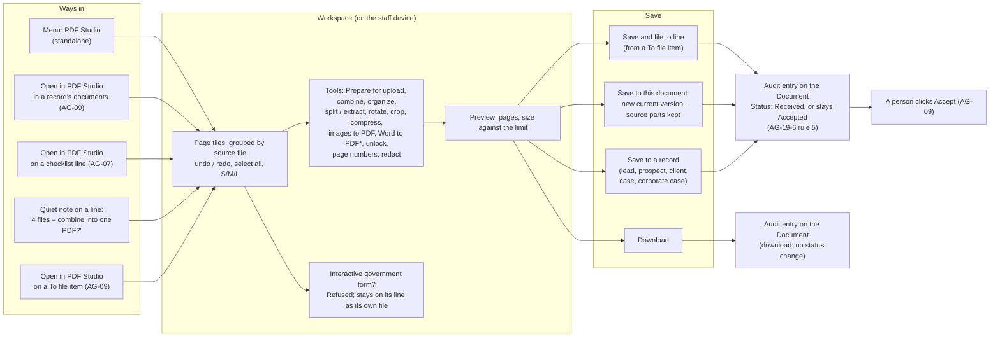

# AG-19 PDF Studio

Version 1.10 · 26 Oct 2026 · Status: AG19-D71 – AG19-D73 and the final re-check fixes applied (the product owner, 26 Oct 2026: approved): Accept new files; one rule for a Studio save on an Accepted line; the Client E example confirmed; a client-sent government-form flag is kept only for a locked file; "digitally signed" defined; earlier: AG19-D70 applied in v1.9 (the product owner, 25 Oct 2026: approved): a government form that needs a password to open is recognised once it is opened, by the client upload component or by Studio; earlier: AG19-D66 – AG19-D69 applied in v1.8 (the product owner, 25 Oct 2026: approved): government forms are never altered; a Studio save made only from files added after the Accept keeps the line Accepted; a locked signed PDF or government form on a client upload; the writer defaults approved; earlier: AG19-D62 – AG19-D65 and the 25 Oct review fixes applied in v1.7 (the product owner, 25 Oct 2026: "yes"); earlier: build path cleaned, no rule changed (v1.6): version tags and history notes moved from Parts A – C to D6.1 (X-1; the product owner, 25 Oct 2026: "yes"); AG19-D57 – AG19-D60 applied in v1.5 (the product owner, 25 Oct 2026, later: "yes"); AG19-D50 – AG19-D56 applied in v1.4 (the product owner, 25 Oct 2026: "yes"); AG19-D35 – AG19-D49 applied in v1.3 (the product owner, 23 Oct 2026: "yes"); AG19-D27 – AG19-D34 applied in v1.2 (the product owner, 23 Oct 2026, later); AG19-D15 – AG19-D26 applied in v1.1 (the product owner, 23 Oct 2026); first written from AG19-D1 – AG19-D14 (the product owner, 22 Oct 2026)
Previous version: `_archive/AG-19-pdf-studio_v1.9_2026-10-25.md`. v1.8 is `_archive/AG-19-pdf-studio_v1.8_2026-10-25.md`. v1.7 is `_archive/AG-19-pdf-studio_v1.7_2026-10-25.md`. v1.6 is `_archive/AG-19-pdf-studio_v1.6_2026-10-25.md`. v1.5 is `_archive/AG-19-pdf-studio_v1.5_2026-10-25.md`. v1.4 is `_archive/AG-19-pdf-studio_v1.4_2026-10-25.md`. v1.3 is `_archive/AG-19-pdf-studio_v1.3_2026-10-23.md`. v1.2 is `_archive/AG-19-pdf-studio_v1.2_2026-10-23.md`. v1.1 is `_archive/AG-19-pdf-studio_v1.1_2026-10-23.md`. v1.0 is `_archive/AG-19-pdf-studio_v1.0_2026-10-22.md`.
Decision log: `FINAL-SuperAdmin-FR/TEMPLATE-MAP-working_2026-10-10.md`, section "AG-19 review — decisions".
Format: X-1 (Part A Start here → Part B build cards → Part C rules and tests → Part D appendix), as in AG-07.

**Line references.** "AG-09 v1.15:630" means line 630 of `FINAL-Agent-FR/_archive/AG-09-document-management_v1.15_2026-10-22.md`. "AG-07 v3.4" is `FINAL-Agent-FR/_archive/AG-07-case-core-and-delivery_v3.4_2026-10-22.md`. Both were current on 22 Oct and are archived since 23 Oct. Citations added in v1.1 name "AG-09 v1.16" (`FINAL-Agent-FR/_archive/AG-09-document-management_v1.16_2026-10-23.md`) and "AG-07 v3.5" (`FINAL-Agent-FR/_archive/AG-07-case-core-and-delivery_v3.5_2026-10-23.md`). Citations added in v1.2 name "AG-09 v1.17" (`FINAL-Agent-FR/_archive/AG-09-document-management_v1.17_2026-10-23.md`) and "AG-07 v3.6" (`FINAL-Agent-FR/_archive/AG-07-case-core-and-delivery_v3.6_2026-10-23.md`; the current AG-07 is `FINAL-Agent-FR/AG-07-case-core-and-delivery_v3.10_2026-10-26.md`). Citations added in v1.3 name "AG-09 v1.18" (`FINAL-Agent-FR/_archive/AG-09-document-management_v1.18_2026-10-23.md`). Citations added in v1.4 name "AG-09 v1.20" (`FINAL-Agent-FR/_archive/AG-09-document-management_v1.20_2026-10-25.md`). Citations added in v1.5 name "AG-09 v1.21" (`FINAL-Agent-FR/_archive/AG-09-document-management_v1.21_2026-10-25.md`); AG-09 v1.22 is `FINAL-Agent-FR/_archive/AG-09-document-management_v1.22_2026-10-25.md`; AG-09 v1.23 – v1.25 are in `FINAL-Agent-FR/_archive/`; the current AG-09 is `FINAL-Agent-FR/AG-09-document-management_v1.26_2026-10-26.md`. All of these cite requirement IDs, not line numbers. "00-Overview v1.19" is `FINAL-Agent-FR/_archive/00-Overview_v1.19_2026-10-22.md` (cited with line numbers); the current overview is `FINAL-Agent-FR/00-Overview_v1.28_2026-10-26.md`. "SA-08" is `FINAL-SuperAdmin-FR/SA-08-platform-integrations-and-infrastructure-rails_v2.13_2026-10-25.md`. "XFA spec" is `XFA-Gov-Form-Viewer-Spec_v1.0_2026-10-18.md` at the workspace root. Archived versions are named in full.

---

# Part A — Start here

**Read Part A, then only the chapter you build.** Each card in Part B is complete on its own. Part C holds the rules every card shares. Part D is the appendix: nothing in Part D is a build instruction.

## How this file is laid out

| Part | What it holds |
|---|---|
| **A. Start here** | Purpose, key terms, the main flow, one worked example (Client B's pay stubs), build order. |
| **B. Build cards** | Six chapters, one card per requirement, in build order. |
| **C. Rules and tests** | C1 business rules, C2 states, C3 data Studio reads and writes, C4 permissions, C5 non-functional rules, C6 what is built today, C7 journey tests. |
| **D. Appendix** | Decisions that change this epic, contradictions found, knock-ons, open questions, competitor note and tool triage, history. |

| Ch | Chapter | Cards |
|---|---|---|
| 1 | Foundation: engine proof, several files on one document, the workspace, government forms, saving, ways in | AG-19-1 – AG-19-6 |
| 2 | Page tools | AG-19-7 – AG-19-10 |
| 3 | Convert, unlock, page numbers, compress | AG-19-11 – AG-19-15 |
| 4 | Redact | AG-19-16 |
| 5 | Prepare for upload and the quiet note on a line | AG-19-17 – AG-19-18 |
| 6 | Phone scan, and scanning with your own phone from the desk | AG-19-19 – AG-19-20 |

## How to read a card

Every card has 14 fields, in this order: 1 Outcome, 2 Why, 3 Where, 4 Engine, 5 Rules, 6 States, 7 Data, 8 Access, 9 Events, 10 Safety, 11 Tests, 12 Edge cases, 13 Non-goals, 14 Mode. Field 5 starts with an example, then numbered rules written as `input → output`. Field 7 writes each field as `plain name (codeName: type)`. A key term is defined once in A2. The card header shows the decision IDs and the build status. A pointer card (Status: Pointer) names the home card in another epic and adds no rule of its own. Business rules BR-1 to BR-12 are in C1; cards cite them by number.

---

## A1 — Purpose in five lines

1. **What it is.** PDF Studio is ExpatReady's own tool for working on the pages of PDFs and images. It is its own module with its own menu item. It is not a Doer and not part of AG-09 (AG19-D1).
2. **What it covers.** Combine, split and extract, remove, organize, rotate, crop, compress, images to PDF, Word to PDF, phone scan, unlock, page numbers and true redaction (AG19-D2, AG19-D3).
3. **The outcome.** Staff turn a client's loose files into one clean PDF in about 4 clicks, without leaving ExpatReady. The client's data never goes to an outside PDF website (AG19-D12).
4. **How.** Studio works on the staff device. It saves the result to the document it came from, to another record, or as a download. The source files are kept (AG19-D7, AG19-D8).
5. **What it never does.** It never edits the words or pictures on a document (AG19-D5). It never changes an interactive government form (AG19-D14, AG19-D16). It never accepts a document; a person does (AG16-31). It never uses an outside processing service (AG19-D12; founder directive, 00-Overview v1.19:238).

**Who uses it.** Anyone who holds the document-edit key `agent/document:edit` (AG19-D9, AG19-D26(a)). Saving a result as a new document also needs `agent/document:create`. Studio is on every plan, including the cheapest (AG19-D22). In practice this is the case officer, who prepares documents every day. Clients never open Studio. Clients get one Studio tool, phone scan, in their no-login upload link and in the portal (AG19-D10).

**Why it exists.** Today staff download the client's files, upload them to an outside PDF website, merge and compress there, download the result and upload it again. That is about 12 clicks or more per document. The client's pay stubs, bank statements and passports pass through a third party on the way (the product owner, 22 Oct).

---

## A2 — Key terms

Each term has one meaning only. Terms owned by other epics name their home. The Glossary entries "PDF Studio", "Part", "Prepare for upload", "Replace (a file)", "Remove (a file)", "To file list", "Password protected (label)" and "Digitally signed" (`99-Phasing-and-Glossary_v1.20_2026-10-26.md`, section "Key terms — PDF Studio (AG-19)") follow this table word for word.

| Term | Meaning | Example |
|---|---|---|
| **PDF Studio** (Studio) | ExpatReady's own module for working on PDF pages. Not a Doer, not part of AG-09 (AG19-D1). | Client C opens Studio from the menu to combine three files from his computer. |
| **Document** | AG-09's record for one required or received item. It holds the status and points at the files. Home: AG-09 §3.0 (AG-09 v1.15:279). | "Pay stubs – Client B". |
| **Checklist line** | One line of a filing's document checklist, built by the Binder. It points at one Document. Home: AG-07 card AG-7-15 (AG-07 v3.4:2352). | The "Pay stubs – Client B" line on Client B's work permit filing. |
| **Status** | One of AG-09's five words: Needed, Received, Accepted, Needs replacing, Not needed. Home: AG-09 card AG-9-26. Studio never sets Accepted. After a Studio save, the line is Received, except an Accepted line whose result used no file of the accepted set: it stays Accepted (AG-19-6 rule 5; AG19-D72). | Client C saves the combined stubs to a Received line; the line shows Received. |
| **Part** (`DocumentPart`) | One file of a Document. A Document can hold several parts while it is being worked. Adding a part replaces nothing (AG19-D6). A client upload always adds a part (AG19-D18). Home: AG-09 card AG-9-65. | Client B's four pay stubs are parts 1 to 4 of one Document. |
| **Replace (a file)** | A staff action on one part: pick a new file, and only that part changes. The old file goes to Recently deleted, unless it was Accepted or submitted; then it stays in the history as evidence (AG19-D18). Until AG-07 records which files went into a submission, only Accepted files are kept this way (AG19-D29). Home: AG-09 card AG-9-67. | Client C replaces part 2, a blurred pay stub, with Client B's clear copy. Parts 1, 3 and 4 do not change. |
| **Remove (a file)** | A staff action that takes one or more parts off a Document, chosen with multi-select. Removed files follow the same rule as Replace (AG19-D18). Replace and Remove need `agent/document:edit` (AG19-D34). Home: AG-09 card AG-9-67. Not the same as Studio's toolbar button **Remove pages**, which takes pages out of a result (AG-19-8). "Remove" alone always means taking a file off a Document (AG19-D34). | Client C removes a duplicate pay stub that Client B sent twice. |
| **To file list** | The list on a record (case, client, prospect or lead) of files a client sent that answer no specific request, and of the attachments of a reply to a request email that asked for several documents. A file the client attaches to a portal message also waits here (AG19-D61). Staff select files and click **File to line**, or click one of the requested lines shown on a file (AG19-D21, AG19-D32, AG19-D33, AG19-D40). Each item also offers **Open in PDF Studio**; after an unlock or any edit, **Save and file to line** files the result to a line in one step (AG19-D63). A junk file is taken off with the normal **Remove** (AG19-D47). Home: AG-09 card AG-9-68. | Client B uploads 3 files on the portal without picking a document; they wait on the To file list. |
| **Version** | One whole state of a Document's files. A Studio save makes a new version (AG-9-65 rule 6). Replacing or removing an Accepted or submitted file also makes a new version, so that file stays in the history (AG19-D18). | Client C saves the combined pay stubs: that is version 2. |
| **Source file** | A file loaded into the Studio workspace: a part of a Document, or a file from the staff computer. | The JPG pay stub is one source file. |
| **Page tile** | A small picture of one page in the workspace. Staff select, drag and act on tiles. | 4 source files with 1, 2, 1 and 2 pages show 6 tiles. |
| **Result** | The PDF Studio makes when staff click Save or Download. | "Pay-stubs_Ravi-Sharma_2026-11-12.pdf", 6 pages, 2.9 MB. |
| **Save and file to line** | The save button of Studio opened from a To file item. Staff pick a line, and one click files the item to that line and saves the result there (AG-19-6 rule 2a; AG19-D63). | Client C unlocks Client B's locked statement from the To file list and clicks **Save and file to line** → "Bank statement – Client B". |
| **Compression level** | One of the two named settings Compress uses: **Standard** and **Strong**. AG-19-1's report gives each one's settings (AG-19-1 rule 6). | Compress uses Standard first; **Compress more** uses Strong. |
| **Source parts** | The parts a saved result was made from. They stay linked, read-only, under "Made from", and can be restored (AG19-D7; AG-9-65 rules 6–7). | After the combine, the 4 pay stubs show under "Made from". |
| **Restore source files** | AG-09's action that makes a new current version holding the source parts again (AG-9-65 rule 7). | Client C restores: version 3 holds the 4 original stubs. |
| **In context** | Studio opened from a Document, a part, a checklist line or a To file item. It starts with those files (AG19-D1, AG19-D63). | "Open in PDF Studio" on "Pay stubs – Client B". |
| **Standalone** | Studio opened from the menu, with no record. The result is saved to a record or downloaded (AG19-D8). A record is a lead, prospect, client, case or corporate case: every record that holds documents (AG19-D65). | Client C combines two files from his computer and saves them to a prospect. |
| **Working files** | The copies of source files and results that exist only in the page's memory on the staff device while Studio is open. Nothing is kept in the browser's storage (AG19-D27). They are cleared when the session ends (AG19-D8). | Reloading the page clears them. |
| **Session end** | When the person closes or reloads the Studio page, or signs out. Unsaved work is lost then. Before a close or reload with unsaved work, the browser shows its own fixed warning. ExpatReady's own warning shows only when the person leaves Studio inside the app (AG19-D37). The originals stay safe on the record (AG19-D27). | Client C reloads by mistake. The browser warns, and he leaves anyway. His unsaved changes are gone; Client B's 4 pay stubs are still on the Document. |
| **Prepare for upload** | Studio's top tool. One click combines, converts, compresses to the size limit and names the file. Staff preview, then click Save (AG19-D13). | One click turns 4 pay stubs into one named PDF under 4 MB. |
| **Size limit** | The largest file size the country pack gives for a document type. Pack content (AG19-D13). 1 MB = 1,000,000 bytes (AG19-D38). | The pack says Pay stubs: 4 MB (illustrative). |
| **File-name pattern** | The pack's rule for naming the file of a document type (AG19-D13). Its pieces are the document type, the person's name, the case number and a date (AG19-D38). With no pattern in the pack, the name is `<document type>_<person>.pdf` (AG19-D38). | `{documentType}_{person}_{date}` → `Pay-stubs_Ravi-Sharma_2026-11-12.pdf` (illustrative). No pattern → `Pay-stubs_Ravi-Sharma.pdf`. |
| **True redaction** | Removing the text and image content under a marked box from the file itself. A box drawn on top is not redaction (AG19-D3). Release 1 redaction is hand-drawn boxes only (AG19-D25). | Client C redacts a card number. No tool can find the number in the saved file. |
| **Unredacted original** | The file a redacted result was made from. It is kept as a source, but hidden from the client, the portal and the normal staff view. Only holders of `agent/document:delete` can open it, and every opening is audited (AG19-D17). | Client C's redacted bank statement is the current file; the unredacted statement is hidden. |
| **Interactive government form** | A government PDF form built with XFA, a form technology that carries its own scripts and barcodes. Studio refuses it with a message and no button, and the file stays on its line as its own part (AG19-D14, AG19-D16, AG19-D39, AG19-D62). Each stored file records whether it is one (`DocumentPart.isXfaForm`), so its **Open in PDF Studio** is hidden. A file that needs a password to open is recognised only once it is opened: by the client upload component when the client types the password, or by Studio when staff type it (AG-19-5 rule 7; AG19-D70). Staff fill government forms on the case's **Forms tab**, the Filler panel (AG-07 v3.6, Chapter 5). | A government application form PDF. |
| **Digitally signed** | A PDF with a filled signature field: someone signed the document itself with a digital ID. A usage-rights signature alone (UR3 or DocMDP) does not count; a form maker adds one so that a free reader can fill and save the form (AG19-D73). Used by AG-19-7 rule 7 and AG-09 card AG-9-69 rules 5 and 5a. | Client B's employment contract, signed by his employer with a digital ID → digitally signed. A blank form that carries only usage rights → not digitally signed. |
| **Phone scan** | Taking photos of paper pages with a phone camera. ExpatReady crops and straightens each page and makes one PDF (AG19-D10). Staff at a computer can also scan with their own phone by a QR code (AG-19-20; AG19-D48(c)). | Client B photographs 3 pages of a letter → one 3-page PDF. |
| **Unlock** | Removing a password that the client gave the firm, so Studio can work on the file (AG19-D2). A file that opens without a password but forbids changes is unlocked without asking. Studio never guesses or cracks a password (AG19-D48(a)). On a client upload, an interactive government form or a digitally signed PDF is never unlocked automatically: it uploads as the original, untouched (AG-9-69 rule 5; AG19-D64). An interactive government form is never unlocked anywhere: not when the client types its password, and not in Studio (AG19-D66, AG19-D68). A digitally signed PDF that needs a password to open is unlocked when the client types the password, and its signature is lost (AG-9-69 rule 5a; AG19-D68). | A bank statement PDF locked with the client's date of birth. |
| **Password protected** (label) | The label staff see on a file that reached a record still locked with a password: the client chose **Upload as is**, or the file came as an email attachment. Staff can unlock it in Studio (AG-19-13), except an interactive government form: Studio refuses it, and it is filled on the case's Forms tab (AG-19-5; AG19-D66). When staff save the unlocked result, the result part has no label; an unused locked part keeps its label (AG-9-69 rule 7; AG19-D63). Home: AG-09 card AG-9-69 (AG19-D49, AG19-D50). | Client B chose **Upload as is** for a locked bank statement; the file shows "Password protected". |

---

## A3 — The main flow

\* Word to PDF and HEIC images convert on ExpatReady's own server. Unlock runs on the staff device when a permissively licensed library works in the browser, otherwise on ExpatReady's own server (AG19-D48(a)). Every other tool runs on the staff device (AG19-D12, AG19-D15). A download is audited on the Document its files came from (AG-9-65 rule 10).

**What leaves the device.** Nothing leaves the staff device until staff click Save or Download. There are these exceptions. Word to PDF and HEIC images: the file goes to ExpatReady's own server, which converts it and keeps nothing (AG19-D8, AG19-D12, AG19-D15). Unlock, only when no permissive library unlocks in the browser: the file and the password go to that server for the unlock only (AG19-D48(a); AG-19-13). Pages scanned with staff's own phone reach the open Studio through ExpatReady's own server, which keeps nothing (AG-19-20; AG19-D56(d)).

---

## A4 — Worked example: Client B's pay stubs

The example uses AG-07's Client E family, as AG-09 and the Glossary do. Client B is the client. Client C is the case officer. The case is C-2026-00012. The size limit of 4 MB and the file-name pattern are illustrative pack values.

1. **The request (Mon 9 Nov 2026).** The checklist line "Pay stubs – Client B" is Needed. Client C sends the request email with its no-login upload link (AG-9-6, AG-9-7). → AG-07 Ch 4, AG-09.
2. **Client B sends four files (Wed 11 Nov 2026).** Client B replies to the request email and attaches 4 pay stubs: 1 JPG photo and 3 PDFs. He could also use the no-login upload link. All 4 attach to "Pay stubs – Client B" as parts 1 to 4. None replaces another. The line becomes Received. → AG-9-65 (pointer AG-19-2).
3. **Client C opens the line (Thu 12 Nov 2026).** He sees 4 thumbnails and a quiet note: "4 files – combine into one PDF?". The note is on the line only. Nobody is notified, and the home screen shows nothing (AG16-42). → AG-19-18.
4. **One click.** Client C clicks **Prepare for upload** in the note. Studio opens with the 4 files. It turns the JPG into a straight PDF page. It combines the pages in part order. → AG-19-17.
5. **Client C fixes the order.** The stubs arrived out of date order. Client C drags the September stub before the October stub. Studio never sorts by date on its own (AG16-44). → AG-19-8.
6. **Size.** Studio compresses the result. The preview shows "6 pages · 2.9 MB · limit for Pay stubs 4 MB". A 5.2 MB result would show a warning and still allow Save (Rule 7). The name is filled in: "Pay-stubs_Ravi-Sharma_2026-11-12.pdf". → AG-19-15, AG-19-17.
7. **Save.** Client C clicks **Save to this document**. The combined PDF is the current file, as version 2. The 4 stubs show under "Made from", read-only, with **Restore source files**. The audit shows "Prepared for upload and organized 4 files in PDF Studio – Client C, 12 Nov" (AG-19-6 rule 6). The status stays Received. → AG-19-6.
8. **Client C accepts.** Client C checks the PDF and clicks **Accept** (AG-9-26). Studio never accepts (AG16-31).

**Clicks for Client C:** about 4 (open the line, Prepare for upload, Save, Accept) plus the drags he chooses to make. Today: about 12 or more (download each file, open an outside PDF website, upload, merge, compress, download, upload again, accept). The data no longer leaves the platform.

**Side moments used by later chapters.** Client B uploads a locked bank statement on the upload link. The page asks him for the password and unlocks the file on his phone, so the firm gets an unlocked copy (AG-9-69). He replies to an email with another locked statement attached; it arrives locked, with no message to Client B (AG-9-69; AG19-D50). A file that arrives locked shows "Password protected", and Client C unlocks it in Studio with the password Client B gave him (AG-19-13). The statement shows a full card number that the firm does not need; Client C redacts it (AG-19-16). Client B has no scanner, so he uses **Scan with camera** in the upload link for a 3-page employer letter (AG-19-19). Client B hands Client C a paper letter at the office; Client C scans it at his desk with his own phone by a QR code (AG-19-20). Client B also sends a filled government form PDF; Studio refuses it, and it stays on its line as its own file (AG-19-5).

---

## A5 — Build order and dependencies

Build in this order. A card needs the cards in "Build after" and the other epics listed. "Build after" lists card numbers: "6" means AG-19-6.

| Order | Card | Build after | Other epics and built code it needs | Pending (blocks or limits the card) |
|---|---|---|---|---|
| 1 | **AG-19-1** Engine proof (spike) | none | Licence gate `check:licence-copyleft` (`ERv2-sanitized/docs/onboarding/07-gates-catalog.md:574`); build task: allow-list entries for the LGPL server libraries (AG19-D15). | Short legal check of the licence list before build (AG19-D15). Pass bar confirmed (AG19-D26(b)). A fail goes back to the product owner before AG-19-15, AG-19-16 and AG-19-17 (AG19-D11); a compression fail also before AG-19-11, AG-19-19 and AG-19-20 (AG-19-1 rule 7). |
| 2 | **AG-19-2** Several files on one document (pointer) | none | AG-09 cards AG-9-65, AG-9-67 (Replace and Remove), AG-9-68 (To file list) and AG-9-69 (password-protected uploads). | None. |
| 3 | **AG-19-3** The workspace | 1 | Frontend PDF rendering library chosen in AG-19-1. | Largest session: 200 pages or 200 MB, confirmed in the AG-19-1 report (AG-19-3 rule 14); menu position waits for the staff main-menu spec (AG19-D23). |
| 4 | **AG-19-5** Interactive government forms | 3 | Existing XFA classification in `ERv2-sanitized/apps/api/src/spine/pdf-form.adapter.ts:18`, `:208`; form viewer AG-7-109. | None (AG19-D39: no button, so no edition matching). |
| 5 | **AG-19-6** Save, source parts, audit | 2, 3 | AG-09 upload path (AG-9-1, AG-9-2), virus scan (AG-9-55), status rules (AG-9-26), AG-9-65 rules 6, 7, 10; AG-9-68 (To file list, for Save and file to line). SA-8-36, virus-scan wiring of stored files: today `S3Adapter.requestAvScan` returns `PENDING` for every file (SA-08:792), so no saved result becomes clean until SA-8-36 is built (SA-08:469). | SA-8-36 (blocks the clean scan of a saved result). |
| 6 | **AG-19-4** Ways in | 5, 6 | AG-09 pointer AG-9-66 and preview (AG-09 v1.15:418); AG-09 To file list AG-9-68; AG-07 AG-7-15 rule 11 (AG-07 v3.4:2369). | None. |
| 7 | **AG-19-7** Combine | 3, 5 | None. | None (AG19-D48(b)). |
| 8 | **AG-19-8** Organize and remove pages | 3, 5 | None. | None. |
| 9 | **AG-19-9** Split and extract | 3, 5 | None. | None. |
| 10 | **AG-19-10** Rotate and crop | 3, 5 | None. | None. |
| 11 | **AG-19-11** Images to PDF | 3, 5 | This card builds the auto crop and straighten code (AG-19-19 rules 3–5) and the ExpatReady server worker shell, used first for HEIC (AG19-D15). AG-19-12, AG-19-13 and AG-19-19 reuse them. | None. |
| 12 | **AG-19-12** Word to PDF | 3, 5, 11 | Adds LibreOffice to the server worker built in AG-19-11 (AG19-D11). | None. |
| 13 | **AG-19-13** Unlock | 1, 3, 5, 11 | Browser unlock library proven in AG-19-1 rule 6; otherwise the server worker built in AG-19-11 (AG19-D48(a)). | None (AG19-D48(a), AG19-D51). |
| 14 | **AG-19-14** Page numbers | 3, 5 | None. | None. |
| 15 | **AG-19-15** Compress | 1, 3, 5 | Method and the Standard and Strong levels proven in AG-19-1. | SA-1B-106, the pack's size limit (Not built). |
| 16 | **AG-19-16** Redact | 1, 3, 5 | Method proven in AG-19-1; AG-09 AG-9-65 rule 8 (unredacted original). | None. |
| 17 | **AG-19-17** Prepare for upload | 5, 7, 11, 12, 13, 15 | SA-01B: size limit and file-name pattern per document type, SA-1B-106 (Not built). | SA-1B-106 (Not built) (AG19-D55). |
| 18 | **AG-19-18** Quiet note on a line | 2, 4, 17 | AG-07 AG-7-15 rule 11; AG-09 document detail. | None. |
| 19 | **AG-19-19** Phone scan | 2, 11 (client side); 3, 11 (staff side) | Auto crop and straighten built in AG-19-11. The shared client upload component (AG-9-69 field 3); AG-9-7 no-login upload link; AG-15 portal upload; AG-9-4 (a pointer to this card, AG-09 v1.15:633). | None (the hand-off is AG-19-20). |
| 20 | **AG-19-20** Scan with your own phone from the desk (QR) | 3, 19 | NEW hand-off link, relay endpoint and open connection from the Studio page on ExpatReady's own server; staff sign-in (AG-01). | None (AG19-D56). |

---

# Part B — Build cards

## Chapter 1 — Foundation

**What you build.** First, a short spike that proves the two hard tools work with permissive libraries in the browser. Then the workspace, the guard for government forms, saving with the source parts kept, and the ways in. The data change that lets a Document hold several files is AG-09's (AG-9-65); AG-19-2 points to it.

**Client B's example here.** Client B's 4 pay stubs are 4 parts (AG-19-2). Client C opens the line in Studio and sees 6 page tiles under 4 source files (AG-19-3, AG-19-4). Client B's government form PDF is refused (AG-19-5). Client C saves the combined file, and the 4 stubs stay as source parts (AG-19-6).

**Cards in build order:** AG-19-1, AG-19-2, AG-19-3, AG-19-5, AG-19-6, AG-19-4.

#### AG-19-1 — Engine proof: true redaction and strong compression (spike)   Decision: AG19-D11, AG19-D12, AG19-D3, AG19-D15, AG19-D26(b), AG19-D48(a), AG19-D51   Status: Not built

- **1. Outcome.** The team knows, with measured evidence, whether permissive open-source libraries can truly redact and strongly compress real immigration documents on the staff device.
- **2. Why.** True redaction and strong compression are the main technical risk of Studio (AG19-D11). Many free PDF libraries can draw a black box but cannot remove what is under it. The product owner asked for proof first, with a pass or fail bar. If the proof fails, the question goes back to him.
- **3. Where.** A throwaway spike branch in `ERv2-frontend` (browser code) and `ERv2-sanitized` (fixtures, measurement scripts). No production code. Output: a spike report saved beside the fixtures; the chosen libraries added to `ERv2-sanitized/Docs/compliance/licence-inventory.md`. **Build task (AG19-D15):** each LGPL library used on ExpatReady's own server gets a recorded owner approval and an entry on the licence gate's allow-list. The gate's own rule for an exception is "obtain a recorded owner approval and add the enumerated election" (`ERv2-sanitized/docs/onboarding/07-gates-catalog.md:576`). This spec does not edit the gate or the inventory. **Before build:** a short legal check of the licence list (AG19-D15).
- **4. Engine.** Rules (no AI). Doer: none; Studio is a module, not a Doer (AG19-D1). No AI step; identical with AI off.
- **5. Rules.** Example: the spike redacts a de-identified card number on a scanned bank statement. A search of the saved file for that number finds nothing, in text, in images or in metadata. The same statement, 10 scanned pages of about 14 MB, compresses to under 4 MB and stays readable.
  1. **Fixtures.** Twelve de-identified fixtures of real document types with invented data (BUILD-CARD standard, "Fixtures"): (a) a scanned bank statement, 10 colour pages at 300 dpi; (b) a phone-photo pay stub, one JPG of about 12 megapixels taken at an angle; (c) a born-digital pay stub PDF with a text layer; (d) a bank statement PDF locked with a known test password; (e) a bank statement PDF that opens without a password but forbids changes; (f) an interactive government form (XFA); (g) a digitally signed PDF; (h) a fillable PDF (not XFA) with 6 filled boxes; (i) a Word file with a macro; (j) a TIFF with 3 frames; (k) a HEIC phone photo; (l) a phone-scan set: 3 photos of paper pages, about 12 megapixels each, taken at an angle. Fixtures (a) to (c) hold planted test strings, for example a 9-digit number, an account number and a name.
  2. **Libraries (AG19-D15; BR-11).** In the browser: permissive licences only (MIT, Apache-2.0, BSD, ISC), for example pdf-lib (MIT; already an API dependency, `ERv2-sanitized/apps/api/package.json:138`) and pdf.js (Apache-2.0), plus the browser's own image encoder. On ExpatReady's own server: permissive libraries, and LGPL libraries such as libvips (inside sharp) and libheif, used unmodified. No LGPL library in the browser. No AGPL library anywhere. No commercial SDK. The repo gate `check:licence-copyleft` denies GPL, AGPL and LGPL rows unless they are on its allow-list (`ERv2-sanitized/docs/onboarding/07-gates-catalog.md:574`); field 3 names the allow-list build task. libvips is LGPL, not permissive (AG19-D15).
  3. **Redaction methods to try.** (a) Edit the page content: remove the text drawing commands and replace the image pixels inside each box. (b) Rebuild the page as a picture: render it, paint the boxes into the pixels, and replace the page with that picture. The report says which method passes and what each costs. Method (b) removes the selectable text of the whole page; the report must say so.
  4. **Redaction pass bar (confirmed, AG19-D26(b)).** R1: each planted string under a box is not found by pdf.js text extraction, nor in any decompressed content stream (checked with `qpdf --qdf`), nor in the metadata. R2: the pixels under each box are solid inside the stored image itself, checked by extracting the image. R3: the saved file is a full rewrite with no earlier revision, and no annotation, form field, attachment or hidden layer is left under a box. R4: content outside the boxes looks unchanged when rendered. R5: every planted test string under a box is removed, across all fixtures. One miss is a fail.
  5. **Compression pass bar (confirmed, AG19-D26(b)).** C1: fixture (a), a 10-page scan, ends under 4 MB. C2: fixture (b), one photo as a one-page PDF, ends under 1 MB. C3: every number on every page is readable at 100 % zoom, judged by two people. C4: on the test floor, an ordinary office laptop (8 GB, from about 2020; AG-07 C5.5 rule 5, AG-07 v3.4:5547), 10 pages compress in under 15 seconds and the browser tab stays under 1.5 GB of memory. C5 (confirmed in the AG-19-1 report): on the phone test floor, a mid-range phone from about 2021 with 4 GB of memory, in current Chrome on Android and current Safari on iPhone, fixture (l) becomes one 3-page PDF at the Standard level in under 10 seconds, and the page stays under 500 MB of memory.
  6. **Report.** For each bar: pass or fail, the measured value, the library and the method. Every library with its licence. A recommendation for AG-19-15 and AG-19-16. **Compression levels.** The report names two levels, **Standard** and **Strong**, and gives each one's settings: image resolution and image quality. Starting values (confirmed in the AG-19-1 report): Standard 150 dpi at quality 75; Strong 100 dpi at quality 60. AG-19-11, AG-19-15, AG-19-17, AG-19-19 and AG-19-20 use these names. **Limits.** The report also confirms the largest session (AG-19-3 rule 14) and the "Already small" threshold (AG-19-15 rule 7). **Unlock (AG19-D48(a)):** whether a permissively licensed library opens fixture (d) with its password, and removes the restriction of fixture (e), in the browser. The answer decides where AG-19-13 runs. **Unlock pass bar (AG19-D51).** The trial must also test the client-side unlock: the same library on the client upload pages of AG-9-69 (portal Documents tab, questionnaire document-request card, no-login upload page), with fixtures (d) and (e). U1: fixture (d) opens with its password and the unlocked copy has no password. U2: fixture (e) loses its restriction without a password. U3: no request leaving the page carries the password. Pass → the client unlock runs on the client's device. Fail → the client unlock runs on ExpatReady's own server, as Studio's does (AG-19-13 rule 8; AG19-D51). Either way the report records the path.
  7. **Fail → the product owner.** If a redaction bar or a compression bar fails, AG-19-15, AG-19-16 and AG-19-17 wait. A failed compression bar (C1 – C5) also pauses AG-19-11, AG-19-19 and AG-19-20, because they compress too. The report goes to the product owner with the options the team sees (AG19-D11). The team never switches to an outside service (AG19-D12). An Unlock fail does not go back to the product owner: it selects the server path for Studio (AG19-D48(a)) and for the client (AG19-D51), and AG-19-13 and AG-9-69 go ahead.
- **6. States.** None (a spike).
- **7. Data.** None in the product. Fixtures: `fixtures/pdf-studio/`, (a) to (l), de-identified; no real names or numbers.
- **8. Access.** None (no product screen).
- **9. Events.** None.
- **10. Safety.** Fixtures hold no real personal data. The spike sends no file to any outside service.
  **Person decides:** the product owner decides what happens if a redaction or compression bar fails (AG19-D11; AG16-76). An Unlock fail is already decided: the server path (AG19-D51).
  **Duplicate beats a miss (AG16-60):** not applicable (no staff list).
- **11. Tests.**
  - Given fixture (c) with a planted account number under a box, when the spike's redaction runs and the file is saved, then text extraction, a raw stream search and a metadata search all return no match.
  - Given fixture (a), when compression runs, then the result is 4 MB or less and two reviewers read every number at 100 % zoom.
  - Given fixture (l) on the phone test floor, when the 3 photos become one PDF at the Standard level, then it takes under 10 seconds and the page stays under 500 MB of memory (C5).
  - Given fixture (d) on the no-login upload page, when the spike unlocks it in the browser with its password, then the unlocked copy opens with no password and no outgoing request holds the password (U1, U3); given no permissive library does this, then the report records the server path for AG-19-13 and AG-9-69, and no question goes to the product owner (AG19-D51).
  - Failure state: given an LGPL library in the browser bundle, then `check:licence-copyleft` fails and the library is not used. Given an LGPL library on ExpatReady's server without its allow-list entry, then the gate fails too (AG19-D15).
  - AI OFF: not applicable (no AI step).
- **12. Edge cases.** Redaction passes only with method (b) → the report says so, and the product owner hears that redacted pages lose their selectable text. A library passes but is very large → the report gives its size. **Clicks:** none for staff (spike).
- **13. Non-goals.** No product screens. No OCR (Release 2, AG19-D2). No outside service, not even for a comparison. No change to a library's source code (AG19-D15: unmodified).
- **14. Mode.** THIN SLICE (spike; throwaway code).

#### AG-19-2 — Several files on one document (pointer)   Decision: AG19-D6, AG19-D7, AG19-D17, AG19-D18, AG19-D19, AG19-D20, AG19-D21, AG19-D28 – AG19-D36, AG19-D40, AG19-D41, AG19-D43 – AG19-D47, AG19-D49 – AG19-D54, AG19-D57, AG19-D58, AG19-D61, AG19-D62, AG19-D63, AG19-D64, AG19-D67, AG19-D68, AG19-D70, AG19-D71, AG19-D72   Status: Pointer

The data model is specified once, in AG-09 card AG-9-65 (AG-09 v1.15:949; AG19-D6), with cards AG-9-67, AG-9-68 and AG-9-69. AG-19 adds no rule of its own. Studio relies on these AG-9-65 rules:
- A version holds ordered parts; a file added to a Document is the next part and supersedes nothing (rules 1–2). Each part records whether it is an interactive government form (`DocumentPart.isXfaForm`; AG-19-5 rule 7; AG19-D70). Client uploads always add, never replace (AG19-D18). A file added to an Accepted Document attaches as a part; the status does not change and nothing is re-checked (AG19-D19). Studio loads every clean part of the current version, in part order.
- A Studio save is a new current version with the result as part 1; the source parts stay linked, read-only, under "Made from" (rule 6). Every part the result did not use stays on the line as its own part, after the result, so nothing disappears silently (rule 6; AG19-D62). Fields: `DocumentVersion.madeInStudio` (yes/no), `studioTool?` (list of tool names, AG-19-6 field 7), `sourcePartIds[]` (list of ids) (AG-09 v1.15:1067).
- **Restore source files** makes a new current version that holds the source parts again (rule 7).
- Every Studio action on a Document's files is audited on that Document, whether saved or downloaded (rule 10).
- **Replace and Remove** a part, and what happens to the old file, are AG-9-67 (AG19-D18). They are actions on the Document, not Studio tools.
- A **Quarantined** part cannot be opened, combined in Studio or accepted (AG-9-65 rule 5; AG19-D20). Accept is offered only when every part is clean: not Checking, not Scan unavailable, not Quarantined (AG-9-26 rule 5; AG19-D44).
- A **ZIP** is unpacked and each file follows the normal path; an upload that answers no specific request goes to the record's **To file list** (AG-9-54, AG-9-68; AG19-D21). Every record that holds documents has one: case, client and prospect; the items carry over when a prospect becomes a client (AG19-D33). A reply to a request email for one document lands on that line; a reply to a request for several documents waits on the To file list, each file showing the requested lines as one-click targets (AG19-D32). A lead has a To file list too; its items carry over when the lead is engaged (AG19-D40). A junk file is taken off with the normal Remove (AG19-D47). No AI suggestion shows next to the targets (AG19-D41). A file a client attaches to a portal message shows in the conversation and also waits on the To file list of the case it is tagged to, or of the client for a "General" message (AG-9-68 rule 2d; AG19-D61). Every To file item offers **Open in PDF Studio**, and **Save and file to line** files the result to a line in one step (AG-9-68 rule 12; AG19-D63).
- The **unredacted original** is hidden from the client, the portal and the normal staff view; only holders of `agent/document:delete` open it, audited (AG-9-65 rule 8; AG19-D17).
- **Restore source files** on a redacted version: only holders of `agent/document:delete`, after the warning "This brings back the unredacted file. The client will be able to see it."; audited (AG-9-65 rule 8; AG19-D28, AG19-D36). Once restored, it is an ordinary current file: everyone who can see the Document sees it, and so does the client portal when the line is shown there (AG19-D36).
- **Evidence:** until AG-07 records which files went into a submission, only Accepted files are kept as evidence after Replace or Remove (AG-9-67 rule 4; AG19-D29).
- **Last part removed:** the Document goes back to Needed, and nothing is sent to the client automatically (AG-9-67 rule 5; AG19-D30).
- **Infected file:** the client is asked automatically to upload again (AG-9-55); staff do not need to ask (AG19-D31).
- **Keys:** Replace, Remove and File to line need `agent/document:edit` (AG-9-67, AG-9-68 field 8; AG19-D34).
- **Status after a staff change:** Replace or Remove of a file of the accepted set on an Accepted line returns it to Received (AG-9-67 rule 5; AG19-D43). Replace or Remove of a file added after the Accept keeps the line Accepted (AG19-D54). A Studio save on an Accepted line returns it to Received when the result used any file of the accepted set; otherwise the line stays Accepted, and the result shows under **Accept new files** (AG-9-26 rule 7; AG19-D67, AG19-D72). **Accept new files (N)** accepts, with one click, the parts that have no Accept yet; the line stays Accepted (AG-9-26 rule 14; AG19-D71).
- **Recently deleted:** a holder of `agent/document:edit` sees and restores, within 30 days, the files they removed or replaced; holders of `agent/document:delete` see and restore all (AG-9-67 rule 10; AG19-D35). A restored replaced file swaps back into its old place, and the newer file goes to Recently deleted with its own 30-day undo (AG19-D45). When the newer file it displaces is Accepted, the restore counts as a staff Replace: that file stays in the history and the line returns to Received (AG19-D52). Only a change to a file of the accepted set resets the line, restores included: when the newer file was added after the Accept, the line stays Accepted (AG19-D57). A removed Quarantined file can never be restored and never appears in Recently deleted; the line shows "Removed — infected file" (AG19-D46, AG19-D53).
- **Password-protected uploads:** where the client uploads inside ExpatReady, the page asks for the password and unlocks the file before upload, on the client's device or, if the browser cannot, on ExpatReady's own server (AG-9-69; AG19-D49, AG19-D50, AG19-D51). The prompt is one rule of the shared client upload component, so it shows in every client upload place: the questionnaire document-request card, the portal Documents tab, the no-login upload page and portal message attachments; a later client upload place inherits it (AG19-D58). A locked email attachment only gets the label; no message goes to the client (AG19-D50). A locked portal message attachment uploaded as is carries the label on the To file list (AG-9-69 rule 6; AG19-D61). Staff see the label "Password protected" and can unlock in Studio. The unlock engine is AG-19-13. On a client upload, an interactive government form or a digitally signed PDF is never unlocked automatically; it uploads untouched (AG-9-69 rule 5; AG19-D64). A password-to-open PDF that the client unlocks: a signed PDF is unlocked anyway, and its signature is lost; a government form uploads locked, as is, with the label (AG-9-69 rule 5a; AG19-D68). The upload records that it is a government form, so its **Open in PDF Studio** is hidden (AG-19-5 rule 7(b); AG19-D70).

#### AG-19-3 — The Studio workspace   Decision: AG19-D1, AG19-D2, AG19-D5, AG19-D12, AG19-D22, AG19-D23, AG19-D26(a), (c), AG19-D27, AG19-D34, AG19-D37, AG19-D48(c), AG16-88   Status: Not built

- **1. Outcome.** Staff open PDF Studio from the menu and work on pages in one screen: page tiles, drag and drop, preview, undo and redo.
- **2. Why.** Staff need one place to fix a client's files, as they do today on outside PDF websites (the product owner, 22 Oct). A workspace with its own menu item works with or without a case (AG19-D1).
- **3. Where.** NEW frontend feature `ERv2-frontend/src/features/pdf-studio/`. Menu item "PDF Studio" is a top-level item of the staff app's main menu, not inside a "Tools" group (AG19-D23). Its exact position is set when the main menu is specified. No epic owns the staff main menu today (gap, D3). Rendering library: chosen in AG-19-1. Backend: only Word to PDF (AG-19-12) and saving through AG-09 (AG-19-6).
- **4. Engine.** Rules. Doer: none (AG19-D1). No AI step; identical with AI off.
- **5. Rules.** Example: Client C opens "Pay stubs – Client B" in Studio. The left list shows 4 source files with their page counts. The centre shows 6 page tiles at medium size, each labelled with its source file. He drags tile 4 to position 2, then clicks Undo, and tile 4 goes back.
  1. **Layout.** Left: the source-file list, grouped by source file, each with its name, page count and origin ("Pay stubs – Client B, part 2" or "This computer"). Centre: page tiles in result order. Top: the toolbar. Right: the **Tools** list. Bottom: the size of the result, **Save** and **Download** (AG-19-6).
  2. **Toolbar.** Undo, Redo, Select all, Rotate, Remove pages, Duplicate, Extract, Blank page, Move, Preview, and the tile size S, M or L. Default: M. The page button is labelled **Remove pages**; "Remove" alone always means taking a file off a Document (AG-9-67; AG19-D34).
  3. **Tools list.** Prepare for upload (first, AG19-D13), Combine, Organize, Split / extract, Rotate, Crop, Compress, Images to PDF, Word to PDF, Unlock, Page numbers, Redact.
  4. **Select.** A click selects one tile. Shift+click selects a range. Ctrl/Cmd+click adds a tile. Select all (Ctrl/Cmd+A) selects every tile. Example: Select all → Rotate → every page turns 90°.
  5. **Drag and drop.** Staff drag tiles to reorder. Staff drop files from the computer onto the workspace to add them. Every drag has a keyboard alternative: Move left, Move right, Move to position (C5 rule 5).
  6. **Preview.** A double-click on a tile, or Preview, opens the page large, with zoom and page arrows.
  7. **Undo and redo.** Every operation since the files were loaded can be undone, one step at a time, back to the loaded files. Redo works until a new operation is made. Keys: Ctrl/Cmd+Z and Shift+Ctrl/Cmd+Z.
  8. **Add files.** "Add files" offers: from this computer, or from the documents of a record the person can see (AG-9-53). It also offers **Scan with camera** (AG-19-19) and **Scan with your phone** (AG-19-20; AG19-D48(c)). Allowed types are AG-09's, without Excel and ZIP: PDF, JPG, PNG, HEIC, TIFF and Word (AG-9-2, AG-09 v1.15:630). An Excel or ZIP file is refused with "PDF Studio works with PDF, JPG, PNG, HEIC, TIFF and Word files."
  9. **On the device.** BR-2 is the one statement of what runs on the device and what goes to ExpatReady's own server. Nothing else is sent anywhere until Save or Download (AG19-D12, AG19-D15).
  10. **No free editing.** There is no tool to type, delete or move words or pictures on a page (AG19-D5; BR-1).
  11. **Screen text.** English only in Release 1, built translation-ready: all screen text kept in one place (AG16-88).
  12. **Unsaved work (AG19-D27).** Nothing from Studio is kept in the browser's storage. When staff close or reload the browser page with unsaved Studio work, the browser shows its own fixed warning. A page cannot set those words, and this is an accepted limitation (AG19-D37). When staff leave Studio inside ExpatReady, for example by another menu item, ExpatReady asks: "You have unsaved changes – leave anyway?". If they leave, the unsaved edits are lost. The originals are always safe on the record. This is the form viewer's rule too (AG07-D28(7); AG-07 C5.5 rule 2). Example: Client C reloads the page halfway through a combine; the browser shows its own warning; he leaves anyway; his 6 tiles and their order are gone, and Client B's 4 pay stubs are still on the Document. Another time he clicks Cases in the menu; ExpatReady asks "You have unsaved changes – leave anyway?", and he clicks Stay.
  13. **Browsers.** Current Chrome, Edge, Safari and Firefox on a laptop or desktop (AG19-D26(c)). Phone scan runs in phone browsers (AG-19-19).
  14. **Largest session (confirmed in the AG-19-1 report).** A session holds at most 200 pages and 200 MB of source files. A file that would pass either limit is not added, and Studio says: "PDF Studio can hold up to 200 pages or 200 MB at once. Save this work first, then add the rest." Owner of the final values: AG-19-1 (rule 6). e.g. 190 pages are loaded and Client C adds a 15-page PDF → it is not added, and the message shows.
- **6. States.** Session only, never stored on the server: Empty → Loaded → Changed → Saved, or → Cleared at session end (C2.2).
- **7. Data.** None stored on the server, in a Studio table or in the browser's storage (AG19-D8, AG19-D27). Working files live only in the page's memory. This follows the form viewer (AG-07 C5.5 rule 2, AG-07 v3.4:5544). See C5 rule 1.
- **8. Access.** Menu item and Studio: `agent/document:edit` (AG-09 v1.15:1238; AG19-D9, AG19-D26(a)). No new key. Opening a Document's part also needs AG-09's `agent/document:download` and its visibility check (AG-9-65 field 8, AG-09 v1.15:968; AG-9-53). Plan: every plan, including the cheapest (AG19-D22).
- **9. Events.** Opening a part in Studio writes AG-09's read audit (`DocumentAccessLog`, AG-09 BR-9, AG-09 v1.15:995). Operations before Save or Download write nothing, except Studio's write of the government-form flag (AG-19-5 rule 7(c)).
- **10. Safety.** Personal data stays on the device until Save or Download (BR-2). No file name or page content is logged.
  **Person decides:** every operation and its order; Studio changes nothing by itself (AG16-76).
  **Duplicate beats a miss (AG16-60):** not applicable (no list of work).
- **11. Tests.**
  - Given Client C holds `agent/document:edit`, when he opens the menu, then "PDF Studio" is offered; given a user without it, then the item is not shown and the server refuses Studio's routes.
  - Given 6 tiles, when Client C drags tile 4 to position 2 and clicks Undo, then the order is 1–6 again.
  - Given Client C drops an Excel file, then it is refused with the allowed-types message and nothing else changes.
  - Given unsaved changes, when Client C reloads or closes the page, then the browser shows its own warning before leaving; when he leaves, then the unsaved changes are gone and the Document's files are unchanged. Given unsaved changes, when Client C clicks another menu item, then ExpatReady asks "You have unsaved changes – leave anyway?" (AG19-D37).
  - Given Client C is working in Studio, then nothing of his work is in the browser's storage (local storage, session storage, IndexedDB or the cache storage), and after he signs out no working file remains on the device.
  - AI OFF: same results (no AI step).
- **12. Edge cases.** A very large file → rule 14 (largest session; C5 rule 3). Two Studio tabs open → each is its own session; saving in one does not change the other. **Clicks:** removes the outside website round trip (about 8 clicks per document); adds 0.
- **13. Non-goals.** No text or image editing. No annotation tool (AG-09 §3.8 owns annotations). No OCR, no repair, no webpage to PDF (Release 2, AG19-D2). No watermark, password protect, compare or PDF/A (AG19-D4). No Studio storage (AG19-D8).
- **14. Mode.** HARDEN (personal data on the staff device).

#### AG-19-5 — Interactive government forms are refused   Decision: AG19-D14, AG19-D16, AG19-D39, AG19-D66, AG19-D68, AG19-D70, AG19-D73, Rule 7, AG07-D28   Status: Not built

- **1. Outcome.** When staff load an interactive government form into Studio, Studio refuses it with a plain explanation and no button. The message tells staff where forms are filled. The file stays on its line as its own part, so the form is never broken.
- **2. Why.** An interactive government form carries its own scripts and barcodes. Combining or flattening it breaks it, and a form without its barcodes is returned unprocessed (AG-7-109 rule 7). The form viewer runs only editions the country pack publishes, never firm-uploaded PDFs (XFA spec line 98). The message points to the case's Forms tab, so Studio never needs to match an uploaded file to a pack edition (AG19-D39).
- **3. Where.** Studio load step (AG-19-3) and every tool. On AG-09's document screens and on the To file list, an XFA part or item shows no **Open in PDF Studio** and no form-viewer button; it shows the same message (AG-9-66; AG19-D39). The screens read the stored flag `isXfaForm` (field 7). Detection: reuse the existing XFA classification in `ERv2-sanitized/apps/api/src/spine/pdf-form.adapter.ts:18`, `:208` (XFA is classed as a failure there), or the `parse` module of `packages/xfa-engine` (XFA spec §5.1). Forms are filled on the case's Forms tab, the Filler panel (AG-07 v3.6, Chapter 5, "Screens": "Filler panel on the case (the Forms tab)"; AG-7-21, AG-7-109).
- **4. Engine.** Rules. Doer: none. No AI step; identical with AI off.
- **5. Rules.** Example: Client B sends a filled government form PDF. Client C adds it to Studio. The file shows "This is an interactive government form. It can't be combined or changed. It stays on the checklist as its own file. To fill forms, use the case's Forms tab." There is no button. The other files load as normal. The form stays on Client B's line as its own part.
  1. **Detect.** A PDF whose form dictionary holds an XFA entry is an interactive government form. Example: a dynamic XFA form with 7 page areas (XFA spec §3.1) → refused.
  2. **Refuse.** The file is not added to the result. Combine, compress, unlock, rotate, page numbers, redact and Prepare for upload all skip it. Studio never flattens it.
  3. **Message (AG19-D39).** "This is an interactive government form. It can't be combined or changed. It stays on the checklist as its own file. To fill forms, use the case's Forms tab." "Forms tab" is the name AG-07 gives the Filler panel (AG-07 v3.6, Chapter 5, "Screens"). The same words show in standalone use. No product text names a government body, a regulator or Adobe (Rule 7; AG19-D16, AG19-D39).
  4. **No button (AG19-D39).** The message has no button and no link. Studio does not try to tell which pack edition the file is, and no pack matching data is needed.
  5. **Other files go on.** In a batch, only the form is skipped. Example: Prepare for upload with 3 pay stubs and 1 government form → the 3 stubs are combined, and the summary says "Not included: interactive government form".
  6. **The file stays.** The form stays on its line as its own part, or as its own Document. Studio never removes it from the line (AG19-D16). When staff save a result to that Document, the form stays as its own part, after the result (AG-9-65 rule 6; AG19-D62).
  7. **Stored flag (AG19-D70).** Each stored file records whether it is an interactive government form: `DocumentPart.isXfaForm`, and `ToFileItem.isXfaForm` for a To file item. The value is yes, no or unknown. The screens use the flag to hide **Open in PDF Studio**: the button is hidden only when the value is yes. Studio still runs rule 1 on every file it loads. The value is set in one of three ways; (d) corrects a wrong yes.
     - **(a) A file that opens.** When a PDF that opens without a password is uploaded, the server runs the detection of rule 1 once and stores yes or no. e.g. Client B uploads a government form → `isXfaForm` = yes → its part shows the message and no button.
     - **(b) A locked file the client opens.** The client types the password in the client upload component, so the page has already opened the file (AG-9-69 rule 5a). The page runs rule 1. For a government form, it sends `isXfaForm` = yes with the upload. The server keeps that yes only when it finds that the stored file needs a password to open (`passwordProtected` = yes). For a file that opens without a password, the server ignores the sent value and runs (a) itself (AG19-D73). The file itself uploads as is, still locked (rule 8). **Server fallback (AG19-D51, AG19-D73).** When the client's unlock runs on ExpatReady's own server (AG-9-69 rule 3), the server has the opened file in memory and runs rule 1 itself. A government form: the server discards the unlocked copy, stores the original locked and sets `isXfaForm` = yes. A digitally signed PDF: the server keeps the unlocked copy (AG-9-69 rule 5a; AG19-D68). This works in every client upload place: the portal Documents tab, the questionnaire's document-request card, the no-login upload page and portal message attachments (AG19-D58). e.g. Client B types the password of a locked government form on the no-login upload page → the original uploads locked, `isXfaForm` = yes, and its part shows the message and no button.
     - **(c) A locked file the server cannot read.** An email attachment that needs a password to open, or a locked file the client uploaded as is, stays `isXfaForm` = unknown, so **Open in PDF Studio** shows. When staff open it, Studio asks for the password (AG-19-13 rule 1). Once the file is open, Studio runs rule 1. A government form is refused with the message of rule 3, before any change. The stored file stays untouched (rule 8). Studio then sets `isXfaForm` = yes on that part or To file item, so the button is hidden from then on. A file that is not a government form gets `isXfaForm` = no (AG19-D73). **The write (AG19-D73).** Studio writes the value with one server call, `setXfaFlag` (part or To file item, value; name for the backend lead). The call needs `agent/document:edit`, checks `firm_id` and the record's visibility (AG-9-53), and writes an audit entry (field 9). e.g. Client B emails a locked government form → it lands labelled "Password protected", with **Open in PDF Studio** → Client C opens it and types the password Client B gave him → the message shows → the part keeps its original file, and **Open in PDF Studio** is gone.
     - **(d) A wrong yes (AG19-D73).** A part marked yes shows no **Open in PDF Studio**, but staff can still load it from Add files → the documents of a record (AG-19-3 rule 8). Studio runs rule 1 on it. When it is not a government form, Studio sets `isXfaForm` = no with the same call, and **Open in PDF Studio** shows again. e.g. a locked bank statement marked yes by mistake → Client C adds it from Client B's documents and types the password → its tiles load, and the flag becomes no.
  8. **Never altered anywhere (AG19-D66).** ExpatReady never changes an interactive government form: not the automatic unlock on a client upload (AG-9-69 rule 5), not the client's Unlock (AG-9-69 rule 5a; AG19-D68), and not Studio. Forms are filled on the case's Forms tab. Of the files that forbid changes or need a password, staff unlock ordinary and digitally signed PDFs in Studio, and the original stays as a source (AG-19-13; AG19-D7). e.g. a client uploads a government form that forbids changes → it is stored exactly as sent (AG-9-69 rule 5).
- **6. States.** None.
- **7. Data.** On the stored file: interactive government form (`DocumentPart.isXfaForm`: yes, no or unknown; set at upload, or set by Studio once it has opened the file, rule 7(c) – (d)), and the same field on a To file item (`ToFileItem.isXfaForm`). Home of the fields: AG-09 (AG-9-65 field 7, AG-9-68 field 7).
- **8. Access.** As AG-19-3. Studio's flag write (`setXfaFlag`, rule 7(c)) needs `agent/document:edit` (AG19-D73). The form viewer keeps its own keys (AG-7-109 rule 5).
- **9. Events.** A refusal changes no file, so the refusal is not audited. Studio's flag write is audited on the part's Document, or on the To file item's record: "government-form flag set (part or To file item, from, to, by)" (AG19-D73). No file name or page content is logged.
- **10. Safety.** Studio cannot damage a government form. This refuses a Studio operation; it does not block the firm. The file stays on its Document untouched; the message says where forms are filled (Rule 7; AG19-D39).
  **Person decides:** where to work on the form (AG16-76).
  **Duplicate beats a miss (AG16-60):** a skipped form is named in the result summary, never dropped silently.
- **11. Tests.**
  - Given an XFA form PDF from the fixtures, when it is added to Studio, then it is refused with the message ending "To fill forms, use the case's Forms tab.", no button shows, and no tool can include it (AG19-D39).
  - Given an XFA form on a line, when Studio refuses it, then the file stays on its line untouched.
  - Given a government form is uploaded, then its part has `isXfaForm` = yes and shows no **Open in PDF Studio**.
  - Given a government form that forbids changes, or one locked with a password that the client types, when the client uploads it, then the stored file is byte-identical to the client's file (AG19-D66, AG19-D68).
  - Given a client types the password of a locked government form in the client upload component (portal Documents tab, questionnaire card, no-login upload page or portal message), when it uploads, then the stored file is the locked original, `isXfaForm` = yes, and its part or To file item shows no **Open in PDF Studio** (rule 7(b); AG19-D70).
  - Given a locked government form arrives as an email attachment, then `isXfaForm` is unknown and **Open in PDF Studio** shows; when Client C opens it in Studio and types the right password, then Studio shows the message of rule 3, no tool can include the form, and the stored file is byte-identical to the file received (rule 7(c); AG19-D70).
  - Given Studio refused that locked government form after the password, when Client C looks at its Document or the To file list again, then `isXfaForm` = yes and **Open in PDF Studio** is hidden (rule 7(c); AG19-D70).
  - Given a locked file with `isXfaForm` = unknown that is not a government form, when Client C opens it in Studio and types the password, then its tiles load, `isXfaForm` becomes no, and the audit shows "government-form flag set" (rule 7(c); AG19-D73).
  - Given the client upload sends `isXfaForm` = yes for a file that opens without a password, then the server ignores the sent value and stores the result of its own detection (rule 7(b); AG19-D73).
  - Given the client's unlock runs on the server fallback and the opened file is a government form, then the stored file is the locked original, no unlocked copy is kept, and `isXfaForm` = yes (rule 7(b); AG19-D51, AG19-D73).
  - Failure state: given a user without `agent/document:edit`, when `setXfaFlag` is called, then the server refuses and the value does not change (AG19-D73).
  - Given 3 PDFs and 1 XFA form, when Client C runs Prepare for upload, then the result holds the 3 PDFs and the summary lists the form as not included.
  - Failure state: given a plain PDF with fillable boxes and no XFA entry, then it is not refused; Combine flattens its boxes (AG-19-7 rule 6; AG19-D48(b)).
  - AI OFF: same results (no AI step).
- **12. Edge cases.** An XFA form that is also encrypted (government forms often use an empty password, XFA spec §3.1) → refused before any change. One that opens with the empty password is refused at once, and no password is asked. One that needs a password to open is refused after the password is entered, before any change (rule 7(c); AG19-D70). **Clicks:** removes the download-and-Adobe detour; adds 0. For a locked government form sent by email, staff type the password once; then the button is gone.
- **13. Non-goals.** No XFA flattening. No XFA editing in Studio. No Adobe link. No form-viewer button and no edition matching (AG19-D39). The form viewer never opens the uploaded file (XFA spec line 98).
- **14. Mode.** THIN SLICE.

#### AG-19-6 — Save the result; source parts kept; audit   Decision: AG19-D7, AG19-D8, AG19-D5, AG19-D12, AG19-D23, AG19-D26(a), AG19-D27, AG19-D48(b), AG19-D62, AG19-D63, AG19-D65, AG19-D67, AG19-D71, AG19-D72, AG16-31, AG16-11   Status: Not built

- **1. Outcome.** Staff save a Studio result to its Document, to another record, or as a download. The source parts stay linked, read-only and restorable, and every save or download is in the Document's audit trail.
- **2. Why.** Staff must never lose the client's files by combining them (AG19-D7). Studio has no storage of its own, so every result goes to one home: a record in AG-09, or the staff computer (AG19-D8; AG16-11). Every change to evidence must be traceable (AG19-D5).
- **3. Where.** Studio bottom bar. Saving uses AG-09's upload path: upload slot, direct upload, virus scan (AG-9-1, AG-9-2, AG-9-55; AG-09 v1.15:305). The virus scan of stored files is not wired today: `S3Adapter.requestAvScan` returns `PENDING` for every file (SA-08:792; SA-8-36, SA-08:469), so a saved result stays "Checking for viruses…" until SA-8-36 is built. The version it makes, "Made from" and Restore source files are AG-09's (AG-9-65 rules 6–7). The To file list is AG-09's (AG-9-68).
- **4. Engine.** Rules. Doer: none. No AI step; identical with AI off. AG-09's own upload steps run on the saved file as on any new file: scan, hash, and the Reader or the letter library where they apply.
- **5. Rules.** Example: Client C clicks **Save to this document**. "Pay-stubs_Ravi-Sharma_2026-11-12.pdf" is the current file, as version 2. Version 2 shows "Made from: parts 1–4 of version 1" and **Restore source files**. The audit shows "Prepared for upload 4 files in PDF Studio – Client C, 12 Nov". The status is Received once the scan is clean.
  1. **Destinations.** In context from a Document, a part or a line: **Save to this document** (default), **Save to another record**, **Download**. In context from a To file item: **Save and file to line** (default), **Save to another record**, **Download** (AG19-D63). Standalone: **Save to a record** and **Download** (AG19-D8).
  2. **Save to this document.** The result becomes a new current version with the result as part 1. The source parts stay linked, read-only (AG-9-65 rule 6). Every part of the previous version that the result did not use stays on the line as its own part, after the result, in its old order (AG19-D62). These are: an interactive government form Studio refused (AG-19-5); a part not loaded because it was still being checked (AG-19-4 rule 3); a part staff did not select; a locked part staff skipped (AG-19-13 rule 1); and a part that arrived while Studio was open. Nothing disappears silently. e.g. "Pay stubs – Client B" has 3 stubs and 1 government form; Client C combines the 3 stubs and saves → version 2: part 1 the combined PDF, part 2 the government form; "Made from" lists the 3 stubs.
  2a. **Save and file to line (AG19-D63).** From a To file item, staff pick a checklist line (a Document) of that record and click **Save and file to line**. One click does two things: the item is filed to that line (AG-9-68 rule 4), and the result is saved to it as in rule 2. The item's original file is listed under "Made from". The line's other parts were not used, so they stay after the result (AG19-D62). The item leaves the To file list. The "Password protected" label clears, because the current file is the unlocked result (AG-9-69 rule 7). e.g. Client B's locked November statement waits on his case's To file list; Client C opens it in Studio, types the password Client B gave him and clicks **Save and file to line** → "Bank statement – Client B"; part 1 is the unlocked statement, the September statement that was already there is part 2, and the locked original shows under "Made from".
  3. **Save to a record.** Staff pick a lead, prospect, client, case or corporate case they can see (AG-9-53; AG19-D65), then a Document or "New document" (a name and a document type). Example: Client C saves a combined bank statement from his computer to prospect Anil Shah as a new document "Bank statement".
  4. **Download.** The result goes to the staff computer. When it was made from a Document's parts, the download is audited on that Document (AG-9-65 rule 10).
  5. **Status (AG19-D72).** While the saved result is being virus-checked, the Document keeps the status it had, and Accept is off (AG-9-26 rules 4–5; AG19-D44). When the scan is clean, a Needed or Received Document is Received. On an Accepted Document, one rule decides (AG-9-26 rule 7): when the result used any file of the accepted set, the line returns to Received; otherwise the line stays Accepted. "Otherwise" covers a result made from files added after the Accept, new photos, files from this computer, or parts of another Document. The accepted files then stay on the line, after the result, and keep their Accept: the save copies each accepted part's `acceptedAt` into its row in the new version (AG-9-65 rule 6; AG19-D62, AG19-D67, AG19-D57, AG19-D71). The result has no Accept yet, so the line shows **Accept new files (1)** (AG-9-26 rule 14; AG19-D71). Only a person clicks Accept (AG19-D7; AG16-31). e.g. Client C saves a result made from the accepted stubs of an Accepted "Pay stubs – Client B" → it shows Accepted with the result "Checking for viruses…" → clean → Received. e.g. Client C accepted 4 stubs; Client B later sends 2 more; Client C combines only the 2 new ones and saves → the line stays Accepted, the 4 accepted stubs stay after the result, and the line shows **Accept new files (1)**.
  6. **Audit.** One entry per save or download on each Document whose parts were used: who, when, the operations in order (for example "combined; moved page 4 to 2; compressed"), the source parts (Document, version, part, pages) and where the result went (version N, or downloaded). A file from the computer is listed as "file from this computer, 3 pages", with no name. Summary text: "[Actions] [n] files in PDF Studio – [person], [date]" (AG19-D5). [Actions] are the verbs of the tools used, in first-use order, from the table in rule 12, joined by ", " and a final " and "; the first verb starts with a capital letter. [n] is the number of source files; "file" when n is 1. Toolbar operations count as their tool: Rotate as Rotate; Move, Remove pages, Duplicate and Blank page as Organize; Extract as Split / extract. e.g. Combine only → "Combined 4 files in PDF Studio – Client C, 12 Nov"; Prepare for upload, then a drag → "Prepared for upload and organized 4 files in PDF Studio – Client C, 12 Nov".
  7. **Sources from other Documents.** A result can use parts of other Documents. Those Documents are not changed (AG-9-65 field 12). The result lists every source part in `sourcePartIds[]`.
  8. **Restore source files.** AG-09's action (AG-9-65 rule 7). Studio adds nothing to it.
  9. **Session end.** After Save the workspace stays open. When the session ends (the page is closed or reloaded, or the person signs out), the working files are cleared (AG19-D8, AG19-D27).
  10. **Several results.** Split can make several results (AG-19-9). Each has its own destination and its own Save.
  11. **Default result name.** Prepare for upload names the file by the pack (AG-19-17 rule 5a). Every other save or download proposes `<base>_<tool>.pdf`. The base is the document type of the destination Document when Studio knows it; otherwise the first source file's name without its extension. The tool is the verb of the first tool used (rule 12). The separator and character rules of AG-19-17 rule 5a apply (AG19-D55). Staff can edit the name before Save or Download. e.g. Combine in context on Pay stubs → `Pay-stubs_Combined.pdf`; Compress standalone on `bank statement oct.pdf` → `bank-statement-oct_Compressed.pdf`.
  12. **Tool names.** `studioTool` lists the tools used in the session, in first-use order:

      | Tool | `studioTool` value | Verb in the summary |
      |---|---|---|
      | Prepare for upload | `PREPARE_FOR_UPLOAD` | Prepared for upload |
      | Combine | `COMBINE` | Combined |
      | Organize | `ORGANIZE` | Organized |
      | Split / extract | `SPLIT_EXTRACT` | Split |
      | Rotate | `ROTATE` | Rotated |
      | Crop | `CROP` | Cropped |
      | Compress | `COMPRESS` | Compressed |
      | Images to PDF | `IMAGES_TO_PDF` | Converted |
      | Word to PDF | `WORD_TO_PDF` | Converted |
      | Unlock | `UNLOCK` | Unlocked |
      | Page numbers | `PAGE_NUMBERS` | Numbered |
      | Redact | `REDACT` | Redacted |
      | Phone scan (AG-19-19, AG-19-20) | `PHONE_SCAN` | Scanned |

      A verb that repeats is written once. e.g. Images to PDF and Word to PDF → "Converted".
  13. **Fillable boxes are flattened in every result (AG19-D48(b)).** Any source PDF with fillable boxes that is not an interactive government form is flattened in every Studio result, saved or downloaded, whatever the tool. Each box's value is drawn onto the page, so the values stay visible. The source part keeps its boxes (AG19-D7). e.g. Client C rotates one page of a filled employer reference form and saves → the result shows the 6 values as page content and has no fillable boxes.
- **6. States.** Document status: AG-09's. Version: current → Superseded; a version made in Studio can be undone by Restore source files (AG-9-65).
- **7. Data.** Written through AG-09 (AG-9-65 field 7): `DocumentVersion.madeInStudio` (yes/no), `studioTool` (list of text, optional: the tools used in the session, in first-use order; values in rule 12), `sourcePartIds` (list of ids). Audit entry payload (AG-19's home): operations (`operations`: list of {op, pages, settings}; no page content), sources (`sources`: list of part references), destination (`destination`: version id or DOWNLOAD). No Studio table (AG19-D8).
- **8. Access.** Save a result to a Document, and Save and file to line: `agent/document:edit` (AG19-D9, AG19-D26(a); AG-9-65 field 8, AG-09 v1.15:968; AG-9-68 field 8). Saving the result as a NEW document (for example from standalone use) also needs `agent/document:create`, AG-09's existing rule (AG-09 v1.15:1237; AG19-D26(a)). Download: `agent/document:download` (AG-09 v1.15:1243, enforcement :1263). A record the person cannot see is "not found" (AG-9-53).
- **9. Events.** Audit entry (rule 6), matching AG-9-65's event "PDF Studio action (document, tool, parts in, result saved as version N or downloaded, by)". AG-09's `DOCUMENT_*` triggers fire for the new version. No staff notification (AG07-D20(g)). No client message.
- **10. Safety.** Nothing is overwritten; the source parts stay (AG19-D7), and every part the result did not use stays on the line (AG19-D62). No file name or page content is logged. The client is not told about a Studio save: AG-09's "Document received" message is not sent for it (AG-9-26 rule 4).
  **Person decides:** where to save, and whether to accept the result (AG16-31, AG16-76).
  **Duplicate beats a miss (AG16-60):** the source parts stay visible under "Made from", never hidden.
- **11. Tests.**
  - Given 4 parts on "Pay stubs – Client B", when Client C saves a combined result to the Document, then version 2 has 1 part, "Made from" lists parts 1–4, the status is Received, and the audit entry lists the operations and the 4 sources.
  - Given an Accepted "Pay stubs – Client B" with 4 accepted parts and 2 parts added after the Accept: when Client C saves a result that uses any accepted part, then the line stays Accepted while the result is "Checking for viruses…" and is Received once the scan is clean; when Client C instead saves a result made only from the 2 added parts, or only from a file from this computer, then the line stays Accepted, the 4 accepted parts stay after the result with their `acceptedAt`, and the line shows **Accept new files (1)** (rule 5; AG19-D72, AG19-D71).
  - Given "Pay stubs – Client B" with 3 stub parts and 1 government-form part, when Client C combines the 3 stubs and saves to the Document, then version 2 holds part 1 the combined PDF and part 2 the government form, and "Made from" lists the 3 stubs (AG19-D62).
  - Given a locked file on the case's To file list, when Client C opens it in Studio, unlocks it and clicks **Save and file to line** on "Bank statement – Client B", then the line's current file is the unlocked result, the item has left the To file list, and no part shows "Password protected" (AG19-D63).
  - Given a filled fillable PDF (not XFA), when Client C only rotates a page and saves, then the result shows every filled value as page content and has no fillable boxes (rule 13).
  - Given a Combine-only save of 4 files, then the audit summary is "Combined 4 files in PDF Studio – Client C, 12 Nov" and `studioTool` is [`COMBINE`].
  - Given a result made from 2 parts and downloaded, then the source Document's audit shows the download and no new version exists.
  - Failure state: given the virus scan of the result is still running, then the result shows "Checking for viruses…" and Accept is off (AG-9-26 rule 5).
  - Failure state: given the person cannot see the chosen record, then the save is refused as "not found".
  - AI OFF: same results (no AI step).
- **12. Edge cases.** The Document got a new part while Client C worked → on Save: "This document has a new file since you opened it. Save anyway, or add it first?" (warn, never block). Save anyway → the new part stays on the line after the result (AG19-D62). The record was deleted meanwhile → the save is refused with "This record no longer exists", and Download is offered. **Clicks:** Save is 1 click; removes download and re-upload (about 4 clicks); adds 0.
- **13. Non-goals.** No Studio storage, drafts or history of its own (AG19-D8). No automatic Accept. No client message.
- **14. Mode.** HARDEN (schema, PII).

#### AG-19-4 — Open in PDF Studio from a Document, a part, a checklist line or a To file item   Decision: AG19-D1, AG19-D16, AG19-D20, AG19-D23, AG19-D39, AG19-D63, AG19-D65   Status: Not built

- **1. Outcome.** Staff click **Open in PDF Studio** on a Document, one of its parts, a checklist line or a To file item, and Studio opens with those files loaded.
- **2. Why.** Most Studio work starts from a document a client sent. Opening it in context saves picking files again, and Save goes straight back to the Document (AG19-D1).
- **3. Where.** AG-09 document detail and preview, on the Document and on each part, inside every record's documents: lead, prospect, client, case and corporate case (AG-9-66; AG-09 v1.15:418; AG19-D23, AG19-D65). Each item on a record's To file list (AG-9-68; AG19-D63). AG-07 Binder line (AG-7-15 rule 11, AG-07 v3.4:2369). All open AG-19-3 in context, and Save goes back to that record. There is one PDF Studio: these buttons and the menu item open the same module (AG19-D23).
- **4. Engine.** Rules. Doer: none. No AI step; identical with AI off.
- **5. Rules.** Example: on "Pay stubs – Client B", Client C clicks **Open in PDF Studio**. Studio opens with the 4 parts in order. Save defaults to "Save to this document".
  1. **From a Document or a line.** Studio loads every part of the current version, in part order. Example: 4 parts → 4 source files.
  2. **From a part.** Studio loads that part only; Save still defaults to its Document.
  3. **Not loaded.** A part that is Quarantined, "Checking for viruses…" or "Scan unavailable" is not loaded. The list says "1 file not loaded: virus check not finished". A Quarantined part can never be opened or combined (AG-9-65 rule 5; AG19-D20).
  4. **Interactive government form.** An XFA part is not loaded; it shows AG-19-5's message, with no button (AG-9-66; AG19-D39).
  5. **No file yet.** A Needed line with no file shows no button. A Document or line whose every part is an interactive government form (`isXfaForm`) shows no button either.
  6. **More files.** Inside Studio, staff may add parts of other Documents or files from the computer (AG-19-3 rule 8).
  7. **From a To file item (AG19-D63).** Every To file item offers **Open in PDF Studio**, except an interactive government form (rule 4). Studio loads the item's file. Save defaults to **Save and file to line** (AG-19-6 rule 2a). A locked item asks for its password first (AG-19-13 rule 1). e.g. Client C clicks Open in PDF Studio on Client B's locked statement on the To file list → Studio asks for the password.
- **6. States.** None.
- **7. Data.** None new. Studio gets the Document id (or part id) and reads the parts (AG-9-65).
- **8. Access.** The button shows only to a person with `agent/document:edit` who can see the record (AG19-D9; AG-9-53). Opening parts: `agent/document:download` (AG-9-65 field 8).
- **9. Events.** AG-09 read audit per loaded part (AG-09 BR-9).
- **10. Safety.** Opening Studio changes nothing on the Document.
  **Person decides:** whether to open Studio at all (AG16-76).
  **Duplicate beats a miss (AG16-60):** a part that did not load is listed with the reason.
- **11. Tests.**
  - Given a Document with 4 clean parts, when Client C clicks Open in PDF Studio, then Studio shows 4 source files in part order and Save defaults to the Document.
  - Given one part is still being scanned, then 3 files load and the list says 1 file was not loaded and why.
  - Given a To file item, when Client C clicks Open in PDF Studio, then Studio opens with that file and Save defaults to **Save and file to line** (AG19-D63).
  - Given a lead with a document, then the document offers Open in PDF Studio, and a result can be saved back to the lead (AG19-D65).
  - Failure state: given a user without `agent/document:edit`, then the button is not shown and the server refuses.
  - AI OFF: same results (no AI step).
- **12. Edge cases.** A Document with one part → opens with one file; rotate, redact and compress still apply. **Clicks:** removes picking files (2–4 clicks); adds 0.
- **13. Non-goals.** No Studio button for clients. No multi-document selection screen in Release 1; other files are added inside Studio.
- **14. Mode.** THIN SLICE.

## Chapter 2 — Page tools

**What you build.** The page operations: combine, organize (reorder, add, duplicate, blank page, remove), split and extract, rotate and crop. All run on the staff device (AG19-D12). None changes what is written on a page (AG19-D5).

**Client B's example here.** Client C combines Client B's 4 stubs, drags September before October, removes a blank back page and turns a sideways page.

**Cards in build order:** AG-19-7, AG-19-8, AG-19-9, AG-19-10.

#### AG-19-7 — Combine   Decision: AG19-D2, AG19-D12, AG19-D7, AG19-D48(b), Rule 7   Status: Not built

- **1. Outcome.** Staff combine several PDFs and images into one PDF, in the order they choose.
- **2. Why.** This is the most common job: a client sends one document as several files (the product owner, 22 Oct; A4).
- **3. Where.** Studio tool "Combine" (AG-19-3). Browser library chosen in AG-19-1; pdf-lib is the MIT candidate.
- **4. Engine.** Rules. Doer: none. No AI step; identical with AI off.
- **5. Rules.** Example: 3 PDFs (2, 1 and 2 pages) and 1 JPG → Combine → one 6-page result in the order of the tiles.
  1. Combine takes every loaded source file, or only the selected tiles. The order is the tile order.
  2. Images become PDF pages first (AG-19-11). Word files are converted first (AG-19-12).
  3. A locked file asks for its password first (AG-19-13). An interactive government form is skipped (AG-19-5). A Quarantined part is never loaded, so it is never combined (AG-19-4 rule 3; AG19-D20).
  4. The result is one PDF. Page sizes stay as they are; Studio does not resize pages.
  5. The result appears at the top of the source list as "Combined, 6 pages". The loaded files stay in the list until the session ends.
  6. **Fillable boxes are flattened (AG19-D48(b)).** A source PDF with fillable boxes that is not an interactive government form is flattened in the result, as in every Studio result (AG-19-6 rule 13). Each box's value is drawn onto the page, so the values stay visible. The boxes can no longer be typed in. e.g. a filled employer reference form with 6 boxes → the combined page shows the 6 values as plain page content. The source part keeps its boxes (AG19-D7).
  7. **Digitally signed file: warn, never block (AG19-D48(b); Rule 7).** When a source PDF is digitally signed (A2: a filled signature field; a usage-rights signature alone does not count; AG19-D73), Studio shows: "The digital signature won't survive combining – the original stays on file." Combine still runs. The signed original stays on its Document as a source part (AG19-D7). e.g. Client B's signed agreement PDF is combined with 2 pages → the warning shows once, the result has no valid signature, and the signed PDF is unchanged under "Made from".
- **6. States.** Session only (C2.2).
- **7. Data.** None stored until Save (AG-19-6).
- **8. Access.** As AG-19-3.
- **9. Events.** None until Save or Download; then the audit names "combined" (AG-19-6 rule 6).
- **10. Safety.** Runs on the device (BR-2).
  **Person decides:** which files, and their order (AG16-76, AG16-44).
  **Duplicate beats a miss (AG16-60):** two identical pages are both kept.
- **11. Tests.**
  - Given 3 PDFs and 1 JPG, when Client C clicks Combine, then the result has 6 pages in tile order.
  - Given 2 of 6 tiles selected, when Client C clicks Combine, then the result holds those 2 pages only.
  - Failure state: given a damaged PDF, then that file shows "This file can't be read" and Combine runs on the others.
  - Given a filled fillable PDF (not XFA), when it is combined, then the result shows every filled value as page content and has no fillable boxes (AG19-D48(b)).
  - Given a digitally signed PDF, when Client C clicks Combine, then the warning "The digital signature won't survive combining – the original stays on file." shows, Combine still runs, and the signed source part is unchanged.
  - AI OFF: same results (no AI step).
- **12. Edge cases.** A fillable PDF → rule 6. A digitally signed PDF → rule 7. **Clicks:** 1 click; removes the outside website merge (about 4 clicks); adds 0 (the signature warning needs no click to go on).
- **13. Non-goals.** No automatic order by date or name. No combine of files the person cannot see. No block on a signed file (Rule 7). No re-signing.
- **14. Mode.** THIN SLICE.

#### AG-19-8 — Organize and remove pages   Decision: AG19-D2, AG19-D5, AG19-D34   Status: Not built

- **1. Outcome.** Staff reorder pages, add pages from other files, duplicate a page, insert a blank page and remove pages.
- **2. Why.** Clients send pages out of order, with blank back pages, or with pages that belong to another document (AG19-D2).
- **3. Where.** Studio toolbar and the tool "Organize" (AG-19-3).
- **4. Engine.** Rules. Doer: none. No AI step; identical with AI off.
- **5. Rules.** Example: Client C drags the September stub's 2 tiles before October's, removes a blank page 6, and inserts a blank page after page 3 → 6 pages in his order.
  1. **Reorder.** Drag tiles, or use Move left, Move right, Move to position.
  2. **Add pages.** "Add files" puts the new pages after the selected tile, or at the end when nothing is selected.
  3. **Duplicate.** Copies the selected pages and puts the copies right after them.
  4. **Blank page.** Inserts one blank page after the selected tile, the same size as that page.
  5. **Remove pages.** The toolbar button **Remove pages** takes the selected pages out of the result. The Document does not change until Save (AG-19-6). The label is never "Remove" alone, which means taking a file off a Document (AG-9-67; AG19-D34).
  6. Each operation is one undo step (AG-19-3 rule 7).
- **6. States.** Session only.
- **7. Data.** None stored until Save.
- **8. Access.** As AG-19-3.
- **9. Events.** At Save or Download, the audit lists "moved", "added", "duplicated", "blank page" and "removed" with page numbers (AG-19-6 rule 6).
- **10. Safety.** Removed pages stay in the source parts (AG19-D7).
  **Person decides:** every page and its place (AG16-76).
  **Duplicate beats a miss (AG16-60):** removed pages are still in the source parts.
- **11. Tests.**
  - Given 6 tiles, when Client C removes tile 6 and inserts a blank after tile 3, then the result has 6 pages with a blank at position 4.
  - Given a removed page, when Client C clicks Undo, then the page is back in its place.
  - Failure state: given every tile is removed, then Save is off with "Add at least one page".
  - AI OFF: same results (no AI step).
- **12. Edge cases.** All pages of one source file removed → its group shows "0 pages used". **Clicks:** removes the outside website round trip; adds 0.
- **13. Non-goals.** No automatic removal of blank pages (AG16-44). No editing inside a page.
- **14. Mode.** THIN SLICE.

#### AG-19-9 — Split and extract pages   Decision: AG19-D2, AG19-D7, AG19-D8   Status: Not built

- **1. Outcome.** Staff take some pages out into a new PDF, or cut one PDF into several, and save each result where it belongs.
- **2. Why.** Clients often send one PDF that holds several documents, for example a passport scan and an employer letter together (AG19-D2).
- **3. Where.** Studio toolbar "Extract" and the tool "Split / extract" (AG-19-3).
- **4. Engine.** Rules. Doer: none. No AI step; identical with AI off.
- **5. Rules.** Example: Client B sends one 5-page PDF: passport (2 pages) and employer letter (3 pages). Client C splits it after page 2. He saves result 1 to "Passport copy – Client B" and result 2 to "Employer letter – Client B".
  1. **Extract.** The selected pages become one new result. The source does not change.
  2. **Split.** Three ways: after each selected page; every n pages (n typed, 1 or more); or one result per source file.
  3. **Results list.** Each result shows its page count, its own destination and its own Save (AG-19-6 rule 10).
  4. **The source Document.** The source file stays on its Document as it is. To make the source Document hold fewer pages, staff save a result to that Document; its source parts are kept (AG19-D7).
- **6. States.** Session only.
- **7. Data.** None stored until Save. Each saved result lists its source parts (AG-19-6 rule 7).
- **8. Access.** As AG-19-6, checked per destination.
- **9. Events.** One audit entry per saved result, on its target Document and on the source Document (AG-19-6 rule 6).
- **10. Safety.** A split never cuts the source Document; only a save to that Document changes it.
  **Person decides:** where each result goes (AG16-76).
  **Duplicate beats a miss (AG16-60):** the same page may be saved to two Documents; both keep it.
- **11. Tests.**
  - Given a 5-page PDF, when Client C splits after page 2, then two results of 2 and 3 pages are listed, each with its own Save.
  - Given "every 1 page" on a 5-page PDF, then 5 one-page results are listed.
  - Failure state: given a destination the person cannot see, then that save is refused and the other results are not affected.
  - AI OFF: same results (no AI step).
- **12. Edge cases.** Results not saved when the session ends → lost when the page is closed or reloaded, or at sign-out, after the leave warning (AG-19-3 rule 12; AG19-D27). **Clicks:** removes download, an outside split and 2 uploads (about 6 clicks); adds 1 destination pick per result.
- **13. Non-goals.** No automatic split by document type (that needs AI; not in Release 1).
- **14. Mode.** THIN SLICE.

#### AG-19-10 — Rotate and crop   Decision: AG19-D2, AG19-D5   Status: Not built

- **1. Outcome.** Staff turn pages the right way up and cut off the edges of a page.
- **2. Why.** Phone photos and scans arrive sideways, upside down, or with a table and fingers around the paper (AG19-D2).
- **3. Where.** Studio toolbar "Rotate" and the tool "Crop" (AG-19-3).
- **4. Engine.** Rules. Doer: none. No AI step; identical with AI off.
- **5. Rules.** Example: page 3 is sideways. Client C selects it and clicks Rotate once → it turns 90° clockwise. He crops page 5 to cut a dark scanner border.
  1. **Rotate.** 90° clockwise per click, on the selected pages. "Rotate left" turns 90° counter-clockwise.
  2. **Crop.** Staff drag a box on the page in Preview. "Apply to all selected pages" uses the same box on each.
  3. **What crop does.** Crop sets the visible area of a PDF page. The content outside the box stays in the file. The crop screen says: "Crop hides the edges. To remove content, use Redact." For an image turned into a page in Studio, the crop cuts the image pixels before the page is made.
- **6. States.** Session only.
- **7. Data.** None stored until Save.
- **8. Access.** As AG-19-3.
- **9. Events.** At Save or Download, the audit lists "rotated" and "cropped" with page numbers.
- **10. Safety.** Crop is not redaction, and the screen says so (rule 3).
  **Person decides:** which pages, and how much to crop (AG16-76).
  **Duplicate beats a miss (AG16-60):** not applicable.
- **11. Tests.**
  - Given a sideways page, when Client C clicks Rotate, then the tile and the saved page are turned 90° clockwise.
  - Given one crop box on 3 selected pages, then all 3 show the same visible area.
  - Failure state: given a crop box smaller than 1 cm on a side, then Apply is off with "Make the crop area larger".
  - AI OFF: same results (no AI step).
- **12. Edge cases.** Rotating a page that is already turned → turns from its current angle. **Clicks:** 1 click per rotate; removes the outside round trip.
- **13. Non-goals.** No automatic rotation in Studio (phone scan straightens, AG-19-19). No straightening of a whole PDF in Release 1.
- **14. Mode.** THIN SLICE.

## Chapter 3 — Convert, unlock, page numbers, compress

**What you build.** Images to PDF, Word to PDF on ExpatReady's own server, unlock, page numbers, and compress. Compress uses the method proven in AG-19-1.

**Client B's example here.** Client B's JPG stub becomes a straight PDF page. His locked bank statement is unlocked with the password he gave. The combined file is compressed under the size limit.

**Cards in build order:** AG-19-11, AG-19-12, AG-19-13, AG-19-14, AG-19-15.

#### AG-19-11 — Images to PDF   Decision: AG19-D2, AG19-D12, AG19-D15   Status: Not built

- **1. Outcome.** Staff turn JPG, PNG, HEIC and TIFF images into PDF pages, straightened and cropped to the paper.
- **2. Why.** Clients send phone photos of documents. These are the image types AG-09 accepts (AG-9-2, AG-09 v1.15:630; AG19-D2).
- **3. Where.** Studio tool "Images to PDF", and automatically inside Combine and Prepare for upload (AG-19-3). This card builds the auto crop and straighten code; phone scan reuses it (AG-19-19 rules 3–5). JPG, PNG and TIFF convert in the browser with permissive libraries and the browser's own image encoder. HEIC converts on ExpatReady's own server (AG19-D15). This card builds that server worker shell (NEW, in `ERv2-sanitized/apps/api`); Word to PDF (AG-19-12) and the server unlock (AG-19-13 rule 8) reuse it.
- **4. Engine.** Rules (image processing; not AI). Doer: none. No AI step; identical with AI off.
- **5. Rules.** Example: Client B's photo of his August stub, taken at an angle, becomes one straight PDF page cropped to the paper.
  1. Each image becomes one page. A multi-page TIFF becomes one page per frame.
  2. Studio finds the paper's edges and straightens the page (AG-19-19 rule 3). If it finds no edges, it uses the whole photo.
  3. The page preview shows "Straightened · Undo". Undo puts the photo back as it was.
  4. The page size follows the image's shape. Studio does not resize to a paper size.
  5. **HEIC.** A HEIC image goes to ExpatReady's own server, which converts it and keeps nothing. The worker deletes its copy of the input and the page as soon as the browser has them (BR-3). The server may use an LGPL decoder such as libheif, unmodified (AG19-D15). Example: Client B's iPhone photo `IMG_2041.HEIC` → "Converting on ExpatReady's server…" → one page.
- **6. States.** Session only.
- **7. Data.** None stored until Save.
- **8. Access.** As AG-19-3.
- **9. Events.** At Save or Download, the audit lists "images converted" and "straightened".
- **10. Safety.** Runs on the device, except HEIC, which goes only to ExpatReady's own server (BR-2, BR-10; AG19-D15).
  **Person decides:** whether to keep the straightening (AG16-76).
  **Duplicate beats a miss (AG16-60):** not applicable.
- **11. Tests.**
  - Given a JPG taken at an angle, when it is converted, then the page is straight and cropped to the paper; given Undo, then the original photo is the page.
  - Given a 3-frame TIFF, then 3 pages are made.
  - Failure state: given a PNG with no visible paper edge, then the whole image is used and nothing is cropped.
  - AI OFF: same results (no AI step).
- **12. Edge cases.** A very large photo, for example 48 megapixels → scaled down to the Standard level before it becomes a page (AG-19-15 rule 1). **Clicks:** 1 click, or none inside Combine; removes an outside converter.
- **13. Non-goals.** No PDF to JPG in Release 1; it is on the Release 2 list (AG19-D24). No colour filters beyond phone scan's clean-up.
- **14. Mode.** THIN SLICE.

#### AG-19-12 — Word to PDF   Decision: AG19-D2, AG19-D11, AG19-D12, AG19-D8   Status: Not built

- **1. Outcome.** Staff turn a Word file into a PDF inside Studio.
- **2. Why.** Employers and clients send letters as Word files, and the firm needs PDFs (AG19-D2). Word conversion needs a full office engine, which runs on ExpatReady's own server (AG19-D12).
- **3. Where.** Studio tool "Word to PDF", and automatically inside Combine and Prepare for upload. This card adds LibreOffice, run without a screen, to the server worker built in AG-19-11 (AG19-D11). The same worker converts HEIC images (AG-19-11 rule 5; AG19-D15). LibreOffice is MPL-2.0; the licence gate discloses MPL-2.0 and does not deny it (`ERv2-sanitized/docs/onboarding/07-gates-catalog.md:574`).
- **4. Engine.** Rules. Doer: none. No AI step; identical with AI off.
- **5. Rules.** Example: Client C adds "Employment letter.docx". Studio shows "Converting on ExpatReady's server…", then a 2-page PDF source file.
  1. **Input.** A Word file from a Document (the server reads it from storage) or from the computer (sent to the server for this conversion only).
  2. **Convert.** The server converts with macros off, with no network access, and with a time limit. It returns the PDF to the browser.
  3. **Keep nothing.** The server deletes its copy of the input and the PDF as soon as the browser has the PDF (AG19-D8; BR-3).
  4. **Never outside.** No third-party conversion service, ever (AG19-D12; BR-10).
  5. **Failure.** A file that will not convert shows "This Word file couldn't be converted. Save it as PDF in Word and add it again."
- **6. States.** Per conversion: Sent → Converted | Failed. Not stored.
- **7. Data.** None stored. The worker holds the files in a temporary area for one conversion only.
- **8. Access.** As AG-19-3. The conversion endpoint checks `agent/document:edit` and the firm (`firm_id`); a Document's part also passes AG-9-53 and `agent/document:download`.
- **9. Events.** None until Save or Download. The server logs the conversion's time and result, never the file name or content.
- **10. Safety.** The Word file goes only to ExpatReady's own server (AG19-D12). BR-2 lists every step that leaves the device.
  **Person decides:** whether to convert (AG16-76).
  **Duplicate beats a miss (AG16-60):** not applicable.
- **11. Tests.**
  - Given a 2-page .docx, when Client C converts it, then a 2-page PDF source file appears and the server holds no copy afterwards.
  - Failure state: given a .docx with a macro, then the macro does not run, and the conversion completes or fails with the message.
  - Failure state: given the conversion passes its time limit, then the message is shown and Studio keeps working.
  - AI OFF: same results (no AI step).
- **12. Edge cases.** A font missing on the server → the PDF may look different; staff check the preview before Save. **Clicks:** removes "open in Word, save as PDF, upload" (about 4 clicks); adds 0.
- **13. Non-goals.** No Excel or PowerPoint to PDF and no PDF to Word in Release 1; they are on the Release 2 list (AG19-D24).
- **14. Mode.** HARDEN (server worker, PII).

#### AG-19-13 — Unlock   Decision: AG19-D2, AG19-D14, AG19-D48(a), AG19-D49, AG19-D50, AG19-D51, AG19-D66, AG19-D68, AG19-D70   Status: Not built

- **1. Outcome.** Staff remove the password from a client's locked PDF, using the password the client gave, so Studio can work on it.
- **2. Why.** Banks often lock statements with a password such as the client's date of birth. A locked file cannot be combined or compressed (AG19-D2).
- **3. Where.** Studio, when a locked file is loaded, and the tool "Unlock" (AG-19-3). It runs on the staff device when AG-19-1 proves a permissively licensed library that unlocks in the browser (AG-19-1 rule 6). Otherwise it runs on ExpatReady's own server, in the server worker built in AG-19-11, which keeps nothing. The client-side unlock before an upload is AG-09's (AG-9-69). It uses the same browser library on the client's device. If AG-19-1 shows the browser cannot unlock, it uses the same server path as rule 8 (AG19-D51).
- **4. Engine.** Rules. Doer: none. No AI step; identical with AI off.
- **5. Rules.** Example: Client B's bank statement asks for a password. Client C types the password Client B emailed him. The file opens and its tiles appear.
  1. A file that needs a password to open shows "This file is locked. Enter the password the client gave you." with **Unlock** and **Skip this file**. **Skip this file** loads nothing from that file. The source list shows it as "Not included: locked file", and Studio goes on with the other files. The skipped file stays on its Document as its own part (AG-9-65 rule 6; AG19-D62). e.g. Client C does not know the password of part 3 → Skip this file → parts 1, 2 and 4 load.
  2. A wrong password shows "That password didn't work." There is no limit on tries.
  3. After unlocking, the working copy has no password. A result made from it has no password.
  4. The password is never stored, logged or put in the audit.
  5. An interactive government form is refused before any change (AG-19-5). One that opens without a password is refused before unlock is offered. One that needs a password to open can be recognised only once it is open: Studio asks for the password (rule 1), then refuses the form, and the stored file stays untouched. Studio then sets `isXfaForm` = yes, so **Open in PDF Studio** is hidden from then on (AG-19-5 rule 7(c); AG19-D70). Studio never unlocks one: a government form is never altered anywhere, and it is filled on the case's Forms tab (AG19-D66). Of the two kinds a client upload leaves untouched (AG-9-69 rule 5), staff unlock only a digitally signed PDF in Studio, and the original stays as a source (AG19-D7).
  6. **Forbids changes only (AG19-D48(a)).** A file that opens without a password but forbids changes (for example copying or editing) is unlocked automatically when it is loaded. Staff are not asked. The audit at Save says "restrictions removed". e.g. a bank statement that opens but blocks copying → its tiles appear at once, and the result has no restriction.
  7. **Never cracked (AG19-D48(a)).** A file that needs a password to open always needs the real password. Studio never guesses, tries lists of passwords or cracks a file.
  8. **On the server (AG19-D48(a)).** When Unlock runs on ExpatReady's own server, the file and the password go only to that server, for this unlock only. The server deletes both as soon as the browser has the unlocked copy. It never stores or logs the password (BR-10). The client-side fallback of AG-9-69 uses this same path (AG19-D51): the password is sent once over the secure connection, used in memory to unlock, then discarded.
  9. **The "Password protected" label (AG19-D49).** A file that reached a Document still locked shows the label "Password protected" to staff (AG-9-69). This happens when the client chose Upload as is, or sent the file as an email attachment; no message goes to the client (AG19-D50). Staff open it in Studio and rule 1 applies. A result saved from it has no password; the locked original stays as a source part (AG19-D7). e.g. Client B chose **Upload as is** → part 1 shows "Password protected" → Client C opens it in Studio, types the password Client B emailed him, and saves an unlocked version 2.
  10. **A locked signed PDF or government form on a client upload (AG19-D68).** The rule is AG-09's (AG-9-69 rule 5a). When the client types the password and the opened file is digitally signed, it is unlocked anyway: the signature is lost, and the uploaded part is the unlocked copy. When the opened file is an interactive government form, it is not unlocked: the original uploads as is, with the "Password protected" label (AG19-D66). The upload records `isXfaForm` = yes, so **Open in PDF Studio** is hidden (AG-19-5 rule 7(b); AG19-D70).
- **6. States.** Per file: Locked → Unlocked (working copy only); Restricted (opens, forbids changes) → Unlocked automatically (rule 6).
- **7. Data.** None stored. The audit at Save says "unlocked", without the password.
- **8. Access.** As AG-19-3.
- **9. Events.** At Save or Download, the audit lists "unlocked".
- **10. Safety.** The password stays in memory only for the unlock. On the server, it is deleted with the file at once and never logged (rule 8). The locked original stays on its Document (AG19-D7). No cracking (rule 7).
  **Person decides:** whether to unlock; Studio never guesses a password (AG16-76).
  **Duplicate beats a miss (AG16-60):** not applicable.
- **11. Tests.**
  - Given a locked PDF and its password, when Client C enters it, then the tiles appear and a saved result opens with no password.
  - Failure state: given a wrong password, then the message shows and nothing is loaded.
  - Given a locked part among 4, when Client C clicks **Skip this file**, then the other 3 load, the list says "Not included: locked file", and after a save the locked part is still on the line (AG19-D62).
  - Given the audit entry after Save, then it says "unlocked" and holds no password.
  - Given a PDF that opens but forbids changes, when it is loaded, then no password is asked, its tiles appear, and the audit at Save says "restrictions removed" (AG19-D48(a)).
  - Given Unlock runs on ExpatReady's own server, when the unlock is done, then the server holds neither the file nor the password, and no log line holds the password.
  - Given a part labelled "Password protected", when Client C opens it in Studio and enters the password, then the tiles appear; after Save, the result part has no password and no label, and an unused locked part keeps its label (AG-9-69 rule 7).
  - Given a part labelled "Password protected" that, once opened, is an interactive government form, when Client C enters the right password, then Studio refuses it with the AG-19-5 message, the stored file is unchanged, and the part's `isXfaForm` becomes yes (AG-19-5 rule 7(c); AG19-D70).
  - AI OFF: same results (no AI step).
- **12. Edge cases.** A file that opens without a password but forbids changes → rule 6 (AG19-D48(a)). The client already unlocked the file before upload → it arrives unlocked and Studio asks nothing (AG-9-69). **Clicks:** removes an outside unlock website; adds 1 (typing the password); adds 0 for a file that only forbids changes.
- **13. Non-goals.** No password guessing or cracking. No "protect with password" (AG19-D4).
- **14. Mode.** HARDEN (credential, PII).

#### AG-19-14 — Page numbers   Decision: AG19-D2, AG19-D5   Status: Not built

- **1. Outcome.** Staff add page numbers to a result.
- **2. Why.** A long bundle of evidence is easier to check and to refer to with page numbers (AG19-D2). Page numbers are allowed; free text editing is not (AG19-D5).
- **3. Where.** Studio tool "Page numbers" (AG-19-3).
- **4. Engine.** Rules. Doer: none. No AI step; identical with AI off.
- **5. Rules.** Example: Client C adds page numbers to a 6-page result. Each page shows "Page 1 of 6" to "Page 6 of 6" at the bottom centre.
  1. **Position.** Bottom centre (default), bottom right or top right.
  2. **Format.** "Page n of N" (default) or "n".
  3. **Start number.** 1 by default; staff may type another number.
  4. **Which pages.** All pages (default) or the selected pages.
  5. The number is small and plain, on a white box, so it stays readable on a scan.
  6. If staff reorder pages after adding numbers, Studio asks "Renumber pages?".
- **6. States.** Session only.
- **7. Data.** None stored until Save.
- **8. Access.** As AG-19-3.
- **9. Events.** At Save or Download, the audit lists "page numbers added".
- **10. Safety.** The page number is the only text Studio adds to a page (BR-1).
  **Person decides:** whether and where to number (AG16-76).
  **Duplicate beats a miss (AG16-60):** not applicable.
- **11. Tests.**
  - Given a 6-page result, when Client C adds page numbers with the defaults, then each page shows "Page n of 6" at the bottom centre.
  - Given numbers were added, when Client C moves page 6 to position 1, then Studio asks "Renumber pages?".
  - Failure state: given a start number below 1, then Apply is off with "Start at 1 or more".
  - AI OFF: same results (no AI step).
- **12. Edge cases.** A page that already has printed numbers → Studio adds its own anyway; staff choose a position that does not overlap. **Clicks:** 1–2 clicks; removes an outside tool.
- **13. Non-goals.** No headers, footers, Bates numbering or custom text (AG19-D5).
- **14. Mode.** THIN SLICE.

#### AG-19-15 — Compress   Decision: AG19-D2, AG19-D11, AG19-D12, AG19-D13, AG19-D26(e), AG19-D38, Rule 7   Status: Not built

- **1. Outcome.** Staff make a PDF smaller and see its size against the size limit for its document type.
- **2. Why.** Upload limits per document type are tight, and scans and phone photos are large (AG19-D13). Today staff compress on an outside website (the product owner, 22 Oct).
- **3. Where.** Studio tool "Compress", and inside Prepare for upload (AG-19-17). Method and library: proven in AG-19-1.
- **4. Engine.** Rules. Doer: none. No AI step; identical with AI off.
- **5. Rules.** Example: the combined stubs are 6.7 MB. The Document's type, Pay stubs, has a size limit of 4 MB. Compress → 2.9 MB. The bottom bar shows "2.9 MB · limit 4 MB".
  1. **Target.** When the pack gives a size limit for the destination's document type, Compress aims under it: it uses the Standard level, then the Strong level if the result is still over the limit. Otherwise the Compress tool, clicked on its own, uses the Standard level (AG-19-1 rule 6). Prepare for upload skips compression when the pack has no limit (AG-19-17 rule 5; AG19-D26(e)).
  2. **Compress more.** After a Standard result, "Compress more" uses the Strong level and shows the new size and a page preview. After a Strong result, it is off.
  3. **Readability.** Studio uses only levels that passed the readability bar of AG-19-1 rule 5. It never goes past the strongest level that passed.
  4. **Over the limit.** If the result is still over the limit: "5.2 MB. The limit for Pay stubs is 4 MB. You can still save, or remove or split pages." Save stays on (Rule 7).
  5. **Size shown.** The size of the current result is always shown next to Save.
  6. **Megabytes (AG19-D38).** 1 MB = 1,000,000 bytes, for the pack's limit and for every size shown. e.g. a limit of 4 MB is 4,000,000 bytes; a 4,000,001-byte result is over it and shows the warning of rule 4.
  7. **Already small (confirmed in the AG-19-1 report).** With a size limit, a file under 50 % of the limit is already small. With no limit, a file is already small when the Standard level does not make it smaller. Compress then keeps the file as it is and shows "Already small; no change". Owner of the final values: AG-19-1 (rule 6). e.g. a 0.3 MB PDF and a 4 MB limit → "Already small; no change".
- **6. States.** Session only.
- **7. Data.** None stored until Save. Reads the pack's size limit per document type (SA-01B, SA-1B-106, Not built).
- **8. Access.** As AG-19-3.
- **9. Events.** At Save or Download, the audit lists "compressed from 6.7 MB to 2.9 MB".
- **10. Safety.** Warn, never block (Rule 7). The source parts keep their full quality (AG19-D7).
  **Person decides:** whether the result is readable enough, and whether to save over the limit (AG16-76).
  **Duplicate beats a miss (AG16-60):** not applicable.
- **11. Tests.**
  - Given a 6.7 MB result and a pack limit of 4 MB, when Client C clicks Compress, then the result is under 4 MB and the size is shown.
  - Given the result is 5.2 MB after Compress more, then the warning shows and Save works.
  - Failure state: given a PDF of 0.3 MB and a 4 MB limit, then Compress shows "Already small; no change" and keeps the file as it is (rule 7).
  - AI OFF: same results (no AI step).
- **12. Edge cases.** A born-digital PDF with no images → little to compress, and Studio says so. No size limit in the pack → rule 1. **Clicks:** 1 click; removes the outside website (about 4 clicks).
- **13. Non-goals.** No block on size (Rule 7). No regulator name in the limit text (Rule 7).
- **14. Mode.** THIN SLICE (after AG-19-1 passes).

## Chapter 4 — Redact

**What you build.** True redaction: the content under a box is removed from the file itself, not covered (AG19-D3). It is in Release 1, in this epic.

**Client B's example here.** Client B's bank statement shows a full card number that the firm does not need. Client C redacts it before saving.

**Cards in build order:** AG-19-16.

#### AG-19-16 — Redact   Decision: AG19-D3, AG19-D9, AG19-D11, AG19-D12, AG19-D5, AG19-D17, AG19-D25, AG19-D28, AG19-D36   Status: Not built

- **1. Outcome.** Staff mark areas of a page and remove what is under them for good in the saved file, so the text and images cannot be recovered from it.
- **2. Why.** Firms must sometimes keep or share a document without some data, for example a card number or another person's details. A black box drawn on top leaves the text in the file, and anyone can copy it out. The product owner moved redaction into Release 1 and asked for true removal (AG19-D3).
- **3. Where.** Studio tool "Redact" (AG-19-3). Method and library: proven in AG-19-1 rules 3–4. Runs on the staff device (AG19-D12). The saved file is a new version like any Studio result (AG-9-65 rule 8).
- **4. Engine.** Rules. Doer: none. No AI step; identical with AI off.
- **5. Rules.** Example: on page 2 of Client B's bank statement, Client C draws a box over the card number. The box shows as a red outline. He clicks **Apply redaction** and confirms. The area turns solid black. He saves. A search of the saved file for the card number finds nothing.
  1. **Mark.** Staff drag boxes on a page in Preview. Marks show as red outlines. Marks can be moved, resized, deleted and undone. Release 1 redaction is these hand-drawn boxes only (AG19-D25).
  2. **Apply.** **Apply redaction** asks: "Apply redaction? The content under the boxes is removed for good from the new file. The original stays on the document." Confirm → the areas become solid black.
  3. **True removal.** Apply removes the text, the image pixels and any other content under each box from the working copy, using the method that passed AG-19-1. A drawn box alone is never used.
  4. **Clean file.** The saved result is a full rewrite with no earlier revision, and none of the source's metadata (title, author, keywords) (AG-19-1 rule 4, R3).
  5. **Other pages.** Pages without boxes do not change.
  6. **The unredacted original (AG19-D17).** After a redacted result is saved, the redacted file is the current file. The unredacted original is kept as a source (AG19-D7). It is hidden from the client, from the portal and from the normal staff view. Only a person who holds AG-09's document-delete permission, `agent/document:delete` (AG-09 v1.15:1242), can open it. Every opening is written to the Document's audit trail. Home of the storage rule: AG-9-65 rule 8. Example: Client F, who holds `agent/document:edit` but not `agent/document:delete`, sees only the redacted bank statement; a person who holds the delete key can open the original, and the audit shows "Unredacted original opened – [person], 13 Nov". **Restore source files** on a redacted result is offered only to holders of `agent/document:delete` (AG19-D28). It warns "This brings back the unredacted file. The client will be able to see it." and runs only when the person confirms. The restore is audited. Once restored, the unredacted file is an ordinary current file: everyone who can see the Document sees it, and so does the client portal when the line is shown there (AG19-D36). Home: AG-9-65 rule 8.
  7. **Selectable text.** If the method that passed is "rebuild the page as a picture", a redacted page loses its selectable text. The Apply message then adds: "Redacted pages become images."
  8. **A source from another Document.** When a redacted result uses a part of another Document, that Document is unchanged and its part is not hidden. The unredacted-original flag is set only on the source parts of the Document the result is saved to. e.g. Client C redacts a page taken from "Bank statement – Client B" and saves the result to "Proof of funds – Client B" → the bank statement's part stays visible as before.
- **6. States.** Per mark: Marked → Applied. Before Save, Undo removes an applied redaction; after Save it is permanent in that file.
- **7. Data.** None stored until Save. The audit records the pages and the number of boxes, never what was under them.
- **8. Access.** Redact: `agent/document:edit` (AG19-D9). Open the unredacted original, and restore it as current: `agent/document:delete` (AG19-D17, AG19-D28). No new key.
- **9. Events.** At Save or Download, the audit lists "redacted: page 2, 1 area". Each opening of the unredacted original writes "Unredacted original opened (document, version, part, by)" (AG19-D17; AG-9-65 field 9).
- **10. Safety.** True removal only (AG19-D3). What was under a box is never logged, stored with the result, or sent.
  **Person decides:** what to redact, and confirms before it is applied (AG16-31, AG16-76).
  **Duplicate beats a miss (AG16-60):** the unredacted original is kept, restricted to holders of `agent/document:delete` (AG19-D17).
- **11. Tests.**
  - Given fixture (c) with a planted account number, when Client C redacts it and saves, then text extraction, a raw stream search and a metadata search of the saved file find no match.
  - Given a scanned page, when Client C redacts an area, then the pixels under the box are solid in the stored image.
  - Given marks not yet applied, when Client C clicks Undo, then the last mark is removed and nothing is redacted.
  - Given a saved redacted result, then the client and the portal see only the redacted file; a user without `agent/document:delete` cannot open the unredacted original and the server refuses; a holder of the key opens it and the audit records the opening.
  - Failure state: given Save is clicked with 2 marks not applied, then Studio asks "You have 2 marks not applied. Apply them, or save without redacting?".
  - AI OFF: same results (no AI step).
- **12. Edge cases.** A box over part of a word → everything under the box is removed, including parts of letters. A redacted Document later accepted → the accepted file is the redacted one. **Clicks:** removes an outside redaction tool; adds 1 confirm.
- **13. Non-goals.** No "find text and redact every match" in Release 1: find-and-redact moves to Release 2 with OCR (AG19-D25). No automatic detection of personal data. No redaction of interactive government forms (AG-19-5).
- **14. Mode.** HARDEN (PII, destructive).

## Chapter 5 — Prepare for upload, and the quiet note on a line

**What you build.** The top tool, Prepare for upload: one click from loose files to a named PDF within the size limit. Then the quiet note on a line with several files.

**Client B's example here.** A4 steps 3–7.

**Cards in build order:** AG-19-17, AG-19-18.

#### AG-19-17 — Prepare for upload   Decision: AG19-D13, AG19-D14, AG19-D26(e), AG19-D38, AG19-D55, AG19-D59, Rule 7, AG16-76, AG16-44   Status: Not built

- **1. Outcome.** Staff click one button on the selected files or pages. Studio combines, converts, compresses to the size limit and names the file. Staff check the preview and click Save.
- **2. Why.** This is the job staff do most: turn a client's files into one file ready to upload elsewhere (AG19-D13). One click replaces about 12 (A4).
- **3. Where.** First item of the Studio Tools list (AG-19-3), and a link in the quiet note (AG-19-18). Pack data: size limit and file-name pattern per document type. Home: SA-01B, SA-1B-106 (Not built).
- **4. Engine.** Rules. Doer: none. No AI step; identical with AI off.
- **5. Rules.** Example: Client C clicks **Prepare for upload** on "Pay stubs – Client B". Studio straightens and converts the JPG, combines the 4 files in part order, compresses to 2.9 MB under the 4 MB limit, and names the file "Pay-stubs_Ravi-Sharma_2026-11-12.pdf". Client C drags September before October, checks the preview and clicks Save.
  1. **Input.** The selected tiles; with nothing selected, every loaded file.
  2. **Steps, in order.** (a) Skip interactive government forms (AG-19-5). (b) Ask for the passwords of locked files (AG-19-13). (c) Convert images, straightened (AG-19-11), and Word files (AG-19-12). (d) Combine in tile order (AG-19-7). (e) Compress to the size limit of the destination's document type (AG-19-15). (f) Fill the file name from the pack's pattern (rule 5a).
  3. **Preview.** Studio shows the pages, "6 pages · 2.9 MB · limit for Pay stubs 4 MB", the file name (editable) and anything not included. Staff can still reorder, rotate or remove pages; the size updates.
  4. **Over the limit.** Warn, never block: AG-19-15 rule 4; Save stays on (Rule 7).
  5. **No size limit in the pack.** Prepare for upload still combines and names the file, and skips compression (AG19-D26(e)). The size shows with no limit line. Example: a document type with no pack limit → 4 files combined into one 6.7 MB PDF, named, not compressed. **No file-name pattern in the pack (AG19-D38):** the name is `<document type>_<person>.pdf`. e.g. Pay stubs for Client B → `Pay-stubs_Ravi-Sharma.pdf`.
  5a. **The file-name pattern (AG19-D38).** A pattern is built from four pieces: the document type, the person's name, the case number and a date. The pack's pattern says which pieces it uses and in which order. e.g. pattern `{documentType}_{person}_{date}` on Client B's pay stubs → `Pay-stubs_Ravi-Sharma_2026-11-12.pdf`. A pattern with the case number → `Pay-stubs_Ravi-Sharma_C-2026-00012_2026-11-12.pdf`. The four rules below are AG19-D55.
     - **The date piece** is the day staff run Prepare for upload, written YYYY-MM-DD. e.g. Client C runs it on 12 Nov 2026 → `2026-11-12`.
     - **Separators, always.** `_` goes between pieces. `-` replaces each space inside a piece. This holds for every pattern in every pack. e.g. "Pay stubs" → `Pay-stubs`; "Client B" → `Ravi-Sharma`.
     - **A piece with no value is left out, with its separator** (default, approved in package). e.g. pattern `{documentType}_{person}_{caseNumber}_{date}` used outside a case → `Pay-stubs_Ravi-Sharma_2026-11-12.pdf`, not `Pay-stubs_Ravi-Sharma__2026-11-12.pdf`. This holds for `{person}` and `{documentType}` too: a result with no person → `Pay-stubs_2026-11-12.pdf`; the no-pattern name with no person → `Pay-stubs.pdf`.
     - **Characters.** Accented letters become plain letters (é → e). The characters `/ \ : * ? " < > | '` and every other character that is not a letter A–Z, a digit, `-`, `_` or `.` become `-`. Repeats collapse: `--` → `-`, `__` → `_`. A `-` at the start or end of a piece is dropped. e.g. "Zoë D'Souza" → `Zoe-D-Souza`; "Pay stubs (2025)" → `Pay-stubs-2025`.
     - **Staff can edit the proposed name** before saving (rule 3).
  5b. **Megabytes (AG19-D38).** 1 MB = 1,000,000 bytes (AG-19-15 rule 6).
  6. **Label.** The button says "Prepare for upload". No product text names a regulator (Rule 7).
  7. **Nothing automatic.** Prepare for upload never saves by itself. Staff click Save (AG16-76).
  8. **Standalone.** With no destination yet, the size shows with no limit line. The limit and the name appear once staff pick a Document in Save. When the picked Document's type has a size limit, Studio compresses to that limit before saving (AG-19-15 rule 1) and shows the new size. If it is still over the limit, the warning of AG-19-15 rule 4 shows and Save stays on (Rule 7). e.g. Client C prepares 2 files from his computer (6.7 MB) and picks "Pay stubs – Client B" (limit 4 MB) → Studio compresses to 2.9 MB, then Client C clicks Save.
- **6. States.** Session only.
- **7. Data.** Reads per document type from the pack (proposed names for SA-01B): size limit (`maxUploadBytes`: integer, optional; bytes, 1 MB = 1,000,000 bytes) and file-name pattern (`uploadFileNamePattern`: text, optional; tokens for the four pieces of AG19-D38, named by AG19-D59: `{documentType}`, `{person}`, `{caseNumber}`, `{date}`; the document-type piece is `{documentType}` everywhere, SA-01B included). Nothing stored until Save.
- **8. Access.** As AG-19-3 and AG-19-6.
- **9. Events.** At Save or Download, the audit summary is "Prepared for upload 4 files in PDF Studio – Client C, 12 Nov" (AG-19-6 rule 6), and the operations list "prepared for upload: combined 4 files, converted 1 image, compressed 6.7 → 2.9 MB".
- **10. Safety.** Warn, never block, and no regulator name (Rule 7). Studio never sorts pages by date (AG16-44).
  **Person decides:** the page order, the file name, whether the size is acceptable, and whether to save (AG16-76).
  **Duplicate beats a miss (AG16-60):** files not included are listed by name, never dropped silently.
- **11. Tests.**
  - Given 1 JPG and 3 PDFs on a Pay stubs Document with a 4 MB pack limit, when Client C clicks Prepare for upload, then the preview shows one PDF under 4 MB, named by the pack pattern, and nothing is saved until he clicks Save.
  - Given the result stays at 5.2 MB, then the warning shows and Save works.
  - Given the pack has no size limit for the document type, when Client C clicks Prepare for upload, then the files are combined and named, nothing is compressed, and the size shows with no limit line.
  - Given the pack has no file-name pattern for Pay stubs, when Client C clicks Prepare for upload on Client B's line, then the name is `Pay-stubs_Ravi-Sharma.pdf` (AG19-D38).
  - Given the pack pattern `{documentType}_{person}_{date}`, when Client C prepares the file on 12 Nov 2026, then the name is `Pay-stubs_Ravi-Sharma_2026-11-12.pdf` (AG19-D55).
  - Given the pack pattern `{documentType}_{person}_{caseNumber}_{date}` and Client C uses Studio from the menu with no case, when he runs Prepare for upload on 12 Nov 2026, then the proposed name is `Pay-stubs_Ravi-Sharma_2026-11-12.pdf`, with no empty piece and no double `_` (AG19-D55).
  - Given the proposed name, when Client C types a new name before Save, then the file is saved with his name.
  - Given the person is "Zoë D'Souza" and the pattern `{documentType}_{person}_{date}`, when Client C prepares the file on 12 Nov 2026, then the name is `Pay-stubs_Zoe-D-Souza_2026-11-12.pdf` (rule 5a, Characters).
  - Given standalone use with a 6.7 MB result, when Client C picks a Document whose type has a 4 MB limit, then Studio compresses under 4 MB before the Save (rule 8).
  - Given one interactive government form among the files, then it is listed as not included and the rest is combined.
  - Failure state: given a locked file whose password Client C does not know, when he clicks "Skip this file", then the rest is prepared and the locked file is listed as not included.
  - AI OFF: same results (no AI step).
- **12. Edge cases.** The pack limit changes while Studio is open → the next Compress uses the new value. **Clicks:** about 4 for the whole job (A4), instead of about 12; adds 0.
- **13. Non-goals.** No upload to any government website. No automatic save. No automatic page order.
- **14. Mode.** THIN SLICE (after AG-19-1 passes).

#### AG-19-18 — "Combine into one PDF?" note on a line with several files   Decision: AG19-D1, AG19-D6, AG19-D44, AG16-42, AG16-76   Status: Not built

- **1. Outcome.** A line whose Document holds several files shows their thumbnails and a quiet note offering to combine them, with no alert.
- **2. Why.** Staff see at a glance that a line has loose files and can fix it in one click. Showing beats pushing (AG16-42).
- **3. Where.** AG-07 Binder line (AG-7-15 rule 11, AG-07 v3.4:2369, which points here) and AG-09 document detail. Text and links only; the links open Studio (AG-19-4, AG-19-17).
- **4. Engine.** Rules. Doer: none. No AI step; identical with AI off.
- **5. Rules.** Example: "Pay stubs – Client B" has 4 parts. The line shows 4 small thumbnails and "4 files – combine into one PDF?" with **Combine in PDF Studio** and **Prepare for upload**.
  1. **When it shows.** The current version has 2 or more parts that are not interactive government forms, and the person holds `agent/document:edit`. The number is the count of those parts. e.g. a combined result kept beside a government form (AG19-D62) → 1 part counts → no note.
  2. **Where it shows.** On the line and on the document detail only. No notification, no home-screen item, no badge and no count anywhere else (AG16-42).
  3. **Links.** **Combine in PDF Studio** opens Studio in context (AG-19-4). **Prepare for upload** opens Studio and runs AG-19-17 on all clean parts.
  4. **When it goes.** It disappears when the current version has one part, for example after a combined save.
  5. **No push.** Nothing reminds anyone later. A Document with several parts can be accepted without combining, once every part is clean: not Checking, not Scan unavailable, not Quarantined (AG-9-26 rule 5; AG19-D20, AG19-D44).
- **6. States.** None; computed from the count of parts.
- **7. Data.** None. Reads the count of parts of the current version (AG-9-65).
- **8. Access.** Shown only to holders of `agent/document:edit` (AG19-D9).
- **9. Events.** None.
- **10. Safety.** Quiet by default (AG16-42). It is an offer; nothing happens unless staff click (AG16-76).
  **Person decides:** whether to combine (AG16-76).
  **Duplicate beats a miss (AG16-60):** not applicable (nothing is suppressed).
- **11. Tests.**
  - Given a line with 4 parts, when Client C opens the checklist, then the note and both links show, and no notification or home-screen item exists.
  - Given the combined result is saved, then the note is gone.
  - Failure state: given a user without `agent/document:edit`, then the thumbnails show and the note does not.
  - AI OFF: same results (no AI step).
- **12. Edge cases.** 2 parts, one still being scanned → the note shows; Prepare for upload uses the clean part and lists the other as not loaded (AG-19-4 rule 3). **Clicks:** removes finding Studio (1–2 clicks); adds 0.
- **13. Non-goals.** No alert, no reminder, no count of "lines to combine".
- **14. Mode.** THIN SLICE.

## Chapter 6 — Phone scan

**What you build.** Phone scan for clients, in the no-login upload link and the portal, and for staff, in Studio. Several photos become one clean PDF, cropped and straightened (AG19-D10). Then the desk-to-phone hand-off: staff at a computer scan a QR code with their own phone, and the pages appear in the open Studio session (AG19-D48(c)). AG-09's mobile capture points here (AG-9-4, AG-09 v1.15:633).

**Client B's example here.** Client B has no scanner. He opens the upload link on his phone, scans 3 pages of an employer letter, and sends one PDF.

**Cards in build order:** AG-19-19, AG-19-20.

#### AG-19-19 — Phone scan   Decision: AG19-D10, AG19-D12, AG19-D48(c), AG16-92, AG16-88   Status: Not built

- **1. Outcome.** A client or a staff member photographs several paper pages with a phone, and ExpatReady makes one clean PDF, cropped and straightened.
- **2. Why.** Many clients have no scanner and send dark, angled photos, one file per page (the product owner, 22 Oct). Many clients never log in (AG16-92), so the scan must work in the no-login upload link.
- **3. Where.** Client: the no-login upload page (AG-9-7, AG-10-85) and the portal upload (AG-15). Also the questionnaire's document-request card (AG-08 §3.6, AG-8-18), one of the upload routes AG19-D10 covers; AG-08 points here. **Scan with camera** is part of the shared client upload component (AG-9-69 field 3), so it shows in every place a client uploads inside ExpatReady, portal message attachments included; a scan attached to a portal message lands on the record's To file list (AG-9-68 rule 2d; AG19-D61). Staff: Studio, "Scan with camera" (AG-19-3). AG-9-4 points to this card (AG-09 v1.15:633). Image steps run on the phone (AG19-D12).
- **4. Engine.** Rules (image processing; not AI). Doer: none. No AI step; identical with AI off.
- **5. Rules.** Example: on his phone, Client B opens the upload link for "Employer letter – Client B" and taps **Scan with camera**. He snaps 3 pages. Each is cropped and straightened. He taps **Done**, then **Send**. The Document gets one 3-page PDF as one part, and shows Received when the virus check is clean.
  1. **Start.** "Scan with camera" shows next to "Choose files" on a device with a camera.
  2. **Snap.** Each photo becomes one page. "Add page" takes the next photo.
  3. **Find the paper.** ExpatReady finds the four corners of the paper in the photo and shows them.
  4. **Straighten and crop.** The page is flattened to a straight rectangle and cut to the paper. A light clean-up makes the background lighter and the text darker.
  5. **Adjust.** The person can drag the corners, tap "Retake", or tap "Use full photo". If no corners are found, the full photo is used.
  6. **Order.** The person can reorder and delete pages before Done.
  7. **One PDF.** Done makes one PDF, compressed at the Standard level (AG-19-15 rule 1). On the client side, Send uploads it as one part of the Document (AG-9-65 rule 2); on a portal message, it is the message's attachment and waits on the To file list (AG-9-68 rule 2d). On the staff side, it becomes a source file in Studio.
  8. **On the phone.** Nothing is uploaded until Send (client) or Save (staff).
  9. **Text.** English in Release 1, translation-ready (AG16-88). The client screen uses simple words: "Scan with camera", "Retake", "Add page", "Done", "Send".
  10. **Staff on a computer.** A computer with a webcam can use it. Staff can also scan with their own phone by a QR code: AG-19-20 (AG19-D48(c)).
- **6. States.** Scan session, not stored: Snapping → Reviewing → Done → Sent (client) or Loaded (staff).
- **7. Data.** None new. The PDF is a part of the Document (AG-9-65).
- **8. Access.** Client: the no-login link code (AG-9-7) or portal sign-in (AG-15); no key. Staff: `agent/document:edit` (AG19-D9).
- **9. Events.** AG-09's upload events and audit "part added" with the route (AG-9-65 field 9). No staff notification (AG07-D20(g)). The client gets AG-09's "Document received" message only where the Automatic messages page sends it (AG-12).
- **10. Safety.** Photos stay on the phone until Send. No photo is kept in the phone's browser storage after Send or after the page closes.
  **Person decides:** the client decides which pages to send and whether each crop is right; staff still check and accept (AG16-76).
  **Duplicate beats a miss (AG16-60):** a scan sent twice lands as two parts, and both are kept.
- **11. Tests.**
  - Given the no-login upload link on a phone, when the client scans 3 pages and taps Send, then the Document has one new 3-page PDF part and no login was asked.
  - Given a photo of paper on a dark table at an angle, then the page is cropped to the paper and straight.
  - Failure state: given the client refuses camera permission, then the screen says "Allow the camera, or choose files instead", and "Choose files" still works.
  - Given a signed-in client writing a portal message, then **Scan with camera** shows next to the attach button, and a sent scan is in the conversation and on the To file list (AG-9-69 field 3; AG19-D61).
  - Failure state: given no paper edge is found, then the full photo is used.
  - AI OFF: same results (no AI step).
- **12. Edge cases.** A very dark photo → the clean-up does what it can, and the client can retake. The upload link expires during the scan → AG-9-7's expired-link message; the photos are lost when the page closes. **Clicks:** for the client, removes a separate scanner app; adds 0. For staff, removes many "please rescan, it's blurred" round trips.
- **13. Non-goals.** No OCR (Release 2, AG19-D2). No automatic detection of the document type. No phone app; the browser camera only.
- **14. Mode.** HARDEN (client input, PII).

#### AG-19-20 — Scan with your own phone from the desk (QR hand-off)   Decision: AG19-D48(c), AG19-D56, AG19-D60, AG19-D10, AG19-D12, AG16-76, AG16-42, AG16-88   Status: Not built

- **1. Outcome.** A staff member working in Studio on a computer clicks **Scan with your phone**, scans the QR code with their own phone, photographs paper pages, and the pages appear in the open Studio session.
- **2. Why.** Staff use Studio mostly on a computer, and a webcam makes poor scans of paper. The product owner put the desk-to-phone hand-off in Release 1 (AG19-D48(c)). The pattern is the common one for pairing a phone with a desktop web app: the desktop shows a QR code that opens a short-lived capture page on the phone.
- **3. Where.** Studio, "Add files" → **Scan with your phone** (AG-19-3 rule 8). On the phone: a capture page served by ExpatReady that uses the scan steps of AG-19-19 rules 2–7 (built once, used by both). NEW: a short-lived hand-off link, a relay endpoint for the phone, and an open connection from the Studio page to ExpatReady's own server (names for the backend lead).
- **4. Engine.** Rules (image processing; not AI). Doer: none (AG19-D1). No AI step; identical with AI off.
- **5. Rules.** Example: Client C is working on Client B's documents in Studio at his desk. Client B left a 3-page paper employer letter at the office. Client C clicks **Scan with your phone**. Studio shows a QR code. Client C points his own phone's camera at it, and the capture page opens. He snaps 3 pages, taps **Done**, then **Send to Studio**. On his computer, a new source file "Phone scan, 3 pages" appears in the open session. He saves it to "Employer letter – Client B" (AG-19-6).
  1. **Show the code.** **Scan with your phone** shows a QR code and the line "Scan this with your phone's camera. The code works for 10 minutes." (AG19-D56(a).)
  2. **The link (AG19-D48(c)).** The QR code holds a secure, short-lived link tied to this staff user and this Studio session. It opens the capture page only, never the staff account or any record. The defaults are AG19-D56's. (a) It works for 10 minutes from when the code is shown. It stops earlier when staff click **Stop** or when the Studio session ends (AG-19-3 rule 12; C2.2). (b) One phone per code: once a phone has opened it, another phone that scans it is refused. e.g. Client C's colleague scans the same code → it does not open on the second phone. The second phone shows (AG19-D60): "This code has already been used. Ask for a new code on the computer." English in Release 1, translation-ready; the French text comes with the translation of all screen text, not in this card (AG16-88).
  3. **On the phone.** The capture page follows AG-19-19 rules 2–7: snap, find the paper, straighten and crop, adjust, order, one PDF compressed at the Standard level. (c) The phone needs no ExpatReady sign-in. The code is the authority for this one session (AG19-D56(c)).
  4. **Send to Studio.** **Send to Studio** sends the PDF to the open session. (d) It passes through ExpatReady's own server only, which hands it to the session and does not keep it; never a third-party service (AG19-D56(d); AG19-D12; BR-10). **The relay (AG19-D73).** While the code is valid, the Studio page keeps one open connection to ExpatReady's server (for example server-sent events or a WebSocket), tied to `studioSessionId`. Hiding the QR panel does not close it. The phone uploads the PDF to the relay endpoint. The server pushes it down that connection to the open page, then deletes its copy. **Phone binding.** The first phone that opens the link gets a random phone key in a cookie that only the capture page reads and that ends with the link. The server stores the key's hash (`phoneKeyHash`) and the time (`openedAt`). Every send must carry the key; a request without it gets the message of rule 2(b). It is not saved to any record. In the workspace it is a source file, like a file from this computer.
  5. **More pages.** While the link is valid, staff may send more scans. Each send is one source file.
  6. **Session gone.** If the Studio session has ended, the phone shows "PDF Studio is closed. Open it again and scan the new code." Nothing is kept on the server or on the phone. **How the server knows (AG19-D73).** When the Studio page's open connection drops, it may reconnect within 30 seconds, for example after a short network drop, and the code keeps working. When it has not reconnected after 30 seconds, the server marks the link Session ended. A page close or reload, or a sign-out, ends the Studio session, so its connection does not come back. Stop marks it Stopped.
  6a. **Time runs out during a scan.** Pages already sent stay in the Studio session. A send after the 10 minutes is refused, and the phone shows "This code has expired. Ask for a new code on the computer." Photos not yet sent are lost when the phone page closes. e.g. Client C sends 2 scans, then the code expires while he snaps a third → the 2 scans stay in Studio; the third send shows the message.
  7. **Nothing saved by itself.** A phone scan reaches a record only when staff click Save in Studio (AG-19-6; AG16-76).
- **6. States.** Hand-off link: Shown → Opened on the phone (`openedAt` set, phone bound) → Expired | Stopped | Session ended. A sent scan: Sending → In the workspace | Failed.
- **7. Data.** Names for the backend lead (AG19-D56): a short-lived hand-off link record: id (`id`: id), firm (`firm_id`: id), staff user (`userId`: id), Studio session (`studioSessionId`: text), token (`tokenHash`: text, stored hashed), expires at (`expiresAt`: date-time), stopped at (`stoppedAt`: date-time, optional), opened at (`openedAt`: date-time, optional; when the first phone opened it), phone key (`phoneKeyHash`: text, optional, stored hashed; rule 4), ended at (`endedAt`: date-time, optional; when the Studio connection closed, rule 6). No file is stored: the server deletes a sent PDF as soon as the session has it (BR-3).
- **8. Access.** Showing the code: `agent/document:edit` (AG19-D9; as AG-19-3). The capture page: the link only; it acts for that staff user and that session only. Every check runs inside the user's `firm_id`. No new key (BR-12). Every plan (AG19-D22).
- **9. Events.** At Save, the audit lists the file as "phone scan, 3 pages" with no name (AG-19-6 rule 6). (e) "Code shown" and "code used" are logged with user and time, never with page content (AG19-D56(e)). No notification (AG16-42).
- **10. Safety.** The link is short-lived, stored hashed, tied to one user and one session, and opens nothing else. No page content or file name is logged. Photos stay on the phone until Send, and nothing is kept in the phone's browser storage after Send or after the page closes (as AG-19-19 field 10).
  **Person decides:** whether to scan, which pages to send, and whether to save the result to a record (AG16-76).
  **Duplicate beats a miss (AG16-60):** a scan sent twice arrives as two source files, and both are shown.
- **11. Tests.**
  - Given Client C in Studio clicks **Scan with your phone**, when he scans the code with his phone, snaps 3 pages and taps **Send to Studio**, then a 3-page source file appears in his open session and nothing is saved to a record.
  - Failure state: given the code was shown more than 10 minutes ago (AG19-D56(a)), when the phone opens it, then the phone shows "This code has expired. Ask for a new code on the computer." and nothing reaches Studio.
  - Given 2 scans were sent, when the 10 minutes run out and the phone sends a third, then the 2 scans stay in Studio and the phone shows "This code has expired. Ask for a new code on the computer." (rule 6a).
  - Given Client C reloads the Studio page, then the server marks the link Session ended once 30 seconds pass with no reconnect, and a later send shows "PDF Studio is closed. Open it again and scan the new code.".
  - Given the Studio page's connection drops and comes back within 30 seconds, then the code still works and a send reaches the session; given Client C hides the QR panel, then the connection stays open (rule 4, rule 6; AG19-D73).
  - Failure state: given Client C closed the Studio page, when the phone sends a scan, then the phone shows "PDF Studio is closed. Open it again and scan the new code." and the server keeps nothing.
  - Given Client C clicks **Stop**, when the phone tries to send, then the send is refused.
  - Given a sent scan, then the server holds no copy of it once the session has it.
  - Failure state (AG19-D56(b), AG19-D60): given a phone already opened the code, when a second phone scans it, then the second phone shows "This code has already been used. Ask for a new code on the computer." and nothing reaches Studio from it.
  - Given a code shown and used, then the log holds "code shown" and "code used" with the user and the time, and no page content or file name (AG19-D56(e)).
  - AI OFF: same results (no AI step).
- **12. Edge cases.** Camera permission refused on the phone → "Allow the camera" message, as in AG-19-19. Two Studio tabs → each shows its own code and receives only its own scans. The phone loses signal during Send → Send can be tried again while the link is valid. **Clicks:** adds 2 for staff (Scan with your phone, then point the phone at the code); removes walking to a scanner or emailing photos to oneself and uploading them (about 4 clicks).
- **13. Non-goals.** No phone app. No staff sign-in on the phone (AG19-D56(c)). No saving to a record from the phone. Not for clients: clients scan on their own upload link or in the portal (AG-19-19). No storage of scans on the server.
- **14. Mode.** HARDEN (auth boundary, token, PII).

---

# Part C — Rules and tests

### C1 Business rules

Cards cite these by number.

- **BR-1 No free editing of evidence.** Studio never adds, removes or changes the words or pictures on a page. Allowed: page operations, crop, compress, convert, redact and page numbers, and flattening the values of fillable (non-government) boxes in every result (AG19-D48(b); AG-19-6 rule 13). Reason: changing evidence is a misrepresentation risk (AG19-D5). Used by: AG-19-3, AG-19-8, AG-19-14, AG-19-16.
- **BR-2 On the device until Save.** This is the one statement of what runs where; cards point here. Every tool except Word to PDF and HEIC conversion runs on the staff device. Unlock also runs on ExpatReady's own server when no permissive library unlocks in the browser (AG19-D48(a)). Pages scanned with staff's own phone reach the session through ExpatReady's own server (AG-19-20; AG19-D56(d)). Nothing else leaves the device until Save or Download (AG19-D12, AG19-D15). Used by: AG-19-3, AG-19-7, AG-19-11, AG-19-15, AG-19-16, AG-19-19.
- **BR-3 No Studio storage.** Studio has no store of its own. A result is saved to a record or downloaded. Working files are cleared at session end (AG19-D8; AG16-11). Used by: AG-19-3, AG-19-6, AG-19-12.
- **BR-4 Source parts kept.** A result saved to a Document becomes its current file. The source parts stay linked, read-only and restorable (AG19-D7; AG-9-65 rules 6–7). Every part the result did not use stays on the line, after the result (AG19-D62). Used by: AG-19-6, AG-19-8, AG-19-9, AG-19-16.
- **BR-5 A person accepts.** Studio never sets Accepted. After a Studio save, the Document is Received, except an Accepted line whose result used no file of the accepted set: it stays Accepted, and the result waits under **Accept new files** (AG-19-6 rule 5; AG19-D72, AG19-D71). Only a person clicks Accept (AG19-D7; AG16-31). Used by: AG-19-6, AG-19-17.
- **BR-6 Every Studio action is audited.** Each save or download writes who, when, the operations, the source parts and the destination to the Document's audit trail (AG19-D5; AG-9-65 rule 10). Used by: AG-19-6 and every tool card.
- **BR-7 Interactive government forms are refused.** Studio never merges or flattens them. The file stays on its line as its own part. The refusal message has no button; it says forms are filled on the case's Forms tab (AG19-D14, AG19-D16, AG19-D39). A government form is never altered anywhere: not on a client upload, not by a client's Unlock, not in Studio (AG19-D66, AG19-D68). Used by: AG-19-4, AG-19-5, AG-19-13, AG-19-17.
- **BR-8 True redaction only.** Redaction removes the content from the file; a box drawn on top is never enough (AG19-D3). Used by: AG-19-1, AG-19-16.
- **BR-9 Warn, never block; no regulator names.** A file over the size limit can still be saved. Product text names no regulator (Rule 7). Used by: AG-19-15, AG-19-17.
- **BR-10 No outside processing.** No file is sent to a third-party processing service. Word to PDF and HEIC conversion run on ExpatReady's own server (AG19-D12, AG19-D15; founder directive, 00-Overview v1.19:238). So do Unlock when it cannot run in the browser (AG19-D48(a)), for staff and for the client's upload (AG19-D51), and the phone hand-off (AG-19-20). Used by: AG-19-11, AG-19-12, AG-19-13, AG-19-20.
- **BR-11 Licences (AG19-D15).** In the browser: permissive libraries only (MIT, Apache-2.0, BSD, ISC) and the browser's own image encoder. On ExpatReady's own server: permissive libraries, and LGPL libraries used unmodified, each with an allow-list entry in the licence gate (build task). No AGPL. No commercial SDK (AG19-D11). Every library passes `check:licence-copyleft` (`ERv2-sanitized/docs/onboarding/07-gates-catalog.md:574`). A short legal check of the licence list happens before build. Used by: AG-19-1 and every tool card.
- **BR-12 No new permission.** Studio, redaction included, uses `agent/document:edit` (AG19-D9, AG19-D26(a); Rule 9). Saving a result as a new document also needs `agent/document:create`. AG-09's existing read rule still applies: opening a part needs `agent/document:download` (AG-9-65 field 8). Used by: every staff card.
- **BR-13 The unredacted original is restricted.** It is hidden from the client, the portal and the normal staff view. Only holders of `agent/document:delete` open it, and every opening is audited (AG19-D17). Used by: AG-19-16.
- **BR-14 Every plan.** PDF Studio is on every plan, including the cheapest (AG19-D22). Used by: AG-19-3.

### C2 States

#### C2.1 A Document with parts

Home: AG-09 (AG-9-65 field 6, AG-9-26). Studio adds no state. In short: a file added to a Needed or Received Document becomes the next part; a replacement makes a new version; a Studio save makes a new current version; Restore source files makes another new version with the source parts; the status after each is Received, except that a Studio save on an Accepted line stays Accepted when the result used no file of the accepted set (AG-19-6 rule 5; AG19-D72).

#### C2.2 A Studio session (not stored)

Empty → Loaded (files added) → Changed (any operation) → Saved (a result saved or downloaded; work may go on, back to Changed) → Cleared (the page is closed or reloaded, or sign-out). Nothing is kept in the browser's storage. With unsaved changes, the browser shows its own warning on close or reload, and ExpatReady's warning shows when staff leave Studio inside the app (AG-19-3 rule 12; AG19-D27, AG19-D37).

### C3 Data Studio reads and writes

Studio stores nothing of its own (BR-3).

| What | Field | Home | Card |
|---|---|---|---|
| Parts of a version, in order | `DocumentPart` (`versionId`, `partNo`, `mediaId`, `contentHash`, `scanStatus`, `language?`, …) | AG-09, AG-9-65 field 7 (AG-09 v1.15:1068) | AG-19-2, AG-19-4 |
| A result knows its sources | `DocumentVersion.madeInStudio`, `studioTool?` (list of tool names), `sourcePartIds[]` | AG-09, AG-9-65 field 7 (AG-09 v1.15:1067) | AG-19-6 |
| Interactive government form flag | `DocumentPart.isXfaForm`, `ToFileItem.isXfaForm` (yes, no or unknown; set at upload; Studio sets yes or no once it has opened the file, AG-19-5 rule 7) | AG-09, AG-9-65 and AG-9-68 field 7 | AG-19-4, AG-19-5 |
| Restore source files | a new current version holding the source parts | AG-09, AG-9-65 rule 7 | AG-19-6 |
| Size limit per document type | proposed `maxUploadBytes?` | SA-01B, SA-1B-106 (Not built) | AG-19-15, AG-19-17 |
| File-name pattern per document type | proposed `uploadFileNamePattern?`; pieces document type, person, case number, date (AG19-D38) | SA-01B, SA-1B-106 (Not built) | AG-19-17 |
| "Password protected" label on a part | proposed `DocumentPart.passwordProtected` (yes/no) | AG-09, AG-9-69 | AG-19-13 |
| Phone hand-off link | hand-off link record, with `openedAt`, `phoneKeyHash` and `endedAt` (AG19-D56; names for the backend lead) | AG-19 (this file) | AG-19-20 |
| Audit entry of a Studio action | `operations` (list of {op, pages, settings}), `sources` (part references), `destination` (version id or DOWNLOAD); no file names, no page content | AG-19 (this file); stored as AG-09 / SA-11 audit | AG-19-6 |

Every row carries `firm_id`. Retention follows the Document (AG-09 §3.12).

### C4 Permissions

| Action | Key | Source |
|---|---|---|
| See the menu item, use Studio and every tool, Redact included | `agent/document:edit` | AG-09 v1.15:1238; AG19-D9 |
| Save a result to a Document; Restore source files | `agent/document:edit` | AG-9-65 field 8 (AG-09 v1.15:968) |
| Open a Document's part in Studio; Download a result made from parts | `agent/document:download` | AG-09 v1.15:1243, enforcement :1263; AG-9-65 field 8 |
| Save a result as a new document on a record | `agent/document:create` (with `agent/document:edit`) | AG-09 v1.15:1237; AG19-D26(a) |
| Open the unredacted original | `agent/document:delete` | AG-09 v1.15:1242; AG19-D17 |
| Restore a redacted result's sources as current (after the warning) | `agent/document:delete` | AG-9-65 rule 8 (AG-09 v1.17); AG19-D28 |
| Replace, Remove and File to line (AG-09 actions, not Studio tools) | `agent/document:edit` | AG-9-67, AG-9-68 field 8 (AG-09 v1.17); AG19-D34 |
| Open a To file item in Studio; Save and file to line | `agent/document:edit` | AG-9-68 field 8; AG19-D63 |
| Set the government-form flag after Studio opens a file (`setXfaFlag`) | `agent/document:edit` | AG-19-5 rule 7(c); AG19-D73 |
| Client phone scan | the no-login link code (AG-9-7) or portal sign-in (AG-15) | AG-10-85 |
| Show a phone hand-off code; send a scan to it from the phone | `agent/document:edit` for the code; the link itself on the phone | AG-19-20; AG19-D48(c) |

There is no new key (AG19-D9). Every check runs inside the caller's `firm_id`. A record the person cannot see is "not found" (AG-9-53). Plan entitlement: every plan, including the cheapest (AG19-D22).

### C5 Non-functional rules

1. **Working files in page memory only (AG19-D27).** Nothing from Studio is kept in the browser's storage on the staff device. Working files live in the page's memory. They are gone when the page is closed or reloaded, or the person signs out. Before a close or reload with unsaved changes, the browser shows its own fixed warning (AG19-D37). Nothing is stored on the server (AG19-D8). This matches the form viewer, which keeps no personal data in browser storage (AG07-D28(7); AG-07 C5.5 rule 2, AG-07 v3.4:5544).
2. **Nothing logged.** File names, page content, passwords and redacted content are never logged (AG-09 BR-9).
3. **Device floor.** The test floor is an 8 GB office laptop from about 2020, as for the form viewer (AG-07 C5.5 rule 5, AG-07 v3.4:5547). Speed and memory targets come from AG-19-1 rule 5, the phone bar C5 included. Supported browsers: current Chrome, Edge, Safari and Firefox on a laptop or desktop; phone scan on phone browsers (AG19-D26(c)). The largest session is 200 pages or 200 MB, confirmed in the AG-19-1 report (AG-19-3 rule 14).
4. **Translation-ready English.** All screen text in one place; English only in Release 1 (AG16-88).
5. **Keyboard and screen readers.** Every drag has a keyboard alternative. Each tile has a text label, for example "Page 3 of 6, from Pay stub September". Focus is always visible.
6. **Tenancy.** Every server call (the server steps of BR-2, save, download and the flag write of AG-19-5 rule 7(c)) checks `firm_id` and the record's visibility (AG-9-53).
7. **Word worker isolation.** No network, macros off, a time limit, and temporary files deleted after each conversion (AG-19-12).

### C6 What is built today

Checked 22 Oct 2026, read-only.

- **No PDF Studio code** in `ERv2-sanitized` or `ERv2-frontend`.
- **pdf-lib** (MIT) is a backend dependency: `ERv2-sanitized/apps/api/package.json:138` (`"pdf-lib": "^1.17.1"`), listed in `ERv2-sanitized/Docs/compliance/licence-inventory.md:1256`. It fills AcroForm forms; XFA is classed as a failure (`ERv2-sanitized/apps/api/src/spine/pdf-form.adapter.ts:18`, `:208`).
- **ERv2-frontend** has no PDF library in its `package.json` files (search on 22 Oct for pdf-lib, pdfjs-dist, sharp, qpdf).
- **XFA engine:** `ERv2-sanitized/packages/xfa-engine` exists on the local branch `feat/xfa-viewer` (AG-7-109 field 3, AG-07 v3.4:2704).
- **Licence gate:** `check:licence-copyleft` denies GPL, AGPL and LGPL rows; MPL-2.0 is disclosed, not denied (`ERv2-sanitized/docs/onboarding/07-gates-catalog.md:574`). Platform rule: copyleft in distributed artifacts needs written pre-approval (`ERv2-sanitized/Docs/03-Doc-1-Platform-Foundation.md:2658`).
- **AG-09 today:** `UnifiedDocument` holds one `mediaId` per row and has no version table (AG-09 v1.15:286).

### C7 Journey tests

1. **Client B's pay stubs (A4).** Given "Pay stubs – Client B" is Needed, when Client B replies with 1 JPG and 3 PDFs, then the Document has 4 parts and is Received. When Client C clicks Prepare for upload in the note, reorders and saves, then the current file is one PDF under the pack limit, named by the pattern; the 4 parts show under "Made from"; the audit says "Prepared for upload and organized 4 files in PDF Studio – Client C, 12 Nov" (AG-19-6 rule 6); and the status is Received until Client C clicks Accept.
2. **Split a mixed PDF.** Given one 5-page PDF holding a passport and a letter, when Client C splits after page 2 and saves each result to its Document, then each Document has its result, each audit lists the source part, and the source Document's files are unchanged.
3. **Redact and save.** Given a bank statement with a card number, when Client C redacts it and saves to the Document, then no tool finds the number in the saved file; the client sees only the redacted file; and the unredacted original opens only for a holder of `agent/document:delete`, with the opening audited (AG19-D17).
4. **Government form guard.** Given a Document with 3 stubs and 1 interactive government form, when Client C runs Prepare for upload, then the form is listed as not included and stays on the line untouched as its own part (AG19-D16). When Client C saves, version 2 holds the result as part 1 and the form as part 2 (AG19-D62).
5. **Client phone scan, no login.** Given the request email's upload link, when Client B scans 3 pages on his phone and taps Send, then one 3-page PDF part lands on the Document without a login.
6. **Standalone.** Given Client C opens Studio from the menu with 2 files from his computer, when he combines and downloads, then ExpatReady stores nothing on the server, and after he signs out no working file remains on the device (AG19-D8, AG19-D27).
7. **Over the limit.** Given a result of 5.2 MB and a pack limit of 4 MB, then Studio warns and Save works (Rule 7).
8. **No permission.** Given a user without `agent/document:edit`, then the menu item, the line button and the note are absent, and the server refuses every Studio route.
9. **Locked upload, unlocked on the client's device.** Given Client B uploads a password-protected PDF on the upload link, when he enters the password and taps **Unlock**, then only the unlocked copy reaches the Document and the password is never stored or logged; on the device path it never leaves his phone, and on the server fallback it is discarded after the unlock (AG-9-69; AG19-D49, AG19-D51).
10. **Scan with your own phone.** Given Client C in Studio on his computer, when he scans the QR code with his phone and sends 3 pages, then they appear as a source file in his open session, and nothing reaches a record until he clicks Save (AG-19-20; AG19-D48(c)).
11. **Locked email attachment (AG19-D50).** Given Client B replies to a request email with a locked PDF, then the part shows "Password protected", no message goes to Client B, and Client C unlocks it in Studio with the password Client B gives him (AG-9-69 rule 8; AG-19-13 rule 9).
12. **Locked portal message attachment (AG19-D61, AG19-D63).** Given Client B attaches a locked statement to a portal message on his case and taps **Upload as is**, then it shows in the conversation and on the case's To file list labelled "Password protected". When Client C clicks **Open in PDF Studio** on the item, types the password and clicks **Save and file to line** on "Bank statement – Client B", then the line's current file is unlocked, the item has left the list, and the label is gone.

---

# Part D — Appendix

> Nothing in Part D is a build instruction. Build from Parts A to C.

### D1 Decisions that change this epic

Product-wide rules (apply here as everywhere; home: Agent `00-Overview` → "Product rules every epic follows"): AG16-11, AG16-31, AG16-33, AG16-42, AG16-44, AG16-60, AG16-63, AG16-76, AG16-88, AG16-89, AG16-92, Rule 7, Rule 9. Full text: `FINAL-SuperAdmin-FR/TEMPLATE-MAP-working_2026-10-10.md`, section "AG-19 review — decisions".

| Decision | What was decided (one line) | What it changes in this epic | Where |
|---|---|---|---|
| **AG19-D1** | PDF Studio is its own module with its own menu item and workspace; it also opens in context from a Document and a Binder line | Module boundary; menu item; "Open in PDF Studio" | A1, AG-19-3, AG-19-4, AG-19-18 |
| **AG19-D2** | Release 1 tools and workspace basics; repair, webpage to PDF and OCR are Release 2 | The tool set and the toolbar | AG-19-3, AG-19-7 – AG-19-15, AG-19-19; D5 |
| **AG19-D3** | Redaction in Release 1, inside Studio, with true removal | Redact card and its spike bar | AG-19-16, AG-19-1 |
| **AG19-D4** | Watermark, password-protect, compare and PDF/A not built; other converters to confirm | Non-goals; Q11 | AG-19-3 field 13, D4, D5 |
| **AG19-D5** | No free editing of evidence; every Studio action audited | BR-1, BR-6; the audit entry | C1, AG-19-6 |
| **AG19-D6** | A Document can hold several files ("parts"); versions stay for true replacements; data-model home AG-09 | Pointer card; Studio loads parts | AG-19-2, AG-19-4, C3 |
| **AG19-D7** | A combined result becomes the current file; source files kept, read-only, restorable; Received until a person accepts | Save rules | AG-19-6, BR-4, BR-5 |
| **AG19-D8** | Standalone results go to a record or a download; no Studio storage; working files cleared at session end | Save destinations; no store | AG-19-6, AG-19-3, BR-3 |
| **AG19-D9** | Anyone with the document-edit key uses Studio, Redact included; no new key | Access on every card | C4, BR-12 |
| **AG19-D10** | Phone scan for clients (no-login link, portal) and staff (Studio) | Phone scan card | AG-19-19 |
| **AG19-D11** | Permissive open source only; the first card is a spike proving redaction and compression | Spike card first | AG-19-1, BR-11, A5 |
| **AG19-D12** | Browser first; Word to PDF on ExpatReady's own server; never a third-party service | Where each tool runs | BR-2, BR-10, AG-19-12 |
| **AG19-D13** | "Prepare for upload" is the top tool; size limit and file name from the pack; warn, never block | Prepare card; pack fields | AG-19-17, AG-19-15, D3 |
| **AG19-D14** | Interactive government forms are refused, with "Open in form viewer" (button made conditional by AG19-D16) | Government form guard | AG-19-5, BR-7 |
| **AG19-D15** *(23 Oct)* | Licences: LGPL only on ExpatReady's own server, unmodified, with a licence-gate allow-list entry; the browser uses permissive libraries and its own image encoder; HEIC converts on the server; a short legal check before build; corrects AG19-D11's libvips example | Library rule; HEIC on the server; build task for the allow-list | AG-19-1 rule 2 and field 3, AG-19-11, AG-19-12, BR-2, BR-10, BR-11, A3, A5 |
| **AG19-D16** *(23 Oct; the conditional button replaced by AG19-D39)* | XFA forms refused with a plain explanation; the file stays on its line; "Open in form viewer" only when the pack publishes that edition (**replaced by AG19-D39: no button**); no regulator names | Message text; conditional button; file stays | AG-19-5, AG-19-4 rule 4, BR-7, A2, A3, C7 journey 4 |
| **AG19-D17** *(23 Oct; Epics affected AG-19, AG-09)* | After redaction the redacted file is current; the unredacted original is kept as a source but hidden from the client, the portal and the normal staff view; only `agent/document:delete` holders open it; every opening audited | Rule 6 of Redact; BR-13; access row | AG-19-16, BR-13, C4, C7 journey 3 |
| **AG19-D18** *(23 Oct; home AG-09)* | Staff Replace one part or Remove many; replaced and removed files go to Recently deleted, then are deleted; an Accepted or submitted file stays in the history; client uploads always add | Pointer and key terms only; Studio adds no Replace or Remove tool | AG-19-2, A2 |
| **AG19-D19** *(23 Oct; home AG-09)* | A file uploaded to an Accepted line attaches as a part; status unchanged, nothing re-checked | Pointer only | AG-19-2 |
| **AG19-D20** *(23 Oct; home AG-09)* | A Quarantined part cannot be opened, combined or accepted; the line is accepted only when no part is Quarantined | Studio never loads or combines it; the quiet note's Accept sentence | AG-19-2, AG-19-4 rule 3, AG-19-7 rule 3, AG-19-18 rule 5 |
| **AG19-D21** *(23 Oct; home AG-09)* | A ZIP's files attach one by one; an upload answering one request goes to that line; others go to the case's To file list, filed with "File to line" | Pointer and key term only | AG-19-2, A2 |
| **AG19-D22** *(23 Oct)* | PDF Studio is on every plan, including the cheapest | Plan line | AG-19-3 field 8, BR-14, C4, A1 |
| **AG19-D23** *(23 Oct)* | One PDF Studio: a top-level main-menu item (no Tools group) and "Open in PDF Studio" in every record's documents and on Binder lines, saving back to that record; menu position set with the main menu | Menu item; ways in | AG-19-3 field 3, AG-19-4 field 3, A3 |
| **AG19-D24** *(23 Oct)* | PDF to Word / Excel / PowerPoint / JPG, PowerPoint / Excel to PDF, Translate PDF, AI summarizer and PDF to Markdown go on the Release 2 list; machine translation is not a certified translation | Non-goals; triage table | AG-19-11, AG-19-12 field 13, D5 |
| **AG19-D25** *(23 Oct)* | Release 1 redaction is hand-drawn boxes only; find-and-redact moves to Release 2 with OCR | Redact rule 1 and non-goals | AG-19-16, A2 |
| **AG19-D26** *(23 Oct)* | Technical defaults: (a) `edit` for tools, plus `create` for a new document; (b) the spike pass bar; (c) browsers; (d) unsaved work survives a reload, cleared at sign-out or after 8 hours; (e) no pack size limit → Prepare for upload combines and names, skips compression. **(d) superseded by AG19-D27 (23 Oct, later)** | Access; spike bar; browsers; session; Prepare for upload | AG-19-1, AG-19-3, AG-19-6, AG-19-15, AG-19-17, BR-12, C2.2, C5 rules 1 and 3 |
| **AG19-D27** *(23 Oct, later; replaces AG19-D26(d))* | Nothing from Studio is kept in browser storage (as AG07-D28(7)); closing or reloading with unsaved work shows the warning "You have unsaved changes – leave anyway?"; a reload loses the edits; the originals are always safe on the record | Unsaved-work rule; session end; data; tests; Q14 closed; new Q16 | A2 (Working files, Session end), AG-19-3 rules 12, field 7, tests, AG-19-6 rule 9, C2.2, C5 rule 1, D2 row 11, D4 |
| **AG19-D28** *(23 Oct, later; home AG-09; Epics affected AG-09, AG-19)* | The sources of a redacted version can be restored as current after the warning "This brings back the unredacted file."; only holders of `agent/document:delete`; audited | Restore line on Redact; pointer | AG-19-16 rule 6, field 8; AG-19-2 |
| **AG19-D29** *(23 Oct, later; home AG-09; Epics affected AG-09, AG-07)* | Until AG-07 records which files went into a submission, only Accepted files are kept as evidence after Replace or Remove | Key term Replace; pointer | A2; AG-19-2 |
| **AG19-D30** *(23 Oct, later; home AG-09)* | Removing the last part sets the Document back to Needed; no automatic message to the client | Pointer only | AG-19-2 |
| **AG19-D31** *(23 Oct, later; home AG-09; corrects AG19-D20's wording)* | Infected file: the client is asked automatically to upload again (AG-9-55, SA8-D2); staff do not need to ask | Pointer only | AG-19-2 |
| **AG19-D32** *(23 Oct, later; home AG-09; Epics affected AG-09, AG-10, AG-07)* | A reply to a request email for several documents goes to the To file list with one-click targets; a reply to a request for one document lands on that line; no filing by guesswork | Key term To file list; pointer | A2; AG-19-2 |
| **AG19-D33** *(23 Oct, later; home AG-09; Epics affected AG-09, AG-02, AG-07)* | The To file list exists on every record that holds documents (prospect, client, case); it carries over at conversion | Key term To file list; pointer | A2; AG-19-2 |
| **AG19-D34** *(23 Oct, later; keys home AG-09, label home AG-19)* | Replace, Remove and File to line need only `agent/document:edit`; the Studio page button is "Remove pages"; "Remove" alone means taking a file off a line | Toolbar label; key term Remove; pointer | AG-19-3 rule 2, AG-19-8 rule 5, A2, AG-19-2, D2 row 13 |
| **AG19-D35** *(23 Oct, approved "yes"; home AG-09; Epics affected AG-09, AG-16, AG-19, SA-06)* | Holders of `agent/document:edit` see and restore, within 30 days, the files they removed or replaced; holders of `agent/document:delete` see and restore all | Pointer only | AG-19-2 |
| **AG19-D36** *(home AG-09)* | A restored unredacted file has normal visibility, the client portal included when the line is shown there; the restore warning reads "This brings back the unredacted file. The client will be able to see it." | Redact rule 6 warning text and the sentence on who sees the restored file; pointer | AG-19-16 rule 6; AG-19-2 |
| **AG19-D37** | On a browser close or reload the browser's own fixed warning applies; ExpatReady's own words show only when staff leave Studio inside the app; accepted limitation | Unsaved-work rule, test, key term Session end; Q16 closed; D2 row 14 resolved | AG-19-3 rule 12 and tests; A2; C2.2; C5 rule 1; D2 row 14; D4 Q16 |
| **AG19-D38** | Prepare for upload naming: the pieces are document type, person name, case number and date (e.g. `Pay-stubs_Ravi-Sharma_2026-11-12.pdf`); no pattern in the pack → `<document type>_<person>.pdf`; 1 MB = 1,000,000 bytes | File-name rules, tokens, megabyte rule; Q2 closed; new Q17 (which date; separators) | AG-19-17 rules 5, 5a, 5b, field 7, tests; AG-19-15 rule 6; A2 (File-name pattern, Size limit, Result); A4; C3 |
| **AG19-D39** *(replaces the conditional button of AG19-D16)* | The XFA refusal has no button; the message is "This is an interactive government form. It can't be combined or changed. It stays on the checklist as its own file. To fill forms, use the case's Forms tab." (AG-07's name for the Filler panel); no pack matching data needed | Message, no button, no edition matching; Q15 closed | AG-19-5, AG-19-4 rule 4, BR-7, A2, D5 |
| **AG19-D40** *(home AG-09; Epics affected AG-09, AG-02)* | A lead also has a To file list; it carries over on conversion, as AG19-D33 | Key term To file list; pointer | A2; AG-19-2 |
| **AG19-D41** *(home AG-09; Epics affected AG-09, AG-10)* | No AI (Sorter) suggestion on the To file list | Pointer only | AG-19-2 |
| **AG19-D42** *(home SA-03; applied there by the SA writer)* | PDF Studio has no row in the plan feature catalogue: it is always included, like the Filler | No text change here (BR-14 already says every plan); recorded for D3 | D3 SA-03 row |
| **AG19-D43** *(home AG-09)* | Staff Replace or Remove of a file on an Accepted line returns it to Received | Pointer only | AG-19-2 |
| **AG19-D44** *(home AG-09)* | Accept is available only when every part is clean: not Checking, not Scan unavailable, not Quarantined | Quiet-note Accept sentence; pointer | AG-19-18 rule 5; AG-19-2 |
| **AG19-D45**, **AG19-D46** *(home AG-09)* | Restoring a replaced file swaps it back into its old place and the newer file goes to Recently deleted with its own 30-day undo; a removed Quarantined file can never be restored | Pointer only | AG-19-2 |
| **AG19-D47** *(home AG-09)* | Junk on the To file list is removed with the normal Remove (bulk, Recently deleted, 30-day undo) | Key term To file list; pointer | A2; AG-19-2 |
| **AG19-D48** | (a) Unlock on the device if a permissive library works, else on ExpatReady's own server; a file that only forbids changes is unlocked automatically; a password-to-open file always needs the real password, no cracking. (b) Combine flattens fillable (non-government) boxes; a digitally signed file shows "The digital signature won't survive combining – the original stays on file."; warn, never block. (c) Desktop-to-phone QR hand-off in Release 1, with a secure short-lived link tied to the staff user and session | Unlock card; spike fixtures and report; Combine rules 6–7; BR-1, BR-2, BR-10; new card AG-19-20; Q5, Q7, Q9 closed; new Q18, Q19 | AG-19-13, AG-19-1, AG-19-7, AG-19-19 rule 10, AG-19-20 (new), AG-19-3 rule 8, A2, A3, A5, C1, C3, C4, C7 |
| **AG19-D49** *(home AG-09 for the upload behaviour, AG-19 for the unlock engine; Epics affected AG-09, AG-19, AG-10, AG-12, CP-01, 99-Glossary; new client-facing automation approved by the product owner, AG16-76)* | Password-protected uploads: the upload page asks for the password and unlocks on the client's device; one automatic email with an unlock link for a locked attachment on an email reply; the label "Password protected" for staff, who can unlock in Studio | Unlock rule 9 (the label), field 3; key term Password protected; pointer; journey 9. *(v1.4: narrowed by AG19-D50; part (2), the automatic unlock email, withdrawn)* | AG-19-13; A2; AG-19-2; C3; C7 |
| **AG19-D50** *(narrows AG19-D49 and withdraws AG19-D49(2); home AG-09, AG-9-69; Epics affected AG-09, AG-19, AG-08, AG-10, AG-12, AG-15, CP-01, 99-Glossary)* | The password prompt shows only where the client uploads inside ExpatReady: the portal Documents tab, the questionnaire's upload (AG-08) and the no-login upload page (AG-9-7). A locked email attachment only gets the "Password protected" label; staff unlock it in Studio. The automatic unlock email and its Automatic messages row are withdrawn | Key term Password protected; pointer; Unlock rule 9; A4 side moment; journey 11 (new); D2 row 17 withdrawn; D3 rows | A2; A4; AG-19-2; AG-19-13; C7; D2; D3 |
| **AG19-D51** | If the build trial shows the client's browser cannot unlock, the file is unlocked on ExpatReady's own server: the password is sent once over the secure connection, used in memory, then discarded, never stored or logged; the client experience is identical. AG-19-1 must test the client-side unlock; a fail selects this path and does not go back to the product owner | AG-19-1 rule 6 (Unlock pass bar U1 – U3), rule 7, field 10, tests; AG-19-13 field 3, rule 8; BR-10; journey 9; Q19 closed; D2 row 16 resolved | AG-19-1; AG-19-13; C1; C7; D2; D4 |
| **AG19-D52**, **AG19-D53**, **AG19-D54** *(home AG-09)* | A restore into an Accepted line counts as a staff Replace; a removed infected file never appears in Recently deleted and the line shows "Removed — infected file"; removing or replacing a file added after the Accept keeps the line Accepted | Pointer only | AG-19-2 |
| **AG19-D55** *(Epics affected AG-19, SA-01B)* | File naming: `{date}` = the day staff run Prepare for upload, as YYYY-MM-DD; always `_` between pieces and `-` for spaces inside a piece; a piece with no value is left out with its separator (default, approved in package); staff can edit the proposed name before saving | AG-19-17 rule 5a, tests; Q17 closed; D3 SA-01B row | AG-19-17; A5; D3; D4 |
| **AG19-D56** | QR hand-off defaults: (a) 10 minutes from when shown, earlier on Stop or session end; (b) one phone per code; (c) no phone sign-in, the code is the authority; (d) pages pass through ExpatReady's own server only and are not kept; (e) "code shown" and "code used" logged with user and time, never content | AG-19-20 rules 1 – 4, fields 7, 9, 11, 13; A3; BR-2; C3; Q18 closed | AG-19-20; A3; A5; C1; C3; D4 |
| **AG19-D57** *(25 Oct, later; clarifies AG19-D52 and AG19-D54; home AG-09, AG-9-67; Epics affected AG-09, AG-19)* | Only changes to files of the accepted set reset a line to Received, restores included; a restore counts as a staff Replace only when the newer file it displaces was itself Accepted; when it was added after the Accept, the line stays Accepted | Pointer only; AG-09 open question 46 closed | AG-19-2 |
| **AG19-D58** *(25 Oct, later; widens AG19-D50; home AG-09, AG-9-69; Epics affected AG-09, AG-19, CP-01, AG-10)* | The client password prompt shows in every place a client uploads inside ExpatReady (questionnaire document-request card, portal Documents tab including separately requested documents, no-login upload page, portal message attachments), as one rule on the shared client upload component; only email attachments get the label instead | Pointer only | AG-19-2 |
| **AG19-D59** *(25 Oct, later; home AG-19, AG-19-17; Epics affected AG-19, SA-01B)* | The file-name piece for the document type is named `{documentType}` everywhere | AG-19-17 field 7 states the decided token names; the Q2 proposal row uses `{documentType}`; SA-01B renames `{document}` | AG-19-17 field 7; D4 Q2 |
| **AG19-D60** *(25 Oct, later; home AG-19, AG-19-20; Epics affected AG-19)* | When a second phone scans an already-used QR code (AG19-D56(b)), the phone shows "This code has already been used. Ask for a new code on the computer." | Message and test added; French follows the translation of all screen text (AG16-88) | AG-19-20 rule 2, tests |
| **AG19-D61** *(home AG-09, AG-9-68 and AG-9-69; Epics affected AG-09, AG-10, CP-01, AG-19 pointer)* | A file a client attaches to a portal message shows in the conversation and also goes to the record's To file list (the case it is tagged to, or the client for "General"); locked and uploaded as is, it carries "Password protected" there | Pointer and key term only | AG-19-2; A2 (To file list); AG-19-19 field 3; C7 journey 12 |
| **AG19-D62** *(home AG-09, AG-9-65 rule 6; Epics affected AG-09, AG-19)* | On a Studio save to a Document, every part not used in the result stays on the line as its own part, after the result: a refused government form, a part not loaded, a part not selected, a locked part skipped, a part that arrived while Studio was open | Save rule; government-form rule; Skip this file; quiet-note count; tests; journey 4 | AG-19-6 rules 2, 2a, field 10, tests, edge cases; AG-19-5 rule 6; AG-19-13 rule 1; AG-19-18 rule 1; AG-19-2; BR-4; A2; C7 |
| **AG19-D63** *(home AG-19 for the way in and the save, AG-09 for the To file list; Epics affected AG-19, AG-09, 99-Glossary)* | Every To file item offers "Open in PDF Studio"; after an unlock or any edit, "Save and file to line" picks the line and saves in one step; the item leaves the To file list and the "Password protected" label clears | New way in and save target; key terms; access row; journey 12 | AG-19-4 rule 7, fields 1, 3, tests; AG-19-6 rules 1, 2a, field 8, tests; A2 (In context, To file list, Password protected, Save and file to line); A3; C4; C7 |
| **AG19-D64** *(home AG-09, AG-9-69 rule 5; Epics affected AG-09, AG-19, CP-01)* | On a client upload, the automatic removal of "forbids changes" restrictions is skipped for interactive government forms and digitally signed PDFs: they upload as the original, untouched; the password prompt still works for ordinary locked files | Key term Unlock; pointer | A2 (Unlock); AG-19-2 |
| **AG19-D65** *(home AG-19; Epics affected AG-19, AG-09 pointer AG-9-66, 00-Overview)* | "Open in PDF Studio" and the Studio save targets cover every record that holds documents: lead, prospect, client, case and corporate case | Ways in and save targets | AG-19-4 field 3, tests; AG-19-6 rule 3; A2 (Standalone); A3 |
| **AG19-D66** *(home AG-19, AG-19-5; Epics affected AG-19, AG-09)* | Interactive government forms are never altered anywhere: not by the automatic unlock or the client's Unlock on a client upload, and not in Studio. They are filled on the case's Forms tab. Only digitally signed PDFs are unlocked by staff in Studio, with the original kept as a source | New rule "Never altered anywhere"; BR-7; key terms Unlock and Password protected; D2 row 18 resolved | AG-19-5 rule 8, tests; AG-19-13 rule 5; C1 BR-7; A2; D2 |
| **AG19-D67** *(home AG-09, AG-9-26 rule 7; Epics affected AG-09, AG-19)* | A Studio save on an Accepted line that uses only files added after the Accept keeps the line Accepted; only changes to accepted files reset a line, as in AG19-D57 | The save status rule is conditional; new test; pointer; D2 row 19 resolved | AG-19-6 rule 5, tests; AG-19-2; D2 |
| **AG19-D68** *(home AG-09, AG-9-69 rule 5a; Epics affected AG-09, CP-01, AG-19 pointer)* | A password-to-open PDF the client unlocks: once opened, a digitally signed PDF is unlocked anyway (the signature is lost; the upload is the unlocked copy); an interactive government form is not unlocked and uploads as is with the "Password protected" label | Pointer rule in Unlock; key term Unlock; pointer; new D2 row 20 and Q20 | AG-19-13 rule 10; A2 (Unlock); AG-19-2; AG-19-5 tests; D2; D4 |
| **AG19-D69** *(writer defaults approved; home: each card)* | Every value or rule v1.7 marked as a writer default for confirmation is approved. The spike-dependent values (Standard 150 dpi at quality 75, Strong 100 dpi at quality 60; phone bar C5; largest session 200 pages or 200 MB; "Already small" under 50 % of the limit) are confirmed in the AG-19-1 report | Marks removed from the build path; the spike-dependent values say "confirmed in the AG-19-1 report"; Q10 resolved | AG-19-1 rules 5, 6; AG-19-3 rule 14; AG-19-4 rule 5; AG-19-5 field 7; AG-19-6 rules 6, 11, 12; AG-19-13 rule 1; AG-19-15 rule 7; AG-19-16 rule 8; AG-19-17 rule 5a; AG-19-18 rule 1; AG-19-20 rules 4, 6, 6a, field 7; A5 row 3; C5 rule 3; D4 Q10 |
| **AG19-D70** *(home AG-19, AG-19-5; Epics affected AG-19, AG-09, CP-01)* | A government form that needs a password to open: the client upload component, which opened the file with the client's password, sends `isXfaForm` = yes with the upload, and **Open in PDF Studio** is hidden. On an email attachment the flag stays unknown and the button shows; Studio asks for the password, refuses the form after opening it, leaves the stored file untouched, then sets `isXfaForm` = yes | The stored flag is set in three ways (yes, no or unknown); a locked form is refused after the password, before any change; new tests; pointers; D2 row 20 and Q20 resolved | AG-19-5 rule 7, fields 7, 9, 11, 12; AG-19-13 rules 5, 10, tests; AG-19-2; A2; C3; D2; D4 |
| **AG19-D71** *(26 Oct; home AG-09, AG-9-26 rule 14 and AG-9-67; Epics affected AG-09, AG-19, AG-07)* | An Accepted line whose parts include files without `acceptedAt` shows **Accept new files (N)**; one click sets `acceptedAt` and accepted-by on them, and the line stays Accepted; a save that keeps the line Accepted carries each accepted part's `acceptedAt` into the new version; the submission package still uses every part; key `agent/document:change-status` (AG-09's existing accept key) | The result of a save that keeps the line Accepted waits under Accept new files | A2; AG-19-2; AG-19-6 rule 5, test; BR-5 |
| **AG19-D72** *(26 Oct; clarifies AG19-D67; home AG-09, AG-9-26 rule 7; Epics affected AG-09, AG-19)* | One rule for a Studio save on an Accepted line: the result used any file of the accepted set → Received; otherwise (files added after the Accept, new photos, computer files, another Document's parts) → stays Accepted, and the result shows under Accept new files | Save status rule; one test replaces two; BR-5, C2.1, A3 diagram and key term Status reworded | AG-19-6 rule 5, tests; AG-19-2; BR-5; C2.1; A2; A3 |
| **AG19-D73** *(26 Oct; confirmations and the final re-check fixes; home: each card)* | (1) Examples use the Client E family and the line "Pay stubs – Client B"; (2) at conversion, To file items stay on the person and show on the new client and case; (3) the four AG19-D70 writer readings are confirmed, with two changes: the server keeps a client-sent `isXfaForm` = yes only for a locked file (`passwordProtected` = yes), and Studio's flag write is audited. Fixes approved with it: the server-fallback unlock checks for a government form; Studio sets `isXfaForm` = no for a file that is not a form; "digitally signed" is defined; the QR connection may reconnect within 30 seconds | D2 rows 10 and 15 closed; flag rules, write call `setXfaFlag`, key and audit; key term Digitally signed; relay rule | AG-19-5 rule 7, fields 7 – 9, tests; AG-19-7 rule 7; AG-19-20 rules 4, 6, test; A2; C4; C5 |

### D2 Contradictions with existing specs found while writing

| # | Where | What conflicts | Status on 22 Oct |
|---|---|---|---|
| 1 | `_archive/AG-09-document-management_v1.14_2026-10-21.md:265`, `:276`, `:283`, `:329`, `:610` | One current file per Document; every upload superseded the last | Resolved in AG-09 v1.15 (AG-9-65; AG-9-5 at :634) |
| 2 | AG-09 v1.15:714 (AG-9-54) | A ZIP's files each become their own Document; with parts they could be parts of the requested Document | Resolved 23 Oct: AG19-D21 (AG-9-54 changed in AG-09 v1.16) |
| 3 | AG-07 v3.4:2450 (AG-7-18 field 10) | Still says "two uploads on one line both stay as versions"; under AG19-D6 they are parts of one version | Resolved: AG-07 v3.4:2450 already reads "both stay as parts" |
| 4 | `_archive/AG-09-document-management_v1.14_2026-10-21.md:1334` | Redaction was a Phase-2 deferral | Resolved in AG-09 v1.15:1414 |
| 5 | `_archive/AG-09-document-management_v1.14_2026-10-21.md:609` (AG-9-4) | "Multi-page assembly where configured" overlapped phone scan and was a setting (Rule 9) | Resolved: AG-9-4 points here (AG-09 v1.15:633) |
| 6 | AG19-D11 examples "libvips/sharp" vs `ERv2-sanitized/docs/onboarding/07-gates-catalog.md:574` | libvips is LGPL (and libheif for HEIC); the gate denies LGPL rows | Resolved 23 Oct: AG19-D15 (server only, unmodified, allow-list entry) |
| 7 | AG19-D14 "[Open in form viewer]" vs XFA spec line 98 and AG-7-109 rule 1 | The viewer runs only pack-published editions on a case, never firm-uploaded PDFs | Resolved 23 Oct: AG19-D16 (button only for a pack-published edition); matching detail is Q15 |
| 8 | AG19-D9 "document-edit permission" vs AG-09's split keys (AG-09 v1.15:1237, :1238, :1243) | Upload a version, edit metadata and read bytes are separate keys | Resolved in AG-9-65 field 8: Studio actions, save and restore use `edit`; opening a part uses `download` |
| 9 | AG-09 v1.15:294 | Still says the client portal is AG-12; the portal epic is AG-15 | Open: wording only |
| 10 | Example names | The product owner's flow named Client C as the client and Client A as staff. AG-09 v1.15, AG-07 v3.4 and the Glossary (v1.12:722–730) use the Client E family (Client B client, Client C officer). This file follows the Client E family so the four documents agree. | Resolved 26 Oct — AG19-D73(1): the Client E family (Client B client, Client C officer) and the line "Pay stubs – Client B" everywhere |
| 11 | AG19-D26(d) "unsaved work survives a page reload" vs v1.0 C5 rule 1 and the form viewer's rule (AG-07 C5.5 rule 2, AG-07 v3.4:5544) | Surviving a reload means keeping working files in the browser's storage on the device; v1.0 and the form viewer keep no personal data there | Resolved 23 Oct, later: AG19-D27 — nothing is kept in browser storage, as in the form viewer (C5 rule 1, AG-19-3 rule 12 and field 7); Q14 closed |
| 12 | AG19-D18 vs AG-9-59 ("No replace action SHALL send the old file to Recently deleted", AG-09 v1.15:718) | A replaced file now goes to Recently deleted unless it was Accepted or submitted | Resolved 23 Oct in AG-09 v1.16 (AG-9-59 changed) |
| 13 | A2 "Remove (a file)" vs Studio's toolbar "Remove" (AG-19-3 rule 2, AG-19-8 rule 5) | Two actions share one word: Remove a file from a Document, and remove pages from a Studio result | Resolved 23 Oct, later: AG19-D34 — the toolbar button is "Remove pages" (AG-19-3 rule 2, AG-19-8 rule 5, A2) |
| 14 | AG19-D27 warning text "You have unsaved changes – leave anyway?" vs current browsers | Chrome, Edge, Safari and Firefox show their own fixed text on close or reload and ignore a page's own words (MDN Web Docs, `beforeunload` event) | Resolved 23 Oct — AG19-D37: the browser's own wording on close and reload is accepted; ExpatReady's words show when staff leave Studio inside the app (AG-19-3 rule 12) |
| 15 | AG19-D33 "carry over with the history re-parent (AG-02)" vs AG-2-47 rule 7 (`AG-02-prospect-lead-sales-crm_v2.2_2026-10-23.md`) | AG-02 never re-parents history: becoming a client moves, copies and re-keys nothing; items stay on the person with their tag and show on the client and the case | Applied as AG-02's rule in AG-9-68 rule 2c (AG-09 v1.17): the items stay on the person and show on the client and the case. Confirmed 26 Oct — AG19-D73(2) |
| 16 | AG19-D48(a) "else ExpatReady's own server" vs AG19-D49(1) "unlock happens on the client's device" | Studio may fall back to the server, but the client-side unlock before an upload has no server fallback. If AG-19-1 finds no permissive library that unlocks in the browser, the upload page cannot unlock | Resolved 25 Oct — AG19-D51: the client unlock uses the same server path; Q19 closed |
| 17 | AG19-D49(2) "the unlocked copy replaces the locked file" vs AG19-D18 "client uploads always add, never replace" (AG-9-65 rule 2) | The client's unlock through the link replaces a file | Resolved 23 Oct: AG19-D49 is a later, approved exception for this one case (AG-9-69 rule 8; AG-9-65 rule 2 points to it). Gone 25 Oct — AG19-D50 withdraws the unlock link and the client replace; a client upload always adds (AG-09 v1.20, AG-9-65 rule 2) |
| 18 | AG19-D64 "if they need unlocking, staff do it in Studio" vs AG-19-5 (Studio refuses an interactive government form, also before unlock) | A government form uploaded untouched cannot be unlocked in Studio | Resolved 25 Oct — AG19-D66: the reading is confirmed. A government form is never altered anywhere and is filled on the case's Forms tab; only a signed PDF is unlocked by staff in Studio, with the original kept as a source (AG-19-5 rule 8). *(Before: "Read as written … the product owner to confirm")* |
| 19 | A Studio save on an Accepted line that used only files added after the Accept: AG-9-26 rule 7 and AG19-D7 (a Studio save → Received) vs AG19-D57 (only a change to the accepted set resets the line); with AG19-D62 the accepted parts stay on the line | Two readings | Resolved 25 Oct — AG19-D67: the line stays Accepted when the save used only files added after the Accept (AG-19-6 rule 5; AG-9-26 rule 7); AG-09 open question 50 closed |
| 20 | AG-19-13 rule 5 and AG-19-5 field 12 ("refused before unlock is offered"); AG-19-5 rule 7 (the server sets `isXfaForm` at upload) vs AG19-D68 | A government form that needs a password to open can be recognised only after the password is typed. The server cannot set `isXfaForm` on a stored locked form, so its **Open in PDF Studio** shows, and Studio can refuse it only after staff type the password | Resolved 25 Oct — AG19-D70: the client upload component sends `isXfaForm` = yes for a form it opened; for an email attachment Studio refuses the form after the password is entered, before any change, and then sets `isXfaForm` = yes (AG-19-5 rule 7; AG-19-13 rule 5). *(Before: "Open: Q20")* |

### D3 Knock-ons for other epics

| Epic | What it must say | Status on 22 Oct |
|---|---|---|
| **AG-09** | Parts; Studio save as a version with source parts; Restore source files; AG-9-4 pointer; redaction off the Phase-2 list; Open in PDF Studio on the Document and each part; access. 23 Oct: unredacted original (D17); Replace and Remove (D18); upload to an Accepted line (D19); Quarantined part (D20); ZIP and the To file list (D21); XFA button (D16) | Applied in AG-09 v1.15; 23 Oct items applied in AG-09 v1.16 (AG-9-54, AG-9-59, AG-9-65, AG-9-66, new AG-9-67, AG-9-68); D28 – D34 applied in AG-09 v1.17 (AG-9-59, AG-9-62, AG-9-65, AG-9-67, AG-9-68, §10, §13); D35, D36, D39, D40, D41, D43 – D47, D49 applied in AG-09 v1.18 (AG-9-26, AG-9-57, AG-9-65, AG-9-66, AG-9-67, AG-9-68, new AG-9-69, §3.1, §3.6, §3.15, §3.17, BR-4, BR-6, BR-22, §6, §7, §10, §13); D50 – D54 applied in AG-09 v1.20 (AG-9-7, AG-9-26, AG-9-55, AG-9-65, AG-9-67, AG-9-69, §3.1, §3.6, §3.15, §3.17, BR-25, §6, §9, §13 items 42 – 46); D57 and D58 applied in AG-09 v1.21 (AG-9-26, AG-9-67, AG-9-69, §3.1, §3.15, §6, §13 items 46 – 47); D61 in AG-09 v1.22; D62 – D65 and the 25 Oct review fixes in AG-09 v1.23 (AG-9-26, AG-9-65, AG-9-66, AG-9-68, AG-9-69, §3.17, §7, §10, §13 items 49 – 50); D66 – D69 in AG-09 v1.24; D70 in AG-09 v1.25; D71 – D73 and the final re-check fixes in AG-09 v1.26 |
| **AG-07** | AG-7-15: Open in PDF Studio and the quiet note. 23 Oct: Replace, Remove and the To file list on the Binder (D18, D21) | Applied in AG-07 v3.4 (rule 11); 23 Oct pointers applied in AG-07 v3.5; D29 (cross-link to D9 Q55), D32, D33 and D34 applied in AG-07 v3.6; AG-7-15 rule 11 aligned with AG-19-4 rule 5 and AG-19-18 rule 3 in AG-07 v3.9; D71 pointer (rule 3, field 8) and rule 11 aligned with AG-19-18 rule 1 (count, edit key) in AG-07 v3.10 |
| **00-Overview** | Scope row AG-19; Studio is a module, not a Doer; In-House by Design. 23 Oct: HEIC converts on the server (D15); the form-viewer condition (D16); every plan (D22); the top-level menu item (D23); the main-menu gap | Applied in 00-Overview v1.19; 23 Oct items applied in 00-Overview v1.20 (scope row points to this file); D39 (no button), D48 (unlock fallback, QR hand-off) and D49 applied in 00-Overview v1.21; D50 – D51 (where the client is asked; the client's server fallback) in 00-Overview v1.22; spec pointer updated to this file in 00-Overview v1.23; D65 (every record) and the pointer to v1.7 in 00-Overview v1.25; D66 and the pointers to v1.8 – v1.10 in 00-Overview v1.26 – v1.28 |
| **99-Phasing and Glossary** | Terms PDF Studio, Part, Prepare for upload; Release 1 and Release 2 rows. 23 Oct: terms Replace (a file), Remove (a file), To file list; Release 2 items of D24 and D25. Later on 23 Oct: Remove pages (D34), To file list on every record (D32, D33), the Accepted-only note (D29) | Applied in v1.12 (:717–731); 23 Oct items applied in v1.13; the later items in v1.14; D38 (naming), D39 (no button), D40 and D47 (To file list) and D49 (new term Password protected) in v1.15; D50 (Password protected: where the client is asked) and D55 (Prepare for upload naming) in v1.17; the seven PDF Studio terms aligned word for word with A2, with D61, D63 and D64, in v1.18; D66 (Password protected) in v1.19; the Password protected label wording and the new term Digitally signed (D73) in v1.20 |
| **AG-15 and the no-login upload link (AG-9-7)** | "Scan with camera" pointer to AG-19-19; several files to one Document; a client upload always adds (D18, D19) | D18 / D19 wording applied in AG-15 v1.12. D49's password prompt on the portal upload is applied in CP-01 v0.5. 25 Oct: the phone-scan (D10) and password-prompt (D50) pointers applied in AG-15 v1.14 where client uploads are described |
| **CP-01** | A client upload always adds a part, also after "Needs replacing" and after staff did it on the client's behalf (D18, D19). Later: the password prompt before a portal upload (D49) | Applied in CP-01 v0.4; D49 applied in CP-01 v0.5 (new CP-1-97); D50 and D51 (the Documents tab; the server fallback) in CP-01 v0.6; D58 (portal message attachments; separately requested documents) in CP-01 v0.7; D61 in CP-01 v0.8; D64 (CP-1-97), phone scan on message attachments (CP-1-41) and the infected-file ask (§3.5, §6.B) in CP-01 v0.9; D68 in CP-01 v0.10; D70 in CP-01 v0.11; CP-1-39 (only an infected file asks the client again), CP-1-41 and history moved out of §3.5 in CP-01 v0.12 |
| **AG-16** | The Recently deleted screen (AG-16 owns it, AG-09 §3.15) now also lists replaced and removed files (D18), except Accepted files (D29) | Applied in AG-16 v1.22 (one-line pointer to AG-09). Who sees and restores a file removed with the edit key only: decided by AG19-D35, applied in AG-16 v1.23 (AG-16-65; Q29 closed) |
| **AG-10** | A reply to a request email lands its attachments on that line; a reply to a request for several documents waits on the To file list with one-click targets (D21, D32) | Decided by AG19-D32 (home AG-09, AG-9-68); pointer applied in AG-10 v1.19. D41 (no Sorter suggestion; AG-10 Q41 closed) and D49 (the unlock email and its link) applied in AG-10 v1.20; D50 (unlock email withdrawn; a locked attachment only gets the label) in AG-10 v1.23; D58 (the prompt on portal message attachments, pointer) in AG-10 v1.24 |
| **AG-12** | The automatic "password-protected file" email of AG19-D49 is a row on the Automatic messages page | Applied in AG-12 v2.8 (§3.3 note). Withdrawn 25 Oct — AG19-D50: the row is removed in AG-12 v2.10 and recorded as withdrawn |
| **AG-08** | The questionnaire's document-request card shows the password prompt (D50) and offers phone scan (D10) | Pointers applied in AG-08 v1.14 (§3.6, AG-8-18) |
| **Staff main menu** | A top-level "PDF Studio" item, no "Tools" group (D23); no epic owns the staff main menu | Gap: the product owner to name an owner; recorded in 00-Overview v1.20, open points |
| **AG-02, AG-17** | "Open in PDF Studio" in prospect and corporate case documents (D23); served by AG-09's document panel (AG-9-66). Later on 23 Oct: the prospect's To file list and its carry-over at conversion (D33) | No change needed for D23 while those epics use AG-09's panel; D33 applied in AG-02 v2.2 (AG-2-47 rule 7); AG-17 needs none (a corporate case is a case). D40 (a lead's To file list carries over at Engage) applied in AG-02 v2.3 (AG-2-75 rule 13) |
| **ERv2 licence inventory and gate** | Allow-list entries for the LGPL server libraries; legal check of the licence list (D15) | Build task (not a spec change) |
| **SA-01B** | Size limit and file-name pattern per document type (proposed `maxUploadBytes?`, `uploadFileNamePattern?`); today SA-1B-18 names "accepted formats" only (SA-01B v1.7:225). 23 Oct: the pattern pieces are document type, person, case number and date; 1 MB = 1,000,000 bytes (D38). 25 Oct: the date, the separators and the empty piece (D55) | SA-1B-106 added in SA-01B v1.8, D38 in v1.9 (SA1B-Q15); D55 applied in SA-01B v1.11 (SA-1B-106; SA1B-Q17 closed); D59 (`{document}` renamed `{documentType}`) in SA-01B v1.12; SA-1B-106 field 3 points to this file and rule 4 points to AG-19-17 rule 5a for characters in SA-01B v1.13 |
| **SA-06** | No new key; `agent/document:edit` now also opens Studio and covers Replace, Remove and File to line (D34); `agent/document:delete` also opens an unredacted original (D17) and restores it as current (D28). 23 Oct: `agent/document:edit` also sees and restores, in Recently deleted, the files its holder removed or replaced (D35) | Applied in SA-06 v3.13 (D9, D17, D26(a), D28, D34) and v3.14 (D35, D36, D48(a), D49; SA-06 Q33 closed) (§10b AG-09 rows); AG-09 v1.23 §10 copies those descriptions |
| **SA-08** | The virus-scan wiring of stored files (SA-8-36) is a dependency of AG-19-6: `S3Adapter.requestAvScan` returns `PENDING` today (SA-08:792) | No change needed in SA-08; listed in A5 |
| **SA-11** | The Studio audit entry (operations, sources, destination; no content) | Pending |
| **SA-03** | Studio is on every plan, including the cheapest (D22); it has no row in the plan feature catalogue, always included like the Filler (D42) | D42 is applied in SA-03 by the SA writer |
| **SA-05** | The wording of the automatic "password-protected file" email and its stage tag (D49) | Withdrawn 25 Oct — AG19-D50: the email is withdrawn, so no SA-05 wording is needed |

### D4 Open questions for the product owner

On 23 Oct the product owner decided Q1, Q3, Q4, Q6, Q8, Q11, Q12 and Q13, and parts of Q2 and Q10 (AG19-D15 – AG19-D26). Resolved rows stay here, marked with the decision. Q5, Q7 and Q9 were not decided and stay open. Q14 and Q15 were raised while applying the 23 Oct decisions. AG-09 open questions 29, 30 and 31 are resolved by AG19-D17 – AG19-D21 (AG-09 v1.16, §13). Later on 23 Oct, AG19-D27 resolved Q14 and AG19-D34 resolved D2 row 13; Q16 was raised while applying AG19-D27. AG19-D28 – AG19-D34 resolve AG-09 open questions 33, 34 and 36, and parts of 32, 35 and 37 (AG-09 v1.17, §13). *(v1.3)* AG19-D37 – AG19-D39 and AG19-D48 resolve Q2, Q5, Q7, Q9, Q15 and Q16. Q17 – Q19 were raised while applying them. *(v1.4)* AG19-D55, AG19-D56 and AG19-D51 resolve Q17, Q18 and Q19 (25 Oct). AG19-D69 resolves Q10 (largest session; 25 Oct). *(v1.9)* AG19-D70 resolves Q20 (25 Oct).

| # | Question | Why it matters | Proposed answer (not decided) | Owner |
|---|---|---|---|---|
| ~~**Q1**~~ **Resolved 23 Oct — AG19-D26(b):** the product owner accepted the bar as written (AG-19-1 rules 4–5). | Confirm the spike pass bar of AG-19-1 rules 4–5: 4 MB for a 10-page scan, 1 MB for one photo, 15 s and 1.5 GB on the test laptop, 100 % of planted strings removed. | The bar decides whether Studio's hard tools go ahead (AG19-D11). | Accept as written; the redaction bar has no tolerance. | The product owner |
| ~~**Q2**~~ **Resolved 23 Oct — AG19-D26(e)** (no size limit → combine and name, skip compression) **and AG19-D38** (pieces: document type, person name, case number, date; no pattern → `<document type>_<person>.pdf`; 1 MB = 1,000,000 bytes; AG-19-17 rules 5 – 5b). Follow-up: Q17. | When the pack has no size limit or no file-name pattern for a document type, what does Prepare for upload do? Which name tokens should SA-01B carry? | AG-19-15 and AG-19-17 need a fallback. | Show the size with no limit line; name the file after the Document; tokens `{documentType}`, `{person}`, `{caseNumber}` *(token renamed v1.5 — AG19-D59)*. | The product owner with SA-01B |
| ~~**Q3**~~ **Resolved 23 Oct — AG19-D16:** the button appears only when the pack publishes that form edition; otherwise the message alone, and the file stays on its line (AG-19-5). Follow-up: Q15. | What does "Open in form viewer" open for a firm-uploaded government form, and in standalone use? The viewer runs only pack-published editions on a case (XFA spec line 98; AG-7-109 rule 1). | AG19-D14's button may have nowhere to go. | On a case: open the case's Forms tab. Standalone: the message without the button. | The product owner |
| ~~**Q4**~~ **Resolved 23 Oct — AG19-D15:** LGPL only on ExpatReady's own server, unmodified, with an allow-list entry; HEIC converts on the server; legal check before build. | libvips (inside sharp) and libheif (for HEIC) are LGPL, and the repo gate denies LGPL rows. Approve an LGPL exception, or require other libraries? | AG19-D11 names libvips/sharp as an example; HEIC is a Release 1 image type. | No LGPL in the browser bundle; decide the server side after AG-19-1. | The product owner |
| ~~**Q5**~~ **Resolved 23 Oct — AG19-D48(a):** on the device if a permissive library works, otherwise on ExpatReady's own server; a file that only forbids changes is unlocked automatically; a password-to-open file always needs the real password, no cracking (AG-19-13). Follow-up: Q19. | Where does Unlock run: on the device or on ExpatReady's own server? Is a file that opens without a password but forbids changes treated as unlocked? | AG19-D12 lists the browser and server tools but not Unlock. | On the device if AG-19-1 finds a permissive library, else on the own server. Yes, treat it as unlocked. | The product owner |
| ~~**Q6**~~ **Resolved 23 Oct — AG19-D26(d):** unsaved work survives a page reload; it is cleared at sign-out or after 8 hours. Follow-up: Q14. *Superseded later on 23 Oct by AG19-D27: nothing is kept in browser storage; a reload loses unsaved edits after a warning.* | What ends a Studio session: closing or reloading the tab, sign-out, the login timeout? With working files in memory only, a reload loses unsaved work. | AG19-D8 says "cleared when the session ends". | Tab closed or reloaded, or sign-out; warn before leaving. | The product owner |
| ~~**Q7**~~ **Resolved 23 Oct — AG19-D48(b):** Combine flattens fillable (non-government) boxes so the values stay visible; a digitally signed file shows "The digital signature won't survive combining – the original stays on file."; warn, never block (AG-19-7 rules 6 – 7). | In Combine, should fillable (non-government) PDF boxes be flattened? Should Studio warn that a digital signature will not survive? | Combining drops form fields and breaks signatures, for example a signed agreement (AG05-D1). | Flatten so the values stay visible; warn about signatures, never block. | The product owner |
| ~~**Q8**~~ **Resolved 23 Oct — AG19-D22:** every plan, including the cheapest. | Is Studio on every plan? | No decision names a plan gate. | Every plan (day-to-day work). | The product owner (SA-03) |
| ~~**Q9**~~ **Resolved 23 Oct — AG19-D48(c):** yes, in Release 1: Studio shows a QR code, staff scan it with their own phone, and the pages appear in the open session, through a secure short-lived link tied to the user and the session (AG-19-20). Follow-up: Q18. | Can staff on a computer hand a phone scan to their own phone, for example with a QR code? | AG19-D10 puts phone scan in Studio, which is mostly used on a computer. | Not in Release 1; staff use a webcam or the upload link on their phone. | The product owner |
| ~~**Q10**~~ **Resolved 25 Oct — AG19-D69** (with AG19-D26(c): current Chrome, Edge, Safari and Firefox on a laptop or desktop; phone scan on phone browsers): the largest session of 200 pages or 200 MB is approved, confirmed in the AG-19-1 report (AG-19-3 rule 14). *(Before: partly resolved 23 Oct — AG19-D26(c); 25 Oct: default largest session 200 pages or 200 MB, to confirm in the AG-19-1 report, AG-19-3 rule 14)* | Supported browsers, screen sizes, and the largest session (pages, MB) Studio must handle. | Studio runs in the browser's memory. | The form viewer's browsers (AG-07 C5.5 rule 5); workspace on desktop and tablet, scan on phones; limits set from AG-19-1. | The product owner with the frontend lead |
| ~~**Q11**~~ **Resolved 23 Oct — AG19-D24:** all nine go on the Release 2 list; Translate PDF keeps the note that machine translation is not a certified translation. | Release 2 or never, one by one: PDF to Word, PDF to Excel, PDF to PowerPoint, PDF to JPG, PowerPoint to PDF, Excel to PDF, translate PDF, AI summarizer, PDF to Markdown. | AG19-D4 did not rule on these one by one. | None proposed. | The product owner |
| ~~**Q12**~~ **Resolved 23 Oct — AG19-D23:** a top-level main-menu item, no "Tools" group; the exact position is set when the main menu is specified. Gap: no epic owns the staff main menu (D3). | Where does "PDF Studio" sit in the staff main menu? No epic specifies the main menu (search of `FINAL-Agent-FR`, 22 Oct). | Every user sees the placement. | Next to Documents. | The product owner |
| ~~**Q13**~~ **Resolved 23 Oct — AG19-D25** (find-and-redact moves to Release 2 with OCR) **and AG19-D17** (the unredacted original is kept, hidden, opened only by holders of `agent/document:delete`, audited). | Is "find text and redact every match" wanted in Release 1? And, with AG-09 open question 31, should staff be able to remove the unredacted original when the reason for redacting is to stop holding the data? | Keeping the original can defeat the reason for redacting. | No find-and-redact in Release 1. On Apply: "Keep the original" (default) or "Remove the original" with a confirm, audited. | The product owner |
| ~~**Q14**~~ **Resolved 23 Oct, later — AG19-D27:** nothing from Studio is kept in browser storage; closing or reloading with unsaved work shows a leave warning; a reload loses the edits; the originals are always safe on the record. AG19-D26(d) is replaced. Follow-up: Q16. *(new 23 Oct — AG19-D26(d))* | (a) Does closing the browser tab keep unsaved Studio work until sign-out or 8 hours, or clear it? (b) When do the 8 hours start: the first file loaded, or the last change? (c) Keeping work through a reload stores personal data in the browser's storage on the device; on a shared office computer, the next person could see it until sign-out or 8 hours. Is that accepted, or should working files be encrypted and tied to the signed-in person? | The developer must know what to store, for how long, and how to protect it. The form viewer keeps no personal data in browser storage (AG-07 C5.5 rule 2). | (a) Keep until sign-out or 8 hours; (b) from the last change; (c) encrypt and tie to the signed-in person. | The product owner with the frontend lead |
| ~~**Q15**~~ **Resolved 23 Oct — AG19-D39:** the refusal has no button, so no edition matching is needed; the message points to the case's Forms tab (AG-19-5). *(new 23 Oct — AG19-D16)* | How does Studio tell that a firm-uploaded XFA file is an edition the pack publishes? And where does **Open in form viewer** go in standalone use, with no case? | AG19-D16 shows the button only for a pack-published edition. The viewer runs per case, on the Forms tab (AG-7-109), and never opens the uploaded file (XFA spec line 98). | Match on the form's code and edition date read from the file; standalone: no button. | The product owner with the form viewer team |
| ~~**Q16**~~ **Resolved 23 Oct — AG19-D37:** the browser's own fixed warning on close and reload is an accepted limitation; ExpatReady's own words show only when staff leave Studio inside the app (AG-19-3 rule 12). *(new 23 Oct, later — AG19-D27)* | Current Chrome, Edge, Safari and Firefox show their own fixed text when a page with unsaved work is closed or reloaded; a page cannot set those words (MDN Web Docs, `beforeunload` event). The words "You have unsaved changes – leave anyway?" can show only when the person leaves Studio inside ExpatReady, for example by another menu item. Is the browser's own wording accepted for close and reload? | AG19-D27 names exact words; the developer must know what is required. | Yes: ExpatReady's words when leaving Studio inside the app; the browser's own words on close and reload. | The product owner with the frontend lead |
| ~~**Q17**~~ **Resolved 25 Oct — AG19-D55:** the date piece is the day staff run Prepare for upload, as YYYY-MM-DD; always `_` between pieces and `-` for spaces inside a piece; a piece with no value is left out with its separator (default, approved in package); staff can edit the name before saving (AG-19-17 rule 5a). *(new 23 Oct — AG19-D38)* | (a) Which date is the date piece of a file name: the day staff prepare the file, the document's own date, or another? (b) The decision's example `Pay-stubs_Ravi-Sharma_2026-11-12.pdf` turns spaces into hyphens and joins pieces with "_". Is that the rule for every pattern, or does each pack pattern set its own separators? | AG-19-17 rule 5a and SA-01B's token list need it. | (a) The day staff prepare the file, written YYYY-MM-DD. (b) The rule for every pattern, so names look the same across packs. | The product owner with SA-01B |
| ~~**Q18**~~ **Resolved 25 Oct — AG19-D56:** the proposed defaults are approved: 10 minutes from when shown, earlier on Stop or session end; one phone per code; no phone sign-in; own server only, nothing kept; "code shown" and "code used" logged with user and time, never content (AG-19-20). *(new 23 Oct — AG19-D48(c))* | Technical defaults of the phone hand-off (AG-19-20): (a) how long the link lives; (b) one phone per link, or several; (c) does the phone need an ExpatReady sign-in; (d) do the pages pass through ExpatReady's own server; (e) what is logged. | AG19-D48(c) asks for a secure short-lived link tied to the staff user and session, and left the details open. | (a) 10 minutes from when the code is shown, and it stops when the session ends or staff click Stop; (b) one phone; (c) no sign-in, the link is the authority; (d) yes, own server only, nothing kept; (e) "code shown" and "code used" with user and time, never content. | The product owner with the frontend and security leads |
| ~~**Q19**~~ **Resolved 25 Oct — AG19-D51:** if the trial shows the client's browser cannot unlock, the file is unlocked on ExpatReady's own server; the password is sent once over the secure connection, used in memory, then discarded, never stored or logged; the client experience is identical. AG-19-1 tests the client-side unlock; a fail selects this path and does not go back to the product owner. *(new 23 Oct — AG19-D48(a), AG19-D49)* | If AG-19-1 finds no permissively licensed library that unlocks PDFs in the browser, Studio can fall back to ExpatReady's own server (AG19-D48(a)), but the client-side unlock before an upload must run on the client's device (AG19-D49(1)). What happens on the upload page then? | Without a browser library, the prompt "Enter the password so your advisor can open it" cannot unlock. | Make a browser unlock library a pass condition of AG-19-1 rule 6; if none passes, the question returns to the product owner before AG-9-69 is built. | The product owner |
| ~~**Q20**~~ **Resolved 25 Oct — AG19-D70:** the proposed answer is approved. The client upload component sends `isXfaForm` = yes with the upload. For an email attachment the flag stays unknown; Studio asks for the password, refuses the form after opening it, leaves the stored file untouched, then sets `isXfaForm` = yes (AG-19-5 rule 7). *(new 25 Oct — AG19-D68; D2 row 20)* | How is an interactive government form recognised when it needs a password to open? | The server cannot read a locked file, so `isXfaForm` stays no and **Open in PDF Studio** shows. AG-19-13 rule 5 says the form is refused before unlock is offered, which is not possible for such a file. | Simplest: the client upload component, which saw the opened file (AG-9-69 rule 5a), sends `isXfaForm` = yes with the upload. For an email attachment, Studio asks for the password, then refuses the form by AG-19-5 rule 1; the stored file stays untouched (AG19-D66). | The product owner with the backend lead |

### D5 Competitor note and tool triage (facts only)

**Lexova** (`lexova.ca/pdf-studio`, an immigration practice SaaS), as shown to the product owner on 22 Oct 2026: a PDF Studio that processes in the browser ("PDFs and images stay on this device"); a top preset "Prepare for IRCC upload"; refusal of XFA forms with a message telling users to use Adobe Reader; a toolbar with undo, redo, select all, rotate, delete, duplicate, extract, blank page, move, preview and edit; small, medium and large thumbnails; English and French; and tools: combine, organize, split / extract, convert to PDF, compress, PDF to images, edit and sign, redact, page numbers, watermark and protect with password. From one screenshot it appears standalone, with no case link. **This is unconfirmed.**

**iLovePDF** tool list, the benchmark that was triaged (AG19-D2, AG19-D4):

| Tool | Release 1 | Release 2 | Not built | To confirm (Q11; none left after AG19-D24) | Note |
|---|---|---|---|---|---|
| Merge PDF | ✓ AG-19-7 | | | | |
| Split PDF | ✓ AG-19-9 | | | | |
| Remove pages | ✓ AG-19-8 | | | | |
| Extract pages | ✓ AG-19-9 | | | | |
| Organize PDF | ✓ AG-19-8 | | | | |
| Scan to PDF | ✓ AG-19-19, AG-19-20 | | | | Also with staff's own phone by a QR code (AG19-D48(c)) |
| Compress PDF | ✓ AG-19-15 | | | | |
| Repair PDF | | ✓ | | | AG19-D2 |
| OCR PDF | | ✓ | | | AG19-D2 |
| JPG to PDF | ✓ AG-19-11 | | | | Also PNG, HEIC, TIFF |
| Word to PDF | ✓ AG-19-12 | | | | ExpatReady's own server |
| PowerPoint to PDF | | ✓ | | | AG19-D24 |
| Excel to PDF | | ✓ | | | AG19-D24 |
| HTML (webpage) to PDF | | ✓ | | | AG19-D2 |
| PDF to JPG | | ✓ | | | AG19-D24 |
| PDF to Word | | ✓ | | | AG19-D24 |
| PDF to PowerPoint | | ✓ | | | AG19-D24 |
| PDF to Excel | | ✓ | | | AG19-D24 |
| PDF to PDF/A | | | ✓ | | AG19-D4 |
| Rotate PDF | ✓ AG-19-10 | | | | |
| Add page numbers | ✓ AG-19-14 | | | | |
| Add watermark | | | ✓ | | AG19-D4 |
| Crop PDF | ✓ AG-19-10 | | | | |
| Edit PDF | | | ✓ | | AG19-D5 (no free editing) |
| Unlock PDF | ✓ AG-19-13 | | | | The client's own password; clients unlock before upload where they upload inside ExpatReady, on their device or on ExpatReady's own server as the fallback (AG-9-69; AG19-D49 – D51) |
| Protect PDF | | | ✓ | | AG19-D4 |
| Sign PDF | | | | | Not in Studio: AG-05's signing tool (AG05-D1) |
| Redact PDF | ✓ AG-19-16 | | | | AG19-D3; hand-drawn boxes only; find-and-redact is Release 2 with OCR (AG19-D25) |
| Compare PDF | | | ✓ | | AG19-D4 |
| AI Summarizer | | ✓ | | | AG19-D24 |
| Translate PDF | | ✓ | | | AG19-D24; machine translation is not a certified translation |
| PDF to Markdown | | ✓ | | | AG19-D24 |

**How ExpatReady differs, from the decisions.** Studio opens in context and saves back to the Document (AG19-D1, D7). Several files can sit on one Document (AG19-D6). Interactive government forms are refused and stay on their line; the message points staff to the case's Forms tab, never to Adobe (AG19-D14, AG19-D39). Every Studio action is audited on the Document (AG19-D5). Screens are English only in Release 1 (AG16-88).

### D6 History

| Version | Date | Change | Decisions |
|---|---|---|---|
| 1.10 | 2026-10-26 | **AG19-D71 – AG19-D73 and the final re-check fixes applied (the product owner, 26 Oct: approved).** D71: Accept new files; a save that keeps the line Accepted carries `acceptedAt` (AG-19-2; AG-19-6 rule 5; BR-5). D72: one rule for a Studio save on an Accepted line; one test replaces two (AG-19-6 rule 5, tests; A2 Status; A3; BR-5; C2.1). D73: Client E example confirmed (D2 rows 10 and 15 closed); a client-sent `isXfaForm` = yes kept only with `passwordProtected` = yes; the server fallback checks for a government form; Studio sets no for a file that is not a form, through `setXfaFlag` with `agent/document:edit` and an audit entry (AG-19-5 rule 7, fields 7 – 9, four tests; AG-19-3 field 9; C4; C5 rule 6); "Digitally signed" defined (A2; AG-19-7 rule 7); the QR connection may reconnect within 30 seconds and hiding the panel does not close it (AG-19-20 rules 4, 6, test). Fixes: BR-2 is the one statement of what runs where (AG-19-3 rule 9, AG-19-12 field 10, C5 rule 6); label wording after a save (A2; AG-19-13 test); AG-19-16 rules printed in order; line references and D3, D4 pointers brought up to date; Q10 noted as resolved. D1 rows added. Replaced text: D6.5. No requirement ID added or withdrawn. | AG19-D71, AG19-D72, AG19-D73 |
| 1.9 | 2026-10-25 | **AG19-D70 applied (the product owner, 25 Oct: approved).** A government form that needs a password to open: the client upload component sends `isXfaForm` = yes with the upload, so **Open in PDF Studio** is hidden; on an email attachment the flag stays unknown, Studio asks for the password, refuses the form after opening it, leaves the stored file untouched, then sets `isXfaForm` = yes (AG-19-5 rule 7, fields 7, 9, 12, three tests; AG-19-13 rules 5, 10, one test; AG-19-2; A2; C3). D2 row 20 and Q20 resolved; D1 row added. Replaced text: D6.4. No requirement ID added or withdrawn. | AG19-D70 |
| 1.8 | 2026-10-25 | **AG19-D66 – AG19-D69 applied (the product owner, 25 Oct: approved).** D66: government forms are never altered anywhere; only signed PDFs are unlocked by staff in Studio (AG-19-5 rule 8 and test; AG-19-13 rule 5; BR-7; A2 Unlock and Password protected; D2 row 18 resolved). D67: a Studio save made only from files added after the Accept keeps the line Accepted (AG-19-6 rule 5 and tests; AG-19-2; D2 row 19 resolved; AG-09 open question 50 closed). D68: a password-to-open PDF the client unlocks — signed: unlocked, signature lost; government form: uploads as is with the label (AG-19-13 rule 10; A2 Unlock; AG-19-2; AG-09 open question 49 closed). D69: the writer defaults approved and their marks removed from the build path; the spike-dependent values say "confirmed in the AG-19-1 report" (AG-19-1 rules 5, 6; AG-19-3 rule 14; AG-19-15 rule 7; A5 row 3; C5 rule 3; Q10 resolved). New: D2 row 20 and Q20 (a locked government form can be recognised only after its password is typed). The replaced build-path text is kept word for word in D6.3. No requirement ID added or withdrawn. | AG19-D66 – AG19-D69 |
| 1.7 | 2026-10-25 | **AG19-D62 – AG19-D65 and the 25 Oct review fixes applied (the product owner, 25 Oct: "yes").** D62: a Studio save keeps every unused part on the line, after the result (AG-19-6 rule 2, tests; AG-19-5 rule 6; AG-19-13 rule 1; AG-19-18 rule 1; BR-4; journey 4). D63: Open in PDF Studio on every To file item and **Save and file to line** (AG-19-4 rule 7; AG-19-6 rules 1, 2a; A2; A3; C4; journey 12). D64: no automatic unlock of government forms or signed PDFs on a client upload (A2 Unlock; AG-19-2). D65: every record that holds documents (AG-19-4 field 3; AG-19-6 rule 3; A2; A3). D61 added to D1, AG-19-2 and A2. Review fixes: compression levels Standard and Strong (S1); compression fail pauses AG-19-11, AG-19-19, AG-19-20, phone fixture and bar C5 (S2); AG-19-11 builds the worker shell and auto crop (S3; A5); SA-1B-106 (Not built) (S4); SA-8-36 dependency (S5); `isXfaForm` (S6; AG-19-5 rule 7); default result name and `studioTool` list (S7; AG-19-6 rules 11 – 12); audit summary per tool (S8); status while a result is checked (S10); redaction with a source from another Document (S11; AG-19-16 rule 8); file-name fallbacks and characters (S12); standalone compress to the picked limit (S13); Skip this file (S14); largest session and Already small (S15; AG-19-3 rule 14, AG-19-15 rule 7); QR relay, session end, `openedAt`, phone binding, expiry during a scan (S16); Scan with camera in the client upload component (S17); "Document received" not sent (S20); paths (M1); journey 6 (M2); fixtures (M6); Build after (M7); audit part (M9); flattening in every result (M10; AG-19-6 rule 13, BR-1). Writer defaults are marked "(writer default — confirm)" or "(default — confirm in spike report)". New D2 rows 18 – 19. Text replaced in the build path is kept in D6.2. | AG19-D61 – AG19-D65 |
| 1.6 | 2026-10-25 | **Build path cleaned (X-1, skill principle 14; the product owner, 25 Oct: "yes"). No decision, rule, value, ID or key changed.** 68 version tags and history notes were taken out of Parts A – C: the trailing *(changed v1.x …)* tags on 16 card headers, the inline *(v1.x …)* tags, "Q… is closed" notes, "replaces / corrects" notes, and the AG-19-2 list of AG-09 open questions resolved. Where a removed tag was the only decision ID in a rule or test, the ID is now cited in plain brackets. AG-19-20: the D56(b) refusal test and the D60 message test are one test. Each removed text is kept word for word in D6.1. Header: line references point to the archived AG-09 v1.21 and the current AG-09 v1.22 and 00-Overview v1.24. | — |
| 1.5 | 2026-10-25 | **AG19-D57 – AG19-D60 applied (the product owner, 25 Oct, later: "yes").** Restore on an Accepted line: only a change to a file of the accepted set resets the line, restores included (D57, clarifies D52 and D54; AG-19-2 pointer; AG-09 open question 46 closed). The client password prompt is one rule of the shared client upload component and shows in every client upload place, portal message attachments included (D58, widens D50; AG-19-2 pointer). The document-type piece of a file name is `{documentType}` everywhere (D59; AG-19-17 field 7; D4 Q2 proposal). A second phone on a used QR code shows "This code has already been used. Ask for a new code on the computer." (D60; AG-19-20 rule 2, new test; French by translation, AG16-88). D1 rows added; D3 statuses updated. No card ID added or withdrawn. | AG19-D57 – AG19-D60 |
| 1.4 | 2026-10-25 | **AG19-D50 – AG19-D56 applied (the product owner, 25 Oct: "yes").** Password-protected uploads narrowed: the prompt only where the client uploads inside ExpatReady; a locked email attachment gets the label only; the automatic unlock email withdrawn (D50; A2 Password protected, A4 side moment, AG-19-2 pointer, AG-19-13 rule 9, new journey 11; D2 row 17 gone; D3 AG-12 and SA-05 rows withdrawn, new AG-08 row). The client unlock falls back to ExpatReady's own server (D51; AG-19-1 rule 6 Unlock pass bar U1 – U3, rule 7, field 10, new test; AG-19-13 field 3, rule 8; BR-10; journey 9; D2 row 16 resolved). Pointers for D52 – D54 (AG-19-2). AG-19-19 field 3 names the questionnaire's document-request card as a client route (D10; AG-08 v1.14 points here). File naming details (D55; AG-19-17 rule 5a, two new tests). QR hand-off defaults approved (D56; AG-19-20 rules 1 – 4, fields 7, 9, 13, two new tests; A3; BR-2; C3). Q17, Q18, Q19 resolved. A5 rows 2, 13, 17, 20. D3 statuses updated. | AG19-D50 – AG19-D56 |
| 1.3 | 2026-10-23 | **AG19-D35 – AG19-D49 applied (the product owner, 23 Oct: "yes").** Unsaved work: the browser's own warning on close and reload, ExpatReady's words inside the app (D37; AG-19-3 rule 12, tests; A2 Session end; C2.2; C5 rule 1). Prepare for upload naming: four pieces, the no-pattern name, 1 MB = 1,000,000 bytes (D38; AG-19-17 rules 5 – 5b, field 7, tests; AG-19-15 rule 6; A2; A4; example names). XFA refusal with no button and the new message pointing to the case's Forms tab (D39, replaces D16's button; AG-19-5, AG-19-4 rule 4, BR-7, A2, D5). Unlock: device or own server, forbids-changes files unlocked automatically, no cracking, the "Password protected" label (D48(a), D49; AG-19-13, AG-19-1 fixtures and report, A3, BR-2, BR-10). Combine flattens fillable boxes and warns on a digital signature (D48(b); AG-19-7 rules 6 – 7, BR-1). New card **AG-19-20** Scan with your own phone from the desk (D48(c); AG-19-19 rule 10, AG-19-3 rule 8, A5, C3, C4, C7). Pointer AG-19-2 and key terms To file list, Unlock, Phone scan and the new Password protected follow AG-09 v1.18 (D35, D36, D40, D41, D43 – D47, D49). Redact warning text (D36; AG-19-16). D42 recorded (D3 SA-03 row). Q2, Q5, Q7, Q9, Q15, Q16 resolved; Q17 – Q19 added; D2 row 14 resolved, rows 16 – 17 added; D3 statuses updated. | AG19-D35 – AG19-D49 |
| 1.2 | 2026-10-23 | **AG19-D27 – AG19-D34 applied (the product owner, 23 Oct, later).** Unsaved work: nothing is kept in browser storage; a leave warning on close or reload; a reload loses the edits (D27; replaces D26(d); AG-19-3 rule 12, field 7, tests, AG-19-6 rule 9, C2.2, C5 rule 1; key terms Working files and Session end). Redact: restoring a redacted result's sources only with `agent/document:delete`, after a warning, audited (D28; AG-19-16). Toolbar button "Remove pages" (D34; AG-19-3 rule 2, AG-19-8 rule 5; key term Remove). Pointer card AG-19-2 and key terms Replace and To file list follow AG-09 v1.17 (D28 – D34). Q14 resolved; Q16 added; D2 rows 11 and 13 resolved, rows 14 and 15 added; D3 knock-on statuses updated. | AG19-D27 – AG19-D34 |
| 1.1 | 2026-10-23 | **AG19-D15 – AG19-D26 applied (the product owner, 23 Oct).** Licences: LGPL only on ExpatReady's own server, unmodified, with a gate allow-list entry; HEIC converts on the server (D15; AG-19-1, AG-19-11, AG-19-12, BR-2, BR-10, BR-11). XFA: new message, the file stays on its line, the form-viewer button only for a pack-published edition (D16; AG-19-4, AG-19-5, BR-7). Unredacted original hidden, opened only with `agent/document:delete`, audited (D17; AG-19-16, new BR-13, C4). Pointer to AG-09's Replace / Remove, upload to an Accepted line, Quarantined part and To file list (D18 – D21; AG-19-2, A2). Every plan (D22; new BR-14). One Studio, top-level menu item, Open in PDF Studio in every record's documents (D23; AG-19-3, AG-19-4). Release 2 list (D24; D5 table). Hand-drawn redaction only (D25). Technical defaults: permissions, spike bar, browsers, session survives a reload, no-limit Prepare for upload (D26; AG-19-1, AG-19-3, AG-19-6, AG-19-15, AG-19-17, C2.2, C5). Key terms Replace (a file), Remove (a file), To file list, Unredacted original added; Part, Version, Session end, Working files changed. Open questions Q1, Q3, Q4, Q6, Q8, Q11 – Q13 resolved; Q2, Q10 partly; Q14, Q15 added; D2 rows 2, 3, 6, 7 resolved, rows 11 – 13 added. | AG19-D15 – AG19-D26 |
| 1.0 | 2026-10-22 | New epic. 19 cards (AG-19-1 – AG-19-19; AG-19-2 is a pointer to AG-9-65), business rules BR-1 – BR-12, 13 open questions, 10 contradictions recorded. Aligned the same day with AG-09 v1.15, AG-07 v3.4, 00-Overview v1.19 and Glossary v1.12, written in parallel. | AG19-D1 – AG19-D14 |

#### D6.1 Text moved out of the build path in v1.6

Nothing here is a build instruction. Each row is one tag or note that v1.6 took out of Parts A – C, with its place and its exact v1.5 text. The rule it belonged to is unchanged; the history it records is also in D1, D4 and D6.

| # | Where (v1.5) | v1.5 text, word for word | v1.6 text |
|---|---|---|---|
| 1 | A5 | \| AG-09 cards AG-9-65, AG-9-67 (Replace and Remove), AG-9-68 (To file list) in AG-09 v1.16; AG-9-69 (password-protected uploads) in AG-09 v1.18. \| None (AG19-D17 – D21 applied in AG-09 v1.16; D35, D36, D40, D41, D43 – D47, D49 in AG-09 v1.18; D50 – D54 in AG-09 v1.20). \| | \| AG-09 cards AG-9-65, AG-9-67 (Replace and Remove), AG-9-68 (To file list) and AG-9-69 (password-protected uploads). \| None. \| |
| 2 | A5 | \| None (AG19-D48(a); Q19 closed by AG19-D51: the client-side unlock uses the same server path when the browser cannot unlock). \| | \| None (AG19-D48(a), AG19-D51). \| |
| 3 | A5 | \| None (Q17 closed by AG19-D55). \| | \| None (AG19-D55). \| |
| 4 | A5 | AG-9-4 (now a pointer here, AG-09 v1.15:633). \| None (Q9 closed by AG19-D48(c); the hand-off is AG-19-20). \| | AG-9-4 (a pointer to this card, AG-09 v1.15:633). \| None (the hand-off is AG-19-20). \| |
| 5 | A5 | \| None (Q18 closed by AG19-D56). \| | \| None (AG19-D56). \| |
| 6 | AG-19-1 rule 6 | *(v1.3 — AG19-D48(a))* **Unlock:** whether | **Unlock (AG19-D48(a)):** whether |
| 7 | AG-19-1 rule 6 | *(v1.4 — AG19-D51)* **Unlock pass bar.** | **Unlock pass bar (AG19-D51).** |
| 8 | AG-19-1 rule 2 | AG19-D15 corrects AG19-D11's example: libvips is LGPL, not permissive. | libvips is LGPL, not permissive (AG19-D15). |
| 9 | AG-19-1 | - *(v1.4 — AG19-D51)* Given fixture (d) on the no-login upload page, when the spike unlocks it in the browser with its password, then the unlocked copy opens with no password and no outgoing request holds the password (U1, U3); given no permissive library does this, then the report records the server path for AG-19-13 and AG-9-69, and no question goes to the product owner. | - Given fixture (d) on the no-login upload page, when the spike unlocks it in the browser with its password, then the unlocked copy opens with no password and no outgoing request holds the password (U1, U3); given no permissive library does this, then the report records the server path for AG-19-13 and AG-9-69, and no question goes to the product owner (AG19-D51). |
| 10 | AG-19-2 | with cards AG-9-67 and AG-9-68 in AG-09 v1.16. AG-19 adds no rule of its own. | with cards AG-9-67, AG-9-68 and AG-9-69. AG-19 adds no rule of its own. |
| 11 | AG-19-2 | - AG-09 open questions 29, 30 and 31 are resolved by these decisions (AG-09 v1.16, §13). Open questions 33, 34 and 36, and parts of 32, 35 and 37, are resolved by AG19-D28 – AG19-D34 (AG-09 v1.17, §13). *(v1.3)* The rest of 32, 35 and 37, and 38 – 41, are resolved by AG19-D35, D36, D40, D41 and D43 – D47 (AG-09 v1.18, §13). *(v1.4)* 42 – 45 are resolved by AG19-D50 and AG19-D52 (AG-09 v1.20, §13). *(v1.5)* 46 is resolved by AG19-D57 (AG-09 v1.21, §13). | (removed) |
| 12 | AG-19-3 rule 8 | *(v1.3 — AG19-D48(c))* It also offers **Scan with camera** (AG-19-19) and **Scan with your phone** (AG-19-20). | It also offers **Scan with camera** (AG-19-19) and **Scan with your phone** (AG-19-20; AG19-D48(c)). |
| 13 | AG-19-3 field 7 | This brings back v1.0's "page memory only" rule, which follows the form viewer (AG-07 C5.5 rule 2, AG-07 v3.4:5544). AG19-D27 replaces AG19-D26(d). See C5 rule 1 and D2 row 11. | This follows the form viewer (AG-07 C5.5 rule 2, AG-07 v3.4:5544). See C5 rule 1. |
| 14 | AG-19-5 field 2 | AG19-D39 removes the viewer button of AG19-D16: the message points to the case's Forms tab instead, so Studio never needs to match an uploaded file to a pack edition. | The message points to the case's Forms tab, so Studio never needs to match an uploaded file to a pack edition (AG19-D39). |
| 15 | AG-19-5 rule 3 | **Message.** *(changed v1.3 — AG19-D39)* "This is | **Message (AG19-D39).** "This is |
| 16 | AG-19-5 rule 3 | AG19-D39 wrote "the case's Forms section" and asked for AG-07's real name, so the product text says "Forms tab". | (removed) |
| 17 | AG-19-5 rule 4 | This replaces AG19-D16's conditional **Open in form viewer**. Q15 is closed. | (removed) |
| 18 | AG-19-7 field 12 | Q7 is closed (AG19-D48(b)). | (removed) |
| 19 | AG-19-13 field 3 | Otherwise it runs on ExpatReady's own server, in the worker of AG-19-12, which keeps nothing. Q5 is closed. | Otherwise it runs on ExpatReady's own server, in the worker of AG-19-12, which keeps nothing. |
| 20 | AG-19-13 field 3 | If AG-19-1 shows the browser cannot unlock, it uses the same server path as rule 8. Q19 is closed. | If AG-19-1 shows the browser cannot unlock, it uses the same server path as rule 8 (AG19-D51). |
| 21 | AG-19-13 rule 8 | *(v1.4 — AG19-D51)* The client-side fallback of AG-9-69 uses this same path: | The client-side fallback of AG-9-69 uses this same path (AG19-D51): |
| 22 | AG-19-13 rule 9 | *(v1.4 — AG19-D50)* This happens when the client chose Upload as is, or sent the file as an email attachment; no message goes to the client. | This happens when the client chose Upload as is, or sent the file as an email attachment; no message goes to the client (AG19-D50). |
| 23 | Chapter 4 | It moves from Phase 2 in AG-09 (archived `_archive/AG-09-document-management_v1.14_2026-10-21.md:1334`; now struck in AG-09 v1.15:1414) into Release 1, here. | It is in Release 1, in this epic. |
| 24 | AG-19-16 rule 6 | *(v1.2 — AG19-D28)* **Restore source files** on a redacted result is offered only to holders of `agent/document:delete`. | **Restore source files** on a redacted result is offered only to holders of `agent/document:delete` (AG19-D28). |
| 25 | AG-19-17 rule 5 | e.g. Pay stubs for Client B → `Pay-stubs_Ravi-Sharma.pdf`. Q2 is closed. | e.g. Pay stubs for Client B → `Pay-stubs_Ravi-Sharma.pdf`. |
| 26 | AG-19-17 rule 5a | A pattern with the case number → `Pay-stubs_Ravi-Sharma_C-2026-00012_2026-11-12.pdf`. *(changed v1.4 — AG19-D55; Q17 closed)* | A pattern with the case number → `Pay-stubs_Ravi-Sharma_C-2026-00012_2026-11-12.pdf`. The four rules below are AG19-D55. |
| 27 | AG-19-17 | with no empty piece and no double `_`. | with no empty piece and no double `_` (AG19-D55). |
| 28 | Chapter 6 | AG-09's mobile capture now points here (AG-9-4, AG-09 v1.15:633). | AG-09's mobile capture points here (AG-9-4, AG-09 v1.15:633). |
| 29 | AG-19-19 rule 10 | Staff can also scan with their own phone by a QR code: AG-19-20. Q9 is closed. | Staff can also scan with their own phone by a QR code: AG-19-20 (AG19-D48(c)). |
| 30 | AG-19-20 field 2 | (AG19-D48(c); Q9 closed) | (AG19-D48(c)) |
| 31 | AG-19-20 rule 2 | *(changed v1.4 — AG19-D56; Q18 closed)* (a) It works | The defaults are AG19-D56's. (a) It works |
| 32 | AG-19-20 rule 2 | *(v1.5 — AG19-D60)* The second phone shows: | The second phone shows (AG19-D60): |
| 33 | AG-19-20 | - *(v1.4 — AG19-D56(b))* Failure state: given a phone already opened the code, when a second phone scans it, then the second phone is refused and nothing reaches Studio from it. | (removed) |
| 34 | AG-19-20 | - *(v1.5 — AG19-D60)* Failure state: given a phone already opened the code, | - Failure state (AG19-D56(b), AG19-D60): given a phone already opened the code, |
| 35 | AG-19-20 | - *(v1.4 — AG19-D56(e))* Given a code shown and used, then the log holds "code shown" and "code used" with the user and the time, and no page content or file name. | - Given a code shown and used, then the log holds "code shown" and "code used" with the user and the time, and no page content or file name (AG19-D56(e)). |
| 36 | C5 | AG19-D27 replaces AG19-D26(d) and resolves Q14; see D2 row 11. | (removed) |
| 37 | C7 | **Locked email attachment.** *(v1.4 — AG19-D50)* Given | **Locked email attachment (AG19-D50).** Given |
| 38 | AG-19-1 header | *(changed v1.1 — AG19-D15, AG19-D26(b); v1.3 — AG19-D48(a); v1.4 — AG19-D51)* | (removed from the card header; the Decision list is unchanged) |
| 39 | AG-19-2 header | *(changed v1.1; v1.2; v1.3; v1.4; v1.5)* | (removed from the card header; the Decision list is unchanged) |
| 40 | AG-19-3 header | *(changed v1.1; v1.2 — AG19-D27, AG19-D34; v1.3 — AG19-D37, AG19-D48(c))* | (removed from the card header; the Decision list is unchanged) |
| 41 | AG-19-5 header | *(changed v1.1 — AG19-D16; v1.3 — AG19-D39)* | (removed from the card header; the Decision list is unchanged) |
| 42 | AG-19-6 header | *(changed v1.1; v1.2 — AG19-D27)* | (removed from the card header; the Decision list is unchanged) |
| 43 | AG-19-4 header | *(changed v1.1; v1.3 — AG19-D39)* | (removed from the card header; the Decision list is unchanged) |
| 44 | AG-19-7 header | *(changed v1.3 — AG19-D48(b))* | (removed from the card header; the Decision list is unchanged) |
| 45 | AG-19-8 header | *(changed v1.2 — AG19-D34)* | (removed from the card header; the Decision list is unchanged) |
| 46 | AG-19-11 header | *(changed v1.1 — AG19-D15)* | (removed from the card header; the Decision list is unchanged) |
| 47 | AG-19-13 header | *(changed v1.3 — AG19-D48(a), AG19-D49; v1.4 — AG19-D50, AG19-D51)* | (removed from the card header; the Decision list is unchanged) |
| 48 | AG-19-15 header | *(changed v1.1; v1.3 — AG19-D38)* | (removed from the card header; the Decision list is unchanged) |
| 49 | AG-19-16 header | *(changed v1.1 — AG19-D17, AG19-D25; v1.2 — AG19-D28; v1.3 — AG19-D36)* | (removed from the card header; the Decision list is unchanged) |
| 50 | AG-19-17 header | *(changed v1.1 — AG19-D26(e); v1.3 — AG19-D38; v1.4 — AG19-D55; v1.5 — AG19-D59)* | (removed from the card header; the Decision list is unchanged) |
| 51 | AG-19-18 header | *(changed v1.3 — AG19-D44)* | (removed from the card header; the Decision list is unchanged) |
| 52 | AG-19-19 header | *(changed v1.3 — AG19-D48(c))* | (removed from the card header; the Decision list is unchanged) |
| 53 | AG-19-20 header | *(new v1.3 — AG19-D48(c); changed v1.4 — AG19-D56; v1.5 — AG19-D60)* | (removed from the card header; the Decision list is unchanged) |
| 54 | AG-19-1 rule 1 | *(v1.3 — AG19-D48(a))* | (removed; the decision IDs stay in the card's Decision list) |
| 55 | AG-19-1 rule 7 | *(v1.4 — AG19-D51)* | (removed; the decision IDs stay in the card's Decision list) |
| 56 | AG-19-2 | *(v1.3)* | (removed; the decision IDs stay in the card's Decision list) |
| 57 | AG-19-2 | *(v1.3)* | (removed; the decision IDs stay in the card's Decision list) |
| 58 | AG-19-2 | *(v1.4)* | (removed; the decision IDs stay in the card's Decision list) |
| 59 | AG-19-2 | *(v1.4)* | (removed; the decision IDs stay in the card's Decision list) |
| 60 | AG-19-2 | *(v1.5)* | (removed; the decision IDs stay in the card's Decision list) |
| 61 | AG-19-2 | *(v1.5)* | (removed; the decision IDs stay in the card's Decision list) |
| 62 | AG-19-3 rule 12 | *(changed v1.3 — AG19-D37)* | (removed; the decision IDs stay in the card's Decision list) |
| 63 | AG-19-13 field 3 | *(changed v1.3 — AG19-D48(a))* | (removed; the decision IDs stay in the card's Decision list) |
| 64 | AG-19-13 field 3 | *(changed v1.4 — AG19-D51)* | (removed; the decision IDs stay in the card's Decision list) |
| 65 | AG-19-16 rule 6 | *(changed v1.3 — AG19-D36)* | (removed; the decision IDs stay in the card's Decision list) |
| 66 | AG-19-17 | *(v1.4 — AG19-D55)* | (removed; the decision IDs stay in the card's Decision list) |
| 67 | AG-19-19 field 3 | *(v1.4)* | (removed; the decision IDs stay in the card's Decision list) |
| 68 | AG-19-19 rule 10 | *(changed v1.3 — AG19-D48(c))* | (removed; the decision IDs stay in the card's Decision list) |

#### D6.2 Text replaced in the build path in v1.7

Nothing here is a build instruction. Each row is stale status text that v1.7 replaced, with its v1.6 wording.

| # | Where (v1.6) | v1.6 text, word for word | v1.7 text |
|---|---|---|---|
| 1 | A5 row 15 | SA-01B size-limit field (pending knock-on). | SA-1B-106, the pack's size limit (Not built). |
| 2 | A5 row 17 | SA-01B: size limit and file-name pattern per document type (pending knock-on). \| None (AG19-D55). | SA-01B: size limit and file-name pattern per document type, SA-1B-106 (Not built). \| SA-1B-106 (Not built) (AG19-D55). |
| 3 | AG-19-17 field 3 | SA-01B does not carry them yet: SA-1B-18 defines a master document's "accepted formats" only (`FINAL-SuperAdmin-FR/SA-01B-content-pack-configurator_v1.7_2026-10-21.md:225`). Pending knock-on (D3). | Home: SA-01B, SA-1B-106 (Not built). |
| 4 | AG-19-15 field 7 | (pending SA-01B field; D3) | (SA-01B, SA-1B-106, Not built) |
| 5 | C3 | SA-01B (pending) (two rows) | SA-01B, SA-1B-106 (Not built) |
| 6 | A5 row 3 | Largest session (Q10, open part); | Largest session: default 200 pages or 200 MB, to confirm in the AG-19-1 report (AG-19-3 rule 14; Q10); |
| 7 | C5 rule 3 | The largest session (pages, MB) is still open (Q10). | The largest session is 200 pages or 200 MB, a default to confirm in the AG-19-1 report (AG-19-3 rule 14; Q10). |
| 8 | AG-19-3 field 12 | A very large file → C5 rule 3 and Q10 (largest session). | A very large file → rule 14 (largest session; C5 rule 3). |
| 9 | C7 journey 6 | (AG19-D26(d)) | (AG19-D8, AG19-D27) |
| 10 | A4 step 7, C7 journey 1 | "Combined 4 files in PDF Studio – Client C, 12 Nov" | "Prepared for upload and organized 4 files in PDF Studio – Client C, 12 Nov" (Client C used Prepare for upload, then dragged a page; S8) |
| 11 | A2 header | `99-Phasing-and-Glossary_v1.15_2026-10-23.md` | `99-Phasing-and-Glossary_v1.18_2026-10-25.md` |
| 12 | Header | "AG-07 v3.6" (`FINAL-Agent-FR/AG-07-case-core-and-delivery_v3.6_2026-10-23.md`, current) | the archived path, and the current AG-07 v3.9 |
| 13 | AG-19-6 rule 6 | Summary text: "[Action] [n] files in PDF Studio – [person], [date]" (AG19-D5). | Summary text: "[Actions] [n] files in PDF Studio – [person], [date]" (AG19-D5), with the verb table of rule 12 (S8) |
| 14 | AG-19-16 field 9 | "Unredacted original opened (document, version, by)" | "Unredacted original opened (document, version, part, by)" (M9) |
| 15 | A3 diagram | "Save to a record (case, prospect, client)" | "Save to a record (lead, prospect, client, case, corporate case)" (AG19-D65) |
| 16 | AG-19-6 rule 5 example | The audit shows "Combined 4 files in PDF Studio – Client C, 12 Nov". The status is Received. | The audit shows "Prepared for upload 4 files in PDF Studio – Client C, 12 Nov". The status is Received once the scan is clean. (S8, S10) |
| 17 | D3 SA-06 row | D35 is applied in SA-06 by the SA writer (SA-06 Q33); the rest pending (note only) | Applied in SA-06 v3.13 and v3.14 (§10b AG-09 rows) |

#### D6.3 Text replaced in the build path in v1.8

Nothing here is a build instruction. Each row is build-path text that v1.8 replaced for AG19-D66 – AG19-D69, with its exact v1.7 wording.

| # | Where (v1.7) | v1.7 text, word for word | v1.8 text |
|---|---|---|---|
| 1 | A2 header | (`99-Phasing-and-Glossary_v1.18_2026-10-25.md`, section "Key terms — PDF Studio (AG-19)") | (`99-Phasing-and-Glossary_v1.19_2026-10-25.md`, section "Key terms — PDF Studio (AG-19)") |
| 2 | A2 Unlock | it uploads as the original, untouched (AG-9-69 rule 5; AG19-D64). \| | it uploads as the original, untouched (AG-9-69 rule 5; AG19-D64). An interactive government form is never unlocked anywhere: not when the client types its password, and not in Studio (AG19-D66, AG19-D68). A digitally signed PDF that needs a password to open is unlocked when the client types the password, and its signature is lost (AG-9-69 rule 5a; AG19-D68). \| |
| 3 | A2 Password protected | Staff can unlock it in Studio (AG-19-13). The label clears when staff save the unlocked result (AG19-D63). | Staff can unlock it in Studio (AG-19-13), except an interactive government form: Studio refuses it, and it is filled on the case's Forms tab (AG-19-5; AG19-D66). The label clears when staff save the unlocked result (AG19-D63). |
| 4 | A5 row 3 | Largest session: default 200 pages or 200 MB, to confirm in the AG-19-1 report (AG-19-3 rule 14; Q10); menu position | Largest session: 200 pages or 200 MB, confirmed in the AG-19-1 report (AG-19-3 rule 14); menu position |
| 5 | AG-19-1 rule 5 | C5 (default — confirm in spike report): on the phone | C5 (confirmed in the AG-19-1 report): on the phone |
| 6 | AG-19-1 rule 6 | Proposed starting values (default — confirm in spike report): Standard | Starting values (confirmed in the AG-19-1 report): Standard |
| 7 | AG-19-2 header | AG19-D62, AG19-D63, AG19-D64   Status: Pointer | AG19-D62, AG19-D63, AG19-D64, AG19-D67, AG19-D68   Status: Pointer |
| 8 | AG-19-2 status bullet | Replace or Remove of a file added after the Accept keeps the line Accepted (AG19-D54). | Replace or Remove of a file added after the Accept keeps the line Accepted (AG19-D54). A Studio save made only from files added after the Accept keeps the line Accepted too (AG-9-26 rule 7; AG19-D67). |
| 9 | AG-19-2 password bullet | it uploads untouched (AG-9-69 rule 5; AG19-D64). | it uploads untouched (AG-9-69 rule 5; AG19-D64). A password-to-open PDF that the client unlocks: a signed PDF is unlocked anyway, and its signature is lost; a government form uploads locked, as is, with the label (AG-9-69 rule 5a; AG19-D68). |
| 10 | AG-19-3 rule 14 | **Largest session (default — confirm in spike report).** | **Largest session (confirmed in the AG-19-1 report).** |
| 11 | AG-19-5 header | AG19-D14, AG19-D16, AG19-D39, Rule 7, AG07-D28   Status: Not built | AG19-D14, AG19-D16, AG19-D39, AG19-D66, AG19-D68, Rule 7, AG07-D28   Status: Not built |
| 12 | AG-19-5 rule 8 (new) | its part shows the message and no button. - **6. States.** None. | its part shows the message and no button.   8. **Never altered anywhere (AG19-D66).** ExpatReady never changes an interactive government form: not the automatic unlock on a client upload (AG-9-69 rule 5), not the client's Unlock (AG-9-69 rule 5a; AG19-D68), and not Studio. Forms are filled on the case's Forms tab. Of the files that forbid changes or need a password, staff unlock ordinary and digitally signed PDFs in Studio, and the original stays as a source (AG-19-13; AG19-D7). e.g. a client uploads a government form that forbids changes → it is stored exactly as sent (AG-9-69 rule 5). - **6. States.** None. |
| 13 | AG-19-5 field 7 | (`ToFileItem.isXfaForm`) (writer default — confirm). Home of the fields | (`ToFileItem.isXfaForm`). Home of the fields |
| 14 | AG-19-5 tests |   - Given a government form is uploaded, then its part has `isXfaForm` = yes and shows no **Open in PDF Studio**.  |   - Given a government form is uploaded, then its part has `isXfaForm` = yes and shows no **Open in PDF Studio**.   - Given a government form that forbids changes, or one locked with a password that the client types, when the client uploads it, then the stored file is byte-identical to the client's file (AG19-D66, AG19-D68).  |
| 15 | AG-19-6 header | AG19-D62, AG19-D63, AG19-D65, AG16-31, AG16-11   Status: Not built | AG19-D62, AG19-D63, AG19-D65, AG19-D67, AG16-31, AG16-11   Status: Not built |
| 16 | AG-19-6 rule 5 | When the scan is clean, the Document is Received; an Accepted Document returns to Received (AG-9-26 rule 7; AG-9-65 rule 6). Only a person clicks Accept (AG19-D7; AG16-31). e.g. Client C saves to an Accepted "Pay stubs – Client B" → it shows Accepted with the result "Checking for viruses…" → clean → Received. Whether a save that used only files added after the Accept keeps the line Accepted (AG19-D57) is open: AG-09 open question 50. | When the scan is clean, the Document is Received. On an Accepted Document, the line returns to Received only when the result used a file of the accepted set. When the result used only files added after the Accept, the line stays Accepted: the accepted files are unchanged and stay on the line (AG-9-26 rule 7; AG-9-65 rule 6; AG19-D67, AG19-D57). Only a person clicks Accept (AG19-D7; AG16-31). e.g. Client C saves a result made from the accepted stubs of an Accepted "Pay stubs – Client B" → it shows Accepted with the result "Checking for viruses…" → clean → Received. e.g. Client C accepted 4 stubs; Client B later sends 2 more; Client C combines only the 2 new ones and saves → the line stays Accepted, and the 4 accepted stubs stay after the result. |
| 17 | AG-19-6 rule 6 | – Client C, 12 Nov" (writer default — confirm).   7. **Sources | – Client C, 12 Nov".   7. **Sources |
| 18 | AG-19-6 rule 11 | **Default result name (writer default — confirm).** | **Default result name.** |
| 19 | AG-19-6 rule 12 | in first-use order (writer default — confirm): | in first-use order: |
| 20 | AG-19-6 tests |   - Given an Accepted Document, when a Studio result is saved to it, then it stays Accepted while the result is "Checking for viruses…", and it is Received once the scan is clean. |   - Given an Accepted Document, when a Studio result made from its accepted parts is saved to it, then it stays Accepted while the result is "Checking for viruses…", and it is Received once the scan is clean.   - Given an Accepted Document with 4 accepted parts and 2 parts added after the Accept, when Client C combines only the 2 added parts and saves, then the line stays Accepted and the 4 accepted parts stay after the result (AG19-D67). |
| 21 | AG-19-4 rule 5 | (`isXfaForm`) shows no button either (writer default — confirm). | (`isXfaForm`) shows no button either. |
| 22 | AG-19-13 header | #### AG-19-13 — Unlock   Decision: AG19-D2, AG19-D14, AG19-D48(a), AG19-D49, AG19-D50, AG19-D51   Status | #### AG-19-13 — Unlock   Decision: AG19-D2, AG19-D14, AG19-D48(a), AG19-D49, AG19-D50, AG19-D51, AG19-D66, AG19-D68   Status |
| 23 | AG-19-13 rule 1 | and Studio goes on with the other files (writer default — confirm). | and Studio goes on with the other files. |
| 24 | AG-19-13 rule 5 |   5. An interactive government form is refused before unlock is offered (AG-19-5). |   5. An interactive government form is refused before unlock is offered (AG-19-5). Studio never unlocks one: a government form is never altered anywhere, and it is filled on the case's Forms tab (AG19-D66). Of the two kinds a client upload leaves untouched (AG-9-69 rule 5), staff unlock only a digitally signed PDF in Studio, and the original stays as a source (AG19-D7). |
| 25 | AG-19-13 rule 10 (new) | and saves an unlocked version 2. - **6. States.** Per file: | and saves an unlocked version 2.   10. **A locked signed PDF or government form on a client upload (AG19-D68).** The rule is AG-09's (AG-9-69 rule 5a). When the client types the password and the opened file is digitally signed, it is unlocked anyway: the signature is lost, and the uploaded part is the unlocked copy. When the opened file is an interactive government form, it is not unlocked: the original uploads as is, with the "Password protected" label (AG19-D66). - **6. States.** Per file: |
| 26 | AG-19-15 rule 7 | **Already small (default — confirm in spike report).** | **Already small (confirmed in the AG-19-1 report).** |
| 27 | AG-19-16 rule 8 | **A source from another Document (writer default — confirm).** | **A source from another Document.** |
| 28 | AG-19-17 rule 5a | `{documentType}` too (writer default — confirm): a result | `{documentType}` too: a result |
| 29 | AG-19-17 rule 5a | **Characters (writer default — confirm).** | **Characters.** |
| 30 | AG-19-18 rule 1 | The number is the count of those parts (writer default — confirm). | The number is the count of those parts. |
| 31 | AG-19-20 rule 4 | **The relay (writer default — confirm).** | **The relay.** |
| 32 | AG-19-20 rule 4 | **Phone binding (writer default — confirm).** | **Phone binding.** |
| 33 | AG-19-20 rule 6 | **How the server knows (writer default — confirm).** | **How the server knows.** |
| 34 | AG-19-20 rule 6a | Ask for a new code on the computer." (writer default — confirm). Photos | Ask for a new code on the computer." Photos |
| 35 | AG-19-20 field 7 | when the Studio connection closed, rule 6) (writer default — confirm). No file | when the Studio connection closed, rule 6). No file |
| 36 | C1 BR-7 | it says forms are filled on the case's Forms tab (AG19-D14, AG19-D16, AG19-D39). Used by: | it says forms are filled on the case's Forms tab (AG19-D14, AG19-D16, AG19-D39). A government form is never altered anywhere: not on a client upload, not by a client's Unlock, not in Studio (AG19-D66, AG19-D68). Used by: |
| 37 | C5 rule 3 | The largest session is 200 pages or 200 MB, a default to confirm in the AG-19-1 report (AG-19-3 rule 14; Q10).  | The largest session is 200 pages or 200 MB, confirmed in the AG-19-1 report (AG-19-3 rule 14).  |

#### D6.4 Text replaced in the build path in v1.9

Nothing here is a build instruction. Each row is build-path text that v1.9 replaced for AG19-D70, with its exact v1.8 wording.

| # | Where (v1.8) | v1.8 text, word for word | v1.9 text |
|---|---|---|---|
| 1 | A2 Interactive government form | Each stored file records at upload whether it is one (`DocumentPart.isXfaForm`), so its **Open in PDF Studio** is hidden. | Each stored file records whether it is one (`DocumentPart.isXfaForm`), so its **Open in PDF Studio** is hidden. A file that needs a password to open is recognised only once it is opened: by the client upload component when the client types the password, or by Studio when staff type it (AG-19-5 rule 7; AG19-D70). |
| 2 | AG-19-2 header | AG19-D67, AG19-D68   Status: Pointer | AG19-D67, AG19-D68, AG19-D70   Status: Pointer |
| 3 | AG-19-2 parts bullet | Each part records at upload whether it is an interactive government form (`DocumentPart.isXfaForm`). | Each part records whether it is an interactive government form (`DocumentPart.isXfaForm`; AG-19-5 rule 7; AG19-D70). |
| 4 | AG-19-2 password bullet | a government form uploads locked, as is, with the label (AG-9-69 rule 5a; AG19-D68). | a government form uploads locked, as is, with the label (AG-9-69 rule 5a; AG19-D68). The upload records that it is a government form, so its **Open in PDF Studio** is hidden (AG-19-5 rule 7(b); AG19-D70). |
| 5 | AG-19-5 header | AG19-D66, AG19-D68, Rule 7, AG07-D28   Status: Not built | AG19-D66, AG19-D68, AG19-D70, Rule 7, AG07-D28   Status: Not built |
| 6 | AG-19-5 rule 7 | 7. **Stored flag.** When a PDF is uploaded, the server runs the detection of rule 1 once and stores the answer on the file: `DocumentPart.isXfaForm`, and `ToFileItem.isXfaForm` for a To file item. The screens use the flag to hide **Open in PDF Studio**; Studio still runs rule 1 on every file it loads. e.g. Client B uploads a government form → `isXfaForm` = yes → its part shows the message and no button. | 7. **Stored flag (AG19-D70).** Each stored file records whether it is an interactive government form: `DocumentPart.isXfaForm`, and `ToFileItem.isXfaForm` for a To file item. The value is yes, no or unknown. The screens use the flag to hide **Open in PDF Studio**: the button is hidden only when the value is yes. Studio still runs rule 1 on every file it loads. The value is set in one of three ways.      - **(a) A file that opens.** When a PDF that opens without a password is uploaded, the server runs the detection of rule 1 once and stores yes or no. e.g. Client B uploads a government form → `isXfaForm` = yes → its part shows the message and no button.      - **(b) A locked file the client opens.** The client types the password in the client upload component, so the page has already opened the file (AG-9-69 rule 5a). The page runs rule 1. For a government form, it sends `isXfaForm` = yes with the upload, and the server stores it. The file itself uploads as is, still locked (rule 8). This works in every client upload place: the portal Documents tab, the questionnaire's document-request card, the no-login upload page and portal message attachments (AG19-D58). e.g. Client B types the password of a locked government form on the no-login upload page → the original uploads locked, `isXfaForm` = yes, and its part shows the message and no button.      - **(c) A locked file the server cannot read.** An email attachment that needs a password to open, or a locked file the client uploaded as is, stays `isXfaForm` = unknown, so **Open in PDF Studio** shows. When staff open it, Studio asks for the password (AG-19-13 rule 1). Once the file is open, Studio runs rule 1. A government form is refused with the message of rule 3, before any change. The stored file stays untouched (rule 8). Studio then sets `isXfaForm` = yes on that part or To file item, so the button is hidden from then on. e.g. Client B emails a locked government form → it lands labelled "Password protected", with **Open in PDF Studio** → Client C opens it and types the password Client B gave him → the message shows → the part keeps its original file, and **Open in PDF Studio** is gone. |
| 7 | AG-19-5 field 7 | interactive government form (`DocumentPart.isXfaForm`: yes/no, set once at upload), and the same field on a To file item (`ToFileItem.isXfaForm`). | interactive government form (`DocumentPart.isXfaForm`: yes, no or unknown; set at upload, or set to yes by Studio once it has opened a locked form, rule 7(c)), and the same field on a To file item (`ToFileItem.isXfaForm`). |
| 8 | AG-19-5 field 9 | - **9. Events.** None. A refusal changes nothing, so nothing is audited. | - **9. Events.** None. A refusal changes no file, so nothing is audited. |
| 9 | AG-19-5 tests | then the stored file is byte-identical to the client's file (AG19-D66, AG19-D68). | then the stored file is byte-identical to the client's file (AG19-D66, AG19-D68).   - Given a client types the password of a locked government form in the client upload component (portal Documents tab, questionnaire card, no-login upload page or portal message), when it uploads, then the stored file is the locked original, `isXfaForm` = yes, and its part or To file item shows no **Open in PDF Studio** (rule 7(b); AG19-D70).   - Given a locked government form arrives as an email attachment, then `isXfaForm` is unknown and **Open in PDF Studio** shows; when Client C opens it in Studio and types the right password, then Studio shows the message of rule 3, no tool can include the form, and the stored file is byte-identical to the file received (rule 7(c); AG19-D70).   - Given Studio refused that locked government form after the password, when Client C looks at its Document or the To file list again, then `isXfaForm` = yes and **Open in PDF Studio** is hidden (rule 7(c); AG19-D70). |
| 10 | AG-19-5 field 12 | - **12. Edge cases.** An XFA form that is also encrypted (government forms often use an empty password, XFA spec §3.1) → refused before unlock is offered. **Clicks:** removes the download-and-Adobe detour; adds 0. | - **12. Edge cases.** An XFA form that is also encrypted (government forms often use an empty password, XFA spec §3.1) → refused before any change. One that opens with the empty password is refused at once, and no password is asked. One that needs a password to open is refused after the password is entered, before any change (rule 7(c); AG19-D70). **Clicks:** removes the download-and-Adobe detour; adds 0. For a locked government form sent by email, staff type the password once; then the button is gone. |
| 11 | AG-19-13 header | AG19-D51, AG19-D66, AG19-D68   Status: Not built | AG19-D51, AG19-D66, AG19-D68, AG19-D70   Status: Not built |
| 12 | AG-19-13 rule 5 | 5. An interactive government form is refused before unlock is offered (AG-19-5). Studio never unlocks one: | 5. An interactive government form is refused before any change (AG-19-5). One that opens without a password is refused before unlock is offered. One that needs a password to open can be recognised only once it is open: Studio asks for the password (rule 1), then refuses the form, and the stored file stays untouched. Studio then sets `isXfaForm` = yes, so **Open in PDF Studio** is hidden from then on (AG-19-5 rule 7(c); AG19-D70). Studio never unlocks one: |
| 13 | AG-19-13 rule 10 | it is not unlocked: the original uploads as is, with the "Password protected" label (AG19-D66). | it is not unlocked: the original uploads as is, with the "Password protected" label (AG19-D66). The upload records `isXfaForm` = yes, so **Open in PDF Studio** is hidden (AG-19-5 rule 7(b); AG19-D70). |
| 14 | AG-19-13 tests | then the tiles appear; after Save, the new version has no password and no label. | then the tiles appear; after Save, the new version has no password and no label.   - Given a part labelled "Password protected" that, once opened, is an interactive government form, when Client C enters the right password, then Studio refuses it with the AG-19-5 message, the stored file is unchanged, and the part's `isXfaForm` becomes yes (AG-19-5 rule 7(c); AG19-D70). |
| 15 | C3 flag row | (yes/no, set at upload) \| AG-09, AG-9-65 and AG-9-68 field 7 \| AG-19-4, AG-19-5 \| | (yes, no or unknown; set at upload; Studio sets yes once it has opened a locked form, AG-19-5 rule 7) \| AG-09, AG-9-65 and AG-9-68 field 7 \| AG-19-4, AG-19-5 \| |

#### D6.5 Text replaced in the build path in v1.10

Nothing here is a build instruction. Each row is build-path text that v1.10 replaced for AG19-D71 – AG19-D73 and the 26 Oct re-check fixes, with its exact v1.9 wording.

| # | Where (v1.9) | v1.9 text, word for word | v1.10 text |
|---|---|---|---|
| 1 | Line references (current AG-07) | the current AG-07 is `FINAL-Agent-FR/AG-07-case-core-and-delivery_v3.9_2026-10-25.md`) | the current AG-07 is `FINAL-Agent-FR/AG-07-case-core-and-delivery_v3.10_2026-10-26.md`) |
| 2 | Line references (current AG-09) | the current AG-09 is `FINAL-Agent-FR/AG-09-document-management_v1.23_2026-10-25.md`. | AG-09 v1.23 – v1.25 are in `FINAL-Agent-FR/_archive/`; the current AG-09 is `FINAL-Agent-FR/AG-09-document-management_v1.26_2026-10-26.md`. |
| 3 | Line references (current overview) | the current overview is `00-Overview_v1.25_2026-10-25.md`. | the current overview is `FINAL-Agent-FR/00-Overview_v1.28_2026-10-26.md`. |
| 4 | A2 intro (Glossary entries) | "To file list" and "Password protected (label)" (`99-Phasing-and-Glossary_v1.19_2026-10-25.md`, | "To file list", "Password protected (label)" and "Digitally signed" (`99-Phasing-and-Glossary_v1.20_2026-10-26.md`, |
| 5 | A2 Status (N4) | \| **Status** \| One of AG-09's five words: Needed, Received, Accepted, Needs replacing, Not needed. Home: AG-09 card AG-9-26. Studio never sets Accepted. \| After a save, the line shows Received. \| | \| **Status** \| One of AG-09's five words: Needed, Received, Accepted, Needs replacing, Not needed. Home: AG-09 card AG-9-26. Studio never sets Accepted. After a Studio save, the line is Received, except an Accepted line whose result used no file of the accepted set: it stays Accepted (AG-19-6 rule 5; AG19-D72). \| Client C saves the combined stubs to a Received line; the line shows Received. \| |
| 6 | A2 Digitally signed (M9, new term) | the Filler panel (AG-07 v3.6, Chapter 5). \| A government application form PDF. \| | the Filler panel (AG-07 v3.6, Chapter 5). \| A government application form PDF. \|   \| **Digitally signed** \| A PDF with a filled signature field: someone signed the document itself with a digital ID. A usage-rights signature alone (UR3 or DocMDP) does not count; a form maker adds one so that a free reader can fill and save the form (AG19-D73). Used by AG-19-7 rule 7 and AG-09 card AG-9-69 rules 5 and 5a. \| Client B's employment contract, signed by his employer with a digital ID → digitally signed. A blank form that carries only usage rights → not digitally signed. \| |
| 7 | A2 Password protected (N8) | The label clears when staff save the unlocked result (AG19-D63). Home: AG-09 card AG-9-69 (AG19-D49, AG19-D50). | When staff save the unlocked result, the result part has no label; an unused locked part keeps its label (AG-9-69 rule 7; AG19-D63). Home: AG-09 card AG-9-69 (AG19-D49, AG19-D50). |
| 8 | A3 diagram | S1 --> A["Audit entry on the Document Status: Received"]     S2 --> A     S3 --> A | S1 --> A["Audit entry on the Document Status: Received, or stays Accepted (AG-19-6 rule 5)"]     S2 --> A     S3 --> AD["Audit entry on the Document (download: no status change)"] |
| 9 | AG-19-2 header | AG19-D67, AG19-D68, AG19-D70   Status: Pointer | AG19-D67, AG19-D68, AG19-D70, AG19-D71, AG19-D72   Status: Pointer |
| 10 | AG-19-2 status bullet (D71, D72) | A Studio save made only from files added after the Accept keeps the line Accepted too (AG-9-26 rule 7; AG19-D67). | A Studio save on an Accepted line returns it to Received when the result used any file of the accepted set; otherwise the line stays Accepted, and the result shows under **Accept new files** (AG-9-26 rule 7; AG19-D67, AG19-D72). **Accept new files (N)** accepts, with one click, the parts that have no Accept yet; the line stays Accepted (AG-9-26 rule 14; AG19-D71). |
| 11 | AG-19-3 rule 9 (M1) | 9. **On the device.** Every tool except Word to PDF and HEIC conversion runs in the browser. Nothing else is sent anywhere until Save or Download (AG19-D12, AG19-D15; BR-2). | 9. **On the device.** BR-2 is the one statement of what runs on the device and what goes to ExpatReady's own server. Nothing else is sent anywhere until Save or Download (AG19-D12, AG19-D15). |
| 12 | AG-19-3 field 9 (M2) | Operations before Save or Download write nothing. | Operations before Save or Download write nothing, except Studio's write of the government-form flag (AG-19-5 rule 7(c)). |
| 13 | AG-19-5 header | AG19-D66, AG19-D68, AG19-D70, Rule 7, AG07-D28   Status: Not built | AG19-D66, AG19-D68, AG19-D70, AG19-D73, Rule 7, AG07-D28   Status: Not built |
| 14 | AG-19-5 rule 7 intro | Studio still runs rule 1 on every file it loads. The value is set in one of three ways. | Studio still runs rule 1 on every file it loads. The value is set in one of three ways; (d) corrects a wrong yes. |
| 15 | AG-19-5 rule 7(b) (N3, N2) | For a government form, it sends `isXfaForm` = yes with the upload, and the server stores it. The file itself uploads as is, still locked (rule 8). | For a government form, it sends `isXfaForm` = yes with the upload. The server keeps that yes only when it finds that the stored file needs a password to open (`passwordProtected` = yes). For a file that opens without a password, the server ignores the sent value and runs (a) itself (AG19-D73). The file itself uploads as is, still locked (rule 8). **Server fallback (AG19-D51, AG19-D73).** When the client's unlock runs on ExpatReady's own server (AG-9-69 rule 3), the server has the opened file in memory and runs rule 1 itself. A government form: the server discards the unlocked copy, stores the original locked and sets `isXfaForm` = yes. A digitally signed PDF: the server keeps the unlocked copy (AG-9-69 rule 5a; AG19-D68). |
| 16 | AG-19-5 rule 7(c) (N3, M2) | Studio then sets `isXfaForm` = yes on that part or To file item, so the button is hidden from then on. e.g. Client B emails | Studio then sets `isXfaForm` = yes on that part or To file item, so the button is hidden from then on. A file that is not a government form gets `isXfaForm` = no (AG19-D73). **The write (AG19-D73).** Studio writes the value with one server call, `setXfaFlag` (part or To file item, value; name for the backend lead). The call needs `agent/document:edit`, checks `firm_id` and the record's visibility (AG-9-53), and writes an audit entry (field 9). e.g. Client B emails |
| 17 | AG-19-5 rule 7(d) (N3, new) | → the part keeps its original file, and **Open in PDF Studio** is gone. | → the part keeps its original file, and **Open in PDF Studio** is gone.        - **(d) A wrong yes (AG19-D73).** A part marked yes shows no **Open in PDF Studio**, but staff can still load it from Add files → the documents of a record (AG-19-3 rule 8). Studio runs rule 1 on it. When it is not a government form, Studio sets `isXfaForm` = no with the same call, and **Open in PDF Studio** shows again. e.g. a locked bank statement marked yes by mistake → Client C adds it from Client B's documents and types the password → its tiles load, and the flag becomes no. |
| 18 | AG-19-5 field 7 | (`DocumentPart.isXfaForm`: yes, no or unknown; set at upload, or set to yes by Studio once it has opened a locked form, rule 7(c)) | (`DocumentPart.isXfaForm`: yes, no or unknown; set at upload, or set by Studio once it has opened the file, rule 7(c) – (d)) |
| 19 | AG-19-5 field 8 (M2) | - **8. Access.** As AG-19-3. The form viewer keeps its own keys (AG-7-109 rule 5). | - **8. Access.** As AG-19-3. Studio's flag write (`setXfaFlag`, rule 7(c)) needs `agent/document:edit` (AG19-D73). The form viewer keeps its own keys (AG-7-109 rule 5). |
| 20 | AG-19-5 field 9 (M2) | - **9. Events.** None. A refusal changes no file, so nothing is audited. | - **9. Events.** A refusal changes no file, so the refusal is not audited. Studio's flag write is audited on the part's Document, or on the To file item's record: "government-form flag set (part or To file item, from, to, by)" (AG19-D73). No file name or page content is logged. |
| 21 | AG-19-5 tests (N2, N3, M2) | then `isXfaForm` = yes and **Open in PDF Studio** is hidden (rule 7(c); AG19-D70). | then `isXfaForm` = yes and **Open in PDF Studio** is hidden (rule 7(c); AG19-D70).     - Given a locked file with `isXfaForm` = unknown that is not a government form, when Client C opens it in Studio and types the password, then its tiles load, `isXfaForm` becomes no, and the audit shows "government-form flag set" (rule 7(c); AG19-D73).     - Given the client upload sends `isXfaForm` = yes for a file that opens without a password, then the server ignores the sent value and stores the result of its own detection (rule 7(b); AG19-D73).     - Given the client's unlock runs on the server fallback and the opened file is a government form, then the stored file is the locked original, no unlocked copy is kept, and `isXfaForm` = yes (rule 7(b); AG19-D51, AG19-D73).     - Failure state: given a user without `agent/document:edit`, when `setXfaFlag` is called, then the server refuses and the value does not change (AG19-D73). |
| 22 | AG-19-6 header | AG19-D65, AG19-D67, AG16-31, AG16-11   Status: Not built | AG19-D65, AG19-D67, AG19-D71, AG19-D72, AG16-31, AG16-11   Status: Not built |
| 23 | AG-19-6 rule 5 (D72, D71) | 5. **Status.** While the saved result is being virus-checked, the Document keeps the status it had, and Accept is off (AG-9-26 rules 4–5; AG19-D44). When the scan is clean, the Document is Received. On an Accepted Document, the line returns to Received only when the result used a file of the accepted set. When the result used only files added after the Accept, the line stays Accepted: the accepted files are unchanged and stay on the line (AG-9-26 rule 7; AG-9-65 rule 6; AG19-D67, AG19-D57). Only a person clicks Accept (AG19-D7; AG16-31). e.g. Client C saves a result made from the accepted stubs of an Accepted "Pay stubs – Client B" → it shows Accepted with the result "Checking for viruses…" → clean → Received. e.g. Client C accepted 4 stubs; Client B later sends 2 more; Client C combines only the 2 new ones and saves → the line stays Accepted, and the 4 accepted stubs stay after the result. | 5. **Status (AG19-D72).** While the saved result is being virus-checked, the Document keeps the status it had, and Accept is off (AG-9-26 rules 4–5; AG19-D44). When the scan is clean, a Needed or Received Document is Received. On an Accepted Document, one rule decides (AG-9-26 rule 7): when the result used any file of the accepted set, the line returns to Received; otherwise the line stays Accepted. "Otherwise" covers a result made from files added after the Accept, new photos, files from this computer, or parts of another Document. The accepted files then stay on the line, after the result, and keep their Accept: the save copies each accepted part's `acceptedAt` into its row in the new version (AG-9-65 rule 6; AG19-D62, AG19-D67, AG19-D57, AG19-D71). The result has no Accept yet, so the line shows **Accept new files (1)** (AG-9-26 rule 14; AG19-D71). Only a person clicks Accept (AG19-D7; AG16-31). e.g. Client C saves a result made from the accepted stubs of an Accepted "Pay stubs – Client B" → it shows Accepted with the result "Checking for viruses…" → clean → Received. e.g. Client C accepted 4 stubs; Client B later sends 2 more; Client C combines only the 2 new ones and saves → the line stays Accepted, the 4 accepted stubs stay after the result, and the line shows **Accept new files (1)**. |
| 24 | AG-19-6 tests (D72: one test replaces two) | - Given an Accepted Document, when a Studio result made from its accepted parts is saved to it, then it stays Accepted while the result is "Checking for viruses…", and it is Received once the scan is clean.     - Given an Accepted Document with 4 accepted parts and 2 parts added after the Accept, when Client C combines only the 2 added parts and saves, then the line stays Accepted and the 4 accepted parts stay after the result (AG19-D67). | - Given an Accepted "Pay stubs – Client B" with 4 accepted parts and 2 parts added after the Accept: when Client C saves a result that uses any accepted part, then the line stays Accepted while the result is "Checking for viruses…" and is Received once the scan is clean; when Client C instead saves a result made only from the 2 added parts, or only from a file from this computer, then the line stays Accepted, the 4 accepted parts stay after the result with their `acceptedAt`, and the line shows **Accept new files (1)** (rule 5; AG19-D72, AG19-D71). |
| 25 | AG-19-7 rule 7 (M9) | When a source PDF carries a digital signature, Studio shows: | When a source PDF is digitally signed (A2: a filled signature field; a usage-rights signature alone does not count; AG19-D73), Studio shows: |
| 26 | AG-19-12 field 10 (M1) | - **10. Safety.** This is the one Studio step that sends a file off the device, and only to ExpatReady's own server (AG19-D12). | - **10. Safety.** The Word file goes only to ExpatReady's own server (AG19-D12). BR-2 lists every step that leaves the device. |
| 27 | AG-19-13 test (N8) | then the tiles appear; after Save, the new version has no password and no label. | then the tiles appear; after Save, the result part has no password and no label, and an unused locked part keeps its label (AG-9-69 rule 7). |
| 28 | AG-19-16 rules 7 and 8 (M4) | Rule 8 (A source from another Document) was printed before rule 7 (Selectable text). | Rule 7 is printed before rule 8. Numbers and text unchanged. |
| 29 | AG-19-20 rule 4 relay (M11) | **The relay.** While the code is shown, the Studio page keeps one open connection to ExpatReady's server (for example server-sent events or a WebSocket), tied to `studioSessionId`. | **The relay (AG19-D73).** While the code is valid, the Studio page keeps one open connection to ExpatReady's server (for example server-sent events or a WebSocket), tied to `studioSessionId`. Hiding the QR panel does not close it. |
| 30 | AG-19-20 rule 6 (M11) | **How the server knows.** When the Studio page's open connection closes (the page is closed or reloaded, or the person signs out), the server marks the link Session ended at once. Stop marks it Stopped. | **How the server knows (AG19-D73).** When the Studio page's open connection drops, it may reconnect within 30 seconds, for example after a short network drop, and the code keeps working. When it has not reconnected after 30 seconds, the server marks the link Session ended. A page close or reload, or a sign-out, ends the Studio session, so its connection does not come back. Stop marks it Stopped. |
| 31 | AG-19-20 tests (M11) | - Given Client C reloads the Studio page, then the server marks the link Session ended at once, and a later send shows "PDF Studio is closed. Open it again and scan the new code.". | - Given Client C reloads the Studio page, then the server marks the link Session ended once 30 seconds pass with no reconnect, and a later send shows "PDF Studio is closed. Open it again and scan the new code.".     - Given the Studio page's connection drops and comes back within 30 seconds, then the code still works and a send reaches the session; given Client C hides the QR panel, then the connection stays open (rule 4, rule 6; AG19-D73). |
| 32 | BR-2 (M1) | - **BR-2 On the device until Save.** Every tool except | - **BR-2 On the device until Save.** This is the one statement of what runs where; cards point here. Every tool except |
| 33 | BR-5 (N4, D72) | - **BR-5 A person accepts.** After a Studio save the Document is Received. Only a person clicks Accept (AG19-D7; AG16-31). Used by: AG-19-6, AG-19-17. | - **BR-5 A person accepts.** Studio never sets Accepted. After a Studio save, the Document is Received, except an Accepted line whose result used no file of the accepted set: it stays Accepted, and the result waits under **Accept new files** (AG-19-6 rule 5; AG19-D72, AG19-D71). Only a person clicks Accept (AG19-D7; AG16-31). Used by: AG-19-6, AG-19-17. |
| 34 | C2.1 (N4, D72) | Restore source files makes another new version with the source parts; the status after each is Received. | Restore source files makes another new version with the source parts; the status after each is Received, except that a Studio save on an Accepted line stays Accepted when the result used no file of the accepted set (AG-19-6 rule 5; AG19-D72). |
| 35 | C3 flag row | (yes, no or unknown; set at upload; Studio sets yes once it has opened a locked form, AG-19-5 rule 7) | (yes, no or unknown; set at upload; Studio sets yes or no once it has opened the file, AG-19-5 rule 7) |
| 36 | C4 (M2, new row) | \| Open a To file item in Studio; Save and file to line \| `agent/document:edit` \| AG-9-68 field 8; AG19-D63 \| | \| Open a To file item in Studio; Save and file to line \| `agent/document:edit` \| AG-9-68 field 8; AG19-D63 \|   \| Set the government-form flag after Studio opens a file (`setXfaFlag`) \| `agent/document:edit` \| AG-19-5 rule 7(c); AG19-D73 \| |
| 37 | C5 rule 6 (M1, M2) | 6. **Tenancy.** Every server call (Word to PDF, save, download) checks `firm_id` | 6. **Tenancy.** Every server call (the server steps of BR-2, save, download and the flag write of AG-19-5 rule 7(c)) checks `firm_id` |
