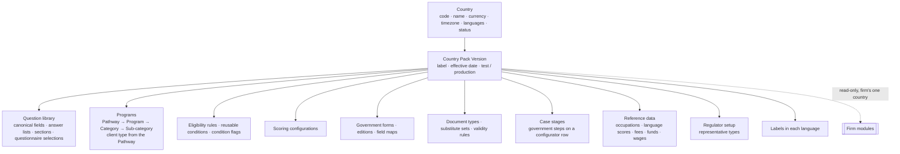
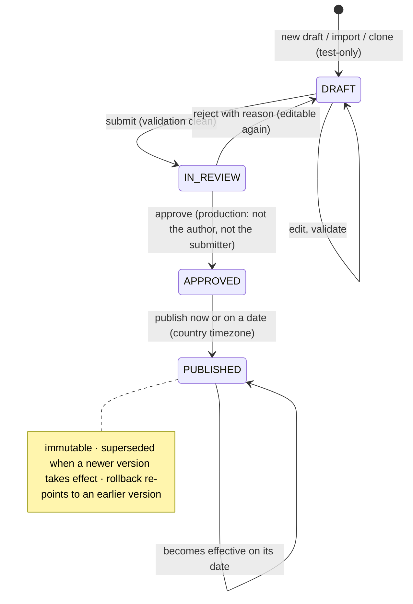
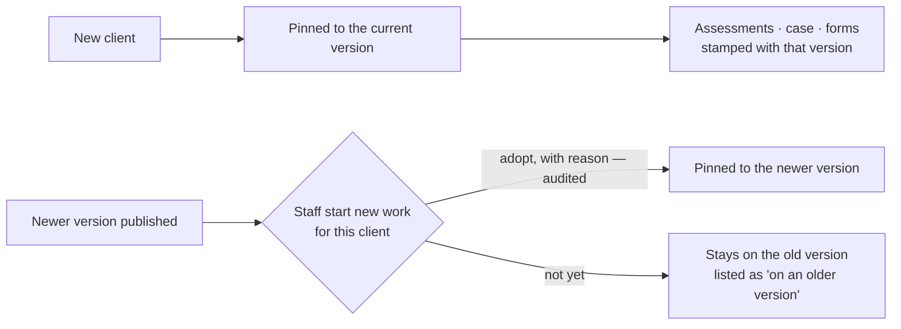

> **Document control** · Version **2.8** · **2026-10-20** · Status: **Updated — AG07-D28 applied (the product owner, 20 Oct: the form viewer for a form whose edition passed the trial; the answer sheet for every other mapped form); earlier: AG-07 review decisions applied (18 Oct: AG07-D2, AG07-D7, AG07-D8(d), AG07-D16 Q12 and Q28(c)); earlier: second pass (AG16-54 – AG16-82, 17 Oct) applied: three-field letter pattern, letter type names its case step, yearly holiday add**\
> Part of: *Super Admin Console — Functional Requirements* · Split from `FINAL-SuperAdmin-FR.md` lines 159–945 on 2026-09-16 · Previous version: `_archive/SA-01-country-and-immigration-pack-management_v2.7_2026-10-18.md`\
> Reviewed by: the co-product owner and the product owner (product owners) · Code state verified 2026-09-22 against GitHub `dev`: backend `ERv2-sanitized` @ `5a346817`, frontend `ERv2-frontend` @ `85e8840`; **re-checked 12 Oct** against backend `db646bf7` and frontend `8511b27e` (`COMPLEXITY-REGISTER_2026-10-12.md`)
>
> | Version | Date | Change | Decisions |
> |---|---|---|---|
> | 2.8 | 2026-10-20 | **AG07-D28 applied (the product owner, 20 Oct; source `ERv2-sanitized/plans/xfa-viewer/W04-SCOPE-REVIEW/04-owner-decisions-2026-10-20.md`, decisions 1, 2, 6, 8, 17, 18, 23 and 25; later the same day 27 and 28).** A form whose edition passed the trial opens in AG-07's **form viewer**, pre-filled and editable, and its approval produces the final PDF with its barcodes; every other mapped form keeps the **answer sheet**; portal web forms never get the viewer. The trial is per form **edition** (five checks), owned by the backend lead, on for every firm at once with no firm setting. **Changed (marked amended, earlier text kept):** SA-1-75 and its card (header, outcome, why, where, rules 6 and 7, new rule 9, data, safety, tests, edge cases, non-goals), the §3.15 row "Form mappings at launch", SA1-Q18 (note), the §13 closing paragraph, the AG07-D17 row of the decisions table. **Added:** the AG07-D28 row in "Decisions that change this epic"; open question SA1-Q19 (where an edition's trial result is kept). **Withdrawn:** none. *20 Oct (later): AG07-D28(27) and (28) applied — the launch mapping list is the design-partner firm's most-filed forms plus every form the viewer covers (SA-1-75, card rules 1 and 8, SA1-Q17 note); the viewer is switched on through the existing pack publish flow: the trial result is recorded on the form edition in the pack, the next publish switches the viewer on for every firm and a rollback switches it off (SA-1-75 card rules 7 and 9, Data, Edge cases; SA1-Q19 answered in principle; the AG07-D28 row).* | AG07-D28 |
> | 2.7 | 2026-10-18 | **AG-07 review decisions applied (AG07-D2, AG07-D7, AG07-D8(d), AG07-D16).** **Changed:** SA1-X13, SA-1-58, SA-1-66 and the `PackWorkPin` entity — the rules pin is **one per filing** (new purpose "case delivery"), and a firm's "Request a document" additions sit on that pin (AG07-D2); SA-1-70 card rule 5 — where each deadline anchor comes from (AG07-D16 Q28(c)); §3.2 pack lists and the §13 closing paragraph. **Added:** SA-1-74 (the deficiency library is pack content; firms have no rule screen; AG07-D7, AG07-D16 Q12) and SA-1-75 (form mappings at launch: the design-partner firm's most-filed forms; AG07-D8(d)), each with a full build card; open questions SA1-Q17 and SA1-Q18; two settings rows (§3.15); `DeficiencyLibraryItem` (§7). **Withdrawn:** none. *18 Oct (later): consistency fixes after expert review — AG17-D65, AG07-D2 (3): SA-1-58, SA1-D3 and the §3.14 adoption line now limit "requires adoption" to assessments and point to AG-7-56 for cases.* *18 Oct (final): AG07-D17 – D21 applied — AG07-D17 (SA-1-75 and SA1-Q18; BR-5 and US-5 limited to assessments), AG07-D18 (pin wording: per applicant per filing).* | AG07-D2, AG07-D7, AG07-D8(d), AG07-D16 |
> | 2.6 | 2026-10-17 | **Second-pass decisions applied (AG16-54 – AG16-82; writer brief §1a).** **Changed:** SA1-D21 and the **SA-1-71 card** — a letter pattern holds **three fields only** (sender domain, file-name pattern with digit runs masked except public IMM form codes, the type chosen); no title, sentence, subject, body or attachment; **the name masker, its fail-closed rule and its fixtures are removed** (AG16-62, changes AG16-43(1)–(2)); "Other: [free text]" stays with the firm, only `OTHER` is sent. **SA-1-69** — each letter type **names its case step** (`caseStep`, pack content; a type with no step records none) so confirming a letter's deadline also records that step (AG16-59). **SA-1-72** — groups are keyed on **sender domain + file-name pattern** only; **AI drafting removed** (nothing for AI to read); publishing a new entry needs a **second person**; one line "N new letter patterns" in the weekly content-team email (AG16-81, changes AG16-43(3)). **SA1-D22 and SA-1-73** — the holiday list supports the firm's yearly add ("Add these every year", AG16-79); the December home-screen item is gone; next year's list is published by **15 November** (AG16-79, AG16-81(5)). **Build cards** SA-1-69, -71, -72, -73 carry the new "Clicks" and "Person decides" lines (AG16-63, AG16-76). **Open questions closed:** SA1-Q5 – SA1-Q15 per AG16-55 (Q8, Q9 by AG16-62; Q10, Q13 by AG16-81; Q11 changed by AG16-81(4); **SA1-Q12 stays open — no default stated**); SA1-Q7 also AG16-54 #24 (SME = Content publisher). **Added:** SA1-Q16 (which step each letter type names; owner Content publisher with AG-07). **Withdrawn:** none; the masker (card SA-1-71 rule 3 and 5) is removed. *Same-day fixes (17 Oct): AG16-83 – AG16-88 — SA1-D2: Release 1 screens are English only, built translation-ready, French later (AG16-88); no change from AG16-87 beyond AG16-81 ("New letter patterns" stays a plain list; closes the over-engineering call-out); AG16-83 and AG16-84: nothing for this file.* *Same-day fixes (18 Oct): AG16-90 — cards SA-1-68 and SA-1-70 gained "Clicks:" and "Person decides:"; the keys `system/pack:approve` and `system/pack:publish` now have pointer rows in SA-06 §10a.* *18 Oct: new section 'Decisions that change this epic' (index of AG16 decisions; no requirement changed).* | AG16-54, AG16-55, AG16-59, AG16-62, AG16-63, AG16-76, AG16-79, AG16-81 |
> | 2.5 | 2026-10-17 | **Applied the AG-16 review decisions that put content in this module** (`TEMPLATE-MAP-working_2026-10-10.md`, "AG-16 review — decisions"; writer brief of 17 Oct). **New pack lists (§3.16):** the **government domain list** and the **letter library** — for each letter or portal email: how to recognise it (per language), its type, whether it is FYI, Action or Noise, and its deadline rule (AG16-27, AG16-41(1)); the **upkeep loop** — staff pick the type of an unrecognised letter, a de-identified pattern reaches a Super Admin **"New letter patterns"** list, the Content publisher turns it into an entry and publishes it, weekly at first and then monthly (AG16-43); and the **holiday reference list** per province per year, always a suggestion, never changing a firm's saved closed days (AG16-46). Standing rules cited: ExpatReady suggests, the firm decides (AG16-31); quiet by default (AG16-42); never quietly judge (AG16-44). The wording of the "Tell the client" notes lives in SA-05 (SA-5-111), not in the pack (SA1-D14, AG16-42 F3). **SA-01B is not changed:** these lists are country-level and are not part of any configurator row. **Open validation item recorded (SA1-Q5):** collect 2–3 de-identified samples each of passport request, procedural fairness letter, AOR for PR, COPR, ITA and PNP approvals before build. **Changed:** §0.2 (rows SA1-X14 – SA1-X17 added), §3.2 (pointer), §3.15 (three rows), §6, §7, §8, §9, §10, §12, §13. **Added:** SA1-D20 – SA1-D22, SA-1-68 – SA-1-73, BR-20, BR-21, US-13 – US-15, §3.16, build cards, SA1-Q5 – SA1-Q15. **Withdrawn:** none. No open question of v2.4 was answered by these decisions. | SA1-D20 – SA1-D22 · AG16-27, AG16-31, AG16-33, AG16-41, AG16-42, AG16-43, AG16-44, AG16-46 |
> | 2.4 | 2026-10-12 | **Applied the staff-role and Rule 9 decisions of 12 Oct 2026, session 2** (`TEMPLATE-MAP-working_2026-10-10.md`). **Role names (SR-Q3):** ExpatReady's staff roles are Platform Owner, Admin, Support, Billing, Content publisher and Auditor; "Content Manager" becomes **Content publisher** throughout, and the second person for a production pack is the Platform Owner or **another Content publisher** (SR-Q1). **The approver does not edit (SR-Q5, as built):** the approver approves exactly what was submitted (frozen at submission); to fix something the approver rejects with a reason, the author fixes and resubmits; anyone who edits and resubmits becomes the submitter and cannot approve it (§3.12, SA1-D6, SA-1-61, BR-16). **Completeness profiles (SR-Q4(7), R9-8):** the Content publisher holds `system/pack-policy:*` (built); one Canada profile ships (§10, SA-1-63). **Renaming a step's client name (SR-Q9):** `agent/case:configure-pack`, Owner and Admin by default and grantable through a custom role — the same key as hiding standard items (SA1-D9, SA1-D11, SA-1-66, SA-1-67, BR-19, §10, SA1-X9). **Rule 9 (every kept setting states its default and placement):** new §3.15 *Settings — defaults and placement*; country values are picked from lists, never typed codes (SA-1-1); adopting newer rules gets a pre-filled reason and the button "Use the newer rules (since <date>)" (R9-2, SA-1-58); the firm questionnaire area is three separate collapsed sections, all off by default (R9-1, SA-1-66). §0.2 rows SA1-X10 and SA1-X11 added, SA1-X8 and SA1-X9 updated; §12 and §13 refreshed (SA1-Q4 added; no existing open question was answered by these decisions). **Changed:** SA-1-1, SA-1-58, SA-1-61, SA-1-63, SA-1-66, SA-1-67, SA1-D3, SA1-D5, SA1-D6, SA1-D9, SA1-D11, BR-7, BR-16, BR-19, US-2, US-5, §2, §3.12, §3.14, §10. **Added:** SA1-D17 – SA1-D19, SA1-X10, SA1-X11, SA1-Q4, §3.15. **Withdrawn:** none. **Same-day revision (W-1 – W-3, the product owner, 12 Oct):** W-3(16) fills the two "Not stated" rows in §3.15 (per-content-area effective date defaults to the pack's date; completeness-profile editor under Advanced) and closes SA1-Q4. **Same-day revision (W-11 – W-21, the product owner, 12 Oct):** W-15 closes SA1-Q3 (firms may hide standard checklist items and steps without a deadline; anything with a deadline and all government steps are never hideable; staff mark "not applicable" per case), W-17 withdraws the firm-wide extra checklist items and the whole firm questionnaire layer (firms see only the final questionnaire and the dynamic checklist; per-case "Request a document" stays, with AG review knock-ons SA1-X12 and SA1-X13), and W-21 corrects the rollback wording (Platform Owner or a Content publisher) and the SA1-X6 permission count. | SA1-D17 – SA1-D19 · SR-Q1, SR-Q3, SR-Q4(7), SR-Q5, SR-Q9 · R9-1, R9-2, R9-8 · Rule 9 pass (SA-01) |
> | 2.3 | 2026-10-12 | **Applied the template-management review decisions of 10–12 Oct 2026** (`TEMPLATE-MAP-working_2026-10-10.md`). **What firms may change is rewritten** (SA1-D9, BR-7, §3.14, `PackTenantExtension`): a firm may **hide** ExpatReady's standard checklist items and standard steps firm-wide — recorded (who, when), reversible, never deleted; Owner and Admin only; **newly opened cases only**; government steps with deadlines cannot be hidden — and may rename the plain client name of government steps (rule 7 "standard checklists", Q17, decisions 15 and 16; **SA5-X17 applied**). The questionnaire side is a firm layer over the live standard questionnaire, no clones, with a "who answers" switch (Q18, R26 — detail in SA-1B). **Rule 7 wording:** the IRPA citation and "disclaimers" are removed from SA1-D4, §3.2 and §13 (disclaimer wording is optional, firm-editable starter wording; no SME check on wording); "Regulator & compliance" is renamed "Regulator setup". **Any representative type** passes the licence checks, with law-society licence formats held where supplied (Q24, O32). **The pack carries no message wording, automation templates, retainer clause sets, retention numbers or recitals** (O30, decisions 6 and 11, Q19). **Spec follows code (12 Oct):** adopting newer rules keeps its required reason (SA-1-58, built); country suspend / re-enable (SA-1-5) and the pinned-firms counts (SA-1-62) are built and stay as specified. **Pack maintenance (R34):** a warning at publish for items past their review date (SA-1-51). §0.2 rows SA1-X3, SA1-X5, SA1-X7 updated, SA1-X8 and SA1-X9 added; §0.3, §12 and §13 refreshed. **Changed:** SA-1-5, SA-1-51, SA-1-58, SA-1-62, SA1-D4, SA1-D9, BR-7, BR-8, US-5, US-7. **Added:** SA-1-66, SA-1-67, BR-19, US-12, SA1-D11 – SA1-D16, SA1-X8, SA1-X9. **Withdrawn:** none. | SA1-D11 – SA1-D16 · map rules 7, 8 · Q17, Q18, Q24 · O30, O32 · decisions 6, 11, 15, 16 · R26, R34 · SA5-X17 |
> | 2.2 | 2026-09-22 | **SA-1 split in two** after the SA-1B brainstorming session. This file keeps the container — countries, pack versions, draft → review → approve → publish, rollback, validation and authoring tools, completeness profiles, firm read with pinning and adoption. The pack's content and the resolver move to the new module file **SA-01B Content Pack Configurator**: §3.3 – §3.11 and requirements SA-1-8 – SA-1-43, SA-1-60, SA-1-64 and SA-1-65 move there **keeping their numbers** (IDs are permanent, rule 3); §4 gains a table of where each moved requirement now lives. BR-18 changed — client type comes from the Pathway, not from each program. §12 re-verified against `dev` of 22 Sep: the firm-country union is gone (v2.1 conflict 1 resolved) and representative types are open authored data (v2.1 conflict 4 resolved). | SA1B-D1, SA1B-D2 · SA1-D5 and SA1-D8 hierarchy superseded by SA1B-D2 |
> | 2.1 | 2026-09-18 | Product review applied. A firm has one country: firms read the pack of their own country only; plan and per-firm country grants withdrawn from this module. Suspending a country stops new firms only. English is the required language for Canada in Release 1; French optional. Each client's work stays on the rules it started with, with one-click audited adoption of newer rules. Canada's regulator setup has three representative types (RCIC, lawyer/notary, paralegal). Programs carry a client type (Individual / Corporate). The requirements now match the build where it is sound: 17 content areas, completeness profiles, second-person approval of production packs, scheduled publish in the country's timezone, test vs production packs, names and permissions as built. No Quebec immigration programs in Release 1. Canada launch content parked for a separate working session. Internal contradictions of v2.0 (country and pack lifecycles) resolved. §12 replaced with verified code state. SA-1-1 – SA-1-3, SA-1-5, SA-1-6, SA-1-8 – SA-1-11, SA-1-16, SA-1-34, SA-1-38, SA-1-41, SA-1-44, SA-1-45, SA-1-48, SA-1-49, SA-1-51, SA-1-52, SA-1-57, SA-1-58 changed; SA-1-60 – SA-1-65 added. | SA1-D1 – SA1-D10, SA1-P1 · applies SA3-X1 (read side), SA2-X11 |
> | 2.0 | 2026-06-20 | Baseline — golden per-module rebuild | — |

## Decisions that change this epic (14–20 Oct) *(new 18 Oct; AG07-D28 added 20 Oct)*

Product-wide rules (apply here as everywhere; home: Agent `00-Overview` → "Product rules every epic follows"): AG16-11, AG16-31, AG16-33, AG16-42, AG16-44, AG16-63, AG16-76.

The "AG16" prefix is historical: these decisions began in the AG-16 review and apply across the product. Full text: `TEMPLATE-MAP-working_2026-10-10.md`.

| Decision | What was decided (one line) | What it changes in this epic | Where (requirement / card / section) |
|---|---|---|---|
| AG16-6 | Business hours and closed days: the firm's own closed days, amended by the product owner. | A government or legal date is a calendar date: the firm's hours and closed days never move it. The suggested holiday list never changes a firm's saved closed days. | §3.16 (deadline rule, holiday list), SA-1-70 rule 10, SA-1-73, §3.15 |
| AG16-26 | Email filing order: how incoming mail is sorted into the right place. | Referenced only (no change here). The government domain list matches by domain and never matches people. | §3.16, SA-1-68 |
| AG16-27 | Government mail (IRCC, provincial nominee programs, CBSA): recognise, match, identify the letter, sort, deadline. | New pack lists: the government domain list and the letter library (per letter: how to recognise it, its type, FYI/Action/Noise, deadline rule). Recognition is by rule, without AI. A found deadline is only a suggestion with its source sentence; a person confirms it. | SA1-D20, SA1-X14, §3.16, SA-1-68, SA-1-69, SA-1-70, SA1-Q5 |
| AG16-30 | Payment emails become a suggested payment record (home AG-06). | Referenced only (no change here). Cited in the open question about ExpatReady-maintained lists with no declared home (payment-notice formats); that question is still open. | SA1-Q12 (§13) |
| AG16-34 | AI is included in higher plans, not sold as an add-on. | Referenced only (no change here). AI help for unseen letters is plan-gated, as stated on the letter-entry card. | SA-1-69 (rule on AI help) |
| AG16-41 | Letters downloaded from the IRCC portal. | The letter library also covers letters brought in as PDF uploads (AG-09 runs the same library). No IRCC portal login, scraping or browser extension (non-goal). | SA1-D20, SA1-X14, SA-1-69, SA-1-69 non-goals |
| AG16-43 | Keeping the letter library current. | Upkeep loop: staff pick the type of an unrecognised letter, a de-identified pattern reaches a Super Admin "New letter patterns" list, the Content publisher turns it into an entry and publishes it. Changed in v2.6 by AG16-62 and AG16-81 (see those rows). | SA1-D21, SA1-X14, SA1-X17, §3.16, SA-1-71, SA-1-72 |
| AG16-45 | Office time zones and escalation by office. | The holiday button "Add holidays for [province] [year]" takes the province from the firm address, or from the office's once offices exist. | SA1-X15 (§0.2), SA-1-73 |
| AG16-46 | Closed days: suggested holidays, the firm adds. | New holiday reference list per province per year, always a suggestion: nothing is saved until the firm clicks Add, and the firm may untick any day. Never changes a firm's saved closed days. | SA1-D22, SA1-X15, §3.16, SA-1-73 |
| AG16-54 | 25 consistency fixes after the 17 Oct write (batch). | The letter-pattern audit event carries the pattern id and type only, never content (#21). Immigration SME = the Content publisher role; no seventh role (#24). | §3.16 Events, SA1-Q7 (§13) |
| AG16-55 | Writers' recommended defaults accepted for the detail questions. | Open questions SA1-Q5 to SA1-Q15 closed with the writers' defaults (samples collected before build; the three lists sit outside the 17 content areas for Release 1; SME is the Content publisher). SA1-Q12 stays open (no default stated). | SA1-Q5 to SA1-Q15 (§13) |
| AG16-59 | A government letter records its case step; one event, one client message. | Each letter type names its case step (`caseStep`, pack content); confirming a letter's deadline also records that step. A type with no step records none. New open question SA1-Q16 (which step each type names). | SA-1-69 rule 11, §3.16, SA1-X14, SA1-Q16 |
| AG16-62 | Unrecognised-letter pattern: no text leaves the firm. | A letter pattern holds three fields only (sender domain, file-name pattern with digit runs masked except public IMM form codes, the type chosen). The name masker, its fail-closed rule and its fixtures are removed. "Other: [free text]" stays with the firm; only OTHER is sent. | SA1-D21, SA-1-71 card, §3.16, SA1-X14, SA1-Q8, SA1-Q9 |
| AG16-63 | Design checks every requirement must pass (the product owner's review principles). | Build cards SA-1-69, -71, -72 and -73 carry the new "Clicks" line. | SA-1-69, SA-1-71, SA-1-72, SA-1-73 |
| AG16-74 | Translate and Summarise in the staff member's language, saved. | Referenced only (no change here). Cited as a language-neutral feature that stays. | §0 (SA1-D2 row), §3.11 |
| AG16-76 | Standing rule: help people, don't replace them; do, don't overdo. | Build cards SA-1-69, -71, -72 and -73 carry the new "Person decides" line (nothing publishes by itself). | SA-1-69, SA-1-71, SA-1-72, SA-1-73 |
| AG16-79 | Closed days: one "Add these every year" tick, asked once; no December alert. | The holiday list supports the firm's yearly add (pre-ticked "Add these every year"); the December home-screen item is gone. Next year's list is published by 15 November. | SA1-D22, SA1-X15, §3.15, §3.16, SA-1-73 |
| AG16-81 | "New letter patterns" review in Super Admin. | Groups are keyed on sender domain + file-name pattern only. AI drafting of entries is removed. Publishing a new entry needs a second person. One line "N new letter patterns" in the weekly content-team email. | SA1-D21, §3.16, SA-1-72, SA1-Q10, SA1-Q11, SA1-Q13 |
| AG16-82 | One rule for every broken connection. | Cited — see the change-log row 2.6 and Status line (cited only as part of the range AG16-54 to AG16-82); no requirement here names it. | Document control (v2.6) |
| AG16-83 | 26 follow-through fixes after the second pass (batch A). | Referenced only (no change here). The change log says nothing for this file. | Document control (v2.6) |
| AG16-84 | Very short deadlines: the letter note is the client message. | Referenced only (no change here). The change log says nothing for this file. | Document control (v2.6) |
| AG16-87 | "New letter patterns" stays a plain list. | No change beyond AG16-81; closes the over-engineering call-out. | Document control (v2.6), SA-1-72 |
| AG16-88 | Release 1 is English-first; French later. | Release 1 screens are English only, built translation-ready; French text in the pack is optional. The platform's French interface is deferred. | SA1-D2 (§0), SA-01.11 (§0.3) |
| AG16-90 | Batch C: consistency fixes from the 17 Oct audit. | Cards SA-1-68 and SA-1-70 gained "Clicks:" and "Person decides:". The keys system/pack:approve and system/pack:publish now have pointer rows in SA-06 §10a. | SA-1-68, SA-1-70 (marked "changed 18 Oct"), SA-06 §10a |
| AG07-D2 | One rules pin per filing (a filing is one application with its own program inside a case). | The pin wording follows the filing: a firm's "Request a document" additions are stored per firm + client + the filing's rules pin (new purpose "case delivery"); adopting newer rules carries them to the new pin. The rule itself is specified in AG-07 (single home). | SA1-X13, SA-1-58, SA-1-66, §7 `PackWorkPin` |
| AG07-D7 | Deficiency checks are pack content; money shows on the case header. | New requirement and card: the deficiency library is ExpatReady pack content and firms have no rule screen. SA-06 gets no firm deficiency-library key. | SA-1-74 (card), §3.2, §3.15, §7 |
| AG07-D8(d) | Forms filled automatically at launch: the most-filed forms (option A). | New requirement and card: the built Filler plus maps for the design-partner firm's most-filed forms; the immigration expert confirms the list; every other form by hand; more maps later as pack content. Two open questions added. | SA-1-75 (card), SA1-Q17, SA1-Q18, §13 |
| AG07-D16 (Q12, Q28(c)) | Two AG-07 questions closed: the Checker's scope (Q12) and where deadline anchors come from (Q28(c)). | Q12: a suggested start for the cross-document checks sits in the deficiency library; the expert decides. Q28(c): status expiry is an answer about the person, PR landing is the date of an after-decision government step; the expert confirms the list. | SA-1-74 rule 6, SA-1-70 card rule 5 |
| AG07-D17 *(amended 20 Oct — AG07-D28)* | Government forms: an answer sheet at launch, plus a trial of direct PDF filling (option C; amends AG07-D8(d)). | SA-1-75 and its card: every mapped form gets an answer sheet at launch, built from the same field map; direct XFA filling only after a form passes the trial. SA1-Q18 closed. BR-5 and US-5 limited to assessments (cases: AG-7-56). | SA-1-75 (card), SA1-Q18, BR-5, US-5 |
| AG07-D18 | A rules version record per person on a filing (refines AG07-D2). | Pin wording is per applicant per filing: all applicants on a filing stay on the filing's one version; "Use newer rules" moves every applicant's pin together. | SA1-X13, SA-1-58, SA-1-66, §7 `PackWorkPin` |
| AG07-D28 *(the product owner, 20 Oct)* | Government forms: the form viewer in Release 1 for a form whose edition passed the trial; the answer sheet for every other mapped form (amends AG07-D17). | SA-1-75 and its card: a mapped form whose edition passed the trial opens pre-filled in AG-07's form viewer (AG-7-109), and its approval produces the final PDF with its barcodes; every other mapped form, and every portal web form, keeps the answer sheet. The trial is per edition, owned by the backend lead, on for every firm at once; a new edition gets the answer sheet until its trial passes. The "no submission-ready barcode" and "no direct PDF filling" non-goals are amended. ~~Where the trial result is kept is not decided (SA1-Q19).~~ *(20 Oct, later — AG07-D28(27), (28))* The launch mapping list adds every form the viewer covers. The trial result is recorded on the form edition in the pack; the next pack publish switches the viewer on for every firm and a rollback switches it off (SA1-Q19 answered in principle). | SA-1-75 (card), §3.15, SA1-Q17, SA1-Q18, SA1-Q19, §13 |

## Module SA-1: Country & Immigration-Pack Management

> **What this document is.** The build specification for Super Admin module SA-1. Version 2.2 splits the module in two (SA1B-D1): this file is the **container** — countries, pack versions, review and publishing, validation and authoring tools, firm read with pinning and adoption — while the pack's **content and the resolver** are specified in **SA-1B Content Pack Configurator**. Version 2.1 applied the product review of 18 Sep 2026. Version 2.3 applies the template-management review of 10–12 Oct 2026 (what firms may hide, rule 7 wording, licences, spec-follows-code). Version 2.4 applies the staff-role and Rule 9 decisions of 12 Oct (role names, the approver does not edit, settings defaults and placement). Version 2.5 applies the AG-16 review decisions of 17 Oct that put content here: the government domain list, the letter library and its upkeep, and the holiday reference list (§3.16). **§0** records each decision; every later section has been edited in place to match it. Where an earlier version says something different, this version wins; earlier wording is kept only in `_archive/`.
>
> **Plane:** GLOBAL — owned by Expat Ready's team; firms only read. **Tenant key:** none — pack content is platform content, identical for every firm of a country. **Consumed by:** firm modules (assessment, questionnaire, cases, forms, checklists, portal), always read-only and always for the firm's **one** country (SA-2-9). **Permissions:** `system/*` (as built — §10).
>
> **Requirement IDs are permanent.** A changed requirement keeps its number. A withdrawn requirement stays as a one-line entry. New requirements continue from the highest number (next: SA-1-76). Numbers are never reused.

---

### 0. Decision log (review of 2026-09-18)

| ID | Decision | Where applied |
|---|---|---|
| **SA1-D1** | **Suspending a country stops new firms only.** Existing firms of a suspended country keep working normally on its current published pack; no new firm can be created for it; a Platform Owner can re-enable it from the console. Bad pack content is fixed by **rollback** (SA-1-49), not by suspending the country. | §3.1 · SA-1-3, SA-1-5 changed · BR-10 |
| **SA1-D2** | **English is the required language for Canada in Release 1; French is optional.** French pack text can be added and is shown to French-speaking users when present; a missing French text is a warning, never a block. The platform's own interface stays English and French. *(fix 17 Oct — AG16-88: replaced.)* **Release 1 screens are English only**, built translation-ready (all screen text kept in one place) so French can be switched on later without code changes; no French-specific build or content before launch; missing French always falls back to English. The matching patterns (French letter clues, §3.16) are rules, not screens, and stay. Language-neutral features stay (template language field; Translate and Summarise in the staff member's language — AG16-74). Revisit before actively selling to Quebec-based firms. | §3.11 · SA-1-44 changed · BR-13 · §0.1 |
| **SA1-D3** *(changed v2.4 — R9-2)* | **Each client's work stays on the rules it started with; newer rules are adopted deliberately.** A client's assessments and case are pinned to the pack version in force when the work started. When newer rules exist, firm staff see "newer rules available since <date>" and adopt them for assessments with one click and a reason (audited; the reason is pre-filled "Adopting the current rules" and can be edited, and the button reads "Use the newer rules (since <date>)"); earlier results stay reproducible. New clients always start on the current rules. For a new case, even a returning client's, each filing starts on the current rules; adopting newer rules on a case is AG-7-56 *(fixed 18 Oct — AG17-D65, AG07-D2 (3))*. Super Admin (and firms, for their own clients) can list who is still on an older version. | §3.14 · SA-1-58 changed · SA-1-62 · BR-5 |
| **SA1-D4** | **Canada has three representative types:** **RCIC** — licensing body CICC, licence format checked; **Lawyer / notary** — a provincial law society or the Chambre des notaires du Québec, chosen from a list, licence number format-checked where the pack holds a format for that body (law-society formats, O32); **Paralegal** — a law-society licensee, same. Each type has its own label, holder title and *(changed v2.3 — rule 7)* optional starter wording that the firm can edit (no statute citation; no expert check on wording). Every type counts as a licence (SA1-D13). The one-regulator-per-country model becomes one regulator setup per country with several representative types. | §3.10 · SA-1-8 – SA-1-10 changed · BR-14 · §0.2 SA1-X3 |
| **SA1-D5** *(changed v2.4 — SR-Q3)* | **Programs carry a client type: Individual or Corporate.** Set by the Content publisher on the program; its streams and categories inherit it. A case takes its type from its program (e.g. LMIA = Corporate); family cases (e.g. spousal sponsorship) count as **Individual**. The mock "Individual / Corporate" switch becomes a real filter. | §3.3 · SA-1-60 · BR-18 · §0.2 SA1-X1 (SA-3 case groups) |
| **SA1-D6** *(changed v2.4 — SR-Q1, SR-Q5)* | **Publishing rules, as built:** a **production** pack needs a second person — the Platform Owner or another Content publisher; its author and its submitter can never approve or publish it; **the approver does not edit** — the approver approves exactly what was submitted (frozen at submission) and, to fix something, rejects with a reason so the author fixes and resubmits; anyone who edits and resubmits becomes the submitter and cannot approve it; **test-only** packs are exempt; **rollback** needs one person — the Platform Owner or a Content publisher — and a written reason *(revised same day — W-21)*; creating, activating, suspending and re-enabling a **country** is Platform Owner only. A rejected draft returns to an editable draft. | §3.12 · SA-1-45, SA-1-49 changed · SA-1-61 · BR-16 |
| **SA1-D7** | **Scheduled publish uses calendar dates in the country's official timezone** (set on the country). Canada: **Eastern Time (Ottawa, `America/Toronto`)**. | §3.12 · SA-1-1, SA-1-48 changed |
| **SA1-D8** | **Structure and names as built:** whole-pack versions that bundle versioned content areas (two-level model); the name **"Country Pack"**; the hierarchy **Pathway → Program → Stream → Category**; permission keys `system/*` (no `global/*` namespace). Closes the June founder questions on permission namespace, versioning depth and naming. | §3, §7, §10 · SA-1-11 changed |
| **SA1-D9** *(changed v2.3 — rule 7, Q17, Q18, decisions 15 and 16; changed v2.4 — SR-Q9)* | **What firms may change:** **hide** ExpatReady's standard checklist items and standard steps that carry no deadline, firm-wide (SA1-D11) *(revised same day — W-15)*; **rename the plain client name** of government steps and delivery steps (`agent/case:configure-pack`, Owner and Admin by default, grantable through a custom role — SR-Q9); and add a document to one case with "Request a document" (per case, SA-1-66). *(Revised same day — W-17: firm-wide extra checklist items and the firm questionnaire layer — added questions, hidden or reordered optional questions, the who-answers switch — are withdrawn; firms see only the final questionnaire and the dynamic checklist, SA1-D12.)* Firms never change eligibility rules, scoring, forms, reference data or required questions. There is no "regulator text" or "locked legal core" for a firm to be kept from: disclaimer wording is the firm's own editable starter wording (SA1-D4). | §3.7, §3.8, §3.14 · SA-1-34, SA-1-38 changed · BR-7 · SA-1-66, SA-1-67 |
| **SA1-D10** | **The requirements adopt the built content model:** 17 content areas (adding the question library, answer lists, questionnaire sections and selections, reusable conditions, condition flags and document types to the June list) and **completeness profiles** (per-country rules for what must be complete before a pack can publish). | §3.2 · SA-1-63, SA-1-64 |
| **SA1-P1** | **Release 1 priorities** as §0.3. | §0.3 · §0.1 |
| **SA1-D11** *(new v2.3; changed v2.4 — SR-Q9)* | **Hiding ExpatReady's standard items (Q17, rule 7 "standard checklists", decision 15).** (1) A firm's **Owner and Admin** (by default; grantable through a custom role) hide, show and rename client names, through `agent/case:configure-pack` — not `agent/pack:extend`. (2) **Never hideable: anything with a deadline (of any kind) and all government steps** *(revised same day — W-15)*; the firm may switch off the countdown message of a government step, and staff may mark any item "not applicable" on one case. (3) Hiding and showing apply to **newly opened cases only**; an open case keeps the item and staff may mark it "not applicable" on that case. (4) Every hide is recorded (who, when), reversible and never a deletion; the record also keeps the pack version in force when the item was hidden (a data field, so the update note below can be built — rule 8, data foundations stay). (5) The standard items are called "ExpatReady's standard checklist" / "standard steps" — never "locked legal core" or "required by law". (6) Questions that feed scoring or government forms stay fixed, for a **technical** reason. (7) The hide rule applies to document checklists and to-do steps, **not** to questionnaire questions (SA1-D12). (8) When ExpatReady later updates a hidden item the firm sees "ExpatReady updated '…', which you've hidden. Review?" — decided in rule 7; whether it ships in Release 1 is **deferred to the AG review** (map 12 Oct), see §13. | §3.14 · SA-1-66, SA-1-67 · BR-7, BR-19 · US-12 · §0.2 SA1-X8, SA1-X9 |
| **SA1-D12** *(new v2.3; withdrawn — W-17)* | **The questionnaire is not a firm layer** *(revised same day — W-17)*. Firms see only the **final questionnaire** and the **dynamic document checklist** for the case's programme, category and family; the configuration behind them is ExpatReady's and is never shown to firms. **Withdrawn:** firm-added questions, hiding or reordering optional questions, and the "who answers" switch (staff already fill answers on the client's behalf on the case). Firm-specific facts every client is asked (e.g. a referral source) belong on the lead / client record (AG-02 / AG-07). No clones: ExpatReady updates flow to the firm automatically and each case stays on the pack version it started with. Detail in SA-1B (SA1B-D25 withdrawn, SA-1B-93, SA-1B-94, SA-1B-99). | SA-1B · §3.14 · SA-1-66 · §0.2 SA1-X8 |
| **SA1-D13** *(new v2.3)* | **Licences (Q24, O32).** **Any representative type in the regulator setup** (RCIC, Lawyer / notary, Paralegal …) passes the two kept licence checks — AG-05's "No active licensed consultant" block and AG-07's lead-representative picker. Wording is neutral ("licence number", not "CICC number"). The pack holds law-society licence formats where the SME supplies them; a firm's footer licence text is its own layout setting. The platform records no expert or SME check on wording. | SA-1B (SA-1-8, SA-1B-98) · §0.2 SA1-X3 |
| **SA1-D14** *(new v2.3)* | **The pack carries no message wording, automation templates, retainer required-clause sets, e-sign recitals or retention numbers (O30, rule 7, decisions 6 and 11, Q19).** It supplies *data* — a "has a deadline" mark and a usual timeline on government steps, document validity — that the Minder and the Government deadline countdown read. Templates are written and published in SA-05; a firm's keep-period is its one firm setting ("Keep closed client files for ___ years", Q19). | SA-1B (SA-1B-100) · SA-05 |
| **SA1-D15** *(new v2.3)* | **Spec follows code (the product owner, 12 Oct; map "built stays").** (a) **Adopting newer rules keeps a required reason** (SA-1-58): built backend. (b) **Country suspend / re-enable** (SA-1-5) is built, backend and console, and stays as specified. (c) **Pinned-firms-per-version counts** (SA-1-62, console side) are built and stay. The register's suggestions to make the reason optional or park the suspend screen and the counts are not adopted. | SA-1-5, SA-1-58, SA-1-62 · §12 |
| **SA1-D16** *(new v2.3)* | **Pack maintenance (R34).** An item past its next-review date produces a **warning at publish**; the sortable "next review" column and the **weekly email to the content team** are specified in SA-1B-40; no queue screen. Not built. | SA-1-51 · SA-1B-40 |
| **SA1-D17** *(new v2.4 — SR-Q3, SR-Q1)* | **Staff role names.** ExpatReady's staff roles are Platform Owner, Admin, Support, Billing, Content publisher and Auditor (code keys unchanged). "Content Manager" and "content publisher" as two separate roles in earlier versions become the one **Content publisher**: it authors packs and, as the second person, approves and publishes another person's production pack. Packs stay as built — Platform Owner or Content publisher; plan and price changes use a second Owner. | §2 · §3.12 · §10 · SA-1-61 |
| **SA1-D18** *(new v2.4 — SR-Q4(7), R9-8)* | **Completeness profiles.** The Content publisher keeps `system/pack-policy:*` (built, `role-template.platform.ts:287-289`) and edits the profile in the built console (`pack-completeness-admin.*`). One Canada profile ships. | §10 · SA-1-63 · SA1-X10 |
| **SA1-D19** *(new v2.4 — Rule 9 pass, R9-1, R9-2)* | **Settings — defaults and placement.** Every kept setting in this module has a stated default and a placement (Main, Advanced or code constant) in §3.15. A new firm runs from day one on the defaults without opening any setting. | §3.15 · SA-1-1, SA-1-58, SA-1-66, SA-1-67 |
| **SA1-D20** *(new v2.5 — AG16-27, AG16-41(1), AG16-33, AG16-31)* | **Government mail is recognised from pack lists, by rule, without AI.** The pack carries (a) a **government domain list** (cic.gc.ca, notification.canada.ca, international.gc.ca, auth.canada.ca, provincial domains such as ontario.ca) and (b) a **letter library**: one entry per letter or portal-email type with how to recognise it **per language**, the letter type, **FYI / Action / Noise**, and the **deadline rule**. The firm-side matcher (AG-10) and the PDF-upload path (AG-09) read them. A deadline the library finds is only a **suggestion with its source sentence**; a person confirms it before it becomes a government deadline (AG16-31). Unknown letters fail safe: filed, a task is created, type shown as "Letter — type not recognised". The pack holds no client-message wording (SA1-D14); the "Tell the client" notes are SA-05 library starters (SA-5-111). | §3.16 · SA-1-68 – SA-1-70 · BR-20 |
| **SA1-D21** *(new v2.5; changed v2.6 — AG16-43, AG16-42, AG16-44, AG16-62, AG16-81)* | **The library is kept current by a loop that shares only three fields.** Staff pick the type of an unrecognised letter while handling its task. ExpatReady receives automatically exactly three content fields: the **sender domain** (`cic.gc.ca`), the **file-name pattern** (digit runs masked except public form codes matching `IMM\s?\d{4}[A-Z]?`; `IMM5756.pdf` kept, `W300000000.pdf` → `W#.pdf`) and the **type chosen** (a library code or `OTHER`) — **no title, sentence, subject, body, attachment or client field**. "Other: [free text]" stays with the firm as the document's label; only `OTHER` is sent. A Super Admin **"New letter patterns"** list groups patterns on sender domain + file-name pattern with a count of firms; the **Content publisher** writes the new entry **from de-identified samples collected with a design-partner firm** (SA1-Q5); there is **no AI drafting**. Publishing uses the existing pack approval with a **second person** (§3.12). One line "N new letter patterns" in the weekly content-team email is the reminder; no alert, no screen. No firm setting; the terms of service state that de-identified government-template wording is shared. | §3.16 · SA-1-71 – SA-1-72 · BR-20 |
| **SA1-D22** *(new v2.5; changed v2.6 — AG16-46, AG16-31, AG16-44, AG16-79)* | **Holiday reference list, a suggestion only.** ExpatReady keeps, as pack content, a list of each province's and the federal holidays per year (about 1 hour of work a year), labelled "Suggested — check before adding". The firm's own closed-days list (AG16-6) is never changed by ExpatReady: nothing is saved until the firm clicks Add, and a later change to the reference list does not touch a list the firm has saved — **except** by the yearly add the firm opted into with the pre-ticked "Add these every year" (AG16-79; the add itself is built in AG-16). Next year's list is published by **15 November** (SA1-Q10). | §3.16 · SA-1-73 · BR-21 |

**Applied from earlier reviews**

| ID | From | Applied here |
|---|---|---|
| **SA3-X1 / SA3-D1** | SA-3: one firm, one country; plans grant no countries; no per-firm grants | §3.14 · SA-1-3, SA-1-57 changed · FIRM_COUNTRY_ENTITLEMENT removed from this module · BR-6 |
| **SA2-X11** | SA-2: Release 1 launches no Quebec immigration programs | SA-1-65 |
| **SA3-D8b** (principle) | SA-3: live configuration changes need a second person | SA1-D6 (already built for production packs) |

**Applied from the SA-1B review (2026-09-22)**

| ID | Decision (owner) | Applied here |
|---|---|---|
| SA1B-D1 | SA-1 is split; the pack's content and the resolver move to SA-1B (SA-1B) | §3.2 pointer · §3.3 – §3.11 removed · §4 moved-requirements table |
| SA1B-D2 | Four levels — Pathway (Individual / Corporate) › Program › Category › Sub-category; client type comes from the Pathway; location is a case detail; an invitation is a filing, not a level (SA-1B) | Supersedes the hierarchy parts of SA1-D5 and SA1-D8 · SA-1-11 and SA-1-60 now in SA-1B · BR-18 changed |

**Parked (12 Oct, map R34):** the list of pack sections used by nothing (SA-1B-17) — housekeeping, parked in SA-1B.

**Parked (product owners, 18 Sep):** the content of the Canada Release 1 pack — which programs, reference tables and forms, and who authors them — is to be planned in a **separate working session** (slice SA-01.15, §0.3).

#### 0.1 Deferred (carry to the deferral register)

| Item | Why deferred | Reopen when |
|---|---|---|
| Screen to retire a pack version (backend route exists; no workflow) | Rollback covers emergencies (SA1-D6) | Old versions need closing for new pins |
| Using clone-a-country (built) | No second country in Release 1 | A second country is approved |
| Deleting a draft country with no references (former SA-1-2 delete) | Not needed with one country | Clutter from abandoned drafts |
| French required for Canada pack text | SA1-D2 | Before actively selling to Quebec-based firms |
| Quebec immigration programs | SA2-X11 | After Release 1 |
| Second destination country | One country at launch | Business decision |
| Full "as a firm sees it" preview (program tree, sample form fill, checklist) | Needs the firm-side read screens (AG modules); dry-run preview covers authoring | AG modules consume the pack |
| Second approver for country activate / suspend | Rejected — Platform Owner only (SA1-D6) | Only if an error shows the need |

#### 0.2 Decisions taken in this review that other modules must apply

Each row stays **Pending** until the owning module's review applies it.

| ID | Owner | Requirement text to apply | Status |
|---|---|---|---|
| **SA1-X1** | SA-3 | Case and client groups for limits are **Individual** and **Corporate** only; a case's group comes from its program's client type (SA1-D5); family cases count as Individual. | **Applied in SA-3 v2.8** |
| **SA1-X2** | SA-2 | SA2-X11 applied (no Quebec programs in Release 1). "Deprecated" in SA-2-13a means "suspended" (SA1-D1): existing firms continue unchanged. The firm record's one country (SA-2-9) is what SA-1's pack read uses. | **Applied in SA-2 v2.10** |
| **SA1-X3** *(changed v2.3 — Q24, O32)* | AG-1 (firm setup, staff credentials), AG-5, AG-7 | A licensed staff member records a representative type from the country's regulator setup (Canada: RCIC, Lawyer/notary, Paralegal), the licensing body, and the licence number; a number is format-checked where the pack holds a format for that body (RCIC; law societies where supplied). **Any representative type passes** AG-5's "No active licensed consultant" block and AG-7's lead-representative picker; wording is neutral ("licence number"). | Pending |
| **SA1-X4** | AG-3 (assessments), AG-7 (cases) | "Newer rules available since <date>" prompt and one-click adoption with a reason (audited) before new work on a pinned client; cases take their client type from their program. | Pending |
| **SA1-X5** *(changed v2.3)* | AG-8 (questionnaire), AG-7/AG-11 (stages, automation), forms filling | Consume the pack's questionnaire sections, government steps (with the "has a deadline" mark and usual timeline, SA-1B-96) and form field maps read-only for the firm's one country; the firm's own overlay (hidden items, renamed client names) sits on top (SA1-X8) *(revised same day — W-17)* — the questionnaire layer is withdrawn; nothing runs them yet on `dev` (§12). | Pending |
| **SA1-X6** | SA-6 | The 21 `system/*` pack and country permissions of §10 (6 country, 7 pack draft and publishing, 3 completeness profile, 5 import / export / media) are the catalogue for SA-1 *(revised same day — W-21)*; no `global/*` namespace. | Pending |
| **SA1-X7** | Developers | Re-base on this version (§12): firm pack reads use the firm's one country (remove the plan ∪ firm-grant union, with SA3-X1 / SA-2-9); build the forms editor, bulk reference-data upload, rejected-draft editing, representative types, program client type, the screen for adopting newer rules (backend built, SA-1-58), the firm-side "clients on an older version" list (backend built, SA-1-62(b)), and the firm overlay of SA-1-66 (hides, client-name overrides) *(revised same day — W-17)* — the questionnaire layer and who-answers switch are withdrawn. *(Re-enable of a suspended country and the Super Admin "who is on which version" counts are built — SA1-D15.)* Mark superseded: the SA-1 sections of "Doc-2", `Docs/DOC2-COMPLETION-AUDIT-2026-08-27.md` and `Docs/WORLD-CLASS-AUDIT-2026-08-27.md`, and `Docs/XPAT-68-COUNTRY-DEFINITION-ENABLEMENT-HANDOFF.md`; commit or retire the `plans/sa1-country-pack-backend/*` wave plans the code cites (not in the repository). Tracker: add SA-01.15. | Pending |
| **SA1-X8** *(new v2.3; changed v2.4 — R9-1)* | AG-7, AG-9, AG-13, AG-15 / CP-01, AG-8 | Read the firm overlay of SA-1-66: **hidden standard items and steps apply to newly opened cases only**; open cases keep the item and staff mark it "not applicable"; nothing with a deadline and no government step is ever hidden *(revised same day — W-15)*; the portal timeline shows the **firm's renamed client name** for a government or delivery step, falling back to ExpatReady's plain client name; AG-8 reads the final questionnaire (no clones); there is no firm questionnaire layer and no who-answers switch *(revised same day — W-17)*. *(Changed v2.4 — R9-1; withdrawn — W-17:)* the three collapsed questionnaire sections no longer exist. | Pending |
| **SA1-X9** *(new v2.3 — Q17(1); changed v2.4 — SR-Q9)* | SA-6 | Hiding and showing ExpatReady's standard items, and renaming the client name of a government or delivery step, is `agent/case:configure-pack` (Owner and Admin starter roles; grantable through a custom role), not `agent/pack:extend`. Same instruction as SA5-X11(d). | Pending |
| **SA1-X10** *(new v2.4 — SR-Q3, SR-Q4(7), SR-Q5)* | SA-7, SA-6 | Staff role display names are Platform Owner, Admin, Support, Billing, Content publisher, Auditor. Appendix A: Content publisher holds the completeness-profile keys (`system/pack-policy:*`). Pack approval: the approver does not edit; second person = Platform Owner or another Content publisher. | Pending |
| **SA1-X11** *(new v2.4 — R9-1, R9-2, SR-Q9)* | AG-7, AG-8, AG-16 | Firm screens: "Use the newer rules (since <date>)" with the pre-filled reason "Adopting the current rules"; inline "Hide from new cases" on each standard item, the hidden-items list and "rename a step's client name" (with "Reset to ExpatReady's name") under Advanced; rename uses `agent/case:configure-pack`. | Pending |
| **SA1-X12** *(new — W-17)* | AG-8 (questionnaire), AG-7 | Firms see only the final questionnaire for the case's programme, category and family. **Withdrawn:** clone-and-customise, firm-added questions, hiding or reordering optional questions, and the "who answers" switch. Firm-specific facts every client is asked (e.g. referral source) go on the lead / client record (AG-02 / AG-07). Decided in the AG review. | Pending |
| **SA1-X13** *(new — W-17)* | AG-7, AG-9 (cases, documents) | "Request a document" on a case is the firm's only way to add a document to a checklist: a per-case addition (`PackTenantExtension` kind `CHECKLIST_ADDITION`, stored per firm + client + the person's rules pin on the filing *(changed 18 Oct — AG07-D2, AG07-D18)*; `client-spine.prisma:567-585`). Each applicant on a filing has their own pin, so the addition belongs to one person on one filing *(changed 18 Oct — AG07-D18)*; adopting newer rules carries it to the new pin (rule in AG-07). No firm-wide extra items. Decided in the AG review. | Pending |
| **SA1-X14** *(new v2.5 — AG16-27, AG16-41, AG16-43, AG16-44)* | AG-10 · AG-09 · AG-11 | Read the government domain list and the letter library (SA-1-68 – SA-1-70) for the firm's country: recognise government mail by domain from every connected mailbox, identify the letter, sort FYI / Action / Noise, and suggest the deadline (confirmed by a person). The PDF-upload path (AG-09) runs the same library. AG-10 owns the "Letter — type not recognised" picker and sends the three-field pattern of SA-1-71 (AG16-62). *(v2.6, AG16-59)* Each letter type names its case step (SA-1-69 `caseStep`); AG-07 records that step when a person confirms the letter's deadline, and AG-09 / AG-10 read it. Fixtures: de-identified samples (SA-1-69 tests). | Pending |
| **SA1-X15** *(new v2.5 — AG16-46)* | AG-16 · AG-04 · AG-11 | AG-16's closed-days screen reads the holiday reference list (SA-1-73) for the button "Add holidays for [province] [year]" (province from the firm address, or the office's once offices exist — AG16-45); *(v2.6, AG16-79)* AG-16 adds next year's days each December when the firm ticked "Add these every year", and AG-11 shows one quiet "Done for you" line (no home-screen item); AG-04 slots use the firm's saved list, never the reference list. | Pending |
| **SA1-X16** *(new v2.5 — AG16-42 F3)* | SA-05 | The "Tell the client" note for each letter type is a library starter in SA-05, one per letter type and language (SA-5-111), keyed by the letter type code of SA-1-69. | **Applied in SA-05 v3.5** |
| **SA1-X17** *(new v2.5 — AG16-43)* | SA-07 · SA-06 · SA-11 | SA-07/SA-06: the "New letter patterns" list is worked by the Content publisher with the existing `system/pack:draft-manage` (no new key); who the Immigration SME is as an ExpatReady account is open (SA1-Q7). SA-11: audit pattern submissions received and entries published from them (event names in SA-1-71 and SA-1-72). | Pending |

**Rows into this module (applied)**

| ID | From | What | Status |
|---|---|---|---|
| **SA5-X17** | SA-05 v3.1 §0.2 | Hide rule, Owner / Admin, government deadline steps not hideable, new cases only, update note, fixed technical questions, removal of "locked legal core" / "required by law" / "regulator text" wording. | **Applied in SA-01 v2.3** (SA1-D9, SA1-D11, SA-1-66, SA-1-67, BR-7, BR-19, §3.14, US-12) |
| **SA5-X18** | SA-05 v3.1 §0.2 | Targets SA-1B (government-step client names, disclaimers, licences, questionnaire layer, pack additions). | **Applied in SA-01B v1.3**; the container wording here (§3.2 row 16, SA1-D4, SA1-D12 – SA1-D14) is aligned |

#### 0.3 Release 1 priorities

| Slice | Priority | Notes |
|---|---|---|
| SA-01.00 Country & pack model | **Must now** | Fix: firm reads use the firm's one country |
| SA-01.01 Country definition & enablement | **Must now** | Suspend = stop new firms; re-enable from the console |
| SA-01.02 The pack bundle | **Must now** | 17 content areas + completeness profiles |
| SA-01.03 Program hierarchy | **Must now** | Add client type (Individual / Corporate) |
| SA-01.04 Eligibility rules | **Must now** | Built |
| SA-01.05 Scoring | **Must now** | Built (generic engine) |
| SA-01.06 Forms & field maps | **Must now** | Build the editor screen and field-map import |
| SA-01.07 Document checklists | **Must now** | Built |
| SA-01.08 Case stages & workflow templates | **Must now** | Authoring built; running them is the AG modules' |
| SA-01.09 Reference data | **Must now** | Build bulk upload in the console |
| SA-01.10 Regulator setup *(renamed v2.3 — rule 7)* | **Must now** | Three representative types; optional starter wording; any type counts as a licence |
| SA-01.11 Labels & translation | **Must now** | English required; French optional *(fix 17 Oct — AG16-88: this is pack text only; screens are English only in Release 1)* |
| SA-01.12 Versioning & publishing | **Must now** | Fix rejected-draft editing. "Who is on which version" console counts: **built** (§12). Firm-side older-version list: backend built, screen not. Retire screen: **Defer** |
| SA-01.13 Tools | **Must now** for validate, diff, dry-run, import/export · **Defer** using clone |
| SA-01.14 Firm consumption | **Must now** | Pinning + adoption (SA1-D3). Firm overlay: hide standard items without a deadline, rename client names (SA1-D11); per-case "Request a document" *(revised same day — W-17)* — questionnaire layer and who-answers withdrawn |
| SA-01.15 Canada Release 1 content *(new)* | **Must now** | Parked — scope and owner set in a separate working session |

---

### Module Index

1. **Purpose & Goal**
2. **Users & Jobs-to-be-Done**
3. **Functional Design — How It Works** (core)
   - 3.0 The country & pack model · 3.1 Countries · 3.2 The Country Pack — 17 content areas · **3.3 – 3.11 Content areas — moved to SA-1B** · 3.12 Versioning, review & publishing · 3.13 Authoring tools · 3.14 How firms use the pack · 3.15 Settings — defaults and placement · 3.16 Government mail and holidays — pack lists
4. **Detailed Functional Requirements** (SA-1-n)
5. **Business Rules & Logic**
6. **States & Lifecycle**
7. **Key Entities & Fields**
8. **User Stories + Acceptance Criteria** (GWT)
9. **Edge Cases & Validations**
10. **Permissions** (GLOBAL `system/*`)
11. **Scalability · Security · Performance**
12. **Reference Note** — verified code state
13. **Open Questions**

### Visual Overview

**A. Country Pack composition** (a country owns many pack versions; a version is an immutable bundle of versioned content areas). **Each content area below is specified in SA-1B; this module owns the container around them:**



**B. Draft → publish** (a production pack needs a second person; published versions never change):



**C. How a firm's client work uses the pack** (SA1-D3):



---

### 1. Purpose & Goal

**What it is.** SA-1 is where Expat Ready's team defines each destination country and everything the platform needs to operate it — the programs, the eligibility rules, the scoring, the government forms and how they are filled, the document checklists, the case stages, the reference data (occupation codes, language scores, fees, proof of funds, wages), the questionnaire, the regulator and its representative types, and the labels in each language. All of it is held as a **versioned, date-controlled Country Pack** that firms use read-only.

**The business outcome it must produce.**
1. **Rule changes without developers.** When IRCC changes the CRS grid or a form, a Content publisher edits the pack, a second person approves, and it takes effect on the chosen date — no code release.
2. **Past work stays provable.** Every assessment, case and generated form records the pack version it used, so "what were the rules when we advised this client?" always has an answer.
3. **A new country is configuration.** Adding a second country is authoring a new pack, not new code (clone-a-country is built for that day; §0.1).

**Boundaries.** SA-1 authors and publishes packs. The pack holds data, not message wording: it carries no templates, automation recipes, retainer clause sets, recitals or retention numbers (SA1-D14). It does not decide a firm's country (SA-2 sets it at creation), what a firm may use (SA-3 plans), or run assessments, questionnaires, forms or cases (the AG modules, which read the pack). The **content values** — which programs exist, the actual CRS points, the real form field maps — are owned by the Immigration SME and product owners; SA-1 owns the machinery that holds, checks and versions them.

---

### 2. Users & Jobs-to-be-Done

| Role | Primary job in SA-1 | Jobs-to-be-done (representative) |
|---|---|---|
| **Content publisher** (country-assigned; heaviest user) | Write and maintain the pack. | "When IRCC announces a CRS change effective the 1st, I want to edit the scoring table in a draft, test it on a sample client, submit it, and schedule it for the 1st." · "When a new edition of IMM 0008 comes out, I want to upload the PDF, remap the fields that moved, and publish." · "I want to bulk-upload the NOC table rather than type it." |
| **Platform Owner / another Content publisher** *(the second person, SR-Q1)* | Approve, publish and, if needed, roll back. The approver does not edit: a fault is rejected with a reason and the author fixes and resubmits (SR-Q5). | "Before a production pack goes live, I want to see exactly what changed and a clean validation report, and approve — never my own draft." · "If a published pack is wrong, I want to roll back at once with a written reason." |
| **Platform Owner** | Countries and policy. | "I want to create and activate a country only once its first production pack is live." · "I want to stop new firms for a country without disrupting its existing firms." |
| **Firm staff** (indirect) | Use the pack. | "When the rules change, I want to know, and move my client to the new rules deliberately." |

---

### 3. Functional Design — How It Works (core)

#### 3.0 The country & pack model

- **Country** — the durable root: ISO code (never changes), name (per language), flag, currency, **one official timezone** (SA1-D7), supported languages with **English as the required base**, the languages that must be complete before publish, and a status (§3.1).
- **Country Pack Version** — an immutable, published bundle of every content area for that country, with a server-issued label, an effective date and a classification (**test-only** or **production**). Each content area inside carries its own version and effective date, so one area can change without re-authoring the others; the pack version records which area versions it bundles.
- **Draft** — the editable working copy that becomes a version when approved and published (§3.12).
- **One country per firm.** A firm reads only its own country's pack (SA-2-9). There are no plan-level or per-firm country grants (SA3-D1).

#### 3.1 Countries (SA1-D1)

- **Create** (Platform Owner): code (ISO, checked against the standard list; permanent), name, flag, currency, timezone, languages (English required), status **Draft**.
- **Activate** (Platform Owner): only once a **production** pack for the country is published and effective. Only **Active** countries can be chosen for new firms (SA-2-13a).
- **Suspend** (Platform Owner, reason): no new firms for that country; **existing firms continue unchanged** on the current published pack. **Re-enable** returns it to Active.
- **Release 1 runs one country (Canada).** The console shows Canada's settings rather than a country list; the multi-country list is built and switched off until a second country is approved.
- Every country change is audited.

#### 3.2 The Country Pack — 17 content areas (SA1-D10)

| # | Content area | What it holds |
|---|---|---|
| 1 | Canonical fields | The shared dictionary of applicant data (typed; per role; personal-data flags) every rule, score, question and form map points at |
| 2 | Answer lists | Fixed choice lists used by fields and questions |
| 3 | Programs | Pathway → Program → Stream → Category, with client type (§3.3) |
| 4 | Questionnaire sections | Versioned groups of questions, each question tied to a canonical field, with show/hide/require conditions |
| 5 | Questionnaire selections | Which sections each program asks, in order, and which fields form the pre-qualification review |
| 6 | Document types | The master list of document kinds |
| 7 | Document checklists | Required and optional documents per program, per applicant role (§3.7) |
| 8 | Form editions | Government forms by edition, with the PDF template (§3.6) |
| 9 | Form field maps | Canonical field → form field, per edition |
| 10 | Condition flags | Named yes/no facts derived from a client's data (e.g. "has Canadian work experience") |
| 11 | Reusable conditions | Named conditions used by rules, flags, questions and stages |
| 12 | Scoring configurations | Points tables, conversion tables, thresholds, composite scores (§3.5) |
| 13 | Eligibility rules | Per program: hard and advisory rules (§3.4) |
| 14 | Case stage templates | Stage pipelines and workflow blueprints (§3.8) |
| 15 | Reference data | Occupations, language scores, fees, proof of funds, wages (§3.9) |
| 16 | Regulator setup | Representative types, licensing bodies, labels, optional starter wording the firm can edit (§3.10) |
| 17 | Labels | Every displayed text, per language (§3.11) |

Each content area is specified in **SA-1B Content Pack Configurator**, together with the configurator that assembles them and the resolver that turns them into a client's questionnaire, checklist and forms. This module owns the container around them: versions, review, publishing and firm read.

**Pack lists outside the 17 areas** *(new v2.5)*. The government domain list, the letter library and the holiday reference list (§3.16) are country-level pack content. They are not programme content, sit on no configurator row, and are not counted among the 17 areas (open question SA1-Q6). *(changed 18 Oct — AG07-D7)* The **deficiency library** (SA-1-74) is a fourth such list: country-level, with an optional programme on each entry. They move through the same draft → review → publish flow (§3.12).

**Completeness profiles.** Each country is assigned a versioned completeness profile — the rules for what must be present before a pack can publish (for example, that required languages are complete). It is part of the publish check (§3.13).

#### 3.3 – 3.11 Content areas — moved to SA-1B

Programme structure, eligibility rules, scoring, government forms and field maps, document checklists, case stages, reference data, regulator and representative types, and labels and translation authoring are specified in **SA-1B Content Pack Configurator**. Their requirements moved with them and kept their numbers (§4).

#### 3.12 Versioning, review & publishing (SA1-D6, SA1-D7)

- **Draft → In review → Approved → Published.** Submit requires a clean validation. A rejected draft returns to **Draft**, editable, with the reviewer's reason.
- **Production vs test-only.** A production pack needs a **second person**: its author and its submitter can never approve or publish it (enforced on the server; refusals are audited). Test-only packs (e.g. clones, trials) may be approved by one person and are never served to firms.
- **The approver does not edit** *(new v2.4 — SR-Q5, as built)*. The approver approves exactly what was submitted (frozen at submission). To fix something, the approver rejects with a reason; the author fixes and resubmits. Anyone who edits and resubmits becomes the submitter and cannot approve it. The second person is the Platform Owner or another Content publisher (SR-Q1); test-only packs are exempt.
- **Publish now or on a date.** A scheduled date is a calendar date in the country's timezone (Canada: Eastern). A date in the past requires an explicit confirmation.
- **Published versions never change.** A newer version supersedes an older one on its date; the older one is kept.
- **Rollback** (the Platform Owner or a Content publisher, written reason) *(revised same day — W-21)*: re-points "current" to an earlier version at once; no content is edited.
- **Who is on which version** (SA1-D3): Super Admin can list, per version, how many firms' clients are still pinned to it.
- Every draft change, submission, approval, rejection, publish, rollback and refusal is audited.

#### 3.13 Authoring tools

- **Validation** (mandatory before submit and publish): required areas present; every field reference resolves; scoring tables consistent; form maps match the PDF; regulator licence patterns pass their samples; required languages complete; completeness-profile rules met. Errors block; warnings don't. **Warning (R34):** any rule-bearing item past its next-review date is listed; publish is not blocked.
- **Test run (dry-run)** of rules and scoring on a sample client, for a draft or a published version.
- **Diff** between a draft and a version, or two versions, per content area — shown in the approval step.
- **Import / export** of a whole pack or a snapshot (JSON; reference tables also CSV/XLSX), with preview and all-or-nothing commit — used to load content and to move a tested pack between environments.
- **Clone-a-country**: copies structure only into a new test-only draft for another country; every country-specific value is cleared. Built; used when a second country is approved.

#### 3.14 How firms use the pack (SA1-D3, SA3-D1)

- A firm reads only the **published, effective** pack of **its own country**, read-only, enforced on the server. There are no plan or per-firm country grants.
- **Pinning:** a client's assessments and case are pinned to the pack version in force when the work started; outputs are stamped with the version used and can be reproduced.
- **Adoption:** when a newer version is effective, new **assessment** work for a pinned client prompts staff to adopt the newer rules — one click, with a reason, audited. Until then, the client's assessments stay on the older version. New clients start on the current version. For cases see AG-7-56 (a new case starts each filing on the current version) *(fixed 18 Oct — AG17-D65, AG07-D2 (3))*.
- **Firm overlay** (SA1-D9, SA1-D11): **hidden standard items and steps** (Owner / Admin, only items with no deadline, recorded, reversible, new cases only; never anything with a deadline or any government step), the firm's **renamed client names** for government and delivery steps, and per-case additions ("Request a document") live in the firm's own data, on top of the pack. The pack is never changed by a firm. *(Changed v2.4 — Rule 9:)* hiding is an inline "Hide from new cases" on each item; renaming and the hidden-items list sit under Advanced, all off by default (§3.15). *(Revised same day — W-15, W-17:)* firms see only the **final questionnaire** and the **dynamic document checklist** for the case's programme, category and family — no clones, no firm questionnaire layer, no firm-wide extra checklist items; ExpatReady updates flow automatically and each case stays on the pack version it started with.

#### 3.15 Settings — defaults and placement *(new v2.4 — Rule 9 pass, SA1-D19)*

Every kept setting has a default; a new firm or content team runs from day one without opening Advanced. Placement is **Main** (on the normal path), **Advanced** (collapsed section) or **code constant** (not a setting).

| Setting | Default | Placement |
|---|---|---|
| Country, timezone, currency (SA-1-1) | Canada · America/Toronto · CAD, picked from lists — never typed codes | Main |
| Pack classification (SA-1-45) | Production (a clone is always test-only) | Main |
| Publish timing (SA-1-48) | Publish now | Main |
| Required pack languages (SA-1-44) | English required, French optional | Advanced |
| Per-content-area effective date (SA-1-46) | The pack's effective date *(revised same day — W-3(16))* | Advanced |
| Completeness profile (SA-1-63) | One Canada profile shipped; edited by the Content publisher | Advanced (the profile editor) *(revised same day — W-3(16))* |
| Adopting newer rules (SA-1-58) | Reason required, pre-filled "Adopting the current rules", editable; button "Use the newer rules (since <date>)" | On the adoption prompt |
| Hide a standard item without a deadline (SA-1-67) *(revised same day — W-15)* | Nothing hidden; hiding is the inline "Hide from new cases" on each item | Inline on the item; the hidden-items list is under Advanced |
| Rename a step's client name (SA-1-66) | ExpatReady's name; "Reset to ExpatReady's name" restores it | Advanced |
| Firm questionnaire area (SA-1-66): add questions · hide / reorder optional questions · who answers | **Withdrawn** *(revised same day — W-17)* — firms see only the final questionnaire | — |
| Weekly pack-review email (SA1-D16) | Fixed | Code constant |
| Letter library, government domain list, "New letter patterns" list (SA-1-68 – SA-1-72) *(new v2.5)* | Not a firm setting: firms see no control. ExpatReady maintains the lists; firm-side behaviour (filing, task, "Tell the client") is AG-10 / AG-11 | — (ExpatReady staff screens only) |
| Sharing a three-field letter pattern (SA-1-71) *(new v2.5)* | Always on, nothing to set; stated in the terms of service | Code constant |
| Holiday reference list (SA-1-73) *(new v2.5)* | Not applied to any firm until the firm clicks "Add" on its closed-days screen (AG-16); labelled "Suggested — check before adding"; added again each December only if the firm kept the pre-ticked "Add these every year" (AG16-79) | Firm side: AG-16 closed-days screen (Main) |
| Deficiency library (SA-1-74) *(new v2.7 — AG07-D7)* | Not a firm setting: firms see no rule screen and cannot edit, hide or switch off an entry. Staff add a one-off deficiency on a case by hand (AG-07) | — (ExpatReady staff screens only) |
| Form mappings at launch (SA-1-75) *(new v2.7 — AG07-D8(d); changed 20 Oct — AG07-D28)* | Not a firm setting: a form with no mapping is completed by hand. *(changed 20 Oct — AG07-D28)* The form viewer for a form edition is switched on for every firm at once when that edition passes the trial; there is no firm setting | — (ExpatReady staff screens only) |

Screens that fail the 15-minute test (Rule 9): none flagged by the decisions.

#### 3.16 Government mail and holidays — pack lists *(new v2.5 — SA1-D20 – SA1-D22)*

Three lists ride the pack. They are data for the firm-side features that read them (AG-10 mailbox, AG-09 documents, AG-16 closed days). They are written once, here (single-home rule, AG16-11); other documents point to them in one line.

**Government domain list.** Each row: a domain and a kind (federal, provincial, border). A sender matches when its domain equals the entry or ends with `.` plus the entry (so `prson-srpel.apps.cic.gc.ca` matches `cic.gc.ca`). Start list from the sampled mailbox (`ircc_email_samples.md` §1, §3): `cic.gc.ca`, `notification.canada.ca`, `international.gc.ca`, `auth.canada.ca`, `ontario.ca`, `gov.ab.ca`, `gov.mb.ca`, `gov.sk.ca`, `gnb.ca`, `gov.nl.ca`, `cbsa-asfc.gc.ca`. The values are owned by the Immigration SME and product owners (BR-15). The list is a domain list, not an address list. Matching by domain **never** matches people (AG16-26).

**Letter library.** One entry per letter or portal-email type. An entry holds: a code and plain name; the **recognition patterns per language** (English and French) — words in the title or first sentence, words in the email subject, a sender domain, an attachment file-name pattern such as `IMM5756*.pdf`; the **kind** (FYI, Action or Noise); the **deadline rule** (below); and the key of the SA-05 "Tell the client" starter for the type. The library holds **no message wording** (SA1-D14). Entries are tried in a fixed order, most specific first; "acknowledgement of receipt" is a fallback after the specific types, and "final notice" is never a type on its own (it appears in two unrelated letters). *(v2.6, AG16-59)* Each entry also names the **case step** its letter records (for example "Biometrics requested"), or none for FYI and Noise types; confirming a letter's deadline records that step for the person the letter names (AG-07 owns the step list and the recording).

**Deadline rule kinds.** `DAYS_FROM_LETTER` (N calendar days after the letter date), `DATE_IN_TEXT` ("on or before <date>"), `LABELLED_DATE` (a labelled field such as the ceremony date), `DAYS_FROM_ANCHOR` (N days after a date that is **not** in the letter: status expiry, PR landing date, date received), `IMMEDIATE` (no date), `NONE`. Days are **calendar days**, and a government date is never moved by the firm's hours or closed days (AG16-6). When the anchor is not in the letter, the date comes from the case if stored; otherwise the item shows "Deadline rule found — add the [date]". It is never guessed. A person confirms the date before it becomes a government deadline (AG16-27(5), AG16-31).

**Kinds.** FYI (status updated, account linked, receipt): filed silently, no alert (AG16-42(1)). Action (a new portal message, "waiting to hear from your client", a letter, an information request): the case officer gets a task named after the letter. Noise (sign-in and one-time codes, GCKey, CRA, newsletters): not brought in. An unrecognised item is treated as Action and shown "Letter — type not recognised".

**Launch candidates** (from 33 PDFs and 25 emails read for `research_notes/Mailbox connection design for ExpatReady/ircc_pdf_letters.md` §2 rows 1–24 and `ircc_email_samples.md` §2; the SME confirms every value, BR-15):

| Code | Plain name | Kind | Deadline rule (as seen) | Sample rows |
|---|---|---|---|---|
| `BIOMETRIC_INSTRUCTION` | Biometrics instruction letter | Action | `DATE_IN_TEXT` ("on or before"); else `DAYS_FROM_LETTER` 30 | 1 |
| `MEDICAL_EXAM_INSTRUCTIONS` | Medical exam instructions | Action | `DAYS_FROM_LETTER` 30 | 2 |
| `WORK_PERMIT_LOI` | Work permit letter of introduction | Action | `LABELLED_DATE` (validity end, not a response deadline) | 3 |
| `REFUSAL_WITH_NOTES` | Refusal with officer's notes | Action | `NONE` | 4 |
| `REFUSAL_OTHER` | Refusal letter (permit refusals) | Action | `IMMEDIATE` (leave) or `DAYS_FROM_ANCHOR` 90 from status expiry | 12, 13 |
| `ACK_OF_RECEIPT` | Acknowledgement of receipt | FYI | `NONE` | 5, 9, 10, 21 |
| `PRE_ARRIVAL_SERVICES` | Pre-arrival services letter | FYI | `NONE` | 6 |
| `SPONSOR_ELIGIBILITY_DECISION` | Sponsor eligibility decision | Action | `NONE` ("as soon as possible" is not a date) | 7, 8 |
| `APPLICATION_RETURNED` | Application returned, incomplete | Action | `NONE` | 11 |
| `PR_PORTAL_REQUEST` | Permanent residence confirmation request | Action | `DAYS_FROM_ANCHOR` 7 from date received | 14 |
| `PNP_POST_NOMINATION_REQUEST` | Nominee information request (provincial) | Action | `DAYS_FROM_LETTER` 7 | 15 |
| `STUDY_PERMIT_COMPLIANCE` | Study permit conditions notice (first or final) | Action | `DAYS_FROM_LETTER` 7 | 16 |
| `CITIZENSHIP_CEREMONY` | Citizenship ceremony invitation | Action | `LABELLED_DATE` | 17 |
| `PR_CARD_PHOTO_PROBLEM` | PR card: photo not acceptable | Action | `DAYS_FROM_ANCHOR` 180 from PR landing date | 18 |
| `PR_CARD_COLLECT_FINAL` | PR card: second and final notice to collect | Action | `DATE_IN_TEXT` | 19 |
| `PRTD_REFUSAL` | Travel document refusal (residency) | Action | `DAYS_FROM_ANCHOR` 60 from date received | 20 |
| `ATIP_RECEIPT` | Access-to-information request receipt | FYI | `NONE` | 22 |
| `ATIP_RELEASE` | Access-to-information release (scanned file) | Action | `NONE`; no text layer, so shown "needs manual review" | 23 |
| `CANADA_POST_NOTICE` | Mail-strike notice | FYI | `NONE` | 24 |

Types with **no sample yet** — passport request, procedural fairness letter, request for additional documents, AOR for a PR application, COPR / visa counterfoil, ITA, provincial nomination approvals — are **not authored from memory**. They are added only from real de-identified samples (open question SA1-Q5). Until then they arrive as "Letter — type not recognised" and feed the upkeep loop below.

**Keeping the library current (SA1-D21; changed v2.6 — AG16-62, AG16-81).** (1) While handling the task of an unrecognised letter, staff pick its type from the library list, or "Other: [free text]" (AG-10 owns this picker; the free text stays with the firm as the document's label). (2) The firm side sends one **pattern submission** (SA-1-71) of exactly three fields: sender domain, file-name pattern (digit runs masked except public `IMM` form codes), and the type chosen (`OTHER` for "Other"). Nothing else leaves the firm. (3) The Super Admin screen **"New letter patterns"** lists submissions grouped on sender domain + file-name pattern with a firm count. (4) The Content publisher writes the entry **from de-identified samples** collected with a design-partner firm (SA1-Q5); there is no AI drafting. (5) Publishing uses the existing pack approval with a **second person** (§3.12), to all firms at once, with no software release. (6) Cadence: weekly at first, monthly once stable; the reminder is one line "N new letter patterns" in the weekly content-team email (SA1-Q13).

**Holiday reference list.** One row per date: province or territory (13), year, date, name, kind (federal or provincial). Maintained by ExpatReady as pack content, about 1 hour a year. Always labelled a suggestion. AG-16 reads it for the button "Add holidays for [province] [year]", which pre-ticks that year's days; **nothing is saved until the firm clicks Add** (AG16-46(1), AG16-31); the firm may untick any day. The button carries one tick, **pre-ticked: "Add these every year"** (AG16-79): if kept, each December AG-16 adds next year's days from this list (moving dates such as Good Friday and Thanksgiving are rows in the list) and repeats the firm's own days on the same date. Apart from that yearly add the firm opted into, a change to the reference list never touches a firm's saved closed days. Next year's list is published by 15 November (SA1-Q10). Government and legal dates are never affected by closed days (AG16-6).

---

### 4. Detailed Functional Requirements (SA-1-n)

**Countries**
- **SA-1-1** *(changed v2.1 — SA1-D7, SA1-D2; changed v2.4 — Rule 9)* Platform Owner can create a country with: ISO 3166-1 alpha-2 code (checked against the standard list; permanent), name and names per language, flag, currency (ISO 4217, checked), **one official timezone** (IANA), languages (English required as base), required languages, status Draft. Country, timezone and currency are **picked from lists, never typed codes**; the defaults are Canada, America/Toronto and CAD.
- **SA-1-2** *(changed v2.1)* The country code never changes and is the key every pack row, firm and stamped output refers to. Deleting a Draft country with no references is deferred (§0.1).
- **SA-1-3** *(changed v2.1 — SA1-D1, SA3-D1)* A country is Draft, Active or Suspended (`DRAFT → ACTIVE ⇄ SUSPENDED`). Only Active countries can be chosen for new firms (SA-2-13a). Countries are never granted to plans or to individual firms.
- **SA-1-4** Activation requires a published, effective **production** pack for the country; otherwise it is refused with a clear reason.
- **SA-1-5** *(changed v2.1 — SA1-D1; changed v2.3 — SA1-D15, "built stays")* Suspension (Platform Owner, reason) blocks new firms for the country; existing firms continue unchanged on its current published pack. Re-enabling (Platform Owner, reason) returns it to Active; both are available in the console. **Built:** backend `POST /pack-admin/countries/:id/suspend` and `/activate` (`apps/api/src/pack-authoring/country-admin.controller.ts:129,142`, `country-lifecycle.ts:248`); console dialogs call the real API (`country-disable-dialog.tsx:20,50,70`, `country-enable-dialog.tsx`, `country-directory-page.tsx:142-166`, reason required).
- **SA-1-6** *(changed v2.1)* With one country, the console shows the country's settings; the searchable country list (code, name, status, current pack version, firm count, last published) is available when more than one country is enabled.
- **SA-1-7** Every country change is audited (actor, time, before/after).

**Labels & translation**
- **SA-1-44** *(changed v2.1 — SA1-D2)* Each country lists its required languages; a missing required-language value blocks publish, any other missing language is a warning. Canada, Release 1: English only. Missing labels fall back to English when shown.

**Versioning, review & publishing**
- **SA-1-45** *(changed v2.1 — SA1-D6, SA1-D8)* Content is authored in a draft that moves Draft → In review → Approved → Published; a rejected draft returns to Draft, editable, with the reason. Published versions receive a server-issued label and a classification (test-only or production).
- **SA-1-46** Each content area inside a pack carries its own version and effective date; the pack version records which area versions it bundles.
- **SA-1-47** Submit and publish run mandatory validation; any error blocks. Published versions never change.
- **SA-1-48** *(changed v2.1 — SA1-D7)* Publishing can be immediate or scheduled; a scheduled date is a calendar date in the country's official timezone (Canada: Eastern); a past date needs explicit confirmation.
- **SA-1-49** *(changed v2.1 — SA1-D6)* The Platform Owner or a Content publisher can roll back to an earlier published version at once, with a mandatory written reason; no version's content changes.
- **SA-1-50** Every draft change, submission, approval, rejection, publish, rollback and refusal is audited.

**Authoring tools**
- **SA-1-51** *(changed v2.1 — SA1-D10; changed v2.3 — R34)* Validation reports pass / warning / error covering at least: required areas present; references resolvable; scoring consistent; form maps match the PDF; regulator patterns pass their samples; required languages complete; completeness-profile rules met. **Warning:** items past their next-review date (SA-1B-39, SA-1B-40) are listed at publish; they never block it.
- **SA-1-52** *(changed v2.1)* Preview is a test run of rules and scoring on a sample client, for a draft or a published version. A full "as a firm sees it" preview is deferred (§0.1).
- **SA-1-53** Any draft and version, or two versions, can be compared per content area; the comparison is shown in the approval step.
- **SA-1-54** Clone-a-country copies structure only into a new test-only draft for another country; every country-specific value is cleared.
- **SA-1-55** A pack version or snapshot can be exported.
- **SA-1-56** Import previews first and commits all or nothing; it creates draft content only.

**Firm use**
- **SA-1-57** *(changed v2.1 — SA3-D1)* A firm reads only the published, effective pack of its own country (SA-2-9), read-only, enforced on the server; there are no plan or per-firm country grants.
- **SA-1-58** *(changed v2.1 — SA1-D3; changed v2.3 — SA1-D15, spec follows code; changed v2.4 — R9-2)* A client's assessments and case are pinned to the pack version in force when the work started; outputs carry the version ids used. When a newer version is effective, new **assessment** work for that client requires an explicit adoption by firm staff — one action, with a **required reason** (pre-filled "Adopting the current rules", editable; button "Use the newer rules (since <date>)"), audited; until then the client's assessments stay on their version. New clients start on the current version. **Cases are different:** every new case, a returning client's included, starts each filing on the current version; adoption on a case in progress is AG-7-56. *(fixed 18 Oct — AG17-D65, AG07-D2 (3))* **Built (backend only, no screen):** `POST /pack-work-pins/:pinId/adopt`, permission `agent/pack:adopt` (`apps/api/src/spine/pack-assessment.controller.ts:176-186`); the body requires `reasonRef` of 1–256 characters (`packages/contracts/src/schemas/pack-assessment.ts:305-312`); the pin records `adoptedFromPinId` and `adoptedReasonRef` (`apps/api/prisma/models/client-spine.prisma:474-475`). The reason is a free text string, not a structured list. *(changed 18 Oct — AG07-D2)* Inside a case, **each applicant on a filing has their own pin** (purpose "case delivery", per applicant per filing) *(changed 18 Oct — AG07-D18)*; everyone on a filing uses that filing's one version. AG-07 holds the rule.
- **SA-1-59** Published content is cached and invalidated only on publish or rollback.

**Added in v2.1**
- **SA-1-61** *(SA1-D6; changed v2.4 — SR-Q5)* A production draft can be approved and published only by someone who is neither its author nor its submitter, and the approver does not edit it — a fault is rejected with a reason and the author fixes and resubmits (whoever edits and resubmits becomes the submitter); test-only drafts are exempt and are never served to firms. Country create, activate, suspend and re-enable are Platform Owner actions.
- **SA-1-62** *(SA1-D3; changed v2.3 — SA1-D15, "built stays")* Super Admin can list, for each published version, how many clients (per firm) are still pinned to it; a firm can list its own clients on an older version. **Built:** (a) console counts — `GET /pack-admin/versions/:versionId/pinned-firms` (`apps/api/src/pack-authoring/pack-admin.controller.ts:310-317`), real in the console (`pack-pinned-firms-api.ts:1-2,27`, `pack-version-pinned-firms-dialog.tsx:34`); (b) the firm's own list — backend `GET /pack-work-pins/older-than-current` (`apps/api/src/spine/pack-tenant-extension.controller.ts:115-125`), **no screen yet**.
- **SA-1-63** *(SA1-D10; changed v2.4 — SR-Q4(7), R9-8)* Each country is assigned a versioned completeness profile setting what must be complete before publish (including whether required-language coverage is enforced); changing it follows the same approval rules. One Canada profile ships; the Content publisher edits it (built, `pack-completeness-admin.*`).

**Added in v2.3**
- **SA-1-66** *(new v2.3 — SA1-D9, SA1-D11, SA1-D12; SA5-X17; changed v2.4 — SR-Q9, R9-1)* The firm overlay (`PackTenantExtension`) holds, per firm: its per-case document additions ("Request a document": kind `CHECKLIST_ADDITION`, stored per firm + client + the person's rules pin on the filing) *(revised same day — W-17; changed 18 Oct — AG07-D2, AG07-D18)*; its **hide records** for ExpatReady's standard checklist items and standard steps (item key, who, when, the pack version in force at that time, reversible, never a deletion); its **overrides of the plain client name** of government and delivery steps (per language; set under Advanced with "Reset to ExpatReady's name"; `agent/case:configure-pack`, SR-Q9). The firm questionnaire layer (firm-owned questions, hidden and reordered optional questions, the who-answers choice, SA-1B-93, SA-1B-99) and firm-wide extra checklist items are **withdrawn** *(revised same day — W-17)*; the three collapsed sections of R9-1 no longer exist. The pack itself is never changed.
- **SA-1-67** *(new v2.3 — SA1-D11; Q17; changed v2.4 — SR-Q9, R9-1)* Hiding or showing a standard item is done by the firm's Owner and Admin by default, or anyone granted the key through a custom role (`agent/case:configure-pack`), with an inline "Hide from new cases" on each item; the hidden-items list is under Advanced. It applies to **cases opened afterwards only**; an open case keeps the item and staff may mark it "not applicable" on that case. Only items **without a deadline** can be hidden: **anything with a deadline (of any kind) and every government step cannot be hidden** *(revised same day — W-15)* (the firm may switch off a government step's countdown message; staff may mark any item "not applicable" on one case). A hidden item can be shown again at any time.

**Added in v2.5 — government mail letter library, upkeep and holidays (AG16-27, AG16-41, AG16-42, AG16-43, AG16-44, AG16-46)** *(each has a build card below)*
- **SA-1-68** *(new v2.5 — SA1-D20)* The pack carries a **government domain list** (§3.16). A sender matches when its domain equals an entry or ends with "." plus the entry. → card SA-1-68.
- **SA-1-69** *(new v2.5; changed v2.6 — SA1-D20, AG16-59)* The pack carries a **letter library**: per letter or portal-email type, recognition patterns per language, the type, FYI / Action / Noise, the deadline rule, the **case step** it records (AG16-59), and the key of the SA-05 "Tell the client" starter. No message wording. → card SA-1-69.
- **SA-1-70** *(new v2.5 — SA1-D20)* Each library entry holds a **deadline rule**. The rule yields a suggested date with its source sentence or says what is missing; it never guesses; a person confirms before it becomes a government deadline. → card SA-1-70.
- **SA-1-71** *(new v2.5; changed v2.6 — SA1-D21, AG16-62)* When staff pick the type of an unrecognised letter, ExpatReady receives **three fields only**: sender domain, file-name pattern (digit runs masked except public IMM form codes) and the type chosen. No text from the letter leaves the firm; the masker is removed. → card SA-1-71.
- **SA-1-72** *(new v2.5; changed v2.6 — SA1-D21, AG16-81)* A Super Admin **"New letter patterns"** list groups the patterns on sender domain + file-name pattern with a count of firms; the Content publisher writes a library entry from de-identified samples (no AI drafting); publishing needs a second person; review is weekly at first, then monthly, with a one-line reminder in the weekly content-team email. → card SA-1-72.
- **SA-1-73** *(new v2.5; changed v2.6 — SA1-D22, AG16-79)* The pack carries a **holiday reference list** per province per year, always a suggestion; the firm's saved closed days change only by the yearly add the firm opted into; next year's list is published by 15 November. → card SA-1-73.
- **SA-1-74** *(new v2.7 — AG07-D7, AG07-D16 Q12)* The pack carries a **deficiency library**: ExpatReady's checks that find problems in a case's file, per country, with an optional programme on each entry. It is pack content; firms have **no rule screen** and no firm-written auto-detect rules. Staff add a one-off deficiency on a case by hand (AG-07). Overdue invoices show on the case header, not as a deficiency. The immigration expert decides the list; suggested start for the cross-document checks: name, date of birth and passport number compared across identity documents, the profile and the forms. → card SA-1-74.
- **SA-1-75** *(new v2.7 — AG07-D8(d))* **Form mappings at launch.** Release 1 ships the built Filler plus field maps for the forms the design-partner firm filed most in its last 12 months *(changed 20 Oct — AG07-D28(27): plus every form the form viewer covers)*; the immigration expert (Content publisher) confirms that list before build. Every other form is completed by hand. More maps are added later as pack content, with no code release. *(changed 18 Oct — AG07-D17)* **What a map feeds:** at launch, every mapped form gets an **answer sheet** (each form field's value in the form's own order, section headings, a copy button per value) built from the same map; it serves PDF forms and portal web forms alike, and staff stay responsible for the final form (AG16-76). ~~**Direct filling of the government PDF** (XFA data written into the form) is added for a form only after it passes a technical trial.~~ *(amended 20 Oct — AG07-D28)* A mapped form whose **edition** passed the trial opens pre-filled in AG-07's **form viewer** (AG-7-109) instead, and its approval produces the final PDF with its barcodes; every other mapped form keeps the answer sheet, and portal web forms never get the viewer. → card SA-1-75.

**Moved to SA-1B (numbers unchanged)**

| Requirements | Subject | New home |
|---|---|---|
| SA-1-8 – SA-1-10 | Regulator and representative types | SA-1B §3.9 |
| SA-1-11 – SA-1-15 | Programme structure, four levels | SA-1B §4 |
| SA-1-16 – SA-1-20 | Conditions and eligibility gates | SA-1B §3.6 |
| SA-1-21 – SA-1-26 | Scoring | SA-1B §3.6 |
| SA-1-27 – SA-1-32 | Master forms, editions and box maps | SA-1B §3.5 |
| SA-1-33 – SA-1-35 | Master documents and the checklist | SA-1B §3.4, §10 |
| SA-1-36 – SA-1-38 | Case stages, now government steps on a row | SA-1B §3.8, §6 |
| SA-1-39 – SA-1-41 | Reference tables | SA-1B §3.7 |
| SA-1-42, SA-1-43 | Labels and translation authoring | SA-1B §3.9 |
| SA-1-60 | Client type — now taken from the Pathway | SA-1B §4 |
| SA-1-64 | The 17 content areas | SA-1B §3 |
| SA-1-65 | No Quebec immigration programs in Release 1 | SA-1B §4 |

New SA-1B requirements are numbered SA-1B-1 upward and do not continue this series.

#### Build cards *(new v2.5 — BUILD-CARD-STANDARD_2026-10-17.md)*

> Cards are ordered by requirement ID. All are **Not built** (nothing for the letter library, the domain list or the holiday list exists in the backend or frontend; §12). Fixtures for the rule engines are de-identified and come from `research_notes/Mailbox connection design for ExpatReady/` (`ircc_email_samples.md`, `ircc_pdf_letters.md`); no real names or unmasked numbers. Values the card shows are owned by the Immigration SME and product owners (BR-15). Standing rules relied on: AG16-31 (ExpatReady suggests, the firm decides), AG16-33 (AI reads, rules check, a person confirms), AG16-42 (quiet by default), AG16-44 (never quietly judge).

```
### SA-1-68 — Government domain list      Decision: AG16-27, AG16-44   Status: Not built

1. Outcome      The Content publisher keeps the list of government sender domains, and firm mailboxes recognise government mail by it.
2. Why          58% of a sample firm's incoming mail was government mail; everything seen sits under a stable family of domains
                (ircc_email_samples.md §3 item 1; AG16-27 evidence). A list of domains, not addresses, survives new senders.
3. Where        NEW pack list "Government domains" in the pack editor (SA-1 §3.16). Read by AG-10's government-mail matcher
                (NEW service, AG-10 §3.2). No existing code.
4. Engine       Rules (no AI). Doer: Mailer (the AG-10 matcher that reads the list). AI: none. AI OFF: not applicable.
5. Rules        1) Normalise an entry: trim, lower-case, drop a leading "@", no wildcard, at least one dot.
                   e.g. " @CIC.gc.ca " → "cic.gc.ca".
                2) Refuse a duplicate domain in one pack. e.g. second "cic.gc.ca" → "That domain is already in the list".
                3) A sender matches when the domain after "@" equals an entry, or ends with "." + the entry.
                   donotreply@cic.gc.ca → match. IRCC.DoNotReply-NePasRepondre.IRCC@prson-srpel.apps.cic.gc.ca → match
                   (ends with ".cic.gc.ca"). noreply@docusign.net → no match. x@evilcic.gc.ca → no match
                   (no dot before "cic.gc.ca"). The display name is never used.
                4) Launch candidates (SME confirms): cic.gc.ca, notification.canada.ca, international.gc.ca, auth.canada.ca,
                   ontario.ca, gov.ab.ca, gov.mb.ca, gov.sk.ca, gnb.ca, gov.nl.ca, cbsa-asfc.gc.ca.
                5) Matching a domain says "government mail", not what it is. What it is comes from the letter library
                   (SA-1-69): sign-in and one-time-code mail from a government domain is Noise there.
6. States       Part of the draft; Draft → In review → Approved → Published (§3.12). No state of its own.
7. Data         GovernmentDomain{id, countryCode, domain: string (unique per pack), kind: FEDERAL | PROVINCIAL | BORDER,
                note: string?}. Platform content: no firm_id. Versioned with the pack.
8. Access       Author: `system/pack:draft-manage`. Approve and publish: §3.12 (`system/pack:approve`, `:publish`).
                Firms read it with `agent/pack:read`. Included on every plan.
9. Events       Existing pack-draft audit entries (SA-1-50). No new event.
10. Safety      The list holds no personal data. A government sender is never ignored (AG16-27(1)); the firm can still see
                Noise it did not receive in "Not brought in" (AG-10, AG16-44). Product text names no regulator (Rule 7);
                domains are data.
                Person decides: the Content publisher decides which domains are on the list (the SME confirms the launch
                candidates); a second person approves it (§3.12). Firm staff decide nothing here. *(changed 18 Oct — AG16-90)*
11. Tests       Given the list holds "cic.gc.ca", when the sender is donotreply@cic.gc.ca, then it is government mail.
                Given the sender is x@cic.gc.ca.evil.com, then it is not. Given " @CIC.gc.ca " is added twice, then the
                entry is stored as "cic.gc.ca" and the second add is refused. AI-OFF: same result (no AI step).
                Fixture: fixtures/government-mail/senders.json (from ircc_email_samples.md §1).
12. Edge cases  noreply@signin.ontario.ca matches "ontario.ca" but is Noise in the library. tha-recruiter.licensing@ontario.ca
                (not immigration) matches the domain and is Noise in the library. A province's mail sent through
                notification.canada.ca matches that entry.
                Clicks: Content publisher adds one entry per domain (type it, Add); firm staff add 0 and remove 0 (recognition
                is automatic). *(changed 18 Oct — AG16-90)*
13. Non-goals   No address list. No firm-edited list. No IRCC portal login, scraping or browser extension (AG16-41).
14. Mode        THIN SLICE (new platform-only reference table; no tenancy, personal data or destructive action).
```

```
### SA-1-69 — Letter library entry      Decision: AG16-27, AG16-41(1), AG16-33, AG16-44, AG16-59, AG16-63, AG16-76   Status: Not built

1. Outcome      The Content publisher defines how one type of government letter or portal email is recognised in English
                and French, whether it is FYI, Action or Noise, and which SA-05 "Tell the client" note goes with it.
2. Why          The type is usually in the first sentence, not a heading (ircc_pdf_letters.md §2 rows 3, 5–8, 10–13, 18, 20);
                the file name `IMMnnnn.pdf` is an independent second signal for client-update letters (§3); 16 letter
                families were classified by short phrase lists on 33 PDFs (a sample fit, not a held-out test, §5).
3. Where        NEW pack list "Letter library" in the pack editor (SA-1 §3.16). Read by AG-10 (mail) and AG-09 (PDF upload,
                AG16-41(1)) through a NEW matcher service. No existing code.
4. Engine       Rules (no AI). Doers: Mailer (email), Tasker (the task it creates). Optional AI: the Reader reads scanned or
                unseen letters (plan-gated, AG16-34; locked until the provider is recorded, AG11-D13).
                AI OFF → rules run on any letter with a text layer; a scan with no text layer, or no match, shows
                "Letter — type not recognised", is filed and creates a task.
5. Rules        1) Normalise text: join lines, collapse spaces, lower-case, strip accents (so French matches).
                   "Biometric  Instruction\nLetter" → "biometric instruction letter".
                2) Test entries in ascending `order`; the first entry with a matching pattern wins. No scoring.
                   Specific types have lower numbers than generic ones; ACK_OF_RECEIPT is last.
                3) Pattern sources: TITLE (title or first sentence of the body), SUBJECT, SENDER_DOMAIN, FILE_NAME (glob,
                   case-insensitive). A pattern may carry `allOf` (all listed words must appear).
                   File "IMM5756.pdf" matches FILE_NAME "IMM5756*.pdf" → BIOMETRIC_INSTRUCTION.
                   Text "second and final notice" with "pr card" → PR_CARD_COLLECT_FINAL.
                4) "Final notice" alone is never a type: a study-permit letter titled "- FINAL NOTICE -" with subject
                   "…Study Permit Conditions…" → STUDY_PERMIT_COMPLIANCE.
                5) Patterns are plain phrases and globs, never regular expressions, so a pattern cannot run unbounded.
                6) Patterns are held per language (en, fr); a letter is tested against all of them. A PDF printed in both
                   languages matches once.
                7) Output: type code, kind, matched source ("matched on file name IMM5756*"), the deadline rule (SA-1-70).
                8) No match → type "UNRECOGNISED", kind Action, shown "Letter — type not recognised"; eligible for SA-1-71.
                9) Kind FYI → filed silently, no alert (AG16-42(1)). Action → a task named after the letter for the case
                   officer. Noise → not brought in (AG-10 lists it under "Not brought in", AG16-44).
                10) Publish checks: code unique; order unique; at least one English pattern; kind set. Warnings (never
                    blocks): no French pattern; `clientNoteKey` has no published SA-05 starter (the fallback is
                    "Case update (general)", SA-05 A.5 #4); next-review date passed (R34).
                11) *(v2.6, AG16-59)* `caseStep` names the case step that confirming this letter's suggested deadline records for
                    the person the letter names. e.g. BIOMETRIC_INSTRUCTION → "Biometrics requested"; ACK_OF_RECEIPT (FYI) → none.
                    A type with no step records none. The step list is AG-07's; a `caseStep` not in that list is a publish warning
                    (never blocks). The client message for that step is the letter note ("Tell the client", SA-05 A.8a), so the
                    class-2 box is not offered (AG-07 / SA-05).
6. States       Part of the draft (§3.12). An entry is removed by publishing a later version without it.
7. Data         LetterLibraryEntry{id, countryCode, code: string (unique), name{en, fr?}, kind: FYI | ACTION | NOISE,
                order: int, patterns[{lang: en|fr, source: TITLE|SUBJECT|SENDER_DOMAIN|FILE_NAME, text, allOf: bool}],
                deadlineRule (SA-1-70), caseStep: string? (name from the case-step list of AG-07; null for FYI and Noise types and for any type with no step; AG16-59), clientNoteKey: string?, source: string, dateChecked: date, nextReviewDate: date}.
                `source`, `dateChecked`, `nextReviewDate` follow SA1B-D19. Platform content: no firm_id.
8. Access       Author: `system/pack:draft-manage`; approve and publish per §3.12. Firms read with `agent/pack:read`.
9. Events       Existing pack-draft audit entries. Firm side (AG-10): audit "letter recognised (type, source)" — the type
                and the matched source only, never the text.
10. Safety      A match is a suggestion with its source (AG16-31). Unrecognised items fail safe: filed, task, no guess.
                Entry names shown to firms are plain ("Application returned, incomplete"), with no statute or regulator
                citation (Rule 7). Letter text, subjects and file names are personal data: never logged.
                Person decides: the Content publisher chooses each entry's type, deadline rule and step; a second person approves
                publishing (§3.12); at the firm, a person confirms the suggested deadline (AG16-31).
11. Tests       Given entry BIOMETRIC_INSTRUCTION (TITLE "biometric instruction letter", FILE_NAME "IMM5756*"), when a PDF
                "IMM5756.pdf" whose first line is "Biometric Instruction Letter" arrives, then type = BIOMETRIC_INSTRUCTION,
                kind = ACTION, source shown, one task created. Given a letter containing "we have received your application"
                and "post-nomination information request", then PNP_POST_NOMINATION_REQUEST wins (lower order than
                ACK_OF_RECEIPT). Given a scanned PDF with 0 text characters and AI OFF, then "Letter — type not recognised",
                "needs manual review", filed, task created. Given a pattern saved as a regular expression, publish is
                refused. Fixtures: fixtures/government-mail/letters/* (de-identified text of ircc_pdf_letters.md rows 1–24).
12. Edge cases  Misspelt "Acknowlegement" (row 9) is a second pattern on ACK_OF_RECEIPT. A subject such as "Communication to
                client" gives no type: text and file name decide. A subject that contains the client's name (row 20) is
                tested but never stored. Two signals disagree: the lower `order` decides.
                Clicks: added 0 for firms (the step is recorded by the same confirm click, AG16-59); removed 1 (no second typing
                of the event). Content publisher: one extra field per entry.
13. Non-goals   No learning model. No per-firm entries. No client-message wording in the entry (SA1-D14; SA-5-111). No
                entries for types without a real sample (SA1-Q5). No statute names.
14. Mode        HARDEN (new schema; personal-data fixtures; worker input).
```

```
### SA-1-70 — Deadline rule on a letter entry      Decision: AG16-27(5), AG16-31, AG16-6   Status: Not built

1. Outcome      The case officer sees a suggested date with the sentence it came from, or what is missing, and confirms it
                before it becomes a government deadline.
2. Why          About half of the deadline statements need a date that is not in the letter (status expiry, PR landing,
                date received); the rest can be read by plain patterns (ircc_pdf_letters.md §3b, §4 item 4).
3. Where        Field `deadlineRule` of SA-1-69. Computed by a NEW suggester in AG-10 / AG-09; the confirmed date goes to
                the Minder (AG-17) and the case (AG-07). No existing code.
4. Engine       Rules (no AI). Doers: Tasker (shows the suggestion), Minder (only after confirmation).
                Optional AI: the Reader reads a deadline in wording no rule covers (suggestion with source only).
                AI OFF → rules only; no rule matches → no date and the task says "No deadline found — check the letter".
5. Rules        Kinds: DAYS_FROM_LETTER{days} · DATE_IN_TEXT · LABELLED_DATE{label} · DAYS_FROM_ANCHOR{days, anchor} ·
                IMMEDIATE · NONE. All days are calendar days. Anchor: STATUS_EXPIRY | PR_LANDING | DATE_RECEIVED.
                *(changed 18 Oct — AG07-D16 Q28(c))* Where an anchor comes from: STATUS_EXPIRY is an answer about the person
                (like the UCI, X-2); PR_LANDING is the date of an after-decision government step on the case; DATE_RECEIVED is the
                received date of the email or upload. The immigration expert confirms this list of anchors.
                1) Letter date = the first "Date:" line or bare date line. Accepted: "Month D, YYYY", "D Month YYYY",
                   "YYYY-MM-DD", "YYYY/MM/DD", French month names. "8/12/2026" is ambiguous and is never used.
                2) DAYS_FROM_LETTER: deadline = letter date + days. Letter dated 2026-10-14, "You have 30 days from the date
                   of this letter" → 2026-11-13.
                3) DATE_IN_TEXT: the date after "on or before" / "before" next to the trigger phrase. If a letter has both a
                   day count and a date, the date wins. "…on or before November 13, 2026" → 2026-11-13.
                4) LABELLED_DATE: the date after the label. "Ceremony date and arrival time: 2026/12/03" → 2026-12-03,
                   marked "event date", not "response deadline" (`dateMeaning`).
                5) DAYS_FROM_ANCHOR: the anchor comes from the case if stored. Status expires 2026-03-07, "within 90 days
                   from the expiry of your temporary resident status" → 2026-06-05. Anchor not stored → "Deadline rule
                   found — add the status expiry date"; the date is computed once the officer adds it. For an email the
                   DATE_RECEIVED anchor is the email's received date.
                6) Numbers: "seven (7) calendar days" → 7; French "dans un délai de 7 jours civils" → 7.
                7) "As soon as possible" and "immediately" create no date. IMMEDIATE is only for a phrase an entry names
                   (e.g. "you MUST leave Canada immediately") and shows "Act at once — the letter gives no date".
                8) A letter date that cannot be read → "Deadline rule found — add the letter date". Never guessed.
                9) The result is "Suggested" with the source sentence. The officer confirms, edits or dismisses (AG16-31).
                10) A government date is a calendar date: closed days never move it (AG16-6).
6. States       Suggested → Confirmed (becomes a government deadline for the Minder) | Edited then Confirmed | Dismissed.
7. Data         DeadlineRule{kind, days: int?, anchor?, triggerPatterns[{lang, text}], dateMeaning: DEADLINE | EVENT |
                VALIDITY_END} inside LetterLibraryEntry. Firm side (AG-10 / AG-07): suggestion record {firm_id, case,
                letter item, kind, suggested date?, source-sentence reference, state}.
8. Access       Author: `system/pack:draft-manage`. Confirming a deadline needs the permission to set a government deadline
                on the case (AG-07); not defined here.
9. Events       Audit "deadline suggested (rule: DAYS_FROM_LETTER)" and "deadline confirmed by <person>" (firm side).
10. Safety      Confirm-before-commit (AG16-31). Screens say "Suggested", never "Deadline set". The source sentence is shown
                from the filed letter and is not copied to logs. Warns, never blocks (Rule 7).
                Person decides: the case officer confirms, edits or dismisses the suggested date; nothing becomes a government
                deadline until they do. *(changed 18 Oct — AG16-90)*
11. Tests       Given a BIL dated 2026-10-14 that says "30 days from the date of this letter" and has no explicit date, then
                suggested 2026-11-13, state Suggested, no Minder item yet. Given it also says "on or before November 13,
                2026", then the same date, source = the "on or before" sentence. Given a work-permit refusal with a 90-day
                restoration sentence and no status-expiry date on the case, then "add the status expiry date" and no date.
                Given AI OFF and a letter saying "by the end of the month", then no date and "No deadline found — check the
                letter". Fixtures: ircc_pdf_letters.md rows 1, 2, 13, 14, 15, 17 (de-identified).
12. Edge cases  Same letter arrives twice (email and upload): both copies are kept and staff answer "Same letter / Different
                letter" (AG16-44; AG-10). The anchor changes after confirming: the confirmed date stays until the officer
                edits it. Validity end of a letter of introduction is a VALIDITY_END, not a response deadline.
                Clicks: added 1 for the officer (Confirm on the suggestion; Edit or Dismiss instead when it is wrong); removed: reading
                the letter and typing the date when a rule matches. *(changed 18 Oct — AG16-90)*
13. Non-goals   No automatic deadline. No guessing an anchor. No advice on what happens if a date is missed.
14. Mode        HARDEN (dates feed government deadlines; personal data in letters).
```

```
### SA-1-71 — Letter pattern (three fields)      Decision: AG16-43, AG16-62, AG16-42, AG16-44, AG16-63, AG16-76   Status: Not built

1. Outcome      When staff pick the type of an unrecognised letter, ExpatReady receives three fields (sender domain,
                file-name pattern, type) and no text from the letter.
2. Why          The first library comes from one firm's mailbox; other provinces' letters and many forms were not seen
                (ircc_pdf_letters.md §4 items 1, 2, 9). Other firms see the missing types first. A masked sentence masked only
                names on the case record, so other names (a sponsor, an officer, part of an address) could reach staff who
                see across firms; new types are written from real de-identified samples anyway (SA1-Q5). AG16-62 removes the text.
3. Where        Firm side: AG-10 unrecognised-letter picker (AG-10 owns the screen). Platform side: NEW submit endpoint.
                No existing code.
4. Engine       Rules (no AI). Doer: Tasker (the picker is part of the letter task). AI: none. AI OFF: not applicable.
5. Rules        The payload has exactly three content fields; a fourth is refused by the schema.
                1) senderDomain: the part after "@". donotreply@cic.gc.ca -> "cic.gc.ca". The local part is dropped.
                2) fileNamePattern: every run of digits becomes "#", except a public form code matching `IMM\s?\d{4}[A-Z]?`,
                   which is kept. "IMM5756.pdf" -> "IMM5756.pdf". "W300000000.pdf" -> "W#.pdf".
                   "Letter 2026-10-14.pdf" -> "Letter #-#-#.pdf".
                3) chosenType: a library code, or the word "OTHER".
                4) "Other: [free text]" stays with the firm as the document's label; only "OTHER" is sent (closes SA1-Q8).
                5) Never sent: the letter, any sentence or title from it, the subject, any attachment, any client field, the
                   sender's local part.
                6) One submission per picked letter. The same firm sending the same pattern twice counts as one firm.
                7) No firm setting. The terms of service state that de-identified government-template wording is shared.
                8) Removed (AG16-62): the name masker, its fail-closed rule and its fixtures.
6. States       NEW -> CONVERTED (linked to a library entry) | DISMISSED.
7. Data         LetterPatternSubmission{id, firm_id (used only to count firms), senderDomain, fileNamePattern, chosenType,
                submittedAt, state, convertedEntryId?}. Platform side. Retention: SA1-Q14.
8. Access       Submitting: whoever handles the letter task (AG-10 permission). The submit call is system-to-system with the
                firm's identity. Reading: `system/pack:draft-manage`.
9. Events       `letter-pattern.submitted` (platform). SA-11 audit: pattern id and type only, never any content (AG16-54 #21).
10. Safety      Quiet by default: no alert, no home-screen item (AG16-42). Never quietly judge (AG16-44): the firm can see
                the three fields that are shared. Subjects, bodies and file names of letters are personal data and are not
                logged; the file-name pattern keeps no digit run except a public form code.
                Person decides: staff pick the type; nothing is sent until they do (AG16-31).
11. Tests       Given the picked type PR_CARD_PHOTO_PROBLEM for "W300000000.pdf" from donotreply@cic.gc.ca, when the
                pattern is sent, then the payload is {senderDomain "cic.gc.ca", fileNamePattern "W#.pdf",
                chosenType "PR_CARD_PHOTO_PROBLEM"} and nothing else. Given "IMM5756.pdf", then the file-name pattern is
                "IMM5756.pdf". Given a payload with an extra "subject" or "maskedText" field, then it is refused.
                Given 3 submissions from one firm with the same pattern, then they count as 1 firm. Given the staff
                choose "Other: Sponsor letter for Client B", then only "OTHER" is sent. AI-OFF: same.
                Fixtures: fixtures/government-mail/patterns/* (file names only, de-identified).
12. Edge cases  Scanned letter -> same three fields (no text is needed). Two staff pick different types for one pattern ->
                both kept. File name with no digits -> sent unchanged.
                Clicks: added 0 (the picker already exists, AG-10); removed 0.
13. Non-goals   No letter, sentence, title, attachment or subject sent. No free text. No masker. No firm opt-out. No
                real-time delivery guarantee.
14. Mode        HARDEN (cross-tenant flow).
```

```
### SA-1-72 — "New letter patterns" list      Decision: AG16-43, AG16-62, AG16-81, AG16-44, AG16-63, AG16-76   Status: Not built

1. Outcome      The Content publisher sees new patterns grouped with a firm count, writes a library entry from de-identified
                samples, and publishes it to all firms at once after a second person approves it.
2. Why          The library must improve without a software release (AG16-43(4)). A pattern seen at 4 firms deserves
                an entry before one seen at 1. A wrong entry would suggest wrong deadlines to every firm (AG16-81(2)).
3. Where        NEW Super Admin screen "New letter patterns"; "Create entry" opens a draft entry in the pack editor
                (SA-1-69). Reminder line in the existing weekly content-team email (SA1-D16). No existing code.
4. Engine       Rules (no AI). Doer: none (staff screen). AI: none. AI drafting from the pattern is removed (AG16-81(4)):
                the pattern holds a domain, a file-name pattern and a type, so there is nothing for AI to read.
                AI OFF: not applicable.
5. Rules        1) Group key = senderDomain + fileNamePattern (lower-cased). Exact match only (SA1-Q11, changed by AG16-81(4)).
                   e.g. "cic.gc.ca" + "W#.pdf" x 4 firms -> one group.
                2) Sort: firms descending, then newest. A row shows: "seen at 4 firms", the chosen types with counts
                   ("PR_CARD_PHOTO_PROBLEM x3, OTHER x1"), the domain, the file-name pattern. Firm names are never shown.
                3) "Create entry" opens a draft entry prefilled with the domain (SENDER_DOMAIN), the file-name pattern
                   (FILE_NAME) and the most-chosen type. The recognition phrases are written by the Content publisher from
                   de-identified samples (SA1-Q5 path). Nothing is published from here.
                4) "Dismiss" with an optional reason hides the group; a new submission with the same key reopens it.
                5) A converted group shows the entry code and whether it is published.
                6) Publishing uses the existing pack approval with a second person (§3.12, AG16-81(2)). The entry reaches
                   every firm of the country when published; no release.
                7) Reminder: one line "N new letter patterns" in the weekly content-team email (SA1-D16). No alert, no screen,
                   no setting (closes SA1-Q13, AG16-81(3)). Cadence: weekly at first, monthly once stable.
6. States       Group: NEW -> CONVERTED | DISMISSED (reopens on a new submission). Entry: §3.12.
7. Data         LetterPatternReview{id, submissionKey, decision: CONVERTED | DISMISSED, reason?, decidedBy, decidedAt,
                entryId?}. Groups are a query over LetterPatternSubmission (SA-1-71).
8. Access       `system/pack:draft-manage` (view, create entry, dismiss; Content publisher). No new key (SA1-X17, AG16-81(1)).
                Approve and publish: §3.12 (second person).
9. Events       Audit "pattern group converted to entry <code>" and "pattern group dismissed" (SA-11; ids and type only).
10. Safety      Only the three de-identified fields are shown. No alert is raised to anyone when a pattern arrives (AG16-42).
                Person decides: the Content publisher writes the entry; a second person approves it.
11. Tests       Given 4 submissions from 4 firms with one key, then one row "seen at 4 firms" sorts first. Given "Create entry",
                then a draft entry exists with the domain, file-name pattern and type prefilled and nothing is published.
                Given the entry has no type, then submit-for-review is refused ("Choose a letter type"). Given the author
                tries to approve their own entry, then it is refused (§3.12). Given 3 groups are new, then the weekly email
                carries "3 new letter patterns". AI-OFF: same flow (no AI step).
12. Edge cases  A group holding only "OTHER" -> the Content publisher names the type. A dismissed group gets a new
                submission -> it reappears. One firm sent all 4 -> "seen at 1 firm". Two file names that differ only in a
                digit run share one key after masking.
                Clicks: added 0 for firms; for the Content publisher the list replaces searching by hand.
13. Non-goals   No automatic entry. No AI drafting. No publish from this screen. No firm-visible list. No firm names.
                No separate queue for review dates (SA1B-D35). No alert or separate reminder screen.
14. Mode        THIN SLICE (a list and a prefilled draft; schema is in SA-1-71).
```

```
### SA-1-73 — Holiday reference list      Decision: AG16-46, AG16-79, AG16-31, AG16-44, AG16-6, AG16-63, AG16-76   Status: Not built

1. Outcome      A firm Owner adds a year's provincial and federal holidays to the firm's closed days in one click, from a list
                ExpatReady keeps, and can have next year's days added each December if the Owner kept the pre-ticked
                "Add these every year" (AG16-79); otherwise ExpatReady never changes the firm's saved list.
2. Why          With an empty closed-days list the five internal clocks count holidays as working days and booking offers
                slots on Christmas Day; moving holidays (Good Friday, Family Day, Thanksgiving) must be looked up each year
                (AG16-46). Firms differ, so it stays a suggestion (AG16-6).
3. Where        NEW pack list "Holiday reference list" in the pack editor. Read by AG-16's closed-days screen (button "Add
                holidays for [province] [year]") and by AG-16's yearly add job (AG16-79). No existing code.
4. Engine       Rules (no AI). Doer: none for the list; the Reminder runs the yearly add in AG-16 (AG16-79). AI OFF: not applicable.
5. Rules        1) Row: province or territory (AB, BC, MB, NB, NL, NS, NT, NU, ON, PE, QC, SK, YT), year, date, name
                   (en, fr optional), kind FEDERAL | PROVINCIAL.
                2) Served set for (province P, year Y) = PROVINCIAL rows of P and Y + FEDERAL rows of Y.
                   e.g. ON 2026 includes Family Day 2026-02-16, Good Friday 2026-04-03, Victoria Day 2026-05-18,
                   Canada Day 2026-07-01, Thanksgiving 2026-10-12, Christmas Day 2026-12-25 (SME confirms, BR-15).
                3) Every served row is labelled "Suggested — check before adding". The firm unticks any day it works.
                4) Nothing is saved to the firm until the firm clicks Add (AG-16 owns the screen).
                5) A change to the reference list never alters a firm's saved closed days, except the yearly add the firm opted into (rule 9).
                6) A holiday that falls on a weekend is listed on its own date; a day given in lieu is its own row named
                   "<name> (observed)".
                7) No published rows for (P, Y) → the screen shows "not published yet", not an error.
                8) Upkeep is about 1 hour a year, by the Content publisher. Next year's list is published by 15 November
                   (SA1-Q10, AG16-81(5)) so the December add (AG16-79) finds it. Moving dates (Good Friday, Thanksgiving,
                   Family Day) are rows with their computed dates.
                9) Yearly add (AG16-79; built in AG-16): if the firm kept "Add these every year", each December next year's
                   served set is added to the firm's closed days, and the firm's own added days repeat on the same date. The firm can
                   remove any day. Shown quietly in "Done for you" ("Closed days for 2027 added — see list"); no home-screen item.
6. States       Part of the draft (§3.12).
7. Data         HolidayReference{id, countryCode, provinceCode, year: int, date, name{en, fr?}, kind: FEDERAL | PROVINCIAL},
                unique on (provinceCode, year, date, name). Platform content: no firm_id.
8. Access       Author: `system/pack:draft-manage`; publish per §3.12. Firms read with `agent/pack:read`. Adding days to the
                firm's closed days: AG-16's permission.
9. Events       Existing pack-draft audit entries. Firm side: "closed days added from suggestion" (AG-16).
10. Safety      Suggest, never decide (AG16-31): nothing is saved until Add. Quiet by default: no alert and no home-screen item
                (AG16-79; the December item is removed). Warns, never blocks.
                Person decides: the Owner ticks or unticks "Add these every year" once, and may remove any added day.
11. Tests       Given ON 2026 is published, when AG-16 asks for ON 2026, then provincial and federal rows come back, each
                "Suggested". Given a firm saved 2026-08-03 as closed and the reference list later drops that day, then the
                firm's saved day remains. Given no rows for NT 2028, then "not published yet". Given a duplicate row, then
                publish is refused. Given the firm kept "Add these every year" and the list for ON 2027 is published by 15 Nov,
                then in December the 2027 days are added and "Closed days for 2027 added" shows in Done for you. Given the
                firm unticked it, then nothing is added. AI-OFF: not applicable.
12. Edge cases  A firm moves province → suggestions follow the new province; saved days stay. An office in another province
                uses that office's province (AG16-45). A Quebec firm gets QC rows. The list for the next year is not
                published by December -> nothing is added; the Owner can still use the button later.
                Clicks: added 0 (one pre-ticked tick on a screen the Owner already uses); removed 1 per day (no per-day
                "Same date every year" tick) and no December home-screen item to dismiss.
13. Non-goals   No adding unless the firm kept "Add these every year". No refresh of days the firm already saved. No other
                countries' holidays. No business-hours default. No December alert.
14. Mode        THIN SLICE (new platform-only reference table; no tenancy, personal data or destructive action).
```

```
### SA-1-74 — Deficiency library (pack content)      Decision: AG07-D7, AG07-D16 (Q12), AG16-31, AG16-76   Status: Not built *(new 18 Oct — AG07-D7)*

1. Outcome      ExpatReady's Content publisher keeps, per country, the list of checks that find problems in a case's file, and
                every firm's staff see the findings on the case without setting anything up.
2. Why          A firm-built rule screen is too much for a small firm with a non-technical owner (Rule 9) and would give every
                firm different findings (W-17; SA1-D9: firms may only hide standard items and add per-case documents).
                Decided 18 Oct (AG07-D7).
3. Where        NEW pack list "Deficiency library" in the pack editor, beside the lists in §3.16; versioned with the pack (§3.12).
                Read by the Reviewer in AG-07 (requirement AG-7-25) and, where the firm uses it, the Checker (AG-7-61).
                No existing code: AG-07 §3.6 and §12 say only a hard-coded check exists today.
4. Engine       Rules (no AI). Doer: Reviewer (name as used in AG-07 §3.6) runs the entries on the case.
                Optional AI: the Checker compares values across documents, profile and forms (plan-gated, AG16-34).
                AI OFF → every rule entry still runs; cross-document mismatches that need the Checker are not raised.
5. Rules        1) Entry: code, label (en; fr optional), category, default severity (CRITICAL | MAJOR | MINOR | INFO),
                   guidance for staff, optional auto-detect rule. e.g. code `ID_NAME_MISMATCH`, severity MAJOR (example only;
                   the immigration expert owns the real list, BR-15).
                2) One library per country; an entry may name one programme.
                3) Firms cannot add, edit, hide or switch off an entry, and a firm record holds no auto-detect rule
                   (no `autoDetectRuleJson`). Staff add a one-off deficiency on a case by hand (AG-07); that is case data,
                   not library content.
                4) Money is not a deficiency: overdue invoices show on the case header (AG-07). An unsigned retainer stays a
                   warning (AG17-D62), not an entry.
                5) Severity is a default. How staff pass or waive a finding stays AG-07's rule.
                6) Cross-document checks (the Checker's scope, AG07-D16 Q12): the immigration expert decides the list.
                   Suggested start: name, date of birth and passport number compared across identity documents, the profile
                   and the forms.
                7) Publishing follows §3.12 (a second person approves).
6. States       Part of the draft → review → publish flow (§3.12). Nothing else.
7. Data         DeficiencyLibraryItem{id, countryCode, programKey?: string, code: string (unique per country),
                label{en, fr?}, category: string, defaultSeverity: CRITICAL | MAJOR | MINOR | INFO,
                guidance{en, fr?}, autoDetectRule?: structured condition}. Platform content: no firm_id.
                The case side (AG-07 `Deficiency`) records the library version used.
8. Access       Author: `system/pack:draft-manage`; publish per §3.12. Firms read with `agent/pack:read`. No firm key to change
                the library exists and none is added (SA-06, AG07-D7). On every plan (AG07-D16 Q9); only the AI Checker is plan-gated.
9. Events       Existing pack-draft audit entries. Case-side events are AG-07's (`deficiency.detected`).
10. Safety      Warns, never blocks (Rule 7): a finding never stops a submission.
                Person decides: the Content publisher writes an entry and a second person approves it; staff decide what to do
                with each finding on the case.
                Duplicate beats a miss (AG16-60): if an entry finds a problem staff already added by hand, both stay visible;
                they are not merged silently.
11. Tests       Given a published entry for the programme, when staff open a case on it, then the Reviewer lists the finding with
                the default severity. Given a firm user, when they look for a way to edit an entry, then no screen exists and a
                direct call is refused. Given an entry with a malformed auto-detect rule, when the draft is validated, then
                publish is blocked and the entry code is named in the findings report (§3.13). Given AI OFF, when a case has a
                name mismatch across documents, then the rule entries run and no Checker finding appears.
12. Edge cases  A programme with no entries → only hand-added deficiencies show; no error. A new library version while a case is
                open → the case keeps its filing's version until staff adopt newer rules (AG07-D2). Reasons for sending a
                document back (SA1B-D23) are a different thing and stay firm-owned.
                Clicks: added 0; removed 1 manual check per case for each entry that finds the problem by itself.
13. Non-goals   No firm rule screen. No firm-written or firm-edited auto-detect rules. No per-firm severity. No AI-written
                entries. No money or invoice entries.
14. Mode        THIN SLICE for the list (platform-only content; no tenancy, personal data or destructive action). Running the
                entries on a case is AG-07's card.
```

```
### SA-1-75 — Form mappings at launch (pack content)      Decision: AG07-D8(d), AG07-D17, AG07-D28, AG16-76   Status: Partly built *(new 18 Oct — AG07-D8(d); changed 18 Oct — AG07-D17; changed 20 Oct — AG07-D28)*

1. Outcome      A case officer gets, for every mapped form, an answer sheet built from the case's answers (each form field's
                value, in the form's own order, with a copy button per value) and pastes it into the government form. Direct
                filling of the PDF is added form by form, only after the form passes a trial. Every other form is completed
                by hand. *(changed 18 Oct — AG07-D17)* *(amended 20 Oct — AG07-D28)* For a mapped form whose edition passed
                the trial, the case officer gets the real form instead, pre-filled in AG-07's form viewer, and approval
                produces the final PDF with its barcodes. Every other mapped form keeps the answer sheet.
2. Why          Release 1 is a full system, so the built Filler engine ships. Mapping every government form before launch is
                not realistic, so launch maps cover the forms the design-partner firm filed most in its last 12 months.
                Decided 18 Oct (AG07-D8(d), option A). *(changed 18 Oct — AG07-D17, option C)* The 15 most common government
                forms (IMM 5257, 1294, 1295, 5710, 5708, 5709, 1344, 0008, 5406, 5669, 5532, 5562, 5645, 5476, 5409) are all
                XFA, checked 18 Oct (`research_notes/IRCC form format/notes.md`); 12 make their barcode only after "Validate" in
                Adobe Reader; the built filler refuses XFA (`ERv2-sanitized/apps/api/src/spine/pdf-form.adapter.ts:17-21`);
                IMM 0008 and 5669 (and 5406, 5562 where applicable) are web forms in the PR Portal. So the answer sheet is
                the launch route, and direct filling waits for the trial. *(changed 20 Oct — AG07-D28)* An XFA form engine
                now exists (built locally, not wired to cases), so a form edition that passes the trial can be filled,
                validated and approved in one place. Autofill is back in Release 1 (the product owner, 20 Oct).
3. Where        Pack content area 9, form field maps (SA-1B §3.5, SA-1B-26 – SA-1B-33). Engine built: the Filler
                (`filler.service.ts`, `pack-filler-bridge.service.ts` under `apps/api/src/spine/`, described in SA-1B §12);
                maps: NEW content. Use of the Filler on a case is AG-07 (single home). *(changed 20 Oct — AG07-D28)* The
                form viewer and its XFA form engine (`ERv2-sanitized/packages/xfa-engine`, local branch `feat/xfa-viewer`,
                not on `origin/dev`) are AG-07's (AG-7-109, single home); this card holds only the pack side.
4. Engine       Rules (no AI). Doer: Filler (AG-07). Fill stays deterministic (SA1B-D16). AI drafting of maps (SA-1B-33) is not
                part of this card. AI OFF: no difference.
5. Rules        1) Launch list = the forms the design-partner firm filed most in its last 12 months. The immigration expert
                   (Content publisher) confirms the list before build. *(changed 20 Oct — AG07-D28(27))* Plus every form the
                   form viewer covers: in the Canada pack IMM 1295 and IMM 5257, then IMM 5476 and the rest in AG07-D28(17)'s
                   order. The immigration expert maps them.
                2) Each launch form has a current edition and a published field map (SA-1B-27).
                3) A form with no map stays on the filing's form list: staff upload, e-sign and mark it ready as in the
                   Release 1 form list (SA1B-D28). It is completed by hand. A missing map never stops a programme from
                   being offered when a case is opened.
                4) A value the case does not hold is left empty, never invented (AG-07 BR-7).
                5) More maps are added after launch as pack content through the normal publish flow (§3.12). No code release.
                6) *(new 18 Oct — AG07-D17)* At launch every mapped form gets an **answer sheet**: each form field's value in the
                   form's own order, with section headings and a copy button per value. It is built from the same field map the
                   Filler uses and serves PDF forms and portal web forms alike. Staff paste the values and stay responsible
                   for the final form (AG16-76). The rule for using the sheet on a case lives in AG-07.
                7) *(new 18 Oct — AG07-D17; amended 20 Oct — AG07-D28)* ~~A **technical trial of direct XFA filling** runs in
                   parallel: answers are written into the form's XFA data, then a person opens the form in Adobe Reader and
                   clicks Validate. A form gets direct filling only after it passes: it opens, validates, the barcode is
                   correct and the Adobe signature is intact.~~ The trial runs **per form edition** before the form viewer
                   is switched on, for every firm at once, with no firm setting. The filled fictitious sample must: open;
                   validate in Adobe Reader; have barcodes that match Adobe's; keep the Adobe usage-rights signature
                   intact; and its safety copy must reproduce the form exactly. A form whose safety copy cannot be trusted
                   fails the trial and stays on the answer sheet. A new edition repeats the trial; until it passes, firms
                   get the answer sheet for it. Launch relies on this trial, with no pilot gate. The backend lead owns the
                   trial. Where the result is kept: ~~(field not defined — open question, SA1-Q19)~~ *(20 Oct, later — AG07-D28(28))*
                   on the form edition in the pack. The viewer is switched on through the existing publish flow: Draft → In review → Approved → Published, a production pack needs a second person, and rollback re-points "current" to an earlier version at once (§3.12); the two-person rule is enforced on the server (§11).
                   The next publish after the result is recorded switches the viewer on for every firm; a rollback
                   switches it off, also for cases already started: an unfinished viewer form keeps its values and
                   continues on the answer sheet, and a form with a final PDF from that edition gets a CRITICAL
                   warning (AG07-D28(30), AG-7-109). Example: the backend lead records "IMM 5257 2025-03: trial passed", a Content publisher
                   submits, a second person approves, and the publish switches it on. The exact field is the backend
                   lead's (SA1-Q19).
                8) *(new 18 Oct — AG07-D17)* The launch maps stay the design-partner firm's most-filed forms (AG07-D8(d)).
                   *(changed 20 Oct — AG07-D28(27))* Plus every form the viewer covers (rule 1).
                9) *(new 20 Oct — AG07-D28)* A mapped form whose edition passed the trial opens pre-filled in AG-07's
                   **form viewer** (AG-7-109); the same field map pre-fills it. Approval produces the final PDF on the
                   server from the saved form: the filled form, validated by its own Validate, with its barcodes, never
                   flattened. Every other mapped form keeps the answer sheet (rule 6). A portal web form never gets the
                   viewer. Which forms the engine covers next is decided in AG-07 (AG07-D28(17)), not here; each one is added to
                   the mapping list (rule 1).
6. States       Part of the draft → review → publish flow (§3.12).
7. Data         No new entity: master form, edition and box map as in SA-1B §3.5. *(changed 20 Oct — AG07-D28)* Whether a
                form edition passed the trial: ~~(field not defined — open question, SA1-Q19; SA-1B SA1B-Q14)~~ *(20 Oct, later —
                AG07-D28(28))* recorded on the form edition in the pack; exact field: backend lead (SA1-Q19).
8. Access       Author: `system/pack:draft-manage`; publish per §3.12. Filling a form on a case uses `agent/form:create`
                (SA-06, AG07-D4).
9. Events       Existing pack-draft audit entries; fill events are AG-07's.
10. Safety      Warns, never blocks (Rule 7). *(changed 20 Oct — AG07-D28(23))* The one stated exception is AG-07's: a
                form-viewer form that fails its own Validate cannot be sent for approval or approved; a draft can still
                be downloaded (AG-7-109). Nothing on the pack side blocks.
                Person decides: staff review every filled form and an approver signs it off (`agent/case:form-approve`, AG-07);
                ExpatReady never submits a form.
                Duplicate beats a miss (AG16-60): a form without a map still appears on the filing's list, so it is never missed.
11. Tests       Given a launch form with a published map and a case that holds the answers, when staff generate the form, then
                each mapped box holds its answer and a missing answer stays empty. Given a form with no map, when the filing
                is opened, then the form is listed as "complete by hand" and the programme is still offered. Given a launch
                form that is XFA, when staff open the case, then they get its answer sheet with a copy button per value
                (AG07-D17); the PDF is not filled directly until the form passes the trial. Given a form whose trial fails
                (barcode wrong after Validate), then it stays on the answer sheet and is never offered as direct filling.
                *(changed 18 Oct — AG07-D17, replaces the SA1-Q18 refusal test)* *(changed 20 Oct — AG07-D28)* Given a
                mapped form whose edition passed the trial, when staff open it on a case, then it opens pre-filled in the
                form viewer, not as an answer sheet. Given a new edition of that form whose trial has not passed, then
                firms get the answer sheet for that edition. Given a portal web form, then it always gets the answer
                sheet. Given a form whose safety copy does not reproduce the form exactly, then it fails the trial and
                stays on the answer sheet. AI-OFF: not applicable.
12. Edge cases  A new form edition drops a mapped box → the mapping is flagged and the edition cannot publish until remapped (§9).
                *(new 20 Oct — AG07-D28)* A new edition of a viewer form is published → that edition gets the answer sheet
                until its own trial passes; cases on the earlier edition are unchanged. *(new 20 Oct — AG07-D28(28))* A pack
                version that switched a viewer on is rolled back → the viewer is off again for that edition, for every
                firm, and the form gets the answer sheet.
                Clicks: added 1 (copy a value) per field; removed the retyping of every mapped value on a launch form.
13. Non-goals   No map for every government form before launch. No code release to add a map. No AI at fill time. ~~No
                submission-ready barcode (SA1B-D16). No direct PDF filling of any form before it passes the trial
                (AG07-D17).~~ *(amended 20 Oct — AG07-D28)* No form viewer for a form edition before it passes the trial.
                No form viewer for a portal web form. No flattened final PDF. No per-firm switch for the viewer.
14. Mode        HARDEN (personal data on government forms).
```

---

### 5. Business Rules & Logic

- **BR-1 (Clean validation to publish).** Errors block submit and publish; warnings don't. The report that authorised a publish is kept.
- **BR-2 (Published content never changes).** A change is always a new version.
- **BR-3 (Date selection is exact).** For a content area and a date, the version with the latest effective date on or before that date applies; if none, the content is "not yet available".
- **BR-4 (Outputs are stamped).** Every assessment, score and generated form records the versions used and can be reproduced.
- **BR-5 (Pinned work, deliberate adoption).** *(changed v2.1 — SA1-D3; changed 18 Oct — AG07-D17)* A client's **assessments** stay on their version until firm staff adopt a newer one, with a reason, audited. Cases are different: each new case starts every filing on the current version, and adoption on a case in progress is AG-7-56.
- **BR-6 (One country per firm; no cross-country content).** *(changed v2.1 — SA3-D1)* Content never references another country; a firm reads only its own country's pack.
- **BR-7 (Firms don't change the pack).** *(changed v2.1 — SA1-D9; changed v2.3 — rule 7, Q17, Q18; changed v2.4 — SR-Q9)* A firm's overlay may hide ExpatReady's standard checklist items and standard steps that have no deadline (recorded, reversible, never deleted), rename the plain client name of government and delivery steps (the same key, `agent/case:configure-pack`), and add a document to one case ("Request a document"). The pack's own content is never changed; nothing else. *(revised same day — W-15, W-17)*
- **BR-8 (Clone clears country values).** *(changed v2.3 — rule 7 vocabulary)* A clone never carries another country's government-rule values.
- **BR-9 (Country code is permanent).**
- **BR-10 (Activation needs a production pack; suspension stops new firms only).** *(changed v2.1 — SA1-D1)*
- **BR-11 (Rollback re-points, never edits).** A reason is always required.
- **BR-12 (Import is all or nothing).**
- **BR-13 (Required languages block publish).** *(changed v2.1 — SA1-D2)* Canada, Release 1: English only.
- **BR-14 (One regulator setup per country, several representative types).** *(changed v2.1 — SA1-D4)*
- **BR-15 (Immigration values are owned by the SME and product owners).** The machinery is specified here; content values are authored and signed off by the Immigration SME and product owners.
- **BR-16 (Two people for production).** *(new v2.1 — SA1-D6; changed v2.4 — SR-Q5)* The author and submitter of a production draft cannot approve or publish it, and the approver does not edit what was submitted — a fix means reject with a reason, then the author resubmits.
- **BR-17 (Server enforcement).** *(new v2.1)* Approval, country scope and read-only access are enforced on the server; screens only reflect them.
- **BR-18 (Client type comes from the Pathway).** *(changed v2.2 — SA1B-D2)* Individual or Corporate is taken from the Pathway; a case takes its type from its Pathway, and a family case counts as Individual.
- **BR-19 (Hiding rules).** *(new v2.3 — SA1-D11; changed v2.4 — SR-Q9)* Hiding never deletes; it applies to new cases only; anything with a deadline and every government step is never hidden *(revised same day — W-15)*; only holders of `agent/case:configure-pack` (Owner and Admin by default) hide, show or rename; every hide is recorded with who and when. Standard items are described as "ExpatReady's standard checklist", never as legally required.
- **BR-20 (A library match is a suggestion).** *(new v2.5 — SA1-D20, SA1-D21)* A letter match shows its source; a suggested deadline is confirmed by a person before it is a government deadline; an unrecognised letter is filed and gets a task, never a guess; entries name no regulator or statute; no entry holds client-message wording (SA1-D14). The pattern sent back by a firm holds three fields only (sender domain, file-name pattern, type chosen; AG16-62) and creates no alert.
- **BR-21 (The holiday list never changes a firm's list).** *(new v2.5 — SA1-D22)* ExpatReady's holiday reference list is a suggestion; nothing is saved to a firm until the firm clicks Add; a later change to the reference list leaves every saved list as it is, except the yearly add the firm opted into (AG16-79).

---

### 6. States & Lifecycle

**Country:** `DRAFT → ACTIVE ⇄ SUSPENDED` (Platform Owner; reasons for suspend and re-enable). Draft is invisible to firms. Suspended stops new firms only (SA1-D1). *(The code's legacy `INACTIVE` value is unused and should be removed.)*

**Draft:** `DRAFT → IN_REVIEW → APPROVED → published` · `IN_REVIEW → DRAFT` on rejection (editable, with reason).

**Published version:** `PUBLISHED` (effective from its date); *superseded* is derived when a newer version takes effect; *rollback* re-points "current" to an earlier version; *retired* exists in the backend but has no workflow in Release 1 (§0.1). Classification: `TEST_ONLY | PRODUCTION`.

**Client pin (assessments; cases follow AG-7-56):** pinned to a version → (adopt, reason, audited) → pinned to a newer version; the chain is kept.

**Letter pattern submission** *(new v2.5)*: `NEW → CONVERTED | DISMISSED`; a new submission with the same key reopens a dismissed group. **Library entry and holiday rows** follow the draft states above; they have no state of their own.

---

### 7. Key Entities & Fields

> As built on `dev` (names indicative). Every content entity carries its country and is versioned and date-controlled.

- **Country** — `countryCode` (permanent), `name`, `localizedNames`, `flagAssetId`, `currency`, `authorityTimezone`, `locales`, `baseLocale` (English), `requiredLocales`, `lifecycle` (`DRAFT | ACTIVE | SUSPENDED`), `completenessProfileVersionId`.
- **CountryPackDraft** — status (`DRAFT | IN_REVIEW | APPROVED | REJECTED`), classification, author, submitter, validation report, submitted payload hash.
- **CountryPackVersion** — label, classification (`TEST_ONLY | PRODUCTION`), effective date, manifest of content-area versions, content hash; append-only.
- **CompletenessProfile / Version** — the publish rules for a country.
- **Content areas** — CanonicalField, EnumSet, ProgramDef (+ `clientType`: `INDIVIDUAL | CORPORATE` — new), LogicalSection / Version / SectionQuestion, SqrSectionSelection, DocumentType, DocumentRequirement, GovFormDef / FormEdition / FormFieldMap (+ PDF media with parsed field inventory), ConditionFlagDefinition, Predicate, ScoringConfig, EligibilityRuleSet / Rule, StagePipeline / StageTemplate, ReferenceDataset / Version, RegulatorConfig (+ representative types, each with licensing bodies — changed), LocalizedLabel.
- **PackWorkPin** — firm, client, country, purpose, pinned version, revision chain (adoption = a new revision with reason). *(changed 18 Oct — AG07-D2)* Work on a case has **one pin per applicant per filing**: purpose "case delivery", keyed by the filing and the person *(changed 18 Oct — AG07-D18)*; all applicants on a filing are on the filing's one version. Forms and "Request a document" reach the case through that pin. The exact key, NULL handling and adoption link are the backend lead's call; the rule is specified in AG-07.
- **PackAssessment** — pinned version, input and result hashes, engine version, provenance.
- **PackTenantExtension** *(changed v2.3 — SA-1-66)* — the firm overlay: per-case document additions (`CHECKLIST_ADDITION`, per firm + client + case pin); hide records for standard items and steps (item key, who, when, pack version at hide, reversible); client-name overrides for government and delivery steps. *(Revised same day — W-17: the questionnaire layer and who-answers choices are withdrawn.)* As specified in v2.2 it held checklist additions and stage relabel / reorder only, so the build extends it (SA1-X7).
- **PackTransferJob** — import / export jobs (preview, commit, report).
- **GovernmentDomain, LetterLibraryEntry, HolidayReference** *(new v2.5 — SA-1-68, SA-1-69, SA-1-73)* — country-level pack content, versioned with the pack, no `firm_id`; fields in the build cards.
- **DeficiencyLibraryItem** *(new v2.7 — SA-1-74, AG07-D7)* — country-level pack content, versioned with the pack, no `firm_id`; fields in the build card.
- **LetterPatternSubmission, LetterPatternReview** *(new v2.5; changed v2.6 — SA-1-71, SA-1-72, AG16-62)* — platform-side; a submission holds three content fields (sender domain, file-name pattern with digit runs masked except public IMM form codes, chosen type) plus `firm_id` used only to count firms.
- **Audit** — every change and refusal, in the platform audit chain.

**Withdrawn in v2.1:** `FIRM_COUNTRY_ENTITLEMENT` and plan-level country grants as a pack-read gate (SA3-D1); `DEPRECATED` country status (use Suspended); "one regulator = one licence format".

---

### 8. User Stories + Acceptance Criteria (GWT)

**US-1 — Create and activate Canada.**
- **Given** a Platform Owner creates "CA" with timezone `America/Toronto` and English, **Then** it is Draft and audited; **when** activation is attempted with no production pack, **then** it is refused ("country pack required").
- **Given** a production pack is published and effective, **When** the Platform Owner activates Canada, **Then** firms can be created for Canada.

**US-2 — Scoring change on a date, approved by a second person.** *(changed v2.4 — SR-Q3, SR-Q5)*
- **Given** a Content publisher edits the CRS table in a production draft and it validates clean, **When** she submits it, **Then** she cannot approve it; **when** another Content publisher (or the Platform Owner) approves and schedules it for 1 March, **then** it takes effect at 00:00 Eastern on 1 March.
- **Given** the table has an overlapping bracket, **Then** validation errors and submit is blocked.
- **Given** the approver finds a wrong bracket in the submitted draft, **Then** the approver cannot edit it; the approver rejects it with a reason, the author fixes and resubmits, and the author is now the submitter *(changed v2.4 — SR-Q5)*.

**US-3 — Rejected draft.**
- **Given** a reviewer rejects a draft with "fix FSW age brackets", **Then** it returns to Draft, editable, showing the reason.

**US-4 — Rollback.**
- **Given** the 1 March version is wrong, **When** the Platform Owner or a Content publisher rolls back to the previous version with a reason, **Then** new work uses the previous version at once, both versions are unchanged, and the rollback is audited.

**US-5 — Rules change for an existing client (assessments).** *(changed v2.1 — SA1-D3; changed v2.3 — SA1-D15; changed v2.4 — R9-2; changed 18 Oct — AG07-D17: limited to assessments; cases follow AG-7-56)*
- **Given** Maple assessed Client B in January and a new pack took effect on 1 March, **When** Maple starts a new assessment for Client B, **Then** it sees "newer rules available since 1 March" and must adopt them (button "Use the newer rules (since 1 March)", reason pre-filled "Adopting the current rules") before running it; Client B's January result still reproduces under the January version; the adoption is audited.
- **Given** Maple adds a new client on 2 March, **Then** she starts on the 1 March version.
- **Given** 40 clients across firms are still on the January version, **Then** Super Admin sees that count against the January version.

**US-6 — Suspend Australia (later).** *(changed v2.1 — SA1-D1)*
- **Given** Australia is suspended with a reason, **Then** no new Australian firm can be created and existing Australian firms keep working; **when** it is re-enabled, **then** sign-ups resume.

**US-7 — Representatives.** *(new v2.1 — SA1-D4; changed v2.3 — Q24, rule 7)*
- **Given** Maple's RCIC enters licence R712345 and its lawyer chooses "Law Society of Ontario" and enters her number, **Then** the RCIC number is format-checked, the lawyer's is recorded (format-checked if the pack holds a format for that society), each sees their own title and the firm's own optional starter wording, and the lawyer counts as a licensed person for the retainer and lead-representative checks (SA1-D13).

**US-8 — Client type.** *(new v2.1 — SA1-D5)*
- **Given** LMIA is Corporate and Spousal Sponsorship is Individual, **When** Maple opens one case of each, **Then** they count as one corporate and one individual case against Maple's plan limits.

**US-9 — Languages.** *(changed v2.1 — SA1-D2)*
- **Given** a Canada program has no French name, **When** the pack is validated, **Then** it is a warning and publish is allowed; a French-speaking client sees the English name.

**US-10 — Bulk reference data.**
- **Given** a NOC file of 500 rows with 3 invalid rows, **When** it is uploaded, **Then** the preview shows 497 valid and 3 errors with reasons, and nothing is committed until the file is clean.

**US-12 — Hiding a standard item.** *(new v2.3 — SA1-D11)*
- **Given** Maple's Owner hides "Police certificate — Country X" from ExpatReady's standard checklist, **Then** it is recorded (who, when), a case opened afterwards does not list it, an open case still lists it, and staff on that open case may mark it "not applicable".
- **Given** the Owner wants to hide a government step (biometrics) or any item that has a deadline, **Then** it is refused; she may switch off a government step's countdown message, and staff may mark it "not applicable" on one case *(revised same day — W-15)*.
- **Given** the Owner shows the item again, **Then** later cases list it again and nothing was deleted.

**US-11 — Firm isolation.**
- **Given** a firm in Canada, **When** it requests another country's pack by any route, **Then** it is refused.


**US-13 — A biometrics letter is recognised.** *(new v2.5 — SA1-D20)*
- **Given** the library holds BIOMETRIC_INSTRUCTION and a PDF named IMM5756.pdf titled "Biometric Instruction Letter" dated 2026-10-14 reaches a firm mailbox from donotreply@cic.gc.ca, **Then** it is filed, the case officer gets a task "Biometrics instruction letter — tell the client", and the suggested deadline shows "Suggested: 13 Nov — 30 days from the date of this letter".
- **Given** AI is off and the PDF is a scan with no text, **Then** it is filed as "Letter — type not recognised" and a task is created.

**US-14 — An unrecognised letter teaches the library.** *(new v2.5 — SA1-D21)*
- **Given** staff pick "PR card: photo not acceptable" for an unrecognised letter, **Then** ExpatReady receives only the sender domain, the file-name pattern and the type. **Given** the same pattern arrives from 4 firms, **Then** the Content publisher sees one row "seen at 4 firms", writes an entry from de-identified samples, and after a second person approves it every firm recognises the letter with no release.

**US-15 — A firm adds this year's holidays.** *(new v2.5 — SA1-D22)*
- **Given** an Ontario firm with an empty closed-days list, **When** the Owner clicks "Add holidays for Ontario 2026", **Then** the days are pre-ticked as "Suggested — check before adding", nothing is saved until Add, and unticking the Civic Holiday keeps it open. **Given** ExpatReady later corrects a date in the reference list, **Then** the firm's saved list does not change. **Given** the Owner kept "Add these every year", **Then** next December AG-16 adds the following year's days from the list published by 15 November (AG16-79).

---

### 9. Edge Cases & Validations

- **Publishing an incomplete pack** → errors listed; submit / publish blocked.
- **Scheduled date equal to or before an existing version's** → refused (strictly later, or roll back).
- **Past effective date** → requires explicit confirmation; never rewrites stamped outputs.
- **Approver is the author or submitter of a production draft** → refused and audited.
- **Approver wants a change in a submitted draft** → not allowed to edit; reject with a reason, the author fixes and resubmits (SR-Q5).
- **Rejected draft** → back to Draft, editable, reason shown.
- **Suspending a country with firms** → new firms blocked; existing firms unchanged (SA1-D1).
- **Clone** → structure only, test-only, all country values cleared.
- **Field removed from the catalogue while referenced** → publish error.
- **New PDF edition missing previously mapped fields** → those mappings flagged; the edition can't publish until remapped.
- **Two Content publishers editing one draft** → the stale save is refused with a conflict message.
- **Client pinned to a rolled-back version** → stays pinned to it; adoption offers the current version.
- **Licence format that runs too long on a sample** → refused as unsafe.
- **Program without a client type** → validation error (SA-1-60).
- **French missing on Canada content** → warning only (SA1-D2).
- **Hide request for a government step or for any item with a deadline** → refused (SA1-D11) *(revised same day — W-15)*.
- **Hide on a pack item, then the pack updates that item** → the hide stays; the "ExpatReady updated '…', which you've hidden. Review?" note is decided but its Release 1 build and its trigger are not (§13).
- **Rule-bearing item past its next-review date** → warning at publish, never a block (R34).
- **Letter matches two entries** → the lower order number wins; there is no scoring (SA-1-69).
- **Letter arrives by email and by upload, or is forwarded** → every copy is kept; a copy that looks like a filed letter asks "Same letter / Different letter" (AG16-44; AG-10).
- **Anchor date not in the letter** → "Deadline rule found — add the [date]"; never guessed (SA-1-70).
- **Scanned letter with no text layer** → "needs manual review"; filed; task created (SA-1-69).
- ~~Name still present after masking a pattern~~ → **Withdrawn v2.6 — AG16-62** (no text is sent, so there is nothing to mask).
- **Holiday list not yet published for a province and year** → "not published yet", not an error (SA-1-73).

**Validation doctrine.** All input is validated by schema; nothing is saved on failure.

---

### 10. Permissions (GLOBAL `system/*`)

As built (`packages/contracts/src/schemas/permission-catalog-rows.pack.ts`); SA1-D8 keeps these names.

| Area | Keys | Who (as built) |
|---|---|---|
| Countries | `system/country:create` · `:list` · `:update` · `:activate` · `:suspend` · `:assign` | Create, activate, suspend (and re-enable), assign: Platform Owner only. Update: Platform Owner or the country's assigned Content publisher |
| Pack drafts and publishing | `system/pack:draft-manage` · `:list` · `:submit-review` · `:approve` · `:publish` · `:rollback` · `:retire` | Author: Content publisher. Approve, publish, rollback: Platform Owner or Content publisher — never on one's own production draft, and the approver does not edit (SA-1-61, SR-Q5) |
| Completeness profiles *(changed v2.4 — SR-Q4(7))* | `system/pack-policy:manage` · `:approve` · `:assign` | Platform Owner, Content publisher |
| Import / export / media | `system/pack-transfer:read` · `:retry` · `:export` · `:import` · `system/pack-media:upload` | Content publisher, Platform Owner |
| Firm read and adoption | `agent/pack:read` · `agent/pack:adopt` (as built, `pack-assessment.controller.ts:176-186`) | Firm users (read-only, own country); adoption by firm staff with a reason |
| Firm overlay *(new v2.3)* | `agent/case:configure-pack` | Hide / show standard items and rename step client names: Owner and Admin starter roles, grantable through a custom role (SR-Q9) — not `agent/pack:extend` (SA1-D11, SA1-X9) |
| Letter library, government domains, holiday list, "New letter patterns" *(new v2.5)* | `system/pack:draft-manage` (author; view and act on patterns) · approve and publish per §3.12 · `agent/pack:read` (firm read) | Content publisher authors; Platform Owner or another Content publisher approves. No new key (SA1-X17) |

The June `global/*` keys are withdrawn (SA1-D8).

---

### 11. Scalability · Security · Performance

- **Reads dominate.** Published content is immutable, so it is cached per country and content area and invalidated only on publish or rollback.
- **Writes are few and careful.** Validation, diff, import and export run on one draft or version; large imports run in the background.
- **Server-side authority.** Country scope, read-only access and the two-person rule are enforced on the server; every change and refusal is audited in the same transaction.
- **Published versions are append-only** in the database (insert and read only).
- **Safe patterns.** Regulator licence patterns are checked to run in bounded time; uploaded PDFs are virus-scanned and their fields parsed on the server.

---

### 12. Reference Note — verified code state

Verified **2026-09-22 against GitHub `dev`** (DOCS-6): backend `ERv2-sanitized` `origin/dev` @ `5a346817` and frontend `ERv2-frontend` `origin/dev` @ `85e8840`. Both repositories were pulled on 2026-09-23 and `dev` has since advanced to backend `14613298` and frontend `6fc2cf2` — firm data export, sign-up UI and CI work, which changes none of the findings below. Paths are on `origin/dev` of the named repository. The content areas' code state is in SA-1B §12.

**Resolved since v2.1**

- **Firm pack reads now use the firm's one country.** The plan-countries ∪ per-firm-grants union is gone and the grant table is dropped: `apps/api/src/entitlements/entitlements.service.ts:58-61, 69-71`, `apps/api/src/pack-authoring/country-access-policy.service.ts`, migration `20260920000200_sa2_v28_drop_firm_country_entitlement`. → v2.1 conflict 1 closed (SA-1-57).
- **One regulator lineage per country is enforced at publish** — `apps/api/src/pack-authoring/internal/pack-graph-validation.checks.ts:429-437` (`regulator/multiple-lineages-selected`) — and representative types are open authored data, not a fixed RCIC slot: `packages/contracts/src/schemas/regulator.ts:24-33`. → v2.1 conflict 4 closed (SA-1-8, now in SA-1B).

**⚠ On `dev` today and in conflict with this version — stop or correct**

- **Legacy `INACTIVE` country status still in the enum** — `apps/api/prisma/models/country-pack-core.prisma:1-6`, also `packages/contracts/src/schemas/spine-vocabulary.ts:40`. No writer can reach it (`country-lifecycle.ts:174, 291` write only `ACTIVE` and `SUSPENDED`; creation writes `DRAFT`), but read paths still honour it (`pack-read.service.ts:334`, `country-access-policy.service.ts:121`). → Remove (SA-1-3).
- **A rejected draft still offers no way back to editing.** `apps/api/..` n/a; frontend `src/features/admin/country-admin/country-pack/components/pack-draft-row.tsx:31-33` returns no lifecycle actions for `REJECTED`, and Edit stays hidden because the draft detail is only fetched behind the validation gate (`:114-115`); the row renders only read-only "View translations" and "Compare" (`:331-352`). → Rejected returns to an editable Draft carrying the reason (SA-1-45).

**Code check of 12 Oct** (backend `db646bf7`, frontend `8511b27e`; `COMPLEXITY-REGISTER_2026-10-12.md`, "Code-build check of remaining SA items")

- **SA-1-5 country suspend / re-enable — built, backend and console** (`country-admin.controller.ts:129,142`; `country-lifecycle.ts:248`; `country-disable-dialog.tsx:20,50,70`; `country-directory-page.tsx:142-166`). Stays as specified (SA1-D15).
- **SA-1-58 adopt newer rules with a required reason — backend built, no screen** (`pack-assessment.controller.ts:176-186`; `pack-assessment.ts:305-312`; `client-spine.prisma:474-475`). The only "adopt" hits in the frontend are e-sign signature adoption and role fixtures.
- **SA-1-62 pinned-firms counts — built for the console** (`pack-admin.controller.ts:310-317`; `pack-pinned-firms-api.ts:1-2,27`); the firm-side list is backend only (`pack-tenant-extension.controller.ts:115-125`).
- **R34 review warning, "next review" column and weekly email — not built:** there are no review-due fields or queue in the backend or frontend.
- **Session-2 decisions (12 Oct), code as cited by the map:** the approver approves what was frozen at submission (`pack-draft-review.service.ts:200-205`, SR-Q5, built); the Content publisher holds the completeness-profile keys (`role-template.platform.ts:287-289`, SR-Q4(7)); completeness profiles are built (`pack-completeness-admin.*`, R9-8). Not re-verified by this update.
- **v2.5 (17 Oct):** the government domain list, the letter library, the pattern submission and review, and the holiday reference list are **not built** — no model, route or screen found by name in this update; this was **not re-verified in code** (decisions only, from the map and the research notes). The only built neighbour is the pack draft and publish flow they ride on (§12 "Built and usable").
- **v2.6 (17 Oct):** decisions only; nothing re-verified in code. The three-field pattern, `caseStep`, the groups on domain + file name and the yearly holiday add are **not built** (no model, route or screen).

**Built and usable**

- Country provisioning and lifecycle, pack drafts, review and approval, scheduled publish in the country's timezone, rollback with a reason, validation with a findings report, diff, import and export, clone-a-country, completeness profiles, pinning and explicit adoption, `system/*` permissions — as recorded in v2.1 and unchanged in this range.
- **Published pack content is now readable without a draft selected** — frontend commit `6db17b3`, read-only accordions across the pack-authoring lists.
- **Validation findings link to the content they came from** — frontend `pack-validation-links.ts` (commits `31cc5ba`, `b24b1fa`).
- **Content neutrality is enforced in CI**: immigration tokens (IRCC, CRS, LMIA, PNP, RCIC, CICC) are banned in code and no immigration content is seeded — `apps/api/tools/check-content-neutrality.ts:61`, wired at `.github/workflows/ci.yml:1533-1537`. The only Canada artefact is a synthetic `TEST_ONLY` test fixture (`apps/api/src/pack-authoring/__fixtures__/canada-dev-pack.fixture.ts`).

**Gaps against this version**

- ~~Re-enabling a suspended country on screen (SA-1-5)~~ — **checked 12 Oct and built** (see the 12 Oct block below).
- Restricted-field encryption is still inert for answers, although the codec exists and is used for audit-IP sealing — `apps/api/prisma/models/country-pack-questionnaire.prisma:3-5`, `apps/api/src/crypto/field-codec/`, `apps/api/src/crypto/audit-ip-seal.ts:121`.
- ~~"Who is on which version" listing (SA-1-62)~~ — **console counts built 12 Oct**; the firm-side list has a backend only (below).
- **Firm overlay (SA-1-66)** — hide records and client-name overrides not built; per-case additions are built (`PackTenantExtension` kind `CHECKLIST_ADDITION`, `client-spine.prisma:567-585`, W-17). The questionnaire layer and who-answers field are withdrawn (W-17). Developer check (W-15): whether the built firm layer (`pack-tenant-extension.service.ts`) already refuses hiding items with a deadline and government steps. Note: the questionnaire and section tables have no answerer field (`apps/api/prisma/models/country-pack-questionnaire.prisma:6-25,260-280`); `appliesToRoles` holds applicant party roles, not client-versus-staff.
- No Canada content (by design).

---

### 13. Open Questions

**Not decided (raised 12 Oct, each with a recommendation):**

| # | Question | Recommendation (not decided) |
|---|---|---|
| **SA1-Q1** | **"ExpatReady updated '…', which you've hidden. Review?"** (rule 7) — the note is decided, but the map (12 Oct) defers whether it ships in Release 1 to the AG review. And what raises it: publishing the new pack version, or only when a client adopts it (SA-1-58)? | Record the pack version at hide time now (SA-1-66, a data field). Show the item's last-updated date in the "Hidden items" list at once; raise the note when the new pack version becomes effective for new cases. Decide at the AG review. |
| **SA1-Q2** | Does a firm's hide on pack v1 carry onto v2 for **new** cases? | Yes — the hide is keyed on the item, not the version; the update note (SA1-Q1) is the safety net. |
| **SA1-Q3** *(**closed** — W-15)* | Whether a standard step (action line) that carries a deadline can be hidden — Q17(2) names "government steps (with deadlines)" only. See SA-1B §13 (SA1B-Q2). | **Closed *(revised same day — W-15)*:** anything with a deadline (of any kind) and all government steps can never be hidden; standard items and steps without a deadline can; staff mark "not applicable" per case. |
| **SA1-Q4** *(raised 12 Oct, session 2 — **closed** W-3(16))* | Rule 9 requires a default and a placement for every kept setting; the decisions do not state (a) the default for a **per-content-area effective date** (SA-1-46) and (b) the **placement** of the **completeness-profile editor** (SA-1-63). | **Closed *(revised same day — W-3(16))*:** (a) a per-content-area effective date defaults to the pack's date; (b) the completeness-profile editor sits under Advanced. |

**Raised 17 Oct (v2.5) — not decided.** Owner is the product owner unless stated.

| # | Question | Recommendation (not decided) |
|---|---|---|
| **SA1-Q5** *(**closed** v2.6 — AG16-55)* | **Validation item (AG16-27):** 2–3 de-identified samples each of passport request, procedural fairness letter, AOR for PR, COPR, ITA and PNP approvals must be collected from the design-partner firm **before build**. Until then those types have no entry (they arrive as "Letter — type not recognised"). Also not sampled: request for additional documents, work or study permit approval, provincial attestation letter, refusals of study permit and visitor visa. | Collect before the build starts; owner: the product owner with the design-partner firm; the Immigration SME writes the entries from the samples. **Closed v2.6 — AG16-55:** default accepted: collect the samples before build; owner the product owner with the design-partner firm; the Content publisher writes the entries from them. This is a before-build action, not a build task (also the only source for new entries, AG16-62, AG16-81). |
| **SA1-Q6** *(**closed** v2.6 — AG16-55)* | Are the three lists of §3.16 additional **content areas** (making 20) or lists outside the 17? SA-1B counts 17 (SA-1-64) and the completeness profile, validation and diff are written per area. SA-01B is not changed in this round. | Treat them as lists outside the 17 for Release 1; add them to the diff and validation of the pack flow; decide at the next SA-1B update. **Closed v2.6 — AG16-55:** default accepted: lists outside the 17 for Release 1; decide at the next SA-1B update. |
| **SA1-Q7** *(**closed** v2.6 — AG16-55, AG16-54 #24)* | Who is the **Immigration SME** as an ExpatReady account? SA-07 has six staff roles (Platform Owner, Admin, Support, Billing, Content publisher, Auditor); AG16-43 says the SME works the list and SA-07 is named "SME role access". | The SME holds the Content publisher role; no seventh role. Owner: SA-07. **Closed v2.6 — AG16-55, AG16-54 #24:** default accepted: the SME is the Content publisher; no seventh role. Same as AG16-54 #24. |
| **SA1-Q8** *(**closed** v2.6 — AG16-62 (and AG16-55))* | AG16-43(1) lets staff choose "Other: [free text]". The free text could hold a client's name, and AG16-43(2) lists "the type chosen" but no free text. Is the typed text sent? | Do not send it; send "OTHER" only (as written in SA-1-71). **Closed v2.6 — AG16-62 (and AG16-55):** decided: "Other: [free text]" stays with the firm; only `OTHER` is sent. |
| **SA1-Q9** *(**closed** v2.6 — AG16-62 (and AG16-55))* | AG16-43(2) masks all digits in the file-name pattern. That turns the public form code in `IMM5756.pdf` (the best second signal for client-update letters) into `IMM#.pdf`. | Keep digits when the name matches `IMM` + 4 digits (a public form number); mask every other digit run. **Closed v2.6 — AG16-62 (and AG16-55):** decided: public form codes matching `IMM\s?\d{4}[A-Z]?` are kept; every other digit run is masked. |
| **SA1-Q10** *(**closed** v2.6 — AG16-81(5), AG16-79 (and AG16-55))* | By when must next year's holiday list be published? AG16-46(3) nudges the Owner in December, so the list must exist by then. | Publish next year's list by 15 November; owner: the Content publisher. **Closed v2.6 — AG16-81(5), AG16-79 (and AG16-55):** next year's list is published by **15 November**; owner the Content publisher. The December nudge it was written for is removed (AG16-79); the date now serves the yearly add. |
| **SA1-Q11** *(**closed** v2.6 — AG16-55, AG16-81(4))* | "Grouped by similarity" (AG16-43(3)) has no rule. SA-1-72 groups only exact matches after lower-casing and collapsing spaces. | Start with exact grouping; add fuzzier grouping only if the list becomes hard to read. **Closed v2.6 — AG16-55, AG16-81(4):** default accepted but the key changes: groups are keyed on sender domain + file-name pattern only (the masked text no longer exists). |
| **SA1-Q12** *(**open** — no single default; raised to the product owner, AG16-55 exception)* | Two more ExpatReady-maintained lists have no declared home: **payment-notice formats** (AG16-30(1), "a small list ExpatReady maintains") and **known machine senders** — e-sign, booking, ads, bounces (AG16-42(3)). | Put both in this module as two more pack lists beside §3.16, or ship them as code constants in Release 1. Decide with AG-06 and AG-10. |
| **SA1-Q13** *(**closed** v2.6 — AG16-81(3) (and AG16-55))* | Who reminds the SME to do the weekly or monthly review (AG16-43(5))? A cadence is not a feature. | Add one line "N new letter patterns" to the existing weekly content-team email (SA1-D16) instead of a new reminder; no new screen. **Closed v2.6 — AG16-81(3) (and AG16-55):** decided: one line "N new letter patterns" in the weekly content-team email; no alert, no screen. |
| **SA1-Q14** *(**closed** v2.6 — AG16-55)* | How long are pattern submissions kept after they are converted or dismissed? Not decided. | Keep for the life of the entry they became, and delete dismissed ones after 12 months. **Closed v2.6 — AG16-55:** default accepted: keep for the life of the entry the group became; delete dismissed groups after 12 months. |
| **SA1-Q15** *(**closed** v2.6 — AG16-55)* | The entry (this module) holds the key of its "Tell the client" note, but the note wording is an SA-05 starter (SA-5-111, AG16-42 F3). AG16-27(3) and AG16-43(3) put "client note per language" **inside** the entry; SA1-D14 says the pack carries no message wording. Two publish acts for one letter type. | Keep wording in SA-05 and let the Content publisher write the entry and its note in one working session; no single combined screen in Release 1. **Closed v2.6 — AG16-55:** default accepted: wording stays in SA-05; the Content publisher writes the entry and its note in one working session; no combined screen in Release 1. |
| **SA1-Q16** *(new v2.6 — AG16-59)* | Which case step does each letter type name (`caseStep`, SA-1-69)? The step list is AG-07's; the decision says each type names its step but does not list them. | **No default stated; open.** Owner: the Content publisher with AG-07, when the entries are written from real samples (SA1-Q5). A type with no step records none, so nothing blocks the build. |
| **SA1-Q17** *(new v2.7 — AG07-D8(d))* | Which forms are in the launch mapping list (SA-1-75)? The decision names the rule (the design-partner firm's most-filed forms in its last 12 months, confirmed by the immigration expert) but the list does not exist yet, and the decision names no owner for collecting the partner firm's 12-month filing list. | **No default; open.** Action: collect the partner firm's 12-month filing list. Owner: the product owner to name. The immigration expert (Content publisher) confirms the list before build. *(20 Oct — AG07-D28(27): the list also takes every form the form viewer covers (IMM 1295, IMM 5257, then IMM 5476 and AG07-D28(17)'s order); the partner firm's 12-month list is still to be collected, so this stays open.)* |
| **SA1-Q18** *(new v2.7 — AG07-D8(d); links SA-1B P1; **closed** 18 Oct — AG07-D17)* | The built filler fills AcroForm PDFs only and refuses XFA templates (SA-1B §12), and IRCC's 2D-barcode forms are XFA. If a launch form is XFA, the Filler cannot produce it, so the launch list may be smaller than the partner firm's real list. | **No default; open.** Check which launch forms are AcroForm. For the rest, decide the delivery route in SA-1B P1 (now needed for Release 1, no longer parked). Owner: backend lead with the immigration expert. **Closed 18 Oct — AG07-D17:** evidence: the 15 most common government forms are all XFA (`research_notes/IRCC form format/notes.md`, checked 18 Oct); 12 make their barcode only after "Validate" in Adobe Reader. Answer: every mapped form gets an answer sheet at launch (route for PDF and portal forms alike); direct XFA filling only after a form passes the trial (backend lead). The launch list is not shrunk. *(amended 20 Oct — AG07-D28:* a form whose edition passed the trial opens in AG-07's form viewer instead of direct filling; every other mapped form keeps the answer sheet; see SA-1-75 rules 7 and 9.*)* |
| **SA1-Q19** *(new v2.8 — AG07-D28; **answered in principle** 20 Oct — AG07-D28(28))* | **Where is a form edition's trial result kept, and how does a pass switch the viewer on for every firm?** AG07-D28 makes the trial per edition with no firm setting, but names no field. Is it a field on the pack's form edition, published through the second-person flow (§3.12), or a record outside the pack? | **No default; open.** Field: (field not defined — open question). Owner: backend lead (the same question as AG-07 D9 Q127 and SA-1B SA1B-Q14). **Answered in principle 20 Oct — AG07-D28(28):** on the form edition in the pack, switched on through the existing publish flow: Draft → In review → Approved → Published, a production pack needs a second person, and rollback re-points "current" to an earlier version at once (§3.12); the two-person rule is enforced on the server (§11); the next publish switches the viewer on for every firm, a rollback switches it off. Still open: the exact field (field not defined — open question). Owner: backend lead. |

**All other product decisions taken on 18 Sep 2026 (§0) and in the 10–12 Oct review stand.** SA1-Q4 was closed by W-3(16) and SA1-Q3 by W-15; no other open question above was answered by the session-2 decisions. *(v2.5: no open question of v2.4 was answered by the 17 Oct decisions.)* *(v2.6: SA1-Q5 – SA1-Q11 and SA1-Q13 – SA1-Q15 closed per AG16-55 and AG16-62 / AG16-81; SA1-Q12 and SA1-Q16 stay open.)*

**Parked by the product owners:** the Canada Release 1 pack content — which programs, reference tables, forms and checklists, and who authors them — is planned in a separate working session (slice SA-01.15).

**Routed to the Immigration SME, product owners final (BR-15):** all content values when the Canada pack is authored — programs and streams, rule thresholds, scoring tables, form editions and field maps, checklists, NOC / CLB / funds / wages / fees, the CICC licence pattern, the law-society licence formats where they exist, and the list of law societies and paralegal-licensing bodies for the representative types. The SME's sign-off covers these data values only, never any wording (rule 7).

**The content decisions of 22 Sep 2026** — the library, the configurator rows, filings and routes, person roles, the prospect tiers, the assessment output and the startable checks — are in **SA-1B Content Pack Configurator** (SA1B-D1 – SA1B-D27), with three items parked there as placeholders for the developers: how a mapped form reaches the staff *(answered 18 Oct — AG07-D17; amended 20 Oct — AG07-D28: the form viewer for an edition that passed the trial, the answer sheet otherwise, SA-1-75)*, which forms are mapped for Release 1 *(changed 18 Oct — AG07-D8(d): decided, the design-partner firm's most-filed forms, SA-1-75)*, and how a family case with several filings counts against plan limits.

**Still parked here:** the Canada Release 1 pack content (slice SA-01.15), planned in a separate working session.

> **Superseded sources for SA-1 (rule 8, DOCS-7):** the SA-1 section of "Doc-2"; the SA-1 sections of `Docs/DOC2-COMPLETION-AUDIT-2026-08-27.md` and `Docs/WORLD-CLASS-AUDIT-2026-08-27.md`; `Docs/XPAT-68-COUNTRY-DEFINITION-ENABLEMENT-HANDOFF.md`; the combined `FINAL-SuperAdmin-FR.md`; and — until committed and re-based on this version — the `plans/sa1-country-pack-backend/*` wave plans the code cites.
