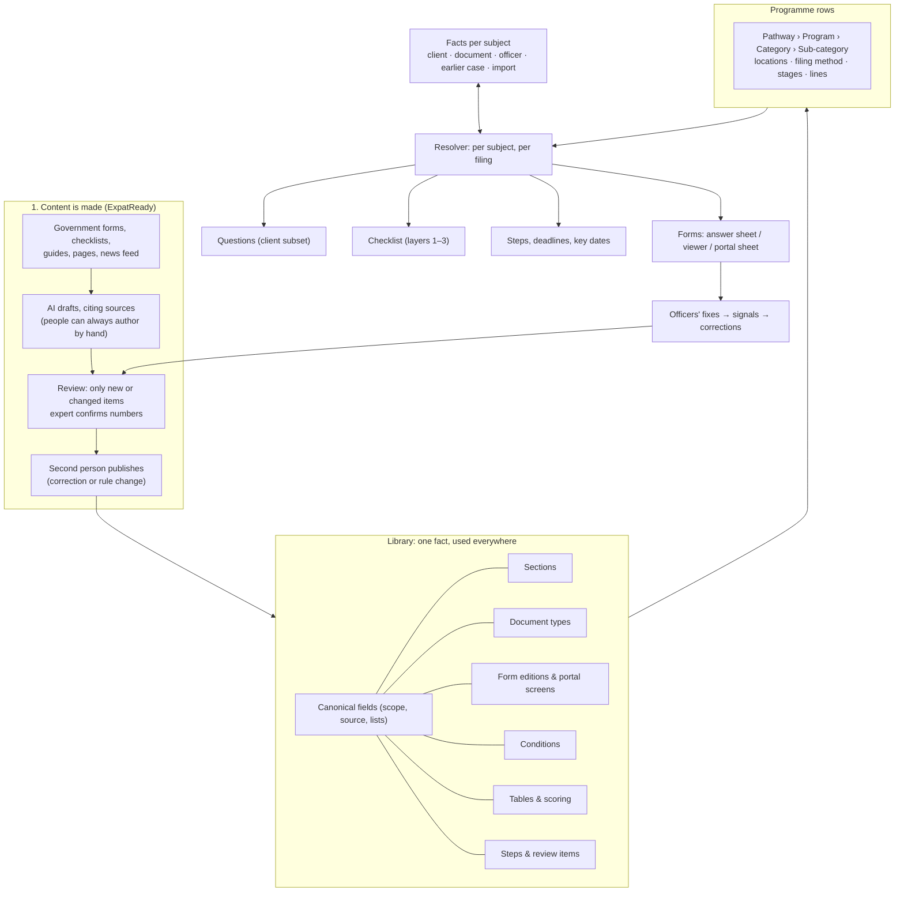

# SA-01B — Content Pack Configurator (v2.1)

> **Document control** · Version **2.1** · **2026-10-27** · Status: **CC-8 applied: only emails a person writes are copied; system emails go to their usual recipient with no Cc (the product owner, 26 Oct)**; earlier: **Rewritten in the X-1 format (Parts A–D, 14-field build cards) on the unified model "one fact, used everywhere" — the product owner's SA-01B redesign decisions SA1B-D54 – SA1B-D119 (18–26 Oct) applied on top of v1.14; ready for the independent audit**\
> Part of: *Super Admin Console — Functional Requirements* · Split out of `SA-01-country-and-immigration-pack-management_v2.1_2026-09-18.md` on 2026-09-22 (SA1B-D1) · Previous version: `_archive/SA-01B-content-pack-configurator_v2.0_2026-10-26.md` (v1.14 is `_archive/SA-01B-content-pack-configurator_v1.14_2026-10-25.md`)\
> Decisions: `SA-01B-REDESIGN-DECISIONS_2026-10-18.md` (Decisions 1–20, R1–R7, G1–G35) · decision log `TEMPLATE-MAP-working_2026-10-10.md` ("SA-01B redesign — decisions") · change notes for other epics: `SA-01B-v2.0-KNOCK-ONS_2026-10-26.md` (not applied)\
> Reviewed by: the co-product owner and the product owner (product owners) · Code state cited from `ERv2-sanitized` branch `feat/xfa-viewer` (`path:line` on each card)
>
> | Version | Date | Change | Decisions |
> |---|---|---|---|
> | 2.1 | 2026-10-27 | **CC-8 applied (the product owner, 26 Oct; home AG-10-89).** Only emails a staff member writes on a case are copied; system emails, including questionnaire, family and document-request links, go to their usual recipient with no Cc. **Changed:** SA-1B-107 field 5 example: "the next document request goes To Client B, Cc Client A (AG-8-51 rule 9)" becomes "the next email Client C writes to Client B from the case goes To Client B, Cc Client A (AG-10-89)". D5.1 S-1 (do copied people get the Welcome's links?) is answered by CC-8: no, the Welcome and every link email are never copied. Row added to D1.3. **Not changed:** the copy questions (SA-1B-107 – 109), the `CaseCopy` write and publish check E13 (SA-1B-110). No requirement ID added, changed or withdrawn. | CC-8 |
> | 2.0 (26 Oct, pointer) | 2026-10-26 | **Pointer only, applied in place (AG19-D71 – AG19-D73; the product owner, 26 Oct: approved).** SA-1B-106 field 3 names `FINAL-Agent-FR/AG-19-pdf-studio_v1.10_2026-10-26.md` (was v1.9, archived). The decisions change no SA-01B rule. | — |
> | 2.0 | 2026-10-26 | **Redesign.** Whole epic rewritten as Parts A–D with build cards in eleven chapters: (1) how content is made — AI drafting with expert confirmation, answer-key tests (no test, no publish), source register (no source, no publish), corrections vs rule changes, change watch; (2) the library — canonical fields with scope (person · filing · household · organisation), main source and fallback, lists with stable entries, "must verify before filing", copy on emails; (3) the document master — categories, standard and alternatives, dates captured, validity read at the case's target filing date, shareable marks set by ExpatReady only; (4) forms and portal screens — every Release 1 PDF form mapped, tested and trialled before launch, answer sheet, form viewer, Chrome extension portal sheet, application fixes, self-correcting forms (signals, box notices, accuracy record), corrected maps re-fill drafts and notify approved or signed forms, representative's one-click signature on own boxes, "Approve filing" as a batch; (5) rules, scoring, tables, PQR and the assessment as an optional sales tool; (6) programme structure and the per-subject resolver — rows, lines of one shape, stages, relationships, review items per programme, fee basis and count, programme pre-selection; (7) government steps, deadlines and key dates (no automatic to-do lists; standard steps on employer files only); (8) versions, pins and the one time rule; (9) facts and sources — three sources, one review per document, "verified" defined; (10) what firms may change and the scale design with a load-test release gate; (11) the employer workspace. Standing rule "Real value, not nudging" applied to every card. IDs are permanent: v1.14 numbers kept; new cards SA-1B-130 – 301. | SA1B-D54 – SA1B-D119 (G1 – G35, R1 – R7, Decisions 1 – 20) · SA1B-D1 – D43 kept, changed or withdrawn as listed in Part D |
> | 1.14 | 2026-10-25 | **Pointer only (AG19-D69; the product owner, 25 Oct: approved).** SA-1B-106 field 3 names `FINAL-Agent-FR/AG-19-pdf-studio_v1.8_2026-10-25.md` (v1.7 archived). The AG-19-17 rule 5a character rule that SA-1B-106 rule 4 points to is no longer a writer default; it is approved. No writer-default mark was in this file's build path. Row added to "Decisions that change this epic". No requirement ID changed. | AG19-D69 |
> | 1.13 | 2026-10-25 | **Pointers only (PDF Studio review fixes M1 and S12; the product owner, 25 Oct: "yes").** SA-1B-106 field 3 names the current AG-19, `FINAL-Agent-FR/AG-19-pdf-studio_v1.7_2026-10-25.md` (was v1.2, archived). Rule 4 adds one line: accents, unsafe characters and repeats in a proposed name follow AG-19-17 rule 5a (writer default there, to confirm); the pack holds no rule of its own. No requirement ID, token or value changed. | — |
> | 1.12 (25 Oct, money slice + AG-05 review) | 2026-10-25 | **25 Oct (money slice + AG-05 review).** In place; nothing else bumped. SA-01B says nothing about retainer clauses or proposals except the fee-quote line in SA1B-X7, so only the government-fee reading changes. (1) MS-D18(2): a service's disbursement estimate in Settings → Services reads the pack's government fees (SA-1B-52) and keeps them current from the pack until the firm copies them; one sentence added to SA-1B-52. (2) MS-D2: SA1B-X7 no longer says "fee quote"; it names the retainer's Fees panel (there is no proposal). The pack still carries no price and no client wording. **Added / withdrawn requirement IDs:** none. | MS-D18, MS-D2 |
> | 1.12 | 2026-10-25 | **AG19-D59 applied (the product owner, 25 Oct, later: "yes"; home AG-19, AG-19-17).** **Renamed:** the file-name piece for the document type, `{document}` → `{documentType}`, the name AG-19 uses (AG-19-17 rule 5a, field 7). Changed in: SA-1B-106 card rules 4 and 5 (examples, the token list and the refusal message "Use only {documentType}, {person}, {caseNumber} and {date}."), tests (three patterns and the refusal message), the AG19-D38 row of "Decisions that change this epic" and the closed SA1B-Q15 row. The §14 settings row names no token, so it is unchanged. 10 occurrences renamed; no other token changed. Row added to "Decisions that change this epic". No requirement ID added, changed or withdrawn. | AG19-D59 |
> | 1.11 | 2026-10-25 | **AG19-D55 applied (the product owner, 25 Oct: "yes"; home AG-19, AG-19-17 rule 5a).** **Changed:** SA-1B-106 card rules 4 and 5 and tests. `{date}` is the day staff run Prepare for upload, written YYYY-MM-DD. The separators are always `_` between pieces and `-` for spaces inside a piece, in every pattern. A piece with no value is left out with its separator, e.g. `{caseNumber}` outside a case (default, approved in package). Staff can edit the proposed name before saving. **Closed:** SA1B-Q17. Row added to "Decisions that change this epic". No requirement ID changed. | AG19-D55 |
> | 1.10 | 2026-10-25 | **Agent-side knock-ons applied (the product owner, 24–25 Oct; sources AG-08 v1.13 §13 Q18, Q21, Q23, Q24; AG-17 v0.12 AG-17-96, AG-17-69; AG-07 v3.7 AG-7-97, C3.8a).** **Added:** SA-1B-107 – SA-1B-109 in new §3.11 "Copy on emails": a library field group "Copy on emails" whose answer writes the case copy list (`CaseCopy`, AG-07) instead of a profile path, the single exception; a reusable section on every individual row, asked of the adult case client only, added across rows with SA-1B-61; the employer variant in the employer onboarding questionnaire rows. SA-1B-110 – SA-1B-112 in the SA-1B-63 family of publish checks: the copy section must be present; a condition reads only earlier questions, no loops; a questionnaire's person / organisation target matches the subject of every field on it. Decisions SA1B-D41 – SA1B-D43; knock-on rows SA1B-X19 – SA1B-X21; open questions SA1B-Q18, SA1B-Q19; four rows in "Decisions that change this epic"; one §0.3 row; one §14 row. **Changed:** SA-1B-1 (a "must verify before filing" flag per canonical field, `mustVerifyBeforeFiling`, content team with the Immigration-SME only); SA1B-D37 (pointer to SA1B-D42); SA-1B-3 (stale pointer to SA-1B-52, the fee table, corrected to SA-1B-14 and SA-1B-58); SA1B-X3 and SA1B-X17 set to "Applied in AG-08 v1.13 (25 Oct)". **Withdrawn:** none. Same day: SA1B-Q18 and Q19 resolved; copy-on-emails wording covers both field groups; stale SA-1B-52 pointers in SA1B-D15 and §12 corrected. 25 Oct final audit: pins in SA-1B-108, SA-1B-109 and SA1B-Q18 moved to AG-07 v3.8 (stale line pointer :522 replaced by AG-7-4 rule 1) and AG-17 v0.13; SA-1B-109 re-apply exception added from AG-17-96 rule 2. | AG-08 §13 Q18 (option A, CC-7, F9), Q23 (option B), Q21, Q24 · AG17-D85 · AG17-D25 |
> | 1.9 | 2026-10-23 | **AG-19 decisions applied (the product owner, 23 Oct, later).** **Changed:** SA-1B-106 and its card (rules 1, 4, 5, 6; tests). A file-name pattern uses only four pieces: document type, person name, case number and date (AG19-D38). Example: `Pay-stubs_Ravi-Sharma_2026-11-12.pdf`. A document type with no pattern gets `<document type>_<person>.pdf`. 1 MB = 1,000,000 bytes. Studio's refusal of an interactive government form has no [Open in form viewer] button, so the pack holds no form-edition matching data (AG19-D39). **Closed:** SA1B-Q15 (AG19-D38), SA1B-Q16 (AG19-D39). **New open question:** SA1B-Q17 (which date fills `{date}`, and the name when a piece has no value). The AG19-D16 row is amended; two rows added to "Decisions that change this epic". **Withdrawn:** none. | AG19-D38, AG19-D39 |
> | 1.8 | 2026-10-23 | **AG-19 PDF Studio knock-ons applied (the product owner, 23 Oct).** **Added:** SA-1B-106 and its card: each document type may carry an optional upload size limit (`maxUploadBytes`) and an optional file-name pattern (`uploadFileNamePattern`), read by Prepare for upload (AG-19-17). With no size limit, Prepare for upload combines and names the file and skips compression (AG19-D26(e)). Settings row in §14. **Changed:** SA-1B-18 (one pointer to SA-1B-106). **New open questions:** SA1B-Q15 (which name tokens a pattern may use, the name when no pattern is set, and how many bytes 1 MB is; a short default token list is proposed, not decided) and SA1B-Q16 (how Studio recognises a pack-published government form edition, AG19-D16; AG-19 Q15). Three rows added to "Decisions that change this epic". **Withdrawn:** none. | AG19-D13, AG19-D26(e), AG19-D16 |
> | 1.7 | 2026-10-21 | **AG-02 review decisions applied (the product owner, 20 Oct).** AG02-D9(3) (DEC:28): the lead form's indicative result is shown to staff only; the inquirer never sees it. Changed: SA1B-D21, SA1B-X5, SA-1B-80; SA1B-Q1 (a disclaimer the inquirer would see on that result) is moot. Pending block: AG02-P43 applied and removed. No requirement ID added, removed or renumbered. | AG02-D9(3) |
> | 1.6 | 2026-10-20 | **AG07-D28 applied (the product owner, 20 Oct; source `ERv2-sanitized/plans/xfa-viewer/W04-SCOPE-REVIEW/04-owner-decisions-2026-10-20.md`, decisions 1, 2, 6, 8, 21 and 25; later the same day 26 and 28).** A form whose edition passed the trial opens in AG-07's **form viewer**, and its approval produces the final PDF with the barcodes made by the form's own Validate; every other mapped form keeps the **answer sheet**; portal web forms never get the viewer. The trial is per form **edition**, owned by the backend lead, and switches the viewer on for every firm at once. **Changed (marked amended, earlier text kept):** SA1B-D16, SA1B-D28, P1 (§0.1 and §13), SA-1B-26, SA-1B-31, SA-1B-32, SA-1B-102 (one pointer), the §3.5 intro, the §12 note on the built PDF filler (an XFA form engine now exists locally, not wired), SA1B-Q12, the AG07-D17 row of the decisions table. **Added:** the AG07-D28 row in "Decisions that change this epic"; open question SA1B-Q14 (where an edition's trial result is kept). **Not changed:** the box-map parking (§0.1, §0.3) and SA-1B-28 – SA-1B-30, SA-1B-35. **Withdrawn:** none. *20 Oct (later): AG07-D28(26) and (28) applied — the "form has no box map" warnings return now (SA-1B-63, SA-1B-92), while a box map stays not required for startable (SA1B-D24, SA1B-D34, SA-1B-90 marked amended); SA1B-Q14 answered in principle: the trial result is recorded on the form edition in the pack, the next pack publish switches the viewer on for every firm and a rollback switches it off; the exact field stays the backend lead's (SA-1B-26, P1 in §0.1 and §13, the AG07-D28 row).* | AG07-D28 |
> | 1.5 | 2026-10-18 | **AG-07 review decisions applied (AG07-D2, AG07-D7, AG07-D8(d), AG07-D11, AG07-D16 Q23).** **Changed:** SA1B-X18 — "Request a document" additions sit on the filing's rules pin (AG07-D2); SA1B-D31, SA-1B-96, SA1B-X11 — the pre-filled due date is confirmed when staff save the step (AG07-D11); SA1B-D23, SA-1B-25, SA-1B-95, SA1B-X4 — the case deficiency library is now ExpatReady pack content, specified in SA-01 SA-1-74 (AG07-D7); SA1B-D28, SA1B-X10, §0.1, §0.3, §3.5 intro, P1, P2 — maps for the design-partner firm's most-filed forms ship in Release 1, specified in SA-01 SA-1-75 (AG07-D8(d)). **Added:** the section "Decisions that change this epic"; open questions SA1B-Q10 – SA1B-Q12. **Not changed:** the configurator has no amber-window or early-warning field, so AG07-D16 Q23 (fixed 20 %, no pack value) needs no edit here. **Withdrawn:** none. *18 Oct (final): AG07-D17 – D21 applied — AG07-D17 (P1 answered, SA1B-D28 and §12 note; SA1B-Q12 stays open), AG07-D18 (pin wording), AG07-D20(i) (new SA-1B-101 and card; SA1B-Q11 closed), AG07-D20(p) (SA1B-Q10 closed; SA1B-D23, SA-1B-25, SA-1B-95), AG07-D20(w) (calendar days; SA1B-D31, SA-1B-96).* *18 Oct (later): AG07-D27(5) applied — SA-1B-102 and its §0.3 row gain the two form-line fields `signedBy` and `signatureMethod` (who signs, and how); AG07-D27 added to the decisions table.* *18 Oct (later): AG07-D26 / X-3 applied — SA-1B-101 and its card and settings row are withdrawn (no target-date pre-fill from processing times; AG07-D26(5)); new SA-1B-102 (who completes which form, AG07-D26(7)), SA-1B-103 and its card (new section "Country-specific requirements", AG07-D26(8)), SA-1B-104 (document expiry yes/no and validity, placeholder for X-3) and SA-1B-105 (program recency rule, AG07-D26(8)); SA1B-Q13 added.* | AG07-D2, AG07-D7, AG07-D8(d), AG07-D11, AG07-D16, AG07-D17, AG07-D18, AG07-D20(i), AG07-D20(p), AG07-D20(w), AG07-D26, AG07-D27, X-3 |
> | 1.4 | 2026-10-12 | **Applied the staff-role and Rule 9 decisions of 12 Oct 2026, session 2** (`TEMPLATE-MAP-working_2026-10-10.md`). **Role names (SR-Q3, SR-Q5):** "Content Manager" and "Content Approver" become the one **Content publisher**; the second person for a production pack is the Platform Owner or another Content publisher, and the approver does not edit — a fault is rejected with a reason and the author fixes and resubmits (§2; container rule in SA-01 §3.12). **Renaming and hiding (SR-Q9):** `agent/case:configure-pack` — Owner and Admin by default, grantable through a custom role — covers hiding standard items and renaming a step's client name (SA-1-34, SA-1-38, SA1B-D30). **Document expiry warns only (R9-4):** the "blocks submission" choice is removed from SA-1B-23 and every document type warns only, with default lead times 90 and 30 days (SA1B-D14, SA-1B-23, SA-1B-24, SA1B-X4). **Rule 9 defaults and placements:** new §14 *Settings — defaults and placement*; new questions are placed as required by default (SA-1B-7); a new document type defaults to standard handling, no certified translation, "expires" off (SA-1B-18); review dates are pre-filled — date checked today, next review in 12 months, editable (R9-3, SA-1B-39); the weekly pack-review email and the lead-form field cap are code constants (SA-1B-40, SA-1B-80); the firm questionnaire area is three separate collapsed sections, all off by default, with "Staff fill in this whole section" per section and the per-question who-answers choice under Advanced (R9-1, SA-1B-93, SA-1B-99, SA1B-D38). §0.2 rows SA1B-X3 and SA1B-X4 updated and SA1B-X16 added; §12 and §13 refreshed (SA1B-Q9 added; no existing open question was answered by these decisions). **Changed:** SA-1B-7, SA-1B-18, SA-1B-23, SA-1B-24, SA-1B-39, SA-1B-40, SA-1B-80, SA-1B-93, SA-1B-99, SA-1-8, SA-1-34, SA-1-38, SA1B-D14, SA1B-D30, SA1B-D38, SA1B-X3, SA1B-X4, §2, §0.3, §12. **Added:** SA1B-D39, SA1B-D40, SA1B-X16, SA1B-Q9, §14. **Withdrawn:** none (the "blocks submission" choice is removed inside SA-1B-23, whose number stays). **Same-day revision (W-1 – W-3, the product owner, 12 Oct):** W-3(16) fills the three "Not stated" rows in §14 (field sensitivity flags default, document warning lead times under Advanced, review dates on Main pre-filled) and closes SA1B-Q9. **Same-day revision (W-11 – W-21, the product owner, 12 Oct):** W-15 closes SA1B-Q2 (firms may hide standard checklist items and steps without a deadline; anything with a deadline and all government steps are never hideable; staff mark "not applicable" per case), W-16 closes SA1B-Q5 (no reordering of standard steps; the pack's order is a guide), and W-17 withdraws the firm questionnaire layer (SA1B-D25, SA1B-D38, SA-1B-93, SA-1B-99) and firm-wide extra checklist items (SA-1-34) — firms see only the final questionnaire and the dynamic checklist; per-case "Request a document" stays (SA1B-X17, SA1B-X18). | SA1B-D39, SA1B-D40 · SR-Q1, SR-Q3, SR-Q5, SR-Q9 · R9-1, R9-3, R9-4 · Rule 9 pass (SA-01B) |
> | 1.3 | 2026-10-12 | **Applied the template-management review decisions of 10–12 Oct 2026** (`TEMPLATE-MAP-working_2026-10-10.md`). **Rule 7:** the pack carries **no required wording** — SA-1B-48 is **withdrawn**; the assessment disclaimer is an editable starter paragraph in the firm's Assessment summary template (map §13 #3, §17 #2; SA1B-D20, SA1B-D22; SA-1B-80, SA-1B-87 changed); "disclaimer / compliance text" in the regulator setup (SA-1-8) becomes **optional editable starter wording**; the regulator section is renamed "Regulator setup"; no expert or SME check on any wording. **Government steps** (SA-1B-45, SA-1B-46, SA-1B-69) gain a **staff name and a plain client name per language** written by ExpatReady (the firm may rename its copy), a **"has a deadline" mark** and a **usual timeline** that pre-fills the required due date (decisions 7 and 16; O32); reminder wording is template content, not pack. **Firm extensions:** a firm may **hide** ExpatReady's standard checklist items and standard steps firm-wide — recorded, reversible, new cases only, Owner and Admin, government steps with deadlines not hideable (rule 7, Q17, decision 15; SA-1-34, SA-1-38; SA5-X17); the questionnaire is a **firm layer over the live standard questionnaire, no clones**, hide / reorder only questions ExpatReady marked optional, plus the **"who answers" switch, Release 1** (Q18, R26; SA1B-D25, SA-1B-93, SA-1B-94 changed). **Pack additions (O32, Q24, O30):** a "standard step" (action line) kind, a usual-timeline field, law-society licence formats; **any representative type counts as a licence**; **no pack automation templates**, retainer clause sets, e-sign recitals, retention classes or numbers. **Startable check fixed (D1):** a programme is startable when sections exist for every person, every condition resolves and every form on the row has a current edition; the box-map requirement and box-map warnings return with autofill (SA-1B-63, SA-1B-90, SA-1B-92, SA1B-D24). **Pack maintenance (R34):** "next review" column + weekly content-team email + publish warning; the unused-sections list (SA-1B-17) is parked. **Spec follows code (12 Oct):** six reference-table types are fixed in code, columns editable per version (SA-1B-41 – SA-1B-44, SA1B-D17). Each canonical field carries a privacy mark and an immigration-significant flag (SA5-X18(f)). §0.2 rows SA1B-X3, X4, X6 updated and SA1B-X11 – X15 added; SA5-X18 recorded as applied; §12 and §13 refreshed (not-decided items listed with recommendations). **Changed:** SA-1B-1, SA-1B-17, SA-1B-24, SA-1B-39, SA-1B-40, SA-1B-41 – SA-1B-44, SA-1B-45, SA-1B-46, SA-1B-57, SA-1B-63, SA-1B-69, SA-1B-80, SA-1B-87, SA-1B-90, SA-1B-92, SA-1B-93, SA-1B-94, SA-1-8, SA-1-10, SA-1-34, SA-1-38, SA-1-39, SA1B-D17, SA1B-D19, SA1B-D20, SA1B-D22, SA1B-D24, SA1B-D25. **Added:** SA-1B-96 – SA-1B-100, SA1B-D29 – SA1B-D38, SA1B-X11 – SA1B-X15, open questions SA1B-Q1 – SA1B-Q8. **Withdrawn:** SA-1B-48. | SA1B-D29 – SA1B-D38 · map rules 7, 8 · Q17, Q18, Q24 · O30, O32 · decisions 7, 11, 15, 16 · R26, R34 · D1 · "spec follows code" · SA5-X18 |
> | 1.2 | 2026-10-05 | No licence monitoring (the product owner, 5 Oct; decision AG1-D19, owned by AG-01). **SA1B-X8 changed (v1.2 — AG1-D19):** a firm records its regulator and licence number; the platform does not track expiry, warn or block, and the expiry date is no longer recorded. No other licence validity or expiry monitoring was found in this module (document validity, SA1B-D14 and SA-1B-21 – SA-1B-24, and review dates on pack content, SA1B-D19, are unrelated to licences and are unchanged). 5 Oct (final check fixes): header status now "Updated — AG1-D19 applied" and previous-version line points to the archived v1.1. No requirement changed. | AG1-D19 |
> | 1.1 | 2026-09-23 | **Form autofill parked for Release 1** (SA1B-D28). The form *list* still ships — a row's form lines, assignment, upload, e-sign and readiness — while box maps, deterministic filling, the forms editor and placeholder P1 wait until the content pack SQR is final. §0.1, §0.2 (new SA1B-X10 for SA-3), §0.3 and §3.5 updated; P1's trigger changed. §12 also records what the 23 Sep pull revealed: a deterministic filling engine already exists on the backend, and it refuses IRCC's XFA forms. | SA1B-D28 |
> | 1.0 | 2026-09-22 | **New module, split out of SA-1** (SA1B-D1). Holds the pack's content and the resolver: the library (canonical fields with lead / prospect / case tiers, field groups with placements and derived purposes, answer lists, reusable sections with rules, repeats and coverage, master documents with substitute sets and validity gates, master forms with editions and box maps, conditions, gates and scoring, the reference-table designer, government steps, regulator setup and required wording); **one configurator row per full combination** of Pathway › Program › Category › Sub-category with one line shape for sections, documents, forms and government steps; **filings and pack-declared routes**; person roles with per-person questionnaires, checklists, forms and decisions; one PQR with qualifier blocks and a capped lead form; the assessment output; and the startable and completeness checks. Requirements SA-1-8 – SA-1-43, SA-1-60, SA-1-64 and SA-1-65 moved here from SA-1 **keeping their numbers** (rule 3); new requirements are SA-1B-1 – SA-1B-95. | SA1B-D1 – SA1B-D27 · supersedes the hierarchy parts of SA1-D5 and SA1-D8 · revises SA1-D9 (questionnaire side) |

# Part A — Start here

**Read Part A, then only the chapter you build.** Each card in Part B is complete on its own. Part C holds the rules every card shares. Part D is the appendix: nothing in Part D is a build instruction.

## How this file is laid out

| Part | What it holds |
|---|---|
| **A. Start here** | Purpose, the one idea the module rests on, key terms, the main flow, two worked examples (the Client E family; Acme's LMIA), build order. |
| **B. Build cards** | Eleven chapters, one card per requirement, in build order. |
| **C. Rules and tests** | C1 business rules, C2 states, C3 data, C4 permissions, C5 non-functional rules (scale), C6 what is built today, C7 journey tests. |
| **D. Appendix** | Every SA-01B decision (v1.14's SA1B-D1 – D43 and the new SA1B-D54 – D119), "Where did it go?" for every item of the published v1.14, numbering, knock-ons, open questions, history. |

## Chapters and cards

Each chapter's cards, in build order, as their `#### SA-…` headings stand on 26 Oct. "New" means a number from SA-1B-130 – 301; every other card keeps its v1.14 number. The last column lists the decisions named on the cards' Decision lines (written without the "SA1B-" prefix); a card's rules may cite more.

| Ch | Title | Cards | Card IDs, in build order | Decisions on the cards' Decision lines (SA1B-) |
|---|---|---|---|---|
| 1 | How content is made: sources, AI drafting, review, expert confirmation, publishing, corrections and rule changes, change watch | 21 (12 new) | SA-1B-290, 39, 291, 292, 293, 294, 295, 296, 38, 297, 298, 63, 110, 111, 112, 91, 92, 40, 299, 300, 301 | D18 (reversed), D19, D24, D34, D35, D39, D41, D43, D54, D55, D61b, D70, D77, D80, D86, D92, D94, D98, D99, D100, D101, D102, D104, D112, D113, D115, D117 |
| 2 | The library: canonical fields, scope, answer lists, field groups and lists, sections | 18 (5 new) | SA-1B-1, 130, 131, 132, 133, 4, 6, 10, 134, 7, 11, 13, 14, 15, 107, 108, 109, 17 | D11, D12, D35, D37, D41, D42, D54, D55, D59, D60, D65, D70, D71, D78, D89, D90, D92, D94, D102, D107, D111 |
| 3 | Document master: categories, document types, validity, dates, alternatives | 21 (10 new) | SA-1B-150, 18, 151, 19, 20, 152, 153, 154, 21, 22, 105, 155, 156, 157, 158, 103, 106, 159, 23, 24, 25 | D6, D13, D14, D33, D40, D54, D55, D60, D68, D73, D77, D83, D89, D90, D91, D92, D94, D99, D104, D107, D110, D111, D112 |
| 4 | Forms and portal screens | 27 (12 new) | SA-1B-26, SA-1-28, 171, 27, 170, SA-1-29, SA-1-30, SA-1-31, 33, 172, 28, 29, 35, 30, 102, 173, 174, 31, SA-1-32, 32, 175, 176, 177, 181, 178, 179, 180 | D16, D54, D55, D56, D57, D58, D58b, D59, D60, D69, D69b, D71, D72, D75, D76, D77, D80, D81, D82, D84, D89, D90, D92, D93, D94, D99, D100, D101, D106, D113, D114, D115 |
| 5 | Rules, scoring, reference tables, PQR and assessment | 16 (16 new) | SA-1B-190, 191, 192, 193, 194, 195, 196, 197, 198, 199, 200, 201, 202, 203, 204, 205 | D21, D43, D54, D55, D61, D61b, D62, D62b, D70, D74, D77, D86, D87, D88, D92, D94, D95, D96, D98, D99, D101, D102, D104, D108, D112, D116, D117, D119 |
| 6 | Programme structure and the resolver | 28 (12 new) | SA-1B-50, 51, 52, 53, 55, 57, 210, 211, 61, 90, 64, 66, 67, 212, 68, 69, 221, 72, 213, 73, 75, 214, 215, 216, 217, 218, 219, 220 | D2, D5, D6, D7, D8, D9, D10, D15, D24, D26, D27, D34, D43, D63, D65, D66, D67, D69b, D71, D72, D73, D81, D83, D85, D86, D90, D92, D94, D99, D100, D102, D103, D104, D105, D110, D112, D115, D116, D117, D118, D119 |
| 7 | Steps, deadlines and key dates (starter to-dos withdrawn, SA1B-D118) | 14 (6 new) | SA-1B-45, 96, 46, 97, 230, 235, 231, 232, 233, 104, 234, 47, 100, SA-1-42 | D8, D22, D29, D31, D32, D33, D67, D68, D91, D92, D97, D99, D102, D103, D107, D109, D117, D118 |
| 8 | Versions, pinning, adoption and the time rule: corrections and rule changes on open filings | 10 (10 new) | SA-1B-250, 251, 252, 256, 255, 253, 254, 257, 258, 259 | D25, D70, D71, D75, D82, D85, D86, D92, D97, D99, D100, D104, D112 |
| 9 | Facts and sources: what the resolver reads | 11 (10 new) | SA-1B-260, 261, 268, 34, 262, 263, 264, 265, 266, 267, 269 | D42, D54, D59, D62, D65, D78, D79, D80, D83, D87, D89, D90, D92, D93, D94, D99, D107, D115 |
| 10 | What firms may change, and the scale and performance rules | 9 (9 new) | SA-1B-270, 271, 272, 273, 274, 275, 276, 277, 278 | D23, D25, D30, D31, D64, D73, D75, D81, D86, D89, D92, D94, D103, D104, D109, D110, D112, D117, D118 |
| 11 | Corporate (employer) workspace in the pack | 10 (10 new) | SA-1B-280, 281, 282, 283, 284, 285, 286, 287, 288, 289 | D3, D6, D27, D41, D61, D69b, D70, D74, D77, D86, D87, D90, D91, D92, D96, D97, D99, D102, D103, D106, D109, D111, D112, D119 |

185 card headings, each ID once: 112 new, 73 with a v1.14 number. Chapter 1 also carries a pointer line for SA-1B-33 (the card is in chapter 4). Cards marked Withdrawn: SA-1B-23, 231, 232. Pointer cards: SA-1B-24, 25, 69, 205, 234, 265. Chapter 10 also holds the Release 2 list and the Settings table.

## How to read a card

Every card has 14 fields, in this order: 1 Outcome, 2 Why, 3 Where, 4 Engine, 5 Rules, 6 States, 7 Data, 8 Access, 9 Events, 10 Safety, 11 Tests, 12 Edge cases, 13 Non-goals, 14 Mode (`FINAL-SuperAdmin-FR/BUILD-CARD-STANDARD_2026-10-17.md`). Field 5 starts with an example, then numbered rules. Field 3 ends with "Knock-on: <epic> — <what>" lines where another epic must change; those changes are listed once in `FINAL-SuperAdmin-FR/SA-01B-v2.0-KNOCK-ONS_2026-10-26.md` (D4).

**Numbers.** A requirement ID kept from v1.14 keeps its number; a changed one says "*(changed v2.0 — SA1B-Dnn)*"; SA-1B-106 – 112 say "*(carried from v1.10–v1.14)*". v1.14 uses SA-1B-1 – 112. Within SA-1B-100 – 112, SA-1B-101 (usual processing time) is withdrawn and never reused; the others are in use: 100 the pack holds no message wording, 102 form-line fields with `signedBy`, 103 country-specific requirements, 104 status document feeds a key date, 105 issued within N months, 106 upload size limit and file-name pattern, 107 – 109 "Copy on emails" (field group, section, employer variant), 110 – 112 publish checks (copy section, condition order, questionnaire target). New cards take SA-1B-130 – 289 in a block per chapter, plus SA-1B-290 – 301 for chapter 1 (content making). Unused: SA-1B-113 – 129, 135 – 149, 160 – 169, 182 – 189, 206 – 209, 222 – 229, 236 – 249 and 279 (D3). The co-product owner's 14 Oct copy gave SA-1B-101 – 109, SA1B-D41 – D53 and SA1B-X17 – X19 other meanings; none of her numbers is used in the master with her meaning. Where a card cites "the co-product owner's copy X19", that is her content-plan note, kept by SA1B-D105 (G21); the master's SA1B-X19 is the copy-list hand-over to AG-07.

---

## A1 — Purpose in five lines

1. **What it is.** SA-01B is the content side of the Country Pack and the engine that turns it into each person's questions, documents, forms and steps on each application. SA-01 is the container (countries, versions, publishing); SA-01B is the content and the resolver (SA1B-D1).
2. **The one idea.** Every piece of information is **one canonical field**, defined once. Questions, documents, government forms, portal screens, rules, scoring, expiry checks and reminders are all views of those facts. A fact entered once fills everything that needs it (SA1B-D92).
3. **How content is made.** ExpatReady's content team attaches the government's forms, checklists, guides and pages; AI drafts the fields, sections, form maps, document lists, rules, tables and steps with a cited source (AI drafting is off at launch and is switched on by the Platform Owner after the product owner's go on the proof-of-concept counts; until then items are made by hand, SA1B-D94(6)); people review every new or changed item; the expert confirms numbers; a form map, scoring table or eligibility rule set publishes only after it passes an answer-key test; a second person publishes. People can always author or correct by hand (SA1B-D54, D55, D77, D101).
4. **How it stays right.** Every number is sourced and dated; a change watch reads IRCC's pages and news; officers' fixes on forms come back as signals; a correction is made once for every firm (SA1B-D70, D75).
5. **What it never does.** It never fills a blank with a default, never ticks a declaration or signs, never resolves two different values silently, never stops case or form work except when a form's own Validate fails, and never shows a firm the configuration behind the output (SA1B-D60, D89, D90, D115; W-17).

**Standing rule — real value, not nudging (SA1B-D117, G33).** A reminder, notification or automatic to-do exists only when it protects something a person would otherwise miss and that has a real cost: a government deadline, a document or status expiry, money owed, or a legal step. Everything else is shown where the person already looks, never pushed. No card adds a nudge to look busy; every card was checked against this rule on 26 Oct.

**Who uses it.** ExpatReady's content team: the Content publisher (who is also the immigration expert, AG16-54 #24) and a second person who approves (another Content publisher or the Platform Owner, SR-Q1). Firms never author pack content; they see its output: the questionnaire, the checklist, the forms, the steps (W-17). Their only changes are listed in Chapter 10.

**Why it exists.** Setting up each programme by hand, and redoing it at every form edition and every IRCC change, is slow and error-prone. Firms retype the same facts into many forms and track expiry dates on paper. The moat is content that is correct, sourced, current and improves with use, so each firm types less and misses less.

---

## A2 — Key terms

Each term has one meaning only. Terms owned by other epics name their home.

| Term | Meaning | Example |
|---|---|---|
| **Canonical field** | One fact, defined once in the library: key, type, answer list, scope, main source and fallback, "still true?" rule, privacy mark. | `passport.expiryDate` |
| **Scope** | Who a fact belongs to: a **person**, a **filing** (one application), a **household**, or an **organisation** (SA1B-D92). | Client B's date of birth (person); "requested permit end date" (filing); Acme's business number (organisation). |
| **Subject** | The person or organisation a filing is about. An individual filing's subject is a person; an LMIA filing's subject is the employer (SA1B-D92). | Acme Technologies Ltd on its LMIA filing. |
| **Relationship** | How the people on a case relate: spouse of, child of, parent of, sibling of, sponsor of; and who signs for an organisation (signatory of). A worker's employer is not a relationship: it is recorded on the filing (AG-07 Filing, employer organisation). Forms and conditions read facts through relationships (SA1B-D92). | Client D's study permit form reads her parents' names through "parent of". |
| **List entry** | One item of a repeating fact, with a stable ID: one passport, one permit, one address, one job (SA1B-D92). | Client A's current passport and her expired one are two entries. |
| **Main source / fallback** | Where a field's value normally comes from — client, document or officer — and where it falls back to (SA1B-D89). | Passport number: main = passport scan; fallback = client. |
| **Library item** | Any reusable, versioned, sourced piece of content: field, section, document type, form edition, portal screen, condition, reference table, scoring grid, government step, review item, standard step. Each keeps a stable ID across versions (SA1B-D92). | Document type "Police certificate". |
| **Programme row** | One full combination Pathway › Program › Category › Sub-category, with its allowed locations, filing method, portal and stages, holding its own lines (SA1B-D6, D66, D69b, D63). | Work permit › LMIA-based › High-wage. |
| **Line** | One entry on a row, all in one shape: **what** (section, document, form, government step, review item; a standard step on employer rows only) · **for whom** · **only if** · order (SA1B-D7, D103). The pack puts no to-do lists on cases (SA1B-D118). | "IMM 1295 · each applicant · only if applying from outside Canada". |
| **Resolver** | The engine that turns a row's lines into each subject's questions, checklist, forms and steps on each filing, each with its reason, and recalculates when that filing's facts change (SA1B-D92, D94). | Client A applying from outside → IMM 1295 and a police certificate appear, "because you're applying from outside Canada". |
| **Filing** | One application to one authority. A case holds one or more filings, side by side or in sequence (SA1B-D8, D63). Home of the record: AG-07. | Client B's work permit extension; Client A's open work permit. |
| **Stage** | A step of a programme's route that creates a filing: Express Entry profile → PR application; EOI → nomination → PR (SA1B-D63). Not the same as AG-07's delivery steps or board stages. | "Start next stage" after Client B's ITA (in his separate Express Entry case). |
| **Pin** | The pack version a filing follows. "Start next stage" pins today's version; a side-by-side filing starts on the principal's (SA1B-D85). | Client B's PR application filing, in his separate Express Entry case, pinned to version 4, the version current when Client C pressed Start next stage on 21 Dec (J2 step 6). |
| **Correction / rule change** | The two kinds of publish. A **correction** (a form map, wording, a notice) reaches open filings at once, audited: a draft form re-fills by itself; an approved or signed form shows the CRITICAL "Corrected: update this form" notice with one click (SA1B-D100). A **rule change** stays pinned; it is judged against the case's target filing date (today if empty) and re-checked on submission day, and an open filing sees it as a CRITICAL warning with a one-click move (SA1B-D86, D92, D112). | A fixed date-of-birth box (correction); new proof-of-funds amounts from 1 Dec 2026 (rule change). |
| **Answer sheet / form viewer** | A mapped form's values in the form's order with a copy button, or the filled government form itself in the viewer. Every IRCC PDF form of the Release 1 programmes is mapped, answer-key tested and trialled before launch and opens in the viewer; an edition shows its answer sheet until it passes; portal web forms always get the answer sheet (SA1B-D82, D113; AG07-D28). | IMM 5257 opens in the viewer; IMM 0008 (a portal web form) shows an answer sheet. |
| **Portal sheet** | A portal screen's values in the portal's order with copy buttons; the Chrome extension fills from it on "Fill this screen" (SA1B-D69). | Express Entry profile, screen "Personal details". |
| **Application fix** | An officer's correction on a form, applied to every form of that filing, without changing the person's own answer (SA1B-D93). | "Acme Technologies Ltd — fixed by Client C". |
| **Box notice** | A content-team note on one box of one form edition, shown on unsubmitted forms: "Under investigation" (Advisory) or "Corrected: update this form" (CRITICAL) (SA1B-D75, D99(b)). | "Under investigation: check the partner's date of birth." |
| **Key date** | A canonical date field with a reminder class: status, document or none (SA1B-D91). | Client A's work permit expiry (status). |
| **Review item** | An ExpatReady checklist item per programme that a reviewer ticks at review; an unticked item asks for one confirmation (SA1B-D103; chapter 6, SA-1B-221). Starter to-dos are withdrawn (SA1B-D118): a firm that wants a to-do list links its own task template to a Service (AG-13). | Express Entry: "Profile matches this application". |
| **Standard step** | A pack step on employer (corporate) files only, with "done by" (firm or employer), shown in the employer portal where the employer acts, never hideable when it carries a deadline (SA1B-D92(13), D103). | "Employer: create the Job Bank account". |

---

## A3 — The main flow

---

## A4 — Worked examples

**The cast (every chapter uses the same people).** The Client E family: Client B (principal client; work permit inside Canada on an exempt offer from Acme, IMM 5710), Client A (spouse; open work permit from outside Canada, IMM 1295) and Client D (10; study permit). Firm staff: Client C (case officer), Client F (lead representative, RCIC) and Client I (the firm's reviewer). ExpatReady's content team: Kavya (Content publisher; chapter 1 also names Client J, the immigration expert, and Client Q, the second person). Employer: Acme Technologies Ltd, Calgary, with Client M as the worker on LMIA position 1. The Client E case's target filing date is **5 Dec 2026**. Immigration values, forms, fees and documents are examples pending the immigration expert.

**Example 1 — the Client E family (one case, three filings).**
1. **Setup (ExpatReady).** Kavya attaches IRCC's forms and guides for three rows: work permit inside Canada, spouse's open work permit, study permit. AI drafts fields, sections, box maps, documents, rules and steps, each with its source (or Kavya makes them by hand while AI drafting is off, SA-1B-291 rule 8); Kavya checks every AI-drafted item; the expert confirms each number; the answer-key tests pass; a second person publishes. → Ch 1, 2, 3, 4, 6.
2. **Case opens.** Client B's programme, Work permit (employer-specific), is pre-selected from the most binding source on record (SA-1B-73 rule 8) and Client C confirms it (SA1B-D116); Client C picks Client A's and Client D's programmes from lists filtered by role. Each person's location is set (Client B inside, Client A outside). Each filing pins today's version. → Ch 6, 8.
3. **Each person gets their own list.** Client B: IMM 5710, his permit, pay stubs, and the employer-offer step: Acme submits the offer in the Employer Portal and Client C records offer A1234567 and "$230 paid"; until then Client B's filing shows "Employer offer number missing". Client A: IMM 1295, police certificate (issued within 6 months), her passport. Client D: study permit forms; no questionnaire of her own — her parents answer. Every item shows its reason. → Ch 6, 7, 11.
4. **Collect.** Client B opens the family link; Client A's tab is sent to her. Each uploads passports first; the passport's machine-readable zone proposes their passport fields; Client C presses "Confirm & use" once per document, with only problems highlighted. A different date typed by Client A shows side by side; Client C picks. → Ch 9; AG-08, AG-09, AG-15.
5. **Forms.** Client A's IMM 1295 opens in the viewer, pre-filled; a portal web form such as IMM 0008 shows its answer sheet. Client C fixes "Employer" once; it applies to every form of the filing. Background answers are copied as recorded; no blank is defaulted. Client F applies her own stored signature to her boxes with one click; Client B signs his own declaration (SA1B-D90, D106). → Ch 4.
6. **Checks and review.** Client B's passport expires before the end of the permit he asks for: a warning suggests renewing first. The police certificate's 6-month rule is checked against the target filing date, 5 Dec 2026. Client I reviews each filing before Client F approves it with one click (SA1B-D114); where a programme has review items (in Client B's separate Express Entry case: "Profile matches this application"), Client I ticks them at review (SA1B-D103). → Ch 3, 4, 6, 7.
7. **IRCC changes something.** On 16 Nov ExpatReady publishes pack version 4 with new proof-of-funds amounts in force from 1 Dec 2026 (family of 3: $22,000 → $23,840; announced 16 Oct). The change is judged against the case's target filing date, 5 Dec 2026, so Client A's open filing, pinned to version 3, keeps reading version 3's amounts and shows a CRITICAL warning "Use newer rules?" with a one-click move (SA1B-D86, SA1B-D112). → Ch 1, 5, 8.
8. **After submission.** Client B's IMM 5710 is submitted on Sat 28 Nov 2026. Government steps carry deadlines from letters; his work permit expiry, 14 Jan 2027, becomes his status date with reminders at fixed timings. → Ch 7; AG-11.

**Example 2 — Acme's LMIA, then Client M's work permit.**
1. Client F runs the quick LMIA check for Acme on 14 Oct (Calgary, NOC 21231, 3 positions); Acme signs on 20 Oct. When Client C opens the file, the values appear "From Check, 14 Oct 2026" for him to confirm. → Ch 5, 11.
2. The LMIA filing's subject is Acme; job-offer facts are filing facts; position 1 is Client M, positions 2 and 3 are open. Standard steps "done by: employer" (create the Job Bank account) show in Acme's employer portal; advertising runs from 2 Nov for the 28 days the table sets, before submission. → Ch 7, 11.
3. The decision is recorded on 2 Dec 2026; validity is 12 months from the table, so it ends 2 Dec 2027, with staff reminders at fixed points. "Create work permit case" on position 1 opens Client M's filing, which reads the job facts through the link with the badge "Linked file: Acme, 2 Dec 2026"; Acme's business registration, financial statements and recruitment records never reach Client M's file. → Ch 7, 11.

---

## A5 — Build order and dependencies

The code has strong pieces to extend (versioned pack content, the condition evaluator, the scoring kernel, the answer store with history and encryption, pin and adopt with a reason, the content-neutrality gate). Three structural pieces come first, because everything per filing or per subject attaches to them (code review, 24 Oct):

| Order | What | Why first | Built today |
|---|---|---|---|
| 1 | **Filing record** and per-filing pin (AG-07 owns the record; Ch 8 the pin) | Stages, target dates, resolution, application fixes all attach to a filing | No Filing table; pins per party (`client-spine.prisma:466-509`) |
| 2 | **Facts per subject with source and status** (Ch 2, 9; AG-08 data) | Three sources, proposals, conflicts, scope | Answer store built; `sourceJson` = {recordedBy}; DECLARED/VERIFIED only (`answer-store.service.ts:378`; `client-spine.prisma:178-181`) |
| 3 | **Box maps that name whose fact**, plus relationships (Ch 4, 6) | Family and corporate forms | Map entry has no person (`spine-masters.ts:169-175`); filler principal-only (`pack-canonical-field-resolution.ts:24`) |
| 4 | Library extensions: scope, lists, document master, conditions operators, content-defined tables (Ch 2, 3, 5) | Content the resolver reads | Partly built (Part C6) |
| 5 | Programme rows, lines, resolver (Ch 6), steps and key dates (Ch 7) | Each person's lists | Thin slices only |
| 6 | Content making, review and publishing (Ch 1); versions and time rule (Ch 8) | Safe change | Publishing and adoption built (SA-01) |
| 7 | Forms output: answer sheet, viewer and trial for every Release 1 PDF form (SA1B-D113), application fix, portal sheet, extension beta (Ch 4) | Firm daily work | XFA engine local; AcroForm filler built |
| 8 | Learning loop: signals, notices, accuracy record (Ch 4); change watch (Ch 1) | Moat | Not built |
| 9 | Corporate workspace (Ch 11); firm changes and scale rules (Ch 10) | Both workspaces | Partly (AG-17) |

A load test at the target scale (hundreds of firms, thousands of applications each) is a release gate (SA1B-D94; Part C5).
</content>

---

# Part B — Build cards

## Chapter 1 — How content is made: sources, AI drafting, review, expert confirmation, publishing, corrections and rule changes, change watch

**What you build.** The content team's path from an official source to a published pack version: a register of sources, a source record on every item, drafts made by AI or by hand, one person's check of every new or changed item, the expert's confirmation of each number, answer-key tests, the second person's approval, the choice between a correction and a rule change, and the change watch that tells the team when a source moved. Content made this way is what every other chapter of this file holds (library, rows, tables, forms, steps).

**What stays in SA-01 (container, not repeated here).** Countries and packs; the draft → in review → approved → published flow (SA-1-45, SA-1-47, SA-1-48); rollback (SA-1-49); audit (SA-1-50); the validation report (SA-1-51); compare and preview of drafts (SA-1-52, SA-1-53); import, export and clone (SA-1-54 – SA-1-56); firm read (SA-1-57); the second-person rule (SA-1-61, SA1-D6, SA1-D17); the count of firms pinned to a version (SA-1-62).

**Examples in this chapter.** Immigration values (fees, amounts, dates, form names) are examples pending the immigration expert; they are not confirmed content. The content team in the examples: Kavya (author, Content publisher), Client J (immigration expert, Content publisher) and Client Q (second person, Content publisher).

**Client B's example here.** On 16 Oct 2026 the change watch lists a news item: financial-requirement amounts change from 1 Dec 2026 (SA-1B-299). AI drafting has been switched on by the Platform Owner after the product owner's go on the proof-of-concept counts (SA-1B-291 rule 8); with it still off, Kavya types the 3 rows by hand and every later step is the same. The AI has already classified the entry Material and attached a draft of 3 changed rows of the proof-of-funds table, each with the page it came from (SA-1B-300 rule 6, SA-1B-291); Kavya marks it Relevant and checks them (SA-1B-293), Client J confirms the 3 numbers one by one (SA-1B-294), the answer-key tests for the Client E family pass (SA-1B-296), Kavya enters "in force from 1 Dec 2026" (SA-1B-298) and marks the change a rule change (SA-1B-297). Client Q sees the changed rows and the Client E family before and after, and approves (SA-1B-38); the change is published on 16 Nov 2026 as pack version 4. The Client E case has the target filing date 5 Dec 2026, after the in-force date, so Client A's open filing, the only one that reads the funds row and still pinned to version 3, shows the "Use newer rules?" warning of chapter 8 (SA1B-D112).

**Cards in build order:** SA-1B-290, SA-1B-39, SA-1B-291, SA-1B-33, SA-1B-292, SA-1B-293, SA-1B-294, SA-1B-295, SA-1B-296, SA-1B-38, SA-1B-297, SA-1B-298, SA-1B-63, SA-1B-110, SA-1B-111, SA-1B-112, SA-1B-91, SA-1B-92, SA-1B-40, SA-1B-299, SA-1B-300, SA-1B-301.

**Numbering note (26 Oct).** This draft's own cards first written as SA-1B-110 – SA-1B-121 are SA-1B-290 – SA-1B-301, because SA-01B v1.14 already publishes SA-1B-110 – SA-1B-112 (the three publish checks carried below with their own numbers).

**Settings in this chapter:** none for firms (Rule 9). The weekly email day and time, the change-watch schedule and the spot-check sample size are code constants.

#### SA-1B-290 — Source register   Decision: SA1B-D55, SA1B-D70, SA1B-D94(6), SA1B-D99(e)   Status: Not built

- **1. Outcome.** A Content publisher keeps one list of the official pages, files and feeds ExpatReady reads. Every pack item can point to an entry, and change watch knows what to watch.
- **2. Why.** Every AI-drafted number must show its official source (SA1B-D55), and change watch checks each source page weekly (SA1B-D70). Today no pack item holds a source (v1.9 §12; code searched again on 24 Oct: no source list in `ERv2-sanitized/apps/api/src/pack-authoring`).
- **3. Where.** Super Admin console, Content publisher screens: a **Sources** list beside the pack editor (NEW). An authoring aid on the global plane; it is not part of a published pack, because each item copies its source record into the version (SA-1B-39).
- **4. Engine.** Rules (no AI). Doer: none. AI OFF: no difference; entries are typed by hand.
- **5. Rules.** Example: Kavya adds "Fee list – work permits", kind `WEB_PAGE`, checked weekly.
  1. **Fields.** Name (up to 120 characters); address (https only); kind (`FORM`, `GUIDE`, `WEB_PAGE`, `TABLE_FILE`, `NEWS_FEED`); country; authority name (shown on staff screens only, SA1B-D99(e)); how often it is checked (a feed: on every read; any other kind: weekly); last fingerprint (SA-1B-299).
  2. **Day-one entries (SA1B-D94(6)).** The newsroom Atom feed and the programme delivery updates page, plus one entry for each fee page, programme page, form page, guide and table file that an item cites. The NOC files come from Statistics Canada, not the ESDC browsing site (SA1B-D70 developer note).
  3. **Public addresses only.** An address that needs a login is refused: "ExpatReady reads public pages only."
  4. **No deleting what is cited.** An entry cited by an item cannot be deleted. It can be retired: it stays on the items that cite it and is no longer checked.
  5. **Moved address.** A redirect is followed once and the entry shows "Address changed: <new address>" for the publisher to confirm.
- **6. States.** Active → Retired.
- **7. Data.** `ContentSource { id, countryId, name, url, kind, authorityName, checkRhythm, lastFingerprint, lastCheckedAt, retiredAt }`. ExpatReady data, no `firm_id`. Kept permanently (audit).
- **8. Access.** `system/pack:draft-manage`, held by the Platform Owner and the Content publisher (`ERv2-sanitized/packages/contracts/src/schemas/role-template.platform.ts:127-137`, `:280-290`). No new key.
- **9. Events.** Audit "content source added / changed / retired" (who, what).
- **10. Safety.** The register holds addresses, never client data.
  **Person decides:** the Content publisher decides which sources are trusted; ExpatReady adds none by itself.
  **Duplicate beats a miss (AG16-60):** a source that cannot be read stays on the list as "Could not read" and is never skipped (SA-1B-299).
- **11. Tests.**
  - Given Kavya adds `https://example.gov/fees` as `WEB_PAGE`, then it is Active and the next weekly check includes it.
  - Failure state: given an address starting `http://`, then the save is refused with "Use an https address."
  - Failure state: given an item cites the entry, when Kavya deletes it, then the delete is refused with "Cited by 3 items. Retire it instead."
  - AI OFF: same results.
- **12. Edge cases.** The same address twice → refused with "Already in the list". **Clicks:** adds one short form per source, once; adds 0 for firms.
- **13. Non-goals.** No pages behind a login. No client or firm data. No paid databases. No source added by AI on its own.
- **14. Mode.** THIN SLICE.

#### SA-1B-39 — Source, date checked and next review on every item   Decision: SA1B-D19, SA1B-D35, SA1B-D55, SA1B-D70, SA1B-D98, SA1B-D104(c)   Status: Not built   *(changed v2.0 — SA1B-D55)*   *(changed v2.0 — SA1B-D104(c))*

- **1. Outcome.** Staff and the content team see, beside every number or rule the pack states, where it came from, the date it was checked and when it is checked next.
- **2. Why.** The product owner's rule: every AI-drafted number is shown beside its official source (SA1B-D55), and source and date show wherever a number appears on a staff screen (SA1B-D70). v1.9 already required a source, a date checked and a next-review date (SA-1B-39, R34, R9-3), but none is built: code searched for `nextReview`, `dateChecked` and `reviewDue` in `ERv2-sanitized/apps` and `packages` on 24 Oct, no match.
- **3. Where.** Every item named in rule 1, in the pack editor (NEW fields on the item body). Shown on staff screens next to the number. Knock-on: AG-07, AG-09 and AG-03 show "Source · checked <date>" wherever a pack number appears (fee, funds, points, validity).
- **4. Engine.** Rules. AI optional: Setup AI fills the source and the quoted line when it drafts the item (SA-1B-291). AI OFF: the author types the note or picks the entry from the register (SA-1B-290); the dates are pre-filled either way.
- **5. Rules.** Example: the work-permit fee row "$155" (pending the expert) shows "Source: Fee list – work permits · checked 24 Oct 2026 · next review 24 Oct 2027".
  1. **Which items.** Eligibility gates; scoring rows; document requirements and validity rules; form editions; fees; programme definitions; reference tables; government steps with their deadline rule and usual timeline (SA-1B-96); key-date types; country-specific requirements (SA-1B-103). A table loaded from a file carries one source record on the table version (file name, version, date; SA-1B-295). A hand-built table carries one per row.
  2. **The record.** Source (an entry of the register, or "None published – set by ExpatReady" where the government publishes nothing, SA1B-D55(4), SA1B-D104(c)); page or section note (up to 200 characters); date checked; next review; for an AI draft, the line quoted from the source (up to 300 characters, shown to the content team only).
  3. **Pre-filled (R9-3).** Date checked = today; next review = date checked + 12 months; both editable. When the AI drafts an item, date checked is the day it read the source and cannot be a future date.
  4. **Checks.** Date checked is today or earlier. Next review is after date checked.
  5. **Staff screens.** The record shows as a link on staff screens only. Client-facing text names no regulator (Rule 7; SA1B-D99(e)).
  6. **Copying.** An item copied from a row or a version keeps its source record and its date checked; the date is not reset to today.
  7. **Missing source.** A number (the kinds in SA-1B-294 rule 1) with no source record blocks publishing: "<item>: this number has no source. Pick a source or mark it 'None published – set by ExpatReady'." Any other item with no source record is a warning (SA-1B-63). This is ExpatReady's content process; firms never see it (SA1B-D104(c); closes Q1-2).
- **6. States.** None (fields on the item).
- **7. Data.** On each item body: `source: { sourceId?, label, note?, quote?, dateChecked, nextReview }`. Stored inside the published version, so it cannot change after publishing (SA-1-47). ExpatReady data, no `firm_id`.
- **8. Access.** Author: `system/pack:draft-manage`. Firm staff read it with the item.
- **9. Events.** Part of the existing draft audit.
- **10. Safety.** Information only. It never blocks a firm.
  **Person decides:** the author and the reviewer decide whether the source supports the value (SA-1B-293).
  **Duplicate beats a miss (AG16-60):** an item with no source is listed at publish, never hidden.
- **11. Tests.**
  - Given the AI drafts a fee row from the fee page on 24 Oct 2026, then the row shows that source, `dateChecked` 24 Oct 2026 and `nextReview` 24 Oct 2027.
  - Failure state: given Kavya enters next review 1 Jan 2026 with date checked 24 Oct 2026, then the save is refused with "Next review must be after the date checked."
  - Failure state: given a fee row with no source record, when the draft is validated, then an error blocks publishing (SA1B-D104(c)).
  - Given a document requirement with no source record, when the draft is validated, then a warning is listed and publishing is still possible.
  - AI OFF: Kavya picks "Fee list – work permits" from the register and types the note; same stored record.
- **12. Edge cases.** A row copied from another programme keeps its date checked. **Clicks:** adds 0 (pre-filled; the author edits only when needed).
- **13. Non-goals.** No automatic proof that the source says what the value says. No live lookup. No source on client wording.
- **14. Mode.** HARDEN (new fields on every pack item; schema).

#### SA-1B-291 — AI drafts content from government sources   Decision: SA1B-D54, SA1B-D55, SA1B-D77, SA1B-D80, SA1B-D104(c), SA1B-D94(6)   Status: Not built   *(changed v2.0 — SA1B-D104(c): source label)*   *(changed v2.0 — SA1B-D94(6): off at launch)*

- **1. Outcome.** A Content publisher gets a draft of an item (fields, sections, documents, steps, fees, tables) read from the government's own forms, checklists, guides and web pages, every value with its source, ready for review.
- **2. Why.** Content for every combination is too large to type. The product owner decided that AI drafts everything, including fees, steps and tables, and that people can always add or correct by hand (SA1B-D54, SA1B-D55). Expert time is the bottleneck, so the proof of concept measures errors and review hours (decision record, Decision 2).
- **3. Where.** Pack editor: a **Draft from source** button on a programme row, a table, a document type, a step list or a form edition (NEW). A background job on the existing durable job pattern (`ERv2-sanitized/apps/api/src/pack-authoring/pack-jobs.service.ts:1-48`: idempotent admission, lease, checkpoint). Output is an ordinary draft item in the pack draft (SA-01 §3.12). Box maps and edition comparison: SA-1B-33. Code: no AI drafting exists in `pack-authoring` (searched 24 Oct).
- **4. Engine.** Rules + AI. Doer: none. This is ExpatReady's own "Setup AI": it is not a firm Doer, not plan-gated, and it reads public government documents only, never client data (SA1B-D80). AI OFF (at launch until switched on, rule 8; the Platform Owner has switched it off; or the provider is down): the button is hidden or shows "AI drafting is off"; every item is written by hand (SA-1B-292); nothing else changes.
- **5. Rules.** Example: Kavya picks the register entries "Fee list – work permits" and "Fee list – study permits" and the target "Fees table". The AI returns 14 rows, each with the page it came from. 2 rows are empty with "Not found in the source".
  1. **Input.** One or more register entries (SA-1B-290) and one target item. The AI reads forms, checklists, guides, web pages and published table files.
  2. **Output.** A draft item. Every value has a source record (SA-1B-39) with the quoted line. The draft is marked `madeBy = AI draft` (SA-1B-292) and is attributed to the person who pressed the button (for the second-person rule, SA-1B-38).
  3. **Never invented.** A value the source does not state is left empty and listed as "Not found in the source". The AI does not fill it from memory.
  4. **Nothing published by the government.** For routes, roles, standard steps and client wording the AI proposes; once a person decides, the item is marked "None published – set by ExpatReady" (SA1B-D55(4), SA1B-D104(c)).
  5. **Two sources disagree.** Both values are kept and the item is marked "Sources differ"; the reviewer picks one.
  6. **Numbers.** Every drafted number starts "Needs confirmation" (SA-1B-294). The AI's own confidence never lets an item skip the review (SA1B-D77, SA-1B-293).
  7. **No firm data.** The job sends no client, firm or case data. It records the provider and the region of every request.
  8. **Off at launch (SA1B-D94(6)).** Setup AI drafting is off when Release 1 launches. The Platform Owner switches it on only after the product owner's go on the proof-of-concept counts (SA-1B-292 report; Q1-9). Until then the button shows "AI drafting is off" and every item is made by hand (SA-1B-292). After switch-on, change watch also starts drafts by itself (SA-1B-300 rule 6, Decision 17); the AI never checks, confirms or publishes.
- **6. States.** Setup AI drafting: Off (at launch) → On (Platform Owner, after the product owner's go) → Off (Platform Owner, at any time). Draft run: Requested → Drafted | Failed ("Could not read this source"). The draft item then follows the normal draft states.
- **7. Data.** `DraftRun { id, requestedByUserId, sourceIds[], targetRef, state, provider, region, startedAt, finishedAt, resultItemRefs[] }`. ExpatReady data, no `firm_id`.
- **8. Access.** `system/pack:draft-manage`.
- **9. Events.** Audit "AI draft requested / finished / failed": who, source ids, target. No document text in the audit.
- **10. Safety.** Public documents only. The draft is private to the authors until someone submits the draft for review.
  **Person decides:** the Content publisher decides what to keep, change or discard. The AI never submits, approves or publishes.
  **Duplicate beats a miss (AG16-60):** the "Not found in the source" list stays on the draft until each line is filled or removed by a person.
- **11. Tests.** Fixture: saved copies of a fee page and a guide (public text).
  - Given the fee page lists $155 for a work permit, when the AI drafts, then the row shows 155 with the source record and quoted line, and "Needs confirmation".
  - Given the page has no figure for a row, then the row is empty and listed under "Not found in the source".
  - Failure state: given a source that cannot be read, then the run is Failed with "Could not read this source" and no item is created.
  - AI OFF: the button is hidden and Kavya types the rows (SA-1B-292).
  - Given Release 1 has launched and the Platform Owner has not switched AI drafting on, when Kavya opens a programme row, then the button shows "AI drafting is off" and no draft run can be requested.
- **12. Edge cases.** A source in two languages → the English text is read. A scanned PDF with no text layer → read as an image by the same job. **Clicks:** removes typing a table of N rows by hand; adds 1 click plus the review of SA-1B-293.
- **13. Non-goals.** No auto-publish. No auto-approval of high-confidence items (SA1B-D77). No client data. No AI at form-fill time (SA1B-D16; SA-1B-35). No AI-written expected answers for tests (SA-1B-296).
- **14. Mode.** HARDEN (worker and async job, external AI provider).

**Pointer — SA-1B-33 (AI drafts a box map and compares form editions).** *(single home: chapter 4, SA-1B-33; harmonised 26 Oct: no second card heading for one ID)* Owned by chapter 4 (SA-1B-33, with the box-map editor SA-1B-172 and the per-edition answer-key test SA-1B-181). The drafting, check, confirmation and publishing path it follows is this chapter's (SA-1B-291, SA-1B-293, SA-1B-296, SA-1B-38).

#### SA-1B-292 — Hand-made content takes the same path; "made by" mark and report   Decision: SA1B-D54, SA1B-D77   Status: Not built

- **1. Outcome.** A Content publisher can write, change or correct any item by hand, at any time, including an AI draft. Hand-made and AI-made content go through the same path: number confirmation, tests and second-person approval; an AI-drafted item also needs a person's Checked mark first (SA-1B-293). A report shows what AI made and what people made.
- **2. Why.** The product owner: AI drafts, and people can always add or correct anything by hand (SA1B-D54). The proof of concept needs counts: how much AI content was changed by a reviewer.
- **3. Where.** Pack editor, every item (NEW mark); the report "Content made by" inside the pack editor, per pack version and per content area (NEW). Code: no mark exists today.
- **4. Engine.** Rules (no AI). Doer: none. AI OFF: every item is hand-made; nothing else changes.
- **5. Rules.** Example: of 14 fee rows in a draft, the AI drafted 14; Kavya changed 2 by hand. The report shows 14 AI drafts, 2 of them edited by a person.
  1. **The mark.** Each item carries `madeBy`: `AI_DRAFT`, `PERSON` or `AI_DRAFT_EDITED`. Editing an AI draft by hand changes it to `AI_DRAFT_EDITED` and clears its "Checked" and "Confirmed" marks.
  2. **Same path.** An AI-drafted or AI-edited item needs the Checked mark of SA-1B-293; a hand-made item is checked by the second person at approval (SA-1B-38; Q1-6). Number confirmation (SA-1B-294), tests (SA-1B-296) and second-person approval apply to both, with no shortcut.
  3. **The report.** Per pack version and per area: items by `madeBy`; AI drafts changed by a reviewer; AI drafts sent back; items by year. It counts items, never review hours.
  4. **Visible to the approver.** The approval list shows the mark on every item (SA-1B-38).
- **6. States.** `AI_DRAFT` → `AI_DRAFT_EDITED`. `PERSON` stays `PERSON`.
- **7. Data.** `madeBy` on the item body; the report is computed from published and draft items. No `firm_id`.
- **8. Access.** Author: `system/pack:draft-manage`. The report: any holder of `system/pack:list`.
- **9. Events.** The mark change is part of the draft audit.
- **10. Safety.** Staff-only content process. Firms never see the mark.
  **Person decides:** every item can be changed by a person at any time.
  **Duplicate beats a miss (AG16-60):** not applicable (no list of work for a client).
- **11. Tests.**
  - Given an AI-drafted row, when Kavya changes its value, then `madeBy` is `AI_DRAFT_EDITED` and its "Checked" mark is cleared.
  - Given a hand-made row and an AI row in one draft, when Client Q opens the approval list, then both show their mark; the AI row needs Checked before submit, the hand-made row does not.
  - AI OFF: all items show `PERSON`; the report shows 0 AI drafts.
- **12. Edge cases.** Copy from another row keeps the mark. **Clicks:** adds 0.
- **13. Non-goals.** No separate "manual mode" (the founder 1.3 is withdrawn). No review-hour tracking.
- **14. Mode.** THIN SLICE.

#### SA-1B-293 — A person checks every new or changed item   Decision: SA1B-D77, SA1B-D54   Status: Not built

- **1. Outcome.** Every AI-drafted item that is new or changed in a draft is checked by a person before the draft can go for approval, whatever the AI's confidence.
- **2. Why.** The product owner (SA1B-D77, 23 Oct): strict review. Relaxing it needs measured evidence and his yes. Unchanged approved items are reused without checking again, so the review covers only what changed.
- **3. Where.** Pack editor review list for a draft (NEW). The draft's "Submit for review" action is SA-01 (SA-1-45); this card adds a condition to it. Code: none.
- **4. Engine.** Rules (no AI). Doer: none. AI OFF: nothing to check for AI items; hand-made items go straight to the second person (SA-1B-38).
- **5. Rules.** Example: a draft has 3 AI-drafted rows and 1 hand-made row. Kavya must mark the 3 AI rows Checked before she can submit.
  1. **The list.** Items that are new or changed compared with the last published version. An item identical to the published one is not listed.
  2. **Checked.** A Content publisher marks an AI-drafted item Checked (name and date recorded) or sends it back with a note. The AI cannot check itself.
  3. **Submit condition.** The draft cannot be submitted while an item with `madeBy = AI_DRAFT` or `AI_DRAFT_EDITED` is not Checked. The person who pressed **Draft from source** may check it. A hand-made item needs no separate check; the second person approves it (open question Q1-6).
  4. **Confidence.** The AI's confidence does not change any rule above.
  5. **Relaxing.** There is no setting that turns the check off. Batch approval of client wording is the first relaxation the product owner allows, if review time becomes the bottleneck, and only with measured evidence and his yes (SA1B-D77). It is not built in Release 1.
- **6. States.** Item: Unchecked → Checked | Sent back. An edit clears Checked.
- **7. Data.** Per item: `checkedByUserId`, `checkedAt`, `sendBackNote?`. No `firm_id`.
- **8. Access.** `system/pack:draft-manage`.
- **9. Events.** Draft audit: "item checked", "item sent back".
- **10. Safety.** Staff-only content process.
  **Person decides:** the reviewer decides each item.
  **Duplicate beats a miss (AG16-60):** the count "3 of 3 AI items checked" is always visible on the draft.
- **11. Tests.**
  - Given 3 unchecked AI rows, when Kavya presses Submit for review, then it is refused with "3 AI-drafted items still need checking."
  - Given all 3 are Checked, then the draft submits.
  - Given Kavya edits a Checked row, then it is Unchecked again.
  - AI OFF: a draft of hand-made rows submits with no check step.
- **12. Edge cases.** An unchanged published item inside a new draft → not listed. **Clicks:** adds 1 click per AI-drafted item that changed (about 14 for the fee example); adds 0 for firms. The reason: the product owner's strict-review decision (SA1B-D77).
- **13. Non-goals.** No auto-approval by confidence. No batch approval in Release 1.
- **14. Mode.** THIN SLICE.

#### SA-1B-294 — Numbers are confirmed one by one by the expert   Decision: SA1B-D55, SA1B-D98, SA1B-D104(c)   Status: Not built   *(changed v2.0 — SA1B-D104(c): source label)*

- **1. Outcome.** Every fee, point value, deadline length, threshold, cut-off date and validity period in a draft is confirmed individually by a person, against its source, before the draft can be submitted. There is no "approve all".
- **2. Why.** The product owner (SA1B-D55(2)): numbers drive money and filings. A wrong figure reaches clients in writing. The immigration expert carries this check.
- **3. Where.** Pack editor, a **Confirm** control beside each number (NEW). Large file-based tables use SA-1B-295. Code: none.
- **4. Engine.** Rules (no AI). Doer: none. AI OFF: no difference; the same confirmation applies to numbers typed by hand.
- **5. Rules.** Example: the fee row "$155" (pending the expert) shows the quoted line from the fee page and a link. Client J clicks **Confirm** on that value. The next row stays Unconfirmed.
  1. **Which numbers.** Fees; points; deadline lengths in days; thresholds (minimum funds, ages, scores, income); in-force dates (SA-1B-298); validity periods ("issued within 6 months"); usual timelines (SA-1B-96).
  2. **One by one.** Each value is confirmed by its own click. The screen shows the value, the quoted line and the source link. Client J may **Edit** instead.
  3. **Who.** Any Content publisher may confirm; the name and date are recorded. The immigration expert is one of them. There is no seventh role and no new key (AG16-54 #24; open question Q1-4).
  4. **Reset.** Editing a confirmed number clears its Confirmed mark. A number copied unchanged from a published version stays confirmed.
  5. **Submit condition.** The draft cannot be submitted while a number in it is Unconfirmed. The screen shows "12 of 14 numbers confirmed".
  6. **No published source.** A number with source "None published – set by ExpatReady" is confirmed the same way; the confirmation records that ExpatReady set it. A number with no source record at all blocks publishing (SA-1B-39 rule 7, SA1B-D104(c)).
- **6. States.** Number: Unconfirmed → Confirmed. An edit returns it to Unconfirmed.
- **7. Data.** Per number: `confirmedByUserId`, `confirmedAt`. No `firm_id`.
- **8. Access.** `system/pack:draft-manage`.
- **9. Events.** Draft audit: "number confirmed" (item, who).
- **10. Safety.** Staff-only content process.
  **Person decides:** the expert decides every number.
  **Duplicate beats a miss (AG16-60):** the unconfirmed count stays visible on the draft and on the approval list.
- **11. Tests.**
  - Given 14 drafted fees, when Client J confirms 12, then Submit is refused with "2 numbers still need confirming."
  - Given a confirmed fee, when Client J changes it from 155 to 156, then it is Unconfirmed.
  - Given a fee copied unchanged from the published version, then it is already Confirmed.
  - AI OFF: same results.
- **12. Edge cases.** The same number appears in two programmes → each place is confirmed on its own. **Clicks:** adds 1 click per hand-built number; adds 0 for firms. The reason: the product owner's one-by-one rule (SA1B-D55(2)).
- **13. Non-goals.** No "approve all". No separate expert role or key.
- **14. Mode.** THIN SLICE.

#### SA-1B-295 — Large tables: confirm the source once, then only the changes   Decision: SA1B-D98, SA1B-D55   Status: Not built

- **1. Outcome.** For a large table loaded from a file, the expert confirms the source file once. Every later update shows only the changed rows, old against new, with the source, and the expert confirms those.
- **2. Why.** Confirming every row of a file with hundreds of rows, one by one, is not workable. The product owner (SA1B-D98, 24 Oct): confirm the source once, then only changes. Hand-built tables stay number by number (SA-1B-294).
- **3. Where.** Pack editor, reference table upload and update screens (NEW checks). Table structure, columns and bulk upload are chapter 5 (SA-1B-190, SA-1B-191; v1.9 SA-1B-41 – SA-1B-44, SA-1-41). This card is the single home of the confirmation rules; chapter 5 SA-1B-191 points here. Which table is file-based or hand-built is set on the table definition in chapter 5.
- **4. Engine.** Rules + AI. Automatic checks are rules. Setup AI may draft the changed rows from the source (SA-1B-291). AI OFF: the file is loaded by upload; the checks and the confirmation are the same.
- **5. Rules.** Example (illustrative): the proof-of-funds file has 12 rows. A new file changes 1 row: family of 3 from $22,000 to $23,840. Client J confirms that 1 row, not 12.
  1. **File-based tables.** NOC, language conversions, proof of funds, medical-exam countries, income cut-offs, regional wages.
  2. **First load.** Automatic checks: the row count equals the source's count; no duplicate keys; every value in its allowed range. A failed check blocks the confirmation and lists the rows.
  3. **Spot-check.** The system draws a sample of rows (default 25, or all rows if fewer; open question Q1-3) and shows each beside the source. The expert marks each Matches or Edit.
  4. **Confirm the file.** The expert confirms the file: name, version and date are recorded.
  5. **Updates.** A new file shows only added, removed and changed rows, old against new, with the source. The expert confirms those rows. Unchanged rows keep their confirmation.
  6. **Hand-built tables.** The CRS grid, FSW points, fees and provincial grids stay number by number (SA-1B-294).
- **6. States.** File: Loaded → Checks passed → Sample checked → Confirmed. A new file starts again at Loaded and carries over the confirmation of unchanged rows.
- **7. Data.** Per table version: `sourceFile { name, version, date, sha256 }`, `rowCount`, `sampleSize`, `confirmedByUserId`, `confirmedAt`, `changedRows[]`. No `firm_id`.
- **8. Access.** `system/pack:draft-manage`.
- **9. Events.** Draft audit: "table file confirmed" (table, file, who).
- **10. Safety.** Staff-only content process.
  **Person decides:** the expert confirms the file and each changed row.
  **Duplicate beats a miss (AG16-60):** rows that failed an automatic check stay listed until fixed.
- **11. Tests.**
  - Given a file whose row count differs from the source's count, then the confirmation is refused with the difference.
  - Given an update that changes 1 of 12 rows, then the expert sees 1 row and confirming it completes the update.
  - Failure state: given a duplicate key, then the check fails and the rows are listed.
  - AI OFF: same results.
- **12. Edge cases.** A row removed in the new file → listed as Removed and confirmed as removed. **Clicks:** removes confirming every row; adds one confirmation of the file and one per changed row.
- **13. Non-goals.** No automatic acceptance of a file. No row-by-row confirmation of unchanged rows.
- **14. Mode.** HARDEN (bulk data feeding scoring and fees).

#### SA-1B-296 — No answer key, no publish: a missing or failed answer-key test blocks publishing   Decision: SA1B-D77, SA1B-D99(c), SA1B-D61b, SA1B-D101   Status: Not built   *(replaces SA1B-D18)*   *(changed v2.0 — SA1B-D101)*

- **1. Outcome.** A form map, a points (scoring) table or an eligibility rule set is published only after it has passed an answer-key test; a missing test blocks publishing just as a failed one does. Any other item that has a test cannot be published while its test fails. The tests use made-up families whose expected values the immigration expert has signed.
- **2. Why.** v1.9 (SA1B-D18) trusted second-person approval alone, with no tests. The product owner reversed this: strict review and testing (SA1B-D77), a failed test blocks publishing (SA1B-D99(c)), and the product owner's practice engine is the answer key for scoring (SA1B-D61b). On 25 Oct the product owner closed the gap left by "no test, no gate": no answer key, no publish; a missing test blocks like a failed one; relaxing it later needs proof-of-concept evidence and his yes (SA1B-D101, SA1B-D77).
- **3. Where.** Pack editor, a **Tests** tab on form editions, scoring grids, eligibility rules and rows (NEW). Which tests exist for forms is chapter 4; for scoring and rules, chapter 5 (practice engine at `Release-1-Configuration/scoring-reference/`). This card holds the publish gate. Code: no test runner exists in `pack-authoring` (searched 24 Oct); the validation arms run at save and at publish (`pack-draft-validation.service.ts:208-230`, `pack-publish-revalidator.ts`).
- **4. Engine.** Rules (no AI). Doer: none. AI OFF: no difference; expected results are never written by AI.
- **5. Rules.** Example: the Client E test family has Client B, Client A and Client D. Expected: Client A's IMM 1295 shows "Client E" in the family-name box. After a map change the box shows "Client B" → the test fails and the item cannot be published. Example (SA1B-D101): IMM 5476, mapped on 20 Nov, reaches firms only after Client J signs the Client E family's expected values and the fill matches.
  1. **Test families.** Made-up families only, no client data: the Client E family, a single applicant, a person with 6 past addresses, and people with accented names. Each family is kept once (`TestFamily`, field 7) and reused across form maps (SA-1B-181), scoring and eligibility (SA-1B-199), the content team's preview (SA-1B-61) and the approver's sample families (SA-1B-38 rule 3) (SA1B-D101). They cover wrong person, missing fields, repeated rows, conditional branches and formats (SA1B-D77).
  2. **Expected results.** One answer key per item version and family, entered and signed by the expert; it records who signed and when. A change to a signed key needs a one-line reason, returns the key to Draft and is approved by the second person with the draft (SA-1B-38).
  3. **When tests run.** At submit and again at publish, for every item changed in the draft and every item that reads it.
  4. **The gate.** For a form map, a scoring table or an eligibility rule set, a missing test and a failing test are each an error in the validation report (SA-1-47: any error blocks): "IMM 5476: no answer-key test." For a programme row that has a test, a failing test is an error; a row with no test is a warning (SA-1B-63). The author fixes the item, adds the test, or reverts the item to its published version, and the rest of the draft can publish.
  5. **Per edition.** A new form edition has its own test. One good edition proves nothing about another (SA1B-D77).
  6. **Reports.** Targets, measured results and approved pass marks are always shown separately (SA1B-D77).
  7. **Scope.** This is ExpatReady's content process, not firm work (SA1B-D99(c)); firms never see this step (SA1B-D101). It blocks publishing, never a firm.
  8. **Relaxing.** There is no setting that turns the gate off. Relaxing it needs proof-of-concept evidence and the product owner's yes (SA1B-D101, SA1B-D77).
- **6. States.** Answer key: Draft → Signed (by the expert); a change with a reason returns it to Draft. Run: Not run → Passed | Failed; a failed result returns to Not run after the item changes.
- **7. Data.** Single home of the answer-key data shape; SA-1B-181, SA-1B-199 and SA-1B-61 point here. `TestFamily { familyKey, persons[{ role, location, ageOnReferenceDate }], answers }` (shared; also the SA-1B-61 preview family and the SA-1B-38 sample families). `AnswerKey { itemRef, itemVersion, familyKey, expected, state: DRAFT | SIGNED, signedByUserId, signedAt, changeReason? }`. `AnswerKeyRun { itemRef, itemVersion, familyKey, result: PASSED | FAILED, failures[], ranAt }`. ExpatReady pack content; made-up data only; no `firm_id`.
- **8. Access.** Run: `system/pack:draft-manage`. Sign expected results: any Content publisher (no new key).
- **9. Events.** Draft audit: "test run (passed / failed)". The failing test names the item, never family data beyond the made-up ids.
- **10. Safety.** Staff-only content process. No client data in tests.
  **Person decides:** the expert signs what the correct answer is; the author decides to fix or revert.
  **Duplicate beats a miss (AG16-60):** a failing test stays listed on the draft until it passes or the item is reverted.
- **11. Tests (of this card).**
  - Given a map change that moves the family-name box to the wrong person, when Kavya submits, then the Client E test fails and Submit shows "1 test failed: IMM 1295, box Family name."
  - Given Kavya reverts that item, then the draft submits.
  - Failure state: given a new IMM 5476 form map with no answer-key test, when Kavya submits, then Submit is refused with "IMM 5476: no answer-key test." (SA1B-D101).
  - Given a programme row with no test, then a warning "No answer-key test" is listed and publishing is allowed (SA-1B-63).
  - AI OFF: same results.
- **12. Edge cases.** An item that reads a changed item (a row using a changed table) → its test runs too. **Clicks:** adds 0 per run (tests run by themselves); the expert signs the expected values once per family for each new map, table or rule set (the reason: SA1B-D101).
- **13. Non-goals.** No comparison with past filed forms (SA1B-D76). No tests on client data. No firm-visible test result. No switch that lets a map, table or rule set publish without a test.
- **14. Mode.** HARDEN (gates what reaches all firms).

#### SA-1B-38 — Second person approves and publishes   Decision: SA1B-D18 (reversed), SA1B-D39, SA1B-D77, SA1B-D92(16), SA1B-D99(c), SA1B-D99(d)   Status: Partly built   *(changed v2.0 — SA1B-D77, SA1B-D99)*   *(changed v2.0 — SA1B-D101, SA1B-D104(c))*

- **1. Outcome.** A second Content publisher or the Platform Owner reviews exactly what was submitted, sees what changed and what it does to sample families, and approves or rejects. Nothing reaches firms on one person's word.
- **2. Why.** v1.9 trusted second-person approval alone (SA1B-D18). The product owner's later decisions keep the second person and add checks before it (SA-1B-293, SA-1B-294, SA-1B-296). The second person now sees outcome changes for 3–5 fixed sample families (SA1B-D92(16)).
- **3. Where.** Super Admin pack approval screen (SA-01 §3.12, SA-1-45, SA-1-61). Built: submit, approve, reject with the frozen payload hash (`ERv2-sanitized/apps/api/src/pack-authoring/pack-draft-review.service.ts:82`, `:191-262`, `:284`); a production approver must differ from the submitter, and from the author only when the draft holds scoring, eligibility or condition-flag content (`pack-draft-review.service.ts:208-217`; `pack-completeness-profile.ts:210-214`). Role keys: `role-template.platform.ts:127-137`, `:280-290`. Publish preview: `pack-lifecycle.service.ts:186`. NEW: the changed-items list, the sample families and the new gates. Knock-on: SA-01 — SA-1-61 and SA1-D6 say neither author nor submitter may approve; the code checks the author for three content families only (Q1-1).
- **4. Engine.** Rules (no AI). Doer: none. AI OFF: no difference.
- **5. Rules.** Example: Client Q opens Kavya's draft: 3 changed proof-of-funds rows, each marked `AI_DRAFT_EDITED`, Checked, Confirmed; tests passed; the Client E family's required funds before and after. He approves.
  1. **Who.** The second person is any Content publisher other than the author and the submitter, or the Platform Owner (SR-Q1; SA1B-D99(d)). Test-only packs are exempt (SA-1-61). A government in-force date goes through this same path (SA-1B-298).
  2. **What the approver sees.** The items new or changed compared with the last published version; for each: `madeBy` (SA-1B-292), source (SA-1B-39), Checked and Confirmed marks, test result; the kind of change (SA-1B-297); every warning of the publish checks (SA-1B-63).
  3. **Sample families.** For 3–5 fixed sample families, the outcome before and after: the checklist, the forms, the fees, the steps. The default families are the answer-key test families of SA-1B-296 rule 1 (Client E, single applicant, 6 past addresses, accented names; SA1B-D101), so the approver sees the families the expert has signed (open question Q1-7).
  4. **Exactly what was submitted.** The approver approves the frozen payload. To fix something, the approver rejects with a reason; the author fixes and resubmits and becomes the submitter (SA-1-61).
  5. **Gates before approval.** The draft cannot be approved while a check is unfinished (SA-1B-293), a number is unconfirmed (SA-1B-294) or has no source (SA-1B-39 rule 7, SA1B-D104(c)), a required answer-key test is missing or a test fails (SA-1B-296, SA1B-D101), or the publish checks show an error (SA-1B-63).
  6. **AI content.** No shortcut: AI-drafted content takes the same steps (SA1B-D54).
  7. **Replaced.** SA1B-D18 ("no mandatory test profiles, no test run at publish") is withdrawn.
- **6. States.** Draft → In review → Approved → Published, with Rejected returning to Draft (SA-1-45; `country-pack-core.prisma:32-36`).
- **7. Data.** As built: `CountryPackDraft` (`country-pack-core.prisma:284-326`) with `createdByUserId`, `submittedByUserId`, `approvedByUserId`, `submittedPayloadHash`. NEW: the approval list is computed from the draft.
- **8. Access.** `system/pack:submit-review`, `system/pack:approve`, `system/pack:publish` (Content publisher and Platform Owner).
- **9. Events.** Existing: draft submitted, approved, rejected, published; the denial "SELF_APPROVAL" is audited (`pack-draft-review.service.ts:257-258`).
- **10. Safety.** Staff-only content process.
  **Person decides:** the approver decides; ExpatReady only prepares the list.
  **Duplicate beats a miss (AG16-60):** every warning is listed to the approver; none is hidden.
- **11. Tests.**
  - Given Kavya authored and submitted, when Kavya tries to approve, then it is refused (SELF_APPROVAL).
  - Given Client Q opens the draft, then he sees 3 changed rows with their marks and the Client E family before ($22,000) and after ($23,840), example values.
  - Failure state: given 1 unconfirmed number, then Approve is refused with "1 number still needs confirming."
  - AI OFF: same results.
- **12. Edge cases.** The payload changes after submission → the frozen hash no longer matches and approval is refused (`pack-draft-review.service.ts:199-206`). **Clicks:** adds 0 beyond the approval click that exists.
- **13. Non-goals.** No approver edits. No approval by the author. No firm-side approval.
- **14. Mode.** HARDEN (publishing gate for all firms).

#### SA-1B-297 — Two kinds of publish: correction or rule change   Decision: SA1B-D92(8), SA1B-D100   Status: Not built   *(changed v2.0 — SA1B-D100)*

- **1. Outcome.** Every change in a draft is marked a correction or a rule change. Corrections reach open filings without a version move (SA1B-D100): how a filled form takes a corrected box map is chapter 4, SA-1-32 rule 2 (single home); how a filing reads the corrected item is chapter 8, SA-1B-255. Rule changes stay pinned for open filings and are shown to the officer (chapter 8).
- **2. Why.** A wrong box on a form is fixed for everyone now. A new fee or document requirement must not change a filing that is already under way (SA1B-D92(8); SA1B-D86).
- **3. Where.** Pack editor: a **Kind** choice on each changed item and a list on the approval screen (NEW). What happens on open filings: SA-1B-255 (corrections, as SA1B-D100 settles them: e.g. the IMM 1295 "Spouse date of birth" fix re-fills Client A's draft, while an IMM 1295 on another open filing at the firm, already approved by Client F and signed, shows the notice to its officer) and SA-1B-253 (rule changes). Published versions cannot be edited (`country-pack-core.prisma:198-203`), so a correction is a new item version linked to the old one.
- **4. Engine.** Rules (no AI). Doer: none. AI OFF: no difference.
- **5. Rules.** Example: Kavya fixes the IMM 1295 box "Spouse date of birth", which read the principal's date → Correction. Client J adds a required document "Police certificate" to a row → Rule change.
  1. **Correction (closed list).** A wrong box in a form map (wrong field, wrong person, wrong format or value map); client wording and help text; a label in an answer list. Nothing else. A box notice also reaches open filings at once, but it is posted in the live overlay by one Content publisher with no second person and is not part of a publish (SA-1B-179, SA-1B-256; SA1B-D75, SA1B-D92(9)).
  2. **Rule change.** Everything else: any number, threshold, fee, deadline length, validity rule; a document, form, step or question added, removed or made required or optional; a condition; a programme or stage change; a new form edition.
  3. **Check.** The publish check compares each item marked Correction with the published item. If any changed part is outside rule 1, it is an error: "This change alters a rule. Mark it as a rule change."
  4. **Mixed draft.** One draft may hold both kinds. Each item reaches filings by its own kind.
  5. **Reason.** A correction needs a one-line reason ("Spouse date of birth read the principal's date"). It is shown to staff with the notice (SA-1B-255).
  6. **Approval.** The second person sees the kind of every item (SA-1B-38).
- **6. States.** None (a field on the change).
- **7. Data.** `ChangeRecord { itemStableId, fromItemVersion, toItemVersion, kind: CORRECTION | RULE_CHANGE, reason?, inForceFrom? }` (SA-1B-298). No `firm_id`.
- **8. Access.** `system/pack:draft-manage`.
- **9. Events.** Draft audit with the kind.
- **10. Safety.** Staff-only content process.
  **Person decides:** the author marks the kind; the approver confirms it.
  **Duplicate beats a miss (AG16-60):** corrections are listed on the approval screen with the number of open filings they reach (SA-1B-255).
- **11. Tests.**
  - Given a map entry whose canonical field changed, marked Correction, then publish accepts it.
  - Failure state: given a fee changed and marked Correction, then publish is refused with "This change alters a rule. Mark it as a rule change."
  - Given a draft with one correction and one rule change, then each shows its own kind on the approval screen.
  - AI OFF: same results.
- **12. Edge cases.** A change that is both wording and a number → rule change. **Clicks:** adds 1 choice per changed item (default Rule change).
- **13. Non-goals.** No automatic classification. No third kind.
- **14. Mode.** HARDEN (decides what reaches open filings).

#### SA-1B-298 — Government change date: "in force from" and its source   Decision: SA1B-D86, SA1B-D70, SA1B-D99(d), SA1B-D112, SA1B-D117   Status: Not built   *(changed v2.0 — SA1B-D112, SA1B-D117)*

- **1. Outcome.** A rule change can carry the date the government says it takes effect, entered in advance, with its source, so each filing's pinned rules are compared with the rules in force on its case's target filing date (today if the case has none), and again on submission day (SA1B-D112; chapter 8, SA-1B-252). The filing keeps reading its pinned version; the comparison only raises the "Use newer rules?" warning with its one-click move (SA1B-D86; chapter 8, SA-1B-253). Government fees are the one exception: they are read on the date the authority receives the application (chapter 8, SA-1B-251).
- **2. Why.** IRCC announces changes before they apply. Example: announced 16 Oct 2026 for 1 Dec 2026. The pack must hold both values and the date (SA1B-D70, SA1B-D86). The pack's reference-table versions already store a range, but nothing reads it (`ERv2-sanitized/apps/api/prisma/models/country-pack-rules.prisma:367-368`).
- **3. Where.** Pack editor, on each rule change (NEW fields); tables take dates per row or per version (chapter 5). How a filing reads the date: SA-1B-252. Government cut-off dates go through the same publish path as any change (SA1B-D99(d)).
- **4. Engine.** Rules (no AI). Doer: none. AI OFF: the date is typed. When the AI drafts a change from a news item (SA-1B-291), it proposes the date with the quoted line; a person confirms it as a number (SA-1B-294).
- **5. Rules.** Example: "From 1 Dec 2026, family of 3: $23,840" (example value) → `inForceFrom` 1 Dec 2026, source "Newsroom item, 16 Oct 2026". The Client E case has the target filing date 5 Dec 2026, after 1 Dec, so Client A's filing, pinned to version 3, shows the "Use newer rules?" warning; the 1 Dec amounts apply to her filing once a person moves it (SA1B-D112, SA-1B-253).
  1. **Fields.** `inForceFrom` (date, required for a rule change that has a government date) and `inForceTo` (date, optional). A change with no date is in force from the version's effective date.
  2. **Source.** The date has a source record (SA-1B-39).
  3. **Confirmation.** The date is a number: it is confirmed by a person (SA-1B-294).
  4. **Past dates.** A date in the past needs one extra confirmation: "This date has passed. Filings already past it will show a warning."
  5. **One publish path.** The change goes through the same checks, tests and second person as every other (SA-1B-38).
- **6. States.** None (fields on the change).
- **7. Data.** `ChangeRecord.inForceFrom`, `inForceTo` (SA-1B-297). Reference-table versions keep `effectiveFrom` and `effectiveTo`.
- **8. Access.** `system/pack:draft-manage`.
- **9. Events.** Draft audit.
- **10. Safety.** Staff-only content process.
  **Person decides:** the expert decides the date.
  **Duplicate beats a miss (AG16-60):** a rule change that names a future date shows "In force from 1 Dec 2026" on the item in the pack editor until the date passes. It is not repeated on the weekly email: once published, nothing is left for the team to do (SA1B-D117).
- **11. Tests.**
  - Given a change published 16 Nov 2026 with `inForceFrom` 1 Dec 2026, then it is stored with the date and the source.
  - Failure state: given `inForceTo` before `inForceFrom`, then the save is refused with "End date must be after the start date."
  - AI OFF: same results.
- **12. Edge cases.** Two changes to one value with different dates → the later date wins from its date (SA-1B-252). **Clicks:** adds 1 date field per rule change that has a government date.
- **13. Non-goals.** No automatic switching of open filings (chapter 8). No live lookup of dates.
- **14. Mode.** THIN SLICE.

#### SA-1B-63 — Publishing checks: what blocks and what warns   Decision: SA1B-D24, SA1B-D34, SA1B-D77, SA1B-D99(c), SA1B-D101, SA1B-D104(c), SA1B-D41, SA1B-D43, SA1B-D113, SA1B-D115   Status: Partly built   *(changed v2.0 — SA1B-D77, SA1B-D99(c))*   *(changed v2.0 — SA1B-D101, SA1B-D104(c), SA1B-D115)*

- **1. Outcome.** Before a draft is approved and published, ExpatReady lists every problem it can find. Errors stop the publish; warnings are shown to the approver and never stop it.
- **2. Why.** v1.9 blocked a line pointing at nothing, flagged an impossible "only if" and a role with no sections, and warned about a form with no box map. The new content process adds more checks, and the approver must see them all.
- **3. Where.** The validation report. Built: version-2 report with separate error and warning lanes and ten graph checks, run at save and again at publish (`ERv2-sanitized/apps/api/src/pack-authoring/pack-draft-validation.service.ts:208-230`; `pack-publish-revalidator.ts`). NEW: the checks marked NEW below. The startable test of a row is SA-1B-90 (chapter 6). This card is the single home of every publishing check, the row-shape checks included; chapter 6 SA-1B-90 points here. The three checks published in v1.14 keep their own cards and numbers in this family: SA-1B-110, SA-1B-111, SA-1B-112 (below).
- **4. Engine.** Rules (no AI). Doer: none. AI OFF: no difference.
- **5. Rules.** Example: Kavya's draft has a duplicate family-size row (error) and one document requirement without a source (warning). The publish is blocked until the duplicate is fixed; the warning is listed.
  1. **The list (single home).** Every publishing check, its level and the card that owns its rule and message. Error = blocks submit for review, approval and publish; Warning = listed to the approver, never blocks.
  | # | Check | Level | Owning card |
  |---|---|---|---|
  | E1 | A line or rule points at a missing item, condition, field or reference | Error | SA-1-18; SA-1B-133 rule 6; SA-1B-14 rule 5 |
  | E2 | A placement hides a field a form box or a rule reads | Error | SA-1B-7 rule 3 |
  | E3 | A required language is missing | Error | SA-1-44 |
  | E4 | An AI-drafted or AI-edited item is not Checked, including a box-map entry still Proposed ("needs review") | Error | SA-1B-293; SA-1B-33 rule 4 (NEW) |
  | E5 | A number is Unconfirmed | Error | SA-1B-294 (NEW) |
  | E6 | A number has no source record | Error | SA-1B-39 rule 7; SA1B-D104(c) (NEW) |
  | E7 | A form map, scoring table or eligibility rule set has no passed answer-key test (missing or failed) | Error | SA-1B-296 rule 4; SA-1B-181; SA-1B-199; SA1B-D101 (NEW) |
  | E8 | Any other item's answer-key test fails | Error | SA-1B-296 rule 4 (NEW) |
  | E9 | An item marked Correction alters a rule | Error | SA-1B-297 rule 3 (NEW) |
  | E10 | A table row breaks its table's rules, or a rule reads a missing column | Error | SA-1B-190 rule 5 |
  | E11 | A file-based table failed its automatic checks | Error | SA-1B-295 rule 2 (NEW) |
  | E12 | Two published versions of one table overlap in force dates (a gap is allowed) | Error | SA-1B-192 rule 3 (NEW) |
  | E13 | An individual row lacks the "Copy on emails" section, or an employer-onboarding row lacks the employer variant | Error | SA-1B-110; SA1B-D41 |
  | E14 | A condition reads a later question or itself inside one questionnaire | Error | SA-1B-111; SA1B-D43(1) |
  | E15 | A questionnaire holds a field whose scope does not match its target | Error | SA-1B-112; SA1B-D43(2) |
  | E16 | A document set has no member, an alternative without English client wording, or a retired member | Error | SA-1B-19 rule 6 (NEW) |
  | E17 | A document type has no category | Error | SA-1B-150 rule 2 (NEW) |
  | E18 | A type that "expires" does not capture the date its end-date rule needs (EXPIRY for printed, ISSUE for counted) | Error | SA-1B-21 rule 4; SA-1B-153 rule 6 (NEW) |
  | E19 | A line sets "issued within N months" on a type that captures no ISSUE date | Error | SA-1B-105 rule 2 (NEW) |
  | E20 | The status-document mark is set on a type that captures no EXPIRY date | Error | SA-1B-157 rule 1 (NEW) |
  | E21 | A stage whose row is missing or not startable; an `allowedNext` outside the route; a route with no stage; an `offersNextOn` that is not a government-step line of the stage's row | Error | SA-1B-66 rule 9 (NEW) |
  | E22 | A line names a role not in the pack's role list | Error | SA-1B-72 rule 6 (NEW) |
  | E23 | A row with empty `fitsRoles` | Error | SA-1B-73 (NEW) |
  | E24 | A named line set that is empty, includes a missing or another set, or holds a line pointing at a missing item or condition | Error | SA-1B-210 rule 5 (NEW) |
  | E25 | A `STANDARD_STEP` line on an individual row | Error | SA-1B-57 rule 1; SA1B-D103 (NEW) |
  | E26 | A box map, condition or line of a person-subject row reads an organisation fact not marked shareable | Error | SA-1B-284 rule 4; SA1B-D111 (NEW) |
  | E27 | A fee line with basis "per position" on a row that has no positions list | Error | SA-1B-287; SA1B-D119 (NEW) |
  | E28 | A corporate row with an unbound slot, a bound item missing a required column, or two items bound to one slot | Error | SA-1B-289 rule 4 (NEW) |
  | E29 | A filing-summary layout names a field that is not in the library | Error | SA-1B-288 (NEW) |
  | E30 | A programme row with no `authorityKey` | Error | SA-1B-211 rule 8 |
  | E31 | A line with `forWhom.roles` empty | Error | SA-1B-57 rule 2 |
  | E32 | A line attached to a node that has active children | Error | SA-1B-55 rule 3 |
  | E33 | A review item with empty staff wording | Error | SA-1B-221 rule 1 |
  | E34 | A government step with `hasDeadline` true and no deadline rule, or a `recordsFields` key that is not in the library | Error | SA-1B-45 rule 2 |
  | E35 | A deadline rule with both `length` and `lengthTable` | Error | SA-1B-96 field 7 |
  | E36 | A standard step whose `journeyStep` is not in the corporate journey | Error | SA-1B-97 rule 1; SA-1B-230 rule 4 |
  | E37 | A key-date type with `whose` `PERSON` and an organisation field | Error | SA-1B-233 rule 1 |
  | E38 | A link kind between different subjects that lists a field not marked shareable | Error | SA-1B-283 rule 3 |
  | W1 | An "only if" that can never be true | Warning | this card |
  | W2 | A role used by a row with no sections | Warning | this card |
  | W3 | A form with no box map ("<form>: boxes not filled automatically"; before launch every IRCC PDF form of the Release 1 programmes is mapped, so after launch this catches a new edition published before its map, SA1B-D113) | Warning | SA-1B-90 rule 3; chapter 4 |
  | W4 | An answer-list value with no form mapping (SA1B-Q6 answered 20 Oct) | Warning | SA-1B-4 rule 5 |
  | W5 | An item past its next review | Warning | SA-1B-40 |
  | W6 | An item that is not a number and has no source record | Warning | SA-1B-39 rule 7 (NEW) |
  | W7 | A programme row with no answer-key test | Warning | SA-1B-296 rule 4 (NEW) |
  | W8 | A Document-main field that no document type supplies ("Nothing supplies this field") | Warning | SA-1B-131 rule 6 (NEW) |
  | W9 | A client-facing placement of a field whose main source and fallback are not Client ("The client will not see this question") | Warning | SA-1B-131 rule 6 (NEW) |
  | W10 | A field a document type supplies does not list Document as its main source or fallback | Warning | SA-1B-154 rule 5 (NEW) |
  | W11 | A reference to a Retired item | Warning | SA-1B-133 rule 6; SA-1B-19 edge case (NEW) |
  | W12 | A gate, condition or scoring input reads a field no PQR block asks | Warning | SA-1B-201 rule 4 |
  | W13 | More than 20 cross-person inputs | Warning | SA-1B-219 rule 4 (NEW) |
  2. **Owning cards keep their rule.** Each owning card keeps its rule, message and test; this card holds the list and the block or warn level. A new check is added to its owning card and to this list in the same change. Part C BR-40 points here. Not on the list, by decision: an unmapped box on a mapped form (SA-1B-29 shows the count on the case); a row that is not startable (listed Not startable, SA-1B-90, SA-1B-91; it is not a publish error).
  3. **No "approve all" of warnings.** The approver sees each warning in the list (SA-1B-38).
  4. **Content process only.** These checks govern what ExpatReady publishes. They never block a firm; within case and form work, the only stop for firm staff is a form's own Validate failing (SA1B-D60, scoped by SA1B-D115).
  5. **Same checks twice.** The checks run at save and again inside the publish transaction (as built).
- **6. States.** Report: pass | warning | error (SA-1-51).
- **7. Data.** As built: `validationReport` on the draft (`country-pack-core.prisma:294-295`). NEW check codes only.
- **8. Access.** `system/pack:draft-manage`, `system/pack:submit-review`.
- **9. Events.** Existing validation and refusal audits.
- **10. Safety.** Staff-only content process.
  **Person decides:** the approver decides whether a warning is acceptable.
  **Duplicate beats a miss (AG16-60):** all warnings are listed on the approval screen and in the publish summary.
- **11. Tests.**
  - Given a line that points at a deleted document type, when the draft is validated, then an error names the line and publishing is refused.
  - Given a form with no box map, then a warning is listed and publishing is allowed.
  - Failure state: given one Unconfirmed number, then an error blocks the submit.
  - Failure state: given a scoring table with no answer-key test, or a fee with no source record, then an error blocks publishing (SA1B-D101, SA1B-D104(c)).
  - AI OFF: same results.
- **12. Edge cases.** A warning that was acceptable last time appears again in the next draft → listed again. **Clicks:** adds 0.
- **13. Non-goals.** No firm-visible blocking. No automatic fix.
- **14. Mode.** HARDEN (publishing gate).

#### SA-1B-110 — Publishing blocks a row without the "Copy on emails" section   Decision: SA1B-D41   Status: Not built   *(carried from v1.10–v1.14)*

- **1. Outcome.** Every individual row holds the "Copy on emails" section, and every row that holds the employer onboarding questionnaire holds the employer variant. A row without it cannot be published.
- **2. Why.** The case copy list takes its questionnaire entries from this one question (AG-07 AG-7-97 rule 8; AG-08 AG-8-51; AG-17 AG-17-96 rule 2). A row without the section silently loses the people the client wants copied (SA1B-D41).
- **3. Where.** Validation report (SA-1-51), the SA-1B-63 family. The section and the employer variant: chapter 2 (SA-1B-108, SA-1B-109). Rows: chapter 6 (SA-1B-50, pathway Individual; row tools SA-1B-61). NEW (v1.14 §5; not built).
- **4. Engine.** Rules (no AI). Doer: none. AI OFF: no difference.
- **5. Rules.** Example: Kavya makes the row "Work permit › Open work permit › Spouse of a skilled worker › Inside Canada" with "copy from another row"; the section is inherited and the check passes. A row built from nothing without it is refused with "<row>: the Copy on emails section is missing."
  1. **Individual rows.** Every row under pathway Individual (SA-1B-50) holds the section of SA-1B-108.
  2. **Employer onboarding.** Every row that holds the employer onboarding questionnaire (AG-17-69) holds the employer variant of SA-1B-109.
  3. **Error.** A missing section blocks publishing. Content team only; it never blocks a firm.
  4. **Fix.** The section is added across all affected rows in one change with "add one item across many rows" (SA-1B-61), which lists the rows before the change goes for approval.
- **6. States.** None.
- **7. Data.** One new check code in the validation report. ExpatReady data, no `firm_id`.
- **8. Access.** As SA-1B-63.
- **9. Events.** Existing validation and refusal audits.
- **10. Safety.** Staff-only content process.
  **Person decides:** the Content publisher adds the section; the second person approves.
  **Duplicate beats a miss (AG16-60):** every row missing it is listed, not only the first.
- **11. Tests.**
  - Given an individual row without the section, when the draft is validated, then an error names the row and publishing is refused.
  - Given a row copied from a row that holds the section, then the check passes.
  - Failure state: given a row holding the employer onboarding questionnaire without the employer variant, then an error names the row and the employer variant.
  - AI OFF: same results.
- **12. Edge cases.** A corporate row that does not hold the employer onboarding questionnaire → not checked. **Clicks:** adds 0 (inherited on copy; one change across rows).
- **13. Non-goals.** Firms never add, hide or move the section (SA1B-X3, SA1B-X17). No check on the answers.
- **14. Mode.** THIN SLICE.

#### SA-1B-111 — Publishing blocks a condition that reads a later question or itself   Decision: SA1B-D43(1), SA1B-D94(4)   Status: Not built   *(carried from v1.10–v1.14)*   *(changed v2.0 — SA1B-D43(1) applies within one questionnaire; cross-person reads sit outside it)*

- **1. Outcome.** Every condition in a questionnaire reads only fields placed earlier in that questionnaire's order, never a later one and never its own, so the questionnaire engine resolves every question in one pass, in order.
- **2. Why.** A condition that reads a later question or itself, directly or through a chain, makes a loop the questionnaire engine cannot resolve (SA1B-D43(1); AG-08 AG-8-5, AG-08 BR-5). v2.0 adds named cross-person reads (SA1B-D94(4); chapter 5 SA-1B-195, chapter 6 SA-1B-219). Another person's questionnaire has no "earlier" relation to this one, so a cross-person read is outside this check (cross-check AG-07, finding 20).
- **3. Where.** Validation report, the SA-1B-63 family. Conditions: chapter 2 SA-1B-14 (section rules) and chapter 5 (SA-1B-194, SA-1B-195). The order is the order of sections and placements on each row that uses the condition (SA-1B-13, SA-1B-7; rows: chapter 6). NEW (v1.14 §5; not built).
- **4. Engine.** Rules (no AI). Doer: none. AI OFF: no difference.
- **5. Rules.** Example: the Spouse section's condition reads `marital_status`, placed earlier → valid. A condition on `marital_status` that reads `spouse_name` → refused with "<question>: a condition may read only earlier questions."
  1. **Within one questionnaire.** A condition reads a field placed earlier in the same questionnaire, on every row that uses it. It never reads a later field or its own field, directly or through a chain.
  2. **Cross-person reads.** A named read of another person's fact (SA-1B-195 rule 4, SA-1B-219) reads that person's recorded facts (chapter 9, SA-1B-260), not their questionnaire, and is outside this check. A missing fact shows "can't check" (SA-1B-195 rule 5). The condition lists its cross-person reads separately (SA-1B-195 rule 6). Example: Client A's line "only if the principal's occupation level is TEER 0 or 1" reads Client B's recorded occupation and passes this check.
  3. **Table reads.** A reference table has no place in the order; the field that picks the table row follows rule 1.
  4. **One section on many rows.** The check runs on each row; the error names the row.
  5. **Error.** A violation blocks publishing (content team only).
- **6. States.** None.
- **7. Data.** One new check code in the validation report. ExpatReady data, no `firm_id`.
- **8. Access.** As SA-1B-63.
- **9. Events.** Existing validation and refusal audits.
- **10. Safety.** Staff-only content process.
  **Person decides:** the author reorders the sections or rewrites the condition.
  **Duplicate beats a miss (AG16-60):** every violating condition is listed with the row.
- **11. Tests.**
  - Given the Spouse section's condition reads `marital_status`, placed earlier, then the check passes.
  - Failure state: given condition A reads field B and condition B reads field A, then publishing is refused naming both.
  - Given Client A's line uses the named read "principal's occupation level", then the order check does not apply to it.
  - AI OFF: same results.
- **12. Edge cases.** Two sections reordered on a row so that a condition's input now comes after it → refused at publish, naming the row and both sections. **Clicks:** adds 0.
- **13. Non-goals.** No multi-pass resolution at runtime. No general cross-person conditions (SA-1B-195).
- **14. Mode.** THIN SLICE.

#### SA-1B-112 — Publishing blocks a questionnaire whose target does not match its fields   Decision: SA1B-D43(2), SA1B-D92(1)   Status: Not built   *(carried from v1.10–v1.14)*   *(changed v2.0 — matched against the four field scopes of SA-1B-130)*

- **1. Outcome.** A questionnaire that saves to a person holds only fields about a person, a household or a filing; a questionnaire that saves to an organisation holds only organisation or filing fields (a filing belongs to a person's case or to an employer file). A mismatch cannot be published.
- **2. Why.** A field whose subject does not match the questionnaire's target has nowhere to be stored (SA1B-D43(2); AG-08 AG-8-38, AG-08 BR-19). Neither the firm nor the runtime resolves a mismatch. v1.14 matched "about a person or an employer"; v2.0 fields carry one of four scopes (SA-1B-130), so the check compares the scope.
- **3. Where.** Validation report, the SA-1B-63 family. Field scope: chapter 2 (SA-1B-130). Questionnaire targets: AG-08 AG-8-38. NEW (v1.14 §5; not built).
- **4. Engine.** Rules (no AI). Doer: none. AI OFF: no difference.
- **5. Rules.** Example: the employer onboarding questionnaire (target organisation) holds `date_of_birth` (scope Person) → refused with "date_of_birth is about a person; this questionnaire saves to an organisation."
  1. **Person target** (each person's questionnaire): fields of scope Person, Household or Filing.
  2. **Organisation target** (the employer onboarding questionnaire, AG-17-69): fields of scope Organisation or Filing. A filing belongs to a person's case or to an employer file, and a Filing value is stored on that filing only (SA-1B-130 rule 3); example: positions requested on this LMIA file.
  3. **Field groups** are checked by their one scope (SA-1B-6 rule 2). The two copy-on-emails field groups count as Person (individual) and Organisation (employer variant), so each passes on its own questionnaire (SA-1B-130 rule 7).
  4. **Error.** A mismatch blocks publishing (content team only).
- **6. States.** None.
- **7. Data.** One new check code in the validation report. ExpatReady data, no `firm_id`.
- **8. Access.** As SA-1B-63.
- **9. Events.** Existing validation and refusal audits.
- **10. Safety.** Staff-only content process. A mismatch could put a person's fact on an employer's record; the block prevents it.
  **Person decides:** the author moves the field or uses the right field.
  **Duplicate beats a miss (AG16-60):** every mismatched field is listed.
- **11. Tests.**
  - Given the employer onboarding questionnaire holds `employer_legal_name` (Organisation), then the check passes.
  - Failure state: given it holds `date_of_birth` (Person), then publishing is refused with the message above.
  - Given Client A's questionnaire holds `marriage_date` (Household), then the check passes.
  - AI OFF: same results.
- **12. Edge cases.** A section reused on both kinds of questionnaire → checked on each; the error names the questionnaire. **Clicks:** adds 0.
- **13. Non-goals.** No automatic move of a field. No runtime fallback for a mismatch.
- **14. Mode.** THIN SLICE.

#### SA-1B-91 — The console lists what is startable and what each unready row is missing   Decision: SA1B-D24, SA1B-D34   Status: Not built   *(kept v2.0; pointer to SA-1B-90)*

- **1. Outcome.** A Content publisher sees every programme row marked Startable or Not startable and, for each unready row, what is missing, with a link to fix it.
- **2. Why.** A row that firms cannot open is a gap the content team must see (SA1B-D24). v1.9: not built; no "startable" concept exists in code (v1.9 §12).
- **3. Where.** Super Admin console, Readiness list (NEW). The startable test itself is SA-1B-90 (chapter 6). Opening a case offers a row only when it is startable (SA1B-X2).
- **4. Engine.** Rules (no AI). Doer: none. AI OFF: no difference.
- **5. Rules.** Example: "Work permit › Open work permit › Outside Canada: Not startable — no current edition of IMM 1295 on the row."
  1. **List.** One line per row, Not startable first, then by Pathway, Program, Category, Sub-category.
  2. **Missing.** Each unready row lists what SA-1B-90 found missing; each entry links to the item.
  3. **Computed on opening.** The list is calculated when the page opens, one page at a time (paged by key); there is no stored report (SA1B-D94(5)).
  4. **Counts.** The header shows "N of M rows startable".
- **6. States.** None.
- **7. Data.** None stored.
- **8. Access.** `system/pack:list`.
- **9. Events.** None.
- **10. Safety.** Staff-only.
  **Person decides:** the content team decides what to fix first.
  **Duplicate beats a miss (AG16-60):** not applicable.
- **11. Tests.**
  - Given a row with no current form edition, then it is listed Not startable with that reason.
  - Given the edition is added and published, then the row is Startable on the next open.
  - AI OFF: same results.
- **12. Edge cases.** A very long list → paged. **Clicks:** adds 0.
- **13. Non-goals.** No firm-visible list. No stored history.
- **14. Mode.** THIN SLICE.

#### SA-1B-92 — Completeness view per country   Decision: SA1B-D24, SA1B-D34, SA1B-D19, SA1B-D113, SA1B-D102   Status: Not built   *(changed v2.0 — SA1B-D19)*   *(changed v2.0 — SA1B-D113, SA1B-D102)*

- **1. Outcome.** A Content publisher sees, per country, how complete the pack is: programmes startable, programmes scorable, text present in each language, forms without a box map, items past their review date and items without a source.
- **2. Why.** v1.9 listed three counts plus forms without a box map. Two more follow from the source and review rules (SA-1B-39, SA-1B-40).
- **3. Where.** Super Admin pack completeness view (NEW screen beside the built completeness-profile console `pack-completeness-admin.*`, SA-1-63).
- **4. Engine.** Rules (no AI). Doer: none. AI OFF: no difference.
- **5. Rules.** Example: Canada: 41 of 52 rows startable; 38 scorable; English 100 %; 4 forms without a box map; 3 items past review; 6 items without a source (example counts).
  1. **Counts.** Rows startable (SA-1B-90); programmes scorable; strings present per language; forms on startable rows with no box map (a warning, never a block); items past next review; items with no source.
  2. **Each count opens its list.**
  3. **Computed on opening.** Calculated when the page opens; no stored report.
  4. **Launch check (SA1B-D113).** All forms at launch, no first-forms list: one count shows the IRCC PDF form editions of the Release 1 programmes not yet mapped, not yet answer-key tested (SA-1B-296) or not yet trialled for the form viewer (the trial result recorded on the form edition, chapter 4). It reads 0 before launch. Portal web forms (e.g. IMM 0008, 5669, 5406, 5562) are not counted for the trial: they never get the viewer (answer sheet and the Chrome extension, chapter 4).
- **6. States.** None.
- **7. Data.** None stored.
- **8. Access.** `system/pack:list`.
- **9. Events.** None.
- **10. Safety.** Staff-only.
  **Person decides:** the content team decides what to fix.
  **Duplicate beats a miss (AG16-60):** not applicable.
- **11. Tests.**
  - Given 3 items past review, then the count shows 3 and opens those 3.
  - Given a published pack with all sources recorded, then "no source" shows 0.
  - Given a new edition of IMM 5476 is mapped and answer-key tested but not yet trialled, then the launch count shows 1 and opens that edition.
  - AI OFF: same results.
- **12. Edge cases.** A country with no published pack → all counts show "—". **Clicks:** adds 0.
- **13. Non-goals.** No score. No firm-visible view. No translator tooling (export and import, machine translation, stale-text detection): Release 2 (SA1B-D102; English required, French optional, SA1-D2).
- **14. Mode.** THIN SLICE.

#### SA-1B-40 — Next-review list, weekly email and publish warning   Decision: SA1B-D19, SA1B-D35, SA1B-D70, SA1B-D94(6), SA1B-D117   Status: Not built   *(changed v2.0 — SA1B-D94(6))*   *(changed v2.0 — SA1B-D117)*

- **1. Outcome.** The content team sees every item past its review date in a sortable column, gets a weekly email only when something is waiting (items past review, change-watch entries, unreadable sources, new letter patterns), and is warned at publish. Nothing expires silently.
- **2. Why.** SA1B-D35: nothing expires silently. Day-one change watch is the news feed plus a weekly "page changed" list (SA1B-D94(6)); the weekly email is the natural place to put it. The product owner's standing rule "Real value, not nudging" (SA1B-D117): the email exists because a missed government change or a stale rule reaches every firm's clients; an email with nothing to act on is not sent.
- **3. Where.** Pack editor "Next review" column (NEW); weekly email from ExpatReady to the content team (NEW; wording: SA-05, SA1B-X14); publish warning in the validation report (SA-1-51). Code: none (v1.9 §12).
- **4. Engine.** Rules (no AI). Doer: none (a platform staff email). AI OFF: no difference.
- **5. Rules.** Example: on the weekly send, Kavya receives 3 items past review, 2 "page changed" entries and 1 source that could not be read.
  1. **Column.** Sortable by next-review date; items past it are marked.
  2. **Weekly email.** One email on a fixed day and time (code constant, not a setting) to every active Content publisher, sent only when at least one of these is waiting: items past their next-review date; change-watch entries not yet handled (SA-1B-299); sources that could not be read; new letter patterns (the "N new letter patterns" line from SA-01, SA-1-72). With nothing waiting, no email is sent (SA1B-D117). A published rule change waiting for its in-force date is not listed (SA-1B-298).
  3. **Warning at publish.** Items past their review date are listed in the validation report; they never block (SA-1-51).
  4. **No queue screen.** The list is the column and the email (SA1B-D35).
- **6. States.** Item: Current | Past review.
- **7. Data.** Uses `nextReview` (SA-1B-39). No new data.
- **8. Access.** The column: `system/pack:list`. The email goes to every holder of the Content publisher role.
- **9. Events.** Audit "weekly review email sent" (recipients count, items count).
- **10. Safety.** The email names items, never client data.
  **Person decides:** the content team decides what to re-check.
  **Duplicate beats a miss (AG16-60):** an item stays on the email every week until it is re-checked.
- **11. Tests.**
  - Given 3 items past next review, when the weekly send runs, then the email lists the 3 and any open change-watch entries.
  - Given nothing is past review, nothing is open and no letter pattern is new, then no email is sent (SA1B-D117).
  - AI OFF: same results.
- **12. Edge cases.** A Content publisher account is disabled → no email to it. **Clicks:** adds 0.
- **13. Non-goals.** No overdue queue screen. No email to firms. No setting for the day.
- **14. Mode.** THIN SLICE.

#### SA-1B-299 — Change watch (day one): news feed and weekly "page changed" list   Decision: SA1B-D70, SA1B-D94(6)   Status: Not built

- **1. Outcome.** The content team learns about a government change without searching: the newsroom feed is read on a schedule, and every registered source page is checked weekly. Both land in one list.
- **2. Why.** The product owner (SA1B-D70): change watch reads the newsroom feed, checks the delivery-updates page and checks each source page weekly. Day one is simplified: the news feed plus a weekly list of pages that changed; AI drafting is switched on once proven, still Release 1 (SA1B-D94(6)).
- **3. Where.** Pack editor **Change watch** list (NEW); a scheduled background job on the durable job pattern (`pack-authoring/pack-jobs.service.ts:1-48`). Content-team alerts only: firms see the effect on their open filings (chapter 8), never this list.
- **4. Engine.** Rules (no AI) on day one. Doer: none. Once the Platform Owner switches AI drafting on after the product owner's go (SA-1B-291 rule 8), Setup AI proposes a classification and drafts the changed values for each entry (SA-1B-300 rule 6). AI OFF: the list works unchanged.
- **5. Rules.** Example: on 16 Oct 2026 the feed shows "Changes to financial requirements, from 1 Dec". It appears as a News item. On the weekly check, the fee page's text differs from last week's: a "Page changed" entry appears.
  1. **Feed.** The newsroom Atom feed is read on a fixed schedule (code constant; default daily, open question Q1-5). Each new entry becomes a **News item** with title, date and link.
  2. **Pages.** Each Active register entry (SA-1B-290) of kind `FORM`, `GUIDE`, `WEB_PAGE` or `TABLE_FILE` is fetched weekly. A fingerprint of the readable text is compared with the last one. A difference creates a **Page changed** entry.
  3. **Failures.** A source that cannot be read creates a **Could not read** entry. It is never skipped.
  4. **Duplicates.** One entry per source per change; the same change is not listed twice.
  5. **Who sees it.** Content publishers and the Platform Owner only.
  6. **Weekly list.** The entries not yet handled go into the weekly email (SA-1B-40).
- **6. States.** Entry: New → Relevant | Not relevant → Drafted → Closed (SA-1B-300).
- **7. Data.** `ChangeWatchEntry { id, sourceId, kind: NEWS_ITEM | PAGE_CHANGED | COULD_NOT_READ, detectedAt, title, link, previousTextRef?, state }`. No `firm_id`.
- **8. Access.** `system/pack:list` to see; `system/pack:draft-manage` to act.
- **9. Events.** Audit "change watch entry created / handled".
- **10. Safety.** Reads public pages only; sends nothing out.
  **Person decides:** the content team decides what is relevant.
  **Duplicate beats a miss (AG16-60):** a fetch failure is listed as an entry, and unhandled entries repeat in the weekly email.
- **11. Tests.** Fixtures: a saved feed with 2 entries and two versions of one page.
  - Given a new feed entry, when the schedule runs, then one News item exists.
  - Given the page text changed, when the weekly check runs, then one Page changed entry exists; given it did not change, then none.
  - Failure state: given the address returns an error, then one Could not read entry exists.
  - AI OFF: same results.
- **12. Edge cases.** A page that changes only in layout → still a Page changed entry; the person marks it Cosmetic (SA-1B-300). **Clicks:** replaces searching government sites by hand; adds 0.
- **13. Non-goals.** No alert to firms. No automatic draft while AI drafting is off (SA-1B-291 rule 8); after switch-on the automatic draft of SA-1B-300 rule 6 applies (Decision 17). No reading of pages behind a login.
- **14. Mode.** HARDEN (worker, external fetch).

#### SA-1B-300 — A change-watch entry becomes a draft   Decision: SA1B-D70, SA1B-D92(16), SA1B-D94(5), SA1B-D94(6)   Status: Not built   *(changed v2.0 — SA1B-D70 (Decision 17) automatic draft after AI drafting is switched on, SA1B-D94(6))*

- **1. Outcome.** A Content publisher opens a change-watch entry, sees what changed, classifies it, and starts a draft from it. Only material changes lead to a rule change.
- **2. Why.** The content team reviews only what changed. Entries are classified cosmetic, wording or material (SA1B-D92(16)). Finding the affected items needs no stored index at this volume (SA1B-D94(5)).
- **3. Where.** Change-watch entry screen (NEW), linked to SA-1B-291 (draft), SA-1B-297 (kind) and SA-1B-298 (date).
- **4. Engine.** Rules + AI (once switched on, SA-1B-291 rule 8). Rules: the difference view and the lookup of affected items. AI (once switched on): proposes the classification and drafts the changed values (SA-1B-291). AI OFF: the person classifies and edits by hand.
- **5. Rules.** Example: the page-changed entry for the fee page shows old and new text side by side. Kavya sees "Items citing this source: 14". She marks it Material and presses **Draft from source**.
  1. **Difference.** A Page changed entry shows the previous readable text and the new text side by side, changed lines marked.
  2. **Affected items.** The list "Items citing this source" is looked up when the entry opens, from the source records (SA-1B-39). No stored index.
  3. **Classify.** The person chooses **Cosmetic** (layout or spelling, no meaning change), **Wording** (meaning the same, text changed) or **Material** (a number, rule, document, form edition or date changed). The AI's proposal, once switched on, is only a proposal.
  4. **What follows.** Cosmetic: closed with a note. Wording: a correction candidate (SA-1B-297). Material: a rule change draft with an in-force date (SA-1B-298).
  5. **Not relevant.** Closed with a one-line reason.
  6. **Draft from source.** Before AI drafting is switched on (SA-1B-291 rule 8), the person edits the affected items by hand. After switch-on, a News item or Page changed entry makes the AI draft a new version of the changed values for the content team when the entry is created (Decision 17, SA1B-D70); the draft is attached to the entry and waits for the person. **Draft from source** starts SA-1B-291 again with the changed values only. The AI never checks, confirms or publishes (SA-1B-293, SA-1B-294, SA-1B-38).
- **6. States.** New → Relevant | Not relevant → Drafted → Closed.
- **7. Data.** `ChangeWatchEntry.classification`, `closedReason`, `draftRunId?`.
- **8. Access.** `system/pack:draft-manage`.
- **9. Events.** Audit "entry classified / closed".
- **10. Safety.** Staff-only.
  **Person decides:** the person classifies and decides what to draft.
  **Duplicate beats a miss (AG16-60):** an entry marked Relevant with no draft stays in the weekly email.
- **11. Tests.**
  - Given an entry for the fee page, when Kavya opens it, then the list shows every item that cites that source.
  - Given she marks it Cosmetic, then it is Closed and no draft is created.
  - AI OFF: the Material path works by hand.
  - Given AI drafting is switched on, when a Page changed entry is created for the fee page, then an AI draft of the changed rows is attached to the entry, unchecked, and nothing is submitted.
- **12. Edge cases.** One news item affects two sources → two entries. **Clicks:** adds 2 (classify, then draft); 1 after AI drafting is switched on (the draft is already attached).
- **13. Non-goals.** No stored "where used" index (SA1B-D94(5)). No automatic draft until AI drafting is switched on (SA-1B-291 rule 8; SA1B-D94(6)); after that, a News item or Page changed entry gets an AI classification proposal and a draft of the changed values for the content team, never checked, confirmed or published by AI (Decision 17).
- **14. Mode.** THIN SLICE.

#### SA-1B-301 — Withdraw a version   Decision: SA1B-D92(8)   Status: Partly built   *(withdraw action built; the effect on open filings is new — SA1B-D92(8))*

- **1. Outcome.** The Platform Owner or a Content publisher can withdraw a published version that turned out wrong. New filings never use it; open filings on it are warned and can move in one click (SA-1B-257).
- **2. Why.** Rollback re-publishes an older version as a new one (SA-1-49), but a bad version stays selectable by pins. Withdrawing marks it so nothing new uses it (SA1B-D92(8)).
- **3. Where.** Pack versions screen. Built: `POST /pack-admin/versions/:versionId/retire`, key `system/pack:retire`, reason required, audited (`ERv2-sanitized/apps/api/src/pack-authoring/pack-lifecycle.controller.ts:91-100`; `pack-lifecycle.service.ts:489-575`). Retired versions are excluded from new selection and from adoption targets (`apps/api/src/spine/pack-read/effective-version-selection.ts`). The console dialog is built (`ERv2-frontend/src/features/admin/country-admin/country-pack/components/pack-version-retire-dialog.tsx`, `pack-retire-api.ts`). NEW: the count of open filings at withdrawal and the warning on those filings (chapter 8).
- **4. Engine.** Rules (no AI). Doer: none. AI OFF: no difference.
- **5. Rules.** Example: pack version 5 was published with a wrong work permit fee. Client Q rolls back to version 4 (SA-1-49), then withdraws 5 with the reason "Wrong work permit fee". Open filings pinned to 5 show the warning of SA-1B-257; a filing already submitted on 5 shows the staff note "Filed on withdrawn version 5".
  1. **Reason.** Required; recorded.
  2. **Not the current version.** The version that is currently effective cannot be withdrawn; publish a replacement or roll back first (`pack-lifecycle.service.ts:555-565`).
  3. **Effect.** New filings never select it; no filing can be moved to it.
  4. **Before withdrawing.** The screen shows how many firms and filings are pinned to it (SA-1-62: `GET /pack-admin/versions/:versionId/pinned-firms`).
  5. **Open filings.** Each gets the warning of SA-1B-257.
  6. **Not reversible.** A withdrawn version is not restored; a corrected version is published instead.
- **6. States.** Published → Withdrawn.
- **7. Data.** As built: `PackRetirement` row (append-only). No `firm_id`.
- **8. Access.** `system/pack:retire` (Platform Owner, Content publisher).
- **9. Events.** Built: `PLATFORM_PACK_VERSION_RETIRED` audit with release label and reason length.
- **10. Safety.** The withdrawn version stays readable for filings pinned to it (`pack-snapshot.reader.ts:72-80`, retirement is reported, never used to erase).
  **Person decides:** the Platform Owner or the Content publisher decides to withdraw; each officer decides when to move a filing.
  **Duplicate beats a miss (AG16-60):** every open filing on the version gets a visible warning (SA-1B-257).
- **11. Tests.**
  - Given version 5 is not current and Client Q withdraws it with a reason, then new filings cannot select it.
  - Failure state: given version 5 is the currently effective one, then the withdrawal is refused with "publish a replacement before retiring it".
  - AI OFF: same results.
- **12. Edge cases.** A scheduled future version can be withdrawn freely (built). **Clicks:** adds 0 beyond the existing action.
- **13. Non-goals.** No automatic withdrawal. No item-level warning on filings.
- **14. Mode.** HARDEN (destructive to what firms can select).

### Chapter 1 — v1.9 items covered

| v1.9 ID | Outcome | Card or note |
|---|---|---|
| SA-1B-33 | changed (AI drafts boxes and compares editions; moved from Defer to Release 1 by SA1B-D56); single home chapter 4, pointer here | chapter 4 SA-1B-33; general AI drafting in SA-1B-291 |
| SA-1B-38 | changed (second person stays; strict review, number confirmation and a test gate added; SA1B-D18 withdrawn) | SA-1B-38 |
| SA-1B-39 | changed (source record shown beside every number; AI-drafted numbers keep the quoted line) | SA-1B-39 |
| SA-1B-40 | changed (weekly email also lists change-watch entries) | SA-1B-40 |
| SA-1B-63 | changed (block/warn table with the new checks) | SA-1B-63 |
| SA-1B-91 | kept | SA-1B-91 |
| SA-1B-92 | changed (two counts added) | SA-1B-92 |
| SA-1B-90 | moved to chapter 6 (the startable test); §10 heading kept here through SA-1B-91 and SA-1B-92 | chapter 6 |
| SA-1-35 | stays superseded (by SA-1B-90, SA-1B-91) | chapter 6 |
| SA-1B-34 | moved to chapter 9 (AI reading of uploaded documents) | chapter 9 |
| SA-1B-35 | moved to chapter 4 (AI never sets a value at fill time); restated in SA-1B-33 and SA-1B-291 | chapter 4 |
| SA1B-D1 | kept as pointer: container stays in SA-01 | chapter intro |
| SA1B-D16 | kept; AI stays out of the fill path | SA-1B-33, SA-1B-291 |
| SA1B-D18 | withdrawn v2.0 — SA1B-D77, SA1B-D99(c): "no tests, trust approval alone" is replaced by strict review and a test gate | SA-1B-38, SA-1B-296 |
| SA1B-D19, SA1B-D35 | kept | SA-1B-39, SA-1B-40 |
| SA1B-D39 | kept as pointer (second person: SA-01 SA1-D6) | SA-1B-38 |
| §0.1 deferred: AI drafting of box maps | withdrawn deferral — now Release 1 (SA1B-D56) | SA-1B-33 |
| §0.1 deferred: rule and scoring test profiles | withdrawn deferral — now a publish gate (SA1B-D77) | SA-1B-296 |
| §14 settings (review dates; weekly email) | kept (no new firm setting) | SA-1B-39, SA-1B-40 |
| SA1B-X14 | kept (wording of the weekly email is SA-05) | SA-1B-40 |
| SA1B-Q6 | kept (answered 20 Oct) | SA-1B-63 |
| SA-1-51 (warnings at publish) | container, pointer | SA-1B-40, SA-1B-63 |
| *v1.10 – v1.14 items (added 26 Oct)* | | |
| SA-1B-110 (v1.14) | carried (copy-on-emails section must be on every individual row and the employer variant on employer-onboarding rows; SA1B-D41) | SA-1B-110 |
| SA-1B-111 (v1.14) | carried, changed (order check applies within one questionnaire; named cross-person reads sit outside it; SA1B-D43(1)) | SA-1B-111 |
| SA-1B-112 (v1.14) | carried, changed (target matched against the four field scopes; SA1B-D43(2)) | SA-1B-112 |
| SA1B-D43 | carried | SA-1B-111, SA-1B-112, SA-1B-63 |
| SA1B-X20 | carried (AG-17's pointer to SA-1B-110 stays valid; v1.14 number kept) | SA-1B-110 |
| SA1B-X21 (order and target checks) | carried (AG-08's pointers to SA-1B-111 and SA-1B-112 stay valid) | SA-1B-111, SA-1B-112 |
| SA-1B-63 (v1.10 text: "family of publish checks") | carried | SA-1B-63 rule 1 |
| Draft SA-1B-110 – SA-1B-121 (24 Oct, not published) | renumbered SA-1B-290 – SA-1B-301 (ID clash with v1.14) | SA-1B-290 – SA-1B-301 |

### Chapter 1 — knock-ons

- Knock-on: SA-01 — SA-1-45 and SA-1-47 gain the new gates (SA-1B-293, SA-1B-294, SA-1B-296); SA-1-51 lists the new warnings; SA-1-72's weekly line joins SA-1B-40; SA1-D6 and SA-1-61 say neither author nor submitter may approve, while the code checks the author only for scoring, eligibility and condition-flag content (`pack-draft-review.service.ts:208-217`) — align text and code (Q1-1).
- Knock-on: SA-05 — wording of the weekly content-team email (SA1B-X14), now also listing change-watch entries and unreadable sources.
- Knock-on: SA-01 (26 Oct) — SA-1-45, SA-1-47 and SA-1-51 also treat a missing answer-key test on a form map, scoring table or eligibility rule set (SA1B-D101) and a number with no source (SA1B-D104(c)) as errors, not warnings.
- Knock-on: AG-08 (26 Oct) — SA1B-X21's pointers stay valid: the order check is SA-1B-111 and the target check SA-1B-112 (v1.14 numbers kept). The 24 Oct draft's own SA-1B-110 – SA-1B-121 are now SA-1B-290 – SA-1B-301; any note written against the draft numbers is read with the new ones.
- Knock-on: AG-17 (26 Oct) — SA1B-X20's pointer to SA-1B-110 (the copy-section check) stays valid.
- Knock-on: chapter 5 and chapter 6 (26 Oct) — SA-1B-195 and SA-1B-219 to add one line: a named cross-person read is outside the order check of SA-1B-111 (present in both cards, checked 26 Oct).
- Knock-on: SA-06 — none; SA-1B-110 – SA-1B-112 and SA-1B-290 – SA-1B-301 reuse `system/pack:draft-manage`, `system/pack:list`, `system/pack:approve`, `system/pack:publish`, `system/pack:retire` (check only).
- Knock-on: SA-08 — record the Setup AI provider and region (public documents only, SA1B-D80), separate from the firm-facing providers.
- Knock-on: SA-11 — audit events for AI drafts, source changes, change-watch handling, number confirmation and test runs.
- Knock-on: AG-07, AG-09, AG-03 — show "Source · checked <date>" on staff screens wherever a pack number appears (SA-1B-39).
- Chapter 4 owns SA-1B-33 (box-map drafting and edition comparison); this chapter keeps one pointer line.

### Chapter 1 — open questions

- **Q1-1.** SA1-D6 and SA-1-61 say the author and the submitter can never approve; the code checks the author only for scoring, eligibility and condition-flag content (`pack-draft-review.service.ts:208-217`). *Recommended default:* the spec wins; change the code so the author can never approve any family. Owner: the product owner with the backend lead. **→ Closed — SA1-D6 / SA-1-61 (neither author nor submitter approves); the code change is a DEV-TASK.**
- **Q1-2.** An item with no source record: warning or block at publish? *Recommended default:* warning (SA-1B-39), in line with SA-1B-40. **→ the product owner — triage question S5(c).** **→ Closed (26 Oct) — SA1B-D104(c) (G20(c)): a published number with no source blocks publishing; other items keep the warning (SA-1B-39 rule 7).**
- **Q1-3.** Sample size of the spot-check for a large file-based table (SA1B-D98 says "a sample"). *Recommended default:* 25 rows drawn at random, or all rows if fewer than 25. Owner: the product owner with the immigration expert. **→ Expert (default: 25 rows drawn at random, or all if fewer; same as chapter 5 Q8).**
- **Q1-4.** May any Content publisher confirm a number, or only the immigration expert's account? *Recommended default:* any Content publisher, recorded by name; no new key and no seventh role (AG16-54 #24). **→ Closed — AG16-54 #24 (the expert holds the Content publisher role; no seventh role).**
- **Q1-5.** How often is the newsroom feed read? *Recommended default:* once a day. **→ Developer decides (default: once a day).**
- **Q1-6.** Does the explicit "Checked" click apply to AI-drafted items only, with hand-made items checked by the second person? *Recommended default:* yes (SA-1B-293). **→ Closed — SA1B-D77 ("every new or changed item is checked by a person"); a hand-made item is checked by the second person (SA-1B-38).**
- **Q1-7.** SA1B-D92(16) (carry maps forward, classify change-watch items, sample families for the second person) is not assigned to any chapter; this chapter covers the review parts. Which 3–5 sample families, and who keeps them? *Recommended default:* the content team's preview families (SA1B-D73(b), chapter 6), kept by the Content publishers. **→ Expert (default: the content team's preview families, SA-1B-61).** *(26 Oct)* Default changed to the four answer-key families of SA1B-D101 (Client E, single applicant, 6 past addresses, accented names), reused for the approver's before/after view; the expert confirms. Still open.
- **Q1-8.** Is the closed list of correction kinds in SA-1B-297 right? *Recommended default:* as written (wrong box, client wording and help text, answer-list label, box notice). Owner: the product owner with the immigration expert. **→ Closed — SA1B-D92(8) ("corrections (maps, wording, notices)"); box notices are posted in the overlay (SA-1B-179), applied in SA-1B-297 rule 1.**
- **Q1-9.** When is AI drafting "proven" enough to switch on (SA1B-D94(6))? *Recommended default:* the product owner decides after the proof of concept, using the counts in SA-1B-292. **→ Closed — SA1B-D94(6) ("AI drafting switched on once proven (still Release 1)"); the go / no-go is the product owner's after the proof of concept, not a spec question.**
- **Q1-10 (coordination).** SA-1B-33, SA-1B-38, SA-1B-39 and SA-1B-40 appear in the v1.9 ranges given to chapters 4 and 5 as well; the cards are written here, and chapters 4 and 5 carry one pointer line each. **→ Closed — single home fixed: SA-1B-33 is chapter 4's (pointer here); SA-1B-38, -39, -40 are this chapter's (chapter 5 points here).**
- **Q1-11 (new 26 Oct).** May an organisation-target questionnaire (the employer onboarding questionnaire) hold Filing-scope fields (SA-1B-112 rule 2)? v1.14 matched "about a person or an employer" only; v2.0's Filing scope belongs to neither. *Recommended default:* yes — a filing belongs to a person's case or to an employer file, and the value is stored on that filing only (SA-1B-130 rule 3). Owner: the product owner with the backend lead. **→ Closed (26 Oct) — consistent with the harmonising ruling H10 on SA1B-D43(2): yes; SA-1B-112 matches the organisation and filing scopes for the employer questionnaire.**

## Chapter 2 — The library: canonical fields, scope, answer lists, field groups and lists, sections

**What you build.** The library is where ExpatReady defines each fact once. A *canonical field* is one fact about a person, a household, a filing or an organisation. Sections, documents, form boxes, rules, scores and tables are views of those facts (SA1B-D92). This chapter builds the fields, their scope and where each value comes from, answer lists, field groups and lists with stable entries, sections, and the stable IDs and crosswalks that keep old filings readable. How content is drafted, reviewed and published: Chapter 1. Documents, the dates they capture and the fields they supply: Chapter 3. What is stored for each person and where it came from: Chapter 9.

**Immigration values are examples.** Field names, code systems, periods and counts in this chapter's examples are pending the immigration expert's confirmation.

**Client B's example here.** Client B's date of birth is one field, `date_of_birth`, scope Person, read from his passport (SA-1B-1, SA-1B-130, SA-1B-131). His home address is an entry in the `address` list (SA-1B-6, SA-1B-10). His passport is an entry in the `passport` list, and the entry keeps its ID when he renews (SA-1B-134). His occupation code is recorded under NOC 2021 and a crosswalk offers the NOC 2026 code on his next filing (SA-1B-133). His work history is a repeating section with a gap check (SA-1B-15). Client A's marriage date is a Household fact, asked once for the family (SA-1B-130). His passport number is marked "must verify before filing"; Client C's one "Confirm & use" on the passport verifies it (SA-1B-1 rule 9). Client B names Client A to be copied on emails about the case (SA-1B-107, SA-1B-108).

**Cards in build order:** SA-1B-1, SA-1B-130, SA-1B-131, SA-1B-132, SA-1B-133, SA-1B-4, SA-1B-6, SA-1B-10, SA-1B-134, SA-1B-7, SA-1B-11, SA-1B-13, SA-1B-14, SA-1B-15, SA-1B-107, SA-1B-108, SA-1B-109, SA-1B-17.

**Withdrawn in this chapter.** **SA-1B-2** *(withdrawn v2.0 — SA1B-D74, SA1B-D87)*: the lead / prospect / case tier flag on a field. Why: the lead form is the firm's own short form and is not pack content (SA1B-D74); PQR answers are kept with the assessment and never pre-fill the SQR (SA1B-D87), so no tier chain remains. Which fields the PQR asks is decided by the PQR blocks (Chapter 5, SA-1B-201 rules 1, 3); see open question 2. *(re-confirmed 26 Oct — SA1B-D108: the lead form holds the firm's own fields only; there are no pack "lead questions" and no automatic questionnaire link to leads; staff vet the lead into a prospect and send the questionnaire with one click.)*

#### SA-1B-1 — The canonical field   Decision: SA1B-D59, SA1B-D89, SA1B-D90, SA1B-D92(1)(6), SA1B-D37, SA1B-D54, SA1B-D42, SA1B-D107, SA1B-D111   Status: Partly built   *(changed v2.0 — SA1B-D59, SA1B-D89, SA1B-D92; SA-1B-3 and SA-1-17 folded in, unchanged)*   *(must-verify flag carried from v1.10–v1.14 — SA1B-D42)*   *(changed v2.0 — SA1B-D107, SA1B-D111)*

- **1. Outcome.** A Content publisher defines each fact ExpatReady asks about or reads as one field, once. Every section, document, form box, rule, score and table reads that one field.
- **2. Why.** A fact defined twice gets two answers that can differ. One definition gives one answer everywhere (SA1B-D92). The field list is also the superset for a person: forms, rules, scoring and the document list all need facts that are not form boxes (SA1B-D59 refinement 2).
- **3. Where.** SA-01B library, "Fields" list in the pack editor (authoring container: SA-01 §3.13). Built: `CanonicalField` at `apps/api/prisma/models/country-pack-questionnaire.prisma:6-24` (key, version, type, answer list, validation, unit, scope, subjectKind, appliesToRoles, mustReaffirmPerCase, freshnessRuleJson, isRestrictedPii, retentionClass); authoring body `packages/contracts/src/schemas/pack-domain-bodies.ts:112-125`; field types `apps/api/prisma/models/country-pack-core.prisma:14-21`; validation vocabulary `packages/contracts/src/schemas/validation-constraints.ts:96-106`. NEW: privacy mark, immigration-significant flag, must-verify flag `mustVerifyBeforeFiling` (rule 9), main source and fallback (SA-1B-131), four scope values (SA-1B-130). The built `retentionClass` column is accepted by authoring (`packages/contracts/src/schemas/pack-domain-bodies.ts:125`) and read only by the withdrawn PII-reveal service (`apps/api/src/pii/pii-reveal.service.ts:290`, `:321`; SA-11 §3.2); the pack holds no retention rule (SA1B-D33), and the column is removed together with that service (chapter 7, SA-1B-100). Knock-on: SA-05 — "verified" for an immigration-significant field (SA5-D29) has the one meaning of chapter 9, SA-1B-260 rule 3 (SA1B-D107; harmonised 26 Oct).
- **4. Engine.** Rules. Doer: none. AI drafts fields from government papers (Chapter 1); a person reviews and the expert confirms. AI OFF: the content team types the field by hand on the same screen (SA1B-D54).
- **5. Rules.**
  1. **A field has:** key, staff label, type, answer list (type "choice" only), validation, unit, scope (SA-1B-130), main source and fallback (SA-1B-131), re-confirmation rule (SA-1B-132), privacy mark, immigration-significant flag, must-verify flag (rule 9), version. Organisation- and filing-scope fields also carry the `shareable` mark (home: chapter 11, SA-1B-284), set by ExpatReady in the pack only; firms have no setting (SA1B-D111). e.g. key `date_of_birth`, label "Date of birth", type date, scope Person, main source Document, fallback Client, re-confirmation Identity.
  2. **Types.** Text, number, yes/no, date, choice from an answer list. The built sixth type, COMPOSITE, is replaced by field groups (SA-1B-6): COMPOSITE has no members and the answer check rejects it today (`packages/contracts/src/schemas/canonical-answer-validation.ts:54-60`). No new field is saved with type COMPOSITE.
  3. **One catalogue (SA-1-17).** Rules, scoring, questions, documents and form maps refer to the field key. None holds its own copy of a question. e.g. `language_test_overall` is read by the question, by a form box and by a scoring row; one definition, three readers.
  4. **A field exists when any consumer needs it,** whether or not a form box reads it. e.g. `years_in_current_job` is read by one scoring row and by no form box.
  5. **No upload type (SA-1B-3).** A question that needs a file is a document requirement: a document line on a question inside a section (SA-1B-58, Chapter 6) or one added by a section rule (SA-1B-14) — the v1.10 correction of the stale SA-1B-52 pointer. Document types: Chapter 3. e.g. "Upload your marriage certificate" is a document line, not a field.
  6. **Privacy mark** says which channels may carry the value: messages and documents / documents only / never (SA-05 dictionary). **Immigration-significant** is yes/no. Both are read by SA-05's fill-in picker. They sit under Advanced (chapter 10 Settings table). Defaults: privacy mark "never", flag off (open question 1). e.g. `passport_number`: privacy mark "never", flag on.
  7. **A published version never changes.** A change makes version n+1; the key stays (built: `version`, `supersededById`, `country-pack-questionnaire.prisma:8-12`). A fact keeps the version it was recorded under (SA-1B-133).
  8. **Save checks.** Key unique within the country; a "choice" field has an answer list; scope, main source and fallback are chosen. e.g. a choice field with no list → "Choose an answer list."
  9. **Must verify before filing** *(carried from v1.10–v1.14 — SA1B-D42; changed v2.0 — SA1B-D107)*. A yes/no flag `mustVerifyBeforeFiling`, default no, under Advanced with the sensitivity flags (SA1B-Q19, resolved 25 Oct). Only ExpatReady's content team sets it, with the immigration expert; firms have no setting. It is separate from the immigration-significant flag, which only controls whether a value may go into a message (SA-5-64, AG-11-97). This card owns the flag only. What counts as verified (one "Confirm & use" on the document review, AI on or off; a staff entry or correction; a staff-confirmed client value with no document) is chapter 9, SA-1B-260 rule 3; the CRITICAL warning at the AG-07 filing step for an unchecked client-typed value, passable with a reason and never a block, is chapter 9, SA-1B-261 rule 7 (single homes, SA1B-D107). e.g. `passport_number` flagged: Client C presses "Confirm & use" on Client B's passport, so no warning shows for Client B; Client A typed her passport number and has not uploaded her passport, so her filing shows the warning of SA-1B-261 rule 7.
- **6. States.** Follows the pack: Draft → In review → Published → Superseded or Retired (`SpineVersionStatus`, `country-pack-core.prisma:7-12`).
- **7. Data.** As field 3. ExpatReady pack content; no firm_id (global plane). Versions are kept for good, because recorded facts point to them.
- **8. Access.** Author: `system/pack:draft-manage`; publish per SA-01 §3.12 (second person: another Content publisher or the Platform Owner, SA1B-D99(d)).
- **9. Events.** Existing pack-draft audit entries.
- **10. Safety.** Field keys and labels hold no personal data. **Person decides:** the Content publisher defines; the second person approves; the expert confirms any number (SA1B-D55). Duplicate beats a miss (AG16-60): not applicable.
- **11. Tests.** Given a publisher saves `date_of_birth` (date, Person, main Document, fallback Client), then it saves. Failure state: given a "choice" field with no answer list, then the save is refused with "Choose an answer list." Failure state: given a rule that names key `date_of_birthh`, then the save is refused (SA-1-18, Chapter 5). AI OFF: the publisher types the field; same result. Given `passport_number` is flagged and Client C confirms Client B's passport with "Confirm & use", then no must-verify warning shows for it at the filing step. Failure state: given Client A's typed passport number is unchecked, then the filing step shows a CRITICAL warning that Client C can pass with a reason; nothing is blocked. AI OFF (must-verify): Client C compares Client B's typed values with the passport image and presses "Confirm & use"; same result.
- **12. Edge cases.** Two fields with the same meaning are not merged by the system; "Where used" (SA-1B-17) helps the team find them. **Clicks:** adds 3 required picks per new field for the content team (scope, main source, fallback; the AI draft pre-selects them); adds 0 for firms. The must-verify flag adds no click beyond the existing "Confirm & use", one per document.
- **13. Non-goals.** No firm-defined fields in Release 1 (SA1B-D64; Release 2 list, SA1B-D99(h)). No upload field type. No per-firm change to a field. No firm setting for the must-verify or shareable marks. No per-fact verify tick.
- **14. Mode.** HARDEN (schema, pack content).

#### SA-1B-130 — Field scope: person, household, filing or organisation   Decision: SA1B-D92(1)(2), SA1B-D65, SA1B-D59, SA1B-D41, SA1B-D111   Status: Partly built   *(new v2.0)*   *(changed v2.0 — SA1B-D41 named exception; SA1B-D111)*

- **1. Outcome.** Each field says whose fact it is, so a value is recorded once, in the right place, and every filing that needs it reads it.
- **2. Why.** Today a field is client-level or case-level only (`country-pack-core.prisma:23-26`) with a free-text subject kind (`country-pack-questionnaire.prisma:19`). There is no place for a fact shared by a household (marriage date, children's list, SA1B-D65 rule 2; the home address is a Person list with a live "Same as", SA-1B-10) or for an employer in a corporate filing (SA1B-D92(2)). A fact in the wrong place is asked twice, or leaks into another person's file.
- **3. Where.** Library → field → "Scope". Built: `FieldScope` {CLIENT_LEVEL, CASE_LEVEL} at `country-pack-core.prisma:23-26`; `AnswerSubject` (principal, spouse, dependent, organisation) at `apps/api/prisma/models/client-spine.prisma:218-234`; answers are keyed by subject at `:245-267`. Change: two values become four. Pointers: where facts are stored per subject — Chapter 9 (SA-1B-260); who is in a household — the case relationship record (Chapter 6); the employer — Chapter 11.
- **4. Engine.** Rules. Doer: none. The AI draft proposes a scope; a person confirms. AI OFF: the publisher picks the scope.
- **5. Rules.**
  1. **Four scopes.** **Person**: about one person (date of birth, passport, work history). **Household**: shared by the people in one household on a case (marriage date, children's list). **Filing**: about one application, not the person (intended arrival date for this permit). **Organisation**: about the employer (legal name, business number, positions).
  2. **One scope per field.** e.g. `date_of_birth` → Person; `marriage_date` → Household; `intended_arrival_date` → Filing; `employer_legal_name` → Organisation. The employer's offer on a worker's employer-specific work-permit filing adds two Filing fields: `employerOffer.offerNumber` (text, format "A followed by 7 digits") and `employerOffer.complianceFee` (answer list `Paid | Exempt`) (chapter 7, SA-1B-235; SA1B-D102).
  3. **Where the value lives.** Person: on the person's facts, reused on the person's later filings and cases in the same firm (SA-1B-132, SA-1B-266). Household: once for the household, read by every member; another adult sees it read-only (SA1B-D65 rule 2). Filing: on that filing only; a later filing asks again. Organisation: on the employer's facts; never in a worker's file unless ExpatReady marks the field shareable in the pack; there is no firm setting (SA1B-D111; Chapter 3 and Chapter 11).
  4. **Scope never changes on a published field.** A different scope needs a new field and a crosswalk (SA-1B-133). e.g. publishing `intended_arrival_date` as Person later is refused: "A published field's scope cannot change. Create a new field."
  5. **Applies to roles** (built `appliesToRoles`, `country-pack-questionnaire.prisma:20`) stays: a field may apply to listed roles only. e.g. `spouse_occupation` applies to role "spouse or partner".
  6. **Migration of the built values:** CLIENT_LEVEL → Person; CASE_LEVEL → Filing.
  7. **Named exception: copy on emails (SA1B-D41).** The two copy-on-emails field groups (SA-1B-107, SA-1B-109) write the case's copy list (`CaseCopy`, AG-07 AG-7-97, C3.8a), not a fact under a scope; the employer variant's answer is also stored on the organisation's facts. For the target check (SA-1B-112) the individual group counts as Person and the employer variant as Organisation. No other field writes outside its scope (cross-check AG-07, finding 21).
- **6. States.** None.
- **7. Data.** `FieldScope` enum becomes `PERSON | HOUSEHOLD | FILING | ORGANISATION`; backfill as rule 6. Pack content; no firm_id.
- **8. Access.** As SA-1B-1.
- **9. Events.** Existing pack-draft audit entries.
- **10. Safety.** Scope is one of the pack-side marks the family link reads; the visibility rule itself is AG-02 / CP-01's (chapter 9, SA-1B-269 pointer). **Person decides:** the publisher confirms the scope; the expert confirms any immigration meaning. Duplicate beats a miss (AG16-60): not applicable.
- **11. Tests.** Given `marriage_date` has scope Household, when Client A's tab opens, then the date shows from the household record, read-only. Given `intended_arrival_date` has scope Filing and Client B opens a second filing, then it is asked again. Failure state: given a published Filing field, when a publisher changes it to Person, then the save is refused with "A published field's scope cannot change. Create a new field." Given Client B answers the Copy on emails question, then a `CaseCopy` row is written on his case and no Person fact is stored (rule 7). AI OFF: same results.
- **12. Edge cases.** A field read by a household member who is not on the filing → the household value is still read; nothing is copied. **Clicks:** adds 0 beyond the pick counted in SA-1B-1.
- **13. Non-goals.** No fifth scope (no separate "case" scope; the copy list is the one named exception, rule 7). No scope per firm.
- **14. Mode.** HARDEN (schema, migration of enum).

#### SA-1B-131 — Main source and fallback per field   Decision: SA1B-D89, SA1B-D59, SA1B-D92   Status: Not built   *(new v2.0)*

- **1. Outcome.** For every field, ExpatReady knows who or what supplies the answer first and what supplies it if that is not available, so the client is asked only what no one else can supply.
- **2. Why.** SA1B-D59 first made "who answers" a firm-wide switch; SA1B-D89 (G5(7)) replaces it with a main source and a fallback set by ExpatReady in the pack, and no firm setting. No answerer field exists today (`country-pack-questionnaire.prisma:6-24`; v1.9 §12).
- **3. Where.** Library → field → "Where the answer comes from". NEW on `CanonicalField`. Read by the resolver (Chapter 6) and by "Upload first" (SA-1B-262).
- **4. Engine.** Rules. Doer: none. The AI draft proposes both sources; a person confirms. AI OFF: the publisher picks them.
- **5. Rules.**
  1. **Three sources:** Client, Document, Officer. Each field has a **main** source and a **fallback**; they are different.
  2. **Meaning.** Client: asked on the client's questionnaire. Document: read from an uploaded document when AI is on (SA-1B-34); asked only if the document is missing or unreadable or AI is off. Officer: entered by staff on the officer's full-data screen, not asked on the client's questionnaire.
  3. **AI OFF.** A Document-main field with fallback Client is asked on the questionnaire. With fallback Officer, the officer types it beside the scan (SA1B-D59 refinement 5).
  4. **Anyone may correct.** The officer can fill or correct any field on any case (SA1B-D89(5)). The client sees only fields whose usable source is Client.
  5. **Plan, not record.** Main and fallback are the plan. What actually happened is the source badge on each value (Chapter 9, SA-1B-260).
  6. **Publish checks (warnings).** A Document-main field that no document type lists in "fields it supplies" (Chapter 3) → "Nothing supplies this field." A Client-facing placement (SA-1B-7) of a field whose main source and fallback are not Client → "The client will not see this question."
  7. **Examples.** `date_of_birth`: main Document, fallback Client. `marital_status`: main Client, fallback Officer. `ever_refused_visa` (a background question): main Client, fallback Officer, so staff may record the client's own answer on the client's behalf; it is never defaulted (SA-1B-261).
  8. **No pre-set.** The author must pick both (the AI draft pre-selects). A save with either empty is refused: "Choose where this answer comes from." A save with both the same is refused: "Main source and fallback must be different."
- **6. States.** None.
- **7. Data.** `mainSource`, `fallbackSource`: enum {CLIENT, DOCUMENT, OFFICER} on `CanonicalField` and in the authoring body schema. No firm setting.
- **8. Access.** As SA-1B-1.
- **9. Events.** Existing pack-draft audit entries.
- **10. Safety.** **Person decides:** the publisher confirms both sources; the officer can override any value on a case. Duplicate beats a miss (AG16-60): not applicable.
- **11. Tests.** Given `date_of_birth` main Document, fallback Client, then it publishes. Failure state: given main = fallback = Client, then "Main source and fallback must be different." Given a Document-main field that no document type supplies, then it publishes with the warning "Nothing supplies this field." AI OFF: same results (checks are rules).
- **12. Edge cases.** A field whose main source is Officer but is placed in a client section → publish warning (rule 6). **Clicks:** adds 2 picks per new field for the content team (counted in SA-1B-1); removes the firm-wide switch (SA1B-D38, already withdrawn).
- **13. Non-goals.** No firm setting for sources. No source per case.
- **14. Mode.** THIN SLICE.

#### SA-1B-132 — "Still true?" re-confirmation rule per field   Decision: SA1B-D78, SA1B-D89   Status: Partly built   *(changed v2.0 — SA1B-D78; was "re-confirmation rule" inside SA-1B-1)*

- **1. Outcome.** Each field says whether a returning client's earlier answer is carried over silently or shown with "Still true?", so identity facts are not asked twice and changeable facts are re-checked.
- **2. Why.** The product owner, 23 Oct (R4): identity facts are pre-filled and not asked again unless a new document differs; changeable facts (address, job, travel, marital status) are pre-filled with "Still true? Add anything new". Today a field has a yes/no `mustReaffirmPerCase` flag and a time-based `freshnessRuleJson` (`country-pack-questionnaire.prisma:21-22`).
- **3. Where.** Library → field → "Returning clients". Built: `mustReaffirmPerCase`; the resolver re-asks such a field on a new case (`apps/api/src/spine/capture-once-resolver.service.ts:79`); at person level such a field is reported incomplete with reason `REAFFIRM_REQUIRED` (`apps/api/src/spine/pack-canonical-field-resolution.ts:18-21`). NEW: pre-fill with "Still true?" on the questionnaire (AG-08), the warning on forms (rule 4). Behaviour across cases: SA-1B-266.
- **4. Engine.** Rules. Doer: none. AI drafts a value per field; a person confirms. AI OFF: the publisher picks.
- **5. Rules.**
  1. **Two values.** **Identity**: carried as it is to the person's later cases in the same firm, keeping the verified state it had on the earlier case; not asked again unless a newly uploaded document differs (then a conflict, SA-1B-264). A carried value is a fact, not a proposal: no "Confirm & use" is needed (chapter 9, SA-1B-260 rule 3, SA-1B-266). **Changeable**: carried and shown pre-filled with "Still true? Add anything new". The built `mustReaffirmPerCase` = true means Changeable; false means Identity.
  2. **Examples.** Identity: `date_of_birth`, `place_of_birth`. Changeable: `address` entries, `current_job`, `marital_status`, `travel_history`.
  3. **Default for a new field: Changeable** (nothing is reused unseen; open question 3).
  4. **Unanswered "Still true?"** is a warning on every form that uses the field. The officer confirms with the client and ticks it, or passes it with a reason. It never blocks (SA1B-D60, Rule 7).
  5. **Time-based freshness.** `freshnessRuleJson` ({maxAgeDays, reaskEveryDays}, `packages/contracts/src/schemas/validation-constraints.ts:148-157`) is stored by authoring and no runtime code reads it (searched `apps/api/src`: only authoring writers, validators and fixtures). It is not part of SA1B-D78 and stays unused.
  6. **Same firm only.** Reuse never crosses firms (SA-1B-266).
- **6. States.** None on the field. On a returning client's value: Carried → Still true (confirmed) | Changed (SA-1B-266).
- **7. Data.** One field value `reconfirmation`: IDENTITY | CHANGEABLE, replacing the boolean (backfill: true → CHANGEABLE, false → IDENTITY). Pack content.
- **8. Access.** As SA-1B-1.
- **9. Events.** Existing pack-draft audit entries. The client's "Yes, still true" is an audit entry in SA-1B-266.
- **10. Safety.** Warn, never block (Rule 7). **Person decides:** the client says whether it is still true; the officer confirms or passes the warning with a reason. Duplicate beats a miss (AG16-60): the warning stays visible on the form until ticked or passed.
- **11. Tests.** Given Client B opens a second case and `date_of_birth` is Identity, then it is pre-filled and not asked. Given `address` is Changeable, then it shows "Still true? Add anything new". Failure state: given Client B has not answered "Still true?" on his address, when Client C opens the form that uses it, then a warning shows and Client C can tick it or pass it with a reason. AI OFF: same results (no AI step).
- **12. Edge cases.** A field changed from Identity to Changeable in a new version → returning clients see "Still true?" from the next case. **Clicks:** adds 1 pick per new field for the content team (default Changeable); for staff, 1 tick per unanswered "Still true?" and 0 when the client answers.
- **13. Non-goals.** No time-based re-ask. No reuse across firms. No per-firm setting.
- **14. Mode.** THIN SLICE (flag exists; HARDEN for the enum backfill).

#### SA-1B-133 — Stable IDs and crosswalks   Decision: SA1B-D92(6), SA1B-D70, SA1B-D71   Status: Partly built   *(new v2.0)*

- **1. Outcome.** Every library item keeps the same ID in every version, and when a code system changes (for example NOC 2021 to NOC 2026) a crosswalk maps the old code to the new, so old facts and open filings stay readable.
- **2. Why.** The next NOC version is due December 2026 (the product owner's decision 17). Facts recorded under the old code must not silently change or become unreadable. A renamed field breaks every form map and rule that names it.
- **3. Where.** Library, all item types: fields, groups, sections, answer lists, document types, form editions, reference tables, code values. Built: the key stays across versions through `canonicalFieldKey`, `version` and `supersededById` (`country-pack-questionnaire.prisma:8-12`); answers point at the exact field version (`client-spine.prisma:245-267`). NEW: the crosswalk record; the code system recorded on a fact (Chapter 9, SA-1B-260). Crosswalk screens for reference-table codes: Chapter 5 (SA1B-D70); this card holds the rule.
- **4. Engine.** Rules. Doer: none. AI may draft a crosswalk by reading both code lists; a person confirms every row. AI OFF: crosswalk rows are typed or bulk-uploaded.
- **5. Rules.**
  1. **Stable ID.** A key is set at first save and never edited. A key is never reused for another meaning, even after the item is Retired. e.g. `occupation_code` keeps its key when NOC 2026 arrives.
  2. **New meaning, new item.** If the meaning of a published field changes, create a new key and a crosswalk from the old one. A change of code list alone is not a new meaning: the field stays, and the fact records its code system.
  3. **Crosswalk row:** from (key or code, code system) → to (key or code, code system), kind: one-to-one / many-to-one / one-to-many / removed; source link; date checked (SA-1B-39). e.g. Client B's NOC 2021 code `21231` → its NOC 2026 code (the new code is an example pending the expert).
  4. **Use.** When a fact recorded under an old code system is read by a filing that uses the new one, the officer sees both codes and "Use the new code". One-to-one and many-to-one: one click. One-to-many or removed: the officer picks or types. Nothing changes without a click. A filing already pinned to the old code system keeps it (SA1B-D71, SA1B-D92(5)).
  5. **Unknown is visible.** If no crosswalk row exists the check shows "Can't check: no NOC 2026 code for 21231". It never shows a pass (SA1B-D92(11)).
  6. **References to a Retired item** warn at publish; references to a missing item block publish (existing check, SA-1-18).
- **6. States.** Crosswalk: Draft → Published (follows the pack). On a fact: Old code → New code proposed → Used | Kept old.
- **7. Data.** `Crosswalk {fromKey, fromCodeSystem, toKey, toCodeSystem, kind, sourceUrl, checkedOn}`; pack content, no firm_id. Fact: `codeSystem` (Chapter 9).
- **8. Access.** Author `system/pack:draft-manage`; publish per SA-01 §3.12. Staff use of a proposed code: whoever may edit the case's answers (AG-07).
- **9. Events.** Pack-draft audit entries; "occupation code changed to NOC 2026 (crosswalk one-to-one) by Client C" on the person's history.
- **10. Safety.** Warn, never block (Rule 7). **Person decides:** the officer clicks "Use the new code" or picks; the expert confirms each crosswalk row. Duplicate beats a miss (AG16-60): both codes stay visible until the officer chooses.
- **11. Tests.** Given Client B's fact `21231` (NOC 2021) and a new filing on NOC 2026 rules with a one-to-one row, when Client C opens the filing, then both codes show and nothing changes until he clicks "Use the new code". Failure state: given no crosswalk row, then the check shows "Can't check: no NOC 2026 code for 21231". Given a one-to-many row, then Client C must pick. AI OFF: same results; rows typed by hand.
- **12. Edge cases.** A submitted filing keeps the code it was submitted with (Chapter 8). **Clicks:** adds 1 click per affected occupation on a new filing; adds 0 elsewhere.
- **13. Non-goals.** No automatic rewriting of facts or of pinned open filings. No crosswalk for answer-list value changes (SA-1B-4 keeps old answers).
- **14. Mode.** HARDEN (schema, facts).

#### SA-1B-4 — Answer lists and form-option mapping   Decision: SA1B-D92(6), SA1B-D70, SA1B-D55   Status: Partly built   *(changed v2.0 — value map moves to the box map, SA-1B-5 folded in)*

- **1. Outcome.** A Content publisher keeps each list of choices (marital status, province, language) in one place; retiring a value never erases an answer already given.
- **2. Why.** One list reused by many fields stays consistent. A form's own options differ from ExpatReady's, so each value needs a mapping to each form's option or the form box is wrong.
- **3. Where.** Library → "Answer lists". Built: `EnumSet` (versioned) at `country-pack-questionnaire.prisma:60-97`; `EnumSetValue` (valueKey, label, sortOrder) at `:99-`. NEW: a list filled from a reference table (rule 3); the retired mark (rule 2). The value-to-form-option map is held on the box-map entry (Chapter 4); the publish warning stays here (rule 5).
- **4. Engine.** Rules. Doer: none. AI drafts lists from the official forms (Chapter 1). AI OFF: typed by hand.
- **5. Rules.**
  1. **A list** = key, ordered values. Each value has a value key (never changes), a staff label and a client label per language (English required, French optional, SA1-D2). e.g. list `marital_status`: `married`, `common_law`, `single`, `divorced`, `widowed` (example, pending the expert).
  2. **Retiring a value.** The value disappears from new answers. Answers already given keep it and staff see "(retired)". When a returning client's answer uses a retired value, the screen shows "This answer is no longer in the list. Pick the current one." and a warning on the forms that use it.
  3. **Filled from a table.** A list may take its values from a reference-table column (provinces, countries, occupations). It follows the table's published version and dates (Chapter 5).
  4. **Versioned.** A published list never changes; a change is version n+1 (`EnumSet.version`, `country-pack-questionnaire.prisma:63`).
  5. **Form-option mapping (SA-1B-5).** Every value is mapped to the option on each form that uses the list (held on the form's box map, Chapter 4). Publishing warns on an unmapped value. e.g. "Value `common_law` on list `marital_status` has no option on IMM 5257, box 4."
- **6. States.** Follows the pack. A value: Active → Retired.
- **7. Data.** As field 3. Pack content; no firm_id.
- **8. Access.** As SA-1B-1.
- **9. Events.** Existing pack-draft audit entries.
- **10. Safety.** **Person decides:** the publisher and the second person approve every list; the expert confirms form-option mappings. Duplicate beats a miss (AG16-60): not applicable.
- **11. Tests.** Given `common_law` is retired in version 2, when Client B's earlier answer is shown, then it reads "Common-law (retired)" and a warning shows on forms using it. Failure state: given a value with no mapping on IMM 5257, then publish warns (does not block). AI OFF: same results.
- **12. Edge cases.** A value retired while a filing is open → the open filing keeps the version it started with (Chapter 8). **Clicks:** adds 0 for firms; for the content team the mapping is one pick per value per form.
- **13. Non-goals.** No firm-edited lists. No free-text "other" unless the field is a text field.
- **14. Mode.** THIN SLICE.

#### SA-1B-6 — Field groups   Decision: SA1B-D11, SA1B-D92(4)   Status: Not built   *(kept v2.0 — SA1B-D92(4); replaces the unusable COMPOSITE type)*

- **1. Outcome.** A Content publisher defines a group of fields that always travel together (address, job, education, travel, family member) once, with its own checks.
- **2. Why.** An address is five facts that must be consistent (the country drives the province list and the postal-code format). Defining them one by one on every section repeats the checks. The built COMPOSITE type has no members (`canonical-answer-validation.ts:54-60`); storage for repeating records exists (`client-spine.prisma:271-331`).
- **3. Where.** Library → "Field groups". NEW definition. Built storage: `ClientFactRecord` (head row per entry, supersede chain, tombstone) and `ClientFactValue` (one value per member) at `client-spine.prisma:278-331`.
- **4. Engine.** Rules. Doer: none. AI drafts groups from the forms; a person confirms. AI OFF: typed.
- **5. Rules.**
  1. **A group** = key, shape (single or list), ordered members; each member is a normal canonical field (SA-1B-1). e.g. group `address` (list): `street`, `city`, `province`, `postal_code`, `country`, `from_date`, `to_date`.
  2. **Same scope.** All members share one scope (SA-1B-130). Mixed scopes are refused at save.
  3. **Driven by another member.** A member may name another member of the same group that drives its list or format. e.g. `province` list and `postal_code` format are driven by `country`: Canada → provinces and territories list, format `A1A 1A1`; another country → its own list from the reference table.
  4. **Checks.** Each member keeps its own validation. "Complete" means every required member has a value.
  5. **Shape.** A single group holds one set (name: given, family, other names). A list group holds many entries (SA-1B-10, SA-1B-134).
  6. **No new COMPOSITE fields** (SA-1B-1 rule 2).
- **6. States.** Follows the pack.
- **7. Data.** `FieldGroup {key, shape, scope, members[ {fieldKey, order, drivenBy?} ]}`; pack content.
- **8. Access.** As SA-1B-1.
- **9. Events.** Existing pack-draft audit entries.
- **10. Safety.** **Person decides:** the publisher and second person approve. Duplicate beats a miss (AG16-60): not applicable.
- **11. Tests.** Given group `address` with `province` driven by `country`, when Client A picks Canada, then the province list shows Canada's provinces and territories. Failure state: given a group whose members have scopes Person and Filing, then the save is refused with "All fields in a group must have the same scope." AI OFF: same results.
- **12. Edge cases.** A member removed from a published group → new group version; facts recorded keep their members (SA-1B-133). **Clicks:** removes re-defining the same checks on every section; adds 0.
- **13. Non-goals.** No nested groups. No group-level value (only members hold values).
- **14. Mode.** HARDEN (schema; new definition).

#### SA-1B-10 — Lists are asked once   Decision: SA1B-D11, SA1B-D65, SA1B-D92(4)   Status: Not built   *(changed v2.0 — SA1B-D65 "Same as" rule)*

- **1. Outcome.** A list-shaped fact (addresses, jobs, passports) is asked once per person, with dates and tags, and every form, rule and section reads that one list.
- **2. Why.** Asking for the address in the work history, the address form and the family form gives three versions of one fact. The family link adds "Same as [main client]" for the current address and a one-time copy for past addresses; nothing else syncs (SA1B-D65).
- **3. Where.** Library → field group (shape list). Asked in the questionnaire sections (SA-1B-13); edited on the family link (AG-08 / CP-01 screens; one pointer). NEW; storage built (`client-spine.prisma:278-331`).
- **4. Engine.** Rules. Doer: none. No AI step. AI OFF: no difference.
- **5. Rules.**
  1. **One list per person per list group,** asked once. Each entry has from and to dates and tags from the group's tag list. e.g. group `address` tags: "lives here now", "send post here".
  2. **Tags drive purposes** (SA-1B-11): "lives here now" → the current address.
  3. **"Same as [main client]" is live for the current-address entry only.** The other adult's entry mirrors the main client's until that adult edits it. A past-address entry has a one-time "Copy from [main client]"; later changes are not copied. No other group has a link or copy.
  4. **Under 18.** A child's entries are answered by a parent (SA-1B-75 rule 5, Chapter 6).
  5. **Group marks.** The pack marks each list group "live link", "one-time copy" or neither. `address` current entry: live link; `address` past entries: one-time copy; all others: neither.
- **6. States.** An entry: Active → Ended (dated), never deleted (SA-1B-134).
- **7. Data.** On the group definition: `tags[]`, `sameAs: LIVE | COPY | NONE` per tag or entry kind. Entries are facts (Chapter 9).
- **8. Access.** Library as SA-1B-1; entries by whoever may answer for the person (AG-08).
- **9. Events.** "Address entry copied from Client B by Client A" (audit, no address text logged).
- **10. Safety.** Address text is personal data: never in logs. **Person decides:** the adult decides whether to link, copy or type. Duplicate beats a miss (AG16-60): not applicable.
- **11. Tests.** Given Client B's "lives here now" entry is 12 Maple Rd, Calgary, when Client A taps "Same as Client B", then her current entry shows the same address and follows a later change by Client B. Failure state: given Client A taps "Copy from Client B" on a past address, when Client B later edits his, then Client A's copy does not change. AI OFF: same results.
- **12. Edge cases.** Client A lives apart from Client B → she types her own entry and no link exists. **Clicks:** removes re-typing the current address for every adult (about 5 fields each); adds 1 tap.
- **13. Non-goals.** No sync of any other fact. No automatic "Same as".
- **14. Mode.** THIN SLICE.

#### SA-1B-134 — List entries keep a stable identity   Decision: SA1B-D92(4)   Status: Not built   *(new v2.0)*

- **1. Outcome.** Each entry in a list (a passport, a permit, an address, a job) keeps the same entry ID when it is corrected, re-confirmed or replaced, so forms, rules and documents keep pointing at the right entry.
- **2. Why.** Today a correction makes a new record row; the old row links to it through `supersededById` but no ID stays the same (`client-spine.prisma:271-278`). A document that "supplies a passport entry" needs something to attach to (SA1B-D92(4)).
- **3. Where.** Library: list group definition (SA-1B-6). Storage: `ClientFactRecord` (`client-spine.prisma:278-331`). Document side ("fields it supplies" and "supplies an entry"): Chapter 3. Review of a proposed entry: SA-1B-263.
- **4. Engine.** Rules. Doer: none. Document reading is SA-1B-34. AI OFF: entries are typed.
- **5. Rules.**
  1. **Entry ID.** Created when the entry is first added. Corrections, "Still true?" confirmations and supersedes keep the ID.
  2. **Identity fields (optional per group).** The author names fields that identify the same entry. e.g. group `passport`: issuing country + passport number; group `status_document`: document type + document number. Groups `address` and `job` have none.
  3. **A document supplies an entry.** When a document is read (SA-1B-34): identity fields match an existing entry → a proposal to update that entry; no match → a proposal for a new entry. Groups with no identity fields get "new entry" proposals only. Confirm & use (SA-1B-263) applies it.
  4. **A new passport is a new entry.** Confirming it marks it "current" and unmarks the older one. Both entries are kept. e.g. Client B renews: entry P1 (`GA123456`, expires 2027) stays; entry P2 becomes current.
  5. **Removing an entry** ends it (tombstone, chain kept, `client-spine.prisma:271-278`). Nothing is hard-deleted.
- **6. States.** Entry: Active → Ended.
- **7. Data.** `entryId: uuid` constant across the supersede chain (NEW on `ClientFactRecord`); group `identityFields[]`.
- **8. Access.** As SA-1B-1 (definition); entries as SA-1B-10.
- **9. Events.** "Passport entry replaced (new entry)" on the person's history; no passport number in logs.
- **10. Safety.** Passport and permit numbers are personal data: never logged. **Person decides:** staff confirm each proposed entry. Duplicate beats a miss (AG16-60): two entries are kept rather than merged by guess.
- **11. Tests.** Given Client B uploads the same passport again (same country and number), then the proposal updates entry P1; no second entry. Given he uploads a renewed passport with a new number, then the proposal is a new entry; after Confirm & use, P2 is current and P1 remains. Failure state: given two documents propose conflicting values for one entry, then SA-1B-264 applies. AI OFF: staff type the entry; same IDs.
- **12. Edge cases.** A typo in the passport number changes identity → the officer corrects the existing entry; the ID stays. **Clicks:** adds 0 (the update replaces typing).
- **13. Non-goals.** No automatic merge of two entries. No identity fields for addresses or jobs.
- **14. Mode.** HARDEN (schema; facts).

#### SA-1B-7 — Placements   Decision: SA1B-D11, SA1B-D55, SA1B-D90, SA1B-D102   Status: Not built   *(changed v2.0 — SA-1B-8 and SA-1B-9 folded in; no default answers)*   *(changed v2.0 — SA1B-D102: translator tooling is Release 2)*

- **1. Outcome.** A Content publisher puts a field or group into a section and sets only how it reads for the client: wording, help, whether it is required, and whether optional members are hidden.
- **2. Why.** Wording belongs to the section; the definition and checks belong to the library. Separating them lets one group appear in many sections without changing its checks.
- **3. Where.** Library → section → placement. Built: `SectionQuestion` at `country-pack-questionnaire.prisma:260-283` (field key, order, help text key, subject kind, condition); no placement or purpose concept (v1.9 §12). Wording and help per language are localised labels.
- **4. Engine.** Rules + AI. Doer: none. ExpatReady's Setup AI (SA-1B-291; public documents only, not plan-gated) drafts client wording from the official form; a person reviews. AI OFF: the publisher types the wording; same screen.
- **5. Rules.**
  1. **A placement sets only:** client wording, help text, required yes/no, hide optional members yes/no (SA-1B-7).
  2. **Never changes** the group's member list, its checks, or how a purpose is derived from it (SA-1B-8).
  3. **Publish blocks** a placement that hides a field a form box or rule reads (SA-1B-9). e.g. hiding `postal_code` while IMM 1295 box 14 reads it → "Form box 14 reads this field."
  4. **Required by default** for a newly placed question (Main; chapter 10 Settings table).
  5. **No default answer.** A placement cannot pre-select a value. A blank stays blank (SA-1B-261).
  6. **Usable source.** A placement for the client shows only fields whose main source or fallback is Client (SA-1B-131).
  7. **Plain wording.** Client wording uses no regulator names (Rule 7). e.g. "Where do you live now?", not a form reference.
- **6. States.** Follows the pack.
- **7. Data.** As field 3; wording and help as localised labels. Pack content.
- **8. Access.** As SA-1B-1.
- **9. Events.** Existing pack-draft audit entries.
- **10. Safety.** **Person decides:** the publisher reviews every AI-drafted wording; batch approval of client wording needs the product owner's yes (SA1B-D77). Duplicate beats a miss (AG16-60): not applicable.
- **11. Tests.** Given a placement hides `postal_code` and a form box reads it, then publish is blocked with "Form box 14 reads this field." Given AI is on, the Setup AI drafts "Where do you live now?" and the publisher approves it. AI OFF: the publisher types it; same result.
- **12. Edge cases.** A group placed in two sections → two wordings, one set of checks. **Clicks:** adds 0 (wording is drafted).
- **13. Non-goals.** No change to checks in a placement. No default answers. No translator tooling (export and import, machine translation, stale-text detection): Release 2 (SA1B-D102); English wording is required, French optional (SA1-D2).
- **14. Mode.** THIN SLICE.

#### SA-1B-11 — Purposes   Decision: SA1B-D11, SA1B-D92(11)   Status: Not built   *(kept v2.0 — SA-1B-12 folded in; "unknown is visible" added)*

- **1. Outcome.** A form box, rule or coverage check can ask for "the current address" or "the latest job" without knowing which section or entry holds it.
- **2. Why.** Forms and rules that name a section break when sections are reorganised (SA-1B-12). A purpose is derived from a list in one of five fixed ways.
- **3. Where.** Library → field group → purposes. NEW (v1.9 §12: no purpose concept).
- **4. Engine.** Rules. Doer: none. No AI step.
- **5. Rules.**
  1. **Five kinds, chosen from a list, never an expression:** the entry marked current · the entry marked for post · all entries · the latest entry · entries overlapping a date range.
  2. **Reference by purpose.** Form boxes, rules and coverage rules reference a purpose, never a section (SA-1B-12). e.g. IMM 1295 box "Current address" reads purpose `current_address` = the `address` entry tagged "lives here now".
  3. **Whose fact is not in the purpose.** The person (self, spouse, child n) is set on the box-map entry or the condition (Chapter 4, Chapter 5).
  4. **Unknown is visible.** A purpose that returns nothing shows "Can't fill: no current address" on the form and "Can't check: no current address" on a check. Never a pass, never a guessed value (SA1B-D92(11)).
- **6. States.** None.
- **7. Data.** `Purpose {key, groupKey, kind, tag?, dateRange?}`; pack content.
- **8. Access.** As SA-1B-1.
- **9. Events.** Existing pack-draft audit entries.
- **10. Safety.** **Person decides:** the officer fills the missing entry. Warn, never block (Rule 7). Duplicate beats a miss (AG16-60): the "Can't fill" notice stays visible.
- **11. Tests.** Given Client B's address entry is tagged "lives here now", then `current_address` returns it. Failure state: given no entry carries the tag, then the form shows "Can't fill: no current address." AI OFF: same results.
- **12. Edge cases.** Two entries tagged current → the later `from_date` wins and a warning shows "Two current addresses." **Clicks:** adds 0.
- **13. Non-goals.** No free-form purpose expression.
- **14. Mode.** THIN SLICE.

#### SA-1B-13 — Sections   Decision: SA1B-D11, SA1B-D90, SA1B-D55   Status: Partly built   *(kept v2.0 — SA-1B-16 folded in; background block added)*

- **1. Outcome.** A section is a small, reusable set of questions that any number of programme rows can use, with an estimated time shown to the client.
- **2. Why.** One section authored once and used by many rows keeps wording consistent and a fix reaches every row (SA1B-D6, SA1B-D92(12) named line sets).
- **3. Where.** Library → "Sections". Built: `LogicalSection` and `LogicalSectionVersion` at `country-pack-questionnaire.prisma:201-258`; `SectionQuestion` `:260-283`; selection by programme node `SqrSectionSelection` `:285-312` (exact node only, `apps/api/src/spine/section-resolution.service.ts:117`; named line sets and row binding are Chapter 6).
- **4. Engine.** Rules. Doer: none. AI drafts sections from the official forms (Chapter 1). AI OFF: typed.
- **5. Rules.**
  1. **A section** = key, title, ordered placements (SA-1B-7), rules (SA-1B-14), optional repeat and coverage (SA-1B-15).
  2. **Estimated time (SA-1B-16).** Whole minutes ≥ 1 entered by the author. Shown to the client as "About 10 minutes". e.g. "Your family" → 8.
  3. **Background block.** The expert may mark a group of yes/no background questions as a block. The client sees them as one list and a button "None of these apply". Pressing it records "No" for each as the client's own answer, with the time. Leaving the block alone records nothing (a blank stays blank, SA-1B-261). Which questions form a block: open question 7.
  4. **Used by many rows.** Editing a section is one change for every row that uses it; the rows affected are listed before approval (SA1B-D6, SA-1B-17).
- **6. States.** Follows the pack.
- **7. Data.** As field 3. Pack content.
- **8. Access.** As SA-1B-1.
- **9. Events.** Existing pack-draft audit entries. The client's "None of these apply" is an audit entry on the person ("answered 6 background questions: none apply").
- **10. Safety.** **Person decides:** the client presses the button; ExpatReady never presses it (SA1B-D90). Duplicate beats a miss (AG16-60): not applicable.
- **11. Tests.** Given a background block of 6 yes/no questions and Client A presses "None of these apply", then 6 answers "No" are recorded as hers with the time. Failure state: given she leaves the block alone, then no answers are recorded and the officer sees 6 unanswered. AI OFF: same results.
- **12. Edge cases.** A client presses "None of these apply" and then changes one → that one is edited; the others stay. **Clicks:** removes 5 taps per 6-question block; adds 0.
- **13. Non-goals.** No pre-selected "No". No signing or ticking of declarations by ExpatReady.
- **14. Mode.** THIN SLICE.

#### SA-1B-14 — Section rules   Decision: SA1B-D11, SA1B-D92(11)   Status: Partly built   *(changed v2.0 — the same condition language as Chapter 5)*

- **1. Outcome.** A section can show, hide, require or make optional its own questions, and can add a document requirement from an answer.
- **2. Why.** Client A's questions about a spouse only apply if she has one. One rule keeps the questionnaire short and keeps the document list in step.
- **3. Where.** Section question rules. Built: `SectionQuestion.conditionRef`, `predicateJson`, `conditionEffect` at `country-pack-questionnaire.prisma:260-283`; condition operators `packages/contracts/src/schemas/predicate.ts:106-160`; single subject per condition `:182-186` (cross-person conditions: Chapter 5). A document added by an answer appears as a layer-2 line with its reason (Chapter 6).
- **4. Engine.** Rules. Doer: none. No AI step; AI may draft a rule (Chapter 1). AI OFF: typed.
- **5. Rules.**
  1. **One condition language** over fields, purposes and reference tables (Chapter 5): equals, in, exists, and, or, not, at least, at most, between, age on a date.
  2. **Effects:** show · hide · require · make optional. e.g. show `spouse_name` only if `marital_status` is `married` or `common_law`.
  3. **Adds a document.** A rule may add a document line when an answer matches. e.g. `marital_status` = `married` → add "Marriage certificate" (Chapter 3 document, Chapter 6 line).
  4. **Missing input.** A rule whose input is unanswered does not decide; the question follows its default (shown if the condition shows, hidden if it hides) and the form shows "Can't check: marital status missing" where a check needs it (SA1B-D92(11)).
  5. **Publish check.** Every field and table a rule reads must exist and have a compatible type (SA-1-18).
- **6. States.** None.
- **7. Data.** As field 3. Pack content.
- **8. Access.** As SA-1B-1.
- **9. Events.** Existing pack-draft audit entries. The resolver records the reason for an added document (Chapter 6).
- **10. Safety.** Warn, never block (Rule 7). **Person decides:** the officer can mark an added document "not applicable" with a reason. Duplicate beats a miss (AG16-60): an unclear rule shows the question rather than hiding it.
- **11. Tests.** Given Client B answers `married`, then "Marriage certificate" is added with the reason "Married". Failure state: given `marital_status` is unanswered, then the spouse section shows and a check reads "Can't check: marital status missing". AI OFF: same results.
- **12. Edge cases.** An answer changed from `married` to `single` → the document line drops off; an upload already made is kept and marked "no longer required" (SA1B-D15). **Clicks:** removes manual deciding which questions apply; adds 0.
- **13. Non-goals.** No arithmetic in section rules (Chapter 5 owns scoring).
- **14. Mode.** THIN SLICE.

#### SA-1B-15 — Repeats and coverage rules   Decision: SA1B-D12, SA1B-D60   Status: Not built   *(changed v2.0 — SA1B-D60: a gap is a warning, not a block)*

- **1. Outcome.** A section can repeat (one entry per job, address, qualification or family member) with a maximum, and can check that the entries cover a period, asking for an explanation of any gap.
- **2. Why.** Personal-history forms need an unbroken record; staff catch gaps by eye today. v1.9 blocked submission until a gap was explained; the product owner's decision 7 (SA1B-D60) makes it a warning.
- **3. Where.** Section → "Repeats" and "Coverage" (Advanced, off unless added; chapter 10 Settings table). Repeat storage is built (`client-spine.prisma:278-331`). Coverage: NEW (v1.9 §12).
- **4. Engine.** Rules. Doer: none. No AI step. AI OFF: no difference.
- **5. Rules.**
  1. **Repeat.** A section may repeat with a maximum number of entries. e.g. work history, maximum 10.
  2. **Coverage rule:** period, starting point, gap allowed, and what a longer gap triggers (an explanation question). e.g. "From the 18th birthday to today; a gap of more than 3 months needs an explanation" (values pending the expert).
  3. **Starting point reads facts.** "Since the 18th birthday" uses `date_of_birth` (age on a date, Chapter 5). If it is missing: "Can't check coverage: date of birth missing."
  4. **A gap asks, it does not block.** The client sees "There is a gap from 3 Mar 2021 to 9 Aug 2021. Tell us what you were doing." with a text box.
  5. **Unexplained gap = warning** on the forms that use the history and at the representative's approval. The officer asks the client or passes the warning with a reason (AG-7-28). It never blocks submission (SA1B-D60, Rule 7; changes v1.9).
  6. **Ended entries count.** Entries with end dates are part of coverage; overlapping entries are allowed.
- **6. States.** A gap: Open → Explained | Passed with a reason.
- **7. Data.** On the section: `repeat {max}`, `coverage {period, startPoint, gapAllowedDays, trigger}`; the explanation is an answer to a field in the section.
- **8. Access.** Library as SA-1B-1; passing a CRITICAL warning needs `agent/case:waive-deficiency` (AG07-D24, D25).
- **9. Events.** Audit: "gap passed with reason" (who, when, reason).
- **10. Safety.** Warn, never block (Rule 7). **Person decides:** the client explains; the officer or representative passes with a reason. Duplicate beats a miss (AG16-60): the warning stays on the form until explained or passed.
- **11. Tests.** Given Client B's jobs leave 4 March to 9 August 2021 empty and the allowed gap is 3 months, then the questionnaire asks for an explanation. Failure state: given no explanation, when Client C prepares the form, then a warning shows and he can pass it with a reason; the form is not blocked. Given `date_of_birth` is missing, then the check shows "Can't check coverage: date of birth missing." AI OFF: same results.
- **12. Edge cases.** The coverage rule is edited in a new version → open filings keep the version they started with (Chapter 8). **Clicks:** adds 0 for staff; removes checking gaps by eye (about 1 minute per history).
- **13. Non-goals.** No blocking of submission. No AI judgement of an explanation (never quietly judge, AG16-44).
- **14. Mode.** THIN SLICE.

#### SA-1B-107 — The "Copy on emails" field group   Decision: SA1B-D41   Status: Not built   *(carried from v1.10–v1.14)*   *(changed v2.0 — stated in the v2.0 field model: keys, sources, named exception SA-1B-130 rule 7)*

- **1. Outcome.** The client can name, in their own questionnaire, the people they want the firm to copy (Cc) on emails about the case. The library defines this question once.
- **2. Why.** CC-7 and AG-08 §13 Q18 option A (SA1B-D41, the product owner 24 Oct). The copy list exists on the case only, with no list on a lead, prospect or client (AG-7-97 rule 6), so the answer has no profile path to write; one library group keeps the question the same on every row.
- **3. Where.** Library → Field groups (SA-1B-6). The copy list, its table `CaseCopy` and the "People on this case" panel belong to AG-07 (AG-7-97 rules 6 to 15; C3.8a). What happens to an answer on submit, on re-submit and for a returning client is AG-08's (AG-8-51 rules 4 to 7). The pack holds only the group, the section (SA-1B-108) and its place on rows. NEW (v1.14 §3.11; not built).
- **4. Engine.** Rules. Doer: none. No AI step. AI OFF: no difference.
- **5. Rules.** Example: Client B submits "Client A, client-a@example.com, spouse" → one `CaseCopy` row on his case → the next email Client C writes to Client B from the case goes To Client B, Cc Client A (AG-10-89). His links and reminders go to Client B alone (CC-8).
  1. **The group.** A list group (SA-1B-6), one entry per person: name, email, relationship (optional, at most 60 characters, e.g. "spouse"; C3.8a `relationship`). Key, e.g. `copy_on_emails` (example).
  2. **Optional.** Skipping means nobody. It never counts toward completeness (AG-8-51 rules 1, 3).
  3. **No other reader.** No scoring, no form box and no rule reads it.
  4. **Answer target (named exception, SA-1B-130 rule 7).** The answer writes the case's copy list (`CaseCopy`, `source = QUESTIONNAIRE`, AG-7-97 rule 8), not a fact. With the employer variant (SA-1B-109) it is one of the two copy-on-emails field groups, the only answers that write the case copy list. For the target check (SA-1B-112) it counts as Person.
  5. **Field settings.** Main source Client, fallback Officer (example pending the content team; staff normally add people on AG-07's "People on this case" panel). "Still true?" does not apply because no fact is stored (returning clients: AG-8-51). Privacy mark "never"; immigration-significant no; must verify no.
- **6. States.** Follows the pack.
- **7. Data.** Field group definition (SA-1B-6) with the answer target "case copy list" in place of a fact path (NEW). Pack content; no `firm_id`.
- **8. Access.** As SA-1B-1.
- **9. Events.** Existing pack-draft audit entries. The `CaseCopy` audit is AG-07's.
- **10. Safety.** Email addresses are personal data: never in logs. **Person decides:** the client names the people; staff can remove a person from the copy list on the case (AG-07). Duplicate beats a miss (AG16-60): not applicable.
- **11. Tests.** Given Client B submits one entry, then one `CaseCopy` row with `source = QUESTIONNAIRE` is written and no Person fact is stored. Given Client B skips the group, then nothing is written and completeness is unchanged. Failure state: given a relationship of 61 characters, then the answer is refused with "At most 60 characters." AI OFF: same results.
- **12. Edge cases.** A returning client opening a new case → AG-8-51 rules 4 to 7 decide; the pack holds nothing for it. **Clicks:** adds 0 for staff; removes asking the client by email whom to copy.
- **13. Non-goals.** No copy list on a lead, prospect or client. No firm-added copy question. No scoring or form use.
- **14. Mode.** THIN SLICE.

#### SA-1B-108 — The "Copy on emails" section on every individual row   Decision: SA1B-D41, SA1B-D65   Status: Not built   *(carried from v1.10–v1.14)*   *(changed v2.0 — shown on the case client's tab of the family link; age condition reads `date_of_birth`)*

- **1. Outcome.** One reusable section holds the group of SA-1B-107 with the client wording "Anyone you'd like us to copy on emails about your case?". It sits on every individual row and is asked of the adult case client only.
- **2. Why.** SA1B-D41; AG-8-51 rules 1 and 2: the copy list belongs to the case, so only the case's client answers it, never a spouse, a child or another applicant.
- **3. Where.** Library → Sections (SA-1B-13). Rows: Chapter 6 (SA-1B-50 pathway Individual; line "who", SA-1B-57; row tools, SA-1B-61). Publish check: Chapter 1, SA-1B-110. Family link tabs: Chapter 9 (SA-1B-269). NEW (v1.14 §3.11; not built).
- **4. Engine.** Rules. Doer: none. No AI step. AI OFF: no difference.
- **5. Rules.** Example: Client B, the case client, sees the question on his tab of the family link; Client A's and Client D's tabs never show it.
  1. **Wording.** "Anyone you'd like us to copy on emails about your case?" (English required, French optional, SA1-D2).
  2. **Every individual row.** Every row under pathway Individual (SA-1B-50) holds it; publishing blocks a row without it (SA-1B-110).
  3. **Who.** The line's "who" is once for the application (SA-1B-57). The questionnaire engine shows the section only on the case client's own questionnaire; the case's client is also the case's principal (AG-07 AG-7-4 rule 1, AG07-D22 Q43; AG-8-51 rule 2; SA1B-Q18, resolved 25 Oct). On the family link (SA1B-D65) it shows on the case client's tab only.
  4. **Adults only.** A show-condition "age on today's date at least 18" reads `date_of_birth`, placed earlier in the questionnaire (SA-1B-111; age on a date, Chapter 5 SA-1B-194). A missing date of birth leaves the condition undecided, and the section shows (SA-1B-14 rule 4).
  5. **Added once across rows.** The section is added to all existing rows in one change with "add one item across many rows" (SA-1B-61), which lists the affected rows before approval. A new row made with "copy from another row" inherits it.
  6. **Firms never** add, hide or move it (SA1B-X3, SA1B-X17).
- **6. States.** Follows the pack.
- **7. Data.** A section (SA-1B-13) and one line on each individual row (Chapter 6). Pack content; no `firm_id`.
- **8. Access.** As SA-1B-1; rows as Chapter 6.
- **9. Events.** Existing pack-draft audit entries.
- **10. Safety.** A child is never asked for adults' contact details. **Person decides:** the client decides whether to name anyone. Duplicate beats a miss (AG16-60): not applicable.
- **11. Tests.** Given Client B is the case client and an adult, then his tab shows the section and Client A's tab does not. Given the case client is 17, then the section is hidden. Failure state: given an individual row without the section, then publishing is refused (SA-1B-110). AI OFF: same results.
- **12. Edge cases.** A case with several filings → asked once, for the case client (once for the application). **Clicks:** adds 0 for staff; one optional question for the case client.
- **13. Non-goals.** No copy question for a spouse, child or other applicant. No firm wording change.
- **14. Mode.** THIN SLICE.

#### SA-1B-109 — Employer variant: "Who else at your company should we copy?"   Decision: SA1B-D41   Status: Not built   *(carried from v1.10–v1.14)*   *(changed v2.0 — scope Organisation in the v2.0 field model)*

- **1. Outcome.** The employer onboarding questionnaire asks "Who else at your company should we copy?". The answer is stored on the employer's organisation record and copies those people on emails about the employer's LMIA files.
- **2. Why.** SA1B-D41; AG-17-96 rule 2 and AG-17-69: the employer's HR and finance contacts need copies on LMIA work, and the employer is asked once.
- **3. Where.** Library: its own field group, scope Organisation (SA-1B-6, SA-1B-130), and a section in the rows that hold the employer onboarding questionnaire (corporate rows, Chapter 11). Copy list: AG-07 (AG-7-97, C3.8a). Employer files: AG-17. Publish check: Chapter 1, SA-1B-110. NEW (v1.14 §3.11; not built).
- **4. Engine.** Rules. Doer: none. No AI step. AI OFF: no difference.
- **5. Rules.** Example: Acme Technologies Ltd, Calgary, names its HR lead on its first LMIA file → the entry is stored on Acme's organisation facts and one `CaseCopy` row is written on that file.
  1. **Own group.** Same entries as SA-1B-107 (name, email, relationship); scope Organisation, so it passes the target check (SA-1B-112). Key, e.g. `employer_copy_on_emails` (example).
  2. **Where it sits.** In every row that holds the employer onboarding questionnaire (AG-17-69); publishing blocks a row without it (SA-1B-110).
  3. **Answer target (named exception, SA-1B-130 rule 7).** Stored on the organisation's facts (AG-8-38, AG-8-39) and writes `CaseCopy` rows on the LMIA file it was answered on.
  4. **Later files of that employer** (AG-17 v0.13 AG-17-96 rule 2): a file opened with New LMIA file, Copy from a previous LMIA (AG-17-79) or the quick-check pre-fill (AG-17-95; Chapter 11 SA-1B-285) gets the rows; a file opened by Change stream (AG-17-13) carries the old file's list as it stands; a file opened by Re-apply (AG-17-41) gets no rows automatically, only a one-click offer to copy the same people.
  5. **Never on a worker's case** (AG-8-51 rule 8; linked files, Chapter 11 SA-1B-283).
- **6. States.** Follows the pack.
- **7. Data.** Field group (scope Organisation) and its section. Pack content; no `firm_id`.
- **8. Access.** As SA-1B-1.
- **9. Events.** Existing pack-draft audit entries; `CaseCopy` audit is AG-07's.
- **10. Safety.** Employer contacts never reach a worker's case (rule 5). **Person decides:** the employer names the people; staff confirm the one-click offer on Re-apply. Duplicate beats a miss (AG16-60): not applicable.
- **11. Tests.** Given Acme answers on its first LMIA file, then its organisation facts hold the entry and that file has one `CaseCopy` row. Given Client C opens Acme's next file with Copy from a previous LMIA, then the rows are written. Given a file opened by Re-apply, then no rows are written and a one-click offer shows. Failure state: given Client M's worker case linked to Acme's LMIA file (position 1, chapter 11 SA-1B-283), then no `CaseCopy` row from Acme's answer is written on it. AI OFF: same results.
- **12. Edge cases.** Acme changes the entry later → the organisation record changes; the copy lists already written stay as they are on earlier files (AG-17-96 rule 2 decides later files). **Clicks:** adds 0 for staff.
- **13. Non-goals.** No copy question on a worker's questionnaire for the employer. No firm-added question.
- **14. Mode.** THIN SLICE.

#### SA-1B-17 — Where used   Decision: SA1B-D94(5), SA1B-D35   Status: Not built   *(changed v2.0 — SA1B-D94(5): computed on request, no stored index)*

- **1. Outcome.** For any field, group, answer list or section, a Content publisher sees what reads it: sections, rows, form boxes, rules, scoring grids, tables and documents.
- **2. Why.** Changing a field without knowing what reads it breaks forms. At the target scale a stored "where used" index recomputed on every publish is not needed (SA1B-D94(5)).
- **3. Where.** Library → any item → "Where used". NEW (v1.9 §12: not built). The list of sections used by nothing stays parked (SA1B-D35).
- **4. Engine.** Rules. Doer: none. No AI step.
- **5. Rules.**
  1. **Computed when asked,** from the draft being edited; no stored global index.
  2. **Published versions are immutable,** so the result for a published version is computed once and cached by version; a new version computes its own (SA1B-D94).
  3. **Shown:** counts and names. e.g. `postal_code`: used by 3 placements, 2 form boxes (IMM 1295 box 14; IMM 5257 box 9), 0 rules.
  4. **Before approval,** a change to a shared section lists the rows it affects (SA1B-D6).
- **6. States.** None.
- **7. Data.** None stored.
- **8. Access.** Any pack author: `system/pack:draft-manage`.
- **9. Events.** None.
- **10. Safety.** Read only. **Person decides:** the publisher decides what to change. Duplicate beats a miss (AG16-60): not applicable.
- **11. Tests.** Given `postal_code` is read by two form boxes, then "Where used" lists both. Failure state: given the draft is large, the list loads in pages (keyset paging). AI OFF: same results.
- **12. Edge cases.** An item used by nothing shows "Not used". **Clicks:** adds 1 click; removes searching by hand.
- **13. Non-goals.** No "unused sections" report (parked, SA1B-D35). No global recompute on publish.
- **14. Mode.** THIN SLICE.

### Chapter 2 — v1.9 items covered

| v1.9 ID | Outcome | Card or note |
|---|---|---|
| SA-1B-1 | changed (scope, sources, privacy mark, flags, version) | SA-1B-1; new SA-1B-130, -131, -132, -133 |
| SA-1B-2 | withdrawn (tier flag; SA1B-D74, D87) | note above the cards; open question 2 |
| SA-1B-3 | kept | SA-1B-1 rule 5 |
| SA-1B-4 | changed (filled from a table; retired mark) | SA-1B-4 |
| SA-1B-5 | changed (the value map is held on the box map, Chapter 4; warning kept) | SA-1B-4 rule 5 |
| SA-1B-6 | kept | SA-1B-6 |
| SA-1B-7 | changed (no default answers; usable source) | SA-1B-7 |
| SA-1B-8 | kept | SA-1B-7 rule 2 |
| SA-1B-9 | kept | SA-1B-7 rule 3 |
| SA-1B-10 | changed ("Same as" live for the current address only; stable entries) | SA-1B-10; new SA-1B-134 |
| SA-1B-11 | kept ("unknown is visible" added) | SA-1B-11 |
| SA-1B-12 | kept | SA-1B-11 rule 2 |
| SA-1B-13 | kept (background block added) | SA-1B-13 |
| SA-1B-14 | changed (one condition language; Chapter 5) | SA-1B-14 |
| SA-1B-15 | changed (gap is a warning, not a block; SA1B-D60) | SA-1B-15 |
| SA-1B-16 | kept | SA-1B-13 rule 2 |
| SA-1B-17 | changed (computed on request; no stored index) | SA-1B-17 |
| SA-1-17 | kept | SA-1B-1 rule 3 |
| SA-1-64 | kept (note only; the list of 17 content areas is SA-01 §3.2 and does not change) | The question library area now means fields, groups, answer lists and sections of this chapter |
| *v1.10 – v1.14 items (added 26 Oct)* | | |
| SA-1B-1 (v1.10 must-verify flag `mustVerifyBeforeFiling`) | carried, changed ("verified" defined by SA1B-D107) | SA-1B-1 rule 9 |
| SA-1B-1 (v1.10 answer target: profile path, except the two copy-on-emails groups) | carried, changed (stated against the four scopes) | SA-1B-130 rule 7 |
| SA-1B-3 (v1.10 pointer correction to SA-1B-14 and SA-1B-58) | carried | SA-1B-1 rule 5 |
| SA1B-D37 (v1.10 pointer to SA1B-D42) | carried | SA-1B-1 rules 6 and 9 |
| SA1B-D41 | carried | SA-1B-107, SA-1B-108, SA-1B-109, SA-1B-130 rule 7; publish check Chapter 1 SA-1B-110 |
| SA1B-D42 | carried, changed (SA1B-D107) | SA-1B-1 rule 9 |
| SA-1B-107 | carried | SA-1B-107 |
| SA-1B-108 | carried, changed (family-link tab; `date_of_birth`) | SA-1B-108 |
| SA-1B-109 | carried | SA-1B-109 |
| SA1B-Q18 (resolved 25 Oct: "once for the application") | carried | SA-1B-108 rule 3 |
| SA1B-Q19 (resolved 25 Oct: flag under Advanced) | carried | SA-1B-1 rule 9 |
| SA1B-X19 (a) and (b) | carried ((a) already in AG-07 v3.7; (b) applied in AG-07 v3.7, now refined by SA1B-D107 — knock-on below) | SA-1B-1 rule 9, SA-1B-107 |
| SA1B-X21 (must-verify and copy-question pointers) | carried (AG-08's pointers to SA-1B-1 and SA-1B-107 – SA-1B-110 stay valid; v1.14 numbers kept) | SA-1B-1, SA-1B-107 – SA-1B-109 |

### Chapter 2 — knock-ons

- **SA-05:** "verified" for an immigration-significant field (SA5-D29) takes the one meaning of chapter 9, SA-1B-260 rule 3 (SA1B-D107), so a value has one "verified" status everywhere; privacy marks per field are set here (SA-1B-1).
- **AG-08:** the questionnaire shows only fields whose usable source is Client (SA-1B-131); shows "Still true? Add anything new" for Changeable fields (SA-1B-132); a "None of these apply" button on a background block (SA-1B-13); "Same as" live for the current address and a one-time copy for past addresses (SA-1B-10).
- **AG-02:** the lead form is the firm's own short form and is not pack content; the lead tier on a field is withdrawn (SA-1B-2 withdrawn). *(26 Oct — SA1B-D108)* AG-2-5 rule 9, AG-2-56 rule 7 and AG-2-37's seventh next-step rule drop pack "lead questions" and the automatic questionnaire link to leads; staff send the questionnaire with one click after vetting.
- **AG-07 (26 Oct — SA1B-D107):** AG-7-26 rule 3's must-verify deficiency fires only for an unchecked client-typed value on a flagged field; "Confirm & use" (AI on or off), a staff-entered or corrected value, and a staff-confirmed value with no document all count as verified; one "Confirm & use" clears every flagged field its document supplies.
- **AG-08 (26 Oct — SA1B-D107):** AG-8-27 and BR-9 take the same meaning of "verified". AG-8-51's pointers to SA-1B-107 – SA-1B-110 stay valid (v1.14 numbers kept).
- **AG-16 (26 Oct — SA1B-D111):** the shareable mark on organisation and filing fields is pack-only; AG-16-66 / §3.17 drops "Shareable document types" (single home of the document side: Chapters 3 and 11).
- **AG-17:** AG-17-96 rule 2's pointer to SA-1B-109 stays valid.
- **AG-07:** the case data screen shows every field that applies to the person (the superset) with its source; an unanswered "Still true?" and an unexplained gap are warnings passed with a reason (SA-1B-132, SA-1B-15).
- **AG-09:** a document type lists the fields it supplies and the entry group it supplies (Chapter 3); stable entries (SA-1B-134).
- **SA-01:** SA-1-64 unchanged; the "17 content areas" list in SA-01 §3.2 needs no edit.
- **Other chapters of SA-01B:** Chapter 4 holds the answer-list value map on the box-map entry (SA-1B-4 rule 5). Chapter 5: SA-1B-80 and SA-1B-81 (lead-flag cap) and SA-1B-83 ("each tier pre-fills the next") are withdrawn there with SA-1B-2 (SA1B-D108, SA1B-D87); Chapter 5 also owns the condition operators used by SA-1B-14 and SA-1B-15.

### Chapter 2 — open questions

1. **Privacy mark default.** v1.9 §14 says "privacy = private"; SA-05 lists three channel values (messages and documents / documents only / never). Recommended default: "never" (the most private value); the author opens it up per field. **→ Developer decides (default: "never", matching v1.9 §14 "privacy = private").**
2. **Does a field need a PQR flag?** SA-1B-2 (tier flag) is withdrawn; the PQR blocks (Chapter 5, SA-1B-201 rules 1, 3) decide which fields the PQR asks. Recommended default: no flag; the PQR blocks decide. **→ Closed — SA1B-D74, SA1B-D87 (no tier chain); the PQR blocks decide (SA-1B-201 rule 3); chapter 5 wording aligned.** *(re-confirmed 26 Oct — SA1B-D108: no pack lead questions.)*
3. **Defaults for new fields.** Re-confirmation default Changeable (SA-1B-132). Main source and fallback have no default; the AI draft pre-selects. Recommended: keep as written; if the content team wants a pre-set, use main Client, fallback Officer. **→ Developer decides (default: as written).**
4. **Home address: Household field or Person list with a live link?** The product owner's decision 12 rule 2 lists "home address" among shared household questions and also says "Same as [main client]" is live for the current address. Recommended default: Person-scope list with the live link (SA-1B-10), because it also fits an adult who lives apart. **→ Closed — SA1B-D65 ("'Same as [main client]' is live for the current home address"): addresses are a person list with the live link.**
5. **Using a crosswalk.** Recommended default: the officer clicks "Use the new code" (no automatic conversion) — SA-1B-133 rule 4. Confirm. **→ Closed — SA1B-D86 ("the change is shown, one click applies it") and the rule "ExpatReady suggests, the firm decides".**
6. **Identity fields per list group.** Recommended default: passport (country + number) and status documents (type + number) only; addresses and jobs have none (SA-1B-134). The expert confirms the list. **→ Expert.**
7. **Background blocks.** Which yes/no questions form a block (SA-1B-13 rule 3) is for the expert to mark. Recommended default: the blocks are the government form's own background and declaration sections. **→ Expert.**
8. **A "background or declaration" mark on the field itself?** Not needed by the cards in this chapter (the no-default rule applies to every field). Recommended default: no field-level mark; Chapter 4 marks declaration boxes on the box map. **→ Closed — SA1B-D90 (one rule replaces "locked to the client"); declaration boxes are marked on the box map (SA-1B-27).**
9. **"Verified" for immigration-significant fields (new 26 Oct).** SA-05's fill-in picker uses verified values only for immigration-significant fields (SA5-D29). SA1B-D107 defines "verified" for must-verify fields (SA-1B-1 rule 9). Should SA5-D29 use the same meaning, so a value has one "verified" status everywhere? Recommended default: yes. Owner: the product owner. **→ Closed (26 Oct) — consistent with SA1B-D107 (G23): one meaning of "verified" everywhere (chapter 9, SA-1B-260 rule 3); knock-on SA-05 SA5-D29.**

## Chapter 3 — Document master: categories, document types, validity, dates, alternatives

**What you build.** The library of document types. A type is defined once: its category, the name and help the client sees, who provides it, its formats, translation, notarised copy and handling, its validity rule, the dates it captures, the fields it supplies, its standard version and ordered alternatives, and three marks (status document, shareable, upload values). Programme rows (Chapter 6) only point at a type; a row never redefines it. This chapter also holds the resolver-side rules that decide what a person sees when a document is missing, replaced by an alternative, too old or about to end. Screens that show these results belong to AG-09 (documents), AG-15 / CP-01 (client portal), AG-07 (case warnings) and AG-19 (PDF Studio); each gets one pointer line.

**Immigration values.** Every period and rule in this chapter (6 months, 12 months, 2 years, the status-document list, the example alternatives) is an example pending the immigration expert, who confirms each number one by one (SA1B-D55, SA1B-D77). Where a card says *(open Q3-n)* it is written with the recommended default of that question.

**Client B's example here.** Client C, the case officer, opens the Client E filing. Client B's passport (Identity) ends 20 Nov 2027 but his extension asks for a permit to 14 Jan 2029, so Client C sees the passport check (SA-1B-156). Client A's police certificate from India was issued 10 Apr 2026 and the programme asks for one issued within 6 months, so Client C sees it is too old for the case's 5 Dec 2026 target filing date (SA-1B-155, SA-1B-105). In Client D's tab her father says "I don't have this" for the birth certificate and picks the alternative; Client C sees "Alternative used" (SA-1B-152). When Client C accepts Client B's current work permit, its end date 14 Jan 2027 becomes Client B's status date (SA-1B-157).

**Cards in build order:** SA-1B-150, SA-1B-18, SA-1B-151, SA-1B-19, SA-1B-20, SA-1B-152, SA-1B-153, SA-1B-21, SA-1B-22, SA-1B-105, SA-1B-154, SA-1B-155, SA-1B-156, SA-1B-157, SA-1B-158, SA-1B-103, SA-1B-106, SA-1B-159. Short entries: SA-1B-23 (withdrawn), SA-1B-24, SA-1B-25 (pointers).

---

#### SA-1B-150 — Fixed document categories   Decision: SA1B-D92(15), SA1B-D13   Status: Partly built   *(new v2.0)*

- **1. Outcome.** Every document type has exactly one of 11 fixed categories, and the staff checklist and the client's checklist group documents by it.
- **2. Why.** The category is a free key today, so two authors can type "ID" and "Identity" and split one group in two. One fixed list keeps the checklist the same for every programme and every firm (SA1B-D92(15)).
- **3. Where.** Library, document master (§3.4). Built: `DocumentType.category` is a plain string (`apps/api/prisma/models/country-pack-documents.prisma:35`); the pack body accepts any authored key (`packages/contracts/src/schemas/pack-domain-bodies.ts:224-228`); the console edits it as "free-text category family" (`ERv2-frontend/src/features/admin/country-admin/country-pack/components/pack-draft-content-document-types.ts:1-30`). NEW: validation against the fixed list. Pointers: AG-09 and CP-01 group by category. Knock-on: AG-09 / CP-01 — group the checklist by these 11 categories, in this order.
- **4. Engine.** Rules (no AI). Doer: none (stored content). AI OFF: no difference.
- **5. Rules.**
  1. The list, in display order: **Identity · Immigration status · Civil status and relationship · Education · Language · Employment · Financial · Police and medical · Government letters · Forms and declarations · Other**.
  2. A type has exactly one category. There is no default: submit for review is refused with "Pick a category" (content team's process, not firm work).
  3. The list is fixed in code; a new category is a code change (SA1B-D92(15)).
  4. Examples: Passport → Identity. Marriage certificate → Civil status and relationship. Police certificate and medical exam result → Police and medical. Letter of acceptance → Education. Language test result → Language. Pay stubs → Employment. Bank letter → Financial. Biometrics instruction letter → Government letters. Signed Use of a Representative copy → Forms and declarations. Proof of fee exemption (source kind employer; the employer compliance fee exemption read by the offer step on a worker's employer-specific work-permit filing, chapter 7 SA-1B-235, and asked by the row's document line "only if" the fee status is Exempt, chapter 6 SA-1B-57 rule 9) → Financial (category pending the expert).
  5. Order of documents inside a category is the line order of the row (Chapter 6).
- **6. States.** None (a field of the type; the type itself is draft → in review → published, SA-01 §3.12).
- **7. Data.** `DocumentType.category`: enum of 11 keys (`identity`, `immigration_status`, `civil_status_relationship`, `education`, `language`, `employment`, `financial`, `police_medical`, `government_letters`, `forms_declarations`, `other`; key spelling proposed). Display name per language: English required, French optional (SA1-D2). ExpatReady pack content, no `firm_id`.
- **8. Access.** Author: `system/pack:draft-manage`; publish per SA-01 §3.12.
- **9. Events.** Existing pack-draft audit entries.
- **10. Safety.** Information only. **Person decides:** the content publisher picks the category; firm staff cannot change it. **Duplicate beats a miss (AG16-60):** not applicable.
- **11. Tests.**
  - Given the draft type "Passport" in Identity, when Client C opens Client B's checklist, then Passport is listed under "Identity".
  - Failure state: given a draft type with no category, when the expert submits it for review, then it is refused with "Pick a category."
  - Given the expert types the category "ID", then the save is refused (not in the list).
  - AI OFF: same results (no AI step).
- **12. Edge cases.** A type moves category in a new version → open checklists show the new group at their next resolution; uploaded files are untouched. **Clicks:** adds 1 pick per new type for the expert; adds 0 for firms.
- **13. Non-goals.** No firm-made categories. No sub-categories. No rule that changes what a document needs because of its category.
- **14. Mode.** THIN SLICE.

---

#### SA-1B-18 — The document type: what it holds   Decision: SA1B-D92(15), SA1B-D13, SA1B-D14, SA1B-D54, SA1B-D40, SA1B-D104(f), SA1B-D110   Status: Partly built   *(changed v2.0 — SA1B-D92(15))* *(changed v2.0 — SA1B-D104(f), SA1B-D110)*

- **1. Outcome.** A content publisher defines a document type once, with everything the rest of the system reads about it, and every row, checklist and portal screen uses that one record.
- **2. Why.** Today a type holds three fields and nothing else: key, name, category. Formats, translation, handling and client wording are not stored anywhere (searched `apps` and `packages` on 24 Oct for formats, translation and handling fields: no match).
- **3. Where.** Library, document master (§3.4). Built: `DocumentType` with `documentTypeKey`, `name`, `category`, version chain (`country-pack-documents.prisma:31-40`, unique `(documentTypeKey, version)` at `:50`); pack body is strict with only those three (`pack-domain-bodies.ts:224-228`). Client help text exists today only on the requirement as label keys (`instructionsKey`, `notesKey`: `country-pack-documents.prisma:88-91`; `pack-domain-bodies.ts:239-241`). NEW: every field below except key, name and category. Knock-on: AG-09 — read formats, translation, notarised copy and handling from the type (AG-9-2 keeps the global list of allowed upload types: PDF, JPG, PNG, HEIC, Word, Excel, TIFF, ZIP); AG-09 already seeds notarisation defaults from the type and shows a notarisation chip on the row (`FINAL-Agent-FR/AG-09-document-management_v1.25_2026-10-25.md:402`, `:537`).
- **4. Engine.** Rules (no AI). Doer: none (stored content). AI may draft a type (SA-1B-159); AI OFF: the content team types it.
- **5. Rules.** A type holds, in this order (Main unless stated):
  1. **Staff name** (required). Example: "Passport".
  2. **Category** (SA-1B-150).
  3. **Client name and help**, per language; English required, French optional (SA1-D2). Example: name "Your passport", help "The page with your photo. All four corners visible." Stored as label keys, never inline text (as `instructionsKey` today).
  4. **Source kind:** client, employer or government (who the document comes from). Default roles for who uploads it: SA-1B-151.
  5. **Accepted formats:** a subset of the upload types of AG-9-2. Default: all of them (open Q3-12).
  6. **Certified translation** required when the document is not in English or French: yes or no. Default: no. (The checklist line for it is added by AG-9-64.)
  6a. **Notarised copy expected:** yes or no. Default: no *(added v2.0 — SA1B-D104(f))*. The expert sets it per type. AG-09 shows it on the document row; it is information for staff and the client, never a block (Rule 7).
  7. **Handling class:** standard, restricted or restricted-health. Default: standard.
  8. **Validity:** "expires" yes or no, default no (Main); the rule is SA-1B-21, SA-1B-22 and SA-1B-105.
  9. **Marks:** status document (SA-1B-157) and shareable (SA-1B-158), both off by default.
  10. **Also on the type:** dates captured (SA-1B-153), fields supplied (SA-1B-154), standard and alternatives (SA-1B-19), upload size limit and file-name pattern (SA-1B-106).
  11. **Stable identity.** `documentTypeKey` never changes. A published type is never deleted; it is retired. A retired type is not offered on new resolutions; open filings keep it and every uploaded file is kept.
  12. **Who adds documents to a programme's checklist** *(added v2.0 — SA1B-D110)*. For an ExpatReady programme the checklist is the pack's (row lines, Chapter 6; W-17); staff add a one-off document on one case with "Request a document" (AG-07 / AG-09). The Services default "documents to ask for" (MS-D18(2), AG-16 Settings → Services) applies only to the firm's own services, never to a pack programme. A document every firm asks for on a programme is added to the pack as content for everyone.
- **6. States.** Draft → in review → published → retired (SA-01 §3.12).
- **7. Data.** On `DocumentType` (ExpatReady pack content, no `firm_id`): `clientNameKey`, `clientHelpKey` (label keys); `sourceKind` (CLIENT | EMPLOYER | GOVERNMENT); `acceptedFormats[]`; `translationRequired` (boolean); `notarisedCopyExpected` (boolean, default false); `handling` (STANDARD | RESTRICTED | RESTRICTED_HEALTH); `expires` (boolean). Names proposed; the other fields are in their own cards.
- **8. Access.** Author: `system/pack:draft-manage`; publish per SA-01 §3.12. Firm staff read the type through the checklist.
- **9. Events.** Existing pack-draft audit entries.
- **10. Safety.** Handling class is read by AG-09 to mask restricted data (AG-09 owns masking). **Person decides:** the content publisher and the second person approve the type; the firm changes nothing here; document names are not renamable (Chapter 10, SA-1B-272; W-17). **Duplicate beats a miss (AG16-60):** not applicable.
- **11. Tests.**
  - Given the new type "Pay stubs" with only a name and a category, when it is saved, then it holds handling standard, no certified translation, notarised copy expected no, expires off and all upload types.
  - Given a firm's Settings → Services entry for the pack programme "Work permit", then it offers no "documents to ask for" default; given the firm's own service "Settlement consultation", then it does (SA1B-D110).
  - Given "Medical exam result" saved with handling restricted-health, when Client C opens it in Client A's file, then AG-09 treats it as restricted-health.
  - Failure state: given a draft with no English client name, when the expert submits for review, then it is refused with "Add the English client name."
  - Given a published type is retired, then Client B's open filing still lists it and its uploaded file stays.
  - AI OFF: same results.
- **12. Edge cases.** Same key authored twice → the second save is refused (natural key). **Clicks:** adds about 3 fields per new type for the expert (name, client name, category); adds 0 for firms.
- **13. Non-goals.** No firm-made document types. No firm-wide additions to a pack programme's checklist (SA1B-D110). No per-programme copy of a type.
- **14. Mode.** HARDEN (schema change on versioned pack content).

---

#### SA-1B-151 — Who provides a document, and shared documents   Decision: SA1B-D73(a), SA1B-D92(15), SA1B-D6   Status: Not built   *(new v2.0 — SA1B-D73(a))*   *(changed v2.0 — providers matched among the case's people; roles per filing, SA-1B-214)*

- **1. Outcome.** A document that serves the whole application (a marriage certificate, a sponsor's proof of funds) carries default provider roles, so it lands on the right people and falls back to the principal applicant.
- **2. Why.** The co-product owner's 14 Oct decision, kept by the product owner (SA1B-D73(a)): a shared item is uploaded once, by one or more people, and approved once. Without default roles every shared document falls to the principal.
- **3. Where.** Library, document master. Built: `DocumentRequirement.appliesToRoles` says which roles a requirement applies to (`country-pack-documents.prisma:79`), not who provides it. NEW: `defaultProviderRoles`. The "once for the application" line shape is Chapter 6. Knock-on: AG-09 — all uploads land on the one item; the officer reassigns or adds providers per case; one approval.
- **4. Engine.** Rules (no AI). Doer: none. AI OFF: no difference.
- **5. Rules.**
  1. A type with source kind client states an ordered list of **default provider roles** from the pack's roles (SA1B-D10), for example principal applicant, spouse or partner, sponsor. A person's role is per filing (SA-1B-214); provider roles are matched among all the people on the case, each by the role they hold on their own filing, not only among the applicants of the filing that needs the document. So a person on the case who is not on that filing may provide a shared document for it (SA1B-D73(a)). Empty list, or no match: the filing's first applicant provides.
  2. A line marked "once for the application" (Chapter 6) uses the type's roles unless the line states its own (open Q3-7).
  3. **No one under 18 is a provider.** The resolver skips a person under 18 on the list, using age on the day the resolver runs (it does not run daily, SA1B-D94(2)). If no one is left, the filing's first applicant provides.
  4. All uploads land on the one item. The pack stores no uploads; AG-09 shows them, for example "Received from Client C · nothing yet from Client A".
  5. Example: Marriage certificate, roles "principal applicant, spouse or partner", once for the application on Client A's open-work-permit filing. Client B (principal applicant on his own filing of the Client E case) and Client A (spouse on hers) may each upload; Client D (10) is never a provider.
- **6. States.** None (stored content).
- **7. Data.** `DocumentType.defaultProviderRoles[]` (role keys). Pack content, no `firm_id`.
- **8. Access.** Author: `system/pack:draft-manage`. Reassigning providers on a case is AG-09 / AG-07.
- **9. Events.** Existing pack-draft audit entries; reassigning a provider is audited in AG-09.
- **10. Safety.** **Person decides:** the officer can reassign or add providers on a case; the officer approves the item once. **Duplicate beats a miss (AG16-60):** a document with two providers shows both names until one uploads; nothing is hidden.
- **11. Tests.**
  - Given Marriage certificate with roles "principal applicant, spouse or partner", when the Client E family is resolved, then Client B and Client A are named as providers and Client D is not.
  - Given a type whose only listed role is held by a person under 18, then the filing's first applicant provides.
  - Given the Marriage certificate line on Client A's filing, when it is resolved, then Client B is named as a provider although he is not an applicant on Client A's filing.
  - Failure state: given a role key that is not a pack role, when the expert submits, then it is refused.
  - AI OFF: same results.
- **12. Edge cases.** A child turns 18 during the case → the person becomes eligible at the next resolver run. **Clicks:** adds 0 for firms; the expert picks roles once per shared type.
- **13. Non-goals.** No provider chosen by AI. No per-firm default roles.
- **14. Mode.** THIN SLICE.

---

#### SA-1B-19 — Standard version and ordered alternatives   Decision: SA1B-D92(15), SA1B-D13   Status: Partly built   *(changed v2.0 — SA1B-D92(15))*

- **1. Outcome.** A content publisher defines once, in the library, a document's standard version and its ordered alternatives, each with when it is acceptable, and whether the members are accepted as "any one" or "all together".
- **2. Why.** Substitutes exist today only as tags on programme requirements, so each row redefines them and a re-authored requirement forks a live chain (`pack-draft-content-document-types.ts:22-24`). One library definition is used by every row.
- **3. Where.** Library, document master (§3.4). Built: `DocumentRequirement.primacy` PRIMARY | ALTERNATIVE (`country-pack-documents.prisma:17-20`) and `alternativeGroupId`, satisfied by any one member (`:64-66`, `:76`); pack body field `alternativeGroupKey` (`pack-domain-bodies.ts:249`). NEW: move the set from the requirement to the type; "all together" mode; "when acceptable"; order. Knock-on: Chapter 6 — rows stop carrying `primacy` and `alternativeGroupKey`.
- **4. Engine.** Rules (no AI). Doer: none. AI may draft a set (SA-1B-159); AI OFF: typed by hand.
- **5. Rules.**
  1. A **set** has a name, a mode and ordered members. Mode **any one**: one accepted member satisfies the item. Mode **all together**: every member must be accepted. The first set of a type is named "Standard".
  2. In an any-one set, member 1 is the **standard**. Members 2, 3, … are **alternatives**, in the order the client is shown them.
  3. Every alternative has **when acceptable**: client wording (English required), staff wording, and an optional condition in the library's condition language. The standard has none.
  4. A member is a published document type. A member cannot itself own a set (no nesting; open Q3-13). A type is listed once per set.
  5. A type with no set is its own only member.
  6. Publish checks (content team, not firm work): a set has at least 1 member; every alternative has English client wording; no member is retired. A failure refuses "submit for review" with the member named.
  7. Examples (pending the expert). *Any one:* "Birth certificate" set Standard = 1 Birth certificate, 2 Baptism record (when acceptable: "the country issued no birth certificate that year"), 3 School record. *All together:* "Proof of funds" set Standard = Bank letter + Bank statements, last 6 months (v1.9 example).
- **6. States.** A set follows its type's states (draft, in review, published, retired).
- **7. Data.** `DocumentType.sets[]`: `{ name, mode: ANY_ONE | ALL_TOGETHER, members: [{ documentTypeKey, order, whenAcceptable?: { clientTextKey, staffTextKey, condition? } }] }`. Pack content, no `firm_id`.
- **8. Access.** Author: `system/pack:draft-manage`; publish per SA-01 §3.12.
- **9. Events.** Existing pack-draft audit entries.
- **10. Safety.** Information only; the set never blocks anyone (Rule 7). **Person decides:** the expert writes the sets; the officer decides whether an alternative is acceptable on a case. **Duplicate beats a miss (AG16-60):** not applicable.
- **11. Tests.**
  - Given the Birth certificate set above, when Client D's checklist is resolved, then the item lists the standard first and the two alternatives in order, each with its wording.
  - Given "Proof of funds" all together, when only the bank letter is accepted, then the item is not satisfied; when both are accepted, then it is.
  - Failure state: given an alternative with no English client wording, when the expert submits, then it is refused with "Add the client wording for Baptism record."
  - AI OFF: same results.
- **12. Edge cases.** A member is retired in a later version → publish warns and lists the sets affected; filings pinned to the old version keep it. **Clicks:** adds 0 for firms.
- **13. Non-goals.** No set defined on a programme row. No nested sets. No automatic choice of an alternative.
- **14. Mode.** HARDEN (versioned pack schema change).

---

#### SA-1B-20 — A line picks a named set   Decision: SA1B-D92(15), SA1B-D13   Status: Not built   *(changed v2.0 — SA1B-D92(15))*

- **1. Outcome.** Where two programmes accept different substitutes for one document, each row's line picks which named set applies; a row never defines its own substitutes.
- **2. Why.** Spousal and work-permit programmes can accept different proof for the same document. The library holds both sets once; the row only chooses.
- **3. Where.** The line is Chapter 6; the set is SA-1B-19. Built: the opposite. A requirement carries its own `alternativeGroupId` (`country-pack-documents.prisma:76`), so the row defines the group. NEW: `setName` on the line. Knock-on: Chapter 6 — the document line has an optional `setName`.
- **4. Engine.** Rules (no AI). Doer: none. AI OFF: no difference.
- **5. Rules.**
  1. A document line names the type and, optionally, one set of that type. No pick = the set named "Standard".
  2. A line cannot add, remove or reorder members.
  3. A line that names a set that does not exist in the published type is unresolved: the row is not startable and the startable list says "Line 'Proof of funds' names set 'Sponsor-funded', which does not exist" (SA-1B-90, Chapter 6).
  4. Changing the set a line picks is a rule change: filings pinned to the earlier version keep their set (Chapter 8).
  5. Example: "Proof of funds" has sets "Standard" (bank letter + 6 months of statements) and "Sponsor-funded" (sponsor's letter + sponsor's statements). The study-permit row picks Standard; a spousal row picks Sponsor-funded.
- **6. States.** None.
- **7. Data.** Line field `setName` (text, optional). Pack content, no `firm_id`.
- **8. Access.** Author: `system/pack:draft-manage`.
- **9. Events.** Existing pack-draft audit entries.
- **10. Safety.** **Person decides:** the expert chooses the set per row. **Duplicate beats a miss (AG16-60):** not applicable.
- **11. Tests.**
  - Given the study-permit row picks Standard, when Client D is resolved, then she gets bank letter + statements.
  - Failure state: given a line names a set that does not exist, then the row shows as not startable with the reason above.
  - AI OFF: same results.
- **12. Edge cases.** A set is renamed → publish lists the lines that name it. **Clicks:** adds 0.
- **13. Non-goals.** No per-line substitutes.
- **14. Mode.** THIN SLICE.

---

#### SA-1B-152 — "I don't have this" and "Alternative used"   Decision: SA1B-D92(15), SA1B-D92(7), SA1B-D92(11), SA1B-D60, SA1B-D83   Status: Not built   *(new v2.0 — SA1B-D92(15))*

- **1. Outcome.** The client can say "I don't have this — I'll provide the alternative"; the resolver switches that line to the chosen alternative, and the officer sees "Alternative used".
- **2. Why.** A client without a standard document waits for a staff message today. A visible alternative lets the client carry on; the officer decides whether it is accepted (SA1B-D60: warn, never block).
- **3. Where.** Resolver (SA-01B) with a result stored on the resolved item (Chapter 6, SA1B-D92(7)). Screens: AG-15 / CP-01 client button; AG-09 checklist row for the officer. NEW. Knock-on: AG-15 / CP-01 — "I don't have this" button on any-one lines; AG-09 — "Alternative used" flag on the row; Chapter 6 — resolved item field below.
- **4. Engine.** Rules (no AI). Doer: Binder (adds the line, as AG-9-64). AI OFF: no difference.
- **5. Rules.**
  1. For each person and filing, the resolver lists the set's members in order with their "when acceptable" client wording. The standard is shown first.
  2. Client alternatives exist only in **any-one** sets. An all-together set is chosen by the row (SA-1B-20), not by the client (open Q3-13).
  3. The client presses "I don't have this — I'll provide the alternative" and picks a member. The officer can make the same pick on the client's behalf (entered by, when, AG-8-25).
  4. The line then asks for the chosen member. A file already uploaded for the standard is kept and marked "no longer required". The client can switch back.
  5. **Alternative used** shows to the officer as a flag on the line: "Alternative used: Baptism record. Normally accepted when the country issued no birth certificate that year." If the member has a condition and it is not met, the flag adds "Condition not met: …". If an input is missing, it adds "Can't check: country of birth missing" and never a pass (SA1B-D92(11)). The alternative stays offered either way (open Q3-10).
  6. The flag is a warning (Advisory), never a block. The officer accepts the alternative or sends it back (AG-09).
  7. The choice persists on the resolved item. A later re-resolution keeps it while the member is still in the set. If a corrections publish removes the member, the line shows the standard again with the note "The alternative you chose is no longer in the list" and the uploaded file is kept.
  8. Example: in Client D's tab Client B presses "I don't have this" on the birth certificate and picks "Baptism record". Client C sees "Alternative used: Baptism record" on Client D's line and accepts it.
- **6. States.** Line: Standard asked → Alternative chosen → Received → Accepted | Sent back. Switching back returns to Standard asked.
- **7. Data.** Resolved item fields: `satisfiedByTypeKey`, `chosenBy` (CLIENT | OFFICER), `chosenAt`, `chosenByUserId?`. Firm data, `firm_id`; kept with the filing.
- **8. Access.** Client: the family link. Officer: `agent/document:edit` to pick on the client's behalf; accepting is `agent/document:change-status` (AG-9-64 field 8).
- **9. Events.** Audit "alternative chosen (line, person, member, by)" and "switched back".
- **10. Safety.** Quiet by default: nothing is sent to anyone when the client picks. **Person decides:** the client picks; the officer decides whether the alternative is acceptable. ExpatReady only shows the guidance. **Duplicate beats a miss (AG16-60):** both the standard and the alternative stay visible on the line; no file is dropped.
- **11. Tests.**
  - Given Client D's birth certificate line with the alternatives above, when Client B presses "I don't have this" and picks Baptism record, then Client D's line asks for Baptism record and Client C sees "Alternative used".
  - Given a file already uploaded as Birth certificate, then it stays and shows "no longer required".
  - Failure state: given the alternative's condition needs the country of birth and it is empty, then Client C sees "Can't check: country of birth missing" and no pass.
  - Given a corrections publish removes Baptism record, then Client D's line shows the standard again with the note and the file is kept.
  - AI OFF: same results (no AI step).
- **12. Edge cases.** Two alternatives uploaded → both kept, the officer accepts one. **Clicks:** client adds 2 only when they lack the document; removes 1 staff message round-trip per such document; adds 0 for staff otherwise.
- **13. Non-goals.** No automatic choice of an alternative. No client message sent by the pick. No block when the condition is not met.
- **14. Mode.** HARDEN (persisted tenant state).

---

#### SA-1B-153 — Dates a document captures   Decision: SA1B-D92(15), SA1B-D90, SA1B-D89, SA1B-D91   Status: Not built   *(new v2.0 — SA1B-D92(15))*

- **1. Outcome.** Each document type states which dates it captures (issue date, expiry date, or both). At upload the Reader pre-fills them (AI on), the client confirms or types them, and the officer confirms them when accepting.
- **2. Why.** The validity checks (SA-1B-155) need real dates on the document. AG-09 reads "the document's date field if captured" but no module defines it (AG-9-64 field 7, open question 28).
- **3. Where.** Library, document master. Each captured date is a DATE canonical field (field types: `country-pack-core.prisma:14-21`) held on the list entry the document supplies (Chapter 2). Screens: upload, family link and "Confirm & use" in AG-09 / CP-01 (pointers). NEW. Knock-on: AG-09 — AG-9-64 field 7 and open question 28 are answered by this card; "Confirm & use" includes the dates.
- **4. Engine.** Rules + AI. Doer: Reader (reads the dates; plan-gated, AG16-34; locked until the provider is recorded, AG11-D13). Where the Reader's reading runs: Chapter 9 (SA1B-D80). **AI OFF:** the client types the dates; the officer types or confirms them at accept; the rest is identical.
- **5. Rules.**
  1. A type lists 0, 1 or 2 captured dates. Each names the library DATE field and a client label, and has a role: ISSUE or EXPIRY. At most one of each. "Exam date" on a medical result is the ISSUE date with the label "Date of the exam".
  2. At upload, with AI on, the Reader proposes each date with its place on the image. The client confirms or types the date; AI off or unreadable: the client types it.
  3. The officer confirms the dates in the same single "Confirm & use" click as the document's other values (SA1B-D89(3)); a difference between the client's date and the document's is shown side by side and the officer picks (SA1B-D89(4)).
  4. **A blank is never filled with a default** (SA1B-D90). A missing date shows in the checks as "can't check" (SA-1B-155).
  5. A document may be accepted with a date missing. The row shows "No expiry date recorded" (Advisory); nothing is guessed. At submission the validity check's "Can't check" becomes CRITICAL, passable with a reason (SA-1B-155 rule 6, SA1B-D104(a)).
  6. Publish check: a type that "expires" (SA-1B-21) must capture the date its rule needs.
  7. Example: Client B uploads his passport; the Reader proposes issue 21 Nov 2022 and expiry 20 Nov 2027; Client B confirms; Client C presses Confirm & use.
- **6. States.** Date: empty → proposed → confirmed by client → confirmed by officer.
- **7. Data.** `DocumentType.datesCaptured[]`: `{ fieldKey, role: ISSUE | EXPIRY, clientLabelKey }`. Values live in the person's facts with source and revision (Chapters 2 and 9). Personal data: firm-scoped, `firm_id`.
- **8. Access.** Upload: `agent/document:create`; edit: `agent/document:edit`; accept: `agent/document:change-status`. Author of the list: `system/pack:draft-manage`.
- **9. Events.** Audit "document date set (field, by, source: client, Reader or officer)". No date text in logs.
- **10. Safety.** The Reader never writes a date by itself: it proposes (AG11-D1). Dates are personal data and are not logged. **Person decides:** the client confirms their own date; the officer confirms it on accept. **Duplicate beats a miss (AG16-60):** a conflicting date keeps both values visible.
- **11. Tests.**
  - Given AI on and Client B's passport photo, when Client B uploads it, then expiry 20 Nov 2027 is proposed and nothing is saved until he confirms.
  - Failure state: given the date is unreadable, then the field is empty and the client is asked to type it.
  - Given AI off, then the client types both dates and Client C confirms them at accept.
  - Given the client typed 20 Nov 2027 and the Reader read 20 Nov 2026, then Client C sees both beside the image and picks.
- **12. Edge cases.** A document with no printed date (a letter) → the type lists no captured date. **Clicks:** client adds 0 to 2 date confirmations only when the Reader is off or unsure; officer adds 0 (same Confirm & use click).
- **13. Non-goals.** No dates guessed from file names or upload time. No date written by AI.
- **14. Mode.** HARDEN (personal data, AI).

---

#### SA-1B-154 — Fields a document supplies   Decision: SA1B-D92(15), SA1B-D92(4), SA1B-D89, SA1B-D107   Status: Not built   *(new v2.0 — SA1B-D92(15))* *(changed v2.0 — SA1B-D107)*

- **1. Outcome.** Each document type lists the fields it supplies (name, date of birth, document number, dates), so with AI on those questions are not asked when a requested document is uploaded, and with AI off they are asked as normal.
- **2. Why.** "Upload first, type less" (SA1B-D89): the client starts with documents that carry data. Which fields a document supplies is a property of the document type, so it is stored there once.
- **3. Where.** Library, document master. Reads canonical fields (Chapter 2) and the person's list entries (passports, permits; SA1B-D92(4)). The resolver (Chapter 6) drops the questions; AG-08 shows the questionnaire, AG-09 the review (pointers). NEW. Knock-on: AG-08 — questions supplied by a requested document are not shown when AI is on and the document is present and readable.
- **4. Engine.** Rules + AI. Doer: Reader (reads the document; plan-gated, AG16-34; locked until provider recorded, AG11-D13). **AI OFF:** every question is asked; no difference to the list.
- **5. Rules.**
  1. A type lists the canonical field keys it supplies and, for a list-shaped subject, which list it adds an entry to (passports, permits, addresses, jobs). The document supplies **one entry**.
  2. The resolver drops a question only when all hold: the firm's AI is on; the supplying document is requested for this person on this filing; the value is not already known; the document is uploaded and readable.
  3. If the document is missing or unreadable, or AI is off, the questions appear as normal.
  4. Values read are proposals marked "document" until the officer presses Confirm & use, one review per document (SA1B-D89(3)). One Confirm & use also counts as "verified" for every field marked "must verify before filing" that this document supplies, AI on or off; with AI off the officer compares the typed values with the image (SA1B-D107; the definition of "verified" has one home, chapter 9, SA-1B-260 rule 3; the flag is chapter 2, SA-1B-1 rule 9).
  5. Each supplied field must list "document" as its main source or fallback (Chapter 2); publish warns when it does not.
  6. A type lists only fields proven readable. Reading Canadian work and study permits and passports from phone photos are proof-of-concept items (SA1B-D89); until proven, those types list the dates only.
  7. Example: Client B's passport supplies surname, given names, date of birth, passport number, country of issue, issue date and expiry date. Client B's tab starts with "Upload your passport — we'll fill these for you."
- **6. States.** None (stored content).
- **7. Data.** `DocumentType.suppliesFields[]` (canonical field keys) and `DocumentType.suppliesEntryOf` (list key, optional). Pack content, no `firm_id`.
- **8. Access.** Author: `system/pack:draft-manage`. Confirming: as AG-9-45 (`agent/sqr:verify`).
- **9. Events.** Existing pack-draft audit entries; reading and confirming are audited in AG-09.
- **10. Safety.** The Reader proposes; a person confirms. **Person decides:** the officer confirms or corrects every value. **Duplicate beats a miss (AG16-60):** if the document is unreadable, the question is asked rather than dropped.
- **11. Tests.**
  - Given AI on and Client B's passport requested, when Client B uploads a readable passport, then his name and date of birth questions are not asked.
  - Failure state: given the upload is unreadable, then the questions appear.
  - AI OFF: given AI off, then all the questions appear and the upload still arrives as a document.
  - Given passport number is marked "must verify before filing" and Client B typed it, when Client C presses Confirm & use on Client B's passport (AI off, Client C compares the number with the image), then the passport number counts as verified and raises no must-verify warning.
- **12. Edge cases.** The client's typed answer exists already → the document value shows as a conflict, never overwrites (SA1B-D89(4)). **Clicks:** removes about 6 typed questions per passport with AI on; adds 0 with AI off.
- **13. Non-goals.** No guessing of fields the document does not show. No writing to forms; forms read the facts.
- **14. Mode.** HARDEN (personal data, AI, tenant facts).

---

#### SA-1B-21 — How a document's end of validity is known   Decision: SA1B-D91, SA1B-D14   Status: Partly built   *(changed v2.0 — SA1B-D91)*

- **1. Outcome.** A content publisher states, per document type, whether it expires and how its end date is known, using IRCC's own rule, so the validity check can compare it with a reference day.
- **2. Why.** Today a requirement carries "expiry relevant" and only a lead time in days. That cannot say "valid 12 months from the exam" or "issued within 6 months" (SA1B-D91).
- **3. Where.** Library, document master. Built: `expiryRelevant` and `expiryRuleJson` on the requirement (`country-pack-documents.prisma:77-78`); the rule is strictly `{ warnBeforeDays }` (`packages/contracts/src/schemas/spine-masters.ts:213-217`); the publish validator requires a parseable rule when expiry is relevant (`apps/api/src/spine/master-publish-validator.ts:261-268`). NEW: move it to the type and replace the rule shape. Developer note: `warnBeforeDays` is withdrawn (SA-1B-23).
- **4. Engine.** Rules (no AI). Doer: none (stored content read by the validity check). AI OFF: no difference.
- **5. Rules.**
  1. A type has "expires": yes or no. Default no (Main).
  2. If yes, the end date is known in one of two ways: **(a) Printed:** the end date is the EXPIRY date captured (SA-1B-153). Example: passport. **(b) Counted from a date:** the end date is the captured ISSUE date (or exam date) plus a number of months. Example: medical exam, exam date + 12 months; police certificate, issue date + 6 months; education credential assessment, issue date + 24 months (pending the expert).
  3. v1.9 listed three ways, "a period before an event" being the third. "Issued within 6 months before submission" and "valid 12 months from the exam" are the same calculation, so (b) covers both (open Q3-1).
  4. Publish check: yes + (a) needs an EXPIRY date in SA-1B-153; yes + (b) needs the ISSUE date. A failure refuses submit for review.
  5. A type's period may be replaced for one programme by that row's line (SA-1B-105).
  6. Each period comes from IRCC's published rule and is confirmed by the expert with the source beside it (SA1B-D55, SA1B-D77).
- **6. States.** None.
- **7. Data.** `DocumentType.expires` (boolean); `DocumentType.endDateRule`: `{ kind: PRINTED } | { kind: COUNTED_FROM_DATE, months: integer > 0 }`. Pack content, no `firm_id`.
- **8. Access.** Author: `system/pack:draft-manage`; publish per SA-01 §3.12.
- **9. Events.** Existing pack-draft audit entries.
- **10. Safety.** Information only. **Person decides:** the expert confirms each number; the second person approves. **Duplicate beats a miss (AG16-60):** not applicable.
- **11. Tests.**
  - Given Passport = printed, when Client B's passport has expiry 20 Nov 2027, then its end date is 20 Nov 2027.
  - Given Medical exam = counted from the exam date, 12 months, when Client A's exam is 5 Dec 2025, then its end date is 5 Dec 2026.
  - Failure state: given a type set to "counted from a date" with no ISSUE date captured, then submit for review is refused with "Add the issue date to 'Dates captured'."
  - AI OFF: same results.
- **12. Edge cases.** A rule changes in a new version → filings pinned to the old version keep it; the change is shown and applied by one click (SA1B-D86, Chapter 8). **Clicks:** adds 1 choice per expiring type for the expert; adds 0 for firms.
- **13. Non-goals.** No per-type warning lead times. No rule written as an expression. No firm override.
- **14. Mode.** HARDEN (replaces a stored rule shape).

---

#### SA-1B-22 — What a document must outlive   Decision: SA1B-D91, SA1B-D92(5), SA1B-D14, SA1B-D112   Status: Not built   *(changed v2.0 — SA1B-D91, SA1B-D92(5))* *(changed v2.0 — SA1B-D112)*

- **1. Outcome.** A content publisher states which day a document's end date is compared with: the submission day, or the end of the stay the filing asks for.
- **2. Why.** IRCC will not issue a work permit, study permit or visitor record valid past the passport's expiry, so a passport must outlive the requested stay. Other documents need to be valid on the day of filing. The time rule names the day per kind: document validity is read at submission (SA1B-D92(5)).
- **3. Where.** Library, document master, beside SA-1B-21. NEW. The requested-end-of-stay fact is a filing fact (Chapter 2; open Q3-3).
- **4. Engine.** Rules (no AI). Doer: none. AI OFF: no difference.
- **5. Rules.**
  1. A type with "expires" yes chooses one reference: **submission day** (default), or **the requested end of stay** (when the filing has one; otherwise submission day).
  2. v1.9's "valid at decision" is withdrawn: the decision day is not known when the check runs, and the time rule reads document validity at submission (open Q3-4). v1.9's "valid through the permit's duration" is the second option.
  3. The check uses the case's target filing date before submission (AG-7-91; today when empty; every filing of the case uses it; there is no per-filing date, SA1B-D112) and the real submission day at submission (SA-1B-155).
  4. Example: Passport = requested end of stay. Police certificate and medical exam = submission day.
- **6. States.** None.
- **7. Data.** `DocumentType.mustOutlive`: SUBMISSION | REQUESTED_END_OF_STAY. Pack content, no `firm_id`.
- **8. Access.** Author: `system/pack:draft-manage`.
- **9. Events.** Existing pack-draft audit entries.
- **10. Safety.** Information only. **Person decides:** the expert chooses; the officer decides what to do with a warning. **Duplicate beats a miss (AG16-60):** not applicable.
- **11. Tests.**
  - Given Passport = requested end of stay and a filing with a requested end, when the check runs, then the passport end date is compared with that requested end.
  - Given Passport = requested end of stay and a filing with no requested end, then it is compared with the submission day.
  - Failure state: given a type with "expires" no and a reference chosen, then the save is refused with "Turn on 'expires' first."
- **12. Edge cases.** The requested end changes after Client C enters it → the next check uses the new date. **Clicks:** adds 1 choice per expiring type for the expert; adds 0 for firms.
- **13. Non-goals.** No "valid at decision". No margin of extra months.
- **14. Mode.** THIN SLICE.

---

#### SA-1B-105 — Issued within N months (programme recency)   Decision: SA1B-D91, SA1B-D92(5), SA1B-D104(a), SA1B-D112   Status: Not built   *(changed v2.0 — SA1B-D91)* *(changed v2.0 — SA1B-D104(a), SA1B-D112)*

- **1. Outcome.** A programme row can state that a document must be issued within a number of months, replacing the type's own period for that row.
- **2. Why.** IRCC asks for a police certificate issued within a stated period for some programmes. G7 puts IRCC's real rule on the pack: "issued within 6 months before submission" (SA1B-D91).
- **3. Where.** The document line on a row (Chapter 6), reading SA-1B-21. NEW. Knock-on: AG-09 — AG-9-64 rule 6 compares the issue date with today; align it to the case's target filing date (today if empty), then the submission day, Advisory before submission and CRITICAL at submission (SA1B-D104(a), SA1B-D112).
- **4. Engine.** Rules (no AI). Doer: none. AI OFF: no difference.
- **5. Rules.**
  1. A line may carry **maxAgeMonths** (whole number > 0). It replaces the type's "counted from a date" period on that row (open Q3-5).
  2. The type must capture an ISSUE date (SA-1B-153). Publish refuses a line that sets the period on a type without one.
  3. The result is a warning only, never a block (Rule 7), at the levels of SA-1B-155: Advisory while preparing, CRITICAL at submission, passable with a reason (SA1B-D104(a)).
  4. Example: the police-certificate line of Client A's open-work-permit row sets 6 months. Issued 10 Apr 2026 → ends 10 Oct 2026; against the case's 5 Dec 2026 target filing date it is too old.
- **6. States.** None.
- **7. Data.** Line field `maxAgeMonths` (integer, optional). Pack content, no `firm_id`.
- **8. Access.** Author: `system/pack:draft-manage`.
- **9. Events.** Existing pack-draft audit entries.
- **10. Safety.** Warning only. **Person decides:** Client C decides whether to ask Client A for a new certificate or pass with a reason (SA-1B-155). **Duplicate beats a miss (AG16-60):** not applicable.
- **11. Tests.**
  - Given the line sets 6 months and the certificate was issued 10 Apr 2026, when the case's target filing date is 5 Dec 2026, then the check fails with the end date 10 Oct 2026.
  - Failure state: given the certificate type captures no ISSUE date, when the expert submits the row, then it is refused with "Police certificate needs an issue date."
- **12. Edge cases.** Line empty → the type's own period applies; no period anywhere → no check. **Clicks:** adds 1 optional field per line for the expert; adds 0 for firms.
- **13. Non-goals.** No block. No period on the programme level, only on lines.
- **14. Mode.** THIN SLICE.

---

#### SA-1B-155 — The validity check   Decision: SA1B-D91, SA1B-D92(5), SA1B-D92(11), SA1B-D94(5), SA1B-D60, SA1B-D104(a), SA1B-D112   Status: Not built   *(new v2.0 — SA1B-D91)* *(changed v2.0 — SA1B-D104(a), SA1B-D112)*

- **1. Outcome.** For each person's document on a filing, ExpatReady checks the validity rule and tells staff only when it will fail by the case's target filing date, then checks again at submission.
- **2. Why.** The old flat 90 and 30 day countdown warned about documents that were still fine and missed rules like "issued within 6 months" (SA1B-D91). One rule, one warning, using IRCC's real rules.
- **3. Where.** Resolver (SA-01B), run per filing. Display: AG-07 warnings list and AG-09 row (pointers). Built: nothing consumes `expiryRuleJson` yet; the code comment says the reminder reads it "in a later wave" (`spine-masters.ts:209-210`). NEW. Knock-on: AG-07 — show these warnings; the pass-with-reason and the submission record keep the result; AG-7-15 rule 10 and AG-7-26 rule 3 list this check (and SA-1B-156) as a deficiency source: Advisory before submission, CRITICAL at Record submission, "Can't check" visible (SA1B-D104(a)).
- **4. Engine.** Rules (no AI). Doer: none; this is a rule, not an AI Checker. AI OFF: no difference.
- **5. Rules.**
  1. **Inputs:** the end date (SA-1B-21), the reference day (SA-1B-22) and any line period (SA-1B-105).
  2. **When it runs, per filing only:** when a captured date is confirmed; when the filing opens; when the case's target filing date or the filing's requested end of stay changes; when "Approve filing" is pressed; at submission. A publish never triggers a run over all filings (SA1B-D94(5)).
  3. **Before submission** the reference day is the case's target filing date (AG-7-91), today when empty; every filing of the case uses the same date (SA1B-D112). If the end date is before it, the check fails.
  4. **At submission** the reference day is the real submission day, checked again.
  5. A pass is silent. A failure before submission is **Advisory** on the case. A failure at submission is **CRITICAL**, passable with a reason by a holder of `agent/case:waive-deficiency` (AG07-D24, AG07-D25; SA1B-D104(a)).
  6. **Unknown is visible.** A missing date or missing requested end shows "Can't check: <what> missing", never a pass (SA1B-D92(11)): Advisory before submission, CRITICAL at submission, passable with a reason, like any other document check (SA1B-D104(a)).
  7. Staff wording names the person, the document, the end date and the reference day. Nothing is sent to the client; client-facing text names no regulator (Rule 7).
  8. The result and any reason are recorded on the submission record (SA1B-D86).
  9. Examples (values pending the expert): *Client A's police certificate:* "Client A's police certificate (India) was issued 10 Apr 2026. This programme asks for one issued within 6 months. It ended 10 Oct 2026. Target filing date: 5 Dec 2026." *Client A's medical exam* 5 Dec 2025, valid 12 months: ends 5 Dec 2026, not before the 5 Dec 2026 target date, so it passes; if Client F submits on 10 Dec 2026, a CRITICAL "Client A's medical exam ended 5 Dec 2026" appears at submission.
- **6. States.** Check: not checked → passes | Advisory | CRITICAL → passed with reason | fixed.
- **7. Data.** Warning rows are AG-07's. The pack supplies only the rule fields in SA-1B-21, SA-1B-22 and SA-1B-105. Firm-scoped results carry `firm_id`.
- **8. Access.** Passing a CRITICAL: `agent/case:waive-deficiency`.
- **9. Events.** Audit "validity warning raised / passed (document, person, rule, by, reason)".
- **10. Safety.** Warn, never block (Rule 7). Quiet by default: no push, no client message. **Person decides:** Client C asks for a new document, changes the target date, or passes with a reason; Client F, the lead representative, approves the filing. **Duplicate beats a miss (AG16-60):** a repeated warning on the same line is shown once with its latest values.
- **11. Tests.**
  - Given Client A's certificate issued 10 Apr 2026, a 6-month period and target date 5 Dec 2026, when the filing is opened, then an Advisory shows with end date 10 Oct 2026.
  - Given Client A's medical exam 5 Dec 2025 (12 months) and submission on 10 Dec 2026, when Client F submits, then a CRITICAL shows; given Client F passes it with a reason, then submission continues and the reason is recorded.
  - Failure state: given no issue date on the certificate, then "Can't check: issue date missing" shows as Advisory and no pass is recorded; when Client F records the submission with the date still missing, then it is CRITICAL and passable with a reason.
  - Given the case's target filing date is empty, then the reference day is today; given Client C sets it to 5 Dec 2026, then every filing of the case is rechecked against 5 Dec 2026.
  - Given a publish changes one type, then no other firm's filing is rechecked until its own event.
  - AI OFF: same results.
- **12. Edge cases.** A new document replaces the old one → the check reruns on the new dates. **Clicks:** adds 0 for staff when everything passes; a CRITICAL adds 1 pass-with-reason.
- **13. Non-goals.** No block. No client message. No daily recheck of all filings. No countdown to the end of a document.
- **14. Mode.** HARDEN (tenant data, scale).

---

#### SA-1B-156 — The passport must outlast the permit   Decision: SA1B-D91, SA1B-D92(5), SA1B-D104(a)   Status: Not built   *(new v2.0 — SA1B-D91)* *(changed v2.0 — SA1B-D104(a))*

- **1. Outcome.** Before a work permit, study permit or visitor record is filed, staff see a check when the passport ends before the stay the filing asks for.
- **2. Why.** IRCC says it cannot issue a work permit, study permit or visitor record valid past the expiry date of the passport. Catching it before filing saves a refusal or a shorter permit.
- **3. Where.** Single home of this check (chapter 7 SA-1B-234 points here). The Passport type's rule (SA-1B-22 = requested end of stay) run by SA-1B-155. Display: AG-07 warnings (pointer). NEW. Knock-on: AG-07 — the wording below is fixed system wording shown on the case (the pack carries no client wording, SA1B-D22).
- **4. Engine.** Rules (no AI). Doer: none. AI OFF: no difference.
- **5. Rules.**
  1. Applies to a filing that has a requested end of stay and a passport for the same person.
  2. **Check 1 (before filing):** passport end date is before the requested end of stay → Advisory to staff: "Passport expires <date> — IRCC can't issue the permit beyond that (requested to <date>). Renew first?" Staff text may name IRCC (SA1B-D99(e)). The check runs again whenever either date changes; at submission a failure is CRITICAL, passable with a reason (SA-1B-155 rule 5).
  3. **Check 2:** the passport must also be valid on the submission day. Failing it at submission is CRITICAL, passable with a reason (SA-1B-155).
  4. Example: Client B's passport ends 20 Nov 2027; his extension asks for a permit to 14 Jan 2029 → "Passport expires 20 Nov 2027 — IRCC can't issue the permit beyond that (requested to 14 Jan 2029). Renew first?"
  5. Client A's passport ends 5 Aug 2031 and her requested end is 2029 → silent.
  6. Passport is not a status document and sends no reminder of its own.
- **6. States.** As SA-1B-155.
- **7. Data.** None beyond SA-1B-21, SA-1B-22 and the requested end of stay (open Q3-3).
- **8. Access.** Passing a CRITICAL: `agent/case:waive-deficiency`.
- **9. Events.** As SA-1B-155.
- **10. Safety.** Warning only. **Person decides:** Client C and Client F choose to renew the passport, shorten the requested stay, or pass with a reason. **Duplicate beats a miss (AG16-60):** not applicable.
- **11. Tests.**
  - Given Client B's passport 20 Nov 2027 and requested end 14 Jan 2029, when the filing opens, then the message above shows.
  - Given the requested end changes to 15 Nov 2027, then the warning clears.
  - Failure state: given no requested end entered, then the check says "Can't check: requested end of stay missing" (Advisory); at submission the same message is CRITICAL, passable with a reason (SA1B-D104(a)).
  - AI OFF: same results.
- **12. Edge cases.** Two passports (an old and a new) → the entry marked current is used. A row with no requested-end field of its own (for example a visitor record) → the expert names, per row, the field that holds the requested stay. **Clicks:** adds 0.
- **13. Non-goals.** No auto-shortening of the request. No client message.
- **14. Mode.** THIN SLICE.

---

#### SA-1B-157 — Status document mark   Decision: SA1B-D91, SA1B-D68, SA1B-D92(15)   Status: Not built   *(new v2.0 — SA1B-D91; the mark only — what happens on accept is SA-1B-104, chapter 7)*

- **1. Outcome.** When staff accept a document marked as a status document, its end date becomes the person's status date, and it reminds only through the status reminders.
- **2. Why.** The person's status is critical (X-3). One date and one reminder: the document itself does not remind a second time (SA1B-D91).
- **3. Where.** Library, document master. Key-date types, reminder classes and timings: Chapter 7. Case display and maintained status: AG-07 and AG-11 (pointers). NEW. Knock-on: Chapter 7 — create the status key-date type from this mark; AG-11 — status reminders read the date.
- **4. Engine.** Rules (no AI). Doer: Minder (reminders, in AG-11). AI OFF: no difference.
- **5. Rules.**
  1. The mark is off by default. It can be set only on a type that captures an EXPIRY date (SA-1B-153).
  2. Proposed list for Release 1, confirmed by the expert: work permit, study permit, visitor record, PR card.
  3. What happens on accept (the EXPIRY date becomes the person's status date, confirmed by the officer with no extra click, and is replaced by a later accepted document) is SA-1B-104 (chapter 7, single home). Which key-date type the document feeds is listed on that type (`fedBy`, SA-1B-233).
  4. Reminder timings are fixed (X-3) and stated once, in SA-1B-233 rule 4. The document type adds no timing of its own.
  5. Example: Client C accepts Client B's current work permit, expiry 14 Jan 2027. Client B's "Work permit expiry" becomes 14 Jan 2027 (SA-1B-104); staff reminders fall on 15 Dec 2026, 30 Dec 2026, 7 Jan 2027 and 12 Jan 2027 (SA-1B-233).
- **6. States.** Status date: none → set from document → replaced | stopped (AG-11).
- **7. Data.** `DocumentType.isStatusDocument` (boolean, default false). The status date is a fact of the person (Chapter 7). Firm-scoped, `firm_id`.
- **8. Access.** Accepting: `agent/document:change-status`. Author: `system/pack:draft-manage`.
- **9. Events.** Audit "status date set from document (person, date, document)".
- **10. Safety.** Reminders are quiet staff reminders; client reminders only through AG-12. **Person decides:** the officer accepts the document; staff can stop watching with a reason (AG-11). **Duplicate beats a miss (AG16-60):** a replaced date keeps its history.
- **11. Tests.**
  - Given the work permit type is marked and Client C accepts Client B's permit with expiry 14 Jan 2027, then Client B's Work permit expiry is 14 Jan 2027.
  - Failure state: given the mark on a type that captures no EXPIRY date, then submit for review is refused.
  - Given a second accepted permit with expiry 14 Jan 2029, then the date becomes 14 Jan 2029 and 14 Jan 2027 stays in history.
  - AI OFF: same results.
- **12. Edge cases.** A permit uploaded with no date → the status date stays empty and the row shows "No expiry date recorded". **Clicks:** removes 1 manual entry of the status date; adds 0.
- **13. Non-goals.** No per-type reminder timing. No flat 90 and 30 countdown. Passport is not a status document.
- **14. Mode.** HARDEN (writes a person's fact).

---

#### SA-1B-158 — Shareable mark   Decision: SA1B-D92(13), SA1B-D92(15), SA1B-D111   Status: Not built   *(new v2.0 — SA1B-D92(13))* *(changed v2.0 — SA1B-D111)*

- **1. Outcome.** Only a document type marked shareable can be used in a linked file; every other document stays inside the file it was uploaded to. ExpatReady sets the mark in the pack; a firm has no setting for it.
- **2. Why.** An employer's business documents must never reach the worker's file by accident (privacy barrier, SA1B-D92(13)). One home for the rule: the pack, not a firm setting (SA1B-D111).
- **3. Where.** Library, document master. How linked files use it: Chapter 11 and AG-17 (pointers). The same pack-only rule covers the shareable mark on organisation and job fields (Chapter 2 field scopes; Chapter 11 linked files). NEW. Knock-on: AG-17 — an LMIA file's document is offered to a linked worker file only when shareable. Knock-on: AG-16 — AG-16-66 and §3.17 Legal settings drop "Shareable document types" (and `FirmLegalSettings` loses the field); one pointer line to this card (SA1B-D111).
- **4. Engine.** Rules (no AI). Doer: none. AI OFF: no difference.
- **5. Rules.**
  1. Default: not shareable.
  2. A shareable document appears in a linked file with the source badge "Linked file".
  3. The Canada pack ships three shareable types (AG17-D19, SA1B-D111): job offer, LMIA decision letter, employment contract. Every other type has no share action.
  4. **Set by ExpatReady only** (SA1B-D111). The mark is pack content (draft → review → publish). A firm cannot add, remove or narrow it; there is no firm setting.
  5. **The one exception** is a deliberate upload: staff upload a copy of a non-shareable document to the worker's case themselves; the upload is recorded with who and when (SA1B-D111). Nothing is copied by ExpatReady.
  6. Example: Acme Technologies Ltd (Calgary, NOC 21231, 3 positions): "Job offer letter" is shareable and shows in the worker file of Client M, the worker on Acme's LMIA position 1 (chapter 11, SA-1B-283). "Acme financial statements" is not shareable and never reaches Client M's file unless Client C uploads a copy there himself, recorded.
- **6. States.** None.
- **7. Data.** `DocumentType.shareable` (boolean, default false). Pack content, no `firm_id`.
- **8. Access.** Author: `system/pack:draft-manage`.
- **9. Events.** Existing pack-draft audit entries; each use in a linked file is audited in AG-07 / AG-17.
- **10. Safety.** Privacy default is private. **Person decides:** the content publisher marks it; the officer decides in a case whether to use a shared document (Chapter 11). **Duplicate beats a miss (AG16-60):** not applicable.
- **11. Tests.**
  - Given "Acme financial statements" is not shareable, when Client M's worker file is resolved, then it is not offered.
  - Given "Job offer letter" is shareable, then it is offered with "Linked file".
  - Given an Owner opens AG-16 Legal settings, then there is no "Shareable document types" setting.
  - Given Client C uploads a copy of "Acme financial statements" to Client M's case himself, then the upload is recorded with Client C's name and time and no share action was used.
  - AI OFF: same results.
- **12. Edge cases.** Marked shareable later → pinned filings keep the old rule (Chapter 8). **Clicks:** adds 0 for firms; removes one firm setting.
- **13. Non-goals.** No sharing of unmarked documents. No automatic sharing. No firm setting that widens or narrows the mark.
- **14. Mode.** HARDEN (privacy barrier).

---

#### SA-1B-103 — Country-specific requirements (pack content)   Decision: AG07-D26(8), SA1B-D92(15), SA1B-D99(e)   Status: Not built   *(changed v2.0 — entries are chosen by the country of issue; fields proposed)*

- **1. Outcome.** Staff and clients see, next to a document or form, what applies for the country it comes from (for example how to get a police certificate there), written once for the whole pack.
- **2. Why.** The same requirement differs by country and repeats across programmes. One shared section avoids copies that drift apart. A police certificate asked for in a spousal row and in an Express Entry row points to the same entry for the country of issue.
- **3. Where.** Library, a section next to document types and forms. Read by AG-07 and AG-09 (pointers). NEW; no `country-specific` entity found in `ERv2-sanitized` (searched `apps` and `packages`, 24 Oct).
- **4. Engine.** Rules (no AI). Doer: none. AI may draft an entry (SA-1B-159); AI OFF: typed by hand.
- **5. Rules.**
  1. One section, shared by every programme; entries are written per country.
  2. An entry attaches to a document type or form where the requirement applies; the item shows the entry.
  3. The entry is chosen by the **country the document comes from** (v1.9's test said "person from that country"; its own example says country of issue). A line that repeats per country lived in (Chapter 6) carries that country (open Q3-6).
  4. Fields (open Q3-6, recommended): country; attached types or forms; client text; staff text; official source link; date checked; next review (SA-1B-39). Client text names no regulator; staff text may name official bodies (SA1B-D99(e)).
  5. Other documents point to it and never copy it (AG16-11).
  6. Example: "Police certificate — India: how to apply, where, and how long it takes" is one entry shown to Client A and to Client C.
- **6. States.** Draft, in review, published; changes follow SA-01 §3.12.
- **7. Data.** Entries per country in the pack: fields above. Pack content, no `firm_id`.
- **8. Access.** Author: `system/pack:draft-manage`; publish per SA-01 §3.12. Firm staff read it through the case and the checklist.
- **9. Events.** Existing pack-draft audit entries.
- **10. Safety.** Information only; never blocks (Rule 7). **Person decides:** staff follow or ignore the guidance. **Duplicate beats a miss (AG16-60):** not applicable.
- **11. Tests.**
  - Given a published entry for India and Client A's police-certificate line for India, then the entry shows on the line.
  - Given a country with no entry, then the item shows no extra text and no warning.
  - Failure state: given a draft entry, then firms do not see it.
  - AI OFF: same results.
- **12. Edge cases.** An entry changes after cases exist → cases show the new published text; nothing is copied into the case. **Clicks:** adds 0 for firms; the expert writes one entry per country.
- **13. Non-goals.** No live government lookup. No per-firm version of an entry.
- **14. Mode.** HARDEN (new versioned pack content).

---

#### SA-1B-106 — Upload size limit and file-name pattern per document type   Decision: AG19-D13, AG19-D26(e), AG19-D38, AG19-D55, AG19-D59, AG19-D69, SA1B-D40, Rule 7, Rule 9   Status: Not built   *(carried from v1.10–v1.14 — AG19-D55 (v1.11), AG19-D59 (v1.12), AG19-D69 (v1.13 – v1.14 pointers))*

- **1. Outcome.** The immigration expert can set, per document type, an upload size limit and a file-name pattern. PDF Studio's Prepare for upload uses them.
- **2. Why.** Staff often turn a client's loose files into one named file within a size limit before uploading it elsewhere. AG19-D13 takes the limit and the name from the pack per document type. SA-1B-18 holds accepted formats only.
- **3. Where.** Library, document master, beside accepted formats (SA-1B-18). Read by AG-19-17 (Prepare for upload) and AG-19-15 (Compress) in `FINAL-Agent-FR/AG-19-pdf-studio_v1.10_2026-10-26.md`. NEW; no `maxUploadBytes` or `uploadFileNamePattern` in `ERv2-sanitized` (searched `apps` and `packages`, 24 Oct).
- **4. Engine.** Rules (no AI). Doer: none (stored content read by PDF Studio). AI OFF: no difference.
- **5. Rules.**
  1. **Size limit.** Optional. A whole number of bytes above 0. 1 MB = 1,000,000 bytes, so "4 MB" is stored as 4,000,000; a limit copied from a website is then never exceeded. Example: "Pay stubs" with a 4 MB limit → Prepare for upload compresses the combined file to under 4 MB.
  2. **No size limit.** Valid; publishing raises no warning. Prepare for upload combines and names the file and skips compression (AG19-D26(e)). Example: 4 files → one 6.7 MB PDF, named, not compressed.
  3. **Over the limit after compressing.** Studio warns and never blocks (Rule 7; AG-19-15 rule 4). The pack holds the value only.
  4. **File-name pattern.** Optional. Built only from the four pieces in rule 5, joined by "_". Spaces inside a piece become "-". These separators hold for every pattern; a pattern cannot set its own (AG19-D55). A piece with no value is left out with its separator (AG19-D55). Example: `{documentType}_{person}_{caseNumber}_{date}` used outside a case → `Pay-stubs_Ravi-Sharma_2026-11-12.pdf`. Example: `{documentType}_{person}_{date}` on "Pay stubs" for Client B, saved on 12 Nov 2026 → `Pay-stubs_Ravi-Sharma_2026-11-12.pdf`. Staff can still edit the name in the preview (AG-19-17 rule 3). Accents, unsafe characters and repeats in a name follow AG-19-17 rule 5a ("Characters"), approved (AG19-D69); the pack sets none.
  5. **The four pieces, and no others.** `{documentType}` the document type name, e.g. "Pay-stubs" (AG19-D59); `{person}` the person's full name, e.g. "Ravi-Sharma"; `{caseNumber}` the firm's case reference (`caseCode`, AG-07), e.g. "C-2026-00012"; `{date}` the day staff run Prepare for upload, as YYYY-MM-DD, e.g. "2026-11-12" (AG19-D55). A draft save refuses any other token with "Use only {documentType}, {person}, {caseNumber} and {date}."
  6. **No pattern.** Studio names the file `<document type>_<person>.pdf`, for example `Pay-stubs_Ravi-Sharma.pdf`.
  7. Both values are pack content with the draft → review → publish flow (SA-01 §3.12). A firm sees a new value after the next publish. A firm has no setting for either (Rule 9).
- **6. States.** Draft, in review, published; changes follow SA-01 §3.12.
- **7. Data.** On the document type: `maxUploadBytes: integer?` (above 0); `uploadFileNamePattern: string?`. Pack content, no `firm_id`, no personal data.
- **8. Access.** Author: `system/pack:draft-manage`; publish per SA-01 §3.12. Firm staff use the values through PDF Studio, which needs `agent/document:edit` (AG19-D9).
- **9. Events.** Existing pack-draft audit entries.
- **10. Safety.** Values only; Studio warns and never blocks (Rule 7). No regulator name in any product text (Rule 7). **Person decides:** the expert sets the values; staff decide the page order, the file name, whether the size is acceptable and whether to save (AG-19-17 field 10; AG16-76). **Duplicate beats a miss (AG16-60):** not applicable (nothing is suppressed).
- **11. Tests.**
  - Given "Pay stubs" published with a 4 MB limit and the pattern `{documentType}_{person}_{date}`, when Client C runs Prepare for upload for Client B on 12 Nov 2026, then the target is at most 4,000,000 bytes and the proposed name is `Pay-stubs_Ravi-Sharma_2026-11-12.pdf`.
  - Given "Pay stubs" with no pattern, when Client C runs Prepare for upload for Client B, then the proposed name is `Pay-stubs_Ravi-Sharma.pdf`.
  - Given the pattern `{documentType}_{person}_{caseNumber}_{date}` and Studio used outside a case on 12 Nov 2026, then the proposed name is `Pay-stubs_Ravi-Sharma_2026-11-12.pdf`, with no empty piece and no double "_".
  - Failure state: given the expert enters the pattern `{documentType}_{passport}`, when they save the draft, then the save is refused with "Use only {documentType}, {person}, {caseNumber} and {date}."
  - Given a type with no size limit, when the pack is published, then no warning is raised and Prepare for upload does not compress.
  - Failure state: given a limit of 0, when the expert saves the draft, then the save is refused with "Enter a size above 0, or leave it empty."
  - Given a new limit still in draft, then Studio uses the last published value.
  - AI OFF: same results (no AI step).
- **12. Edge cases.** The limit changes while Studio is open → the next Compress uses the new published value (AG-19-17 field 12). **Clicks:** adds 2 optional fields per document type for the expert; adds 0 for firms.
- **13. Non-goals.** No firm override. No live lookup of any government website's limits. No change to accepted formats. No upload to any government website.
- **14. Mode.** THIN SLICE.

---

#### SA-1B-159 — The document master screen   Decision: SA1B-D92(15), SA1B-D54, SA1B-D55, SA1B-D77, SA1B-D94(5), SA1B-D104(f)   Status: Partly built   *(new v2.0 — SA1B-D92(15))* *(changed v2.0 — SA1B-D104(f): import column)*

- **1. Outcome.** The content team manages every document type on one screen: by category, with search, "where used", versions, bulk import and AI drafting with expert confirmation.
- **2. Why.** Types, sets and checklist lines are authored in separate places today. The authoring flow is the same for AI-made and hand-made content (SA1B-D54), so the screen must serve both.
- **3. Where.** Super Admin console, Library → Documents. Built: the `document-types` and `document-requirements` pack domains (`pack-domain-bodies.ts:516-520`); a console editor for the three-field type (`pack-draft-content-document-types.ts:1-30`) and a checklist page (`ERv2-frontend/src/features/admin/spine-authoring/document-checklists-page.tsx`). NEW: the screen, filters, "where used", import. The flow of drafting, review, expert confirmation and publish is Chapter 1.
- **4. Engine.** Rules + AI. Doer: none; pack drafting step of Chapter 1. **AI OFF:** the team types types by hand; bulk import works.
- **5. Rules.**
  1. The list is grouped by the 11 categories with counts; search by staff name, client name or key.
  2. Open a type to edit it as a new draft version. Compare with the previous version (SA-01 §3.12).
  3. **Where used:** rows and lines that use the type, and the sets that list it, computed when the type is opened and paged by keyset; no stored index (SA1B-D94(5)). Retiring a used type lists the affected rows before approval.
  4. **Bulk import:** a spreadsheet or CSV with one row per type (staff name, category, English and French client name and help, source kind, formats, translation, notarised copy expected, handling, expires, captured dates). Valid rows become drafts; invalid rows are listed with the reason; nothing is published.
  5. **AI drafting:** the AI reads an official checklist or guide and proposes types with the source passage beside every number. A person reviews each; the expert confirms each period one by one (no "approve all"); a second person publishes (SA1B-D55, SA1B-D77).
  6. Before approval the second person sees which fixed sample families' checklists change (Chapter 1).
- **6. States.** Type: draft → in review → published → retired.
- **7. Data.** Uses SA-1B-18 – SA-1B-22, SA-1B-105, SA-1B-151 – SA-1B-158, SA-1B-106. No new entity.
- **8. Access.** Author: `system/pack:draft-manage`; publish per SA-01 §3.12; the second person is any other Content publisher or the Platform Owner (SA1B-D99(d)).
- **9. Events.** Existing pack-draft audit entries; import audited as one entry with the row counts.
- **10. Safety.** AI proposals are drafts. **Person decides:** the content team and the expert decide every value. **Duplicate beats a miss (AG16-60):** a duplicate type key in an import is listed, not dropped.
- **11. Tests.**
  - Given 40 types in 11 categories, when the expert opens Library → Documents, then each category shows its count and "Passport" is under Identity.
  - Given a CSV with 3 valid rows and 1 row with an unknown category, when imported, then 3 drafts are created and 1 error is listed.
  - Given AI on and an IRCC checklist, then proposed types carry the source passage; given AI off, then the team creates the same type by hand.
  - Failure state: given a used type is retired, then the second person sees the list of affected rows.
- **12. Edge cases.** Import with an existing key → a new draft version of that type, shown in the compare view. **Clicks:** removes the need to open each type to find where it is used; adds 0.
- **13. Non-goals.** No firm-facing screen. No automatic publish. No approval of all periods at once.
- **14. Mode.** THIN SLICE.

---

#### SA-1B-23 — Warning lead times per document type   Decision: SA1B-D91   Status: Withdrawn   *(withdrawn v2.0 — SA1B-D91)*

Withdrawn. The flat 90 and 30 day countdown on every expiring document is replaced by the validity check (SA-1B-155), which warns only when IRCC's rule will fail by the case's target filing date (SA1B-D112) and checks again at submission, and by the status reminders for status documents (SA-1B-157, X-3). The number stays reserved. Developer note: remove `warnBeforeDays` (`spine-masters.ts:213-217`) with the rule-shape change in SA-1B-21.

#### SA-1B-24 — Reminder data from a document type   Decision: SA1B-D91, SA1B-D33   Status: Pointer   *(changed v2.0 — SA1B-D91)*

The pack supplies only the validity rule (SA-1B-21, SA-1B-22, SA-1B-105) and the status-document mark (SA-1B-157). Reminder timings are fixed (X-3) and are not set per document type. Reminder wording is template content (SA-05), and the chase cadence is the firm's setting. Knock-on: SA-05 — check whether the "Document expiring soon" template is still used now that the flat countdown is gone.

#### SA-1B-25 — Reasons for sending a document back   Decision: AG07-D7, AG07-D20(p)   Status: Pointer   *(kept; unchanged)*

The pack carries the case deficiency library (SA-01 SA-1-74). Reasons for sending a document back stay firm-owned with ExpatReady defaults, specified in AG-09. Nothing is added here.

---

### Chapter 3 — v1.9 items covered

| v1.9 ID | Outcome | Card or note |
|---|---|---|
| SA-1B-18 | changed | SA-1B-18 (adds client name and help, source kind, formats, handling, marks); categories moved to SA-1B-150; providers to SA-1B-151; upload values stay in SA-1B-106 |
| SA-1B-19 | changed | SA-1B-19 (standard and ordered alternatives, "when acceptable", any-one / all-together); client side in SA-1B-152 |
| SA-1B-20 | changed | SA-1B-20 (a line picks a named set) |
| SA-1B-21 | changed | SA-1B-21 (two ways to know the end date; IRCC rule per type) |
| SA-1B-22 | changed | SA-1B-22 ("valid at decision" withdrawn; "through the permit's duration" becomes "requested end of stay") |
| SA-1B-23 | withdrawn | SA-1B-23 (flat 90 and 30 replaced, SA1B-D91) |
| SA-1B-24 | changed | SA-1B-24 (pointer) |
| SA-1B-25 | kept | SA-1B-25 (pointer) |
| SA-1B-103 | changed | SA-1B-103 (entry chosen by country of issue; fields proposed, open Q3-6) |
| SA-1B-104 | moved to chapter 7 | The status-document mark is SA-1B-157; key-date types and reminder classes are Chapter 7 |
| SA-1B-105 | changed | SA-1B-105 (line-level period; reads SA-1B-21) |
| SA-1B-106 | kept | SA-1B-106 (path and token names refreshed; open Q3-9 carried from SA1B-Q17) — superseded by the v1.11 – v1.14 rows below |
| v1.11 SA-1B-106 rules 4, 5 (AG19-D55) | carried | SA-1B-106: `{date}` = the day staff run Prepare for upload, YYYY-MM-DD; fixed separators; an empty piece left out with its "_"; SA1B-Q17 closed (Q3-9 closed) |
| v1.12 SA-1B-106 token rename (AG19-D59) | carried | SA-1B-106: the piece is `{documentType}`, not `{document}`; refusal message and tests updated |
| v1.13 / v1.14 SA-1B-106 field 3 and rule 4 pointers (AG19-D69) | carried | SA-1B-106: AG-19 file `AG-19-pdf-studio_v1.9_2026-10-25.md`; AG-19-17 rule 5a character rule approved |
| v1.10 – v1.14, other items | not in this chapter | SA-1B-107 – SA-1B-109 and SA1B-D41, D42 (Chapter 2); SA-1B-110 – SA-1B-112 and SA1B-D43 (Chapters 1 and 5); v1.12 SA-1B-52 fee sentence (Chapter 5) |
| SA-1-33 | kept (superseded) | Stays superseded by SA-1B-18 – SA-1B-22 and the line shape (Chapter 6) |
| SA1B-Q13 (first half, second half) | carried | Open Q3-6 and Q3-5 |
| SA1B-Q17 | closed | Q3-9 closed by AG19-D55 (v1.11) |
| §14 rows | changed | "Document warning lead times" row withdrawn with SA-1B-23; new defaults live in SA-1B-18 (handling standard, no certified translation, expires off, all upload types) |

New IDs used: SA-1B-150 to SA-1B-159. SA-1B-160 to SA-1B-169 are unused (none needed in the 26 Oct apply).

### Chapter 3 — knock-ons

- **AG-09:** group the checklist by the 11 categories (SA-1B-150); read formats, translation, notarised copy expected (SA1B-D104(f)) and handling from the type (SA-1B-18); no Services "documents to ask for" on pack programmes (SA1B-D110); "Alternative used" flag (SA-1B-152); "Confirm & use" includes the captured dates, and AG-9-64 field 7 / open question 28 are answered by SA-1B-153; AG-9-64 rule 6 compares the issue date with the case's target filing date (today if empty), then the submission day, Advisory before and CRITICAL at submission (SA-1B-105, SA1B-D104(a), SA1B-D112).
- **AG-15 / CP-01:** "I don't have this — I'll provide the alternative" on any-one lines (SA-1B-152); checklist grouped by category; upload-first start of the questionnaire (SA-1B-154).
- **AG-08:** questions supplied by a requested, readable document are not shown when AI is on (SA-1B-154).
- **AG-07:** show the validity and passport warnings, record results and reasons on the submission record (SA-1B-155, SA-1B-156); fixed system wording for the passport message. *(26 Oct)* AG-7-15 rule 10 and AG-7-26 rule 3: validity judged against the case's target filing date (AG-7-91, today if empty), Advisory before submission, CRITICAL at Record submission, passable with `agent/case:waive-deficiency`; passport-outlasts-permit check; "Can't check: <input> missing" visible (SA1B-D104(a), SA1B-D112; xcheck-AG-07 #1).
- **AG-16:** *(26 Oct)* AG-16-66 rule 1 and rule 3, §3.17 and `FirmLegalSettings` drop "Shareable document types"; one pointer to SA-1B-158 (SA1B-D111). §3.21 / AG-16-76 Settings → Services: "documents to ask for" shows only on the firm's own services (SA1B-D110).
- **AG-02:** *(26 Oct)* `FirmService` "documents to ask for" default applies to firm-service entries only (SA1B-D110).
- **AG-11:** status reminders read the date set by the status-document mark (SA-1B-157); stop reading per-type lead times (SA-1B-23).
- **AG-12 / SA-05:** check the "Document expiring soon" template (SA-1B-24).
- **AG-17:** an LMIA file's document is offered to a linked worker file only when shareable (SA-1B-158).
- **AG-19:** ~~AG-19-17 field 7, rule 5a and tests use `{documentType}`; the decided piece is `{document}` (SA-1B-106).~~ *(withdrawn 26 Oct — AG19-D59 made `{documentType}` the name everywhere; SA-1B-106 now uses it. Nothing to change in AG-19.)*
- **SA-01B Chapter 2:** DATE fields for captured dates, list entries a document supplies, and the filing-scope "requested end of stay" field (SA-1B-153, SA-1B-154, open Q3-3).
- **SA-01B Chapter 6:** document line gets `setName` (SA-1B-20), `maxAgeMonths` (SA-1B-105) and an optional provider-role override (SA-1B-151); lines stop carrying `primacy` and `alternativeGroupKey` (SA-1B-19); resolved item gets the chosen-alternative fields (SA-1B-152).
- **SA-01B Chapter 7:** key-date type created from the status-document mark; reminder class on the captured date field (SA-1B-157).
- **SA-01B Chapter 11 / Chapter 8:** shareable use in linked files (SA-1B-158); pinned filings keep earlier sets and validity rules (SA-1B-20, SA-1B-21).

### Chapter 3 — open questions

| ID | Question | Recommended default |
|---|---|---|
| Q3-1 | Is v1.9's "a period before an event" the same calculation as "a fixed period from issue"? | Yes. Merge into one way, "counted from a date" (SA-1B-21). **→ Developer decides (default: one way, "counted from a date").** |
| Q3-2 | Which validity warnings are CRITICAL? | Advisory while preparing; CRITICAL at submission, passable with a reason, "can't check" included (SA-1B-155). ~~**→ the product owner — triage question S5(a).**~~ **→ Closed 26 Oct — SA1B-D104(a) (G20(a)): document checks, "can't check" included, are Advisory while preparing and CRITICAL at submission, passable with a reason. Applied in SA-1B-105, SA-1B-153, SA-1B-155, SA-1B-156.** |
| Q3-3 | What is the "requested end of stay" fact: key, scope and who enters it? | A filing-scope DATE field in the library, entered by the officer at case opening, on work-permit, study-permit and visitor-record rows (Chapter 2). **→ Expert (which field each row uses); the structure is decided: a filing-scope field (SA1B-D92(1)) with sources set by ExpatReady (SA1B-D89).** |
| Q3-4 | Does any type need "valid at decision"? | No. Withdrawn; document validity is read at submission (SA1B-D92(5)). **→ Closed — SA1B-D92(5) ("document validity: submission").** |
| Q3-5 | Does the "issued within N months" number sit on the type, the line, or both? | Type holds the IRCC period; the row line may replace it (SA-1B-105). **→ Developer decides (default: as written).** |
| Q3-6 | Which country selects a country-specific entry, and what fields does an entry hold (SA1B-Q13)? | Country of issue of the document; fields: country, attached items, client text, staff text, source link, date checked, next review. **→ Expert.** |
| Q3-7 | Are default provider roles set on the type with a line override, or on the line only? | On the type, with an optional override on the line (Chapter 6). **→ Closed — chapter 6 SA-1B-57 rule 6 (default from the library item; a row may change it).** |
| Q3-8 | What happens to requirement-level `categoryKey`, `instructionsKey` and `notesKey` (built)? | Type-level category and help are the source; the line may carry an optional programme-specific note; `categoryKey` is retired. **→ Developer decides (default: as written).** |
| Q3-9 | Which date fills `{date}`, and what is written when a piece is empty (SA1B-Q17)? | The day staff prepare the file, YYYY-MM-DD; an empty piece is left out with its "_". ~~**→ Developer decides (default: as written).**~~ **→ Closed — AG19-D55 (SA-01B v1.11, SA1B-Q17 closed): as recommended; applied in SA-1B-106.** |
| Q3-10 | Is an alternative still offered when its "when acceptable" condition is false or unknown? | Yes. Offered, with a warning to the officer (SA-1B-152). **→ Closed — SA1B-D92(15) ("the officer sees 'Alternative used' (warning only)").** |
| Q3-11 | Does the type carry a "notarisation expected" flag (AG-09 describes one)? | No. Not decided; not added. ~~**→ the product owner — triage question S5(f).**~~ **→ Closed 26 Oct — SA1B-D104(f) (G20(f)): yes, "notarised copy expected" yes/no, default no. Applied in SA-1B-18 rule 6a and SA-1B-159 import.** |
| Q3-12 | What is the default accepted-formats list on a new type? | All upload types of AG-9-2. **→ Developer decides (default: all upload types of AG-9-2).** |
| Q3-13 | May a client pick alternatives in an all-together set, or may a member own its own set? | No to both. Client alternatives only in any-one sets; no nested sets. **→ Developer decides (default: no to both; sets stay flat).** |
| Q3-14 *(new 26 Oct, harmonising H7)* | Which category holds the document type "Proof of fee exemption" (the employer compliance-fee exemption on an exempt work-permit filing, SA-1B-235)? | Financial (it stands in for a fee payment); source kind employer. **→ Expert.** |

## Chapter 4 — Forms and portal screens

This chapter holds the pack content that turns one fact into a box on a government form or a field on a portal screen: master forms and editions, box maps (whose fact, which row), who signs, the answer sheet, the viewer trial per edition, the application fix, the Chrome extension portal sheet, library forms added to one filing, and the self-correcting loop (hand-fix signals, box notices, accuracy record). The form viewer, answer sheet screen, override and approval screens are AG-07's (AG-7-22, AG-7-23, AG-7-108, AG-7-109); this chapter only states the pack data and rules they read. Form numbers, box names, editions and times in the examples are examples pending the immigration expert. Code facts are from `ERv2-sanitized`, branch `feat/xfa-viewer` (commit `a01197278`, 20 Oct 2026).

**Decision map for this chapter** (full wording: `SA-01B-REDESIGN-DECISIONS_2026-10-18.md`): SA1B-D56 (forms fill themselves in Release 1), D57 (Validate and barcodes inside ExpatReady), D58 / D58b (officer owns the forms; a fix stays on its form, replaced by D93), D69 / D69b (portal sheet, extension, how a row is filed), D75 (self-correcting forms), D76 (no past-filing comparison), D81 (library form on one filing), D82 (answer sheet for every mapped form; viewer per edition), D84 (who signs), D90 (forms copy the recorded answer; a blank is never defaulted; no signing or ticking a declaration), D92(3)(9) (whose fact; live overlay), D93 (application fix), D99(b)(c)(d)(e) (notice levels, answer-key test blocks publishing, second person, official names on staff screens). *Added 26 Oct:* D100 (a corrected box map: drafts re-fill, approved or signed forms get a CRITICAL notice and one click), D101 (no answer key, no publish), D106 (the representative applies their own stored signature, one click, own boxes only), D113 (all forms at launch; no first-forms list), D114 ("Approve filing" = a batch of per-form approvals), D115 (Validate is the only stop within case and form work), D117 (real value, not nudging).

---

#### SA-1B-26 — Master form and its editions   Decision: SA1B-D56, SA1B-D82, SA1B-D92(5), SA1B-D75, SA1B-D113   Status: Partly built *(changed v2.0 — SA1B-D82, SA1B-D92(5))* *(changed v2.0 — SA1B-D113)*

- **1. Outcome.** A content publisher defines a government form once, with dated editions; a programme row points at the form, never at an edition, so a new edition never touches a row.
- **2. Why.** Authorities reissue forms; rows must not be re-edited each time. The 15 most common government forms are XFA (`research_notes/IRCC form format/notes.md`, quoted in SA-01 SA-1-75). One time rule for forms: a filing follows the edition the authority accepts on submission day (SA1B-D92(5)), so an edition must carry the days it is accepted.
- **3. Where.** Pack area `form-editions`. Built: master form (`GovFormDef`, `apps/api/prisma/models/country-pack-documents.prisma:137-161`), edition with `editionDate`, `effectiveAt`, `version`, `templateMediaId`, `parsedFieldInventory` (`:163-210`), newer-edition advisory (`apps/api/src/spine/pack-form-edition-advisory.ts:1-40`). NEW: edition kind, "accepted until". Which day picks the edition on a filing: Chapter 8 (time rule). Knock-on: AG-07 — AG-7-23a "end of an edition's effective window" is answered by "accepted until" here.
- **4. Engine.** Rules. No AI step; identical with AI off.
- **5. Rules.** Example: master form "IMM 1295" has edition 09-2023 (accepted from 1 Sep 2023, example date) and a later edition accepted from 1 Mar 2026 (example). A programme row lists "IMM 1295"; from 10 Mar 2026 the 2026 edition is the current one: a new form uses it, and an unsubmitted form still bound to 09-2023 shows "a newer edition is available" and is re-bound by the officer (SA-1-28, AG-7-23a; which day decides: Chapter 8).
  1. A master form has a permanent key (`formKey`) and a plain name (`displayName`). Its list of applicable programmes is withdrawn (SA-1-27); a row points at the form (SA-1B-57).
  2. Each edition has: edition date; **accepted from** (`effectiveAt`, built); **accepted until** (`acceptedUntil`, optional, NEW); the official file (`templateMediaId`); a **kind**: `PDF_FORM` or `PORTAL_SCREEN` (SA-1B-32).
  3. The current edition on a given day is the published edition with the latest "accepted from" not after that day, and not past its "accepted until". Empty "accepted until" means accepted until a newer edition's "accepted from". Whether the authority ever allows two editions on one day: Q6. (Built for maps by the same rule: comment at `country-pack-documents.prisma:205-211`.)
  4. A published edition never changes (SA-1-32).
  5. A new edition shows the answer sheet only until its own trial passes (SA-1B-174). At launch every IRCC PDF form used by a Release 1 programme has a mapped, answer-key tested and trialled edition (SA1B-D113); the answer sheet for an untrialled edition is the safety net, not a plan.
  6. A row line pointing at a form with no current edition on a day is a publish check (SA-1B-90, Chapter 6); nothing in this card blocks.
- **6. States.** Edition follows the pack flow Draft → In review → Approved → Published (SA-01 §3.12); a published edition is replaced, never edited.
- **7. Data.** Edition: kind (`kind`: `PDF_FORM` or `PORTAL_SCREEN`), accepted until (`acceptedUntil`: date, optional); existing fields as in field 3. Global pack data; no `firm_id`.
- **8. Access.** Author `system/pack:draft-manage`; approve `system/pack:approve`; publish `system/pack:publish` (SA-01 §3.12, second person per SA1B-D99(d)).
- **9. Events.** Existing pack-draft audit entries.
- **10. Safety.** Warn, never block (Rule 7).
  **Person decides:** which edition a filing uses when the officer keeps an older one (AG-7-23a, with a reason).
  Duplicate beats a miss: an out-of-date edition always shows its flag on the filing (AG-07).
- **11. Tests.**
  - Given editions accepted from 1 Sep 2023 and 1 Mar 2026, when the day is 10 Mar 2026, then the 2026 edition is current.
  - Failure state: given an edition with "accepted until" 28 Feb 2026 and no newer edition, when the day is 10 Mar 2026, then no edition is current and the row check reports it.
  - AI OFF: same results (no AI step).
- **12. Edge cases.** Two editions both accepted on a day → the later "accepted from" wins; the older stays valid by its own "accepted until". **Clicks:** removes re-editing rows per edition; adds 0.
- **13. Non-goals.** No edition chosen by a firm setting. No list of programmes on the form.
- **14. Mode.** HARDEN (schema change).

#### SA-1-28 — Editions carry an edition date, an effective date and the official file   Decision: SA1B-D82   Status: Partly built

- **1. Outcome.** Every edition holds its date, the date it is accepted from and the official file; staff are warned when a case uses an edition that is no longer current.
- **2. Why.** Submitting on last year's form is a known cause of rejection (AG-7-23a).
- **3. Where.** Built: `editionDate`, `effectiveAt`, `templateMediaId` (`country-pack-documents.prisma:163-185`); the advisory `pack-form-edition-advisory.ts:1-40`. The case warning and re-bind are AG-7-23a (pointer).
- **4. Engine.** Rules. No AI step.
- **5. Rules.** Example: IMM 1295 edition 09-2023 is on Client A's filing; the pack publishes a 2026 edition → Client A's form shows "a newer edition is available" (AG-7-23a).
  1. The official file is uploaded once per edition and read on upload (SA-1-30, SA-1B-171).
  2. When a newer published edition exists in the country's current pack, the advisory reports it; it never changes which edition the form is bound to.
- **6. States.** None.
- **7. Data.** As SA-1B-26.
- **8. Access.** As SA-1B-26.
- **9. Events.** None new.
- **10. Safety.** Warn, never block.
  **Person decides:** whether to re-bind (AG-7-23a).
- **11. Tests.** Given a newer published edition, when the advisory runs, then it reports "newer edition available" and the form's edition is unchanged. Failure state: given the newer edition is a draft, then no advisory. AI OFF: same.
- **12. Edge cases.** None. **Clicks:** adds 0.
- **13. Non-goals.** No automatic re-bind.
- **14. Mode.** THIN SLICE.

#### SA-1B-171 — An XFA edition is accepted into the pack   Decision: SA1B-D56, SA1B-D57, SA1B-D82   Status: Not built *(new v2.0)*

- **1. Outcome.** A content publisher uploads an IRCC XFA form and the pack accepts it, with a list of its boxes by SOM path (the form's own name for a box), or rejects it naming the exact feature the engine cannot run.
- **2. Why.** The backend refuses XFA today: `apps/api/src/pack-authoring/pdf-acroform-inventory.ts:142-143` throws "PDF uses XFA"; the AcroForm adapter maps it to `UNSUPPORTED_TEMPLATE` (`apps/api/src/spine/pdf-form.adapter.ts:18-21`). The 15 most common forms are XFA. The engine exists locally: `packages/xfa-engine` (version 0.1.0). XFA spec §5.2: "Edition upload runs engine feature-check and fails closed naming any unsupported feature."
- **3. Where.** Pack authoring upload path (SA-1 §3.13 import and the editor, SA-1B-172). Built: map-to-inventory check using a server-extracted inventory (`apps/api/src/pack-authoring/internal/pack-graph-validation.checks.ts:318-399`, loader `apps/api/src/pack-authoring/trusted-form-inventory.loader.ts`). NEW: XFA branch in the inventory extractor, using `packages/xfa-engine/src/index.ts` (`openXfaPdf`, `createFormRuntime`). The form viewer (AG-7-109) is the consumer.
- **4. Engine.** Rules (no AI). Same with AI off.
- **5. Rules.** Example: IMM 1295 edition 09-2023 is uploaded. The extractor lists 1 form, 7 page areas and the boxes by SOM path; reads that it has 830 JavaScript scripts and 0 FormCalc (XFA spec §3.1); finds the Validate button and 5 barcode fields; the edition is accepted. A form that used FormCalc would be rejected: "Not supported: FormCalc script in <node>".
  1. The extractor opens the file with the engine, decrypts an empty-password file, lists boxes with: SOM path, kind (text, date, choice, button, barcode), the form's own label, whether the form marks it required, and its page and order.
  2. The extractor runs the engine's feature check; any feature the engine cannot run rejects the upload and names the feature and where it sits.
  3. The extractor reads the **form description** the engine needs, which the pack supplies as data (`PackFormDescriptor`, `packages/xfa-engine/src/runtime/pack.ts:6-26`): the Validate button, the "validated" flag and its value, the first-missing-field variable, the barcode container, and optionally the Clear button. A content publisher confirms these once per edition.
  4. The inventory is produced by the server from the admitted file; the author cannot type or forge it (built rule, `pack-graph-validation.checks.ts:318-330`).
  5. An AcroForm file goes through the existing path unchanged.
  6. The engine runs only forms published in the pack, never a file a firm uploads (XFA spec §7).
- **6. States.** Upload → Accepted | Rejected (with named feature).
- **7. Data.** Edition `parsedFieldInventory` grows from a flat list of ids (`filler.service.ts:105`, `ParsedFieldInventorySchema` `packages/contracts/src/schemas/spine-masters.ts:45`) to boxes with: SOM path (`formFieldId`), kind, label, required (`requiredByForm`: yes/no), page, order (`position`), section heading (`sectionHeading`, SA-1B-173). Form description (`formDescriptor`: the six items above) stored on the edition. Global pack data.
- **8. Access.** `system/pack:draft-manage`.
- **9. Events.** Pack-draft audit: "XFA edition accepted" or "rejected: <feature>".
- **10. Safety.** Warn, never block: a rejection happens at ExpatReady's own content step, not in firm work. Form files are public government documents.
  **Person decides:** the content publisher confirms the form description.
  Duplicate beats a miss: a rejected feature is named, never skipped.
- **11. Tests.**
  - Given the IMM 1295 sample, when uploaded, then the inventory lists its boxes by SOM path and the 5 barcode fields.
  - Failure state: given a form with FormCalc, then upload is rejected naming FormCalc.
  - Given an AcroForm file, then the existing inventory path runs unchanged.
  - AI OFF: same results (no AI step).
- **12. Edge cases.** An encrypted file with a user password → rejected "password required". A file with no XFA packet → treated as AcroForm. **Clicks:** removes 0; adds 0 beyond the upload.
- **13. Non-goals.** No FormCalc support. No firm-uploaded form engine runs.
- **14. Mode.** HARDEN (parses untrusted files).

#### SA-1B-27 — Box map entry   Decision: SA1B-D92(3), SA1B-D90, SA1B-D56, SA1B-D106   Status: Partly built *(changed v2.0 — SA1B-D92(3), SA1B-D90)* *(changed v2.0 — SA1B-D106)*

- **1. Outcome.** A box map says, for each box on a form edition, which fact fills it: canonical field, purpose, whose fact, which row, transform, and what kind of box it is.
- **2. Why.** Today an entry holds one field per box and one value per field (`FormFieldMapEntry` = `{canonicalFieldKey, formFieldId, transform}`, `packages/contracts/src/schemas/spine-masters.ts:169-185`; `filler.service.ts:94-101`), so a family form cannot say "the spouse's passport number" or "child 2's date of birth".
- **3. Where.** Pack area `form-field-maps`. Built: entry and transforms DATE (5 layouts), DECIMAL, ENUM (answer-list value map, fails closed `onMissing: REFUSE`), CONCAT (`spine-masters.ts:85-156`; applied in `apps/api/src/spine/pack-field-transform.ts:200-218`); type check (`internal/pack-graph-validation.transform-checks.ts:66-77`). NEW: purpose, whose, row, box kind. Value map content (answer lists): Chapter 2 (SA-1B-5).
- **4. Engine.** Rules. AI may draft entries (SA-1B-33); never at fill time (SA-1B-35).
- **5. Rules.** Example: IMM 5645 (family information) box "Spouse — family name" → field "Family name", purpose "legal name", whose "spouse", row none. Box "Child 1 — date of birth" → "Date of birth", whose "child 1", transform DATE `YMD_DASH`.
  1. An entry has: box (`formFieldId`, SOM path); canonical field (`canonicalFieldKey`); **purpose** (`purposeKey`, when the field serves several: "current address", "mailing address"); **whose** (`subject`, SA-1B-170); **row** (`row`, SA-1B-170); transform (as built); **box kind** (`boxKind`): `VALUE`, `DECLARATION` or `SIGNATURE`.
  2. A box of kind `DECLARATION` or `SIGNATURE` is never filled and never ticked by ExpatReady (SA-1B-30, SA1B-D90). The one case where a `SIGNATURE` box receives a signature inside ExpatReady is the representative's own one-click "Sign with my signature" on a box whose person ("whose", `subject`) is `representative` (SA-1B-30 rule 5, SA1B-D106); ExpatReady never does it by itself.
  3. Overflow: a list longer than the form's rows fills the form's rows in order and puts a warning on the form listing the entries not placed (example: "Client B has 6 previous addresses; IMM 1295 has room for 4; 2 not placed"). Nothing is dropped silently.
  4. A physical box binds at most one entry (built, `spine-masters.ts:194-205`; `pack-graph-validation.checks.ts:356-366`). The built Filler also allows one value per canonical field key in its answer set (`filler.service.ts:43-58`) and keys each entry by field alone (`:94-101`); this must change: the answer set is keyed by field + whose + row, so "Family name" of the principal and of the spouse can both be on one form. One fact may fill several boxes.
  5. An ENUM transform maps each answer-list value to the form's own option; an unmapped value leaves the box empty and flagged ("unmapped value"), and publishing warns (SA-1B-5).
  6. A blank fact leaves the box empty. A default is never written (SA1B-D90).
- **6. States.** Per entry at authoring: Proposed → Confirmed (SA-1B-172).
- **7. Data.** Entry gains: purpose (`purposeKey`: text, optional), whose (`subject`: a relation name from the single list of chapter 6, SA-1B-213 rule 2, default `SELF`), row (`row`: object, optional, SA-1B-170), box kind (`boxKind`: `VALUE` | `DECLARATION` | `SIGNATURE`, default `VALUE`). Global pack data.
- **8. Access.** `system/pack:draft-manage`.
- **9. Events.** Pack-draft audit.
- **10. Safety.** Warn, never block. No client data in a map.
  **Person decides:** the content publisher confirms each entry; the officer fixes any value on the case.
- **11. Tests.**
  - Given the IMM 5645 entry above and a case with Client A as spouse, then the box shows Client A's family name.
  - Failure state: given a `DECLARATION` box with a recorded answer, then the box stays empty.
  - Given a list of 6 addresses and a form with 4 rows, then 4 fill and the warning lists 2.
  - AI OFF: same results (no AI step).
- **12. Edge cases.** CONCAT keeps its first source equal to the entry's own field (built, `spine-masters.ts:174-181`). **Clicks:** adds 0.
- **13. Non-goals.** No expressions beyond the four built transforms. No default values.
- **14. Mode.** HARDEN (schema change).

#### SA-1B-170 — Whose fact and which row   Decision: SA1B-D92(3), SA1B-D92(2), SA1B-D94(4)   Status: Not built *(new v2.0)*

- **1. Outcome.** Each box says whose fact it shows, relative to the person the form is about, and which entry of a list, so one family form fills correctly for every person on the case.
- **2. Why.** The Filler resolves every field against the party's own principal subject only (`apps/api/src/spine/pack-canonical-field-resolution.ts:24` and `:120-128`), so a form for Client A cannot read Client B's data. Real forms ask for the spouse, children, sponsor or employer.
- **3. Where.** Box map entries (SA-1B-27); the relationship list and resolver are Chapter 6 (case relationship record). List entries with stable ids (passports, addresses, jobs): Chapter 2.
- **4. Engine.** Rules. No AI step.
- **5. Rules.** Example: Client A's IMM 1295, box "Spouse — passport number" → whose `SPOUSE`, row `current passport`; resolver reads Client B's current passport entry. Client D's form, box "Parent 1 — family name" → whose `PARENT_1`.
  1. Allowed values of `subject` are the relation names of chapter 6, SA-1B-213 rule 2 (single list): `SELF`, `SPOUSE`, `PARENT_n`, `CHILD_n`, `SIBLING_n`, `SPONSOR`, `EMPLOYER`, `SIGNATORY`, `REPRESENTATIVE` (SA1B-D92(3)). `EMPLOYER` reads the employer organisation recorded on the filing (chapter 11, SA-1B-281 rule 1), not a relationship row.
  2. The resolver gives the fact of that person for the form's person. If no such person is on the filing (no spouse), the box stays empty and the form shows "no spouse on this filing", not an error.
  3. `row` is one of: `CURRENT`; `NTH_MOST_RECENT n`; `NTH_FROM_FIRST n`; `ENTRY_MARKED <mark>` (for example the passport used on this application). Entries are the stable list entries of Chapter 2.
  4. `CHILD_n` and `PARENT_n` order: Chapter 6, SA-1B-213 rule 3 (open question Q4).
  5. Cross-person facts are limited to the short pack-defined list of Chapter 6 (SA1B-D94(4)); a map may read any listed relationship's fact.
  6. Privacy: the adult's "Keep private from the principal" setting limits what the main client sees (the visibility rule's home is AG-02 / CP-01). Forms are staff-only (XFA spec D1), so it does not change what a form reads.
- **6. States.** None.
- **7. Data.** `subject`, `row` on the entry (SA-1B-27).
- **8. Access.** `system/pack:draft-manage`.
- **9. Events.** Pack-draft audit.
- **10. Safety.** Unknown is visible: a box whose person or entry is missing shows why, never a silent blank (SA1B-D92(11)).
  **Person decides:** the officer completes the missing fact.
- **11. Tests.**
  - Given Client A's IMM 1295 and Client B's passport, then the spouse box shows Client B's passport number.
  - Failure state: given a case with no spouse, then the spouse boxes are empty with the note "no spouse on this filing".
  - AI OFF: same results.
- **12. Edge cases.** A form for a minor reading a parent's fact: both parents' facts available by `PARENT_n`. **Clicks:** removes retyping a second person's data on every form; adds 0.
- **13. Non-goals.** No free-form paths. No facts of people outside the case.
- **14. Mode.** HARDEN (privacy, tenancy).
- **Knock-on:** Chapter 6 — the resolver must supply the relationship list; AG-07 — "no spouse on this filing" wording on the form.

#### SA-1-29 — A field map is data   Decision: SA1B-D56   Status: Partly built

- **1. Outcome.** Each edition has a field map that content publishers edit as data.
- **2. Why.** Release 1 launches mapped forms and later maps arrive as pack content with no code release (SA-01 SA-1-75).
- **3. Where.** Built: `FormFieldMap` (`country-pack-documents.prisma:212-242`, `entries` JSON, one version per edition lineage). NEW: the editor (SA-1B-172). The Forms tab is a stub (`ERv2-frontend/docs/api-routes.md:650-651`).
- **4. Engine.** Rules. No AI step.
- **5. Rules.** Example: IMM 1295 edition 09-2023, map version 3 holds 212 entries. 1) One map binds exactly one edition. 2) A map is versioned; published versions never change. 3) The current map is the published map with the latest "effective" not after the day (comment `country-pack-documents.prisma:205-211`).
- **6. States.** Pack flow.
- **7. Data.** As built plus SA-1B-27 fields.
- **8. Access.** `system/pack:draft-manage`.
- **9. Events.** Pack-draft audit.
- **10. Safety.** Warn, never block. **Person decides:** the content publisher.
- **11. Tests.** Given a published map, when a publisher edits, then a new draft version is created and the published one is unchanged. Failure state: given a map pointing to two editions, then publish is refused. AI OFF: same.
- **12. Edge cases.** None. **Clicks:** adds 0.
- **13. Non-goals.** No map per firm.
- **14. Mode.** HARDEN.

#### SA-1-30 — Map checks   Decision: SA1B-D56, SA1B-D99(c), SA1B-D101   Status: Partly built *(changed v2.0 — SA1B-D101)*

- **1. Outcome.** A map cannot publish with a box or field that does not exist, or a transform that does not fit its field.
- **2. Why.** A map pointing at a missing box fills nothing and nobody sees it.
- **3. Where.** Built: every `formFieldId` must be in the server-extracted inventory (`pack-graph-validation.checks.ts:318-399`); no duplicate box (`:356-366`); transform type must fit the field (`pack-graph-validation.transform-checks.ts:66-77`, codes `form-field-maps/transform-type-mismatch`, `transform-unknown-source`, `transform-enum-key-not-in-set`). NEW: `subject`, `row`, `boxKind` checks.
- **4. Engine.** Rules. No AI step.
- **5. Rules.** Example: an entry for box "Page1.Surname" with no such SOM path → publish refused: "box not in the form". 1) Existing checks stay. 2) `subject` must be in the pack's relationship list. 3) `row` must fit the field (a list field for a row rule). 4) A `DECLARATION` or `SIGNATURE` box must have no canonical field. 5) A failed **or missing** answer-key test blocks publish (SA-1B-181, SA1B-D101).
- **6. States.** None.
- **7. Data.** None new.
- **8. Access.** Same as SA-1-29.
- **9. Events.** Validation report in the pack draft.
- **10. Safety.** Block applies to ExpatReady's content step only. **Person decides:** the publisher fixes and resubmits.
- **11. Tests.** As the example; failure state: transform DATE on a text field is refused; AI OFF: same.
- **12. Edge cases.** None. **Clicks:** adds 0.
- **13. Non-goals.** No test on live case data.
- **14. Mode.** HARDEN.

#### SA-1-31 — Export and import of a map, all or nothing   Decision: SA1B-D54, SA1B-D56   Status: Partly built

- **1. Outcome.** A content publisher exports a map and imports an edited one; one invalid entry leaves the draft unchanged.
- **2. Why.** Offline work in a spreadsheet is how large maps are reviewed.
- **3. Where.** Built backend: `POST forms/:editionId/field-map/import` and `GET .../export` (`apps/api/src/pack-authoring/pack-transfer.controller.ts:164`, `:194`); all-or-nothing rule `pack-field-map-import.service.ts:29`. Frontend: export wired; import blocked until the editor exists (`ERv2-frontend/docs/api-routes.md:66-73`).
- **4. Engine.** Rules. No AI step.
- **5. Rules.** Example: a spreadsheet of 212 rows with one wrong box id → nothing imported, a report names the row. 1) Same checks as SA-1-30. 2) New columns: purpose, whose, row, box kind.
- **6. States.** Preview → Commit.
- **7. Data.** Export columns grow by the four fields (`FIELD_MAP_EXPORT_COLUMNS`).
- **8. Access.** `system/pack:draft-manage`.
- **9. Events.** Existing import job audit.
- **10. Safety.** **Person decides:** the publisher commits.
- **11. Tests.** As the example; failure state above; AI OFF: same.
- **12. Edge cases.** A macro-enabled spreadsheet is refused (built, `assertNotMacroEnabled`). **Clicks:** adds 0.
- **13. Non-goals.** No import into a published map.
- **14. Mode.** HARDEN.

#### SA-1B-33 — AI drafts a box map and the difference between editions   Decision: SA1B-D16, SA1B-D54, SA1B-D55, SA1B-D56, SA1B-D77, SA1B-D80, SA1B-D92(16), SA1B-D101   Status: Not built *(changed v2.0 — SA1B-D54, SA1B-D55, SA1B-D56, SA1B-D92(16); single home, chapter 1 points here)* *(changed v2.0 — chapter-1 card references renumbered SA-1B-290 – 301; SA1B-D101)*

- **1. Outcome.** For a new form or edition, AI proposes the map; for a new edition it carries over the unchanged boxes and shows only the changed ones; a person confirms.
- **2. Why.** Mapping 212 boxes by hand per edition is the largest content cost; the content team reviews only what changed (SA1B-D92(16)).
- **3. Where.** Editor (SA-1B-172). Chapter 1 owns the AI drafting, source and review process (SA-1B-290 – SA-1B-301, with SA-1B-38, SA-1B-39 and SA-1B-63); this card is the form-specific part.
- **4. Engine.** Rules + AI. ExpatReady's Setup AI (SA-1B-291, chapter 1), reading the blank official form only, never client data (SA1B-D80). AI OFF: the editor is manual and the carry-forward by identical SOM path and label still runs (rules).
- **5. Rules.** Example: IMM 1295 edition 09-2023 map is confirmed. A 2026 edition arrives: 198 boxes identical (same SOM path, label, kind) are carried forward; 9 boxes changed and 5 new boxes are proposed by AI with a canonical field, purpose and whose; the editor opens on those 14.
  1. Carry-forward by rules: a box whose SOM path, label and kind are identical keeps its confirmed entry, marked "carried forward", not re-checked (SA1B-D77).
  2. AI proposes entries for changed and new boxes (canonical field, purpose, whose, row, transform, box kind) and the section headings, each with the guide text it relied on.
  3. AI never writes a value into a form (SA-1B-35).
  4. Every proposed or changed entry is confirmed by a person, one by one; there is no "approve all" (SA1B-D77).
  5. A removed box shows as "no longer on the form"; its entry is dropped from the new map, listed in the diff.
  6. Carried-forward boxes are not re-confirmed, but the new edition's map publishes only after the whole answer-key set passes on it (SA-1B-181, SA1B-D101).
- **6. States.** Per entry: Carried forward | Proposed → Confirmed | Rejected.
- **7. Data.** Per entry: origin (`origin`: `CARRIED` | `AI_PROPOSED` | `HAND`), carried from edition (`carriedFromEditionId`, optional), proposal source (`proposalSource`: the guide page, optional), confirmed by and at. Report counts AI vs hand (SA1B-D54, SA-1B-292).
- **8. Access.** `system/pack:draft-manage`.
- **9. Events.** Audit: entries by origin, confirmations.
- **10. Safety.** AI reads public documents only. **Person decides:** every changed entry; the expert signs the answer key (SA-1B-181). Duplicate beats a miss (AG16-60): boxes no longer on the form and boxes still unmapped stay listed on the edition until a person closes them.
- **11. Tests.** Given 198 identical and 14 changed boxes, then 14 open for review. Failure state: given AI is down, then the 14 are manual. Failure state: given a proposal that names a canonical field that does not exist, then the draft cannot be saved (SA-1-30). AI OFF case: same carry-forward.
- **12. Edge cases.** A moved box (same label, new SOM path) → shown as changed; a box that moves page but keeps its SOM path → carried forward. **Clicks:** removes mapping 198 boxes again; adds 1 confirmation per changed box.
- **13. Non-goals.** No auto-approval at any confidence. No AI at fill time (SA-1B-35). No comparison with past filed forms (SA1B-D76). No automatic publishing of a map.
- **14. Mode.** HARDEN.

#### SA-1B-172 — Box-map editor and review screen   Decision: SA1B-D54, SA1B-D56, SA1B-D77   Status: Not built *(new v2.0)*

- **1. Outcome.** A content publisher sees a form beside its map, fixes entries, confirms boxes and sees what is unmapped.
- **2. Why.** Release 1 launches mapped forms (SA1B-D56) and "the forms and field-map editor stays parked" is reversed; SA1B-Q12 asked how launch maps are authored. The Forms tab is a UI-only stub (`ERv2-frontend/docs/api-routes.md:650-651`); only import/export exists.
- **3. Where.** Super Admin console, Content library → Forms. NEW screen on the map draft; reuses draft patching (`pack-field-map-import.service.ts:19-28`).
- **4. Engine.** Rules + AI proposals from SA-1B-33; AI OFF → hand entry, same screen.
- **5. Rules.** Example: Kavya, a Content publisher, opens IMM 1295 edition 2026, filter "Changed since last edition": 14 boxes; each row shows the box, section heading, proposed field and whose; the publisher clicks Confirm or edits.
  1. List filters: all, unmapped, proposed, carried forward, changed, declaration/signature.
  2. Per box status: **filled** (entry confirmed), **needs review** (proposed or changed), **unmapped** (SA-1B-29).
  3. Next unconfirmed button.
  4. Preview with a made-up family (Client E) showing every box (SA1B-D73(b)).
  5. Export, import and publish through the normal flow.
- **6. States.** Box status as above.
- **7. Data.** None beyond SA-1B-27/33.
- **8. Access.** `system/pack:draft-manage`.
- **9. Events.** Pack-draft audit.
- **10. Safety.** Warn, never block. **Person decides:** every confirmation.
- **11. Tests.** Given 14 changed boxes, when all are confirmed, then the draft shows 0 needs review. Failure state: given an entry with a missing field, then the row shows the check message. AI OFF: manual entry works.
- **12. Edge cases.** None. **Clicks:** adds 1 Confirm per changed box.
- **13. Non-goals.** No map editing by firms.
- **14. Mode.** THIN SLICE.

#### SA-1B-28 — Every value on a form is traceable   Decision: SA1B-D89, SA1B-D90, SA1B-D56   Status: Partly built *(changed v2.0 — SA1B-D89, SA1B-D93)*

- **1. Outcome.** Staff see, for every filled box, which fact it came from, whose fact, its source badge, and whether a fix replaced it; nothing is generated.
- **2. Why.** A reviewer cannot approve what cannot be traced.
- **3. Where.** Built: the bridge returns provenance of the render (`apps/api/src/spine/pack-filler-bridge.service.ts:203`); answer source today is only `{recordedBy}` (`answer-store.service.ts:378,600`). NEW: source badge and fix mark. The "Where values came from" panel is AG-7-109 / AG-7-23.
- **4. Engine.** Rules. No AI step.
- **5. Rules.** Example: IMM 1295 box "Passport number" → "Client A's passport · from the passport upload · confirmed by Client C 12 Nov"; box "Employer" → "fixed by Client C".
  1. Each rendered box returns: entry, fact (field, whose, row), value, source badge (Client · the document's name, e.g. Passport · Officer · Earlier case · Import · Linked file · Check; the list is chapter 9's, SA-1B-260), fix mark (SA-1B-176).
  2. A box with no fact returns "empty" with the reason.
  3. Nothing on a form is generated by ExpatReady.
- **6. States.** None.
- **7. Data.** Render result gains source badge and fix reference; stored with the form stamp (`FormInstance`, `client-spine.prisma:655-690`).
- **8. Access.** As AG-7-22.
- **9. Events.** None new.
- **10. Safety.** Values never logged. **Person decides:** the officer.
- **11. Tests.** Given a fix on "Employer", then the panel shows "fixed by Client C". Failure state: a blank fact shows "empty". AI OFF: same.
- **12. Edge cases.** None. **Clicks:** adds 0.
- **13. Non-goals.** No generated text.
- **14. Mode.** HARDEN.

#### SA-1B-29 — Box status and the empty-required count   Decision: SA1B-D60, SA1B-D59, SA1B-D56   Status: Not built *(changed v2.0 — SA1B-D60: no longer blocks)*

- **1. Outcome.** Each box has a status; the officer sees how many required boxes are empty before Autofill, and Autofill still runs.
- **2. Why.** v1.9 said a form is not ready while a required box is unmapped or needs review. Decision SA1B-D60 makes the form's own Validate the only stop; AG07-D28(26) makes a missing map a warning.
- **3. Where.** Authoring: SA-1B-172 (filled, needs review, unmapped). Case: AG-07 officer screen (count). Required flag from the form (SA-1B-171).
- **4. Engine.** Rules.
- **5. Rules.** Example: IMM 1295 has 64 boxes the form marks required; 9 have no fact → "9 required boxes are empty". Autofill runs.
  1. Authoring statuses: filled, needs review, unmapped. A box entry still Proposed by the AI (needs review) is an unchecked AI item: the draft cannot be submitted or published while it stays unchecked (SA-1B-33 rule 4, SA-1B-293; SA1B-D77). An unmapped box on a mapped form is not a publish warning; the case count of rule 2 shows it. A form with no box map at all gives a warning only (AG07-D28(26); SA-1B-63, SA-1B-92).
  2. Case count = required boxes without a value after the Filler.
  3. Nothing blocks. Only the form's own Validate stops approval (SA-1B-31).
- **6. States.** None.
- **7. Data.** None.
- **8. Access.** As AG-7-22.
- **9. Events.** None.
- **10. Safety.** Warn, never block in case work; the block on an unchecked AI box entry is ExpatReady's own content process (SA-1B-293). **Person decides:** the officer.
- **11. Tests.** Given 9 empty required boxes, then the count shows 9 and Autofill runs. Failure state: given a box entry still Proposed by the AI, when the draft is submitted, then it is refused until the entry is checked (SA-1B-293). AI OFF same (no AI-proposed entries).
- **12. Edge cases.** None. **Clicks:** adds 0.
- **13. Non-goals.** No block on a missing map.
- **14. Mode.** THIN SLICE.

#### SA-1B-35 — AI never sets a value on a form at fill time   Decision: SA1B-D16, SA1B-D54   Status: Built

- **1. Outcome.** Form filling is deterministic.
- **2. Why.** A generated value on a signed form cannot be traced.
- **3. Where.** Built: pure renderer, no I/O or randomness (`apps/api/src/spine/filler.service.ts:1-12`).
- **4. Engine.** Rules. No AI.
- **5. Rules.** Example: same facts and map → byte-identical output. 1) AI may propose map entries (SA-1B-33) and read documents into proposals (Chapter 9); never a value at fill time.
- **6. States.** None. **7. Data.** None. **8. Access.** None. **9. Events.** None.
- **10. Safety.** **Person decides:** every value.
- **11. Tests.** Existing byte-identical render tests. AI OFF: same.
- **12. Edge cases.** None. **Clicks:** adds 0.
- **13. Non-goals.** No AI at fill time.
- **14. Mode.** THIN SLICE.

#### SA-1B-30 — ExpatReady never signs or ticks a declaration   Decision: SA1B-D90, SA1B-D84, SA1B-D106   Status: Not built *(changed v2.0 — SA1B-D90)* *(changed v2.0 — SA1B-D106: the representative's own one-click signature)*

- **1. Outcome.** Signature and declaration boxes are left for the person; background answers are copied like any other recorded answer. The representative may put their own stored signature on their own boxes with one click; ExpatReady never does it for them.
- **2. Why.** Decision G6 replaced "background questions never auto-filled" with one rule: copy any recorded answer, never default a blank, never tick a declaration or sign. G22 (SA1B-D106) settles AG05-D1(6) and AG-7-21 rule 7 ("applied automatically") against AG01-20 ("never on government forms"): the representative applies it, by their own click, only where the form allows. Basis: IRCC accepts an image, typed or ticked signature on forms submitted through a portal; a representative may not sign for the applicant (canada.ca IMM 5476 page, as recorded in G22).
- **3. Where.** Box kind `DECLARATION` / `SIGNATURE` (SA-1B-27). No such kind in code today. The stored signature is AG-01's ("My account → Signature"); the button and the record sit on the form in AG-07 (AG-7-21). Pack side here: which boxes are the representative's (`boxKind` `SIGNATURE` + `subject` `representative`, SA-1B-27, SA-1B-170) and the form line's `signedBy` / `signatureMethod` (SA-1B-102). Knock-on: AG-01 AG01-20 and §0.2; AG-05 AG05-D1(6) / AG-5-61 rule 6; AG-07 AG-7-21 rule 7 — one rule as below.
- **4. Engine.** Rules. No AI step; identical with AI off.
- **5. Rules.** Example: IMM 1295 background question "Have you ever been refused a visa?" with recorded answer "No" → box shows "No". The box "I declare the information is true" → unticked.
  1. A recorded answer fills its box, whoever recorded it (client or staff on the client's behalf, with who and when shown).
  2. A blank is never defaulted.
  3. `DECLARATION` and `SIGNATURE` boxes are never filled by ExpatReady, in the viewer, the answer sheet, the portal sheet or the extension.
  4. Which boxes carry these kinds is marked by the expert per form; whether a signature-date box carries `SIGNATURE` is open (Q5).
  5. **The representative's own signature** *(added v2.0 — SA1B-D106)*. "Sign with my signature" is offered only when all hold: the box is `SIGNATURE` with `subject` `REPRESENTATIVE`; the form line's `signedBy` is `SUBJECT_AND_REPRESENTATIVE`; its `signatureMethod` is not `INK`; the user clicking is the case's lead representative (AG01-5) and has a stored signature. One click applies it to that representative's boxes on that form; it is recorded with the name and the time. It applies on a form ExpatReady produces (the form viewer, SA-1B-174). On the answer sheet and the portal sheet ExpatReady holds no form page to sign, so the box keeps "For the person to answer on the form" (SA-1B-173 rule 5). It is never applied automatically, at approval or at any other step, and never on a client's, parent's or sponsor's box. Example: Client F signs her section of Client B's IMM 5476 with one click; Client B signs his own section.
- **6. States.** Representative box: unsigned → signed by the representative (name, time). A re-fill after a corrected map clears it (SA-1-32).
- **7. Data.** `boxKind`, `subject` (SA-1B-27). The signing record (form, box, user, time) is AG-07's on the form instance; the image is AG-01's. No new pack field.
- **8. Access.** Only the case's lead representative, for their own boxes (AG01-5); nobody signs for another person.
- **9. Events.** Audit "representative signature applied (form, box, user, time)" in AG-07.
- **10. Safety.** **Person decides:** the person signs and ticks; the representative signs only their own boxes by their own click. Confirm-before-commit: one deliberate click per form.
- **11. Tests.**
  - As the example; failure state: a `DECLARATION` box that has a canonical field is refused by the map check (SA-1-30).
  - Given Client B's IMM 5476 line `SUBJECT_AND_REPRESENTATIVE`, `ELECTRONIC`, when Client F clicks "Sign with my signature", then only her representative box shows her signature, recorded with her name and time; Client B's box stays empty.
  - Failure state: given `signatureMethod` `INK`, then the button is not offered.
  - Failure state: given Client C (not the representative on the case) opens the form, then the button is not offered to him.
  - Given Client F approves the form, then no signature is applied by the approval.
  - AI OFF: same results.
- **12. Edge cases.** The representative has no stored signature → the button says "Add your signature in My account" (AG-01). **Clicks:** adds 1 per form for the representative where electronic signing is allowed; removes printing and scanning that page.
- **13. Non-goals.** No e-signature of clients here (AG-05). No automatic signature. No signing for another person.
- **14. Mode.** HARDEN.

#### SA-1B-102 — Form line: who completes it, who signs it   Decision: SA1B-D84, SA1B-D72, SA1B-D90, SA1B-D106, SA1B-D113   Status: Not built *(changed v2.0 — SA1B-D84)* *(changed v2.0 — SA1B-D106, SA1B-D113)*

- **1. Outcome.** Each form line on a programme row states who completes the form, how many copies, which people, the condition, the country variant, who signs and how; AG-07 reads it.
- **2. Why.** AG07-D26(7) and AG07-D27(5). A child's form and a spouse's form differ; a missing signature rule must default to "needs a signature" (AG16-60). No `signedBy` or `signatureMethod` exists in code (searched `apps` and `packages`, 24 Oct).
- **3. Where.** Row line (SA-1B-57, Chapter 6). Case switch "Signature needed" is AG-07 (`FormInstance.signatureNeededOverride`, not in the pack). Signing screens AG-05 / AG-7-21.
- **4. Engine.** Rules. No AI step.
- **5. Rules.** Example: row "Work permit, outside Canada, family": IMM 1295 for the principal and spouse, `signedBy` `SUBJECT`, `signatureMethod` `ELECTRONIC`; Client D's form `signedBy` `PARENT_FOR_MINOR`, `signatureMethod` `INK`.
  1. **Who completes** (the person or role), **copies** (`PER_APPLICATION`, `PER_PERSON`, `PER_COUPLE`), **people** (principal, spouse, dependants, minimum age), **condition** (the line's "only if", SA-1B-57), **country variant** (for example IMM 5645 or IMM 5707; the row names the variant; every variant a Release 1 row uses is mapped at launch, SA1B-D113).
  2. A family member not accompanying completes forms only when listed on the application (for example the non-accompanying spouse in Express Entry). Nothing is held for people outside the case.
  3. `signedBy`: `NONE | SUBJECT | PARENT_FOR_MINOR | PRINCIPAL_FOR_FAMILY | SUBJECT_AND_REPRESENTATIVE`. `signatureMethod`: `ELECTRONIC | INK`. Both optional. Empty `signedBy` means a signature is needed. Empty `signatureMethod` adds no rule. `SUBJECT_AND_REPRESENTATIVE` with a `signatureMethod` other than `INK` is the only line on which the representative's one-click stored signature is offered (SA-1B-30 rule 5, SA1B-D106).
  4. Which parent signs a child's forms is picked on the case (AG-07), not here.
  5. A form in the viewer, on the answer sheet and a library form (SA-1B-177) follow the same rules. A library form has no line: `signedBy` is empty, so it needs a signature, and staff may switch it off with a reason (AG-07).
  6. Age is checked at case opening, each form approval and submission (SA1B-D94(2)); a child turning 18 adds the person's own forms and signature (Chapter 6).
- **6. States.** None.
- **7. Data.** On the form line: who completes (`completedBy`), copies (`copies`), people (`people`), minimum age (`minAge`: number, optional), condition, country variant (`countryVariant`), `signedBy`, `signatureMethod`. Global pack data.
- **8. Access.** `system/pack:draft-manage`.
- **9. Events.** Pack-draft audit.
- **10. Safety.** ExpatReady never signs (SA-1B-30). **Person decides:** the signer signs; staff switch the case rule with a reason.
  Duplicate beats a miss: an empty rule defaults to "signature needed".
- **11. Tests.**
  - Given `signedBy` `PARENT_FOR_MINOR` on Client D's line, when the form is approved, then AG-07 asks which parent signs.
  - Failure state: given a line with no `signedBy`, then the form needs a signature.
  - AI OFF: same results.
- **12. Edge cases.** Spouse not accompanying and not listed → no form. **Clicks:** removes setting signature rules per case; adds 0.
- **13. Non-goals.** No firm-wide signature setting.
- **14. Mode.** HARDEN.

#### SA-1B-173 — Answer sheet and portal sheet content of an edition   Decision: SA1B-D82, SA1B-D69, SA1B-D90   Status: Not built *(new v2.0 — answers AG-7-108 open question on headings and order)*

- **1. Outcome.** Every mapped edition, PDF or portal screen, carries the headings, order and wording that the answer sheet and the portal sheet show, one view for both.
- **2. Why.** Decision "Forms at launch": every mapped form gets an answer sheet from day one as the safe baseline; the answer sheet and the portal sheet are the same view. AG-7-108 lists "the form's own section headings and field order" as undefined; today the inventory is a flat list of box ids (`filler.service.ts:105`).
- **3. Where.** Edition inventory (SA-1B-171). Screens: AG-7-108 (sheet), AG-07 "Prepare application" view (portal sheet).
- **4. Engine.** Rules. No AI step.
- **5. Rules.** Example: IMM 5257 sheet, section "Personal details", line "Family name — Client E", copy button. A portal screen "Representative Portal › Work permit › Personal details" shows the labels as the portal words them.
  1. Each box in the inventory has: section heading, label as the form or portal words it, order. For a PDF these are read from the file; for a portal screen they are entered by the publisher.
  2. The sheet lists boxes in that order under those headings, one value and one copy button each.
  3. A box with no fact shows "Empty — fill by hand"; an unconfirmed document value shows what AG-7-60 and Chapter 9 define.
  4. A box showing a transform result (a date written as 31/12/2007) shows the transformed value, since staff paste it.
  5. `DECLARATION` and `SIGNATURE` boxes show "For the person to answer on the form".
- **6. States.** None.
- **7. Data.** Per box: section heading (`sectionHeading`: text), label (`label`: text), order (`position`: number). Global pack data.
- **8. Access.** Authoring `system/pack:draft-manage`; use as AG-7-108.
- **9. Events.** None new.
- **10. Safety.** **Person decides:** every pasted value. Values never logged.
- **11. Tests.** Given IMM 5257 inventory with headings, then the sheet lists sections in form order. Failure state: given a box with no heading, then it lists under "Other boxes". AI OFF: same.
- **12. Edge cases.** None. **Clicks:** adds 0 beyond AG-7-108.
- **13. Non-goals.** No sheet for an unmapped form.
- **14. Mode.** THIN SLICE.
- **Knock-on:** AG-07 — AG-7-108 "form's own section headings and field order" is answered by this card; "Prepare application" view uses the portal sheet.

#### SA-1B-174 — Viewer trial per edition, and how it switches on   Decision: SA1B-D82, SA1B-D57, SA1B-D92(9), SA1B-D99(d), SA1B-D113   Status: Not built *(changed v2.0 — SA1B-D92(9); second person of AG07-D28(28) kept)* *(changed v2.0 — SA1B-D113: all forms at launch, no trial list)*

- **1. Outcome.** The backend lead records that an edition passed its trial; the form viewer then opens for that edition in every firm at once; a rollback withdraws it.
- **2. Why.** AG07-D28: trial per edition, no firm setting. SA1B-D92(9) puts trial status in a live overlay outside versions. SA1B-Q14 asked where the result is kept.
- **3. Where.** Overlay record on the form edition; read by AG-7-108 rule 8 and AG-7-109. Not in code (searched `apps` and `packages`, 24 Oct, no trial field). Engine: `packages/xfa-engine`.
- **4. Engine.** Rules. No AI step.
- **5. Rules.** Example: IMM 1295 edition 09-2023 passes; the backend lead records "trial passed 12 Nov, map v3"; Client A's IMM 1295 opens in the viewer. A 2026-11 edition has no pass, so it shows the answer sheet.
  1. The trial runs per edition. The filled fictitious sample must: open; validate in Adobe Reader; have barcodes that match Adobe's; keep the Adobe usage-rights signature intact; reproduce the form exactly in its safety copy (AG-7-109 rule 12). A form whose safety copy cannot be trusted fails.
  2. Result record: edition, map version, passed or failed, date, who ran it, the five checks. Owner: backend lead.
  3. Pass takes effect for every firm when recorded in the overlay and confirmed by a second person (any other Content publisher or the Platform Owner, SA1B-D99(d); the second-person check of AG07-D28(28) is kept), with no pack publish (SA1B-D92(9)). Switching the viewer off needs one person and is immediate.
  4. A rollback withdraws the viewer at once; behaviour on started cases is AG-7-109 rule 25.
  5. ~~Trial list at launch: IMM 1295, IMM 5257, the family-information form (IMM 5645 or 5707, expert decides), IMM 5409, IMM 5476 (SA1B-D56; P2).~~ *(changed v2.0 — SA1B-D113)* **All forms at launch; no first-forms list.** Every IRCC PDF form edition used by a Release 1 programme is mapped, answer-key tested (SA-1B-181) and trialled before launch. An edition that has not yet passed shows its answer sheet until it passes; that is the safety net, not a plan. Portal web forms (for example IMM 0008, IMM 5669, IMM 5406, IMM 5562) are never trialled for the viewer: they get the answer sheet and the Chrome extension (SA-1B-32, SA-1B-175). Launch effort: mapping, answer keys and trials for every form are on the critical path (content team, immigration expert, backend lead). Supersedes Decision 3 / SA1B-D56's order, SA1B-D82's list and AG07-D28(17), (27).
  6. A new edition repeats the trial (SA-1B-26).
  7. A suggestion, not a condition: ask IRCC whether barcodes made outside Adobe are accepted (AG07-D28(18)).
- **6. States.** Not trialled → Passed | Failed → Withdrawn.
- **7. Data.** `FormEditionTrial` (global overlay): edition (`formEditionId`), map version (`mapVersion`: number), result (`result`: `PASSED` | `FAILED` | `WITHDRAWN`), run by, run at, five checks (`checks`: object), note.
- **8. Access.** Record: backend lead (permission key named by SA-06); confirm the pass: a second person (SA1B-D99(d)); read: all firms.
- **9. Events.** Audit: trial recorded, withdrawn.
- **10. Safety.** **Person decides:** the backend lead; no firm setting.
- **11. Tests.** Given a passed record, then the edition opens in the viewer in two firms. Failure state: given WITHDRAWN, then the next open shows the answer sheet. Given a new IMM 5710 edition whose map has passed its answer-key test but has no trial record yet, then Client B's IMM 5710 shows the answer sheet until the pass is recorded. Given IMM 0008, then it never opens in the viewer. AI OFF: same.
- **12. Edge cases.** Map corrected after pass → a new map version needs its own pass (Q1). **Clicks:** adds 0 for firms.
- **13. Non-goals.** No pilot gate; no firm setting.
- **14. Mode.** HARDEN.
- **Knock-on:** AG-07 — AG-7-108 rule 8 and AG-7-109 "recorded on the form edition in the pack" becomes the overlay; XFA spec has no field. *(26 Oct — SA1B-D113)* AG-07 AG-7-22 rule 6, AG-7-109 rule 20 and AG07-D28(17), (27): no ordered viewer list; every form at launch. SA-01 SA-1-75 / SA1-Q17 and XFA spec D4: same.

#### SA-1B-31 — Validate and barcodes inside ExpatReady   Decision: SA1B-D57, SA1B-D82, SA1B-D114, SA1B-D115   Status: Not built *(amended 20 Oct — AG07-D28; changed v2.0 — SA1B-D57)* *(changed v2.0 — SA1B-D114, SA1B-D115)*

- **1. Outcome.** For a trial-passed edition the form's own Validate runs in ExpatReady and makes the barcodes; approval gives the final PDF.
- **2. Why.** Barcodes are made only when the form's own Validate runs (XFA spec §3.1: payload is the field values joined by `|`). Adobe is the fallback.
- **3. Where.** Viewer and approval: AG-7-109 (single home). Pack side here: the form description (SA-1B-171) and the trial (SA-1B-174). Engine: `packages/xfa-engine`.
- **4. Engine.** Rules. No AI step.
- **5. Rules.** Example: Client F clicks Approve & download on IMM 5257; Validate passes, 5 barcodes appear, the final PDF downloads.
  1. Validate is the form's own script, run by the engine; ExpatReady adds no rules of its own to it.
  2. A failed Validate is the only hard stop within case and form work (SA1B-D115): it blocks Send for approval and Approve & download (AG-07 BR-26). Download draft stays.
  3. The final file is never flattened.
  4. Other mapped forms get values only, as the answer sheet (SA-1B-173).
  5. **"Approve filing" is a batch of per-form approvals** (SA1B-D114; screen and record are AG-07's, AG-7-59). One click approves every ready form of the filing; each form gets its own approval record (who, when), so the per-form approval floor (AG-07 BR-24) holds. A form whose own Validate failed, or that changed after review, is listed and left unapproved. Example: Client F approves 5 of Client B's 6 forms in one click; IMM 5710 (Validate failed) is listed.
- **6. States.** AG-07 form status.
- **7. Data.** Form description (SA-1B-171).
- **8. Access.** AG-7-109.
- **9. Events.** AG-7-109.
- **10. Safety.** The one stated exception to "warn, never block" within case and form work; the AG01-6 retainer block is AG-05's, outside case work (SA1B-D115). **Person decides:** the approver, per form, even inside the batch.
- **11. Tests.** Given Validate fails, then no approval and no final PDF. Given 6 forms on Client B's filing with IMM 5710's Validate failed, when Client F clicks "Approve filing", then 5 approval records exist, one per form, and IMM 5710 is listed unapproved. AI OFF: same.
- **12. Edge cases.** Browser says valid, server says invalid → server wins (XFA spec §8). **Clicks:** AG-7-109.
- **13. Non-goals.** No submission to IRCC.
- **14. Mode.** HARDEN.

#### SA-1-32 — Published editions and maps never change; stamps; a corrected map on open forms   Decision: SA1B-D92(8), SA1B-D71, SA1B-D100   Status: Partly built *(changed v2.0 — SA1B-D92(8))* *(changed v2.0 — SA1B-D100)*

- **1. Outcome.** A generated form is stamped with its edition and map version and re-renders identically. A corrected map reaches open forms without silently changing an approved or signed one.
- **2. Why.** Audit and the byte-identical rule (AC-5.8). G16 (SA1B-D100) settles SA1B-D92(8) "corrections reach open filings automatically" against R1 "one-click move per case": drafts re-fill by themselves; approved or signed forms wait for the officer's one click.
- **3. Where.** Built: `FormInstance` stamps (`client-spine.prisma:655-690`, `stampedFormFieldMapVersion`, hashes). The form-level rule is here; the filing-level version move and the corrections publish class are Chapter 8. Screens: AG-07 (AG-7-67 re-render and review return; the CRITICAL notice on the form, AG-7-28). Knock-on: AG-07 — AG-7-67 rule 1 adds "a corrected box map for the form's edition" as a re-render trigger; the CRITICAL "Corrected: update this form" deficiency with a one-click re-fill that clears approval and signatures as AG-7-109 rule 22 does (xcheck-AG-07 #5).
- **4. Engine.** Rules. No AI step; identical with AI off.
- **5. Rules.** Example: Client A's IMM 1295 stamped edition 09-2023, map v3.
  1. Published versions never change.
  2. A correction to a map is a new map version (corrections publish, Chapter 8). How it reaches each open form of that edition *(changed v2.0 — SA1B-D100)*:
     a. **Not yet approved:** the form re-fills itself on the corrected map the next time it opens. Hand-fixed boxes are kept (application fixes, SA-1B-176). The form goes back to review (AG-7-67).
     b. **Approved or signed:** never changed by itself. It shows the CRITICAL box notice "Corrected: update this form" (SA-1B-179, SA1B-D99(b)). The officer clicks once to re-fill it; after that it needs approval and signatures again (including the representative's own signature, SA-1B-30 rule 5).
     c. **Submitted:** keeps its stamp; it is listed for the firm (SA-1B-179 rule 6).
  3. Example: the IMM 1295 "Spouse date of birth" fix (map v4) re-fills Client A's draft IMM 1295 when Client C next opens it; an IMM 1295 on another open filing at the firm, already approved by Client F and signed, shows "Corrected: update this form" for Client C until he clicks to re-fill it.
- **6. States.** Form on an old map: draft → re-filled (back to review); approved / signed → notice shown → re-filled (approval and signatures cleared) or passed with a reason (AG-7-28).
- **7. Data.** As built; the re-fill updates `stampedFormFieldMapVersion`.
- **8. Access.** Re-fill an approved or signed form: `agent/form:create` (as AG-7-23). Passing the CRITICAL: `agent/case:waive-deficiency`.
- **9. Events.** Audit "re-rendered on map vX" (automatic for drafts; by the officer for approved or signed forms).
- **10. Safety.** Warn, never block: the CRITICAL notice is passable with a reason. Nothing approved or signed changes without a person's click. **Person decides:** the officer re-fills an approved or signed form; approval returns to review after any re-render (AG-7-67). **Duplicate beats a miss:** hand-fixed boxes survive a re-fill and are listed.
- **11. Tests.**
  - Given map v4 published, then a submitted form still shows v3.
  - Given Client A's draft IMM 1295 on v3 with Client C's fix on "Employer", when Client C opens it after v4 is published, then it shows v4 values, keeps the "Employer" fix and is back in review.
  - Given an IMM 1295 on another open filing at the firm, already approved by Client F and signed on v3, when v4 is published, then the form is unchanged and shows the CRITICAL "Corrected: update this form"; when Client C clicks re-fill, then it is on v4 and needs approval and signatures again.
  - AI OFF: same results.
- **12. Edge cases.** A form approved but not yet signed → treated as approved (rule 2b). **Clicks:** adds 1 per approved or signed form a correction touches; adds 0 for drafts.
- **13. Non-goals.** No change to a submitted form. No automatic change to an approved or signed form.
- **14. Mode.** HARDEN.

#### SA-1B-32 — Portal screens are editions   Decision: SA1B-D69, SA1B-D69b, SA1B-D82, SA1B-D99(e), SA1B-D113   Status: Not built *(changed v2.0 — SA1B-D69)* *(changed v2.0 — SA1B-D113)*

- **1. Outcome.** A portal screen is a form edition of kind `PORTAL_SCREEN` with its own box map; staff get a portal sheet.
- **2. Why.** Some categories are filed in a portal; screens change; research found work and study permits filed as online questions plus uploads.
- **3. Where.** SA-1B-26 kind; sheet SA-1B-173; extension SA-1B-175. Which portal and which filing method a row or stage uses: Chapter 6 (SA1B-D69b).
- **4. Engine.** Rules.
- **5. Rules.** Example: portal "Representative Portal", screen group "Work permit", screen 3 "Personal details", edition 2026-10 (example).
  1. A screen has portal name, order, boxes with the portal's labels and options, map entries as for a form.
  2. Portal screens are never pinned to a filing (SA1B-D92(5)); the sheet uses the latest published screen edition.
  3. A portal web form never gets the viewer (AG07-D28). Portal web forms, for example IMM 0008, IMM 5669, IMM 5406 and IMM 5562, get the portal sheet and the Chrome extension (SA-1B-175; SA1B-D113). The sheet needs a map (SA-1B-173 non-goal: no sheet for an unmapped form), so these are mapped at launch too, and their maps pass the answer-key test like any other map (SA-1B-181).
  4. Official portal names may appear on staff screens (SA1B-D99(e)); never in client text.
- **6. States.** As editions. **7. Data.** `kind` (SA-1B-26). **8. Access.** `system/pack:draft-manage`. **9. Events.** Pack audit.
- **10. Safety.** **Person decides:** the representative files in the portal.
- **11. Tests.** Given a screen edition, then the portal sheet lists its boxes in portal order. AI OFF: same.
- **12. Edge cases.** Screen changes → new edition. **Clicks:** adds 0.
- **13. Non-goals.** No pinning; no viewer.
- **14. Mode.** THIN SLICE.

#### SA-1B-175 — Chrome extension "Fill this screen"   Decision: SA1B-D69, SA1B-D90, SA1B-D94(8), SA1B-D99(e)   Status: Not built *(new v2.0 — SA1B-D69)*

- **1. Outcome.** On a government portal screen the representative clicks **Fill this screen** and the extension fills that one screen from the case's answers; the representative checks it and clicks Next themselves.
- **2. Why.** The portal sheet (SA-1B-173) already shows the answers screen by screen with copy buttons; typing them in is the slow part. Partly reverses AG16-41 ("no browser button"; "no automatic login" stays). Research of 18 Oct: no public IRCC, Canada.ca or GCKey clause on automation was found; the terms accepted at sign-in were not publicly readable; Migrawise, Meridian AutoFile, Eldo and VisaFlo (beta) ship portal autofill. The product owner, 18 Oct: proceed without waiting on a terms reading.
- **3. Where.** NEW: a Chrome extension and the route that serves one screen's answers. Fallback: the portal sheet (SA-1B-173), always available. Timing: portal sheet first; extension beta later in Release 1, with the design-partner firm first (SA1B-D94(8)). Launch order: Representative Portal (Express Entry, work and study) → Representative PR Portal → IRCC Portal for representatives. Staff screens may name the portals (SA1B-D99(e)). Which portal a row or stage is filed in: Chapter 6 (SA1B-D69b). Knock-on: AG-16 — AG16-41 text; AG-07 — "Prepare application" view links to the portal sheet and to the extension.
- **4. Engine.** Rules. No AI step; identical with AI off.
- **5. Rules.** Example: Client C is logged in to the Representative Portal on Client A's screen "Personal details" (example name). He clicks **Fill this screen**; 14 values fill; the declaration tick stays empty; the extension highlights 1 box where the portal's drop-down rejected the value; Client C corrects it and clicks Next himself.
  1. The representative logs in personally, with their own account and security code. The extension never logs in, never stores or reads passwords, never clicks Next or Submit, and never fills many files unattended.
  2. Before filling, the extension checks the screen is the edition it knows (portal, screen, ordered labels; method: Q7). If it does not match, it fills nothing and shows "This screen has changed. Use the portal sheet."
  3. It fetches only the answers of the current screen and stores nothing in the browser.
  4. It fills a recorded answer exactly as the map gives it, leaves a blank blank, and never writes a default (SA1B-D90).
  5. It never fills or ticks a box of kind `DECLARATION` or `SIGNATURE`; the representative answers those on screen (SA-1B-30).
  6. After filling it reads each value back and highlights every mismatch.
  7. A screen mismatch is counted as a signal (SA-1B-178). The extension does not watch the portal page after the fill.
  8. An application fix (SA-1B-176) is what the extension fills.
- **6. States.** Screen: Not recognised → Recognised → Filled → Checked; or Mismatch (nothing filled).
- **7. Data.** Screen identity on the portal-screen edition (`screenIdentity`: ordered list of labels plus portal and screen name; Q7). Audit row per fill: portal, screen, user, time, count of values (not the values).
- **8. Access.** The extension signs in as the ExpatReady user; fetching a screen needs `agent/form:create` (open, Q8). No new plan limit.
- **9. Events.** Audit "Fill this screen: Representative Portal, Personal details, Client C, 10:42, 14 values".
- **10. Safety.** Confirm-before-commit: the representative clicks every fill and every Next. Values and portal pages are personal data: never logged, never kept in the browser. No regulator name in client-facing text.
  **Person decides:** whether to fill, every value on screen, every declaration, Next and Submit.
  Duplicate beats a miss: a mismatch is highlighted, never silently corrected.
- **11. Tests.**
  - Given a recognised screen and Client A's answers, when Client C clicks Fill this screen, then the screen's boxes show the values and nothing is submitted.
  - Failure state: given the portal changed the screen, then nothing fills and the message shows; a signal is counted.
  - Given a declaration box, then it stays empty.
  - Given a read-back mismatch, then the box is highlighted.
  - AI OFF: same results (no AI step).
- **12. Edge cases.** Two portal tabs open → fills only the focused screen. A file-upload box → not filled; the portal sheet lists the file to upload. **Clicks:** removes copying each value (14 pastes on this screen); adds 1 per screen.
- **13. Non-goals.** No login, no Next, no Submit, no password handling, no unattended multi-file upload, no filling of declarations, no storing data in the browser.
- **14. Mode.** HARDEN (government portal, personal data, browser).

#### SA-1B-176 — Application fix   Decision: SA1B-D93, SA1B-D58b, SA1B-D58, SA1B-D56   Status: Not built *(new v2.0 — SA1B-D93; replaces the "a fix stays on that form" rule of SA1B-D58b)*

- **1. Outcome.** An officer's correction on one form applies to every form and portal screen of the same application that reads the same fact, without changing the client's own answers.
- **2. Why.** The product owner, 24 Oct: "a fix on a form applies to the whole application". Without it Client C fixes Client A's employer name on IMM 1295 and again on IMM 5476. Built today: `CaseAnswerOverride` holds one value per person and field for a case, with no filing, no author and no old value (`apps/api/prisma/models/client-spine.prisma:338-354`), and there is no Filing table (pins are per party, `client-spine.prisma:466-509`).
- **3. Where.** Single home of the application fix (chapter 9 SA-1B-265 points here). The resolver reads fixes when it fills a box (Chapter 6; resolved items persist, SA1B-D92(7)). Screens: AG-07 (AG-7-23, the "Where values came from" panel, the "This form only" tick and "Also update <client>'s record" button). Knock-on: AG-07 — AG-7-23 rule 1 changes from "on that form only" to "this application"; XFA spec D2 and O3 align.
- **4. Engine.** Rules. No AI step.
- **5. Rules.** Example: Client C changes Client A's employer on IMM 1295 from "Acme Tech" to "Acme Technologies Ltd". Her IMM 5476 on the same filing now shows "Acme Technologies Ltd — fixed by Client C". Her client record still says "Acme Tech".
  1. A fix is recorded on the filing: person, field, row, old value, new value, who, when. It belongs to that filing; a later filing of the same person starts from the person's facts.
  2. Every form and portal screen of that filing that reads the same fact shows the fix, marked "fixed by <officer>".
  3. The "This form only" tick (AG-07) keeps a deliberate one-form edit on that form (for example a shortened value that fits a box).
  4. A box that shows a combined value (a CONCAT transform, `spine-masters.ts:146-154`) keeps its fix on that form only, automatically.
  5. The client's own answers do not change. **Also update <client>'s record** writes the value to the person's facts as a staff entry, source Officer, status Verified (chapter 9, SA-1B-260 rule 3(b); SA1B-D107), and clears the fix.
  6. Autofill pressed again never overwrites a fixed box; fixed boxes are kept and listed.
  7. A fix beats the fact in resolution. Read order for every form, portal screen and check of the filing: application fix → the person's fact → blank. The panel shows both the fact and the fix side by side.
  8. Not built (the product owner, 24 Oct): an SQR note, and a "client changed this since your fix" alert.
  9. A box whose transform cannot be reversed with certainty keeps its fix on that form only; the list of such transforms: Q3.
- **6. States.** Active → Cleared (pushed to the record, or removed by the officer).
- **7. Data.** Application fix (`ApplicationFix`, firm-scoped, `firm_id`): filing (`filingId`), person (`partyId`), field (`canonicalFieldId`), row (`row`), new value (`valueJson`, Restricted when the field is), old value (`oldValueJson`), this form only (`formInstanceId`: id, optional), by (`createdBy`), at (`createdAt`), cleared at (`clearedAt`: optional). Extends the idea of `CaseAnswerOverride`; retention follows the filing.
- **8. Access.** Make a fix: `agent/form:create`. Push to the record ("Also update <client>'s record"): `agent/form:create`, the key that edits in the viewer (AG07-D28(3)).
- **9. Events.** Audit "fix recorded / cleared" with before and after (values never in text).
- **10. Safety.** Names, dates and numbers never logged. Duplicate beats a miss: a fix is never silent; it always shows "fixed by".
  **Person decides:** every fix, whether it is form-only, and whether to update the client's record.
- **11. Tests.**
  - Given a fix on IMM 1295 "Employer", then IMM 5476 shows it and the client's record is unchanged.
  - Given a CONCAT box (full name from three fields) fixed by hand, then other forms keep the unfixed name.
  - Given Autofill pressed again, then the fixed box keeps the fix and is listed.
  - Given Client C presses "Also update Client A's record" on the employer fix, then her fact reads "Acme Technologies Ltd", source Officer, Verified, and the fix is cleared.
  - Failure state: given a user without `agent/form:create`, then the server refuses the fix and the push to the record.
  - AI OFF: same results (no AI step).
- **12. Edge cases.** The fix is for a list entry (second previous address) → the fix names the row. The filing is withdrawn → fixes stay with it. The client changes the fact after the fix → the fix still wins on that filing (no alert, rule 8). **Clicks:** removes re-fixing the same value on each form; adds 0 (the tick and the button are optional).
- **13. Non-goals.** No alert when the client later changes the fact. No SQR note.
- **14. Mode.** HARDEN (schema, PII, tenancy).

#### SA-1B-177 — A library form added to one filing   Decision: SA1B-D81, SA1B-D56   Status: Not built *(new v2.0 — SA1B-D81)*

- **1. Outcome.** An officer adds a form from ExpatReady's form library to one filing; a mapped form fills from the case, an unmapped form is the blank official PDF.
- **2. Why.** Replaces "no in-product feature; complete by hand and upload". A programme list cannot hold every form every case needs (a client signs a form the list did not expect).
- **3. Where.** Library: every published master form of the country (SA-1B-26). Screen: AG-07 Forms tab "Add form". Recorded on that filing only, like "Request a document" (AG07-D2); never added firm-wide (W-17). Knock-on: AG-07 — Add form control and tracking.
- **4. Engine.** Rules. No AI step.
- **5. Rules.** Example: Client C adds IMM 5409 (example) to Client B's filing; it is mapped, so it opens pre-filled. He also adds an unmapped form; the screen offers the blank official PDF.
  1. The library lists published master forms, searchable by form number and name, with a badge: "Fills from the case" or "Blank form — fill by hand and upload".
  2. A mapped form uses the viewer or answer sheet by its trial status (SA-1B-174).
  3. An unmapped form opens the edition's official file (`templateMediaId`); staff fill and upload it.
  4. The added form is approved, signed and tracked like the other forms. It has no row line, so its signature rule is the default in SA-1B-102 rule 5.
  5. Each addition is counted per programme and form; when officers in many firms add the same form to the same programme it shows in Form box signals (SA-1B-178) so the content team can add it to the programme's list.
- **6. States.** Added → follows the form states in AG-07.
- **7. Data.** Form addition (`FilingFormAddition`, `firm_id`): filing, person, form (`formKey`), edition, by, at. Counter for signals (no firm names shown).
- **8. Access.** Open (Q9); proposed `agent/form:create`.
- **9. Events.** Audit "form added to filing: IMM 5409, Client C".
- **10. Safety.** Nothing is added by ExpatReady itself. **Person decides:** which form, for whom.
- **11. Tests.**
  - Given a mapped library form, when Client C adds it to Client B's filing, then it opens pre-filled and appears on that filing only.
  - Failure state: given an unmapped form, then the blank PDF is offered and no values are filled.
  - Given the same form added in many firms, then the pair appears in Form box signals.
  - AI OFF: same results.
- **12. Edge cases.** Library edition changes after adding → AG-7-23a applies. **Clicks:** adds 3 (Add form, pick, confirm) where today the officer fills the PDF outside; removes outside download.
- **13. Non-goals.** No firm-wide additions. No mapping built by firms.
- **14. Mode.** THIN SLICE.

#### SA-1B-181 — Answer-key test of a form edition   Decision: SA1B-D77, SA1B-D99(c), SA1B-D76, SA1B-D75, SA1B-D101, SA1B-D113   Status: Not built *(new v2.0)* *(changed v2.0 — SA1B-D101: a missing test blocks like a failed one)*

- **1. Outcome.** Each form edition's map is tested against made-up families whose expected box values an expert has signed; a failed or missing test blocks publishing that map.
- **2. Why.** R3: one good form proves nothing about another. R2: no comparison with past filings in Release 1, so the made-up families are the proof.
- **3. Where.** Pack authoring (SA-1B-172); runs the built Filler (`filler.service.ts`). The generic review and publish process: Chapter 1 (SA1B-D77). Scoring answer keys: Chapter 5.
- **4. Engine.** Rules. No AI step; identical with AI off.
- **5. Rules.** Example: the test set for IMM 1295 holds the Client E family (Client B principal, Client A spouse, Client D 10), a single applicant, someone with 6 past addresses and a family whose names have accents (SA1B-D101). The same families are reused across forms. For each, the expert signs the expected value of each box, for example "Spouse — given name: Client A" (a given name, because both spouses share the family name Client E and a wrong-person wire would still match). IMM 5476, mapped on 20 Nov, reaches firms only after the expert signs the Client E expected values and the fill matches.
  1. Each test case has made-up facts, the filing's people and roles, and expected values per box. The families, the answer keys and the runs have one data shape, home chapter 1, SA-1B-296 field 7; the same families serve scoring, gates and the row preview (SA-1B-199, SA-1B-61; SA1B-D101).
  2. Cases must cover: wrong person (spouse vs principal), missing facts, repeated rows and overflow, conditional branches, and formats (dates, names).
  3. A run fills the form with the Filler and compares every box; any difference is a failure naming the box.
  4. A failed run blocks publishing that map version (SA1B-D99(c)); this is ExpatReady's content process, not firm work.
  5. ~~A map version with no test: the publish check warns and the accuracy record says "Not yet answer-key tested"; whether it blocks: Q11.~~ *(changed v2.0 — SA1B-D101)* **No answer key, no publish.** A map version with no passed run is refused at publish exactly as a failed one is (SA1B-D101, G15(c)); the publish gate itself has one home, chapter 1, SA-1B-296 rule 4. This holds for every form of every Release 1 programme (SA1B-D113). It is ExpatReady's content process only; firms never see this step. Relaxing it later needs proof-of-concept evidence and the product owner's yes (SA1B-D77).
  6. An expert signs the expected values; targets, measured results and pass marks are shown separately (SA1B-D77).
- **6. States.** Run: Passed | Failed; answer key: Draft → Signed by the expert (a change needs a written reason; the second person approves it with the draft).
- **7. Data.** No record of its own: the test family, the answer key (here: the edition and map version, expected value per box, signed by, signed at) and the run (map version, result, failing boxes, ran at) use the single shape of chapter 1, SA-1B-296 field 7. Global pack data; made-up facts only, no real person.
- **8. Access.** Author `system/pack:draft-manage`; sign as the expert (a Content publisher).
- **9. Events.** Audit "answer-key run: passed / failed, map v4".
- **10. Safety.** No client data enters a test. **Person decides:** the expert signs the expected values.
- **11. Tests.**
  - Given a map with a spouse box wired to the principal, when the run fills the Client E family, then it fails naming "Spouse — given name" (expected "Client A", filled "Client B").
  - Given a correct map, then all cases pass and the run is recorded.
  - Failure state: a failed run → publish refused with the failing boxes.
  - Failure state: given map v4 of IMM 1295 with no run, when the second person tries to publish it, then publish is refused with "No passed answer-key test for this map".
  - Given the expert has not yet signed the Client E expected values for IMM 5476, then IMM 5476's map cannot publish.
  - AI OFF: same results.
- **12. Edge cases.** A new edition with carried-forward boxes → the whole set runs again (one good form proves nothing about another). A correction (new map version) → runs again before it publishes. **Clicks:** adds 1 (run) per map version for the content team.
- **13. Non-goals.** No comparison with past filed forms (SA1B-D76). No real client data.
- **14. Mode.** HARDEN.

#### SA-1B-178 — Form box signals   Decision: SA1B-D75, SA1B-D76, SA1B-D58   Status: Not built *(new v2.0 — SA1B-D75, layer 2)*

- **1. Outcome.** The content team sees which boxes of which form editions officers fix, fail to validate or report on, across all firms, ranked, without any client value.
- **2. Why.** The product owner, 23 Oct (R1): errors in a map are found by officers; counting hand-fixes across firms shows the box to look at (same pattern as AG16-43, de-identified counts only).
- **3. Where.** Super Admin console, Content library → Form box signals (NEW). Inputs: application fixes (SA-1B-176), officer feedback (AG-07, Decision 5), Validate failures (SA-1B-31), screen mismatches (SA-1B-175), library form additions (SA-1B-177).
- **4. Engine.** Rules. No AI step.
- **5. Rules.** Example: on IMM 1295 edition 2026, box "Employer" was fixed in 31 filings across 12 firms this month, with 4 feedback notes; it ranks first. The team opens it, finds a wrong map, posts a notice (SA-1B-179) and corrects the map.
  1. A counter per form edition, box and firm adds 1 when a fix is recorded. Only the fact that a box was changed is counted, never the value.
  2. Counters also cover: feedback (a pick from "wrong value", "wrong box", "missing option", "other" and a short note with the line "do not type names or numbers"), Validate failures at a box, screen mismatches and library form additions.
  3. The list ranks by number of distinct firms, then total count; firm names are not shown.
  4. "This form only" edits are counted in their own column.
  5. No alert and no home-screen item (quiet by default). The list is a screen the team opens.
  6. Counting starts when the firm-terms line is in place (Q10).
  7. No past-filing comparison (SA1B-D76).
- **6. States.** None.
- **7. Data.** `FormBoxSignal` (global overlay): edition, box, firm id (kept server-side), kind, count, last at. Retained while the edition exists.
- **8. Access.** `system/pack:draft-manage`.
- **9. Events.** None for counting; audit when a notice is posted from a row.
- **10. Safety.** Counts only, de-identified; no value, no name. **Person decides:** the content team decides what to correct.
- **11. Tests.**
  - Given 31 fixes in 12 firms on one box, then the list shows "12 firms · 31 fixes" and no value.
  - Failure state: given a feedback note holding a long number, then the note is limited in length and shown only to the content team.
  - AI OFF: same results.
- **12. Edge cases.** One firm fixes the same box 100 times → ranks below a box fixed in 5 firms. **Clicks:** adds 0 for firms (counting is silent).
- **13. Non-goals.** No automatic suspected state; no cross-firm locking of forms.
- **14. Mode.** HARDEN (cross-firm data).

#### SA-1B-179 — Box notices   Decision: SA1B-D75, SA1B-D99(b), SA1B-D99(d), SA1B-D92(9), SA1B-D100   Status: Not built *(new v2.0)* *(changed v2.0 — SA1B-D100)*

- **1. Outcome.** A content publisher posts a notice on one box of one form edition; every unsubmitted form using that box shows it on the box, and the officer fixes the box or passes it with a reason.
- **2. Why.** R1 layer 3: warn precisely, no hold on every open case. A notice changes no value, so it needs no second approver. Levels (G15, SA1B-D99(b)): "Under investigation" is Advisory; "Corrected: update this form" is CRITICAL.
- **3. Where.** Live overlay outside versions (SA1B-D92(9)). Shown on the form box in AG-07 (AG-7-109 / AG-7-108); CRITICAL passed with AG-7-28. Knock-on: AG-07 — notice display on the box, the list "forms already submitted with the old map".
- **4. Engine.** Rules. No AI step.
- **5. Rules.** Example: a publisher posts, on IMM 1295 edition 2026, box "Employer": "Under investigation: check the employer name matches the job offer." Client C's unsubmitted IMM 1295 shows the notice on the box. Later the publisher posts "Corrected: update this form" with the corrected map v4. Client C's draft re-fills itself on v4 when he next opens it, so the notice does not show there; an IMM 1295 on another open filing at the firm, already approved by Client F and signed, shows the CRITICAL warning on the box until Client C re-fills it with one click or passes it with a reason (SA-1-32 rule 2, SA1B-D100).
  1. A notice has: edition, box, level (`ADVISORY` | `CRITICAL`), plain text, posted by and at.
  2. One content publisher posts or closes it; no second approver.
  3. Every unsubmitted form of that edition using the box shows it. Submitted forms do not.
  4. Advisory shows only. CRITICAL needs the officer to fix the box (AG-7-23) or pass it with a reason (AG-7-28, `agent/case:waive-deficiency`).
  5. A "Corrected" notice carries the corrected map version; once an unsubmitted form is re-rendered on that version or later, the notice no longer shows on that form. *(changed v2.0 — SA1B-D100)* A form not yet approved re-fills itself at its next opening, so it shows the notice at most until then; an approved or signed form shows the CRITICAL notice with a one-click "Update this form" that re-fills it and returns it to approval and signatures (SA-1-32 rule 2, single home of the form rule; the filing-level version move: Chapter 8).
  6. Submitted forms that used the old map are listed for the firm, which decides any follow-up with the authority (AG16-76). The list is built from the form's stamped map version (`client-spine.prisma:655-662`).
  7. Notice text may name an official form; it names no regulator in client-facing text (staff screens only, SA1B-D99(e)).
- **6. States.** Open → Closed. Level can be raised from Advisory to CRITICAL.
- **7. Data.** `FormBoxNotice` (global overlay): edition, box, level, text, corrected map version (optional), posted by, posted at, closed at.
- **8. Access.** Post and close: `system/pack:draft-manage` (Content publisher).
- **9. Events.** Audit "notice posted / raised / closed".
- **10. Safety.** Warn, never block (Rule 7): a CRITICAL warning is passable with a reason. Quiet: shown on the box, no alert.
  **Person decides:** the officer fixes or passes; the firm decides any follow-up on submitted forms.
  Duplicate beats a miss: a passed CRITICAL stays listed with its reason.
- **11. Tests.**
  - Given an Advisory on "Employer", then Client C's draft IMM 1295 shows it on the box and nothing blocks.
  - Given a CRITICAL "Corrected" notice on an IMM 1295 on another open filing at the firm, already approved by Client F and signed, when Client C passes it with a reason, then the reason is recorded; when instead he clicks "Update this form", then the form is re-filled on v4 and needs approval and signatures again.
  - Failure state: given a form already submitted, then it is listed for the firm and shows no CRITICAL warning on the case.
  - AI OFF: same results.
- **12. Edge cases.** A notice on a box no map entry uses → still shows on the form's box. **Clicks:** adds 1 to pass a CRITICAL warning; adds 0 otherwise.
- **13. Non-goals.** No "suspected" state machine. No automatic cross-firm locking. No second approver.
- **14. Mode.** HARDEN.

#### SA-1B-180 — Accuracy record   Decision: SA1B-D75, SA1B-D76, SA1B-D77, SA1B-D101   Status: Not built *(new v2.0 — SA1B-D75, layer 5)* *(changed v2.0 — SA1B-D101)*

- **1. Outcome.** Staff see on each form an honest accuracy record built from facts the system holds.
- **2. Why.** Staff need to know how far a map has been proven. R2: there is no comparison with past filings in Release 1, so the record may not claim it.
- **3. Where.** Header of the form viewer and the answer sheet (AG-7-109, AG-7-108). Computed in the pack read.
- **4. Engine.** Rules. No AI step.
- **5. Rules.** Example: IMM 1295 edition 2026 shows "Answer-key tested 5 Nov · 0 open notices · last corrected 12 Sep". An edition never corrected shows "Answer-key tested 20 Nov · 2 open notices · never corrected".
  1. Part 1: the date of the latest passed answer-key run for the current map (SA-1B-181). *(changed v2.0 — SA1B-D101)* A map cannot publish without a passed run, so every published map has this date; v2.0 drops the "Not yet answer-key tested" text.
  2. Part 2: count of open notices (Advisory and CRITICAL) on the edition (SA-1B-179).
  3. Part 3: the date the latest corrected map version was published, or "never corrected".
  4. Targets, measured results and approved pass marks are never mixed in this line (SA1B-D77).
  5. The record never says "checked against past filings".
- **6. States.** None.
- **7. Data.** Computed; nothing stored.
- **8. Access.** Every staff user who can see the form.
- **9. Events.** None.
- **10. Safety.** Shows, does not push. **Person decides:** staff read it and judge the form.
- **11. Tests.**
  - Given a passed run on 5 Nov and 0 open notices, then the line reads as the example.
  - Failure state: given a map version with no passed run, then it is not published, so no form shows it and the record keeps the date of the published map in use (SA1B-D101).
  - AI OFF: same results.
- **12. Edge cases.** A new map version publishes only after it passes, so the record moves straight to the new run's date. **Clicks:** adds 0.
- **13. Non-goals.** No score, no percentage, no past-filing claim.
- **14. Mode.** THIN SLICE.

---

### Chapter 4 — v1.9 items covered

| v1.9 ID | Outcome | Card or note |
|---|---|---|
| SA-1B-26 | changed (accepted-until, kind; trial moved to overlay) | SA-1B-26, SA-1B-174 |
| SA-1B-27 | changed (purpose, whose, row, box kind) | SA-1B-27, SA-1B-170 |
| SA-1B-28 | kept (source badge, fix mark added) | SA-1B-28 |
| SA-1B-29 | changed (no longer blocks; empty-required count) | SA-1B-29 |
| SA-1B-30 | changed (declarations never ticked; background answers copied) | SA-1B-30 |
| SA-1B-31 | changed (Validate inside ExpatReady) | SA-1B-31, SA-1B-171, SA-1B-174 |
| SA-1B-32 | changed (portal screens are editions) | SA-1B-32, SA-1B-173, SA-1B-175 |
| SA-1B-33 | changed (AI drafts, carry-forward, only changed boxes reviewed) | SA-1B-33, SA-1B-172 |
| SA-1B-34 | moved to Chapter 9 | AI reading of uploaded documents; Chapter 9 owns it |
| SA-1B-35 | kept | SA-1B-35 |
| SA-1B-102 | changed (library-form default, age check) | SA-1B-102 |
| SA-1-27 | withdrawn (already superseded v1.0 by SA-1B-26 and SA-1B-57; no card) | SA-1B-26 rule 1 |
| SA-1-28 | kept | SA-1-28 |
| SA-1-29 | kept | SA-1-29 |
| SA-1-30 | changed (new checks) | SA-1-30 |
| SA-1-31 | kept | SA-1-31 |
| SA-1-32 | changed (corrections reach open forms; form rule per SA1B-D100: drafts re-fill, approved or signed forms get the CRITICAL notice and one click) | SA-1-32 |
| P1 | answered and closed | SA-1B-31, SA-1B-173, SA-1B-174 |
| P2 | changed (trial list = first forms of SA1B-D56) → *(changed 26 Oct — SA1B-D113)* no trial list; all forms at launch | SA-1B-174 rule 5 |
| AG07-D28 row | applied | SA-1B-26, SA-1B-31, SA-1B-32, SA-1B-173, SA-1B-174; (26) warnings: SA-1B-29 (SA-1B-63 and SA-1B-92 stay with Chapter 6 and Chapter 1); (28): SA-1B-174 pending Q1 |
| SA1B-D28 (autofill parked) | reversed by SA1B-D56 | cards above |
| SA1B-Q6, Q12, Q14 | Q6 stays answered; Q12 and Q14 answered in principle | Q13 below |
| v1.10 – v1.14 items | none in this chapter's topics | SA-1B-106 (v1.11 – v1.14) is Chapter 3's; SA-1B-107 – SA-1B-112 and SA1B-D41 – D43 are Chapters 1, 2 and 5 |

Form-line fields (SA-1B-102) carry v1.9's `signedBy` and `signatureMethod`. SA-1B-5 (answer-list value map) is Chapter 2's; the ENUM transform here reads it. SA-1B-106 is Chapter 3's.

New IDs used: SA-1B-170 – SA-1B-181 (unused: SA-1B-182 – SA-1B-189; none needed in the 26 Oct apply).

### Chapter 4 — knock-ons

- AG-07: AG-7-23 rule 1 (fix applies to the application, "This form only" tick, "Also update <client>'s record"); AG-7-23a (accepted-until); AG-7-108 (headings and order from SA-1B-173; trial in the overlay); AG-7-109 (trial record location); notice display on a box; "forms already submitted with the old map" list; "Add form" control; "Prepare application" view and portal sheet; the empty-required-box count.
- AG-16: AG16-41 text ("no browser button") partly reversed by SA-1B-175.
- *(26 Oct)* AG-01: AG01-20 row and the §0.2 AG-07 row — the representative applies their own stored signature on a government form with one click, only on their own boxes where the form line allows electronic signing; never automatic (SA1B-D106, SA-1B-30 rule 5). Same two lines: "government forms: an answer sheet, or the form viewer once the edition passes its trial (SA1B-D82, AG07-D28); who signs and how is the pack's form line (SA1B-D84)" (xcheck-AG-01 #1, #2).
- *(26 Oct)* AG-05: AG05-D1(6) and AG-5-61 rule 6 — the stored signature is the representative's own one-click act on their own boxes, not applied with the form (SA1B-D106; xcheck-AG-05 #1).
- *(26 Oct)* AG-07: AG-7-21 rule 7 — "Sign with my signature" as SA-1B-30 rule 5, never automatic on approval (SA1B-D106). AG-7-67 rule 1 — a corrected box map is a re-render trigger; approved or signed forms get the CRITICAL "Corrected: update this form" with one-click re-fill that clears approval and signatures (SA1B-D100; xcheck-AG-07 #5). AG-7-59 / BR-24 — "Approve filing" batch with one approval record per form (SA1B-D114; xcheck-AG-07 #16). AG-7-22 rule 6, AG-7-109 rule 20, AG07-D28(17), (27) — no ordered viewer list; all forms at launch (SA1B-D113; xcheck-AG-07 #8). A1 — Validate is the only stop within case and form work; the AG01-6 retainer block is AG-05's (SA1B-D115).
- *(26 Oct)* SA-01: SA-1-75 / SA1-Q17 — no first-forms list (SA1B-D113). XFA spec D4 — same.
- AG-08 / AG-09: none in this chapter.
- AG-11, AG-12, AG-13: none.
- AG-02 / CP-01: none (forms are staff-only).
- AG-17: none.
- AG-18: migration reading of past forms uses the box maps in reverse (Chapter 9 owns it).
- SA-06: key for the library form addition and the extension fetch (Q8, Q9); backend-lead trial record (Q1).
- SA-08: none. SA-11: audit entries listed in the cards.
- XFA spec: D2 and O3 (write-back default) align to SA-1B-176; trial result field answered as an overlay (Q1); O7 requirement text goes to AG-07.
- Chapter 6: relationship list and `child n` order (Q4); filing method and portal per row (SA1B-D69b). Chapter 8: ~~how a corrected map reaches open forms (Q2)~~ the filing-level version move around the form rule of SA-1-32 (SA1B-D100); which edition on which day.

### Chapter 4 — open questions

1. **Q1 — Where the trial result lives and who confirms it.** AG07-D28(28) said "recorded on the form edition in the pack, switched on by the next pack publish, second person". SA1B-D92(9) (later) says trial status is a live overlay outside versions. Recommended default: overlay record, effective when recorded, with any other Content publisher or the Platform Owner confirming (SA1B-D99(d)); rollback needs one person and is immediate. Permission key for the backend lead: to name in SA-06. **→ Closed — SA1B-D92(9) (overlay) with the second person of AG07-D28(28) kept, as SA1B-D99(d) defines it; applied in SA-1B-174. The permission key is SA-06's (developer).**
2. **Q2 — How a corrected map reaches open forms.** R1(4) said "one-click move to the corrected version per case"; SA1B-D92(8) (later) says corrections reach open filings automatically, audited. Recommended default: automatic for unsubmitted forms, hand-fixed boxes kept, approval returns to review (AG-7-67); submitted forms listed for the firm. ~~**→ the product owner — triage question S1.**~~ **→ Closed 26 Oct — SA1B-D100 (G16): drafts re-fill by themselves (hand-fixed boxes kept, back to review); approved or signed forms are never changed by themselves and show the CRITICAL "Corrected: update this form" with a one-click re-fill, then approval and signatures again. Applied in SA-1-32 and SA-1B-179.**
3. **Q3 — Which transforms count as reversible for "Also update <client>'s record".** Recommended default: no transform, DATE whole-date and one-to-one ENUM write back; CONCAT, DECIMAL and many-to-one ENUM stay form-only. **→ Developer decides (default: as written).**
4. **Q4 — Order of `child n`, `parent n`, `sibling n`.** Recommended default: oldest first by date of birth (Chapter 6 confirms). **→ Developer decides (default: the officer's order on the case; a new child is placed oldest first by date of birth; the officer can reorder; same as chapter 6 Q5).**
5. **Q5 — Is a signature-date box of kind `SIGNATURE`?** Recommended default: the expert marks it per form; ExpatReady leaves it empty. **→ Expert.**
6. **Q6 — Does the authority allow two editions on the same day (grace period)?** Recommended default: model it with the optional "accepted until"; the expert fills it per edition. **→ Expert.**
7. **Q7 — How the extension recognises a screen.** Recommended default: portal + screen name + the ordered list of labels, compared exactly; owner: backend lead. **→ Developer decides (default: as written).**
8. **Q8 — Permission to fetch a screen's answers for the extension.** Recommended default: `agent/form:create`. **→ Developer decides (default: `agent/form:create`, as AG-7-23; SA-06 confirms).**
9. **Q9 — Permission to add a library form to a filing.** Recommended default: `agent/form:create`. **→ Developer decides (default: `agent/form:create`; SA-06 confirms).**
10. **Q10 — The firm-terms line for de-identified counting of hand-fixes across firms** (R1 gap; the product owner with counsel). Recommended default: build the counters, switch counting on only after the line is in the terms. **→ Counsel.**
11. **Q11 — Does a map with no answer-key test block publishing?** Recommended default: yes for any edition on the trial list; warn only for other editions at launch. ~~**→ the product owner — triage question S2.**~~ **→ Closed 26 Oct — SA1B-D101 (G17): yes, for every map; a missing test blocks like a failed one (and there is no trial list, SA1B-D113). Applied in SA-1-30, SA-1B-33, SA-1B-180, SA-1B-181.**
12. **Q12 — Family-information form for the trial list: IMM 5645 or IMM 5707** (expert decides, SA1B-D56). Recommended default: the form the Canada pack's row names for the case's country variant. ~~**→ Expert (SA1B-D56: "expert decides").**~~ **→ Closed 26 Oct — SA1B-D113 (G29): there is no trial list; every variant a Release 1 row names is mapped, tested and trialled. Which variant a row uses stays the row's country variant (SA-1B-102 rule 1, expert content).**
13. **Q13 — Close SA1B-Q12 and SA1B-Q14.** Recommended default: Q12 closed by SA1B-D54, SA1B-D56 and SA-1B-172 (AI drafts, editor, import); Q14 closed by SA-1B-174 once Q1 is answered. **→ Closed — SA1B-Q12 by SA1B-D54, SA1B-D56 (SA-1B-172, SA-1B-33); SA1B-Q14 by SA1B-D92(9) (SA-1B-174).**
14. **Q14 — IRCC acceptance of barcodes made outside Adobe.** AG07-D28(18) records a suggestion, not a condition. Recommended default: ask IRCC through its web form in parallel; record the answer when it arrives. **→ Expert (ask IRCC; AG07-D28(18) records it as a suggestion, not a condition).**
15. **Q15 (new 26 Oct) — Which representative may use "Sign with my signature".** SA1B-D106 says "applied only by the representative". Written default: the representative named on the case's form (the lead representative, Client F, in the examples). Where a firm names a different representative on one IMM 5476, the box's person is that representative. ~~**→ Developer decides with AG-07 (default: the representative named on the case; no new setting).**~~ **→ Closed (26 Oct) — consistent with SA1B-D106 (G22) and AG01-5: the signer is the case's lead representative; the signature applies only on forms ExpatReady produces (the viewer); no new setting (SA-1B-30 rule 5).**

## Chapter 5 — Rules, scoring, reference tables, PQR and assessment

This chapter holds the rule side of the pack: the "only if" language (conditions), eligibility gates, scoring, reference tables, the prospect questionnaire (PQR) and the assessment, plus the staff-only case score and the pack side of the employer's quick LMIA Check. Everything here is content the content team authors once; the engines that read it are mostly built (`apps/api/src/spine/pack-policy-interpreter.ts`, `packages/contracts/src/schemas/pack-policy-dsl.ts`, `apps/api/src/spine/pack-assessment.controller.ts`). What is new is the table-driven content model, dated values, answer-key tests, per-programme ranked results and the prospect flow. Screens owned by other epics get one pointer line (assessment screens AG-03, prospect screens AG-02, case screens AG-07). **All immigration values in this chapter (points, amounts, CLB levels, NOC numbers) are examples pending the immigration expert.** The practice engine in `Release-1-Configuration/scoring-reference/` is the logic source and answer key (SA1B-D61b). This chapter uses SA-1B-190 – SA-1B-205; SA-1B-206 – SA-1B-209 are unused.

Order of the cards (build order): reference tables (190 – 193) → conditions (194 – 195) → gates (196) → scoring (197 – 200) → PQR, assessment and case score (201 – 204) → the employer Check (205, pointer to chapter 11).

---

#### SA-1B-190 — Reference tables are content, not code   Decision: SA1B-D70, SA1B-D54, SA1B-D55, SA1B-D119   Status: Partly built   *(changed v2.0 — SA1B-D119: the fee table holds amounts; basis and count sit on the row's fee line)*

- **1. Outcome.** A content publisher creates, changes and retires any reference table (its columns, key columns and rules) in the console with no developer, including a table of countries.
- **2. Why.** Table types are a closed list in code today: five domain shapes plus a synthetic test table (`packages/contracts/src/schemas/reference-dataset.ts:91-145`), and an unregistered type throws (`:166-175`), so every new table is a code deploy. Canada needs tables outside that list (refusal areas, police-certificate rules, visa and eTA countries, provincial streams, income cut-offs: Decision 17, SA1B-D70). The version already carries its own declared columns and row-key columns (`apps/api/prisma/models/country-pack-rules.prisma:361-364`; `apps/api/src/spine/pack-reference-lookup.ts:19-23`). SA1B-D70 withdraws SA1B-D36 ("six types fixed in code"). Closes SA1B-Q7: Canada's tables do not fit six fixed types, so the types become content.
- **3. Where.** SA-01B library → Reference tables (console); pack-authoring service. Existing: declared columns on the version (`country-pack-rules.prisma:361-364`, nullable); column editor and draft save (v1.9 §12, checked 12 Oct, not reopened here). Change: row checks read the version's declared columns, not the code registry; the registry rows are loaded once as starter tables. Knock-on: SA-01 — SA-1-39 – SA-1-41 are specified here; SA-01 keeps the container rules only.
- **4. Engine.** Rules (no AI). Doer: none. A table's columns may be drafted by the content team's AI from a government page (card SA-1B-191); AI OFF → the publisher defines the columns by hand; same checks, same result.
- **5. Rules.** Example: Proof of funds, as a table: columns "family size" (whole number, key, 1 or more) and "amount" (money, CAD, 0 or more); the row for family size 3 reads $22,000 (example amount). Client A's file reads that row.
  1. A table has a name, a plain description, columns and key columns. Column kinds: text · number with a unit or currency · date · yes/no · a choice from an answer list · a code that must exist in another table (SA-1B-41, kept).
  2. A column may carry required, minimum and maximum rules (SA-1B-42, kept). The key columns together identify one row. A second row for family size 3 → refused "Duplicate key: family size 3".
  3. The built-in types are recreated as ordinary tables with the same columns: Occupation (code, title) · Language conversion (test, band, CLB level) · Fee (code, amount, currency) · Proof of funds (family size, amount) · Wage (occupation code, region, wage). The synthetic test table stays for tests only. Rows already published move over unchanged. The fee table holds one amount per fee; whether a fee is charged per application, per person by role or per position, and the count, sit on the row's fee line (SA-1B-52, chapter 6; SA1B-D119(B)).
  4. A column's kind changes only in a new draft version; every row is re-checked against it before the draft can be submitted.
  5. Publishing blocks a reference to a missing column and a row that breaks its table's rules (SA-1B-43, kept).
  6. A table definition is versioned pack content and needs second-person approval (SA-1B-42, kept; second person per SA1B-D99(d)).
  7. A table read by a gate, scoring definition, condition, line or fee cannot be retired until its "where used" list is empty (card SA-1B-193).
  8. Pack content arrives as data, never in code (content-neutrality gate, `.github/workflows/ci.yml:1218-1233`).
  9. **Province time zones** is a starter table like any other: province or territory code (key) and IANA time-zone name, one row per province and territory. AG-01 reads it to pre-fill a new office's time zone, which the Owner or Admin can change (AG-1-74; `FINAL-Agent-FR/AG-01-firm-setup-and-onboarding_v1.26_2026-10-25.md:665`).
  10. **Province sales-tax rates** is a starter table next to Province time zones: province or territory code (key), GST, HST, PST and QST rates in basis points; each table version carries its "in force from" date (card SA-1B-192). AG-06 reads it as `ProvinceTaxRate` to tax invoice lines (AG-6-45; `FINAL-Agent-FR/AG-06-billing-and-payments_v2.0_2026-10-25.md:393`, `:1908`). ExpatReady data; never firm-editable.
- **6. States.** Draft → In review → Published → Retired. A published version never changes; a change is a new version (card SA-1B-192).
- **7. Data.** Table: key (`referenceDatasetKey`: text), name (`name`: text), description (`description`: text). Version: columns (`datasetSchemaJson.columns`: list of {key: text, label: text, kind: text | number | date | yesNo | choice | code, unit: text?, required: boolean, min: number?, max: number?, isKey: boolean}), status. No `firm_id` (pack content). No personal data.
- **8. Access.** Author: `system/pack:draft-manage`. Publish per SA-01 §3.12 (second person: another Content publisher or the Platform Owner). Firm staff never edit a table.
- **9. Events.** Existing pack-draft audit entries (table created, version submitted, approved, published, retired).
- **10. Safety.** No personal data. Person decides: the publisher defines the columns, a second person approves; nothing publishes itself. The publish checks stop content, never a firm's work (Rule 7). Duplicate beats a miss: not applicable.
- **11. Tests.** Given a publisher defines "Medical exam countries" (country: choice; exam required: yes/no) and a second person approves, when the pack is published, then a rule can read it. Failure: a row with text in a number column is refused "amount must be a number". Failure: retiring a table that a scoring definition reads is refused and lists the definition. AI OFF: same results.
- **12. Edge cases.** A pre-existing version with no declared columns stays read-only until a column set is declared (the declaration is nullable and the code never infers government column meaning: `country-pack-rules.prisma:355-364`). Clicks: the publisher defines a table on one screen with no developer ticket; firms add 0.
- **13. Non-goals.** No formulas inside a table (arithmetic belongs to scoring definitions, SA-1B-197). No firm-edited tables. No table of firm or client data.
- **14. Mode.** HARDEN (schema).

---

#### SA-1B-191 — Table rows: upload, AI drafts, confirm the file once then only the changes   Decision: SA1B-D70, SA1B-D54, SA1B-D55, SA1B-D98, SA1B-D77   Status: Partly built

- **1. Outcome.** The content team loads and updates table rows by upload or by hand, the AI drafts rows from the government source with the page cited, and an expert confirms them: file tables once and then only what changed, hand-built tables number by number.
- **2. Why.** Decision 17 (SA1B-D70) wants tables current without a developer; G14 (SA1B-D98) narrows Decision 2: confirming 500 file rows one by one is not workable, but a CRS grid still needs every number confirmed (SA1B-D55). Bulk upload exists (v1.9 SA-1-41); AI drafting and file-level confirmation do not.
- **3. Where.** Console → Reference tables → Rows. Existing: out-of-row sealed storage for large tables (`country-pack-rules.prisma:369-379`; models `ReferenceDatasetContent` `:516`, `ReferenceDatasetRow` `:548`); pack import (`apps/api/src/pack-authoring/pack-import.service.ts`, not reopened here). NEW: AI drafting job, file confirmation, changed-rows view. Change watch (Chapter 1) hands a drafted new version to this card. Knock-on: none.
- **4. Engine.** Rules + AI. Doer: none (the content team's AI; ExpatReady-side, reads public government pages only, never client data, SA1B-D80; not plan-gated). AI OFF → the content team types or uploads the rows; the checks and the confirmations are identical.
- **5. Rules.** Example: the occupation table (Statistics Canada NOC file) loads 516 rows; the load shows "516 of 516 rows · 0 duplicate keys · 0 out of range"; the expert opens 25 sample rows beside the source and confirms "NOC 2021 file, version 1.0, 2026-10-12". Later the file is re-issued with 3 changed rows; the expert sees only those 3 (old vs new, source beside each) and confirms them.
  1. **Two lanes, one process.** Lane A, tables read from a file: NOC, language conversion, proof of funds, medical-exam countries, income cut-offs (LICO), regional wages. Lane B, tables curated from prose: CRS and FSW grids, police certificates, visa and eTA countries, provincial streams, sponsorship income minimums, fees (Decision 17).
  2. **Upload.** CSV, JSON or XLSX → preview with create, update and error counts and the row errors → commit, all or nothing, in the background, with a result report (SA-1-41, kept; SA-1B-44, kept). The upload is checked against the table's columns before it is accepted.
  3. **Lane A confirmation** (first load: automatic checks, a spot-check of a sample, the file confirmed by name, version and date; updates: only the added, removed and changed rows): chapter 1, SA-1B-295 (single home; SA1B-D98).
  4. **Lane B confirmation** (every number one by one, no "approve all"; no submit while a number is unconfirmed): chapter 1, SA-1B-294 (SA1B-D55).
  5. The table definition says which lane it is in (`lane`: FILE | HAND_BUILT), which SA-1B-295 reads.
  6. **AI drafts.** The AI reads the official page or file, drafts rows, and writes the page or file reference on each row. An AI row is marked "AI-drafted" until a person confirms it. Reports show AI-made and person-made rows separately (Decision 1).
  7. **By hand.** Any row may be added or corrected by hand; it goes through the same confirmation and second-person approval (SA1B-D54).
  8. Developer note: the occupation table is built from Statistics Canada's NOC files, not the ESDC browsing site (Decision 17).
- **6. States.** Row: Drafted by AI | Entered by hand | Uploaded → Confirmed. File (Lane A): Loaded → Checks passed → Sample checked → Confirmed. Version: Draft → In review → Published (card SA-1B-190).
- **7. Data.** Row: values per column; origin (`origin`: AI | person | upload); source reference (`sourceRef`: text, link or file name with page or row); confirmed by (`confirmedBy`: user id?); confirmed at (`confirmedAt`: datetime?). File confirmation: as SA-1B-295 (chapter 1). Table lane (`lane`: FILE | HAND_BUILT) on the table definition. Upload job counts: created, updated, errors (integers). No `firm_id`.
- **8. Access.** `system/pack:draft-manage` to load, draft and confirm; publish per SA-01 §3.12. The immigration expert holds the Content publisher role (no seventh role, AG16-54 #24).
- **9. Events.** Audit: rows uploaded (counts), file confirmed (name, version, date), AI draft created (source), row confirmed.
- **10. Safety.** Public government sources only; no client data reaches the AI. Person decides: the expert confirms every Lane B number and every Lane A file; a second person approves publishing. The AI never publishes. Duplicate beats a miss: not applicable.
- **11. Tests.** Given a 516-row NOC file with 516 unique keys, when it is loaded, then the checks show "516 of 516 · 0 duplicates · 0 out of range" and the file waits for the sample check. Given a re-issued file with 3 changed rows, when the expert opens the update, then exactly 3 rows show old and new. Failure: a 2,000-row upload with 3 bad rows saves nothing and lists the 3 rows. Given an AI-drafted Lane B grid with 1 unconfirmed cell, when the publisher submits the version, then it is refused "1 cell not confirmed". AI OFF: rows typed by hand give the same checks.
- **12. Edge cases.** The source page changes layout and the AI finds no rows → the draft shows "no rows found", never an empty published table. Two sources disagree → the AI row is flagged "sources differ" and the expert picks. Clicks: a file table update is 1 upload and 1 confirm; firms add 0.
- **13. Non-goals.** No automatic publishing. No "approve all" for Lane B. No AI reading of client data. No comparison with draw cut-offs (SA1B-D20).
- **14. Mode.** HARDEN (worker, async upload).

---

#### SA-1B-192 — Table dates, versions and code systems   Decision: SA1B-D70, SA1B-D86, SA1B-D92(5), SA1B-D92(6), SA1B-D98, SA1B-D112, SA1B-D117   Status: Partly built   *(changed v2.0 — SA1B-D112: a filing's date is the case's target filing date; SA1B-D117: no pushed alerts)*

- **1. Outcome.** A table change announced in advance is entered with its start date and takes effect by itself for new assessments, and any row can be looked up for a named date; a code system change (NOC 2021 to NOC 2026) is carried by an old-to-new mapping.
- **2. Why.** The dates are stored and never read: `effectiveFrom` and `effectiveTo` sit on the dataset version (`country-pack-rules.prisma:367-368`) and no code consumes them; lookup works only by the pinned version id (`apps/api/src/spine/pack-reference-lookup.ts:3-12`). The CRS change announced on 16 Oct 2026 for 3 Nov 2026 (a separate change from the 1 Dec 2026 proof-of-funds change) must be entered in advance (Decision 17). NOC 2026 is due in December 2026 (Decision 17).
- **3. Where.** Console → Reference tables → Versions; lookup in `pack-reference-lookup.ts`. Existing: version chain and supersede (`country-pack-rules.prisma:343-352`). NEW: reading the dates, overlap checks, row differences, code-system mapping. Which date a filing reads is Chapter 8's time rule; this card supplies the lookup. Knock-on: AG-07 — "What changes for this case" reads the row differences stored here (Chapter 8 holds the rule).
- **4. Engine.** Rules (no AI). Doer: none. AI OFF: no difference (the AI only drafts a new version, card SA-1B-191).
- **5. Rules.** Example (example amounts): Proof of funds, family of 3, announced 16 Oct 2026. Table version 7 (of the Proof of funds table; not a pack version): $22,000, in force from 1 Jun 2026. Table version 8: $23,840, in force from 1 Dec 2026, entered on 16 Nov. Client B's family assessed on 20 Nov 2026 reads $22,000; assessed on 2 Dec 2026 reads $23,840.
  1. Every table version carries "in force from" and an optional "in force to". The successor's "from" ends the previous version when "to" is empty.
  2. **Lookup for a date** (SA-1-40, kept): the row of the version in force on that date. The caller names the date: an assessment uses its assessment date (card SA-1B-198). A filing reads rule and threshold values from its pinned pack version; the value in force on the case's target filing date (AG-7-91; today if empty), re-checked on submission day, is looked up only for the comparison of Chapter 8, SA-1B-253: the "Use newer rules?" warning and the one-click move (G2, G8(8), SA1B-D112). Government fees are the one exception (G8(5)): read on the date the authority receives the application (submission), shown beforehand "as at <date>" (G2; chapter 6, SA-1B-52).
  3. Two published versions of one table may not overlap in force dates; publishing blocks an overlap. A gap is allowed. If no version is in force on the asked date the result is "can't check: no <table> version in force on <date>", never the nearest version.
  4. A new version needs second-person approval before its start date. Until its start date it shows as "scheduled" and does not affect results.
  5. **Row differences.** Each new version stores added, removed and changed rows against the previous version, with old and new values. The differences feed Chapter 8's "What changes for this case" and the impact list below.
  6. **Impact on open filings.** When a filing is opened, its facts change or the case's target filing date moves, ExpatReady compares the values the filing reads from its pin with the values in force on the case's target filing date and lists the differences on the filing (e.g. "Client A's family now needs $1,840 more proof of funds"; SA1B-D112). There is no global recompute at publish (SA1B-D94(5)). Nothing is pushed to anyone: the content team sees the affected rows and definitions in the console before approval (SA-1B-193 rule 5), and firm staff see the difference on their own filing when they open it, as the CRITICAL warning of Chapter 8 (SA1B-D117).
  7. **Code systems.** A column of kind "code" names its code system and version (e.g. "NOC 2021 v1.0"). When the authority issues a new code system version, the content team adds its table and an old-to-new mapping table (columns: old code, new code). A code with one new code maps itself; a code with several new codes or none shows "needs a person" and is never mapped silently (SA1B-D92(6); stable-ID rule: Chapter 2).
  8. The pin fixes structure and rule values; a dated rule value reaches an open filing only by the one-click move (SA1B-D86; Chapter 8, SA-1B-253). An IRCC change during an open filing is shown as the "Use newer rules?" warning with one click to apply it.
- **6. States.** Version: Draft → In review → Scheduled (before its start date) → In force → Superseded.
- **7. Data.** Version: in force from (`effectiveFrom`: datetime), in force to (`effectiveTo`: datetime?). Row difference (`rowDiff`: list of {key, change: added | removed | changed, oldValues, newValues}). Mapping table rows: old code, new code, code-system names. All pack content; no `firm_id`.
- **8. Access.** `system/pack:draft-manage`; publish per SA-01 §3.12. Staff read results through assessments and cases.
- **9. Events.** Audit: version scheduled, switched on (system), superseded.
- **10. Safety.** Nothing changes for an open filing without a person's click (AG-7-56 stands). The overlap check stops content, never a firm. Person decides: the expert enters the dates; a second person approves; the officer decides whether to apply a change to an open filing. Duplicate beats a miss: a "can't check" is shown, not hidden.
- **11. Tests.** Given table version 8 with "in force from 1 Dec 2026", when the lookup asks for 20 Nov 2026, then table version 7's row is returned; for 2 Dec 2026, table version 8's. Given a filing pinned to the pack version holding table version 7 and the case's target filing date 5 Dec 2026, then the filing reads $22,000 and shows the "Use newer rules?" warning for $23,840. Failure: two published versions both in force on 15 Jan → publish blocked "overlap 1 Dec – 31 Dec". Given no version covers 1 May 2026, then the lookup says "can't check: no Proof of funds version in force on 1 May 2026". Given NOC 2026 code 21232 has two old codes, then the mapping shows "needs a person". AI OFF: same.
- **12. Edge cases.** A change dated in the past is a rule change with one extra confirmation (SA-1B-298 rule 4); a correction never changes a number (SA-1B-297). Clicks: the publisher adds 1 date field to a version; firms add 0.
- **13. Non-goals.** No automatic move of open filings. No stored global "where used" index (SA1B-D94(5)). No firm-set dates.
- **14. Mode.** HARDEN (schema, reads).

---

#### SA-1B-193 — Where a number came from: source, date and "where used"   Decision: SA1B-D70, SA1B-D55, SA1B-D104(c)   Status: Not built   *(changed v2.0 — SA1B-D104(c): every published number has a source register entry, so "No source recorded" cannot reach staff)*

- **1. Outcome.** Staff see, beside every number that comes from a table or a scoring grid, its source, the date it was checked and the table version; the content team sees where each table is used.
- **2. Why.** SA1B-D55 and Decision 17 require the source beside every AI-drafted number and "source and date shown to staff wherever a number appears". Today no source, date-checked or next-review field exists on content (v1.9 §12).
- **3. Where.** Staff screens that show a table or scoring value (assessment AG-03, case score card SA-1B-204, case fee and checklist lines AG-07); the console table page. The fields themselves (source, date checked, next review, weekly email) are Chapter 1 (SA-1B-39, SA-1B-40); this card adds the display and the "where used" list. NEW. Knock-on: AG-03 and AG-07 — show the small source marker.
- **4. Engine.** Rules (no AI). Doer: none. AI OFF: no difference.
- **5. Rules.** Example: Client F sees "Proof of funds: $22,000 for 3 people (i)". The marker opens: "Source: official fee page · checked 12 Oct 2026 · table version 7 · in force from 1 Jun 2026" (table version 7 of the Proof of funds table; not a pack version).
  1. Every table version and every scoring definition carries source link, date checked and next review (SA-1B-39). A new version pre-fills date checked = today and next review = +12 months, both editable. Every published number has a source register entry (chapter 1, SA-1B-290) or the entry "None published – set by ExpatReady"; a number with neither blocks publishing of that item, on ExpatReady's content side only (SA1B-D104(c)).
  2. Each number staff see from a table or grid carries a marker that opens the source, date checked, version and in-force date.
  3. The source line is for staff. Client-facing text shows the number in the firm's own words and no regulator name (Rule 7); official portal and form names may appear on staff screens (SA1B-D99(e)).
  4. **Where used.** For a table: every gate, scoring definition, condition, line, fee and answer list that reads it, listed by programme row. It is computed on demand from the published pack version and the open draft, with no stored index (SA1B-D94(5)).
  5. A change to a table lists the rows and definitions affected before the version goes for approval.
- **6. States.** None (display).
- **7. Data.** Reads source fields of Chapter 1. No new stored field.
- **8. Access.** Marker: any staff who can see the number. Where used: `system/pack:draft-manage`.
- **9. Events.** None.
- **10. Safety.** No personal data. Person decides: staff judge whether the number is current. Quiet by default: the marker is a small "i", never a pop-up.
- **11. Tests.** Given a proof-of-funds value from table version 7, when Client F opens its marker, then the source, 12 Oct 2026 and table version 7 show. Given a table read by two scoring definitions, when the publisher opens "where used", then both are listed. AI OFF: same.
- **12. Edge cases.** A hand-built grid with no source yet cannot be published (rule 1; SA1B-D104(c)), so staff never see a number without one. A number ExpatReady sets itself shows "Source: None published – set by ExpatReady · checked <date>". Clicks: 0 added; 1 optional click to open the marker.
- **13. Non-goals.** No source shown to clients. No source link that opens a government login.
- **14. Mode.** THIN SLICE.

---

#### SA-1B-194 — Conditions: at least, at most, between, age on a date   Decision: SA1B-D61, SA1B-D92(11), SA1B-D77, SA1B-D43   Status: Partly built   *(changed v2.0 — SA1B-D43: "earlier questions only" inside one questionnaire, carried from v1.10–v1.14 SA-1B-111)*

- **1. Outcome.** The content team writes every "only if", gate and scoring input in one plain-English condition language that includes "is at least", "is at most", "is between" and "age on a date", and any condition that cannot be checked says so.
- **2. Why.** The built operators are equals, not equals, in, greater and less than (with or equal), exists, and, or, not (`packages/contracts/src/schemas/predicate.ts:106-160`). An authored "minimum" and "range" already compile to those (`packages/contracts/src/schemas/eligibility.ts:97-140`, compile at `:258-275`). Nothing computes age on a date (a search of `packages/contracts/src` and `apps/api/src` finds none). The scoring grids of the practice engine need age on a date (CRS age 34 with spouse = 75; FSW age 36 = 11). Decision 8 (SA1B-D61).
- **3. Where.** Library → Conditions (written once, reused by questions, documents, forms, gates, government steps and scoring inputs: SA-1B-36, kept). Existing: `predicate.ts`, `eligibility.ts`, the tri-state evaluator (`apps/api/src/spine/pack-policy-predicate-evaluator.ts`, statuses at `apps/api/src/spine/pack-policy-interpreter.ts:57`). NEW: the "age" condition and the plain-English operator labels. Covers SA-1B-36 and SA-1-16, SA-1-18.
- **4. Engine.** Rules (no AI). Doer: none. AI OFF: no difference.
- **5. Rules.** Example: Client B was born 3 Jun 1992. Condition "age is at most 35 on the date of the invitation". On 1 Nov 2026 Client B is 34 → yes. On 3 Jun 2027 he is 35 → yes; on 4 Jun 2027 he is still 35. On 3 Jun 2028 he is 36 → no.
  1. **Operators in plain words** and what they store: is / is not (equals, not equals) · is one of (in) · is at least (gte) · is more than (gt) · is at most (lte) · is less than (lt) · is between A and B, each end inclusive or not (an "and" of two comparisons) · is answered / is not answered (exists, not exists) · and · or · not.
  2. **Age on a date.** "<person>'s age is at least / at most / between N years on <date>". Age is whole years completed on that date; the birthday counts from its own day. The date of birth is a canonical field of kind date.
  3. **The date is always named.** It is one of the choices in open question 3; it is never "today" unless the author picks "today". The condition shows the date it used.
  4. **Three answers.** Every condition returns yes, no or **can't check**; "can't check" names the missing input ("can't check: date of birth missing") and never counts as yes (SA1B-D92(11); built for gates: PASS, FAIL, MISSING_INPUT).
  5. **Type check at save and publish** (SA-1-18, kept): each referenced field exists and fits the operator (numeric operators on number or date fields; "age" on a date-of-birth field; "between" with the low end not above the high end and both ends the same kind). Otherwise save is refused. No free-text formulas, no scripts.
  6. **Limits.** The evaluator keeps the existing depth, node and edge ceilings (`pack-policy-interpreter.ts:36-41`, `:339`).
  7. Each saved condition shows "where used" (SA-1B-193; SA-1B-17).
  8. **Earlier questions only, inside one questionnaire** *(carried from v1.10–v1.14 — SA-1B-111, SA1B-D43(1))*. A condition that decides whether a question or section is shown reads only questions earlier in that questionnaire's order, never a later question and never itself, directly or through a chain; the questionnaire then resolves in one pass (AG-8-5). Example: the Spouse section reads marital status, asked earlier → valid. The order check applies within one questionnaire only. A condition that reads another person's fact (SA-1B-195 rule 4) or a table value (SA-1B-195 rule 1) has no place in that order: it reads the other person's recorded facts or the table, and gives "can't check" when the value is not there. The publish check that blocks a breach is chapter 1's (SA-1B-111, single home).
- **6. States.** None (a condition is content inside a versioned set).
- **7. Data.** New leaf kind `age` in the predicate union: field (`field`: text), comparator (`comparator`: gte | gt | lte | lt | between), years (`years`: integer), upper years (`yearsTo`: integer?), on date (`onDate`: named date or date field). The union is closed (`predicate.ts:106-160`), so this is a contracts change. Pack content; no `firm_id`.
- **8. Access.** Author `system/pack:draft-manage`; publish per SA-01 §3.12.
- **9. Events.** Existing pack-draft audit entries.
- **10. Safety.** A condition decides what a person is asked or shown, never whether a firm may act (Rule 7). Person decides: the expert writes the condition; staff decide what to do with a "can't check". Duplicate beats a miss: "can't check" is shown, never hidden.
- **11. Tests.** Given Client B born 3 Jun 1992 and "age at most 35 on 1 Nov 2026", then yes. Given date of birth missing, then "can't check: date of birth missing". Failure: "between 40 and 30" is refused at save. Given "age is at least 18 on a date field" pointing at a text field, then save is refused. Failure: a condition on marital status that reads a spouse question asked later is refused at publish "<question>: a condition may read only earlier questions" (SA-1B-111). Given Client A's line reads "principal's occupation level" from Client B's questionnaire, then the order check does not apply to it. AI OFF: same results.
- **12. Edge cases.** Born 29 Feb: see open question 3. Clicks: authoring only; firms add 0.
- **13. Non-goals.** No arithmetic between two fields. No script or string formula (as `eligibility.ts:80-83`). No hidden "today".
- **14. Mode.** HARDEN (contracts change in the core engine).

---

#### SA-1B-195 — Conditions that read a table or another person   Decision: SA1B-D61, SA1B-D70, SA1B-D92(3), SA1B-D94(4), SA1B-D92(11), SA1B-D43   Status: Not built   *(changed v2.0 — SA1B-D43: a cross-person read takes the other person's recorded facts and is outside the questionnaire order check; the list's single home is SA-1B-219)*

- **1. Outcome.** A condition can compare an answer with a value taken from a reference table, test whether a value is in a table, and read one named fact about another person on the filing.
- **2. Why.** Rules such as "funds at least the proof-of-funds amount for the family size" or "the principal's occupation is TEER 0 or 1" need a table value or another person's fact. Today the evaluator is handed a lookup for every pinned table and never calls it (`apps/api/src/spine/pack-assessment-evaluation.service.ts:96-110`, `:444-460`), and one condition reads one subject (`predicate.ts:182-186`). G10(4) limits cross-person reads to a short pack-defined list.
- **3. Where.** Library → Conditions. Existing: the lookup closure per pinned table (`pack-assessment-evaluation.service.ts:444-460`) and `lookupReferenceRow` (`apps/api/src/spine/pack-reference-lookup.ts`). NEW: the evaluator calling it; reading the cross-person inputs list (single home: chapter 6, SA-1B-219). Relation names (`SELF`, `SPOUSE`, `PARENT_n`, `CHILD_n`, `SIBLING_n`, `SPONSOR`, `EMPLOYER`, `SIGNATORY`, `REPRESENTATIVE`) have one list: chapter 6, SA-1B-213 rule 2; box maps and conditions name whose fact relative to the form's person, and a canonical field holds no "whose" (SA1B-D92(3)).
- **4. Engine.** Rules (no AI). Doer: none. AI OFF: no difference.
- **5. Rules.** Example: Client A's open work permit line is "only if the principal's occupation level is TEER 0 or 1". Client B's occupation is NOC 21231 (TEER 1) → the condition reads Client B's fact for Client A's line → yes → the line applies.
  1. **Value from a table.** "<answer> is at least <Proof of funds · amount> where family size = <size of the family on the filing>". The author picks the table, the column and the key inputs (canonical fields or a filing count). The row is found by key in the version in force on the date the caller names (card SA-1B-192).
  2. **In a table.** "<answer> is in <table>" is yes when a row with that key exists (e.g. country of residence in Visa-required countries).
  3. **No row found** → "can't check: no row for <key> in <table>". It never defaults to zero or to yes.
  4. **Another person.** A condition reads its own subject's facts. It reads a fact about another person only through the pack's short list of cross-person inputs; each entry has a name, a relation (a relation name of chapter 6, SA-1B-213 rule 2, or `CASE_PRINCIPAL`, the case's principal) and one canonical field. The list, its data and its limits have one home: chapter 6, SA-1B-219; this card says what conditions may read from it. The first entries: "principal's occupation level" (G10(4)), and the spouse's education, language results and Canadian work years that the CRS spouse factors read (needed for the practice engine's "spouse" family: card SA-1B-199). Each new entry is second-person approved (open question 4). A cross-person read takes the other person's **recorded facts** (SA1B-D89, G5: client answers count): recorded client answers, staff entries and confirmed document values (SA1B-D89); the case score is the exception and reads confirmed facts only (SA-1B-204 rule 2; SA1B-D95). A document value still waiting for "Confirm & use" counts as missing ("can't check: principal's occupation level not confirmed"). It is outside the "earlier questions only" order check, which applies inside one questionnaire (SA-1B-194 rule 8; SA1B-D43).
  5. If the related person is not on the filing → "can't check: no principal on this filing".
  6. Table value, cross-person input and "where used" are listed on the condition (SA-1B-193; SA-1B-17).
- **6. States.** None.
- **7. Data.** Table reference (`tableRef`: {tableKey, column, keyInputs: list of {column, source}}); cross-person input reference (`inputKey`: text, defined in `CrossPersonInput`, SA-1B-219). Pack content; no `firm_id`.
- **8. Access.** Author `system/pack:draft-manage`; publish per SA-01 §3.12.
- **9. Events.** Existing pack-draft audit entries.
- **10. Safety.** A cross-person input never exposes another person's value to staff beyond what the case already shows them. Person decides: the expert approves each cross-person input; staff resolve any "can't check". Duplicate beats a miss: not applicable.
- **11. Tests.** Given family size 3 and the table value $22,000, when Client A's funds are $20,000, then "no — needs $22,000". Given no row for family size 9, then "can't check: no row for family size 9 in Proof of funds". Given Client B's NOC 21231 and the cross-person input "principal's occupation level", then Client A's line applies. Given Client B's occupation proposed by the AI from his employment letter and still waiting for "Confirm & use", then "can't check: principal's occupation level not confirmed". Failure: a filing with no principal gives "can't check". AI OFF: same; with AI off the officer types the occupation, a staff entry, which counts.
- **12. Edge cases.** A table value changes on 1 Dec while a filing is open → the filing keeps its pinned values and shows the "Use newer rules?" warning (Chapter 8, SA-1B-253). Clicks: authoring only.
- **13. Non-goals.** No general cross-person reads beyond the short list. No table write from a condition.
- **14. Mode.** HARDEN (engine change, cross-person data).

---

#### SA-1B-196 — Gates: hard and advisory rules for a programme   Decision: SA1B-D61, SA1B-D92(11), SA1B-D99(c), SA1B-D77, SA1B-D101, SA1B-D104(b)   Status: Partly built   *(changed v2.0 — SA1B-D101: a missing answer key blocks publishing like a failed one; SA1B-D104(b): "close" dropped)*

- **1. Outcome.** A programme carries a set of hard and advisory rules; running it gives each rule a result and gives the programme one of three outcomes with the reason and the value needed.
- **2. Why.** The built rule sets already hold HARD and ADVISORY rules per programme (`apps/api/prisma/models/country-pack-rules.prisma:191-252`) and the kernel gives each rule PASS, FAIL or MISSING_INPUT (`apps/api/src/spine/pack-policy-interpreter.ts:76-91`). Not built: a pass mark that decides the outcome (the threshold result is returned in scoring only, `:88-92`; the outcome comes from rules only, `:317-323`) and the "value needed" line.
- **3. Where.** Library → Gates, per programme row. Existing: `EligibilityRuleSet`/`EligibilityRule` (`country-pack-rules.prisma:191-252`), `evaluatePackPolicy` (`pack-policy-interpreter.ts:231`), dry run on a sample profile (`apps/api/src/pack-authoring/pack-dry-run.service.ts:36-44`). Covers SA-1B-37 (gates), SA-1-16, SA-1-19, SA-1-20. Knock-on: AG-03 — its four outcomes (`AG-03` AG-3-10) become the three here (card SA-1B-203).
- **4. Engine.** Rules (no AI). Doer: none. AI OFF: no difference. The AI may draft a gate from a government page; a person confirms (SA1B-D55; AI OFF → written by hand).
- **5. Rules.** Example: gate "CLB at least 7 in all four skills" (hard) for the Canadian Experience Class. Client B's results are CLB 9 in every skill → PASS. If his writing score is missing → "can't check: writing score missing".
  1. A programme has one gate set per version. Each rule has a key, a condition (cards SA-1B-194, SA-1B-195), a severity (hard or advisory) and a staff reason in plain English.
  2. **Rule results:** pass, fail, can't check.
  3. **Programme outcome:** any hard fail → **Does not qualify**; otherwise any can't check → **Can't tell yet**; otherwise **Qualifies** (built: ELIGIBLE, INELIGIBLE, INDETERMINATE). An advisory fail never changes the outcome; it shows as a note.
  4. **Pass mark.** A pass mark is a scoring threshold (card SA-1B-197). A gate rule may point at it and then fails when the score is below it (e.g. 67 of 100 for a federal skilled-worker scheme, example). This join is new.
  5. **Value needed.** For a failed hard rule the result shows the reason, the current value and the needed value, taken from the condition itself: "Needs CLB 7 in all four skills; Client A has CLB 6 in writing".
  6. A published set never changes; the version used is stamped on each result (SA-1-20, kept). Every gate carries source, date checked and next review (SA-1B-39, Chapter 1).
  7. A gate set can be run on a sample client (SA-1-19, kept) with a synthetic reference date (`pack-dry-run.service.ts:36-44`).
  8. A gate result never stops a firm opening a case or filing; it is advice for staff (Rule 7). The only stops are on ExpatReady's own publishing: a gate set with a failed or missing answer-key test (card SA-1B-199; SA1B-D101) and a number with no source register entry (SA-1B-193 rule 1; SA1B-D104(c)).
- **6. States.** Rule result: Pass | Fail | Can't check. Outcome: Qualifies | Does not qualify | Can't tell yet.
- **7. Data.** Existing `EligibilityRule`: key, condition (reference or inline), severity, order, message key. NEW: pass-mark rule (`passMarkRef`: score output key); value-needed text is computed, not stored. Pack content; no `firm_id`.
- **8. Access.** Author `system/pack:draft-manage`; publish per SA-01 §3.12. Running an assessment: `agent/assessment:create`; reading it: `agent/assessment:read` (built, `pack-assessment.controller.ts:139,152`).
- **9. Events.** Existing assessment audit; pack-draft audit entries.
- **10. Safety.** Staff-only result (AG02-D9(3)). Person decides: staff decide whether to take the case or advise the client; ExpatReady never says "no" to the client. Never quietly judge: a missing answer shows "can't tell yet", not "does not qualify".
- **11. Tests.** Given CLB 9 in every skill, when the gate runs, then PASS and the programme Qualifies (other rules passing). Given Client A assessed as a main applicant with writing at CLB 6, then Does not qualify with "Needs CLB 7 in all four skills; Client A has CLB 6 in writing". Given an advisory rule failing, then the outcome stays Qualifies with a note. Given a missing writing score, then Can't tell yet. AI OFF: same.
- **12. Edge cases.** All rules pass but one input is unanswered in an advisory rule → Qualifies with note "can't check". Clicks: 0 for staff; authoring only.
- **13. Non-goals.** No "close" outcome (SA1B-D104(b); "what would change it" carries that message, SA-1B-203 rule 5). No comparison with draw cut-offs (SA1B-D20). No block on a firm.
- **14. Mode.** THIN SLICE (mostly built).

---

#### SA-1B-197 — Scoring definitions: points grids, conversions, pass marks, caps   Decision: SA1B-D61, SA1B-D61b, SA1B-D55, SA1B-D92(11)   Status: Partly built

- **1. Outcome.** The content team authors a programme's scoring as tables: points grids, conversions, pass marks, caps, and rules to combine scores, all evaluated by one engine with no code release.
- **2. Why.** The built engine has four templates (`packages/contracts/src/schemas/pack-policy-dsl.ts:129-300`) with exact decimals and explicit rounding. It cannot take the lowest of several scores or the better of two routes, which the practice engine uses (lowest CLB of four skills; the better of experience or job offer in the CRS labour market factor, `/Users/team-member/Desktop/Claude/visamastercanada/app/tools/calc-logic.ts:132-141` in the practice engine). Decision 8 (SA1B-D61): "points tables, conversions, caps and pass marks are content".
- **3. Where.** Library → Scoring, per programme row. Existing: `ScoringConfig` versioned heads with `definitionJson` (`country-pack-rules.prisma:91-141`); definitions and graph checks (`pack-policy-dsl.ts:129-436`); evaluation (`apps/api/src/spine/pack-policy-scoring.ts:31`); version compare (`apps/api/src/pack-authoring/pack-diff.service.ts`); test run (`pack-dry-run.service.ts`). Covers SA-1B-37 (scoring grids), SA-1-21 – SA-1-26. NEW: "combine" choice, reading tables (card SA-1B-195). Knock-on: none.
- **4. Engine.** Rules (no AI). Doer: none. The AI may draft a grid from the government page, cited; the expert confirms every number (SA1B-D55); AI OFF → typed by hand.
- **5. Rules.** Example (CRS, rules in the practice engine from 3 Nov 2026): Client B, married, Client A accompanying, age 34, bachelor's degree, IELTS 8 / 7 / 7 / 7 (CLB 9 in each skill), 3 years of Canadian work, 2 years of foreign work. Core: age 75 + education 112 + first language 4 x 29 = 116 + second language 0 = 303. Spouse factors (Client A: bachelor's 7, IELTS 6 each = CLB 7 = 4 x 3 = 12, no Canadian work) = 19. Labour market integration (3 years, with spouse) = 56. Skill transferability = 100. Additional = 0. **Total 478.**
  1. **Points table:** one or more axes, each reading a canonical field with ordered segments (from, to, each end inclusive or not) and a declared range; a cell per combination; a default or a complete grid. e.g. age with spouse: 34 → 75.
  2. **Conversion table:** one input → one output (e.g. IELTS speaking 7 → CLB 9). A conversion used by more than one scheme lives in a reference table (card SA-1B-190) and is read through card SA-1B-195 (open question 7).
  3. **Pass mark:** compare an output with a number; gives a pass or fail value (card SA-1B-196 rule 4).
  4. **Composite:** weighted parts, each with an optional floor and cap, plus an overall floor and cap. NEW: a **combine** choice per composite — add up (built) · take the lowest · take the highest. Lowest serves "lowest CLB of four skills"; highest serves "the better of two routes" (CRS labour market integration).
  5. Inputs are canonical fields or the outputs of other definitions; outputs are named; no cycles; every name is unique (SA-1-22, kept; built graph checks `pack-policy-dsl.ts:340-434`).
  6. **Checks before publish** (SA-1-24, kept; built): no gaps or overlaps in segments, caps not below floors, every input and output resolvable, a grid with no default must be complete.
  7. Exact decimals; the rounding mode and scale are stated in each definition (built).
  8. **Missing input** → "can't score: <input> missing", with the full list of missing inputs; no partial total (built: the evaluation returns the error list, `pack-policy-interpreter.ts:231-253`).
  9. Versioned, with the version stamped on each result (SA-1-23, kept); two versions can be compared (SA-1-25, kept; built); a definition can be test-run on a sample client (SA-1-26, kept; built).
  10. No draw cut-offs and no "typical competitive score" in the pack (SA1B-D20, SA-1B-89).
- **6. States.** Draft → In review → Published; a published definition never changes.
- **7. Data.** Existing `ScoringConfig.definitionJson` (templates POINTS_TABLE, CONVERSION_TABLE, ELIGIBILITY_THRESHOLD, COMPOSITE_SCORE). NEW: `combine` on COMPOSITE_SCORE (`add` | `lowest` | `highest`). Pack content; no `firm_id`.
- **8. Access.** Author `system/pack:draft-manage`; publish per SA-01 §3.12.
- **9. Events.** Existing pack-draft audit entries; assessment audit.
- **10. Safety.** Staff-only results. Person decides: the expert confirms each number; a second person approves; staff decide what a score means for the client. Never quietly judge: missing inputs are listed.
- **11. Tests.** Given the Client B example, then total 478 with core 303, spouse 19, labour market 56, transferability 100 (made-up family, hand-checked against the practice engine run). Failure: age segments 30–34 and 34–39 both include 34 → publish refused "overlap". Given a composite "lowest" of CLB 9, 9, 9, 7, then the output is 7. Given a missing speaking score, then "can't score: speaking score missing". AI OFF: same.
- **12. Edge cases.** A cap lower than a floor is refused. Clicks: authoring only.
- **13. Non-goals.** No scripts or free formulas. No comparison against cut-offs. No firm edits.
- **14. Mode.** HARDEN (contracts change in the core engine).

---

#### SA-1B-198 — Rules date: every result says when its rules were read, and rules change on a date   Decision: SA1B-D61, SA1B-D70, SA1B-D86, SA1B-D92(5), SA1B-D112   Status: Partly built   *(changed v2.0 — SA1B-D112: the case's target filing date, not a per-filing date)*

- **1. Outcome.** Every assessment and case score states the date its rules were read at, and a rule change entered in advance applies to results from its start date.
- **2. Why.** An assessment already stores its date, the pack version and the answers used (`packages/contracts/src/schemas/pack-assessment.ts:284-298`) and cannot be dated in the future (`:87`); replay re-runs with the stored inputs (`apps/api/src/spine/pack-assessment.controller.ts:165`). Scoring and rule-set versions carry an effective instant (`country-pack-rules.prisma:97`, `:197`). Missing: showing the date, reading tables by date (card SA-1B-192), and entering a change in advance for rules.
- **3. Where.** Assessment results (AG-03 screen) and the case score (card SA-1B-204); engine in `pack-assessment-evaluation.service.ts`. Existing: `evaluationInstant` is passed to the kernel (`pack-policy-interpreter.ts:43-50`). Knock-on: AG-03 — show "Rules as at <date>".
- **4. Engine.** Rules (no AI). Doer: none. AI OFF: no difference.
- **5. Rules.** Example (CRS structure changes on 3 Nov 2026). Client B assessed on 30 Oct 2026: work experience scores in the core section (359 = 75 + 112 + 116 + 56), spouse 19, transferability 100 → 478. Assessed on 5 Nov 2026: labour market integration scores 56 and core is 303 → 478. The result screen reads "Rules as at 30 Oct 2026" or "Rules as at 5 Nov 2026".
  1. A new rule or scoring version is entered with an "in force from" date. Results read the version whose date is the latest on or before the as-at date.
  2. An assessment's as-at date is the day it is run and cannot be in the future (built). To see the new rules before they start, the content team uses the dry run with a synthetic reference date (built, `pack-dry-run.service.ts:36-44`).
  3. The result shows "Rules as at <date> · pack version <n>" and stores the version, the answers and the engine version, so any result can be reproduced (SA-1B-88, kept). Replay uses the stored version, never today's.
  4. The case score on a filing uses the filing's pinned rules. If a newer rule is in force on the case's target filing date (AG-7-91; today if empty), the panel shows the "Use newer rules?" warning of Chapter 8, SA-1B-253, and the score changes only after the one-click move (G2, G8(8), SA1B-D112). Every filing of the case uses that one date; there is no per-filing date (SA1B-D92(5)). Moving the target date re-runs the comparison the next time the score is calculated.
  5. A rule change during an open filing is shown with one click to apply (SA1B-D86; Chapter 8).
- **6. States.** None.
- **7. Data.** Existing: assessment date, pack version id, answer snapshot id, engine version. NEW: "in force from" on rule-set and scoring versions is read at evaluation (today `effectiveAt` selects the pack read-path).
- **8. Access.** As SA-1B-203 (`agent/assessment:read`).
- **9. Events.** Assessment audit carries the rules date.
- **10. Safety.** Staff-only. Person decides: staff choose the as-at date only through the assessment date. Never quietly judge: the date is on every result.
- **11. Tests.** Given the Client B family and an assessment on 30 Oct 2026, then "Rules as at 30 Oct 2026" and 478. Given a replay in December of that assessment, then the same 478. Failure: an assessment dated 1 Jan 2027 on 24 Oct 2026 is refused "assessmentDate must not be in the future". AI OFF: same.
- **12. Edge cases.** Two versions with the same start instant are refused (built unique keys, `country-pack-rules.prisma:134` and `:221`). Clicks: 0 added.
- **13. Non-goals.** No "what if on a future date" for staff. No automatic re-run of past assessments.
- **14. Mode.** THIN SLICE.

---

#### SA-1B-199 — Answer-key tests for rules and scoring; a failed or missing test blocks publishing that item   Decision: SA1B-D61b, SA1B-D77, SA1B-D99(c), SA1B-D101   Status: Partly built   *(changed v2.0 — SA1B-D101: no answer key, no publish)*

- **1. Outcome.** Every gate set and scoring definition is tested against made-up families with expected values the immigration expert has signed before it can be published, and a failed or missing test stops that item publishing.
- **2. Why.** SA1B-D18 (v1.9) trusted second-person approval alone; SA1B-D61b replaces that gap with the product owner's practice engine as the answer key, SA1B-D99(c) makes a failed test a block on publishing, and SA1B-D101 (G17) blocks a missing test the same way: a points table or an eligibility rule set reaches firms only after its answer-key test passes. A test run on a sample client exists (`pack-dry-run.service.ts:36-44`); stored answer keys do not.
- **3. Where.** Console → Scoring and Gates → Tests; publish check in the pack publish flow (Chapter 1 owns the flow and the block, SA-1B-296). Existing: dry run (`pack-dry-run.service.ts`), semantic diff (`pack-diff.service.ts`). NEW: stored families, expected results, the publish block. Reference files: `Release-1-Configuration/scoring-reference/calculator-logic.md` and `crs-test-profiles.ts`. Adds to SA-1B-38 (home Chapter 1); covers SA-1-19, SA-1-26. Form maps take the same test in chapter 4 with the same families (SA1B-D101). Knock-on: Chapter 1 — SA-1B-296 lists "answer-key test passed, and present".
- **4. Engine.** Rules (no AI). Doer: none. AI OFF: no difference.
- **5. Rules.** Example: the made-up family "single" (age 29, bachelor's, IELTS 8.5 / 8 / 7.5 / 7.5, 2 years of Canadian work, 1 year of foreign work) is hand-checked at **519** = core 366 (110 + 120 + 136) + labour market integration 53 + transferability 100 (`crs-test-profiles.ts:4-9`). A draft with the age 29 cell mistyped as 105 gives 514; the test says "Expected 519, got 514" and publishing that definition is blocked.
  1. An answer key is a set of made-up families (never client data), each with its answers and its expected outcome, score and breakdown, signed by the immigration expert with a date.
  2. The first Canada keys are the 13 complete families of `crs-test-profiles.ts` (single, spouse, max, marriedCitizen, noOffer, offer2x, offer15x, offer13x, offerNotHighWage, experience3yT15, experience5yT2Spouse, offerBeatsExperience, experienceBeatsOffer) and the matching families for FSW and each provincial calculator (card SA-1B-200). The same family must give the same score in the pack and in the practice engine (SA1B-D61b). The made-up families of SA1B-D101 (the Client E family, a single applicant, someone with 6 past addresses, accented names) are kept once and reused across form maps, scoring and gates; the Client E family's CRS key is Client B's 478 (SA-1B-197).
  3. On every draft that changes a definition, a gate set or a table those read, the system runs the key against the draft. Every family must match its expected result. A reference table needs no key of its own; a change to it runs the keys of every gate set and scoring definition that reads it (SA-1B-193 "where used").
  4. A failed test, and a gate set or scoring definition with no signed answer key, blocks publishing that item; the message names what is missing ("No answer key signed for <item>") or what failed (SA1B-D101, SA1B-D99(c)). This is ExpatReady's content process, not a firm's work; firms never see this step (Rule 7). Relaxing it later needs proof-of-concept evidence and the product owner's yes (SA1B-D77).
  5. The second person sees the outcome changes on 3 to 5 fixed families ("Client B's total moves from 478 to 490") before approving (SA1B-D92(16)).
  6. The key is signed by the expert and versioned with the draft. Changing an expected number needs a written reason; the second person approves the change with the draft.
  7. Targets, measured results and approved expected values are shown in separate columns.
- **6. States.** Test: Not run | Passed | Failed. Answer key: Draft → Signed by the expert (a change needs a written reason; the second person approves it with the draft).
- **7. Data.** No record of its own: the test family (answers), the answer key (here: expected outcome, scores and breakdown, signed by, signed at) and the run use the single shape of chapter 1, SA-1B-296 field 7, shared with form maps (SA-1B-181) and the row preview (SA-1B-61). Pack content; no `firm_id`; no personal data.
- **8. Access.** `system/pack:draft-manage` to author; approval per SA-01 §3.12.
- **9. Events.** Audit: test run (pass or fail counts), key signed, key changed with reason.
- **10. Safety.** Made-up data only. Person decides: the expert signs each expected result; a second person approves; nobody can override a failed or missing test inside the draft. Duplicate beats a miss: not applicable.
- **11. Tests.** Given the correct draft, when the key runs, then 13 of 13 families pass. Given the mistyped cell, then "single: expected 519, got 514" and publish is blocked. Given a new gate set for the Canadian Experience Class with no signed key, when the publisher submits it, then publishing is blocked "No answer key signed for Canadian Experience Class gates" (SA1B-D101). AI OFF: same.
- **12. Edge cases.** A legitimate rule change moves expected numbers: the author updates the key with a reason, the second person approves both. Clicks: the publisher presses Run tests (1) before submitting.
- **13. Non-goals.** No use of real client data. No test of firm content. No auto-update of expected values.
- **14. Mode.** HARDEN (publish flow).

---

#### SA-1B-200 — Rebuild the practice engine's logic as pack content   Decision: SA1B-D61, SA1B-D61b, SA1B-D55, SA1B-D99(i)   Status: Not built

- **1. Outcome.** The content team has the first Canada scoring content authored as tables and definitions tied to PQR fields, each passing its answer key: language conversions, CRS, the federal skilled-worker points, provincial calculators and the rural pilot.
- **2. Why.** Decision 8b names the practice engine as the logic source: CRS plus occupation finder, federal skilled worker 67, CLB, provincial calculators for ON, BC, AB, SK, MB, NS, NB, PEI, NL, YT, NWT, plus the rural pilot (RCIP). The pack holds no immigration content today (content-neutrality gate, `.github/workflows/ci.yml:1218-1233`; v1.9 §12).
- **3. Where.** Canada content session (SA-01 slice SA-01.15); content authored in the console with cards SA-1B-190 – SA-1B-199. Reference copy for developers: `Release-1-Configuration/scoring-reference/` (SA1B-D99(i)). Practice engine: `/Users/team-member/Desktop/Claude/visamastercanada` (`app/tools/calc-logic.ts`, `lib/crs/`, `lib/eligibility/`). Knock-on: none.
- **4. Engine.** Rules (no AI) at run time. The AI may draft the grids from the government pages (cards SA-1B-191, SA-1B-197); AI OFF → authored by hand from the reference.
- **5. Rules.** Example: IELTS speaking 7 → CLB 9 (Client B), IELTS 6 → CLB 7 (Client A): rows of the language-conversion table that every calculator reads.
  1. Order of work: language conversions (IELTS, CELPIP, PTE Core, TEF, TCF) → CRS (core, spouse, labour market integration, transferability, additional) → federal skilled worker 67 → provincial calculators → RCIP.
  2. For each: its tables, its scoring definition, its gate set, its levers (card SA-1B-203), its answer key (card SA-1B-199), its source and dates (card SA-1B-193).
  3. **The reference is not complete or current for CRS.** `calculator-logic.md` is dated June 2025: it covers CLB conversion, CRS, federal skilled worker 67, OINP, AAIP, SINP, BC PNP and MPNP only. Its CRS puts Canadian work in the core section and gives job-offer points under additional; the practice engine now has a separate labour market integration factor from 3 Nov 2026 (`app/tools/calc-logic.ts:132-141`) and `crs-test-profiles.ts` follows it. The calculators for NS, NB, PEI, NL, YT, NWT and RCIP exist in the engine (`app/tools/` folders) but are not in the document. Where the document and the engine differ, the engine run on the build date is the key, the difference is listed for the expert, and the expert signs (open question 10).
  4. Draw cut-offs, "typical draw cutoff" lines and the engine's draw-matching verdict (`lib/assessment/verdict.ts`) are not authored (SA1B-D20).
  5. Each PQR field a calculator reads maps to a canonical field (card SA-1B-201).
- **6. States.** Per item: Not started → Drafted → Confirmed → Tested → Published.
- **7. Data.** None new (cards SA-1B-190 – SA-1B-199).
- **8. Access.** `system/pack:draft-manage`; publish per SA-01 §3.12.
- **9. Events.** Existing pack-draft audit entries.
- **10. Safety.** Person decides: the expert confirms every number; the product owner owns the practice engine. Never quietly judge: the pack carries the engine's logic, not its sales verdict.
- **11. Tests.** Given the rebuilt CRS content, when the 13 families of `crs-test-profiles.ts` run, then each total equals the practice engine's. Given the family "single", then 519. AI OFF: same.
- **12. Edge cases.** The engine changes after the copy (a new government grid) → the reference is re-copied and the key re-run. Clicks: not applicable (content work).
- **13. Non-goals.** No copy of the practice engine's code. No draw data. No lead scoring (AG02-D10(11)).
- **14. Mode.** THIN SLICE.

---

#### SA-1B-201 — The PQR: a true subset of the SQR   Decision: SA1B-D74, SA1B-D87, SA1B-D21, SA1B-D108   Status: Partly built   *(changed v2.0 — SA1B-D108: no questionnaire link to leads; staff send it with one click after vetting; no pack lead questions)*

- **1. Outcome.** A salesperson or a prospect answers one prospect questionnaire per country, built from the same field definitions as the case questionnaire, and the answers feed the assessment.
- **2. Why.** Decision "Prospect flow" (SA1B-D74), re-confirmed by SA1B-D108 (G24) over AG02-D12 A5: small lead form (the firm's own fields) → lead → staff vet → prospect → PQR → Assess. The PQR uses the same definitions as the SQR (a true subset), and every lead source can reach it through the salesperson. Today the PQR is a list of canonical-field keys on a section selection (`packages/contracts/src/schemas/pack-domain-bodies.ts:216-221`, `spine-masters.ts:225`); there are no blocks, no unfolding by intent, no lead tier (v1.9 §12). SA1B-D21's capped lead form of lead-flagged pack fields is withdrawn (SA1B-D108), so there is no lead tier to maintain.
- **3. Where.** Library (canonical fields, Chapter 2; the tier flag SA-1B-2 is withdrawn) and Questionnaires (blocks). Screens (pointer): AG-02 holds "Send questionnaire" and "Fill with the person" on the prospect screen; AG-03 stores the answers with the prospect's assessment. Existing: `pqrCanonicalFieldKeys` (`pack-domain-bodies.ts:216-221`); answer capture `POST /pack-assessment-inputs` (`pack-assessment.controller.ts:126`). NEW: blocks, unfolding, warnings. Covers SA-1B-77, SA-1B-78, SA-1B-79, SA-1B-82, SA-1B-84. Knock-on: Chapter 2 — none (SA-1B-2 is withdrawn there); AG-02 — the lead form is the firm's own fields only, the lead's thanks email carries no questionnaire link, "Send questionnaire" sits on the prospect screen (SA1B-D108; AG-2-5 r9, AG-2-56 r7, AG-2-37); AG-03 — home of the stored PQR answers, keyed to the prospect.
- **4. Engine.** Rules (no AI). Doer: none. AI OFF: no difference.
- **5. Rules.** Example: Client B (a prospect) opens his PQR link; Client F sees the same answers if she asks on a call. Block 0, then the Work and Permanent residence blocks open from his intent. "Not sure" would open Permanent residence, Work and Study.
  1. **One PQR per country:** block 0 (where the person is, current status, what they are looking for — more than one allowed — timeline, family) plus one block per qualifier: permanent residence, work, study, visit, family sponsorship, citizenship (SA-1B-77, kept).
  2. **Same definitions.** A PQR question is a canonical field placed in a PQR block; its wording, answer list and checks are the case questionnaire's (SA1B-D74). A change to the field changes both. The PQR has no question of its own.
  3. A qualifier block holds exactly the fields that qualifier's gates and scoring read (SA-1B-78, kept). Rules unfold blocks from intent and status; "not sure" unfolds permanent residence, work and study.
  4. Configurator rows do not own the PQR. Publishing **warns** when a gate, condition or scoring input reads a field no block asks (SA-1B-79, kept).
  5. **Delivery:** only after staff vet the lead into a prospect. Staff press "Send questionnaire" (one click) and the prospect fills it by link, or the salesperson fills it with the person on a call; save and resume (SA-1B-82, changed; SA1B-D108). Nothing sends the link by itself: no link in a lead's thanks email, no link to an unvetted lead, no automatic reminder to finish it (SA1B-D108, SA1B-D117). Example: of 40 web leads in a week, Client C vets 8 and sends Client B the link minutes after vetting.
  6. Immigration questions are pack content; sales questions (lead source, budget, how warm) are not (SA-1B-84, kept; AG-02).
  7. **Lead form.** The lead form is the firm's own fields. The pack holds no lead questions, no lead flag, no field cap and no indicative result (SA-1B-80 and SA-1B-81 withdrawn — SA1B-D108).
  8. Answers are captured for the assessment as a stored snapshot for the person and stay in the prospect module; they are not case answers (SA1B-D87).
  9. A question that fits no block is not asked; an unanswered input gives "can't tell yet" in the assessment (card SA-1B-203).
- **6. States.** PQR response: Not started → In progress → Submitted (by link or by staff).
- **7. Data.** Existing: field keys per section selection. NEW: block key (`blockKey`: text), unfold rule (condition), field list per block. Responses: the answer snapshot of the assessment (existing `PackAssessmentInputService`). Responses carry `firm_id`; pack content does not.
- **8. Access.** Capture and run: `agent/assessment:create`. Author: `system/pack:draft-manage`. The link screen belongs to AG-02.
- **9. Events.** Audit: PQR submitted (who, how: link or staff); never the answers.
- **10. Safety.** Answers are personal data: never logged, kept with the assessment. Person decides: the prospect chooses what to answer; staff choose whether to run Assess. Nothing is sent to a person under 18 (chapter 6, SA-1B-75 rule 5).
- **11. Tests.** Given Client B's intent "work", when his PQR opens, then block 0 and the Work block show and Study does not. Given a gate that reads "highest education" and no block asks it, when the pack is published, then it warns. Failure: a salesperson saves with a required answer missing → saved as in progress, Assess later says "can't tell yet". Given a new web lead, then no questionnaire link is sent; when Client C vets it into a prospect and presses Send questionnaire, then one link is sent to Client B. AI OFF: same.
- **12. Edge cases.** A field in a PQR block is later retired → the block drops it and publishing warns. Clicks: removes the second typing of the same facts at conversion (they are not copied, card SA-1B-202).
- **13. Non-goals.** No sales fields in the pack. No lead questions in the pack (SA1B-D108). No client-visible result. No PQR pre-fill of the SQR (Release 2, SA1B-D99(h)). No automatic sending or reminding (SA1B-D117).
- **14. Mode.** HARDEN (PII).

---

#### SA-1B-202 — From prospect to client: what carries and what does not   Decision: SA1B-D62, SA1B-D62b, SA1B-D87, SA1B-D116   Status: Not built   *(changed v2.0 — SA1B-D116: the case programme is pre-selected from the most binding source, not only the assessment)*

- **1. Outcome.** When a prospect becomes a client, only their personal details carry to the case; the PQR answers and the assessment stay in the prospect module.
- **2. Why.** Prospects often answer "what if" (Decision 9); G3 and G3b (SA1B-D87) say PQR answers do not pre-fill the SQR, the assessment is a sales tool that is optional, and the legacy re-link of prospect responses to the case (described at `FINAL-Agent-FR.md:5100`; no such code exists in this codebase) is not carried. Replaces SA-1B-83 ("each tier pre-fills the next").
- **3. Where.** Pack side: which fields carry. Behaviour in AG-02 (conversion), AG-03 (assessment), AG-07 (case). NEW. Knock-on: AG-02 (AG-2-73 rule 7, AG-2-94 rule 4), AG-03 (AG-3-2, AG-3-37), AG-07 (AG-7-7 "not asked again"), AG-08 (Q7; AG-8-33 dropped) — as listed in SA1B-D87.
- **4. Engine.** Rules (no AI). Doer: none. AI OFF: no difference.
- **5. Rules.** Example: Client B's PQR said "IELTS 8 / 7 / 7 / 7" as a what-if. At conversion the case gets his name, date of birth, contact details, citizenship, marital status and family members. The case questionnaire asks the language test fresh. The case shows no assessment; Client B's history shows "Sales assessment, 24 Oct 2026 → open in Prospects".
  1. **Carried:** name, date of birth, contact details, citizenship, marital status, family members (Decision 9). Everything else is asked fresh (G3). Which fields carry is listed in AG-02, AG-2-73 rule 7 (single home).
  2. Carried values appear pre-filled on the case for the officer to confirm in the data review (Decision 6(4); Chapter 9).
  3. PQR answers and the assessment stay in the prospect module (G3b). The case shows no assessment.
  4. The client's history carries one link "Sales assessment, <date> → open in Prospects" (G3b).
  5. **One assessment per prospect;** each run replaces the last (SA1B-D62b). The assessment current at conversion is locked in the prospect module, never copied to the case (G3b).
  6. **Programme pre-selection** (SA1B-D116). The assessment's chosen programme (AG-3-37) is the third source of the new case's pre-selected programme; the order, the "Pre-selected from: <source>, <date>" line and the picker rules have one home: chapter 6, SA-1B-73 rule 8.
  7. A prospect may become a client with no PQR and no assessment (G3b). No re-scoring when the questionnaire is submitted (AG-8-33 dropped).
  8. A staff-only case score on Express Entry and provincial filings is separate (card SA-1B-204).
  9. **Firm-written questions that set a person fact.** A firm's own lead-form or booking question may write a person fact only for the carried personal details of rule 1 (AG-4-14 rule 4 `personFieldKey`; the field list is AG-02's, AG-2-73 rule 7). The value carries with its source badge, "Client (booking form, <date>)" or "Client (lead form, <date>)" (badges: chapter 9; SA1B-D89(8)).
- **6. States.** Assessment: Open (can be replaced) → Locked at conversion.
- **7. Data.** Carry list: AG-02, AG-2-73 rule 7 (not pack data). Link record on the person (`salesAssessmentRef`: assessment id). Firm-scoped (`firm_id`).
- **8. Access.** Conversion: AG-02. Opening the link: `agent/assessment:read`.
- **9. Events.** Audit: assessment locked at conversion.
- **10. Safety.** A prospect's what-if answers never become case facts. Person decides: the salesperson converts; the officer confirms the carried details. Duplicate beats a miss: not applicable.
- **11. Tests.** Given Client B's PQR with language scores, when he converts, then the case asks the language test fresh and has his name, date of birth, contact details, citizenship, marital status and family members. Given an assessment, then it is locked and the case shows no assessment. Given Client B's signed retainer names "Express Entry — Canadian Experience Class" and his assessment chose another programme, when Client C opens Client B's Express Entry case (a separate linked case, Part C J2), then the case wizard shows "Pre-selected from: signed retainer, 24 Oct 2026". Failure: converting with no PQR works. AI OFF: same.
- **12. Edge cases.** A returning client with an earlier case reuses facts by R4 "still true?" (Chapter 9), not by this card. Clicks: removes the officer's re-keying of 6 personal details; adds 0.
- **13. Non-goals.** No PQR pre-fill (Release 2, SA1B-D99(h)). No assessment on the case.
- **14. Mode.** HARDEN (PII).

---

#### SA-1B-203 — Assess: results per programme, ranked, with reason and what would change them   Decision: SA1B-D61, SA1B-D74, SA1B-D87, SA1B-D88, SA1B-D62b, AG02-D9(3), SA1B-D104(b), SA1B-D108   Status: Partly built   *(changed v2.0 — SA1B-D104(b): result order, "close" dropped, top three levers; SA1B-D108: Assess on prospects only)*

- **1. Outcome.** Staff press Assess on a prospect and see each programme the person can be assessed for, ranked, with the outcome, the reason, the score where there is one, the rules date and what would change it.
- **2. Why.** Decision 8 (SA1B-D61). The kernel runs one programme per call (`pack-policy-interpreter.ts:231-236`; `POST /pack-assessments` takes one programme, `pack-assessment.controller.ts:139`). A prospect needs all programmes in one view. AG-3-10's fourth outcome, "eligible below cut-off", needs draw cut-offs, which SA1B-D20 excludes.
- **3. Where.** Pack side: results, levers and rank order. Screens: AG-03 (pointer). Existing: capture, create, read, replay (`pack-assessment.controller.ts:126-179`), stored response (`pack-assessment.ts:284-298`). NEW: a run over every programme the prospect's intent opens, the ranking, levers. Covers SA-1B-85, SA-1B-86, SA-1B-87, SA-1B-88, SA-1B-89. Knock-on: AG-03 — outcomes and screen; the assessment is keyed to the prospect and locked when the prospect is won; AG-02 — the verdict badge reads the best outcome, with the values Qualifies · Can't tell yet · Does not qualify · Not assessed, and the queue follows that order (SA1B-D104(b)); SA-05 A.13 — the share-as-PDF report.
- **4. Engine.** Rules (no AI). Doer: none. AI OFF: no difference.
- **5. Rules.** Example (Client F presses Assess for Client B on 24 Oct 2026). 1) Canadian Experience Class — Qualifies; CRS 478 (rules as at 24 Oct 2026). To change it: learn French to CLB 7 (+62), a Master's degree (+14), one more year of Canadian work (+7). 2) Alberta advantage stream — Can't tell yet; "Alberta job offer or work in Alberta not answered". 3) Manitoba skilled worker — Does not qualify; "needs a Manitoba connection; none recorded".
  1. **Which programmes.** Every programme with a published gate set or scoring definition that the PQR's intent and status open. One run produces one result per programme, saved as one assessment for the prospect. Assess runs on a prospect, never on an unvetted lead: a lead has no PQR (SA1B-D108; SA-1B-201 rule 5).
  2. **Outcome per programme:** Qualifies · Does not qualify · Can't tell yet (the missing inputs are listed). ("Close" of v1.9 SA-1B-85 is dropped; "what would change it" carries that message: SA1B-D104(b).)
  3. **Rank** (SA1B-D104(b)). Qualifies first, then Can't tell yet, then Does not qualify; inside each group the pack's programme order (SA-1-14). Scores are shown but never compared between programmes, because their scales differ.
  4. **Reason.** The decided rule or score in plain words with the values (SA-1B-85, kept): "Needs a Manitoba connection; none recorded".
  5. **What would change it** (SA-1B-86, changed): for a failed hard rule, the needed value (card SA-1B-196 rule 5); below a pass mark, the shortfall ("5 points short of 67"); and **levers**. A lever is pack content: a name, the answer changes it implies and an effort tag. The engine re-runs the score with those changes and reports the points gained; levers that gain nothing are not shown; the best three show, the rest behind "Show more" (SA1B-D104(b)). Levers are authored by the immigration expert per programme. Levers replace stored Δ-point models, so they cannot go stale.
  6. **Rules date and reproduction** (SA-1B-88, changed): "Rules as at <date>"; pack version, answers and engine version stored (card SA-1B-198).
  7. **Staff only.** The prospect never sees a result (AG02-D9(3)). Anyone with `agent/assessment:share` may send a reviewed assessment as a PDF on the firm's letterhead, with the firm's own disclaimer paragraph, never automatically, recorded (SA1B-D88; home AG-03 and SA-05 A.13). The pack supplies no wording and cites no regulator (SA-1B-87, SA1B-D29).
  8. No comparison with draw cut-offs; the pack holds no draw data (SA-1B-89, kept; SA1B-D20).
  9. One assessment per prospect; each run replaces the last; locked at conversion (card SA-1B-202). The assessment is optional and never a gate.
- **6. States.** Assessment: Run → Replaced by a newer run | Locked at conversion.
- **7. Data.** Existing: assessment (id, party, pin, snapshot id, pack version id, programme, date, result, engine version). The assessment is keyed to the prospect (`prospectId`), not to the person, so a person with two prospects (study and work) has two assessments (SA1B-D62b). NEW: a set of per-programme results under one assessment (`results`: list of {programNodeKey, outcome, ruleResults, scores, gaps, levers}); lever (`leverKey`: text, `label`: text, `changes`: list of {field, value}, `effort`: low | medium | high). Firm-scoped; levers are pack content.
- **8. Access.** Run: `agent/assessment:create`. Read, replay: `agent/assessment:read`. Share: `agent/assessment:share` (SA-06 group 7).
- **9. Events.** Audit: assessment run (programmes count, pack version); shared (who, when, assessment version).
- **10. Safety.** Staff-only. Person decides: staff decide what to tell the client; sharing is a person's click. Never quietly judge: "can't tell yet" lists what is missing. Answers are never logged.
- **11. Tests.** Given Client B's PQR, when Client F presses Assess, then three results show in the order Qualifies, Can't tell yet, Does not qualify, with the CRS 478 and the rules date. Given a missing Alberta answer, then "Can't tell yet" names it. Failure: a programme with a missing scoring input shows "can't score: <input> missing", not 0. Given a second run, then the first is replaced. Given an unvetted lead, then Assess is not offered. AI OFF: same.
- **12. Edge cases.** A prospect with no intent answers → the run lists nothing and says "Answer block 0 first". Clicks: 1 (Assess); removes the manual lookup in separate calculators.
- **13. Non-goals.** No client-visible result. No lead score or next-best-action (AG02-D10(11)). No draw cut-offs.
- **14. Mode.** HARDEN (PII, engine).

---

#### SA-1B-204 — Calculate score on an Express Entry or provincial filing (staff only)   Decision: SA1B-D95, SA1B-D61, SA1B-D87, SA1B-D112   Status: Not built   *(changed v2.0 — SA1B-D112: rules date is the case's target filing date)*

- **1. Outcome.** The case officer presses Calculate score on an Express Entry or provincial filing and sees the score from the case's confirmed facts, its breakdown, the rules date and what would raise it.
- **2. Why.** G11 (SA1B-D95): the officer needs the score for the profile without re-typing it into a calculator. The engine and API exist for assessments (`pack-assessment.controller.ts:139`); there is no case panel. The sales assessment stays locked in the prospect module (G3b).
- **3. Where.** Panel on the filing in AG-07 and AG-03 (pointer: one line each); engine as SA-1B-203. NEW. Knock-on: AG-07 and AG-03 — add the panel.
- **4. Engine.** Rules (no AI). Doer: none. AI OFF: no difference.
- **5. Rules.** Example: Client C opens the profile filing in Client B's Express Entry case (a separate linked case, Part C J2; target filing date 5 Nov 2026) and presses Calculate score. The panel reads "Case score, from confirmed facts: 478 · Rules as at 5 Nov 2026 (case target filing date) · Core 303, spouse 19, labour market 56, transferability 100". Under it: "To raise it: Master's degree +14; one more year of Canadian work +7."
  1. The button shows on filings whose row carries a scoring definition.
  2. The score runs on **confirmed facts** only (G11, SA1B-D95): values that are Verified under chapter 9, SA-1B-260 rule 3 (G23) — a document value confirmed with "Confirm & use", a staff entry or correction, or a client value staff confirmed in the officer's data review — for the person and, for spouse factors, the spouse (read through the cross-person inputs, card SA-1B-195). A factor whose fact is not yet verified shows "not yet confirmed: <fact>" and is left out of the total; the panel lists every such factor, so the gap is visible (SA1B-D92(11)). This differs from an assessment, which gives no total while an input is missing (SA-1B-197 rule 8).
  3. It shows the score, the breakdown, the rules date and the levers (card SA-1B-203 rule 5), labelled "case score, from confirmed facts". The score uses the filing's pinned rules; the rules date shown is the case's target filing date, or today if it is empty, when the pinned rules are the ones in force on it. When a newer rule is in force on that date, the panel shows the pinned version and the "Use newer rules?" warning instead (card SA-1B-198 rule 4; Chapter 8, SA-1B-253; SA1B-D112).
  4. Never shown to the client or in the portal. It never replaces or changes the sales assessment (G3b).
  5. The score is computed when pressed and not stored as an assessment (open question 6).
- **6. States.** None (computed on demand).
- **7. Data.** None stored besides an audit entry.
- **8. Access.** Open question 6 (recommended `agent/assessment:create`).
- **9. Events.** Audit: case score calculated (filing, rules date, no values).
- **10. Safety.** Staff-only. Person decides: the officer decides what to do with the score; ExpatReady never changes the profile. Quiet by default: nothing is pushed.
- **11. Tests.** Given Client B's and Client A's confirmed facts, when Client C presses Calculate score, then 478 with the breakdown and the case's target filing date. Given Client A's education declared by her but not yet verified, then the spouse education factor shows "not yet confirmed: spouse education" and is left out of the total. Failure: a filing whose row has no scoring definition shows no button. AI OFF: same.
- **12. Edge cases.** The target filing date is after a rule change in force → the filing keeps its pinned rules and the panel shows the "Use newer rules?" warning; after the one-click move the score uses the newer rules (Chapter 8, SA-1B-253; G2). Clicks: 1 (adds 1; removes the separate calculator and about 20 typed answers).
- **13. Non-goals.** No client-facing score. No score stored on the case. No draw comparison.
- **14. Mode.** HARDEN (PII).

---

#### SA-1B-205 — The employer's quick LMIA Check: what the pack supplies   Decision: SA1B-D96, SA1B-D61, SA1B-D102   Status: Pointer   *(single home: chapter 11, SA-1B-285; harmonised 26 Oct — the rules of this card moved there)*

Owned by chapter 11, SA-1B-285: the Check reads the same pack gates and tables as file set-up (cards SA-1B-190, SA-1B-195, SA-1B-196 here; no separate rule set), its results are information only, and its values pre-fill the new LMIA file marked "From Check, <date>" for the officer to confirm. The full employer qualifier is on the Release 2 list (chapter 10; AG17-D52, SA1B-D102).

---

### Chapter 5 — v1.9 items covered

| v1.9 ID | Outcome | Card or note |
|---|---|---|
| SA-1B-36 | Changed v2.0 — SA1B-D61 (at least, at most, between, age on a date; table lookup) | SA-1B-194, SA-1B-195 |
| SA-1B-37 | Changed v2.0 — SA1B-D61 (gates and scoring grids as content, pass mark joins the outcome) | SA-1B-196, SA-1B-197 |
| SA-1B-38 | Home Chapter 1 (SA-1B-38). This chapter adds the answer-key tests for rules and scoring (SA1B-D61b, SA1B-D99(c)) | SA-1B-199 |
| SA-1B-39 | Kept; home Chapter 1. This chapter adds the display and "where used" | SA-1B-193 |
| SA-1B-40 | Kept; home Chapter 1 | Note only |
| SA-1B-41 | Changed v2.0 — SA1B-D70 (table types are content; SA1B-D36 withdrawn) | SA-1B-190 |
| SA-1B-42 | Changed v2.0 — SA1B-D70 | SA-1B-190 |
| SA-1B-43 | Kept | SA-1B-190 rule 5 |
| SA-1B-44 | Changed v2.0 — SA1B-D70, SA1B-D98 | SA-1B-191 |
| SA-1B-77 | Changed v2.0 — SA1B-D74 (PQR is a true subset of the SQR) | SA-1B-201 |
| SA-1B-78 | Kept | SA-1B-201 |
| SA-1B-79 | Kept | SA-1B-201 |
| SA-1B-80 | Withdrawn v2.0 — SA1B-D108 (G24, re-confirming SA1B-D74): the lead form is the firm's own fields (AG-02); no lead questions, flag, cap or indicative result in the pack | SA-1B-201 rule 7 |
| SA-1B-81 | Withdrawn v2.0 — SA1B-D108: no lead flag, so no cap warning | SA-1B-201 rule 7 |
| SA-1B-82 | Changed v2.0 — SA1B-D74 (PQR by link or by the salesperson; SQR is everything that applies to the filing) | SA-1B-201 |
| SA-1B-83 | Withdrawn v2.0 — SA1B-D87: PQR answers do not pre-fill the SQR; replaced by the carry list | SA-1B-202 |
| SA-1B-84 | Kept | SA-1B-201 |
| SA-1B-85 | Changed v2.0 — SA1B-D61, SA1B-D104(b) (per programme, ranked Qualifies · Can't tell yet · Does not qualify; "close" dropped) | SA-1B-203 |
| SA-1B-86 | Changed v2.0 — SA1B-D61, SA1B-D104(b) (value needed, shortfall and levers; top three, "Show more") | SA-1B-203 |
| SA-1B-87 | Changed v2.0 — SA1B-D88 (shared as PDF by anyone with `agent/assessment:share`; home AG-03, SA-05 A.13) | SA-1B-203 rule 7 |
| SA-1B-88 | Changed v2.0 — SA1B-D61 (rules date shown) | SA-1B-198, SA-1B-203 |
| SA-1B-89 | Kept (SA1B-D20 stands) | SA-1B-203 rule 8 |
| SA-1-16 | Changed v2.0 — SA1B-D61 (operators added) | SA-1B-194, SA-1B-196 |
| SA-1-18 | Kept | SA-1B-194 rule 5 |
| SA-1-19 | Changed v2.0 — SA1B-D61b (test run kept; answer-key tests added) | SA-1B-196, SA-1B-199 |
| SA-1-20 | Kept | SA-1B-196, SA-1B-197 |
| SA-1-21 | Kept | SA-1B-197 |
| SA-1-22 | Kept | SA-1B-197 |
| SA-1-23 | Kept | SA-1B-197, SA-1B-198 |
| SA-1-24 | Kept | SA-1B-197 |
| SA-1-25 | Kept | SA-1B-197 |
| SA-1-26 | Changed v2.0 — SA1B-D61b | SA-1B-199 |
| SA-1-39 | Changed v2.0 — SA1B-D70 (tables are content, not a fixed list) | SA-1B-190 |
| SA-1-40 | Changed v2.0 — SA1B-D70 (lookup for a date reads the in-force dates) | SA-1B-192 |
| SA-1-41 | Changed v2.0 — SA1B-D70, SA1B-D98 | SA-1B-191 |
| SA-1B-111 (v1.14) | *(carried from v1.10–v1.14)* — SA1B-D43(1): a condition reads only earlier questions; v2.0 adds that the order check applies inside one questionnaire and cross-person reads take the other person's recorded facts. The publish check card is chapter 1 (single home) | SA-1B-194 rule 8, SA-1B-195 rule 4 |

Other v1.9 items touched by this chapter: SA1B-D17 changed (SA1B-D70); SA1B-D18 superseded (SA1B-D61b); SA1B-D20 and SA1B-D22 kept; SA1B-D21 withdrawn (SA1B-D108: no lead tier, no pack lead questions, no capped lead form; the lead form is the firm's own fields; AG02-D12 A5 superseded); SA1B-D36 withdrawn (SA1B-D70); SA1B-X5 and SA1B-X6 are replaced by the knock-ons below; SA1B-Q1 stays moot; SA1B-Q7 answered (Canada's tables do not fit six fixed types: card SA-1B-190). SA-1B-2 (the lead / prospect / case tier flag) belongs to Chapter 2: the "lead" value goes.

### Chapter 5 — knock-ons

- **Chapter 1 (SA-1B-38 – SA-1B-40):** the publishing checks list gains "answer-key tests pass" (SA-1B-199); source, date checked and next review fields are used here by SA-1B-193.
- **Chapter 1 (new, 26 Oct):** SA-1B-296 blocks a missing answer key like a failed one for gate sets and scoring definitions (SA1B-D101); SA-1B-39 rule 7 blocks a number with no source (SA1B-D104(c); register: SA-1B-290), which SA-1B-193 relies on; SA-1B-111 (carried from v1.14) is the home of the "earlier questions only" check and states that it applies inside one questionnaire and not to cross-person inputs (SA1B-D43(1)).
- **Chapter 2 (canonical fields):** the tier flag SA-1B-2 is withdrawn there (PQR blocks decide which fields the PQR asks); whose fact sits on box maps and conditions, not on the field (SA1B-D92(3)); no carry mark: the list of prospect fields that carry to the case is AG-02's, AG-2-73 rule 7 (open question 12, closed); employer fields for the Check.
- **Chapter 8 (versions and the time rule):** reads the in-force lookup and row differences of SA-1B-192; reads the rules date of SA-1B-198.
- **Chapter 11 (corporate):** employer fields and the slots the Check reads. *(harmonised 26 Oct)* Chapter 11 SA-1B-285 is the single home of the quick Check; SA-1B-205 is a pointer.
- **Chapter 6:** the cross-person inputs list has its single home in SA-1B-219 (SA-1B-195 rule 4 points there); fee basis and count sit on SA-1B-52 (SA1B-D119(B)); programme pre-selection rules sit on SA-1B-73 (SA1B-D116).
- **AG-02:** the lead form is the firm's own fields only; the verdict badge reads the best outcome of SA-1B-203; conversion carries only the list in SA-1B-202 (AG-2-73 rule 7, AG-2-94 rule 4).
- **AG-02 (new, SA1B-D108, SA1B-D104(b)):** AG-2-5 rule 9 — the web form holds the firm's own fields only, no pack lead questions; the thanks email to a lead carries no questionnaire link (AG-2-56 rule 7); AG-2-37 next-step rule for the questionnaire applies to prospects only; "Send questionnaire" and "Fill with the person" on the prospect screen; no Assess and no verdict badge on a lead; badge values Qualifies · Can't tell yet · Does not qualify · Not assessed and the queue in that order (AG-2-94 rule 17, AG-2-37 rule 9, AG-2-38 rule 4); close the open "mandatory lead-form fields" item; firm-written lead-form questions may set only the carried personal details (SA-1B-202 rule 9).
- **AG-03 (new):** home of the stored PQR answers, keyed to the prospect (SA-1B-201); the assessment keyed to the prospect and locked on `prospect.won` (SA-1B-203); result order and top-three levers per SA1B-D104(b); the assessment's chosen programme is the third pre-selection source (SA1B-D116, AG-3-37).
- **AG-04:** the consultation's recommended programme is the second pre-selection source for a new case (SA1B-D116, AG-4-49 rule 5); show the sales assessment only on a booking linked to that lead or prospect, never on a case booking (AG-4-49 rules 7, 8, BR-17; SA1B-D87); booking questions that set a person fact are limited to the carried personal details and carry the badge "Client (booking form, <date>)" (SA-1B-202 rule 9; AG-4-14 rule 4).
- **AG-05:** the signed retainer's programme is the first pre-selection source (SA1B-D116, AG-5-55).
- **AG-03:** three outcomes replace AG-3-10's four ("eligible below cut-off" needs draw data, excluded by SA1B-D20); per-programme ranked results; levers computed by re-running, not stored Δ-point models; show "Rules as at <date>"; Calculate score panel (SA-1B-204); AG-3-2, AG-3-37 and the removal of the AG-8-33 re-score.
- **AG-07:** Calculate score panel on Express Entry and provincial filings (SA-1B-204); AG-7-7 ("not asked again" for PQR answers) is withdrawn by SA1B-D87; "What changes for this case" reads SA-1B-192.
- **AG-07 (new):** the case's target filing date (AG-7-91) is the date against which the case score's pinned rules and every filing's pinned table values are compared for the "Use newer rules?" warning (chapter 8, SA-1B-253); moving it refreshes the differences shown (SA1B-D112); "Pre-selected from: <source>, <date>" in the new-case wizard (SA1B-D116).
- **AG-01:** AG-1-74 reads the "Province time zones" starter table (SA-1B-190 rule 9).
- **AG-06:** AG-6-45 reads `ProvinceTaxRate` from the "Province sales-tax rates" starter table (SA-1B-190 rule 10).
- **AG-08:** Q7 and AG-8-33 aligned to SA-1B-202.
- **AG-17:** the quick LMIA Check reads pack gates and tables; stores the values until the company is a client; marks "From Check, <date>" (chapter 11, SA-1B-285; SA-1B-205 is a pointer).
- **SA-05:** A.13 Assessment summary template is the home of the PDF report and the firm's disclaimer paragraph (SA1B-D88, SA1B-D29).
- **SA-06:** `agent/assessment:share` exists in group 7, held by every starter role that holds `agent/assessment:run`, Case Officer included (SA1B-D88); the key for Calculate score is open question 6.
- **SA-01:** SA-1-39 – SA-1-41 and SA-1-16 – SA-1-26 are specified in this chapter; SA-01 keeps the container rules.

### Chapter 5 — open questions

1. **Ranking across programmes (SA-1B-203).** SA1B-D61 says "ranked" but not by what. Recommended default: outcome first (Qualifies, Can't tell yet, Does not qualify), then the pack's programme order; scores shown, never compared between programmes. Owner: the product owner. ~~**→ the product owner — triage question S5(b).**~~ **→ Closed — SA1B-D104(b) (G20(b), 25 Oct): Qualifies, Can't tell yet, Does not qualify, then the pack's programme order; scores never compared across programmes. Applied in SA-1B-203 rule 3.**
2. **The "close" outcome of v1.9 SA-1B-85 has no rule behind it.** Recommended default: drop it; "what would change it" carries that message. Owner: the product owner. ~~**→ the product owner — triage question S5(b).**~~ **→ Closed — SA1B-D104(b): "close" dropped; "What would change it" carries it. Applied in SA-1B-196 field 13, SA-1B-203 rule 2.**
3. **Age on a date (SA-1B-194):** (a) which dates a condition may name. Recommended default: the case's target filing date (SA1B-D112), the date the application is submitted, the date of the invitation to apply, any date field on the file, and "today"; (b) how a 29 Feb birthday counts in a non-leap year. Recommended default: the person is a year older from 1 March. Owner: the immigration expert. **→ Expert ((a) the named dates, (b) the 29 Feb rule; the developer builds the list).**
4. **The short list of "reads about another person" (SA-1B-195).** Recommended default: principal's occupation level (G10(4)) plus the spouse's education, language results and Canadian work years (needed for the CRS spouse factors and the "spouse" answer-key family); each addition second-person approved. Owner: the product owner with the expert. **→ Expert (the list content; the mechanism is decided, SA1B-D94(4)).**
5. **How many levers show and who authors them (SA-1B-203).** Recommended default: levers are authored by the expert per programme; the best three show; "Show more" for the rest. Owner: the product owner. ~~**→ the product owner — triage question S5(b).**~~ **→ Closed — SA1B-D104(b): top three levers with "Show more"; levers stay pack content authored by the expert (SA-1B-203 rule 5).**
6. **Case score (SA-1B-204):** (a) which facts count as "confirmed" (recommended default: declared and verified answers, with document proposals not yet confirmed excluded and listed); (b) store the result or compute on demand (recommended default: compute on demand, audit entry only); (c) permission key (recommended default: `agent/assessment:create`). Owner: the product owner. **→ Closed (a) — SA1B-D95 (G11): the case score runs on confirmed facts, which are the Verified values of SA-1B-260 rule 3 (G23); a factor whose fact is not verified shows "not yet confirmed" with the fact named and is left out of the total (applied in SA-1B-204 rule 2). Developer decides (b) compute on demand, (c) `agent/assessment:create` with SA-06.**
7. **Conversions and grids (SA-1B-197).** Recommended default: a conversion used by more than one scheme lives in a reference table; points grids stay scoring definitions; both appear in one list for the content team. Owner: backend lead. **→ Developer decides (default: as written).**
8. **Large-table spot-check sample size (SA-1B-191).** Recommended default: 25 rows chosen by ExpatReady, or every row if the table has fewer. Owner: the immigration expert. **→ Expert (default: 25 rows or all; same as chapter 1 Q1-3).**
9. **A gate set or scoring definition with no answer key (SA-1B-199).** Recommended default: publishing is blocked until the expert signs at least 3 made-up families. Owner: the product owner. ~~**→ the product owner — triage question S2.**~~ **→ Closed — SA1B-D101 (G17, 25 Oct): no answer key, no publish; a missing test blocks like a failed one. G17 names the shared made-up families (Client E family, single applicant, 6 past addresses, accented names) and sets no minimum count; the expert decides how many families each key holds. Applied in SA-1B-199 rules 2 and 4.**
10. **The logic reference is out of date (SA-1B-200).** `calculator-logic.md` is dated June 2025, shows CRS before the 3 Nov 2026 change and omits NS, NB, PEI, NL, YT, NWT and RCIP. Recommended default: the product owner's engine run on the build date is the key; the reference folder is refreshed from the engine before the content session. Owner: the product owner. **→ Closed — SA1B-D61b ("the product owner's practice engine is the logic source and test answer key"). Action for the product owner: refresh `Release-1-Configuration/scoring-reference/` from the engine before the content session.**
11. **Full employer qualifier (SA-1B-205).** AG17-D52 puts the employer block of the PQR in Release 2, but SA1B-D99(h) does not list it, and Release 2 items must be in that list. Recommended default: Release 1 ships the quick Check only, and the product owner adds the full qualifier to SA1B-D99(h) or moves it into Release 1. Owner: the product owner. ~~**→ the product owner — triage question S3.**~~ **→ Closed — SA1B-D102 (G18, 25 Oct): the full employer qualifier stays Release 2 and is added to the Release 2 list SA1B-D99(h); quick Check in Release 1. Applied in SA-1B-205 rule 5; moved 26 Oct to chapter 11, SA-1B-285 rule 9 (single home).**
12. **Which prospect fields carry to the case, and where the list lives (SA-1B-202).** Recommended default: a mark on the canonical field, set by the content team, with the six of Decision 9 as the starting set. Owner: the product owner with the backend lead. **→ Closed — the list has one home, AG-02 AG-2-73 rule 7 (the six personal details of SA1B-D62); the pack holds no carry mark (SA-1B-202 rule 1).**

## Chapter 6 — Programme structure and the resolver

This chapter says what a programme row is made of, how a multi-stage journey is described, and how ExpatReady works out, for each person on each filing, what they are asked, which documents and forms they get, and which steps apply. Rows are pack content: written once, published, never edited after publishing. The resolver is a rules engine with no AI: it reads the filing's pinned row, the person's facts and the case relationships. Screens belong to other epics (case AG-07, questionnaire AG-08, documents and uploads AG-09, client portal AG-02 / CP-01); this chapter gives each of them one pointer line. The pack puts no to-do lists on cases: a firm that wants one links its own task template to a Service (AG-13; SA1B-D118). AI may draft pack content (chapter 1); the engines on the cards below are rules only, and with AI off the content publisher writes the content by hand.

Five words are used in a fixed way. A **row** is one full combination of Pathway › Program › Category › Sub-category. A **line** is one item on a row (a section, document, form, government step, review item, or — on employer rows only — a standard step; SA1B-D103, SA1B-D118). A **filing** is one application to one authority. A **route stage** is one filing in a multi-stage journey (AG-07 calls it a "level"; AG-07's own lifecycle is called "delivery steps" here, SA-1B-46). A **resolved item** is a line made real for one person or organisation on one filing.

**Built today.** The tree and its four-level law, section selection by exact node, documents with a role field, and the stage pipeline of the case lifecycle. **Not built:** the Filing record (the answer override and pin tables carry a bare `caseId` with "no Case table yet", `apps/api/prisma/models/client-spine.prisma:338-354`; pins hang on the party, `:462-509`), routes and stages, allowed locations, filing method, lines of one shape, line sets, the resolver, resolved items. Programme names, form numbers, days and amounts in examples are examples pending the immigration expert. Example family: Client B (principal, work permit inside Canada, IMM 5710), Client A (spouse, open work permit from outside Canada, IMM 1295), Client D (10, study permit); staff Client C (case officer), Client F (lead representative, RCIC) and Client I (reviewer); corporate examples use Acme Technologies Ltd, Calgary.

#### SA-1B-50 — Programme tree: four levels   Decision: SA1B-D2, SA1B-D5, SA1B-D66, SA1B-D105, Rule 7   Status: Partly built   *(changed v2.0 — client type from the Pathway moves here from SA-1B-51; carries SA-1-11 – SA-1-15, SA-1-60, SA-1-65)*   *(changed v2.0 — SA1B-D105: programme names follow IRCC's wording)*

- **1. Outcome.** A content publisher builds each country's programmes as a tree of four levels, and a case officer opens the one application the client needs.
- **2. Why.** One flat list cannot say which rules, documents and forms belong to which variant. Four levels answer one question each (SA1B-D2). The Client E case needs "Work permit extension (inside Canada)" and "Open work permit for a spouse (outside Canada)" as two separate rows.
- **3. Where.** Programme tree in the pack console (container: SA-01). Built: node kinds `PATHWAY | PROGRAM | STREAM | CATEGORY`, a root has no parent, every lower node has one (`packages/contracts/src/schemas/pack-domain-bodies.ts:147-185`); a parent sits exactly one level above and cycles are refused (`apps/api/src/pack-authoring/internal/pack-graph-structure.ts:130-190`); a unique sibling position is assigned per sibling set (`:196-215`); a node is switched off with `isActive`, not deleted (`pack-domain-bodies.ts:156-170`). Name map: code `STREAM` = our Category; code `CATEGORY` = our Sub-category (comment at `pack-domain-bodies.ts:139-146`). v1.9 §12 records the Individual / Corporate switch in the console as UI-only; that frontend file was not re-opened in this pass. NEW: Pathway sets the client type; a label "aligned with Express Entry" on a provincial stream.
- **4. Engine.** Rules. Doer: none. No AI step; identical with AI off.
- **5. Rules.** Example: `Individual › Temporary residence › Work permit › Extension of stay (inside Canada)` is one row; its leaf is the Category because it has no sub-categories.
  1. **Levels.** Pathway (who the client is: Individual or Corporate) → Program (area of immigration) → Category (the application the firm opens) → Sub-category (the variant that changes rules, questions or documents: a province, a basis, a named stream, an endorsement).
  2. **Client type comes from the Pathway.** A Program carries no client-type setting of its own (SA-1-60 superseded). Corporate means the employer is the client (SA1B-D3; chapter 11).
  3. **Inside or outside Canada is not a level.** It is a per-person question with allowed locations on the row (SA-1B-51). Only where IRCC treats the two as different applications (for example spousal sponsorship) are they separate sub-categories; the expert decides per programme.
  4. **Provincial programmes.** Category = the province's programme; sub-category = the stream; each stream is labelled "aligned with Express Entry" or not (SA1B-D5). Opening, pausing or changing a stream is a normal dated publish.
  5. Each node has exactly one parent in the same country; nothing refers to another country's content (SA-1-12).
  6. A node is switched off, never deleted; a node with children cannot be removed while they exist (SA-1-13).
  7. Siblings are reordered as a complete set in one change (SA-1-14). e.g. moving "Open work permit for a spouse" to position 1 rewrites positions 1 to n together.
  8. Every node has a stable key that rows, routes, forms, steps and questionnaire selections refer to (SA-1-15).
  9. Release 1 Canada pack covers federal programmes only; no Quebec-selected programme is authored (SA-1-65, SA2-X11).
  10. Programmes that do not exist yet cost nothing: an unpublished node is invisible to firms.
  11. **Names follow IRCC's own wording** (the co-product owner's copy X19, kept as a content-plan note: SA1B-D105). Example: the Program "Family" is named "Family sponsorship". Allowed locations per row are SA-1B-51 (Decision 13, SA1B-D66); country-table columns are the expert's, set as in SA1B-D98 (chapter 5, SA-1B-191). Nothing new to build.
- **6. States.** Node: active | switched off. Content: draft → in review → published (SA-01 §3.12).
- **7. Data.** Node: `programNodeKey` (string, stable), `parentNodeKey` (string?), `nodeKind` (PATHWAY | PROGRAM | STREAM | CATEGORY), `isActive` (boolean), `displayOrder` (integer), `label` (text) — as built. NEW: `expressEntryAligned` (boolean?, provincial streams only). ExpatReady pack content; no `firm_id`.
- **8. Access.** Author `system/pack:draft-manage`; publish by a second Content publisher or the Platform Owner (SA-01 §3.12; SA1B-D39).
- **9. Events.** Existing pack-draft audit entries.
- **10. Safety.** Pack content holds no client data. **Person decides:** the content publisher decides the tree; the case officer decides which programme a case opens on (AG-07). Warn, never block: nothing here stops a firm; a switched-off node only stops being offered on new cases. Duplicate beats a miss (AG16-60): not applicable (nothing is suppressed).
- **11. Tests.** Given a Sub-category whose parent is a Pathway, when the draft is published, then it is refused ("must have a Program parent"). Given a node with children, when a publisher removes it, then it is refused; when switched off, it stays and is not offered on new cases. Failure state: two nodes with the same sibling position are given unique positions on publish. AI OFF: same results.
- **12. Edge cases.** A case already open on a node that is later switched off keeps working. **Clicks:** adds 0 for firms; the publisher adds the stream label once per provincial stream.
- **13. Non-goals.** No inheritance of lines from a Pathway or Program (SA-1B-55). No Quebec programmes in Release 1. No per-level permissions.
- **14. Mode.** THIN SLICE.

#### SA-1B-51 — Allowed locations and each person's location   Decision: SA1B-D66, SA1B-D2, Rule 7   Status: Not built   *(changed v2.0 — SA1B-D66; was "a case detail chosen when the case is opened")*

- **1. Outcome.** Each row states where an applicant may be (inside or outside Canada), the officer confirms each person's location, and the person's forms and documents follow it.
- **2. Why.** Location changes the forms and documents (Client B inside Canada files IMM 5710; Client A outside Canada files IMM 1295). It is a fact about a person, and it can differ inside one family. Doing it as "only if" tags on one row avoids a second configuration layer (SA1B-D66; the co-product owner D39 – D41).
- **3. Where.** NEW row field `allowedLocations` (full-combination row); NEW library field `applicantLocation` (chapter 2, scope: filing); set in AG-07's case wizard and read by the resolver (SA-1B-215) as an ordinary condition input. Code: no location member exists in the row, line or condition bodies (`packages/contracts/src/schemas/pack-domain-bodies.ts`, searched for "location": none). Knock-on: AG-07 — "Where is [person]?" in the wizard, pre-filled, confirmed; the location can be changed on the case.
- **4. Engine.** Rules. Doer: none. No AI step; identical with AI off.
- **5. Rules.** Example: row "Work permit (employer-specific)" allows `INSIDE_CANADA` and `OUTSIDE_CANADA`; its form line IMM 5710 is tagged "only if inside Canada" and IMM 1295 "only if outside Canada". Client B (inside) gets IMM 5710; Client A (outside) gets IMM 1295.
  1. A row lists one or more allowed locations from the pack answer list `applicantLocation`. Values at launch: `INSIDE_CANADA`, `OUTSIDE_CANADA`. Port of entry is a Release 2 value added to the list without code (SA1B-D99(h)).
  2. A line is tied to a location with the ordinary "only if" (SA-1B-57); there is no separate location layer.
  3. The officer sets each person's location at case opening. It is pre-filled and confirmed (Open question 1 for the pre-fill source).
  4. The picker offers only the row's allowed locations. If the person's real location is not offered, the officer picks another programme; nothing else is blocked.
  5. Changing a person's location re-runs the resolver for that filing: items that belonged to the old location become "no longer required" with uploads kept, items of the new location appear (SA-1B-217).
  6. Where IRCC treats inside and outside as different applications, the pack has two sub-categories, each with one allowed location (SA-1B-50 rule 3).
- **6. States.** Per person per filing: location unset → set → changed (history kept).
- **7. Data.** Row: `allowedLocations` (string[] of answer-list values, at least 1). Person on a filing: `applicantLocation` (answer-list value). Pack content has no `firm_id`; the person's value is a fact (chapter 9).
- **8. Access.** Author `system/pack:draft-manage`. Changing a person's location: `agent/case:edit` (AG-07).
- **9. Events.** Audit "location changed: <person>, <from> → <to>, <who>"; resolver diff event (SA-1B-217).
- **10. Safety.** Warn, never block: a changed location removes nothing; uploads are kept. **Person decides:** the officer confirms each person's location and any change. Duplicate beats a miss (AG16-60): a document uploaded for the old location is kept and visible as "no longer required".
- **11. Tests.** Given the row above and Client A set to `OUTSIDE_CANADA`, when the resolver runs, then her forms hold IMM 1295 and not IMM 5710. Given Client A moves to Canada and Client C changes her location, then IMM 1295 shows "no longer required", her uploaded police certificate stays, and IMM 5710 appears. Failure state: the row allows only `OUTSIDE_CANADA`; the picker for Client B offers no `INSIDE_CANADA`. AI OFF: same results.
- **12. Edge cases.** A person with no location set: lines tied to a location show "waiting for: location" (SA-1B-218). **Clicks:** adds 1 confirm per person at case opening (a pre-filled value, one tap); removes the "inside / outside" case-level question.
- **13. Non-goals.** No location layer apart from "only if". No port of entry in Release 1. No guessing the location from a phone number or IP address.
- **14. Mode.** HARDEN (changes what a person is asked and given).

#### SA-1B-52 — Government fees on a row   Decision: SA1B-D27, SA1B-D86, SA1B-D92(5), SA1B-D94(3), SA1B-D112, SA1B-D119   Status: Partly built   *(changed v2.0 — SA1B-D86 date rule, SA1B-D94(3) per-person display)*   *(changed v2.0 — SA1B-D119(B): each fee line carries its basis, and estimates multiply by a pre-filled count; SA1B-D112: the case's target filing date)*

- **1. Outcome.** Each row lists its government fees from the fee table with the basis of each fee (per application, per person by role, per position), so the filing shows the fee per person and a retainer estimate shows the right multiple before a case exists.
- **2. Why.** Quotes and invoices need the government fee by person (AG-05 / AG-06). IRCC decides the fee by the date it receives the application, not the date of payment (SA1B-D86, which corrects AG-02D P3).
- **3. Where.** Row field `feeLines` (NEW). Built: the fee table type is one of the fixed reference-table types (`packages/contracts/src/schemas/reference-dataset.ts:91-145`, chapter 5 owns tables). Nothing links a row to it today. Knock-on: AG-07 — government fees shown per person on the filing, editable by `agent/case:edit` (AG-7-51); AG-05 / AG-06 — read the same lines; AG-05 — the retainer estimate (AG-5-64 rule 6) multiplies each line by its count and `DisbursementLine` gains `basis` and `count` (SA1B-D119(B)). Per-position count rules for LMIA rows: chapter 11, SA-1B-287.
- **4. Engine.** Rules. Doer: none. No AI step; identical with AI off.
- **5. Rules.** Example: row "Open work permit for a spouse (outside Canada)" lists fee line "Work permit fee" (basis: per person, role: each applicant) and "Biometrics fee" (basis: per person, each applicant aged 18 or over; example amounts C$155 and C$85, example only). Before the Client E family members sign, Client F's retainer estimate shows "Biometrics fee × 2 (Client B, Client A)", the count pre-filled from the family members on record; Client D (10) is not counted.
  1. A fee line holds: fee name per language, the fee-table key, its **basis** (SA1B-D119(B)) and an optional "only if" (SA-1B-57). Basis is one of: **per application** (charged once per filing); **per person by role** (the roles that pay, from the pack role list, SA-1B-72, or every applicant); **per position** (corporate rows; count rules in chapter 11, SA-1B-287).
  2. The amount is read from the fee-table version in force on the date the authority receives the application: the case's target filing date (AG-7-91; today if empty) until submission, the submission date at submission (SA1B-D86, SA1B-D112; version and frozen record in chapter 8). Before submission the amount is shown "as at <date>" (G2).
  3. Fees show per person. The family total is the sum. The pack holds no family-cap rule; the officer adjusts a person's amount on the case, with a reason (SA1B-D94(3)).
  4. No official links and no processing times on a row (SA1B-D27; SA-1B-101 stays withdrawn).
  5. An amount that cannot be read (table row missing for the date) shows "can't check: fee for <date> missing" (SA-1B-218), never zero.
  6. **Count for an estimate** (SA1B-D119(B)). Where no filing exists yet (the retainer estimate, AG-5-64 rule 6), each line is multiplied by a count pre-filled from the record: per application = 1; per person = the family members on record whose role and "only if" match; per position = the positions on record (LMIA file or quick Check). Staff can edit the count. On a filing the count is the applicants themselves (rule 3). An estimate made before a case exists reads the fee in force today, shown "as at <date>"; whether a published change with a later in-force date is also shown (recommended: one line "From <date>: $X") is pending the product owner (D5).
- **6. States.** None (stateless pack content).
- **7. Data.** Row: `feeLines[]` {`feeKey` (string), `feeTableKey` (string), `basis` (`PER_APPLICATION | PER_PERSON | PER_POSITION`), `roles` (string[] of pack role keys, or `ALL_APPLICANTS`; per person only), `onlyIf` (condition ref?)}. The v2.0 draft's `payer` enum is replaced by `basis` + `roles`. The estimate count is AG-05's (`DisbursementLine.basis`, `count`). ExpatReady pack content; no `firm_id`.
- **8. Access.** Author `system/pack:draft-manage`. Firm staff read through the filing.
- **9. Events.** Pack-draft audit entries; fee adjustment audit is AG-07's.
- **10. Safety.** Warn, never block. **Person decides:** the officer sets the amount actually charged and any family cap. Duplicate beats a miss (AG16-60): not applicable.
- **11. Tests.** Given the row above, Client A aged 34, when the filing is opened, then two fee lines show for her. Given Client D aged 10, then the biometrics line is hidden by its "only if". Given a retainer estimate for the Client E family before a case exists, then the biometrics line shows count 2, editable. Failure state: the fee table has no row for the target filing date; the line reads "can't check", not 0. AI OFF: same results.
- **12. Edge cases.** The fee table changes before submission: AG-07 shows the change warning (chapter 8). A firm Service set at a Program level that has several rows below it names no single row, so no government fee lines are pre-filled; the estimate says "Pick the exact programme to add government fees" (xcheck AG-05 #4; AG-05 home). **Clicks:** adds 0; the family cap is the same one adjustment as today; the estimate count removes a hand multiplication per fee.
- **13. Non-goals.** No automatic family cap. No payment handling. No fee wording (SA1B-D22).
- **14. Mode.** THIN SLICE.

#### SA-1B-53 — Representative types and linked rows (with SA-1B-54)   Decision: SA1B-D26, SA1B-D72, SA1B-D92(13), SA1B-D117   Status: Not built   *(kept v2.0; SA-1B-54 changed — SA1B-D72)*   *(changed v2.0 — SA1B-D117: the linked row is offered where the officer opens a linked case, never pushed)*

- **1. Outcome.** A row never limits who may act on it, and a row can name the rows that usually follow or support it, so they are listed first when the case officer opens a linked case.
- **2. Why.** Firms are responsible for their own professional limits (SA1B-D26). Real files link: a work permit often leads to a permanent residence profile for the same person.
- **3. Where.** NEW row field `linkedRows[]`. AG-07 lists the linked rows first in its "Open a linked case" picker. Corporate links (LMIA → worker permit, change stream, re-apply) are chapter 11. Code: not built.
- **4. Engine.** Rules. Doer: none. No AI step; identical with AI off.
- **5. Rules.** Example: row "Work permit (employer-specific)" lists linked row "Express Entry profile" with link kind `LEADS_TO`. When Client F opens "Open a linked case" on Client B's case, "Express Entry profile" is at the top, marked "Usually follows Work permit (employer-specific)"; she decides. The case she opens is Client B's separate Express Entry case (Part C, J2).
  1. SA-1B-53: a row records no representative types. No field is added.
  2. SA-1B-54: a link is {`toRowKey`, `kind`}. Kinds are a pack answer list (`LEADS_TO`, `SUPPORTS`; corporate kinds in chapter 11).
  3. The linked rows are listed for the same person only. ExpatReady never suggests a family member's programme in Release 1 (SA1B-D72; SA1B-D99(h)).
  4. The linked case, when opened, carries personal details and facts with the source badge "Linked file" (chapter 9); nothing else is copied.
  5. Publishing refuses a link to a row that does not exist.
  6. **Not pushed** (SA1B-D117). Approval of a filing creates no Needs-you item, notification or to-do about a linked case: missing a follow-on programme has no government deadline or legal cost of its own. The linked rows show only when the officer opens the picker.
- **6. States.** None.
- **7. Data.** `linkedRows[]` {`toRowKey` (string), `kind` (answer-list value)}. Pack content; no `firm_id`.
- **8. Access.** Author `system/pack:draft-manage`. Opening a linked case: `agent/case:create` (AG-07).
- **9. Events.** Audit "linked case opened" (AG-07).
- **10. Safety.** Quiet by default: shown only in the picker the officer opens, never in Needs you and never pushed (AG16-42; SA1B-D117). **Person decides:** whether to open the linked case. Duplicate beats a miss (AG16-60): not applicable (nothing is hidden; every row stays in the picker).
- **11. Tests.** Given the link above, when the work permit filing is approved, then no Needs-you item or notification is created; when Client F opens "Open a linked case", then "Express Entry profile" is listed first, and no case is created until she picks it. Failure state: a link to a missing row is refused at publish. AI OFF: same results.
- **12. Edge cases.** Both rows are for a different person (a spouse): no suggestion is made. **Clicks:** adds 0 (one-click open).
- **13. Non-goals.** No automatic case creation. No suggestion of a family member's programme. No prompt on approval.
- **14. Mode.** THIN SLICE.

#### SA-1B-55 — One row per full combination (with SA-1B-56)   Decision: SA1B-D6, SA1B-D92(12)   Status: Not built   *(changed v2.0 — line sets, SA-1B-210)*

- **1. Outcome.** Every application the firm can open is one row with its own complete, ordered list of lines, and nothing is inherited from a level above.
- **2. Why.** An agent or a person reading one row sees everything the filing needs, with no hidden parent. Sharing is done by line sets (SA-1B-210), not by inheritance (SA1B-D6).
- **3. Where.** Row editor in the pack console; resolver (SA-1B-215) reads rows. Code today: a line can be attached to any registered node because publish checks only that the node key exists (`apps/api/src/spine/master-publish-validator.ts:164-173`), and resolution matches the exact node only (`apps/api/src/spine/section-resolution.service.ts:117`), so a line above a leaf is accepted and then reaches no case. The change: publishing refuses it.
- **4. Engine.** Rules. Doer: none. No AI step; identical with AI off.
- **5. Rules.** Example: row `Individual › Temporary residence › Work permit › Open work permit for a spouse` holds 23 lines in order.
  1. One row per leaf: the Sub-category, or the Category where it has none (SA-1B-55).
  2. A row holds its own complete ordered list (SA-1B-56). A line set included in a row is expanded when the pack is published, so the stored list of every row is complete (SA-1B-210).
  3. Publishing refuses a line attached to a node that has active children.
  4. Lines have a stable `lineId` that is never reused (chapter 2, stable IDs).
  5. A new row starts empty or as a copy of another row (SA-1B-61).
- **6. States.** Row: draft → in review → published → switched off.
- **7. Data.** `ProgramRow`: `rowKey` (= the leaf `programNodeKey`), `lines[]` (SA-1B-57), `allowedLocations[]` (SA-1B-51), `feeLines[]` (SA-1B-52), `filingMethod`, `portalKey`, `authorityKey` (SA-1B-211), `decisionOutcomes[]` (SA-1B-68), `linkedRows[]` (SA-1B-53), `includes[]` (SA-1B-210). Pack content; no `firm_id`.
- **8. Access.** Author `system/pack:draft-manage`.
- **9. Events.** Existing pack-draft audit entries.
- **10. Safety.** **Person decides:** the content publisher decides the list; a second person publishes. Warn, never block: this check protects pack integrity before publish, not firm work. Duplicate beats a miss (AG16-60): not applicable.
- **11. Tests.** Given a line attached to a Program that has Categories, when the draft is published, then it is refused. Given a row with an included line set, when published, then the row's stored list contains the set's lines in position. AI OFF: same results.
- **12. Edge cases.** A node that gains children after it held lines: its lines block publish until moved. **Clicks:** adds 0 for firms.
- **13. Non-goals.** No inheritance. No per-firm rows.
- **14. Mode.** HARDEN (publish validator).

#### SA-1B-57 — The line shape (with SA-1B-58, SA-1B-59, SA-1B-60)   Decision: SA1B-D7, SA1B-D67, SA1B-D73, SA1B-D92, SA1B-D102, SA1B-D103, SA1B-D118   Status: Partly built   *(changed v2.0 — six line kinds, SA1B-D67; once-for-the-application with provider roles, SA1B-D73)*   *(changed v2.0 — SA1B-D118: starter to-do kind withdrawn; SA1B-D103: standard steps on employer rows only, review-item kind added; SA1B-D102: the employer's part on a worker's row)*

- **1. Outcome.** Everything a row asks, collects, files, reviews or schedules is a line of the same shape, and every resolved item can say why it is there.
- **2. Why.** One shape means one engine, one preview and one "add this to many rows" tool (SA1B-D7). Every item showing its reason lets staff and clients see why something is asked.
- **3. Where.** Row editor and resolver. Built pieces: a section selection per node with no role (`pack-domain-bodies.ts:216-221`); a document requirement with `applicantRole` and `appliesToRoles` (`:236-257`). Not built: the single line shape, the government step, standard step and review item kinds.
- **4. Engine.** Rules. Doer: none. No AI step; identical with AI off.
- **5. Rules.** Example: line {kind `DOCUMENT`, item "Marriage certificate", for whom: once for the application, providers `PRINCIPAL_APPLICANT`, `SPOUSE_OR_PARTNER`, only if "married or common-law", order 12}.
  1. **Kinds.** `SECTION | DOCUMENT | FORM | GOVERNMENT_STEP | REVIEW_ITEM | STANDARD_STEP`. Government steps: chapter 7 (SA-1B-45); a government step is never hidden by a firm, and staff mark it "not applicable" on one case instead (SA1B-D109). Review items: SA-1B-221 (SA1B-D103). Standard steps with "done by" are allowed **on employer (corporate) rows only**; publishing refuses a `STANDARD_STEP` line on an individual row (SA1B-D103; chapter 7, SA-1B-97). The starter to-do kind (`STARTER_TODO`) is withdrawn: ExpatReady puts no to-do list on a case (SA1B-D118; chapter 7, SA-1B-231 withdrawn).
  2. **For whom.** Either `ONCE_FOR_APPLICATION` with provider roles (SA-1B-214), or `EACH_PERSON` with a list of roles (for example each `SPOUSE_OR_PARTNER`, each `DEPENDENT_CHILD`). On a corporate row the line is for the employer, the filing's subject (`SUBJECT`; chapter 11, SA-1B-280 rule 6). On an individual row a line may be for the **employer named on the filing** (`EMPLOYER`): it resolves once per filing against the employer organisation recorded on the filing (AG-07 Filing; chapter 11, SA-1B-281 rule 1), not against the case relationship record, which links people (SA-1B-213), and its answers are organisation facts, asked once on the employer's record (chapter 2, scope organisation; SA1B-D102). A `SECTION` line `ONCE_FOR_APPLICATION` is shown only on the case client's own questionnaire; "Copy on emails" is that kind of section *(carried from v1.10–v1.14 — SA-1B-108, SA1B-Q18 resolved; home chapter 2)*.
  3. **Only if.** One condition from the library (chapter 5): it may read location, marital status, age on a date, country lived in, table lookups and the short cross-person list (SA-1B-219).
  4. **Order.** An integer; lines resolve in that order within a kind.
  5. **A line is created in only two places** (SA-1B-58): on a row, or on a question inside a section (an answer-triggered line, for example "married → marriage certificate"). Both are stored as the same line.
  6. **Default "for whom"** comes from the library item; a row may change it for that row only (SA-1B-60).
  7. **Reason on every resolved item** (SA-1B-59): built from the row's client name or the question's client wording, for example "asked because your programme is Open work permit for a spouse" or "asked because you said you took IELTS". The text is generated, never typed per line, and holds no regulator name (Rule 7).
  8. ~~Starter to-do lines are not resolved into per-person items. They feed the firm's to-do templates (SA-1B-231).~~ *(withdrawn v2.0 — SA1B-D118: no starter to-do lines; a firm that wants a to-do list links its own task template to a Service, AG-13.)*
  9. **The employer's part on a worker's employer-specific work-permit row** (SA1B-D102). The row carries (a) a `SECTION` line for the employer's job details, for whom `EMPLOYER` (rule 2); the job details are an entry of the employer's jobs list (one entry per job offered, stable entry ID, SA1B-D92(4)) and the filing points to its entry (chapter 11, SA-1B-281 rule 2); (b) the `GOVERNMENT_STEP` line "Employer submits the offer in the Employer Portal", done by the employer or the firm, with the offer number (A + 7 digits) and the $230 compliance fee paid or proof of exemption; the step's fields and the warning while the offer number is missing are chapter 7's (SA-1B-235); and (c) a `DOCUMENT` line "Proof of fee exemption" (chapter 3 document type), for whom `EMPLOYER`, only if `employerOffer.complianceFee` is Exempt. Example: Acme Technologies Ltd transfers Client B; Client C records offer A1234567, $230 paid, before filing Client B's IMM 5710. A standalone employer file for exempt offers is Release 2 (AG17-D51; chapter 11, SA-1B-281).
- **6. States.** None (stateless pack content).
- **7. Data.** `Line`: `lineId` (string, stable), `kind` (`SECTION | DOCUMENT | FORM | GOVERNMENT_STEP | REVIEW_ITEM | STANDARD_STEP`), `itemRef` (stable library ID), `forWhom` ({`mode`: ONCE_FOR_APPLICATION, `providerRoles`: string[]} | {`mode`: EACH_PERSON, `roles`: string[]} | {`mode`: SUBJECT} | {`mode`: EMPLOYER}), `onlyIf` (condition ref?), `order` (integer). Pack content; no `firm_id`.
- **8. Access.** Author `system/pack:draft-manage`.
- **9. Events.** Existing pack-draft audit entries.
- **10. Safety.** **Person decides:** the content publisher decides lines; the officer can add a document or form to one filing (SA-1B-216). Warn, never block. Duplicate beats a miss (AG16-60): not applicable.
- **11. Tests.** Given the line above, when Client A's filing resolves with marital status "married", then the item "Marriage certificate" shows once for the application with reason "asked because your programme is Open work permit for a spouse and you are married". Given marital status "single", then no item. Given Client B's employer-specific work-permit row and Acme recorded as the employer on his filing, then the job-details section resolves once, against the entry of Acme's jobs list that the filing points to; given fee status Exempt, then "Proof of fee exemption" is on the checklist. Failure state: a line with `forWhom.roles` empty is refused at publish; a `STANDARD_STEP` line on an individual row is refused at publish; a `STARTER_TODO` line is refused (kind withdrawn). AI OFF: same results.
- **12. Edge cases.** A line whose "only if" reads a field no role can answer is flagged at publish (SA-1B-90). An `EMPLOYER` line on a filing with no employer recorded shows "waiting for: employer" to staff (SA-1B-218), never a blank pass. **Clicks:** adds 0 for firms; the publisher adds 1 line per item, as today; the employer's job details are typed once on the employer's record, not per worker.
- **13. Non-goals.** No second line shape for any kind. No free-typed reasons.
- **14. Mode.** HARDEN (schema change on a core pack entity).

#### SA-1B-210 — Named line sets   Decision: SA1B-D92(12), SA1B-D94(5)   Status: Not built   *(new v2.0)*

- **1. Outcome.** A content publisher writes a group of lines once and many rows include it, so a government change to a shared requirement is made in one place.
- **2. Why.** Police certificates, medical exams and biometrics repeat across dozens of rows. Copying them invites drift (SA1B-D6 repetition tools alone leave rows to be fixed one by one).
- **3. Where.** Row editor, "Line sets". Resolver reads the expanded row. Code: not built.
- **4. Engine.** Rules. Doer: none. No AI step; identical with AI off.
- **5. Rules.** Example: set "Adult police and medical — outside Canada" holds 4 lines and is included by 14 rows. A publisher adds a 5th line; the console lists the 14 rows before the change goes for approval.
  1. A set has a stable `lineSetKey`, a name, and an ordered list of lines of the same shape (SA-1B-57). A set contains no other set (no nesting).
  2. A row includes a set at a position. On publish the row's stored list is expanded, so preview and resolver see a complete list (SA-1B-55 rule 2). Expanded lines get the row-scoped `lineId` = `rowKey` + set `lineId`.
  3. A row cannot change a line of a set. **Detach** copies the set's lines into the row and removes the include.
  4. Editing a set lists the affected rows before approval, and publishes all of them in one pack version.
  5. Publishing refuses an empty set, an include of a missing set, and a set line that points to a missing item or condition.
  6. "Where used" for a set is computed on demand from the rows that include it; there is no global index of filings (SA1B-D94(5)).
  7. Not to be confused with a document's "alternative set" (chapter 3): that decides which documents may stand in for one another.
- **6. States.** Set: draft → in review → published.
- **7. Data.** `LineSet`: `lineSetKey` (string, stable), `name` (text per language), `lines[]`. `ProgramRow.includes[]`: {`lineSetKey`, `position` (integer)}. Pack content; no `firm_id`.
- **8. Access.** Author `system/pack:draft-manage`.
- **9. Events.** Pack-draft audit entries; "set edited: N rows affected".
- **10. Safety.** **Person decides:** the second person sees the 14-row list before approving. Warn, never block firm work (content process only). Duplicate beats a miss (AG16-60): not applicable.
- **11. Tests.** Given the set included by 14 rows, when a 5th line is added, then the approval screen lists 14 rows and, after publish, all 14 rows contain the line. Given Detach on one row, then that row holds its own copy and a later edit of the set does not change it. Failure state: a set that includes another set is refused. AI OFF: same results.
- **12. Edge cases.** A set line with an "only if" that depends on a role the including row does not use: flagged at publish (SA-1B-90). **Clicks:** removes N−1 repeated edits for the publisher; adds 0 for firms.
- **13. Non-goals.** No nested sets. No per-row override of a set line. No firm-made sets.
- **14. Mode.** HARDEN (affects many rows).

#### SA-1B-211 — Filing method and portal on a row   Decision: SA1B-D69b, SA1B-D99(e)   Status: Not built   *(new v2.0)*

- **1. Outcome.** Each row states how it is filed (fully online, online screens plus PDF forms, or PDF forms) and which government portal, so the officer sees one "Prepare application" view.
- **2. Why.** Spousal sponsorship mixes portal screens and PDF forms; Express Entry is fully online; research found several work and study permits filed as online questions plus uploads (SA1B-D69b). The per-row setting covers any mix.
- **3. Where.** NEW row fields `filingMethod`, `portalKey`, `authorityKey`. AG-07 shows "Prepare application"; the portal sheet and the Chrome extension are chapter 4. Code: no member exists (`pack-domain-bodies.ts`, searched "portal", "filingMethod": none).
- **4. Engine.** Rules. Doer: none. No AI step; identical with AI off.
- **5. Rules.** Example: row "Open work permit for a spouse (outside Canada)": method `ONLINE_AND_PDF` (portal screens plus IMM 1295), portal "Representative Portal", authority IRCC (example, pending the expert).
  1. `filingMethod` is one of `ONLINE`, `ONLINE_AND_PDF`, `PDF`. The expert confirms it per row.
  2. `portalKey` comes from a pack answer list (Representative Portal, Representative PR Portal, IRCC Portal, refugee portal …) and is required when the method is `ONLINE` or `ONLINE_AND_PDF`.
  3. A portal screen is a form edition (chapter 4), so `ONLINE` rows have form lines for their screens; `PDF` rows have PDF form lines.
  4. A route stage uses its row's method and portal (SA-1B-66). No separate stage setting (Open question 2).
  5. The preparation view follows the method: portal sheet for screens, answer sheet or form viewer for PDFs. For LMIA rows the preparation view is the filing summary (chapter 11).
  6. Official portal names are proper names on staff screens only; client-facing text says "the government portal" (SA1B-D99(e); Rule 7).
  7. A row with no form line (a PDF form or a portal-screen edition) for an allowed location is not startable, whatever the method (SA-1B-90 rule 2).
  8. **Authority.** `authorityKey` (pack answer list, for example IRCC, ESDC, a province) is required on every row. AG-07 stamps it on the filing's submission (`Submission.authority`, AG-7-44), and `Submission.channel` takes the row's `filingMethod` and `portalKey` (`FINAL-Agent-FR/AG-07-case-core-and-delivery_v3.9_2026-10-25.md:3544`). Client-facing text follows rule 6.
- **6. States.** None.
- **7. Data.** Row: `filingMethod` (enum), `portalKey` (answer-list value?), `authorityKey` (answer-list value). Pack content; no `firm_id`.
- **8. Access.** Author `system/pack:draft-manage`.
- **9. Events.** Pack-draft audit entries.
- **10. Safety.** Information only; it never blocks a filing. **Person decides:** the representative files; ExpatReady prepares (AG16-76). Duplicate beats a miss (AG16-60): not applicable.
- **11. Tests.** Given the row above, when Client C opens "Prepare application" for Client A, then the portal sheet shows, and IMM 1295 shows its form viewer or answer sheet. Given Client A's filing submitted, then the submission record names authority IRCC. Given a `PDF` row with no form line, when published, then the row is not startable and the console lists it. Failure state: a row with no `authorityKey` is refused at publish. AI OFF: same results.
- **12. Edge cases.** A row filed partly on paper at a visa office: not in Release 1 values; the expert records it as `PDF`. **Clicks:** removes the officer's search for how to file (1 lookup per case); adds 0.
- **13. Non-goals.** No login to any portal (chapter 4 guardrails). No portal URL on client screens.
- **14. Mode.** THIN SLICE.

#### SA-1B-61 — Row tools and the content team's preview (with SA-1B-62)   Decision: SA1B-D6, SA1B-D73(b), SA1B-D92(12)   Status: Not built   *(changed v2.0 — preview is for ExpatReady's content team only, SA1B-D73(b))*

- **1. Outcome.** A content publisher copies a row, adds or removes one item across many rows, and previews a made-up family on any row before publishing. Firms never see a preview step.
- **2. Why.** Rows are many (one per full combination); without tools they drift. A preview with the real resolver catches empty or wrong rows before a client does (the co-product owner D45, adopted SA1B-D73).
- **3. Where.** Row editor in the pack console. The preview calls the resolver (SA-1B-215) with sample facts. Code: not built.
- **4. Engine.** Rules. Doer: none. No AI step; identical with AI off.
- **5. Rules.** Example: add "Medical exam receipt" to 9 rows; the console lists the 9 rows; the second person approves; all 9 publish together.
  1. **Copy from another row** copies the lines (includes stay includes).
  2. **Add or remove one item across many rows** lists every affected row before the change goes for approval (SA1B-D6).
  3. **Preview family.** The preview uses the shared made-up test families of chapter 1, SA-1B-296 (the same families as the answer keys, SA1B-D101), each with roles, locations and sample answers (for example the Client E family). They hold no real person.
  4. **Per-row preview** shows, for each person, the questionnaire, checklist, forms and steps exactly as the resolver gives them for the sample facts.
  5. **All combinations view** lists every row × allowed location and highlights empty cells (no section, no document, no form, no step).
  6. The preview creates no case and writes no resolved items.
  7. There is no preview in a firm's case wizard (SA1B-D73(b)).
- **6. States.** None.
- **7. Data.** No record of its own: the test family (persons with `role`, `location`, `ageOnReferenceDate`, `answers`) has one data shape, home chapter 1, SA-1B-296 field 7. No `firm_id`; content-neutral (no real data).
- **8. Access.** Author `system/pack:draft-manage`.
- **9. Events.** Pack-draft audit entries.
- **10. Safety.** Sample data only; no client data is ever read by a preview. **Person decides:** the publisher reads the preview and the second person approves. Duplicate beats a miss (AG16-60): not applicable.
- **11. Tests.** Given a row with no document line for `OUTSIDE_CANADA`, when the all-combinations view opens, then that cell is highlighted. Given a copy of a row, then the new row's lines equal the original. Failure state: a removal that would leave a row with no section is shown as a flag in the affected-rows list. AI OFF: same results.
- **12. Edge cases.** A sample answer missing: the preview shows "can't check" like a real filing. **Clicks:** adds 0 for firms; saves the publisher N edits.
- **13. Non-goals.** No firm preview. No preview of live client data. No automatic row generation.
- **14. Mode.** THIN SLICE.

#### SA-1B-90 — A row goes live only when it is complete   Decision: SA1B-D24, SA1B-D34, SA1B-D66   Status: Not built   *(changed v2.0 — complete for every allowed location, SA1B-D66)*

- **1. Outcome.** A category or sub-category is offered when a case is opened only when its row passes the checks; the console lists what is startable and what each unready row still misses.
- **2. Why.** A row with no documents for one allowed location would give that client an empty checklist. Checking at publish stops that before any firm sees it (SA1B-D66).
- **3. Where.** Pack publish validator and the console's startable list (SA-1B-91, chapter 1). The row-shape checks are publishing checks owned by chapter 1 (SA-1B-63). Code: only registered node keys are checked (`master-publish-validator.ts:164-173`); no startable concept exists (v1.9 §12).
- **4. Engine.** Rules. Doer: none. No AI step; identical with AI off.
- **5. Rules.** Example: row "Open work permit for a spouse (outside Canada)" has no document line for `OUTSIDE_CANADA` → "not startable: no documents for outside Canada".
  1. **Row-shape checks** (a line pointing at a missing item, condition or reference; an "only if" that can never be true; a role with no section): chapter 1, SA-1B-63 (single home).
  2. **Startable.** A row is startable when: sections exist for every role it uses; every condition and reference resolves; every form line has a current edition (chapter 4); and, for each allowed location, resolving the row for a made-up person at that location gives at least one document line and at least one form line (a PDF form or a portal-screen edition), whatever the filing method (Decision 13, SA1B-D66; open question 3).
  3. A box map is not required. A form with no box map gives a warning only; the row stays startable (AG07-D28(26); chapter 4).
  4. The console lists startable rows and, for each unready row, what is missing, per location (SA-1B-91).
  5. A case can open only on a startable row (SA1B-X2).
  6. A programme with a route (SA-1B-66) is startable when every stage's row is startable.
- **6. States.** Row: not startable | startable.
- **7. Data.** Result computed at publish; stored on the published pack as `startable` (boolean) and `missing[]` per row and location.
- **8. Access.** Publish check: `system/pack:draft-manage`. The console list: `system/pack:list` (SA-1B-91).
- **9. Events.** Audit "row not startable: <reasons>" at publish.
- **10. Safety.** These checks guard pack integrity before publish; they do not stop a firm from working on an open case. **Person decides:** the publisher fixes or leaves the row unstarted. Duplicate beats a miss (AG16-60): not applicable.
- **11. Tests.** Given the row above, when published, then it is not startable and the console says "no documents for outside Canada". Given a row where every location resolves to documents and every form has a current edition, then it is startable. Failure state: a form line pointing to a form with no current edition → not startable. Given an `ONLINE` row with no portal-screen edition for `OUTSIDE_CANADA`, then it is not startable for that location. AI OFF: same results.
- **12. Edge cases.** A fully online row: its portal-screen editions are its form lines, one or more for every allowed location (rule 2). **Clicks:** adds 0 for firms.
- **13. Non-goals.** No test-profile gate (SA1B-D18). No box-map requirement.
- **14. Mode.** HARDEN (publish).

#### SA-1B-64 — A filing and a case (with SA-1B-65)   Decision: SA1B-D8, SA1B-D63, SA1B-D72   Status: Not built   *(changed v2.0 — one case per journey, one owner, SA1B-D63)*

- **1. Outcome.** A case is the engagement and holds filings side by side or in sequence; a filing is one application to one authority with its own row, people, questionnaire, checklist, forms, fees, deadlines and decision.
- **2. Why.** A family's three permits and a two-stage journey both need "one application" as the unit. One case per journey with one owner keeps the file together; a change of officer moves the whole case (SA1B-D63).
- **3. Where.** NEW Filing record (home AG-07; the pack side is the fields below). Code: none. `caseId` is a bare uuid with no table (`client-spine.prisma:338-354`); pins hang on the party, not on a filing (`:462-509`). Knock-on: AG-07 — build the Filing record; chip text "<person> · <filing type> · <status>" stays (AG-07 BR-31).
- **4. Engine.** Rules. Doer: none. No AI step; identical with AI off.
- **5. Rules.** Example: the Client E case holds 3 filings side by side: Client B's extension (IMM 5710), Client A's open work permit (IMM 1295), Client D's study permit.
  1. A filing has one row (SA-1B-55), one set of applicants (persons with a role each, SA-1B-73), and at most one route stage (SA-1B-66).
  2. A case holds filings **side by side** (separate permits for a family) or **in sequence** (route stages).
  3. One case per journey, one owner; changing the case officer transfers the whole case, every filing included.
  4. Each filing has its own application number, fee, deadlines and decision (SA-1B-73).
  5. Delivery steps, readiness, review, submission and decision run per filing (AG-07 BR-31).
  6. The pin (pack version) is per filing (chapter 8).
- **6. States.** Filing: open → submitted → decided → closed (states owned by AG-07; this chapter adds none).
- **7. Data.** `Filing`: `filingId` (uuid), `firmId` (uuid), `caseId` (uuid), `rowKey` (string), `routeKey` (string?), `stageKey` (string?), `repeatNo` (integer, default 1), `startedFrom` (`BEGIN | NEXT_STAGE`), `startedAt` (timestamp), `packVersionRef` (chapter 8). Tenant boundary `firm_id`; retention follows the case.
- **8. Access.** `agent/case:create`, `agent/case:edit` (AG-07).
- **9. Events.** `filing.opened`, `filing.closed` (names proposed; AG-07 owns the catalog).
- **10. Safety.** **Person decides:** the officer confirms the filings when creating the case. Warn, never block. Duplicate beats a miss (AG16-60): a filing added by mistake is removed with "Remove filing", not hidden (AG07-D26(6)).
- **11. Tests.** Given 3 persons on 3 different rows, when the case is created, then 3 filings exist in 1 case. Given Client C transfers the case to another officer, then all 3 filings change owner. Failure state: a filing with no row is refused. AI OFF: same results.
- **12. Edge cases.** A person who is principal on one filing and a dependant on another is allowed; the role is stored per filing. **Clicks:** adds 0.
- **13. Non-goals.** No per-filing owner. No billing logic here.
- **14. Mode.** HARDEN (new tenant table).

#### SA-1B-66 — A route: stages in order   Decision: SA1B-D63, SA1B-D69b, SA1B-D92(14), SA1B-D94(1), SA1B-D103, SA1B-D119   Status: Not built   *(changed v2.0 — stages, allowed next stages and repeats replace "levels", SA1B-D63)*   *(changed v2.0 — SA1B-D103: profile check is a review item; SA1B-D119(A): invoice rows may name a stage; the event that offers the next stage and the "ended" end, from the AG-07 cross-check)*

- **1. Outcome.** The pack lists each multi-stage programme's stages in order, the stages that may follow, and which may repeat, so a case can run Express Entry, a provincial nomination or a post-approval sequence from one place.
- **2. Why.** Today's code has only a linear case lifecycle, no pack-declared journey; Express Entry (profile, then application) and provincial routes cannot run without one (v1.9 §0.3). A person presses the button; ExpatReady never starts a stage by itself (SA1B-D63).
- **3. Where.** NEW `Route` on a Category or Sub-category. Not to be confused with the built stage pipeline, which is the case's own lifecycle (`apps/api/prisma/models/country-pack-rules.prisma:254-322`, kinds `packages/contracts/src/schemas/stage-kind.ts:14-25`). Code: no route exists.
- **4. Engine.** Rules. Doer: none. No AI step; identical with AI off.
- **5. Rules.** Example (programme names pending the expert): route "Express Entry" has stages `PROFILE` (row "Express Entry profile", repeatable, editable after submit, next stage offered on the government step "Invitation to apply received", key details: ITA date, CRS score, profile number) → `PR_APPLICATION` (row "PR application after invitation").
  1. A route is an ordered list of stages. A programme with no route is a one-stage route; no setup is needed for it.
  2. Each stage has: `stageKey` (stable), a staff name and a client name per language, `rowKey` (the row it uses), `allowedNext[]` (stages the officer may start after it), `repeatable` (boolean), `keyDetails[]` (library fields of scope filing), `editableAfterSubmit` (boolean), `offersNextOn` (rule 10).
  3. **Allowed next.** e.g. after `NOMINATION_APPLICATION`, `allowedNext` = `FEDERAL_PR_ENHANCED`, `FEDERAL_PR_BASE`; the officer picks one (SA-1B-67).
  4. **Repeatable.** A stage may be started again after it ends (a re-created Express Entry profile). Each run is its own filing (`repeatNo`); the earlier run ends as "Superseded" when the new run starts.
  5. **Key details** are the facts recorded when a stage is done before the firm started (SA-1B-212) and offered when it ends; later rules read them (for example the ITA date).
  6. **Editable after submit.** A stage so marked stays editable after submission with history kept (SA1B-D94(1)). The check that the profile still matches the application is an ExpatReady review item on the next stage's row, "Profile matches this application (work history, education, language scores, family members)", ticked by the reviewer just before submission (SA-1B-221; SA1B-D103). There is no standard step on an individual row and no automatic versioned comparison (SA1B-D94(1); Release 2, SA1B-D99(h)).
  7. Each stage uses its row's filing method and portal (SA-1B-211).
  8. Billing reads stage starts and ends as milestones; this module holds no price (SA1B-D63). An invoice schedule row "When submitted" or "When decided" may name **which stage** from the case's stages (their staff names, from this route); empty means the case's first submission (SA1B-D119(A); home AG-05 / AG-06). Example: a provincial nominee case bills 50% at the nomination submission and 50% at the PR submission.
  9. Publishing refuses: a stage whose row does not exist or is not startable; an `allowedNext` that names a stage outside the route; a route with no stage; an `offersNextOn` step that is not a government step line of the stage's row.
  10. **When the next stage is offered** (`offersNextOn`). By default the next stage is offered when the stage's filing is decided "approved". A stage whose filing has no decision of its own names the government step that offers the next stage instead; for the Express Entry profile that step is "Invitation to apply received" (AG-07 cross-check #10). When the officer starts the next stage, the earlier stage's filing ends as "Ended — next stage started", which AG-07 counts with decided and withdrawn filings for the case's after-decision status (AG-7-45; AG-07 BR-31).
- **6. States.** Stage in a case: not started → current → done | ended — next stage started | superseded | done before we started (SA-1B-212).
- **7. Data.** `Route`: `routeKey`, `stages[]`: {`stageKey` (string), `name` (text per language), `rowKey` (string), `allowedNext` (string[]), `repeatable` (boolean), `keyDetails` (string[] of field keys), `editableAfterSubmit` (boolean), `offersNextOn` (`DECISION_APPROVED` or a government step key; default `DECISION_APPROVED`)}. Pack content; no `firm_id`.
- **8. Access.** Author `system/pack:draft-manage`.
- **9. Events.** Pack-draft audit entries.
- **10. Safety.** **Person decides:** the officer starts each stage (SA-1B-67). Warn, never block. Duplicate beats a miss (AG16-60): a superseded profile remains visible in the case history.
- **11. Tests.** Given the route above, when published, then both rows are startable and `allowedNext` of `PROFILE` is `PR_APPLICATION`. Given `allowedNext` naming a missing stage, then publish is refused. Given `PROFILE` with `offersNextOn` = "Invitation to apply received", when Client C records that step on Client B's profile filing, then Start next stage is offered without any decision on the profile. Failure state: a route whose stage row is not startable is itself not startable (SA-1B-90). AI OFF: same results.
- **12. Edge cases.** Work with no application to an authority (for example landing) is not a stage: it is after-decision steps on the filing (SA-1B-68 rule 5; Part A A2). **Clicks:** adds 0 for firms.
- **13. Non-goals.** No automatic stage start. No automatic profile-versus-application comparison (Release 2, SA1B-D99(h)). No reordering of stages by a firm.
- **14. Mode.** HARDEN (new pack entity read by the case core).

#### SA-1B-67 — "Start next stage"   Decision: SA1B-D63, SA1B-D85, SA1B-D71, SA1B-D117   Status: Not built   *(changed v2.0 — a person presses the button; version rule SA1B-D85)*   *(changed v2.0 — SA1B-D117: listed in Needs you only when a government deadline counts from the stage event; offered on the stage's `offersNextOn` event)*

- **1. Outcome.** The officer presses "Start next stage" and the next filing of the route opens with the same people and facts, new documents and forms, and any government deadline set.
- **2. Why.** The next stage is a new application; answers carry forward, not copies (X-2; AG07-D26(6)). A person starts it because circumstances (a refusal, a choice between enhanced and base nomination) differ.
- **3. Where.** Button on the case (AG-07, `agent/case:edit`). This chapter defines when it is offered, when it is listed in Needs you and what the click creates. Code: not built. Knock-on: AG-07 AG-7-45 — offer on the stage's `offersNextOn` event (an ITA is not an approval); list in Needs you only under rule 7.
- **4. Engine.** Rules. Doer: none. No AI step; identical with AI off.
- **5. Rules.** Example: Client B receives an invitation to apply on 9 Nov 2026. Client C records the government step "Invitation to apply received" (ITA date 9 Nov 2026) on the profile filing. The case shows Start next stage, and Needs you lists "Start next stage — PR application due 8 Jan 2027". Client C presses it; the case gets a "PR application" filing and the government step "Submit the application" is due 8 Jan 2027 (60 calendar days; example value); the profile filing ends "Ended — next stage started".
  1. Offered when the current stage's `offersNextOn` event happens: the filing is decided "approved" (default), or the named government step is recorded (Express Entry profile: "Invitation to apply received"; SA-1B-66 rule 10). The manual button also works earlier (AG07-D26(6) Q111).
  2. When `allowedNext` has more than one stage, the officer picks one; each shows its client name.
  3. The click creates a new Filing (SA-1B-64) on the stage's row with the same people; their roles come from the row; facts are read, not copied.
  4. The resolver runs for the new filing (SA-1B-220); the stage's government steps get their deadlines from their rules (chapter 7), reading key details such as the ITA date.
  5. The new filing pins the pack version current at that moment (SA1B-D85). A side-by-side filing added later for another family member starts on the principal's filing version (SA1B-D85). Chapter 8 owns the pin.
  6. If the stage is repeatable and its last run ended, the button reads "Start again".
  7. **Needs you only when a deadline is at stake** (SA1B-D117). When the next stage carries a government deadline that counts from the stage event (60 days from the ITA), Needs you lists "Start next stage — <stage> due <date>" until the stage is started or the officer dismisses it, because a missed government deadline has a real cost. Otherwise the button simply shows on the case and nothing is listed or pushed (AG16-42).
- **6. States.** Stage: not started → current.
- **7. Data.** New Filing: `startedFrom = NEXT_STAGE`, `stageKey`, `repeatNo`.
- **8. Access.** `agent/case:edit`.
- **9. Events.** `filing.opened` with `startedFrom`; audit "next stage started: <stage>, <who>".
- **10. Safety.** Nothing starts by itself. **Person decides:** whether and which stage to start. Duplicate beats a miss (AG16-60): where a government deadline is at stake the Needs-you entry stays until acted on or dismissed; the button stays on the case in every case.
- **11. Tests.** Given the profile filing with "Invitation to apply received" recorded on 9 Nov 2026, then Needs you lists "Start next stage — PR application due 8 Jan 2027"; when Client C presses Start next stage, then a filing on "PR application" opens, the deadline step shows 8 Jan 2027 and the profile filing reads "Ended — next stage started". Given a stage whose next stage carries no government deadline counted from the stage event, when the event happens, then the button shows on the case and Needs you lists nothing. Given a user without `agent/case:edit`, then the server refuses. Failure state: ITA date empty → the filing opens, the deadline shows "can't set: ITA date missing" (SA-1B-218), and Needs you lists "Submit the application: deadline can't be set: ITA date missing" until the date is entered or the officer dismisses it (SA-1B-212 rule 6). AI OFF: same results.
- **12. Edge cases.** Two allowed next stages and the officer picks wrong: remove the filing with "Remove filing". **Clicks:** adds 1 click; removes re-entering the person's details on a new case.
- **13. Non-goals.** No automatic start on approval. No copying of answers.
- **14. Mode.** HARDEN (creates tenant records).

#### SA-1B-212 — Start at any stage; "done before we started"   Decision: SA1B-D63   Status: Not built   *(new v2.0)*

- **1. Outcome.** A case can start at any stage of a route; earlier stages are recorded as done before the firm started, with their key details.
- **2. Why.** Clients arrive mid-journey: a client comes to Client F after the invitation, with the profile built elsewhere (SA1B-D63).
- **3. Where.** Case wizard (AG-07). The stage record is the new part. Code: not built.
- **4. Engine.** Rules. Doer: none. No AI step; identical with AI off.
- **5. Rules.** Example (an extra example client, not the Client E story; Client B's own profile is built by the firm, Part C J2): Client C starts Client AC's case at "PR application". He records "Express Entry profile — done before we started": ITA date 9 Nov 2026, CRS score 491, profile number E000123456 (example values).
  1. The wizard lists the route's stages; the officer picks the starting stage.
  2. Each earlier stage can be recorded as "Done before we started" with the stage's key details (SA-1B-66 rule 5).
  3. Key details are optional. An empty one that a later rule needs shows "can't set: <detail> missing" (SA-1B-218); nothing is blocked.
  4. A done-before stage creates no questionnaire, documents, forms or fees. It is a record on the case.
  5. Key details can be added or corrected later.
  6. **Missing anchor of a government deadline.** When a missing key detail is the anchor of a government deadline, Needs you lists "<step>: deadline can't be set: <detail> missing" until the detail is entered or the officer dismisses it (SA1B-D117: it protects a government deadline).
- **6. States.** Stage record: done before we started | (later) corrected.
- **7. Data.** `StageRecord`: `caseId` (uuid), `firmId` (uuid), `stageKey` (string), `status` (`DONE_BEFORE`), `keyDetails` (JSON of field key → value), `recordedBy` (uuid), `recordedAt` (timestamp).
- **8. Access.** `agent/case:create`, `agent/case:edit`.
- **9. Events.** Audit "stage recorded as done before we started: <stage>, <who>".
- **10. Safety.** Key details are personal data: never logged in event text. **Person decides:** every detail is the officer's entry. Warn, never block. Duplicate beats a miss (AG16-60): not applicable.
- **11. Tests.** Given the example, when the case is created, then the PR filing opens with the 60-day deadline step due 8 Jan 2027, and the profile stage shows "done before we started". Failure state: ITA date left empty → the deadline shows "can't set" and Needs you lists "Submit the application: deadline can't be set: ITA date missing" until the date is entered or dismissed (rule 6). AI OFF: same results.
- **12. Edge cases.** Starting at the first stage: no record needed. **Clicks:** adds 1 field group for the officer only when starting mid-route.
- **13. Non-goals.** No import of the earlier stage's documents. No verification of the details against IRCC.
- **14. Mode.** HARDEN (tenant data).

#### SA-1B-68 — Where the journey stands, outcomes and after the decision   Decision: SA1B-D63, SA1B-D92(14)   Status: Not built   *(changed v2.0 — refusal re-routes through allowed stages; reconsideration stays on the same filing)*

- **1. Outcome.** The case shows its position in the route, each stage's filing carries its own decision, a refusal ends or re-routes the journey, and a reconsideration stays on the same filing with its decision history.
- **2. Why.** Real journeys have refusals, re-applications and reconsiderations. The case lifecycle used to stop at the decision (redesign record §5), and a new case for each step loses the history.
- **3. Where.** Case header chips (AG-07). Pack side: stage list (SA-1B-66) and after-decision steps on a row (chapter 7). Code: `StageKind` has `POST_SUBMISSION`, `DECISION` and `TERMINAL` (`packages/contracts/src/schemas/stage-kind.ts:14-25`; `PIPELINE_REQUIRED_STAGE_KINDS = ['TERMINAL']`, `:34`); no kind maps to AG-07's After decision bucket and there is no "closed" kind separate from `TERMINAL`. Knock-on: AG-07 — decide a new kind or a bucket mapping (AG07-D26 Q98); `Decision.outcome` reads the row's extra outcomes (rule 7).
- **4. Engine.** Rules. Doer: none. No AI step; identical with AI off.
- **5. Rules.** Example: Client A's open work permit is refused. Client F records the decision; the case shows "Refused"; she either starts "Reconsideration" (a government step on the same filing, decision history kept) or starts the stage again (repeatable).
  1. **Position.** Chips in route order: done before we started · done · current · not started · superseded.
  2. **Decision per filing.** Each filing has its own decision; the journey continues only through a stage in `allowedNext`.
  3. **Refusal.** The journey ends unless the officer starts an allowed stage or a repeat. ExpatReady proposes nothing.
  4. **Reconsideration** is a government step on the same filing, carried on the row as an after-decision step (chapter 7), and the filing keeps a list of decisions with dates (the decision history).
  5. **After decision.** Work that continues after a decision (conditions, validity, post-approval steps) runs in the filing's after-decision part (AG-07).
  6. Closing and reopening are AG-07's.
  7. **Outcomes.** Approved and Refused always exist. A row may name extra decision outcomes from a pack answer list (`decisionOutcomes`; values pending the expert); AG-07 `Decision.outcome` reads them ("other-per-pack", `FINAL-Agent-FR/AG-07-case-core-and-delivery_v3.9_2026-10-25.md:3877`).
- **6. States.** Stage chips as above; filing decision states are AG-07's.
- **7. Data.** `Filing.decisions[]` {`outcome`, `decidedOn` (date), `recordedBy`} (AG-07 home). Pack: the stage list (SA-1B-66) and, on a row, `decisionOutcomes` (string[] of answer-list values, beyond `APPROVED` and `REFUSED`; may be empty).
- **8. Access.** `agent/case:record-decision` (AG-07).
- **9. Events.** `filing.decision_recorded` (name proposed).
- **10. Safety.** **Person decides:** the representative records and chooses what happens next. Warn, never block. Duplicate beats a miss (AG16-60): earlier decisions stay visible.
- **11. Tests.** Given a refused filing with a repeatable stage, when Client F presses "Start again", then a new run opens and the earlier run reads "Refused". AI OFF: same results.
- **12. Edge cases.** Two decisions on one filing (refusal then reconsideration approved): both listed, latest current. **Clicks:** adds 0 for firms.
- **13. Non-goals.** No automatic re-application. No appeal tracking beyond a step.
- **14. Mode.** HARDEN.

#### SA-1B-69 — Steps inside a filing (pointer)   Decision: SA1B-D67, SA1B-D92(13), SA1B-D103, SA1B-D118   Status: Pointer   *(changed v2.0 — government steps may sit before submission)*   *(changed v2.0 — SA1B-D103: standard steps on employer rows only; SA1B-D118: no starter to-dos)*

- **1. Outcome.** One line says where steps live; the rules are in Chapter 7.
- **2. Why.** Steps were mixed into the route text in v1.9; they are now their own subject.
- **3. Where.** Delivery steps (file started … submitted) are platform-standard and run in every filing (SA-1B-46). Government steps are lines of the row (SA-1B-57) and may sit before submission (for example an advertising period) or after (for example biometrics, decision, validity). An individual case has two kinds of steps only: government steps, and the firm's own to-dos from a task template the firm links to a Service (AG-13; SA1B-D103, SA1B-D118). Standard steps with "done by" sit on employer rows only. Review items are SA-1B-221. Rules: SA-1B-45, SA-1B-96, SA-1B-97 in Chapter 7.
- **4. Engine.** Rules. Doer: none. No AI step; identical with AI off.
- **5. Rules.** None of its own.
- **6. States.** None. **7. Data.** None. **8. Access.** None. **9. Events.** None.
- **10. Safety.** Not applicable (pointer). **Person decides:** not applicable.
- **11. Tests.** None here; see SA-1B-96.
- **12. Edge cases.** None. **Clicks:** adds 0.
- **13. Non-goals.** Repeats no rule.
- **14. Mode.** THIN SLICE.

#### SA-1B-221 — Review items per programme   Decision: SA1B-D103, AG17-D78, SA1B-D94(1), SA1B-D117   Status: Not built   *(new v2.0 — SA1B-D103; replaces the draft's individual-row standard step "Compare the profile with this application")*

- **1. Outcome.** Where a programme needs a person to cross-check something just before filing, the pack adds an item to the firm's internal review checklist for that filing, and the reviewer ticks it at review.
- **2. Why.** The Express Entry profile must still match the PR application (work history, education, language scores, family members); Release 1 has no automatic comparison (SA1B-D94(1); Release 2, SA1B-D99(h)). SA1B-D103 (G19) makes the check an ExpatReady review-checklist item per programme instead of a standard step, because standard steps with "done by" stay on employer files only. The rest of an individual client's work already has a home: biometrics is a government step; medical, police certificate, language test and credential assessment are documents; the representative form is a form; fees are fee lines.
- **3. Where.** Line kind `REVIEW_ITEM` on a row (SA-1B-57); library list "Review items". AG-07's internal review (AG-7-29) shows them with its own default checklist (`DEFAULT_REVIEW_CHECKLIST`, reused per SA1B-D103). Code: no pack review item exists. Knock-on: AG-07 AG-7-29 — merge the pack's review items of each filing's pinned version into the review checklist.
- **4. Engine.** Rules. Doer: none. No AI step; identical with AI off.
- **5. Rules.** Example: on 5 Jan 2027 Client I reviews the PR application filing in Client B's Express Entry case (Part C, J2) and ticks "Profile matches this application (work history, education, language scores, family members)", then Client F approves the filing.
  1. A review item holds: `reviewItemKey` (stable), staff wording per language (English required, French optional; SA1-D2), and an optional "only if" (SA-1B-57 rule 3). It has no client wording, no due date, no "done by" and no reminder.
  2. It is placed on a row as a `REVIEW_ITEM` line, `ONCE_FOR_APPLICATION`; a line set may carry it (SA-1B-210).
  3. At the filing's internal review, the checklist is AG-07's default checklist plus the review items of the filing's row in its pinned version. A review that covers several filings shows each filing's items under that filing's name.
  4. The reviewer ticks each item. An item left unticked asks the review's existing single confirmation when the reviewer completes the review, and the answer is recorded (AG-7-29; AG17-D78). It never blocks (SA1B-D60).
  5. Which programmes get review items, and their wording, is the immigration expert's content (SA1B-D103). Release 1 starts with the profile-match item on the Express Entry PR application row.
  6. Shown on the review screen only: no Needs-you entry, no notification and no to-do (SA1B-D117).
- **6. States.** Per filing per review: unticked → ticked (who, when) | left unticked with the confirmation recorded.
- **7. Data.** `ReviewItem` (pack): `reviewItemKey` (string), `text` (staff wording per language), `onlyIf` (condition ref?). The tick sits on AG-07's review record (`firm_id`). Pack content has no `firm_id`.
- **8. Access.** Author `system/pack:draft-manage`. Ticking: AG-07's review permission.
- **9. Events.** Pack-draft audit entries; AG-07 audit "review item ticked" and "review completed with item unticked: <item>, <who>".
- **10. Safety.** Staff only; never shown to the client. **Person decides:** the reviewer ticks; the representative approves. Warn, never block. Duplicate beats a miss (AG16-60): an unticked item is named when the review is completed, never dropped.
- **11. Tests.** Given Client B's PR filing on a row with the profile-match item, when Client I opens the review, then the item shows with the default checklist. Given the item unticked, when Client I completes the review, then one confirmation is asked and recorded. Failure state: a review item with empty staff wording is refused at publish. AI OFF: same results.
- **12. Edge cases.** A filing moved to a newer pack version shows the new version's items at its next review. **Clicks:** adds 1 tick per item at review; removes a separate compare task on the case.
- **13. Non-goals.** No automatic profile-versus-application comparison (Release 2). No client view. No review items written by a firm (W-17).
- **14. Mode.** THIN SLICE.

#### SA-1B-72 — Person roles and relationship kinds (pack content)   Decision: SA1B-D10, SA1B-D92(3), SA1B-D72   Status: Partly built   *(changed v2.0 — relationship kinds added, SA1B-D92(3))*

- **1. Outcome.** The pack lists the roles a person can hold on a filing and the ways two people on a case can be related, so rows, forms and conditions can say "each spouse" or "the principal's occupation".
- **2. Why.** Roles drive who gets which lines (SA1B-D10). Relationship kinds let a form for Client A read a fact of Client B without a hand-typed copy (SA1B-D92(3)).
- **3. Where.** Pack library, vocabularies. Built: `subjectKind` is an open UPPER_SNAKE vocabulary (`pack-domain-bodies.ts:87`; `AnswerSubject.subjectKind`, `client-spine.prisma:218-231`); `PartyRelationship` has open `relationshipType` and `role` strings, with `validFrom` / `validTo` (`:125-149`). Not built: the pack lists of roles and relationship kinds, and any role on a section selection (`pack-domain-bodies.ts:216-221`).
- **4. Engine.** Rules. Doer: none. No AI step; identical with AI off.
- **5. Rules.** Example: roles `PRINCIPAL_APPLICANT`, `SPOUSE_OR_PARTNER`, `DEPENDENT_CHILD`, `SPONSOR`, `CO_SIGNER`, `EMPLOYER`, `SIGNATORY`. Kinds: `SELF`, `SPOUSE`, `PARENT`, `CHILD`, `SIBLING`, `SPONSOR`, `SIGNATORY`, `REPRESENTATIVE`. A worker's employer is not a kind: it is recorded on the filing (chapter 11, SA-1B-281 rule 1).
  1. Role keys are UPPER_SNAKE (the built `subjectKind` rule).
  2. A role has: key, name per language, and an optional `dependsOnRole` (SA-1B-219).
  3. A kind has: key, name per language, its inverse (`SPOUSE` ↔ `SPOUSE`, `PARENT` ↔ `CHILD`), and whether it is ordered ("child 1", "child 2"). Box maps and conditions name an ordered kind with its position (`CHILD_2`); the relation names have one list, SA-1B-213 rule 2.
  4. A new role or kind is added by publishing; no code.
  5. A person's role is per filing (X-2): principal on one filing, dependant on another. It is stored on AG-07's applicant row (`CaseApplicant`, which gains `roleKey`, a pack role key). The add-person picker filters rows by the role the officer picks for the person on the new filing (SA-1B-73).
  6. Publishing refuses a line that names a role not in the list.
- **6. States.** None.
- **7. Data.** `RoleDef`: `roleKey` (string), `name` (text per language), `dependsOnRole` (string?). `RelationshipKindDef`: `kindKey`, `name`, `inverseKey`, `ordered` (boolean). Pack content; no `firm_id`.
- **8. Access.** Author `system/pack:draft-manage`.
- **9. Events.** Pack-draft audit entries.
- **10. Safety.** **Person decides:** the content publisher decides the lists. Warn, never block. Duplicate beats a miss (AG16-60): not applicable.
- **11. Tests.** Given a line with role `GUARDIAN` not in the list, when published, then refused. AI OFF: same results.
- **12. Edge cases.** Roles for a non-Canadian country pack are that pack's own. **Clicks:** adds 0 for firms.
- **13. Non-goals.** No role permissions (SA-06 owns permissions). No firm-made roles.
- **14. Mode.** THIN SLICE.

#### SA-1B-213 — The case relationship record and "whose fact"   Decision: SA1B-D92(3)   Status: Partly built   *(new v2.0)*   *(changed v2.0 — SA1B-D92(3): parenthood is read from this record, from the AG-07 cross-check)*

- **1. Outcome.** The resolver finds the right person for "the applicant's spouse", "child 2" or "the employer", so a form box or a condition reads the right person's fact.
- **2. Why.** IMM 1295 for Client A asks about her sponsor-side spouse Client B; IMM 5645 lists children by position. The same answer store serves every form only if "whose fact" is explicit (SA1B-D92(3); the founder's finding, SA-01B redesign §5).
- **3. Where.** Resolver (SA-1B-215). Built: `PartyRelationship` (`client-spine.prisma:125-149`) links two parties with open types. Not built: a relationship record scoped to a case and read by the resolver. Knock-on: AG-07 — add family members and set relationships when adding people to the case (pre-filled from the carried family members, SA1B-D62).
- **4. Engine.** Rules. Doer: none. No AI step; identical with AI off.
- **5. Rules.** Example: Client A's form box says "spouse's family name"; the resolver finds Client B through (Client A, `SPOUSE`, Client B) and reads his family name.
  1. The case holds relationship rows {person A, kind, person B} among its people. An organisation is not a relationship row: a worker's employer is recorded on the filing (AG-07 Filing; chapter 11, SA-1B-281 rule 1).
  2. **Relation names (single list).** A box map or a condition names the relation relative to the form's person: `SELF`, `SPOUSE`, `PARENT_n`, `CHILD_n`, `SIBLING_n`, `SPONSOR`, `EMPLOYER`, `SIGNATORY`, `REPRESENTATIVE`; a cross-person input may also name `CASE_PRINCIPAL`, the case's principal (AG-7-4 rule 1; SA-1B-219). Chapter 4 (SA-1B-170 rule 1) and chapter 5 (SA-1B-195) point here. `EMPLOYER` resolves to the employer organisation recorded on the filing, never to a relationship row; this card supplies the lookup.
  3. `CHILD_n` is the nth child in the order the officer lists the children on the case; a new child is placed oldest first by date of birth and the officer can reorder (Open question 5).
  4. The lookup may cross filings of the same case (Client A's form reads Client B's facts).
  5. No match returns UNKNOWN with the reason "spouse not recorded" (SA-1B-218); the box stays blank, never defaulted (SA1B-D90).
  6. The resolver reads related people's facts for staff screens and forms only. What a client sees of another adult's data follows the privacy setting (SA1B-D83); the visibility rule's home is AG-02 / CP-01.
  7. **Parenthood** — who is a minor's parent, for a minor's privacy and for who signs a child's form — is read from this record (`PARENT` / `CHILD`), never from free-text relationship labels (AG-07 cross-check #13).
- **6. States.** Relationship: recorded → changed → ended.
- **7. Data.** `CaseRelationship`: `caseId` (uuid), `firmId` (uuid), `personAId`, `personBId` (uuid), `kind` (pack kind key), `order` (integer?).
- **8. Access.** `agent/case:edit`.
- **9. Events.** Audit "relationship recorded: <A> is <kind> of <B>".
- **10. Safety.** Relationship data is personal data; not logged in clear. **Person decides:** the officer sets and corrects relationships. Warn, never block. Duplicate beats a miss (AG16-60): not applicable.
- **11. Tests.** Given (Client A, `SPOUSE`, Client B), when the box is resolved for Client A's form, then it reads Client B's family name. Given no spouse recorded, then the box is blank and the filing lists "can't check: spouse not recorded". AI OFF: same results.
- **12. Edge cases.** Two people recorded as spouse of one person: the later change is flagged to the officer (cardinality in SA-1B-72). **Clicks:** adds 1 relationship pick per family member (pre-filled from the family list).
- **13. Non-goals.** No genealogy. No relationship guessed from surnames.
- **14. Mode.** HARDEN.

#### SA-1B-73 — One row and one role per person; a family on different programmes (with SA-1B-74)   Decision: SA1B-D9, SA1B-D72, SA1B-D116   Status: Not built   *(changed v2.0 — each person may be on a different programme, SA1B-D72)*   *(changed v2.0 — SA1B-D116: the new case's programme is pre-selected from the most binding source; staff confirm)*

- **1. Outcome.** The officer adds each person with their own programme; each person gets their own questions, documents, forms and fee, and each filing its own application number and decision.
- **2. Why.** A family's members often file different applications at once: Client B extends his permit, Client A applies for an open work permit, Client D for a study permit (SA1B-D72, AG07-D8(c), which removed the earlier Release 2 note).
- **3. Where.** Add-person step in the case wizard (AG-07). Rows declare who they fit. Code: not built (documents carry one `applicantRole`, `pack-domain-bodies.ts:243`).
- **4. Engine.** Rules. Doer: none. No AI step; identical with AI off.
- **5. Rules.** Example: Client C adds Client A; the list shows only rows that fit a spouse, such as "Open work permit for a spouse (outside Canada)"; he picks it; for Client D the list shows "Study permit".
  1. NEW row field `fitsRoles[]`: the pack roles (SA-1B-72) a person may hold on a filing to be offered this row.
  2. The list shows only rows whose `fitsRoles` includes the role the officer picks for the person on the new filing (SA-1B-72 rule 5) and which are startable (SA-1B-90).
  3. Each person on a filing has one role on it and that row's lines filtered by role and "only if" (SA-1B-73).
  4. Each filing has its own application number, fee and decision (SA-1B-64 rule 4; AG-07 `Filing.applicationNumber`, `Decision`); each person's own government client number is on `Submission.authorityClientRef` (AG-07); fees show per person (SA-1B-52 rule 3).
  5. Persons on the same programme share one filing with one row and several applicants.
  6. ExpatReady does not suggest a family member's programme in Release 1; the officer picks (SA1B-D72; SA1B-D99(h)).
  7. Nothing is sent to a person under 18; a parent answers (SA-1B-75 rule 5).
  8. **Pre-selected programme for a new case** (SA1B-D116; single home). The principal's programme is pre-selected from the most binding source: (1) the programme service line of the retainer AG-07 links to the new case (AG-7-1 rule 14; AG-05); else (2) the consultation's recommended programme (AG-04); else (3) the assessment's chosen programme (chapter 5, SA-1B-202); else (4) staff pick. The picker shows "Pre-selected from: <source>, <date>"; staff confirm or change it. Only a startable row that fits the person's role is pre-selected (rule 2). Other family members get no pre-selection (rule 6). Example: Client B signed a retainer for "Express Entry — Canadian Experience Class" on 24 Oct 2026; when Client C opens Client B's Express Entry case (a separate linked case, Part C J2), he sees "Pre-selected from: signed retainer, 24 Oct 2026".
- **6. States.** Applicant: added → active → removed.
- **7. Data.** Row: `fitsRoles` (string[]). AG-07 `CaseApplicant` (C3.5) gains `roleKey` (pack role key). The application number and the decision stay on AG-07 `Filing` and `Decision`.
- **8. Access.** `agent/case:edit`.
- **9. Events.** Audit "person added to case: <person>, programme <row>".
- **10. Safety.** **Person decides:** every programme choice is the officer's. Warn, never block. Duplicate beats a miss (AG16-60): not applicable.
- **11. Tests.** Given Client A (spouse) and rows A (fits spouse) and B (fits child), when Client C adds her, then only A is listed. Given Client B's signed retainer and a consultation that recommended another programme, then the retainer's programme is pre-selected with its source shown. Failure state: a row with empty `fitsRoles` is refused at publish. AI OFF: same results.
- **12. Edge cases.** The source names a programme above the row level (a Program or a Category with sub-categories) → the picker opens on that branch and staff pick the row (default adopted 26 Oct, consistent with SA1B-D116). A person who changes role mid-case ("Make principal"): AG-07 swaps the roles; the resolver re-runs. **Clicks:** removes one case creation per extra family member (AG-07).
- **13. Non-goals.** No automatic family programme suggestion. No case opened without a person's confirmation.
- **14. Mode.** HARDEN.

#### SA-1B-75 — Answers asked once; people under 18 (with SA-1B-76)   Decision: SA1B-D9, SA1B-D65, SA1B-D83, SA1B-D94(2), SA1B-D99(f), SA1B-D117   Status: Partly built   *(changed v2.0 — scopes, "Same as", age checks at fixed moments)*   *(changed v2.0 — SA1B-D117: the turned-18 notice is shown on the filing, not pushed)*

- **1. Outcome.** A shared answer (marriage date, children) is asked once; the current home address is a person list with a live "Same as [main client]" (chapter 2, SA-1B-10); nothing is sent to a person under 18; a child turning 18 gets their own lines at the next age check.
- **2. Why.** Asking the same household question per person annoys clients and creates conflicting copies (SA1B-D9). Minors cannot answer or sign for themselves (rule 5).
- **3. Where.** Resolver (SA-1B-215) removes already-answered shared fields; the field scope is chapter 2; the family link, "Same as" and "Send to" screens are AG-02 / AG-08 / CP-01. Built: the thin ask-list drops answered keys (`apps/api/src/spine/capture-once-resolver.service.ts:1-60`). Not built: scopes and age moments.
- **4. Engine.** Rules. Doer: none. No AI step; identical with AI off.
- **5. Rules.** Example: marriage date and the children's list are asked once for the household; Client A's current home address shows "Same as Client B" (live) until she edits it (SA-1B-10). Client D (10) gets no message; Client A answers for her. Extra example person: Isha, a 17-year-old dependant, turns 18 during the case; the next age check adds Isha's adult lines.
  1. A question whose field has scope `household` is asked once and read by every person's forms; scope `filing` once per filing; scope `person` per person.
  2. The home address is a person list (chapter 2, SA-1B-10). "Same as [main client]" is live for the current home address only; past addresses get a one-time "Copy from …"; nothing else syncs (SA1B-D65).
  3. A document serving several people is uploaded once (SA-1B-214).
  4. **Age checks** run at case opening, at each form approval and at submission (SA1B-D94(2)), not daily.
  5. Nothing is sent to a person under 18. A parent on the filing answers. A second parent sees a minor's tab read-only through their own sent link (SA1B-D99(f)).
  6. When a person's age crosses their adult line at an age check, the resolver adds that person's own lines (own forms, own signature) and shows the officer "Isha turned 18: own forms added" on the filing and in the warnings listed at approval and submission; the officer decides whether to offer them "Send to" (SA1B-D65 rule 6). It is shown, not pushed: it protects a legal step (an adult signs their own forms), and the age checks already run at the moments the officer is on the filing (SA1B-D117).
- **6. States.** Person: minor | adult (derived from the date at each check).
- **7. Data.** None new beyond the age reference in the condition (chapter 5).
- **8. Access.** `agent/case:edit` (AG-07).
- **9. Events.** Resolver diff event; audit "age check: <person> now 18".
- **10. Safety.** Minors' data stays with parents (SA1B-D83). **Person decides:** the officer decides whether a new 18-year-old gets their own link. Warn, never block. Duplicate beats a miss (AG16-60): a line added at an age check is visible in the diff list.
- **11. Tests.** Given Isha turns 18 on 3 Dec 2026 and the next age check is the form approval on 5 Dec, when it runs, then her adult lines appear. Given Client D aged 10, then no message is addressed to her. AI OFF: same results.
- **12. Edge cases.** A birthday between checks: lines appear at the next check. **Clicks:** adds 0.
- **13. Non-goals.** No daily age job. No automatic "Send to" for an 18-year-old.
- **14. Mode.** HARDEN (minors' privacy).

#### SA-1B-214 — Shared documents with providers   Decision: SA1B-D73(a), SA1B-D92(14)   Status: Not built   *(new v2.0)*

- **1. Outcome.** A document needed once for the application has one or more default providers; everyone's uploads land on the one item and the officer approves it once.
- **2. Why.** A marriage certificate or a sponsor's tax record serves several people; asking each person separately wastes their time (the co-product owner D43, adopted SA1B-D73(a)).
- **3. Where.** Line field `forWhom.providerRoles` (SA-1B-57); resolver; AG-09 shows the item and its uploads. Code: not built.
- **4. Engine.** Rules. Doer: none. No AI step; identical with AI off.
- **5. Rules.** Example: "Marriage certificate" once for the application, providers `PRINCIPAL_APPLICANT`, `SPOUSE_OR_PARTNER`. Client B uploads; the item reads "Received from Client B · nothing yet from Client A"; Client F approves once.
  1. A line with `ONCE_FOR_APPLICATION` has one or more default provider roles. A provider role is matched among all the people on the case, each by the role they hold on their own filing (SA-1B-151 rule 1); a person on the case who is not on this filing may provide (SA1B-D73(a)). Example: on Client A's filing (Client A `SPOUSE_OR_PARTNER`), `PRINCIPAL_APPLICANT` matches Client B, the principal applicant on his own filing. If no one matches, the filing's first applicant provides.
  2. The officer may reassign or add providers on a case.
  3. All uploads land on the one item; each shows who provided it.
  4. The officer approves the item once.
  5. No one under 18 is a provider (age check, SA-1B-75).
  6. **Already on file.** If a provider already has an accepted, still-valid document of this type on another filing of the case, the item shows "Already on file from Client B's filing — use it?" and the officer decides with one click. Nothing is reused automatically.
  7. What a provider's family sees of another provider's slot follows the per-adult privacy setting: with "Keep private from the principal" on, the main client sees only that adult's progress on the item; otherwise the family link shows every slot (Decision 12; SA1B-D83). The visibility rule's home is AG-02 / CP-01.
- **6. States.** Item: needed → received (from N providers) → approved | sent back (AG-09).
- **7. Data.** On the resolved item: `providers[]` {`personId`, `receivedDocumentIds[]`}. Line: `providerRoles` (string[]).
- **8. Access.** `agent/case:edit` to reassign; approval key is AG-09's.
- **9. Events.** Audit "provider added: <person> on <item>".
- **10. Safety.** **Person decides:** who provides and whether to reuse an earlier document. Warn, never block. Duplicate beats a miss (AG16-60): two uploads of the same document are both kept visible.
- **11. Tests.** Given the item above, when Client B uploads and Client A has not, then the item shows both names and "nothing yet from Client A". Given Client A's filing and Client B recorded as her spouse on the case but not an applicant on her filing, then the item on her filing names Client A and Client B as providers. Given a provider aged 16, then the item goes to the filing's first applicant. AI OFF: same results.
- **12. Edge cases.** Both providers upload different versions: the officer picks the accepted one. **Clicks:** removes 1 request per extra person; adds 0.
- **13. Non-goals.** No automatic reuse. No merging of two files.
- **14. Mode.** HARDEN.

#### SA-1B-215 — The resolver: one engine per person or organisation on each filing   Decision: SA1B-D92(2), SA1B-D92(11), SA1B-D94(5), SA1B-D15, SA1B-D102, SA1B-D112, SA1B-D115   Status: Not built   *(new v2.0)*   *(changed v2.0 — SA1B-D102: employer lines on a worker's filing; SA1B-D112: rules date; SA1B-D115: "only hard stop" scoped to case and form work; v1.14 SA-1B-108 section placement)*

- **1. Outcome.** For each person (or organisation) on each filing, ExpatReady works out what to ask, which documents and forms to give, and which steps apply, each with its reason.
- **2. Why.** The unit everything resolves for is one subject on one filing, never a case or a programme in the abstract (v1.9 §1). One engine keeps the questionnaire, checklist, forms and steps from disagreeing.
- **3. Where.** NEW service in the case core; called by AG-07, AG-08, AG-09 and the form and step modules. Built building blocks: a thin ask-list that filters by PQR scope, predicate and capture-once (`apps/api/src/spine/capture-once-resolver.service.ts:1-60`; its header says it is a stand-in to be replaced); section resolution by exact node as of a date (`section-resolution.service.ts:105-150`); the one predicate evaluator (`packages/contracts/src/schemas/predicate.ts:552-556`, one subject per condition `:182-186`). Everything else is new.
- **4. Engine.** Rules. Doer: none. No AI step. AI OFF: identical, except that the "supplied by a requested document" shortcut (rule 7) applies only when the firm has AI on; with AI off every such question is asked (the questionnaire comes first).
- **5. Rules.** Example: resolving Client A on her open-work-permit filing, location outside Canada, marital status "married": the result holds the questions she still has to answer, the "Marriage certificate" item (once for the application), IMM 1295, and the government step "Biometrics".
  1. **Row.** Read the filing's row from its pinned pack version (immutable); never a newer version.
  2. **Lines.** Take the row's expanded list (SA-1B-55). Keep `EACH_PERSON` lines whose roles include the subject's role on this filing; keep `ONCE_FOR_APPLICATION` lines once per filing (SA-1B-214). A `ONCE_FOR_APPLICATION` section goes on the case client's own questionnaire only and is left out on a filing where the case client is not an applicant *(carried from v1.10–v1.14 — SA-1B-108; the case client is the case's principal, AG-7-4 rule 1)*. Keep `EMPLOYER` lines once per filing, resolved against the employer organisation recorded on the filing (SA-1B-57 rule 2; chapter 11, SA-1B-281 rule 1; SA1B-D102).
  3. **Only if.** Evaluate each line's condition with the subject's facts, whose-fact lookups (SA-1B-213) and the cross-person list (SA-1B-219). `TRUE` includes the line; `FALSE` leaves it out; `UNKNOWN` includes it marked "waiting for" (SA-1B-218).
  4. **Dates.** Rule and threshold values on a filing come from its pinned version (rule 1). The value in force on the case's target filing date (AG-7-91; today if empty) is read only for the comparison of chapter 8, SA-1B-253: the "Use newer rules?" warning and the one-click move (G2, G8(8), SA1B-D112). Government fees are the one exception (G8(5)): read on the date the authority receives the application (submission), shown beforehand "as at <date>" (SA-1B-52). Document validity is checked at submission. Chapter 8 owns the time rule.
  5. **Answer-triggered lines.** Lines created on a question inside a section are evaluated with the answers (layer 2, SA-1B-216).
  6. **Layers 3 and 4.** Add officer requests and the client's own extras (SA-1B-216).
  7. **Questions.** Drop a question whose fact is known, current and not due for "still true?" (chapter 2), whose household or filing-scope answer exists, or which a requested document supplies when AI is on.
  8. **Reason.** Attach the reason text (SA-1B-57 rule 7).
  9. **Persist.** Compare with the stored resolved items and write the diff (SA-1B-217).
  10. The subject is a person, or an organisation for a corporate filing (chapter 11). On a worker's individual filing, `EMPLOYER` lines resolve with the employer organisation recorded on the filing as their subject, and their answers are saved on the employer's record (SA1B-D102).
  11. Nothing here blocks. Within case and form work the only hard stop is a form's own Validate (chapter 4); the "no active licensed person → no new retainer" block is AG-05's and sits outside case work (SA1B-D115).
- **6. States.** None of its own; items have states (SA-1B-217).
- **7. Data.** Reads pinned pack content and the subject's facts; writes `ResolvedItem` (SA-1B-217).
- **8. Access.** System. Results reach staff through case permissions; clients see only their own client-facing items.
- **9. Events.** `filing.resolved` with counts (added, removed, changed, unknown); never answer values.
- **10. Safety.** Answer values are never logged. **Person decides:** the resolver proposes the lists; staff accept, send back, mark "not applicable", or add. Duplicate beats a miss (AG16-60): an uncertain line is included as "waiting for", not dropped.
- **11. Tests.** Given the example, when resolved, then it returns IMM 1295 and not IMM 5710. Given marital status missing, then "Marriage certificate" is included marked "waiting for: marital status". Failure state: pack version unavailable → the filing keeps its stored items and shows "can't refresh". AI OFF: with AI off a passport-supplied question is asked. Fixtures: the Client E family in the preview family (SA-1B-61).
- **12. Edge cases.** Same input twice → the same output (idempotent). **Clicks:** removes manual list-building per case; adds 0.
- **13. Non-goals.** No AI. No reading of any non-pinned version. No global recompute.
- **14. Mode.** HARDEN.

#### SA-1B-216 — Checklist layers   Decision: SA1B-D15, SA1B-D81, SA1B-D92, SA1B-D110   Status: Partly built   *(new v2.0; SA1B-X18 kept)*   *(changed v2.0 — SA1B-D110: Services "documents to ask for" never adds a layer to an ExpatReady programme)*

- **1. Outcome.** Each person's checklist is built from four layers (programme base, answer-triggered, officer requests, client's own extras), and each item says which layer it came from.
- **2. Why.** Checklists must grow as answers arrive without losing uploads (SA1B-D15). The officer can ask for more on one filing, and the client can add a document of their own.
- **3. Where.** Resolver; AG-09 screens. Built: a firm's "Request a document" is a `CHECKLIST_ADDITION` extension per firm, party and pin (`client-spine.prisma:567-585`; payload `packages/contracts/src/schemas/pack-extensions.ts:31-37`). Not built: the layers, and the library-form addition (chapter 4, SA1B-D81).
- **4. Engine.** Rules. Doer: none. No AI step; identical with AI off.
- **5. Rules.** Example: Client A's checklist: layer 1 "Passport", "Photo"; layer 2 "Marriage certificate" (because married); layer 3 "Client B's employer letter" (Client C requested); layer 4 "Rental agreement" (Client A added).
  1. **Layer 1.** Lines of the row that apply to the person (role, location, no or true "only if").
  2. **Layer 2.** Lines created on a question that the answers triggered.
  3. **Layer 3.** Documents or forms the officer adds to this filing (SA1B-X18); stored on the filing's pin; never firm-wide.
  4. **Layer 4.** A document the client adds; the officer sorts it (accept as an item, keep as extra, remove).
  5. Each item shows its layer in plain words ("From your programme", "Because you said you are married", "Added by Client C", "Added by you").
  6. When an answer changes and a layer-2 line stops applying, the item becomes "no longer required"; uploads are kept (SA-1B-217).
  7. Forms follow the same layers: base forms, answer-triggered forms (IMM 5409), officer-added library forms (chapter 4).
  8. Order within a category: layer 1 in row order, then layer 2, 3, 4.
- **6. States.** Item: active | no longer required | not applicable (SA-1B-217).
- **7. Data.** `ResolvedItem.layer` (1–4).
- **8. Access.** Request a document: `agent/pack:extend` (AG-9). Accept: `agent/document:change-status`.
- **9. Events.** Audit "document requested: <item>, <who>".
- **10. Safety.** **Person decides:** the officer adds, removes and accepts. Warn, never block. Duplicate beats a miss (AG16-60): an item removed from the checklist stays reachable in "no longer required".
- **11. Tests.** Given Client A answers "married", when saved, then "Marriage certificate" appears with layer 2; when she changes to "single", then it reads "no longer required" and the upload stays. AI OFF: same results.
- **12. Edge cases.** Layer-3 item equals a layer-1 item: shown once. **Clicks:** adds 0.
- **13. Non-goals.** No firm-wide extra items (W-17). No Services "documents to ask for" defaults on an ExpatReady programme: those apply to the firm's own services only; on a programme the checklist is the pack's plus per-case "Request a document" (layer 3), and a document every firm asks for is added to the pack for everyone (SA1B-D110; chapter 3, chapter 10). No auto-acceptance.
- **14. Mode.** HARDEN.

#### SA-1B-217 — Resolved items persist as instances   Decision: SA1B-D92(7), SA1B-D104(e)   Status: Not built   *(new v2.0)*   *(changed v2.0 — SA1B-D104(e): a move that cannot carry an answer is refused, pointer)*

- **1. Outcome.** Each resolved item is stored with a stable identity, so a re-run changes only what changed and approvals, waivers and "not applicable" survive.
- **2. Why.** If the list were rebuilt each time, an approved passport would lose its approval when an unrelated answer changed (SA1B-D92(7)).
- **3. Where.** Case core. NEW table `ResolvedItem`. Code: not built.
- **4. Engine.** Rules. Doer: none. No AI step; identical with AI off.
- **5. Rules.** Example: Client A's "Marriage certificate" is approved. She later corrects her address; the resolver runs; the approval stays, the diff reads "nothing removed, nothing added".
  1. Identity = (`filingId`, `subjectId`, `lineId`, `occurrenceKey`). `occurrenceKey` is empty, or names the list entry or child ("child:2").
  2. Same identity → update the same row; new identity → insert.
  3. An identity no longer produced → state `NO_LONGER_REQUIRED` (not deleted). If it is produced again → `ACTIVE` with earlier approvals intact.
  4. The officer's `NOT_APPLICABLE` (with a reason) survives re-resolution until the officer clears it. Passing a CRITICAL warning needs `agent/case:waive-deficiency` (AG07-D24).
  5. A pack-version move keeps identities through the crosswalk (chapter 2 stable IDs); an identity with no successor becomes `NO_LONGER_REQUIRED` (chapter 8). A move that cannot carry an answer (the type no longer fits, the programme was removed) is refused with the reason named, and the filing keeps working on its version, so no item is touched (SA1B-D104(e); chapter 8).
  6. Writes happen in the same transaction as the trigger and are idempotent.
  7. The diff {added, no longer required, reason changed, unknown changed} is returned and audited.
- **6. States.** `ACTIVE → NO_LONGER_REQUIRED → ACTIVE`; `ACTIVE → NOT_APPLICABLE → ACTIVE` (officer clears).
- **7. Data.** `ResolvedItem`: `id` (uuid), `firmId` (uuid), `filingId` (uuid), `subjectId` (uuid), `kind` (enum), `lineId` (string), `occurrenceKey` (string), `layer` (1–4), `reasonKey` (string), `reasonArgs` (JSON), `state` (enum), `stateReason` (text?), `stateBy` (uuid?), `stateAt` (timestamp?), `unknownInputs` (string[]), `packVersionRef`, `firstResolvedAt`, `lastResolvedAt`. Unique (`filingId`, `subjectId`, `lineId`, `occurrenceKey`); index (`firmId`, `filingId`, `subjectId`). Tenant boundary `firm_id`. Retention follows the case.
- **8. Access.** System write. Read: case permissions.
- **9. Events.** `resolved_item.changed` (kind, state; no values).
- **10. Safety.** Reason arguments hold field keys, never answer values. **Person decides:** every "not applicable" and waiver is a person's. Warn, never block. Duplicate beats a miss (AG16-60): items are never deleted, only marked.
- **11. Tests.** Given an approved item, when an unrelated answer changes, then the item is unchanged and approved. Given a layer-2 line that stops applying, then the item is `NO_LONGER_REQUIRED` and its upload remains. Failure state: two concurrent runs write the same identity once (unique key). AI OFF: same results.
- **12. Edge cases.** A child removed and re-added: new `occurrenceKey`; the old row stays as no longer required. **Clicks:** adds 0.
- **13. Non-goals.** No hard delete. No history rewriting.
- **14. Mode.** HARDEN (new tenant table, worker writes).

#### SA-1B-218 — Unknown is visible   Decision: SA1B-D92(11), SA1B-D90, SA1B-D104(a)   Status: Not built   *(new v2.0)*   *(changed v2.0 — SA1B-D104(a): document "can't check" Advisory while preparing, CRITICAL at submission)*

- **1. Outcome.** When a check cannot run because an input is missing, ExpatReady says "can't check: <input> missing" and never shows a pass.
- **2. Why.** A green tick on something never checked is the worst failure of a checking tool (SA1B-D92(11)). Staff must see the gap.
- **3. Where.** Resolver, condition evaluator (chapter 5 gives the result type), staff screens (AG-07, AG-09). Built: `evaluatePredicate` returns a plain boolean (`packages/contracts/src/schemas/predicate.ts:552-556`; a missing answer makes every comparison false, `:600-621`); there is no unknown result.
- **4. Engine.** Rules. Doer: none. No AI step; identical with AI off.
- **5. Rules.** Example: Client D's passport expiry date is empty → "Can't check: passport expiry date missing", not a green tick.
  1. A condition returns `TRUE`, `FALSE` or `UNKNOWN` with the list of missing inputs.
  2. `UNKNOWN` is never a pass.
  3. A line whose "only if" is `UNKNOWN` is included for staff marked "Waiting for: <question>". The client's own checklist shows only `TRUE` items, so the client is not asked for what may not apply.
  4. A check (document validity, passport vs permit, rule, fee) that is `UNKNOWN` shows "can't check: <input> missing".
  5. The missing input is named by its client wording.
  6. The filing shows a count "N things can't be checked yet"; staff open one "Needs attention" list per person (AG-09).
  7. At approval and submission, each `UNKNOWN` check is listed as a warning, CRITICAL when its failed check would be CRITICAL, passable with a reason by a holder of `agent/case:waive-deficiency` (AG07-D24). A document check ("can't check" included) is Advisory while preparing and CRITICAL at submission (SA1B-D104(a); chapter 3).
  8. A blank is never filled with a default (SA1B-D90).
- **6. States.** Unknown → resolved when the input arrives.
- **7. Data.** `ResolvedItem.unknownInputs` (SA-1B-217).
- **8. Access.** Passing a CRITICAL warning: `agent/case:waive-deficiency`.
- **9. Events.** Audit "warning passed: <check>, reason" (existing pattern).
- **10. Safety.** **Person decides:** staff provide the input or pass with a reason. Warn, never block. Duplicate beats a miss (AG16-60): an unknown item is shown, not suppressed.
- **11. Tests.** Given no passport expiry, when the passport check runs, then it reads "can't check". Given the date added, then the check resolves to pass or fail. Failure state: submission with an unknown CRITICAL check lists it and asks for a reason. AI OFF: same results.
- **12. Edge cases.** Many unknowns: one count, one list. **Clicks:** adds 0.
- **13. Non-goals.** No guessing of missing values. No blocking.
- **14. Mode.** HARDEN.

#### SA-1B-219 — Cross-person inputs and dependent filings   Decision: SA1B-D94(4), SA1B-D92(14), SA1B-D43   Status: Not built   *(new v2.0)*   *(changed v2.0 — SA1B-D43: inputs read recorded facts and sit outside the questionnaire order check; single home of the list)*

- **1. Outcome.** A line can depend on a few named facts of another person (for example the principal's occupation level), and the case warns when a filing others depend on is withdrawn.
- **2. Why.** Client A's eligibility depends on Client B's job. The built evaluator reads one subject per condition (`predicate.ts:182-186`), so cross-person facts need a short, named list (SA1B-D94(4)).
- **3. Where.** Pack library, "Cross-person inputs"; resolver. Code: not built.
- **4. Engine.** Rules. Doer: none. No AI step; identical with AI off.
- **5. Rules.** Example: input `principalOccupationLevel` = field `occupationSkillLevel` of the person with relation `CASE_PRINCIPAL` (Client B, the case's principal). A line on Client A's row reads it: "only if principalOccupationLevel at least 1" (example).
  1. A cross-person input is {`inputKey`, `relation`, `fieldKey`}. `relation` is a relation name of SA-1B-213 rule 2 (for example `SPOUSE`) or `CASE_PRINCIPAL`, the case's principal (AG-7-4 rule 1). It is never a filing role: roles are per filing, and Client A is the principal applicant on her own filing. A condition reads the input as an ordinary input. This card is the single home of the list and its data; chapter 5 (SA-1B-195 rule 4) says what conditions may read and names the first entries.
  2. The value is the related person's **recorded fact** (SA1B-D89, G5: client answers count) through the relationship record (SA-1B-213): a recorded client answer, a staff entry or a confirmed document value (SA1B-D89); a document value still waiting for "Confirm & use" counts as missing. Missing → `UNKNOWN`.
  3. Only the pack-defined list is available; a condition cannot name another person's field directly.
  4. The list is short; publishing warns above 20 (Open question 6).
  5. **Dependent filings.** A role may declare `dependsOnRole` (SA-1B-72). When a filing of the role others depend on is withdrawn or refused, every dependent filing of the case gets an Advisory "Client B's filing was withdrawn; Client A's application depends on it". Raised once on the event; the officer decides.
  6. **Outside the questionnaire order.** The "earlier questions only" publish check applies inside one questionnaire (SA-1B-111, chapter 1; SA1B-D43(1)). A cross-person input reads another person's facts, which sit in no order relative to this questionnaire, so the check does not cover it; a question shown by a cross-person input waits as "waiting for: <input>" until the fact is recorded.
- **6. States.** Advisory: raised → acknowledged.
- **7. Data.** `CrossPersonInput` (pack): `inputKey`, `relation`, `fieldKey`. `RoleDef.dependsOnRole`.
- **8. Access.** Author `system/pack:draft-manage`.
- **9. Events.** Audit "dependent filings warned: <filing>".
- **10. Safety.** Quiet by default: an Advisory on the case, no push. **Person decides:** the representative decides what to do with Client A's filing. Warn, never block. Duplicate beats a miss (AG16-60): the Advisory stays on each dependent filing until acknowledged.
- **11. Tests.** Given Client B's occupation level 1 recorded, when Client A's filing resolves, then the line applies. Given Client B's filing withdrawn, then Client A's filing shows the Advisory. Failure state: no principal recorded → `UNKNOWN`. AI OFF: same results.
- **12. Edge cases.** The principal changes ("Make principal"): inputs follow the new principal. **Clicks:** adds 0.
- **13. Non-goals.** No arbitrary cross-person conditions. No automatic withdrawal.
- **14. Mode.** HARDEN.

#### SA-1B-220 — When the resolver runs   Decision: SA1B-D94(2), SA1B-D94(5), SA1B-D92(2), SA1B-D100, SA1B-D104(d), SA1B-D112   Status: Not built   *(new v2.0)*   *(changed v2.0 — SA1B-D100: approved or signed forms never change by themselves; SA1B-D104(d): load-test profile, pointer)*

- **1. Outcome.** The resolver recalculates only the filing that changed, when it changed, and never every filing when the pack is published.
- **2. Why.** Hundreds of firms with thousands of open filings each cannot be recomputed on a publish (SA1B-D94(5); scale rules in chapter 10).
- **3. Where.** Case core triggers; worker queue per firm. Code: not built.
- **4. Engine.** Rules. Doer: none. No AI step; identical with AI off.
- **5. Rules.** Example: Client A corrects her passport number → only her filing's passport lines are recomputed.
  1. **Triggers: one home, chapter 10, SA-1B-275 rule 1 (with BR-17)**, including a change of the case's target filing date (SA1B-D112). This card adds no list of its own. A relationship, role or location change and an officer's added or removed request are changes on the filing's subject (SA-1B-275 rule 1(b), (c)); age checks run at the moments of SA-1B-75 rule 4.
  2. Only the changed filing runs. Cross-filing re-runs inside the same case follow SA-1B-275 rule 3.
  3. A pack publish recalculates nothing: filings are pinned. A correction publish recalculates nothing either: open filings read the corrected item the next time it is shown (chapter 8, SA-1B-255); a corrected box map reaches filled forms by the form rule of chapter 4, SA-1-32 rule 2 (single home; SA1B-D100), not by a resolver run; the count of filings it reaches is a background job (chapter 10, SA-1B-275, SA-1B-276).
  4. Several changes saved together are one run. A run is safe to repeat and gives the same result.
  5. A run on save is inside the request. The budgets (read p95 300 ms, write p95 600 ms) and the load-test gate belong to chapter 10 (profile: 300 firms × 3,000 open filings, SA1B-D104(d)); a run that does not fit moves to the background and the filing shows "Updating".
  6. "Where used" for a pack item is computed on demand from rows, with no stored index of filings.
- **6. States.** Run: queued → running → done | failed (retried; the filing keeps its last items).
- **7. Data.** Run log (no values): `filingId`, `trigger`, `startedAt`, `durationMs`.
- **8. Access.** System.
- **9. Events.** `filing.resolved` (SA-1B-215).
- **10. Safety.** **Person decides:** nothing; this is infrastructure. Warn, never block: a failed run never blocks staff; it shows "can't refresh". Duplicate beats a miss (AG16-60): a retried run cannot duplicate items (SA-1B-217 unique key).
- **11. Tests.** Given 500 open filings and a pack publish, then 0 runs start. Given a correction to a box map on IMM 1295, then Client A's draft form re-fills when it next opens and an IMM 1295 on another open filing at the firm, already approved by Client F and signed, shows the notice for Client C; no resolver run starts. Given one answer saved, then 1 run starts. Given age check at submission, then the age-based lines are re-evaluated. AI OFF: same results.
- **12. Edge cases.** A burst of 40 saves in a minute coalesces. **Clicks:** adds 0.
- **13. Non-goals.** No daily job. No global recompute. No stored "where used" index of filings.
- **14. Mode.** HARDEN (worker, tenancy, performance).

### Chapter 6 — v1.9 items covered

| v1.9 ID | Outcome | Card or note |
|---|---|---|
| SA-1B-50 | changed | SA-1B-50 |
| SA-1B-51 | changed (location is per person; `SA1B-D66`) | SA-1B-51 |
| SA-1B-52 | changed | SA-1B-52 |
| SA-1B-53 | kept | SA-1B-53 |
| SA-1B-54 | changed | SA-1B-53 (with SA-1B-54) |
| SA-1B-55, SA-1B-56 | changed (line sets) | SA-1B-55 |
| SA-1B-57 | changed (six kinds, providers) | SA-1B-57 |
| SA-1B-58, SA-1B-59, SA-1B-60 | kept | SA-1B-57 rules 5, 7, 6 |
| SA-1B-61 | changed | SA-1B-61 |
| SA-1B-62 | changed (content team only, SA1B-D73(b)) | SA-1B-61 rules 3 – 7 |
| SA-1B-63 | home chapter 1 (all publishing checks, row-shape included); pointer here | SA-1B-90 rule 1 |
| SA-1B-64, SA-1B-65 | changed | SA-1B-64 |
| SA-1B-66 | changed (stages) | SA-1B-66 |
| SA-1B-67 | changed (a person presses the button) | SA-1B-67 |
| SA-1B-68 | changed | SA-1B-68 |
| SA-1B-69 | changed (government steps before submission) | SA-1B-69 (pointer to Chapter 7) |
| SA-1B-70, SA-1B-71 | moved to chapter 11 | — |
| SA-1B-72 | changed | SA-1B-72 |
| SA-1B-73, SA-1B-74 | changed (D72) | SA-1B-73 |
| SA-1B-75 | changed | SA-1B-75 (document half: SA-1B-214) |
| SA-1B-76 | kept, age checks added | SA-1B-75 |
| SA-1B-90 | changed | SA-1B-90 |
| SA-1-11 | superseded (kept as superseded) | SA-1B-50 |
| SA-1-12, SA-1-13, SA-1-14, SA-1-15 | kept | SA-1B-50 rules 5 – 8 |
| SA-1-35 | superseded (kept as superseded) | SA-1B-90 |
| SA-1-60 | superseded (kept as superseded) | SA-1B-50 rule 2 |
| SA-1-65 | kept | SA-1B-50 rule 9 |
| SA-1B-108 (v1.14) | *(carried from v1.10–v1.14)* — the "Copy on emails" line is `ONCE_FOR_APPLICATION` and shows on the case client's questionnaire only (SA1B-Q18 resolved); home chapter 2 | SA-1B-57 rule 2, SA-1B-215 rule 2 |
| SA-1B-111 (v1.14) | *(carried from v1.10–v1.14)* — order check inside one questionnaire; cross-person inputs outside it (SA1B-D43(1)); home chapter 1 | SA-1B-219 rule 6 |
| SA-1B-97 (individual use) | withdrawn on individual rows — SA1B-D103; home chapter 7; the profile check becomes a review item | SA-1B-57 rule 1, SA-1B-66 rule 6, SA-1B-221 |

### Chapter 6 — knock-ons

- AG-07: build the Filing record, the case relationship record and the stage record; "Start next stage" and "Done before we started" in the wizard; "Where is [person]?" with pre-fill; the add-person picker filtered by `fitsRoles`; `CaseApplicant.roleKey`; an After decision bucket mapping or kind, and a closed kind distinct from `TERMINAL` (SA-1B-68); decision history on a filing; the preparation view per filing method; the submission's `authority` and `channel` read the row's `authorityKey`, `filingMethod` and `portalKey` (SA-1B-211 rule 8); "other-per-pack" decision outcomes read the row's `decisionOutcomes` (SA-1B-68 rule 7); the worker's employer is recorded on the filing (SA-1B-57 rule 2).
- AG-08: the questionnaire is the resolver's question list; "waiting for" and "can't check" wording; household questions asked once.
- AG-09: the four checklist layers, shared items with providers, "Already on file from …", "Needs attention" list.
- AG-13: ~~starter to-dos are applied from lines of kind `STARTER_TODO` (Chapter 7); no change here.~~ *(changed 26 Oct — SA1B-D118)* no pack line feeds AG-13; the `STARTER_TODO` kind is withdrawn; a firm links its own task template to a Service (AG-13-4), applied once when a case opens; overdue internal to-dos show quietly in the person's list.
- AG-17: corporate subject is the organisation; per-position fee basis and case links (chapter 11).
- AG-05 / AG-06: read fee lines per person and stage milestones. *(new 26 Oct — SA1B-D119)* `DisbursementLine` gains `basis` and `count`; the retainer estimate (AG-5-64 rule 6) multiplies by the count pre-filled from family members or positions on record, editable; a Service above row level pre-fills no government fee; invoice schedule rows "When submitted" / "When decided" gain an optional "which stage" pick from the case's stages (default: first submission).
- AG-07 (new, 26 Oct): pre-selected programme with "Pre-selected from: <source>, <date>" in the new-case wizard (SA1B-D116); `offersNextOn` — Start next stage offered on the ITA step, listed in Needs you only when a government deadline counts from it, and the earlier stage filing ends "Ended — next stage started" (AG-7-45, C2.11, AG-07 BR-31); review items merged into the review checklist per filing (AG-7-29; SA1B-D103); employer job-details section and the offer step on a worker's employer-specific filing (SA1B-D102); parenthood read from the case relationship record, not free text (C3.5, C3.14); linked rows listed first in "Open a linked case", never in Needs you (SA1B-D117).
- AG-04: the consultation's recommended programme is the second pre-selection source (SA1B-D116).
- Chapter 7: SA-1B-97 standard steps on employer rows only (SA1B-D103); SA-1B-231 and SA-1B-232 withdrawn (SA1B-D118); the step "Employer submits the offer in the Employer Portal" with offer number, fee or exemption, done by employer or firm, and its warning (SA1B-D102); government steps never hidden, "not applicable" per case (SA1B-D109).
- Chapter 11: SA-1B-287 says the basis sits on the fee table; SA1B-D119(B) puts it on the row's fee line (SA-1B-52 here) — SA-1B-287 keeps only the per-position count rule (applied in chapter 11, 26 Oct); SA-1B-281 standalone exempt-offer files are Release 2 (SA1B-D102).
- Chapter 2: `EMPLOYER` line answers are organisation-scope facts saved on the employer's record (SA1B-D102); "Copy on emails" stays the named exception to the field scopes.
- Chapter 5: SA-1B-195 points to SA-1B-219 for the cross-person inputs list (single home).
- SA-06 / SA-11: no new permission keys; audit entries named above.

### Chapter 6 — open questions

1. **Pre-fill of a person's location.** Not stated in SA1B-D66. Recommended default: country of the current address (Canada → inside, anything else → outside), blank if unknown; the officer always confirms. **→ Developer decides (default: as written).**
2. **Does a stage carry its own filing method and portal, or take its row's?** SA1B-D69b says "each programme row (and each stage)". Recommended default: the stage takes its row's value; no second setting. **→ Closed — SA1B-D69b with SA-1B-66 rule 2: each stage has its own row, so it carries that row's method and portal.**
3. **What counts as a row "having its forms and documents" for every allowed location (SA1B-D66)?** Recommended default (rule 2 of SA-1B-90): at least one document line for each allowed location, and at least one form line when the method is PDF or online plus PDF. **→ Closed — SA1B-D66 ("a programme goes live only when every allowed location has its forms and documents"). A portal screen is a form edition (SA-1B-211 rule 3), so SA-1B-90 rule 2 needs at least one document line and at least one form line (a PDF form or a portal-screen edition) for every allowed location, whatever the filing method (corrected 26 Oct after the decision audit).**
4. **May a stage involve no application to an authority (for example landing)?** Recommended default: yes; its row holds steps only and its filing method is empty. **→ Closed — Part A A2 (a stage "creates a filing") and SA-1B-68 rule 5: landing and other post-approval work are after-decision steps on the filing; applied in SA-1B-66 field 12.**
5. **Order of "child n".** Recommended default: the order the officer lists the children on the case, visible and changeable. **→ Developer decides (default: the officer's order on the case; a new child is placed oldest first by date of birth; the officer can reorder; applied in SA-1B-213 rule 3; same as chapter 4 Q4).**
6. **Size of the cross-person input list (SA1B-D94(4)).** Recommended default: warn above 20 inputs per pack. **→ Developer decides (default: warn above 20).**
7. **Roles that others depend on (SA-1B-219).** Recommended default: only the principal applicant role; the expert confirms. **→ Expert.**
8. **SA-1B-63 appears in the lists of chapters 1 and 6.** Recommended default: this chapter holds the row-shape checks; chapter 1 holds the general publishing checks and points here. **→ Closed — single home fixed: chapter 1 SA-1B-63 holds every publishing check; SA-1B-90 rule 1 points to it.**
9. **Pre-selection names a programme above the row level (SA-1B-73 rule 8).** A retainer's service line may name a Program or a Category with sub-categories (MS-D18(6) lets Service defaults sit at any level). Recommended default: the picker opens on that branch with nothing selected and staff pick the row; the source is still shown. Owner: backend lead with AG-07. ~~**→ Developer decides (default: as written).**~~ **→ Closed (26 Oct) — consistent with SA1B-D116 (G32): the picker opens on that branch and staff pick the row; the source is still shown (SA-1B-73 edge case).**

## Chapter 7 — Steps, deadlines and key dates *(starter to-dos withdrawn v2.0 — SA1B-D118)*

This chapter holds the pack's dated and ordered work: government steps and their deadline rules, ExpatReady's standard steps with "done by" (employer files only, SA1B-D103), and the key-date types that feed the Minder. It also keeps three small pack items that v1.9 placed beside steps: the regulator setup, the "no wording in the pack" rule, and translations. There are two kinds of pack work item and they never mix. A **government step** is set by the authority (a letter, a decision, a legal period): never hidden, its rule cannot be changed by a firm, counted in calendar days (SA1B-D109). A **standard step** is pack work with a "done by" (firm or employer) on an employer file only (SA1B-D103). The firm's own internal to-dos are not pack content: ExpatReady ships no automatic to-do list; a firm that wants one for a service links its own task template on Settings → Services, blank by default, applied once when a case opens (AG-13; SA1B-D118). The case screen is the work list. Screens and engines belong to other epics: case steps and "Step done" AG-07, letters AG-10, reminders and the Minder AG-11, message templates AG-12 / SA-05, task templates AG-13, portals AG-15 / CP-01, corporate screens AG-17.

**Real value, not nudging (SA1B-D117).** Every reminder in this chapter protects a government deadline or a status expiry. Nothing else here is pushed; everything else is shown where staff already look (the filing, the case screen, the employer portal).

Day counts, form numbers, step names and amounts in examples are examples pending the immigration expert. Example family: Client B (principal, work permit inside Canada, IMM 5710), Client A (spouse, open work permit from outside Canada, IMM 1295), Client D (10, study permit); staff Client C (case officer) and Client F (lead representative, RCIC). Corporate example: employer Acme Technologies Ltd, Calgary, NOC 21231, 3 positions. AI may draft pack content (chapter 1: AI drafts, people review, the expert confirms numbers one by one); on every card below, with AI off the content publisher writes the content by hand and it goes through the same review. The engines on these cards are rules only.

**Built today.** The case lifecycle stage pipeline with a per-stage `deadlineOffsetDays` and task hints (`apps/api/prisma/models/country-pack-rules.prisma:254-322`; `packages/contracts/src/schemas/pack-domain-bodies.ts:375-470`); the firm-side `WORKFLOW_OVERRIDE` that reorders stages (`packages/contracts/src/schemas/pack-extensions.ts:39-60`); a document expiry rule `{warnBeforeDays}` (`packages/contracts/src/schemas/spine-masters.ts:213-217`); the regulator body (`packages/contracts/src/schemas/regulator.ts:171-190`); per-language labels (`localized-label.ts:38-49`). **Not built:** government steps, deadline rules, standard steps, key-date types (searched `apps/api/src`, `apps/api/prisma`, `packages/contracts/src` for "keyDate", "governmentStep", "starterTodo": none).

#### SA-1B-45 — A government step in the library   Decision: SA1B-D67, SA1B-D31, SA1B-D92(13), SA1B-D99(e), SA1B-D102, SA1B-D109, Rule 7   Status: Not built   *(changed v2.0 — SA1B-D67: never hidden, rule fixed by ExpatReady; SA-1-36 and SA-1-37 stay superseded)* *(changed v2.0 — SA1B-D109: never hidden confirmed, AG07-D22 Q83 corrected)* *(changed v2.0 — SA1B-D102: a step may record fields and who did it)*

- **1. Outcome.** A government step is a library item ExpatReady writes once (what it is, its plain names, whether it has a deadline) and rows place with a line, so every filing shows the same steps in the same words.
- **2. Why.** Missing a government date is the costliest mistake in a filing; no immigration product checked separates government deadlines from internal targets (redesign record, Decision 14). Staff names and client names differ: "Biometrics instruction letter (BIL)" is not what a client understands.
- **3. Where.** Pack library, "Government steps"; lines of kind `GOVERNMENT_STEP` (SA-1B-57, chapter 6); AG-07 shows them on the filing; AG-10 matches letters to them; AG-11 counts down. Code: none. The built stage pipeline holds lifecycle stages, not government steps (`pack-domain-bodies.ts:430-470`). Knock-on: AG-07 — "Step done", "Record step", "Not applicable" per case; the step record (C3.7 `CaseMilestone`) takes the values of the step's `recordsFields` and the "done by" pick (rule 2; SA1B-D102); AG-7-10 rule 6, C4.1, C4.4 and AG07-D22 Q83 corrected: no government step is hideable (SA1B-D109); AG-15 / CP-01 — show the client name on the portal timeline (SA1B-X12).
- **4. Engine.** Rules. Doer: none (stored content). AI: names and deadline values may be drafted under chapter 1; AI OFF: the publisher writes them by hand. Reading a letter to suggest the step is AG-10's.
- **5. Rules.** Example: step `BIOMETRICS_INSTRUCTION`, staff name "Biometrics instruction letter (BIL)", client name "Give your fingerprints and photo", has a deadline, phase after submission.
  1. Examples of steps: acknowledgement of receipt, biometrics instruction, medical request, additional documents, passport request, fairness letter, decision, permit issued; on an employer-specific work-permit filing, "Employer submits the offer in the Employer Portal" (SA-1B-235); for employers an advertising period (before submission), submission, officer contact, decision and a validity clock.
  2. A step holds: `stepKey` (stable), a staff name and a client name per language (English required, French optional; SA1-D2), `hasDeadline`, an optional deadline rule (SA-1B-96), `orderFixed`, and `phase`: `BEFORE_SUBMISSION | AFTER_SUBMISSION | AFTER_DECISION`. Reconsideration is an `AFTER_DECISION` step on the same filing (SA-1B-68). *(added v2.0 — SA1B-D102)* Two optional members: `recordsFields` (canonical field keys whose values staff record with the step; each value is written as a fact with source Officer, chapter 9, so forms and checks read it from one place) and `doneByChoices` (`EMPLOYER | FIRM`; when present, staff pick who did the step when recording it). Used by SA-1B-235.
  3. ExpatReady writes the names; there is no expert sign-off on wording (SA1B-D31). A firm may rename the client name in its copy (chapter 10); it cannot hide a government step or change its rule (SA1B-D67, SA1B-D109). Firms hide only standard checklist items and employer-file standard steps that carry no deadline (SA1B-D109; chapter 10).
  4. Official letter and portal names appear as proper names on staff screens; the client name carries no regulator name (SA1B-D99(e); Rule 7).
  5. `orderFixed` is true only where the government requires an order. On a case the steps then show in pack order; recording a later step before an earlier one gives an Advisory and is never blocked.
  6. Staff mark a step "not applicable" on one case, with a reason (AG-07; SA1B-D109). "Step done" is a person's click with a date and stops that step's reminders (AG07-D26(6); AG-11-125).
  7. The v1.9 word "gate" on a step is dropped: whether a step applies is the line's "only if" (SA-1B-57); "done" is the person's click (Open question 1).
  8. Reminder points and wording are not pack content (AG-11, SA-05).
- **6. States.** Step on a case: not started → recorded → done | not applicable (AG-07).
- **7. Data.** `GovernmentStep` (pack): `stepKey` (string), `staffName` (text per language), `clientName` (text per language), `hasDeadline` (boolean), `deadlineRule` (SA-1B-96, nullable), `orderFixed` (boolean), `phase` (enum), `recordsFields` (string[] of canonical field keys, default empty), `doneByChoices` (enum[] `EMPLOYER | FIRM`, default empty). Carries source, date checked and next-review date (SA-1B-39, chapter 1). Pack content; no `firm_id`.
- **8. Access.** Author `system/pack:draft-manage`; publish by a second person. Firms read; renaming uses `agent/case:configure-pack` (chapter 10).
- **9. Events.** Pack-draft audit entries.
- **10. Safety.** **Person decides:** staff record each step, confirm its date and mark it done (AG16-76); a suggested deadline is not a recorded step until confirmed (AG16-59(6)). Warn, never block: out-of-order recording is an Advisory. Duplicate beats a miss (AG16-60): two letters for one step both stay visible.
- **11. Tests.** Given the step above published, when Client C records a biometrics letter for Client A, then the step shows with its client name in the client's portal timeline. Given `orderFixed` steps A then B and B recorded first, then an Advisory shows and nothing is blocked. Given a firm tries to hide a government step with no deadline, then the hide is refused (SA1B-D109). Failure state: a step with `hasDeadline` true and no rule is refused at publish; a `recordsFields` key that is not in the library is refused at publish. AI OFF: same results.
- **12. Edge cases.** A firm renamed the client name; a new pack version changes the English name: the firm's name stays. **Clicks:** adds 0 for firms.
- **13. Non-goals.** No firm-made government steps. No hiding. No reminder wording in the pack.
- **14. Mode.** THIN SLICE.

#### SA-1B-96 — Deadline rule and usual timeline   Decision: SA1B-D67, SA1B-D31, SA1B-D92(13), SA1B-D97, AG07-D11, AG07-D20(w)   Status: Not built   *(changed v2.0 — one structured rule; anchors; weeks and months; lengths from tables)*

- **1. Outcome.** A government step with a deadline carries a rule that works out its due date, which the officer confirms when saving the step and may extend on one case.
- **2. Why.** A deadline is the point of the step: biometrics within 30 days of the letter, submit within 60 days of the invitation, advertise before submitting. A rule in the pack means no firm computes it by hand and no firm can weaken it.
- **3. Where.** Field `deadlineRule` on a government step (SA-1B-45) and on a standard step (SA-1B-97). AG-07 pre-fills and confirms the date; AG-11 reminds. Code: none. Knock-on: AG-07 — pre-fill from the letter's stated date when it has one, else from the rule; AG-11 — read the confirmed date only (AG07-D11).
- **4. Engine.** Rules. Doer: none. AI OFF: no difference (AG-10 may read a date from a letter with AI; without AI staff type it).
- **5. Rules.** Example: Client A's biometrics letter is dated Thu 12 Nov 2026; rule {anchor `LETTER_DATE`, after, 30 days} → due Sat 12 Dec 2026.
  1. A rule is {`anchor`, `direction`, `length`, `unit`}. Anchors: `LETTER_DATE` (the date of the letter that creates the step), `EVENT_DATE(fieldKey)` (a recorded date, for example the invitation date), `SUBMISSION_DATE`, `DECISION_DATE`. Direction: `AFTER` or `BEFORE`. Unit: `DAYS`, `WEEKS` (7 days) or `MONTHS`. Every unit is calendar-based.
  2. A length is a whole number of at least 1, or a lookup in a reference table (table key, column, row key such as the stream). e.g. Advertising period: {`EVENT_DATE(<first-advertisement date field>)`, after, length from the "Advertising rules by stream" table, example 28 days} (the LMIA advertising clock has one home, chapter 11 SA-1B-286 rule 1).
  3. Adding months keeps the day number; if the month has no such day, the due date is the last day of that month (Open question 2).
  4. The due date is the anchor date moved by the length. When the letter states a due date, that date is used instead (pre-filled from the letter or the rule).
  5. The officer confirms the date when saving the step (AG07-D11). The date is editable on one case for an extension; reminders follow the new date (AG-11). The rule itself cannot be changed by a firm.
  6. If the anchor is missing (for example no invitation date), the date is not set and the step shows "can't set: invitation date missing" (chapter 6, SA-1B-218). Nothing is guessed.
  7. Government dates are calendar dates and never move for the firm's hours or closed days (AG16-6). A reminder date that falls on a closed day moves earlier, never later (AG16-7).
  8. The "usual timeline" of v1.9 is the length of this rule for a step the letter does not date. The immigration expert confirms each value; it carries source, date checked and next-review date (SA-1B-39).
  9. The rule holds no reminder points. Standard deadline reminders (2 days before and on the day) and the client formula belong to AG-11.
- **6. States.** Date on a case: pre-filled → confirmed → extended (history kept).
- **7. Data.** `deadlineRule`: `anchor` (enum), `anchorFieldKey` (string?, only for `EVENT_DATE`), `direction` (`AFTER | BEFORE`), `length` (integer? ≥ 1), `lengthTable` ({`tableKey`, `columnKey`, `rowKeyField`}?), `unit` (enum). Exactly one of `length` and `lengthTable`. Pack content; no `firm_id`. Not the letter-entry `DeadlineRule` of SA-01 SA-1-70, which reads a date from a letter; when a letter's stated date is confirmed it wins (rule 4).
- **8. Access.** Author `system/pack:draft-manage`. Confirming and extending a date: `agent/case:edit`.
- **9. Events.** Audit "deadline confirmed: <step>, <date>, <who>"; "deadline extended: from → to, reason" (AG-07).
- **10. Safety.** Dates are personal data in the case; never put in notification text beyond the step name. **Person decides:** the officer confirms the date and any extension. Warn, never block. Duplicate beats a miss (AG16-60): an extended deadline keeps the original in history.
- **11. Tests.** Given the rule above and a letter dated 12 Nov 2026 with no stated date, when Client F saves the step, then the pre-filled date is 12 Dec 2026 and she confirms it. Given a letter that states 20 Dec 2026, then 20 Dec 2026 is pre-filled. Given a `lengthTable` row missing for the stream, then the date shows "can't set". Failure state: a rule with both `length` and `lengthTable` is refused at publish. AI OFF: same results.
- **12. Edge cases.** The table value changes after a step is recorded: the recorded date stays (the case keeps its confirmed date). **Clicks:** adds 0; removes counting days by hand.
- **13. Non-goals.** No business-day deadlines for government steps. No firm-editable rule. No legal advice.
- **14. Mode.** HARDEN (dates drive reminders).

#### SA-1B-46 — Delivery steps are platform-standard   Decision: SA1B-D8, SA1B-D67, SA1B-D118   Status: Partly built   *(changed v2.0 — firms cannot reorder steps; developer check on `WORKFLOW_OVERRIDE`)* *(changed v2.0 — SA1B-D118: firm work order lives in the firm's own task template, not in pack starters)*

- **1. Outcome.** Every filing runs the same ExpatReady delivery steps (file started, questionnaire, document list, uploads, file preparation, representative review, submitted); each has a client label per language that a firm may rename.
- **2. Why.** The firm's own work order lives in its own task template, linked per service if it wants one (AG-13; SA1B-D118); the pack order is a guide, not a lock (W-16). One platform list keeps boards, portals and reports consistent.
- **3. Where.** Platform constants plus labels. Built: ten lifecycle kinds in code (`packages/contracts/src/schemas/stage-kind.ts:14-25`); a per-programme stage pipeline authored in the pack (`country-pack-rules.prisma:254-322`; `pack-domain-bodies.ts:430-470`) with a label key per stage; a firm extension `WORKFLOW_OVERRIDE` that lets a firm reorder stages (`pack-extensions.ts:39-60`). Developer check (Decision 14): remove the reorder so it matches W-16.
- **4. Engine.** Rules. Doer: none. No AI step; identical with AI off.
- **5. Rules.** Example: the client label of "Representative review" is "We are checking your file" (example); Client F's firm renames it "Client F is checking your file".
  1. Delivery steps are not authored per programme. The pack carries only each step's client label per language, written by ExpatReady.
  2. A firm may rename the client label in its copy (chapter 10; AG17-D32); it cannot reorder or remove delivery steps.
  3. Delivery steps run inside each filing (SA-1B-69); government steps sit beside them, not among them.
  4. The corporate journey has its own standard list (AG17-D27, chapter 11 and SA-1B-230).
- **6. States.** Per filing, AG-07's.
- **7. Data.** Label per language per step (`LocalizedLabel`, `localized-label.ts:38-49`). Pack content; no `firm_id`.
- **8. Access.** Author `system/pack:draft-manage`; rename `agent/case:configure-pack`.
- **9. Events.** Pack-draft audit entries.
- **10. Safety.** **Person decides:** staff work in any order. Warn, never block. Duplicate beats a miss (AG16-60): not applicable.
- **11. Tests.** Given a firm rename, when a new pack version changes the platform label, then the firm's name stays. Given a `WORKFLOW_OVERRIDE` write after the change, then it is refused. AI OFF: same results.
- **12. Edge cases.** A stage pipeline authored in an old pack keeps working until the pack is replaced (Open question 3). **Clicks:** adds 0.
- **13. Non-goals.** No per-programme delivery steps. No reordering by firms.
- **14. Mode.** HARDEN (removes a built firm extension).

#### SA-1B-97 — Standard steps with "done by" (employer files only)   Decision: SA1B-D67, SA1B-D92(13), SA1B-D103, SA1B-D118, AG17-D15, AG17-D18, W-15   Status: Not built   *(changed v2.0 — "done by", journey step, portal-visible, SA1B-D92(13))* *(changed v2.0 — SA1B-D103: employer files only; no individual-row use)*

- **1. Outcome.** An employer row can carry pack-written work items (for example "Set up the Job Bank for Employers account") with who does them, the firm or the employer, shown on the file and, for employer items, in the employer portal.
- **2. Why.** Corporate files need ordered work items done by the employer or the firm (AG17-D15 Extension 2). Individual files do not need them: everything an individual client does already fits another kind (SA1B-D103; rule 2).
- **3. Where.** Pack library, "Standard steps"; lines of kind `STANDARD_STEP` (SA-1B-57) on rows of Pathway "Corporate" only. AG-17 shows them; the employer portal shows employer items. Code: none.
- **4. Engine.** Rules. Doer: none. AI: drafting only (chapter 1); AI OFF: written by hand.
- **5. Rules.** Example: standard step "Set up the Job Bank for Employers account", `doneBy` `CLIENT_SIDE`, on Acme's LMIA row, reads "done by: employer".
  1. A standard step holds: `stepKey` (stable), name per language (staff and employer), `doneBy` (`FIRM | CLIENT_SIDE`), `journeyStep` (a key from the corporate journey), optional `deadlineRule` (SA-1B-96).
  2. **Where the line is drawn.** If the authority sets or issues it (a letter, an event, a legal period), it is a government step (SA-1B-45). If it is work the firm or the employer does to get ready on an employer file, it is a standard step. The v1.9 examples "Advertise the job for 4 weeks" and "Submit within 60 days of the invitation" are government steps under this rule. On individual files (SA1B-D103): biometrics is a government step; medical exam, police certificate, language test and credential assessment are documents; the representative form is a form; fees are fee lines.
  3. `CLIENT_SIDE` reads "Employer" (the employer is the client side on a corporate file, SA1B-D3).
  4. A `CLIENT_SIDE` step is visible in the employer portal (shown, not pushed; SA1B-D117). Staff can always complete it on the employer's behalf; the audit shows who really did it (AG17-D18). The per-file portal switch is AG-17's.
  5. A step that carries a deadline is never hidden. A step without one may be hidden by a firm firm-wide, recorded and reversible (W-15; SA1B-D109; chapter 10). Standard steps are not reordered by a firm (W-16).
  6. A standard step is not a to-do: it is shown to the employer when `CLIENT_SIDE`, it is not copied into any firm task template, and a firm cannot change its days. ExpatReady ships no to-do lists (SA1B-D118).
  7. A `STANDARD_STEP` line on a row that is not of Pathway "Corporate" is refused at publish (content-team check; SA1B-D103).
  8. The Express Entry "profile matches this application" check is a review-checklist item per programme, ticked by the reviewer at review (AG-7-29), not a step (SA1B-D103). Single home: chapter 6, SA-1B-221.
- **6. States.** Step on a file: open → done (by whom, when) | not applicable (AG-17).
- **7. Data.** `StandardStep` (pack): `stepKey`, `name` (text per language), `doneBy` (enum), `journeyStep` (string), `deadlineRule` (nullable). Pack content; no `firm_id`.
- **8. Access.** Author `system/pack:draft-manage`. Complete: `agent/case:edit` (staff) or the employer portal login.
- **9. Events.** Audit "standard step done: <step>, by <person>, for <organisation>".
- **10. Safety.** **Person decides:** the person who does the step marks it done; staff may do it on the employer's behalf. Warn, never block (the publish refusal in rule 7 is a content-team check, not firm work). Duplicate beats a miss (AG16-60): a step done twice is shown once with both actions in the audit.
- **11. Tests.** Given the step above, when Acme's signatory ticks it in the employer portal, then Client C sees it done by the employer. Given a firm hides a step with a deadline, then the hide is refused. Failure state: a `journeyStep` not in the journey is refused at publish; a `STANDARD_STEP` line on an individual row is refused at publish. AI OFF: same results.
- **12. Edge cases.** A firm hid a step; the pack later adds a deadline to it: the step shows again for new cases. **Clicks:** adds 0 for staff; saves the employer a message per step.
- **13. Non-goals.** No firm-made standard steps (a firm's own internal work is its own task template, AG-13). No standard steps on individual rows (SA1B-D103).
- **14. Mode.** HARDEN (employer portal exposure).

#### SA-1B-230 — Standard steps on a corporate row   Decision: SA1B-D92(13), SA1B-D97, AG17-D15, AG17-D27, AG17-D76   Status: Not built   *(new v2.0)*

- **1. Outcome.** An LMIA row carries the employer's and the firm's pre-filing work as standard steps, and its advertising and validity as government steps with clocks, so the corporate journey fills itself.
- **2. Why.** An advertisement that ran 26 days instead of 28 sinks a file (AG-17 purpose). The employer must see their own items; the firm must see the clocks.
- **3. Where.** Rows of Pathway "Corporate" (chapter 11 owns the workspace: employer seats, signatory, privacy barrier). Journey steps are AG-17's list (AG17-D27). Code: none.
- **4. Engine.** Rules. Doer: none. No AI step; identical with AI off.
- **5. Rules.** Example: Acme Technologies Ltd, Calgary, NOC 21231, 3 positions, row "LMIA — high-wage stream" (name pending the expert):
  1. Standard steps (journey step Employer onboarding): "Set up the Job Bank for Employers account" (`CLIENT_SIDE`), "Confirm the firm as authorised representative" (`FIRM`), "Confirm the authorised signatory" (`CLIENT_SIDE`).
  2. Government step "Advertising period", phase `BEFORE_SUBMISSION`. Its clock (minimum advertising length, earliest submission, latest submission, all counted from the recorded first-advertisement date) has one home: chapter 11, SA-1B-286 rule 1. Example: first advertisement Mon 2 Nov 2026 → earliest submission Mon 30 Nov 2026.
  3. Government steps "Submission", "Officer contact", "Decision". Government step "LMIA validity", phase `AFTER_DECISION`, rule {`DECISION_DATE`, after, length from the validity table by stream, unit `MONTHS`}; its computed end date is stored on that LMIA file (chapter 11, SA-1B-286 field 7) and feeds that file's key date "LMIA validity end" (SA-1B-233).
  4. Each standard step names a `journeyStep` that exists in the corporate journey; the journey step list is AG-17's and the order is not changed by the firm (AG17-D27).
  5. A government step is never hidden (SA1B-D109); a standard step that carries a deadline is not hideable. Positions, fee basis per position and case links are chapter 11.
  6. The employer sees their own items and the key dates; nothing goes to a worker who is not yet a client (SA1B-D97).
- **6. States.** As SA-1B-97 and SA-1B-45.
- **7. Data.** As SA-1B-97 and SA-1B-45; no new field.
- **8. Access.** Author `system/pack:draft-manage`.
- **9. Events.** As SA-1B-97.
- **10. Safety.** Employer business facts never reach a worker's file unless marked shareable (chapter 11). **Person decides:** staff and the employer complete the items. Warn, never block. Duplicate beats a miss (AG16-60): not applicable.
- **11. Tests.** Given the row above and a first advertisement recorded on 2 Nov 2026, when staff open the file, then the advertising step shows the earliest submission as 30 Nov 2026 (SA-1B-286). Given a standard step on a journey step called "Hiring", then publish is refused. AI OFF: same results.
- **12. Edge cases.** A stream with a different advertising length: the table row differs; no row edit. **Clicks:** adds 0.
- **13. Non-goals.** No recruitment tracking (AG-17). No employer-side AI.
- **14. Mode.** THIN SLICE.

#### SA-1B-235 — The employer's offer on a worker's employer-specific work-permit filing   Decision: SA1B-D102, SA1B-D109, SA1B-D107   Status: Not built   *(new v2.0 — SA1B-D102)*

- **1. Outcome.** A worker's employer-specific, LMIA-exempt work-permit filing carries the employer's part as pack content: the employer's job details and a government step for the offer, with the offer number and the compliance fee or exemption recorded once and read by the form.
- **2. Why.** An exempt worker's permit cannot be filed without the employer's offer number, and a firm handles this every week (SA1B-D102). Release 1 covers the daily need inside the worker's filing; a standalone employer file for exempt offers, designations or endorsements and compliance responses stays Release 2 (AG17-D51; SA1B-D102).
- **3. Where.** The work-permit rows that need an employer offer (chapter 6 owns the lines; chapter 11 owns the employer's organisation record). The step and its recorded fields: here (SA-1B-45 rule 2). Field definitions: chapter 2. AG-07 records the step and shows the warning. Code: none. Knock-on: AG-07 — the step record takes the recorded fields and "done by" (C3.7 `CaseMilestone`); the missing offer number is a Reviewer source (rule 4).
- **4. Engine.** Rules. Doer: none. No AI step; identical with AI off. AI may draft the content under chapter 1; AI OFF: the publisher writes it by hand.
- **5. Rules.** Example: Acme Technologies Ltd, Calgary, transfers Client B. On Tue 10 Nov 2026 Client C records the step "Employer submits the offer in the Employer Portal": offer number A1234567, compliance fee paid ($230, example pending the expert), done by employer. Client B's IMM 5710 reads A1234567 into its offer-number box. Client F files the IMM 5710 on Sat 28 Nov (chapter 8, SA-1B-259).
  1. **Employer's job details.** Organisation-scope fields (job title, NOC, wage, hours, work location), held as one entry per job offered on the employer's jobs list (stable entry ID, SA1B-D92(4); chapter 11, SA-1B-281 rule 2). The worker's filing points to its entry; the details are not asked again per worker.
  2. **The government step.** `stepKey` `EMPLOYER_OFFER_SUBMITTED`; staff name "Employer submits the offer in the Employer Portal" (official portal name on staff screens only, SA1B-D99(e)); client name "Your employer submits your job offer"; phase `BEFORE_SUBMISSION`; no deadline; `doneByChoices` `EMPLOYER | FIRM`; `recordsFields` = offer number and compliance fee status (rule 3). Never hidden; "not applicable" per case with a reason (SA1B-D109).
  3. **Recorded fields.** Offer number: filing-scope text field, format "A followed by 7 digits" (the field's format check, chapter 2); a value that does not match shows an Advisory "This does not look like an offer number" and is still saved. Compliance fee status: filing-scope answer list `Paid | Exempt`. When `Exempt`, the row's document line "Proof of fee exemption" applies (line "only if" compliance fee status = Exempt; chapter 6 line, chapter 3 document type). The fee amount is a government fee line on the row (chapter 6, SA-1B-52; amount from the fee table, chapter 5), not stored on the step.
  4. **Warning while missing.** While the offer number is empty, the filing shows "Employer offer number missing" on its warnings, never a block (SA1B-D102). Level: Advisory while preparing, CRITICAL at submission, passable with a reason by a holder of `agent/case:waive-deficiency` (the same pattern as document checks, SA1B-D104(a); harmonised 26 Oct, closes open question 13).
  5. **One fact.** The recorded offer number is a fact on the filing (source Officer, chapter 9); it counts as verified (SA1B-D107). The form box reads that fact; a fix on the form follows chapter 4.
  6. **Not on other rows.** Only rows whose expert-confirmed content needs an employer offer carry this line; the expert names them.
- **6. States.** Step on a filing: not started → recorded (offer number, fee status, done by) → done | not applicable (AG-07).
- **7. Data.** Pack: the `GovernmentStep` above (SA-1B-45 fields); two canonical fields (chapter 2): `employerOffer.offerNumber` (filing scope, text with format), `employerOffer.complianceFee` (filing scope, answer list). No new table. Pack content; no `firm_id`. Recorded values are tenant facts (chapter 9).
- **8. Access.** Author `system/pack:draft-manage`. Record the step: `agent/case:edit`.
- **9. Events.** Audit "step recorded: Employer submits the offer, done by employer, by Client C" (field keys, never values in logs).
- **10. Safety.** The offer number is case data; never in notification text. **Person decides:** staff record what the employer or the firm did; ExpatReady never marks the step done. Warn, never block. Duplicate beats a miss (AG16-60): a second offer number for the same filing is a conflict the officer picks (chapter 9).
- **11. Tests.** Given Client B's filing on an employer-specific exempt row, when Client C records offer A1234567 and fee Paid, then the IMM 5710 offer-number box shows A1234567 and the warning clears. Given no offer number, then "Employer offer number missing" shows and submission is not blocked. Given fee status Exempt, then "Proof of fee exemption" appears on the checklist. Given "A12345", then an Advisory shows and the value is saved. AI OFF: same results.
- **12. Edge cases.** The employer withdraws the offer and submits a new one: Client C records the new number; the old one stays in the fact's history. **Clicks:** adds 1 record action per filing; removes typing the offer number on the form.
- **13. Non-goals.** No standalone employer file for exempt offers, designations, endorsements or compliance responses (Release 2, AG17-D51; SA1B-D102). No full employer qualifier (Release 2, AG17-D52; the quick LMIA Check stays). No link to the Employer Portal account.
- **14. Mode.** THIN SLICE.

#### SA-1B-231 — Starter to-dos per programme   Decision: SA1B-D67, SA1B-D99(g), SA1B-D118   Status: Withdrawn   *(withdrawn v2.0 — SA1B-D118)*

Withdrawn: ExpatReady ships no automatic to-do list on cases (Decision 14(b), SA1B-D67(b), withdrawn); the case screen is the work list, and a firm that wants a to-do list for a service links its own task template on Settings → Services, blank by default, applied once when a case opens (AG-13; MS-D18(2)). Example: Client B's case shows checklist, forms and government deadlines; no "Send document list" to-do is created.

#### SA-1B-232 — "ExpatReady updated this starter — review"   Decision: SA1B-D67, SA1B-D99(g), SA1B-D118   Status: Withdrawn   *(withdrawn v2.0 — SA1B-D118)*

Withdrawn with SA-1B-231: with no ExpatReady starter set there is nothing to update (SA1B-D99(g) withdrawn). The separate hidden-item note "ExpatReady updated '…', which you've hidden. Review?" stays in chapter 10 (SA1B-D73(c)).

#### SA-1B-233 — Key-date types   Decision: SA1B-D68, SA1B-D91, SA1B-D97, SA1B-D117, AG17-D63   Status: Not built   *(new v2.0 — replaces the placeholder in SA-1B-104)* *(changed v2.0 — SA1B-D117: reminder basis stated)*

- **1. Outcome.** The pack declares which dates are watched (work permit expiry, study permit expiry, and so on), whose date each is, and whether ExpatReady keeps watching after the case closes.
- **2. Why.** The reminder engine exists (AG-11: Minder); what was missing is the data it watches (redesign record, Decision 15; AG-18 lines 202 and 681 already expect these types). Status dates are critical (X-3).
- **3. Where.** Pack library, "Key-date types". Each person type is a canonical date field (chapter 2, scope person); the LMIA validity end is the per-file date stored on each LMIA file (chapter 11, SA-1B-286 field 7), not an organisation fact. The Minder (AG-11) registers the watch; AG-07 shows the person's dates; AG-08 holds the answers. Code: none; the document expiry rule only holds `{warnBeforeDays}` (`spine-masters.ts:213-217`).
- **4. Engine.** Rules. Doer: Minder (AG-11, everyday rules). No AI step; identical with AI off.
- **5. Rules.** Example: Client B's work permit expires Thu 14 Jan 2027 (chapter 3, SA-1B-157). Staff reminders fall 30, 15, 7 and 2 days before: Tue 15 Dec 2026, Wed 30 Dec 2026, Thu 7 Jan 2027 and Tue 12 Jan 2027 (a point that falls on a firm's closed day moves to the open day before, AG16-7). If the firm's Automatic messages row is on, Client B gets reminders on 15 Dec 2026 and 7 Jan 2027.
  1. A type holds: `keyDateTypeKey` (stable), name per language, `whose` (`PERSON | ORGANISATION | FILING`), `fieldKey` (the canonical date field; for a `FILING` type, the file date it reads), `reminderClass` (`STATUS | DOCUMENT | NONE`), `watchAfterClose` (boolean), `fedBy` (document types, SA-1B-104, or a government step whose computed date it takes).
  2. A key date is a canonical date field with a reminder class. There is no separate engine and no per-type timing (SA1B-D91; one date, one reminder).
  3. Release 1 list, the expert confirms. `STATUS`, person: Work permit expiry, Study permit expiry, Visitor record expiry, PR card expiry. `STATUS`, filing (each LMIA file): LMIA validity end (staff only; length from the validity table, SA-1B-96; the value is stored per LMIA file, chapter 11 SA-1B-286 field 7, so an employer with two LMIA files has two dates). `DOCUMENT` (checks, no reminders): Passport expiry, Medical exam validity, Police certificate validity. Biometrics validity: Open question 7.
  4. **Timings are fixed (X-3), not pack content.** Staff reminders for a `STATUS` date: 30, 15, 7 and 2 days before; plus one 90 days before when the case is closed (person `STATUS` dates only, X-3). The LMIA validity end reminds staff at 30, 15, 7 and 2 days only, open or closed (G13; SA-1B-286 rule 3). Client reminders for a person `STATUS` date: 30 and 7 days before, through the firm's Automatic messages row (send automatically, ask me first, or off; AG16-76). A `DOCUMENT` date has no reminders; its warning is a check (SA-1B-155, SA-1B-156; chapter 3).
  5. A filing date (the LMIA validity end) goes to staff only. The employer sees the date and the positions in the employer portal (shown, not pushed). The unused-position CRITICAL warning starts at 30 days (AG-17; SA1B-D97).
  6. `watchAfterClose` is true for `STATUS` types (AG17-D63) and false for `DOCUMENT` types. A reminder stops when a new expiry is recorded for the same status, when a renewal or extension is submitted, or when staff click "Stop watching" with a reason (AG-11).
  7. Maintained status and restoration are AG-11 and AG-07's; not repeated here.
  8. **Real value, not nudging (SA1B-D117).** Only a `STATUS` date reminds, because a lapsed status has a real cost the person would otherwise miss. A `DOCUMENT` or `NONE` date is shown on the person's dates and checked at the filing, never pushed. No key-date type adds a reminder of its own.
- **6. States.** A person's key date: not recorded → recorded → replaced | stopped (AG-11).
- **7. Data.** `KeyDateType` (pack): fields above. A person's value is a fact in the answer store (chapter 9) with its source; the LMIA validity end is the per-file column of SA-1B-286 (`validityEndsOn`); no new firm table here. Pack content; no `firm_id`.
- **8. Access.** Author `system/pack:draft-manage`.
- **9. Events.** Date recorded: `keydate.recorded` (name proposed, AG-11 registers the watch).
- **10. Safety.** Quiet by default (AG16-42); the client's reminders pass the consent check as AG-11 specifies. **Person decides:** the officer confirms each recorded date; the firm decides whether client reminders go out. Warn, never block. Duplicate beats a miss (AG16-60): a second recorded date for the same status replaces the first only after the officer confirms; both stay in history.
- **11. Tests.** Given Client B's work permit expiry 14 Jan 2027 recorded, when the Minder registers it, then four staff reminders exist at 30, 15, 7 and 2 days before. Given the case is closed, then one extra reminder exists 90 days before. Given an LMIA file's validity end, then no client reminder is created and no 90-day point is added after the file closes. Failure state: a type with `whose` `PERSON` and an organisation field is refused at publish. AI OFF: same results.
- **12. Edge cases.** A permit renewal submitted before expiry: the watch stops (AG-11). **Clicks:** adds 0; removes entering a date twice (document and calendar).
- **13. Non-goals.** No per-type timings. No document-level reminders. No licence monitoring (AG1-D19).
- **14. Mode.** HARDEN (dates drive reminders).

#### SA-1B-104 — A status document feeds a key date   Decision: SA1B-D68, SA1B-D91   Status: Not built   *(changed v2.0 — the v1.9 placeholder is closed, SA1B-D91)*

- **1. Outcome.** When the officer accepts an uploaded work permit, its expiry becomes the person's "Work permit expiry" date, confirmed by the officer.
- **2. Why.** Typing a date that is printed on a document just uploaded is double work and a source of typos.
- **3. Where.** Single home of what happens on accept; a document type carries the "status document" mark (chapter 3, SA-1B-157, which points here); a key-date type lists the document types that feed it (SA-1B-233). AG-09 accepts the upload; AG-11 watches. Code: none.
- **4. Engine.** Rules + AI. Doer: Reader (AI, plan-gated; locked until the provider is recorded, AG11-D13) pre-fills the expiry date from the scan. **AI OFF:** the officer types the date beside the scan; everything else is the same.
- **5. Rules.** Example: Client C accepts Client B's work permit scan. With AI on, the Reader reads expiry 14 Jan 2027; Client C confirms; "Work permit expiry" = 14 Jan 2027, source "Work permit, accepted by Client C".
  1. At launch the status documents are work permit, study permit, visitor record and PR card (the expert confirms).
  2. On accept, the document's expiry date (a "date captured", chapter 3) becomes the person's date for the key-date type it feeds; the officer confirms it on accept.
  3. A newer accepted document of the same type replaces the date; the earlier value stays in history. If the new date is earlier than the one on file, the officer sees both and picks (SA1B-D89(4)).
  4. A sent-back or rejected document writes nothing.
  5. The document itself does not remind again; the key date does (SA1B-D91).
  6. Passport expiry is not a status document; it follows SA-1B-156 (chapter 3).
- **6. States.** Date: proposed (AI) → confirmed (officer) → replaced.
- **7. Data.** `KeyDateType.fedBy.documentTypes` (string[]). The value and its source badge are a fact (chapter 9).
- **8. Access.** Accept: `agent/document:change-status` (AG-9-26); no new key.
- **9. Events.** Audit "key date set from document: <type>, <date>, <who>".
- **10. Safety.** AI reads, rules check, a person confirms. **Person decides:** the officer confirms or corrects the date. Warn, never block. Duplicate beats a miss (AG16-60): two permits uploaded together both appear; the officer picks the one that counts.
- **11. Tests.** Given AI on and a readable permit, when Client C accepts, then the expiry is pre-filled and, once confirmed, the reminders exist. Given AI off, then the date field is empty beside the scan and Client C types it. Failure state: an unreadable scan → the date field stays empty and the filing shows "can't check: work permit expiry missing".
- **12. Edge cases.** A permit with no printed expiry: the officer enters the date. **Clicks:** removes typing the date (1 field per permit); adds 0 (the confirm is part of accept).
- **13. Non-goals.** No acceptance by AI. No date taken from an unaccepted upload.
- **14. Mode.** HARDEN (AI pre-fill, dates).

#### SA-1B-234 — The passport must outlast the permit   Decision: SA1B-D91   Status: Pointer   *(single home: chapter 3, SA-1B-156)*

Owned by chapter 3, SA-1B-156: the check runs on the passport's document-validity rule (the passport must outlive the requested end of stay, SA-1B-22) through the validity check (SA-1B-155), so no date-versus-date condition is needed. Passport expiry is a `DOCUMENT` key date with no reminders (SA-1B-233 rule 3).

#### SA-1B-47 — Regulator setup (with SA-1B-98, SA-1-8, SA-1-9, SA-1-10)   Decision: SA1B-D32, SA1B-D29, SA1B-D99(e), Rule 7   Status: Partly built   *(kept v2.0; SA-1-8 and SA-1-10 changed in v1.3 and v1.4 — unchanged here)*

- **1. Outcome.** The pack lists the country's recognised representative types, each with its licensing body, licence label and optional licence-number format, and every type counts as a licence.
- **2. Why.** Firms record each licensed staff member's type, body and number (SA1-X3); the checks "No active licensed consultant" (AG-5) and the lead-representative picker (AG-7) read it. The platform does not track licence expiry (AG1-D19).
- **3. Where.** Pack library, "Regulator setup". Built: `RepTypeSlotSchema` = `repTypeKey`, `nameKey`, `isPaid`, `allowsMultiple` (`packages/contracts/src/schemas/regulator.ts:24-35`); the authored body with `licensingBodyKey`, `websiteUrl` (https only), licence and holder label keys, optional `complianceNotesKey` and `recordKeepingNoticeKey`, `licenceNumberExampleKey`, `licenceNumberRegex`, `samplePass[]`, `sampleFail[]` (`:171-190`); the static regex gate (length cap, valid ECMA-262, linear-time safe; `:89-122`); one regulator per country at publish (`apps/api/src/pack-authoring/internal/pack-graph-validation.checks.ts:429-437`). Not built: a list of licensing bodies per representative type and a licence-number format per body (law societies).
- **4. Engine.** Rules. Doer: none. No AI step; identical with AI off.
- **5. Rules.** Example: Canada pack types RCIC (CICC, format checked), Lawyer / notary (provincial law societies and the Chambre des notaires du Québec), Paralegal (law societies licensing paralegals).
  1. Each representative type holds: key, name per language, licensing body or a list of bodies, licence label, holder title, optional licence-number format, and optional starter wording per language that the firm can edit (SA-1-8; SA1B-D29).
  2. Every type counts as a licence for the two kept checks: AG-5 "No active licensed consultant" and AG-7's lead-representative picker (SA-1B-98). Labels say "licence number".
  3. A licensing body may carry its own licence-number format. Where none is held, the number is recorded without a format check.
  4. A format must pass the author's pass samples and fail the fail samples before save and before publish; the pattern is checked to run in bounded time (SA-1-9). The sample run is done on the server under a time budget (`regulator.ts:63-88` note).
  5. The setup is read by firm modules to record and display each licensed staff member's type, body and number (SA1-X3), and nothing more; the disclaimer shown with an assessment comes from the template version recorded on the send (SA-05), not from the pack (SA-1-10).
  6. The pack never tracks licence expiry (SA1B-X8).
  7. Official body names are proper names on staff screens; client-facing text carries none (Rule 7).
- **6. States.** Content: draft → in review → published.
- **7. Data.** As built plus NEW `repTypeSlots[].licensingBodies[]` ({`bodyKey`, `licenceNumberRegex?`, `samplePass[]`, `sampleFail[]`}) and `holderTitleKey`. Pack content; no `firm_id`.
- **8. Access.** Author `system/pack:draft-manage`.
- **9. Events.** Pack-draft audit entries.
- **10. Safety.** **Person decides:** the content publisher; the second person approves. Warn, never block (the format check refuses a bad pattern at publish, not a firm's entry). Duplicate beats a miss (AG16-60): not applicable.
- **11. Tests.** Given a format with pass sample "R123456" and fail sample "123", when saved, then it is accepted. Given the pattern `(a+)+$`, then it is refused. Given a type with no body format, then a number is recorded unchecked. AI OFF: same results.
- **12. Edge cases.** `recordKeepingNoticeKey` is built as an optional label; SA-1B-100 forbids retention periods in the pack (Open question 10). **Clicks:** adds 0.
- **13. Non-goals.** No licence expiry tracking. No regulator website on client screens. No firm edits to the setup.
- **14. Mode.** THIN SLICE.

#### SA-1B-100 — The pack holds no message wording or firm-data rules (with SA-1B-48, SA-1B-49)   Decision: SA1B-D33, SA1B-D29, SA1B-D22, Rule 7   Status: Partly built   *(kept v2.0; SA-1B-48 stays withdrawn)* *(changed v2.0 — code check 26 Oct: the built pack body still carries `retentionClass`)*

- **1. Outcome.** The pack supplies data (deadline rules, key-date types, validity, names), never message wording, legal clauses or retention rules; wording is template content the firm can edit.
- **2. Why.** ExpatReady never locks legal wording (Rule 7, SA1B-D29). Retention keep-periods are the firm's one setting (Q19).
- **3. Where.** Pack boundary. The rule is a limit on what the pack schema offers: it has label keys for names and help, and no member for message text or clauses. Built, to remove: the canonical-field body carries `retentionClass` (`packages/contracts/src/schemas/pack-domain-bodies.ts:125`, `retentionClass: z.string().min(1).nullable()`), read only by the PII-reveal service (`apps/api/src/pii/pii-reveal.service.ts:290`, `:321`), which SA-11 v2.16 §3.2 withdraws (AG7-D10). Remove `retentionClass` from the canonical-field body and model together with the withdrawn PII-reveal service; removing the column alone breaks that path. The content-neutrality CI gate keeps immigration tokens out of code (`.github/workflows/ci.yml:1218-1233`; `apps/api/tools/check-content-neutrality.ts`). SA-05 holds templates.
- **4. Engine.** Rules. Doer: none. No AI step; identical with AI off.
- **5. Rules.** Example: the pack gives the biometrics step its 30-day rule (SA-1B-96); the reminder text "Your biometrics are due on 12 Dec" is a template (SA-05).
  1. SA-1B-48 stays withdrawn: no required wording on an assessment; the disclaimer is an editable starter paragraph in the firm's Assessment summary template (SA1B-D29).
  2. SA-1B-49: no fee-quote wording; that is the firm's (AG-5 / AG-6).
  3. SA-1B-100: no separate "automation templates"; no retainer required-clause set; no e-sign recitals; no retention horizon, number or class.
  4. Names and client labels of steps, documents and fields are pack content (names, not message wording). They carry no regulator name in client-facing text (Rule 7).
  5. SA-1B-99 (the "who answers" switch) stays withdrawn (W-17).
- **6. States.** None. **7. Data.** None added.
- **8. Access.** Not applicable.
- **9. Events.** None.
- **10. Safety.** **Person decides:** the firm writes its own wording. Warn, never block. Duplicate beats a miss (AG16-60): not applicable.
- **11. Tests.** Given a pack draft with a field "retentionYears", when published, then it is refused by the schema (no such member). Given a pack draft whose canonical field carries `retentionClass`, after the removal in field 3, then it is refused by the schema. AI OFF: same results.
- **12. Edge cases.** None. **Clicks:** adds 0.
- **13. Non-goals.** No locked legal text. No retention classes.
- **14. Mode.** HARDEN (schema change on a PII path).

#### SA-1-42 — Every pack text has a value per language (with SA-1-43)   Decision: SA1-D2, SA1B-D102   Status: Partly built   *(kept v2.0)* *(changed v2.0 — SA1B-D102: translator tooling is Release 2)*

- **1. Outcome.** Every pack text shown to anyone is a label with a value per language, English as the base; translations are edited side by side.
- **2. Why.** English is required and French optional in Release 1 (SA1-D2); labels keep the French addable without touching content.
- **3. Where.** Pack labels. Built: a label is a row per entity, field and locale, with versions and an effective date (`packages/contracts/src/schemas/localized-label.ts:38-49`), resolved with a fallback chain of the requested language, the country's default, English, then the key itself (`apps/api/src/spine/localized-label.service.ts:20-60`). The side-by-side editor was not checked in this pass. Translator tooling (export and import for translators, machine translation, stale-text detection) is Release 2, on the Release 2 list (SA1B-D102, SA1B-D99(h)); English required, French optional (SA1-D2).
- **4. Engine.** Rules. Doer: none. No AI step in Release 1 (machine translation is Release 2, SA1B-D102); translators write by hand.
- **5. Rules.** Example: step client name "Give your fingerprints and photo" (`en`) has a French value later; until then French users see the English text.
  1. English is required to publish; a missing French value does not block publish (SA1-D2).
  2. A label missing in the requested language falls back along the chain above and never shows empty text.
  3. Translations are edited with the English on the left and the target language on the right, with a completeness count per content area (SA-1-43).
  4. Every label is a pack artifact under the same draft → review → publish flow.
- **6. States.** Label: draft → published.
- **7. Data.** `LocalizedLabel`: `entityType`, `entityId`, `field`, `locale`, `value`, `countryId`, `version`, `effectiveAt` (as built).
- **8. Access.** Author `system/pack:draft-manage`.
- **9. Events.** Pack-draft audit entries.
- **10. Safety.** **Person decides:** the translator and the second person. Warn, never block: a missing French value shows English. Duplicate beats a miss (AG16-60): not applicable.
- **11. Tests.** Given a label with only `en`, when a French user opens it, then the English text shows and a diagnostic is logged once. AI OFF: same results.
- **12. Edge cases.** A label deleted while referenced: refused at publish. **Clicks:** adds 0.
- **13. Non-goals.** No machine translation in Release 1. No right-to-left layout.
- **14. Mode.** THIN SLICE.

### Chapter 7 — v1.9 items covered

| v1.9 ID | Outcome | Card or note |
|---|---|---|
| SA-1B-45 | changed (never hidden; one structured rule) | SA-1B-45 |
| SA-1B-46 | changed (no firm reordering) | SA-1B-46 |
| SA-1B-47 | kept | SA-1B-47 |
| SA-1B-48 | withdrawn (v1.3 — SA1B-D29) | SA-1B-100 rule 1 |
| SA-1B-49 | kept | SA-1B-100 rule 2 |
| SA-1B-96 | changed (rule with anchors, weeks, months, tables) | SA-1B-96 |
| SA-1B-97 | changed ("done by", journey step; employer files only, SA1B-D103) | SA-1B-97, SA-1B-230 |
| SA-1B-98 | kept | SA-1B-47 rule 2 |
| SA-1B-99 | withdrawn (W-17, unchanged) | SA-1B-100 rule 5 |
| SA-1B-100 | kept | SA-1B-100 |
| SA-1B-104 | changed (placeholder closed) | SA-1B-104, SA-1B-233 |
| SA-1-8, SA-1-9, SA-1-10 | kept | SA-1B-47 rules 1, 4, 5 |
| SA-1-36, SA-1-37 | superseded (kept as superseded) | SA-1B-45, SA-1B-46 |
| SA-1-38 | moved to chapter 10 (home: cards 271, 272); the pack side here is only "never hidden when it carries a deadline" | SA-1B-45 rule 3, SA-1B-97 rule 5 |
| SA-1-42, SA-1-43 | kept | SA-1-42 |
| SA-1B-23 flat 90 / 30 countdowns | replaced by fixed X-3 timings and IRCC validity rules (SA1B-D91) | SA-1B-233 rule 4; document rules in chapter 3 |
| v1.10 – v1.14 (25 Oct) | no item in v1.10 – v1.14 touches steps, deadlines, key dates, the regulator setup or translations (SA-1B-106 – 112, SA1B-D41 – D43 are chapters 1, 2, 3 and 5) | — |
| §0.1 translation tooling (deferred) | Release 2 (SA1B-D102) | SA-1-42 field 3 |

### Chapter 7 — knock-ons

- AG-07: pre-fill the date from the letter or the rule and confirm on save; "Step done", "Record step", "Not applicable"; show government steps, employer-file standard steps and the person's key dates; the passport warning on the filing. *(added 26 Oct)* AG-7-10 rule 6, C4.1, C4.4 and AG07-D22 Q83: no government step is hideable; firms hide only standard checklist items and employer-file standard steps without a deadline (SA1B-D109). C3.7 `CaseMilestone` records a step's `recordsFields` values (written as facts) and the "done by" pick; the missing employer offer number is a Reviewer source (SA-1B-235; SA1B-D102). AG-7-29: the pack's review-checklist items per programme, including the Express Entry profile check (SA1B-D103; chapter 6).
- AG-10: match a letter to its government step and offer "Record step" (AG07-D26(4)); AI reading of the date with the AI-off path.
- AG-11: read the confirmed date only; register watches from key-date types; fixed X-3 timings, `watchAfterClose`; no per-type timings; the LMIA validity end is a staff-only date per LMIA file (stored on the file, SA-1B-286), reminded at 30, 15, 7 and 2 days only, with no 90-day closed-case point (G13). *(added 26 Oct)* Reminders only for government deadlines and status dates (SA1B-D117).
- AG-13: *(changed 26 Oct — SA1B-D118)* no pack starter link and no "ExpatReady updated this starter — review" note (SA-1B-231, SA-1B-232 withdrawn); AG-13-4's starter link is removed; a firm links its own task template per service (MS-D18(2)), applied once when a case opens; an overdue internal to-do is a quiet mark in the person's list, not a pushed reminder (AG16-22 changed by SA1B-D117 / D118). Remove the reorder in `WORKFLOW_OVERRIDE` (SA-1B-46).
- AG-15 / CP-01: client names of government steps. Employer portal: employer-side standard steps (SA1B-D103).
- AG-16: the Timings link row to to-do templates came from SA1B-D99(g), which SA1B-D118 withdraws; AG-16 to align (SA1B-D118 knock-on list).
- AG-17: corporate journey steps, advertising and validity tables, per-file portal switch; the unused-position warning timing. *(added 26 Oct)* The standalone employer file for exempt offers stays Release 2 (AG17-D51; SA1B-D102); the full employer qualifier stays Release 2 (AG17-D52).
- AG-12 / SA-05: reminder and message wording stays template content. *(added 26 Oct)* SA-05 A.10 #2 – #4 per SA1B-D118.
- AG-09: accept → key date (SA-1B-104); the status-document mark (chapter 3).
- AG-18: imported key dates register with the Minder under these types (AG18-D3).
- SA-01B chapter 2: two filing-scope fields, `employerOffer.offerNumber` (format "A + 7 digits") and `employerOffer.complianceFee` (`Paid | Exempt`) (SA-1B-235). Chapter 3: document type "Proof of fee exemption". Chapter 6: the offer step and the exemption document line on the exempt employer-specific work-permit rows; drop the `STARTER_TODO` line kind (SA1B-D118); the Express Entry profile check is a review-checklist item, not a standard step (SA1B-D103). Chapter 10: card 270 rule 1(f) (to-do starters) withdrawn by SA1B-D118.

### Chapter 7 — open questions

1. **"Gate" on a government step (v1.9 SA-1B-45).** The word is not defined anywhere. Recommended default: dropped; applicability is the line's "only if" and "done" is the person's click. **→ Developer decides (default: drop the word).**
2. **Adding months to a date.** Recommended default: keep the day number; if the month has no such day, use the last day of the month (for example 31 Aug + 6 months = 28 Feb). **→ Developer decides (default: as written).**
3. **The built stage pipeline authored in the pack versus platform-standard delivery steps (SA-1B-46).** Recommended default: keep the pipeline only as the carrier of client labels until the Filing record exists; no new pipeline content; no firm reorder. **→ Developer decides (default: as written).**
4. **May individual rows use standard steps, with `CLIENT_SIDE` reading "Client"?** AG17-D15 Extension 2 says yes; SA1B-D92(13) names employer and firm. Recommended default: yes. **→ Closed — SA1B-D103 (25 Oct): no; standard steps stay on employer files only; everything an individual client does fits a government step, a document, a form or a fee line (SA-1B-97 rules 2, 7).**
5. **Per-person starter to-dos.** Recommended default: not in Release 1; one starter set per filing. **→ Closed (moot) — SA1B-D118: starter to-dos withdrawn (SA-1B-231).**
6. **A new or removed starter.** Recommended default: shown the same way as a changed one ("ExpatReady updated this starter — review"); never added or removed by itself. **→ Closed (moot) — SA1B-D118: starter to-dos and the update note withdrawn (SA-1B-231, SA-1B-232).**
7. **Biometrics validity as a key-date type.** The original list includes it; SA1B-D91 does not mention it. Recommended default: a `DOCUMENT` type (a check against the biometrics rule, no reminders). **→ Expert.**
8. **Date-versus-date comparison in conditions.** The passport check needs it; chapter 5 lists "at least / at most / between / age on a date" over values and tables. Recommended default: chapter 5 adds "on or after" with the reference dates `TARGET_FILING_DATE` and `SUBMISSION_DATE`. **→ Closed — chapter 3 SA-1B-22, SA-1B-155, SA-1B-156: the passport check runs on the document-validity rule, so no new operator is needed; SA-1B-234 is now a pointer.**
9. **Severity of the passport checks.** Recommended default: cap = Advisory before submission and CRITICAL at submission; validity at submission = CRITICAL; all passable with a reason. **→ Closed — SA1B-D104(a) (G20(a)): document checks are Advisory while preparing and CRITICAL at submission, passable with a reason; home chapter 3 (SA-1B-156).**
10. **`recordKeepingNoticeKey` in the built regulator body.** SA1B-D33 forbids retention periods in the pack. Recommended default: keep the optional label; the text states no period. **→ Developer decides (default: as written; SA1B-D33).**
11. **Translation tooling stays deferred (v1.9 §0.1).** Release 2 items must be in SA1B-D99(h); this one is an earlier deferral. Recommended default: the product owner confirms whether to list it in SA1B-D99(h) or build the basic export and import in Release 1. **→ Closed — SA1B-D102 (G18): translator tooling is Release 2 and is added to the Release 2 list (SA1B-D99(h)); SA-1-42 updated.**
12. **Which steps are `orderFixed`.** Recommended default: only steps where the authority's own process fixes the order (for example submission before decision); the expert marks them. **→ Expert.**
13. **Level of the "Employer offer number missing" warning (SA-1B-235 rule 4).** SA1B-D102 says "a warning (not a block)" and names no level; AG-07's Reviewer needs one (xcheck AG-07 #12). Recommended default: Advisory while preparing, CRITICAL at submission, passable with a reason (the same pattern as document checks, SA1B-D104(a)). ~~**→ the product owner.**~~ **→ Closed (26 Oct) — default adopted, consistent with SA1B-D104(a) (G20(a)): Advisory while preparing, CRITICAL at submission, passable with a reason; applied in SA-1B-235 rule 4.**

## Chapter 8 — Versions, pinning, adoption and the time rule: corrections and rule changes on open filings

**What you build.** The rule for which pack version and which dated values each filing reads. A filing pins the pack version when it opens and keeps it until a person moves it; it reads its pinned version's rule values. The rule value in force on the case's target filing date (today if empty), shared by every filing in the case, is read only for the "Use newer rules?" warning and the one-click move (SA1B-D86, SA1B-D92(8), SA1B-D112). Government fees are read on the date the authority receives the application, shown beforehand "as at <date>"; document validity is checked at submission; form editions follow the edition accepted on submission day (SA1B-D92(5)). A correction reaches open filings by itself: draft forms re-fill, approved or signed forms get a CRITICAL notice and one click (SA1B-D100). A rule change stays pinned: the officer sees a CRITICAL warning with one click to apply it. A withdrawn version raises the same warning. At submission the values used are frozen on the record.

**Where the screens live.** The "Use newer rules" button, its key and its confirmation are AG-07 (AG-7-56); the container pin record and the firm's list of clients on older versions are SA-01 (SA-1-58, SA-1-62). This chapter holds what the resolver reads and when.

**Examples in this chapter.** Immigration values (fees, amounts, dates) are examples pending the immigration expert; they are not confirmed content. Dates follow the AG-7-56 example.

**Client B's example here.** On Thu 5 Nov 2026 version 3 is current. Client B's, Client A's and Client D's filings each pin version 3 (SA-1B-250). On Mon 16 Nov version 4 is published with two changes: a correction of the IMM 1295 box "Spouse date of birth", and a rule change "required funds, family of 3: $22,000 → $23,840, in force from 1 Dec 2026" (SA-1B-297, SA-1B-298). The correction reaches every open filing at once; Client A's IMM 1295, still a draft, re-fills itself the next time it opens, while an IMM 1295 on another open filing at the firm, already approved by Client F and signed, shows "Corrected: update this form" for Client C, who re-fills it with one click and sends it for approval and signature again (SA-1B-255; SA1B-D100). Of the three filings only Client A's reads the funds row. The Client E case's target filing date is Wed 25 Nov: no warning. On Fri 20 Nov Client C moves the case's target filing date to Sat 5 Dec; Client A's filing now shows a CRITICAL warning "From 1 Dec the required funds are $23,840 (was $22,000): $1,840 more. Use newer rules?" (SA-1B-253; SA1B-D112). Client F sees "What changes for this case" (SA-1B-254) and clicks once; the reason is pre-filled "IRCC change, 1 Dec". The check runs again on submission day; at submission the values used are frozen (SA-1B-259).

**Cards in build order:** SA-1B-250, SA-1B-251, SA-1B-252, SA-1B-256, SA-1B-255, SA-1B-253, SA-1B-254, SA-1B-257, SA-1B-258, SA-1B-259.

**Settings in this chapter:** none (Rule 9). The adoption reason is pre-filled; there is no firm setting for versions, dates or warnings.

#### SA-1B-250 — A filing reads one pack version, set when it opens   Decision: SA1B-D71, SA1B-D85, SA1B-D92(5), SA1B-D25   Status: Partly built   *(changed v2.0 — SA1B-D71, SA1B-D85)*

- **1. Outcome.** Each filing, and every applicant on it, reads one pack version for its structure (questions, documents, forms, steps, rules). The version is set when the filing opens and moves only when a person moves it.
- **2. Why.** A new version must never change an open filing silently (AG-7-56). v1.9 said the pin is per client and later per filing (AG07-D2, AG07-D18). The product owner's redesign makes the pin per stage and settles which version a later filing starts on (SA1B-D71, SA1B-D85).
- **3. Where.** The resolver (chapter 6) reads the version through each person's pin on the filing. The button and screens: AG-07, AG-7-56 (one pointer). Built: `PackWorkPin` chain per firm, party, country, purpose and revision (`ERv2-sanitized/apps/api/prisma/models/client-spine.prisma:462-512`), but `SnapshotPurpose` holds only `ASSESSMENT` and `SQR_ADVANCE` (`client-spine.prisma:189-192`); the adoption service (`apps/api/src/spine/pack-pin-adoption.service.ts`); the current-version rule: published, not withdrawn, `effectiveAt` not after now (`apps/api/src/spine/pack-read/effective-version-selection.ts:66-78`). NEW: a "case delivery" pin per applicant per filing; no Filing record exists yet (AG-07 C3.11). Knock-on: AG-07 — AG-7-56 does not say which version "Start next stage" uses; add rule 2 below.
- **4. Engine.** Rules (no AI). Doer: none. No AI step; identical with AI off.
- **5. Rules.** Example: Thu 5 Nov 2026, version 3 is current. Client B's, Client A's and Client D's filings each pin version 3.
  1. **New case.** Each filing starts on the version current at that moment, for a returning client too. The client's earlier case keeps its own version. Example: Tue 10 Nov, version 3 current → Client B's second case starts on 3.
  2. **Start next stage.** The next filing starts on the version current when the officer presses **Start next stage**, not on the earlier filing's version (SA1B-D85). Example: Client B's Express Entry profile filing (his own linked case, separate from the Client E work-permit case; journey J2) is on 3; on Mon 21 Dec version 4 is current (version 5 was withdrawn on 2 Dec, J6 step 9); Client C presses Start next stage → the PR application filing pins 4.
  3. **Filing added later in the same case.** A side-by-side filing for another family member starts on the version of the principal's filing (AG07-D20(s), kept by SA1B-D85). Example: a filing for Isha (17, a dependant added to the case, chapter 6 SA-1B-75) added on Mon 23 Nov starts on 3 while Client B's filing is on 3.
  4. **All applicants together.** Every applicant on a filing pins the same version; moving takes everyone together with one reason (AG07-D18).
  5. **Imported case.** Pinned like any other, to the version current at import (AG-7-56 rule 8).
  6. **Never by itself.** The pin moves only by a person's click (SA-1B-254). No scheduled or automatic adoption.
  7. **What the pin fixes.** The pin fixes structure and rule values. A newer rule value reaches the filing only by the one-click move (SA-1B-253, SA-1B-254). Fees, document validity and form editions are read at their own dates (SA-1B-251). The person's answers belong to the person and carry across a move (X-2).
  8. **Sales assessments.** An assessment run is stamped with the version used (SA-1B-198, chapter 5). Adopting newer rules for an assessment is the container rule SA-1-58; see Q8-4.
- **6. States.** Pin: version N → version N+1 as a new revision in the chain; nothing moves back, except off a withdrawn version to the current one (SA-1B-254 rule 8) (AG-7-56 field 6).
- **7. Data.** Built: `PackWorkPin { countryPackVersionId, contentHash, domainRefsJson, purpose, revision, adoptedFromPinId, adoptedReasonRef }`. NEW: `purpose` value for case delivery and the filing key (AG-7-56 field 7; the backend lead decides the key). Tenant boundary: `firm_id`.
- **8. Access.** Moving: `agent/pack:adopt` (AG-7-56). Seeing the version: `agent/case:show`.
- **9. Events.** Built: pin operation receipts `CAPTURE` and `ADOPT` and the tenant audit row.
- **10. Safety.** Nothing is sent to a client.
  **Person decides:** the officer decides whether and when a filing moves (AG16-76).
  **Duplicate beats a miss (AG16-60):** not applicable (a pin is not a list of work).
- **11. Tests.**
  - Given version 3 is current on 5 Nov, when Client C opens the Client E case, then the three filings pin 3.
  - Given version 4 is published on 16 Nov and Isha's filing is added on 23 Nov while Client B's is on 3, then Isha's filing pins 3.
  - Given Client B's Express Entry profile filing on 3 and version 4 current, when Client C presses Start next stage, then the new PR application filing pins 4.
  - Failure state: given a withdrawn version, then no new filing selects it.
  - AI OFF: same results.
- **12. Edge cases.** The principal's filing is later moved to 4 and a new side-by-side filing is added → it starts on 4 (the principal's version at that moment). **Clicks:** adds 0 (the pin is set by the system).
- **13. Non-goals.** No pin per client or per case. No automatic move. No pin for portal screens (SA-1B-251).
- **14. Mode.** HARDEN (schema, tenancy).

#### SA-1B-251 — One time rule: structure is pinned, dated values are read at a named date   Decision: SA1B-D92(5), SA1B-D86, SA1B-D112   Status: Not built   *(changed v2.0 — SA1B-D112: the case's target filing date, one per case)*

- **1. Outcome.** For each kind of value the pack states which date decides it, so the same filing never mixes dates, a rule change never reaches a filing without a person's click, and nobody quotes a fee by the wrong date.
- **2. Why.** The product owner's rule (SA1B-D92(5)): one time rule. It corrects AG-02D P3 ("fees by payment date"), which was never applied (SA1B-D86). Fees follow the date IRCC receives the application, per IRCC's fee notices.
- **3. Where.** The resolver (chapter 6) and the fee and funds readers. Display on AG-07 case screens, AG-05 and AG-06 quotes. Code: nothing reads a date today; `effectiveFrom` and `effectiveTo` on `ReferenceDatasetVersion` are stored and never read (`ERv2-sanitized/apps/api/prisma/models/country-pack-rules.prisma:367-368`; searched in `apps/api/src` on 24 Oct). Knock-on: AG-02 — correct AG02D P3. Knock-on: AG-05 and AG-06 — fee quotes carry the "as at" date.
- **4. Engine.** Rules (no AI). Doer: none. No AI step; identical with AI off.
- **5. Rules.** Example (values illustrative): Client B's work permit fee is $155 until 30 Nov and $160 from 1 Dec. Submitted online on 28 Nov → $155. Submitted on 2 Dec → $160. The day Client B pays does not matter.
  1. **The table.** Each kind is read at one date:
     - Rules and thresholds (points, minimum funds, age limits, gates) and any item with an in-force date: the filing reads its **pinned version's** values (SA1B-D86, SA1B-D92(8)). The value in force on the **case's target filing date** (AG-7-91; today when empty) is read only for the comparison of SA-1B-253 ("Use newer rules?") and the one-click move (SA-1B-254). Every filing in the case uses that one date; there is no per-filing date. Moving the case's target date updates the warnings (SA1B-D112). On submission day the comparison runs again at the submission date, the date IRCC receives the application (SA-1B-253 rule 6; SA1B-D86, SA1B-D112).
     - Fees (the exception of the one time rule, SA1B-D92(5)): government fees are read on the **date the authority receives the application**. Online, the moment of submit. Before submission they are shown as the fee in force on the case's target filing date (today when empty), labelled "as at <date>". A retainer estimate made before a case exists reads today's fee, shown "as at <date>"; whether a published later-dated change is also shown on the line is pending the product owner (D5; Q8-9; display home AG-05 AG-5-64 rule 6).
     - Document validity ("issued within 6 months", passport expiry): checked at **submission**. An earlier warning uses the case's target filing date (SA1B-D91, SA1B-D112).
     - Form edition: the edition the authority accepts on **submission day**. The filing keeps its pinned edition until a person moves it; the check at submission compares (SA-1B-253).
     - Portal screens: **never pinned**. The portal sheet always reads the current screen definition.
  2. **Read date unknown.** If a read date cannot be known yet, the value is read as at today and shows "as at today".
  3. **Shown with its date.** Every dated number shown to staff carries its "as at" date (SA1B-D70).
  4. **Dates in the pack.** The rows, versions and changes that carry dates are SA-1B-252.
- **6. States.** None.
- **7. Data.** None new; the dates are those of SA-1B-252 and the case's target filing date (AG-7-91) and the submission record (AG-07).
- **8. Access.** None new.
- **9. Events.** None.
- **10. Safety.** The date used is always visible next to the value. ExpatReady never quietly picks a date.
  **Person decides:** the officer sets the case's target filing date (AG-7-91) and decides what to do about a difference (SA-1B-253).
  **Duplicate beats a miss (AG16-60):** not applicable.
- **11. Tests.**
  - Given a fee $155 until 30 Nov and $160 from 1 Dec, when a filing is submitted online on 28 Nov, then $155 is used; on 2 Dec, $160.
  - Given no target filing date and a funds change in force from 1 Dec, when the filing is read on 20 Nov, then it shows its pinned value and no warning; on the first check from 1 Dec the "Use newer rules?" warning shows.
  - Given the Client E case's target date 5 Dec, then Client B's, Client A's and Client D's filings all compare their pinned rule values with those in force on 5 Dec (one date per case), and none reads a newer value until a person moves it.
  - Given a retainer estimate prepared on 20 Nov before any case exists, then the fee in force on 20 Nov shows "as at 20 Nov 2026".
  - Failure state: given a portal screen definition that changed, then the portal sheet shows the new screen, never a pinned one.
  - AI OFF: same results.
- **12. Edge cases.** A paper filing: the authority receives it after posting, so the receipt date is not known at submission → Q8-6. **Clicks:** adds 0.
- **13. Non-goals.** No fee by payment date. No pinning of portal screens.
- **14. Mode.** HARDEN (money and dates).

#### SA-1B-252 — Dated values: how the resolver finds the value in force on a date   Decision: SA1B-D86, SA1B-D70, SA1B-D92(5)   Status: Not built

- **1. Outcome.** Given a read date, the resolver returns the value or item in force on that date, from rows and changes that carry "in force from" dates entered in advance.
- **2. Why.** IRCC announces changes before they apply (the proof-of-funds change: announced 16 Oct 2026, in force 1 Dec 2026). The pack holds both values and the date; the resolver picks by date (SA1B-D70, SA1B-D86).
- **3. Where.** Resolver (chapter 6). Reference-table rows and versions: chapter 5. Dates on non-table items and the authoring of the date: SA-1B-298. Reuse the date-pick pattern already built for billing settings: the last version whose `effectiveFrom` is not after the date (`ERv2-sanitized/apps/api/src/platform-setting/billing-setting.service.ts:13-30`).
- **4. Engine.** Rules (no AI). Doer: none. No AI step; identical with AI off.
- **5. Rules.** Example (illustrative): the funds row for a family of 3 reads $22,000 from 1 Jun 2026 and $23,840 from 1 Dec 2026. A lookup at 20 Nov returns $22,000; at 5 Dec, $23,840. For a filing this is only the comparison value of SA-1B-253; the filing keeps its pinned value (SA-1B-251).
  1. **Rows and versions.** A dated row or table version has "in force from" and an optional "in force to". The value in force is the one with the latest "from" that is not after the read date and whose "to" (if any) is not before it.
  2. **Other items.** A document requirement, step or form edition with an in-force-from date (SA-1B-298) is included only when the read date is on or after it. For a filing, an item of its pinned version whose in-force date falls by the case's target filing date is shown as a difference by SA-1B-253 and reaches the filing only by the one-click move; an assessment includes it from its date (SA-1B-198).
  3. **No date.** A value or item with no in-force date is in force from its version's effective date (`ERv2-sanitized/apps/api/prisma/models/country-pack-core.prisma:195`).
  4. **No value in force.** If no row is in force on the read date, the check shows "can't check: no value in force on <date>" and never passes (unknown is visible, SA1B-D92(11)).
  5. **Read every time.** The value is read when the filing is opened or its facts or dates change. Nothing is copied into the filing until submission (SA-1B-259). What the lookup is used for follows SA-1B-251: fees and document validity are read directly at their dates; for a rule value the lookup gives only the comparison value of SA-1B-253, and the filing keeps its pinned value until a person moves it.
  6. **Overlap and gaps.** Publish refuses overlapping in-force ranges of one table or item (chapter 5, SA-1B-192). A gap is allowed; a read inside it shows "can't check: no value in force on <date>" (rule 4).
- **6. States.** None (a read).
- **7. Data.** Uses `ChangeRecord.inForceFrom/inForceTo` (SA-1B-297) and table-version `effectiveFrom/effectiveTo` (`country-pack-rules.prisma:367-368`). No new tables.
- **8. Access.** None new.
- **9. Events.** None.
- **10. Safety.** The date and the value shown together.
  **Person decides:** nothing is decided here; SA-1B-253 shows the officer any difference.
  **Duplicate beats a miss (AG16-60):** not applicable.
- **11. Tests.**
  - Given rows $22,000 from 1 Jun 2026 and $23,840 from 1 Dec 2026, when read on 20 Nov, then $22,000; on 5 Dec, then $23,840.
  - Given an item with `inForceFrom` 1 Dec, when read on 20 Nov, then it is not included.
  - Failure state: given no row in force on the read date, then the check shows "can't check: no value in force on 20 Nov 2026" and the filing is not shown as passing.
  - AI OFF: same results.
- **12. Edge cases.** Two rows with the same "from" → refused at publish. **Clicks:** adds 0.
- **13. Non-goals.** No automatic switching of an open filing (SA-1B-253). No daily recalculation (SA1B-D94(2)).
- **14. Mode.** HARDEN (dates decide money and eligibility).

#### SA-1B-256 — Live overlay outside versions: trial status, box notices, accuracy record   Decision: SA1B-D92(9), SA1B-D75, SA1B-D82, SA1B-D99(b)   Status: Not built   *(changed v2.0 — SA1B-D92(9); changes the answer of SA1B-Q14)*

- **1. Outcome.** Three facts about a form edition are read live by every filing and are not pinned: whether the form viewer is switched on for it, the notices posted on its boxes, and its accuracy record.
- **2. Why.** A pinned filing must still show today's notice on a box, and the viewer must switch on or off for every firm at once (SA1B-D82, SA1B-D75). v1.9 recorded the trial result on the edition in the pack, switched on by the next publish (SA1B-Q14, 20 Oct). The product owner's later decision puts these facts in an overlay outside versions (SA1B-D92(9)).
- **3. Where.** Overlay tables read by AG-07's forms tab. What the notices, the trial and the record do on screen is chapter 4 and AG-07 (one pointer). Code: none; the form viewer engine is `packages/xfa-engine` on branch `feat/xfa-viewer` (not wired).
- **4. Engine.** Rules (no AI). Doer: none. No AI step; identical with AI off.
- **5. Rules.** Example: IMM 1295's edition passes its trial on Thu 19 Nov. From that minute every firm's Client A filing, on any version, opens the form in the viewer. On Fri 20 Nov the content team posts "Under investigation: check Spouse date of birth" on one box; every unsubmitted IMM 1295 shows it at once.
  1. **Trial status.** Per form edition, as chapter 4 SA-1B-174: not trialled, passed, failed, withdrawn. A pass, once confirmed by a second person (SA1B-D99(d)), switches the viewer on for every firm at once; a withdrawal by one person switches it off (AG07-D28). No firm setting.
  2. **Box notices.** Posted per box of one edition. "Under investigation" is Advisory; "Corrected: update this form" is CRITICAL (SA1B-D99(b)). Posting needs no second approver, because a notice changes no value (SA1B-D75).
  3. **Accuracy record.** Per edition: "answer-key tested · open notices · last corrected <date>" (SA1B-D75, SA1B-D76).
  4. **Read live.** A filing reads the overlay when it opens a form, whatever version it pins.
  5. **Audited.** Every change records who, when, what.
  6. **Not in versions.** The overlay is not part of any pack version. A rollback of a pack version does not undo it.
- **6. States.** Trial: Not trialled → Passed | Failed → Withdrawn (SA-1B-174). Notice: Open → Closed (SA-1B-179).
- **7. Data.** `FormEditionTrial` (chapter 4, SA-1B-174) and `FormBoxNotice` (SA-1B-179); the accuracy record is computed, not stored (SA-1B-180). ExpatReady data, no `firm_id`.
- **8. Access.** Post and close notices: `system/pack:draft-manage`. Switch the trial on: recorded by the backend lead and confirmed by a second person (SA-1B-174).
- **9. Events.** Audit on every overlay change.
- **10. Safety.** Notices show on staff screens only. No client message.
  **Person decides:** the content team posts notices; the officer fixes the box or passes the notice with a reason (chapter 4).
  **Duplicate beats a miss (AG16-60):** an open notice stays on every unsubmitted form that uses the box until closed.
- **11. Tests.**
  - Given IMM 1295's edition passes its trial, when Client A's filing pinned to version 3 opens the form, then the viewer opens.
  - Given a CRITICAL notice on a box, then every unsubmitted form of that edition shows it, whatever the pinned version.
  - Given the trial is switched off, then the next open of any form of that edition uses the answer sheet.
  - Failure state: given a rollback of the pack to version 2, then the notice is still shown.
  - AI OFF: same results.
- **12. Edge cases.** A form already submitted → no notice appears on it; the firm sees it in the list of chapter 4 (SA1B-D75). **Clicks:** adds 0 for firms.
- **13. Non-goals.** No automatic "suspected" state (Release 2, SA1B-D99(h)). No cross-firm lock. No firm setting.
- **14. Mode.** HARDEN (affects all firms at once).

#### SA-1B-255 — Corrections reach open filings automatically   Decision: SA1B-D92(8), SA1B-D75, SA1B-D100, SA1B-D99(b)   Status: Not built   *(changed v2.0 — SA1B-D100: drafts re-fill; approved or signed forms get the CRITICAL notice and one click)*

- **1. Outcome.** A correction (a fixed form-box entry, wording or a label) reaches every open filing without a click, is audited, and never changes a submitted form. A draft form re-fills itself; an approved or signed form waits for the officer's one click.
- **2. Why.** A wrong box harms every open filing now; waiting for each firm to adopt a new version leaves the error in place (SA1B-D92(8)). A correction changes no rule.
- **3. Where.** Resolver (chapter 6). The publisher marks the kind: SA-1B-297. Published versions never change (`country-pack-core.prisma:198-203`), so a correction is a new item version linked to the old one. Notices and the form screens: chapter 4 and AG-07 (one pointer). Knock-on: AG-07 — AG-7-67 rule 1 adds "a corrected box map for the form's edition" as a re-fill trigger; an approved or signed form shows the CRITICAL notice with a one-click re-fill that clears approval and signatures as AG-7-109 rule 22 does (SA1B-D100).
- **4. Engine.** Rules (no AI). Doer: none. No AI step; identical with AI off.
- **5. Rules.** Example: on Mon 16 Nov the box "Spouse date of birth" of IMM 1295 is corrected. Client A's filing (pinned 3) shows the corrected entry in her answer sheet at once; her IMM 1295, still a draft, re-fills itself the next time it opens. An IMM 1295 on another open filing at the firm, already approved by Client F and signed, is not changed; it shows "Corrected: update this form" for Client C.
  1. **Item chain.** An item has a stable ID and a chain of item versions. Each link is a CORRECTION or a RULE_CHANGE (`ChangeRecord`, SA-1B-297). A programme row is an item too: a document, form or step added to or removed from a row is a rule change on the row. A filing pinned to version 3 reads, for each item, the end of the chain reached by following CORRECTION links only. It never follows a RULE_CHANGE link (SA-1B-253).
  2. **Older versions get the correction too.** A correction is published against the newest item version and against every older version of the same item that open filings still pin. The publish screen lists those versions and the number of filings on each; each gets its own CORRECTION link. Example: the wrong box exists in the item versions held by version 3 and version 4 → one correction publishes two links.
  3. **Live views.** Questionnaire wording, checklist names, the answer sheet, the portal sheet and box entries use the corrected item the next time they are shown. No click.
  4. **A filled form that is not submitted** follows the form rule of chapter 4, SA-1-32 rule 2 (single home; SA1B-D100): a draft re-fills itself at its next opening and goes back to review; an approved or signed form waits for the officer's one click on the CRITICAL "Corrected: update this form" notice, or a pass with a reason.
  5. **Submitted forms.** Never change. The firm sees a list of its submitted forms that used the old entry, and decides any follow-up (SA1B-D75).
  6. **Audit.** Each correction records who, when, the reason, old and new, and the number of open filings it reaches (counted by a background job per firm).
  7. **Same path.** A correction goes through the same checks, tests and second person as any publish (SA-1B-38).
  8. **Not for rules.** A change to a number, a document, a step or a condition is never applied this way.
- **6. States.** Item chain: version a → version b (CORRECTION). Draft form: Filled → Re-filled on next open → In review. Approved or signed form: Notice shown → Re-filled (approval and signatures cleared) | Passed (with reason).
- **7. Data.** `ChangeRecord` (SA-1B-297). Per filing form: the item version used when last filled. Tenant data keeps `firm_id`.
- **8. Access.** Seeing the notice: `agent/case:show`. Re-fill: AG-07's form keys. Pass: `agent/case:waive-deficiency`. Publishing: SA-1B-38.
- **9. Events.** Audit "correction published" (item, reason, open filings reached); "correction applied" is not repeated per filing.
- **10. Safety.** No client message. Quiet by default: the notice shows on the form, nothing is pushed.
  **Person decides:** a draft re-fills by itself because nobody has approved it yet; an approved or signed form changes only on the officer's click, and the representative approves and the people sign again.
  **Duplicate beats a miss (AG16-60):** the "Corrected: update this form" notice stays on an approved or signed form until it is re-filled or the officer passes it with a reason.
- **11. Tests.**
  - Given IMM 1295's "Spouse date of birth" is corrected in version 4, when Client A's filing pinned to 3 shows the answer sheet, then the corrected entry is used.
  - Given Client A's IMM 1295 is a draft, when Client C opens it after the correction, then it is re-filled, a hand-fixed box keeps its fix, and the form is back in review.
  - Given an IMM 1295 on another open filing at the firm is approved and signed, then it is unchanged and shows the CRITICAL notice; when Client C clicks once, it is re-filled and its approval and signatures are cleared.
  - Given a rule change in version 4 on the same item, then the filing pinned to 3 still reads its own value.
  - Given a submitted form, then it is unchanged and appears in the firm's list.
  - Failure state: given a correction that would change a fee, then publishing refuses it (SA-1B-297).
  - AI OFF: same results.
- **12. Edge cases.** A correction made after a rule change on the same item → a filing pinned before the rule change is reached only through the correction link published against its own item version (rule 2). A form approved but not yet signed → treated as approved (notice and one click). **Clicks:** removes one adoption per open filing; adds 1 click per approved or signed form the correction touches, plus its re-approval and signatures; 0 for drafts.
- **13. Non-goals.** No change to a submitted form. No automatic rewrite of an approved or signed form. No correction of a rule.
- **14. Mode.** HARDEN (changes what all open filings read).

#### SA-1B-253 — A government change on an open filing: CRITICAL warning and one click   Decision: SA1B-D86, SA1B-D70, SA1B-D97, SA1B-D112   Status: Not built   *(changed v2.0 — SA1B-D112: judged against the case's target filing date, re-checked on submission day)*

- **1. Outcome.** When a rule change applies by the case's target filing date, the officer sees a CRITICAL warning on each affected filing that names the old value, the new value and the date, and moves the filing in one click. The filing is checked again on submission day.
- **2. Why.** The pin stays so nothing changes silently, but a filing that will be submitted after a change must not use old values unnoticed. The product owner (SA1B-D86): the pin stays, the change is shown, one click applies it. Example: "Client A's family now needs $1,840 more proof of funds" (SA1B-D70).
- **3. Where.** The filing's warnings (AG-07, the CRITICAL pattern of AG-7-23a and the pass control of AG-7-28). The check is the resolver's. The move: SA-1B-254. Reuses dated versions (SA-1B-252), adoption with a reason (`pack-pin-adoption.service.ts`) and the form-edition warning pattern. Knock-on: AG-07 — AG-7-56 gains this CRITICAL warning with the one-click move, the pre-filled IRCC reason and the re-check on submission day; AG-7-91's target filing date now decides which announced change applies (SA1B-D112).
- **4. Engine.** Rules (no AI). Doer: none. No AI step; identical with AI off.
- **5. Rules.** Example: Client A's filing pins version 3; the Client E case's target filing date is Sat 5 Dec 2026. Version 4 holds "funds, family of 3: $23,840 from 1 Dec". Client F opens the filing and sees: "From 1 Dec IRCC requires $23,840 for a family of 3 (was $22,000): $1,840 more. Use newer rules?"
  1. **When it is checked.** When the filing is opened; when its facts or the case's target filing date change; when it is sent for review; on submission day; and after a rule-change publish by a background job (rule 9). Not daily (SA1B-D94(2)).
  2. **What is compared.** For each item or value the filing uses, the pinned one against the one in force on its read date (SA-1B-251, SA-1B-252; for rules, the case's target filing date, SA1B-D112), following RULE_CHANGE links of the item chain whose in-force date is not after the read date (SA-1B-255 rule 1). The programme row is an item: a document, form or step added to or removed from the row shows as a difference too.
  3. **The warning.** One CRITICAL warning per changed item group, naming old value, new value and the date. For a money table it names the difference ("$1,840 more").
  4. **One click.** **Use newer rules** moves the filing (SA-1B-254) with the reason pre-filled from the change ("IRCC change, 1 Dec").
  5. **Pass.** Staff may pass the warning with a reason; the key is `agent/case:waive-deficiency` (AG07-D24, AG07-D25). The pass records which values differ.
  6. **On submission day.** The check runs again (SA1B-D112) and reads rules at the submission date (SA-1B-251; SA1B-D86). The warning is CRITICAL again unless the filing moved or the pass covers every difference. Passing still lets the submission go ahead (warn, never block).
  7. **Corrections.** Never raise this warning (SA-1B-255).
  8. **Staff only, quiet.** The warning sits in the filing's warnings. No notification, no client message (AG16-42, AG16-76).
  9. **Background job.** After a rule-change publish, a job per firm, on a fair queue, finds the firm's open filings of that country whose persisted resolved items (chapter 6) include the changed item IDs, in pages by key, and marks them so lists show the warning. It never recomputes every filing in one request (SA1B-D94). Opening a filing always recomputes, so a late job never hides a difference.
  10. **No target date.** The read date is today. A change in force later raises the warning on the first check after the date, and at submission.
  11. **One date for the case.** Every filing in the case is judged against the same target filing date; there is no per-filing date (SA1B-D112). Only filings that use the changed item show the warning.
- **6. States.** Warning: Open → Moved | Passed (with reason) | Cleared (the difference no longer applies, for example the case's target date moved earlier).
- **7. Data.** The warning is derived. A pass is stored on the filing's warning record (AG-07): who, when, reason, the values that differed.
- **8. Access.** See: `agent/case:show`. Move: `agent/pack:adopt`. Pass: `agent/case:waive-deficiency`.
- **9. Events.** Audit "difference passed" (who, reason). The move is audited by adoption (SA-1B-254).
- **10. Safety.** Confirm-before-commit: the move asks one reason (AG16-31).
  **Person decides:** Client F decides to move or to pass.
  **Duplicate beats a miss (AG16-60):** the check at submission repeats the warning even when the job did not run.
- **11. Tests.**
  - Given Client A's filing on 3, the case's target date 5 Dec and version 4 holding funds $23,840 from 1 Dec, when Client F opens it, then the CRITICAL warning shows $22,000, $23,840 and "$1,840 more".
  - Given the case's target date is 25 Nov, then no warning shows; when Client C moves it to 5 Dec, the warning shows on Client A's filing (the one that reads the funds row) and on no other.
  - Given Client F passes the warning, when the filing is submitted on 3 Dec, then the warning shows again and she confirms or moves.
  - Failure state: given a user without `agent/pack:adopt`, then **Use newer rules** is not offered and the server refuses; the pass is still available to a holder of `agent/case:waive-deficiency`.
  - AI OFF: same results.
- **12. Edge cases.** Version 4 is withdrawn before Client F moves → SA-1B-257 applies. Two changes to one filing → one warning per item group. **Clicks:** adds 1 click (move or pass) only on filings the change affects; removes comparing values by hand.
- **13. Non-goals.** No automatic move. No client message. No comparison with draw cut-offs (SA1B-D20).
- **14. Mode.** HARDEN (money, dates, per-firm background job).

#### SA-1B-254 — Moving a filing to a newer version: "What changes for this case"   Decision: SA1B-D71, SA1B-D85, SA1B-D92(8), SA1B-D104(e)   Status: Partly built   *(changed v2.0 — SA1B-D104(e): an impossible move is refused with the reason named)*

- **1. Outcome.** Before an officer moves a filing to a newer version, a list shows what would change for that case; the move keeps what the officer already decided.
- **2. Why.** A move re-resolves questions, documents, forms and steps. Officers must see the effect first, and approvals, waivers and "not applicable" marks must not be lost (SA1B-D71; SA1B-D92(7)).
- **3. Where.** The list is the resolver's; the button, key and confirmation are AG-7-56 (one pointer). Built: adoption with a required reason, a new pin revision and a new answer snapshot in one transaction (`ERv2-sanitized/apps/api/src/spine/pack-pin-adoption.service.ts:292-323` and the order of steps in its header, lines 1-60); advisory list of items removed in the target (`computeAdoptionAdvisories`, `:255-269`). NEW: the full "What changes for this case" list; per-filing moves. Knock-on: AG-07 — the screen shows the list before the reason.
- **4. Engine.** Rules (no AI). Doer: none. No AI step; identical with AI off.
- **5. Rules.** Example: Client F opens "What changes for this case" on Client A's filing. It lists: "Required funds, family of 3: $22,000 → $23,840 from 1 Dec" and "New document: none". She clicks **Use newer rules**.
  1. **Targets.** Same country; published; not withdrawn; effective now. The target need not be the newest (built eligibility, A8).
  2. **The list.** Computed by re-resolving the filing against the target, without writing. It shows: questions added or removed; documents added, removed or changed; forms added, removed or on a new edition; steps and deadlines; money values, old against new, with their dates. Differences already applied as corrections are not listed (SA-1B-255).
  3. **The move.** One new pin revision for every applicant on the filing, one reason (pre-filled, editable), audited (built). Other filings are not touched.
  4. **Answers carry.** The person's answers are re-read against the target version's fields (built).
  5. **What survives.** After the move the filing is re-resolved. Items with the same stable ID keep their approvals, waivers and "not applicable" marks. An item the target no longer lists is marked "no longer required" and keeps its uploads (SA1B-D15). New items appear as needed (chapter 6).
  6. **Forms.** A move never rewrites a form by itself. Forms whose map or edition changed are listed; the officer presses Autofill as usual, and hand-fixed boxes are kept (SA1B-D58). Submitted forms never change (SA1B-D71).
  7. **A move that cannot carry an answer is refused, with the reason named** (SA1B-D104(e)). Built: refused when a recorded answer no longer fits a field type in the target (TYPE_MISMATCH), when a required field of the target cannot be re-read (MISSING_REQUIRED_FIELD), or when the filing's programme is missing in the target (REMOVED_PROGRAM) (`pack-pin-adoption.service.ts:518-560`). The screen names the answer or the programme. The filing keeps working on its own version; nothing on it changes. A new required question with no answer yet is only a new question, never a refusal.
  8. **Forward only.** A filing never moves back (AG-7-56 field 6), except off a withdrawn version to the current one (SA-1B-257).
  9. **Required after a cut-off.** No move is forced. After the in-force date the CRITICAL warning of SA-1B-253 shows until the officer moves or passes it.
- **6. States.** Pin: version N → N+1 (new revision), or withdrawn N → current version (SA-1B-254 rule 8).
- **7. Data.** Built (see SA-1B-250 field 7). NEW: none beyond the list, which is computed.
- **8. Access.** `agent/pack:adopt` (AG-7-56).
- **9. Events.** Built: tenant audit row with the reason and the `ADOPT` receipt.
- **10. Safety.** Confirm-before-commit: one reason (AG16-31). Nothing is sent to a client.
  **Person decides:** the officer decides after reading the list.
  **Duplicate beats a miss (AG16-60):** items that go away are marked "no longer required", never deleted.
- **11. Tests.**
  - Given Client A's filing on 3 and version 4 current, when Client F opens the list, then it shows the funds change and nothing else.
  - Given Client F moves with the pre-filled reason, then all applicants on the filing pin 4 and the other filings stay on 3.
  - Given an item Client F marked "not applicable" with the same stable ID in 4, then the mark remains after the move.
  - Failure state: given an answer whose type no longer fits in 4, then the move is refused, the answer is named, and the filing stays on 3 and keeps working.
  - Given version 4 adds a required question Client A has not answered, then the move goes ahead and the question appears as a new question.
  - AI OFF: same results.
- **12. Edge cases.** A form is filled and the target changes its map → listed; Autofill updates it on the officer's click. **Clicks:** adds 1 (read the list) before the one click that exists; removes re-entering approvals after a move.
- **13. Non-goals.** No automatic or scheduled move. No move back, except off a withdrawn version to the current one (SA-1B-254 rule 8). No move of a submitted filing.
- **14. Mode.** HARDEN (schema, tenancy, destructive move of versions).

#### SA-1B-257 — A withdrawn version raises a CRITICAL warning with one click to move   Decision: SA1B-D92(8)   Status: Partly built

- **1. Outcome.** When ExpatReady withdraws a version, every open filing pinned to it shows a CRITICAL warning and can move to the current version in one click.
- **2. Why.** A withdrawn version was wrong. Filings on it must not carry on unnoticed, and must not be broken either (SA1B-D92(8)).
- **3. Where.** The filing's warnings (AG-07). Withdrawing: SA-1B-301. Built: a withdrawn version is excluded from new selection and from adoption targets, and a historical read still returns it with `retiredAt` reported (`ERv2-sanitized/apps/api/src/spine/pack-read/pack-snapshot.reader.ts:72-80`; `retiredAt` read and returned at `:159-179`; new selection excludes it, `:183-190`). Built, in conflict with warn-never-block: a new "Request a document" on a pin of a withdrawn version is refused (`apps/api/src/spine/pack-tenant-extension.service.ts:311`, Q8-5). NEW: the warning.
- **4. Engine.** Rules (no AI). Doer: none. No AI step; identical with AI off.
- **5. Rules.** Example (as journey J6 step 9): version 5, published Mon 30 Nov 2026, carries a wrong work permit fee. On Wed 2 Dec Client Q rolls back to version 4 and withdraws version 5 with the reason "Wrong work permit fee" (SA-1B-301). An open filing at the firm that pinned 5 when it opened on Tue 1 Dec shows: "ExpatReady withdrew rules version 5 (Wrong work permit fee). Move to version 4?" Client C clicks **Use newer rules**; the reason is pre-filled "ExpatReady withdrew version 5". Client B's filing, submitted Sat 28 Nov on version 3, and Client D's open filing on version 3 show nothing.
  1. **Which filings.** Open filings with a pin on the withdrawn version. Submitted filings on it show a staff note "Filed on withdrawn version 5" for any follow-up the firm decides.
  2. **The warning.** CRITICAL, on the filing, until moved or passed with a reason (`agent/case:waive-deficiency`). Same checks as SA-1B-253 rule 1; a withdrawn version also raises it at the next check, so a late background job never hides it.
  3. **The move.** SA-1B-254, to the current version (after a rollback, version 4 again) or another eligible version; this is the one move to an earlier version (SA-1B-254 rule 8).
  4. **Reads continue.** Until moved, the filing keeps reading the withdrawn version. Nothing disappears under it.
  5. **Staff only, quiet.** No notification and no client message.
- **6. States.** Warning: Open → Moved | Passed.
- **7. Data.** Derived from the version's retirement record (built `PackRetirement`) and the pin.
- **8. Access.** See: `agent/case:show`. Move: `agent/pack:adopt`. Pass: `agent/case:waive-deficiency`.
- **9. Events.** Move and pass are audited as in SA-1B-253 and SA-1B-254.
- **10. Safety.** The filing keeps working while the warning is open.
  **Person decides:** the officer moves or passes.
  **Duplicate beats a miss (AG16-60):** the warning is checked on opening and at submission.
- **11. Tests.**
  - Given version 5 is withdrawn and an open filing pins 5, when Client C opens it, then the CRITICAL warning names version 5 and the reason.
  - Given Client C moves, then the filing pins the current version (4) and the warning is gone.
  - Given a submitted filing on 5, then it shows the note "Filed on withdrawn version 5" and no warning; Client B's filing submitted on 3 shows nothing.
  - Failure state: given a user without `agent/pack:adopt`, then the move is not offered; the warning remains.
  - AI OFF: same results.
- **12. Edge cases.** Both a withdrawn version and an in-force change apply → two warnings, one move fixes both. **Clicks:** adds 1 click on affected filings only.
- **13. Non-goals.** No automatic move. No item-level warning. No restoring of a withdrawn version.
- **14. Mode.** HARDEN (destructive to what firms can select).

#### SA-1B-258 — Hidden items, requested documents and pins   Decision: SA1B-D71, SA1B-D92(6), SA1B-D92(7)   Status: Partly built   *(SA-1-34 pins part; SA1B-X18)*

- **1. Outcome.** A firm's hide records and a case's "Request a document" additions behave the same way across a move to a newer version: nothing already on a filing disappears and nothing is carried to the wrong person.
- **2. Why.** SA-1-34 and SA-1-67 say a hide applies to cases opened afterwards and an open case keeps the item. SA1B-X18 says an added document sits on the person's pin. A move changes the pin, so both rules need one answer (AG16-60).
- **3. Where.** Resolver (chapter 6) and the firm overlay `PackTenantExtension` (`ERv2-sanitized/apps/api/prisma/models/client-spine.prisma:567-585`; kinds `CHECKLIST_ADDITION` and `WORKFLOW_OVERRIDE`, `:205-208`). Hiding and renaming: chapter 10 and SA-01 (SA-1-66, SA-1-67). Today an added document stays on the old pin (AG-7-56 field 7). Knock-on: AG-09 — the added document appears on the new pin after a move.
- **4. Engine.** Rules (no AI). Doer: none. No AI step; identical with AI off.
- **5. Rules.** Example: on Tue 1 Dec 2026 the firm hid "Photo spec sheet". Client A's filing opened on 5 Nov keeps it. A filing opened on 3 Dec does not show it. Client C added "School letter" to Client D's checklist; after Client D's filing moves to version 4 the item is still there.
  1. **A hide applies by opening date.** A hide record applies to a filing only if it was recorded before the filing opened (SA-1-67). A move never makes an item already on a filing disappear.
  2. **By stable ID.** A hide names the item's stable ID (SA1B-D92(6)), so it still matches the item in a newer version.
  3. **Added documents follow the person.** "Request a document" items move to the person's new pin in the same transaction as the move (AG16-60, AG-7-56 rule 6).
  4. **Nothing deleted.** A hidden item is never deleted; a hide can be undone at any time (SA-1-67).
  5. **Workflow overrides.** `WORKFLOW_OVERRIDE` is not offered: ExpatReady's standard steps are not reordered (SA1B-D67). The built kind (`ERv2-sanitized/packages/contracts/src/schemas/pack-extensions.ts:41-59`) is a developer check in chapter 10.
  6. **Retired or moved pins.** A pin already moved away accepts no new additions (built: `assertPinIsChainTail`); additions go on the new pin.
- **6. States.** Hide: Active → Undone. Added document: on the person's current pin.
- **7. Data.** Built: `PackTenantExtension { firmId, partyId, workPinId, kind, payloadJson, revision }`. NEW: the move updates `workPinId` of the person's additions.
- **8. Access.** Hide: `agent/case:configure-pack`. Request a document and move: as AG-09 and AG-7-56.
- **9. Events.** Audit on the move includes "N additions carried".
- **10. Safety.** Nothing is sent to a client.
  **Person decides:** the firm decides what to hide; the officer decides what to request.
  **Duplicate beats a miss (AG16-60):** additions are carried, never dropped.
- **11. Tests.**
  - Given a hide recorded 1 Dec and a filing opened 5 Nov, then the item stays on that filing; on a filing opened 3 Dec it does not appear.
  - Given Client D's added "School letter" and a move to 4, then it is on her new pin.
  - Failure state: given an addition posted to a pin that was moved away, then it is refused and the officer is told the current pin.
  - AI OFF: same results.
- **12. Edge cases.** An added document whose item no longer exists in 4 → kept (it is the firm's own addition). **Clicks:** adds 0.
- **13. Non-goals.** No firm-wide extra checklist items (W-17). No reordering of standard steps.
- **14. Mode.** HARDEN (tenancy; carries firm data across pins).

#### SA-1B-259 — Values frozen at submission   Decision: SA1B-D86, SA1B-D92(5), SA1B-D71   Status: Not built

- **1. Outcome.** At submission the filing records which version, which dates and which values it used, so any submitted filing can be explained later. After that, nothing in the pack changes it.
- **2. Why.** Fees follow the date IRCC receives the application; rule values come from the pinned version and are compared with those in force on the case's target filing date until submission and on the submission date at submission (SA1B-D112; SA-1B-251). A record of what was used is the answer if a client or IRCC asks (SA1B-D86). Assessments already store the version and answers for reproduction (SA-1B-198).
- **3. Where.** The submission record (AG-07; no Filing or submission record exists today, AG-07 C3.11). SA-01B states the content. Forms keep the stamp of edition and map version (SA-1-32).
- **4. Engine.** Rules (no AI). Doer: none. No AI step; identical with AI off.
- **5. Rules.** Example: Client B's filing is submitted online on Sat 28 Nov 2026. The record stores version 3, the content hash, the read dates (the case's target filing date Sat 5 Dec, used for the rule comparison before submission; the submit moment 28 Nov 14:05, used for the rule comparison and the fee at submission), the work permit fee $155, the form editions and map versions, and one passed warning with its reason.
  1. **What is stored.** Pack version id and content hash per applicant; each read date used; the dated values used (fees, thresholds); form edition and map version of each form; warnings passed, with reason, who and when.
  2. **Last check.** The check of SA-1B-253 runs at submission. The result is part of the record.
  3. **Read-only.** After submission no pack change, correction or move alters the record or the filing.
  4. **Editable filings.** A filing that stays open after submission, such as an Express Entry profile (SA1B-D94(1)), makes a new record at each saved update. The earlier records stay.
  5. **Not for firm settings.** Firm hide records and renames are not part of the record.
- **6. States.** Open → Submitted (record written once per submission).
- **7. Data.** On the submission record (AG-07): `packVersionId`, `contentHash`, `readDates`, `valuesUsed`, `formStamps[]`, `passedWarnings[]`. Tenant data, `firm_id`; retention follows the firm's setting.
- **8. Access.** Written by the submit action (`agent/case:submit`). Read: `agent/case:show`.
- **9. Events.** Audit "submission recorded" (version, hash).
- **10. Safety.** The record holds values and ids, not documents. The firm sees it; the client does not.
  **Person decides:** the representative decides to submit (AG-07).
  **Duplicate beats a miss (AG16-60):** not applicable.
- **11. Tests.**
  - Given Client B's filing is submitted on 28 Nov, then the record holds version 3, the content hash, the read dates, the $155 fee and the form stamps.
  - Given version 4 is published after submission, then the record is unchanged.
  - Failure state: given a passed warning without a reason, then the submission is refused until a reason is entered (AG-7-28).
  - AI OFF: same results.
- **12. Edge cases.** A filing submitted at the stroke of midnight → the read date is the moment recorded. **Clicks:** adds 0.
- **13. Non-goals.** No re-resolution after submission. No automatic follow-up on a withdrawn version (the note of SA-1B-257 is for the firm).
- **14. Mode.** HARDEN (records for audit).

### Chapter 8 — v1.9 items covered

| v1.9 ID | Outcome | Card or note |
|---|---|---|
| SA-1-34 (pins part) | kept; the firm layer (hide, rename) is chapter 10 | SA-1B-258 |
| SA1B-X18 | kept (added documents sit on the person's pin on the filing; now they move with the pin) | SA-1B-258 |
| SA1B-D25 ("each case stays on the pack version it started with") | kept, now per filing | SA-1B-250 |
| SA1B-D15 ("anything already uploaded is kept and marked no longer required") | kept | SA-1B-254 |
| SA1-D3, SA-1-58 | container (SA-01); this chapter adds the case rules; the assessment part is open (Q8-4) | SA-1B-250 |
| SA-1-62 (clients on an older version) | container, pointer | SA-1B-301 (count at withdrawal), SA-1B-250 |
| AG07-D2, AG07-D18 (pin per applicant per filing) | kept | SA-1B-250 |
| AG07-D20(s) (side-by-side filing starts on the principal's version) | kept (SA1B-D85) | SA-1B-250 |
| SA1B-Q14 (where the trial result is kept) | changed: now the live overlay, not the edition in the pack | SA-1B-256 |
| SA-1B-88 (assessment stores version and answers) | moved to chapter 5 (absorbed into SA-1B-198); pointer | SA-1B-250 rule 8 |
| SA-1B-67 ("Start next stage" carries answers forward) | moved to chapter 6; the version it starts on is here | SA-1B-250 rule 2 |
| SA-1-32 (forms stamped with edition and map version) | moved to chapter 4; used in the record | SA-1B-259 |
| SA-1-47, SA-1-49 (published versions never change; rollback) | container, pointer | SA-1B-255, SA-1B-257 |
| v1.10 – v1.14 (25 Oct) | no item in v1.10 – v1.14 touches versions, pinning or the time rule (SA-1B-106 – 112, SA1B-D41 – D43 are chapters 1, 2, 3 and 5) | — |

### Chapter 8 — knock-ons

- Knock-on: AG-07 — AG-7-56: "Start next stage" starts on the version current at that moment (SA1B-D85); the "What changes for this case" list is shown before the reason; the CRITICAL warning for a rule change and for a withdrawn version, with the pre-filled reasons "IRCC change, <date>" and "ExpatReady withdrew version <n>"; the submission record content of SA-1B-259; the Filing record and the case-delivery pin key (AG-7-56 field 7).
- Knock-on: AG-07 *(added 26 Oct — SA1B-D112)* — AG-7-91: the case's target filing date (today if empty) decides which announced change applies to every filing in the case; moving it updates the warnings; AG-7-56 adds the re-check on submission day; C3.16 `Submission` gains the frozen-values reference (SA-1B-259).
- Knock-on: AG-07 *(added 26 Oct — SA1B-D100)* — AG-7-67 rule 1: a corrected box map is a re-fill trigger for draft forms (back to review); C2.3 and AG-7-67 rule 4: an approved or signed form shows the CRITICAL "Corrected: update this form" with one click that re-fills it and clears approval and signatures (as AG-7-109 rule 22).
- Knock-on: AG-07 *(added 26 Oct — SA1B-D104(e))* — AG-7-56: a move that cannot carry an answer is refused with the reason named; the filing keeps working on its version; a new required question is only a new question.
- Knock-on: AG-02 — correct AG02D P3: fees follow the date the authority receives the application, not the payment date (SA1B-D86).
- Knock-on: AG-05 and AG-06 — fee quotes carry the "as at" date and follow SA-1B-251.
- Knock-on: AG-09 — an added document ("Request a document") moves to the person's new pin after a move (SA-1B-258).
- Knock-on: SA-01 — SA-1-58 and SA1-D3 gain the case rules; SA-1-62 keeps the container list; the live overlay of SA-1B-256 replaces "trial result recorded on the form edition in the pack, switched on by the next publish" (SA1B-Q14).
- Knock-on: SA-06 — none; reuses `agent/pack:adopt`, `agent/case:waive-deficiency`, `agent/case:configure-pack`, and `system/pack:retire` (exists in SA-01 §10, built; SA-06 points pack keys there).
- Knock-on: SA-11 — audit events for corrections, overlay changes, differences passed and submission records.

### Chapter 8 — open questions

- **Q8-1.** How does a corrected form-box entry reach a form that is already filled and not submitted: (a) rewritten automatically with hand-fixed boxes kept, or (b) a notice "Corrected: press Autofill to update"? SA1B-D92(8) says corrections reach open filings automatically; SA1B-D75 (R1(4)) says one click per case. *Recommended default:* (b) for filled forms (the officer already checked them); live views (answer sheet, wording, checklist) update by themselves. Owner: the product owner. **→ Closed — SA1B-D100 (G16, 25 Oct): a form not yet approved re-fills itself on next open (hand-fixed boxes kept, back to review); an approved or signed form shows the CRITICAL "Corrected: update this form" and re-fills on one click, then needs approval and signatures again. Applied in SA-1B-255 rule 4.**
- **Q8-2.** The built move stops on a type mismatch, a required field that cannot be re-read, and a missing programme (`pack-pin-adoption.service.ts:518-560`). Warn, never block? *Recommended default:* a new required question with no answer yet stops nothing (it becomes a question); a type mismatch and a missing programme still stop the move, because ExpatReady cannot read the answer or the programme in the new version, and the screen names exactly what to fix. Owner: the product owner with the backend lead. **→ Closed — SA1B-D104(e) (G20(e), 25 Oct): a move that cannot carry an answer (type no longer fits; programme removed) is refused with the reason named; the filing keeps working on its version; a new required question is only a new question. Applied in SA-1B-254 rule 7.**
- **Q8-3.** Who may switch a form edition's trial result on, and does it need a second person? *Recommended default:* the backend lead records the result, a second Content publisher or the Platform Owner confirms the switch-on; a rollback needs one person. Posting a box notice needs no second person (SA1B-D75). **→ Closed — as chapter 4 Q1: SA1B-D92(9) overlay, second person per AG07-D28(28) / SA1B-D99(d); applied in SA-1B-174 and SA-1B-256.**
- **Q8-4.** A prospect's new "Assess" run after a newer version exists: the built rule asks for adoption with a reason (`pack-assessment-input.service.ts:555-572`, SA-1-58), while each run replaces the last (SA1B-D62b). *Recommended default:* a new run uses the current version with no adoption prompt, because it replaces the earlier run. Owner: the product owner with AG-03. **→ Closed — SA1B-D62b ("each run replaces the last"); the built adoption prompt is a DEV-TASK.**
- **Q8-5.** The built "Request a document" is refused on a pin of a withdrawn version (`pack-tenant-extension.service.ts:311`). *Recommended default:* allow it (warn, never block); it moves with the pin when the officer moves the filing. **→ Closed — SA1B-D60 ("Everything else warns"); the built refusal is a DEV-TASK.**
- **Q8-6.** For a filing sent by post or courier, which date is "the date the authority receives the application"? *Recommended default:* the officer records the expected receipt date at submission; the fee check uses it and the record stores it. Owner: the product owner with the immigration expert. **→ Expert.**
- **Q8-7.** After a rule-change publish, the background job finds affected filings through their persisted resolved items (chapter 6), with no separate index (SA1B-D94(5)). Confirm. *Recommended default:* yes; add an index only when the load test at the target scale shows the need. **→ Closed — SA1B-D94(5) (no global "where used" recompute index until volume needs it).**
- **Q8-8.** *(new 26 Oct — SA1B-D112)* On submission day the check runs again (G28). Which read date does that check use for rules: the submission date, or the case's target filing date when it is still later? Example: target 5 Dec, change in force 1 Dec, Client B's filing submitted 28 Nov — read at 28 Nov the warning clears; read at 5 Dec it stays CRITICAL although IRCC receives the application before the change. *Recommended default:* the submission date (the same date the fee and document-validity reads use, SA-1B-251). **→ Closed (26 Oct) — default adopted, consistent with SA1B-D86 and SA1B-D112: the submission-day check reads the submission date (fees follow the date IRCC receives the application, G2); applied in SA-1B-251 rule 1 and SA-1B-253 rule 6.**
- **Q8-9.** *(new 26 Oct — xcheck AG-05 #3, not ruled)* A retainer's government-fee estimate prepared before a published fee change: which value goes on the client document? SA-1B-251 reads fees at the case's target filing date before submission, but a retainer is signed before a case exists. *Recommended default:* the value in force today, labelled "as at <date>", with the later-dated value shown on the line ("IRCC fee changes 1 Dec: CAD x"). **→ the product owner (reopened 26 Oct; listed in D5; home of the display: AG-05 AG-5-64 rule 6).** Until he rules, SA-1B-251 rule 1: a retainer estimate made before a case exists reads today's fee, shown "as at <date>". Open part: whether a published later-dated change is also shown on the line. Recommended: one line "From <date>: $X". The earlier closure ("the fee in force on the case's target filing date") is withdrawn: before a case exists there is no target date, and G28 rules on filings, not retainers.

## Chapter 9 — Facts and sources: what the resolver reads

**What you build.** The resolver (Chapter 6) reads one thing: the facts of each subject (a person, a household, a filing or an organisation). This chapter sets the rules for those facts. Each value has a source (client, document, officer, earlier case, import), a status and a history. Documents are read first and the client types less. One review per document, beside its image, confirms the values, with AI on or off. A field marked "must verify before filing" is satisfied by that review or by staff entry; only an unchecked client-typed value raises a passable CRITICAL warning (SA1B-D107). Conflicts are shown side by side and a person picks. A fix on a form is an application fix, separate from the person's record. A returning client's earlier answers are reused inside the same firm with "Still true?". An optional migration reads a firm's past filed forms. AI steps run only through the fixed provider list in code, in Canada or the US (SA8-D31). Screens belong to other epics: case data AG-07, questionnaire AG-08, documents and review AG-09, import AG-18, family link and its visibility rule AG-02 / CP-01, providers SA-08. This chapter holds the rules those screens follow.

**Immigration values are examples.** Document names, field names, periods and counts in this chapter's examples are pending the immigration expert's confirmation.

**Client B's example here.** Client B uploads his passport. ExpatReady reads it and proposes 9 values; 8 match and pass their check digits; 1 has low confidence. Client C fixes the one value beside the image and presses "Confirm & use" (SA-1B-34, SA-1B-263). Client A typed "Client A"; her passport reads "Client A Kumari Client E". Client C sees both side by side and picks the passport name (SA-1B-264). On Client A's IMM 1295 Client C fixes the birth city once, for the whole application (SA-1B-265). When Client B's second case opens, his date of birth is not asked again and his address shows "Still true?" (SA-1B-266).

**Cards in build order:** SA-1B-260, SA-1B-261, SA-1B-268, SA-1B-34, SA-1B-262, SA-1B-263, SA-1B-264, SA-1B-265, SA-1B-266, SA-1B-267, SA-1B-269.

#### SA-1B-260 — Facts per subject: value, source, status, history, revision   Decision: SA1B-D89, SA1B-D92(2)(6)(10), SA1B-D94, SA1B-D107, SA1B-D62   Status: Partly built   *(new v2.0)* *(changed v2.0 — SA1B-D107: what counts as Verified)* *(changed v2.0 — SA1B-D62, SA1B-D89(8): lead-form and booking-form badge)*

- **1. Outcome.** Each subject has one current value per field, with its source, status and history, and a save that read an out-of-date value becomes a conflict instead of overwriting.
- **2. Why.** The resolver needs one place to read. Today the source of a value is only `{recordedBy}` and the status is only DECLARED or VERIFIED, so ExpatReady cannot show where a value came from or tell two edits apart (the product owner's G5 and G8(10)). Two people can edit one value at once; the last save must not win silently.
- **3. Where.** Facts store (client-data plane). Built: `ClientCanonicalAnswer` at `apps/api/prisma/models/client-spine.prisma:245-267`; `AnswerSubject` `:218-234` (subject kind is an open list, `:215`); repeating records `ClientFactRecord` and `ClientFactValue` `:278-331`; statuses `AnswerStatus` {DECLARED, VERIFIED} `:178-181`; service `apps/api/src/spine/answer-store.service.ts` (`createAnswer`, `supersedeAnswer` `:255-266`; `promoteAnswer` `:268-293`; source written as `{recordedBy}` at `:378` and `:600`). Today every field resolves against the person's own PRINCIPAL subject only (`apps/api/src/spine/pack-canonical-field-resolution.ts:24`, `:124`). NEW: source kind, revision, subjects for spouse, child, household, filing and organisation.
- **4. Engine.** Rules. Doer: none. No AI step. AI OFF: no difference.
- **5. Rules.**
  1. **One current value per subject and field.** Subject kinds: person (principal, spouse, dependent), household, filing, organisation (scope, SA-1B-130). A household and a filing are subjects of their own kind (the subject kind is an open list, `client-spine.prisma:215`).
  2. **Source on every value:** kind = Client · Document · Officer · Earlier case · Import · Linked file · Check, plus detail (who and when; the document type and document ID; the earlier case; the import; the source filing of a link, SA-1B-283; the check date, SA-1B-285). Badge text on staff screens: "Client", the document's name ("Passport"), "Officer", "Earlier case", "Import", "Linked file: <file>, <date>", "From Check, <date>". A client value first given on the firm's lead form or booking form shows "Client (lead form, <date>)" or "Client (booking form, <date>)"; those forms set only the personal-detail fields that carry to the case (SA1B-D62; the list is AG-02's, AG-2-73 rule 7). Built `{recordedBy}` is extended, not replaced.
  3. **Status.** Declared: given by the client (questionnaire, family link, lead or booking form). Verified (SA1B-D107): (a) confirmed by staff with "Confirm & use" on the document review, AI on or off (SA-1B-263); (b) entered or corrected by staff (source Officer, including "entered by Client C for Client A" and "Also update <client>'s record", chapter 4 SA-1B-176); or (c) a client value with no supplying document that staff confirmed: the officer's one "Confirm" of the data review for a person (Decision 5) marks Verified every client value shown there that has no supplying document, recorded with who and when (`agent/sqr:verify`); never a per-fact tick (SA1B-D107). Values read from a document or an import (migration, SA-1B-267) are proposals first (SA-1B-263), never written straight to a fact. Facts from the person's earlier cases in the same firm are carried as facts, not proposals, by SA-1B-266 (SA1B-D78): identity facts as they are, keeping the status they had on the earlier case; changeable facts pre-filled with "Still true? Add anything new". A value copied through a link (chapter 11, SA-1B-283) is written as a fact with its "Linked file" badge and keeps the status it had at its source. Neither needs "Confirm & use".
  4. **History.** A change supersedes the old value; the old row is kept with who, when and source. Nothing is hard-deleted.
  5. **Revision.** Every value has a revision number. A save carries the revision it read. If the stored revision is newer, the save is not applied and becomes a conflict (SA-1B-264). e.g. Client A edits her phone in the client link while Client C edits it on the case data screen: the later save shows "Client C changed this at 10:42 while you were editing."
  6. **Field version and code system** are stored with the value: the value points to the exact field version (`canonicalFieldId`, `client-spine.prisma:245-267`); a coded value also stores its code system (SA-1B-133).
  7. **Who sees what:** staff see the source, status and history in "All facts" (read-only) and on the case data screen (AG-07); the client sees only own answers (family: the AG-02 / CP-01 visibility rule; pack marks in SA-1B-269).
  8. **Scale.** Every table is indexed on `firm_id` first and read with keyset paging (SA1B-D94). Resolution runs per filing, triggered by its own events, never for "all filings" on a publish.
- **6. States.** A value: Declared → Verified; Declared | Verified → Superseded (history). A proposal has its own states (SA-1B-263).
- **7. Data.** `revision int` on `ClientCanonicalAnswer` and `ClientFactRecord`; `source_json` schema {kind, by?, at, documentId?, caseId?, importId?, linkedFilingId?, checkDate?}, validated by a Zod schema; `codeSystem string?`. Tenant boundary: `firm_id` on every row (existing). Retention follows the firm's keep-period setting; values are personal data.
- **8. Access.** Writes through the existing answer-store service; verifying needs `agent/sqr:verify` (AG16-33).
- **9. Events.** Audit: "value recorded", "value superseded", "value verified" (field key, subject, source kind; never the value). Domain event `spine.answer_verified` exists (`answer-store.service.ts:268-293`).
- **10. Safety.** Values are personal data: never in logs. **Person decides:** staff decide which value stands when sources disagree (SA-1B-264). Duplicate beats a miss (AG16-60): the superseded value stays in history.
- **11. Tests.** Given the client types an address, then it is stored as Declared with source Client. Given Client C presses "Confirm & use" on a passport, then the values are Verified with source "Passport". Given Client C enters Client A's UCI on the case data screen, then it is Verified with source Officer. Given Client A typed her marital status and no document supplies it, when Client C presses "Confirm" in the data review for Client A, then the value is Verified with who and when, and no per-fact tick is shown. Given Client B's date of birth came from the firm's lead form on 2 Nov, then its badge reads "Client (lead form, 2 Nov 2026)". Failure state: given two saves read revision 3, when the second arrives, then it is not applied and a conflict shows both values. AI OFF: same results.
- **12. Edge cases.** A save for a field that was retired in a newer pack version → stored under the version the filing is pinned to (Chapter 8). **Clicks:** adds 0.
- **13. Non-goals.** No last-write-wins. No per-firm sharing of facts.
- **14. Mode.** HARDEN (schema, tenancy, PII).

#### SA-1B-261 — Recorded answers fill forms; a blank stays blank   Decision: SA1B-D89, SA1B-D90, SA1B-D59, SA1B-D92(11), SA1B-D42, SA1B-D107, SA1B-D115   Status: Partly built   *(new v2.0; replaces "forms fill only from verified values")* *(changed v2.0 — SA1B-D107: must-verify fields, rule 7)*

- **1. Outcome.** Whatever answer is recorded, the client's own or staff's on the client's behalf, reaches the forms as it is. A blank is never filled with a default, and ExpatReady never ticks a declaration or signs.
- **2. Why.** The product owner, 23 Oct (G5, G6): the officer's review of each form and the representative's approval are the check, so an extra "verified" gate on every value only adds clicks. A silent "No" on a background question would be a statement the client never made.
- **3. Where.** Facts read by the resolver (Chapter 6) and the form engine (Chapter 4). Built: an unanswered or unmapped slot renders explicit `null` (`apps/api/src/spine/filler.service.ts:106-109`). AG-07 rules "forms fill only from verified values" (AG-7-22 rule 3, AG-7-60) are replaced. Knock-on: AG-07 — remove that rule.
- **4. Engine.** Rules. Doer: none. No AI step. AI OFF: no difference.
- **5. Rules.**
  1. **A client's answer is recorded as Declared, source Client.** It fills forms and feeds rules at once. No officer step comes first.
  2. **The officer may fill or correct any field on any case.** Source Officer, shown "entered by Client C". For a client's own question the entry reads "entered by Client C for Client A" (AG-8-25).
  3. **A blank is never defaulted.** No row means unanswered. A form box stays empty. A check shows "Can't check: <input> missing". Never "No", "N/A", "0" or today's date. e.g. Client A has not answered "Ever refused a visa?": the IMM 1295 box is empty and Client C's list shows "1 required answer missing".
  4. **ExpatReady never ticks a declaration and never signs.** Only the person ticks a declaration or signs (SA1B-D90). DECLARATION and SIGNATURE boxes are never filled and show "For the person to answer on the form" (BR-6). Staff may enter other answers on the client's behalf, shown "entered by … for …" (rule 2), never a declaration. The same rule holds for PDF forms and portal screens.
  5. **Unknown is visible.** Every check that lacks an input says so. A check never shows a pass for missing data (SA1B-D92(11)).
  6. **Warn, never block.** Missing answers warn; within case and form work the only hard stop is a form's own Validate failing (SA1B-D60, as worded by SA1B-D115).
  7. **Must verify before filing** (the field flag is chapter 2's, SA-1B-1; SA1B-D42). A flagged field counts as verified when its current value is Verified (SA-1B-260 rule 3). Only a client-given value that no one on staff has checked raises a CRITICAL warning at the AG-07 filing step, passed with `agent/case:waive-deficiency` and a reason; never a block. One "Confirm & use" on a document clears every flagged field that document supplies. No new screen, setting or per-fact tick (SA1B-D107). The form still fills from the Declared value meanwhile (rule 1). e.g. AI is off; Client A typed her passport number; the filing shows "Passport number not verified". Client C opens her passport review, compares her typed values with the image, presses "Confirm & use", and the warning clears.
- **6. States.** None.
- **7. Data.** None new (uses SA-1B-260).
- **8. Access.** Officer entry: `agent/case:edit`; confirming: `agent/sqr:verify`.
- **9. Events.** Audit: "answer entered by Client C for Client A" (field key, subject; not the value).
- **10. Safety.** **Person decides:** the client answers; the officer decides whether to record an answer on the client's behalf (never a declaration); the person ticks declarations and signs; the representative approves each form (AG-07). Duplicate beats a miss (AG16-60): a missing answer stays listed until answered.
- **11. Tests.** Given Client B answered his address, when Client C opens IMM 1295, then the address is on the form with no verify step. Given Client A left a background question blank, then the box is empty and listed. Given a must-verify field holds Client A's typed passport number, when Client C records submission, then a CRITICAL warning shows and he may pass it with a reason; submission is not blocked. Given Client C presses "Confirm & use" on Client A's passport, then every flagged field the passport supplies stops warning. Failure state: given a recorded answer for a field mapped to a DECLARATION box, then the box stays empty and shows "For the person to answer on the form". AI OFF: same results (the passport review runs without proposals, SA-1B-263).
- **12. Edge cases.** A client edits an answer after a form was approved → the change shows as "Changed since review" (AG-07). The client changes a Verified flagged value → the new value is Declared and the warning returns until staff check it. **Clicks:** removes 1 "verify" click per value that AG-07's old rule needed; must-verify adds 0 beyond the one "Confirm & use" per document already counted in SA-1B-263.
- **13. Non-goals.** No default values. No automatic signing or ticking. No verified-only gate on forms.
- **14. Mode.** THIN SLICE.

#### SA-1B-268 — AI processing and where client data lives   Decision: SA1B-D80, SA1B-D54   Status: Not built   *(new v2.0)*

- **1. Outcome.** Every client document and answer is stored in Canada, and every AI step on client data runs only in Canada or the US under strict terms, with the region logged.
- **2. Why.** The product owner, 23 Oct (R6): "Client data stored in Canada; AI processing in Canada where possible, otherwise Canada or US under strict terms." Evidence: no documented Canada-only path for current frontier AI models; Canadian-region document readers exist; the privacy law has no localisation rule but requires accountability, comparable protection and notice. Replaces "Canada-hosted provider" in AG-09 §3.14 (AG-9-42) and "Canada only" in AG11-D15.
- **3. Where.** Applies to every AI step in this module: document reading (SA-1B-34), reading scanned past forms (SA-1B-267) and the meaning check. Providers: a fixed list in code with each provider's region recorded (SA-08 SA8-D31); there is no console approval or allow-list screen. The firm's AI switch and notice: AG-16 (AG11-D13). No document-reading or AI-region code was found in `apps/api/src` (searched for OCR and reader terms). NEW.
- **4. Engine.** Rules + AI. Doers: Reader (AI). Plan-gated (AG16-34); locked until a provider is recorded (AG11-D13). AI OFF: no AI request is made and no client data leaves storage; reading steps are typed by staff (SA-1B-34 AI OFF).
- **5. Rules.**
  1. **Storage.** All client data and documents are stored in Canada, always.
  2. **Document reading** (passport, permit, other machine-readable documents): Canadian-region document readers.
  3. **AI reasoning on client data** (meaning check, reading scanned forms): Canada or US only. Never "global" routing. Zero retention. No training on the data. A model that requires retention is not used.
  4. **Every request logs the region it ran in** (CANADA or US), the provider and the purpose; never the content.
  5. **AI is off for each firm until the firm switches it on** (AG11-D13). Switching on shows the notice and gives ready-made retainer wording and a Quebec privacy-impact-assessment template (Law 25 s.17; Alberta PIPA s.13.1 notice). The wording lives in AG-16 / SA-05.
  6. **Setup AI** (the content team's drafting, Chapter 1) reads public government documents only, never client data.
  7. **Providers are a fixed list in code** with each provider's region recorded (SA-08 SA8-D31). A provider that offers only global routing is never added to the list. There is no console approval.
- **6. States.** Firm AI: Off → On (by the firm).
- **7. Data.** Audit record {region, provider, purpose, firm_id, at}; no content. Retention: audit retention (SA-11).
- **8. Access.** Firm switch: the AG-16 permission for AI settings. Providers: not a key; the list is fixed in code (SA8-D31).
- **9. Events.** Audit: "ai.request region=CANADA provider=… purpose=document-reading".
- **10. Safety.** Client documents are the most sensitive data; they are read inside the firm's own stored copy and never used to train AI. **Person decides:** the firm decides to switch AI on; counsel confirms the Quebec and Alberta wording. Duplicate beats a miss (AG16-60): not applicable.
- **11. Tests.** Given AI is off for Client C's firm, then no document is sent to any reader. Given AI is on and Client B's passport is read, then the audit shows region CANADA for the reading step. Failure state: given a provider that routes globally, then it is not in the provider list in code and no request can use it. AI OFF: nothing logged, nothing leaves.
- **12. Edge cases.** A reasoning step needs the US → logged as US; the firm's notice names Canada and the US. **Clicks:** adds 1 switch for the firm owner, once.
- **13. Non-goals.** No Canada-only guarantee for reasoning steps. No client data in setup AI.
- **14. Mode.** HARDEN (PII, external processing).
- **Gaps (open):** counsel confirms the Quebec and Alberta wording; Canadian-region document reading is tested on Canadian permits (open questions 5 and 6).

#### SA-1B-34 — AI reads an uploaded document into proposals   Decision: SA1B-D89, SA1B-D80, SA1B-D59, SA1B-D92(15), SA1B-D107   Status: Not built   *(changed v2.0 — proposals, not answers; regions; check digits)* *(changed v2.0 — SA1B-D107: AI-off path points to the document review)*

- **1. Outcome.** With AI on, ExpatReady reads a client's uploaded document and proposes the values it carries, each with a confidence and its place on the page. Nothing becomes a fact until staff press "Confirm & use".
- **2. Why.** Typing passport and permit details is slow and error-prone. The product owner, 23 Oct (G5): upload first, type less; one review per document, beside the image. Dates captured on a document (issue, expiry) are canonical fields the document supplies (SA1B-D92(15)). v1.9 listed this as deferred (§0.1).
- **3. Where.** Pack side: which fields a document type supplies is on the document type (Chapter 3). Reading job and review screen: AG-09 (AG-9-42 – AG-9-46). Region rules: SA-1B-268. NEW; no reading code found in `apps/api/src`.
- **4. Engine.** Rules + AI. Doer: Reader (AI). Plan-gated (AG16-34); locked until a provider is recorded (AG11-D13). AI OFF: no reading. The questions appear as normal (SA-1B-262 rule 3); the officer types the values the client cannot give, and compares the recorded values with the scan on the document review (SA-1B-263; SA1B-D107).
- **5. Rules.**
  1. **Eligible:** an uploaded document (image or PDF) whose type lists the fields it supplies.
  2. **Zone and text first, by rules.** The machine-readable zone or text is read by a Canadian-region reader (SA-1B-268). Check digits are computed by code, not AI: weights 7, 3, 1 repeating; digits as they are, A = 10 … Z = 35, `<` = 0; sum modulo 10. e.g. the printed document number `L898902C3` has check digit 6 (7×21 + 3×8 + 1×9 + 7×8 + 3×9 + 1×0 + 7×2 + 3×12 + 1×3 = 316; 316 mod 10 = 6).
  3. **Meaning check by AI only where needed** (a scanned credential report or a language-test report with no machine-readable zone). Canada or US only (SA-1B-268).
  4. **Output:** one proposal per supplied field {value, confidence, position on the page, checks passed or failed}. Written as proposals (SA-1B-263), not facts.
  5. **Dates captured.** Issue and expiry dates are proposed the same way; the client confirms or types them at upload, and the officer confirms on accept (AG-09). Document validity rules: Chapter 3.
  6. **Names as printed.** No transliteration and no guessed spelling. For names the passport's machine-readable form is the reference shown on conflicts (SA-1B-264).
  7. **Permits.** Whether Canadian work and study permits carry a machine-readable zone, and how phone photos of passports read, are decided by the proof of concept, not assumed. Until then permits use the meaning check.
  8. **A read that fails** produces no proposals. The officer sees "Couldn't read this document". The questions appear as normal. Nothing is blocked.
  9. **AI never sets a value on a form at fill time** (SA-1B-35) and never ticks a declaration (SA-1B-261).
- **6. States.** Reading: Queued → Read | Failed. Proposals: SA-1B-263.
- **7. Data.** Proposals as SA-1B-263. Reading job record {documentId, status, region, at}; no content in logs.
- **8. Access.** Starts on upload; no staff action. Confirming needs `agent/sqr:verify`.
- **9. Events.** Audit: "document read (8 values proposed, 1 flagged)"; region (SA-1B-268).
- **10. Safety.** Per-value confidence is shown, never hidden; low confidence is flagged. **Person decides:** staff confirm or correct every proposal (SA1B-D77). Duplicate beats a miss (AG16-60): a failed read leaves the document in the list and the questions on screen.
- **11. Tests.** Given Client B uploads a passport and AI is on, then 9 proposals appear: 8 pass their checks, 1 flagged low confidence. Failure state: given a blurred photo, then "Couldn't read this document" shows and the questions appear. Given a passport whose document-number check digit fails, then that proposal is flagged "Check digit failed". AI OFF: no proposals; Client C types the values beside the scan.
- **12. Edge cases.** A two-page scan with the data page second → the reader finds the zone on any page. **Clicks:** removes typing about 12 passport values per person; adds 1 confirm per document (SA-1B-263).
- **13. Non-goals.** No AI setting of a form value at fill time. No reading for any document without a "fields it supplies" list. No signature or declaration handling.
- **14. Mode.** HARDEN (PII, worker, external processing).

#### SA-1B-262 — Upload first, type less   Decision: SA1B-D89, SA1B-D59   Status: Not built   *(new v2.0)*

- **1. Outcome.** The client's questionnaire starts with the documents that supply data, and with AI on the client is not asked for what a document will supply.
- **2. Why.** The product owner, 23 Oct (G5(2)): "Upload your passport — we'll fill these for you" removes the questions a passport answers. Evidence: Docketwise and MyCase use the same review-and-confirm pattern.
- **3. Where.** Questionnaire order and hiding: AG-08 / CP-01 screens (one pointer). Rule here. Uses "fields it supplies" (Chapter 3), main source and fallback (SA-1B-131) and SA-1B-34.
- **4. Engine.** Rules + AI. Doer: Reader (AI). AI OFF: the questionnaire comes first as normal; Document-main fields with fallback Client are asked; those with fallback Officer are typed by the officer beside the scan.
- **5. Rules.**
  1. **Documents first.** For each requested document type that supplies questionnaire fields, the questionnaire opens with an upload prompt for it. e.g. "Upload your passport — we'll fill these in for you."
  2. **With AI on, supplied fields are hidden** while a readable document for them exists. Once read, the values are proposals (SA-1B-263).
  3. **When the document is missing, unreadable, still being read, or AI is off,** the questions appear as normal.
  4. **A typed value wins nothing silently.** If the client types a value for a field a document also supplies, it is recorded as Declared; when the document is read and differs, a conflict is shown (SA-1B-264).
  5. **Never asked when officer-sourced.** A field the officer already filled is shown pre-filled, not asked (SA1B-D59 refinement 4).
- **6. States.** A supplied field: Hidden (document expected) → Proposed | Asked (fallback).
- **7. Data.** None new.
- **8. Access.** Client link; staff may upload on the client's behalf (AG-09).
- **9. Events.** None new.
- **10. Safety.** **Person decides:** the client chooses to upload or to type; the officer confirms values. Duplicate beats a miss (AG16-60): a field is never hidden without a document to read; if reading fails it appears.
- **11. Tests.** Given AI is on and Client B uploads a readable passport, then his name, date of birth and passport number are not asked. Failure state: given the passport is unreadable, then those questions appear. AI OFF: the questions appear first as normal.
- **12. Edge cases.** The client reaches the section before reading finishes → the questions show, and a later proposal is checked for conflict. **Clicks:** removes about 12 typed values per person; adds 1 upload.
- **13. Non-goals.** No forced upload. No hiding of a question for a document that is not requested.
- **14. Mode.** THIN SLICE (after SA-1B-34).

#### SA-1B-263 — One review per document: "Confirm & use"   Decision: SA1B-D89, SA1B-D94(7), SA1B-D92(16), SA1B-D107   Status: Not built   *(new v2.0)* *(changed v2.0 — SA1B-D107: the review runs with AI off too and clears must-verify flags)*

- **1. Outcome.** Staff review a document's proposed values once, beside the image, see only what needs attention, and turn all of them into facts with one click.
- **2. Why.** The product owner, 23 Oct (G5(3)). Reviewers over-trust automatic matches, so quiet green for matches and bright marks for exceptions keep attention on the exceptions (automation-bias research cited in G5). Per-value verification (the founder 8.1) is not adopted.
- **3. Where.** Review screen: AG-09 (AG-9-42 – AG-9-46) and AG-08 (AG-8-44); the rules here. NEW entity `FactProposal`. Built: `promoteAnswer` DECLARED → VERIFIED (`answer-store.service.ts:268-293`).
- **4. Engine.** Rules. Doer: none (comparison is by rules). AI OFF: no proposals exist; the same screen shows the image beside the current values (client-given or staff-typed) of the fields the document supplies; the officer compares, fixes in place and presses "Confirm & use", which marks them Verified with the document as source (SA1B-D107).
- **5. Rules.**
  1. **A proposal is not a fact.** It has no effect on forms, rules or checks until used.
  2. **One screen per document,** the image on one side, the proposals on the other. Matches with passed checks are shown green and collapsed. Highlighted: a value that differs from the current fact, a failed check, low confidence, a missing value.
  3. **Normalised comparison** (SA1B-D94(7)): case, extra spaces and punctuation are ignored; dates compare as dates. e.g. "SHARMA" = "Client E" is a match.
  4. **Fix in place.** The officer edits a proposed value before using it. The record keeps the read value and the typed value.
  5. **"Confirm & use"** writes all the document's proposals as facts: Verified, source = the document's name, with who and when. A proposal that equals the current fact promotes that fact to Verified (no new row). A proposal that differs from the current fact is not written until the officer picks (SA-1B-264). One "Confirm & use" also satisfies the "must verify before filing" flag on every field the document supplies (SA-1B-261 rule 7; SA1B-D107).
  6. **Batch.** "Confirm all clean documents for <person>" confirms every document with nothing highlighted, in one click.
  7. **"Needs attention"** is one list per person: failed checks, low confidence, conflicts, missing values, unanswered "Still true?". "All facts" is a read-only view of every fact with its source.
  8. **Dismiss.** The officer may dismiss a proposal ("not this document"); it is kept as dismissed.
  9. **Warn, never block.** An unconfirmed proposal leaves the form box empty ("Can't fill: passport number not confirmed"); it blocks nothing.
- **6. States.** Proposal: Open → Used | Dismissed.
- **7. Data.** `FactProposal {id, firm_id, subjectId, canonicalFieldId, valueJson, source {kind, documentId?, importId?, checkDate?}, confidence?, pagePosition?, checks[], state, readValue?, createdAt}`. Client-data plane; Zod-validated. Retention follows the document (open question 7).
- **8. Access.** `agent/sqr:verify` (AG-8-44, AG-9-45, AG16-33).
- **9. Events.** Audit: "document reviewed: 9 used, 0 dismissed" (field keys, never values); `spine.answer_verified` per promotion.
- **10. Safety.** Values are personal data: never in logs. **Person decides:** the officer fixes, confirms or dismisses; ExpatReady never confirms for them. Duplicate beats a miss (AG16-60): an unconfirmed proposal stays in "Needs attention" until acted on.
- **11. Tests.** Given 8 clean proposals and 1 low-confidence proposal for Client B's passport, then the screen shows 8 collapsed green and 1 highlighted; after Client C fixes it and presses "Confirm & use", 9 Verified facts exist with source "Passport". Given Client A's typed name equals the proposal after normalising, then the existing fact is promoted to Verified. Failure state: given a proposal that differs from the current fact, then Confirm & use leaves it for SA-1B-264. AI OFF: given Client A typed her passport values, when Client C opens the passport review, then the image shows beside her typed values; after "Confirm & use" they are Verified with source "Passport".
- **12. Edge cases.** The officer closes the screen half-way → open proposals stay open. **Clicks:** removes typing about 12 passport values per person; adds 1 click per document with exceptions; "Confirm all clean documents" is 1 click for a whole person. AI off: 1 "Confirm & use" per document after the officer's comparison.
- **13. Non-goals.** No "approve all" for hand-built numbers (that is pack content, Chapter 1). No automatic confirm by confidence (SA1B-D77).
- **14. Mode.** HARDEN (schema, PII).

#### SA-1B-264 — Conflicts never resolve silently   Decision: SA1B-D89, SA1B-D92(10)   Status: Not built   *(new v2.0)*

- **1. Outcome.** When two sources disagree about one value, or two saves collide, the officer sees both side by side and picks; nothing is overwritten quietly.
- **2. Why.** The product owner, 23 Oct (G5(4); AG16-44, never quietly judge). A client who types a nickname and a passport that carries the legal name must not end with one of them lost without a trace.
- **3. Where.** Shown in the review (SA-1B-263), the case data screen (AG-07) and "Needs attention". Rule here. NEW.
- **4. Engine.** Rules. Doer: none. AI OFF: conflicts arise only between client answers, officer entries and earlier-case values; same flow.
- **5. Rules.**
  1. **A conflict** = (a) a proposal differs from the current fact (after normalising, SA-1B-263 rule 3), or (b) a save read an out-of-date revision (SA-1B-260 rule 5).
  2. **Side by side,** with the document image where there is one. The officer picks one, or types a third value.
  3. **Names.** A hint on the screen: "IRCC relies on the passport's machine-readable name." Official names appear on staff screens only (SA1B-D99(e)).
  4. **Until picked,** the current fact stays in use; the item sits in "Needs attention". A warning, never a block.
  5. **The pick is recorded:** who, when, both values, and which one stood. The loser is kept in history.
  6. **The client is not asked to resolve it.** The officer may message the client or use "Request a document" if they choose; ExpatReady sends nothing.
- **6. States.** Open → Resolved (picked value) | Resolved (third value).
- **7. Data.** `FactConflict {id, firm_id, subjectId, canonicalFieldId, currentFactId, otherSource, otherValue, kind: DIFFERENT_SOURCE | STALE_WRITE, state, pickedBy, pickedAt}`; Zod-validated.
- **8. Access.** `agent/sqr:verify` to pick.
- **9. Events.** Audit: "conflict resolved: passport name kept" (field key; never the values).
- **10. Safety.** Personal data never in logs. **Person decides:** the officer picks. Duplicate beats a miss (AG16-60): both values stay visible until picked.
- **11. Tests.** Given Client A typed "Client A" and her passport reads "Client A Kumari Client E", then Client C sees both beside the image and picks the passport name; the record shows who, when and both values. Failure state: given two saves read revision 3, then the second does not apply and a conflict appears. AI OFF: client and officer values conflict the same way.
- **12. Edge cases.** The same difference appears on every form using the field → one conflict on the fact, not one per form. **Clicks:** adds 1 pick per real conflict; removes silent loss.
- **13. Non-goals.** No automatic winner by document type. No client-facing conflict message.
- **14. Mode.** HARDEN (schema, PII).

#### SA-1B-265 — Application fix versus the person's record   Decision: SA1B-D93   Status: Pointer   *(single home: chapter 4, SA-1B-176)*

Owned by chapter 4, SA-1B-176 (rules, data, read order, "This form only", "Also update <client>'s record", access `agent/form:create` as AG-7-23, AG07-D28(3)). The fact side here: "Also update <client>'s record" writes the value to the person's facts as a staff entry, source Officer, status Verified (SA-1B-260 rule 3(b); SA1B-D107); otherwise a fix never changes the person's own answers.

#### SA-1B-266 — Returning clients: reuse inside the same firm with "Still true?"   Decision: SA1B-D78, SA1B-D87, SA1B-D89   Status: Partly built   *(new v2.0)*

- **1. Outcome.** When a client returns for a new case, the firm's earlier facts about that person are reused: identity facts are not asked again, changeable facts are shown with "Still true? Add anything new".
- **2. Why.** The product owner, 23 Oct (R4). Asking Client B for his date of birth on every case wastes his time; asking him nothing about his address risks an old one on a new form.
- **3. Where.** Rule per field: SA-1B-132. Built: the capture-once resolver drops answered keys and re-asks `mustReaffirmPerCase` fields on a new case (`apps/api/src/spine/capture-once-resolver.service.ts:79`); answers are scoped by `firm_id` (`client-spine.prisma:245-267`). NEW: pre-fill with "Still true?" (AG-08), the warning on forms, the "Yes, still true" record. Recognising a returning person at intake: AG-02 / AG-07.
- **4. Engine.** Rules. Doer: none. No AI step. AI OFF: no difference.
- **5. Rules.**
  1. **Same firm only.** A person's facts are reused across their own cases in the same firm and never across firms.
  2. **Person-scope and household facts carry** to the new case under each field's re-confirmation rule (Identity / Changeable, SA-1B-132); filing-scope facts do not (SA-1B-130).
  3. **Carried facts are facts, not proposals** (SA1B-D78; SA-1B-260 rule 3). Identity fields are carried as they are, keeping their status from the earlier case (Declared or Verified), and are not asked again unless a newly uploaded document differs (then SA-1B-264). No "Confirm & use" is needed for a carried fact.
  4. **Changeable fields** are shown pre-filled with "Still true? Add anything new": two actions, "Yes, still true" (records the confirmation date on the fact) and "Change it".
  5. **An unanswered "Still true?"** is a warning on the forms that use the field. The officer confirms with the client and ticks it, or passes it with a reason. It never blocks.
  6. **No automatic merge.** Two person records are never merged by guess; the officer picks (AG16-44).
  7. **Not from a prospect.** PQR answers do not carry to the case (SA1B-D87); only the personal details do (Chapter 5).
- **6. States.** A carried value: Carried → Confirmed (still true) | Changed | Unanswered (warning).
- **7. Data.** `confirmedAt` on the fact (NEW). No other change.
- **8. Access.** The client answers on the link; staff tick on the case with `agent/case:edit`.
- **9. Events.** Audit: "still true confirmed by Client B" (field key).
- **10. Safety.** Warn, never block (Rule 7). **Person decides:** the client confirms or changes; the officer ticks or passes the warning with a reason. Duplicate beats a miss (AG16-60): the warning stays on the form until ticked or passed.
- **11. Tests.** Given Client B's second case, then `date_of_birth` is pre-filled and not asked, and `address` shows "Still true?". Given Client B's passport number was Verified on his first case, then on the second case it is carried as Verified and raises no must-verify warning (SA-1B-261 rule 7). Given Client B and Client A return as a couple, then their marriage date is carried under its re-confirmation rule, not asked again from blank. Failure state: given Client B has not answered "Still true?" on his address, when Client C opens IMM 1295, then a warning shows and Client C can tick it or pass it with a reason. Given a different firm opens a case for Client B, then none of this firm's facts appear. AI OFF: same results.
- **12. Edge cases.** Client B answers "Change it" → a new value supersedes the old (SA-1B-260). **Clicks:** removes re-typing identity facts (about 8 values); adds 1 tap per changeable fact.
- **13. Non-goals.** No cross-firm reuse. No time-based re-ask.
- **14. Mode.** HARDEN (tenancy, PII).

#### SA-1B-267 — Migration: reading a firm's past filed forms   Decision: SA1B-D79, SA1B-D89, SA1B-D80   Status: Not built   *(new v2.0)*

- **1. Outcome.** A firm that imports its old files can choose to have ExpatReady read the past filed forms and propose values for each client, which staff then confirm.
- **2. Why.** The product owner, 23 Oct (R5): "this has to be handled carefully". A migrating firm already holds years of facts in filed forms; typing them again is the largest cost of switching.
- **3. Where.** The option and the import screens: AG-18 (the option is one tick during import). Reading rules here. Uses form editions and box maps (Chapter 4). Built: import module `apps/api/src/import` (targets: documents, notes, parties). NEW.
- **4. Engine.** Rules + AI. Doers: none for fillable and interactive forms (code reads the data inside the file); Reader (AI) only for scanned forms. Plan-gated (AG16-34); regions per SA-1B-268. AI OFF: fillable and interactive forms are read by code; scanned forms are kept as documents only.
- **5. Rules.**
  1. **Optional, off by default.** The firm ticks it on during import (AG-18). The firm confirms it is entitled to use these files for its clients' future work (wording with counsel, open question 5).
  2. **Stays inside the firm.** Read and stored in the firm's own account only: never seen by ExpatReady staff, never used to train AI, never shared across firms. Stored as restricted, encrypted documents under the firm's keep-period setting.
  3. **Read by code from the data inside the file** (fillable and interactive forms), using the box map backwards. Only boxes whose transform can be reversed give proposals (direct copy, date format, code to value). A box built by joining or shortening fields is listed "not read".
  4. **Scanned forms** only with the firm's AI on, through a provider on SA-08's fixed list in code, in its recorded region (SA-1B-268).
  5. **Matching.** Each form is matched to a person by UCI, or by name plus date of birth. When unsure the officer chooses. No merge by guess (AG16-44).
  6. **Values are proposals** marked with their source, e.g. "from IMM 5257 filed 12 Mar 2024" (source kind Import). They are never used until the officer confirms them in the data review (SA-1B-263), with "Still true?" for changeable fields (SA-1B-266).
  7. **A form edition with no box map** is kept as a document only.
  8. **Undo and audit.** The whole import can be undone (AG-18) and is audited.
- **6. States.** Form: Found → Read | Not read | Document only. Proposals: SA-1B-263.
- **7. Data.** Uses `FactProposal` (source kind Import, `importId`); restricted documents in existing storage. Firm-scoped; retention is the firm's keep-period setting.
- **8. Access.** The import permission in AG-18; confirming needs `agent/sqr:verify`.
- **9. Events.** Audit: "past forms read: 14 forms, 112 proposals, 9 not matched"; undo is audited.
- **10. Safety.** Personal data never in logs. **Person decides:** the firm turns the option on and confirms its entitlement; the officer matches and confirms. Duplicate beats a miss (AG16-60): an unmatched form stays in a visible list.
- **11. Tests.** Given a filled IMM 5257 for Client B with a box map, when the option is on, then proposals appear marked "from IMM 5257 filed 12 Mar 2024" and none is used until Client C confirms. Failure state: given a form with no box map, then it is kept as a document only. Given a name matches two people, then Client C picks. AI OFF: a scanned form is kept as a document; a fillable form is still read.
- **12. Edge cases.** The same fact differs between two past forms → a conflict (SA-1B-264). **Clicks:** adds 1 tick for the firm; removes typing past data; staff confirm in the data review.
- **13. Non-goals.** No cross-firm reading. No reading by ExpatReady staff. No comparison against past filings in Release 1 (SA1B-D76).
- **14. Mode.** HARDEN (PII, import, external processing).

#### SA-1B-269 — Family link: which facts are shared and which are private   Decision: SA1B-D65, SA1B-D83, SA1B-D99(a)(f)   Status: Not built   *(new v2.0 — pack-side marks only)*

- **1. Outcome.** The pack gives the family link what it reads, each field's scope and the live-link marks, so no one has to configure who answers or sees what; the visibility rule itself is AG-02 / CP-01's.
- **2. Why.** The product owner, 18–19 Oct (decision 12; "Keep private from the principal"): each adult has a tab; shared household answers stay on the family link read-only for the other adult. The aligned row "Privacy for an adult" puts the home of the visibility rule outside the pack (X-2(4)).
- **3. Where.** Visibility rule, screens, the email check and the sent link: AG-02 / CP-01 (aligned row "Privacy for an adult"; questionnaire AG-08). The setting itself is on the person on the case (AG-07). The pack holds only what these read: a field's scope (SA-1B-130) and the live-link marks (SA-1B-10). NEW.
- **4. Engine.** Rules. Doer: none. No AI step. AI OFF: no difference.
- **5. Rules.**
  1. **Pack-side marks only.** Each field's scope (person · filing · household · organisation, SA-1B-130) and the live-link mark (SA-1B-10). Shared household questions are the fields with scope Household; there is no separate list.
  2. **Who answers (pointer for the screens).** An adult answers their own person- and filing-scope questions on their own tab (decision 12). Household questions are asked once on the family link (chapter 6, SA-1B-75) and are read-only for the other adult. Read-only otherwise applies only to another person's facts under the privacy setting ("Keep private from the principal": the main client sees only that adult's progress) and to a minor's tab for the second parent (SA1B-D99(f); G15(f)). Staff see and edit everything.
  3. **"Same as <main client>"** is live for the current home address only, with a one-time copy for past addresses; no other fact syncs (SA-1B-10; SA1B-D65).
  4. **Home of the visibility rule.** How "Keep private" switches on and off, taking a tab back, "Send to" and the under-18 rules, and the lock that keeps one set of case data are specified by AG-02 / CP-01 (aligned row "Privacy for an adult"; X-2(4)); SA-01B repeats none of it.
- **6. States.** None in the pack (the per-adult setting's states are AG-07's).
- **7. Data.** None in the pack beyond scope and the live-link marks. The per-person setting lives in AG-07.
- **8. Access.** As AG-02 / CP-01 / AG-07 / AG-08.
- **9. Events.** None in the pack (privacy changes are audited in AG-07).
- **10. Safety.** **Person decides:** each adult answers their own questions; only the person ticks a declaration or signs (SA-1B-261 rule 4); counsel confirms the consent wording (decision 12 gap). Duplicate beats a miss (AG16-60): staff always see everything.
- **11. Tests.** Given `marriage_date` has scope Household, then the family link asks it once and Client A's tab shows it read-only. Given a filing-scope question of Client A's filing with source Client, then Client A answers it on her own tab. Given `address` carries the live-link mark, then Client A's current address shows "Same as Client B" until she edits it. Failure state: given a past-address entry, then "Same as" offers a one-time copy, never a live link. AI OFF: same results.
- **12. Edge cases.** A child turns 18 during the case → the AG-02 / CP-01 rule applies; the pack changes nothing. **Clicks:** adds 0.
- **13. Non-goals.** No visibility rule in the pack. No field-level privacy choice for the client. No sync other than the current address.
- **14. Mode.** HARDEN (privacy).

### Chapter 9 — v1.9 items covered

| v1.9 ID | Outcome | Card or note |
|---|---|---|
| SA-1B-34 | changed (proposals not answers; regions; check digits; Confirm & use) | SA-1B-34 |
| SA-1B-35 | kept (AI never sets a form value at fill time; Chapter 4 owns it) | restated in SA-1B-34 rule 9 |
| §0.1 row "AI reading of uploaded documents into answers" (deferred) | moved into Release 1 (SA1B-D89) | SA-1B-34, SA-1B-262, SA-1B-263 |
| Migration items (v1.9 has no migration text) | new | SA-1B-267 |
| SA-1B-75 (answers shared by people on a case asked once) | moved to Chapter 6; facts side in | SA-1B-260, SA-1B-269 |
| SA1B-D42 (v1.10, 25 Oct — "must verify before filing" flag; AG-8-27, BR-9) | flag on the field stays chapter 2 (SA-1B-1); what "verified" means and the CRITICAL warning placed here (SA1B-D107) | SA-1B-260 rule 3, SA-1B-261 rule 7, SA-1B-263 rule 5 |
| v1.10 – v1.14, other items | none touch facts and sources (SA-1B-106 – 112 and SA1B-D41, SA1B-D43 are chapters 1, 2, 3 and 5) | — |

### Chapter 9 — knock-ons

- **AG-07:** remove "forms fill only from verified values" (AG-7-22 rule 3, AG-7-60); AG-7-23 rule 1 reads "this application" (SA-1B-265); case data screen shows source badges, "Needs attention" and "All facts" (SA-1B-260, SA-1B-263); unanswered "Still true?" is a warning (SA-1B-266). *(added 26 Oct — SA1B-D107)* AG-7-26 rule 3 cites SA-1B-260 rule 3 for what "verified" means; only an unchecked client-given value on a must-verify field is the CRITICAL deficiency, passable with a reason.
- **AG-08:** upload-first order and hidden supplied fields (SA-1B-262); "Still true?" pre-fill (SA-1B-266); "entered by … for …" (AG-8-25, SA-1B-261); Confirm & use permission (AG-8-44). *(added 26 Oct — SA1B-D107)* AG-8-27 and BR-9: "verified" as SA-1B-260 rule 3; no per-fact tick.
- **AG-09:** reading job and review screen (AG-9-42 – AG-9-46); region wording at AG-09 §3.14 (AG-9-42) replaced by SA-1B-268; the client confirms dates at upload. *(added 26 Oct — SA1B-D107)* The document review also runs with AI off (image beside the recorded values, one "Confirm & use").
- **AG-02 / AG-04:** *(added 26 Oct — xcheck AG-04 #3; SA1B-D62, SA1B-D89(8))* lead-form and booking-form answers land only on the personal-detail fields that carry to the case, with the badge "Client (lead form / booking form, <date>)"; AG-4-14 rule 4 `personFieldKey` targets limited to that list (AG-2-73 rule 7).
- **AG-02 / CP-01 (and AG-15):** own the family-link visibility rule, the email check and "Keep private" (aligned row "Privacy for an adult"); they read scope (SA-1B-130) and the live-link marks (SA-1B-10) from the pack; an adult answers their own person- and filing-scope questions on their own tab (SA-1B-269); upload-first on the client portal; PQR answers do not pre-fill (SA1B-D87).
- **AG-18:** the "read past filed forms" tick, matching, undo and audit (SA-1B-267).
- **AG-11 / AG-16:** AI switch, notice, retainer wording and the Quebec privacy-impact-assessment template; "Canada only" in AG11-D15 replaced by SA-1B-268.
- **SA-08:** providers are a fixed list in code with their regions recorded (SA8-D31); a global-routing provider is never on the list; no console approval (SA-1B-268).
- **SA-05:** "verified" in SA5-D29 means Verified as SA-1B-260 rule 3 defines it (SA1B-D107).
- **SA-11:** audit entries for region logging, conflicts and fixes.
- **Other chapters of SA-01B:** Chapter 2 owns the must-verify flag on the field (SA-1B-1, SA1B-D42); chapter 4 owns the box display of an application fix and the "This form only" tick (SA-1B-265); Chapter 3 owns "fields it supplies" and dates captured (SA-1B-34); Chapter 5 owns the personal-details carry-over (SA-1B-266 rule 7).

### Chapter 9 — open questions

1. **Storage of household and filing facts.** Recommended default: a household and a filing are subjects of their own kind in the facts store (`AnswerSubject` kind is an open list, `client-spine.prisma:215`), owned by the case's principal; the developer confirms the key. **→ Developer decides (default: as written).**
2. **Confidence threshold** below which a proposal is flagged. Recommended default: the reader's own per-value confidence under 90%, set from the proof of concept (Canadian permits, phone passport photos). **→ Developer decides (default: under 90%, set from the proof of concept).**
3. **Migrated forms and family members.** Do values on a past form about a spouse or child become proposals for that person? Recommended default: yes, for the person the form is about and for family members matched by UCI or name plus date of birth; unmatched members are dropped and listed. **→ Developer decides (default: as written; matching per SA1B-D79).**
4. **A matching client answer when a document is confirmed.** Recommended default: the existing Declared fact is promoted to Verified, with the document added as a source, and no new row (SA-1B-263 rule 5). **→ Closed — SA-1B-263 rule 5 (a matching proposal promotes the existing fact; no new row).**
5. **Consent wording** for reading past filed forms, the Quebec and Alberta notice, and de-identified counting of hand-fixes across firms: the product owner with counsel (R1, R5, R6 gaps). **→ Counsel.**
6. **Canadian-region document reading** must be tested on Canadian permits before the region claim in SA-1B-268 is final (R6 gap). **→ Developer decides (proof-of-concept test, SA1B-D80 gap).**
7. **Retention of unused or dismissed proposals** (they hold personal data). Recommended default: kept with the document under the firm's keep-period setting. **→ Developer decides (default: as written).**
8. **Returning-client recognition and merging.** The record lists AG-02 AG-2-14, AG-18-38 and the founder's draft as unresolved (decisions record, "Still to decide" 19). Recommended default: no merge by guess; the officer picks (AG16-44), as in SA-1B-266 rule 6 and SA-1B-267 rule 5. **→ Closed — AG16-44 (no merge by guess); the intake-flow clash belongs to AG-02 / AG-07 / AG-18.**

## Chapter 10 — What firms may change, and the scale and performance rules

This chapter fixes the short list of things a firm can change in ExpatReady's pack (hide an item with no deadline, rename a client name, plus the per-filing additions that other epics own) and everything a firm cannot. It then sets the scale design for hundreds of firms with thousands of open applications each: published versions are immutable and cached, each filing is resolved on its own, heavy work runs as background jobs with a fair share per firm, every list is firm-scoped and keyset-paged, and a load test at target scale is a release gate (SA1B-D94; profile fixed by SA1B-D104(d)). Immigration values used in examples (for instance "30 days for biometrics") are examples pending the immigration expert. Chapter 10 adds no firm setting that is switched on or off by default; the only new firm controls are the hide list and the name overrides, both under Advanced.

**Pointers (owned elsewhere, no rule repeated here):**

| Topic | Home | Where to read it |
|---|---|---|
| Add a form from ExpatReady's library to one filing (SA1B-D81) | Chapter 4 | Chapter 4 library-form card |
| "Request a document" on one filing | AG-07 (card), SA-01 SA-1-66 (container) | `PackTenantExtension` kind `CHECKLIST_ADDITION` is built; card 270 rule 1(c) |
| A firm's own task template linked to a Service, blank by default, applied once when a case opens (no ExpatReady starter set, SA1B-D118) | AG-13 (templates); AG-16 Settings → Services (link) | Card 270 rule 1(f) |
| Services defaults: price, task template, retainer defaults; "documents to ask for" on the firm's own services only (MS-D18, SA1B-D110) | AG-16 §3.21 (Settings → Services); AG-02 `FirmService` | Card 270 rule 1(i) |
| Document-return reasons | AG-09 | Card 270 rule 1(g) |
| The firm's wording on the retainer's Fees panel (there is no proposal, MS-D2) | AG-05 | Card 270 rule 1(g) |
| Government-step countdown message on or off | AG-12 Automatic messages row | Card 270 rule 1(h) |
| Who sees the hidden-items list and the name list | AG-16 section on pack changes under Advanced | Cards 271, 272 |

---

#### SA-1B-270 — What a firm may change, and what it may not   Decision: SA1B-D30, SA1B-D25 (withdrawn), W-15, W-16, W-17, SA1B-D64, SA1B-D89(7), SA1B-D81, SA1B-D23, SA1B-D109, SA1B-D110, SA1B-D117, SA1B-D118, MS-D2, MS-D18   Status: Partly built   *(changed v2.0 — SA1B-D64, SA1B-D89; SA-1B-93 stays withdrawn; SA-1B-94 and SA-1B-95 absorbed here)* *(changed v2.0 — SA1B-D109, SA1B-D110, SA1B-D118: government steps never hidden; Services "documents to ask for" on own services only; no starter to-dos; Fees-panel wording carried from v1.12)*

- **1. Outcome.** Client F (lead representative, Owner role) can see one short, fixed list of what her firm may change in ExpatReady's pack, and everything outside that list arrives updated with no work from the firm.
- **2. Why.** Firms are solo to 20 staff with non-technical owners; every firm switch is setup work (Rule 9). The product owner ruled on 12 Oct that firms see only the final questionnaire and the dynamic checklist (W-17), on 18 Oct that Release 1 has no firm questions in the questionnaire (SA1B-D64), and on 23 Oct that ExpatReady sets each field's source with no firm setting (SA1B-D89(7)).
- **3. Where.** Rule card for the firm layer. Built: `PackTenantExtension` with kind `CHECKLIST_ADDITION` ("Request a document"), enum at `apps/api/prisma/models/client-spine.prisma:205-208`, model at `:566-585`, payload at `packages/contracts/src/schemas/pack-extensions.ts:31-39`; routes guarded by `agent/pack:extend` at `apps/api/src/spine/pack-tenant-extension.controller.ts:155`, `:171`. Built and to retire: kind `WORKFLOW_OVERRIDE`, which relabels and reorders pinned stages (`pack-extensions.ts:41-59`); this is the developer check raised in Decision 14 against W-16. NEW: the hide list (card 271), the name overrides (card 272), the "updated" note (card 273). Screens belong to AG-07, AG-13, AG-16 and AG-17 (pointer table above). Knock-on: AG-07 — AG-7-10 rule 6, C4.1, C4.4 and AG07-D22 Q83 say government steps with no deadline may be hidden; v2.0 says government steps are never hidden (SA1B-D109). Knock-on: AG-16 §3.21 / AG-16-76 and AG-02 `FirmService` — "documents to ask for" applies to the firm's own services only (SA1B-D110). Knock-on: SA-06 — `agent/case:configure-pack` covers hide and rename; the built route uses `agent/pack:extend` and changes to it. Knock-on: AG-17 — §3.1 item 6 and AG17-D8 still say firms add their own questions and action lines; both are withdrawn (W-17, SA1B-D64, Decision 14).
- **4. Engine.** Rules. Doer: none. No AI step; identical with AI off.
- **5. Rules.** Example: Client F hides "Proof of address in Canada" from new filings (allowed: no deadline). Client F tries to hide the government step "Give your fingerprints and photo" (refused: government steps are never hidden); on Client A's filing, where the step does not apply, Client C marks it "not applicable" with a reason. Client C also asks for a question to be removed from the questionnaire (no control exists; he types the answer for Client B instead). Client F's Express Entry Service has no "documents to ask for" box; when Client C needs a firm-specific document from Client B he uses "Request a document" on Client B's filing.
  1. **A firm may:** (a) hide a standard checklist item, or a standard step on an employer file, that has no deadline (card 271); (b) rename a step's client name (card 272; document names are not renamable, W-17); (c) add a document to one filing with "Request a document" (AG-07; stored per firm, per client and on the person's rules pin on the filing, SA1B-X18); (d) add a form from ExpatReady's library to one filing (SA1B-D81, chapter 4); (e) mark any item, a government step included, "not applicable" on one filing with a reason (AG-07; SA1B-D109); (f) link its own task template to a Service, blank by default, applied once when a case of that service opens, and edit its own task templates (AG-13; MS-D18(2); SA1B-D118). ExpatReady ships no starter to-do set and no to-do is created on a case by itself (Decision 14(b) withdrawn, SA1B-D118); (g) own two pieces of wording: the reasons for sending a document back (AG-09, AG07-D20(p)) and its own wording on the retainer's Fees panel (AG-05; there is no proposal, MS-D2; SA1B-X7 as reworded in v1.12) (SA-1B-95, SA1B-D23); (h) switch off the countdown message of one government step (AG-12, SA-1-38); (i) set its Services defaults in Settings → Services (AG-16 §3.21): price, task template and retainer defaults for any service, and "documents to ask for" only for the firm's own services, never for an ExpatReady programme (MS-D18; SA1B-D110).
  2. **A firm may not:** (a) add, hide, reorder or rename a question (SA-1B-94 stays; firm questions are on the Release 2 list below); (b) choose who answers a field, or change a field's main source or fallback (SA1B-D89(7); SA-1B-99 stays withdrawn); (c) change rules, scoring, forms, box maps, reference tables or required questions; (d) hide any government step, with or without a deadline (SA1B-D109), or any other item that carries a deadline; (e) reorder ExpatReady's steps or journey (W-16): a firm's own order lives in its own task templates (AG-13); (f) add a firm-wide extra checklist item to an ExpatReady programme (W-17), including through a Service's "documents to ask for" (SA1B-D110): the firm uses "Request a document" on one filing. A document every firm asks for on a programme is added to the pack by ExpatReady as content for everyone (SA1B-D110).
  3. **Why questions stay fixed.** The reason is technical (questions feed scoring and government forms), never legal (SA-1B-94, SA1B-D22). No product text calls ExpatReady's items "required by law" or names a regulator (Rule 7).
  4. **Who.** Hide and rename need `agent/case:configure-pack` (Owner and Admin by default; grantable through a custom role; SA1B-D30).
  5. **Time rule.** Hide applies to filings opened after the change (card 271). Rename shows on every filing (card 272). Everything in 1(c) – 1(e) is per filing. A Service's task template (1(f)) is applied once, when a case of that service opens (AG-13).
  6. **Code alignment.** `WORKFLOW_OVERRIDE` stops accepting new rows; its relabel use moves to card 272 and its reorder use is dropped. Existing rows are listed by the backend lead before removal (open question 9).
- **6. States.** None (a list of rules).
- **7. Data.** No new entity in this card. Firm-owned tables carry `firm_id` (`firm_id`: uuid) as every firm table does.
- **8. Access.** `agent/case:configure-pack` (hide, rename); `agent/case:edit` and the AG-07 keys for the per-filing items (those cards own them).
- **9. Events.** Audit entry for each hide, show and rename (cards 271, 272). Attempts blocked by schema write no entry beyond the request log.
- **10. Safety.** Warn, never block applies to firms' work on a case; this card only limits pack content, which a firm never owns. Quiet by default (AG16-42): nothing in this card pushes a message. **Real value, not nudging (SA1B-D117):** the one message a firm controls here is a government step's countdown (rule 1(h)), which protects a government deadline; no to-do is created on a case unless the firm linked its own template (rule 1(f)). **Person decides:** whether to hide or rename; ExpatReady never hides or renames for a firm. **Duplicate beats a miss (AG16-60):** hiding never deletes; an open filing keeps the item.
- **11. Tests.** Given Client F holds `agent/case:configure-pack`, when she opens a checklist item with no deadline, then "Hide from new cases" shows. Given Client C holds only `agent/case:edit`, then the control is absent and a direct call returns 403. Given a request to create a `WORKFLOW_OVERRIDE`, then the schema refuses it. Given a Service for an ExpatReady programme, then Settings → Services shows no "documents to ask for" (SA1B-D110). Given a new case of a Service with no linked task template, then no to-do is created (SA1B-D118). Failure state: given a request to hide a government step, then it is refused with "Government steps cannot be hidden. Mark it 'not applicable' on a case instead." (SA1B-D109). AI OFF: same results (no AI step).
- **12. Edge cases.** A firm in another country with a different pack → same rules, that pack's items. A custom role granted the key → can hide and rename, nothing more. **Clicks:** adds 0 for firms that change nothing (zero setup).
- **13. Non-goals.** No clone of the pack, no firm-written questions, no firm-wide extra checklist items, no reorder, no firm "who answers" switch, no ExpatReady starter to-do set (SA1B-D118).
- **14. Mode.** HARDEN (auth, tenancy, schema).

---

#### SA-1B-271 — Hide a standard item that has no deadline   Decision: SA1B-D30, W-15, SA1B-D92(6), SA1B-D92(7), SA1B-D94(5), SA1B-D103, SA1B-D109   Status: Not built   *(changed v2.0 — SA-1-34 and the hide half of SA-1-38; keyed by stable item ID; applies to filings, not cases)* *(changed v2.0 — SA1B-D109, SA1B-D103: government steps never hidden; standard steps exist on employer files only)*

- **1. Outcome.** Client F hides a standard checklist item, or a standard step on an employer file, from her firm's new filings in two clicks, can show it again at any time, and open filings keep it.
- **2. Why.** Firms work differently: one firm already holds a proof of address on every client record. W-15 (12 Oct) lets firms hide what has no deadline. Marking "not applicable" with a reason on every new filing costs more clicks.
- **3. Where.** Container rules: SA-01 SA-1-66, SA-1-67. Resolver: chapter 6 (a hidden item is skipped when a filing is first resolved). Inline control on the item in the case checklist (AG-07) and on a standard step of an employer file (AG-17); list of hidden items under Advanced in firm settings (AG-16). Built: nothing. `PackTenantExtension` is per pin and has no hide kind (`pack-extensions.ts:31-60`); the firm-wide hide needs its own table (NEW `FirmItemHide`). Knock-on: AG-07 — the inline "Hide from new cases" on a checklist item; no hide control on a government step (SA1B-D109). Knock-on: AG-17 — the same control on an employer-file standard step with no deadline. Knock-on: AG-16 — the hidden-items list under Advanced covers checklist items and employer-file standard steps with no deadline. Knock-on: SA-01 — SA-1-34, SA-1-38, SA-1-66 and SA-1-67 say "newly opened cases"; v2.0 says "filings opened after the hide".
- **4. Engine.** Rules. Doer: none. No AI step; identical with AI off.
- **5. Rules.** Example: on 3 Nov 2026 Client F hides "Proof of address in Canada" (a document item). On 5 Nov Client C opens the Client E case (chapter 8, SA-1B-250): Client A's new open-work-permit filing does not list the item. Client B's filing on his earlier case, opened on 20 Oct, still lists it; Client C marks it "not applicable" because the firm already holds it.
  1. **What can be hidden.** A resolved line of kind document (an ExpatReady standard checklist item), or a standard step on an employer file (SA-1B-97). Individual filings carry no standard steps (SA1B-D103). Questions, forms and government steps cannot be hidden (SA1-D11(7); forms are not on the decided list; SA1B-D109). Staff mark a government step "not applicable" on one case instead.
  2. **What has a deadline.** An employer-file standard step has a deadline when its `deadlineRule` is set (chapter 7, SA-1B-97; SA1B-D92(13)). A document item has no deadline of its own (open question 2). Government steps are outside this test: they are never hidden, whatever their deadline (SA1B-D109).
  3. **Save check.** The request names the stable item ID (SA1B-D92(6)), which must exist in the firm's country pack, be of an allowed kind and carry no deadline. A government step is refused with "Government steps cannot be hidden. Mark it 'not applicable' on a case instead."; a standard step with a deadline with "This item has a deadline. It cannot be hidden."
  4. **Effect.** The item is skipped for every filing first resolved after the hide time. Resolved items on open filings are untouched (SA1B-D92(7)). Nothing is recalculated when the hide is saved (SA1B-D94(5)).
  5. **Survives new versions.** The hide follows the stable item ID across pack versions and crosswalks. If a crosswalk splits the item into several items, the hide does not follow; the list shows "ExpatReady replaced this item with 2 items. Review?" (card 273).
  6. **Later deadline.** If a new pack version gives a hidden item a deadline, the hide stops applying to new filings and the list shows "This item now has a deadline and cannot be hidden." The record stays as history.
  7. **Show again.** One click sets `shownAt`; the record is never deleted. Filings first resolved afterwards list the item again.
  8. **List.** Name (in the firm's language), kind, who hid it, date, pack version, [Show again]. Newest first, keyset-paged.
  9. **One live record per item.** A second hide of the same item shows "Already hidden by Client F on 3 Nov."
- **6. States.** Hidden → Shown (by a person). Hidden → Blocked by deadline (set by a pack version) → Shown or Removed.
- **7. Data.** `FirmItemHide`: `firmId` (`firm_id`: uuid), `itemId` (`item_id`: text, stable item ID), `itemKind` (`item_kind`: document | standardStep; standardStep only on employer files), `hiddenAt` (`hidden_at`: timestamptz), `hiddenByUserId` (`hidden_by_user_id`: uuid), `packVersionAtHide` (`pack_version_at_hide`: uuid), `itemHashAtHide` (`item_hash_at_hide`: text, content hash of the item then), `acknowledgedHash` (`acknowledged_hash`: text, nullable; card 273), `shownAt` (`shown_at`: timestamptz, nullable), `shownByUserId` (`shown_by_user_id`: uuid, nullable). Unique on (`firm_id`, `item_id`) where `shown_at` is null. Index (`firm_id`, `hidden_at`, `id`) for the list. Tenant boundary: `firm_id`. Retention: kept for the life of the firm; holds no client data.
- **8. Access.** `agent/case:configure-pack`. Everyone in the firm sees the hidden-items list read-only (the list reveals no client data).
- **9. Events.** Audit: "item hidden (item, who, pack version)" and "item shown again". No domain event is consumed.
- **10. Safety.** Warn, never block does not apply (this is a firm choice, not a product floor); the one refusal is the deadline rule. Quiet by default: no message to anyone. **Person decides:** which items to hide. **Duplicate beats a miss (AG16-60):** an open filing keeps the item, and staff can still mark it "not applicable" with a reason.
- **11. Tests.** Given Client F hides "Proof of address in Canada" on 3 Nov, when Client C opens Client A's filing on 5 Nov, then the item is absent; Client B's earlier filing still lists it. Given Client F taps Show again, then the next new filing lists it. Failure state: given a government step with or without a deadline, then the save is refused with "Government steps cannot be hidden. Mark it 'not applicable' on a case instead." Given two users hide the same item at once, then one record exists. AI OFF: same results (no AI step).
- **12. Edge cases.** "Start next stage" opens a new filing in an open case → the hide applies to it (it is a filing opened after the hide; open question 3). A firm hides an item and later adds it back for Client B with "Request a document" → allowed (per filing). **Clicks:** adds 2 once per item (Hide, Confirm); removes the "not applicable" plus reason (about 2 clicks and a typed reason) on every later filing.
- **13. Non-goals.** No hiding of questions, forms or government steps. No hiding on an open filing. No hide per programme or per person. No firm approval step.
- **14. Mode.** HARDEN (new tenant table, auth).

---

#### SA-1B-272 — Rename a client name or step label   Decision: SA1B-D30, SA1B-D31, W-16, SA1B-D92(13)   Status: Not built   *(changed v2.0 — SA-1-38 rename half; corporate journey labels added from AG17-D32)*

- **1. Outcome.** Client F changes the plain client name ExpatReady shows for a government step or a delivery step, in the firm's own copy, and can reset it with one click.
- **2. Why.** Firms speak to clients in their own words; SA1B-D30 (Q17, rule 7) allows renaming the plain name but never the step.
- **3. Where.** Container: SA-01 SA-1-66. Screen under Advanced in firm settings (AG-16). Names appear on the client portal timeline (AG-15 / CP-01) and in any client message that names a step (AG-12 / SA-05). Built: nothing (the closest built item is `WORKFLOW_OVERRIDE` relabel, `pack-extensions.ts:41-59`, which card 270 retires). NEW `FirmNameOverride`. Knock-on: AG-15 / CP-01 — show the firm's name, else ExpatReady's. Knock-on: AG-12 / SA-05 — a merge field for a step name reads the firm's name. Knock-on: AG-17 — corporate journey labels (AG17-D32) use this card.
- **4. Engine.** Rules. Doer: none. No AI step; identical with AI off.
- **5. Rules.** Example: ExpatReady's client name for the delivery step "Documents uploaded" is "Your documents are in". Client F types "We have your documents" for English. Client A's portal timeline now reads "We have your documents".
  1. **What can be renamed.** (a) The plain client name of a government step (SA-1B-45). (b) The client label of a delivery step (SA-1B-46). (c) The label of a corporate journey step (AG17-D32); this one is a staff label on the LMIA board. Document names and staff names are not renamable (open question 4).
  2. **Only the text changes.** The step's meaning, deadline, order and gate do not change.
  3. **Per language.** A language with no override shows ExpatReady's name. English is required for Release 1; French is optional (AG16-88).
  4. **Limits.** Plain text, no markup, no line break; the same length ceiling the pack applies to that name (`pack-domain-bodies.ts`, operator-configured); checked by schema.
  5. **Reset.** The edit screen shows ExpatReady's current name beside the field; "Reset to ExpatReady's name" deletes the override. If ExpatReady later changes its own name, the firm's override stays.
  6. **Time rule.** The override is read when a name is shown, so it applies to every filing, open or new, and recalculates nothing (open question 8).
  7. **Corporate.** The override of rule 1(c) renames the board column; it never reorders or removes a step (AG17-D32).
- **6. States.** Default (ExpatReady's name) ↔ Overridden.
- **7. Data.** `FirmNameOverride`: `firmId` (`firm_id`: uuid), `itemId` (`item_id`: text, stable ID of the step), `language` (`language`: text, e.g. "en"), `text` (`text`: text), `setByUserId` (`set_by_user_id`: uuid), `setAt` (`set_at`: timestamptz). Unique on (`firm_id`, `item_id`, `language`). Index (`firm_id`, `item_id`). Tenant boundary: `firm_id`. Retention: life of the firm.
- **8. Access.** `agent/case:configure-pack` (Owner and Admin by default).
- **9. Events.** Audit: "name changed (step, language, old, new, who)" and "name reset".
- **10. Safety.** No regulator name is added by ExpatReady; the firm types what it wants (Rule 7). Quiet by default. **Person decides:** the wording. **Duplicate beats a miss:** a government step renamed still keeps its deadline and countdown; a rename can never hide a deadline.
- **11. Tests.** Given Client F saves "We have your documents" for English, when Client A opens her timeline, then that text shows. Given she clicks Reset, then ExpatReady's name shows again. Failure state: given text with markup or over the ceiling, then the save is refused with the limit shown. Given a language with no override, then ExpatReady's name shows in it. AI OFF: same results (no AI step).
- **12. Edge cases.** A step is retired in a new pack version → the override is ignored and listed once as "ExpatReady no longer lists this step". **Clicks:** adds 2 per renamed item (edit, Save); adds 0 when nothing is renamed.
- **13. Non-goals.** No renaming of questions, documents, forms or staff names. No translation by ExpatReady of the firm's text.
- **14. Mode.** HARDEN (new tenant table, auth).

---

#### SA-1B-273 — "ExpatReady updated '…', which you've hidden. Review?"   Decision: SA1B-D73(c), SA1B-D30, AG16-42, SA1B-D117, SA1B-D118   Status: Not built   *(new v2.0 — closes SA1B-Q8; Release 1)* *(changed v2.0 — SA1B-D118: the separate starter note of SA1B-D99(g) is withdrawn; SA1B-D117 checked: shown, not pushed)*

- **1. Outcome.** Client F sees, in the hidden-items list only, which hidden items ExpatReady has changed since she hid them, and decides to keep each hidden or show it again.
- **2. Why.** A hidden item can change meaning (a new document added to its alternatives, a new "only if"). The co-product owner's D53 asks that the firm is told without being pushed; the product owner kept it on 19 Oct (SA1B-D73). Nothing in SA1B-D99(h) puts it on the Release 2 list, so it ships in Release 1.
- **3. Where.** The hidden-items list of card 271 (AG-16 section under Advanced). Reads the immutable pack versions (card 274). Built: nothing. Knock-on: AG-16 — the list shows the note and the two buttons (AG-16-67, §3.18). The separate starter note ("ExpatReady updated this starter — review", SA1B-D99(g)) is withdrawn with the starter set (SA1B-D118); this card's note is the only "updated" note in the firm layer.
- **4. Engine.** Rules. Doer: none. No AI step; identical with AI off.
- **5. Rules.** Example: Client F hid "Proof of address in Canada" on 3 Nov. On 9 Dec ExpatReady publishes a version that adds "utility bill" as an accepted alternative. When Client F opens the list on 10 Dec, the row reads: "ExpatReady updated 'Proof of address in Canada', which you've hidden. Review?"
  1. **Where it shows.** In the hidden-items list only. No alert, no email, no badge, no home-screen item (AG16-42).
  2. **When it shows.** For each hidden item the list compares the current content hash of the item with `acknowledgedHash`, or with `itemHashAtHide` when nothing is acknowledged. A difference shows the note. The comparison runs when the list opens, over the firm's hidden items only, and never at publish time (SA1B-D94(5)).
  3. **Review.** "Review" shows the item before (read from `packVersionAtHide`) and now, in plain words: client name, help text, who provides it, accepted alternatives, and whether it now has a deadline.
  4. **Two buttons.** [Keep hidden] sets `acknowledgedHash` to the current hash, and the note disappears until the next change. [Show again] follows card 271 rule 7.
  5. **The item stays hidden until a person decides.** The note changes no behaviour (SA1B-D73(c)).
  6. **Every change counts.** All published changes to the item raise the note (open question 5).
  7. **Retired item.** The row reads "ExpatReady no longer lists this item." with [OK], which closes the record.
- **6. States.** Hidden (no note) → Hidden (note) → Hidden (acknowledged) | Shown.
- **7. Data.** Uses `FirmItemHide.acknowledgedHash` and `itemHashAtHide` (card 271). No new entity.
- **8. Access.** The list is visible to the firm; [Keep hidden] and [Show again] need `agent/case:configure-pack`.
- **9. Events.** Audit: "update reviewed: kept hidden" and "item shown again".
- **10. Safety.** Quiet by default. **Real value, not nudging (SA1B-D117):** the note sits where Client F already looks when she manages hidden items; it is never pushed. **Person decides:** keep hidden or show. **Duplicate beats a miss:** the note cannot be dismissed for good; it returns on the next change.
- **11. Tests.** Given the item changed on 9 Dec, when Client F opens the list, then the note shows and the item is still hidden. Given she taps [Keep hidden], then the note is gone and the item stays hidden. Failure state: given a user without the key, then the buttons are absent. Given no change since 3 Nov, then no note. AI OFF: same results (no AI step).
- **12. Edge cases.** Two changes before Client F looks → one note, "before" is the version she last saw. **Clicks:** adds 0 unless the firm opens the list; one click per item to decide.
- **13. Non-goals.** No alert, no digest email, no count in the menu.
- **14. Mode.** THIN SLICE (reads card 271's table).

---

#### SA-1B-274 — Published versions are immutable and cached for every firm   Decision: SA1B-D94, SA1B-D92(8), AG07-D14   Status: Partly built   *(new v2.0)*

- **1. Outcome.** Any firm's request reads a published pack version from a cache that is never cleared, because a version never changes.
- **2. Why.** Hundreds of firms read the same few versions of the Canada pack. Reading the pack from the database per request multiplies cost by firms times filings; a version that cannot change needs no invalidation (the product owner, 24 Oct, SA1B-D94).
- **3. Where.** Built: a version is append-only and its content hash is stored — `apps/api/prisma/models/country-pack-core.prisma:186-206` (select and insert only; rollback is a new insert). Reads today go to the database per request (`apps/api/src/spine/section-resolution.service.ts:117`). NEW: a version-content cache layer on the pack read path.
- **4. Engine.** Rules. Doer: none. No AI step; identical with AI off.
- **5. Rules.** Example: Client F's firm and 299 other firms read Canada pack version r12. The first read loads it; the next 299 firms read it from the cache. On 9 Dec ExpatReady publishes r13: r13 gets its own cache entry; r12 is untouched and still served to filings pinned to it.
  1. **Key.** `(countryPackVersionId, contentHash)`.
  2. **No invalidation path exists.** An entry is removed only when the memory limit is reached (least recently used first). A rollback is a new version with a new key.
  3. **What is cached.** The published version's rows, lines, library items, document types, form editions with maps, tables and conditions, exactly as stored.
  4. **What is not cached by this card.** Firm data (answers, hide records, name overrides, resolved items). The live operational overlay (box notices, trial status, accuracy record, corrections; SA1B-D92(9)) is read from the database on each request. A cache for any of these is added only when measured response times need it (AG07-D14), with the key and eviction written in the card that adds it.
  5. **Fill once.** An entry is filled once per instance on first read and is read-only afterwards.
- **6. States.** Not loaded → Loaded (per instance).
- **7. Data.** No database change. The cache holds copies of published, non-client content only; it never holds client data.
- **8. Access.** Internal; no permission key.
- **9. Events.** None. A load metric (hits, misses, memory in use) goes to observability.
- **10. Safety.** The cache stores global pack content, never client data, so it needs no tenant key. **Person decides:** nothing (internal). **Duplicate beats a miss:** a miss only costs one database read.
- **11. Tests.** Given two firms read version r12, then the database serves its content once. Given r13 is published, then reads of r12 still return r12. Failure state: given the cache is empty after a restart, then the next read fills it and the response stays within budget (card 278). AI OFF: same results (no AI step).
- **12. Edge cases.** Memory limit reached → least recently used version dropped, reloaded on next read. **Clicks:** adds 0.
- **13. Non-goals.** No cache of answers or filings. No cache invalidation messages. No Redis invalidation contract (AG07-D14).
- **14. Mode.** HARDEN (shared across tenants; must never hold client data).

---

#### SA-1B-275 — Each filing is resolved on its own, and a publish recalculates nothing   Decision: SA1B-D94(5), SA1B-D92(7), SA1B-D92(12), SA1B-D86, SA1B-D112   Status: Not built   *(new v2.0 — replaces the global "where used" recompute of SA1B-D92(12))* *(changed v2.0 — SA1B-D112: the case's target filing date decides; a change of it is a trigger)*

- **1. Outcome.** Opening a filing or changing a fact on it recalculates that filing only; publishing a pack version, a table or a correction recalculates no filing.
- **2. Why.** With 300 firms and thousands of open filings each, a recalculation of "everything that uses this table" on every publish would stall every firm. The product owner ruled on 24 Oct that each filing is resolved on its own, triggered by its own events (SA1B-D94).
- **3. Where.** The resolver (chapter 6) calls this rule. This card is the single home of the resolver's triggers; chapter 6 SA-1B-220 and BR-17 point here. Built: nothing resolves a filing today (`section-resolution.service.ts:117` reads by exact programme node). Knock-on: chapter 8 — the check of a pinned value against the value in force on the case's target filing date (today if empty; SA1B-D112) runs as the background job of card 276, not as a recalculation. Knock-on: AG-07 — the case screen triggers a resolve on open; a change of the case's target filing date (AG-7-91) is a change event for every filing of the case.
- **4. Engine.** Rules. Doer: none. No AI step; identical with AI off.
- **5. Rules.** Example: IRCC changes the proof-of-funds table from 1 Dec and ExpatReady publishes it on 16 Nov (chapter 8). No filing is touched on 16 Nov. On 22 Nov Client C opens Client A's filing (the Client E case's target filing date is 5 Dec): the filing is resolved now; it keeps its pinned value ($22,000) and compares it with the value in force on 5 Dec ($23,840), so the CRITICAL "Use newer rules?" warning of chapter 8 shows (SA-1B-253).
  1. **Resolve when:** (a) a filing is opened for the first time; (b) a fact on the filing's subject changes (an answer saved, a document accepted, a location changed); (c) a person is added to or removed from the filing, a relationship or role on the case changes, or the officer adds or removes a requested item ("Request a document", a library form) on the filing; (d) the officer moves the filing to a newer pack version (chapter 8); (e) the officer opens the filing and its last resolve is older than its last change event; (f) the case's target filing date changes: every filing of that case re-checks its dated values against the new date (SA1B-D112; chapter 8); (g) an age check: at case opening, at each form approval and at submission (SA1B-D94(2); no daily job).
  2. **Never resolve because of:** a pack publish, a reference-table publish, a correction publish, another firm's event, or another filing's event (except rule 3).
  3. **Other filings of the same case.** A relationship change re-runs the other filings of the same case. A fact change re-runs another filing only when a pack cross-person input on that filing names that fact (chapter 6, SA-1B-219), and only within the same case (SA1B-D94(4): a short list, for example "principal's occupation level").
  4. **Results persist** as instances; re-resolution produces a difference, and approvals, waivers and "not applicable" survive (SA1B-D92(7)); chapter 6 owns the shape.
  5. **No global where-used index** is built until measured volume needs it (SA1B-D94(5)).
  6. **Unknown is visible.** A check missing an input shows "can't check: <input> missing" (SA1B-D92(11)).
  7. **One run per save.** Several changes saved together are one run; a run is safe to repeat and gives the same result (chapter 6, SA-1B-220).
- **6. States.** None (an event rule).
- **7. Data.** One field on a filing: `resolvedAtEventSeq` (`resolved_at_event_seq`: bigint), the last change event the resolve included. Index (`firm_id`, `filing_id`). Tenant boundary: `firm_id`.
- **8. Access.** Internal; follows the viewer's permission on the filing.
- **9. Events.** Consumes the filing's own change events (answer saved, document status changed, person added or removed, relationship or role changed, request added or removed, the case's target filing date changed). Emits "filing resolved" to the filing's timeline only when the result changed.
- **10. Safety.** Warn, never block. **Person decides:** nothing is decided by this rule; staff still decide on every difference it shows. **Duplicate beats a miss:** if a trigger is lost, step 1(e) catches the filing at the next open.
- **11. Tests.** Given a table is published, then no filing's `resolvedAtEventSeq` changes. Given Client C saves a new address on Client A's filing, then only that filing resolves. Given Client C moves the Client E case's target filing date, then every filing of that case re-checks its dated values and no filing of another case does. Failure state: given a cross-person condition names the principal's occupation level and Client B changes it, then the dependent filings in that case re-resolve and no filing in another case does. AI OFF: same results (no AI step).
- **12. Edge cases.** A filing nobody opens still gets its IRCC-change warning through card 276. **Clicks:** adds 0.
- **13. Non-goals.** No "recompute all filings" job. No live push of a publish to open screens.
- **14. Mode.** HARDEN (resolver correctness).

---

#### SA-1B-276 — Heavy work runs as background jobs with a fair share for each firm   Decision: SA1B-D94, SA1B-D86, SA1B-D75, AG16-76, SA1B-D112   Status: Partly built   *(new v2.0)* *(changed v2.0 — SA1B-D112: impact checked against the case's target filing date)*

- **1. Outcome.** A firm's large job (an import of 20,000 documents) never delays another firm's work, and a government change reaches every firm's open filings without any request waiting.
- **2. Why.** The product owner (24 Oct): hundreds of firms, thousands of applications each. One firm's burst must not slow the others, and the IRCC-change check must not run inside a publish.
- **3. Where.** Worker app: BullMQ (`apps/worker/package.json:39`); queue files in `apps/worker/src/queues/` (periodic sweep convention at `pack-effective.queue.ts:1-25`). A search of that folder on 24 Oct for group, fair, concurrency and limiter found nothing, so there is no per-firm fairness today. Job payloads are checked for restricted data by `apps/api/tools/check-no-restricted-in-bullmq-payloads.ts` (script at `apps/api/package.json:75`). Knock-on: AG-09 — OCR jobs use these queues. Knock-on: AG-18 — imports use these queues. Knock-on: AG-07 — final-PDF and barcode work uses these queues.
- **4. Engine.** Rules. Doer: none (system jobs). No AI step in this card; jobs that call AI (OCR, scanned-form reading) are owned by their own epics and stay off when the firm's AI is off.
- **5. Rules.** Example: Firm A starts importing 20,000 documents. Firm B uploads 5 passports. B's first OCR job starts before A's 100th.
  1. **Jobs covered:** (a) IRCC-change impact (chapter 8); (b) counting hand-fixes across firms for the box-signal list (SA1B-D75; counts only, never values); (c) OCR; (d) PDF work on the server (final PDF with barcodes); (e) imports; (f) counting the open filings a correction reaches (chapter 8, SA-1B-255 rule 6). The weekly change-watch page check (chapter 1) is one ExpatReady-level job, not per firm.
  2. **Fair share.** For each kind of job, waiting jobs are served in turn across firms (round robin by `firm_id`), and one firm holds at most K running jobs of that kind. K is a code constant set by the backend lead (open question 10).
  3. **IRCC-change impact.** A publish that changes a dated value enqueues one job per firm that has open filings on an older pin. The job pages that firm's open filings by key `(firm_id, id)`, checks each filing's pinned value against the value in force on its case's target filing date, today when the case has none (SA1B-D112; chapter 8), and writes the warning on that filing only. It changes no other data and re-resolves nothing (card 275).
  4. **Paging.** Every job reads in pages; page size is set by the backend lead; no job loads a firm's filings in one query.
  5. **Idempotent and resumable.** A job restarted after a crash continues from its last page, and running it twice writes one warning.
  6. **No client data in payloads.** A payload holds ids only (`check-no-restricted-in-bullmq-payloads`).
  7. **Progress.** A long job shows progress where a person waits (an import, AG-18); an impact job shows nothing until it writes a warning.
- **6. States.** Queued → Running → Done | Failed (retry) | Dead (listed for the backend lead).
- **7. Data.** `ImpactCheckCursor`: `jobId` (`job_id`: uuid), `firmId` (`firm_id`: uuid), `lastFilingId` (`last_filing_id`: uuid, nullable), `packVersionId` (`pack_version_id`: uuid), `state` (`state`: text). Unique on (`firm_id`, `pack_version_id`). Retention: 90 days after Done (value set by the backend lead; open question 10).
- **8. Access.** Internal. The backend lead sees dead jobs; firms see only the result on their filings.
- **9. Events.** Consumes `pack.published`. Emits an audit entry "IRCC-change warning raised on filing" (filing, value, date). Job metrics (queue depth per kind, age of oldest waiting job, per-firm running count) go to observability.
- **10. Safety.** The only message a job causes is a warning on the filing; nothing goes to a client (AG16-76). **Person decides:** the officer decides whether to apply the change or pass the warning with a reason (chapter 8). **Duplicate beats a miss (AG16-60):** a filing the job misses is still checked when opened (card 275 rule 1(e)) and at submission.
- **11. Tests.** Given firm A queues 20,000 jobs and firm B queues 5, then B's first job starts before A's 100th. Given a publish changes a dated value, then exactly one job per firm with open older-pinned filings is queued and no filing is re-resolved. Failure state: given the worker crashes after page 3, then the restarted job continues at page 4 and writes no duplicate warning. AI OFF: same results (the impact job has no AI step).
- **12. Edge cases.** A firm with no open filings on an older pin gets no job. A firm that cancels its account mid-job → the job ends at its next page (firm deletion queue exists, `firm-deletion.queue.ts`). **Clicks:** adds 0.
- **13. Non-goals.** No per-firm queue settings screen. No priority tiers by plan. No user-visible job list.
- **14. Mode.** HARDEN (worker, async, tenancy).

---

#### SA-1B-277 — Every list is firm-scoped, keyset-paged and indexed   Decision: SA1B-D94, AG07-D14   Status: Partly built   *(new v2.0)*

- **1. Outcome.** Every list and screen SA-01B adds or changes returns one bounded page for one firm, so a large firm's screens stay inside the budgets.
- **2. Why.** AG-7-41 sets the rule for the case module; the same rule must hold for the library, the resolver and the firm layer (the product owner, 24 Oct).
- **3. Where.** Built: cursor envelope `packages/contracts/src/schemas/pagination.ts:47` (`CursorPage`); index pattern with the firm first and a stable cursor, e.g. `idx_packtenantextension_firm_pin_cursor` on (`firm_id`, `work_pin_id`, `created_at`, `id`) at `apps/api/prisma/models/client-spine.prisma:584`; case-module rule at AG-07 AG-7-41. NEW: the same on every list of chapters 1 – 11 (hidden items, name overrides, resolved items, checklist, form set, fact list, pack editor lists).
- **4. Engine.** Rules. Doer: none. No AI step; identical with AI off.
- **5. Rules.** Example: Client C opens the "All facts" list for Client B's filing with 600 facts. The server returns the first page and a cursor; scrolling asks for the next page.
  1. **Cursor paging** (`CursorPage`) on every list that can grow; no offset paging on a firm-sized list.
  2. **Index** on every firm table: `firm_id` first, then the filter columns, then `id` or a time plus `id` as the cursor.
  3. **Input checked by schema** (Zod): cursor, limit and every filter; the limit has a maximum set by the backend lead.
  4. **Counts** come from database aggregates, never from loading rows.
  5. **No unbounded fetch.** A job, export or screen that needs all rows streams or pages them.
  6. **Global pack lists** (library, rows, versions) page by their own keys and read from the cache of card 274.
  7. **Indexes owned by this chapter:** `FirmItemHide` (`firm_id`, `hidden_at`, `id`) and unique (`firm_id`, `item_id`) where `shown_at` is null; `FirmNameOverride` unique (`firm_id`, `item_id`, `language`).
- **6. States.** None.
- **7. Data.** No entity. Page size default and maximum: set by the backend lead; the document states no value.
- **8. Access.** As each list's own permission.
- **9. Events.** None.
- **10. Safety.** A request that omits the firm cannot run: the firm comes from the session, never from the request. **Person decides:** nothing. **Duplicate beats a miss:** a cursor that no longer exists returns the first page again, never an error.
- **11. Tests.** Given a firm with 2,000 hidden-item and name rows, when a list is opened, then it returns one page and a cursor within the read budget (card 278). Given a limit above the maximum, then the schema refuses it. Failure state: given a cursor from another firm, then it is refused. AI OFF: same results (no AI step).
- **12. Edge cases.** A row added while paging → the cursor order is stable, the new row appears on a later page or on refresh. **Clicks:** adds 0.
- **13. Non-goals.** No page-size setting for firms. No total-count query on every page.
- **14. Mode.** HARDEN (tenancy, performance).

---

#### SA-1B-278 — Performance budgets and a load test as a release gate   Decision: SA1B-D94, SA1B-D104(d), AG07-D14   Status: Not built   *(new v2.0)* *(changed v2.0 — SA1B-D104(d): gate profile confirmed by the product owner)*

- **1. Outcome.** A release cannot go out unless a load test at target scale shows read p95 at or under 300 ms and write p95 at or under 600 ms on the listed paths.
- **2. Why.** The product owner (24 Oct): "make sure … performance will not be issue." A budget nobody tests is a wish. AG-07 already fixes the numbers (AG-7-41 rule 6; AG-07 C5.4).
- **3. Where.** NEW: a load-test suite and a release workflow step. Built: nothing; a search of the package files and workflow files on 24 Oct for load-test tools and p95 found none. Existing places to attach to: `tests/integration/` (integration tests), `.github/workflows/ci.yml` (`ci-gate`, line 3000) and `.github/workflows/nightly.yml` (dispatches the full CI). The backend lead picks the tool; the gate rules below do not depend on it.
- **4. Engine.** Rules. Doer: none. No AI step; the load test uses AI switched off.
- **5. Rules.** Example: the gate run on the profile loads 300 firms with 3,000 open filings each, runs for 20 minutes after a 5-minute ramp, publishes a pack version with a changed dated value at minute 10, and reports p95 per path.
  1. **Budgets.** Read p95 ≤ 300 ms. Write p95 ≤ 600 ms. Per path, over the steady period, measured at the API.
  2. **Gate profile** (the product owner, 25 Oct, SA1B-D104(d)): 300 firms; 3,000 open filings per firm (900,000 in all); 20 staff per firm; 20% of all staff active at once; 5-minute ramp, 20-minute steady run.
  3. **Data.** Generated made-up families and employers (the Client E family and Acme Technologies Ltd shapes). No real client data is ever loaded.
  4. **Paths measured:** open a filing (resolve and persist); save an answer (write plus single-filing resolve); load the client questionnaire; load the checklist; load a form set; open the All facts list; list and search clients; read a pack version; open the hidden-items list; accept a document.
  5. **Publish storm.** At minute 10 publish a version with a changed dated value. No path may leave its budget during or after. Impact-job completion is measured after the steady run: workers keep running with no user load until every firm's impact job (card 276) is Done; over the time in open question 7 (4 hours) fails the gate. This is outside the SA1B-D104(d) p95 window and does not change the profile.
  6. **Fair-queue test.** During the run one firm queues 20,000 background jobs; another firm's first job must start before the 100th of the first firm's.
  7. **Pass or fail.** One red path fails the gate. The result (profile, numbers, date, release) is stored with the release record.
  8. **Gate.** The gate runs before every release; a failing run blocks that release only. It does not run on every pull request.
  9. **Cache only on measured need.** A cache beyond card 274 is added when a path fails its budget, not before (AG07-D14).
- **6. States.** Run → Passed | Failed.
- **7. Data.** `LoadGateRun`: `releaseRef` (`release_ref`: text), `profile` (`profile`: json), `results` (`results`: json, p95 per path), `passed` (`passed`: boolean), `ranAt` (`ran_at`: timestamptz). Stored with release records, not in a client table. Retention: the life of the product.
- **8. Access.** The backend lead and the release manager.
- **9. Events.** Audit entry "load gate passed" or "load gate failed" on the release.
- **10. Safety.** The test environment holds only generated data and never connects to a real firm's data. **Person decides:** the release manager decides whether to fix and re-run; the profile is fixed by SA1B-D104(d) and changes only with the product owner's yes. **Duplicate beats a miss:** a skipped run is a failed run.
- **11. Tests.** Given the SA1B-D104(d) profile and a green build, then the run passes and stores its result. Given one path at 340 ms read p95, then the gate fails and names the path. Given the publish storm, then no path leaves budget, and after the steady run every firm's impact job is Done within 4 hours. Failure state: given the run is skipped, then the release is blocked. AI OFF: the run is made with AI off.
- **12. Edge cases.** A path is added later → it is added to rule 4 in the same change that adds it. **Clicks:** adds 0 for firms.
- **13. Non-goals.** No synthetic monitoring in production in this card. No per-firm quotas. No performance test of the staff's own browser tools (PDF Studio runs on the device, AG-19).
- **14. Mode.** HARDEN (release gate).

---

### Release 2 wish-list (SA1B-D99(h), SA1B-D102)

Only these items are Release 2 in SA-01B. Each is a wish-list item that firms do not need to run a file day to day. Nothing else in this document is Release 2. *(changed v2.0 — SA1B-D102 adds three rows; SA1B-D103 changes the Express Entry row)*

| Item | Decision | What the officer does instead in Release 1 | Hook that keeps it addable without redesign |
|---|---|---|---|
| Firm-specific questions in the questionnaire | SA1B-D64 | Puts the fact on the lead form or client record, or uses messages or "Request a document" | A "Firm questions" section can be added later |
| PQR answers pre-fill the questionnaire | SA1B-D87 / G3 | The questionnaire asks fresh; personal details carry over | Pre-fill can be added without redesign |
| Port of entry as a question | SA1B-D66 / Decision 13 | Types it in the field the form already has | A new value without code |
| Suggested family programmes | SA1B-D72 / Decision 19 | Picks each person's programme from the role-filtered list | The usual combination can be suggested later |
| Automatic "suspected" state on a form map | SA1B-D75 / R1 | Content publisher posts a box notice | The notice can drive a state later |
| Comparison with past filed forms | SA1B-D76 / R2 | Maps are proven by answer-key tests | Can be added later |
| Automatic Express Entry profile-versus-application comparison | SA1B-D94(1), SA1B-D103 | The reviewer ticks the programme's review-checklist item "Profile matches this application (work history, education, language scores, family members)" at review, just before submission; unticked asks one confirmation, recorded (AG-7-29, AG17-D78; chapter 6, SA-1B-221) | Profile history is kept |
| Standalone employer files: offers for assessment-exempt workers, employer designations or endorsements, inspection or compliance responses | SA1B-D102 / G18, AG17-D51 | Records the employer's part of an exempt offer inside the worker's work-permit filing: job details on the employer's record, offer number and compliance fee or exemption on a government step (chapter 11, card 281) | Each becomes a Category under the Corporate Pathway on the corporate row shape with the employer as subject (cards 280, 281) |
| Full employer qualifier | SA1B-D102 / G18, AG17-D52 | Runs the quick LMIA check (AG-17; its values pre-fill the new file, card 285) | The check section and its pre-fill mark stay (card 285) |
| Translator tooling: export and import of pack text, machine translation, stale-text detection | SA1B-D102 / G18, SA1-D2 | Writes the French text by hand in the pack editor (English required, French optional) | Pack text already holds one value per language (for example the fee name per language, chapter 6) |

---

### Settings — defaults and placement (SA1B-D40)

Every kept setting has a default. **Main** = on the normal path; **Advanced** = collapsed section; **code constant** = not a setting. New in v2.0: no setting that a firm must visit.

| Setting | Default | Placement | Owner |
|---|---|---|---|
| Hide an item with no deadline | Nothing hidden; inline "Hide from new cases" | Inline on the item; hidden-items list under Advanced | Card 271 |
| Rename a client name or step label | ExpatReady's name; "Reset to ExpatReady's name" | Advanced | Card 272 |
| Kept hidden after an update | Note shows until [Keep hidden] or [Show again] | Hidden-items list | Card 273 |
| Fair-queue running limit K, page size, retention of job cursors | Set by the backend lead | Code constant | Cards 276, 277 |
| Load-gate profile | Fixed by SA1B-D104(d) (card 278, rule 2) | Code constant in the test suite | Card 278 |
| New question placement, field flags, section repeat and coverage | As v1.9 §14 unless chapter 2 changes it | See chapter 2 | Chapter 2 |
| "Must verify before filing" flag on a field (SA-1B-1, SA1B-D42) *(carried from v1.10–v1.14)* | No; set by the content team with the Immigration-SME only; no firm setting | Advanced, with the field flags | Chapter 2 |
| Document type handling, upload size limit and file-name pattern (SA-1B-106) *(carried from v1.10–v1.14)* | As v1.14 §14 (no limit: no compression; no pattern: `<document type>_<person>.pdf`) unless chapter 3 changes it | See chapter 3 | Chapter 3 |
| Shareable document types (firm Legal setting, AG-16-66 / §3.17) | **Withdrawn** — set by ExpatReady in the pack only (SA1B-D111) | — | Chapter 3; chapter 11 card 284 |
| Starter to-do set per programme; "ExpatReady updated this starter — review" | **Withdrawn** (SA1B-D118); a firm may link its own task template per Service, blank by default | Settings → Services (AG-16) | AG-13 / AG-16; card 270 rule 1(f) |
| Services "documents to ask for" | Firm's own services only; none on ExpatReady programmes (SA1B-D110) | Settings → Services (AG-16) | AG-16; card 270 rule 1(i) |
| Document warning lead times (90 and 30 days) | **Withdrawn** — one fixed set of timings, no per-type timings (SA1B-D91) | — | Chapter 3 / 7 |
| Review dates, weekly pack-review email | As v1.9 §14; change watch day one is the IRCC news feed plus a weekly "page changed" list (SA1B-D94(6)) | See chapter 1 | Chapter 1 |
| Licence-number format | As v1.9 §14 | See chapter 7 | Chapter 7 |
| Lead-form field cap | **Withdrawn** — the lead form carries the firm's own chosen fields only (decisions record, 23 Oct clean-up; SA1B-D108) | — | Chapter 5 |
| Firm questionnaire area, who answers, usual processing time | **Withdrawn** (W-17, SA1B-D89(7), AG07-D26(5)) | — | — |

Screens that fail the 15-minute test (Rule 9): none flagged.

---

### Chapter 10 — v1.9 items covered

| v1.9 ID | Outcome | Card or note |
|---|---|---|
| SA-1B-93 | Stays withdrawn (W-17; firm questions are Release 2, SA1B-D64 / D99(h)) | Card 270 rule 2(a); Release 2 table |
| SA-1B-94 | Kept, changed (reason stays technical; no firm answerer, SA1B-D89(7)) | Card 270 rules 2, 3 |
| SA-1B-95 | Kept, changed (case deficiency library is pack content, SA-1-74; document-return reasons AG07-D20(p); the firm's wording on the retainer's Fees panel, not "fee-quote", MS-D2) | Card 270 rule 1(g) |
| v1.12 MS-D2, SA1B-X7 *(carried from v1.10–v1.14)* | "Fee-quote wording" becomes the firm's wording on the retainer's Fees panel (there is no proposal) | Card 270 rule 1(g); pointer table |
| v1.12 MS-D18(2) *(carried from v1.10–v1.14)* | Settings → Services reads the pack's government fees; Services defaults placed in the firm's list, "documents to ask for" narrowed by SA1B-D110 | Card 270 rule 1(i); pointer table |
| v1.10 §14 row "Must verify before filing" (SA1B-D42) *(carried from v1.10–v1.14)* | Pointer row; chapter 2 owns the flag | Settings table |
| v1.8 – v1.14 SA-1B-106 §14 row *(carried from v1.10–v1.14)* | Pointer row; chapter 3 owns the card | Settings table |
| SA1B-D67(b), SA1B-D99(g) (starter to-do set; "updated this starter" note) | Withdrawn (SA1B-D118) | Card 270 rule 1(f); card 273; settings table |
| SA-1-34 | Changed (hide keyed by stable item ID; applies to filings opened after the hide; "Request a document" per filing) | Cards 270, 271 |
| SA-1-38 | Changed (hide half: card 271; rename half: card 272; no reorder, W-16; corporate journey labels) | Cards 270, 271, 272 |
| SA-1-66, SA-1-67 | Container rules in SA-01; v2.0 wording follows cards 271, 272 | Knock-on to SA-01 |
| SA1B-D30 | Changed (hide and rename now keyed by stable ID; rename covers corporate journey labels) | Cards 271, 272 |
| SA1B-D25, SA1B-D38, SA-1B-99 | Stay withdrawn | Card 270 rule 2(a), (b) |
| SA1B-Q2, SA1B-Q5 | Stay closed (W-15, W-16) | Cards 271, 270 rule 2(e) |
| SA1B-Q3, SA1B-Q4 | Stay moot | — |
| SA1B-Q8 | Answered: ships in Release 1 | Card 273 |
| SA1B-X17, SA1B-X18 | Kept (X18: "Request a document" additions sit on the person's pin on the filing) | Card 270 rule 1(c) |
| §14 Settings | Rebuilt for v2.0; rows owned by other chapters point to them | Settings table above |
| SA1B-D40 | Kept | Settings table above |

### Chapter 10 — knock-ons

- **SA-01:** SA-1-34, SA-1-38, SA-1-66, SA-1-67 — say "filings opened after the hide", key hide records by stable item ID, add the name overrides and retire `WORKFLOW_OVERRIDE`.
- **SA-06:** `agent/case:configure-pack` covers hide, rename and the two buttons of card 273; the built route uses `agent/pack:extend` and changes to it.
- **AG-07:** inline "Hide from new cases" on a checklist item; the case screen triggers a resolve on open (card 275); the p95 budgets stay AG-7-41 rule 6 and now point to card 278 as the test. AG-7-10 rule 6, C4.1, C4.4 and AG07-D22 Q83: government steps are never hidden; `configure-pack` hides checklist items and employer-file standard steps with no deadline only (SA1B-D109). A change of the case's target filing date (AG-7-91) re-checks every filing's dated values (card 275 rule 1(f), SA1B-D112).
- **AG-13:** no inline hide on individual to-dos (individual filings carry no standard steps, SA1B-D103). AG-13-4: a Service's linked task template, blank by default, is the only to-do list applied to a case; no ExpatReady starter set and no "ExpatReady updated this starter — review" note (SA1B-D118); an overdue internal to-do is a quiet mark in the person's list, not a pushed reminder (SA1B-D117, SA1B-D118). The Timings screen keeps one link row to the task templates.
- **AG-16:** the hidden-items list (checklist items and employer-file standard steps with no deadline), the name overrides and the update note (AG-16-67, §3.18), all under Advanced. §3.21 / AG-16-76: "documents to ask for" only on the firm's own services (SA1B-D110). AG-16-66 / §3.17: "Shareable document types" leaves Legal settings (SA1B-D111; chapter 11 card 284).
- **AG-02 / AG-09:** `FirmService` "documents to ask for" is never applied to a case of an ExpatReady programme (SA1B-D110).
- **SA-05:** A.10 #2 – #4 follow SA1B-D118 (no automatic starter to-dos).
- **AG-15 / CP-01:** show the firm's client name where set, else ExpatReady's.
- **AG-12 / SA-05:** a merge field for a step name reads the firm's name; a government step's countdown message switch stays on the Automatic messages row.
- **AG-09 / AG-18 / AG-07 (final PDF):** OCR, import and PDF jobs use the fair queues of card 276.
- **AG-17:** §3.1 item 6, AG17-D8 and AG17-D44 still describe firm-added questions and firm-added action lines; align to card 270 (a firm's own internal work lives in its own task templates, AG-13; SA1B-D118). The inline "Hide from new cases" on an employer-file standard step with no deadline (card 271). AG17-D51 and AG17-D52 Release 2 items now sit on the SA-01B Release 2 list (SA1B-D102).
- **DEV-TASKS:** retire `WORKFLOW_OVERRIDE`; add `FirmItemHide`, `FirmNameOverride`, the version cache, the fair queues and the load-test gate.

### Chapter 10 — open questions

1. **Gate profile numbers.** The product owner said "hundreds of firms, thousands of applications each" but no figures. Recommended default: 300 firms, 3,000 open filings each, 20 staff per firm, 20% of staff active at once, 5-minute ramp and 20-minute steady run (card 278 rule 2). **→ Closed — SA1B-D104(d) (G20(d), 25 Oct): the recommended profile accepted as written.**
2. **Does a document's validity rule count as a "deadline" for hiding?** W-15 says "anything with a deadline (of any kind)". Recommended default: no; only government steps and standard steps carry deadlines, so a document item can always be hidden. **→ Closed — W-15 ("firms may hide ExpatReady's standard checklist items ... without a deadline"); a validity rule is not a deadline.**
3. **Does a hide apply to filings or to cases?** v1.9 says "newly opened cases only". Recommended default: filings opened after the hide, including one opened by "Start next stage" in an open case. **→ Closed — chapter 8 SA-1B-258 rule 1 (a hide applies to filings opened after it).**
4. **May a firm rename a document's client name?** v1.9 names steps only. Recommended default: no (the name drives matching and help text; no new setting). **→ Closed — W-17 ("renaming a step's client name"); chapter 3 SA-1B-18 and card 270 aligned.**
5. **Which changes raise the "updated" note (card 273)?** The change-watch classes (cosmetic, wording, material) are for the content team and are not stored on items. Recommended default: every published change raises it; the note is quiet and only in the list. **→ Developer decides (default: as written).**
6. **Where does a single-filing resolve run on a save?** Recommended default: inside the save request; move to a queued job only if the load test shows write p95 above 600 ms (AG07-D14). **→ Developer decides (default: as written).**
7. **How long may the IRCC-change job take per firm after a publish?** A filing opened in the meantime is already correct (card 275). Recommended default: every firm's job finishes within 4 hours of the publish, measured by the load gate after its steady run (card 278 rule 5; the fixed profile is unchanged). **→ Developer decides (default: 4 hours).**
8. **Does a rename apply to open filings?** Recommended default: yes, at display time, since nothing is recalculated. **→ Developer decides (default: yes, at display time).**
9. **Existing `WORKFLOW_OVERRIDE` rows.** Recommended default: the backend lead lists them; delete by migration if no live firm holds one; else keep them read-only until removed. **→ Developer decides (default: as written).**
10. **Fair-queue limit K and job-cursor retention.** Recommended default: K = 2 running jobs per kind per firm; cursor kept 90 days after Done; both are code constants the backend lead may change. **→ Developer decides (default: K = 2; 90 days).**

## Chapter 11 — Corporate (employer) workspace in the pack

For an employer file, the employer is the client (SA1B-D3). This chapter holds what the pack must say so that the shared model works for an employer: the shape of an employer file, the employer's part of an exempt offer inside a worker's filing (standalone employer services are Release 2, SA1B-D102), who acts and signs for the company, how facts and documents move to a worker's own file and what is held back, what the quick check carries into a new file, the two LMIA clocks, the fee per position, the read-only filing summary, and the fixed list of "slots" that corporate functions read. Everything else is the same model as for a person: the same library, lines, resolver, pins and warnings, with the employer as the subject (SA1B-D92(2)). Corporate **standard steps with "done by"** (employer files only; individual filings carry none, SA1B-D103), the journey step on each line and the key-date mechanism are owned by chapter 7; the screens and behaviour are AG-17's. Immigration values in the examples (NOC 21231, 3 positions, a 28-day advertising period, a $1,000 fee per position, a 12-month validity) are examples pending the immigration expert, who confirms every value before it is entered.

**Pointers (owned elsewhere, no rule repeated here):**

| Topic | Home |
|---|---|
| Corporate standard steps with "done by" (employer / firm), portal-visible, journey step, not hideable when they carry a deadline; employer files only (SA1B-D103) | Chapter 7 |
| Government steps before submission, length read from a table, start event (generic rule) | Chapter 7; this chapter binds the two LMIA clocks (card 286) |
| Fields a government step records (`recordsFields`: e.g. the offer number, whose format is the canonical field's format check, chapter 2 SA-1B-130 rule 2; fee paid or exemption) and "done by" (SA1B-D102) | Chapter 7 (SA-1B-45 rule 2, SA-1B-235); card 281 places the offer step on the worker's row |
| Document "shareable" mark and the three shareable document types; set by ExpatReady only (SA1B-D111) | Chapter 3 (card 284 uses it) |
| The representative's own stored signature, one click, own boxes only (SA1B-D106) | Chapter 4; card 282 rule 6 keeps it off the employer signatory's box |
| "Which stage" on invoice rows (SA1B-D119(A)) | Chapter 6 |
| Fee basis and count on every government-fee line (SA1B-D119(B)) | Chapter 6, SA-1B-52; card 287 keeps the per-position specifics |
| Employer questionnaire saved once to the organisation | Chapter 2 (field scope "organisation") and chapter 6 (resolver subject) |
| Employer contacts, their roles and the quick check screen | AG-02, AG-03, AG-17 |
| Employer portal seats and what they see | AG-15 / CP-01 |
| Wage check, recruitment log, quality check, positions panel, change requests | AG-17 |
| Hiding and renaming for corporate standard steps | Chapter 10, cards 271, 272 |
| Review-checklist items per programme (SA1B-D103) | Chapter 6, SA-1B-221 |

---

#### SA-1B-280 — A corporate file: one employer, one occupation, one work location, several positions   Decision: SA1B-D3, SA1B-D92(2), SA1B-D92(4), SA1B-D92(13), AG17-D11   Status: Not built   *(changed v2.0 — SA-1B-70; subject, scopes and stable position entries added)*

- **1. Outcome.** Client F opens one file for Acme Technologies Ltd (Calgary) for one occupation (NOC 21231) at one work location with 3 positions, and a different occupation or work location opens a different file.
- **2. Why.** The employer is the client for labour-market work (SA1B-D3). One occupation at one location is what one government application covers, so recruitment, quality check, submission and decision happen once per file and each approved position then moves on its own (AG17-D11).
- **3. Where.** SA-01B corporate row and the resolver, with the employer as the subject (chapter 6). Fields and lists: chapter 2 (scope "organisation" and "filing"; list with stable entries). Built: the employer record exists as a party of kind organisation (`apps/api/prisma/models/client-spine.prisma:1-4`) and contacts link through `PartyRelationship` (`:114-133`). Not built: any filing record or route (v1.9 §12, "No filing or route concept"). NEW: the corporate row, the job-details section, the positions list. Knock-on: AG-17 — positions, wage check and states stay AG-17's; its text "the file is bound to one configurator row" stands. Knock-on: AG-07 — a corporate filing's subject is the organisation.
- **4. Engine.** Rules. Doer: none. No AI step; identical with AI off.
- **5. Rules.** Example: Acme Technologies Ltd, Calgary, NOC 21231, 3 positions, high-wage stream, wage $38.50 an hour (example values). Client C opens the file; position 1 is named "Client M", positions 2 and 3 are open. (Client B's own work permit rests on an exempt offer from Acme, card 281; he is not on this LMIA.)
  1. **Subject.** The filing's subject is the employer (an organisation). The resolver runs for that subject and reads its facts (SA1B-D92(2)).
  2. **Three kinds of fact.** Organisation facts (legal name, operating name, business number, registered address, work locations, contacts) are asked once per employer and reused by every file. File facts (occupation code and title, work location chosen from the employer's locations, wage, hours per week, overtime rule, duties, start date, duration) are asked once per file. The positions are a list on the file with stable entries (SA1B-D92(4)). Scope names are defined in chapter 2.
  3. **One file, one job.** A file has exactly one occupation code and one work location (SA-1B-70, AG17-D11). Another occupation code or work location is another file. Positions are as many as the employer needs, at least 1; the pack sets no maximum.
  4. **A position** is an entry with a stable entry ID (`positionId`), a status owned by AG-17 (Requested, Approved, Not approved, Lapsed), and an optional link to the worker's person record. A worker is not a person on the employer's filing; the worker's own filing is a separate Individual filing opened through the link of card 283.
  5. **Stream.** The row is the stream's row (a Sub-category, SA-1B-50). At file creation a pack rule over the wage-threshold table (slot, card 289) proposes the stream and the officer confirms. Changing the stream before submission opens a linked new file (card 283); after submission there is no change of stream.
  6. **Lines for the employer.** Lines on the corporate row say "for whom: the employer" (SA-1B-57, SA-1B-72), never "each person in these roles".
  7. **Pin.** The file pins the pack version current when it opens (SA1B-D71, SA1B-D85) and follows the usual adoption rules (chapter 8).
- **6. States.** The file's states belong to AG-17 (AG-17 §6). This card adds none.
- **7. Data.** Pack side: the corporate row, the job-details section, and a list "positions" (`positions`: list with stable entries). Per file: `positionId` (`position_id`: uuid), `filingId` (`filing_id`: uuid), `workerPartyId` (`worker_party_id`: uuid, nullable). Tenant boundary: `firm_id`. Retention: as the file (AG17-D42).
- **8. Access.** Authoring: `system/pack:draft-manage`, publish by a second person (SA-01 §3.12). Firm side: the AG-07 case keys; no corporate-specific key (AG17-D28).
- **9. Events.** Pack publish audit (existing). On a file: "position added", "position removed" (AG-17).
- **10. Safety.** Warn, never block: opening a second file for the same job is warned about and never refused (AG17-D83). **Person decides:** the occupation, the work location, the wage and the stream. **Duplicate beats a miss (AG16-60):** a duplicate file stays visible to staff.
- **11. Tests.** Given Acme with NOC 21231 in Calgary and 3 positions, when Client C opens the file, then one filing exists with 3 position entries. Given Acme also needs NOC 21232 in Calgary, then a second file is opened. Failure state: given a corporate line that says "each person in these roles", then publishing is blocked with the line named (SA-1B-63). AI OFF: same results (no AI step).
- **12. Edge cases.** Staff change the occupation code or work location on a file that already has recruitment records or is submitted → a warning "A different occupation or location is a different file. Open a new file?" with a copy offer; staff may continue (open question 5). The employer has two Calgary locations with the same address → AG-17 offers to reuse the existing one (DUP-5). **Clicks:** adds 0 beyond AG-17's own file-opening steps; saves keying the employer's facts again on every file.
- **13. Non-goals.** No multi-occupation file. No pack maximum on positions. No workers as people on the employer's filing.
- **14. Mode.** HARDEN (schema, tenancy).

---

#### SA-1B-281 — An exempt employer offer inside the worker's filing; standalone employer services are Release 2   Decision: SA1B-D102, SA1B-D3, SA1B-D6, SA1B-D92(13), SA1B-D103, SA1B-D109, AG17-D51, AG17-D52   Status: Not built   *(changed v2.0 — SA1B-D102: SA-1B-71's standalone rows move to the Release 2 list; Release 1 covers the employer's part of an exempt offer inside the worker's work-permit filing)*

- **1. Outcome.** When Client B's employer-specific work permit rests on an offer that is exempt from the labour market assessment, Client C records the employer's part (job details, offer number, compliance fee or exemption) on Client B's own filing, and the employer needs no file of its own.
- **2. Why.** Firms file exempt-offer work permits every day; the employer's step is part of that filing. The product owner ruled on 25 Oct (G18, SA1B-D102) that Release 1 covers it inside the worker's filing, and that a standalone employer file for exempt offers, designations or endorsements and compliance responses stays Release 2 (AG17-D51), with the full employer qualifier (AG17-D52). Both are on the chapter 10 Release 2 list.
- **3. Where.** Pack: each employer-specific work-permit row (chapter 6 rows) carries three lines — the job-details `SECTION` (for whom `EMPLOYER`), the `GOVERNMENT_STEP` `EMPLOYER_OFFER_SUBMITTED`, and the `DOCUMENT` "Proof of fee exemption" (only if `employerOffer.complianceFee` = Exempt) — plus the compliance fee line (chapter 6, SA-1B-52). The offer-number format is on the canonical field `employerOffer.offerNumber` (chapter 2, SA-1B-130 rule 2); the step records the field values and "done by" through chapter 7's generic members (SA-1B-45 rule 2, SA-1B-235). Built: no immigration content exists in code by design (`apps/api/tools/check-content-neutrality.ts`, CI at `.github/workflows/ci.yml:1218-1233`). Knock-on: AG-07 — the worker's filing names its employer (an organisation record that staff pick or create), recorded on the AG-07 Filing record (employer organisation), not in the case relationship record; `CaseMilestone` takes the step's recorded field values and a "done by" (C3.7); the missing offer number is a Reviewer source (AG-7-26 rule 3). Knock-on: AG-17 — AG17-D51 stands; §0.1 points here for the Release 1 part.
- **4. Engine.** Rules. Doer: none. No AI step; identical with AI off.
- **5. Rules.** Example: Acme Technologies Ltd (Calgary) hires Client B on an exempt offer. Client C opens Client B's employer-specific work-permit filing and picks Acme as the employer. Acme's job details (job title, NOC 21231, wage, hours, work location, start date) are filled once on Acme's record. Acme submits the offer in the Employer Portal; Client C records offer A1234567 and "$230 paid" on the step before filing Client B's IMM 5710. Until the number is recorded, Client B's filing shows "Employer offer number missing." (Values are examples pending the immigration expert.)
  1. **Employer on the filing.** An employer-specific work-permit filing names its employer, an organisation record (AG-02 / AG-07). The employer is recorded on the filing (AG-07 Filing, employer organisation); the case relationship record links people only and does not hold it (chapter 6, SA-1B-213). The employer does not need to be the firm's client.
  2. **Job details on the employer's record.** The job-details section has organisation scope (chapter 2) and is a list with stable entries on the employer's record, one entry per job offered (SA1B-D92(4); harmonised 26 Oct). Each entry is asked once and reused by the employer's next worker in the same job (SA1B-D102); the worker's filing points to its entry. It is not placed on the worker's questionnaire, because a person questionnaire may not hold organisation fields (SA-1B-112); staff fill it on the employer's record.
  3. **The worker reads shareable fields only.** Client B's filing reads the employer's job details through the employer named on the filing, and only fields marked shareable (card 284 rule 3).
  4. **The government step.** "Employer submits the offer in the Employer Portal": the offer number (format "A followed by 7 digits", the format check of the canonical field `employerOffer.offerNumber`, chapter 2), the employer compliance fee paid ($230, a fee line on the row, chapter 6 SA-1B-52) or proof of exemption (the row's "Proof of fee exemption" document line), done by the employer or the firm (SA1B-D102). Government steps are never hidden; staff mark it "not applicable" with a reason when it does not apply (SA1B-D109).
  5. **Warn, never block.** While the offer number is missing, the filing shows a warning: Advisory while preparing, CRITICAL at submission, passable with a reason (chapter 7, SA-1B-235 rule 4); nothing is blocked (SA1B-D102).
  6. **Release 2 hook.** When standalone employer files are built, each service is its own Category under the Corporate Pathway on the corporate row shape (card 280), with the line shape of SA-1B-57, nothing flowing down from the Pathway (SA-1B-55, SA-1B-56), no new code fields, and the same job-details section and offer step reused.
- **6. States.** None added. The step's states are chapter 7's.
- **7. Data.** Pack: three lines on each employer-specific work-permit row — the job-details `SECTION` (for whom `EMPLOYER`), the `GOVERNMENT_STEP` `EMPLOYER_OFFER_SUBMITTED`, and the `DOCUMENT` "Proof of fee exemption" (only if `employerOffer.complianceFee` = Exempt) — plus the compliance fee line (SA-1B-52). The offer-number format is on the canonical field `employerOffer.offerNumber` (chapter 2, SA-1B-130 rule 2), not on the step. The filing's employer link is AG-07's Filing record (knock-on). No new SA-01B entity.
- **8. Access.** Authoring: `system/pack:draft-manage`; publish by a second Content publisher or the Platform Owner. Recording the step on a filing: the AG-07 case keys.
- **9. Events.** Pack publish audit. On the filing: the government step's audit entries (chapter 7).
- **10. Safety.** Warn, never block. **Real value, not nudging (SA1B-D117):** the missing number is shown on the filing and in the review, never pushed; it protects a legal step (the worker's application carries the offer number, G18). **Person decides:** whether the offer is exempt, which employer, and the number recorded. ExpatReady never submits anything in the Employer Portal. **Duplicate beats a miss (AG16-60):** the warning stays until the number is recorded or the step is marked "not applicable" with a reason.
- **11. Tests.** Given Client B's filing names Acme and Acme's job details are filled, then Client B's filing shows the shareable job details and none of Acme's other facts. Given no offer number, then the warning shows and Client C can still continue. Given offer A1234567 and "$230 paid" are recorded, then the warning clears. Failure state: given a worker row that places the job-details section on the worker's questionnaire, then publishing is blocked (SA-1B-112). AI OFF: same results (no AI step).
- **12. Edge cases.** Acme is also an LMIA client of the firm → the same organisation record; the LMIA file's job details are filing scope and are not read by the exempt worker's filing. Acme offers a second exempt worker a different job → a second entry on Acme's jobs list; that worker's filing points to it (rule 2). **Clicks:** adds the step's fields (about 3); saves re-keying the job details for each later worker of the same employer.
- **13. Non-goals.** No standalone employer file in Release 1. No designation, endorsement or compliance-response rows in Release 1. No employer qualifier. No submission to the Employer Portal by ExpatReady.
- **14. Mode.** THIN SLICE (content on the existing engine).

---

#### SA-1B-282 — Who acts and signs for the employer   Decision: SA1B-D92(3), SA1B-D92(13), SA1B-D90, AG07-D27(5), SA1B-D106   Status: Partly built   *(new v2.0)* *(changed v2.0 — SA1B-D106: the representative's stored signature never reaches the employer's box)*

- **1. Outcome.** The pack names the employer's roles (employer, signatory, representative), says which items the employer's portal seats do and who signs, and ExpatReady warns when a form needs a company signature and no signatory is recorded.
- **2. Why.** In practice an HR contact fills the questionnaire but only an authorised person signs for the company. The unified model gives roles to the pack (SA1B-D92(3)) and says the signatory signs for the company (SA1B-D92(13)).
- **3. Where.** Pack: role vocabulary (SA-1B-72) and the form-line field `signedBy` (SA-1B-102, chapter 4). Built: portal seats are `PartyRelationship` rows of type `CORPORATE_SEAT` from the organisation to a person, and the `role` text is an open pack vocabulary (`apps/api/prisma/models/client-spine.prisma:114-133`). Contacts and their roles (PRIMARY, SIGNATORY, HR, BILLING, OTHER) are AG-02's (AG02-D10(1)). Seats on the portal are AG-15 / CP-01. Knock-on: AG-05 — the "signs for the organisation" recipient reads the SIGNATORY link. Knock-on: AG-15 / CP-01 — a seat holder sees only the items marked portal-visible and "done by employer".
- **4. Engine.** Rules. Doer: none. No AI step; identical with AI off.
- **5. Rules.** Example: At Acme, Client AE (HR) has a portal seat and fills the onboarding questions. Mr. Evans is the SIGNATORY. The form line of the employer's LMIA application form says `signedBy: SUBJECT`; the subject is Acme, so Mr. Evans signs. If no SIGNATORY is recorded, Client C sees "No authorised signatory is recorded for Acme."
  1. **Roles in the pack (Canada).** employer (the organisation), signatory (a person linked to the organisation), worker (a person on a position), representative (the firm). Names are pack content; a new role is added by publishing (SA-1B-72).
  2. **Lines.** "For whom" on a corporate line is the employer. A line may say "done by": employer or firm (chapter 7).
  3. **Seats.** A seat holder does the items marked "done by employer" and portal-visible on the file; the seat is AG-15's and the pack does not grant permissions.
  4. **Who signs.** When a form line's subject is an organisation, `signedBy: SUBJECT` means the person linked to that organisation as SIGNATORY. No other `signedBy` value needs a new meaning for an employer. The values themselves are chapter 4's.
  5. **No signatory recorded.** A form line needing the company's signature with no SIGNATORY link on the employer shows a warning on the filing. It never blocks (Rule 7).
  6. **The person signs.** ExpatReady never signs or ticks a declaration for the signatory (SA1B-D90). The representative's "Sign with my signature" works only on boxes the form line marks signed by the representative (chapter 4, SA1B-D106); it is never offered on a box the employer's signatory signs.
  7. **Change of signatory.** The new link replaces the old one from its start date; forms already signed keep their record.
- **6. States.** None in the pack; the link has `validFrom` and `validTo` (`client-spine.prisma:132-133`).
- **7. Data.** Pack: role names (list of text) and `signedBy` on form lines (chapter 4). Per employer: the existing `PartyRelationship` (`relationshipType`, `role`, `validFrom`, `validTo`).
- **8. Access.** Authoring: `system/pack:draft-manage`. Linking contacts: AG-02. Seat access: AG-15.
- **9. Events.** Audit: "authorised signatory missing on filing" is shown on the filing; no extra event.
- **10. Safety.** Warn, never block. Quiet by default: the warning shows on the filing only. **Person decides:** who the signatory is, and whether to continue without one. **Duplicate beats a miss:** two people linked as SIGNATORY stay visible; the form names the one who signed.
- **11. Tests.** Given Acme has a SIGNATORY and the form line of the employer's LMIA application form says `signedBy: SUBJECT`, then the signature step names Mr. Evans. Given Client AE (HR) holds a seat, then she cannot sign for the company. Given Client F opens Acme's form, then "Sign with my signature" is absent on Mr. Evans's box (SA1B-D106). Failure state: given no SIGNATORY, then the warning shows and the filing can still proceed. AI OFF: same results (no AI step).
- **12. Edge cases.** The signatory leaves the company → the link gets a `validTo`; a new SIGNATORY is linked; open forms ask for the new signature. **Clicks:** adds 0.
- **13. Non-goals.** No pack permission for seat holders. No signing by ExpatReady. No approval flow for the signatory.
- **14. Mode.** HARDEN (auth, signatures).

---

#### SA-1B-283 — Linked files: what moves from an employer file to a worker's file, and between employer files   Decision: SA1B-D92(13), SA1B-D92(3), AG17-D47, AG17-D48, AG17-D12, SA1B-D41, SA1B-D111   Status: Not built   *(new v2.0)* *(changed v2.0 — SA1B-D111: only pack-shareable documents copy, staff upload is the one exception; v1.14 SA-1B-109: the case copy list follows its own rule)*

- **1. Outcome.** When Client C opens a worker's permit file from an approved position, creates a changed-stream file, or re-applies after a refusal, the facts and documents the pack names move across, marked "Linked file".
- **2. Why.** Staff never key the same thing twice (AG17-D33). Moving everything would leak the employer's business facts into a worker's file (card 284). The pack decides, per link, what moves.
- **3. Where.** Pack: link kinds (new library item). The case-to-case link itself is AG-07's core. Built: nothing (no filing, no link). The neutral worker-profile field `labourAssessmentRef` (labour assessment reference and decision date) is a library field in chapter 2; AG-08 has it pending (AG-17 §0.2). Knock-on: AG-07 — the link record and the "Create work permit case" action. Knock-on: AG-17 — AG-17-45, AG-17-79 and AG17-D47 read these link kinds. Knock-on: AG-09 — copy of shareable documents, new version offered with one click.
- **4. Engine.** Rules. Doer: none. No AI step; identical with AI off.
- **5. Rules.** Example: Acme's file is approved for 3 positions. Client C clicks "Create work permit case" on position 1 (Client M). Client M's work permit filing opens with: employer name and address, job title and NOC 21231, wage, hours, work location, the labour assessment reference and decision date, the job offer, the decision letter and the employment contract. Each fact shows the badge "Linked file: Acme, 2 Dec 2026". Acme's business registration, financial statements and recruitment records do not appear.
  1. **A link kind** has: key, from row, to row, direction, a list of carried canonical fields, a list of carried document types, and "copy everything of the same subject" yes or no.
  2. **Canada link kinds (Release 1):** (a) employer position → worker's Individual filing; (b) employer file → new employer file for another stream (Change stream, before submission); (c) refused or withdrawn employer file → new employer file (Re-apply, with an optional copy).
  3. **Between different subjects** (kind a): only fields and documents marked shareable in the pack move (card 284); any other document has no share action, and the one exception is a deliberate, recorded upload by staff to the worker's file (SA1B-D111). **Between files of the same employer** (kinds b, c): everything of the employer and the file moves except the old file's recruitment advertising, which stays on the old file as reference (AG17-D47). **Case copy list** *(carried from v1.10–v1.14)*: the employer's "Copy on emails" list follows SA-1B-109 (chapter 2): carried as it stands on Change stream (kind b), offered with one click on Re-apply (kind c), never written to a worker's file (kind a).
  4. **Copies, not live links.** A value is copied at the time of the link as a fact (not a proposal), with its source "Linked file" and the date, keeps the status it had at its source (Declared or Verified, chapter 9 SA-1B-260 rule 3), and is not updated later. A later version of a shared document is offered to the other file's owner with one click, never pushed (AG17-D48).
  5. **Blank stays blank.** A field with no value is not carried and nothing is defaulted (SA1B-D90).
  6. **One review.** The officer sees the carried facts in the usual data review of the new filing; there is no per-fact approval step.
  7. **Offer.** After a decision with approved positions, the file offers "Create work permit case" for each position (AG-17-45); the offer is staff's to take.
  8. **Worker to employer.** No link kind carries a worker's facts into the employer file. Staff see a position's worker milestones by reading the linked file (AG-17-44); this is a staff view, not a copy.
- **6. States.** None in the pack. The link record (AG-07): created, then read-only.
- **7. Data.** Pack: `LinkKind`: `key` (`key`: text), `fromRowKey` (`from_row_key`: text), `toRowKey` (`to_row_key`: text), `carriedFieldKeys` (`carried_field_keys`: list of text), `carriedDocumentTypeKeys` (`carried_document_type_keys`: list of text), `copyAllSameSubject` (`copy_all_same_subject`: boolean). Per fact: source "Linked file" with the source filing id.
- **8. Access.** Authoring: `system/pack:draft-manage`. Creating a linked file: `agent/case:create` (AG17-D77).
- **9. Events.** Audit on the new filing: "opened from linked file" (from filing, link kind). Pack publish audit.
- **10. Safety.** Privacy barrier (card 284). **Person decides:** whether to create the worker's file, which position, and whether to correct a carried value in the data review (rule 6). **Duplicate beats a miss:** nothing is silently skipped; a carried field the worker's row does not use stays in "All facts".
- **11. Tests.** Given position 1 is Client M, when Client C clicks "Create work permit case", then Client M's filing shows the carried fields badged "Linked file" and no employer financial document. Given Re-apply, then the new file holds the employer's job details, the old advertising is not counted, and the copy list is offered, not copied (SA-1B-109). Failure state: given a link kind that lists a field not marked shareable between different subjects, then publishing is blocked with the field named. AI OFF: same results (no AI step).
- **12. Edge cases.** The employer corrects a carried value after the link → the worker's copy is not changed; staff correct it in the worker's file. Two positions for the same worker → two links, one person record. **Clicks:** removes re-keying about 10 job and employer facts per worker file; adds 1 (the "Create work permit case" click).
- **13. Non-goals.** No live sync. No carrying of worker facts to the employer. No automatic creation of a worker file.
- **14. Mode.** HARDEN (privacy, cross-subject data).

---

#### SA-1B-284 — Shareable marks and the privacy barrier   Decision: SA1B-D92(13), SA1B-D92(3), SA1B-D77, AG17-D19, SA1B-D111, SA1B-D102   Status: Not built   *(new v2.0)* *(changed v2.0 — SA1B-D111: marks set by ExpatReady only, firm setting removed; SA1B-D102: the exempt-offer employer read)*

- **1. Outcome.** An employer's business facts and documents never reach a worker's file unless the pack marks them shareable.
- **2. Why.** Acme's financial statements, lease and recruitment records are Acme's; Client B's file is Client B's. The old rule held for three document types only (AG17-D19). Facts need the same rule.
- **3. Where.** Library: a `shareable` mark on organisation-scope and filing-scope canonical fields (this card; chapter 2 lists it in one line). Documents carry the same mark (chapter 3 owns it; the three shareable types are the job offer, the decision letter and the employment contract). Resolver: chapter 6 enforces the barrier. Built: nothing. Knock-on: AG-09 — cross-client reuse is allowed only across a link and only for shareable types (AG-9-36 – AG-9-41 stand). Knock-on: AG-16 — AG-16-66, §3.17 and `FirmLegalSettings` drop "Shareable document types" (SA1B-D111).
- **4. Engine.** Rules. Doer: none. No AI step; identical with AI off.
- **5. Rules.** Example: employer name, work address, job title, wage and the labour assessment reference are marked shareable. The T4 summary, financial statements, lease, candidate log and number of Canadian staff are not. Client B's filing resolves with the first group only.
  1. **Mark.** Each organisation-scope and filing-scope field carries `shareable` (yes or no). The default is no. ExpatReady sets every mark in the pack; a firm has no setting that widens or narrows it (SA1B-D111).
  2. **What the barrier covers.** What a filing reads for its questions, checklist, forms and conditions, and what an employer or a worker sees in a portal. It does not limit firm staff, who see both files under their own permissions (SA-06).
  3. **Cross-subject reads.** A filing whose subject is a person reads another subject's fact only through a link kind (card 283) or through the employer named on an employer-specific work-permit filing (card 281), and only if the field is marked shareable.
  4. **Publish check.** Publishing blocks a box map, condition or line of a person-subject row that reads an organisation fact not marked shareable. The message names the field and the row. The check is listed with every other publish check in chapter 1, SA-1B-63.
  5. **Employer to worker only.** Nothing moves from a worker to the employer (card 283 rule 8).
  6. **Marks change by publish.** A change of mark is an ordinary pack change: review, expert confirmation, second person (SA1B-D77).
  7. **Open filings.** A mark removed in a new version does not remove a value already copied; it stops further copies (the copy is a record at the time of the link).
- **6. States.** Field: not shareable ↔ shareable (by publish).
- **7. Data.** `shareable` (`shareable`: boolean, default false) on canonical fields; on document types (chapter 3).
- **8. Access.** `system/pack:draft-manage`; publish by a second person.
- **9. Events.** Pack publish audit. A blocked publish records the field and row named.
- **10. Safety.** Fails closed: a field with no mark is not shareable. **Person decides:** the Content publisher and the expert decide which fields are shareable; a person confirms each change. **Duplicate beats a miss:** not applicable (the barrier errs on withholding; the officer can type any value into the worker's file).
- **11. Tests.** Given employer name is shareable and the T4 summary is not, when Client B's filing is resolved, then employer name resolves and the T4 summary is not readable. Given a box map on Client B's work permit form reads "financial statements", then publishing is blocked naming it. Failure state: given a field with no mark, then it is treated as not shareable. AI OFF: same results (no AI step).
- **12. Edge cases.** The officer needs an employer fact in the worker's file that is not shareable → types it in by hand (source "Officer"); for a document, the one exception is a deliberate, recorded upload by staff to the worker's file (SA1B-D111); the barrier is not bypassed by a setting. **Clicks:** adds 0.
- **13. Non-goals.** No per-firm sharing setting. No sharing from worker to employer. No sharing of recruitment records with anyone but staff.
- **14. Mode.** HARDEN (privacy, PII).

---

#### SA-1B-285 — The employer's quick check fills the new file   Decision: SA1B-D96, SA1B-D87, SA1B-D74, AG02-D2, SA1B-D61, SA1B-D102   Status: Not built   *(new v2.0 — G12; narrows G3 to the individual PQR)*   *(harmonised 26 Oct — single home of the quick Check; chapter 5 SA-1B-205 points here and its rules moved in as rules 7 – 9)*

- **1. Outcome.** When a company becomes a client, the values Client F entered in the quick LMIA check appear in the new file's job details, marked "From Check, <date>", for Client C to confirm.
- **2. Why.** The check records the employer's actual job (location, occupation, wage, positions), which defines the file. Re-typing it wastes time and risks a different value (the product owner, 24 Oct, G12). The individual PQR does not pre-fill (SA1B-D87); this card is the employer exception.
- **3. Where.** Pack: a section on the Corporate Pathway marked "pre-fills the new file" (the check section). The check screen and where its values wait are AG-02, AG-03 and AG-17 (AG-17-78; storage is open there, AG02-P102). Built: nothing. Knock-on: AG-17 — AG-17-78 and AG17-D52 read this card. Knock-on: AG-02 — where the check's values are kept until conversion.
- **4. Engine.** Rules. Doer: none. No AI step; identical with AI off.
- **5. Rules.** Example: Client F runs the check for Acme on 14 Oct: Calgary, NOC 21231, wage as entered, 3 positions. Acme signs on 20 Oct. When Client C opens the file, the four values appear with "From Check, 14 Oct 2026" and he confirms them.
  1. **The check section.** The Corporate Pathway has one section whose fields are the same library fields the file's job-details section reads: work location, occupation, wage, number of positions. It carries the mark `prefillsNewFile` (yes).
  2. **Carried at file opening.** When the company has become a client by signature, Signed offline or Convert to client (AG02-D2) and a file is opened, each value stored for that section is offered as a proposal on the new file with source "Check" and the check date.
  3. **The officer confirms** in the file's usual data review. Until then the value is a proposal; the question is not asked twice (it shows pre-filled).
  4. **Never overwrites.** A field that already has a value on the file keeps it.
  5. **Results are not carried.** The check's stream proposal, area and cap results, and fee estimate are information only; the file runs its own set-up checks (AG-17).
  6. **Only the employer check.** Answers of an individual's PQR never pre-fill the questionnaire (SA1B-D87).
  7. **The checks are ordinary pack content** *(moved from chapter 5 SA-1B-205)*. The check reads the same gates and tables as file set-up (stream proposal, refusal-area status, cap check, fee estimate; chapter 5 cards SA-1B-190, SA-1B-195, SA-1B-196; slots, card 289); there is no separate rule set for the check. Its inputs are the organisation and job fields of chapter 2 (work location, occupation, hourly wage, number of positions, optional workforce figures). A missing table row shows "can't check: no row for 21231 in Calgary in Wage" (SA1B-D92(11)).
  8. **Information only** *(moved from chapter 5 SA-1B-205)*. Results never stop the firm taking the LMIA (AG17-D52) and never move the stage (AG17-D80); nothing is sent to the employer.
  9. **Release 1 ships the quick check only** *(moved from chapter 5 SA-1B-205)*. The full employer qualifier (an employer block in the PQR) is on the Release 2 list (chapter 10; AG17-D52, SA1B-D102).
- **6. States.** Proposal → Confirmed | Replaced by the officer's entry.
- **7. Data.** `prefillsNewFile` (`prefills_new_file`: boolean, default false) on a section placement. The stored check values are AG-17's / AG-02's. A fact's source value "Check" is added to the source list (client, document, officer, earlier case, import, linked file, check); the badge list is chapter 9's.
- **8. Access.** The officer's `agent/case:edit`. Authoring: `system/pack:draft-manage`.
- **9. Events.** Audit: "values carried from the check" (company, date, count).
- **10. Safety.** Warn, never block. **Person decides:** whether each value is right. **Duplicate beats a miss:** a value changed since the check shows both, the officer picks.
- **11. Tests.** Given the check held 4 values and Acme becomes a client, when the file opens, then 4 proposals show "From Check, 14 Oct 2026". Given the file already has a work location, then it is not replaced. Failure state: given no check was run, then the section is asked normally. Failure state: given no wage row for 21231 in Calgary, then the check shows "can't check: no row for 21231 in Calgary in Wage". AI OFF: same results (no AI step).
- **12. Edge cases.** The company becomes a client months later → the check date shows; the officer decides whether it is still true. **Clicks:** removes typing 4 values; adds 1 confirm in the data review.
- **13. Non-goals.** No pre-fill from the individual PQR. No carrying of results. No new check screen here.
- **14. Mode.** THIN SLICE.

---

#### SA-1B-286 — The two LMIA clocks: advertising period and validity   Decision: SA1B-D97, SA1B-D91, SA1B-D92(13), AG17-D40   Status: Not built   *(new v2.0 — G13; replaces "pack-defined lead times" in AG-17-40 and AG-17-50)*

- **1. Outcome.** The advertising period and the validity of an approved file run on lengths read from tables, with staff reminders at fixed points and a warning for a position still without a permit application as validity ends. This card is the single home of the advertising clock; chapter 7 SA-1B-230 points here.
- **2. Why.** A rule change must be one dated table row, not an edit to a step (AG17-D15, Extension 3). Reminder points are one fixed set for the whole product (the product owner, 24 Oct, SA1B-D91, SA1B-D97), so the pack holds no lead times.
- **3. Where.** Pack: two government-step roles, "advertising clock" and "validity clock", bound to slots (card 289); tables "Advertising rules by stream" and "Validity" (chapter 5 designs tables). Generic rules (a step before submission, length from a table, start event, key-date reminders) are chapter 7's; this card binds them for the LMIA row. Built: nothing (the tables exist only as an authoring surface, `packages/contracts/src/schemas/reference-dataset.ts:91-145`). Knock-on: AG-17 — AG-17-40 and AG-17-50 drop "pack-defined lead times". Knock-on: AG-11 — the Minder registers the validity end date with the fixed points. Knock-on: AG-15 / CP-01 — the employer sees the validity date and position counts.
- **4. Engine.** Rules. Doer: Minder (existing, AG-11). No AI step; identical with AI off.
- **5. Rules.** Example (values are examples): the high-wage row's advertising table says at least 4 weeks, 28 days, and a 3-month submission window; Acme's first advertisement is recorded on Mon 2 Nov 2026, so the earliest submission is Mon 30 Nov 2026 and the latest is Tue 2 Feb 2027. The decision is recorded on 2 Dec 2026 and the validity table says 12 months, so validity ends 2 Dec 2027. Staff reminders go 30, 15, 7 and 2 days before that date. On 2 Nov 2027 position 3 has no permit application: a CRITICAL warning shows on position 3.
  1. **Advertising period (single home).** A government step before submission, started by the recorded date of the first advertisement (AG-17), counted in calendar days; it is a government step, so it is never hidden (SA1B-D109; chapter 10). Its values come from "Advertising rules by stream" for the file's row (values for the expert to confirm): (a) the advertisements run at least the table's minimum length (example 4 weeks); (b) earliest submission = first-advertisement date + the table's minimum days (example 28): the "Advertising period" step's rule {`EVENT_DATE(<first-advertisement date field>)`, after, length from the table's minimum days}; (c) latest submission = within the table's submission window from the start of recruitment (example 3 months): the "Submission" step's rule {`EVENT_DATE(<first-advertisement date field>)`, after, length from the table's window, unit `MONTHS`} (chapter 7, SA-1B-96). Until the first advertisement is recorded, both dates show "can't set: first advertisement date missing" (SA-1B-96 rule 6). Chapter 7 SA-1B-230 rule 2 points here.
  2. **Validity.** A government step after the decision. Its length is read from the "Validity" table for the file's row, per stream, in the table's unit. It starts on the decision date recorded on the file (open question 4). Calendar days.
  3. **Reminders.** The validity end is stored on this LMIA file (field 7) and feeds this file's key date "LMIA validity end" (chapter 7, SA-1B-233); it is not an organisation fact, so each of an employer's LMIA files keeps its own date. Staff are reminded 30, 15, 7 and 2 days before it ends, open or closed; there is no 90-day point after the file closes (G13). These points are fixed for the product; the pack holds no lead-time column (SA1B-D91, SA1B-D97).
  4. **Unused positions.** From 30 days before the validity ends, each approved position with no permit application raises a CRITICAL warning, passable with a reason by a holder of `agent/case:waive-deficiency` (AG-17-50). A position still without an application when validity ends becomes Lapsed (AG-17).
  5. **Employer.** The employer's portal shows the validity date and the position counts (requested, approved, not approved), shown and not pushed (AG-17-90). No message goes to a worker who is not yet a client (SA1B-D97).
  6. **Worker dates.** The worker's permit expiry and renewal due are status dates under the usual rule (SA1B-D91; chapter 7).
  7. **Dated values.** Both tables carry "in force from / to" dates. A file reads its pinned version's values; a value that comes into force by the case's target filing date is shown by the "Use newer rules?" warning and applied by the one-click move (chapter 8, SA-1B-251, SA-1B-253).
- **6. States.** Advertising: Not started → Running → Minimum met → Submission window closed. Validity: Running → Ended. Position states: AG-17.
- **7. Data.** Pack: government-step roles `advertisingClock`, `validityClock` (slots); table columns (row key, minimum length, minimum days, submission window and its unit, validity length, unit, in force from, in force to). Per LMIA file: `validityStartsOn` (`validity_starts_on`: date), `validityEndsOn` (`validity_ends_on`: date); `validityEndsOn` feeds that file's key date "LMIA validity end" (SA-1B-233); it is not an organisation fact. Tenant boundary: `firm_id`.
- **8. Access.** Authoring: `system/pack:draft-manage`. Recording the decision: `agent/case:record-decision` (AG-17).
- **9. Events.** Registers one key date with the Minder; audit "validity end recorded".
- **10. Safety.** Warn, never block; reminders go to staff only; the employer sees, is not pushed (AG16-42). **Person decides:** the decision date, and whether to pass the unused-position warning. **Duplicate beats a miss:** the 4 reminder points are all sent; a date change re-registers them.
- **11. Tests.** Given a first advertisement recorded on 2 Nov 2026, 28 minimum days and a 3-month window, then the file shows earliest submission 30 Nov 2026 and latest submission 2 Feb 2027. Given no first-advertisement date, then both show "can't set: first advertisement date missing". Given the decision on 2 Dec 2026 and 12 months of validity, then validity ends 2 Dec 2027 and reminders are set for 2 Nov, 17 Nov, 25 Nov and 30 Nov 2027, and no fifth reminder exists after the file closes. Given Acme's second LMIA file (NOC 21232) with its own decision date, then each file keeps its own validity end. Given position 3 has no permit application on 2 Nov 2027, then position 3 shows a CRITICAL warning. Failure state: given the validity table has no row for the file's stream, then the end date shows "can't check: validity length missing" (SA1B-D92(11)). AI OFF: same results (no AI step).
- **12. Edge cases.** The decision date is corrected → the end date and reminders move with it (AG-11 recalculates). The file closes → reminders on recorded dates keep working (AG17-D63). **Clicks:** adds 0.
- **13. Non-goals.** No per-stream or per-firm lead times. No message to the worker or to the employer. No automatic Lapsed without the AG-17 rule.
- **14. Mode.** HARDEN (deadlines).

---

#### SA-1B-287 — Fee per position on an LMIA row   Decision: SA1B-D92(13), SA1B-D86, SA1B-D27, SA1B-D119(B), SA1B-D112   Status: Not built   *(changed v2.0 — extends SA-1B-52)* *(changed v2.0 — SA1B-D119(B))* *(harmonised 26 Oct — the basis and the count of every fee line have one home, chapter 6 SA-1B-52; this card keeps only the per-position specifics)*

- **1. Outcome.** An LMIA row's processing fee is charged per position: the count on the file is the positions requested less exempt positions, and the retainer estimate's count is pre-filled from the quick check's positions and editable by staff.
- **2. Why.** The government charges the LMIA processing fee per position (G35(B), SA1B-D119). A separate AG-17 fee table would duplicate SA-1B-52 (AG17-D13). The basis on every fee line, the per-application and per-person counts and the estimate count in general are chapter 6, SA-1B-52 (single home).
- **3. Where.** The fee line on the LMIA row (chapter 6, SA-1B-52, basis "per position"); amounts and exemption rows in the fee table (chapter 5; slot "Processing fee", card 289). Government fees panel in AG-07 / AG-17; the retainer estimate in AG-05 (AG-5-64 rule 6). Built: the fee table type exists (`packages/contracts/src/schemas/reference-dataset.ts:91-145`); a basis attribute does not. Knock-on: AG-07 / AG-17 — the Government fees section shows count × fee for a per-position line.
- **4. Engine.** Rules. Doer: none. No AI step; identical with AI off.
- **5. Rules.** Example (example values): Acme's LMIA fee line "Processing fee", basis per position, $1,000, no exemption; Acme requests 3 positions → 3 × $1,000 = $3,000.
  1. **Basis.** The fee line carries basis "per position" (chapter 6, SA-1B-52 rule 1). A per-position line is allowed only on a row that has a positions list (card 280).
  2. **Count on a file.** The positions requested on the file, less positions covered by an exemption row of the "Processing fee" slot table (card 289).
  3. **Count on the retainer estimate** (before a file exists, AG-5-64 rule 6): pre-filled from the positions entered in the quick check (card 285); staff can edit it (SA-1B-52 rule 6). The estimate shows "count × fee".
  4. **Fee in force.** As SA-1B-52 rule 2 and chapter 8, SA-1B-251: the date the authority receives the application; before submission the case's target filing date, today when empty, shown "as at <date>" (SA1B-D86, SA1B-D112). A retainer estimate made before a case exists reads today's fee, shown "as at <date>"; whether a published later-dated change is also shown on the line is pending the product owner (D5; chapter 8 Q8-9).
  5. **Paid after submission.** The LMIA fee is a step after submission (AG17-D43); the calculation here only gives the amount.
  6. **One table.** Every fee is read from the fee table of chapter 5 through the row's fee lines (SA-1B-52), not from a second AG-17 table.
- **6. States.** None.
- **7. Data.** No field of its own: `basis` = `PER_POSITION` on the fee line (SA-1B-52); exemption rows in the slot table (card 289). The estimate's count is AG-05's (`DisbursementLine.count`, knock-on in chapter 6).
- **8. Access.** Authoring: `system/pack:draft-manage`. Editing a count on the estimate: AG-05's retainer keys.
- **9. Events.** Pack publish audit.
- **10. Safety.** Fees are shown per item; the officer adjusts any employer cap by hand (SA1B-D94(3)). **Person decides:** the count on the estimate and the amount paid. **Duplicate beats a miss:** not applicable. Nothing is pushed (SA1B-D117).
- **11. Tests.** Given basis "per position", $1,000 and 3 positions, then the estimate is $3,000. Given 1 position exempt, then $2,000. Given the quick check recorded 3 positions, then the retainer count is pre-filled 3 and staff can change it. Failure state: given a fee line with basis "per position" on a row that has no positions list, then publishing is blocked (SA-1B-63). AI OFF: same results (no AI step).
- **12. Edge cases.** Positions change before submission → the count recalculates for that filing only (chapter 10, card 275). The positions on record change after the retainer is signed → the signed estimate keeps its count. **Clicks:** adds 0; one edit when staff change a count.
- **13. Non-goals.** No automatic payment. No invoice line here (AG-06). No employer cap calculation. No per-application or per-person rule here (SA-1B-52).
- **14. Mode.** THIN SLICE.

---

#### SA-1B-288 — The filing summary: the preparation view of an LMIA row   Decision: SA1B-D69b, SA1B-D92(13), AG17-D33, SA1B-D90   Status: Not built   *(new v2.0)*

- **1. Outcome.** Client C opens "Prepare application" on Acme's file and sees a read-only summary of the file's facts in the order of the government online application, with a copy button per value.
- **2. Why.** The LMIA is filed online by the firm outside ExpatReady; ExpatReady collects, assembles and lets staff upload the submitted copy (AG17-D33). The product owner (Decision 16) kept the LMIA portal out of the browser extension.
- **3. Where.** SA-01B row setting "preparation view" (chapter 6 lists the values: portal sheet, forms and answer sheet, filing summary; this card defines the third). AG-17 renders it. Built: nothing. Knock-on: chapter 6 — add "filing summary" to the preparation-view values. Knock-on: AG-17 — the summary and the three-way check use this layout.
- **4. Engine.** Rules. Doer: none. No AI step; identical with AI off.
- **5. Rules.** Example: groups "Employer", "Job", "Wage and hours", "Positions". Under "Wage and hours": wage, hours per week, overtime rule, each with a copy button. A value that is missing shows "Not answered".
  1. **Layout.** An ordered list of groups; each group has a heading and an ordered list of library fields (and the positions list). Official portal names may appear on staff screens as proper names (SA1B-D99(e)); no regulator name in client-facing text.
  2. **Read-only.** Staff fix a value in the file, not in the summary.
  3. **Blank stays blank.** A missing value shows "Not answered"; nothing is defaulted (SA1B-D90, SA1B-D92(11)).
  4. **No fill.** The summary has no box map and no automatic filling; the Chrome extension is not offered for the LMIA portal.
  5. **Copy.** One copy button per value; no copy of everything.
  6. **Uploaded copy.** Staff upload the submitted application as a document (AG-17 owns the step).
- **6. States.** None.
- **7. Data.** `FilingSummaryLayout`: `rowKey` (`row_key`: text), `groups` (`groups`: ordered list of `{heading: text, fieldKeys: list of text}`). Pack content, no firm data.
- **8. Access.** Authoring: `system/pack:draft-manage`. Viewing: the filing's viewers.
- **9. Events.** Pack publish audit. Copy actions write no audit entry.
- **10. Safety.** Staff screen only; the employer never sees it. **Person decides:** staff type or paste each value into the government application and file it. **Duplicate beats a miss:** a field listed in the layout but removed from the library blocks publishing (a publish check, listed in chapter 1 SA-1B-63).
- **11. Tests.** Given a layout of 4 groups, then the summary shows 4 headings in order. Given the occupation is not answered, then that line shows "Not answered". Failure state: given a layout field that does not exist in the library, then publishing is blocked. AI OFF: same results (no AI step).
- **12. Edge cases.** The government application changes its order → the Content publisher publishes a new layout; open files read the new layout at once (it is a view, not a pinned rule). **Clicks:** replaces re-typing about 20 values from three screens; adds 1 click per copied value.
- **13. Non-goals.** No portal automation. No filling. No second place to edit a value.
- **14. Mode.** THIN SLICE.

---

#### SA-1B-289 — Slots: the fixed list of content the corporate functions read   Decision: SA1B-D92(13), SA1B-D70, SA1B-D99(c)   Status: Not built   *(new v2.0 — AG17-D34 carried into SA-01B; "lead times" column removed by SA1B-D97)*

- **1. Outcome.** Corporate functions (wage check, recruitment compliance, validity clock, permit tracking) find the right table, answer list or step through a short fixed list of neutral names, and a corporate row that does not fill every slot cannot be published.
- **2. Why.** Code may not contain immigration words or values (content-neutrality gate); it still has to read a wage threshold. A slot is the neutral name that code reads (AG17-D34). Another country's employer-sponsorship content binds to the same slots.
- **3. Where.** Pack import and publish checks (SA-01 §3.13, §3.12; SA-1B-63). Built: the content-neutrality CI gate (`apps/api/tools/check-content-neutrality.ts`, `.github/workflows/ci.yml:1218-1233`); the table type registry is fixed in code today (`packages/contracts/src/schemas/reference-dataset.ts:91-145`; chapter 5 replaces it with content-defined types). NEW: the slot list and its checks. Knock-on: AG-17 — §3.1 table 5a replaces "Record-keeping & lead times" with "Record-keeping" (lead times are fixed, card 286).
- **4. Engine.** Rules. Doer: none. No AI step; identical with AI off.
- **5. Rules.** Example: the wage check reads the slot "Corporate wage threshold". The Canada pack binds its table "Wage thresholds" to it. The table lacks the column "effective from" → publishing is blocked: "Slot 'Corporate wage threshold': column 'effective from' is missing."
  1. **Fixed list.** The platform declares the list below in code under neutral names. Adding a slot is a code change; filling one is content.
  2. **What a slot states.** Its kind (reference table, answer list, government-step role, row role), its required columns or flags, and the function that reads it.
  3. **Binding.** The content item carries the slot key as a plain field set in the item editor (no binding screen, no firm access).
  4. **Check at import and again at publish.** A corporate row with an unbound slot, or a bound item missing a required column, cannot be published. The message names the slot and what is missing (SA1B-D99(c) pattern: a content check blocks ExpatReady's own publishing, not a firm). The check is listed with every other publish check in chapter 1, SA-1B-63.
  5. **Code reads only slots**, never a table or list by name.
  6. **Other countries** bind their own content to the same slots.
  7. **The list (v2.0):**
  | Slot | Kind | Must contain | Read by |
  |---|---|---|---|
  | Corporate wage threshold | Table | region, amount, in force from | Wage check |
  | Prevailing wage | Table | occupation, region, amount, in force from | Wage check |
  | Refusal-to-process areas | Table | area, exempt sectors / occupations, in force from | Set-up check |
  | Low-wage cap | Table | sector, share, small-employer rule, in force from | Set-up check |
  | Advertising rules | Table | row (stream), minimum length, minimum days, submission window from the start of recruitment, channel mix, job-match rule, channel active until decision | Recruitment, card 286 |
  | Validity | Table | row (stream), validity length, unit, exemptions, in force from | Card 286 |
  | Record-keeping | Table | purpose, length | Dated items after approval |
  | Processing fee | Table | position-basis amount, exemptions, in force from | Card 287 |
  | Occupations | Table | code, title, skill level | Set-up |
  | Region codes | Table | area, in force from | Employer locations |
  | Channel kinds | Answer list | value, counts-as | Recruitment |
  | Residence statuses | Answer list | value, "needs rejection reason" flag | Candidate log |
  | Outcomes · Rejection reasons · Refusal root causes | Answer lists | value | Candidate log, decision |
  | Change-request types | Answer list | value, "affects workers" flag | Changes to an approved file |
  | Advertising clock · Validity clock | Step role | the step on the row that plays the role | Card 286 |
  | Permit milestones | Step role | the step on the worker's row for each milestone | Worker tracking |
  | Stream role | Row role | which row is high-wage, low-wage, or subject to area and cap checks | Set-up |
  | Opening answer "previously refused" | Field role | where the answer is read | Set-up |
- **6. States.** Unbound → Bound → Valid (checked at publish).
- **7. Data.** `slotKey` (`slot_key`: text, nullable) on tables, answer lists, step items and rows. The slot list is a constant in code.
- **8. Access.** Authoring: `system/pack:draft-manage`; second-person publish.
- **9. Events.** A blocked import or publish records the slot and the missing part.
- **10. Safety.** The block applies to ExpatReady's content process only; a firm is never stopped (SA1B-D99(c)). **Person decides:** the Content publisher fixes the item. **Duplicate beats a miss:** two items bound to one slot are refused at publish, not picked silently.
- **11. Tests.** Given a table bound to "Corporate wage threshold" with all columns, then the row publishes. Given a missing column, then the import is refused naming it. Given two items with the same slot key on one row, then publishing is blocked. Failure state: given a row with no advertising table, then the advertising check shows "can't check: advertising rules missing". AI OFF: same results (no AI step).
- **12. Edge cases.** A new country binds different tables to the same slots → allowed. **Clicks:** adds 0 for firms; the Content publisher fills a slot key once per item.
- **13. Non-goals.** No binding screen. No firm-defined slots. No code that names a table or a value.
- **14. Mode.** HARDEN (content neutrality, publish gate).

---

### Chapter 11 — v1.9 items covered

| v1.9 ID | Outcome | Card or note |
|---|---|---|
| SA-1B-70 | Kept, changed (employer as subject; organisation, file and position facts; stable position entries; one occupation and one location) | Card 280 |
| SA-1B-71 | Changed (SA1B-D102): standalone rows (exempt offers, designations or endorsements, compliance responses) are Release 2; Release 1 covers the employer's part of an exempt offer inside the worker's filing | Card 281; chapter 10 Release 2 list |
| SA1B-D3 | Kept | Cards 280, 281 |
| §0.3 row "Corporate case shape … depth deferred" | Changed: AG17-D51 puts recruitment records, the quality check and light post-approval in Release 1; only the recruitment engine and full post-approval compliance are Release 2 in AG-17 | Cards 280, 286; knock-on to the SA-01B decision table |
| §0.1 row "Employer compliance depth" | Changed in the same way; no other deferral is added here | Card 286 |
| SA1B-X12 (portal timeline for AG-17) | Kept; the employer sees validity date and position counts | Card 286 |
| SA1B-D96, SA1B-D97, SA1B-D92(13) | New in v2.0 | Cards 282 – 289 |
| SA-1B-52 | Extended with a basis (per application, per person by role, per position) and a count pre-filled and editable on the estimate (SA1B-D119(B)); home of basis and count: chapter 6 SA-1B-52 (harmonised 26 Oct) | Card 287 (per position only) |
| v1.10 SA-1B-109, SA1B-D41 *(carried from v1.10–v1.14)* | The employer's copy list across links: Change stream carries it, Re-apply offers it, a worker's file never gets it; chapter 2 owns the card | Card 283 rule 3 |
| v1.10 SA-1B-112, SA1B-D43 *(carried from v1.10–v1.14)* | Used: the employer's job-details section is never on a worker's questionnaire; chapter 1 / 5 own the check | Card 281 rule 2 |
| v1.12 MS-D18(2) *(carried from v1.10–v1.14)* | The retainer and Services estimates read SA-1B-52's fees; basis and count apply there too | Chapter 6 SA-1B-52 rule 6; card 287 rule 3 |
| SA-1B-45, SA-1B-69 (steps before submission) | Generic rule is chapter 7's; the two LMIA clocks are bound here | Card 286 |
| SA-1B-46 (journey steps per client type) | Chapter 7 | Pointer table |

### Chapter 11 — knock-ons

- **AG-17:** align §3.1 item 6 and AG17-D8 (firms add questions and action lines — withdrawn, see chapter 10 card 270); AG-17-40 and AG-17-50 drop "pack-defined lead times" (card 286); slot table 5a drops the lead-time column; AG17-D51 and AG17-D52 stand (SA1B-D102) and point to the SA-01B Release 2 list; §0.1 points to card 281 for the exempt-offer part in Release 1; AG-17-78 reads card 285.
- **AG-02 / AG-03:** where the quick check's values are kept until the company becomes a client (AG02-P102); company contacts and the SIGNATORY link feed card 282.
- **AG-05:** the "signs for the organisation" recipient reads the SIGNATORY link (card 282). AG-5-64 rule 6 multiplies each government-fee line by a count pre-filled from the family on record or the quick-check positions, editable; `DisbursementLine` gains `basis` and `count` (chapter 6 SA-1B-52; per-position count card 287; SA1B-D119(B)).
- **AG-07:** the link record and "Create work permit case" (card 283); the filing's subject is the organisation (card 280); "Prepare application" shows the filing summary (card 288). An employer-specific work-permit filing names its employer (organisation record), stored on the Filing record, not in the case relationship record; `CaseMilestone` takes the offer step's recorded field values and "done by"; the missing offer number is a Reviewer source in AG-7-26 rule 3 (card 281, SA1B-D102). Government fees panel shows count × fee (chapter 6 SA-1B-52; per-position count card 287).
- **AG-08:** the neutral worker-profile field `labourAssessmentRef` (still pending there).
- **AG-09:** copies of shareable documents, a later version offered with one click (cards 283, 284); any other document has no share action, only a deliberate, recorded staff upload (SA1B-D111).
- **AG-16:** AG-16-66, §3.17 and `FirmLegalSettings` drop "Shareable document types"; the pack mark is the only rule (card 284, SA1B-D111).
- **AG-11:** the Minder registers each LMIA file's validity end (stored on the file) with the fixed points 30, 15, 7 and 2 days, open or closed, and no 90-day closed-case point (card 286; G13).
- **AG-15 / CP-01:** seat holders see only portal-visible items "done by employer"; the employer sees validity date and position counts (cards 282, 286).
- **SA-05:** job-offer merge fields and the recruitment-report template stay pending (AG-17 §0.2).
- **Chapters 2, 3, 6:** chapter 2 lists the `shareable` mark in one line; chapter 3 holds the document mark; chapter 6 lists "filing summary" among preparation views; basis and count on fee lines have one home, chapter 6 SA-1B-52 (card 287 keeps the per-position specifics); chapter 6 / 7 rows for employer-specific work permits carry three lines — the job-details `SECTION` (for whom `EMPLOYER`), the `GOVERNMENT_STEP` `EMPLOYER_OFFER_SUBMITTED` and the `DOCUMENT` "Proof of fee exemption" (only if `employerOffer.complianceFee` = Exempt) — plus the compliance fee line (SA-1B-52) (card 281); chapter 7 defines the step's recorded fields and "done by" (SA-1B-45 rule 2, SA-1B-235); the offer-number format is the canonical field's format check (chapter 2, SA-1B-130 rule 2).

### Chapter 11 — open questions

1. **SA-1B-71 services: Release 1 or Release 2?** AG17-D51 lists "other corporate services" first among Release 2 items, but SA1B-D99(h) does not, and Release 1 is full-featured. Recommended default: author the three rows in Release 1 as content (no code is needed, card 281); the product owner confirms the call. **→ Closed — SA1B-D102 (G18, 25 Oct): standalone rows are Release 2; the daily need is covered inside the worker's filing (card 281).**
2. **Does the employer see individual position rows?** SA1B-D97 says "positions"; AG-17-90 and CP1-D10 show counts only. Recommended default: counts only (requested, approved, not approved), plus the validity date. **→ Closed — AG-17-90 / CP1-D10 (counts only), consistent with SA1B-D97 ("shown, not pushed").**
3. **Who lists the `shareable` mark on fields?** Recommended default: card 284 owns it; chapter 2 carries one pointer line. **→ Closed — single home fixed: card 284 owns the field mark, chapter 3 the document mark; chapter 2 SA-1B-1 now carries the pointer.**
4. **What starts the validity clock?** AG-17-40 says "on approval". Recommended default: the decision date recorded on the file; if the letter states a different valid-from date, the officer edits it. **→ Expert.**
5. **Editing the occupation or work location on a started file.** SA-1B-70 says a different occupation is a different case. Recommended default: warn and offer a new linked file with a copy; staff may continue (warn, never block). **→ Closed — SA1B-D60 / Rule 7 and AG17-D83 (warn, never block).**
6. **Do linked-file facts need their own confirmation?** SA1B-D92(13) gives them a "Linked file" badge only. Recommended default: no extra step; the officer reviews them in the filing's normal data review. **→ Closed — SA1B-D89 (one review, practical) and SA1B-D92(13) (badge only).**
7. **Overlap with chapter 7.** D97 and the generic government-step rules appear in both chapters. Recommended default: chapter 7 holds the generic rule and the key-date mechanism; chapter 11 holds only the LMIA binding (card 286). **→ Closed (ownership) — chapter 7 the generic rule, chapter 11 the LMIA binding. The advertising clock has one home, card 286 rule 1: counted from the recorded first-advertisement date (minimum length, earliest submission, submission window); chapter 7 SA-1B-230 points to it. The values (4 weeks, 28 days, 3 months) are for the immigration expert to confirm. → Expert (values).**
8. **Maximum positions per file.** Recommended default: none in the pack; AG-17's cap checks apply. **→ Closed — SA-1B-280 rule 3 (no pack maximum) and AG-17's cap checks.**
9. **One employer, two exempt workers in different jobs.** SA1B-D102 puts the job details at organisation scope, "asked once on the employer's record", which holds one job per employer. If Acme makes exempt offers to Client B as a software engineer and to another worker as a project manager, the second entry would overwrite the first. Recommended default: the job-details section on the employer's record is a list with stable entries (one per job offered, SA1B-D92(4) pattern), and the worker's filing picks its entry; no new screen. ~~**→ the product owner.**~~ **→ Closed (26 Oct) — consistent with G8(4) / SA1B-D92(4) (lists with stable entries): applied in SA-1B-281 rule 2.**

---

# Part C — Rules and tests

**How Part C works.** Part C collects. It holds the rules several cards share, the state machines, the data, the permissions, the non-functional rules, what is built today and the journey tests. Every line comes from a card in Part B (or from a decision it cites); nothing here is new. Where a card and Part C differ, the card wins and Part C is corrected. Cards cite rules as "BR-n". Immigration values in the examples (fees, amounts, dates, form and portal names) are examples pending the immigration expert; they are not confirmed content. Names in the examples: the Client E family (Client B, principal, work permit inside Canada on an LMIA-exempt offer from Acme; Client A, spouse, open work permit from outside Canada; Client D, 10, study permit); the Client E case's target filing date is Sat 5 Dec 2026; staff Client C (case officer), Client F (lead representative, RCIC) and Client I (reviewer); employer Acme Technologies Ltd, Calgary, NOC 21231, 3 positions, LMIA position 1 Client M; content team Kavya (author), Client J (immigration expert) and Client Q (second person).

**Numbering (26 Oct).** Chapter 1's own cards are SA-1B-290 – SA-1B-301 (first drafted as SA-1B-110 – SA-1B-121). SA-1B-110 – SA-1B-112 are the three publish checks published in SA-01B v1.14 and keep their numbers. Part C uses the new numbers throughout.

| Section | What it holds |
|---|---|
| C1 | Business rules BR-1 to BR-44 |
| C2 | State machines (content path, items, forms, facts, filings, warnings, overlay) |
| C3 | Data: new and changed entities and fields, by plane |
| C4 | Permission keys and who holds them |
| C5 | Non-functional rules: scale, budgets, caching, jobs, AI region, privacy, audit, language |
| C6 | What is built today, and built code that contradicts the spec |
| C7 | Journey tests (8) |

---

## C1 Business rules

Each rule states the decision it comes from and the cards that use it. "Used by" lists card IDs of Part B.

### BR-1 One fact, defined once, used everywhere
Every piece of information is one canonical field, defined once in the library: key, type, answer list, scope, main source and fallback, "still true?" rule, privacy mark. Questions, documents' captured dates, form boxes, portal screens, rules, scoring inputs, expiry checks and reminders read that field. None holds its own copy of a question. A field exists when any consumer needs it, even if no form box reads it. A fact entered once fills every place that needs it. Example: `language_test_overall` is read by one question, one form box and one scoring row.
Decision: SA1B-D92, SA1B-D59, SA1B-D11. Used by: SA-1B-1, -4, -6, -7, -11, -13, -27, -134, -154, -194, -197, -233.

### BR-2 Scope decides where a fact lives *(changed v2.0 — SA1B-D111, SA1B-D41)*
Four scopes: **Person** (reused on the person's later filings and cases in the same firm), **Household** (once for the household; another adult reads it only), **Filing** (that filing only; a later filing asks again), **Organisation** (the employer's facts; never in a worker's file unless ExpatReady marks the field shareable in the pack; there is no firm setting, SA1B-D111). A published field's scope never changes: a different scope needs a new field and a crosswalk. Built values move over: `CLIENT_LEVEL` becomes Person, `CASE_LEVEL` becomes Filing. The one named exception is the two copy-on-emails field groups, which write the case's copy list, not a fact under a scope (BR-41; SA-1B-130 rule 7).
Decision: SA1B-D92(1), SA1B-D65, SA1B-D59, SA1B-D111, SA1B-D41. Used by: SA-1B-130, -6, -75, -112, -266, -269, -280, -284.

### BR-3 Stable IDs and crosswalks
A key is set at first save and never edited or reused, even after the item is retired. A new meaning is a new key with a crosswalk from the old one. A change of code list alone (NOC 2021 to NOC 2026) keeps the field; the fact records its code system. A one-to-many or removed code needs a person to pick; with no crosswalk row the check says "Can't check: no NOC 2026 code for 21231". Hides, approvals, waivers and "not applicable" marks follow the stable ID across versions.
Decision: SA1B-D92(6), SA1B-D70, SA1B-D71. Used by: SA-1B-133, -4, -134, -192, -210, -217, -254, -258, -271.

### BR-4 Warn, never block; within case and form work only a form's own Validate stops staff *(changed v2.0 — SA1B-D115, SA1B-D101, SA1B-D104(a)(c)(e))*
A missing document, an expiring passport, a document too old for its period, a history gap, an unconfirmed document value, an unverified value on a must-verify field, an unanswered "Still true?", an unmapped box, an empty required box, an alternative document used, a missing employer offer number, a "Corrected: update this form" notice, a rule change in force and a withdrawn version all **warn**. The reason is recorded and the representative decides. Passing a CRITICAL warning needs `agent/case:waive-deficiency` (Owner, Admin, Case Manager, Case Officer by default).
- **Within case and form work** the only thing that stops firm staff is a form's own Validate failing (SA1B-D60, as worded by SA1B-D115): it blocks Send for approval and Approve & download of that form; Download draft stays (SA-1B-31). Government forms are never otherwise blocked.
- **Product floors** stay as written: (1) a person approves AI-written text before it reaches a client; (2) nothing is fabricated; (3) ExpatReady submits nothing to an authority; (4) AI processing waits until the firm switches AI on and the provider terms are recorded (the "Canada only" part is replaced by SA1B-D80); (5) a form's own Validate failing, as above. Floors 1 to 4 are in `FINAL-Agent-FR/00-Overview_v1.27_2026-10-25.md:211`; floor 5 is a knock-on to that list.
- **Outside case work** the "no active licensed person → no new retainer" block (AG01-6, AG1-D8) is AG-05's, the one business exception (SA1B-D115).
- **ExpatReady's content team only:** the publishing blocks — no passed answer-key test on a form map, scoring table or eligibility rule set (SA-1B-296), a number with no source record (SA-1B-39 rule 7), and the other errors of the publish checks (SA-1B-63, SA-1B-110 – SA-1B-112; BR-40) — stop ExpatReady's own publish. Firms never see them.
- A version move that cannot carry an answer is refused with the reason named and the filing keeps working on its version (SA1B-D104(e); BR-16); that refuses one move, never the filing.
- **Severity words (one statement for the whole file).** "Advisory" is AG-07 severity `MINOR`: shown, nothing to pass, never pushed. "CRITICAL" is AG-07 severity `CRITICAL`: passable with a reason (`agent/case:waive-deficiency`). The system checks of this file carry these fixed severities; the pack-set default severity of AG-07 (AG-7-25 rule 2, AG-07 BR-3) applies to deficiency-library items only (SA-01 SA-1-74).

Decision: SA1B-D60, SA1B-D115, SA1B-D99(c), SA1B-D101, SA1B-D104(a)(c)(e). Used by: SA-1B-15, -29, -31, -63, -90, -152, -155, -196, -215, -218, -235, -253, -254, -257, -261, -263, -264, -266, -296, SA-1-32.

### BR-5 A blank is never defaulted
A blank stays blank. A form box stays empty; a check says "Can't check: <input> missing"; the system never writes "No", "N/A", 0 or today's date. A placement cannot pre-select an answer. A linked file does not carry a field that has no value. Two things are allowed because a person does them: staff record the client's own answer on the client's behalf, marked "entered by Client C for Client A", never a declaration (only the person ticks a declaration or signs, BR-6); and the client presses "None of these apply" on a background block, which records "No" for each question as the client's own answer, with the time. Leaving the block alone records nothing.
Decision: SA1B-D90 (G6). Used by: SA-1B-7, -13, -27, -30, -153, -175, -261, -283, -285, -288.

### BR-6 ExpatReady never ticks a declaration or signs; the representative signs only their own boxes *(changed v2.0 — SA1B-D106)*
Boxes of kind `DECLARATION` and `SIGNATURE` are never filled by ExpatReady in the form viewer, the answer sheet, the portal sheet or the extension. The sheets show "For the person to answer on the form". A form line states `signedBy` (`NONE`, `SUBJECT`, `PARENT_FOR_MINOR`, `PRINCIPAL_FOR_FAMILY`, `SUBJECT_AND_REPRESENTATIVE`; empty means a signature is needed) and `signatureMethod` (`ELECTRONIC`, `INK`). For an organisation subject, `SUBJECT` means the person linked as SIGNATORY; with none recorded the filing shows a warning. **The representative's own signature:** "Sign with my signature" (the stored signature of AG-01 "My account → Signature") is offered only on a `SIGNATURE` box whose person is `representative`, on a form line `SUBJECT_AND_REPRESENTATIVE` whose `signatureMethod` is not `INK`, to the case's lead representative (AG01-5) who has a stored signature, on a form ExpatReady produces (the form viewer). One click applies it to that representative's boxes on that form, recorded with name and time. It is never applied automatically (not at approval, not at any other step) and never on a client's, parent's, sponsor's or employer signatory's box. A re-fill on a corrected map clears it (BR-14). Example: Client F signs her section of Client B's IMM 5476 with one click; Client B signs his own.
Decision: SA1B-D90, SA1B-D84, SA1B-D106. Used by: SA-1B-27, -30, -102, -173, -175, -282, SA-1-32.

### BR-7 Never resolve two values silently
A conflict is a document value that differs from the current fact (after ignoring case, spaces and punctuation), or a save that read an out-of-date revision. It shows side by side with the document image; the officer picks one or types a third; the pick is recorded (who, when, both values, which stood) and the loser stays in history. Until picked, the current fact stays in use and the item sits in "Needs attention". For names the staff screen hints "IRCC relies on the passport's machine-readable name". The same rule covers an AI draft whose two sources disagree (both kept, "Sources differ"), a new status date earlier than the one on file, a one-to-many code crosswalk, and two person records (never merged by guess).
Decision: SA1B-D89(4), SA1B-D92(10). Used by: SA-1B-264, -260, -263, -291, -133, -157, -266, -267.

### BR-8 Unknown is visible *(changed v2.0 — SA1B-D104(a), SA1B-D43)*
A condition returns yes, no or **can't check**, and names the missing input. Can't check is never a pass. Staff see a line whose "only if" cannot be decided marked "Waiting for: <question>"; the client's own checklist shows only items that are yes. The filing shows "N things can't be checked yet". At approval and at submission each can't-check result is listed as a warning, CRITICAL when its failed check would be CRITICAL, passable with a reason. A document check's "can't check" is Advisory while preparing and CRITICAL at submission, like the check itself (SA1B-D104(a)). A cross-person read takes the other person's recorded facts; a document value still waiting for "Confirm & use" counts as missing, so the read is "can't check" (SA-1B-195 rule 4, SA-1B-219 rule 2).
Decision: SA1B-D92(11), SA1B-D90, SA1B-D104(a), SA1B-D43. Used by: SA-1B-218, -11, -14, -15, -52, -133, -155, -156, -194, -195, -196, -197, -212, -213, -219, -252.

### BR-9 Three sources, one practical review *(changed v2.0 — SA1B-D107, SA1B-D62)*
Every value comes from the client, a document, or the officer. The client's answers fill forms directly (Declared). A value read from a document or a migration import is a proposal until staff press "Confirm & use", once per document, with only problems highlighted. A fact carried from the person's earlier case at the same firm is a fact, not a proposal: an identity fact keeps the verified state it had there, and a changeable fact shows "Still true? Add anything new" (BR-28; SA-1B-266). A value copied through a case link is written as a fact with its "Linked file" badge and keeps the status it had at its source (SA-1B-283). Neither needs "Confirm & use". With AI off the same document review runs: the image beside the current values; the officer compares, fixes in place and presses "Confirm & use", which marks them Verified with the document as source. The officer may fill or correct any field ("entered by …"); a staff entry is Verified. What counts as Verified has one meaning (BR-39). ExpatReady sets each field's main source and fallback; a firm cannot change them. Every value shows a source badge: Client (shown "Client (lead form, <date>)" or "Client (booking form, <date>)" for a personal detail first given on the firm's lead or booking form) · the document's name · Officer · Earlier case · Import · "Linked file: <file>, <date>" · "From Check, <date>".
Decision: SA1B-D89, SA1B-D59, SA1B-D107, SA1B-D62, SA1B-D89(8). Used by: SA-1B-131, -202, -260, -261, -262, -263, -28, -283, -285.

### BR-10 AI proposes, rules check, a person confirms
AI drafts or proposes; it never decides. Two separate uses: **Setup AI** (the content team's drafting; reads public government documents only, never client data, not plan-gated, switched by ExpatReady) and the **firm's AI** (the Reader on client documents; plan-gated, off until the firm switches it on). Every AI-made item takes the same path as a hand-made one, with one extra step: a person checks an AI-drafted item (the Checked mark, SA-1B-293); a hand-made item has no Checked mark and is checked by the second person at approval. For both, the expert then confirms the numbers, tests run and a second person approves. The AI's confidence never lets an item skip review. AI never sets a value on a form at fill time.
Decision: SA1B-D54, SA1B-D55, SA1B-D77, SA1B-D89, SA1B-D16. Used by: SA-1B-33, -34, -35, -291, -292, -293, -300, -153, -154, -263.

### BR-11 AI-off behaviour *(changed v2.0 — SA1B-D107)*
Every AI step has a working path with AI off, stated on its card:

| AI step | With AI off | Cards |
|---|---|---|
| Setup AI drafts content from a source | Off at launch: the Platform Owner switches Setup AI drafting on only after the product owner's go on the proof-of-concept counts (SA1B-D94(6)). While it is off, the button shows "AI drafting is off", no change-watch entry is drafted, and the content team types the item; same review, tests and approval | SA-1B-291, -33, -299, -300, -159, -191, -197 |
| Reader reads a client document into proposals | No reading and no proposals. The questionnaire comes first as normal; a Document-main field with fallback Client is asked; with fallback Officer the officer types it beside the scan. The document review still runs: the image beside the current values; one "Confirm & use" marks them Verified with the document as source and satisfies the must-verify flag (SA1B-D107) | SA-1B-34, -131, -262, -263, -261 |
| Captured dates and status expiry | The client types the dates; the officer types or confirms them at accept | SA-1B-153, -104, -157 |
| "Fields it supplies" shortcut in the resolver | Applies only with AI on; with AI off every such question is asked | SA-1B-154, -215 |
| Meaning check on scanned credential or language reports | Not run | SA-1B-34 |
| Reading a firm's past scanned forms | Kept as documents only. Fillable and interactive forms are still read by code | SA-1B-267 |
| Background jobs that call AI (OCR, scanned-form reading) | Stay off; the load test also runs with AI off | SA-1B-276, -278 |

The firm's AI switch is `agent/ai:switch` (Owner only, SA-06 v3.15:1259). The Setup AI switch is ExpatReady's, not a firm's.
Decision: SA1B-D54, SA1B-D80, SA1B-D89, SA1B-D94(6), SA1B-D107. Used by: the cards in the table; every card's field 4.

### BR-12 Strict review and testing; no answer key, no publish *(changed v2.0 — SA1B-D101, SA1B-D104(c))*
Every new or changed item is checked by a person; unchanged published items are reused without re-checking. Every fee, point value, deadline length, threshold, in-force date and validity period is confirmed one by one; there is no "approve all". Every published number has a source record: an entry of the source register or "None published – set by ExpatReady"; a number without one blocks publishing (SA1B-D104(c)). A file-based table is confirmed once (automatic checks, a sample against the source, then the file's name, version and date); after that only changed rows are confirmed. **No answer key, no publish** (SA1B-D101): a form map, a points (scoring) table or an eligibility rule set is published only after it has passed an answer-key test on made-up families whose expected values the immigration expert signed (BR-35); a missing test blocks exactly as a failed one does; any other item that has a test cannot publish while it fails; a programme row with no test is a warning. The second person is any Content publisher other than the author and the submitter, or the Platform Owner (SR-Q1); test-only packs are exempt. Relaxing any of this needs proof-of-concept evidence and the product owner's yes; the first relaxation he allows is batch approval of client wording, not built in Release 1. All of this is ExpatReady's content process; firms never see it.
Decision: SA1B-D77, SA1B-D55, SA1B-D98, SA1B-D99(c)(d), SA1B-D101, SA1B-D104(c). Used by: SA-1B-38, -39, -172, -181, -191, -196, -199, -284, -293, -294, -295, -296.

### BR-13 One path for AI-made and hand-made content
Each item carries `madeBy` (`AI_DRAFT`, `PERSON`, `AI_DRAFT_EDITED`). A hand edit of an AI draft clears its Checked and Confirmed marks. Reports count AI-made against person-made items and never count review hours.
Decision: SA1B-D54, SA1B-D77. Used by: SA-1B-292, -293, -38, -33.

### BR-14 Two kinds of publish: correction or rule change *(changed v2.0 — SA1B-D100)*
A **correction** is on a closed list: a wrong box in a form map (field, person, format or value map), client wording and help text, an answer-list label. A box notice also reaches open forms at once, but it is posted in the live overlay, not published (BR-33). A correction reaches open filings without a version move, is audited, and never changes a number, document, step or condition. It publishes against the newest item version and against every older item version that open filings still pin. How it reaches each place (SA1B-D100; form rule single home SA-1-32 rule 2; filing rule SA-1B-255):
- Live views (questionnaire wording, checklist names, answer sheet, portal sheet, box entries) use it the next time they are shown.
- A filled form **not yet approved** re-fills itself on the corrected map at its next opening; hand-fixed boxes are kept; the form goes back to review.
- A form **approved or signed** never changes by itself: it shows the CRITICAL "Corrected: update this form" notice; the officer re-fills it with one click, after which it needs approval and signatures again, or passes the notice with a reason.
- A **submitted** form never changes; it is listed for the firm, which decides any follow-up.

A **rule change** is everything else (a number, fee, deadline, validity rule; a document, form, step or question added, removed or made required; a condition; a programme or stage; a new form edition). It stays pinned: an open filing sees a CRITICAL warning with one click to move, and corrections never raise that warning. A "correction" that alters a rule is a publish error. A withdrawn version raises a CRITICAL warning with one click to move.
Decision: SA1B-D92(8), SA1B-D86, SA1B-D75, SA1B-D100. Used by: SA-1B-297, -298, -301, -179, -220, -253, -254, -255, -257, SA-1-32.

### BR-15 One time rule; the case's target filing date decides *(changed v2.0 — SA1B-D112)*
The pin fixes structure and rule values: a filing reads its pinned version's values. Each kind of dated value has one named date:

| Kind | Read at |
|---|---|
| Rules and thresholds (points, minimum funds, age limits, gates), any item with an in-force date | The filing reads its **pinned** version's values. The value in force on the **case's** target filing date (AG-7-91; one date for every filing of the case; today when it is empty) is read only for the comparison: when it differs, the filing shows the CRITICAL warning "Use newer rules?" with a one-click move (SA-1B-253; SA1B-D86, SA1B-D92(8), SA1B-D112). Moving the date updates the warnings. On submission day the comparison runs again at the submission date |
| Fees | The one exception of the one time rule (SA1B-D92(5)): the fee in force on the date the authority receives the application (online: the moment of submit), whatever the pin. Before submission it is shown from the case's target filing date, today when empty, labelled "as at <date>". A retainer estimate made before a case exists reads today's fee, shown "as at <date>"; whether it also shows a published later-dated change is pending the product owner (D5, S-2; recommended: one line "From <date>: $X") |
| Document validity ("issued within 6 months", passport expiry) | Submission. An earlier warning uses the case's target filing date |
| Form edition | The edition the authority accepts on submission day; the filing keeps its pinned edition until a person moves it, and the check at submission compares |
| Portal screens | Never pinned; the portal sheet reads the current screen |

There is no per-filing date. If the read date cannot be known yet, the value is read as at today and says so. Every dated number shown to staff carries its "as at" date. No value in force on the read date gives "can't check: no value in force on <date>", never the nearest version. At submission the dates and values used are frozen on the submission record. Example: the Client E case's target filing date is Sat 5 Dec 2026; Client A's filing pins version 3, so the funds change in force from 1 Dec 2026 (published in version 4) shows on it as "Use newer rules?" and applies once Client F moves the filing (J6 steps 3 – 4).
Decision: SA1B-D92(5), SA1B-D86, SA1B-D71, SA1B-D112. Used by: SA-1B-250, -251, -252, -253, -259, -52, -155, -192, -198, -204, -287, -298.

### BR-16 Pin rules *(changed v2.0 — SA1B-D104(e))*
Every applicant on a filing pins the same pack version; a move takes everyone together with one reason. A new case, and a returning client's new case, pins the version current that day. "Start next stage" pins the version current when the officer presses it. A side-by-side filing added later for another family member starts on the principal's filing version. An imported case pins the version current at import. A pin moves only by a person's click, forward only (a move off a withdrawn version goes back to the current version, SA-1B-254 rule 8, SA-1B-257 rule 3); there is no scheduled or automatic adoption. A move that cannot carry an answer (the answer's type no longer fits, a required field cannot be re-read, the programme was removed) is refused with the reason named, and the filing keeps working on its own version; a new required question with no answer yet is only a new question, never a refusal.
Decision: SA1B-D71, SA1B-D85 (G1), SA1B-D104(e). Used by: SA-1B-250, -254, -67, -217, -280.

### BR-17 Each filing is resolved on its own; a publish recalculates nothing *(changed v2.0 — SA1B-D112, SA1B-D100)*
Single home: SA-1B-275 (SA-1B-220 points to it). A filing is resolved when it is first opened, when a fact of its subject changes (or, within the same case, a fact that a cross-person condition on the filing names, SA-1B-275 rule 3), when a person is added or removed, when a relationship or role on the case changes, when the officer adds or removes a requested item on the filing, when its pack version is moved, when the case's target filing date changes (every filing of the case re-checks its dated values), or when it is opened and its last resolve is older than its last change. A pack publish, a table publish, a correction publish, another firm's event or another filing's event never triggers a resolve; a corrected box map reaches filled forms by the form rule of BR-14, not by a resolver run. After a rule-change publish a background job per firm only marks the firm's open filings that carry the changed item; opening a filing always recomputes, so a late job never hides a difference. Age is checked at case opening, at each form approval and at submission, not daily. *(The earlier card conflict between SA-1B-220 rule 3 and SA-1B-275 rule 2 is resolved: neither runs the resolver on a correction publish.)*
Decision: SA1B-D94(2)(5), SA1B-D92(7), SA1B-D112, SA1B-D100. Used by: SA-1B-215, -220, -275, -276, -253, -17, -75.

### BR-18 Resolved items persist as instances
Identity is filing, subject, line and occurrence. Re-resolution updates the same item and returns a difference (added, no longer required, reason changed, unknown changed). An item no longer produced becomes "no longer required" and keeps its uploads; produced again, it is active with earlier approvals intact. An officer's "not applicable" with a reason survives until the officer clears it. Approvals, waivers and alternatives chosen survive a pack-version move through the stable ID.
Decision: SA1B-D92(7). Used by: SA-1B-217, -216, -152, -214, -254, -258, -271, -51.

### BR-19 Single home
SA-01B owns pack content (library, programme rows, lines, tables, steps) and the resolver (what each person or organisation gets on each filing). Screens and behaviour owned by other epics get one pointer line: case screens AG-07; questionnaire screens AG-08; documents, uploads and review AG-09; reminders and the Minder AG-11; message templates AG-12 and SA-05; to-do templates AG-13; client portal AG-15 and CP-01; firm settings AG-16; corporate and LMIA screens AG-17; import AG-18; PDF tools AG-19; permissions SA-06; providers SA-08; audit SA-11. A change another epic must make is a "Knock-on" line in field 3 of the card and is listed once in D4.
Decision: SA1B-D1, SA1B-D92. Used by: every pointer in Part B.

### BR-20 Content is data, never code; the pack holds no message wording
Immigration content (fields, documents, forms, rules, tables, steps, names) arrives as pack data. The content-neutrality gate keeps immigration tokens out of code. Corporate functions read a fixed list of slots (SA-1B-289), never a table by name. The pack holds names and labels per language but no message text, clauses, e-sign recitals, retention horizon, number or class, and no required wording on an assessment.
Decision: SA1B-D33, SA1B-D29, SA1B-D22, SA1B-D92(13). Used by: SA-1B-100, -190, -281, -289.

### BR-21 No regulator names in client-facing text
Client-facing text (client names of steps, documents and fields, help text, reasons, portal timeline, messages) names no regulator and never says an item is "required by law". Staff screens may name official bodies, portals and forms as proper names. Client text says "the government portal".
Decision: SA1B-D99(e), Rule 7. Used by: SA-1B-39, -7, -32, -45, -57, -103, -156, -179, -193, -211, -235.

### BR-22 One date, one reminder (key dates); document checks warn *(changed v2.0 — SA1B-D104(a), SA1B-D117)*
A key date is a canonical date field with a reminder class (`STATUS`, `DOCUMENT`, `NONE`). Accepting a status document (work permit, study permit, visitor record, PR card; the expert confirms the list) makes its expiry the person's status date. Timings are fixed (X-3), not pack content: staff reminders 30, 15, 7 and 2 days before, plus one at 90 days before once the case is closed (person status dates only); client reminders 30 and 7 days before through the firm's Automatic messages row (send automatically, ask me first, off). Only a `STATUS` date reminds; a `DOCUMENT` or `NONE` date is shown and checked, never pushed (SA1B-D117). Every document check (issued too long ago for its period, ends before the reference day, passport ends before the permit, "can't check") is Advisory while preparing and CRITICAL at submission, passable with a reason (SA1B-D104(a)). The passport check: before filing, "Passport expires <date> — IRCC can't issue the permit beyond that (requested to <date>). Renew first?" (Advisory), and the passport must be valid on submission day (CRITICAL at submission). The LMIA validity end is stored per LMIA file (SA-1B-286) and feeds that file's key date: staff reminders 30, 15, 7 and 2 days before, open or closed, with no 90-day point; never to a client or the employer (SA1B-D97). Example: Client B's work permit expires Thu 14 Jan 2027 → staff reminders Tue 15 Dec 2026, Wed 30 Dec 2026, Thu 7 Jan 2027 and Tue 12 Jan 2027.
Decision: SA1B-D91, SA1B-D68, SA1B-D97, SA1B-D104(a), SA1B-D117. Used by: SA-1B-157, -233, -104, -234, -155, -156, -21, -22, -105, -286.

### BR-23 Steps: government steps are protected; standard steps on employer files only; no ExpatReady to-do lists *(changed v2.0 — SA1B-D109, SA1B-D103, SA1B-D118)*
Government steps and their deadlines are pack content: calendar days; never hidden by a firm, with or without a deadline (staff mark one "not applicable" on one case with a reason); the rule cannot be changed by a firm; the date is pre-filled from the letter or the rule and confirmed by the officer, editable on one case for an extension. A reminder date that falls on a closed day moves earlier, never later. A government step may record fields and who did it (`recordsFields`, `doneByChoices`; SA-1B-45). Standard steps with "done by" (firm or employer) sit on employer (corporate) rows only; publishing refuses one on an individual row. An individual case has two kinds of steps: government steps, and the firm's own to-dos from a task template the firm links to a Service (blank by default, applied once when a case opens; AG-13). Everything else an individual client does already has a home: biometrics is a government step; medical exam, police certificate, language test and credential assessment are documents; the representative form is a form; fees are fee lines. A cross-check just before filing is a review item on the firm's internal review checklist (SA-1B-221; Release 1 starts with the Express Entry item "Profile matches this application"). ExpatReady ships no starter to-do set and creates no to-do on a case (Decision 14(b) withdrawn).
Decision: SA1B-D67(a), SA1B-D31, SA1B-D109, SA1B-D103, SA1B-D118. Used by: SA-1B-45, -46, -57, -69, -96, -97, -221, -230, -235, -271.

### BR-24 What a firm may change, and zero setup *(changed v2.0 — SA1B-D109, SA1B-D110, SA1B-D111, SA1B-D118)*
A firm may: hide a standard checklist item, or a standard step on an employer file, that has no deadline; rename a step's client name or label; link its own task template to a Service and edit its own task templates (AG-13); set its Services defaults (price, task template, retainer defaults; "documents to ask for" on its own services only, never on an ExpatReady programme); add a document or a library form to one filing; mark any item, a government step included, "not applicable" on one filing with a reason; own its wording for sending a document back and on the retainer's Fees panel (MS-D2); switch off one government step's countdown message. A firm may not: add, hide, reorder or rename a question; choose who answers a field; change rules, scoring, forms, maps or tables; hide any government step or any item with a deadline; reorder standard steps; add a firm-wide checklist item to an ExpatReady programme, including through a Service's "documents to ask for" (a document every firm asks for is added to the pack as content for everyone); set which documents or fields are shareable; set the must-verify flag. No setting is added that a firm must visit; every kept setting has a default.
Decision: SA1B-D30, SA1B-D64, SA1B-D81, SA1B-D89(7), SA1B-D109, SA1B-D110, SA1B-D111, SA1B-D118, MS-D2, MS-D18, W-15, W-16, W-17. Used by: SA-1B-270, -271, -272, -273, -177, -216, -18, -158.

### BR-25 Quiet by default *(changed v2.0 — SA1B-D117, SA1B-D118)*
A warning sits in the filing's warnings; a note sits in its list ("ExpatReady updated '…', which you've hidden. Review?", in the hidden-items list only). No email, badge or home-screen item is added. The change watch, box signals and next-review list are content-team screens; the weekly content-team email is sent only when something is waiting. Firms see only the effect on their own filings, when they open them. What may be pushed at all is listed in BR-38.
Decision: SA1B-D73(c), SA1B-D117, SA1B-D118; AG16-42, AG16-76. Used by: SA-1B-253, -257, -273, -178, -299, -204, -40, -192.

### BR-26 Privacy and reuse *(changed v2.0 — AG-07 cross-check #13, SA-1B-213 rule 7)*
A person's facts are reused across their own cases in the same firm only, never across firms. One privacy setting per adult, "Keep private from the principal", switched on by "Send to <name>" or by staff; taking a tab back keeps it on until staff untick it. Nothing is sent to a person under 18; a parent answers; a second parent sees a minor's tab read-only through their own sent link. Who is a minor's parent (for privacy and for who signs a child's form) is read from the case relationship record (`PARENT` / `CHILD`), never from free-text labels. No one under 18 is a document provider. What a provider sees of another provider's slot follows the per-adult privacy setting: with "Keep private from the principal" on, the main client sees only that adult's progress on the item; otherwise the family link shows every slot (Decision 12). An adult answers their own person- and filing-scope questions on their own tab; read-only applies to another person's facts under the privacy setting and to a minor's tab for the second parent (SA1B-D99(f)). The visibility rule itself is not SA-01B's: rule home AG-02, tick screen AG-07, portal display CP-01 (SA1B-D83); SA-1B-269 keeps only the pack-side marks (scope, SA-1B-130; link marks, SA-1B-10) and one pointer. Two person records are never merged by guess.
Decision: SA1B-D78, SA1B-D65, SA1B-D83, SA1B-D99(a)(f). Used by: SA-1B-266, -269, -75, -151, -213, -214, -10.

### BR-27 An application fix belongs to the filing
A fix is recorded on the filing (field, row, old value, new value, who, when). Every form and portal screen of that filing that reads the same fact shows it, marked "fixed by <officer>". A "This form only" tick keeps a deliberate one-form edit on that form; a box showing a combined value keeps its fix on that form automatically. The client's answers do not change. One button, "Also update <client>'s record" (`agent/form:create`), writes the value to the person's facts as a staff entry (source Officer, Verified, BR-39) and clears the fix. Autofill pressed again never overwrites a fixed box.
Decision: SA1B-D93, SA1B-D58b. Used by: SA-1B-176, -265, -28.

### BR-28 Returning clients: "Still true?"
Carried facts are facts, not proposals; no "Confirm & use" is needed (SA1B-D78). Identity facts are carried as they are, keeping the verified state they had on the earlier case, and are not asked again unless a new document differs. Changeable fields are shown pre-filled with "Still true? Add anything new". A new field defaults to Changeable. An unanswered "Still true?" is a warning on every form that uses the field; the officer confirms with the client or passes it with a reason. Person-scope and household facts carry under each field's re-confirmation rule (Identity / Changeable, SA-1B-132); filing-scope facts do not. PQR answers never carry. Values from a migration import stay proposals (SA1B-D79).
Decision: SA1B-D78, SA1B-D87. Used by: SA-1B-132, -266, -130, -202.

### BR-29 The assessment is a sales and support tool *(changed v2.0 — SA1B-D108, SA1B-D104(b), SA1B-D116)*
The lead form holds the firm's own fields only: the pack holds no lead questions, no lead flag, no field cap and no indicative result (SA-1B-2, SA-1B-80 and SA-1B-81 withdrawn; SA1B-D21 withdrawn). Staff vet a lead into a prospect, then press "Send questionnaire" (one click) or fill the PQR with the person on a call; nothing sends the link by itself, a lead's thanks email carries no link, and there is no reminder to finish it (SA1B-D108). Assess runs on a prospect, never on an unvetted lead. One assessment per prospect; each run replaces the last; it is locked in the prospect module at conversion and never copied to the case. Results are listed Qualifies, then Can't tell yet, then Does not qualify, inside each group in the pack's programme order; scores are never compared across programmes; v1.9's "close" outcome is dropped; the best three levers show, the rest behind "Show more" (SA1B-D104(b)). Results are staff-only; anyone with `agent/assessment:share` may send a reviewed PDF on the firm's letterhead, never automatically. The PQR is a true subset of the questionnaire (same field definitions). No draw cut-offs and no "typical competitive score" in the pack. On Express Entry and provincial filings, staff may press "Calculate score": it runs on the person's confirmed facts (Verified as BR-39 defines; SA-1B-260 rule 3), labelled "case score, from confirmed facts"; a factor whose fact is not yet verified shows "not yet confirmed" with the fact named and is left out of the total; it is never shown to the client and never replaces the sales assessment (SA1B-D95). The assessment's chosen programme is the third source of a new case's pre-selected programme (BR-43).
Decision: SA1B-D61, SA1B-D74, SA1B-D87, SA1B-D88, SA1B-D95, SA1B-D62b, SA1B-D108, SA1B-D104(b), SA1B-D116. Used by: SA-1B-197, -198, -199, -201, -202, -203, -204.

### BR-30 Storage in Canada; AI processing by region
All client data and documents are stored in Canada. Document reading (OCR of passports and permits) uses Canadian-region readers. AI reasoning on client data (meaning check, scanned forms) runs in Canada or the US only, never "global" routing, with zero retention and no training. Every request logs the region (CANADA or US), the provider and the purpose, never the content. AI and OCR providers are a fixed list in code with their region recorded (SA-08 SA8-D31); a provider that offers only global routing is never on the list; there is no console approval. AI is off per firm until the firm switches it on; switching on shows the notice and ready-made retainer wording and a Quebec privacy-impact-assessment template (wording with counsel). Setup AI never touches client data.
Decision: SA1B-D80 (R6). Used by: SA-1B-268, -34, -291, -267.

### BR-31 All forms at launch; answer sheet for every mapped form; viewer per edition after its trial; "Approve filing" is a batch *(changed v2.0 — SA1B-D113, SA1B-D114, SA1B-D115)*
Every IRCC PDF form used by a Release 1 programme is mapped, answer-key tested and trialled per edition before launch; there is no first-forms list (SA1B-D113). Every mapped form gets an answer sheet (values in the form's order, section headings, a copy button per value). The filled government form itself opens in the viewer only for an edition whose trial passed; an edition that has not yet passed (a new edition after launch) shows its answer sheet until it passes, which is the safety net, not a plan. Validate is the form's own script; a failed Validate is the only hard stop within case and form work (SA1B-D115): it blocks Send for approval and Approve & download (Download draft stays); the final file is never flattened. A new edition repeats the trial. Portal web forms (for example IMM 0008, IMM 5669, IMM 5406, IMM 5562) never get the viewer: they are mapped and answer-key tested at launch and get the portal sheet and the Chrome extension. **"Approve filing"** approves every ready form of the filing in one click, with one approval record per form (who, when); a form whose own Validate failed, or that changed after review, is listed and left unapproved (SA1B-D114; screen AG-07 AG-7-59). Example: Client F approves 5 of Client B's 6 forms in one click; IMM 5710 (Validate failed) is listed.
Decision: SA1B-D82, SA1B-D56, SA1B-D57, SA1B-D113, SA1B-D114, SA1B-D115. Used by: SA-1B-26, -29, -31, -32, -92, -173, -174.

### BR-32 Chrome extension guardrails
The portal sheet is always available. The extension fills the current screen only when the representative clicks "Fill this screen": the representative logs in personally; the extension never logs in, never stores passwords, never clicks Next or Submit, never fills many files unattended; it checks the screen is the edition it knows and fills nothing if not; it reads each value back and highlights mismatches; it fetches only the current screen's answers and stores nothing in the browser; it never fills declaration or signature boxes. The LMIA portal gets no extension.
Decision: SA1B-D69, SA1B-D69b, SA1B-D90, SA1B-D94(8). Used by: SA-1B-175, -32, -211, -288.

### BR-33 Self-correcting forms, five layers, no blocking *(changed v2.0 — SA1B-D100, SA1B-D101)*
Prevent (expert review; an answer-key test on every map, where a missing or failed test blocks that map version's publish, SA1B-D101); detect (counts of hand-fixes per edition and box across all firms: only that a box was changed, never the value); warn (a box notice, Advisory "Under investigation" or CRITICAL "Corrected: update this form", posted by one Content publisher with no second approver); fix fast (corrected map through normal publishing; a draft form re-fills itself at its next opening, hand-fixed boxes kept; an approved or signed form shows the CRITICAL notice and is re-filled by the officer's one click, then needs approval and signatures again; submitted forms are listed for the firm; BR-14); show the record (accuracy record on each form: the date of the latest passed answer-key run, open notices, last corrected; never "checked against past filings").
Decision: SA1B-D75, SA1B-D76, SA1B-D99(b), SA1B-D100, SA1B-D101. Used by: SA-1B-174, -178, -179, -180, -181, -256, SA-1-32.

### BR-34 Corporate workspace: employer as subject, copies not live links *(changed v2.0 — SA1B-D111, SA1B-D103, SA1B-D102)*
A corporate filing's subject is the employer. Organisation and filing facts and document types marked shareable may be copied to a worker's file at the moment of the link, with the badge "Linked file" and the date; the copy is not updated later; nothing moves from a worker to the employer. ExpatReady sets every shareable mark in the pack; a firm has no setting (AG-16's "Shareable document types" is withdrawn). Canada ships job offer, LMIA decision letter and employment contract as shareable; every other document has no share action, and the one exception is a deliberate, recorded upload by staff to the worker's file (SA1B-D111). Between files of the same employer everything moves except the old file's recruitment advertising. Standard steps with "done by" (employer or firm) exist on employer files only, show in the employer portal (shown, not pushed), and are not hideable when they carry a deadline (SA1B-D103). Employer business facts (financial statements, lease, candidate log) never reach the worker's file. The employer's part of an LMIA-exempt offer sits inside the worker's own filing (BR-44).
Decision: SA1B-D92(13), SA1B-D96, SA1B-D97, SA1B-D111, SA1B-D103, SA1B-D102. Used by: SA-1B-158, -230, -280, -281, -282, -283, -284, -285, -286.

### BR-35 Made-up data only *(changed v2.0 — SA1B-D101)*
Content preview, answer-key tests, the approver's before-and-after view and the load test use made-up families and employers: the Client E family (Client B principal, Client A spouse, Client D 10), a single applicant, a person with 6 past addresses, people with accented names, and Acme Technologies Ltd shapes. The same families are kept once and reused across form maps, scoring and gates (SA1B-D101). No real client data is ever loaded into a test or a preview, and the preview creates no case and writes no resolved items.
Decision: SA1B-D73(b), SA1B-D77, SA1B-D94, SA1B-D101. Used by: SA-1B-61, -38, -181, -199, -278, -296.

### BR-36 Show everything, hide nothing ("a duplicate beats a miss")
A warning is listed to the approver; a source that cannot be read stays on the list as "Could not read"; a failed test stays listed until it passes or the item is reverted; the count "3 of 3 AI items checked" is always visible. Nothing is skipped to keep a list short.
Decision: AG16-60 (restated on every card's field 10). Used by: SA-1B-38, -63, -290, -293, -294, -296, -299, -300.

### BR-37 Release 2 is a closed list *(changed v2.0 — SA1B-D102, SA1B-D103)*
Release 1 is full-featured. Only ten items are Release 2 in SA-01B: firm-specific questions in the questionnaire (SA1B-D64); PQR answers pre-filling the questionnaire (SA1B-D87); port of entry as a question (SA1B-D66); suggested family programmes (SA1B-D72); an automatic "suspected" state on a form map (SA1B-D75); comparison with past filed forms (SA1B-D76); automatic Express Entry profile-versus-application comparison (SA1B-D94(1); in Release 1 the reviewer ticks the programme's review item, SA1B-D103); standalone employer files for offers to LMIA-exempt workers, designations or endorsements and compliance responses (AG17-D51); the full employer qualifier (AG17-D52; the quick LMIA Check stays in Release 1); translator tooling (export and import of pack text, machine translation, stale-text detection; English required, French optional, SA1-D2). The first seven are in SA1B-D99(h); the last three were added by SA1B-D102 (G18). Nothing else is moved to Release 2 to save build time; anything found outside the list is an open question for the product owner.
Decision: SA1B-D99(h), SA1B-D102, SA1B-D103, Release 1 scope principle (the product owner, 11 Oct). Used by: SA-1B-51, -53, -66, -73, -92, -178, -179, -201, -203, -221, -235, -270, -281, -285.

### BR-38 Real value, not nudging *(added v2.0 — SA1B-D117, G33, standing rule)*
A reminder, notification or automatic to-do exists only when it protects something a person would otherwise miss and that has a real cost: a government deadline, a document or status expiry, money owed, or a legal step. Everything else is shown where the person already looks (the filing and its warnings, the case screen, a list the person opens, the employer portal), never pushed. No feature adds nudges to look busy.
- **Pushed, because a real cost is at stake:** government-step reminders and a step's countdown message (SA-1B-45, -96; AG-11, AG-12); `STATUS` key-date reminders, staff 30 / 15 / 7 / 2 days before, plus one 90 days before once the case is closed (person status dates only), client 30 / 7 through the Automatic messages row (SA-1B-233, -157, -104); LMIA validity reminders to staff at 30 / 15 / 7 / 2 days only, open or closed (SA-1B-286; G13); the Needs-you entry "Start next stage — <stage> due <date>" only when a government deadline counts from the stage event (SA-1B-67 rule 7) and "can't set: ITA date missing" (SA-1B-212); ExpatReady's weekly content-team email, sent only when something is waiting, because a missed government change reaches every firm's clients (SA-1B-40).
- **Shown, not pushed:** rule-change and withdrawn-version warnings (SA-1B-253, -257); corrected-map notices (SA-1-32, SA-1B-179, -255); the "turned 18" notice (SA-1B-75); document checks (SA-1B-155, -156); the must-verify warning (SA-1B-261); the missing employer offer number (SA-1B-235, -281); linked rows in the picker (SA-1B-53); review items (SA-1B-221); employer standard steps in the portal (SA-1B-97); the hidden-items note (SA-1B-273); a future-dated change on its item (SA-1B-298).
- **Removed:** ExpatReady starter to-dos and the starter note (SA-1B-231, -232 withdrawn; SA1B-D118); the linked-case suggestion in Needs you (SA-1B-53); content-team alerts on a table publish (SA-1B-192); the weekly email with nothing to act on (SA-1B-40); automatic PQR links and reminders to leads (SA-1B-201). An overdue firm to-do is a quiet mark in the person's list (AG-13 knock-on).

Decision: SA1B-D117. Used by: every card (field 10); the cards named above.

### BR-39 One meaning of "verified"; must verify before filing warns, never blocks *(added v2.0 — SA1B-D107, SA1B-D42)*
A value is **Verified** when (a) staff confirmed it with "Confirm & use" on the document review, AI on or off (with AI off the officer compares the current values with the image); (b) staff entered or corrected it (source Officer, including "entered by Client C for Client A"); or (c) the officer's one "Confirm" of a person's data review (Decision 5; `agent/sqr:verify`) marked it: that one action marks Verified every client value shown there that has no supplying document, recorded with who and when; never a per-fact tick. A fact carried from the person's earlier case keeps the state it had there (BR-28). Single home: chapter 9, SA-1B-260 rule 3. A field may carry the flag `mustVerifyBeforeFiling` (default no; set by ExpatReady's content team with the immigration expert, under Advanced; no firm setting; SA-1B-1 rule 9). Only a client-given value that no one on staff has checked raises a CRITICAL warning at the AG-07 filing step, passable with a reason (`agent/case:waive-deficiency`), never a block; the form still fills from the Declared value meanwhile. One "Confirm & use" clears every flagged field the document supplies. A client change to a Verified flagged value makes it Declared again and the warning returns until staff check it. No new screen, setting or per-fact tick. Single home of the warning: SA-1B-261 rule 7. Example: Client A typed her passport number and has not uploaded her passport; her filing shows "Passport number not verified" until Client C confirms her passport.
Decision: SA1B-D107, SA1B-D42, SA1B-D89. Used by: SA-1B-1, -34, -154, -235, -260, -261, -263.

### BR-40 What stops ExpatReady's own publish *(added v2.0 — SA1B-D101, SA1B-D104(c), SA1B-D41, SA1B-D43)*
The publish checks have one home, SA-1B-63, which lists every error and warning with the card that owns it; this rule does not repeat the list. They run at save and again inside the publish transaction. Errors stop a draft from being submitted, approved and published; warnings are listed to the approver and never stop it. The errors that carry the product owner's decisions: an AI-drafted item not Checked, a box entry still Proposed included (SA-1B-293, SA-1B-33 rule 4; SA1B-D77); an Unconfirmed number (SA-1B-294); a number with no source record (SA-1B-39 rule 7; SA1B-D104(c)); a form map, scoring table or eligibility rule set with no passed answer-key test, missing or failed (SA-1B-296; SA1B-D101); a `STANDARD_STEP` line on an individual row (SA1B-D103); a person row reading an organisation fact not marked shareable (SA1B-D111); a per-position fee line on a row with no positions list (SA1B-D119).

These are ExpatReady's content process only; they never stop a firm (BR-4). Relaxing the answer-key gate needs proof-of-concept evidence and the product owner's yes (SA1B-D77, SA1B-D101).
Decision: SA1B-D24, SA1B-D34, SA1B-D77, SA1B-D99(c), SA1B-D101, SA1B-D104(c), SA1B-D41, SA1B-D43, SA1B-D113. Used by: SA-1B-63, -38, -39, -110, -111, -112, -131, -133, -154, -192, -196, -199, -201, -219, -284, -287, -288, -289, -293, -294, -296, -297, -211, -57, -55, -221, -45, -96, -97, -230, -233, -283.

### BR-41 Copy on emails: the one named exception to field scopes *(added v2.0 — SA1B-D41; carried from v1.10 – v1.14)*
The library holds two copy-on-emails field groups, each a list of entries (name, email, relationship of at most 60 characters). The individual group (SA-1B-107) sits in one reusable section, "Anyone you'd like us to copy on emails about your case?", on every individual row, shown only on the adult case client's own questionnaire (the age condition reads `date_of_birth`, placed earlier; with no date of birth the section shows; SA-1B-108). The employer variant, "Who else at your company should we copy?" (scope Organisation; SA-1B-109), sits on every row that holds the employer onboarding questionnaire. Their answers write the case's copy list (`CaseCopy`, AG-07 AG-7-97), not a fact under a scope; the employer variant is also stored on the organisation's facts. For the target check the individual group counts as Person and the employer variant as Organisation. No other field writes outside its scope (SA-1B-130 rule 7). Publishing blocks a row without its section (SA-1B-110). The group is optional, never counts toward completeness, and no scoring, form box or rule reads it. The employer's list never reaches a worker's case; it carries on Change stream and is offered with one click on Re-apply (SA-1B-283). Firms never add, hide or move the section. Keys and field sources are examples pending the content team.
Decision: SA1B-D41, SA1B-D65. Used by: SA-1B-107, -108, -109, -110, -112, -130, -57, -215, -283.

### BR-42 Government fees: the amount from the table, the basis and count on the fee line; invoice rows may name a stage *(added v2.0 — SA1B-D119)*
The fee table holds one amount per fee (SA-1B-190 rule 3). Each fee line on a row carries its **basis**: per application (once per filing), per person by role (the paying roles, or every applicant), or per position (corporate rows with a positions list only). Single home: SA-1B-52; per-position specifics: SA-1B-287. On a filing the count is the applicants themselves, shown per person; the family total is the sum; the officer adjusts a person's amount with a reason (the pack holds no family-cap rule). On a retainer estimate made before a case exists (AG-5-64 rule 6), each line is multiplied by a **count** pre-filled from the record — 1 per application, the family members on record whose role and "only if" match, or the positions on record (LMIA file or quick Check) — and staff can edit it (`DisbursementLine.basis`, `count`, AG-05). The amount is read at the date BR-15 names for fees. An amount that cannot be read shows "can't check: fee for <date> missing", never 0. An invoice schedule row "When submitted" or "When decided" may name **which stage** of the case's route; empty means the case's first submission (SA-1B-66 rule 8; home AG-05 / AG-06). Examples: biometrics $85 per person aged 18 or over → "Biometrics fee × 2 (Client B, Client A)", Client D not counted; Acme's processing fee $1,000 per position × 3 = $3,000; the $230 employer compliance fee of an exempt offer is a fee line on the worker's row (SA-1B-235 rule 3).
Decision: SA1B-D119(A)(B), SA1B-D86, SA1B-D94(3), SA1B-D112. Used by: SA-1B-52, -66, -190, -235, -281, -287.

### BR-43 A new case's programme is pre-selected from the most binding source *(added v2.0 — SA1B-D116)*
The principal's programme on a new case is pre-selected from: (1) the programme service line of the signed retainer AG-07 links to the new case (AG-7-1 rule 14; AG-05); else (2) the consultation's recommended programme (AG-04); else (3) the assessment's chosen programme; else (4) staff pick. The picker shows "Pre-selected from: <source>, <date>"; staff confirm or change it. Only a startable row that fits the person's role is pre-selected; a source that names a programme above row level opens the picker on that branch and staff pick the row. Other family members get no pre-selection (SA1B-D72). Single home: SA-1B-73 rule 8. Example: Client B signed a retainer for "Express Entry — Canadian Experience Class" on Sat 24 Oct 2026; when Client C opens Client B's Express Entry case (a separate case linked to the Client E work-permit case, J2), he sees "Pre-selected from: signed retainer, 24 Oct 2026".
Decision: SA1B-D116, SA1B-D87. Used by: SA-1B-73, -202.

### BR-44 The employer's part of an LMIA-exempt offer sits inside the worker's filing *(added v2.0 — SA1B-D102)*
A worker's employer-specific, LMIA-exempt work-permit row carries: (a) a `SECTION` line for the employer's job details, for whom `EMPLOYER` (the employer organisation recorded on the worker's filing, AG-07 `Filing`; the case relationship record links people only) — organisation-scope fields held as one entry per job on the employer's jobs list (stable entry ID), asked once on the employer's record and never on the worker's questionnaire; the filing points to its entry and reads only shareable fields; (b) a `GOVERNMENT_STEP` line "Employer submits the offer in the Employer Portal" (`EMPLOYER_OFFER_SUBMITTED`; before submission; no deadline; done by employer or firm) that records the Filing fields `employerOffer.offerNumber` (A followed by 7 digits; a value that does not match is an Advisory and is still saved) and `employerOffer.complianceFee` (`Paid` | `Exempt`); (c) the $230 compliance fee as a fee line (BR-42); (d) a `DOCUMENT` line "Proof of fee exemption", only if the fee status is Exempt. While the offer number is missing the filing shows "Employer offer number missing": Advisory while preparing, CRITICAL at submission, passable with a reason, never a block. The recorded offer number is a fact on the filing (source Officer, Verified) and the form box reads it. The step is never hidden; staff mark it "not applicable" with a reason. A standalone employer file and the full employer qualifier are Release 2 (BR-37). Example: Acme Technologies Ltd transfers Client B; on Tue 10 Nov 2026 Client C records offer A1234567, $230 paid, done by employer; Client B's IMM 5710 reads A1234567; Client F files it on Sat 28 Nov 2026.
Decision: SA1B-D102, SA1B-D109, SA1B-D107. Used by: SA-1B-45, -57, -130, -150, -235, -281, -284.

---

## C2 States

Columns: From, To, Who (permission key or system), Guard and effect. A state or transition that no card names is not listed. "Content publisher" is the Platform Owner or a Content publisher; "second person" is another Content publisher or the Platform Owner (SA1B-D99(d)). Code states are in capitals where the card gives them. Severity words ("Advisory", "CRITICAL") are as stated once in BR-4.

### C2.1 The content path of one draft (SA-1B-38, -293, -294, -296, -297, -298, -301, SA-01 §3.12)

| From | To | Who | Guard and effect |
|---|---|---|---|
| (none) | Drafted | The Content publisher who presses **Draft from source** (`system/pack:draft-manage`), or the system for a change-watch entry (C2.3); only once Setup AI drafting is switched on (BR-11) | AI run (SA-1B-291): Requested → Drafted or Failed ("Could not read this source"); item marked `AI_DRAFT` |
| (none) | Written | Content publisher (`system/pack:draft-manage`) | Hand-made item, marked `PERSON` (SA-1B-292) |
| Draft | In review | Author or any Content publisher (`system/pack:submit-review`) | Refused while an AI item is not Checked (SA-1B-293), a number is Unconfirmed (SA-1B-294) or has no source record (SA-1B-39 rule 7), a form map, scoring table or eligibility rule set has no passed answer-key test or a test fails (SA-1B-296), or the publish checks show any other error (SA-1B-63, SA-1B-110 – SA-1B-112; BR-40). Payload hash frozen |
| In review | Approved | Second person (`system/pack:approve`) | Not the submitter; not the author (the code checks the author for three content families only, C6.2 item 2). Sees changed items with `madeBy`, source, marks, test result, kind of change and the sample families before and after (default: the four answer-key families, open question Q1-7). Refused if the payload hash no longer matches or a gate of SA-1B-38 rule 5 is open |
| In review | Rejected → Draft | Second person | Reason required; author fixes and resubmits and becomes the submitter |
| Approved | Published | Content publisher (`system/pack:publish`) | Each item reaches filings by its own kind (SA-1B-297; BR-14). An item or table version with a future "in force from" is Scheduled until then (SA-1B-298, -192); the item shows "In force from <date>" in the pack editor and is not repeated on the weekly email |
| Published | Withdrawn | Content publisher (`system/pack:retire`) | SA-1B-301. Reason required; the currently effective version cannot be withdrawn; new filings never select it; open filings get a CRITICAL warning (C2.10). Not reversible |

Code names: `SpineVersionStatus` (`apps/api/prisma/models/country-pack-core.prisma:7-12`), draft states (`apps/api/prisma/models/country-pack-core.prisma:32-36`); the code word for Withdrawn is Retired.

### C2.2 Marks on an item, a number, a source, a table and a test

| Thing | From | To | Who | Guard and effect |
|---|---|---|---|---|
| `madeBy` (SA-1B-292) | `AI_DRAFT` | `AI_DRAFT_EDITED` | Content publisher edits | Clears Checked and Confirmed. `PERSON` stays `PERSON` |
| Item review | Unchecked | Checked | A Content publisher other than the AI (SA-1B-293) | Name and date recorded; the person who pressed Draft from source may check it |
| Item review | Unchecked | Sent back | Content publisher | Note recorded |
| Item review | Checked | Unchecked | An edit | Automatic |
| Number | Unconfirmed | Confirmed | Any Content publisher, normally the expert (SA-1B-294) | One click per number; copied unchanged from a published version stays Confirmed |
| Number | Confirmed | Unconfirmed | An edit | Automatic |
| Source record (SA-1B-39) | none | recorded (a register entry, or "None published – set by ExpatReady") | Author (`system/pack:draft-manage`) | A number with no source record blocks publishing; any other item with none is a warning (rule 7; SA1B-D104(c)) |
| File-based table (Lane A, SA-1B-295) | Loaded | Checks passed | System | Row count equals the source's; no duplicate keys; values in range. A failure lists the rows and blocks confirmation |
| File-based table | Checks passed | Sample checked | Content publisher | Sample of 25 rows (or all if fewer; Q1-3) each marked Matches or Edit |
| File-based table | Sample checked | Confirmed | Content publisher | File name, version, date recorded. A new file restarts at Loaded; unchanged rows keep their confirmation |
| Table row (Lane B) | Drafted by AI, Entered by hand or Uploaded | Confirmed | Content publisher (`system/pack:draft-manage`) | One by one; a version cannot be submitted while a row is unconfirmed |
| Answer-key test (SA-1B-296) | Not run | Passed or Failed | System run (expected results signed by a Content publisher, the expert) | At submit and at publish. For a form map, scoring table or eligibility rule set a missing test and a failed test each block that item's publish (SA1B-D101); for a programme row a failed test blocks and a missing one warns. Returns to Not run after the item changes |
| Item currency | Current | Past review | Date passes `nextReview` | Warning at publish; listed on the weekly content-team email, which is sent only when something is waiting; never blocks (SA-1B-40) |

### C2.3 Change watch, sources and drafting runs

| Thing | From | To | Who | Guard and effect |
|---|---|---|---|---|
| Source (SA-1B-290) | Active | Retired | Content publisher (`system/pack:draft-manage`) | A source cited by an item cannot be deleted, only retired; no longer checked |
| Change-watch entry (SA-1B-299, -300) | New | Relevant | Content publisher | Classified Cosmetic, Wording or Material; a Relevant entry with no draft stays on the weekly email |
| Change-watch entry | New | Not relevant | Content publisher | One-line reason; Closed |
| Change-watch entry | Relevant | Drafted | Content publisher presses Draft from source, or types the draft by hand while AI drafting is off | Material: a rule-change draft with an in-force date; Wording: a correction candidate; Cosmetic closes with a note |
| Change-watch entry (once AI drafting is switched on; SA-1B-299, -300) | New | Drafted (by AI) | System (Decision 17) | AI classifies the entry and drafts a new version of the changed values for the content team; the draft is never checked, confirmed or published by AI and follows C2.1. Setup AI drafting is off at launch; the Platform Owner switches it on after the product owner's go on the proof-of-concept counts (SA1B-D94(6)) |
| Change-watch entry | Drafted | Closed | Content publisher | When the draft is published or dropped |
| Entry kinds | `NEWS_ITEM`, `PAGE_CHANGED`, `COULD_NOT_READ` | | System (feed read, weekly page check) | One entry per source per change; Could not read is never skipped |
| AI draft run (SA-1B-291) | Requested | Drafted or Failed | System | The draft then follows C2.1 |

### C2.4 Reference tables, library items and pack versions

| Thing | From | To | Who | Guard and effect |
|---|---|---|---|---|
| Table version (SA-1B-190) | Draft | In review → Published → Retired | As C2.1 | A published version never changes; a change is a new version. A table read by a gate, scoring, condition, line or fee cannot be retired until "where used" is empty |
| Table version (SA-1B-192) | In review | Scheduled | Second person approves | Before its "in force from"; does not affect results |
| Table version | Scheduled | In force | System, on the start date | Switches on by itself for new reads |
| Table version | In force | Superseded | System, when the next version starts | Two published versions of one table may not overlap (publishing blocks an overlap); a gap is allowed |
| Field, section, document type, form edition, row, step, crosswalk | Draft | In review → Published → Superseded or Retired | As C2.1 | A retired document type is not offered on new resolutions; open filings keep it and every uploaded file (SA-1B-18, -133) |
| Answer-list value (SA-1B-4) | Active | Retired | Content publisher (`system/pack:draft-manage`) | Disappears from new answers; old answers keep it, shown "(retired)" |

### C2.5 Form editions, box maps, trial, tests, notices, filled forms and signals

| Thing | From | To | Who | Guard and effect |
|---|---|---|---|---|
| Edition upload (SA-1B-171) | Upload | Accepted or Rejected | System | Rejected names the feature the engine cannot run |
| Box map entry (SA-1B-33, -172, -27) | (none) | Carried forward | System, when a new edition is read | Same SOM path, label and kind as the previous edition; not re-checked. A removed box is listed "no longer on the form" and its entry is dropped. The whole answer-key set still runs on the new edition |
| Box map entry | Proposed | Confirmed or Rejected | Content publisher (`system/pack:draft-manage`) | One by one; no "approve all". Box status in the editor: filled, needs review, unmapped. An entry still Proposed (needs review) is an unchecked AI item and blocks submit (SA-1B-293, SA-1B-33 rule 4); an unmapped box is not a publish check |
| Map import (SA-1-31) | Preview | Commit | Content publisher | All or nothing |
| Answer-key run of an edition (SA-1B-181) | Not run | Passed or Failed | System; expected values signed by a Content publisher (the expert) | A failed run, or no passed run, blocks that map version's publish (SA1B-D101; gate SA-1B-296 rule 4). Every published map therefore has a passed run |
| Answer key (`AnswerKey`, SA-1B-296) | Draft | Signed | A Content publisher (the expert) | One key shape for form maps, scoring and gates; a changed expected value needs a reason, and the second person approves it with the draft |
| Viewer trial (SA-1B-174, -256) | Not tried | Passed or Failed | The backend lead records; a second person (another Content publisher or the Platform Owner) confirms a pass (SA1B-D99(d); chapter 4 Q1 closed; the key is named in SA-06) | A confirmed pass takes effect for every firm at once, with no pack publish; Failed keeps the answer sheet |
| Viewer trial | Passed | Switched off (Withdrawn) | Backend lead, one person | Immediate; a rollback withdraws the viewer at once |
| Box notice (SA-1B-179) | Open | Closed | One Content publisher (`system/pack:draft-manage`) | No second approver; Advisory shows only; CRITICAL needs the officer to fix the box or pass it with a reason |
| Box notice | Advisory | CRITICAL | One Content publisher | "Under investigation" → "Corrected: update this form", carrying the corrected map version |
| Filled form on an old map, not yet approved (SA-1-32 rule 2a) | filled on map vN | re-filled on the corrected map → in review | System, the next time the form opens | Hand-fixed boxes kept (SA-1B-176); back to review (AG-7-67); a "Corrected" notice shows on it at most until this re-fill |
| Filled form on an old map, approved or signed (SA-1-32 rule 2b) | approved or signed | notice shown → re-filled (approval and signatures cleared), or passed with a reason | Officer: one click "Update this form" (`agent/form:create`); pass: `agent/case:waive-deficiency` | Never changed by itself; after the re-fill it needs approval and signatures again, the representative's own signature included |
| Submitted form on an old map | submitted | listed for the firm | System | Never changes; the firm decides any follow-up (SA-1B-179 rule 6) |
| Representative box (SA-1B-30) | unsigned | signed by the representative (name, time) | The case's lead representative, one click **Sign with my signature** | Only a `SIGNATURE` box of person `representative`, on a line `SUBJECT_AND_REPRESENTATIVE` whose method is not `INK`, in the form viewer; never automatic; a re-fill on a corrected map clears it |
| Form approval inside **Approve filing** (SA-1B-31) | ready | approved (one record per form) | The approver, one click for the filing (AG-7-59) | A form whose own Validate failed, or that changed after review, is listed and stays unapproved (SA1B-D114) |
| Form box signal (SA-1B-178) | counted | ranked | System | By distinct firms, then total; counts only; firm names not shown |
| Extension screen (SA-1B-175) | Not recognised | Recognised | System | Compares portal, screen and ordered labels |
| Extension screen | Recognised | Filled → Checked | The representative clicks **Fill this screen** | Reads back; a mismatch is highlighted |
| Extension screen (SA-1B-175) | Not recognised | Mismatch | System, when the screen is not the edition the extension knows | Fills nothing; "This screen has changed. Use the portal sheet." Counted as a signal |

### C2.6 Document line, dates and status dates (checked on the filing)

| Thing | From | To | Who | Guard and effect |
|---|---|---|---|---|
| Document line with alternatives (SA-1B-152) | Standard asked | Alternative chosen | Client ("I don't have this") or officer (`agent/document:edit`) on the client's behalf | Any-one sets only; an uploaded standard is kept and marked "no longer required"; the choice persists while the member stays in the set |
| Document line | Alternative chosen | Standard asked | Client or officer | Switching back |
| Document line | Alternative chosen | Received → Accepted or Sent back | AG-09 | Accept: `agent/document:change-status`. "Alternative used" is an Advisory, never a block |
| Captured date (SA-1B-153) | empty | proposed | Reader (AI on) | Place on the image shown |
| Captured date | proposed or empty | confirmed by client | Client at upload | Or typed with AI off |
| Captured date | confirmed by client | confirmed by officer | Officer, in "Confirm & use" or on accept (`agent/document:change-status`) | A missing date is accepted with "No expiry date recorded" (Advisory) |
| Validity check (SA-1B-155) | Not checked | passes, Advisory or CRITICAL | System | Runs per filing: date confirmed, filing opened, the case's target filing date or the requested end changed, Approve filing, submission. Reference day before submission: the case's target filing date (today when empty); at submission: the submission day. Pass is silent. Advisory before submission; CRITICAL at submission |
| Validity check | CRITICAL | Passed with reason or Fixed | Holder of `agent/case:waive-deficiency`, or the facts change | Recorded on the submission record |
| Validity check | any | Can't check | System | Missing date or requested end; Advisory before submission, CRITICAL at submission, passable with a reason; never a pass (SA1B-D104(a)) |
| Status date (SA-1B-157, -233, -104) | none | set from document | Officer, on accept of a status document (`agent/document:change-status`; SA-1B-104) | Expiry becomes the person's status date; no extra click |
| Status date | set | replaced | Officer accepts a newer document | Old value stays in history; an earlier new date asks the officer to pick (BR-7) |
| Status date | set | stopped | AG-11: new expiry recorded, renewal or extension submitted, or "Stop watching" with a reason | |
| Key date, not recorded → recorded → replaced or stopped | | | As above | `watchAfterClose` true for person `STATUS` types; only `STATUS` dates remind; the LMIA validity end (stored per LMIA file, SA-1B-286) reminds staff at 30, 15, 7 and 2 days only, with no closed-case point (G13) |

### C2.7 Facts, proposals, conflicts and reading

| Thing | From | To | Who | Guard and effect |
|---|---|---|---|---|
| Fact (SA-1B-260) | (none) | Declared | Client (questionnaire, family link, lead or booking form) | Source recorded; fills forms at once |
| Fact | (none) or Declared | Verified | Staff entry or correction, source Officer (`agent/case:edit`) | "entered by Client C for Client A" on a client's own question (SA1B-D107) |
| Fact | Declared | Verified | Staff, `agent/sqr:verify`: "Confirm & use" on the document review (AI on or off), or the officer's one "Confirm" of the person's data review, which marks every client value shown there that has no document (never a per-fact tick) | An equal proposal promotes the fact (no new row). One "Confirm & use" satisfies the must-verify flag on every field the document supplies |
| Fact | Declared or Verified | Verified (staff entry, source Officer) | Officer, "Also update <client>'s record" (`agent/form:create`; SA-1B-176) | Clears the application fix |
| Fact (returning client, SA-1B-266) | (none on the new case) | Carried, with the state it had on the earlier case | System, when the new case opens | A fact, not a proposal; no "Confirm & use". Identity facts are used as they are; changeable facts are pre-filled with "Still true?" (rows below) |
| Fact | Verified | Declared (new value) | The client changes the value | The must-verify warning returns until staff check it (SA-1B-261) |
| Fact | Declared or Verified | Superseded | Any later accepted write | Old row kept with who, when, source; nothing hard-deleted |
| Stale write | | Conflict | System | A save carrying an old revision is not applied |
| Must-verify warning (SA-1B-261 rule 7) | none | raised (CRITICAL at the AG-07 filing step) | System, when a flagged field's current value is Declared | Never a block; the form fills from the Declared value meanwhile |
| Must-verify warning | raised | cleared or passed | The value becomes Verified; or a holder of `agent/case:waive-deficiency` passes it with a reason | |
| Proposal (SA-1B-263) | Open | Used | Staff, `agent/sqr:verify` | "Confirm & use" writes all the document's proposals as Verified facts; a differing proposal waits for the pick. With AI off there are no proposals: "Confirm & use" marks the current values Verified with the document as source |
| Proposal | Open | Dismissed | Staff, `agent/sqr:verify` | "Not this document"; kept as dismissed |
| Conflict (SA-1B-264) | Open | Resolved (picked value) or Resolved (third value) | Staff, `agent/sqr:verify` | Recorded; loser kept |
| Reading job (SA-1B-34) | Queued | Read or Failed | System | A failed read gives no proposals; questions appear as normal |
| Supplied field (SA-1B-262) | Hidden (document expected) | Proposed or Asked | System | Hidden only with AI on and a readable document; otherwise Asked |
| Carried value (SA-1B-266) | Carried | Confirmed (still true) or Changed | Client on the link, or staff (`agent/case:edit`) | Records the confirmation date |
| Carried value | Carried | Unanswered | System | A warning on the forms that use it; never a block |
| List entry (SA-1B-134, -10) | Active | Ended | Whoever answers for the person | Dated, tombstoned, chain kept; a new passport is a new current entry, the old one kept |
| Past form (SA-1B-267) | Found | Read, Not read or Document only | System | Proposals with source Import; undo is whole-import (AG-18) |
| Crosswalk on a fact (SA-1B-133) | Old code | New code proposed | System | |
| Crosswalk on a fact | New code proposed | Used or Kept old | Staff (`agent/case:edit`) | One click for one-to-one; picked or typed otherwise |
| Privacy per adult (SA-1B-269) | Shared | Private | Main client presses "Send to", or staff tick | |
| Privacy per adult | Private | Shared | Staff untick | Taking a tab back keeps it Private |
| Firm AI (SA-1B-268) | Off | On | Owner, `agent/ai:switch` | Shows notice and retainer wording |
| AI provider (SA-1B-268) | — | — | — | Not a state: providers are a fixed list in code with their region (SA-08 SA8-D31); a provider that offers only global routing is never on it; no console approval |

### C2.8 Filings, stages and people (AG-07 owns the filing's own states; SA-01B adds none)

| Thing | From | To | Who | Guard and effect |
|---|---|---|---|---|
| Filing (SA-1B-64) | open | submitted → decided → closed | AG-07 (`agent/case:submit`, `agent/case:record-decision`) | Pin per filing; one case per journey, one owner |
| Programme of a new case (SA-1B-73 rule 8) | pre-selected (source, date) | confirmed or changed | Officer (`agent/case:edit`) | Source order: the signed retainer AG-07 links to the case (AG-7-1 rule 14) → consultation → assessment → staff pick; only a startable row that fits the role (BR-43) |
| Stage in a case (SA-1B-66, -67, -212) | not started | current | Officer presses **Start next stage** (`agent/case:edit`) | Offered on the stage's `offersNextOn` event: the filing decided "approved" (default) or the named government step recorded (Express Entry profile: "Invitation to apply received"). Creates a new Filing pinned to the version current at the click; the officer picks when `allowedNext` has several. Listed in Needs you only when a government deadline counts from the stage event (SA1B-D117) |
| Stage | current | done | Filing approved | |
| Stage | current | ended — next stage started | The officer starts the next stage | Counted with decided and withdrawn filings for the case's after-decision status (AG-7-45) |
| Stage | current or done | superseded | A repeatable stage started again | Each run is its own filing (`repeatNo`) |
| Stage | not started | done before we started | Officer, at case opening | Key details optional; creates no questionnaire, documents, forms or fees; can be corrected later |
| Location per person (SA-1B-51) | unset | set → changed | Officer (`agent/case:edit`) | A change re-resolves that filing; old-location items become "no longer required" with uploads kept; history kept |
| Applicant (SA-1B-73) | added | active → removed | Officer (`agent/case:edit`) | |
| Relationship (SA-1B-213) | recorded | changed → ended | Officer (`agent/case:edit`) | Parenthood is read from this record, never from free text |
| Person minor or adult (SA-1B-75) | minor | adult | System, at an age check (case opening, form approval, submission) | Adds the person's own lines; "Isha turned 18: own forms added" shows on the filing and in the warnings listed at approval and submission; not pushed |

### C2.9 Resolver items and runs

| Thing | From | To | Who | Guard and effect |
|---|---|---|---|---|
| Resolved item (SA-1B-217) | (none) | `ACTIVE` | Resolver | Unique on filing, subject, line, occurrence |
| Resolved item | `ACTIVE` | `NO_LONGER_REQUIRED` | Resolver | Identity no longer produced; uploads kept |
| Resolved item | `NO_LONGER_REQUIRED` | `ACTIVE` | Resolver | Produced again; approvals intact |
| Resolved item | `ACTIVE` | `NOT_APPLICABLE` | Officer, with a reason | Survives re-resolution |
| Resolved item | `NOT_APPLICABLE` | `ACTIVE` | Officer clears it | |
| Unknown (SA-1B-218) | Unknown | resolved | System, when the input arrives | |
| Shared document item (SA-1B-214) | needed | received (from N providers) | Providers upload | |
| Shared document item | received | approved or sent back | AG-09 | Approved once |
| Dependent-filing advisory (SA-1B-219) | raised | acknowledged | Officer | Raised once when the depended-on filing is withdrawn or refused |
| Resolver run (SA-1B-220) | queued | running → done or failed | System | Failed is retried; the filing keeps its last items |

### C2.10 Pins, warnings and submission

| Thing | From | To | Who | Guard and effect |
|---|---|---|---|---|
| Pin (SA-1B-250, -254) | version N | version N+1 (new revision) | Officer, `agent/pack:adopt` | One reason for all applicants; forward only. A move that cannot carry an answer (TYPE_MISMATCH, MISSING_REQUIRED_FIELD, REMOVED_PROGRAM) is refused with the reason named and the filing keeps working on version N; a new required question is only a new question (SA1B-D104(e)) |
| Rule-change warning (SA-1B-253) | Open | Moved | Officer, **Use newer rules** (`agent/pack:adopt`) | Reason pre-filled "IRCC change, 1 Dec" |
| Rule-change warning | Open | Passed | Holder of `agent/case:waive-deficiency` | Reason; values that differed recorded |
| Rule-change warning | Open | Cleared | System | The difference no longer applies (for example the case's target filing date moved earlier) |
| Rule-change warning | Passed | Open again | System, on submission day | The check reads rules at the submission date; CRITICAL again unless the filing moved or the pass covers every difference; the submission still goes ahead |
| Withdrawn-version warning (SA-1B-257) | Open | Moved or Passed | As above | Submitted filings show a staff note "Filed on withdrawn version 5" (J6 step 9) |
| Correction on a filled form (SA-1B-255) | — | — | — | Follows the form rule in C2.5 (SA-1-32 rule 2): a draft re-fills at its next opening; an approved or signed form shows the CRITICAL notice with one click; a submitted form never changes |
| Submission (SA-1B-259) | Open | Submitted | `agent/case:submit` | Record written once per submission: version, hash, read dates, values used, form stamps, passed warnings. The last check of SA-1B-253 runs first |
| Editable-after-submit filing | Submitted | Submitted (new record) | Officer | A new record at each saved update; earlier records stay |

### C2.11 Firm layer

| Thing | From | To | Who | Guard and effect |
|---|---|---|---|---|
| Hidden item (SA-1B-271) | Shown | Hidden | `agent/case:configure-pack` (Owner, Admin) | A standard checklist item (document), or a standard step on an employer file, that exists, is of an allowed kind and carries no deadline; applies to filings opened after the hide. A government step is refused: "Government steps cannot be hidden. Mark it 'not applicable' on a case instead." |
| Hidden item | Hidden | Shown | `agent/case:configure-pack` | `shownAt` set, record kept |
| Hidden item | Hidden | Blocked by deadline | System, when a new pack version gives an employer-file standard step a deadline | Stops applying to new filings; record stays |
| Hidden-item note (SA-1B-273) | Hidden (no note) | Hidden (note) | System, when the item's hash differs, computed when the list opens | |
| Hidden-item note | Hidden (note) | Hidden (acknowledged) | `agent/case:configure-pack`, **Keep hidden** | Or **Show again** → Shown. A retired item shows "no longer lists this item" with OK |
| Name (SA-1B-272) | Default | Overridden | `agent/case:configure-pack` | Per language; **Reset** deletes the override |
| Starter copy and starter note (SA-1B-231, -232) | — | — | — | *(withdrawn v2.0 — SA1B-D118)*: no ExpatReady starter set; a firm's own task template linked to a Service is applied once when a case opens (AG-13) |
| Library form on a filing (SA-1B-177) | Added | (AG-07 form states) | Officer (`agent/form:create`, chapter 4 Q9) | Counted per programme and form for signals |
| Application fix (SA-1B-176) | Active | Cleared | Officer, `agent/form:create`: "Also update <client>'s record" (writes a Verified staff entry) or removes the fix | |

### C2.12 Assessment, PQR and scoring

| Thing | From | To | Who | Guard and effect |
|---|---|---|---|---|
| PQR response (SA-1B-201) | Not started | In progress → Submitted | Prospect on the link staff sent after vetting ("Send questionnaire", one click), or staff on a call (`agent/assessment:create`) | Save and resume; no link to an unvetted lead; no reminder to finish (SA1B-D108) |
| Assessment (SA-1B-203, -202) | Run | Replaced by a newer run | Staff (`agent/assessment:create`) | One per prospect; results listed Qualifies, Can't tell yet, Does not qualify |
| Assessment | Run | Locked at conversion | System, on conversion (AG-02) | Stays in the prospect module |
| Rule result (SA-1B-196) | | Pass, Fail or Can't check | System | Outcome: any hard fail → Does not qualify; else any can't check → Can't tell yet; else Qualifies |
| Answer key of a scoring definition or gate set (SA-1B-199; data SA-1B-296) | Draft | Signed | The expert (a Content publisher) | A changed expected number needs a written reason, and the second person approves it with the draft; a gate set or scoring definition with no passed answer-key test does not publish (SA1B-D101) |
| Practice-engine rebuild item (SA-1B-200) | Not started | Drafted → Confirmed → Tested → Published | Content team | |

### C2.13 Steps, dates and the corporate file

| Thing | From | To | Who | Guard and effect |
|---|---|---|---|---|
| Government step on a case (SA-1B-45) | not started | recorded → done, or not applicable | Officer (`agent/case:edit`) | Never hidden (SA1B-D109); "Step done" with a date stops reminders; not applicable needs a reason; a step with `recordsFields` and `doneByChoices` records those values (as facts, source Officer) and who did it |
| Employer offer step (SA-1B-235) | not started | recorded (offer number, fee status, done by) → done, or not applicable | Officer (`agent/case:edit`) | Fee status Exempt brings in "Proof of fee exemption"; the form box reads the recorded offer number |
| "Employer offer number missing" (SA-1B-235 rule 4) | none | Advisory while preparing → CRITICAL at submission | System | Cleared when the number is recorded or the step is marked not applicable; CRITICAL passable with a reason (`agent/case:waive-deficiency`); never a block |
| Date on a case (SA-1B-96) | pre-filled | confirmed → extended | Officer (`agent/case:edit`) | History kept; reminders follow the new date |
| Standard step (SA-1B-97, employer files only) | open | done (by whom, when) or not applicable | Staff (`agent/case:edit`) or the employer's portal login | Audit shows who really did it; employer items shown in the portal, not pushed |
| Review item (SA-1B-221) | unticked | ticked (who, when), or left unticked with the confirmation recorded | The reviewer at the filing's internal review (AG-07 AG-7-29) | Never blocks; shown on the review screen only |
| Advertising period (SA-1B-286, single home; SA-1B-230 points to it) | Not started | Running → Minimum met | System, from the recorded first-advertisement date | Calendar days. Ads run at least 4 weeks: minimum met = first advertisement + 28 days, the earliest submission date; the latest submission is within 3 months of the start of recruitment (values pending the expert, D5.2 ch11 Q7). A government step, never hidden |
| LMIA validity (SA-1B-286) | Running | Ended | System | The end date is stored per LMIA file and feeds that file's key date; staff reminders 30, 15, 7 and 2 days before, no closed-case point (G13). Unused positions: CRITICAL from 30 days before; a position still without an application becomes Lapsed (AG-17) |
| Quick-check value (SA-1B-285) | Proposal | Confirmed or Replaced by the officer's entry | Officer in the data review | Never overwrites an existing value |
| Slot (SA-1B-289) | Unbound | Bound → Valid | Content publisher binds; system checks at import and publish | An unbound slot or missing column blocks ExpatReady's publish |
| Shareable mark (SA-1B-284, -158) | not shareable | shareable (and back) | Content publisher, by publish; ExpatReady only, no firm setting | Review, expert confirmation, second person; does not remove a value already copied |

### C2.14 Scale machinery

| Thing | From | To | Who | Guard and effect |
|---|---|---|---|---|
| Background job (SA-1B-276) | Queued | Running → Done, Failed (retry) or Dead | System | Dead is listed for the backend lead; resumable from the last page |
| Version cache (SA-1B-274) | Not loaded | Loaded (per instance) | System, first read | Read-only afterwards; no invalidation |
| Load gate (SA-1B-278) | Run | Passed or Failed | Backend lead, release manager | Profile fixed by SA1B-D104(d) (C5 rule 1). One red path fails the gate; blocks that release only |

---

## C3 Data

Fields are written `plain name (codeName: type)`. A question mark means optional. Where a card gives no type, the plain type of the name is shown (text, date, number, yes/no); the card is the source. "Built" cites `path:line` from the cards; paths are in `ERv2-sanitized/` (branch `feat/xfa-viewer`). "Extends" names the built model the entity adds to or replaces; "new" means no built model exists. Names marked *proposed* are proposed by the card. Owner is the epic that owns the entity; SA-01B owns the whole pack plane.

**Three planes.** Pack content (global, versioned, immutable once published, no `firm_id`). The live overlay (ExpatReady data outside versions, no `firm_id` shown to firms). Firm data (`firm_id` on every row, row-level security; the facts and filings of the firm's clients).

### C3.1 Plane 1 — Pack content (no `firm_id`; changes follow draft → review → publish)

**Content making (chapter 1)**

| Entity and card | Fields | Owner | Extends |
|---|---|---|---|
| Content source (`ContentSource`) SA-1B-290 | id (`id`: uuid), country (`countryId`: uuid), name (`name`: text, up to 120), address (`url`: text, https), kind (`kind`: `FORM` / `GUIDE` / `WEB_PAGE` / `TABLE_FILE` / `NEWS_FEED`), authority name (`authorityName`: text), how often checked (`checkRhythm`: feed on every read, other weekly), last fingerprint (`lastFingerprint`: text), last checked (`lastCheckedAt`: timestamp), retired at (`retiredAt`: timestamp?) | SA-01B ch 1 | New. Authoring aid beside the pack editor; kept permanently for audit |
| Source record on every item (`source`) SA-1B-39 | source entry (`sourceId`: uuid?), label (`label`: text; "None published – set by ExpatReady" where the government publishes nothing), page note (`note`: text, up to 200?), quoted line (`quote`: text, up to 300?), date checked (`dateChecked`: date), next review (`nextReview`: date). A number with no source record blocks publishing (rule 7) | SA-01B ch 1 | New field on each item body, stored inside the published version (append-only, `apps/api/prisma/models/country-pack-core.prisma:186-206`) |
| Review marks SA-1B-292, -293, -294 | made by (`madeBy`: `AI_DRAFT` / `PERSON` / `AI_DRAFT_EDITED`); checked by (`checkedByUserId`: uuid), checked at (`checkedAt`: timestamp), send-back note (`sendBackNote`: text?); per number: confirmed by (`confirmedByUserId`: uuid), confirmed at (`confirmedAt`: timestamp) | SA-01B ch 1 | New fields on item bodies |
| AI draft run (`DraftRun`) SA-1B-291 | id (`id`), requested by (`requestedByUserId`: uuid), sources (`sourceIds`: list), target (`targetRef`), state (`state`), provider (`provider`), region (`region`), started and finished (`startedAt`, `finishedAt`), result items (`resultItemRefs`: list) | SA-01B ch 1 | New; uses the durable job pattern `apps/api/src/pack-authoring/pack-jobs.service.ts:1-48` |
| Table file confirmation SA-1B-295 | source file (`sourceFile`: name, version, date, sha256), row count (`rowCount`), sample size (`sampleSize`), confirmed by and at, changed rows (`changedRows`: list) per table version | SA-01B ch 1 | `ReferenceDatasetVersion` (`apps/api/prisma/models/country-pack-rules.prisma:343`) |
| Answer-key data (single home) SA-1B-296; SA-1B-181, -199 and -61 point here | test family (`TestFamily`: `familyKey`, persons (`role`, `location`, `ageOnReferenceDate`), `answers`; one shared set for form maps, scoring, gates, the SA-1B-61 preview and the SA-1B-38 sample families); answer key (`AnswerKey`: `itemRef`, `itemVersion`, `familyKey`, `expected`, state `DRAFT` / `SIGNED`, `signedByUserId`, `signedAt`, `changeReason`?); run (`AnswerKeyRun`: `itemRef`, `itemVersion`, `familyKey`, result `PASSED` / `FAILED`, `failures`, `ranAt`) | SA-01B ch 1 | New; made-up data only (SA1B-D101) |
| Change record (`ChangeRecord`) SA-1B-297, -298 | item stable ID (`itemStableId`), from version (`fromItemVersion`), to version (`toItemVersion`), kind (`kind`: `CORRECTION` / `RULE_CHANGE`), reason (`reason`: text?), in force from (`inForceFrom`: date?), in force to (`inForceTo`: date?) | SA-01B ch 1 | New; published versions cannot be edited (`apps/api/prisma/models/country-pack-core.prisma:198-203`), so a correction is a new item version linked to the old one |
| Change-watch entry (`ChangeWatchEntry`) SA-1B-299, -300 | id, source (`sourceId`), kind (`NEWS_ITEM` / `PAGE_CHANGED` / `COULD_NOT_READ`), detected at (`detectedAt`), title, link, previous text (`previousTextRef`?), state (`state`), classification (`classification`: Cosmetic / Wording / Material), closed reason (`closedReason`), draft run (`draftRunId`?) | SA-01B ch 1 | New |
| Draft review (as built) SA-1B-38, -63, -110, -111, -112 | `CountryPackDraft` (`apps/api/prisma/models/country-pack-core.prisma:284-326`): created by (`createdByUserId`), submitted by (`submittedByUserId`), approved by (`approvedByUserId`), frozen payload hash (`submittedPayloadHash`); `validationReport` (`:294-295`) gains new check codes, among them one each for SA-1B-110, -111 and -112 (v1.14) | SA-01 / SA-01B ch 1 | Built; extended |
| Version withdrawal (`PackRetirement`) SA-1B-301 | append-only row with the reason | SA-01B ch 1 | Built (`apps/api/prisma/models/country-pack-core.prisma:518`; route `apps/api/src/pack-authoring/pack-lifecycle.controller.ts:91-100`) |

**Library (chapter 2)**

| Entity and card | Fields | Owner | Extends |
|---|---|---|---|
| Canonical field (`CanonicalField`) SA-1B-1, -130, -131, -132 | Built: key, version, type, answer list, validation, unit, `appliesToRoles`, `freshnessRuleJson` (unused), `isRestrictedPii`, `retentionClass` (accepted by authoring, `packages/contracts/src/schemas/pack-domain-bodies.ts:125`; read only by the withdrawn PII-reveal service; removed with it, SA-1B-100) (`apps/api/prisma/models/country-pack-questionnaire.prisma:6-24`; body `packages/contracts/src/schemas/pack-domain-bodies.ts:112-125`; types `apps/api/prisma/models/country-pack-core.prisma:14-21`). New: scope (`scope`: `PERSON` / `HOUSEHOLD` / `FILING` / `ORGANISATION`); main source and fallback (`mainSource`, `fallbackSource`: `CLIENT` / `DOCUMENT` / `OFFICER`, different from each other); re-confirmation (`reconfirmation`: `IDENTITY` / `CHANGEABLE`); privacy mark (messages and documents / documents only / never, default never); immigration-significant (yes/no, default off); must verify before filing (`mustVerifyBeforeFiling`: yes/no, default no, under Advanced; set by ExpatReady's content team with the expert, no firm setting; SA1B-D42, SA1B-D107); shareable (`shareable`: boolean, default false, organisation and filing scope; set by ExpatReady in the pack only, SA1B-D111). Which fields carry from prospect to case: one list, in AG-02 AG-2-73 rule 7 (the six personal details of SA1B-D62) | SA-01B ch 2 | `CanonicalField`; `FieldScope` {`CLIENT_LEVEL`, `CASE_LEVEL`} (`apps/api/prisma/models/country-pack-core.prisma:23-26`) becomes four values; boolean `mustReaffirmPerCase` becomes `reconfirmation`; type COMPOSITE is no longer saved |
| Employer offer fields SA-1B-130 rule 2, SA-1B-235 | `employerOffer.offerNumber` (scope Filing, text, format "A followed by 7 digits"); `employerOffer.complianceFee` (scope Filing, answer list `Paid` / `Exempt`) | SA-01B ch 2 (fields), ch 7 (step) | New canonical fields |
| Copy-on-emails field groups SA-1B-107, -109 | list group, one entry per person: name, email, relationship (optional, at most 60 characters); answer target "case copy list" in place of a fact path; the individual group counts as Person, the employer variant has scope Organisation and is also stored on the organisation's facts; main source Client, fallback Officer; privacy "never"; must verify no. Keys `copy_on_emails`, `employer_copy_on_emails` are examples | SA-01B ch 2 | New field-group definitions; the copy list itself is AG-07's `CaseCopy` (C3.3) |
| Copy-on-emails section SA-1B-108 | reusable section, client wording "Anyone you'd like us to copy on emails about your case?"; one `SECTION` line `ONCE_FOR_APPLICATION` on every individual row; show-condition "age on today's date at least 18" reading `date_of_birth` | SA-01B ch 2 | New section and one line per individual row |
| Crosswalk (`Crosswalk`) SA-1B-133 | from key or code (`fromKey`), from code system (`fromCodeSystem`), to key, to code system, kind (one-to-one / many-to-one / one-to-many / removed), source link (`sourceUrl`), checked on (`checkedOn`) | SA-01B ch 2 | New |
| Answer list SA-1B-4 | list key; ordered values: value key, staff label, client label per language (English required); retired flag per value; optional source column of a reference table | SA-01B ch 2 | `EnumSet` (`apps/api/prisma/models/country-pack-questionnaire.prisma:60-97`), `EnumSetValue` (`:99`) |
| Field group (`FieldGroup`) SA-1B-6, -10, -134 | key, shape (single / list), scope, members (list of field key, order, driven by?), tags (`tags`: list), "same as" (`sameAs`: `LIVE` / `COPY` / `NONE`), identity fields (`identityFields`: list) | SA-01B ch 2 | New; replaces the unusable COMPOSITE (`packages/contracts/src/schemas/canonical-answer-validation.ts:54-60`) |
| Purpose (`Purpose`) SA-1B-11 | key, group (`groupKey`), kind (current / for post / all / latest / overlapping a date range), tag?, date range? | SA-01B ch 2 | New |
| Section and placement SA-1B-7, -13, -14, -15 | Built: `LogicalSection`, `LogicalSectionVersion` (`apps/api/prisma/models/country-pack-questionnaire.prisma:201-258`); `SectionQuestion` with field key, order, help text key, subject kind, `conditionRef`, `predicateJson`, `conditionEffect` (`:260-283`); `SqrSectionSelection` (`:285-312`). New: client wording, help, required, hide optional members; estimated minutes (whole number, at least 1); background-block mark; repeat (`repeat`: max); coverage (`coverage`: period, start point, gap allowed days, trigger) | SA-01B ch 2 | The built models |

**Document master (chapter 3)**

| Entity and card | Fields | Owner | Extends |
|---|---|---|---|
| Document type (`DocumentType`) SA-1B-150, -18, -151, -19, -153, -154, -21, -22, -157, -158, -106, -159 | Built: key, name, category as plain text, version chain (`apps/api/prisma/models/country-pack-documents.prisma:31-40`, unique `(documentTypeKey, version)` `:50`). New: category (`category`: 11 fixed keys); client name and help (`clientNameKey`, `clientHelpKey`: label keys); source kind (`sourceKind`: `CLIENT` / `EMPLOYER` / `GOVERNMENT`); accepted formats (`acceptedFormats`: list); certified translation (`translationRequired`: boolean); notarised copy expected (`notarisedCopyExpected`: boolean, default false; information, never a block; SA1B-D104(f)); handling (`handling`: `STANDARD` / `RESTRICTED` / `RESTRICTED_HEALTH`); expires (`expires`: boolean); end-date rule (`endDateRule`: printed, or counted from a date with `months`: integer above 0); must outlive (`mustOutlive`: `SUBMISSION` / `REQUESTED_END_OF_STAY`); default provider roles (`defaultProviderRoles`: list); sets (`sets`: name, mode `ANY_ONE` / `ALL_TOGETHER`, ordered members each with optional "when acceptable" client text, staff text, condition); dates captured (`datesCaptured`: field key, role `ISSUE` / `EXPIRY`, client label key); fields supplied (`suppliesFields`: list) and entry supplied (`suppliesEntryOf`: list key?); status document (`isStatusDocument`: boolean); shareable (`shareable`: boolean; set by ExpatReady only, SA1B-D111); upload size limit (`maxUploadBytes`: integer above 0?); file-name pattern (`uploadFileNamePattern`: text?; pieces `{documentType}`, `{person}`, `{caseNumber}`, `{date}` only). Canada content adds the type "Proof of fee exemption" (source kind employer, category Financial pending the expert; SA-1B-150 rule 4) | SA-01B ch 3 | `DocumentType`; category validated against the 11 keys (body `packages/contracts/src/schemas/pack-domain-bodies.ts:224-228`) |
| Document line fields SA-1B-20, -105 | set name (`setName`: text?), issued within (`maxAgeMonths`: whole number above 0?) | SA-01B ch 3 | `DocumentRequirement` (`apps/api/prisma/models/country-pack-documents.prisma:68`). Withdrawn from the requirement: `primacy` (`:17-20`), `alternativeGroupId` (`:64-66`, `:76`), the expiry rule `{warnBeforeDays}` (`:77-78`; `packages/contracts/src/schemas/spine-masters.ts:213-217`) |
| Country-specific requirement SA-1B-103 | country, attached types or forms, client text, staff text, official source link, date checked, next review (fields *proposed*) | SA-01B ch 3 | New |

**Forms and portal screens (chapter 4)**

| Entity and card | Fields | Owner | Extends |
|---|---|---|---|
| Master form SA-1B-26 | form key (`formKey`), plain name (`displayName`); the list of applicable programmes is withdrawn (SA-1-27) | SA-01B ch 4 | `GovFormDef` (`apps/api/prisma/models/country-pack-documents.prisma:137-161`) |
| Form edition SA-1B-26, SA-1-28, SA-1B-171, -173, -175 | Built: `editionDate`, `effectiveAt` (accepted from), `version`, `templateMediaId`, `parsedFieldInventory` (`apps/api/prisma/models/country-pack-documents.prisma:163-210`). New: kind (`kind`: `PDF_FORM` / `PORTAL_SCREEN`); accepted until (`acceptedUntil`: date?); inventory boxes with SOM path (`formFieldId`), kind, label (`label`), required by the form (`requiredByForm`: yes/no), page, order (`position`: number), section heading (`sectionHeading`); form description (`formDescriptor`); screen identity (`screenIdentity`: ordered labels, portal, screen name; method chapter 4 Q7) | SA-01B ch 4 | `FormEdition`; inventory today is a flat list of ids (`ParsedFieldInventorySchema`, `packages/contracts/src/schemas/spine-masters.ts:45`; `apps/api/src/spine/filler.service.ts:105`) |
| Box map entry SA-1B-27, -170, -33, SA-1-29, SA-1-30 | Built: `{canonicalFieldKey, formFieldId, transform}` (`packages/contracts/src/schemas/spine-masters.ts:169-175`; transforms DATE, DECIMAL, ENUM, CONCAT `:85-156`). New: purpose (`purposeKey`: text?); whose (`subject`: text from the pack's relationship list, default `self`; `representative` marks the representative's own boxes, SA-1B-30); row (`row`: `CURRENT` / `NTH_MOST_RECENT n` / `NTH_FROM_FIRST n` / `ENTRY_MARKED mark`); box kind (`boxKind`: `VALUE` / `DECLARATION` / `SIGNATURE`, default `VALUE`); origin (`origin`: `CARRIED` / `AI_PROPOSED` / `HAND`); carried from (`carriedFromEditionId`?); proposal source (`proposalSource`?); confirmed by and at | SA-01B ch 4 | `FormFieldMap` (`apps/api/prisma/models/country-pack-documents.prisma:212-242`) |
| Form line fields SA-1B-102 | completed by (`completedBy`), copies (`copies`: `PER_APPLICATION` / `PER_PERSON` / `PER_COUPLE`), people (`people`), minimum age (`minAge`: number?), condition, country variant (`countryVariant`), signed by (`signedBy`: `NONE` / `SUBJECT` / `PARENT_FOR_MINOR` / `PRINCIPAL_FOR_FAMILY` / `SUBJECT_AND_REPRESENTATIVE`), signature method (`signatureMethod`: `ELECTRONIC` / `INK`). `SUBJECT_AND_REPRESENTATIVE` with a method other than `INK` is the only line on which the representative's one-click stored signature is offered (SA1B-D106) | SA-01B ch 4 | New (on the row's form line) |
| Answer-key test of a form map SA-1B-181 | `AnswerKey` and `AnswerKeyRun` of SA-1B-296 with `itemRef` = the map version (expected values per box); the families are the shared `TestFamily` set. A map version with no passed run is not published | SA-01B ch 4 | See SA-1B-296 |

**Rules, tables, scoring, PQR (chapter 5)**

| Entity and card | Fields | Owner | Extends |
|---|---|---|---|
| Reference table and version SA-1B-190, -191, -192 | Table: key (`referenceDatasetKey`), name, description. Version: columns (`datasetSchemaJson.columns`: key, label, kind `text` / `number` / `date` / `yesNo` / `choice` / `code`, unit?, required, min?, max?, isKey), status, in force from (`effectiveFrom`: datetime), in force to (`effectiveTo`: datetime?), row difference (`rowDiff`: key, change added / removed / changed, old values, new values), code system and version on a code column, old-to-new mapping rows. Row: values per column, origin (`origin`: `AI` / `person` / `upload`), source reference (`sourceRef`), confirmed by and at. Table lane (`lane`: `FILE` / `HAND_BUILT`). File confirmation: `fileName`, `fileVersion`, `fileDate`, `rowCount`, `sampleSize`. Upload job counts: created, updated, errors. The fee table holds one amount per fee; basis and count sit on the row's fee line (SA-1B-52). Starter table "Province time zones": province or territory code (key) and IANA time-zone name, read by AG-01 (AG-1-74). Starter table "Province sales-tax rates" beside it: province or territory (key), GST, HST, PST and QST rates in basis points, in force from (a dated value, SA-1B-252); read by AG-06 (AG-6-45, `ProvinceTaxRate`); never firm-editable (SA-1B-190 rule 10) | SA-01B ch 5 | `ReferenceDataset` (`apps/api/prisma/models/country-pack-rules.prisma:325`), `ReferenceDatasetVersion` (`:343`; columns `:361-364`; `effectiveFrom/To` `:367-368`, stored and never read), `ReferenceDatasetContent` (`:516`), `ReferenceDatasetRow` (`:548`), out-of-row storage (`:369-379`). The fixed registry in code (`packages/contracts/src/schemas/reference-dataset.ts:91-145`) is replaced by content |
| Condition leaves SA-1B-194, -195 | age (`age`: field, comparator `gte` / `gt` / `lte` / `lt` / `between`, years, upper years `yearsTo`?, on date `onDate`); table read (`tableRef`: table key, column, key inputs of column and source); cross-person input reference (`inputKey`: an entry of `CrossPersonInput`, SA-1B-219; reads the other person's recorded facts). The draft's named read (`namedReadKey`, `relation`, `field`) is replaced by `inputKey` | SA-01B ch 5 | Predicate union (`packages/contracts/src/schemas/predicate.ts:106-160`; closed, so a contracts change) |
| Gate SA-1B-196 | Built: rule key, condition, severity, order, message key. New: pass-mark rule (`passMarkRef`: score output key) | SA-01B ch 5 | `EligibilityRuleSet`, `EligibilityRule` (`apps/api/prisma/models/country-pack-rules.prisma:191-252`) |
| Scoring definition SA-1B-197 | Built `definitionJson` (POINTS_TABLE, CONVERSION_TABLE, ELIGIBILITY_THRESHOLD, COMPOSITE_SCORE). New: combine (`combine`: `add` / `lowest` / `highest`) | SA-01B ch 5 | `ScoringConfig` (`apps/api/prisma/models/country-pack-rules.prisma:91-141`) |
| Scoring answer key SA-1B-199 | `AnswerKey` and `TestFamily` of SA-1B-296 with `itemRef` = the scoring definition or gate set; `expected` holds outcome, scores and breakdown; state Draft → Signed | SA-01B ch 5 | See SA-1B-296 |
| PQR block SA-1B-201 | block key (`blockKey`: text), unfold rule (condition), field list per block | SA-01B ch 5 | `pqrCanonicalFieldKeys` (`packages/contracts/src/schemas/pack-domain-bodies.ts:216-221`) |
| Lever SA-1B-203 | key (`leverKey`), label (`label`), changes (`changes`: field and value), effort (`effort`: low / medium / high) | SA-01B ch 5 | New |
| Employer check content SA-1B-285 (SA-1B-205 is a pointer) | the same gates and tables as file set-up, read through slots; inputs are organisation and job fields; stored values are AG-17's / AG-02's | SA-01B ch 11 | Wage table shape (`packages/contracts/src/schemas/reference-dataset.ts:131-139`) |

**Programme structure and the resolver (chapter 6)**

| Entity and card | Fields | Owner | Extends |
|---|---|---|---|
| Programme node SA-1B-50 | node key (`programNodeKey`: stable text), parent (`parentNodeKey`), kind (`nodeKind`: `PATHWAY` / `PROGRAM` / `STREAM` / `CATEGORY`; code `STREAM` = Category, code `CATEGORY` = Sub-category), active (`isActive`), order (`displayOrder`), label (`label`; names follow IRCC's own wording, SA1B-D105); new: Express Entry aligned (`expressEntryAligned`: boolean?, provincial streams) | SA-01B ch 6 | `ProgramDef` (`apps/api/prisma/models/country-pack-questionnaire.prisma:131`; body `packages/contracts/src/schemas/pack-domain-bodies.ts:147-185`) |
| Programme row (`ProgramRow`) SA-1B-55, -51, -52, -53, -73, -211, -90 | row key (`rowKey` = the leaf node key), lines, allowed locations (`allowedLocations`: `INSIDE_CANADA` / `OUTSIDE_CANADA`, at least 1), fee lines (`feeLines`: `feeKey`, `feeTableKey`, `basis` `PER_APPLICATION` / `PER_PERSON` / `PER_POSITION`, `roles` (pack role keys or `ALL_APPLICANTS`; per person only), `onlyIf`?; the draft's `payer` enum is replaced, SA1B-D119(B)), filing method (`filingMethod`: `ONLINE` / `ONLINE_AND_PDF` / `PDF`), portal (`portalKey`), authority (`authorityKey`: pack answer list, e.g. IRCC, ESDC, a province; AG-07 stamps it on the submission, AG-7-44; SA-1B-211 rule 8), decision outcomes beyond Approved and Refused (`decisionOutcomes`: pack answer list, read by AG-07 `Decision.outcome`; SA-1B-68 rule 7), linked rows (`linkedRows`: `toRowKey`, `kind` `LEADS_TO` / `SUPPORTS`), included line sets (`includes`: `lineSetKey`, position), fits roles (`fitsRoles`: list), preparation view (portal sheet / forms and answer sheet / filing summary), startable (`startable`: boolean) and missing (`missing`: list per row and location) | SA-01B ch 6 | New; today a line can attach to any node (`apps/api/src/spine/master-publish-validator.ts:164-173`) |
| Line (`Line`) SA-1B-57 | `lineId` (stable text), kind (`SECTION` / `DOCUMENT` / `FORM` / `GOVERNMENT_STEP` / `REVIEW_ITEM` / `STANDARD_STEP`; `STANDARD_STEP` on employer rows only; `STARTER_TODO` withdrawn, SA1B-D118), item (`itemRef`), for whom (`forWhom`: `ONCE_FOR_APPLICATION` with `providerRoles`, `EACH_PERSON` with `roles`, `SUBJECT` on corporate rows, or `EMPLOYER` for the employer organisation recorded on the filing (AG-07 `Filing`; SA-1B-57 rule 2)), only if (`onlyIf`: condition ref?), order | SA-01B ch 6 | Section selection and document requirement (`packages/contracts/src/schemas/pack-domain-bodies.ts:216-221`, `:236-257`) |
| Line set (`LineSet`) SA-1B-210 | `lineSetKey`, name per language, lines | SA-01B ch 6 | New |
| Route and stage SA-1B-66 | route key (`routeKey`); stages: key (`stageKey`), staff and client names, row (`rowKey`), allowed next (`allowedNext`), repeatable, key details (`keyDetails`: field keys), editable after submit, offers next on (`offersNextOn`: `DECISION_APPROVED` or a government step key; default `DECISION_APPROVED`) | SA-01B ch 6 | New; not the built stage pipeline (`apps/api/prisma/models/country-pack-rules.prisma:254-322`; `packages/contracts/src/schemas/stage-kind.ts:14-25`) |
| Review item (`ReviewItem`) SA-1B-221 | `reviewItemKey` (stable text), staff wording per language (`text`), only if (`onlyIf`: condition ref?); no client wording, no due date, no "done by", no reminder | SA-01B ch 6 | New; the tick sits on AG-07's review record (C3.3) |
| Role and relationship kind SA-1B-72 | role (`RoleDef`): `roleKey`, name, `dependsOnRole`?; kind (`RelationshipKindDef`): `kindKey`, name, `inverseKey`, `ordered`; one value list, home SA-1B-213 rule 2 (SA-1B-170 rule 1 points to it) | SA-01B ch 6 | Open `subjectKind` (`packages/contracts/src/schemas/pack-domain-bodies.ts:87`) |
| Cross-person input (`CrossPersonInput`) SA-1B-219 | `inputKey`, `relation` (a relationship kind of SA-1B-213 rule 2, including `CASE_PRINCIPAL`, the case's principal), `fieldKey`; the value is the related person's recorded fact | SA-01B ch 6 | New |
| Preview family SA-1B-61 | the shared `TestFamily` of SA-1B-296 (no record of its own) | SA-01B ch 6 | See SA-1B-296; made-up data |

**Steps, dates, regulators, labels (chapter 7)**

| Entity and card | Fields | Owner | Extends |
|---|---|---|---|
| Government step (`GovernmentStep`) SA-1B-45 | `stepKey`, staff name, client name (per language), has deadline (`hasDeadline`), deadline rule, order fixed (`orderFixed`), phase (`phase`: `BEFORE_SUBMISSION` / `AFTER_SUBMISSION` / `AFTER_DECISION`), recorded fields (`recordsFields`: canonical field keys, default empty), done-by choices (`doneByChoices`: `EMPLOYER` / `FIRM`, default empty). Canada content adds `EMPLOYER_OFFER_SUBMITTED` (SA-1B-235) | SA-01B ch 7 | New (the built stage pipeline holds lifecycle stages, `packages/contracts/src/schemas/pack-domain-bodies.ts:430-470`) |
| Deadline rule (`deadlineRule`) SA-1B-96 | anchor (`anchor`: `LETTER_DATE` / `EVENT_DATE` / `SUBMISSION_DATE` / `DECISION_DATE`), anchor field (`anchorFieldKey`, `EVENT_DATE` only), direction (`AFTER` / `BEFORE`), length (`length`: whole number at least 1?), length table (`lengthTable`: table key, column key, row key field?), unit (`DAYS` / `WEEKS` / `MONTHS`); exactly one of length and length table. Not the letter-entry `DeadlineRule` of SA-01 SA-1-70 (letter library), which has other kinds and anchors | SA-01B ch 7 | New |
| Standard step (`StandardStep`) SA-1B-97 (employer files only) | `stepKey`, name per language, done by (`doneBy`: `FIRM` / `CLIENT_SIDE`, read "Employer"), journey step (`journeyStep`), deadline rule? | SA-01B ch 7 | New |
| Starter to-do SA-1B-231, -232 | *(withdrawn v2.0 — SA1B-D118)*: no entity; ExpatReady ships no starter to-do set | — | — |
| Key-date type (`KeyDateType`) SA-1B-233, -104 | `keyDateTypeKey`, name, whose (`PERSON` / `ORGANISATION` / `FILING`; the LMIA validity end is a `FILING` date, not an organisation fact: it is read from each LMIA file's `validityEndsOn`, SA-1B-286, one key date per file), field (`fieldKey`), reminder class (`reminderClass`: `STATUS` / `DOCUMENT` / `NONE`), watch after close (`watchAfterClose`: boolean; true for `STATUS` types, person and LMIA validity end (AG17-D63); the 90-day closed-case point is for person `STATUS` dates only, SA-1B-233 rule 4), fed by (`fedBy.documentTypes`: list, or a government step) | SA-01B ch 7 | New |
| Passport check SA-1B-234 | *(withdrawn v2.0 as a separate entity)*: SA-1B-234 is a pointer; the check runs on the passport type's rule (SA-1B-22, requested end of stay) through the validity check (SA-1B-155, -156); no data of its own | SA-01B ch 3 | — |
| Regulator setup SA-1B-47 | Built: `repTypeKey`, `nameKey`, `isPaid`, `allowsMultiple`; body with `licensingBodyKey`, `websiteUrl` (https only), licence and holder label keys, `licenceNumberRegex`, `samplePass[]`, `sampleFail[]`. New: `repTypeSlots[].licensingBodies[]` (`bodyKey`, regex?, samples), `holderTitleKey` | SA-01B ch 7 | `RegulatorConfig` (`apps/api/prisma/models/country-pack-rules.prisma:403`; `packages/contracts/src/schemas/regulator.ts:24-35`, `:171-190`) |
| Label per language SA-1-42 | entity type, entity, field, locale, value, country, version, effective at | SA-01B ch 7 | Built `LocalizedLabel` (`apps/api/prisma/models/country-pack-rules.prisma:464`; `packages/contracts/src/schemas/localized-label.ts:38-49`) |

**Corporate (chapter 11)**

| Entity and card | Fields | Owner | Extends |
|---|---|---|---|
| Corporate row content SA-1B-280 | corporate row, job-details section, positions list (`positions`: list with stable entries) | SA-01B ch 11 | New |
| Employer jobs list SA-1B-281, -235 | the job-details section (organisation scope: job title, NOC, wage, hours, work location, start date) held as a list with stable entries on the employer's record, one entry per job offered; the worker's filing points to its entry | SA-01B ch 11 | New; the filing's employer link and entry pointer are AG-07's (knock-on) |
| Link kind (`LinkKind`) SA-1B-283 | `key`, from row (`fromRowKey`), to row (`toRowKey`), carried fields (`carriedFieldKeys`: list), carried document types (`carriedDocumentTypeKeys`: list), copy all of the same subject (`copyAllSameSubject`: boolean) | SA-01B ch 11 | New |
| Filing summary layout (`FilingSummaryLayout`) SA-1B-288 | `rowKey`, groups (`groups`: ordered heading and field keys) | SA-01B ch 11 | New |
| Marks and slots SA-1B-284, -285, -289, -286 | shareable (`shareable`: boolean; set by ExpatReady only); check-section mark (`prefillsNewFile`: boolean, default false); slot (`slotKey`: text?) on tables, answer lists, step items and rows (the slot list is a constant in code); step roles `advertisingClock`, `validityClock`. The fee basis now sits on SA-1B-52's fee line (`basis` = `PER_POSITION`); SA-1B-287 has no field of its own | SA-01B ch 11 | Fee table (`packages/contracts/src/schemas/reference-dataset.ts:91-145`); content-neutrality gate (`.github/workflows/ci.yml:1218-1233`) |

### C3.2 Plane 2 — ExpatReady live overlay (outside versions; read live by every filing)

| Entity and card | Fields | Owner | Tenant key | Extends |
|---|---|---|---|---|
| Form edition trial (`FormEditionTrial`) SA-1B-174, -256 | edition (`formEditionId`), map version (`mapVersion`: number), result (`result`: `PASSED` / `FAILED` / `WITHDRAWN`), run by, run at (`trialDate`), five checks (`checks`: object), note; a pass takes effect once a second person confirms it | SA-01B ch 4, ch 8 | None | New |
| Box notice (`FormBoxNotice`) SA-1B-179, -256 | edition, box (`boxId`), level (`level`: `ADVISORY` / `CRITICAL`), text, state, corrected map version?, posted by and at, closed at | SA-01B ch 4, ch 8 | None | New |
| Form box signal (`FormBoxSignal`) SA-1B-178 | edition, box, firm id (kept server-side, never shown), kind, count, last at; kept while the edition exists | SA-01B ch 4 | None (holds a firm id for counting only) | New |
| Accuracy record SA-1B-180, -256 | latest passed answer-key date (every published map has one), open notices, last corrected date; computed, nothing stored | SA-01B ch 4, ch 8 | None | Computed in the pack read |
| Load gate run (`LoadGateRun`) SA-1B-278 | release (`releaseRef`: text), profile (`profile`: json, the SA1B-D104(d) profile), results (`results`: json, p95 per path), passed (`passed`: boolean), ran at (`ranAt`: timestamp) | SA-01B ch 10 | None (release record, not a client table) | New |

### C3.3 Plane 3 — Firm data (`firm_id` on every row)

| Entity and card | Fields | Owner | Extends |
|---|---|---|---|
| Fact (answer) SA-1B-260, -266 | Built: answer with supersede chain (`apps/api/prisma/models/client-spine.prisma:245-267`), subject (`AnswerSubject`, `:218-234`), status `DECLARED` / `VERIFIED` (`:178-181`), source `{recordedBy}` (`apps/api/src/spine/answer-store.service.ts:378`, `:600`). New: revision (`revision`: integer); source (`source_json`: kind Client / Document / Officer / Earlier case / Import / Linked file / Check, by?, at, `documentId`?, `caseId`?, `importId`?, `linkedFilingId`?, `checkDate`?; Zod-validated; badge "Client (lead form, <date>)" or "Client (booking form, <date>)"); code system (`codeSystem`: text?); confirmed at (`confirmedAt`: timestamp?); subjects for household, filing and organisation. Verified has one meaning (BR-39) | SA-01B ch 9 (AG-08 owns the screens) | `ClientCanonicalAnswer`, `AnswerSubject` |
| List entry SA-1B-134, -10 | entry id (`entryId`: uuid, constant across the supersede chain); "current" mark; group `identityFields` | SA-01B ch 2, ch 9 | `ClientFactRecord`, `ClientFactValue` (`apps/api/prisma/models/client-spine.prisma:278-331`) |
| Fact proposal (`FactProposal`) SA-1B-263 | `id`, `firm_id`, subject (`subjectId`), field (`canonicalFieldId`), value (`valueJson`), source (kind, document id?, import id?, check date?; earlier-case values are carried facts, not proposals, SA-1B-266), confidence?, position on the page (`pagePosition`?), checks (`checks`: list), state (`Open` / `Used` / `Dismissed`), read value (`readValue`?), created at | SA-01B ch 9 | New (built `promoteAnswer`, `apps/api/src/spine/answer-store.service.ts:268-293`) |
| Fact conflict (`FactConflict`) SA-1B-264 | `id`, `firm_id`, subject, field, current fact (`currentFactId`), other source (`otherSource`), other value (`otherValue`), kind (`DIFFERENT_SOURCE` / `STALE_WRITE`), state, picked by and at | SA-01B ch 9 | New |
| Application fix (`ApplicationFix`) SA-1B-176 | filing (`filingId`), person (`partyId`), field (`canonicalFieldId`), row (`row`), new value (`valueJson`; restricted when the field is), old value (`oldValueJson`), this form only (`formInstanceId`: uuid?), by (`createdBy`), at (`createdAt`), cleared at (`clearedAt`: timestamp?) | SA-01B ch 4 | `CaseAnswerOverride` (`apps/api/prisma/models/client-spine.prisma:338-354`) gains the filing key |
| Filing (`Filing`) SA-1B-64, -275 | `filingId` (uuid), `firmId` (uuid), `caseId` (uuid), row (`rowKey`), route (`routeKey`?), stage (`stageKey`?), run number (`repeatNo`: integer, default 1), started from (`startedFrom`: `BEGIN` / `NEXT_STAGE`), started at, pack version (`packVersionRef`), last change event included (`resolvedAtEventSeq`: bigint); decisions (`decisions[]`: outcome, decided on, recorded by). No per-filing target date: the case's target filing date is AG-07's case field (AG-7-91; SA1B-D112). An employer-specific work-permit filing records its employer organisation and the job entry it points to (AG-07 `Filing`, knock-on SA-1B-281); the case relationship record links people only | AG-07 (record), SA-01B ch 6 (fields) | New; `caseId` is a bare uuid with no table (`apps/api/prisma/models/client-spine.prisma:338-354`) |
| Pin SA-1B-250 | Built: `PackWorkPin` (version id, content hash, `domainRefsJson`, `purpose`, `revision`, `adoptedFromPinId`, `adoptedReasonRef`); new `purpose` value for case delivery and the filing key | SA-01B ch 8, AG-07 | `PackWorkPin` (`apps/api/prisma/models/client-spine.prisma:462-512`); `SnapshotPurpose` holds only `ASSESSMENT`, `SQR_ADVANCE` (`:189-192`) |
| Applicant on a filing (`CaseApplicant`, AG-07 C3.5) SA-1B-73 | per filing (`filingId`); role takes a pack role key (`roleKey`, SA-1B-72) in place of AG-07's four values. The application number and the decision are per filing (`Filing.applicationNumber`, `Decision`; SA-1B-64 rule 4); each person's government client number is on `Submission.authorityClientRef` (AG-07) | AG-07 | AG-07 `CaseApplicant` (knock-on) |
| Stage record (`StageRecord`) SA-1B-212 | `caseId`, `firmId`, `stageKey`, status (`DONE_BEFORE`), key details (`keyDetails`: json of field key to value), recorded by, recorded at | SA-01B ch 6 | New |
| Case relationship (`CaseRelationship`) SA-1B-213 | `caseId`, `firmId`, person A (`personAId`), person B (`personBId`), kind, order?; parenthood (`PARENT` / `CHILD`) is read from it | SA-01B ch 6 | `PartyRelationship` (`apps/api/prisma/models/client-spine.prisma:125`) has no case column |
| Resolved item (`ResolvedItem`) SA-1B-217, -152, -214 | `id`, `firmId`, filing (`filingId`), subject (`subjectId`), kind (`kind`), line (`lineId`), occurrence (`occurrenceKey`), layer (`layer`: 1 to 4), reason (`reasonKey`, `reasonArgs`: json), state (`ACTIVE` / `NO_LONGER_REQUIRED` / `NOT_APPLICABLE`), reason, by, at, unknown inputs (`unknownInputs`: list), pack version, first and last resolved at; alternative: `satisfiedByTypeKey`, chosen by (`chosenBy`: `CLIENT` / `OFFICER`), chosen at, chosen by user?; providers (`providers`: person id and received document ids). Unique (`filingId`, `subjectId`, `lineId`, `occurrenceKey`); index (`firmId`, `filingId`, `subjectId`) | SA-01B ch 6 | New |
| Person's location SA-1B-51 | applicant location (`applicantLocation`: answer-list value), a fact with history | SA-01B ch 6, ch 9 | A canonical field of scope filing |
| Resolver run log SA-1B-220 | filing, trigger, started at, duration (`durationMs`); no values | SA-01B ch 6 | New |
| Library form addition (`FilingFormAddition`) SA-1B-177 | filing, person, form (`formKey`), edition, by, at | SA-01B ch 4 | New |
| Form instance SA-1B-28, SA-1-32, SA-1B-30, SA-1B-31 | Built stamps of edition and map version, hashes; new: source badge and fix reference on each rendered box; a re-fill on a corrected map updates `stampedFormFieldMapVersion`; the representative's signing record (form, box, user, time) and one approval record per form, also inside "Approve filing", are AG-07's | AG-07 | `FormInstance` (`apps/api/prisma/models/client-spine.prisma:655-690`) |
| Hidden item (`FirmItemHide`) SA-1B-271, -273 | `firmId`, item id (`itemId`: stable text), kind (`itemKind`: document / standardStep; standardStep only on employer files), hidden at, hidden by, pack version at hide, item hash at hide (`itemHashAtHide`), acknowledged hash (`acknowledgedHash`: text?), shown at (`shownAt`: timestamp?), shown by? | SA-01B ch 10 | New; unique (`firm_id`, `item_id`) where `shown_at` is null |
| Name override (`FirmNameOverride`) SA-1B-272 | `firmId`, item id, language (`language`: text), text (`text`), set by, set at | SA-01B ch 10 | New; unique (`firm_id`, `item_id`, `language`); replaces the relabel use of `WORKFLOW_OVERRIDE` |
| Impact check cursor (`ImpactCheckCursor`) SA-1B-276 | job (`jobId`), `firmId`, last filing (`lastFilingId`: uuid?), pack version (`packVersionId`), state; unique (`firm_id`, `pack_version_id`); kept 90 days after Done (value set by the backend lead) | SA-01B ch 10 | New |
| Firm extension SA-1B-258, -270 | Built: `PackTenantExtension` (`firmId`, `partyId`, `workPinId`, kind, `payloadJson`, `revision`; `apps/api/prisma/models/client-spine.prisma:567-585`; kinds `:205-208`; payload `packages/contracts/src/schemas/pack-extensions.ts:31-39`). `CHECKLIST_ADDITION` stays; a move updates the person's `workPinId`; `WORKFLOW_OVERRIDE` stops taking new rows | AG-09, SA-01B ch 8, ch 10 | `PackTenantExtension` |
| Starter copy fields SA-1B-231, -232 | *(withdrawn v2.0 — SA1B-D118)*: no starter copy fields on AG-13 template items; there is no ExpatReady starter set | — | — |
| Submission record content SA-1B-259 | pack version and content hash per applicant, read dates (the case's target filing date before submission; the submission moment at submission), values used, form stamps, warnings passed with reason, who and when | AG-07 | New record (no submission record exists today) |
| Assessment and sales link SA-1B-203, -202 | Built assessment (id, party, pin, snapshot id, pack version id, programme, date, result, engine version; `apps/api/prisma/models/client-spine.prisma:514-543`, `packages/contracts/src/schemas/pack-assessment.ts:284-298`). New: keyed to the prospect (`prospectId`), one per prospect; results (`results`: programme key, outcome, rule results, scores, gaps, levers); sales assessment link on the person (`salesAssessmentRef`: assessment id) | SA-01B ch 5, AG-02, AG-03 | `PackAssessment` |
| Corporate file fields SA-1B-280, -286, -283 | position (`positionId`: uuid), filing, worker (`workerPartyId`: uuid?), validity starts and ends (`validityStartsOn`, `validityEndsOn`: date; per LMIA file, so an employer with two LMIA files keeps two end dates; `validityEndsOn` feeds that file's key date "LMIA validity end", SA-1B-233; not an organisation fact); linked facts carry source "Linked file" and the source filing id | AG-17, SA-01B ch 11 | Employer as a party of kind organisation (`apps/api/prisma/models/client-spine.prisma:1-4`); seats as `PartyRelationship` of type `CORPORATE_SEAT` |
| Employer offer values SA-1B-235 | `employerOffer.offerNumber`, `employerOffer.complianceFee` recorded as Filing facts (source Officer); "done by" on the step record (`CaseMilestone`, AG-07 C3.7) | SA-01B ch 7 (fields), AG-07 (step record) | Facts store; `CaseMilestone` gains a pack-typed value and "done by" (knock-on) |
| Case copy list (`CaseCopy`) SA-1B-107, -109, -283 | rows written from the copy-on-emails answers (`source = QUESTIONNAIRE`); fields are AG-07's (C3.8a) | AG-07 | AG-07 entity; SA-01B holds only the field groups and the section |
| Review ticks SA-1B-221 | per filing per review: item, ticked by, at; or "completed with item unticked" and the confirmation | AG-07 (review record, AG-7-29) | AG-07's review record |
| Retainer estimate count SA-1B-52, -287 | `DisbursementLine.basis`, `DisbursementLine.count` (pre-filled, editable by staff) | AG-05 | Knock-on to AG-05 |
| AI records SA-1B-268, -34 | audit record (region, provider, purpose, `firm_id`, at; no content); reading job (document id, status, region, at) | SA-01B ch 9, SA-11 | New |

---

## C4 Permissions

SA-01B adds almost no key. Content work uses the built `system/pack:*` keys; firm work uses keys the case, document and form epics already hold. "SA-06 status" compares each key with `FINAL-SuperAdmin-FR/SA-06-rbac_v3.15_2026-10-25.md` (line numbers re-checked 26 Oct). The `system/pack:*` keys have their home in SA-01 §10 (`SA-01-country-and-immigration-pack-management_v2.8_2026-10-20.md:1133`); SA-06 points there (SA-06:1031-1033). Defaults for agent keys are the SA-06 role columns (Owner, Admin, Case Manager, Case Officer, Billing, Read-only).

| Key | What it allows in SA-01B | Default holders | Cards | SA-06 status |
|---|---|---|---|---|
| `system/pack:draft-manage` | Author, edit, check, confirm, draft with AI, keep the source register, post and close box notices, run tests, sign expected values, read signals and change watch | Platform Owner, Content publisher (`packages/contracts/src/schemas/role-template.platform.ts:127-137`, `:280-290`) | Almost every authoring card; SA-1B-290, -291, -293, -294, -295, -296, -299, -300, -178, -179, -181 | Pointer row, SA-06:1031. No new key |
| `system/pack:list` | See lists, the "Content made by" report, readiness, the completeness view, change watch, next-review column | Platform Owner, Content publisher (SA-01 §10) | SA-1B-91, -92, -40, -292, -299 | Exists: SA-01 §10 :1133 (built); no new key |
| `system/pack:submit-review` | Submit a draft for review (refused while a BR-40 error is open) | Platform Owner, Content publisher | SA-1B-38, -63, -110, -111, -112 | Exists: SA-01 §10 :1133 (built); no new key |
| `system/pack:approve` | Approve a draft (second person; never one's own submission) | Platform Owner, Content publisher | SA-1B-38 | Pointer row, SA-06:1032 |
| `system/pack:publish` | Publish a version | Platform Owner, Content publisher | SA-1B-38 | Pointer row, SA-06:1033 |
| `system/pack:rollback` | Roll back: re-publish an earlier version as a new version effective now | Platform Owner, Content publisher | SA-1B-301, -274 | Exists: SA-01 §10 :1133; built (`apps/api/src/pack-authoring/pack-admin.controller.ts:285`); no new key |
| `system/pack:retire` | Withdraw a published version (reason required) | Platform Owner, Content publisher | SA-1B-301, -257 | Exists: SA-01 §10 :1133 (built, `apps/api/src/pack-authoring/pack-lifecycle.controller.ts:88`); no new key |
| Key for recording a viewer-trial result | Record Passed, Failed or Withdrawn for an edition; a pass takes effect when a second person confirms it | The backend lead records; any other Content publisher or the Platform Owner confirms a pass (SA1B-D99(d)); switching off needs one person (chapter 4 Q1 closed) | SA-1B-174, -256 | **NEW — SA-06 knock-on:** SA-06 names the backend lead's key |
| `agent/case:create` | Open a case or a filing, start at any stage, "Create work permit case" | Owner, Admin, Case Manager, Case Officer | SA-1B-64, -212, -283 | In SA-06 (:1178) |
| `agent/case:edit` | Set a person's location; add and remove people and relationships; confirm the pre-selected programme of a new case; press Start next stage; confirm and extend dates; record and complete steps, the employer offer step included (offer number, fee status, done by); answer "Still true?"; enter or correct facts for the client (a staff entry is Verified); confirm quick-check proposals | Owner, Admin, Case Manager, Case Officer | SA-1B-51, -67, -73, -75, -96, -97, -212, -213, -235, -261, -266, -285 | In SA-06 (:1181) |
| `agent/case:show` | See a case, the warnings and notices on it, the submission record | All six starter roles | SA-1B-250, -253, -255, -257, -259 | In SA-06 (:1190) |
| `agent/case:waive-deficiency` | Pass a CRITICAL warning with a reason: document checks at submission, rule-change and withdrawn-version warnings, corrected-map notices, the must-verify warning, a missing employer offer number at submission, unused LMIA positions | Owner, Admin, Case Manager, Case Officer | SA-1B-15, -152, -155, -156, -179, -217, -218, -235, -253, -255, -257, -261, -281, -286, SA-1-32 | In SA-06 (:1195) |
| `agent/case:submit` | Record the submission; writes the frozen record | Owner, Admin, Case Manager | SA-1B-259 | In SA-06 (:1191) |
| `agent/case:record-decision` | Record the decision | Owner, Admin, Case Manager | SA-1B-68, -286 | In SA-06 (:1186) |
| `agent/case:configure-pack` | Hide and show standard checklist items, and standard steps on employer files, that carry no deadline (never a government step); rename client names and step labels; Keep hidden, Show again | Owner, Admin | SA-1B-270, -271, -272, -273, -258 | In SA-06 (:1177). Wording to align: SA-06 says "newly opened cases", v2.0 says "filings opened after the hide"; the key never hides a government step (SA1B-D109) |
| `agent/pack:adopt` | Move a filing to a newer version (**Use newer rules**) | Owner, Admin, Case Manager, Case Officer | SA-1B-250, -253, -254, -257 | In SA-06 (:1397) |
| `agent/pack:extend` | "Request a document" on one filing | Owner, Admin, Case Manager, Case Officer | SA-1B-216, -258, -270 | In SA-06 (:1398). The built route also guarded the hide; hide moves to `agent/case:configure-pack` |
| `agent/form:create` | Generate and autofill forms; make an application fix and press "Also update <client>'s record", which writes a Verified staff entry (SA-1B-176 field 8, AG07-D28(3)); re-fill an approved or signed form on a corrected map with one click (SA-1-32); default also for adding a library form and for fetching an extension screen (chapter 4 Q8, Q9: developer default, SA-06 confirms) | Owner, Admin, Case Manager, Case Officer | SA-1B-175, -176, -177, SA-1-32 | In SA-06 (:1395). If SA-06 chooses a separate key for Q8 or Q9 it is **NEW — SA-06 knock-on** |
| `agent/sqr:verify` | "Confirm & use" on the document review (AI on or off), the officer's one "Confirm" of a person's data review (marks every client value with no document Verified), pick a conflict, dismiss a proposal, confirm migration proposals | Owner, Case Manager, Case Officer | SA-1B-34, -260, -261, -263, -264, -267 | In SA-06 (:1214) |
| `agent/document:create` | Upload on the client's behalf | Owner, Admin, Case Manager, Case Officer | SA-1B-153 | In SA-06 (:1224) |
| `agent/document:edit` | Edit document metadata and dates; pick an alternative for the client; PDF Studio | Owner, Admin, Case Manager, Case Officer | SA-1B-152, -153, -106 | In SA-06 (:1228) |
| `agent/document:change-status` | Accept or send back a document; accepting a status document sets the status date | Owner, Admin, Case Manager, Case Officer | SA-1B-152, -153, -157, -104 | In SA-06 (:1223) |
| `agent/assessment:create` | Capture PQR answers (on the link staff sent after vetting, or on a call), run Assess on a prospect; default also for "Calculate score" (chapter 5 open question 6) | Owner, Admin, Case Manager, Case Officer | SA-1B-196, -201, -203, -204 | In SA-06 under the canonical name `agent/assessment:run`; the code name is `:create` (SA-06:1098, :1695, "rename in code") |
| `agent/assessment:read` | Open and replay an assessment | Owner, Admin, Case Manager, Case Officer, Read-only | SA-1B-196, -202, -203, -198 | In SA-06 under the canonical name `agent/assessment:view` (SA-06:1100, :1694) |
| `agent/assessment:share` | Send a reviewed assessment as a PDF on the firm's letterhead | Owner, Admin, Case Manager, Case Officer (every role holding `agent/assessment:run`; anyone who works on leads and runs assessments, SA1B-D88) | SA-1B-203 | In SA-06 (:1099, group 7); SA-06 seeds Owner, Admin, Case Manager only, so ticking Case Officer is an SA-06 knock-on |
| `agent/task:template` | *(withdrawn from SA-01B v2.0 — SA1B-D118)*: SA-1B-231 and SA-1B-232 are withdrawn; the firm's own task templates and their link to a Service are AG-13's and AG-16's | — | none | The key stays in SA-06 (:1312) for AG-13; no SA-01B use |
| `agent/ai:switch` | Switch the firm's AI on and off | Owner only | SA-1B-268 (the card says "the AG-16 permission for AI settings") | In SA-06 (:1259) |
| "Sign with my signature" | Apply the representative's stored signature to their own boxes, one click | No SA-01B key: offered only to the case's lead representative (AG01-5) who has a stored signature (AG-01); the record is AG-07's | SA-1B-30, -102, -282 | Not a key |
| Per-form approval inside "Approve filing" | Approve every ready form of a filing in one click, one record per form | AG-07's approval permission (AG-7-59) | SA-1B-31 | AG-07's key; no new key |
| Review-item tick | Tick a pack review item at the filing's internal review | AG-07's review permission (AG-7-29) | SA-1B-221 | AG-07's key; no new key |
| Retainer estimate count | Edit the pre-filled count of a fee line on a retainer estimate | AG-05's retainer keys | SA-1B-52, -287 | AG-05's key; no new key |
| AG-18 import permission | Tick "read my past filed forms" during import | Not stated in the card | SA-1B-267 | `agent/import:run` is in SA-06 (:1373); the card names no key |
| SA-08 provider list | AI and OCR providers with their regions | Nobody: a fixed list in code (SA-08 SA8-D31); no console approval | SA-1B-268 | Not a key |
| Employer portal seat | Do items marked "done by employer" | The seat (AG-15); the pack grants no permission | SA-1B-97, -282 | Not a key |

Withdrawn or retired by the cards: `agent/sqr:template-customise` (firm questionnaire customisation, W-17, SA1B-D64; knock-on to SA-06); SA-01B's use of `agent/task:template` (SA1B-D118). No corporate-specific key (AG17-D28). No firm setting, and so no key, for shareable marks (AG-16's "Shareable document types" withdrawn, SA1B-D111) or for the must-verify flag (SA1B-D42). No new key for box notices, box signals, change watch or the source register (they reuse `system/pack:draft-manage`). Note: the knock-on seed lists SA-06 keys for box notices and signals; the cards reuse `system/pack:draft-manage`, and the cards win unless the product owner rules otherwise.

---

## C5 Non-functional rules

Every card follows these rules. Numbers are the design rules of SA1B-D94 (G10), the gate profile of SA1B-D104(d) (G20(d)) and the budgets of AG-07.

1. **Scale target.** Hundreds of firms, each with thousands of applications open at once (the product owner, 24 Oct). The load-test profile is fixed by SA1B-D104(d) (the product owner, 25 Oct): 300 firms, 3,000 open filings per firm (900,000 in all), 20 staff per firm, 20% of all staff active at once, a 5-minute ramp and a 20-minute steady run (SA-1B-278 rule 2). It changes only with the product owner's yes.
2. **Budgets.** Read p95 at or under 300 ms; write p95 at or under 600 ms, per path, over the steady period, measured at the API (SA1B-D104(d); AG-07 C5.4 rule 7; AG07-D14). A resolve on save runs inside the request; a run that does not fit moves to the background and the filing shows "Updating" (SA-1B-220 rule 5).
3. **Published versions are immutable and cached for every firm.** The cache key is the pack version id and its content hash. There is no invalidation path: an entry leaves only when memory is full (least recently used first), and a rollback is a new version with a new key. The cache holds published, non-client content only (rows, lines, library items, document types, form editions with maps, tables, conditions). It never holds client data. The live overlay (box notices, trial status, accuracy record, corrections) is read from the database on each request. A cache for anything else is added only when a path fails its budget (SA-1B-274; AG07-D14).
4. **Per-filing recalculation.** A filing is resolved only on its own events (BR-17). A publish recalculates nothing, a correction publish included; a corrected box map reaches filled forms by the form rule (SA-1-32 rule 2). A change of the case's target filing date re-checks every filing of the case (SA-1B-275 rule 1(f)). The resolver is safe to repeat and gives the same result; several changes saved together are one run. Results persist as instances and are compared, so approvals survive (SA-1B-215, -217, -220, -275).
5. **Background jobs with a fair share for each firm.** Jobs: IRCC-change impact, cross-firm hand-fix counting, OCR, server PDF work, imports. Waiting jobs are served in turn across firms (round robin by `firm_id`), and one firm holds at most K running jobs of a kind (K is a code constant set by the backend lead; default 2). Jobs page by key, are idempotent and resumable, and carry ids only in their payloads (checked by `apps/api/tools/check-no-restricted-in-bullmq-payloads.ts`). The weekly change-watch page check is one ExpatReady-level job, not per firm (SA-1B-276).
6. **Every list is firm-scoped, keyset-paged and indexed.** Cursor paging (`packages/contracts/src/schemas/pagination.ts:47`) on every list that can grow; no offset paging on a firm-sized list; `firm_id` first in every index; cursor, limit and filters checked by schema (Zod); counts from database aggregates; no unbounded fetch (SA-1B-277).
7. **Load test as a release gate.** Before every release, on the profile of rule 1, with made-up data (BR-35) and AI off: the paths open a filing, save an answer, load the questionnaire, the checklist, a form set, "All facts", list and search clients, read a pack version, open the hidden-items list, accept a document. At minute 10 a version with a changed dated value is published; no path may leave its budget. Impact-job completion is measured after the steady run: workers keep running with no user load until every firm's impact job is Done, and more than 4 hours (chapter 10 open question 7) fails the gate. This is outside the SA1B-D104(d) p95 window and does not change the profile. One firm queues 20,000 jobs; another firm's first job must start before the 100th of the first. One red path fails the gate and blocks that release only; a skipped run is a failed run (SA-1B-278).
8. **Concurrency.** Every fact carries a revision. A save with an old revision is not applied and becomes a conflict; last write never wins silently (SA-1B-260).
9. **AI data region** (SA1B-D80; BR-30). Storage in Canada always. Document reading in Canadian-region readers. AI reasoning in Canada or the US, zero retention, no training, region logged on every request, never "global" routing. AI off for each firm until the firm switches it on. Setup AI reads public documents only. Providers are a fixed list in code with their region recorded (SA-08 SA8-D31) (SA-1B-268).
10. **Privacy.** Personal data is firm-scoped (`firm_id`), kept under the firm's keep-period setting, and never written to logs, traces or job payloads; restricted and health documents use the handling class of their document type (SA-1B-18). Audit entries name the field key, the subject and the source kind, never the value; an offer number and copy-on-emails addresses are never in logs or notification text (SA-1B-235, -107). Cross-firm signals count that a box was changed and never record the value (SA1B-D75). Facts are reused inside one firm only. Migration of past forms stays inside the firm's account, stored as restricted, encrypted documents, never seen by ExpatReady staff, never used to train AI (SA-1B-267). Restricted documents follow the firm's keep-period setting. Wording for the firm terms line on de-identified counting and for consent at migration and sent tabs is with counsel (open).
11. **Audit.** Every content change, check, confirmation, test run, publish and withdrawal is in the pack-draft audit (who, what, when). Firm-side events are audited without values: location changed, relationship recorded, alternative chosen, document date set, validity warning raised or passed, status date set, fact recorded or superseded or verified, must-verify warning passed, conflict resolved, application fix recorded or cleared, form added, form re-filled on a corrected map (automatic for drafts, by the officer for approved or signed forms), representative signature applied (form, box, user, time), per-form approval records, review item ticked or review completed with an item unticked, government step recorded (recorded fields by key, done by), extension fill (portal, screen, user, time, count), item hidden or shown, name changed, submission recorded (version, hash), AI request (region, provider, purpose), load gate passed or failed. The SA-11 sub-processor list names the AI and OCR providers with regions (knock-on).
12. **Validation.** Every input — cursor, filter, deadline rule, condition, file-name pattern, map import, table upload, override text, offer number — is checked by a schema (Zod); no manual if/else chains. An unknown file-name token is refused with "Use only {documentType}, {person}, {caseNumber} and {date}." An offer number that does not match "A followed by 7 digits" is saved with an Advisory. Override text is plain text, no markup, no line break, within the length ceiling.
13. **Accessibility.** No card of this file states an accessibility rule of its own, because SA-01B holds content and the screens belong to other epics. What SA-01B guarantees on the content side: every client name, help text, reason and step name is stored as text per language (label keys), so any screen can read it aloud and translate it; the pack carries no meaning by colour or position alone; staff-only wording and client wording are separate fields. The screen rules that apply are the ones the screen's epic states (for example keyboard alternative and visible focus: AG-19 C5 rule 5). No product-wide accessibility standard (such as a WCAG level) is written in any document read for this Part; recommended default: the product owner sets one in 00-Overview and every screen epic cites it.
14. **English first.** English is required to publish a pack text; French is optional and does not block publishing (SA1-D2). A label missing in the requested language falls back along the chain: requested language, the country's default, English, then the key itself (`apps/api/src/spine/localized-label.service.ts:20-60`). Screen text is translation-ready. Translator tooling (export and import of pack text, machine translation, stale-text detection) is on the Release 2 list (SA1B-D102; BR-37).
15. **Content-neutrality.** Immigration content is data; the CI gate keeps immigration tokens out of code (`.github/workflows/ci.yml:1218-1233`; `apps/api/tools/check-content-neutrality.ts`).
16. **Real value, not nudging.** No card adds a reminder, notification or automatic to-do beyond those listed in BR-38; everything else is shown where the person already looks (SA1B-D117).

---

## C6 What is built today

Compiled from field 3 of the cards, which record what the chapter writers found in `ERv2-sanitized` (branch `feat/xfa-viewer`) by searching on 24 Oct 2026, and from the known facts of the writer brief. Paths are in `ERv2-sanitized/` unless a path says `ERv2-frontend/`. A spot check by the Part C writer opened `packages/contracts/src/schemas/pack-extensions.ts:39-60`, `apps/api/src/pack-authoring/pack-draft-review.service.ts:208-217`, `apps/api/src/spine/pack-pin-adoption.service.ts:518-560`, the model start lines of the Prisma files and `apps/api/prisma/models/country-pack-rules.prisma:367-368`; all matched. Nothing here is a build instruction. *(26 Oct: rows aligned to the v2.0 chapters — v1.14 and G16 – G35 items added as "Not built", withdrawn items removed; no new code search was made for this refresh.)*

### C6.1 What exists, what does not

| Element | Status | Path:line |
|---|---|---|
| **Making content (chapter 1)** | | |
| Draft, submit, approve, reject, publish with frozen payload hash | Built | `apps/api/src/pack-authoring/pack-draft-review.service.ts:82`, `:191-262`, `:284`; preview `apps/api/src/pack-authoring/pack-lifecycle.service.ts:186`; `CountryPackDraft` `apps/api/prisma/models/country-pack-core.prisma:284-326` |
| Second-person rule | Partly built | author checked only for scoring, eligibility and condition-flag content: `apps/api/src/pack-authoring/pack-draft-review.service.ts:208-217`; `apps/api/src/pack-authoring/pack-completeness-profile.ts:210-214` |
| Validation report, two lanes, ten graph checks, at save and at publish | Built | `apps/api/src/pack-authoring/pack-draft-validation.service.ts:208-230`; `apps/api/src/pack-authoring/pack-publish-revalidator.ts` |
| Withdraw a version (reason, audit, excluded from selection) | Built | `apps/api/src/pack-authoring/pack-lifecycle.controller.ts:91-100`; `apps/api/src/pack-authoring/pack-lifecycle.service.ts:489-575`; `apps/api/src/spine/pack-read/effective-version-selection.ts:66-78`; `PackRetirement` `apps/api/prisma/models/country-pack-core.prisma:518`; dialog `ERv2-frontend/src/features/admin/country-admin/country-pack/components/pack-version-retire-dialog.tsx` |
| Published versions append-only | Built | `apps/api/prisma/models/country-pack-core.prisma:186-206`, `:198-203` |
| Durable background job pattern | Built | `apps/api/src/pack-authoring/pack-jobs.service.ts:1-48` |
| Source register; source, date checked, next review on items; AI drafting; made-by marks; Checked and Confirmed marks; answer-key test runner and its publish gate; change watch; weekly review email; the v1.14 publish checks SA-1B-110 – SA-1B-112 | Not built | searched `apps` and `packages`, 24 Oct (no `nextReview`, `dateChecked`, `reviewDue`; no AI drafting or test runner in `pack-authoring`) |
| Content-neutrality gate | Built | `.github/workflows/ci.yml:1218-1233`; `apps/api/tools/check-content-neutrality.ts` |
| **Library (chapter 2)** | | |
| Canonical field with key, version, type, answer list, validation, unit, scope, roles | Partly built | `apps/api/prisma/models/country-pack-questionnaire.prisma:6-24`; body `packages/contracts/src/schemas/pack-domain-bodies.ts:112-125`; types `apps/api/prisma/models/country-pack-core.prisma:14-21`; validation `packages/contracts/src/schemas/validation-constraints.ts:96-106` |
| Two scope values only | Partly built | `FieldScope` `apps/api/prisma/models/country-pack-core.prisma:23-26` |
| Re-asking on a new case (`mustReaffirmPerCase`) | Built | `apps/api/src/spine/capture-once-resolver.service.ts:79`; `apps/api/src/spine/pack-canonical-field-resolution.ts:18-21` |
| Stable key across versions | Built | `apps/api/prisma/models/country-pack-questionnaire.prisma:8-12` |
| Main source and fallback, privacy mark, immigration-significant flag, must-verify flag, four scopes, crosswalks, copy-on-emails field groups, employer offer fields | Not built | — |
| Answer lists | Built | `EnumSet` `apps/api/prisma/models/country-pack-questionnaire.prisma:60-97`; `EnumSetValue` `:99` |
| Field groups | Not built | COMPOSITE has no members and is rejected: `packages/contracts/src/schemas/canonical-answer-validation.ts:54-60` |
| Repeating records (storage) | Built | `ClientFactRecord`, `ClientFactValue` `apps/api/prisma/models/client-spine.prisma:278-331` |
| Sections and section questions | Partly built | `apps/api/prisma/models/country-pack-questionnaire.prisma:201-312`; no placement or purpose concept |
| Section rules (conditions) | Partly built | `SectionQuestion` `:260-283`; operators `packages/contracts/src/schemas/predicate.ts:106-160`; one subject per condition `:182-186` |
| Purposes, repeats, coverage, "where used" | Not built | — |
| **Document master (chapter 3)** | | |
| Document type (key, name, category text) | Built (thin) | `apps/api/prisma/models/country-pack-documents.prisma:31-40`; unique key `:50`; body `packages/contracts/src/schemas/pack-domain-bodies.ts:224-228` |
| Requirement with primary / alternative (any-one only), expiry rule `{warnBeforeDays}`, roles, label keys | Built | `apps/api/prisma/models/country-pack-documents.prisma:17-20`, `:63-91`; `packages/contracts/src/schemas/pack-domain-bodies.ts:236-257`; `packages/contracts/src/schemas/spine-masters.ts:213-217` (read by nothing yet, `:209-210`); publish check `apps/api/src/spine/master-publish-validator.ts:261-268` |
| Console editor of the three-field type; checklist page | Built | `ERv2-frontend/src/features/admin/country-admin/country-pack/components/pack-draft-content-document-types.ts:1-30`; `ERv2-frontend/src/features/admin/spine-authoring/document-checklists-page.tsx` |
| Fixed categories, notarised copy expected, dates captured, fields supplied, status mark, shareable mark, size limit, file-name pattern, country-specific requirements, "I don't have this" | Not built | — |
| **Forms and portal screens (chapter 4)** | | |
| Master form, edition, field map | Built | `apps/api/prisma/models/country-pack-documents.prisma:137-242` |
| Newer-edition advisory | Built | `apps/api/src/spine/pack-form-edition-advisory.ts:1-40` |
| Map entry `{canonicalFieldKey, formFieldId, transform}` and transforms (DATE, DECIMAL, ENUM, CONCAT) | Built (no person) | `packages/contracts/src/schemas/spine-masters.ts:169-175`, `:85-156`; `apps/api/src/spine/pack-field-transform.ts:200-218` |
| Map checks (box in inventory, no duplicate box, transform fits) | Built | `apps/api/src/pack-authoring/internal/pack-graph-validation.checks.ts:318-399`; `apps/api/src/pack-authoring/internal/pack-graph-validation.transform-checks.ts:66-77` |
| Map import and export (backend) | Built | `apps/api/src/pack-authoring/pack-transfer.controller.ts:164`, `:194`; `apps/api/src/pack-authoring/pack-field-map-import.service.ts:29` |
| Map editor; frontend import | Not built | Forms tab is a stub: `ERv2-frontend/docs/api-routes.md:650-651`; import blocked `:66-73` |
| Filler: pure, byte-identical, principal-only, one value per field | Built (limits) | `apps/api/src/spine/filler.service.ts:1-12`, `:43-58`, `:94-101`, `:106-109`; `apps/api/src/spine/pack-canonical-field-resolution.ts:24`, `:124` |
| AcroForm filling; XFA refused by the backend inventory | Built | `apps/api/src/pack-authoring/pdf-acroform-inventory.ts:142-143`; `apps/api/src/spine/pdf-form.adapter.ts:17-21` |
| XFA engine (local, not wired to the pack editor or cases) | Built (local) | `packages/xfa-engine` (`src/index.ts`; `src/runtime/pack.ts:6-26`) |
| Form instance with edition and map stamps; provenance of a render | Built | `apps/api/prisma/models/client-spine.prisma:655-690`; `apps/api/src/spine/pack-filler-bridge.service.ts:203` |
| Viewer trial, answer sheet content, application fix across a filing, library form addition, box signals, notices, accuracy record, answer-key tests, Chrome extension, re-fill of filled forms on a corrected map, "Sign with my signature", "Approve filing" as a batch | Not built | per-case override exists only: `CaseAnswerOverride` `apps/api/prisma/models/client-spine.prisma:338-354` |
| **Rules, scoring, tables, assessment (chapter 5)** | | |
| Eligibility rules and sets; tri-state evaluator (PASS, FAIL, MISSING_INPUT) | Built | `apps/api/prisma/models/country-pack-rules.prisma:191-252`; `apps/api/src/spine/pack-policy-interpreter.ts:57`, `:231`; `apps/api/src/spine/pack-policy-predicate-evaluator.ts` |
| Scoring engine: points, conversion, threshold, composite; graph checks; exact decimals | Built | `apps/api/prisma/models/country-pack-rules.prisma:91-141`; `packages/contracts/src/schemas/pack-policy-dsl.ts:129-436`; `apps/api/src/spine/pack-policy-scoring.ts:31` |
| Dry run and version compare | Built | `apps/api/src/pack-authoring/pack-dry-run.service.ts:36-44`; `apps/api/src/pack-authoring/pack-diff.service.ts` |
| Assessment capture, create, read, replay (one programme per run) | Built | `apps/api/src/spine/pack-assessment.controller.ts:126-179`; stored result `packages/contracts/src/schemas/pack-assessment.ts:284-298` |
| Reference tables: declared columns (nullable), dated versions, out-of-row rows | Partly built | `apps/api/prisma/models/country-pack-rules.prisma:361-364`, `:343-352`, `:369-379`, `:516`, `:548`; lookup `apps/api/src/spine/pack-reference-lookup.ts` |
| Fixed table-type registry in code | Built (to replace) | `packages/contracts/src/schemas/reference-dataset.ts:91-145` |
| `effectiveFrom` / `effectiveTo` on a table version | Built, never read | `apps/api/prisma/models/country-pack-rules.prisma:367-368` |
| Conditions: age on a date, table lookup, cross-person reads, "can't check" | Not built | closure per pinned table exists `apps/api/src/spine/pack-assessment-evaluation.service.ts:444-460` |
| Practice-engine logic as pack content | Not built | engine at `/Users/team-member/Desktop/Claude/visamastercanada` |
| PQR field keys per section; answer capture | Partly built | `packages/contracts/src/schemas/pack-domain-bodies.ts:216-221`; `POST /pack-assessment-inputs` |
| **Programme structure and the resolver (chapter 6)** | | |
| Programme tree of four levels | Built | `packages/contracts/src/schemas/pack-domain-bodies.ts:147-185`; `apps/api/src/pack-authoring/internal/pack-graph-structure.ts:130-215`; `ProgramDef` `apps/api/prisma/models/country-pack-questionnaire.prisma:131` |
| Rows, lines of one shape (review items and employer lines included), fee lines with basis, line sets, allowed locations, filing method and portal, routes, stages, programme pre-selection | Not built | a line can attach to any node: `apps/api/src/spine/master-publish-validator.ts:164-173`; resolution by exact node: `apps/api/src/spine/section-resolution.service.ts:105-150` |
| Thin ask-list (stand-in for the resolver) | Built | `apps/api/src/spine/capture-once-resolver.service.ts:1-60` |
| Resolver, resolved items, "unknown is visible", checklist layers | Not built | `evaluatePredicate` returns a plain boolean: `packages/contracts/src/schemas/predicate.ts:552-556`, `:600-621` |
| Filing record; stages as milestones | Not built | `caseId` is a bare uuid: `apps/api/prisma/models/client-spine.prisma:338-354`; lifecycle stages only `apps/api/prisma/models/country-pack-rules.prisma:254-322`, `packages/contracts/src/schemas/stage-kind.ts:14-25` |
| Roles and relationships (open vocabularies) | Partly built | `AnswerSubject` `apps/api/prisma/models/client-spine.prisma:218-234`; `PartyRelationship` `:125` |
| "Request a document" extension | Built | `PackTenantExtension` `apps/api/prisma/models/client-spine.prisma:567-585`; kinds `:205-208`; payload `packages/contracts/src/schemas/pack-extensions.ts:31-39`; route guard `apps/api/src/spine/pack-tenant-extension.controller.ts:155`, `:171` |
| **Steps, dates, labels (chapter 7)** | | |
| Government steps (with recorded fields and "done by"), standard steps, key-date types, deadline rule | Not built | — (starter to-dos withdrawn, SA1B-D118; the passport check is SA-1B-156 on the validity check) |
| Regulator setup (types, licence-number format, regex gate) | Partly built | `packages/contracts/src/schemas/regulator.ts:24-35`, `:89-122`, `:171-190`; one regulator per country `apps/api/src/pack-authoring/internal/pack-graph-validation.checks.ts:429-437` |
| The pack holds no message wording and no retention (SA-1B-100) | Partly built | the canonical-field body still carries `retentionClass` (`packages/contracts/src/schemas/pack-domain-bodies.ts:125`), read only by the withdrawn PII-reveal service (`apps/api/src/pii/pii-reveal.service.ts:229`, `:290`, `:321`; SA-11 v2.16 §3.2); both are removed together |
| Labels per language with fallback chain | Built | `packages/contracts/src/schemas/localized-label.ts:38-49`; `apps/api/src/spine/localized-label.service.ts:20-60` |
| **Versions and pins (chapter 8)** | | |
| Pin chain per firm, party, country, purpose, revision; adoption with a required reason | Built | `PackWorkPin` `apps/api/prisma/models/client-spine.prisma:462-512`; `apps/api/src/spine/pack-pin-adoption.service.ts:1-60`, `:255-269`, `:292-323` |
| Pin per filing; case-delivery purpose | Not built | `SnapshotPurpose` has `ASSESSMENT`, `SQR_ADVANCE` only: `apps/api/prisma/models/client-spine.prisma:189-192` |
| Date-pick pattern (for billing settings) | Built | `apps/api/src/platform-setting/billing-setting.service.ts:13-30` |
| Overlay (trial, notices, accuracy), corrections applied to open filings, frozen submission record | Not built | — |
| **Facts (chapter 9)** | | |
| Answer store with history, supersede, promote | Built | `apps/api/prisma/models/client-spine.prisma:245-267`; `apps/api/src/spine/answer-store.service.ts:255-266`, `:268-293` |
| Answer status | Partly built | `DECLARED`, `VERIFIED` only: `apps/api/prisma/models/client-spine.prisma:178-181` |
| Source on a value | Partly built | `{recordedBy}` only: `apps/api/src/spine/answer-store.service.ts:378`, `:600` |
| Proposals, conflicts, revisions, source kinds, "Still true?" confirmation date | Not built | — |
| Document reading (OCR), AI region code | Not built | searched `apps/api/src` for reader and OCR terms |
| Import module (documents, notes, parties) | Built | `apps/api/src/import` |
| **Firm layer and scale (chapter 10)** | | |
| Hide list, name overrides, "updated" note | Not built | `PackTenantExtension` has no hide kind |
| `WORKFLOW_OVERRIDE` (relabel and reorder stages) | Built (to retire) | `packages/contracts/src/schemas/pack-extensions.ts:39-60`; enum `apps/api/prisma/models/client-spine.prisma:205-208` |
| Version cache | Not built | reads go to the database: `apps/api/src/spine/section-resolution.service.ts:117` |
| Job worker (BullMQ), periodic sweep convention | Built | `apps/worker/package.json:39`; `apps/worker/src/queues/pack-effective.queue.ts:1-25` |
| Per-firm fairness in queues | Not built | searched `apps/worker/src/queues/` for group, fair, concurrency, limiter |
| No restricted data in job payloads (check) | Built | `apps/api/tools/check-no-restricted-in-bullmq-payloads.ts` (`apps/api/package.json:75`) |
| Cursor paging; firm-first index pattern | Built | `packages/contracts/src/schemas/pagination.ts:47`; `apps/api/prisma/models/client-spine.prisma:584` |
| Load test and release gate | Not built | attach points: `tests/integration/`, `.github/workflows/ci.yml:3000`, `.github/workflows/nightly.yml` |
| **Corporate (chapter 11)** | | |
| Employer as a party of kind organisation; portal seats | Built | `apps/api/prisma/models/client-spine.prisma:1-4`; `PartyRelationship` type `CORPORATE_SEAT` `:114-133` |
| Corporate row, positions, link kinds, shareable marks, slots, filing summary, clocks | Not built | — |

### C6.2 Built code that contradicts the spec

Each item is a developer check. The spec wins; the built code changes.

| # | Built code | Path:line | Spec it contradicts | Cards |
|---|---|---|---|---|
| 1 | `WORKFLOW_OVERRIDE` lets a firm relabel **and reorder** pinned stages | `packages/contracts/src/schemas/pack-extensions.ts:39-60`; `apps/api/prisma/models/client-spine.prisma:205-208` | Firms cannot reorder steps (W-16, SA1B-D67). Relabel moves to the name override; reorder is dropped | SA-1B-46, -258, -270, -272 |
| 2 | Second-person check blocks the **author** only for scoring, eligibility and condition-flag content; always blocks the submitter | `apps/api/src/pack-authoring/pack-draft-review.service.ts:208-217`; `apps/api/src/pack-authoring/pack-completeness-profile.ts:210-214` | Neither the author nor the submitter may approve (SA-1-61, SA1-D6) | SA-1B-38 (Q1-1) |
| 3 | Adoption **refuses** a move on TYPE_MISMATCH, MISSING_REQUIRED_FIELD, REMOVED_PROGRAM | `apps/api/src/spine/pack-pin-adoption.service.ts:518-560` | *(changed v2.0 — SA1B-D104(e); Q8-2 closed)* No longer a contradiction: the spec keeps the refusal, names the answer or programme on the screen, and the filing keeps working on its version. Developer check only: a new required question with no answer yet is a new question and must not raise MISSING_REQUIRED_FIELD | SA-1B-254 |
| 4 | A new "Request a document" on a pin of a **withdrawn** version is refused | `apps/api/src/spine/pack-tenant-extension.service.ts:311` | A withdrawn version raises a warning; reads continue; nothing is refused (SA1B-D92(8); Q8-5 closed by SA1B-D60: the refusal is removed as a developer task) | SA-1B-257 |
| 5 | `evaluatePredicate` returns a plain boolean; a missing answer makes every comparison false | `packages/contracts/src/schemas/predicate.ts:552-556`, `:600-621` | Unknown is visible: yes, no or can't check (BR-8). Gates already return PASS, FAIL, MISSING_INPUT (`apps/api/src/spine/pack-policy-interpreter.ts:57`) | SA-1B-218, -194 |
| 6 | The Filler resolves every field against the **principal's** subject, keys its answer set by field alone, and the map entry has no person | `apps/api/src/spine/pack-canonical-field-resolution.ts:24`, `:124`; `apps/api/src/spine/filler.service.ts:43-58`, `:94-101`; `packages/contracts/src/schemas/spine-masters.ts:169-175` | Whose fact: self, spouse, parent, child n, sponsor, employer, signatory (SA1B-D92(3)) | SA-1B-27, -170, -260 |
| 7 | Document expiry rule `{warnBeforeDays}`; a flat lead time | `packages/contracts/src/schemas/spine-masters.ts:213-217` | One date, one reminder; fixed X-3 timings; no per-type timings (SA1B-D91) | SA-1B-23 (withdrawn), -21 |
| 8 | `freshnessRuleJson` is stored by authoring and read by no runtime code; `retentionClass` is accepted by authoring and read only by the withdrawn PII-reveal service | `packages/contracts/src/schemas/validation-constraints.ts:148-157`; `apps/api/prisma/models/country-pack-questionnaire.prisma:6-24`; `packages/contracts/src/schemas/pack-domain-bodies.ts:125`; `apps/api/src/pii/pii-reveal.service.ts:229`, `:290`, `:321` | "Still true?" is an IDENTITY / CHANGEABLE value; the pack holds no retention (SA1B-D78, SA1B-D33); remove `retentionClass` together with the PII-reveal service (SA-11 v2.16 §3.2) | SA-1B-132, -1, -100 |
| 9 | `effectiveFrom` and `effectiveTo` are stored on a table version and never read | `apps/api/prisma/models/country-pack-rules.prisma:367-368` | The time rule reads the value in force on a named date (SA1B-D92(5), SA1B-D86) | SA-1B-192, -251, -252 |
| 10 | Publish accepts a line attached to **any** registered node (it checks only that the key exists); resolution matches the exact node only, so a line above a leaf is accepted and reaches no case | `apps/api/src/spine/master-publish-validator.ts:164-173`; `apps/api/src/spine/section-resolution.service.ts:117` | One row per leaf; publishing refuses a line above a leaf | SA-1B-55 |
| 11 | The backend form inventory **refuses XFA** templates | `apps/api/src/pack-authoring/pdf-acroform-inventory.ts:142-143`; `apps/api/src/spine/pdf-form.adapter.ts:17-21` | An XFA edition is accepted into the pack through the engine's extractor | SA-1B-171 |
| 12 | Fixed table-type registry in code | `packages/contracts/src/schemas/reference-dataset.ts:91-145` | Reference tables are content with declared columns (SA1B-D70) | SA-1B-190 |
| 13 | Pins hang on the party; `SnapshotPurpose` has no case-delivery value; `caseId` is a bare uuid | `apps/api/prisma/models/client-spine.prisma:462-509`, `:189-192`, `:338-354` | One pin per filing (SA1B-D71, SA1B-D85) | SA-1B-250, -64 |
| 14 | Answer source is `{recordedBy}` only; status only DECLARED / VERIFIED | `apps/api/src/spine/answer-store.service.ts:378`, `:600`; `apps/api/prisma/models/client-spine.prisma:178-181` | Three sources with detail, revisions, proposals (SA1B-D89) | SA-1B-260 |
| 15 | `CaseAnswerOverride` is per case | `apps/api/prisma/models/client-spine.prisma:338-354` | An application fix belongs to the filing (SA1B-D93) | SA-1B-176, -265 |
| 16 | The legacy re-link of prospect questionnaire responses to the case (`linkProspectQuestionnaireResponsesToCase`) | Not in this codebase (absent from ERv2-sanitized, ERv2-frontend and rea-main); legacy behaviour described at `FINAL-Agent-FR.md:5100`; nothing to remove | PQR answers do not pre-fill the questionnaire; the built re-link is dropped (SA1B-D87, G3) | SA-1B-202 |
| 17 | The thin ask-list says in its own header that it is a stand-in for the resolver | `apps/api/src/spine/capture-once-resolver.service.ts:1-60` | The resolver replaces it | SA-1B-215 |
| 18 | `DocumentType.category` is free text in the pack body and in the console | `apps/api/prisma/models/country-pack-documents.prisma:35`; `packages/contracts/src/schemas/pack-domain-bodies.ts:224-228` | Eleven fixed categories | SA-1B-150 |
| 19 | The alternative set lives on the requirement (`alternativeGroupId`), defined by the row | `apps/api/prisma/models/country-pack-documents.prisma:64-66`, `:76` | The set lives on the type; a line picks a named set | SA-1B-19, -20 |
| 20 | The built stage-kind list (`POST_SUBMISSION`, `DECISION`, `TERMINAL`; `PIPELINE_REQUIRED_STAGE_KINDS = ['TERMINAL']`) has no AFTER_DECISION phase mapping and no "closed" kind separate from `TERMINAL` | `packages/contracts/src/schemas/stage-kind.ts:14-25`, `:34` | AG-07 adds both (AG07-D26 Q98) | SA-1B-68 |

---

## C7 Journey tests

Eight tests cross many cards, so they stay whole here. Each card also has its own field 11 tests. All values are examples pending the immigration expert. Unless a test says otherwise: the firm is Client F's firm; Client C is the case officer; Client F is the lead representative; Client I is the reviewer; the firm's AI is on; pack version 3 is current on Thu 5 Nov 2026; the Canada pack has the programme rows named in the test; every IRCC PDF form of the Release 1 programmes was mapped, answer-key tested and trialled before launch. A weekday is given with every date.

### J1 The Client E family: one case, three filings

Cards: SA-1B-50, -51, -57, -64, -72, -73, -213, -215, -216, -217, -214, -218, -75, -10, -1, -108, -130, -131, -134, -153, -154, -235, -262, -34, -263, -260, -261, -264, -269, -27, -170, -102, -173, -174, -31, -30, -176, -265, -28, -105, -155, -156, -250.

1. **Given** the pack has three startable rows: "Work permit (employer-specific)" (allowed locations inside and outside Canada; IMM 5710 only if inside, IMM 1295 only if outside), "Open work permit for a spouse (outside Canada)" and "Study permit". **When** Client C opens one case on Thu 5 Nov 2026 and adds Client B, Client A and Client D, **Then** Client B's programme is pre-selected from the most binding source on record, shown "Pre-selected from: <source>, <date>", and Client C confirms it; Client A and Client D get no pre-selection; the roles come from the pack (principal applicant, spouse or partner, dependent child); the programme list for Client A shows only rows whose `fitsRoles` include spouse and that are startable; Client D's list shows "Study permit"; Client C confirms each person's pre-filled location (Client B inside Canada, Client A and Client D outside); the case holds three filings side by side, each pinned to version 3, with Client B's as the principal's. The Client E case's target filing date is Sat 5 Dec 2026, one date for all three filings.
2. **Given** the relationships Client A spouse of Client B and Client D child of both are recorded, and Client B's filing records its employer, Acme Technologies Ltd (AG-07 `Filing`; the relationship record links people only), **When** the resolver runs for each person, **Then** Client B gets IMM 5710, his permit and pay stubs, and, because his row is employer-specific and LMIA-exempt, the employer's job details (resolved once against the entry of Acme's jobs list that his filing points to, filled on Acme's record, never on Client B's questionnaire) and the government step "Employer submits the offer in the Employer Portal"; Client A gets IMM 1295 and a police certificate (line `maxAgeMonths` 6); Client D has no questionnaire of her own and her parents answer; "Marriage certificate" appears once on Client A's filing with providers Client B and Client A (Client B is on the case though not on her filing: a shared document with providers, SA1B-D73(a), SA-1B-214); every item shows its reason in plain words ("asked because your programme is Open work permit for a spouse"); IMM 1295 is not on Client B's list; the "Copy on emails" section shows on Client B's tab only (the adult case client), never on Client A's or Client D's.
3. **Given** Client B's filing shows "Employer offer number missing" (Advisory), **When** on Tue 10 Nov 2026 Client C records the step with offer A1234567, compliance fee Paid ($230, a fee line on the row) and done by employer, **Then** the warning clears, the offer number is a fact on the filing (source Officer, Verified) and Client B's IMM 5710 reads A1234567 into its offer-number box. **And** "A12345" would be saved with the Advisory "This does not look like an offer number"; fee status Exempt would add "Proof of fee exemption" to the checklist; a number still missing at submission is CRITICAL, passable with a reason; nothing blocks; the step can be marked "not applicable" with a reason but never hidden.
4. **Given** the family link, **When** Client B presses **Send to Client A**, **Then** Client A gets an email with a sign-in link (a code only as fallback), her tab is locked for Client B, "Keep private from the principal" is on, and Client B sees only her progress; shared household questions (marriage date, children) stay on the family link, read-only for Client A; her current home address shows "Same as Client B" (live) until she edits it (a person list, SA-1B-10); she answers her own person- and filing-scope questions on her own tab. **And** there is no "Send to" for Client D (under 18); a second parent sees Client D's tab read-only through their own link.
5. **Given** Client A's tab opens with "Upload your passport — we'll fill these for you", **When** she uploads her passport, **Then** a Canadian-region reader reads the machine-readable zone, the check digits are computed by code, the supplied questions are hidden, and the values are proposals (not facts); **And** when Client A had already typed a date of birth that differs, the officer sees both side by side with the image, picks one, and the pick is recorded with the loser kept.
6. **Given** Client C opens Client A's passport review, **When** the matches show green and collapsed and only a mismatch is highlighted, **Then** one **Confirm & use** writes the values as Verified facts with the source "Passport"; the passport is a list entry marked current; `passport_number` is marked "must verify before filing" and this one Confirm & use satisfies it for every flagged field the passport supplies; **And** Client C presses "Confirm all clean documents for Client B" and Client B's clean documents confirm in one click. **And** Client D's passport number, typed by Client A with no passport uploaded yet, shows "Passport number not verified" at the filing step: CRITICAL, passable with a reason, never a block; the form fills from the typed value meanwhile.
7. **Given** Client A's police certificate was issued Fri 10 Apr 2026 and the Client E case's target filing date is Sat 5 Dec 2026, **When** the validity check runs, **Then** staff see the Advisory "Client A's police certificate (India) was issued 10 Apr 2026. This programme asks for one issued within 6 months. It ended 10 Oct 2026. Target filing date: 5 Dec 2026."; nothing is sent to Client A; at submission the same check would be CRITICAL, passable with a reason. **When** a new certificate issued Fri 20 Nov 2026 is confirmed, **Then** the check runs again and the warning clears.
8. **Given** Client B's passport ends Sat 20 Nov 2027 and his filing asks for a permit to Sun 14 Jan 2029, **When** both dates are known, **Then** the filing shows "Passport expires 20 Nov 2027 — IRCC can't issue the permit beyond that (requested to 14 Jan 2029). Renew first?" as an Advisory; at submission the same check is CRITICAL, passable with a reason by a holder of `agent/case:waive-deficiency`; nothing blocks; the passport sends no reminder of its own.
9. **Given** Client A's edition of IMM 1295 passed its viewer trial and a new IMM 5710 edition published after launch has not yet passed its trial, **When** Client C opens the forms, **Then** IMM 1295 opens in the form viewer and Client B's IMM 5710 shows its answer sheet in the form's order with a copy button per value until the new edition passes. In IMM 1295 the box "Spouse — passport number" shows Client B's current passport (whose `spouse`, row CURRENT); a background question Client A has not answered leaves its box empty, with "1 required answer missing" on Client C's list and no default; declaration and signature boxes are unticked; the count of empty required boxes shows and Autofill still runs.
10. **Given** the box "Employer" on Client A's IMM 1295 reads "Acme Tech", **When** Client C changes it to "Acme Technologies Ltd", **Then** her IMM 5476 on the same filing shows "Acme Technologies Ltd — fixed by Client C"; Client A's own answer still reads "Acme Tech"; pressing Autofill again keeps the fix and lists it; with "This form only" ticked the fix stays on IMM 1295; **When** Client C presses "Also update Client A's record", **Then** the fact becomes "Acme Technologies Ltd" as a staff entry (source Officer, Verified) and the fix clears; the button needs `agent/form:create`.
11. **Given** Client F presses **Approve filing** on Client A's filing, **When** IMM 1295's own Validate fails, **Then** every other ready form gets its own approval record and IMM 1295 is listed unapproved; for IMM 1295 Send for approval and Approve & download are refused and Download draft stays; every other warning on the case (the police certificate, the passport check, an empty background box, Client D's unverified passport number) can be passed with a reason and none blocks. **And** ExpatReady ticks no declaration and signs nothing: Client B signs his own declaration; on Client B's IMM 5476 (`signedBy` `SUBJECT_AND_REPRESENTATIVE`, `signatureMethod` `ELECTRONIC`) Client F, the case's lead representative, clicks **Sign with my signature** and only her own box is signed, recorded with her name and time; Client C is not offered the button; Client F's approval applies no signature; Client D's form is `signedBy` `PARENT_FOR_MINOR` and Client C picks the parent from the relationship record.
12. **Given** Client A's "Marriage certificate" is approved, **When** she later corrects her address, **Then** only her filing is resolved again; the approval stays; the diff reads "nothing removed, nothing added". **And** when an answer change makes a line stop applying, its item becomes "no longer required" with the uploads kept, and it returns active with earlier approvals intact if it applies again.

### J2 Express Entry profile, invitation, PR application, and an IRCC change

Cards: SA-1B-66, -67, -212, -211, -32, -175, -204, -197, -198, -45, -96, -221, -250, -252, -253, -254, -259, -52, -31.

Client B's Express Entry journey is its own case at Client F's firm, linked to the Client E work-permit case, with its own target filing date; its programme is pre-selected from Client B's signed retainer "Express Entry — Canadian Experience Class" (Sat 24 Oct 2026; BR-43).

1. **Given** the route "Express Entry" has stages `PROFILE` (row "Express Entry profile", filing method `ONLINE`, portal "Representative Portal", repeatable, editable after submit, next stage offered on the government step "Invitation to apply received", key details ITA date, CRS score, profile number) and `PR_APPLICATION`, **When** Client C opens Client B's case at `PROFILE` on Mon 2 Nov 2026, **Then** the filing pins version 3 and the "Prepare application" view shows the portal sheet screen by screen in the portal's order and wording, with copy buttons.
2. **Given** Client C is logged in to the portal himself on the screen "Personal details", **When** he clicks **Fill this screen**, **Then** the extension checks the screen is the edition it knows, fills 14 values from the recorded answers (a fix first), leaves the declaration empty, reads each value back, highlights the one the portal's drop-down rejected, never clicks Next, and stores nothing in the browser; **And** an unrecognised screen fills nothing and shows "This screen has changed. Use the portal sheet."
3. **Given** the case's target filing date is Thu 5 Nov 2026, **When** Client C presses **Calculate score**, **Then** the panel reads "Case score, from confirmed facts: 478 · Rules of version 3, as at 5 Nov 2026 (case target filing date) · Core 303, spouse 19, labour market 56, transferability 100" with the levers (Master's degree +14, one more year of Canadian work +7); it is not shown to the client, is computed when pressed and not stored as an assessment (recommended default, chapter 5 open question 6), and does not touch the sales assessment; a factor whose fact is not yet verified (for example a spouse language result still waiting for Confirm & use) would show "not yet confirmed: <fact>" and be left out of the total.
4. **Given** the profile is submitted Thu 5 Nov 2026, **When** Client C edits it afterwards, **Then** the history is kept and a new submission record is written at each saved update.
5. **Given** the invitation arrives Mon 9 Nov 2026, **When** Client C records the government step "Invitation to apply received" with ITA date 9 Nov 2026, CRS 478 and the profile number, **Then** they are key details of the stage; Start next stage is offered without any decision on the profile; Needs you lists "Start next stage — PR application due 8 Jan 2027", because a government deadline counts from the ITA.
6. **Given** version 4 is current on Mon 21 Dec 2026 (version 5 was withdrawn, J6 step 9), **When** Client C presses **Start next stage**, **Then** a new filing on the row for `PR_APPLICATION` pins version 4 (not version 3), with the same people; facts are read, not copied; the government step "Submit the application" is pre-filled as due Fri 8 Jan 2027 (ITA date plus 60 calendar days) and Client C confirms it; the profile filing reads "Ended — next stage started" and the Needs-you entry goes. The PR filing's internal review checklist carries the review item "Profile matches this application (work history, education, language scores, family members)"; there is no standard step on the individual row and no automatic comparison.
7. **Given** ExpatReady publishes version 6 on Mon 28 Dec 2026 with proof of funds for a family of 3 changed from $23,840 to $24,610 in force from Fri 1 Jan 2027 (a rule change, example value), and Client C has moved the case's target filing date to Mon 4 Jan 2027, **When** Client C opens the PR filing, **Then** one CRITICAL warning reads "From 1 Jan IRCC requires $24,610 for a family of 3 (was $23,840): $770 more. Use newer rules?"; nothing was recalculated on the publish; the pin is still version 4.
8. **When** Client C opens "What changes for this case" and clicks **Use newer rules**, **Then** only the funds value is listed; one new pin revision is written for every applicant with the reason "IRCC change, 1 Jan" pre-filled; approvals and "not applicable" marks survive; forms are not rewritten (Autofill is Client C's choice, hand-fixed boxes kept); other filings are untouched.
9. **Given** Client I ticks the review item at review on Tue 5 Jan 2027 and Client F approves the filing's forms with **Approve filing** (one record per form), **When** Client F submits online Wed 6 Jan 2027 (before the 8 Jan deadline), **Then** the check runs again on submission day and reads rules at the submission date; the submission record freezes version 6, the content hash, the read dates (the case's target filing date 4 Jan before submission; the submit moment at submission), the dated values used, the form editions and map versions and any warning passed with its reason; fees were read at the moment the authority received the application; nothing after this changes the record.
10. **Given** instead Client F passed the warning with a reason and stayed on version 4, **When** Client F submits, **Then** the warning is CRITICAL again on submission day unless the pass covers every difference, and the submission still goes ahead (warn, never block). **And** had Client I left the review item unticked, completing the review would have asked one confirmation, recorded; nothing blocks.

### J3 Spousal sponsorship inside Canada, the client is the sponsor

Cards: SA-1B-50, -51, -211, -72, -73, -213, -170, -27, -102, -30, -57, -214, -19, -20, -152, -131, -269, -216, -250.

Example family (pending the expert): Karan Mehta, Canadian citizen, sponsor and the firm's client; Sana Mehta, his spouse, inside Canada on a work permit.

1. **Given** the spousal sponsorship programme has separate sub-categories for inside and outside Canada because IRCC treats them as different applications, and the inside row allows only `INSIDE_CANADA` with filing method `ONLINE_AND_PDF` and a portal from the pack, **When** Client C opens the case for Karan and adds Sana with role principal applicant and Karan with role sponsor, **Then** the programme is pre-selected from Karan's signed retainer ("Pre-selected from: signed retainer, <date>") and Client C confirms it; one filing holds both; the row is offered only when startable (every allowed location has at least one document line and at least one form line, a PDF form or a portal-screen edition, whatever the filing method); if Sana were outside Canada the picker would not offer this row and Client C would pick another programme.
2. **Given** the relationship record (Sana, spouse, Karan) and the role sponsor, **When** the resolver runs for each subject, **Then** Karan gets the sponsor's questions, his proof of funds (the document set "Sponsor-funded", provider role sponsor) and the sponsor's form; Sana gets her own questions; "Marriage certificate" is once for the application with providers principal applicant and sponsor.
3. **Given** Karan uploads the marriage certificate, **Then** the item reads "Received from Karan · nothing yet from Sana"; Client F approves it once.
4. **Given** Sana's form box "Sponsor — family name" is mapped with whose `sponsor`, **When** the form fills, **Then** it shows Karan's family name; Karan's box "Spouse — passport number" with whose `spouse`, row CURRENT, shows Sana's current passport entry. **And** if no relationship were recorded the box stays empty with "spouse not recorded" and no default is written.
5. **Given** the "Prepare application" view, **Then** the screens show as a portal sheet (and the extension may fill the screens) and the PDF forms follow the trial rule (viewer if their edition passed, otherwise the answer sheet); the sheet enters nothing by itself.
6. **Given** Karan presses **Send to Sana**, **Then** Sana signs in by email link, her tab is locked for Karan with privacy on, Karan sees only her progress, and the household facts (marriage date) stay on the family link read-only for Sana; her current home address shows "Same as Karan" (live) until she edits it; she answers her own questions on her own tab. **When** the forms need signatures, **Then** Karan signs the sponsor's form and Sana signs hers (`signedBy` `SUBJECT`); ExpatReady signs and ticks nothing; Client F's "Sign with my signature" is offered only on her own representative box of a `SUBJECT_AND_REPRESENTATIVE` line, never on Karan's or Sana's box.
7. **Given** the "Birth certificate" set has the standard and the alternative "Baptism record" (when acceptable: the country issued no birth certificate that year), **When** Sana presses "I don't have this — I'll provide the alternative" and picks the baptism record, **Then** Client C sees "Alternative used: Baptism record" as an Advisory, accepts it or sends it back; a file already uploaded for the standard is kept and marked "no longer required"; nothing blocks.

### J4 Acme's LMIA, then the worker's permit

Cards: SA-1B-285, -280, -230, -97, -45, -96, -271, -286, -233, -52, -287, -288, -289, -282, -283, -284, -158, -109, -211.

1. **Given** Client F runs the quick Check for Acme Technologies Ltd on Wed 14 Oct 2026 (Calgary, NOC 21231, $38.50 an hour, 3 positions), **Then** it reads the same pack gates and tables as file set-up (wage, refusal-area and fee tables through the slots; no separate rule set) and shows the results with their sources; the results are information only, never stop the firm taking the LMIA, and nothing is sent to the employer. **And** a retainer estimate made then shows "Processing fee × 3" (basis per position, count pre-filled from the Check, editable by staff), "as at" its date.
2. **Given** Acme signs on Tue 20 Oct 2026 and becomes a client, **When** Client C opens the LMIA file on the corporate row "LMIA — high-wage stream" (name pending), **Then** the file's subject is Acme; location, occupation, wage and number of positions appear as proposals marked "From Check, 14 Oct 2026"; Client C confirms them in the data review; a field that already has a value is never overwritten; the Check's stream proposal and fee estimate are not carried.
3. **Given** the standard steps "Set up the Job Bank for Employers account" (done by the employer), "Confirm the firm as authorised representative" (firm) and "Confirm the authorised signatory" (employer), **When** Client AE (HR seat) opens the employer portal, **Then** she sees only the items done by the employer and marked portal-visible, shown and not pushed; if Client C completes one for her, the audit shows who really did it. **And** when Client F tries to hide "Advertising period" she is refused: "Government steps cannot be hidden. Mark it 'not applicable' on a case instead."; an employer-file standard step with no deadline could be hidden from new files by Client F (`agent/case:configure-pack`).
4. **Given** the advertising period (a government step before submission; the "Advertising rules by stream" table says ads run at least 4 weeks, 28 calendar days, and submission comes within 3 months of the start of recruitment; values pending the expert) and Acme's first advertisement recorded on Mon 2 Nov 2026, **Then** the minimum is met Mon 30 Nov 2026, the earliest submission date, and the planned submission on Mon 30 Nov fits (SA-1B-286).
5. **Given** the form line of Acme's LMIA application form says `signedBy` `SUBJECT` and the subject is Acme, **Then** Mr. Evans, linked as SIGNATORY, signs; Client F's "Sign with my signature" is never offered on his box. **When** no signatory is linked, **Then** Client C sees the warning "No authorised signatory is recorded for Acme." and nothing blocks.
6. **Given** Acme requests 3 positions and the processing fee line has basis "per position" ($1,000 from the fee table), **Then** the fee shows 3 × $1,000 = $3,000 "as at <date>", read at the date the authority receives the application; one position covered by an exemption row would give $2,000. The filing summary (the preparation view) lists the groups Employer, Job, Wage and hours, Positions with a copy button per value, shows "Not answered" for a blank, and offers no extension.
7. **Given** the decision is recorded Wed 2 Dec 2026 and the validity table says 12 months for this stream, **Then** the LMIA file stores its validity end, Thu 2 Dec 2027, which feeds that file's key date "LMIA validity end" (staff only; SA-1B-286); staff reminders fall on Tue 2 Nov, Wed 17 Nov, Thu 25 Nov and Tue 30 Nov 2027 (a firm with closed days gets the open day before), with no 90-day point after the file closes (G13); the employer portal shows the date and the position counts without any push; nothing goes to a worker who is not yet a client. **When** on Tue 2 Nov 2027 position 3 has no permit application, **Then** it shows a CRITICAL warning, passable with a reason; position 1's worker milestones are a staff view of the linked file.
8. **Given** the file is approved for 3 positions, **When** Client C clicks **Create work permit case** on position 1 (Client M), **Then** Client M's individual filing opens with the employer name and address, job title and NOC 21231, wage, hours, work location, the labour assessment reference and decision date, and the job offer, decision letter and employment contract, each showing "Linked file: Acme, 2 Dec 2026"; Acme's business registration, financial statements, recruitment records, T4 summary, lease and candidate log do not appear; Acme's "Copy on emails" list is not written to Client M's case.
9. **Given** the copies are records made at the time of the link, **When** Acme's wage is later corrected on the employer file, **Then** Client M's file does not change; a newer decision letter is offered to Client M's file with one click and never pushed; nothing flows from Client M to Acme. **And** "Acme financial statements" has no share action; if Client C uploads a copy to Client M's case himself, the upload is recorded with his name and time.
10. **Given** a content publisher saves a worker-row box map that reads an organisation fact not marked shareable (the financial statements), **Then** ExpatReady's publish is blocked with a message naming the field and the row; no firm sees this.
11. **Given** Acme wants another stream before submission, **When** Client C uses "Change stream", **Then** a linked new employer file opens carrying everything of the employer and the old file except the old file's recruitment advertising, and Acme's copy list as it stands; after submission there is no change of stream. **And** a file opened by Re-apply after a refusal gets the copy list only as a one-click offer.

### J5 A returning client

Cards: SA-1B-266, -132, -130, -134, -260, -261, -263, -264, -202, -250, -4, -10, -75, -17.

1. **Given** Client B's earlier case at the same firm closed on Fri 14 Mar 2025 on version 1, **When** Client C opens a new case for Client B on Tue 10 Nov 2026, **Then** the new filing pins version 3 and the earlier case keeps version 1.
2. **Given** `date_of_birth` and `place_of_birth` are IDENTITY, **Then** they are carried as facts with the verified state they had on the earlier case, are not asked, and need no Confirm & use. **Given** address, current job, marital status and travel history are CHANGEABLE, **Then** each is shown pre-filled with "Still true? Add anything new" and two actions. Filing-scope facts (such as the intended arrival date) are not carried; household facts (marriage date, children's list) carry under each field's re-confirmation rule.
3. **When** Client B presses "Yes, still true" on his address, **Then** the confirmation date is recorded on the fact. **When** he presses "Change it" on his job, **Then** the old value is superseded and kept in history.
4. **Given** Client B leaves the travel history unanswered, **Then** every form that uses it shows a warning; Client C confirms with Client B by phone and ticks it, or passes it with a reason; nothing blocks.
5. **Given** Client B uploads a new passport, **Then** it is proposed as a new list entry (identity fields: issuing country and passport number); **When** Client C presses Confirm & use, **Then** the new entry is current, the old entry is kept and the must-verify flag on `passport_number` is satisfied; a place of birth that differs from the stored one is a conflict shown side by side, and Client C picks.
6. **Given** Client B had once answered a PQR as a prospect (IELTS 8 / 7 / 7 / 7), **Then** none of those answers is carried to the case; the case asks the language test fresh; his history carries a link "Sales assessment, <date> → open in Prospects".
7. **Given** Client B is also a client of another firm, **Then** that firm's case shows none of this firm's facts; **And** a second record "R. Client E" with the same date of birth at this firm is never merged by guess; Client C picks.
8. **Given** an answer-list value Client B once used has been retired, **Then** the screen shows "This answer is no longer in the list. Pick the current one." and a warning appears on the forms that use it.
9. **Given** Client B's Verified `passport_number` (must verify) is changed by Client B himself on the link before he uploads the new passport, **Then** the new value is Declared and the filing step shows "Passport number not verified" (CRITICAL, passable with a reason, never a block) until Client C confirms it with Confirm & use on the passport or enters it himself.

### J6 IRCC changes something in the middle of a file: a rule change and a correction

Cards: SA-1B-299, -300, -291, -293, -294, -295, -296, -39, -38, -297, -298, -63, -250, -251, -252, -253, -254, -255, -256, -257, -301, -259, -192, -52, -258, -275, SA-1-32.

*Part A — a rule change, from the news item to the warning.*

1. **Given** the Platform Owner has switched Setup AI drafting on after the product owner's go on the proof-of-concept counts, and the change watch lists on Fri 16 Oct 2026 the news item "Changes to financial requirements, from 1 Dec", **Then** the AI classifies it Material and drafts 3 changed rows of the proof-of-funds table for the content team (Decision 17), each with the page it came from and each "Needs confirmation"; Kavya marks the entry Relevant and checks the rows (the draft cannot be submitted while an AI item is unchecked); Client J confirms the 3 numbers one by one (family of 3: $22,000, in force from 1 Jun 2026, to $23,840), each with its source record; the answer-key tests for the Client E family pass; Kavya enters "in force from 1 Dec 2026" with the source "Newsroom item, 16 Oct 2026" and marks the change a rule change. **And** with AI drafting off, Kavya types the 3 rows by hand (no Checked mark); confirmation, tests and approval are the same.
2. **Given** Client Q opens the draft, **Then** he sees `madeBy`, source, Checked and Confirmed marks, test result, the kind of change and the answer-key families' required funds before ($22,000) and after ($23,840); he approves; the draft is published on Mon 16 Nov 2026 as version 4, together with the correction of Part B. **And** with 1 number unconfirmed the approval is refused ("1 number still needs confirming"); a number with no source record, or a scoring table or form map with no passed answer-key test, blocks publishing; firms never see these blocks. **And** the in-force date shows "In force from 1 Dec 2026" on the item and is not repeated on the weekly email.
3. **Given** Client A's filing pins version 3 and the Client E case's target filing date is Wed 25 Nov 2026, **When** nothing is touched on Mon 16 Nov, **Then** no filing is recalculated by the publish. **When** Client C opens Client A's filing on Wed 18 Nov, **Then** it is resolved now, keeps its pinned $22,000, compares it with the value in force on 25 Nov ($22,000) and shows no warning. **When** on Fri 20 Nov Client C moves the case's target filing date to Sat 5 Dec 2026, **Then** every filing of the case re-checks against 5 Dec: Client A's filing, the only one that reads the funds row, shows one CRITICAL warning "From 1 Dec IRCC requires $23,840 for a family of 3 (was $22,000): $1,840 more. Use newer rules?"; Client B's and Client D's filings show nothing. **And** moving the date back to 25 Nov would clear it.
4. **When** Client F opens "What changes for this case" and clicks **Use newer rules**, **Then** the funds change is the only item listed; one new pin revision is written with the reason "IRCC change, 1 Dec"; approvals survive; forms are not rewritten; Client B's and Client D's filings stay on version 3.
5. **Given** the work permit fee is $155 until Mon 30 Nov and $160 from Tue 1 Dec (example), **When** Client B's IMM 5710 filing is submitted online on Sat 28 Nov 2026, **Then** $155 is used and the submission-day check reads rules at 28 Nov; the record stores version 3, the content hash, the read dates (the case's target filing date 5 Dec before submission; the submit moment 28 Nov at submission) and $155. **And** submitted on Wed 2 Dec instead, $160 would be used; the day Client B pays does not matter.

*Part B — a correction.*

6. **Given** the box "Spouse date of birth" of IMM 1295 read the principal's date, **When** Kavya fixes the map in the same draft, marks the change a Correction with the reason "Spouse date of birth read the principal's date", the map's answer-key test passes and Client Q approves, **Then** with version 4 on Mon 16 Nov the correction also publishes against the item version that version 3 holds (open filings still pin 3), with a CORRECTION link on each; Client A's answer sheet shows the corrected entry at once; her IMM 1295, still a draft, re-fills itself on the corrected map the next time Client C opens it, keeps its hand-fixed boxes and goes back to review; an IMM 1295 on another open filing at the firm, already approved by Client F and signed, is not changed and shows the CRITICAL "Corrected: update this form" for Client C, who re-fills it with one click, after which it needs Client F's approval and the signatures again (or he passes the notice with a reason); no resolver run starts; the correction raises no "Use newer rules" warning.
7. **Given** submitted forms used the old entry, **Then** the firm sees the list of its submitted forms that did, and decides any follow-up; the submitted forms never change.
8. **Given** Kavya marks a change as Correction that also changes a number, **Then** publish refuses it: "This change alters a rule. Mark it as a rule change."

*Part C — a withdrawn version.*

9. **Given** version 5, published Mon 30 Nov 2026, carries a wrong work permit fee, **When** on Wed 2 Dec 2026 Client Q rolls back to version 4 and withdraws version 5 with the reason "Wrong work permit fee", **Then** the screen first showed the count of firms and filings pinned to 5; new filings cannot select it; version 4 is the current version again; an open filing at the firm that pinned 5 when it opened on Tue 1 Dec shows CRITICAL "ExpatReady withdrew rules version 5 (Wrong work permit fee). Move to version 4?" with one click and the reason pre-filled, and keeps reading version 5 until moved; a filing submitted on version 5 shows the staff note "Filed on withdrawn version 5"; Client B's filing, submitted Sat 28 Nov on version 3 (step 5), and Client D's open filing on version 3 show nothing. **And** a new "Request a document" on a pin of the withdrawn version is not refused (chapter 8 Q8-5 closed by SA1B-D60; the built refusal is C6.2 item 4, a developer task). **And** withdrawing the currently effective version is refused: "publish a replacement before retiring it".

### J7 A box map is reported wrong

Cards: SA-1B-176, -178, -179, -180, -181, -33, -296, -297, -255, -256, -38, -174, SA-1-32.

1. **Given** the firm-terms line on de-identified counting is in place and IMM 1295 edition 2026 has a map version 3 whose box "Employer" reads the wrong field, **When** officers in 12 firms fix that box on 31 filings in a month (4 send feedback by picking "wrong value" plus a short note, with the line "do not type names or numbers"), **Then** the counter per edition, box and firm records only that the box was changed, never the value; "This form only" edits count in their own column.
2. **When** Kavya opens **Form box signals**, **Then** "Employer" ranks first by distinct firms (12) then total (31); firm names are not shown; there is no alert and no home-screen item.
3. **When** Kavya posts the notice "Under investigation: check the employer name matches the job offer." on that box (Advisory), **Then** it needs no second approver; every unsubmitted IMM 1295 of that edition shows it on the box at once, whatever version the filing pins; submitted forms do not show it; the accuracy record reads "Answer-key tested <date> · 1 open notice · never corrected" (every published map has a passed run).
4. **Given** Kavya corrects the map as map version 4: unchanged boxes carry forward, the changed entry is confirmed one by one, **When** the answer-key test runs on the shared made-up families (the Client E family, a single applicant, someone with 6 past addresses, accented names), **Then** a failing box (Client A's form showing Client B's given name) blocks the publish of that map version only and no firm is affected; a map version with no passed run would be refused the same way; when all pass, Client Q approves and it publishes as a correction.
5. **When** Kavya raises the notice to CRITICAL "Corrected: update this form" carrying map version 4, **Then** Client C's draft IMM 1295 re-fills itself on version 4 the next time it opens (fixed boxes kept, back to review), so the notice shows on it at most until then; an IMM 1295 already approved or signed shows the CRITICAL warning on the box until Client C clicks "Update this form" (approval and signatures cleared) or passes it with a reason (`agent/case:waive-deficiency`).
6. **Then** the firm sees its submitted IMM 1295 forms that used map version 3 (from the stamped map version) and decides any follow-up with the authority; ExpatReady does not lock or hold any firm's open case.
7. **When** Kavya closes the notice, **Then** the accuracy record reads "Answer-key tested <date> · 0 open notices · last corrected <date>" and never says "checked against past filings".
8. **Given** officers in many firms add the same library form to the same programme, **Then** it appears in the signals list so the content team can add it to the programme's list.

### J8 A firm with AI off

Cards: SA-1B-268, -34, -262, -131, -153, -154, -104, -157, -233, -260, -261, -263, -264, -215, -267, -291.

1. **Given** the firm has not switched AI on (the default), **When** Client A's tab opens, **Then** it starts with the questionnaire as normal; the supplied fields are not hidden (every question is asked); no document-reading request is made, no region is logged and no client data leaves storage.
2. **Given** `date_of_birth` has main source Document and fallback Client, **Then** Client A is asked; **Given** a field with fallback Officer, **Then** Client C types it beside the scan.
3. **Given** Client B uploads his work permit (expiry Thu 14 Jan 2027) and no reading takes place, **When** Client C accepts it, **Then** Client B types the expiry at upload or Client C types it beside the scan, Client C confirms it on accept, and "Work permit expiry" becomes Thu 14 Jan 2027; staff reminders fall on Tue 15 Dec 2026, Wed 30 Dec 2026, Thu 7 Jan 2027 and Tue 12 Jan 2027; the flow is otherwise the same.
4. **Then** no proposals exist. The document review still runs: Client C opens Client A's passport review, sees the image beside the values she typed, compares them, fixes one in place and presses Confirm & use; the values become Verified with source "Passport" and the must-verify flag on `passport_number` is satisfied (SA1B-D107). Conflicts arise only between client answers, officer entries and earlier-case values; the warnings, forms and checks are the same as with AI on.
5. **Given** the firm ticks "read my past filed forms" during import, **Then** fillable and interactive forms are read by code (proposals marked "from IMM 5257 filed 12 Mar 2024"); scanned forms are kept as documents only.
6. **Given** a user without `agent/ai:switch` (an Admin), **Then** they cannot switch AI on. **When** the Owner switches it on, **Then** the notice, the ready-made retainer wording and the Quebec privacy-impact template show; the first document read logs region CANADA, the provider and the purpose "document-reading", never the content; a reasoning provider that offers only global routing is not on ExpatReady's fixed provider list (SA-08 SA8-D31), so it never runs.
7. **And** the content side is unaffected: a pack made with Setup AI off, every item hand-typed, goes through the same check, confirmation, tests and second-person approval.

---

---

# Part D — Appendix

Nothing in Part D is a build instruction. D1 lists every SA-01B decision and the other epics' decisions that change this epic; D2 says where every item of the published v1.14 went; D3 explains the numbering; D4 points to the knock-ons file; D5 holds the open questions; D6 the history. The published file these sections check against is `FINAL-SuperAdmin-FR/SA-01B-content-pack-configurator_v1.14_2026-10-25.md` (v1.14, 25 Oct). Chapters and cards are the harmonised chapters of 26 Oct.

## D1 — Decisions

D1 holds 113 SA-01B decision rows: 43 from v1.14 (D1.1) and 70 new (D1.2). D1.3 lists other epics' decisions that change this epic; D1.4 says what became of the co-product owner's 14 Oct decisions.

### D1.1 — v1.14's decision log, SA1B-D1 – D43, in v2.0

One row per decision of the published v1.14 (`FINAL-SuperAdmin-FR/SA-01B-content-pack-configurator_v1.14_2026-10-25.md` §0). "Cards" lists every v2.0 card that names the decision in its Decision line or text, by chapter; the first number in a chapter is written in full and the rest are SA-1B- numbers.

| v1.14 ID | v1.14 decision | Status in v2.0 | Chapter: cards |
|---|---|---|---|
| SA1B-D1 | SA-1 split in two: the container stays in SA-01; content and resolver here | kept | Ch 1: chapter intro (pointer to SA-01); Part A, A1 |
| SA1B-D2 | Four levels (Pathway › Program › Category › Sub-category); inside or outside Canada is a case detail | kept; the location part changed by SA1B-D66 (per person) | Ch 6: SA-1B-50, 51 |
| SA1B-D3 | Corporate means the employer is the client | kept; standalone employer services moved to Release 2 by SA1B-D102 | Ch 6: SA-1B-50; Ch 7: SA-1B-97; Ch 11: SA-1B-280, 281 |
| SA1B-D4 | Express Entry is one category run as two filings | changed by SA1B-D63 (route stages: profile, then post-invitation application) | Ch 6: SA-1B-66 (stages; no card names D4) |
| SA1B-D5 | Provincial programmes: category = programme, sub-category = stream | kept | Ch 6: SA-1B-50 |
| SA1B-D6 | One row per full combination; copy and bulk tools | kept; named line sets added by SA1B-D92(12) | Ch 2: SA-1B-13, 17; Ch 3: SA-1B-151; Ch 6: SA-1B-55, 61, 210; Ch 11: SA-1B-281 |
| SA1B-D7 | One line shape for sections, documents, forms, government steps | changed: six kinds — section, document, form, government step, review item, and standard step on employer rows only (SA1B-D67, D103); starter to-dos withdrawn (SA1B-D118); providers from SA1B-D73 | Ch 6: SA-1B-57 |
| SA1B-D8 | A case holds filings, side by side or in sequence | changed by SA1B-D63 (stages, one case per journey) | Ch 6: SA-1B-64; Ch 7: SA-1B-46 |
| SA1B-D9 | A family is one case with per-person outcomes | changed by SA1B-D72 (each person may be on a different programme) | Ch 6: SA-1B-73, 75 |
| SA1B-D10 | Person roles are pack content | kept; relationship kinds added by SA1B-D92(3) | Ch 3: SA-1B-151; Ch 6: SA-1B-72 |
| SA1B-D11 | Field groups, placements and purposes | kept; "Same as" live for the current address only (SA1B-D65) | Ch 2: SA-1B-6, 7, 10, 11, 13, 14 |
| SA1B-D12 | Repeating sections with coverage rules; submission blocked until explained | changed by SA1B-D60 (a gap is a warning, not a block) | Ch 2: SA-1B-15 |
| SA1B-D13 | Alternatives live in the library (any-one or all-together sets) | changed by SA1B-D92(15) (standard version, ordered alternatives, "when acceptable") | Ch 3: SA-1B-18, 19, 20, 150 |
| SA1B-D14 | Document validity is pack content and only warns; lead times 90 and 30 days | changed by SA1B-D91 (flat 90 / 30 withdrawn; IRCC rule per type; fixed timings) | Ch 3: SA-1B-18, 21, 22 |
| SA1B-D15 | No upload field type; one live checklist per person | kept | Ch 2: SA-1B-14; Ch 6: SA-1B-215, 216; Ch 8: SA-1B-254 |
| SA1B-D16 | Form filling is deterministic; AI stays out of the fill path | kept; filling is Release 1 (SA1B-D56, D57, D82; all forms at launch, SA1B-D113) | Ch 1: SA-1B-291; Ch 4: SA-1B-33, 35 |
| SA1B-D17 | Reference tables: a table designer on fixed table types | changed by SA1B-D70 (table types are content) | Ch 5: SA-1B-190 (chapter 5 closing note; no card names D17) |
| SA1B-D18 | Rules and scoring trusted by second-person approval alone (no tests) | withdrawn by SA1B-D77, D99(c), D61b, D101 (strict review; a missing or failed answer-key test blocks publishing) | Ch 1: SA-1B-38, 296; Ch 5: SA-1B-199; Ch 6: SA-1B-90 |
| SA1B-D19 | Source, date checked and next review on everything reflecting a government rule | kept; a published number with no source now blocks (SA1B-D104(c)) | Ch 1: SA-1B-39, 40, 92 |
| SA1B-D20 | Assessment shows verdict, reason, gap; no pack wording; no draw cut-off comparison | changed by SA1B-D61 (ranked per programme), D87, D88 (PDF report), D104(b) (result order and levers); no draw comparison stays | Ch 5: SA-1B-191, 196, 197, 200, 203; Ch 8: SA-1B-253 |
| SA1B-D21 | One PQR per country; three tiers by a field flag; capped lead form with indicative result | withdrawn by SA1B-D74, D87, D108 (PQR is a subset of the SQR; the lead form is the firm's own fields; no tiers, cap or indicative result) | Ch 5: SA-1B-201 |
| SA1B-D22 | The pack carries no client-facing wording | kept | Ch 3: SA-1B-156; Ch 6: SA-1B-52; Ch 7: SA-1B-100; Ch 10: SA-1B-270 |
| SA1B-D23 | Deficiency reasons are firm-owned | kept as amended in v1.5 (AG07-D7: case deficiency library is pack content; AG07-D20(p): return reasons firm-owned) | Ch 10: SA-1B-270 |
| SA1B-D24 | A programme is startable only when its row is complete | kept; every allowed location (SA1B-D66); a form with no box map warns (SA1B-D60, D113) | Ch 1: SA-1B-63, 91, 92; Ch 6: SA-1B-90 |
| SA1B-D25 | Firms do not change the questionnaire (withdrawn 12 Oct, W-17) | stays withdrawn, confirmed by SA1B-D64; its line "each case stays on the pack version it started with" is kept per filing | Ch 8: SA-1B-250; Ch 10: SA-1B-270 |
| SA1B-D26 | A category records no representative types | kept | Ch 6: SA-1B-53 |
| SA1B-D27 | Government fees per category and sub-category; no processing times | changed by SA1B-D86, D112 (date rule), D94(3) (per person), D119 (basis and count) | Ch 6: SA-1B-52; Ch 11: SA-1B-287 |
| SA1B-D28 | Form autofill parked for Release 1 | withdrawn by SA1B-D56 (reversed); launch order by SA1B-D113 | Ch 4: SA-1B-26 – 33, 170 – 181, SA-1-28 – SA-1-32 (chapter 4 coverage table; no card names D28) |
| SA1B-D29 | The assessment disclaimer is template content, not pack content | kept; PDF report per SA1B-D88 | Ch 5: SA-1B-203; Ch 7: SA-1B-47, 100 |
| SA1B-D30 | Firms hide standard items and rename client names | changed: keyed by stable item ID; applies to filings opened after the hide; government steps never hidden (SA1B-D109) | Ch 10: SA-1B-270, 271, 272, 273 |
| SA1B-D31 | Government step names, deadlines, usual timeline, confirmed on save, calendar days | changed by SA1B-D67 (one structured rule) and SA1B-D109 (never hidden; "not applicable" per case) | Ch 7: SA-1B-45, 96; Ch 10: SA-1B-272 |
| SA1B-D32 | Pack additions: standard step, usual timeline, law-society formats | changed: standard step has "done by" (SA1B-D92(13)) and sits on employer files only (SA1B-D103) | Ch 7: SA-1B-47 |
| SA1B-D33 | No message wording or firm-data rules in the pack | kept | Ch 2: SA-1B-1; Ch 3: SA-1B-24; Ch 7: SA-1B-100 |
| SA1B-D34 | The startable check is fixed | kept | Ch 1: SA-1B-63, 91, 92; Ch 6: SA-1B-90 |
| SA1B-D35 | Pack maintenance: next-review column, weekly email, publish warning | changed: the email also lists change-watch entries and is sent only when something waits (SA1B-D117) | Ch 1: SA-1B-39, 40; Ch 2: SA-1B-17 |
| SA1B-D36 | Six reference-table types fixed in code | withdrawn by SA1B-D70 | Ch 3: SA-1B-150; Ch 5: SA-1B-190 |
| SA1B-D37 | Privacy mark and immigration-significant flag on a field | kept; the third flag is SA1B-D42 | Ch 2: SA-1B-1 |
| SA1B-D38 | "Who answers" switch (withdrawn 12 Oct, W-17) | stays withdrawn; SA1B-D89(7) drops the firm-wide switch | Ch 2: SA-1B-131 |
| SA1B-D39 | Staff role names and the second person | kept as pointer (SA-01 SA1-D6); second person per SA1B-D99(d). The co-product owner's D39 is a different decision (D1.4, D3) | Ch 1: SA-1B-38; Ch 6: SA-1B-50 |
| SA1B-D40 | Settings: defaults and placement | kept; settings table rebuilt in chapter 10 | Ch 3: SA-1B-18, 106; Ch 10: Settings table |
| SA1B-D41 | "Copy on emails" is library content on every individual row (25 Oct) | kept (carried from v1.10) | Ch 1: SA-1B-63, 110; Ch 2: SA-1B-107, 108, 109, 130; Ch 11: SA-1B-283 |
| SA1B-D42 | "Must verify before filing" is a yes/no flag per canonical field (25 Oct) | changed by SA1B-D107 (what "verified" means; an unchecked client value raises a passable CRITICAL warning) | Ch 2: SA-1B-1; Ch 9: SA-1B-261; Ch 10: Settings table |
| SA1B-D43 | Two more publish checks: condition order, questionnaire target (25 Oct) | changed: (1) the order check applies inside one questionnaire, named cross-person reads sit outside it; (2) the target is matched against the four field scopes (H10) | Ch 1: SA-1B-63, 111, 112; Ch 5: SA-1B-194, 195; Ch 6: SA-1B-219 |

### D1.2 — New decisions SA1B-D54 – D119 (the product owner, 18 – 26 Oct)

Full wording and evidence: `FINAL-SuperAdmin-FR/SA-01B-REDESIGN-DECISIONS_2026-10-18.md` ("Detail" names its row: Decisions 1 – 20, R1 – R7, G1 – G35); the IDs sit in `TEMPLATE-MAP-working_2026-10-10.md`, "SA-01B redesign — decisions". G16 – G35 are SA1B-D100 – D119. The block starts at D54 because v1.14 holds D1 – D43 and the co-product owner's 14 Oct copy used D39 – D53 with other meanings (D1.4, D3); D44 – D53 are not used in the master. "Cards" is read the same way as in D1.1.

| ID | Decision (one line) | The product owner's words (date) | Detail | Later change | Chapter: cards |
|---|---|---|---|---|---|
| **SA1B-D54** | AI drafts, people can always add or correct by hand | 18 Oct: "A is fine" | Decision 1 | — | Ch 1: SA-1B-38, 291, 292, 293; Ch 2: SA-1B-1; Ch 3: SA-1B-18, 159; Ch 4: SA-1B-33, 35, 172, SA-1-31; Ch 5: SA-1B-190, 191; Ch 9: SA-1B-268 |
| **SA1B-D55** | AI drafts everything, including fees, steps and tables | 18 Oct: "B - we will have them reviewed by the SME anyway" | Decision 2 | refined by SA1B-D98 (large tables) | Ch 1: SA-1B-39, 290, 291, 294, 295; Ch 2: SA-1B-1, 4, 7, 13; Ch 3: SA-1B-21, 159; Ch 4: SA-1B-33; Ch 5: SA-1B-190, 191, 193, 196, 197, 200 |
| **SA1B-D56** | Government forms fill themselves in Release 1 | 18 Oct: "A" | Decision 3 | refined by SA1B-D82; launch order superseded by SA1B-D113 | Ch 4: SA-1B-26, 27, 28, 29, 33, 171, 172, 174, 176, 177, SA-1-29, SA-1-30, SA-1-31 |
| **SA1B-D57** | Validate and barcodes inside ExpatReady, proven against Adobe first | 18 Oct: "a" | Decision 4 | — | Ch 4: SA-1B-31, 171, 174 |
| **SA1B-D58** | The case officer owns the forms | 18 Oct: "the imm forms should be verified, fixed and confirmed by case officer only. Expat ready has no role there…" | Decision 5 | refined by SA1B-D89 | Ch 4: SA-1B-176, 178; Ch 8: SA-1B-254 |
| **SA1B-D58b** | A fix on a form | 18 Oct: "A"; aligned 23 Oct to AG-7-23 | Decision 5b | refined by SA1B-D93 | Ch 4: SA-1B-176 |
| **SA1B-D59** | Superset for the officer, subset for the client | 18 Oct: "go ahead" | Decision 6 | refined by SA1B-D89, SA1B-D90 | Ch 2: SA-1B-1, 130, 131; Ch 4: SA-1B-29; Ch 9: SA-1B-34, 261, 262 |
| **SA1B-D60** | ExpatReady stops staff only when the form's own Validate fails | 18 Oct: "a" | Decision 7 | scoped to case and form work by SA1B-D115 | Ch 1: SA-1B-63; Ch 2: SA-1B-15, 132; Ch 3: SA-1B-152, 155; Ch 4: SA-1B-29; Ch 6: SA-1B-221; Ch 9: SA-1B-261 |
| **SA1B-D61** | Table-driven scoring engine in Release 1 | 18 Oct: "yes" | Decision 8 | — | Ch 5: SA-1B-194, 195, 196, 197, 198, 200, 203, 204, 205; Ch 11: SA-1B-285 |
| **SA1B-D61b** | The product owner's practice engine is the logic source and test answer key | 18 Oct: "its here … only for logic" | Decision 8b | — | Ch 1: SA-1B-296; Ch 5: SA-1B-197, 199, 200 |
| **SA1B-D62** | Prospect to case carries personal details only | 18 Oct: "yes" | Decision 9 | changed by SA1B-D87 | Ch 5: SA-1B-202; Ch 6: SA-1B-213; Ch 9: SA-1B-260 |
| **SA1B-D62b** | One assessment per prospect, each run replaces the last | 18 Oct: "c" | Decision 9b | locked at conversion (SA1B-D87) | Ch 5: SA-1B-202, 203 |
| **SA1B-D63** | Multi-stage programmes | 18 Oct: "go ahead" | Decision 10 | — | Ch 6: SA-1B-64, 66, 67, 68, 212 |
| **SA1B-D64** | No firm questions in the SQR in Release 1 | 18 Oct: "A" | Decision 11 | Release 2 list (SA1B-D99(h)) | Ch 2: SA-1B-1; Ch 10: SA-1B-270, Release 2 list |
| **SA1B-D65** | Family link with a tab per person and "Send to …" | 18 Oct: "all good- lets go" | Decision 12 | refined by SA1B-D83, SA1B-D99(a), (f) | Ch 2: SA-1B-10, 108, 130; Ch 6: SA-1B-75; Ch 9: SA-1B-269 |
| **SA1B-D66** | Inside / outside Canada per person | 18 Oct: "A" | Decision 13 | — | Ch 6: SA-1B-50, 51, 90; Ch 10: Release 2 list |
| **SA1B-D67** | Government deadlines protected in the pack; internal work in the firm's starter to-dos | 18 Oct: "1. yes is fine" | Decision 14 | part (b), starter to-dos, withdrawn by SA1B-D118; standard steps restored by SA1B-D92(13), employer files only (SA1B-D103) | Ch 6: SA-1B-57, 69; Ch 7: SA-1B-45, 46, 96, 97, 231, 232; Ch 8: SA-1B-258 |
| **SA1B-D68** | Key dates and status expiry | 18 Oct: "2. ok" | Decision 15 | changed by SA1B-D91 | Ch 3: SA-1B-157; Ch 7: SA-1B-104, 233 |
| **SA1B-D69** | Chrome extension for government portals on a portal sheet | 18 Oct: "B- lets reverse … lets not worry about the terms" | Decision 16 | — | Ch 4: SA-1B-32, 173, 175 |
| **SA1B-D69b** | Each programme row and stage states how it is filed and which portal | 18 Oct: "yes" | Decision 16b | — | Ch 4: SA-1B-32, 175; Ch 6: SA-1B-66, 211; Ch 11: SA-1B-288 |
| **SA1B-D70** | Reference tables are content, with source, dated values, versions, AI drafting, change watch and impact on open cases, all Release 1 | 18 Oct: "i want this to be there- just someone human will approve it" | Decision 17 | refined by SA1B-D86, SA1B-D98 | Ch 1: SA-1B-39, 40, 290, 298, 299, 300; Ch 2: SA-1B-4, 133; Ch 5: SA-1B-190, 191, 192, 193, 195, 198; Ch 8: SA-1B-251, 252, 253; Ch 11: SA-1B-289 |
| **SA1B-D71** | Each stage pins the pack version current when it starts | 18 Oct: "A for question 18" | Decision 18 | refined by SA1B-D85, SA1B-D86 | Ch 2: SA-1B-133; Ch 4: SA-1-32; Ch 6: SA-1B-67; Ch 8: SA-1B-250, 254, 258, 259; Ch 11: SA-1B-280 |
| **SA1B-D72** | Family members on different programmes in one case, Release 1 | 18 Oct: "yes A" | Decision 19 | — | Ch 4: SA-1B-102; Ch 6: SA-1B-53, 64, 72, 73; Ch 10: Release 2 list |
| **SA1B-D73** | The co-product owner's shared-document providers, content-team preview and "updated item you've hidden" note kept | 19 Oct: "ok" | Decision 20 | — | Ch 3: SA-1B-151; Ch 4: SA-1B-172; Ch 6: SA-1B-57, 61, 214; Ch 7: SA-1B-232; Ch 10: SA-1B-273 |
| **SA1B-D74** | Prospect flow | 18 Oct: "we should have a small lead form …" | "Prospect flow" row | re-confirmed and narrowed by SA1B-D108 | Ch 5: SA-1B-201, 203; Ch 11: SA-1B-285; chapter intro Ch 2 |
| **SA1B-D75** | Self-correcting forms, five layers, no blocking | 23 Oct: "yes to all three" | R1 | — | Ch 1: SA-1B-297; Ch 4: SA-1B-26, 178, 179, 180, 181; Ch 8: SA-1B-255, 256; Ch 10: SA-1B-276, Release 2 list |
| **SA1B-D76** | No comparison against past filed forms in Release 1 | 23 Oct: "b" | R2 | — | Ch 1: SA-1B-296; Ch 4: SA-1B-33, 178, 180, 181; Ch 8: SA-1B-256; Ch 9: SA-1B-267; Ch 10: Release 2 list |
| **SA1B-D77** | Strict review and testing | 23 Oct: "a" | R3 | — | Ch 1: SA-1B-38, 63, 291, 292, 293, 296; Ch 2: SA-1B-7; Ch 3: SA-1B-21, 159; Ch 4: SA-1B-33, 172, 180, 181; Ch 5: SA-1B-191, 194, 196, 199; Ch 9: SA-1B-34, 263; Ch 11: SA-1B-284 |
| **SA1B-D78** | Returning clients: reuse within the same firm with "Still true?", warning only | 23 Oct: "a" | R4 | — | Ch 2: SA-1B-132; Ch 9: SA-1B-266 |
| **SA1B-D79** | Reading a firm's past filed forms at migration, optional, with safeguards | 23 Oct: "a- this has to be handled carefully" | R5 | — | Ch 9: SA-1B-267 |
| **SA1B-D80** | Client data stored in Canada; AI processing in Canada where possible, otherwise Canada or US under strict terms | 23 Oct: "A" | R6 | — | Ch 1: SA-1B-291; Ch 3: SA-1B-153; Ch 4: SA-1B-33; Ch 5: SA-1B-191; Ch 9: SA-1B-34, 267, 268 |
| **SA1B-D81** | An officer can add a form from ExpatReady's library to one filing | 23 Oct: "a" | R7 | — | Ch 4: SA-1B-177; Ch 6: SA-1B-216; Ch 10: SA-1B-270 |
| **SA1B-D82** | Forms at launch: answer sheet for every mapped form; direct filling and Validate per edition after the trial | 19 Oct: "yes to both" | aligned row "Forms at launch" | launch list superseded by SA1B-D113 | Ch 4: SA-1B-26, 31, 32, 171, 173, 174, SA-1-28; Ch 8: SA-1B-256 |
| **SA1B-D83** | One privacy setting per adult, switched on by "Send to" or by staff | 19 Oct: "yes to both" | aligned row "Privacy for an adult" | — | Ch 3: SA-1B-152; Ch 6: SA-1B-75, 213; Ch 9: SA-1B-269 |
| **SA1B-D84** | Alignments with AG-07 v3.0 | 19 Oct | aligned rows | — | Ch 4: SA-1B-30, 102 |
| **SA1B-D85** | "Start next stage" uses today's version; a side-by-side filing starts on the principal's version | 23 Oct: "a" | G1 | — | Ch 6: SA-1B-67; Ch 8: SA-1B-250, 254; Ch 11: SA-1B-280 |
| **SA1B-D86** | A government change during an open filing: the pin stays, the change is shown, one click applies it; fees follow the date the authority receives the application | 23 Oct: "a" | G2 | refined by SA1B-D112 | Ch 1: SA-1B-297, 298; Ch 3: SA-1B-21, 155; Ch 5: SA-1B-192, 198; Ch 6: SA-1B-52; Ch 8: SA-1B-251, 252, 253, 259; Ch 10: SA-1B-275, 276; Ch 11: SA-1B-287 |
| **SA1B-D87** | PQR answers do not pre-fill the SQR; the assessment is an optional sales tool kept in the prospect module | 23 Oct: "b and yes. but it shouldnt be mandatory" | G3, G3b | — | Ch 5: SA-1B-201, 202, 203, 204; Ch 9: SA-1B-266; Ch 10: Release 2 list; Ch 11: SA-1B-285; chapter intro Ch 2 |
| **SA1B-D88** | Anyone who can work on leads and run assessments may share a reviewed assessment as a PDF report on the firm's letterhead | 23 Oct: "a but anyone … must be able to send … on firm letter head and branding" | G4 | — | Ch 5: SA-1B-203 |
| **SA1B-D89** | Three sources for every value (client · document · officer), practical review | 23 Oct: "a" | G5 | — | Ch 2: SA-1B-1, 131, 132; Ch 3: SA-1B-153, 154; Ch 4: SA-1B-28; Ch 5: SA-1B-195, 202, 204; Ch 6: SA-1B-219; Ch 7: SA-1B-104; Ch 9: SA-1B-34, 260, 261, 262, 263, 264, 266, 267; Ch 10: SA-1B-270, Settings table |
| **SA1B-D90** | Forms copy whatever answer is recorded; a blank is never defaulted; ExpatReady never ticks a declaration or signs | 23 Oct: "a but keep it simpler" | G6 | the representative's own signature: SA1B-D106 | Ch 2: SA-1B-1, 7, 13; Ch 3: SA-1B-153; Ch 4: SA-1B-27, 28, 30, 102, 173, 175; Ch 6: SA-1B-213, 218; Ch 9: SA-1B-261; Ch 11: SA-1B-282, 283, 288 |
| **SA1B-D91** | One date, one reminder, using IRCC's real rules | 24 Oct: "a is fine" | G7 | — | Ch 3: SA-1B-21, 22, 23, 24, 105, 153, 155, 156, 157; Ch 7: SA-1B-104, 233, 234; Ch 8: SA-1B-251; Ch 10: Settings table; Ch 11: SA-1B-286 |
| **SA1B-D92** | The unified model ("one fact, used everywhere") with the structural upgrades | 24 Oct: "a" | G8 | — | 99 cards (Ch 1 5, Ch 2 11, Ch 3 16, Ch 4 9, Ch 5 7, Ch 6 18, Ch 7 5, Ch 8 9, Ch 9 5, Ch 10 4, Ch 11 10); by sub-item in the table below; chapter intro 2, 11 |
| **SA1B-D93** | A fix on a form applies to the whole application, with a "This form only" tick and one "Also update <client>'s record" button | 24 Oct: "a" | G9 | — | Ch 4: SA-1B-28, 176; Ch 9: SA-1B-265 |
| **SA1B-D94** | Eight mechanisms simplified so a person does them; scale design for hundreds of firms with thousands of applications each; load test as a release gate | 24 Oct: "ok … make sure … performance will not be issue" | G10 | load-test profile set by SA1B-D104(d) | 37 cards (Ch 1 6, Ch 2 1, Ch 3 3, Ch 4 3, Ch 5 3, Ch 6 8, Ch 8 3, Ch 9 2, Ch 10 7, Ch 11 1); Ch 10 Release 2 list; Ch 10 Settings table; by sub-item in the table below; chapter intro 10 |
| **SA1B-D95** | Staff-only "Calculate score" on Express Entry and PNP filings, from confirmed case facts | 24 Oct: "a" | G11 | — | Ch 5: SA-1B-204 |
| **SA1B-D96** | The employer's quick LMIA Check pre-fills the new LMIA file; SA1B-D87 applies to the individual PQR only | 24 Oct: "a" | G12 | — | Ch 5: SA-1B-205; Ch 11: SA-1B-285 |
| **SA1B-D97** | LMIA validity uses the fixed timings; length from the table; staff only | 24 Oct: "a" | G13 | — | Ch 7: SA-1B-96, 230, 233; Ch 8: SA-1B-253; Ch 11: SA-1B-286, 289 |
| **SA1B-D98** | Large tables: confirm the source once, then only the changes; hand-built tables stay number by number | 24 Oct: "a" | G14 | — | Ch 1: SA-1B-39, 294, 295; Ch 5: SA-1B-191, 192; Ch 6: SA-1B-50 |
| **SA1B-D99** | Small confirmations (a) – (i) | 24 Oct: "accept all" | G15 | (g) withdrawn by SA1B-D118; (h) list extended by SA1B-D102 | 45 cards (Ch 1 6, Ch 2 1, Ch 3 3, Ch 4 8, Ch 5 7, Ch 6 7, Ch 7 6, Ch 8 2, Ch 9 2, Ch 10 1, Ch 11 2); Ch 10 Release 2 list; by sub-item in the table below |
| **SA1B-D100** | A corrected box map: drafts re-fill by themselves; approved or signed forms get the CRITICAL "Corrected: update this form" notice and one click | 25 Oct: "a" | G16 | — | Ch 1: SA-1B-297; Ch 4: SA-1B-179, SA-1-32; Ch 6: SA-1B-220; Ch 8: SA-1B-255 |
| **SA1B-D101** | No answer key, no publish: a missing test blocks form maps, scoring tables and eligibility rules like a failed one | 25 Oct: "a" | G17 | — | Ch 1: SA-1B-38, 63, 296; Ch 4: SA-1B-33, 180, 181, SA-1-30; Ch 5: SA-1B-196, 199 |
| **SA1B-D102** | Exempt employer offers inside the worker's work-permit filing in Release 1; full employer qualifier, standalone employer services and translator tooling are Release 2 | 25 Oct: "a" | G18 | — | Ch 1: SA-1B-92; Ch 2: SA-1B-7, 130; Ch 5: SA-1B-205; Ch 6: SA-1B-57, 215; Ch 7: SA-1B-45, 235, SA-1-42; Ch 10: Release 2 list; Ch 11: SA-1B-281, 284, 285 |
| **SA1B-D103** | Individual cases keep two kinds of steps; standard steps on employer files only; the Express Entry profile check is a review item | 25 Oct: "a" | G19 | — | Ch 6: SA-1B-57, 66, 69, 221; Ch 7: SA-1B-97; Ch 10: SA-1B-271, Release 2 list; Ch 11: SA-1B-281 |
| **SA1B-D104** | Six small confirmations (a) – (f) | 25 Oct: "accept all" | G20 | — | Ch 1: SA-1B-38, 39, 63, 291, 294; Ch 3: SA-1B-18, 105, 153, 155, 156, 159; Ch 5: SA-1B-193, 196, 203; Ch 6: SA-1B-217, 218, 220; Ch 7: SA-1B-235; Ch 8: SA-1B-254; Ch 10: SA-1B-278, Settings table |
| **SA1B-D105** | The co-product owner's SA1B-X19 kept as a content-plan note: programme names follow IRCC's wording | 26 Oct: "a is fine" | G21 | — | Ch 6: SA-1B-50 |
| **SA1B-D106** | The representative applies their own stored signature with one click, only on boxes marked signed by the representative where electronic is allowed | 26 Oct: "a" | G22 | — | Ch 4: SA-1B-27, 30, 102; Ch 11: SA-1B-282 |
| **SA1B-D107** | "Verified" for must-verify fields: confirmed on the document review, entered or corrected by staff, or staff-confirmed; unchecked client values raise a passable CRITICAL warning | 26 Oct: "as long as it's … not a blocker I'm ok" | G23 | — | Ch 2: SA-1B-1; Ch 3: SA-1B-154; Ch 7: SA-1B-235; Ch 9: SA-1B-34, 260, 261, 263 |
| **SA1B-D108** | Lead form holds the firm's own fields only; no automatic questionnaire link to leads | 26 Oct: "a" | G24 | — | Ch 5: SA-1B-201, 203; Ch 10: Settings table; chapter intro Ch 2 |
| **SA1B-D109** | Government steps are never hidden; "not applicable" per case instead | 26 Oct: "a" | G25 | — | Ch 6: SA-1B-57; Ch 7: SA-1B-45, 97, 230, 235; Ch 10: SA-1B-270, 271; Ch 11: SA-1B-281, 286 |
| **SA1B-D110** | Services "documents to ask for" apply to the firm's own services only | 26 Oct: "a" | G26 | — | Ch 3: SA-1B-18; Ch 6: SA-1B-216; Ch 10: SA-1B-270, Settings table |
| **SA1B-D111** | Shareable document types are set by ExpatReady in the pack only | 26 Oct: "a" | G27 | — | Ch 2: SA-1B-1, 130; Ch 3: SA-1B-158; Ch 10: Settings table; Ch 11: SA-1B-283, 284 |
| **SA1B-D112** | Announced government changes are judged against the case's target filing date (today if empty), re-checked on submission day | 26 Oct: "a" | G28 | — | Ch 1: SA-1B-298; Ch 3: SA-1B-22, 23, 105, 155; Ch 5: SA-1B-192, 198, 204; Ch 6: SA-1B-52, 215; Ch 8: SA-1B-251, 253, 259; Ch 10: SA-1B-275, 276; Ch 11: SA-1B-287 |
| **SA1B-D113** | All forms at launch: every IRCC PDF form of the Release 1 programmes mapped, answer-key tested and trialled before launch | 26 Oct: "we are going with all forms" | G29 | — | Ch 1: SA-1B-63, 92; Ch 4: SA-1B-26, 32, 102, 174, 181 |
| **SA1B-D114** | "Approve filing" = one click that approves every ready form of the filing | 26 Oct: "a" | G30 | — | Ch 4: SA-1B-31 |
| **SA1B-D115** | The AG01-6 retainer block stays; "only Validate stops" is scoped to case and form work | 26 Oct: "a" | G31 | — | Ch 1: SA-1B-63; Ch 4: SA-1B-31; Ch 6: SA-1B-215; Ch 9: SA-1B-261 |
| **SA1B-D116** | Case programme pre-selected from the signed retainer, else the consultation, else the assessment, else staff pick; staff confirm | 26 Oct: "a" | G32 | — | Ch 5: SA-1B-202; Ch 6: SA-1B-73 |
| **SA1B-D117** | Standing rule "Real value, not nudging" | 26 Oct: "unnecessary reminding … firms will consider it spam … intuitive but not poking" | G33 | — | Ch 1: SA-1B-40, 298; Ch 5: SA-1B-192, 201; Ch 6: SA-1B-53, 67, 75, 221; Ch 7: SA-1B-97, 233; Ch 10: SA-1B-270, 273; Ch 11: SA-1B-281, 287 |
| **SA1B-D118** | No automatic ExpatReady to-do lists on cases; starter set withdrawn | 26 Oct: "a" | G34 | — | Ch 6: SA-1B-57, 69; Ch 7: SA-1B-46, 97, 231, 232; Ch 10: SA-1B-270, 273, Settings table |
| **SA1B-D119** | Optional "which stage" on invoice rows; fee lines carry a basis; the estimate multiplies by a pre-filled, editable count | 26 Oct: "accept" | G35 | — | Ch 5: SA-1B-190; Ch 6: SA-1B-52, 66; Ch 11: SA-1B-287 |

**SA1B-D92 — sub-items and the cards that name them**

| Sub-item | Meaning | Cards |
|---|---|---|
| (1) | Field scope: person, filing, household, organisation | SA-1B-1, 112, 130 |
| (2) | Resolver and facts per subject (person or organisation) | SA-1B-130, 170, 215, 220, 260, 280 |
| (3) | Case relationship record; box maps and conditions name whose fact | SA-1B-27, 72, 170, 195, 213, 282, 283, 284 |
| (4) | Lists with stable entries | SA-1B-6, 10, 57, 134, 154, 235, 280, 281 |
| (5) | One time rule: structure pinned, dated values read at a named date | SA-1B-22, 26, 32, 52, 105, 133, 155, 156, 192, 198, 250, 251, 252, 259 |
| (6) | Stable item IDs and crosswalks | SA-1B-1, 4, 133, 192, 258, 260, 271 |
| (7) | Resolved items persist as instances; re-resolution gives a diff | SA-1B-152, 176, 217, 254, 258, 271, 275 |
| (8) | Two kinds of publish: correction and rule change | SA-1B-254, 255, 257, 274, 297, 301, SA-1-32 |
| (9) | Live operational overlay outside versions | SA-1B-174, 179, 256, 274, 297 |
| (10) | Fact revisions; a stale write becomes a conflict | SA-1B-260, 264 |
| (11) | Unknown is visible | SA-1B-11, 14, 133, 152, 155, 170, 194, 195, 196, 197, 215, 218, 252, 261, 275, 285, 286, 288 |
| (12) | Named line sets; "where used" | SA-1B-13, 55, 61, 210, 275 |
| (13) | Corporate workspace (seats, signatory, standard steps, case links, shareable, filing summary) | SA-1B-45, 53, 69, 96, 97, 158, 230, 271, 272, 280, 281, 282, 283, 284, 286, 287, 288, 289 |
| (14) | Real-world flows (stages, reconsideration, family caps, cross-person conditions) | SA-1B-66, 68, 214, 219 |
| (15) | Document master | SA-1B-18, 19, 20, 34, 103, 150, 151, 152, 153, 154, 157, 158, 159 |
| (16) | Practical for people (batch confirm, carry-forward of maps, change classes, sample families) | SA-1B-33, 38, 199, 263, 300 |

**SA1B-D94 — sub-items and the cards that name them**

| Sub-item | Meaning | Cards |
|---|---|---|
| (1) | Express Entry profile stays editable after submit | SA-1B-66, 221, 259, Release 2 list |
| (2) | Age checked at fixed moments | SA-1B-75, 102, 151, 220, 252, 253 |
| (3) | Fees shown per person | SA-1B-52, 287 |
| (4) | Short pack-defined list of cross-person conditions | SA-1B-111, 170, 195, 219, 275 |
| (5) | Recalculate a filing when opened or its facts change; no global recompute | SA-1B-17, 91, 155, 159, 192, 193, 210, 215, 220, 271, 273, 275, 300 |
| (6) | Change watch day one: news feed plus weekly "page changed" list | SA-1B-40, 290, 299, 300, Settings table |
| (7) | Simple normalisation only | SA-1B-263 |
| (8) | Portal sheet first; extension beta later in Release 1 | SA-1B-175 |

**SA1B-D99 — sub-items and the cards that name them**

| Sub-item | Meaning | Cards |
|---|---|---|
| (a) | Family-link email sign-in link, code as fallback | SA-1B-269 |
| (b) | Box notices: Advisory / CRITICAL | SA-1B-179, 255, 256, SA-1-32 |
| (c) | A failed answer-key test blocks publishing that item | SA-1B-38, 63, 181, 196, 199, 289, 296, SA-1-30 |
| (d) | Second person per SR-Q1; government cut-off dates use the same path | SA-1B-1, 26, 38, 159, 174, 179, 190, 256, 298 |
| (e) | Official portal and form names on staff screens only | SA-1B-32, 39, 45, 47, 103, 156, 175, 179, 193, 211, 235, 264, 288, 290 |
| (f) | Second parent sees a minor's tab read-only | SA-1B-75, 269 |
| (g) | To-do days edited in the template — withdrawn by SA1B-D118 | SA-1B-231, 232, 273 |
| (h) | Release 2 wish-list (extended by SA1B-D102) | SA-1B-1, 51, 53, 66, 73, 201, 202, 221, 256, 273, SA-1-42, Release 2 list |
| (i) | Scoring reference copied for developers | SA-1B-200 |

**SA1B-D104 — sub-items and the cards that name them**

| Sub-item | Meaning | Cards |
|---|---|---|
| (a) | Document checks Advisory until submission, then CRITICAL | SA-1B-105, 153, 155, 156, 218, 235 |
| (b) | Assessment result order and levers | SA-1B-196, 203 |
| (c) | A published number with no source blocks publishing | SA-1B-38, 39, 63, 193, 196, 291, 294 |
| (d) | Load-test gate profile: 300 firms with 3,000 open filings each | SA-1B-220, 278, Settings table |
| (e) | Impossible version moves refused with a reason; the filing keeps working | SA-1B-217, 254 |
| (f) | "Notarised copy expected" on the document type | SA-1B-18, 159 |

### D1.3 — v1.14's "Decisions that change this epic" (other epics' decisions)

v1.14 holds these rows in its section "Decisions that change this epic (14 – 25 Oct)". The home of each decision is the epic named; this file records only the effect.

| Decision | What it decided | In v2.0 | Where |
|---|---|---|---|
| AG07-D2 | One rules pin per filing | kept | Ch 8 SA-1B-250 (pin per filing; the pin container stays SA-01) |
| AG07-D7 | Deficiency checks are pack content (SA-1-74) | kept | Ch 10 SA-1B-270 rule 1(g); Ch 3 SA-1B-25 |
| AG07-D8(d) | Launch forms: the partner firm's most-filed forms | changed by SA1B-D56, then SA1B-D113: every IRCC PDF form of the Release 1 programmes at launch, no list | Ch 4 SA-1B-174 rule 5 |
| AG07-D11 | Pre-filled due date confirmed on save | kept | Ch 7 SA-1B-96 |
| AG07-D16 (Q23) | Fixed 20 % early warning; no pack window | kept; referenced only | — |
| AG07-D17 | Answer sheet at launch, trial of direct filling | replaced by SA1B-D82, then SA1B-D113 (viewer for every Release 1 PDF form after its trial; answer sheet for portal web forms and until an edition passes) | Ch 4 SA-1B-31, SA-1B-173, SA-1B-174 |
| AG07-D18 | A rules version record per person on a filing | kept | Ch 8 SA-1B-250, SA-1B-258 |
| AG07-D20(i) | Usual processing time per program | stays withdrawn (AG07-D26(5)) | SA-1B-101 not reused; Ch 6 SA-1B-52 rule 4 |
| AG07-D20(p) | Document return reasons stay firm-owned | kept | Ch 3 SA-1B-25; Ch 10 SA-1B-270 rule 1(g) |
| AG07-D20(w) | Usual timelines count calendar days | kept; the rule is now structured (anchor, length, tables) | Ch 7 SA-1B-96 |
| AG07-D26(5) | No target-date pre-fill from processing times | kept | Ch 6 SA-1B-52 rule 4 |
| AG07-D26(7) | Per form: who completes, copies, people, minimum age, condition, country variant | kept | Ch 4 SA-1B-102 |
| AG07-D26(8) | "Country-specific requirements" section; document recency | kept | Ch 3 SA-1B-103, SA-1B-105 |
| AG07-D27(5) | Per form: who signs and how | kept; the representative's stored signature by SA1B-D106 | Ch 4 SA-1B-102, SA-1B-30 |
| X-3 | Document expiry yes/no and validity: placeholder | closed by SA1B-D91 | Ch 7 SA-1B-104, SA-1B-233 |
| AG07-D28 | Form viewer for a trial-passed edition; answer sheet for the rest; trial record on the edition | kept; trial result is a live overlay outside versions (SA1B-D92(9)); amended by SA1B-D82, SA1B-D113 | Ch 4 SA-1B-174; Ch 8 SA-1B-256 |
| AG02-D9(3) | Indicative result is staff only | replaced by SA1B-D74, SA1B-D108: the lead form carries no result; Assess results are staff only | Ch 5 SA-1B-201 rule 7, SA-1B-203 rule 7 |
| AG19-D13 | Size limit and file-name pattern per document type | kept | Ch 3 SA-1B-106 |
| AG19-D26(e) | No size limit: Prepare for upload does not compress | kept (the limit is optional) | Ch 3 SA-1B-106 rule 2 |
| AG19-D16 | Studio refuses interactive government forms | no pack change (superseded by AG19-D39) | — |
| AG19-D38 | Four file-name pieces; 1 MB = 1,000,000 bytes | kept | Ch 3 SA-1B-106 |
| AG19-D39 | No form-viewer button in Studio | kept; no pack data needed (closes SA1B-Q16) | — |
| AG19-D55 | `{date}` = day of Prepare for upload; fixed separators; an empty piece is left out | kept (v1.11) | Ch 3 SA-1B-106 rules 4, 5 |
| AG19-D59 | The piece for the document type is `{documentType}` | kept (v1.12) | Ch 3 SA-1B-106 |
| AG19-D69 | AG-19 writer defaults approved, including the rule 5a character rule | kept (v1.14 pointer) | Ch 3 SA-1B-106 field 3 |
| MS-D18 | Services model: the disbursement estimate reads the pack's government fees | kept (v1.12); "documents to ask for" narrowed by SA1B-D110; basis and count by SA1B-D119 | Ch 6 SA-1B-52 rule 6; Ch 10 SA-1B-270 rule 1(i); Ch 11 SA-1B-287 |
| CC-7 · AG-08 §13 Q18 option A | "Copy on emails" is a library field in its own section on every individual row; employer variant | kept (SA1B-D41) | Ch 2 SA-1B-107 – 109; Ch 1 SA-1B-110 |
| AG-08 §13 Q23 option B | "Must verify before filing" flag per canonical field | kept (SA1B-D42); "verified" defined by SA1B-D107 | Ch 2 SA-1B-1 rule 9; Ch 9 SA-1B-260 rule 3, SA-1B-261 rule 7 |
| AG-08 §13 Q21 | A condition reads only earlier questions | changed (SA1B-D43(1)): inside one questionnaire; named cross-person reads sit outside it | Ch 1 SA-1B-111; Ch 5 SA-1B-194, 195; Ch 6 SA-1B-219 |
| AG-08 §13 Q24 | A questionnaire's target must match its fields | changed (SA1B-D43(2)): matched against the four field scopes | Ch 1 SA-1B-112 |
| CC-8 *(the product owner, 26 Oct; home AG-10-89)* | Only emails a staff member writes on a case are copied; system emails, including every link email, go to their usual recipient with no Cc | applied v2.1: the SA-1B-107 example copies a staff-written email; S-1 answered; the copy questions, the `CaseCopy` write and E13 unchanged | Ch 2 SA-1B-107 field 5; D5.1 S-1 |

### D1.4 — the co-product owner's 14 Oct decisions D39 – D53

Her file (`Downloads/SA-01B-content-pack-configurator_v1.4_2026-10-14.md`) is not edited. None of her numbers is used in the master with her meaning (D3). Each of her decisions is absorbed by a decision of 18 – 26 Oct or retired, so any reference in her file can be followed:

| The co-product owner's ID (14 Oct copy) | Her decision | In v2.0 | Where |
|---|---|---|---|
| D39 (the co-product owner) | Application location is a canonical field per person on their filing | absorbed in SA1B-D66 | Ch 6 SA-1B-51 |
| D40 (the co-product owner) | Allowed locations are set per row | absorbed in SA1B-D66 | Ch 6 SA-1B-51 |
| D41 (the co-product owner) | Startable per location and role | absorbed in SA1B-D66 (a programme goes live only when every allowed location has its forms and documents); roles are not derived from lines: the row carries `fitsRoles` | Ch 6 SA-1B-90, SA-1B-73 |
| D42 (the co-product owner) | The pack does not suggest a family member's row | absorbed in SA1B-D72 (no automatic suggestion in Release 1; Release 2 list, SA1B-D99(h)) | Ch 6 SA-1B-73 |
| D43 (the co-product owner) | "Once for the application" lines carry default provider roles | absorbed in SA1B-D73(a) | Ch 3 SA-1B-151; Ch 6 SA-1B-214 |
| D44 (the co-product owner) | One family link by default; the family link always shows everything | retired; replaced by SA1B-D65, D83, D99(a), (f) (tab per person, "Send to", one privacy setting) | Ch 9 SA-1B-269 |
| D45 (the co-product owner) | Preview is for the content team only | absorbed in SA1B-D73(b) | Ch 6 SA-1B-61 |
| D46 (the co-product owner) | Reference-table types are pack data; one configuration screen; country table | absorbed in SA1B-D70 | Ch 5 SA-1B-190 – 193 |
| D47 (the co-product owner) | The lead form is not pack content | absorbed in SA1B-D74, SA1B-D108 | Ch 5 SA-1B-201 |
| D48 (the co-product owner) | Deadline steps: government, suggested target, firm's own step | retired; replaced by SA1B-D67 (government steps in the pack) and SA1B-D118 (no ExpatReady to-do lists; a firm links its own task template to a Service) | Ch 7 SA-1B-45, SA-1B-96 |
| D49 (the co-product owner) | The who-answers switch applies to PQR and SQR | retired; replaced by SA1B-D59 and SA1B-D89(7) (main source and fallback per field set by ExpatReady, no firm setting) | Ch 2 SA-1B-131 |
| D50 (the co-product owner) | Which questions a firm may hide is derived | retired by SA1B-D64 (no firm questions or hiding of questions in Release 1) | Ch 10 SA-1B-270 |
| D51 (the co-product owner) | Order of standard steps; swaps of "order not required" steps | retired by SA1B-D67 (step swaps withdrawn); no firm reordering (W-16) | Ch 7 SA-1B-46 |
| D52 (the co-product owner) | SA-1B-5 deferred with autofill | retired; autofill is Release 1 (SA1B-D56), so the answer-list value map applies | Ch 2 SA-1B-4 rule 5 |
| D53 (the co-product owner) | "ExpatReady updated '…', which you've hidden. Review?" ships in Release 1 | absorbed in SA1B-D73(c) | Ch 10 SA-1B-273 |

## D2 — Where did it go?

Every item of v1.14 and what became of it, read from the "items covered" table at the end of each chapter (each table now has a "v1.10 – v1.14 items" block) and, where a chapter table has no row, from the card named. Decisions SA1B-D1 – D43 are in D1.1. Outcome words: **kept** (same meaning, same number), **changed** (same number, new rule; the card says "*(changed v2.0 — SA1B-Dnn)*"), **withdrawn** (number kept, not built, never reused), **moved** (now in another chapter), **superseded** (kept as a history line, replaced by the card named).

### D2.1 — Requirements SA-1B-1 – 112

| v1.14 ID | Outcome in v2.0 | Chapter | v2.0 card |
|---|---|---|---|
| SA-1B-1 | changed (scope, sources, privacy mark, flags, version; must-verify flag carried, "verified" defined by SA1B-D107) | Ch 2 | SA-1B-1; new SA-1B-130 – 133 |
| SA-1B-2 | withdrawn (tier flag; SA1B-D74, D87, D108) | Ch 2 | note above the cards |
| SA-1B-3 | kept | Ch 2 | SA-1B-1 rule 5 |
| SA-1B-4 | changed (filled from a table; retired mark) | Ch 2 | SA-1B-4 |
| SA-1B-5 | changed (the value map is held on the box map; warning kept) | Ch 2 | SA-1B-4 rule 5 (Ch 4's ENUM transform reads it) |
| SA-1B-6 | kept | Ch 2 | SA-1B-6 |
| SA-1B-7 | changed (no default answers; usable source) | Ch 2 | SA-1B-7 |
| SA-1B-8 | kept | Ch 2 | SA-1B-7 rule 2 |
| SA-1B-9 | kept | Ch 2 | SA-1B-7 rule 3 |
| SA-1B-10 | changed ("Same as" live for the current address only; stable entries) | Ch 2 | SA-1B-10; new SA-1B-134 |
| SA-1B-11 | kept ("unknown is visible" added) | Ch 2 | SA-1B-11 |
| SA-1B-12 | kept | Ch 2 | SA-1B-11 rule 2 |
| SA-1B-13 | kept (background block added) | Ch 2 | SA-1B-13 |
| SA-1B-14 | changed (one condition language, chapter 5) | Ch 2 | SA-1B-14 |
| SA-1B-15 | changed (a gap is a warning, not a block; SA1B-D60) | Ch 2 | SA-1B-15 |
| SA-1B-16 | kept | Ch 2 | SA-1B-13 rule 2 |
| SA-1B-17 | changed (computed on request; no stored index) | Ch 2 | SA-1B-17 |
| SA-1B-18 | changed (client name and help, source kind, formats, handling, marks) | Ch 3 | SA-1B-18; categories SA-1B-150; providers SA-1B-151; upload values SA-1B-106 |
| SA-1B-19 | changed (standard version and ordered alternatives, "when acceptable") | Ch 3 | SA-1B-19; client side SA-1B-152 |
| SA-1B-20 | changed (a line picks a named set) | Ch 3 | SA-1B-20 |
| SA-1B-21 | changed (two ways to know the end date; IRCC rule per type) | Ch 3 | SA-1B-21 |
| SA-1B-22 | changed ("valid at decision" withdrawn; "requested end of stay") | Ch 3 | SA-1B-22 |
| SA-1B-23 | withdrawn (flat 90 / 30 replaced by IRCC rules and fixed timings, SA1B-D91) | Ch 3, Ch 7 | SA-1B-23 (withdrawn card); SA-1B-233 rule 4 |
| SA-1B-24 | changed (pointer) | Ch 3 | SA-1B-24 |
| SA-1B-25 | kept (pointer) | Ch 3 | SA-1B-25 |
| SA-1B-26 | changed (accepted-until, kind; trial in the overlay; all forms at launch, SA1B-D113) | Ch 4 | SA-1B-26, SA-1B-174 |
| SA-1B-27 | changed (purpose, whose fact, row, box kind) | Ch 4 | SA-1B-27, SA-1B-170 |
| SA-1B-28 | kept (source badge and fix mark added) | Ch 4 | SA-1B-28 |
| SA-1B-29 | changed (no longer blocks; empty-required count) | Ch 4 | SA-1B-29 |
| SA-1B-30 | changed (declarations never ticked; background answers copied; signer is the lead representative) | Ch 4 | SA-1B-30 |
| SA-1B-31 | changed (Validate inside ExpatReady; "Approve filing", SA1B-D114) | Ch 4 | SA-1B-31, SA-1B-171, SA-1B-174 |
| SA-1B-32 | changed (portal screens are editions) | Ch 4 | SA-1B-32, SA-1B-173, SA-1B-175 |
| SA-1B-33 | changed (AI drafts, carry-forward, only changed boxes reviewed; Release 1) | Ch 4 (Ch 1 pointer line) | SA-1B-33, SA-1B-172; general AI drafting SA-1B-291 |
| SA-1B-34 | moved to Ch 9, changed (proposals, not answers; regions; check digits; "Confirm & use") | Ch 9 | SA-1B-34 |
| SA-1B-35 | kept | Ch 4 | SA-1B-35; restated in SA-1B-34 rule 9 (Ch 9) and SA-1B-291 (Ch 1) |
| SA-1B-36 | changed (at least, at most, between, age on a date; table lookup; SA1B-D61) | Ch 5 | SA-1B-194, SA-1B-195 |
| SA-1B-37 | changed (gates and scoring grids as content; SA1B-D61) | Ch 5 | SA-1B-196, SA-1B-197 |
| SA-1B-38 | changed (second person stays; strict review, number confirmation, answer-key gate; SA1B-D18 withdrawn) | Ch 1, Ch 5 | SA-1B-38, SA-1B-296; SA-1B-199 |
| SA-1B-39 | changed (source shown beside every number; a published number with no source blocks, SA1B-D104(c)) | Ch 1, Ch 5 | SA-1B-39; SA-1B-193 |
| SA-1B-40 | changed (also lists change-watch entries; sent only when something waits, SA1B-D117) | Ch 1 | SA-1B-40 |
| SA-1B-41 | changed (table types are content, SA1B-D70) | Ch 5 | SA-1B-190 |
| SA-1B-42 | changed (SA1B-D70) | Ch 5 | SA-1B-190 |
| SA-1B-43 | kept | Ch 5 | SA-1B-190 rule 5 |
| SA-1B-44 | changed (SA1B-D70, D98) | Ch 5 | SA-1B-191 |
| SA-1B-45 | changed (never hidden; one structured rule; SA1B-D109) | Ch 7, Ch 11 | SA-1B-45; SA-1B-286 (LMIA clocks) |
| SA-1B-46 | changed (no firm reordering) | Ch 7 | SA-1B-46 |
| SA-1B-47 | kept | Ch 7 | SA-1B-47 |
| SA-1B-48 | stays withdrawn (v1.3, SA1B-D29) | Ch 7 | SA-1B-100 rule 1 |
| SA-1B-49 | kept | Ch 7 | SA-1B-100 rule 2 |
| SA-1B-50 | changed (programme names follow IRCC's wording, SA1B-D105) | Ch 6 | SA-1B-50 |
| SA-1B-51 | changed (location per person, SA1B-D66) | Ch 6 | SA-1B-51 |
| SA-1B-52 | changed (date rule SA1B-D86, D112; per person; basis and count SA1B-D119) | Ch 6, Ch 11 | SA-1B-52; SA-1B-287 (per position) |
| SA-1B-53 | kept | Ch 6 | SA-1B-53 |
| SA-1B-54 | changed | Ch 6 | SA-1B-53 (with SA-1B-54) |
| SA-1B-55 | changed (named line sets) | Ch 6 | SA-1B-55 |
| SA-1B-56 | changed (named line sets) | Ch 6 | SA-1B-55 (with SA-1B-56) |
| SA-1B-57 | changed (six kinds; providers; starter to-dos withdrawn, SA1B-D118) | Ch 6 | SA-1B-57 |
| SA-1B-58 | kept | Ch 6 | SA-1B-57 rule 5 |
| SA-1B-59 | kept | Ch 6 | SA-1B-57 rule 7 |
| SA-1B-60 | kept | Ch 6 | SA-1B-57 rule 6 |
| SA-1B-61 | changed | Ch 6 | SA-1B-61 |
| SA-1B-62 | changed (content team only, SA1B-D73(b)) | Ch 6 | SA-1B-61 rules 3 – 7 |
| SA-1B-63 | changed (block / warn table; missing test and unsourced number are errors; v1.14's three checks listed) | Ch 1 (Ch 6 pointer) | SA-1B-63; SA-1B-90 rule 1 |
| SA-1B-64 | changed | Ch 6 | SA-1B-64 |
| SA-1B-65 | changed | Ch 6 | SA-1B-64 (with SA-1B-65) |
| SA-1B-66 | changed (route stages) | Ch 6 | SA-1B-66 |
| SA-1B-67 | changed (a person presses the button) | Ch 6, Ch 8 | SA-1B-67; SA-1B-250 rule 2 (version it starts on) |
| SA-1B-68 | changed | Ch 6 | SA-1B-68 |
| SA-1B-69 | changed (pointer to chapter 7) | Ch 6, Ch 11 | SA-1B-69; SA-1B-286 |
| SA-1B-70 | moved to Ch 11, changed (employer as subject; stable position entries) | Ch 11 | SA-1B-280 |
| SA-1B-71 | moved to Ch 11, changed (standalone employer services are Release 2, SA1B-D102; exempt offer inside the worker's filing) | Ch 11 | SA-1B-281; Ch 10 Release 2 list |
| SA-1B-72 | changed (relationship kinds) | Ch 6 | SA-1B-72 |
| SA-1B-73 | changed (SA1B-D72) | Ch 6 | SA-1B-73 |
| SA-1B-74 | changed (SA1B-D72) | Ch 6 | SA-1B-73 (with SA-1B-74) |
| SA-1B-75 | changed (document half and facts side split out) | Ch 6, Ch 9 | SA-1B-75; SA-1B-214; SA-1B-260, SA-1B-269 |
| SA-1B-76 | kept (age checks added) | Ch 6 | SA-1B-75 (with SA-1B-76) |
| SA-1B-77 | changed (PQR is a true subset of the SQR, SA1B-D74) | Ch 5 | SA-1B-201 |
| SA-1B-78 | kept | Ch 5 | SA-1B-201 |
| SA-1B-79 | kept | Ch 5 | SA-1B-201 |
| SA-1B-80 | withdrawn (SA1B-D108, D74: the lead form is the firm's own fields) | Ch 5 | SA-1B-201 rule 7 |
| SA-1B-81 | withdrawn (SA1B-D108: no lead flag, so no cap warning) | Ch 5 | SA-1B-201 rule 7 |
| SA-1B-82 | changed (SA1B-D74) | Ch 5 | SA-1B-201 |
| SA-1B-83 | withdrawn (SA1B-D87: PQR answers do not pre-fill the SQR; carry list instead) | Ch 5 | SA-1B-202 |
| SA-1B-84 | kept | Ch 5 | SA-1B-201 |
| SA-1B-85 | changed (per programme, ranked; SA1B-D61, D104(b)) | Ch 5 | SA-1B-203 |
| SA-1B-86 | changed (value needed, shortfall and levers; SA1B-D61, D104(b)) | Ch 5 | SA-1B-203 |
| SA-1B-87 | changed (PDF report, SA1B-D88) | Ch 5 | SA-1B-203 rule 7 |
| SA-1B-88 | changed (rules date shown) | Ch 5, Ch 8 | SA-1B-198, SA-1B-203; SA-1B-250 rule 8 |
| SA-1B-89 | kept (SA1B-D20 stands) | Ch 5 | SA-1B-203 rule 8 |
| SA-1B-90 | moved to Ch 6, changed (every allowed location) | Ch 6 | SA-1B-90 |
| SA-1B-91 | kept | Ch 1 | SA-1B-91 |
| SA-1B-92 | changed (two counts added; launch count of forms not mapped, tested or trialled, SA1B-D113) | Ch 1 | SA-1B-92 |
| SA-1B-93 | stays withdrawn (W-17; firm questions are Release 2) | Ch 10 | SA-1B-270 rule 2(a); Release 2 list |
| SA-1B-94 | kept, changed (no firm answerer, SA1B-D89(7)) | Ch 10 | SA-1B-270 rules 2, 3 |
| SA-1B-95 | kept, changed (deficiency library is pack content; return reasons firm-owned; Fees panel wording, MS-D2) | Ch 10 | SA-1B-270 rule 1(g) |
| SA-1B-96 | changed (rule with anchors, weeks, months, tables) | Ch 7 | SA-1B-96 |
| SA-1B-97 | changed ("done by"; employer files only, SA1B-D103; on individual rows it becomes a review item) | Ch 7, Ch 6 | SA-1B-97, SA-1B-230; SA-1B-221 |
| SA-1B-98 | kept | Ch 7 | SA-1B-47 rule 2 |
| SA-1B-99 | stays withdrawn (W-17) | Ch 7, Ch 10 | SA-1B-100 rule 5; SA-1B-270 rule 2(b) |
| SA-1B-100 | kept | Ch 7 | SA-1B-100 |
| SA-1B-101 | stays withdrawn (AG07-D26(5)); number not reused | Ch 6 | SA-1B-52 rule 4 (no processing time on a row) |
| SA-1B-102 | changed (library-form default, age check; signer, SA1B-D106) | Ch 4 | SA-1B-102 |
| SA-1B-103 | changed (entry chosen by country of issue; fields open, Q3-6) | Ch 3 | SA-1B-103 |
| SA-1B-104 | moved to Ch 7, changed (placeholder closed, SA1B-D91) | Ch 7 (Ch 3 mark) | SA-1B-104, SA-1B-233; status-document mark SA-1B-157 |
| SA-1B-105 | changed (line-level period; judged on the target filing date, SA1B-D112) | Ch 3 | SA-1B-105 |
| SA-1B-106 | kept (v1.11 – v1.14 text carried: `{documentType}`, `{date}`, separators, AG-19 rule 5a) | Ch 3 | SA-1B-106 |
| SA-1B-107 | kept (carried from v1.10) | Ch 2 | SA-1B-107 |
| SA-1B-108 | changed (family-link tab; "once for the application", SA1B-Q18) | Ch 2, Ch 6 | SA-1B-108; SA-1B-57 rule 2, SA-1B-215 rule 2 |
| SA-1B-109 | kept (carried from v1.10) | Ch 2, Ch 11 | SA-1B-109; SA-1B-283 rule 3 |
| SA-1B-110 | kept (carried from v1.10) | Ch 1 | SA-1B-110 |
| SA-1B-111 | changed (order check inside one questionnaire; named cross-person reads outside it) | Ch 1, Ch 5, Ch 6 | SA-1B-111; SA-1B-194 rule 8, SA-1B-195 rule 4; SA-1B-219 rule 6 |
| SA-1B-112 | changed (target matched against the four field scopes; an organisation questionnaire holds organisation or filing fields, H10) | Ch 1, Ch 11 | SA-1B-112; SA-1B-281 rule 2 |

### D2.2 — SA-1-n requirements that v1.14 holds (moved from SA-01)

| v1.14 ID | Outcome in v2.0 | Chapter | v2.0 card |
|---|---|---|---|
| SA-1-8 | kept | Ch 7 | SA-1B-47 rules 1, 4, 5 |
| SA-1-9 | kept | Ch 7 | SA-1B-47 rules 1, 4, 5 |
| SA-1-10 | kept | Ch 7 | SA-1B-47 rules 1, 4, 5 |
| SA-1-11 | stays superseded | Ch 6 | SA-1B-50 |
| SA-1-12 | kept | Ch 6 | SA-1B-50 rules 5 – 8 |
| SA-1-13 | kept | Ch 6 | SA-1B-50 rules 5 – 8 |
| SA-1-14 | kept | Ch 6 | SA-1B-50 rules 5 – 8 |
| SA-1-15 | kept | Ch 6 | SA-1B-50 rules 5 – 8 |
| SA-1-16 | changed (operators added, SA1B-D61) | Ch 5 | SA-1B-194, SA-1B-196 |
| SA-1-17 | kept | Ch 2 | SA-1B-1 rule 3 |
| SA-1-18 | kept | Ch 5 | SA-1B-194 rule 5 |
| SA-1-19 | changed (test run kept; answer-key tests added, SA1B-D61b) | Ch 5 | SA-1B-196, SA-1B-199 |
| SA-1-20 | kept | Ch 5 | SA-1B-196, SA-1B-197 |
| SA-1-21 | kept | Ch 5 | SA-1B-197 |
| SA-1-22 | kept | Ch 5 | SA-1B-197 |
| SA-1-23 | kept | Ch 5 | SA-1B-197, SA-1B-198 |
| SA-1-24 | kept | Ch 5 | SA-1B-197 |
| SA-1-25 | kept | Ch 5 | SA-1B-197 |
| SA-1-26 | changed (SA1B-D61b) | Ch 5 | SA-1B-199 |
| SA-1-27 | withdrawn (superseded since v1.0; no card) | Ch 4 | SA-1B-26 rule 1 |
| SA-1-28 | kept | Ch 4 | SA-1-28 |
| SA-1-29 | kept | Ch 4 | SA-1-29 |
| SA-1-30 | changed (new checks; missing answer-key test blocks, SA1B-D101) | Ch 4 | SA-1-30 |
| SA-1-31 | kept | Ch 4 | SA-1-31 |
| SA-1-32 | changed (corrected map: drafts re-fill, approved or signed forms get the CRITICAL notice, SA1B-D100) | Ch 4, Ch 8 | SA-1-32; SA-1B-259 |
| SA-1-33 | stays superseded | Ch 3, Ch 6 | SA-1B-18 – SA-1B-22; line shape SA-1B-57 |
| SA-1-34 | changed (pins: per filing; hide keyed by stable item ID, filings opened after the hide) | Ch 8, Ch 10 | SA-1B-258; SA-1B-270, SA-1B-271 |
| SA-1-35 | stays superseded | Ch 6, Ch 1 | SA-1B-90; SA-1B-91 |
| SA-1-36 | stays superseded | Ch 7 | SA-1B-45, SA-1B-46 |
| SA-1-37 | stays superseded | Ch 7 | SA-1B-45, SA-1B-46 |
| SA-1-38 | changed, moved to Ch 10 (hide half, rename half; no reorder, W-16); pack side in Ch 7 | Ch 10, Ch 7 | SA-1B-271, SA-1B-272; SA-1B-45 rule 3, SA-1B-97 rule 5 |
| SA-1-39 | changed (tables are content, SA1B-D70) | Ch 5 | SA-1B-190 |
| SA-1-40 | changed (lookup for a date reads the in-force dates) | Ch 5 | SA-1B-192 |
| SA-1-41 | changed (SA1B-D70, D98) | Ch 5 | SA-1B-191 |
| SA-1-42 | kept | Ch 7 | SA-1-42 |
| SA-1-43 | kept | Ch 7 | SA-1-42 (with SA-1-43) |
| SA-1-60 | stays superseded | Ch 6 | SA-1B-50 rule 2 |
| SA-1-64 | kept (note only; the 17 content areas stay in SA-01 §3.2) | Ch 2 | chapter 2 coverage note |
| SA-1-65 | kept | Ch 6 | SA-1B-50 rule 9 |

### D2.3 — Hand-overs SA1B-X1 – X21, questions SA1B-Q1 – Q19, placeholders P1 – P3

"Knock-ons file" is `FINAL-SuperAdmin-FR/SA-01B-v2.0-KNOCK-ONS_2026-10-26.md` (D4).

| v1.14 ID | What v1.14 said | Outcome in v2.0 | Where |
|---|---|---|---|
| SA1B-X1 | AG-7: filings; per-person rows and outcomes | kept; carried as knock-on lines | Ch 6; knock-ons file, AG-07 |
| SA1B-X2 | AG-7: a row is offered only when startable | kept | Ch 6 SA-1B-90 rule 5; Ch 1 SA-1B-91 |
| SA1B-X3 | AG-8: questionnaire per person; no clones; answers carry from lead form and PQR | changed: no carry from the lead form or PQR (SA1B-D87, D108); personal details only | Ch 2, Ch 6; knock-ons file, AG-08 |
| SA1B-X4 | AG-9: document expiry warns; "no longer required"; return reasons firm-owned | changed: flat 90 / 30 lead times withdrawn (SA1B-D91) | Ch 3 SA-1B-23 – 25; knock-ons file, AG-09 |
| SA1B-X5 | AG-2: lead-flagged fields, cap, staff-only indicative result | replaced by SA1B-D74, D87, D108 (lead form is the firm's own fields; no result) | Ch 5 SA-1B-201; knock-ons file, AG-02 |
| SA1B-X6 | AG-3: assessment with firm disclaimer and rules-as-at date | replaced by SA1B-D61, D88, D104(b) | Ch 5 SA-1B-203; knock-ons file, AG-03, SA-05 |
| SA1B-X7 | AG-5 / AG-6: Fees panel wording; government fees and "as at" date from the fee table (MS-D18(2)) | kept; basis and count added (SA1B-D119); Services "documents to ask for" narrowed (SA1B-D110) | Ch 6 SA-1B-52 rule 6; Ch 10 SA-1B-270 rule 1(g), 1(i); knock-ons file, AG-05, AG-06 |
| SA1B-X8 | SA-2: licence record, no expiry tracking | kept | Ch 7 SA-1B-47 rule 6 |
| SA1B-X9 | SA-3: how a family case with several filings counts against plan limits (P3) | SA-03 hand-over kept pending | Ch 6 SA-1B-64 (no billing logic); knock-ons file, "Not placed" ruling 10 |
| SA1B-X10 | SA-3: the "auto-prefilled forms" plan limit has nothing to meter | SA-03 hand-over kept pending (SA3-D14 already drops the limit) | knock-ons file, "Not placed" ruling 10 (plan placement of the new form tools) |
| SA1B-X11 | AG-11: Government deadline countdown reads the deadline mark and usual timeline | kept; the rule is now structured (SA1B-D67) and steps are never hidden (SA1B-D109) | Ch 7 SA-1B-45, SA-1B-96; knock-ons file, AG-11, AG-07 |
| SA1B-X12 | AG-15 / CP-01, AG-17: portal timeline with client names and due dates | kept | Ch 7 SA-1B-45; Ch 11 SA-1B-286; knock-ons file, AG-15, CP-01 |
| SA1B-X13 | AG-5, AG-7, AG-1: every representative type counts as a licence | kept (hand-over stands as written) | Ch 7 SA-1B-47 (pack side) |
| SA1B-X14 | SA-5: weekly content-team email wording | kept | Ch 1 SA-1B-40; knock-ons file, SA-05 |
| SA1B-X15 | Developers: re-base on v1.4 (§12 code state) | replaced by Part C6 ("What is built today") and each card's field 3 | Part C6 |
| SA1B-X16 | Developers: remove "blocks submission"; pre-fill review dates | done | Ch 3 SA-1B-23 (withdrawn); Ch 1 SA-1B-39 |
| SA1B-X17 | AG-8: firms see only the final questionnaire | kept (applied in AG-08 v1.13) | Ch 10 SA-1B-270 |
| SA1B-X18 | AG-7, AG-9: "Request a document" per filing on the person's pin | kept; the additions move with the pin | Ch 8 SA-1B-258; Ch 10 SA-1B-270 rule 1(c) |
| SA1B-X19 | AG-7: (a) copy-list answer writes `CaseCopy`; (b) unverified must-verify fact is a CRITICAL deficiency | kept; (a) in AG-07 v3.7; (b) applied in AG-07 v3.7, refined by SA1B-D107 (knock-on AG-07) | Ch 2 SA-1B-1 rule 9, SA-1B-107; Ch 9 SA-1B-261 rule 7 |
| SA1B-X20 | AG-17: AG-17-96 points to SA-1B-109 and SA-1B-110 | kept (applied in AG-17 v0.12; v1.14 numbers kept) | Ch 1 SA-1B-110; Ch 2 SA-1B-109 |
| SA1B-X21 | AG-8: pointers to SA-1B-1, -107 – 110, -111, -112 | kept (applied in AG-08 v1.13; v1.14 numbers kept) | Ch 1 SA-1B-110 – 112; Ch 2 SA-1B-1, SA-1B-107 – 109 |
| SA1B-Q1 | Disclaimer on the lead-form indicative result | stays moot | Ch 5 closing note |
| SA1B-Q2 | Can a deadline step be hidden? | stays closed (W-15); government steps never hidden (SA1B-D109) | Ch 10 SA-1B-271 |
| SA1B-Q3 | Who-answers switch and the lead form | stays moot | Ch 10 coverage table |
| SA1B-Q4 | Which questions stay fixed | stays moot | Ch 10 coverage table |
| SA1B-Q5 | Reorder standard steps? | stays closed (W-16) | Ch 10 SA-1B-270 rule 2(e) |
| SA1B-Q6 | Unmapped-value warning | kept (answered 20 Oct) | Ch 1 SA-1B-63; Ch 4 |
| SA1B-Q7 | Do Canada's tables fit six fixed types? | answered: no; tables are content | Ch 5 SA-1B-190 |
| SA1B-Q8 | "Updated item you've hidden" in Release 1? | answered: yes | Ch 10 SA-1B-273 |
| SA1B-Q9 | Rule 9 defaults and placements | stays closed (W-3(16)); settings rebuilt | Ch 10 Settings table |
| SA1B-Q10 | Do document-return reasons stay firm-owned? | stays closed (AG07-D20(p)) | Ch 3 SA-1B-25; Ch 10 SA-1B-270 rule 1(g) |
| SA1B-Q11 | Pre-fill of the target date from the pack | stays closed (withdrawn, AG07-D26(5)) | Ch 6 SA-1B-52 rule 4 |
| SA1B-Q12 | How launch maps are authored | answered by SA1B-D54, D56, D113 (AI drafts, editor, import; all forms at launch) | Ch 4 SA-1B-33, SA-1B-172 |
| SA1B-Q13 | Fields of a "Country-specific requirements" entry; where recency sits | carried as open Q3-6 (expert) and Q3-5 (developers) | Ch 3; D5 |
| SA1B-Q14 | Where the trial result is kept | answered: live overlay outside versions | Ch 4 SA-1B-174; Ch 8 SA-1B-256 |
| SA1B-Q15 | Which name tokens a file-name pattern may use | stays closed (AG19-D38) | Ch 3 SA-1B-106 |
| SA1B-Q16 | How Studio recognises a published edition | closed by AG19-D39 (no pack data needed) | no card; AG-19 holds the answer |
| SA1B-Q17 | Which date fills `{date}`; the name when a piece is empty | closed by AG19-D55 (v1.11); chapter 3's Q3-9 closed | Ch 3 SA-1B-106 rules 4, 5 |
| SA1B-Q18 | How the "Copy on emails" line says "the case's client" | kept (resolved 25 Oct: "once for the application") | Ch 2 SA-1B-108 rule 3; Ch 6 SA-1B-57 rule 2, SA-1B-215 rule 2 |
| SA1B-Q19 | Where the "must verify before filing" flag sits in the editor | kept (resolved 25 Oct: Advanced, with the sensitivity flags) | Ch 2 SA-1B-1 rule 9; Ch 10 Settings table |
| P1 | How a mapped form reaches staff | answered and closed | Ch 4 SA-1B-31, SA-1B-173, SA-1B-174 |
| P2 | Which forms are mapped for Release 1 | changed: all forms at launch, no list (SA1B-D113) | Ch 4 SA-1B-174 rule 5 |
| P3 | How a family case with several filings counts against plan limits | SA-03 hand-over kept pending (with SA1B-X9) | Ch 6 SA-1B-64; knock-ons file, "Not placed" ruling 10 |

### D2.4 — v1.14 rows that carry no ID

| v1.14 row | Outcome in v2.0 | Where |
|---|---|---|
| §0.1 Box maps, deterministic filling, forms editor, AI drafting of maps | deferral withdrawn: Release 1 (SA1B-D56); all forms at launch (SA1B-D113) | Ch 4; Ch 1 pointer to SA-1B-33 |
| §0.1 P1 delivery route | answered and closed | Ch 4 SA-1B-31, SA-1B-173, SA-1B-174 |
| §0.1 AI reading of uploaded documents | deferral withdrawn: Release 1 (SA1B-D89) | Ch 9 SA-1B-34, SA-1B-262, SA-1B-263 |
| §0.1 Translation tooling | Release 2 (SA1B-D102) | Ch 10 Release 2 list; Ch 7 SA-1-42 field 3 |
| §0.1 Rule and scoring test profiles; acceptance test | deferral withdrawn: a publish gate (SA1B-D77, D101) | Ch 1 SA-1B-296; Ch 5 SA-1B-199 |
| §0.1 Comparison of a score with draw cut-offs | still not built (SA1B-D20) | Ch 5 SA-1B-203 rule 8 |
| §0.1 Employer compliance depth | changed: AG17-D51 puts recruitment records, quality check and light post-approval in Release 1 | Ch 11 SA-1B-286 |
| §0.1 Parked 12 Oct (R34): unused-sections list; overdue-review queue | "where used" computed on request; the queue stays a column, email and warning | Ch 2 SA-1B-17; Ch 1 SA-1B-40 |
| §0.1 "ExpatReady updated …, hidden" deferred to the AG review | decided: Release 1, hidden-items list only | Ch 10 SA-1B-273 |
| §0.2 "Rows into this module (applied)": SA5-X18, SA5-X17 | history; content lives in the cards named in D2.1 | Ch 7 SA-1B-45, SA-1B-100; Ch 10 SA-1B-271 |
| §0.3 Configurator rows, line shape, copy tools, preview | Must now | Ch 6 SA-1B-55, 57, 61, 90; Ch 1 SA-1B-63 |
| §0.3 Library (SA-1B-1 – 17) | Must now; tier flag withdrawn | Ch 2 |
| §0.3 Master documents (SA-1B-18 – 25) | Must now | Ch 3 |
| §0.3 Filings and routes (SA-1B-64 – 69) | Must now | Ch 6, Ch 7 |
| §0.3 Corporate case shape (SA-1B-70, 71) | Must now; standalone employer services Release 2 (SA1B-D102) | Ch 11 |
| §0.3 People and roles (SA-1B-72 – 76) | Must now | Ch 6 |
| §0.3 One PQR with three tiers (SA-1B-77 – 84) | Must now; tiers withdrawn | Ch 5 SA-1B-201 |
| §0.3 Assessment output (SA-1B-85 – 89) | Must now | Ch 5 SA-1B-203 |
| §0.3 Startable and completeness checks (SA-1B-90 – 92) | Must now | Ch 6 SA-1B-90; Ch 1 SA-1B-91, 92 |
| §0.3 Source and date fields (SA-1B-39) | Must now | Ch 1 SA-1B-39 |
| §0.3 Reference tables (SA-1B-41 – 44) | Must now; types are content (SA1B-D70) | Ch 5 SA-1B-190, 191 |
| §0.3 Programme structure with fees (SA-1B-50 – 54) | Must now | Ch 6 |
| §0.3 Firm questions, firm layer, who answers | stays withdrawn | Ch 10 SA-1B-270 |
| §0.3 Hide standard items; rename client names | Must now | Ch 10 SA-1B-271, 272 |
| §0.3 Government-step additions (SA-1B-45, 96 – 98) | Must now | Ch 7 |
| §0.3 Form lines on a row (SA-1B-26, 57) | Must now | Ch 4 SA-1B-26; Ch 6 SA-1B-57 |
| §0.3 Box maps and filling — "Defer" | Release 1 (SA1B-D56, D113) | Ch 4 |
| §0.3 Form-line fields (SA-1B-102) | Must now | Ch 4 SA-1B-102 |
| §0.3 Country-specific requirements; recency (SA-1B-103, 105) | Must now | Ch 3 |
| §0.3 Copy on emails, must-verify flag, three publish checks (SA-1B-1, 107 – 112) | Must now | Ch 2 SA-1B-1, 107 – 109; Ch 1 SA-1B-110 – 112 |
| §0.3 Pack review dates (SA-1B-40) | Should now | Ch 1 SA-1B-40 |
| §0.3 AI reading of uploaded documents — "Defer" | Release 1 (SA1B-D89) | Ch 9 SA-1B-34 |
| §0.3 Translation tooling — "Defer" | Release 2 (SA1B-D102) | Ch 10 Release 2 list |
| §0.3 Rule test profiles · draw comparison — "Defer" | test profiles are a publish gate; draw comparison not built | Ch 1 SA-1B-296; Ch 5 SA-1B-203 |
| §14 settings rows (SA-1B-7, 15, 18, 23, 39, 40, 80, 93, 99, 101, 106; SA-1-8, 34, 38; must-verify flag) | rebuilt; rows owned by other chapters point to them; withdrawn rows stay withdrawn | Ch 10 Settings table |
| Applied from earlier reviews: SA1-D2 (English required, French optional) | kept | Ch 7 SA-1-42 |
| Applied from earlier reviews: SA1-D10 (17 content areas) | kept; whether new areas join the 17 is "Not placed" ruling 14 in the knock-ons file | Ch 2 coverage note (SA-1-64) |
| Applied from earlier reviews: SA2-X11 (no Quebec programmes) | kept | Ch 6 SA-1B-50 rule 9 |
| §1, §2 (what the module is; who uses it) | rewritten | Part A, A1 |
| §12 Reference note (verified code state) | replaced by "What is built today" | Part C6; each card's field 3 |
| §13 prose: "Parked by the product owners" (Canada content session, SA-01.15) | kept as a pointer | Ch 5 SA-1B-200 field 3 |
| §13 prose: "Routed to the Immigration SME" | kept: every number is confirmed by the expert; examples are marked pending the expert | Ch 1 SA-1B-294; each chapter's examples note |

### D2.5 — Counts, and the items that had no home

| Group of v1.14 IDs | In v1.14 | Kept | Changed | Withdrawn | Moved | Superseded | Mapped | Not mapped |
|---|---|---|---|---|---|---|---|---|
| SA-1B-1 – 112 (D2.1) | 112 | 30 | 68 | 9 | 5 | 0 | 112 | 0 |
| SA-1-n requirements (D2.2) | 39 | 22 | 10 | 1 | 0 | 6 | 39 | 0 |
| SA1B-X1 – X21 (D2.3) | 21 | — | — | — | — | — | 21 | 0 |
| SA1B-Q1 – Q19 (D2.3) | 19 | — | — | — | — | — | 19 | 0 |
| P1 – P3 (D2.3) | 3 | — | — | — | — | — | 3 | 0 |
| SA1B-D1 – D43 (D1.1) | 43 | — | — | — | — | — | 43 | 0 |
| **Total** | **237** | | | | | | **237** | **0** |

"Withdrawn" for SA-1B counts the 5 numbers withdrawn in v2.0 (SA-1B-2, 23, 80, 81, 83) and the 4 that v1.14 had already withdrawn (SA-1B-48, 93, 99, 101). "Changed" includes SA-1B-94 and 95 ("kept, changed") and SA-1-38 (changed and moved). The 42 v1.14 rows without an ID are in D2.4; all have a home.

**Items that had no home on 24 Oct, now placed:**

| v1.14 ID | Placed as | Where |
|---|---|---|
| P3 | SA-03 hand-over kept pending: how a family case with several filings counts against plan limits | knock-ons file, "Not placed" ruling 10 |
| SA1B-X9 | SA-03 hand-over kept pending (same question as P3) | knock-ons file, "Not placed" ruling 10 |
| SA1B-X10 | SA-03 hand-over kept pending; SA-03 already drops the limit (SA3-D14) | knock-ons file, "Not placed" ruling 10 |
| SA1B-X13 | kept as written: every representative type passes the licence block and the lead-representative picker | Ch 7 SA-1B-47 |
| SA1B-X15 | replaced by Part C6, "What is built today" | Part C6 |
| SA1B-Q16 | closed by AG19-D39 (no pack data needed) | no card |

**Seen while mapping.** Chapter 3's items-covered table still has the row "SA1B-Q17 | carried | Open Q3-9", while its own rows above it and its open-question list mark Q3-9 closed by AG19-D55. D2.3 follows the closed state.

## D3 — Numbering

**Rule.** A requirement kept from v1.14 keeps its number, with "*(changed v2.0 — SA1B-Dnn)*" where it changed, or "*(carried from v1.10–v1.14)*" for SA-1B-106 – 112. New cards take numbers in a block per chapter. A withdrawn number is never reused.

**v1.14's numbers.** v1.14 uses SA-1B-1 – 112. Of SA-1B-100 – 112: SA-1B-100 (the pack holds no message wording) is in use; SA-1B-101 (usual processing time) is withdrawn and its number is not reused; SA-1B-102 – 112 are in use: 102 form-line fields with `signedBy`, 103 country-specific requirements, 104 status document feeds a key date, 105 issued within N months, 106 upload size limit and file-name pattern, 107 – 109 "Copy on emails" (field group, section, employer variant), 110 – 112 publish checks (copy section, condition order, questionnaire target). v1.14 also holds 39 SA-1-n requirements moved from SA-01 (D2.2).

**New cards in v2.0.**

| Chapter | New cards | Count | Numbers in the block not used |
|---|---|---|---|
| 1 | SA-1B-290 – 301 | 12 | — |
| 2 | SA-1B-130 – 134 | 5 | 135 – 149 |
| 3 | SA-1B-150 – 159 | 10 | 160 – 169 |
| 4 | SA-1B-170 – 181 | 12 | 182 – 189 |
| 5 | SA-1B-190 – 205 | 16 | 206 – 209 |
| 6 | SA-1B-210 – 221 | 12 | 222 – 229 |
| 7 | SA-1B-230 – 235 | 6 | 236 – 249 |
| 8 | SA-1B-250 – 259 | 10 | — |
| 9 | SA-1B-260 – 269 | 10 | — |
| 10 | SA-1B-270 – 278 | 9 | 279 |
| 11 | SA-1B-280 – 289 | 10 | — |

Total new cards: 112 (100 in SA-1B-130 – 289, 12 in SA-1B-290 – 301). SA-1B-113 – 129 are not used: the 24 Oct draft gave chapter 1 the numbers SA-1B-110 – 121, which clash with v1.14's SA-1B-110 – 112, so chapter 1's own cards became SA-1B-290 – 301 (110 → 290 … 121 → 301). Among the new cards, SA-1B-231 and 232 are withdrawn (SA1B-D118) and SA-1B-205, 234 and 265 are pointer cards. With the 73 cards that keep a v1.14 number, the chapters hold 185 card headings, each ID once.

**The co-product owner's 14 Oct numbers.** The co-product owner's copy (`Downloads/SA-01B-content-pack-configurator_v1.4_2026-10-14.md`, not edited) gave SA-1B-101 – 109, SA1B-D39 – D53 and SA1B-X16 – X19 other meanings. None of her numbers is used in the master with her meaning; the master's meaning keeps the number. Anyone reading her copy follows the table below.

| Number | Master meaning (v1.14) | The co-product owner's 14 Oct meaning | Where the co-product owner's idea went |
|---|---|---|---|
| SA-1B-101 | Usual processing time per program (withdrawn 18 Oct) | Application location per person | SA-1B-51 |
| SA-1B-102 | Form-line fields: who completes, who signs | Allowed locations per row | SA-1B-51 |
| SA-1B-103 | Country-specific requirements | Roles derived from lines | replaced by `fitsRoles` on the row (SA-1B-73) |
| SA-1B-104 | Status document feeds a key date | Provider roles on "once" lines | SA-1B-151, SA-1B-214 |
| SA-1B-105 | Issued within N months | Family link and personal link | SA-1B-269 |
| SA-1B-106 | Upload size limit and file-name pattern | Reference-table configuration screen | SA-1B-190 – 193 |
| SA-1B-107 | "Copy on emails" field group | Deadline kinds and types | retired by SA1B-D67 |
| SA-1B-108 | "Copy on emails" section on every individual row | A firm may add its own steps | retired by SA1B-D67, SA1B-D118 |
| SA-1B-109 | Employer variant of "Copy on emails" | "Updated item you've hidden" note | SA-1B-273 |
| SA1B-D39 – D43 | D39 staff roles; D40 settings; D41 copy on emails; D42 must-verify flag; D43 two publish checks | Locations, startable per location, family suggestion, provider roles | D1.4 |
| SA1B-D44 – D53 | not used in the master | Family link, preview, tables, lead form, steps, who answers, hiding, order, SA-1B-5, hidden-item note | D1.4 |
| SA1B-X16 | Developers: remove "blocks submission"; pre-fill review dates | Case opening and family cases (AG-7, AG-8, AG-9, AG-15) | knock-ons file, AG-07, AG-08, AG-09, AG-15 |
| SA1B-X17 | AG-8: firms see only the final questionnaire | The lead form is AG-2's own | SA1B-D74, SA1B-D108; knock-ons file, AG-02 |
| SA1B-X18 | AG-7, AG-9: "Request a document" per filing | Firm layer: firm's own steps, suggested targets, swaps | retired by SA1B-D67, SA1B-D118 |
| SA1B-X19 | AG-7: the copy-list answer target and the must-verify deficiency (v1.14) | Release 1 content plan: rename Program "Family" to "Family sponsorship"; allowed locations per row; country-table columns | kept as a content-plan note (SA1B-D105, G21): Ch 6 SA-1B-50 rule 11. Cards cite it as "the co-product owner's copy X19", because SA1B-X19 in the master is the copy-list hand-over |

## D4 — Knock-ons

The edits other epics need because of SA-01B v2.0 are in a separate file: `FINAL-SuperAdmin-FR/SA-01B-v2.0-KNOCK-ONS_2026-10-26.md` — 298 lines across 37 entries (the DEV-HANDOVER files counted as one), each with the place (`file:line` or card ID), the change and the decision behind it. **Not applied.** The product owner applies them after the parallel sessions on those epics finish (the product owner, 24 Oct: "a"). Each card's field 3 ends with "Knock-on: <epic> — <what>" lines; the file is the merged list. Changes to SA-01B itself are not in it.

| Epic or document | Lines |
|---|---|
| AG-01 | 6 |
| AG-02 | 19 |
| AG-03 | 15 |
| AG-04 | 3 |
| AG-05 | 8 |
| AG-06 | 3 |
| AG-07 | 59 |
| AG-08 | 20 |
| AG-09 | 12 |
| AG-10 | 3 |
| AG-11 | 8 |
| AG-12 | 3 |
| AG-13 | 2 |
| AG-14 | 1 |
| AG-15 | 6 |
| AG-16 | 14 |
| AG-17 | 13 |
| AG-18 | 8 |
| AG-19 | 1 |
| CP-01 | 6 |
| SA-01 | 16 |
| SA-02 | 2 |
| SA-03 | 1 |
| SA-04 | 1 |
| SA-05 | 12 |
| SA-06 | 7 |
| SA-07 | 1 |
| SA-08 | 6 |
| SA-11 | 4 |
| SA-12 | 1 |
| 00-Overview (Super Admin) | 3 |
| 99-Phasing-and-Glossary (Super Admin) | 7 |
| 00-Overview (Agent) | 6 |
| 99-Phasing-and-Glossary (Agent) | 6 |
| XFA spec | 7 |
| DEV-TASKS | 4 |
| DEV-HANDOVER files | 4 |
| **Total** | **298** |

The file's last section, "Not placed", is not counted above: 17 rulings needed before the matching lines can be written (among them SA1B-X9 / P3 and plan placement of the new tools for SA-03, the LMIA validity start, status names across AG-07 and AG-09, and whether key-date types join SA-01's 17 content areas), plus a short list of items that belong to SA-01B itself.

## D5 — Open questions

Collected from the chapters' open-question lists after the harmonising pass of 26 Oct (`open-questions-v2.md`). Questions answered by G16 – G35 or by the harmonising list are closed in their chapters and left out. Where two chapters ask the same question, one row carries both IDs. Each row has a recommended default; nothing here is decided until its owner says so.

### D5.1 — For the product owner

| ID | Question | Recommended default | State |
|---|---|---|---|
| S-1 | Questionnaire and family links in a Welcome email sent while people are on the case's "Copy on emails" list: do the copied people get the links? | Links never go to copied people; a separate email carrying the links goes to the client only. | Answered by CC-8 (the product owner, 26 Oct; home AG-10-89): the Welcome and every link email are system emails, never copied, so copied people never get the links (same subject as the knock-ons file's "Not placed" ruling 17) |
| S-2 | A retainer estimate made before a case exists reads today's government fee, shown "as at <date>". When a later-dated fee change is already published, does the estimate line also show it? (ch8 Q8-9, reopened 26 Oct: G28 / SA1B-D112 rules filings, not retainers; SA1B-D119 covers basis and count only) | Yes: one extra line on the fee, "From <date>: $X". | Open; cards say "pending the product owner (D5)": SA-1B-251, BR-15, the AG-05 knock-on (same subject as the knock-ons file's "Not placed" ruling 1) |

Every other question routed to the product owner was answered by G16 – G35 or settled by the harmonising list: ch1 Q1-11 (H10), ch2 Q9 (H11), ch7 Q13 (H3), ch8 Q8-8 (H4), ch11 Q9 (H1). Ch8 Q8-9 (H5) is reopened as S-2.

**Action (from closed ch5 Q10, SA1B-D61b):** refresh `Release-1-Configuration/scoring-reference/` from the practice engine before the Canada content session. The June 2025 copy lacks the 3 Nov 2026 CRS change and NS, NB, PEI, NL, YT, NWT and RCIP.

### D5.2 — For the immigration expert

| ID | Ch | Question | Recommended default |
|---|---|---|---|
| Q1-3 / ch5 Q8 | 1, 5 | Spot-check sample size when a large file-based table is first loaded. | 25 rows drawn at random, or every row if fewer than 25. |
| Q1-7 | 1 | Which 3 – 5 sample families the second person sees before and after a change. | The four answer-key families: Client E, a single applicant, someone with 6 past addresses, accented names. |
| ch2 Q6 | 2 | Which list groups carry identity fields (to recognise the same entry). | Passport (country + number) and status documents (type + number) only; addresses and jobs none. |
| ch2 Q7 | 2 | Which yes/no questions form a background block ("None of these apply"). | The government form's own background and declaration sections. |
| Q3-3 | 3 | Which filing-scope field holds the "requested end of stay" on each row. | One filing-scope date field, entered by the officer at case opening, on work-permit, study-permit and visitor-record rows. |
| Q3-6 | 3 | Which country selects a country-specific entry, and what fields an entry holds. | Country of issue; fields: country, attached items, client text, staff text, source link, date checked, next review. |
| Q3-14 | 3 | Which category holds the new document type "Proof of fee exemption". | Financial; source kind employer. |
| ch4 Q5 | 4 | Is a signature-date box of kind `SIGNATURE`? | The expert marks it per form; ExpatReady leaves it empty. |
| ch4 Q6 | 4 | Does the authority accept two editions on one day (grace period)? | Model it with the optional "accepted until"; filled per edition. |
| ch4 Q14 | 4 | Does IRCC accept barcodes made outside Adobe? | Ask IRCC through its web form in parallel; record the answer when it arrives (a suggestion, not a condition). |
| ch5 Q3 | 5 | (a) Which dates a condition may name; (b) how a 29 Feb birthday counts in a non-leap year. | (a) The case's target filing date, the submission date, the invitation date, any date field on the file, "today"; (b) one year older from 1 March. |
| ch5 Q4 | 5 | The short list of cross-person inputs. | Principal's occupation level, plus the spouse's education, language results and Canadian work years; each addition second-person approved. |
| ch6 Q7 | 6 | Which roles others depend on (dependent-filing warning). | The principal applicant role only. |
| ch7 Q7 | 7 | Is biometrics validity a key-date type? | Yes, as a `DOCUMENT` type: a check, no reminders. |
| ch7 Q12 | 7 | Which government steps are `orderFixed`. | Only steps whose order the authority's own process fixes (for example submission before decision). |
| Q8-6 | 8 | For a filing sent by post or courier, which date is "the date the authority receives the application"? | The officer records the expected receipt date at submission; the fee check uses it and the record stores it. |
| ch11 Q4 | 11 | What starts the LMIA validity clock. | The decision date recorded on the file; the officer edits it when the letter states another valid-from date. |
| ch11 Q7 | 7, 11 | The LMIA advertising window rule (single home SA-1B-286; SA-1B-230 points to it): how long ads must run, and the window for submission. | Ads run at least 4 weeks; submission no earlier than the first advertisement + 28 calendar days and no later than 3 months after the start of recruitment; values in "Advertising rules by stream". (Reopened 26 Oct: the closure pointed to a scratch file.) |

### D5.3 — For the developers / backend lead

| ID | Ch | Question | Recommended default |
|---|---|---|---|
| Q1-5 | 1 | How often the newsroom feed is read. | Once a day (code constant). |
| ch2 Q1 | 2 | Default privacy mark on a new field. | "Never" (the most private value). |
| ch2 Q3 | 2 | Defaults for a new field. | Re-confirmation Changeable; no pre-set main source or fallback (the AI draft pre-selects). |
| Q3-1 | 3 | Is "a period before an event" the same calculation as "a period from issue"? | Yes: one way, "counted from a date". |
| Q3-5 | 3 | Where the "issued within N months" number sits. | The type holds the IRCC period; a row line may replace it. |
| Q3-8 | 3 | What happens to the built requirement-level `categoryKey`, `instructionsKey`, `notesKey`. | Type-level category and help are the source; the line keeps an optional programme note; `categoryKey` retired. |
| Q3-12 | 3 | Default accepted formats on a new document type. | All upload types of AG-9-2. |
| Q3-13 | 3 | Client alternatives in an all-together set; nested sets. | No to both; sets stay flat. |
| ch4 Q3 | 4 | Which transforms count as reversible for "Also update <client>'s record". | No transform, whole-date DATE and one-to-one ENUM write back; CONCAT, DECIMAL and many-to-one ENUM stay form-only. |
| ch4 Q4 / ch6 Q5 | 4, 6 | Order of `child n`, `parent n`, `sibling n`. | The officer's order on the case; a new child placed oldest first by date of birth; the officer can reorder. |
| ch4 Q7 | 4 | How the Chrome extension recognises a portal screen. | Portal + screen name + the ordered list of labels, compared exactly. |
| ch4 Q8 | 4 | Permission to fetch a screen's answers for the extension. | `agent/form:create` (SA-06 confirms). |
| ch4 Q9 | 4 | Permission to add a library form to a filing. | `agent/form:create` (SA-06 confirms). |
| ch5 Q6 (b, c) | 5 | Case score: store the result or compute on demand; permission key. | Compute on demand with an audit entry only; `agent/assessment:create` (SA-06 confirms). |
| ch5 Q7 | 5 | Where conversions and grids live. | A conversion used by more than one scheme is a reference table; points grids stay scoring definitions; one list for the content team. |
| ch5 Q12 | 5 | Which prospect fields carry to the case, and where the list lives. | One list, in AG-02 AG-2-73 rule 7 (single home): the six personal details of SA1B-D62; SA-01B and AG-04 point to it. |
| ch6 Q1 | 6 | Pre-fill of a person's location. | From the country of the current address (Canada → inside, else outside), blank if unknown; the officer confirms. |
| ch6 Q6 | 6 | Size limit of the cross-person input list. | Publish warns above 20 inputs per pack. |
| ch7 Q1 | 7 | The undefined v1.9 word "gate" on a government step. | Drop it: applicability is the line's "only if"; "done" is the person's click. |
| ch7 Q2 | 7 | Adding months to a date. | Keep the day number; if the month has no such day, use its last day. |
| ch7 Q3 | 7 | The built stage pipeline versus platform-standard delivery steps. | Keep the pipeline only as the carrier of client labels until the Filing record exists; no new content; no firm reorder. |
| ch7 Q10 | 7 | `recordKeepingNoticeKey` in the built regulator body. | Keep the optional label; its text states no retention period (SA1B-D33). |
| ch9 Q1 | 9 | Storage of household and filing facts. | Subjects of their own kind in the facts store, owned by the case's principal. |
| ch9 Q2 | 9 | Confidence threshold below which a read value is flagged. | The reader's per-value confidence under 90%, set from the proof of concept. |
| ch9 Q3 | 9 | Values on a migrated past form about a spouse or child. | Proposals for each family member matched by UCI or name plus date of birth; unmatched members listed. |
| ch9 Q6 | 9 | Canadian-region document reading before the region claim is final. | Test it on Canadian permits in the proof of concept. |
| ch9 Q7 | 9 | Retention of unused or dismissed proposals. | Kept with the document under the firm's keep-period setting. |
| ch10 Q5 | 10 | Which pack changes raise the "updated while hidden" note. | Every published change to the item; the note is quiet and only in the list. |
| ch10 Q6 | 10 | Where a single-filing resolve runs on a save. | Inside the save request; moved to a queued job only if the load test shows write p95 above 600 ms. |
| ch10 Q7 | 10 | How long the IRCC-change job may take per firm after a publish. | Every firm's job finishes within 4 hours, measured after the load test's steady run (workers keep running with no user load); outside the SA1B-D104(d) profile (C5 rule 7). |
| ch10 Q8 | 10 | Does a rename apply to open filings? | Yes, at display time. |
| ch10 Q9 | 10 | Existing `WORKFLOW_OVERRIDE` rows. | The backend lead lists them; deleted by migration if no live firm holds one, else kept read-only until removed. |
| ch10 Q10 | 10 | Fair-queue limit K and job-cursor retention. | K = 2 running jobs per kind per firm; cursors kept 90 days after Done. |

### D5.4 — For counsel

| ID | Ch | Question | Recommended default |
|---|---|---|---|
| ch4 Q10 / ch9 Q5 | 4, 9 | Firm-terms line for de-identified counting of hand-fixes across firms. | Build the counters; switch counting on only after the line is in the firm terms. |
| ch9 Q5 | 9 | Consent wording for reading a firm's past filed forms at migration, and the Quebec and Alberta AI notice. | Ready-made wording in AG-16 / SA-05; counsel confirms before release. |

Counts: the product owner 2 · immigration expert 18 · developers / backend lead 33 · counsel 2. The 17 rulings in the knock-ons file's "Not placed" section (D4) are separate.

## D6 — History

| Version | Date | What changed |
|---|---|---|
| 1.0 | 22 Sep 2026 | New module, split out of SA-1 (SA1B-D1): library, configurator rows, filings and routes, people and roles, PQR tiers, assessment output, startable checks; SA-1B-1 – 95 (SA1B-D1 – D27). |
| 1.1 | 23 Sep 2026 | Form autofill parked for Release 1 (SA1B-D28); the form list still ships. |
| 1.2 | 5 Oct 2026 | No licence monitoring (AG1-D19; SA1B-X8 changed). |
| 1.3 | 12 Oct 2026 | Template-management review decisions (SA1B-D29 – D38): no required wording (SA-1B-48 withdrawn), government-step additions, hide and rename, startable check fixed, pack maintenance, reference-table types fixed in code. |
| 1.4 | 12 Oct 2026 | Staff-role and Rule 9 decisions (SA1B-D39, D40); document expiry warns only; §14 settings; same-day W-1 – W-3 and W-11 – W-21 (firm questionnaire layer and who-answers withdrawn). |
| 1.5 | 18 Oct 2026 | AG-07 review decisions (AG07-D2, D7, D8(d), D11, D16, later D17 – D21, D26, D27); new SA-1B-102 – 105; SA-1B-101 added and withdrawn. |
| 1.6 | 20 Oct 2026 | AG07-D28: form viewer for a trial-passed edition, answer sheet for every other mapped form; SA1B-Q14 added and answered in principle. |
| 1.7 | 21 Oct 2026 | AG02-D9(3): the indicative result is staff only. |
| 1.8 | 23 Oct 2026 | AG-19 knock-ons: SA-1B-106 (upload size limit, file-name pattern); SA1B-Q15, Q16 added. |
| 1.9 | 23 Oct 2026 | AG-19 decisions D38, D39: four file-name pieces; no form-viewer button in Studio; SA1B-Q15, Q16 closed; SA1B-Q17 opened. |
| 1.10 | 25 Oct 2026 | Agent-side knock-ons: SA-1B-107 – 109 ("Copy on emails"), SA-1B-110 – 112 (three publish checks), must-verify flag on SA-1B-1; SA1B-D41 – D43; SA1B-X19 – X21; SA1B-Q18, Q19 opened and resolved. |
| 1.11 | 25 Oct 2026 | AG19-D55: `{date}`, fixed separators, empty piece left out; SA1B-Q17 closed. |
| 1.12 | 25 Oct 2026 | AG19-D59: `{documentType}`; money slice MS-D2, MS-D18(2): SA1B-X7 reworded, Services read SA-1B-52's fees. |
| 1.13 | 25 Oct 2026 | Pointers only: SA-1B-106 names the current AG-19 and its character rule. |
| 1.14 | 25 Oct 2026 | Pointer only (AG19-D69): the AG-19-17 rule 5a character rule is approved. Current published version. |
| 2.0 (draft) | 18 – 26 Oct 2026 | Rebuilt as eleven chapters of 14-field cards (185 cards; 112 new: SA-1B-130 – 289 and SA-1B-290 – 301) on decisions SA1B-D54 – D119; v1.10 – v1.14 items carried in (26 Oct apply wave); chapters harmonised 26 Oct (example values, single homes, G33 sweep); knock-ons in a separate file, not applied. Not published. |
| 2.1 | 27 Oct 2026 | CC-8: only staff-written emails are copied; SA-1B-107 example and D5.1 S-1 updated. |
