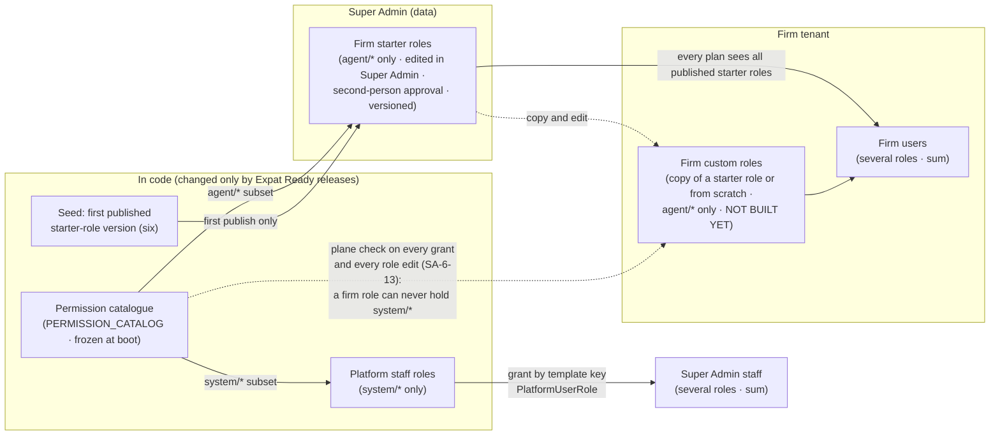
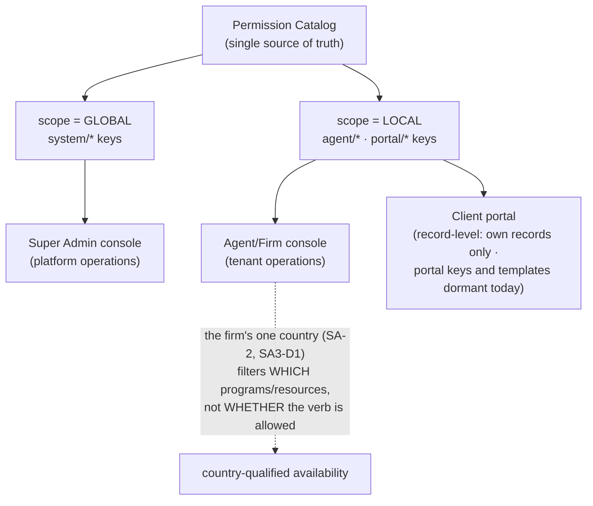
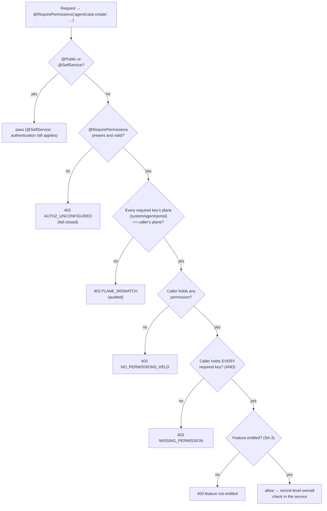

> **Document control** · Version **3.15** · **2026-10-25** · Status: **25 Oct (later): MS-D24(4) keys settled on existing keys, Case Officer also holds `agent/invoice:list` and `:show`, legacy `agent/e-sign:*` keys withdrawn; counts now 231 keys; Owner 231, Admin 213, Case Manager 145, Case Officer 99, Billing / Finance 46, Read-only 40.** Earlier, same day — **25 Oct (money slice + AG-05 review): `agent/payment-plan:manage` withdrawn, Case Officer may draft from Bill this and Add cost; counts then 235 keys; Owner 235, Admin 217, Case Manager 147, Case Officer 100, Billing / Finance 46, Read-only 41. Earlier, same day — W-17 knock-on: firm questionnaire build/publish keys withdrawn (the product owner, 25 Oct): `agent/sqr:build`, `agent/sqr:publish` and `agent/sqr:template-customise` withdrawn (AG-08 v1.13 §10); capability 17 withdrawn (29 live capabilities); counts recounted by script (236 keys; Owner 236, Admin 218). Earlier: v3.14 (23 Oct, later): AG19-D35 and AG19-D36 applied (the product owner, 23 Oct): `agent/document:edit` holders see and restore, within 30 days, files they themselves removed or replaced; the restored unredacted original has normal visibility; no key added, removed or counted. Earlier: v3.13 (23 Oct): AG-19 PDF Studio knock-ons applied (the product owner, 23 Oct): key descriptions of `agent/document:create`, `:edit`, `:delete` and `:download` updated; no key added, removed or counted. Earlier: v3.12 (21 Oct): AG-04 review decisions applied (the product owner, 21 Oct): six booking keys kept, nine withdrawn; counts recounted by script (239). Earlier: v3.11 (21 Oct, AG-02 review): AG-02 key descriptions updated (no key added, no `agent/prospect:engage`); Undo convert needs a reason; Message many has no "Send anyway?"; seed note for the feature branch; counts unchanged. Earlier: v3.10 (18 Oct, AG-07 review): case keys folded into `agent/case:edit` and the built pack and form keys used (AG07-D4); no firm deficiency-library permission (AG07-D7); `agent/case:assign` covers "Take it" (AG07-D9); key counts recounted (250). Earlier: Decisions of 10–12 Oct applied: template and legal-settings permissions (SA5-X11); role editor shows plain-language capabilities with an Advanced view (R2); reasons optional on role changes (R36); no licence-based approvals or supervised client messages (R5); subscription invoices viewable by Admin and Billing / Finance (R37); protection for the only firm Owner added; ExpatReady staff roles = the six in code, staff-role editor parked (R8); rule 7 wording applied; Starter roles configured in Super Admin (SA6-D12) kept, not built (R28); v3.6 (12 Oct, session 2): second approver for starter-role changes = Platform Owner and Admin (SR-Q1); no "preferred" mark or missing-credential note (SA-Q3); starter-role editor uses the capability view (SR-Q8); approval of AI-written text uses the sending keys (SR-Q10); legal holds placed by ExpatReady only (G-Q5); Open Questions 13, 14, 15, 17, 18 and 19 closed; v3.7 (14 Oct, AG-16 review): notification-policy key withdrawn, security policy = two-step switch only, support-ticket keys added, Escalation / At-risk use `agent/firm-capability:manage`, Open Question 21 added; v3.8 (17 Oct, AG-16 review round 2): connecting one's own mailbox and own calendar needs no permission (AG16-52; Open Question 21 and SA6-X15 closed); the calendar connection key is withdrawn (AG16-53); key counts recounted (Owner 256, Admin 238, Case Manager 159, Case Officer 107, Billing / Finance 47, Read-only 41); Open Questions 22 – 28 added; v3.9 (17 Oct, second pass): own-mailbox connect key withdrawn (AG16-54 #9); firm-mailbox keys reworded; support-ticket keys in capability 3; new Owner-only key `agent/ai:switch` (AG16-80, the sixth Owner-only action); `system/plan:manage-features` added to the catalogue; own-mailbox filing is not a permission (AG16-66); Open Questions 22 – 26 and 28 closed (AG16-55), 27 stays open, 29 added**\
> Part of: *Super Admin Console — Functional Requirements* · Split from `FINAL-SuperAdmin-FR.md` lines 3393–3934 on 2026-09-16 · Previous version: `_archive/SA-06-rbac_v3.14_2026-10-23.md`\
>
> | Version | Date | Change | Decisions |
> |---|---|---|---|
> | 3.15 (25 Oct, final check) | 2026-10-25 | **25 Oct (final check): verification fixes.** In place. (1) `agent/invoice:list` and `:show` for the Case Officer reach only invoices and trust records on cases and people the user can already see (record visibility follows the parent record, SA6-D6, AG-9-53 pattern; MS-D24(4)). (2) Case Manager also holds `agent/invoice:create` and `agent/expense:create` (MS-D21(10)); counts recounted by script: 231 live keys; Owner 231, Admin 213, Case Manager 145, Case Officer 99, Billing / Finance 46, Read-only 40. | MS-D21(10), MS-D24(4) |
> | 3.15 (25 Oct, later: MS-D24) | 2026-10-25 | **25 Oct (later): MS-D24 and writer follow-ups.** In place; nothing else bumped. (1) **MS-D24(4), existing keys only:** part credit note and write-off `agent/invoice:void`; "Client disputes this invoice" `agent/invoice:edit`; "Mark settled", an opening balance and the cheque-cleared tick `agent/payment:record`; "Send statement" `agent/invoice:issue`; Case Officer also holds `agent/invoice:list` and `agent/invoice:show` (sees the drafts they create). (2) **Withdrawn:** the four legacy `agent/e-sign:*` keys (`:audit`, `:create`, `:list`, `:manage`), from every role column, Appendix D capability 3 (30 → 29 keys) and capability 10 (9 → 6 keys). (3) **Counts recounted by script over the §10b rows:** 235 → **231** keys; Owner 235 → **231**, Admin 217 → **213** (231 - 18), Case Manager 147 → **143**, Case Officer 100 → **99** (minus three e-sign keys, plus two invoice keys), Billing / Finance 46, Read-only 41 → **40**. Mapping recheck: 231 of 231 mapped — 224 in capabilities plus the 7 locked-group keys. (4) The "Open — ask the product owner" sentence in the previous row is settled by (1); whether Case Manager may also draft stays open. | MS-D24 |
> | 3.15 (25 Oct, money slice + AG-05 review) | 2026-10-25 | **25 Oct (money slice + AG-05 review).** In place; nothing else bumped. (1) **Withdrawn:** `agent/payment-plan:manage` (MS-D21(19): payment plans are withdrawn; schedule rows replace them), on no role, in no capability, in no count; Appendix D capability 11 now has 14 keys. (2) **Trust actions use existing keys, no new key (MS-D21(11)):** trust request and receipt, monthly check and "I moved these" → `agent/payment:record`; Pay from trust → `agent/invoice:issue`; refund from trust → `agent/refund:create`; Reverse entry → `agent/payment:record` (MS-D11(2)); trust yes/no and "Invoice payments go to" are Owner-only role checks with no key; payment accounts (the first and the optional trust account, MS-D10(1)) are `agent/payment-rail:connect`, Owner only. (3) **Case Officer** now holds `agent/invoice:create` and `agent/expense:create` so it can draft from Bill this and Add cost; issuing stays with `agent/invoice:issue` (MS-D21(10)). (4) **No proposal (MS-D2):** `agent/booking-consult:create-proposal` stays withdrawn; "Prepare retainer" and "Prepare amendment" use `agent/retainer:draft`. (5) **AG-05 keys (AG05-D1(4), AG05-D4(1), (5)):** the retainer's representative countersigns their own retainer without `agent/retainer:countersign`; others need it to sign instead; `agent/retainer:offline-sign` covers "Marked signed by mistake"; a document that is not a retainer is sent for signature and marked signed offline by whoever may send it to the client (`agent/portal:request-work`). (6) `agent/billing-config:terms` also covers a service's default fees (MS-D18(8)). (7) §0.2 SA6-X7 settled. (8) **Counts recounted by script over the §10b rows:** 236 → **235** keys; Owner 236 → **235**, Admin 218 → **217** (235 - 18), Case Officer 98 → **100**, Billing / Finance 47 → **46**; Case Manager 147 and Read-only 41 unchanged. Mapping recheck: 235 of 235 mapped — 228 in capabilities plus the 7 locked-group keys. The keys for part credit note, write-off, "Client disputes this invoice", "Mark settled" and "Send statement", and a Case Officer's list and show, were settled later the same day (MS-D24(4), next row); whether Case Manager may also draft stays open — ask the product owner. | MS-D2, MS-D10, MS-D11, MS-D18, MS-D21, AG05-D1, AG05-D4 |
> | 3.15 | 2026-10-25 | **W-17 knock-on: firm questionnaire build/publish keys withdrawn (the product owner, 25 Oct).** W-17 (`TEMPLATE-MAP-working_2026-10-10.md` line 670; SA-01B v1.9 SA1B-D25, SA1B-X17): firms do not build, change or publish questionnaires; questionnaires are ExpatReady pack content. Applied from AG-08 v1.13 §10. (1) **Withdrawn** (struck through, text kept, rows and IDs stable; on no role, in no capability, in no count): `agent/sqr:build` and `agent/sqr:publish` (authoring and publishing are `system/pack:draft-manage`, `system/pack:approve`, `system/pack:publish`), and `agent/sqr:template-customise` (clone and customise withdrawn, AG-8-9 to AG-8-11). (2) Appendix D capability 17 "Build and publish questionnaires" withdrawn (ID kept; capabilities 18 – 30 keep their numbers): the role editor shows **29** capabilities (§3.5.1, §3.9, SA6-D13, SA-6-45, AC8.1, Open Question 19 annotated). (3) **Counts recounted by script over the §10b rows:** 239 → **236** keys; Owner 239 → **236**, Admin 221 → **218** (236 - 18); Case Manager 147, Case Officer 98, Billing / Finance 47, Read-only 41 unchanged (none held the three keys). Mapping recheck: 236 of 236 mapped — 229 in capabilities plus the 7 locked-group keys. Updated in §3.1, SA-6-56 test, §12 catalogue gap, Appendix C, Appendix D. (4) §0.2 SA6-X8 and Appendix B `agent/sqr:template.customise` row annotated. (5) Kept `agent/sqr:*` keys (`assign`, `view`, `verify`, `request-changes`, `document-manage`, `export`) checked against AG-08 v1.13 §10: same names; `verify` seeding (Owner, Case Manager, Case Officer) matches; no change. (6) The case's **Copy on emails** list needs no new key: it uses `agent/case:edit` (AG-07 v3.7 AG-7-97 field 8). Row added to "Decisions that change this epic". | W-17, SA1B-D25, SA1B-X17 |
> | 3.14 | 2026-10-23 | **AG-19 decisions applied (the product owner, 23 Oct, later).** No new key. (1) AG19-D35: a holder of `agent/document:edit` sees in Recently deleted, and can restore within 30 days, the files they themselves removed or replaced. A holder of `agent/document:delete` still sees and restores all of them. This adjusts AG16-104 for document files only; note added to the §10b introduction. (2) AG19-D36: restoring the unredacted original gives it normal visibility again; the warning reads "This brings back the unredacted file. The client will be able to see it." (3) AG19-D48(a), AG19-D49: Unlock in Studio uses `agent/document:edit`; a client unlocking a file needs no staff key (one-line note in the `:edit` row). `agent/document:edit` and `:delete` descriptions updated. Open Question 33 closed (option a). Three rows added to "Decisions that change this epic". **Key counts unchanged (239); no role column changed.** | AG19-D35, AG19-D36, AG19-D48(a), AG19-D49 |
> | 3.13 | 2026-10-23 | **AG-19 PDF Studio knock-ons applied (the product owner, 23 Oct).** No new key (AG19-D9). (1) `agent/document:edit` also covers every PDF Studio tool, Redact included, saving a Studio result to a document and Restore source files (AG19-D9), and Replace, Remove and File to line (AG19-D34). (2) `agent/document:create` is also needed, with `:edit`, to save a Studio result as a new document (AG19-D26(a)). (3) `agent/document:delete` also opens the hidden unredacted original of a redacted file, and can restore it after a warning; every opening and restore is audited (AG19-D17, AG19-D28). (4) `agent/document:download` note: opening a part in Studio needs it, as any preview (AG19-D9). Appendix D capability 14 description mentions PDF Studio. New Open Question 33 (Recently deleted after Remove with `:edit`). Five rows added to "Decisions that change this epic". AG19-D28 and AG19-D34 were approved by the product owner on 23 Oct; their decision-log entries were not yet written when this version was made. **Key counts unchanged (239); no role column changed.** | AG19-D9, AG19-D17, AG19-D26(a), AG19-D28, AG19-D34 |
> | 3.12 | 2026-10-21 | **AG-04 review decisions applied (the product owner, 21 Oct).** (1) AG04-D8: the AG-04 table keeps six live keys: `agent/booking-event-type:list`, `:edit` (create, delete, rules, reminders, booking page), `:configure-availability`; `agent/booking:list`, `:create`, `:edit` (reschedule, cancel, attendance, consult record). Nine keys are withdrawn (rows kept, IDs stable, on no role, in no capability, in no count): `agent/booking-event-type:create`, `:delete`, `:configure-reminders`, `agent/booking-page:configure`, `agent/booking:reschedule`, `:mark-attendance`, `agent/booking-consult:write`, `:create-proposal` (AG-05's key), `agent/booking-analytics:view` (AG-14's keys; paid-consult revenue under `agent/report:view-financial`). Billing holds no booking key. (2) Recounted by script over the §10b rows: 248 → **239** live keys; Owner 248 → 239, Admin 230 → 221, Case Manager 152 → 147, Case Officer 102 → 98; Billing / Finance 47 and Read-only 41 unchanged (§3.1, §12, Appendix C). (3) Appendix D: capability 8 has 2 keys (was 6), capability 9 has 5 (was 9), capability 23 has 13 (was 14); 239 of 239 mapped (232 in capabilities plus 7 locked). (4) Appendix B: the nine targets read WITHDRAWN (AG04-D8). (5) AG04-D6: `agent/booking:create` covers staff booking at any time, with warnings. (6) Fix F-13: `configure-availability` covers an appointment type's own windows only; a person's weekly hours and time off need no key (Open Question 23). (7) SA6-X8: the reminder template pick is under `agent/booking-event-type:edit`. **Added:** none. **Withdrawn:** the nine keys above. *22 Oct: AG-04 final cross-epic check fixes applied in place (marked "changed 22 Oct — final check").* | AG04-D6, AG04-D8 |
> | 3.12 (22 Oct) | 2026-10-22 | **X-6 applied (the product owner, 22 Oct).** `agent/settings:edit` description: the firm default currency is CAD or USD. Withdrawn-row note for `agent/billing-config:currency` no longer says an invoice takes the billing party's currency: it takes its prospect's or case's, else the firm default. No key added, removed or counted. Row added to "Decisions that change this epic". | X-6 |
> | 3.11 | 2026-10-21 | **AG-02 review decisions applied (the product owner, 20 Oct).** (1) `agent/prospect:convert` covers manual "Convert to client" and Undo convert; Undo convert added to the SA-6-18 reason-required list (AG02-D2(5)). (2) `agent/prospect:edit` covers Engage, change of type, "Start a new prospect", Take it, Link and Keep separate, adding a label or firm service; `merge` no longer covers Link; capability 7 says so (AG02-D6(11), AG02-D9(5)). (3) No `agent/prospect:engage` key; key counts unchanged (AG02-D9(5)). (4) `configure-pipeline` drops sources and win probabilities and adds firm services, labels and shared views; capability 9 says so (AG02-D13(6)). (5) `delete` drops "archive"; `lose` covers closing and reopening a lead; `sequence` is one-click "Add to follow-up" (AG02-D2, AG02-D10(4), AG02-D9(6)). (6) `configure-source` names the lead API key and Zapier app, on every plan (AG02-D3(6)). (7) `agent/prospect:assign` and the AG16-89 (8) row: round robin for leads is replaced by AG02-D1, using `agent/firm-capability:manage` (AG02-D1). (8) `agent/communication:bulk-send` is Message many: express consent on that channel only, a separate express WhatsApp marketing consent, no "Send anyway?" and no fallback to email (AG02-D8(2), AG02-D15(4)); SA-05 §3.6.5 must change the same way. (9) `view-dashboard` and `view-performance` drop forecast and leaderboard (AG02-D14(9)). (10) Seed note under the AG-02 table: role columns already match AG-02 v2.0 C4.1; feature-branch seed errors listed for code; import stays Owner and Admin (AG02-D14, AG02-D15(2)). Pending block: AG02-P13, P45, P46, P47, P112 settled and removed; AG02-P113 keeps only the capability-7 question for the product owner. **Added:** none. **Withdrawn:** none. Final hand-over check (21 Oct): "bulk campaigns" renamed to Message many in the `agent/communication:bulk-send` row (AG02-D8). | AG02-D1, AG02-D2, AG02-D3, AG02-D6, AG02-D8, AG02-D9, AG02-D10, AG02-D13, AG02-D14, AG02-D15 |
> | 3.10 | 2026-10-18 | **AG-07 review decisions applied (AG07-D4, AG07-D7, AG07-D9).** **AG07-D4:** five case keys **withdrawn** — `agent/case:document-manage`, `agent/case:form-prepare` (→ the built `agent/form:create`), `agent/case:deficiency-manage`, `agent/case:review-submit`, `agent/case:milestone-record`; `agent/case:edit` now covers documents, deficiencies, sending for internal review and government steps (by hand or from a letter). Kept separate: `case:submit`, `case:record-decision`, `case:waive-deficiency`, `case:form-approve`, `case:review-approve`, `case:reopen`, `case:assign`, `case:export`. The three built keys `agent/pack:adopt`, `agent/form:create`, `agent/pack:extend` are used as they are (notes on their rows). **AG07-D7:** no firm deficiency-library permission exists or is added; `agent/case:configure-pack` no longer mentions deficiency-library additions. **AG07-D9:** `agent/case:assign` also covers "Take it" on an unassigned case. **Counts recounted by script:** live `agent/*` keys 255 → 250; Owner 250, Admin 231, Case Manager 153, Case Officer 101, Billing / Finance 47, Read-only 41. Capability 4: 12 → 7 keys. **Added:** SA-6-57 with a full build card; Open Questions 30 and 31; six Appendix B rows. **Withdrawn:** the five keys above (rows kept, IDs stable). *18 Oct (later): consistency fixes after expert review — AG07-D4 / AG07-D2 (adopt clause dropped from `case:edit`, Q30 closed), AG16-89(8) (`prospect:assign`), AG07-D1 / W-17 (catalogue wording).* *18 Oct (final): AG07-D17 – D21 applied — AG07-D19 ("Take it" needs `agent/case:edit`; assigning others `agent/case:assign`), AG07-D20(d) ("Request a document" = `agent/pack:extend`), AG07-D20(e) (document status keys kept), AG07-D20(u) (`agent/case:view-dashboard` withdrawn into `agent/case:view.all`; live keys 250 → 249, recounted by script: Owner 249, Admin 230, Case Manager 152, Case Officer 101, Billing / Finance 47, Read-only 41), Q31 closed, Open Question 32 added and closed (keys never built, DEV-TASKS H3).* *18 Oct (final): AG07-D24 applied.* `agent/case:waive-deficiency` is also seeded on the Case Officer starter role; Case Officer keys 101 → 102; the other three sign-off keys unchanged. *18 Oct (final): AG07-D25 applied.* `agent/case:waive-deficiency` is also seeded on the Admin starter role; Admin keys 230 → 231; the other three sign-off keys unchanged; SA6-D3 and AC6.1a unchanged; acceptance test AC6.1b added. *18 Oct (later): AG01-29 / AG16-105 and gap-check fixes applied — AG01-29(7): the `agent/settings:edit` description adds public phone, public email and website and says legal name and trading name are edited by ExpatReady support (Super Admin), not by this key; the firm's default currency for new cases is this key (gap check #13); the `agent/firm-profile:manage` row says the same about legal and trading name. The Owner-role bug note (§12 first bullet) now states what the code does on removal: an Admin can remove the Owner role, including from the last active Owner, and a holder of `agent/role:assign` can change their own roles; SA6-D19, SA-6-44 and BR-27 no longer say removal of the Owner role is protected for firms (it is not built). DEV-TASKS H14 (priority). No key added or withdrawn, no count changed.* *18 Oct (later): check fixes applied — AG16-105(1) added to the §10b note and the decisions table; Owner-role bug code lines corrected (§5, §12); `agent/billing-config:currency` row aligned and marked for withdrawal.* *18 Oct (last): AG16-106 — `agent/billing-config:currency` withdrawn.* | AG07-D4, AG07-D7, AG07-D9, AG07-D19, AG07-D20(d), AG07-D20(e), AG07-D20(u), AG07-D24, AG07-D25 · AG01-29(7) · AG16-106 |
> | 3.9 | 2026-10-17 | *Same-day fixes (18 Oct): AG16-94 — `agent/portal:nudge` description "Send nudges (no stall configuration)".* **Second pass (AG16-54 – AG16-82), SA-06 items.** **AG16-54 #9:** `agent/communication:connect-mailbox` **withdrawn** (a person's own mailbox needs no key, AG16-52; closes Open Question 22); `agent/integration-mail-receive:manage` and `agent/integration-smtp:manage` reworded as the **firm mailbox**; `agent/support-ticket:create` and `:list` put into Appendix D capability 3 (SA-6-47; closes Open Question 28). **AG16-57 / AG16-66:** `agent/communication:resolve-unmatched` governs **firm** Unmatched items only; a person's own "Only you" items are always visible to them; filing the person's own mailbox is not a permission, and the hand actions (file to client, create lead, move / un-file, send) keep their keys. **AG16-80:** new key `agent/ai:switch`, Owner only, never delegable: the **sixth** Owner-only action (was five); locked group 6 → 7 keys; `system/plan:manage-features` added to §10a (no behaviour change). **Counts recounted by script:** live `agent/*` keys 256 (−1 withdrawn, +1 new); Owner 256, Admin 237, Case Manager 158, Case Officer 106, Billing / Finance 47, Read-only 41. Capability 18: 12 → 11 keys; capability 3: 28 → 30 keys; locked group 6 → 7. **AG16-55:** Open Questions 22 – 26 and 28 closed with the writer's default; 27 stays open (no default); 29 added. New requirements SA-6-55, SA-6-56; SA-6-53 card updated. **Build cards:** SA-6-53 (updated), SA-6-55, SA-6-56. *Same-day fixes (17 Oct): AG16-83 – AG16-88 — `agent/automation:configure-ai` withdrawn (key totals recounted: 255 live keys, Owner 255, Admin 236; capability 20: 13 → 12 keys; Open Question 29 closed); `system/pack:draft-manage` pointer row added to §10a; Open Questions 23, 24, 26 accepted. AG16-84, AG16-86, AG16-87, AG16-88: no change in this file.* *Same-day fixes (18 Oct): AG16-89 — `agent/communication:manage-inbox` description gains "assign / take / unassign a conversation"; the "Only you" sentence is removed from the `resolve-unmatched` note and from SA-6-56 rule 3, its card rule 5 and the Read-only test (now: Assign is not offered without `manage-inbox`). No key added or removed; key counts unchanged.* *Same-day fixes (18 Oct): AG16-90 — SA-6-55 test: an Admin does not see the AI switch (not shown, server refuses; AG-16 owns the screen); SA-6-55 Where cites AG-11-93 and AG-16-35 lines; SA-6-54 Where cites the real row line; SA-6-54 gained "Clicks:" and "Person decides:"; four pointer rows added to §10a (`system/pack:approve`, `system/pack:publish`, `system/firm:view-entitlement`, `system/plan:approve-change`); the §10b key counts (255) are unchanged because these are `system/*` keys.* *18 Oct: new section 'Decisions that change this epic' (index of AG16 decisions; no requirement changed).* *Same-day fixes (18 Oct): AG16-97 — `agent/integration-mail-receive:manage` also turns form-lead rules ("Always create leads") on or off; no new key; the "Always create leads" part of Open Question 27 closed.* *Same-day fixes (18 Oct): AG16-104 — one note in the §10b introduction: restoring from Recently deleted uses the same key as deleting that kind of record; no key added or removed, key counts unchanged.* | AG16-54, AG16-55, AG16-57, AG16-66, AG16-80, AG16-89, AG16-97, AG16-104 |
> | 3.8 | 2026-10-17 | **Applied AG16-52 and AG16-53 (map section "AG-16 review — decisions", 17 Oct) and the key-existence check for AG16-25 – AG16-50.** **AG16-52:** any signed-in staff member connects, changes or disconnects their own mailbox and own calendar (My account) with **no permission key**, like changing one's own password; firm-level connections stay restricted (firm mailbox and WhatsApp: Owner and Admin; payment account: Owner only, `agent/payment-rail:connect`). Closes Open Question 21 and §0.2 row SA6-X15. New requirement SA-6-53. **AG16-53:** the calendar connection key is **withdrawn** (the decision names `agent/integration-calendar:create`; the catalogue holds that key as the merged `agent/integration-calendar:manage`, row kept visible as withdrawn, ID stable — see Open Question 24). Removed from the Owner and Admin seeds, from Appendix D capability 27 and from every count. New requirement SA-6-54. **Counts recounted by script on 2026-10-17** (v3.7 had not recounted): §10b live rows 257 before this change (256 + 2 support-ticket keys − 1 withdrawn notification-policy key), **256 after**. Per role, before → after: Owner 257 → 256; Admin 239 → 238; Case Manager 159 → 159; Case Officer 107 → 107; Billing / Finance 47 → 47; Read-only 41 → 41. Against the v3.5/v3.7 text (Owner 256, Admin 238, Case Manager 157, Case Officer 105, Billing / Finance 45, Read-only 39) the four lower roles rise by 2 because of the two support-ticket keys of v3.7 (AG16-16). Appendix D: capability 27 10 → 9 keys; capability 25 count 8 → 7 (corrects the v3.7 note); the two support-ticket keys are in no capability yet (Open Question 28). **Key-existence check** (keys named in AG16-25 – AG16-50): all named keys exist except the cases listed in Open Questions 25 – 27. **Open questions:** 21 closed; 22 – 28 added. **Build cards:** SA-6-53, SA-6-54. **Not touched:** `SA-06-CHANGE-NOTE_2026-10-07.md`. | AG16-52, AG16-53 |
> | 3.7 | 2026-10-14 | **Applied the AG-16 review decisions that touch the permission catalogue (map section "AG-16 review — decisions (the product owner, 14 Oct)").** **AG16-14:** `agent/notification-policy:edit` withdrawn — a firm has no notification policy; personal preferences keep `agent/notification:manage-preferences`. **AG16-5 / AG16-23:** `agent/security-policy:manage` no longer covers an IP allow-list; it covers the staff two-step switch only (the client "require two-step" switch is not shown). **AG16-16:** new keys `agent/support-ticket:create` and `agent/support-ticket:list` (not in code yet; DEV-TASKS E3). **AG16-8:** escalation, at-risk marks and waiting times use the built `agent/firm-capability:manage`; `agent/settings:edit` does not exist in code. **AG16-15 / AG16-18:** Open Question 21 added (self-scoped right to connect one's own mailbox and calendar) — not decided. **Not recounted:** the 256 canonical firm key counts and the Appendix D capability counts are from v3.5; the withdrawn key and the two new keys are not yet reflected in them. | AG16-5, AG16-8, AG16-14, AG16-16, AG16-15, AG16-18 |
> | 3.6 | 2026-10-12 | **Applied the ExpatReady staff-role decisions, the governance decisions and the later rulings of 12 Oct (map sections "ExpatReady staff roles — decisions (12 Oct, session 2)", "Governance code built against earlier 'park' decisions", "Remaining SA open questions"; the product owner).** **SR-Q1 + correction:** `system/starter-role:manage` is held by the **Platform Owner and Admin**; the approver must differ from the requester; the floor stays one active Owner as specified and built (no "second-to-last Owner" refusal); the firm side has no two-person approval — **Open Question 18 closed**. **SR-Q1b / SR-Q1c:** four-eyes on government forms and the Team safeguards switch are removed — only the places where this document mentions them are changed (the `agent/settings:edit` row; Appendix C); the AG knock-ons are a new Pending §0.2 row, SA6-X11. **SR-Q2:** a publish of any ExpatReady email needs the Platform Owner; the "contains legal terms" flag and `system/template:approve-legal` are parked (SA6-D17, SA-6-50, §10a). **SR-Q3:** "Content author" → "Content publisher"; display names for the six staff roles. **SR-Q4:** staff-role grants are reconciled with SA-07 Appendix A (pointer only; SA-07 owns the lists). **SR-Q7:** the reason rule also applies to ExpatReady staff-role changes (optional, except giving or removing Platform Owner; the reason goes in the Owner-change email). **SR-Q8:** the starter-role editor uses the same capability view, the same 30 capabilities and the same Advanced view as the firm custom-role editor — **Open Question 19 closed**. **SR-Q9:** renaming a government step's client name is `agent/case:configure-pack` — **Open Question 17 closed**. **SR-Q10:** approving AI-written client text uses the sending key (`agent/communication:send-email` / `:send-message`), no new key — **Open Question 14 closed**. **SA-Q3:** the "preferred" label and the missing-credential note are removed — **Open Question 13 closed**; §3.3, SA6-D9, SA-6-27, BR-20, AC5.2, AC5.4, §9 and §12 fixed. **G-Q3 – G-Q6:** new platform key `system/compliance:legal-hold` (Platform Owner only); `agent/legal-hold:manage` dormant (no firm screen); keep-period keys decided (`agent/legal-settings:manage` sets it, `agent/document:dispose` deletes inside it, `agent/retention-policy:manage` kept on the built route, no screen) — **Open Question 15 closed**; the firm breach register has no screen in Release 1; staff export download uses `agent/data-export:request`. **Not applicable here:** R9-32 (`system/analytics:view-revenue` not seeded) and SA-12 Q12 (one key each for maintenance and banner) — §10a does not list those families, so nothing is added. **§0.2:** SA6-X1, X3, X4 updated; new SA6-X11 – X14 (Pending). **Counts:** no firm key was added, withdrawn or re-assigned, so the v3.5 script counts stand (256 canonical firm keys; Owner 256, Admin 238, Case Manager 157, Case Officer 105, Billing / Finance 45, Read-only 39); the new key is a platform key and is in no firm count. **Changed:** SA6-D9, D12, D13, D15, D17, D18; SA-6-18, SA-6-20, SA-6-27, SA-6-37, SA-6-45, SA-6-50, SA-6-51; BR-20, BR-23, BR-24; AC5.2, AC5.4; §3.3, §3.5.1, §3.9, §3.10, §9, §10a, §10b (rows `agent/case:configure-pack`, `agent/communication:send-email`, `:send-message`, `agent/data-export:request`, `agent/document:dispose`, `agent/settings:edit`, `agent/breach:manage`, `agent/legal-hold:manage`, `agent/retention-policy:manage`), §12, §13, Appendix C. **Added:** the `system/compliance:legal-hold` row in §10a; SA6-X11 – SA6-X14. **Withdrawn:** none as an ID (the "preferred" mark, the missing-credential note and "switching Team safeguards off" are removed from the text). **Same-day revision (W-4 – W-10, the product owner, 12 Oct):** W-10(2) confirms that the permission for the Escalation and At-risk settings is decided in the AG review (AG-11 / AG-16); no key added here. **Same-day revision (W-11 – W-21, the product owner, 12 Oct):** W-15 / W-16 `agent/case:configure-pack` hides only standard items and steps without a deadline, never anything with a deadline or any government step, and never reorders; W-17 firm-added questions, the "who answers" switch, hiding / reordering optional questions and firm-wide extra checklist items are withdrawn (per-case additions stay); W-21 text fixes — own calendar and own availability are self-service (new §0.2 row SA6-X15), `system/mail-template:publish` stays a separate Owner-only key, `system/template:approve-legal` and `system/super-admin-role:manage` are held by no role, dormant firm keys not shown as active capabilities, `system/role:assign` claim corrected, SA-07 Appendix A is the target and the code registry is master, stale line references updated. No key added or removed. | SR-Q1, SR-Q1 correction, SR-Q1b, SR-Q1c, SR-Q2, SR-Q3, SR-Q4, SR-Q7, SR-Q8, SR-Q9, SR-Q10, SA-Q3, G-Q3, G-Q4, G-Q5, G-Q6 |
> | 3.5 | 2026-10-12 | **Applied the template-review, complexity-review and code-check decisions (map, 10–12 Oct; the product owner approved writing the SA updates on 12 Oct).** **Role editor:** the custom-role editor is **kept** in Release 1 on every plan (R1); it shows **30 plain-language capabilities**, each a fixed bundle of permissions, plus an **Advanced** per-permission view in Release 1; all firm permissions stay in code and are checked and audited as before (R2) — new §3.5.1, new Appendix D (capability map), SA-6-45 – SA-6-47, BR-28, Story 8. **Reasons (R36):** a reason on firm role changes is **optional**, except giving or removing the Owner role, which needs one; audit always records who, when and before / after — replaces the v3.0 rule (SA6-D3 closing review, BR-23, SA-6-18). **Approvals (R5; approval-routing defect, 12 Oct):** no supervised client messages and no licence-based approvals or routing — AI-written client text is approved by any holder of the approval permission; SA6-D9 routing stands (all holders, Owner fallback) and AG-7-68, AG11-D11, AG-11-89, AG-16 BR-22 are aligned to it. **Licences (Q24):** any representative type in the pack counts; neutral "licence number" wording replaces "CICC number" and "(RCIC)". **Subscription invoices (R37):** `agent/subscription-invoice:view` is seeded on Owner, Admin and Billing / Finance (SA4-D23 amended for viewing only). **Template keys (SA5-X11 applied; O17, Q1, Q8, Q13, Q14, Q17, R33):** `agent/template:adopt`, `:resync`, `:archive` **withdrawn**; `agent/communication:manage-templates` **folded** into `agent/template:*`; `agent/retainer:configure-template` **narrowed**; `agent/task:template` kept; meanings of the remaining `agent/template:*` keys per AG-12 v2.1 §10; `agent/template:publish` no longer confirms any review (nothing is held — SA05-R9a); switching automatic messages on or off stays `agent/template:configure` *(revised same day — SA05-R9a)*; new firm key **`agent/legal-settings:manage`** ("Manage legal settings", Owner only by default, delegable through a custom role — name set here); hiding standard items is `agent/case:configure-pack` (Owner and Admin); the exact `system/template:*` list (nine keys, incl. Platform-Owner-only `:urgent-correction`) replaces "set by the template management review" and confirms the key names (closes SA-05 §13 Q2). **Only-Owner defect (12 Oct):** new requirement SA-6-44 — the server refuses to deactivate or suspend the only active firm Owner (cites `deactivate-lifecycle.service.test.ts:189-200`), BR-27, AC6.5. **ExpatReady staff roles (R8 revised):** the six roles in code; the staff-role editor is **parked** (SA-6-19); SA7-D8's nine roles replaced. **Starter-role editor (R28):** kept as decided, not built; existing mock screens follow the superseded push model and need redoing. **Code outcomes (R13, rule 8):** audit hash chain, verify job and off-site anchoring recorded as built; support sessions also exclude `agent/template:publish` and `:configure` (O25). **Rule 7:** statute names (PIPEDA, Law 25) removed from product text and justifications. **Changed requirements:** SA-6-3, SA-6-6, SA-6-12, SA-6-17, SA-6-18, SA-6-20, SA-6-27, SA-6-29, SA-6-31, SA-6-32; BR-11, BR-12, BR-13, BR-15, BR-20, BR-23. **Changed acceptance criteria:** AC2.1, AC2.5, AC2.7, AC6.4. **Parked:** SA-6-19. **Added:** SA-6-44 – SA-6-52, BR-27, BR-28, Story 8 (AC8.1 – AC8.5), AC6.5, SA6-D13 – SA6-D20, Open Questions 13 – 19, §0.2 rows SA6-X1 – SA6-X10, Appendix D. **Changed decisions:** SA6-D2, D3, D5, D8, D9, D12 (annotated). **Counts recounted by script:** 256 canonical firm keys; Owner 256, Admin 238, Case Manager 157, Case Officer 105, Billing / Finance 45, Read-only 39. **SA-05 rows applied:** SA5-X11 (a) – (d). **Same-day closing (SA05-R9b, the product owner, 12 Oct):** Open Question 20 is closed — the on/off permission for automatic messages is `agent/template:configure`; no new key is added or withdrawn. *(revised same day — SA05-R9b)* | map rules 7, 8; Q1, Q8, Q13, Q14, Q17, Q24; O17, O25; R1, R2, R5, R8, R13, R28, R33, R36, R37; approval-routing defect; only-Owner defect; code-check outcomes · SA6-D13 – SA6-D20 · SA05-R9b |
> | 3.4 | 2026-10-10 | Template permissions aligned with the "use until you edit" direction (the co-product owner's SA-05 review; merge decided by the product owner, 10 Oct — SA5-X2). Firm keys: `agent/template:adopt` now means "the firm's own copy is made when it edits Expat Ready's template"; `agent/template:configure` narrowed (no auto-fast-forward, no governance-strictness setting); `agent/template:resync` held for the template management review. Staff keys: Expat Ready's template keys are `system/template:*`, never `global/template:*`, with **no** clone-to-firm or bulk-clone keys; the exact list is set by the template management review. No key added. | SA5-X2 |
> | 3.3 | 2026-10-10 | Applied from SA-04 v2.17 (SA4-X16; the product owner, 10 Oct — trials review): **no key added.** `agent/subscription:upgrade` now also covers **"Start my subscription now"** during a trial (SA-4-81) — Owner by default, like any upgrade; `system/billing:manage` now also covers **extending a firm's trial** (SA-4-80). Two descriptions changed (§10 catalogue row; §10a reference line). *Same day (SA3-X11):* "product map" wording replaced by the SA-3 feature catalogue in §3.1, §3.8 and §12 — each firm permission key names the feature it belongs to; no key or rule changed. | SA4-D29 (SA4-X16) |
> | 3.2 | 2026-10-10 | **SA6-D12 (the product owner, 10 Oct): starter roles are configured in Super Admin, not hard-coded (Release 1).** Code only seeds the first published version (today's six); Super Admin creates, edits, renames and retires starter roles, with second-person approval, impact preview, version history and restore. **New:** §3.9 Starter-role editor; SA-6-34 – SA-6-43; BR-24 – BR-26; `system/starter-role:manage` (§10a); Open Question 12. **Changed:** SA6-D3, D5, D7 (annotated); §3.3 – §3.5; SA-6-6, SA-6-10, SA-6-12, SA-6-30, SA-6-31; BR-8, BR-19; §6 B, §7, §8 (Story 1), §9, §12, Appendix C. v3.1 content kept as is. | SA6-D12 |
> | 3.1 | 2026-10-08 | Session knock-on (the product owner, 8 Oct — SA7-D67 in SA-07 v2.10, AG1-D20 in AG-01 v1.16): a firm has no session setting (AG-16-23 withdrawn), so `agent/security-policy:manage` covers **MFA and IP allow-list only**. The code rename stays (`agent/mfa-policy:manage` → `agent/security-policy:manage`) but it is **not** widened to session timeout. §10 row, §12 rename list and Appendix B rows (N6) updated. No key added or removed. | SA7-D67 · AG1-D20 |
> | 3.0 | 2026-10-07 | **Full review against the ERv2 code; founder decisions SA6-D1–D11 (the product owner, 7 Oct).** §3 and §12 rewritten: the model is now described as built in ERv2 (permission catalogue in code, roles granted by template key, assignment tables `PlatformUserRole` / `FirmUserRole`, plane-checked guard with AND semantics, boot integrity gate) instead of the old `src/role` / `permission-guard.ts` code and its escalation defect. Decisions: visibility "see all" seeded on all six starter roles (SA6-D1, supersedes AG7-D5 seeding); sign-off keys default to Owner + Case Manager, no licensed-representative role (SA6-D2, supersedes AG17-D17's default holder); firm role rules — several roles per user, custom roles by Owner/Admin, starter roles fixed and maintained by Expat Ready, server-side `agent/*`-only validation (SA6-D3, withdraws template versioning and push); one RBAC system, two role sets (SA6-D4); six starter roles, the five Owner-only actions, Admin's exception for professional approvals, and self-maintained licence credentials (SA6-D5); attached records follow client/case visibility (SA6-D6); every plan seeds the same six roles (SA6-D7); Super Admin access by job (SA6-D8); licensed user is a person, not a role (SA6-D9); key naming rule (SA6-D10); firm-wide audit log for `agent/audit:read` (SA6-D11). Remaining `agent/pii:export-unmasked` text marked withdrawn (AG7-D10). **New:** SA-6-24 – SA-6-33, BR-17 – BR-22, Open Question 10 (duplicate staff-role editor key; closed 2026-10-07). **Changed:** SA-6-1 – SA-6-4, SA-6-6, SA-6-7, SA-6-10 – SA-6-15, SA-6-17, SA-6-18, SA-6-21 – SA-6-23; BR-2, BR-4 – BR-13, BR-16. **Withdrawn:** SA-6-8, SA-6-9, BR-14. §1, §2, §6 – §9 and §11 aligned; §10a refreshed against the code catalogue (`system/role-template:push`, `system/plan-role-set:manage`, `system/role:list|create|edit` withdrawn); §10 LOCAL key boxes replaced by the agent/portal catalogue (§10b–§10c) and Appendices B/C. Open Questions 1–9 closed. **Extended 2026-10-07 after founder review (the product owner; still v3.0, folded into the existing decisions, no new decision IDs):** dashboards split from record visibility (SA6-D1); an Admin gives, removes and deletes only roles whose every permission the Admin holds, and only an Owner removes the Owner role, never leaving the firm with no active Owner (SA6-D3); the five Owner-only actions can never sit on a custom role, and "connect the payment account" means the account that receives clients' payments (SA6-D5); a task on a client or case the user cannot open stays visible as a task with a "restricted" parent, and unlinked imported files have named viewers (SA6-D6); the permission system never checks licence (SA6-D9); the firm's own subscription billing screen is split (SA-04 v2.8, SA4-D23): the **Admin** may update the subscription card and pay an overdue bill ("pay now"); **upgrades** (plan or billing-period increases), **invoices and credit notes**, **billing details** (billing email, business address, tax info), **downgrades** and **cancellation with undo** are **Owner-only** (SA6-D5); the §10b default role ticks were reviewed and accepted by the founder (Decision 2, 7 Oct) — including that Case Officer may approve or reject client uploads through `agent/document:manage` but cannot delete documents, Case Manager sets per-case portal visibility, and Billing / Finance views retainers, logs time and sets reminders — so the "proposed" labels are removed; `agent/subscription:upgrade` is now Owner-only and five subscription keys are added (§10b). Review fixes: SA-6-3, SA-6-18, SA-6-25 and SA-6-27 rewritten to be testable; SA-02 citations corrected to v2.18; key counts reconciled; §10a audit key corrected; §12 now opens with the role-assignment security bug. **Closing review 2026-10-07 (the product owner; still v3.0, no new decision IDs; all open items closed):** (F2) a written reason is **required** for every firm role create, edit and delete and every role assignment or removal, recorded in the audit log with who, when and before / after (SA6-D3; SA-6-12, SA-6-18, SA-6-29, SA-6-32; BR-23); (F3) `agent/document:dispose` is Owner-held by default and the Owner **may** put it on a custom role — it is not one of the five never-delegable actions (SA6-D5, Appendix C); (F4) items awaiting professional approval are shown to **all** holders of the approval permission at once, active licensed holders are marked "preferred", and the Owner approves only if no one holds the permission (SA6-D9; SA-6-27; BR-20; AC5.3, AC5.4); naming questions N1 – N21 closed — renames, merges and retirements in §10b and Appendix B (rows tagged "Closed N#"): `agent/onboarding:view` / `:complete`, `agent/time-entry:*` and `agent/activity-type:manage`, `agent/security-policy:manage` (MFA, session timeout, IP allow-list), `agent/billing-config:terms`, `agent/note:share-with-client`, one `agent/integration-<rail>:manage` per rail, `agent/notification-policy:edit`, `agent/entitlement:view`; retired `agent/accounting/retainer:*`, `agent/communication:configure-rails`, plain `agent/report:view`, `agent/template:render`, and the code keys `agent/document:view.own` / `:view.all` and `agent/note:view.all`; code `agent/assessment:read` / `:create` renamed to `:view` / `:run`; Open Question 10 closed (`system/super-admin-role:manage` survives, `system/role-template:manage` retired). Canonical firm keys recounted by script: 259 (was 269). **Changed:** SA6-D3, SA6-D5, SA6-D9; SA-6-12, SA-6-18, SA-6-27, SA-6-29, SA-6-32; BR-12, BR-20; §3.1, §3.3, §3.5, §3.6, §3.10, §8 (Stories 2, 5, 6), §9, §10a, §10b, §12, §13, Appendices B and C. **New:** BR-23, Open Question 11. | SA6-D1 – SA6-D11 |
> | 2.5 | 2026-10-05 | Applied from AG-07 v2.3 (Agent console, the product owner, 5 Oct; decisions kept as AG7-Dn, no new SA decisions): **Added** to the catalogue the client keys `agent/client:list` (own clients), `agent/client:view-all`, `agent/client:show`, `agent/client:create`, `agent/client:edit`, `agent/client:export` (AG7-D1, AG7-D5) and `agent/pii:export-unmasked` (AG7-D7; withdrawn the same day, see below). **Withdrawn** (row kept): `agent/case:reveal-pii` — and the per-module reveal keys of the other modules (`agent/audit-log:reveal-pii`, `agent/report:reveal-pii`, `agent/prospect:reveal-pii` and any other `*:reveal-pii`) are retired in the catalogue; this document listed only the case key. New: SA-6-23. Changed: §10 heading and a new key box, §12. `agent/case:form-approve` not added — no pending note in SA-06 asks for it. Same day (AG7-D10): the founder decided there is no masking and no reveal of personal data anywhere, which replaces AG7-D7. `agent/pii:export-unmasked` is **withdrawn** (row kept; no Owner proposed holder); the reveal-key withdrawals now cite AG7-D10 ("no masking or reveal"); SA-6-23 and the §10 box and §12 note adjusted; `agent/client:export` no longer says masked fields stay masked (exports are governed by the export permission and audited). The `agent/client:*` keys are unaffected. | AG7-D1, AG7-D5, AG7-D7, AG7-D10 |
> | 2.4 | 2026-10-03 | Consistency review fixes (3 Oct): SA-6-22 now says Change stream uses the existing `agent/case:create` permission (AG17-D77); §10 heading retitled to cover both the GLOBAL `system/*` permissions and the LOCAL case keys added with the case core. No new IDs. | AG17-D77, AG17-D28 |
> | 2.3 | 2026-10-02 | Applied from AG-17 (Corporate cases and LMIA, §0.2 "SA-06 RBAC" row, founder-decided): **no new permission for corporate / LMIA work** — a corporate file is a case and uses AG-07's case keys; the case keys AG-07 §10 marks NEW are added to the catalogue with the case core (added by the case-core developer, reviewed by the SA-06 owner); the firm's licensed-representative role template is the default holder of `agent/case:waive-deficiency`; existing permissions cover manual board placement, "Done on behalf of client" and submitting without sign-off. New: SA-6-22, BR-16. Changed: §3.3, §10, §12, Open Question 9 (added). Requirements otherwise unchanged. | AG17-D9, D17, D28, D64, D71, D73, D74 |
> | 2.2 | 2026-10-02 | SA-7 role names used throughout (SA7-X10, SA7-D8): "Tenant Account Manager" → "Firm onboarding / Account manager", "Billing Admin" → "Billing". Requirements unchanged. | SA7-X10 |
> | 2.1 | 2026-10-01 | Applied from SA-07 v2.6 (the product owner, 1 Oct): internal-role editor (Owner edits and creates staff roles), nine starter roles, several roles per person, BR-11 relaxed for internal roles; Release 1. Changed: SA-6-17, BR-2, BR-11 (§2, §3.0, §3.3, §3.10, §10 and Open Question 1 aligned). New: SA-6-19, SA-6-20, SA-6-21, BR-15 | SA7-X1 |
> | 2.0 | 2026-06-20 | Baseline — golden per-module rebuild | — |

## Decisions that change this epic (14–25 Oct) *(new 18 Oct; AG-02 and AG-04 rows added 21 Oct; AG-19 rows added 23 Oct; AG19-D35, AG19-D36, AG19-D48(a)/D49 added 23 Oct, later; W-17 row added 25 Oct)*

Product-wide rules (apply here as everywhere; home: Agent `00-Overview` → "Product rules every epic follows"): AG16-33, AG16-76, AG16-89.

The "AG16" prefix is historical: these decisions began in the AG-16 review and apply across the product. Full text: `TEMPLATE-MAP-working_2026-10-10.md`.

| Decision | What was decided (one line) | What it changes in this epic | Where (requirement / card / section) |
|---|---|---|---|
| AG16-5 | IP allow-list: not in Release 1, parked on the wish list. | agent/security-policy:manage no longer covers an IP allow-list; it covers the staff two-step switch only. | §10b AG-01 row agent/security-policy:manage, Appendix B rows, §12 rename list |
| AG16-8 | Who changes Escalation and At-risk marks. | Escalation, At-risk marks and waiting times use the built key agent/firm-capability:manage; agent/settings:edit does not exist in code. Closes W-10(2). | §10b AG-01 row agent/settings:edit |
| AG16-14 | Staff notifications: personal settings only. | agent/notification-policy:edit withdrawn (a firm has no notification policy); personal preferences keep agent/notification:manage-preferences. | §10b AG-16 rows (notification-policy), capability count line |
| AG16-15 | Mailboxes: firm and personal, nothing required. | Open Question 21 added (v3.7) on a self-scoped right to connect one's own mailbox and calendar; closed in v3.8 by AG16-52. Cited as the reason the old calendar key covered nothing. | SA-6-53 rule 2, SA-6-56 rule 2 (§4), Open Question 21 |
| AG16-16 | Get help: who raises and sees tickets. | New firm keys agent/support-ticket:create (every starter role) and agent/support-ticket:list (own tickets for all; all firm tickets for Owner and Admin). Put into Appendix D capability 3 in v3.9. | §10b AG-16 rows, Appendix D capability 3, SA-6-47, Open Question 28 |
| AG16-18 | Calendars: personal only, with "choose which calendars". | The firm-wide calendar connection was removed; the old calendar key covers nothing. | SA-6-53, SA-6-54, §10b AG-16 row agent/integration-calendar:manage |
| AG16-20 | AI switch details (Owner-only on, as recommended). | The Admin's AI-off right is replaced: the Admin no longer switches AI off (see AG16-80). ExpatReady's platform-wide AI pause is separate and unchanged. | SA-6-55 (Why, Tests), §10b AG-11 row agent/ai:switch |
| AG16-23 | Client two-step sign-in: no firm "require" switch; client's own choice kept. | The client "require two-step" switch is not shown; agent/security-policy:manage covers the staff two-step switch only. | §10b AG-01 row agent/security-policy:manage |
| AG16-24 | Own mailbox and own calendar on every plan. | Referenced only (no change here). Plan entitlement for own mailbox and calendar is stated on the card; the permission side is AG16-52. | SA-6-53 rule on plan entitlement |
| AG16-25 | Mailbox roles, solo setup, and how email data separates. | Referenced only for permissions. Included in the v3.8 key-existence check; a personal mailbox brings in only what the person chooses. | SA-6-53 (Why, Safety), change-log row 3.8 |
| AG16-28 | Several firm mailboxes. | Included in the v3.8 key-existence check: Owner and Admin connect firm mailboxes and choose the main address; the keys gate connecting the firm mailbox only. | Open Questions list (item on mailbox keys), change-log row 3.8 |
| AG16-32 | Lead notification emails become leads. | Included in the v3.8 key-existence check: the "Always create leads from them?" click names no key. | Open Questions list (item on mailbox keys), change-log row 3.8 |
| AG16-34 | AI is included in higher plans, not sold as an add-on. | Referenced only (no change here). The AI switch card notes that plan entitlement needs a plan that includes AI. | SA-6-55 (Access) |
| AG16-37 | Mailbox go-live essentials. | Deactivating a person stops their mailbox syncing; no role is treated differently. | SA-6-53 (Team screen rule, Edge cases) |
| AG16-50 | Government-deadline reminder on a case with no one assigned goes to the Owner. | Cited — see change-log row 3.8: key-existence check of the range AG16-25 to AG16-50; no requirement here names it. | Document control (v3.8) |
| AG16-52 | Connecting one's own mailbox or calendar needs no permission. | Any signed-in staff member connects, changes or disconnects their own mailbox and calendar with no permission key; firm-level connections stay restricted (firm mailbox and WhatsApp: Owner and Admin; payment account: Owner only). Closes Open Question 21 and row SA6-X15. | SA-6-53, SA-6-56, §0.2 SA6-X15 |
| AG16-53 | Video links are per person; no firm video account. | The calendar connection key (merged agent/integration-calendar:manage) is withdrawn, removed from the Owner and Admin seeds, from Appendix D capability 27 and from every count. | SA-6-54, §10b AG-16 row agent/integration-calendar:manage, Open Question 24 |
| AG16-54 | 25 consistency fixes after the 17 Oct write (batch). | #9: agent/communication:connect-mailbox withdrawn; the firm mailbox keys reworded; support-ticket keys put into Appendix D capability 3; counts recounted by script. | SA-6-53, SA-6-56, Open Questions 22 and 28, Appendix D |
| AG16-55 | Writers' recommended defaults accepted for the detail questions. | Open Questions 22 to 26 and 28 closed with the writer's default (own availability needs no key; payment-recording key is agent/payment:record). Question 27 stays open; 29 added. | §13 Open Questions 22 to 29 |
| AG16-57 | Two places for messages that were not filed: Unmatched and "Not brought in". | agent/communication:resolve-unmatched governs firm Unmatched items only. The "Only you" rule it first added was later withdrawn by AG16-89. | SA-6-56, §10b AG-10 row agent/communication:resolve-unmatched |
| AG16-66 | Limited roles and their own mailbox: automatic filing for all, hand actions by role. | Filing a person's own mailbox is not a permission; the hand actions (file to client, create lead, move / un-file, send) keep their keys. | SA-6-56, §10b AG-10 row agent/communication:resolve-unmatched |
| AG16-76 | Standing rule: help people, don't replace them; do, don't overdo. | Cards SA-6-54, SA-6-55 and SA-6-56 gain the "Person decides" line (for example each person decides whether to connect their own mailbox). | SA-6-53, SA-6-54, SA-6-55, SA-6-56 |
| AG16-80 | AI switch and plans. | New key agent/ai:switch, Owner only, never delegable: the sixth Owner-only action (was five). Locked group 6 to 7 keys. system/plan:manage-features added to §10a. Admin no longer switches AI off. | SA-6-55, Owner-only action lists, §10a, §10b AG-11 row agent/ai:switch |
| AG16-81 | "New letter patterns" review in Super Admin. | Pointer rows only: the review and publish use the existing system/pack:draft-manage, :approve and :publish; no new key. Open Question 25 closed. | §10a rows system/pack:draft-manage, :approve, :publish, Open Question 25 |
| AG16-82 | One rule for every broken connection. | Cited — see change-log row 3.9 (cited only as part of the range AG16-54 to AG16-82); no requirement here names it. | Document control (v3.9) |
| AG16-83 | 26 follow-through fixes after the second pass (batch A). | agent/automation:configure-ai withdrawn (replaced by agent/ai:switch); key totals recounted to 255 live keys (Owner 255, Admin 236); a system/pack:draft-manage pointer row added to §10a. | SA-6-55 counts and tests, §10a, §10b AG-11 row agent/automation:configure-ai, Open Question 29 |
| AG16-84 | Very short deadlines: the letter note is the client message. | Referenced only (no change here). The change log says no change in this file. | Document control (v3.9) |
| AG16-86 | Portal nudging is a feature on every plan, not a sold extra. | Referenced only (no change here). The change log says no change in this file. | Document control (v3.9) |
| AG16-87 | "New letter patterns" stays a plain list. | Referenced only (no change here). The change log says no change in this file. | Document control (v3.9) |
| AG16-88 | Release 1 is English-first; French later. | Referenced only (no change here). The change log says no change in this file. | Document control (v3.9) |
| AG16-89 | Simplified mailbox model: assign and file, the firm manages its own queue. | agent/communication:manage-inbox gains "assign / take / unassign a conversation". The "Only you" sentence removed from the resolve-unmatched note, SA-6-56 rule 3, its card and the Read-only test (Assign is not offered without manage-inbox). No key added or removed. | SA-6-56, §10b AG-10 rows manage-inbox and resolve-unmatched |
| AG16-90 | Batch C: consistency fixes from the 17 Oct audit. | SA-6-55 test: an Admin does not see the AI switch; SA-6-55 and SA-6-54 "Where" corrected; SA-6-54 gained "Clicks:" and "Person decides:"; four pointer rows added to §10a (system/pack:approve, system/pack:publish, system/firm:view-entitlement, system/plan:approve-change). Key counts unchanged. | SA-6-54, SA-6-55, §10a |
| AG16-94 | Client stall = oldest open request, any channel; flag only. | agent/portal:nudge description becomes "Send nudges (no stall configuration)". | §10b AG-15 row agent/portal:nudge |
| AG16-97 | Form-lead rules use the existing firm-mailbox key. | Turning a form-lead rule ("Always create leads") on or off uses `agent/integration-mail-receive:manage` (Owner and Admin); no new key. | §10b row `agent/integration-mail-receive:manage` · SA-6-56 · Open Question 27 (that click) |
| AG16-105(1) | Recently deleted shows each person what they could restore (the product owner, 18 Oct). | Items whose delete key the person holds, from records they may see (SA6-D1); Owner and Admin see everything; no new key. | §10b introduction (note) |
| AG16-104 | Restore from Recently deleted uses the delete permission. | Restoring a record uses the same key as deleting that kind of record; no new key. Owner and Admin hold all delete keys (AG16-21). *(adjusted 23 Oct, later — AG19-D35, for document files only)* | §10b introduction (note) |
| AG07-D4 | Case permissions: use the built keys; everyday work folds into `agent/case:edit`. | Five case keys withdrawn (`document-manage`, `form-prepare` → `agent/form:create`, `deficiency-manage`, `review-submit`, `milestone-record`); `case:edit` covers documents, deficiencies, sending for internal review and government steps. Kept separate: submit, record-decision, waive-deficiency, form-approve, review-approve, reopen, assign, export. Counts and capability 4 recounted. | SA-6-57 (card), §10b, Appendix B, C, D |
| AG07-D2 | Rules pin: one pin per filing; adoption is a per-filing case action. | Adopting a newer pack version uses the built key `agent/pack:adopt`; the adopt clause is dropped from `agent/case:edit`; Open Question 30 closed. | §10b `agent/case:edit`, `agent/pack:adopt` · Q30 *(fixed 18 Oct)* |
| AG07-D1 / W-17 | Document statuses are AG-09's five; firm form-set additions are withdrawn. | Catalogue wording of `agent/document:change-status` ("Accept / mark Needs replacing") and `agent/document:waive` ("Mark a document Not needed") follows AG-09; `agent/case:configure-pack` no longer mentions form-set additions or "not applicable". | §10b rows for the three keys *(fixed 18 Oct)* |
| AG16-89 (8) | No routing rules, no round robin. | `agent/prospect:assign` no longer includes managing assignment rules (none exist). *(For leads, "no round robin" is replaced by AG02-D1, 21 Oct; no routing rules or conditions still holds.)* | §10b `agent/prospect:assign` *(fixed 18 Oct)* |
| AG07-D7 | Deficiency checks are pack content; firms have no rule screen. | No firm deficiency-library permission exists and none is added. The mention of deficiency-library additions is removed from `agent/case:configure-pack`. | SA-6-57 rule 5, §10b `agent/case:configure-pack` |
| AG07-D9 | "Take it" on an unassigned case. | `agent/case:assign` covers it: one click for anyone holding the key. Default holders stay Owner, Admin and Case Manager. | SA-6-57 rule 6, §10b `agent/case:assign`, Appendix D capability 5 |
| AG07-D19 | "Take it" on an unassigned case: anyone with `agent/case:edit` may take it for themselves; assigning someone else needs `agent/case:assign` (replaces AG07-D9's "anyone holding `case:assign`"). | SA-6-57 rule 6, the `agent/case:edit` and `agent/case:assign` rows and Appendix D capabilities 4 and 5 are reworded. A Case Officer now sees "Take it" by default, because the role holds `agent/case:edit`. | SA-6-57 (card), §10b `agent/case:edit`, `agent/case:assign`, Appendix D capabilities 4, 5 |
| AG07-D20(d) | "Request a document" has one home, AG-09 (AG-9-63); the key is the built `agent/pack:extend`. | Wording only on the `agent/pack:extend` row and in SA-6-57; no key added or removed. | §10b `agent/pack:extend`, SA-6-57 |
| AG07-D20(e) | Document status actions keep AG-09's keys. | `agent/document:change-status` (Accept / Needs replacing) and `agent/document:waive` (Not needed) stay; AG07-D4's "`agent/case:edit` covers documents" means only the withdrawn `agent/case:document-manage`. Row notes and SA-6-57 say so. | §10b `agent/document:change-status`, `agent/document:waive`, SA-6-57 |
| AG07-D20(u) | `agent/case:view-dashboard` folds into `agent/case:view.all`. | The key is withdrawn (row kept, ID stable, on no role, in no capability, in no count). Live keys 250 → 249; counts recounted by script. Capability 23: 15 → 14 keys. Appendix B row added. Open Question 32 added and closed (key never built). Q31 closed (AG07-D4). | §10b, §3.1 counts, Appendix B, C, D, Open Questions 31, 32 |
| AG07-D24 | A person who can submit but cannot pass a CRITICAL warning; the Case Officer holds the pass by default (the product owner, 18 Oct: "3A + default on"; refines AG07-D22 Q53; amends SA6-D2 for one key). | The starter Case Officer role holds `agent/case:waive-deficiency` by default, as do Owner and Case Manager. `agent/case:form-approve`, `agent/case:review-approve` and `agent/retainer:countersign` stay Owner and Case Manager by default (SA6-D2 otherwise unchanged). The firm may remove or grant any of them; every pass is audited with actor, case and reason. Case Officer keys 101 → 102. Part (a), the submit screen, is in AG-07 (AG-7-28, AG-7-31, BR-10). | SA6-D2 row, §3.3, SA-6-22, SA-6-26, BR-16, AC5.1, AC5.6, §10b `agent/case:waive-deficiency`, Appendix C, Appendix D capability 6 |
| AG07-D25 | Admin also holds the pass of a CRITICAL warning by default (option A; the product owner, 18 Oct; follows AG07-D24(b)). | Reason: SA6-D3 lets an Admin give only roles whose every key the Admin holds (AC6.1a); once the Case Officer role holds `agent/case:waive-deficiency`, an Admin without it could no longer give the Case Officer role to a new hire. Rule: the starter **Admin** role holds `agent/case:waive-deficiency` by default, with Owner, Case Manager and Case Officer. `agent/case:form-approve`, `agent/case:review-approve` and `agent/retainer:countersign` stay Owner and Case Manager by default. SA6-D3 and AC6.1a are unchanged. Admin keys 230 → 231. | SA6-D2 row, §3.3, Admin text, sign-off paragraph, SA-6-22, SA-6-26, BR-16, AC5.1, AC5.6, AC6.1b, §10b `agent/case:waive-deficiency`, Appendix C, Appendix D capability 6 |
| AG01-27 | Adding or editing an office uses `agent/settings:edit` (Owner, Admin); no new key | `agent/settings:edit` description gains "offices" | §10b row `agent/settings:edit` |
| AG01-29(7) | Firm details: who edits (the product owner, 18 Oct). Home: AG-01. | `agent/settings:edit` (Owner, Admin) also covers public phone, public email and website (new fields, needed by AG-12-109); legal name and trading name are edited by ExpatReady support (Super Admin), like the portal address; business address, tax number and billing email stay `agent/firm-profile:manage` (Owner only). | §10b rows `agent/settings:edit`, `agent/firm-profile:manage` |
| X-6 | Two currencies, one per prospect or case (the product owner, 22 Oct). Home: Agent 00-Overview. | No key change; the default-currency wording follows X-6 | §10b rows `agent/settings:edit`, `agent/billing-config:currency` |
| Gap check (18 Oct) | AG-01 gap audit #2 as verified: the built role assignment does not protect the Owner role for firms. | The note says an Admin can remove the Owner role, including from the last active Owner, and a holder of `agent/role:assign` can change their own roles; fix first (DEV-TASKS H14). SA6-D19, SA-6-44 and BR-27 corrected to match. | §12 (first bullet) · SA6-D19 · SA-6-44 · BR-27 |
| Gap check (18 Oct) | AG-16 gap audit #13 (verified): two keys claimed the firm's default currency. | The firm's default currency for new cases is `agent/settings:edit`; `agent/billing-config:currency` is for invoice currency rules only (AG-06 §10). | §10b row `agent/settings:edit` *(withdrawn 18 Oct — AG16-106: the key no longer exists.)* |
| AG16-106 | `agent/billing-config:currency` withdrawn (the product owner, 18 Oct: "ok"). | The key is withdrawn (row kept, ID stable, on no role, in no capability, in no count). Live keys 249 → 248; Owner 249 → 248; Admin 231 → 230; Billing / Finance, Case Manager, Case Officer, Read-only unchanged. Capability 13: 4 → 3 keys. Appendix B rows kept as history. | §10b, §3.1 counts, Appendix B, D |
| AG02-D1 | How new leads are shared: Anyone takes it (default), Round robin, or Always one person; Take it and Assign always work. | Replaces "no round robin" for leads. The setting uses the built `agent/firm-capability:manage`; `agent/prospect:assign` is unchanged; no new key. | §10b `agent/prospect:assign`; AG16-89 (8) row above |
| AG02-D2(5) | Convert and Undo convert use `agent/prospect:convert`; Undo needs a reason. | The `convert` row covers manual "Convert to client" and Undo convert; Undo convert is added to the SA-6-18 reason-required list. `delete` no longer says "archive". | SA-6-18; §10b `agent/prospect:convert`, `agent/prospect:delete` |
| AG02-D3(6) | The lead API key and the Zapier app are on every plan, made by Owner or Admin under Connections. | The `configure-source` row names them; `agent/developer-api:manage` is not used for them. | §10b `agent/prospect:configure-source` |
| AG02-D6(11) | Link and Keep separate come with `agent/prospect:edit` (Case Officers included); Merge and delete stay with Case Manager and above. | The `edit` and `merge` rows and Appendix D capability 7 say so. Whether lead editing needs its own capability stays open (AG02-P113). | §10b `agent/prospect:edit`, `agent/prospect:merge`; Appendix D capability 7; §13 AG02-P113 |
| AG02-D8(2), AG02-D15(4) | Message many goes only to people with express consent on that channel; a WhatsApp send needs a separate express "WhatsApp marketing" consent. | The `bulk-send` row is "Message many": the "Send anyway?" warning from the firm's own mailbox is withdrawn; no fallback to email. SA-05 section 3.6.5 owns the route table and must change the same way. | §10b `agent/communication:bulk-send` |
| AG02-D9(5) | Engage is always a person's click; no `agent/prospect:engage` key. | The `edit` row covers Engage, change of type and "Start a new prospect". Key counts unchanged. | §10b `agent/prospect:edit`, seed note under the AG-02 table |
| AG02-D9(6) | One-click "Add to follow-up" with library follow-ups in Release 1. | The `sequence` row and capability 7 say "Add to follow-up" instead of enrolling in sequences. | §10b `agent/prospect:sequence`; Appendix D capability 7 |
| AG02-D10(4) | A lead can be closed with a reason and reopened. | The `lose` row covers closing and reopening a lead as well as marking a prospect lost. | §10b `agent/prospect:lose` |
| AG02-D13(6) | Renaming or removing a firm service or a label needs `agent/prospect:configure-pipeline` (Owner, Admin). | The `configure-pipeline` row drops sources and win probabilities and adds firm services, labels and shared views; capability 9 says so. | §10b `agent/prospect:configure-pipeline`; Appendix D capability 9 |
| AG02-D10(7), AG02-D14(9) | The sales dashboard lives in AG-14; forecast panel and leaderboard dropped. | The `view-dashboard` and `view-performance` descriptions drop forecast and leaderboard. | §10b `agent/prospect:view-dashboard`, `agent/prospect:view-performance` |
| AG02-D14, AG02-D15(2) | Starter-role seeds follow AG-02 v2.5 C4.1; import is Owner and Admin only. | No role column changes (the matrix already matches). A seed note lists the feature-branch seed errors code must fix (Case Officer, `show` for Billing and Read-only, `configure-pipeline` off Case Manager). `agent/import:*` stays Owner and Admin. | Seed note under the §10b AG-02 table; §10b AG-18 rows |
| AG04-D8 | Six booking permission keys; nine withdrawn; Billing holds no booking key. | The AG-04 table keeps `booking-event-type:list`, `:edit`, `:configure-availability` and `booking:list`, `:create`, `:edit`; the other nine rows are withdrawn (on no role, in no capability, in no count). Live keys 248 → 239; Owner 239, Admin 221, Case Manager 147, Case Officer 98, Billing / Finance 47, Read-only 41 (recounted by script). Capabilities 8, 9 and 23 lose the withdrawn keys. Appendix B targets read WITHDRAWN. | §10b AG-04 table · §3.1 counts · §12 · Appendix B, C, D · SA6-X8 |
| AG04-D6 | Staff may book any time, with a warning; the public page stays strict. | The `agent/booking:create` row says staff book for someone at any time, with warnings. Roles unchanged. | §10b `agent/booking:create` |
| AG04 fix F-13 (applies AG16-18 and R16) | A person's weekly hours and time off are set in My account with no key. | `configure-availability` covers an appointment type's own windows only. Open Question 23 notes it. | §10b `agent/booking-event-type:configure-availability` · Open Question 23 |
| AG19-D9 *(the product owner, 22 Oct; Home: AG-19)* | Anyone with `agent/document:edit` uses PDF Studio, Redact included; no new key. Opening a part still needs `agent/document:download`. | `agent/document:edit` description gains PDF Studio, saving a result to a document and Restore source files; `:download` gains a Studio note. No key added; counts unchanged. | §10b AG-09 rows `edit`, `download` · Appendix D capability 14 |
| AG19-D26(a) *(the product owner, 23 Oct; Home: AG-19)* | Studio tools need `agent/document:edit`; saving a result as a new document also needs `agent/document:create`. | `agent/document:create` description gains the Studio "save as a new document" case. | §10b AG-09 row `create` |
| AG19-D17 *(the product owner, 23 Oct; Home: AG-19)* | After redaction the unredacted original is hidden; only `agent/document:delete` holders open it; every opening is audited. | `agent/document:delete` description gains "open the hidden unredacted original". Role columns unchanged (Owner, Admin, Case Manager). | §10b AG-09 row `delete` |
| AG19-D28 *(the product owner, 23 Oct; Home: AG-09, AG-9-65 rule 8)* | A holder of `agent/document:delete` can restore the unredacted original after a warning; the restore is audited. | `agent/document:delete` description gains the restore. | §10b AG-09 row `delete` |
| AG19-D34 *(the product owner, 23 Oct; Home: AG-09 for the keys, AG-9-67)* | Replace, Remove and File to line need `agent/document:edit`. | `agent/document:edit` description gains Replace, Remove and File to line. Open Question 33 raised (Recently deleted visibility and restore after a Remove). *(Q33 closed 23 Oct, later — AG19-D35)* | §10b AG-09 row `edit` · §13 Q33 |
| AG19-D35 *(the product owner, 23 Oct; Home: AG-09)* | A holder of `agent/document:edit` can see and restore, within 30 days, the files they themselves removed or replaced. A holder of `agent/document:delete` still sees and restores all. This adjusts AG16-104 for document files only. | `agent/document:edit` description gains "see and restore own removed or replaced files". `:delete` description says it sees and restores all. §10b introduction note. No key added; counts unchanged. Q33 closed. | §10b introduction (note) · §10b AG-09 rows `edit`, `delete` · §13 Q33 |
| AG19-D36 *(the product owner, 23 Oct; Home: AG-09)* | Restoring the unredacted original (AG19-D28, delete key) gives it normal visibility. The warning reads "This brings back the unredacted file. The client will be able to see it." | `agent/document:delete` description states the result and the warning. No key or role change. | §10b AG-09 row `delete` |
| AG19-D48(a), AG19-D49 *(the product owner, 23 Oct; Home: AG-19)* | Unlock in Studio uses `agent/document:edit`. A client unlocking a file needs no staff key. | One-line note in the `agent/document:edit` description. No key change. | §10b AG-09 row `edit` |
| MS-D2 *(the product owner, 22 Oct; Home: AG-05)* | No separate proposal; the retainer is sent and stays editable until the client signs. | `agent/booking-consult:create-proposal` stays withdrawn and the proposal is gone; "Prepare retainer" and "Prepare amendment" use `agent/retainer:draft`. | §10b AG-04 and AG-05 rows · Appendix B · Appendix D capability 8 |
| MS-D10, MS-D21(11) *(the product owner, 25 Oct; Home: AG-06)* | Optional second payment account for the trust bank account; trust actions use existing keys; trust yes/no, invoice-payment destination and payment accounts are Owner. | No new key. Trust request and receipt, monthly check, "I moved these" and Reverse entry use `agent/payment:record`; Pay from trust uses `agent/invoice:issue`; refund from trust uses `agent/refund:create`; payment accounts use `agent/payment-rail:connect` (Owner only); trust yes/no and "Invoice payments go to" are Owner-only checks with no key. | §10b AG-06 table and note · Appendix C |
| MS-D11 *(the product owner, 25 Oct; Home: AG-06)* | Refunds, reverse entry, credit notes and write-offs are Release 1; the refund key is `agent/refund:create`. | `agent/refund:create` loses "(Phase-2)" and covers card, offline and from-trust refunds; Reverse entry uses `agent/payment:record`. Part credit note and write-off use `agent/invoice:void` (MS-D24(4)). | §10b `agent/refund:create`, `agent/payment:record` |
| MS-D18(8) *(the product owner, 25 Oct; Home: AG-16, AG-02)* | Service defaults use `agent/billing-config:terms`; service names keep AG-02's keys. | `agent/billing-config:terms` description gains a service's default fees; no new key. | §10b `agent/billing-config:terms` |
| MS-D21(10) *(the product owner, 25 Oct; Home: AG-06)* | A Case Officer may create a draft from "Bill this" or "Add cost"; issuing stays with the billing keys. | Case Officer column set to Y for `agent/invoice:create` and `agent/expense:create`; counts recounted. | §10b AG-06 table · Appendix C |
| MS-D21(19) *(the product owner, 25 Oct; Home: AG-06)* | Payment plans withdrawn. | `agent/payment-plan:manage` withdrawn (row kept, ID stable, on no role, in no count). | §10b AG-06 table · Appendix B · Appendix D capability 11 |
| AG05-D1(4), AG05-D4(1), (5) *(the product owner, 22 and 25 Oct; Home: AG-05)* | Non-retainer documents are signed with `agent/portal:request-work`; the representative countersigns their own retainer without the key; `offline-sign` covers "Marked signed by mistake". | Rows `agent/retainer:countersign`, `:offline-sign`, `:send` and SA6-D2 / SA-6-26 say so. No new key. | §10b AG-05 table · SA6-D2 · SA-6-26 |
| W-17 *(the product owner, 12 Oct; applied 25 Oct; Home: SA-01B SA1B-D25, SA1B-X17; AG-08 v1.14 §10)* | Firms do not build, change or publish questionnaires; questionnaires are ExpatReady pack content. | `agent/sqr:build`, `agent/sqr:publish` and `agent/sqr:template-customise` withdrawn (rows kept, on no role, in no capability, in no count); authoring and publishing use `system/pack:draft-manage`, `system/pack:approve`, `system/pack:publish`. Capability 17 withdrawn (29 live capabilities). Keys 239 → 236; Owner 239 → 236, Admin 221 → 218; other roles unchanged. The other six `agent/sqr:*` keys are unchanged. The case's Copy on emails list uses `agent/case:edit` (AG-7-97 field 8); no new key. | §10b AG-08 table · Appendix D capability 17 · Appendix C · §3.1 counts · §3.5.1 · SA-6-45 · SA-6-56 test · §12 catalogue gap · §0.2 SA6-X8 · Appendix B |
| MS-D24(4) *(the product owner, 25 Oct; Home: SA-06; AG-06, AG-05)* | Money actions use existing keys; Case Officer also lists and shows invoices; the legacy e-sign keys are withdrawn. | Part credit note and write-off `agent/invoice:void`; "Client disputes" `agent/invoice:edit`; "Mark settled", opening balance, cheque-cleared tick `agent/payment:record`; "Send statement" `agent/invoice:issue`; Case Officer gets `agent/invoice:list` and `:show`; `agent/e-sign:*` on no role. Counts 231 / 231 / 213 / 143 / 99 / 46 / 40. | §10b AG-05 and AG-06 tables · Appendix D capabilities 3 and 10 · Appendix C · §3.1 counts · SA-6-56 test |

## Module SA-6: RBAC — Roles & Permissions

**SA-06 decisions (the product owner, 2026-10-07; SA6-D12 added 2026-10-10)**

| ID | Decision | Applied here |
|---|---|---|
| SA6-D1 | **Visibility is open by default.** The "see all" keys for clients, cases, prospects and tasks (`…:view.all`) are seeded on **all six** starter roles; a firm makes a role own-only by removing the key from it. "Own" = record owner or on the case team for clients and cases (AG-7-88); assigned to me for prospects (AG-2-64) and tasks. Supersedes the AG7-D5 seeding (Owner and Manager only). *(extended 2026-10-07 after review)* "See all" is about opening records, not firm-wide reporting: every starter role holds `agent/report:view.own` (own-only dashboards); `agent/report:view.all` (firm-wide dashboards) is held by **Owner, Admin and Case Manager only** — not Case Officer, Billing / Finance or Read-only; Billing / Finance keeps firm-wide financial reports through `agent/report:view-financial`; a firm may widen a role by editing a copy | §3.3 · SA-6-24 · BR-17 · §10b · Appendix C |
| SA6-D2 | **Sign-off keys** `agent/case:waive-deficiency`, `agent/case:form-approve`, `agent/case:review-approve` and `agent/retainer:countersign` are held by default by **Owner and Case Manager**; the firm may grant them to any role; every use is audited. There is no licensed-representative role *(changed v3.5 — Q24: "(RCIC)" dropped; a lawyer is a licensed person too)* *(changed 18 Oct — AG07-D24: `agent/case:waive-deficiency` is also held by default by the Case Officer; the other three stay Owner and Case Manager)* *(changed 18 Oct — AG07-D25: `agent/case:waive-deficiency` is also held by default by the Admin)* *(changed 25 Oct — AG05-D4(1): the retainer's representative countersigns their own retainer with no key; anyone else needs `agent/retainer:countersign` to sign instead)*. Closes Open Question 9; matches Corporate D83 | §3.3 · SA-6-22, SA-6-26 · BR-16 |
| SA6-D3 | **Firm roles.** A firm user may hold several roles (access is the sum). Owner and Admin create and edit custom roles; an Admin cannot create or edit a role containing a permission the Admin does not hold. Nobody edits or deletes the Owner role; only an Owner gives the Owner role; nobody changes their own role assignments. **Starter roles are fixed** — changed only by Expat Ready, and improvements reach every firm automatically; firms copy and edit, or build from scratch (closes Open Question 4; withdraws firm-template versioning and push, old §3.9). *(changed v3.2 — SA6-D12: Expat Ready changes them in Super Admin, not in code; "fixed" now means firms cannot edit them. Versioning is reinstated for starter roles by SA6-D12, as published versions with second-person approval, not as push.)* Firm roles contain only `agent/*` keys, **validated server-side on every create and edit**. The plan still decides what works (SA-3-32). Deleting a role asks for a replacement only when a holder would be left with no role. *(extended 2026-10-07 after review)* An Admin may give or remove a role only if the Admin holds every permission in that role (the same ceiling as creating and editing), so by default only the Owner hands out roles carrying the four professional approvals. Deleting a custom role follows the same rule as editing it: the Owner, or an Admin holding every permission in the role. Only an Owner can remove the Owner role from someone, and the removal is refused if no active Owner would remain. *(extended 2026-10-07 — closing review)* ~~A written reason is required for every firm role change~~ *(changed v3.5 — R36)* **The reason is optional**, except when the **Owner role** is given to someone or removed from someone: that needs a written reason and is refused without one. Every firm role create, edit, delete, assignment and removal is **always audited** with who, when and the before / after (the role's permission set for create, edit and delete; the person's roles for an assignment or removal), plus the reason when one is given | §3.3 – §3.6 · SA-6-12, SA-6-13, SA-6-18, SA-6-28 – SA-6-30, SA-6-32 · BR-2, BR-8, BR-11, BR-18, BR-19, BR-22, BR-23 |
| SA6-D4 | **One RBAC system** (one catalogue, one guard) with **two role sets that never mix** — platform (`system/*`) and firm (`agent/*`) — plus a dormant portal set. Confirms ERv2 | §3.0 · SA-6-4 · BR-4 |
| SA6-D5 | **Six starter roles** *(changed v3.2 — SA6-D12: these six are the initial seeded set; Super Admin may add, rename and retire starter roles, except Owner)* (code `role-template.ts:139-374`): Owner, Admin, Case Manager, Case Officer, Billing / Finance, Read-only. Case Manager = cases only (no staff or role management). **Owner-only (six):** allow Expat Ready support to make changes; cancel the subscription; edit the legal firm profile; export all firm data; connect the payment account; switch the firm's AI on and off *(changed v3.9 — AG16-80, `agent/ai:switch`)*. **Admin = all firm administration except the six Owner-only actions; the professional approvals (waive-deficiency, form-approve, review-approve, retainer countersign) sit with Owner and Case Manager by default (SA6-D2); waive-deficiency is also held by Case Officer *(changed 18 Oct — AG07-D24)* and by Admin *(changed 18 Oct — AG07-D25)*.** Regulator licence details are **not** Owner-only: each licensed person enters and maintains their own licence number on their own profile *(changed v3.5 — Q24: any representative type in the pack counts, RCIC, Lawyer …; neutral "licence number" wording)*; Owner or Admin can also enter or edit anyone's (`agent/firm-credential:manage`, NEW, seeded on Owner + Admin); every change is audited. Intake is a custom role. *(extended 2026-10-07 after review)* **The six Owner-only actions can never be put on a custom role, even by an Owner; the server rejects it.** "Connect the payment account" means the account where the firm's clients' payments are paid out (Stripe payout / payment rail, AG-06 / AG-16) — `agent/payment-rail:connect`. It does not mean the firm's own subscription billing screen, which follows SA-04 v2.22 (SA4-D23, founder 2026-10-07): the **Admin** may update the subscription card (`agent/subscription:update-card`) and pay an overdue bill (`agent/subscription:pay`); **upgrades** (`agent/subscription:upgrade`), **billing details** (`agent/subscription:edit-billing-details`), **downgrades** (`agent/subscription:downgrade`) and **cancellation with undo** (`agent/subscription:cancel`) are **Owner-only**. *(changed v3.5 — R37)* **Viewing and downloading the firm's subscription invoices and credit notes** (`agent/subscription-invoice:view`) is held by **Owner, Admin and Billing / Finance** (SA4-D23 amended for viewing only). This settles the code team's provisional ruling R10 (`ERv2-sanitized/Docs/DEFERRALS-REGISTER.md:261`, Q2 "owner confirmation pending") except that upgrade moves from Admin to Owner-only. Of these, only `agent/subscription:cancel` is one of the six never-delegable actions; the other Owner-only billing-screen keys (upgrade, downgrade, edit billing details) are held by the Owner by default and, like any key outside the six, an Owner could put them on a custom role — which an Admin could then be given only if the Admin holds every key in it (SA6-D3). *(extended 2026-10-07 — closing review)* **`agent/document:dispose`** (execute or approve disposal, AG-09) is **Owner-held by default and the Owner MAY put it on a custom role**; it is not one of the six never-delegable actions, so the server does not reject it on a custom role. The Admin ceiling still applies: an Admin can give or remove such a role only if the Admin holds `agent/document:dispose` | §3.3 · §3.5 · §3.6 · SA-6-13 · SA-6-31 · SA-6-27 · Appendix C |
| SA6-D6 | Records attached to a client or case (documents, notes, tasks, reminders, time entries) **follow that client's or case's visibility** — one shared-core check (AG-07). Prospects have their own own/all pair. Unassigned prospects and tasks are visible to see-all holders and to holders of the assign permission. *(extended 2026-10-07 after review)* **Restricted parent:** a user assigned a task attached to a client or case they cannot open sees the task and its title; the parent shows as "restricted"; the user can complete the task; nothing else of the parent is shown. **Unlinked imported files** (not yet matched to a client or case) are visible to the importer, to holders of a see-all key and to holders of `agent/import:run` | §3.3 · SA-6-25 · BR-17 |
| SA6-D7 | **Every plan seeds the same six starter roles**; the per-plan role set is withdrawn (SA-03 v2.29 SA3-A6) *(changed v3.2 — SA6-D12: every plan sees the same published starter roles; "six" is the initial seeded set)* | §3.4 · SA-6-10, SA-6-11 |
| SA6-D8 | **Super Admin access is by job** (SA-07's staff roles — *(changed v3.5 — R8)* the six already in code, not nine; SA7-X1, SA6-D18); no assigned-only limits; no Individual / Corporate view in Super Admin — client type is a Pathway filter or breakdown | §3.3 · SA-6-17 |
| SA6-D9 | *(changed v3.6 — SA-Q3, SR-Q10)* **A licensed user is a person, not a role** (AG1-D19 credential). **The permission system never checks licence** *(changed v3.6 — SA-Q3: the informational note and the "preferred" mark are removed)*: items awaiting professional approval are shown to **all** holders of the approval permission at once, with no licence marking; if no one holds the permission, the Owner approves (AG-7-68, AG11-D11, AG-11-89, AG-16 BR-22 and AG-16-47 are aligned to this rule — approval-routing defect decided 12 Oct: SA6-D9 wins, no licence-based routing) *(extended 2026-10-07 — closing review)*. *(extended 2026-10-07 after review)* *(changed v3.5 — R5)* AI-written client text is approved by a human — **any holder of the approval permission**; there is no licence requirement and no firm setting for who may approve (AG11-D11(a), AG-10-44, AG-7 BR-23 and AG-16-46 are withdrawn); the permission system still never checks licence. *(changed v3.6 — SR-Q10)* The approval permission is the sending key: `agent/communication:send-email` for email, `agent/communication:send-message` for WhatsApp and portal chat — no new key | §3.3 · SA-6-27 · BR-20 |
| SA6-D10 | **Naming rule:** code grammar `^(system\|agent\|portal)/[a-z0-9-]+:[a-z0-9.-]+$`; one kebab-case resource, one action; `view.own` / `view.all` qualifiers (an own key needs its all sibling); duplicates merged; full old→new map in Appendix B | §3.1 · SA-6-1 · BR-21 · Appendix B |
| SA6-D11 | **Audit log** is firm-wide for holders of `agent/audit:read`, seeded on Owner and Admin | §3.10 · SA-6-33 |
| SA6-D12 | **Starter roles are configured in Super Admin, not hard-coded (Release 1)** *(new v3.2 — SA6-D12)*. Starter roles are **data**, owned by Expat Ready; code only **seeds the first published version** (today's six, with the §10b default ticks). Super Admin can **create, edit (tick / untick firm `agent/*` permissions), rename and retire** starter roles (e.g. add "Sales / Intake"); firms see every published starter role. Firms use one as is, or copy it and customise the copy (SA6-D3); a firm copy never changes when the starter role changes, while firms using the starter role itself get the published change. **Locked:** the Owner starter role always exists, holds every firm permission and cannot be edited, renamed or retired; starter roles hold only firm (`agent/*`) permissions (server-validated); the six Owner-only actions can be on no starter role other than Owner. **Safeguard:** a change is a draft until **a second person approves and publishes it** (same pattern as country packs and prices); an impact preview shows how many firms and users hold the role; every published version is kept and an earlier one can be restored through the same draft → approve → publish; a reason is required on every change; all audited. **Retiring:** no new assignments; current holders keep the role until their firm reassigns them; affected firms are notified. **New firm permissions** ship with developers' suggested starter-role defaults in the release notes and are held only by Owner until Super Admin ticks them onto other starter roles and publishes (or the seeded release includes the suggested ticks as a published version; Super Admin decides; Owner always has it). **New platform key** `system/starter-role:manage` (create / edit drafts and approve-publish), held by the **Platform Owner and Admin** staff roles *(changed v3.6 — SR-Q1)*; the approver must differ from the editor. Consistent with SA7-X1 (staff roles are data), plus second-person approval because a change reaches every firm *Edge-case rules accepted by the founder (2026-10-10): a published change applies to a person from their next request; an assignment in progress is checked against the version current when it is saved; retiring a starter role never removes it from a firm's last Admin; restoring an older version flags permissions added since and the editor decides; restore drops permissions that are now inactive and says so; two open drafts on one starter role — the second must be brought up to date with the current version before approval; "Retired" is a distinct state from inactive (holders keep it); StarterRoleVersion states Draft / Published / Superseded / Rejected (§6 B, §7, §9).* *(status v3.5 — R28: **kept as decided**; not built; the existing frontend mock screens follow the superseded "push to firms" model and must be redone to this design)* *(changed v3.6 — SR-Q8: the starter-role editor uses the same screen, the same 30 capabilities (Appendix D) and the same Advanced view as the firm custom-role editor — one component, built once)* | §3.3 · §3.4 · §3.9 · SA-6-34 – SA-6-43 · BR-24 – BR-26 · §10a · §12 |
| SA6-D13 | *(new v3.5 — R1, R2)* **Custom-role editor kept; it shows capabilities.** The firm custom-role editor stays in Release 1 on every plan (R1; SA6-D3, SA3-D18). It shows **30 plain-language capabilities** *(29 from 25 Oct — W-17: capability 17 withdrawn)*, each a fixed bundle of firm permissions (for example "Work on invoices and payments", "Give refunds", "Change billing settings"), plus an **Advanced** view of every individual permission, also in Release 1. All firm permission keys stay in code, are checked and audited as specified, and starter roles are unchanged (R2). *(changed v3.6 — SR-Q8)* ExpatReady's starter-role editor (§3.9) uses the same screen, the same capabilities *(29 from 25 Oct — W-17; was 30)* and the same Advanced view — one component, built once | §3.5 · §3.5.1 · §3.9 · SA-6-45 – SA-6-47 · BR-28 · Story 8 · Appendix D |
| SA6-D14 | *(new v3.5 — R5; approval-routing defect 12 Oct; Q24)* **No licence-based approvals; no supervised client messages.** Supervised client messages are removed. AI-written client text is approved by a human — any holder of the approval permission; the "who may approve AI text" setting and the licensed-approver requirement are withdrawn. Items awaiting professional approval go to every holder of the approval permission and to the Owner when nobody holds it (SA6-D9 wins). The two kept licence rules (the retainer "No active licensed consultant" block; the licensed-only lead-representative picker) are business rules in AG-05 and AG-07, not permission checks, and **any representative type in the pack counts as a licence** (Q24). Rule 7 extended: ExpatReady does not decide who must check whose work | §3.3 · SA-6-27 · BR-20 · Open Questions 13, 14 |
| SA6-D15 | *(new v3.5 — R36)* **Reason on firm role changes is optional**, except giving or removing the Owner role. Audit always records who, when and before / after. Replaces the closing-review rule of SA6-D3 (BR-23, SA-6-18) and AG-1-66. *(changed v3.6 — SR-Q7)* The same rule applies to ExpatReady staff roles: reason optional, except giving or removing Platform Owner, which needs one; audit always records who, when and before / after; the reason is included in the Owner-change email to all Owners (SA7-D61) | §3.5 · §3.6 · SA-6-12, SA-6-18, SA-6-29, SA-6-32 · BR-23 · Story 6 |
| SA6-D16 | *(new v3.5 — R37)* **`agent/subscription-invoice:view` is seeded on Owner, Admin and Billing / Finance** (view and download subscription invoices and credit notes). Cancel, downgrade, upgrade and billing details stay Owner-only (SA4-D23 amended for viewing only) | §10b · Appendix C · SA-6-52 |
| SA6-D17 | *(new v3.5 — O17, Q1, Q8, Q13, Q14, Q17, R33; SA5-X11; changed v3.6 — SR-Q2)* **Template and legal-settings keys.** Withdrawn: `agent/template:adopt`, `:resync`, `:archive`. Folded: `agent/communication:manage-templates` into `agent/template:*`. Kept: `agent/retainer:configure-template` (narrowed), `agent/task:template`. New firm key **`agent/legal-settings:manage`** ("Manage legal settings"): Owner role only at the start, grantable to a custom role, every change recorded, **not** one of the six never-delegable actions. ~~Confirming "Review your automatic messages" is `agent/template:publish` (Q1)~~ — **withdrawn same day (SA05-R9a): nothing is held and there is no confirm step; no key was created only for it.** Switching automatic messages off or on is `agent/template:configure` (Q8; see Open Question 20). *(revised same day — SA05-R9a)* Hiding or showing ExpatReady's standard items is `agent/case:configure-pack` (Owner and Admin), not `agent/pack:extend` (Q17). ExpatReady's own template keys are the nine `system/template:*` keys; `:urgent-correction` is Platform-Owner-only (Q14); a publish of any ExpatReady email needs the Platform Owner (SR-Q2), and `:approve-legal` is parked with the "contains legal terms" flag (R33 parked) | §10a · §10b AG-12 · SA-6-48 – SA-6-51 · Appendix B |
| SA6-D18 | *(new v3.5 — R8 revised, R28)* **ExpatReady staff roles are the six already in code** (`platform-owner`, `platform-admin`, `platform-support`, `platform-billing-ops`, `platform-content-publisher`, `platform-auditor`); roles are stored as data and seeded by release; the **staff-role editor is parked** (SA7-D2 / SA-7-27; frontend mock only, no write route); all `system/*` permissions stay in code. Replaces SA7-D8's nine roles. *(changed v3.6 — SR-Q3)* Display names: Platform Owner · Admin · Support · Billing · Content publisher · Auditor; code keys unchanged. The firm starter-role editor (SA6-D12) is kept as decided and is not built (R28) | §3.3 · SA-6-17, SA-6-19, SA-6-20 · BR-11, BR-13, BR-15 · Open Question 18 (closed v3.6 — SR-Q1) |
| SA6-D19 | *(new v3.5 — only-Owner defect, 12 Oct; spec and code fix)* **The server refuses to deactivate, suspend or otherwise disable the only active firm Owner**, on every route, checked in the same transaction as the change. The firm arm of account deactivation never asks the owner-count question. *(corrected 18 Oct — gap check)* Removing the Owner *role* is not protected for firms either: it is a bare delete with no Owner, self or last-Owner check (§12) | §3.6 · SA-6-44 · BR-27 · AC6.5 · §12 |
| SA6-D20 | *(new v3.5 — Q13, Q17, Q24, O17)* **Wording of licence and legal settings.** Staff profile field is a "licence number" (neutral). "Lead representative" is the label for the person in the lead-representative role on a case (replaces `LEAD_RCIC` naming in text). Firm legal-type settings (retainer clause locks, e-sign consent text, client consent screen text and switch-off, keep-period, shareable document types) are changed only with `agent/legal-settings:manage` | §3.3 · §10b · SA-6-48 |

**Applied from SA-07 v2.6 (2026-10-01)**

| ID | Decision | Applied here |
|---|---|---|
| SA7-X1 | Internal (Super Admin staff) roles are data, editable by the Platform Owner; nine starter roles *(superseded v3.5 — R8: the six roles in code)*; several roles per person; BR-11 relaxed for internal roles; the internal-role editor is Release 1 *(parked v3.5 — R8)* | §3.3 · SA-6-17, SA-6-19 – SA-6-21 · BR-2, BR-11, BR-15 |
| SA7-D2 | Roles are configuration, not code: the Owner ticks / unticks permissions and creates new roles, within guardrails *(parked v3.5 — R8: the staff-role editor is not built; roles change by release)* | SA-6-19 |
| SA7-D3 | A person can hold several (internal) roles; access is the sum | SA-6-21 · BR-2 |
| SA7-D5 | "Manage staff" is its own permission and gives or removes roles | SA-6-21 · BR-11 |
| SA7-D6 | Only an Owner can make someone an Owner | SA-6-21 · BR-11 |
| SA7-D7 | Access changes apply at once and are audited, no second-person approval | SA-6-19, SA-6-21 |
| SA7-D8 | Nine starter roles; permissions listed in SA-07 Appendix A *(superseded v3.5 — R8: the six roles already in code; SA-07 owns the permission lists)* | SA-6-20 |

**Applied from AG-07 Case Core & Delivery v2.3 (2026-10-05)** *(decisions are owned by the Agent console and cited by their AG7 IDs)*

| ID | Decision | Applied here |
|---|---|---|
| AG7-D1 | Client list, Add client and the client screen are specified in AG-07 for both client types; the client keys are in AG-07 §10 | SA-6-23 · §10 |
| AG7-D5 | Client visibility: own by default (`agent/client:list`), all by role (`agent/client:view-all`, seeded on the Owner and Manager role templates) | SA-6-23 · §10 — **seeding revised v3.0 by SA6-D1** (see-all seeded on all six starter roles; key renamed `agent/client:view.all`, Appendix B) |
| AG7-D7 | *(Superseded by AG7-D10 the same day.)* Had said: sensitive data masked in lists, exports, notifications, reports and logs, with one platform-wide `agent/pii:export-unmasked` replacing the per-module `reveal-pii` keys | withdrawn — see AG7-D10 |
| AG7-D10 | No masking and no reveal of personal data anywhere — it is unnecessary functionality to build. No `*:reveal-pii` keys and no `agent/pii:export-unmasked`; exports are governed by the existing export permissions and are audited | SA-6-23 · §10 |

**Applied from AG-17 Corporate cases and LMIA (2026-10-02)**

| ID | Decision | Applied here |
|---|---|---|
| AG17-D9 | The platform warns and records, it never blocks a firm; the designated authority is the holder of `agent/case:waive-deficiency`, and the firm decides who holds it | §3.3 · SA-6-22 |
| AG17-D17 | A critical warning is passed only by a holder of `agent/case:waive-deficiency` with a reason; default holder is the licensed-representative role; the firm may grant it wider | §3.3 · SA-6-22 · §10 — **default holder revised v3.0 by SA6-D2** (Owner + Case Manager; no licensed-representative role; Corporate D83) *(changed 18 Oct — AG07-D24)* — also the Case Officer by default; also the Admin by default *(changed 18 Oct — AG07-D25)* |
| AG17-D28 | No new permission for corporate / LMIA work: a corporate file is a case and uses AG-07's case keys | SA-6-22 · BR-16 · §10 |
| AG17-D64 | Manual forward board placement uses `agent/case:edit` | SA-6-22 · §10 |
| AG17-D71 | The case-core developer adds the new case keys to the catalogue with the case core; the SA-06 owner reviews | SA-6-22 · §12 |
| AG17-D73 | Submitting without sign-off is a confirmation under `agent/case:submit`, not a waiver | SA-6-22 · §10 |
| AG17-D74 | "Done on behalf of client" needs no new permission: the item's own permission applies | SA-6-22 · §10 |
| AG17-D77 | Change stream uses the existing `agent/case:create` permission (it creates a linked new case); no new permission | SA-6-22 |

**Cross-module rows (§0.2)** *(new v3.5)*

*Rows INTO this document* (from SA-05 v3.9 §0.2 and the map):

| Row | From | What it asks of SA-06 | Status |
|---|---|---|---|
| SA5-X11 (a) | SA-05 | `system/template:*` keys: add the nine keys of SA-05 §10 and confirm the names; withdraw the `global/template:*` family; rename the code keys `system/mail-template:read` / `:edit` / `:publish` | **Applied v3.5** (§10a, SA-6-50, SA6-D17); closes SA-05 §13 Q2. *(v3.6 — SR-Q2)* `:approve-legal` is parked with the flag |
| SA5-X11 (b) | SA-05 | Firm template keys: withdraw `adopt`, `resync`, `archive`; fold `communication:manage-templates`; keep `retainer:configure-template` (narrowed) and `task:template`; meanings per AG-12 §10; update the stale v3.4 descriptions | **Applied v3.5** (§10b AG-12 and AG-10 tables, Appendix B, SA-6-49) |
| SA5-X11 (c) | SA-05 | New firm key "Manage legal settings" — Owner only, grantable | **Applied v3.5** as `agent/legal-settings:manage` (§10b, SA-6-48) |
| SA5-X11 (d) | SA-05 | Hiding or showing standard items is `agent/case:configure-pack` (Owner and Admin), not `agent/pack:extend` | **Applied v3.5** (§10b AG-07 and code-only tables, SA-6-51) |
| SA5-X2 | SA-05 | Template keys aligned (v3.4) | Completed by SA5-X11 |
| SA5-X14 (d) | SA-05 (target SA-02) | Support sessions cannot switch messages *(revised same day — SA05-R9a)* (the confirm step is gone — SA05-R9a) — carried here as a support-scope rule (O25) | **Applied v3.5** (§3.7); SA-02 owns its own row |

*Rows FROM this document to others* (all **Pending**):

| Row | Target | Knock-on | Status |
|---|---|---|---|
| SA6-X1 *(changed v3.6 — SR-Q1, SR-Q3, SR-Q4, SR-Q7)* | SA-07 (Appendix A) | Staff roles are the six in code with the SR-Q3 names; staff-role editor parked (SA7-D2, SA7-D8, SA-7-27 amended); `system/template:*` holders (Platform Owner and Content publisher); `system/starter-role:manage` held by the **Platform Owner and Admin** (SR-Q1; Open Question 18 closed); the SR-Q4 reconciliation of Appendix A with the code; the SR-Q7 reason rule for staff role changes | Pending |
| SA6-X2 | SA-04 | SA4-D23 amended for viewing only: `agent/subscription-invoice:view` on Owner, Admin and Billing / Finance (R37) | Pending |
| SA6-X3 *(changed v3.6 — SR-Q2)* | SA-05 | SA5-X11 marked applied; `:approve-legal` and the email-level "contains legal terms" flag are parked (SR-Q2): the Platform Owner publishes every ExpatReady email | **Applied in SA-05 v3.4** |
| SA6-X4 *(changed v3.6 — G-Q3, G-Q4, G-Q5, G-Q6)* | SA-11 | `agent/dsr:manage` and `agent/breach:manage` meanings follow Q21 (firm breach register: no screen in Release 1 — G-Q3); the keep-period keys are decided (Open Question 15 closed — G-Q4: `agent/legal-settings:manage` sets it, `agent/document:dispose` deletes inside it, `agent/retention-policy:manage` kept on the built route with no screen); legal holds are placed by ExpatReady with the new `system/compliance:legal-hold` (Platform Owner only), `agent/legal-hold:manage` dormant (G-Q5); staff export download uses `agent/data-export:request`, not `agent/pii:reveal` (G-Q6) | Pending |
| SA6-X5 | AG-01 | Role screens show capabilities with an Advanced view (R2); reason optional (AG-1-66, R36); only-Owner protection on deactivate / suspend (AG-1-14, AG-1-22, AG1-D15, BR-5); "licence number" wording (Q24); mock rule `role-authority.ts:164-168` becomes a server rule | Pending |
| SA6-X6 | AG-07 · AG-10 · AG-11 · AG-16 · AG-18 | R5 and approval routing: AG-7-68, AG-7 BR-23, AG-10-44, AG-10-49, AG11-D11, AG-11-82, AG-11-89, AG-16-46, AG-16-47, AG-16 BR-22, AG-18-86 follow SA6-D14 | Pending |
| SA6-X7 | AG-05 · AG-12 · AG-15 · AG-16 | The key for "Manage legal settings" is `agent/legal-settings:manage`; `agent/retainer:configure-template` scope after narrowing | Settled 25 Oct (AG05-D4: AG-05 v2.0 states what remains of `agent/retainer:configure-template`; the key itself is applied here, §10b and SA-6-48); AG-12, AG-15 and AG-16 carry their own rows |
| SA6-X8 | AG-10 · AG-04 · AG-08 · AG-13 | `manage-templates` folded; `bulk-send` consent rule by route; the appointment type's reminder template is picked under `agent/booking-event-type:edit` (`configure-reminders` withdrawn 21 Oct — AG04-D8); ~~`sqr:template-customise` is a layer, not a clone~~ (`agent/sqr:template-customise` withdrawn 25 Oct — W-17; AG-08 v1.14 §10); `task:template` kept separate | Pending |
| SA6-X9 | AG-15 · AG-02 · AG-14 · AG-16 | Open Question 16 (R17 – R20 and keys): decide when each AG module is reviewed | Pending |
| SA6-X10 | Overview · Phasing & Glossary (SA and Agent) | Six staff roles; Starter-role editor kept, not built (R28); staff-role editor parked | Pending |
| SA6-X11 *(new v3.6 — SR-Q1b, SR-Q1c)* | AG-11 · AG-07 · AG-16 · AG-17 · 99-Glossary | Four-eyes on government forms is removed: any holder of `agent/case:form-approve` may approve a form, including one they prepared; the "Self-approved" record on the form history and audit is kept (withdraws AG11-D9 part 1; glossary "Four-eyes"). The Team safeguards switch is removed (no single switch, no auto-on at 5 staff, no grace, banner, quarterly reminder or switch-off reason); two firm settings remain, **Escalation** and **At-risk marks**, both on by default for every firm, under Advanced (replaces AG11-D9 and the defaults of AG17-D70 / AG17-D81) | Pending |
| SA6-X12 *(new v3.6 — SA-Q3)* | AG-10 · AG-11 · AG-16 | The "preferred" mark and the missing-credential note are removed from approval items and wording; every holder of the approval permission is shown with no licence marking | Pending |
| SA6-X13 *(new v3.6 — SR-Q10)* | AG-10 · AG-11 | Approval of AI-written client text uses the sending key — `agent/communication:send-email` for email, `agent/communication:send-message` for WhatsApp and portal chat; name it in the approval wording; no new key | Pending |
| SA6-X14 *(new v3.6 — SR-Q9)* | AG-15 · any AG module that names the key | Renaming a government step's client name is `agent/case:configure-pack` (Owner and Admin by default; grantable through a custom role) | Pending |
| SA6-X15 *(new — W-21, R16; **closed v3.8 — AG16-52**)* | AG-04 · AG-16 · developers | Each staff member connects their own calendar and sets their own availability. Add a self-service right held by every starter role (for example a `:manage.own` split of `agent/integration-calendar:manage` and `agent/booking-event-type:configure-availability`, or a rule that own calendar / own availability needs no permission); firm-wide calendar configuration stays Owner / Admin. AG-04 and AG-16 to state the screens; developers to build | **Closed v3.8 — AG16-52.** Own mailbox and own calendar need no permission key (SA-6-53); no `:manage.own` split. Own availability is **not** covered by AG16-52 — see Open Question 23 |

*Next free IDs after this version:* requirement SA-6-58, decision SA6-D21, rule BR-29, open question 32, row SA6-X16, user story 9. *(corrected v3.10: v3.9 said SA-6-55, but SA-6-55 and SA-6-56 were already used)*


> **What this document is.** The specification of the platform's access-control module: the permission catalogue, the two role sets (platform and firm), the starter roles, how roles are granted, how the guard decides, and the rules firms must follow when they build their own roles. It is grounded in the **ERv2 code** (`ERv2-sanitized/`), cited by `file:line`. The cross-plane privilege escalation described in v2.5 belonged to the retired `DevAPI-main` code; in ERv2 a role grant is checked against the template's plane before any write and the guard checks the plane before the name (§3.6, §3.7). The open risk in v3.0 is different: **firm custom roles are not built yet**, and when they are, role editing reintroduces the escalation risk unless every create and edit is validated server-side (SA-6-13). Where this differs from the v1.0 summary in `2026-06-20-ExpatReady-SuperAdmin-Functional-Requirements.md` §9, this document wins.
>
> **Plane:** Global plane (Super Admin owned), but its subject matter spans all three tiers. **One RBAC system** — one catalogue, one guard — with **two role sets that never mix**: platform roles (`system/*` keys, Super Admin console) and firm roles (`agent/*` keys, Agent console), plus a **dormant portal set** (`portal/*`, all inactive today) (SA6-D4). Every other module's authorization is expressed as keys in the catalogue SA-6 owns. **In-house:** no third-party IAM/RBAC product. §12 lists what exists in ERv2, what is to build, and which code contradicts the decisions in this version.

---

## Module Index

Scan the whole module in ~30 seconds; jump to any part.

1. **Purpose & Goal**
2. **Users & Jobs-to-be-Done**
3. **Functional Design — How It Works** (core)
   - 3.0 The model: permission · scope · role · assignment · the three planes · 3.1 The permission catalogue (in code, grouped, scoped; naming rule) · 3.2 The scope model (GLOBAL / LOCAL / country-qualified) · 3.3 Starter roles (platform staff roles + firm starter roles, six seeded; visibility; sign-off; licensed user) · 3.4 Plan → starter-role seeding (every plan sees the same published starter roles) · 3.5 Firm custom roles (with 3.5.1 the capability view and the Advanced view — *new v3.5*) · 3.6 Plane validation on every role write · 3.7 The plane-aware guard · 3.8 Entitlement-gating interplay (SA-3) · 3.9 Starter-role editor (Super Admin) *(new v3.2 — SA6-D12; replaces the v3.0 withdrawn note — still no push to firm copies)* · 3.10 Audit, separation of duties & change control
4. **Detailed Functional Requirements** (SA-6-n)
5. **Business Rules & Logic**
6. **States & Lifecycle**
7. **Key Entities & Fields**
8. **User Stories + Acceptance Criteria**
9. **Edge Cases & Validations**
10. **Permissions** — 10a GLOBAL `system/*` (operating SA-6) · 10b–10c agent and portal catalogue
11. **Scalability · Security · Performance**
12. **Reference Note** (exists in ERv2 / to build / code to change)
13. **Open Questions / Founder Decisions**
- **Appendices** — B: old → new key map · C: starter-role permission matrix · D: capability map *(new v3.5)*

### Visual Overview

**A. The RBAC composition chain** — one catalogue, two role sets that never mix; roles are granted to people by template key:



**B. The three scopes and the planes they govern** — one catalog, three audiences; country is a *qualifier* on LOCAL, not a fourth tier:



**C. The authorization decision (as built in ERv2, `roles.guard.ts:10-25, 379-397`)** — the guard checks the plane first, then the name; several required keys are AND:



---

## 1. Purpose & Goal

**What it is.** SA-6 is the platform's **authorization control plane**. It owns the single, exhaustive **permission catalog** (every verb-on-resource the product can authorize), the **scope model** that partitions those permissions between the platform operator and its tenants, the **starter roles** that turn raw permissions into the named jobs a firm actually staffs (Owner, Admin, Case Manager, Case Officer, Billing / Finance, Read-only — SA6-D5), the rules for **firm custom roles**, and the seeding that gives every newly provisioned firm the same six working roles on day one (SA6-D7). It is where Expat Ready decides *who can do what, where* — and proves it. *(changed v3.0 — SA6-D5, SA6-D7)*

**The business outcome it must produce.** A multi-tenant SaaS for a regulated profession lives or dies on **tenant isolation and least-privilege**. SA-6 exists to make three guarantees structurally true, by design rather than by discipline:
1. **A firm can never act outside its tenant or above its station.** A firm administrator composes roles for *their* staff, but can never — accidentally or maliciously — grant a permission that operates on the *platform* (other tenants, plans, country packs, billing). This is not a UI nicety; it is enforced at the data-write boundary *and* re-checked at the authorization boundary.
2. **Every starter role is job-shaped from birth.** New firms get the same six starter roles, not "admin everything." A Case Officer cannot manage staff; Billing / Finance does not work cases; Read-only cannot write. Visibility is deliberately open by default (SA6-D1): the firm narrows a role to own-only by removing its "see all" keys.
3. **Every grant is accountable.** Who created which role, who changed which permission, who gave whom which role — all audited and attributable, because an unexplained access grant is a security finding.

**Why this module is different — it is the security module.** Most modules *consume* authorization; SA-6 *defines* it. In ERv2 the two load-bearing protections already exist: a role is granted only if its template's plane matches the caller's pool (`role-template.ts:571-583`, `role-assignment.service.ts:122-125`), and the guard rejects any required key whose plane differs from the caller's before it looks at the name (`roles.guard.ts:379-384`). The next risk is **firm custom roles** (SA6-D3, not yet built): once a firm can put keys on a role, every create and edit must be validated server-side to contain only `agent/*` keys the editor may grant (SA-6-13). **If firm role editing ships without that check, the platform is not safe to sell.** *(changed v3.0)*

**How it ties to everything else.** SA-1 (country packs), SA-2 (firms), SA-3 (plans/entitlements), SA-4 (billing), SA-5 (templates), SA-7 (platform users), SA-11 (audit) all express their access rules as keys in the SA-6 catalog. The Agent console's entire `agent/*` permission set and the Client portal's record-level rules are LOCAL entries here. Starter-role seeding at provisioning is defined here (§3.4); the plan decides which features work, never which roles exist (SA-3-32). SA-3's **entitlement gating** (which countries/features a firm can touch) is a *companion* mechanism to permissions, and §3.8 defines exactly how the two compose (entitlement filters *resources*; permission authorizes *verbs* — they are AND-ed, never substituted).

**Global ambition.** The same catalog serves a Canadian firm and an Australian firm. The platform is multi-country; each firm works in exactly one country, set at provisioning (SA-03 SA3-D1, SA-3-14). **Country is a qualifier on LOCAL availability, not a fourth scope** (§3.2): a user with `agent/case:create` is *allowed the verb*; the firm's country decides *which country's programs* appear. Adding Australia adds reference data and country packs — **it does not add new permission scopes or change the guard.**

---

## 2. Users & Jobs-to-be-Done

SA-6 has two distinct operator audiences (Super Admin sub-roles, who *configure* RBAC) and two *governed* audiences (firm admins and the indirectly-affected end users) whose behaviour the model must shape. JTBD framing keeps the design honest.

| Role | Relationship to SA-6 | Jobs-to-be-done (representative) |
|---|---|---|
| **Platform Owner** (Super Admin) | Owns the whole model; the only role that can give the Owner role (and, once the parked staff-role editor is built, edit staff roles — R8). | "When the team grows, I want each staff role to touch only what its job needs, so platform access is least-privilege and separated by duty." *(changed v3.5 — R8: the six roles in code; the staff-role editor is parked, so roles change by release)* · "When a starter role needs improving, I want to draft the change in Super Admin, have a second person approve and publish it, and reach every firm using that role automatically — firms that need something different keep their own copies." *(changed v3.0 — SA6-D3; changed v3.2 — SA6-D12)* · "When an auditor asks, I want to show every permission/role change with who, what, when." |
| **Content publisher** (Super Admin — the code's one content role, R8) | Read the catalog (LOCAL subset) to understand what firm staff can configure; do not edit internal roles. | "When I design a country pack, I want to see the LOCAL permission catalog filtered to firm-relevant verbs, without GLOBAL noise, so I understand what a firm's staff can do with my pack." |
| **Billing** (Super Admin) | *(changed v3.0 — SA6-D7)* No role configuration: every plan seeds the same six starter roles. The plan decides which features work (SA-3-32). | "When I create a plan, I decide its features and limits; I never pick a role set." |
| **Firm Owner / Admin** (governed, LOCAL) | *(changed v3.0 — SA6-D3)* Copies starter roles or builds custom roles from scratch, and gives staff several roles — **bounded to `agent/*`**, and an Admin only to permissions the Admin holds. | "When I onboard an intake coordinator, I want to copy Case Officer, untick the capabilities they don't need, and give it to them — but I must never be able to grant myself or anyone platform-level power." (From the firm's view the bound is invisible — `system/*` keys never appear in the picker and are rejected server-side if forged.) |
| **Firm Staff & Client Portal Users** (governed, indirect) | Never see SA-6; they *experience* its outcome. | Staff: "I can do my job and nothing more." Portal user: "I see my own case and documents, never anyone else's." |

**Design implication.** The Super Admin RBAC surfaces (catalogue viewer, starter-role editor and its approval queue, audit view; the internal staff-role editor is parked — R8) are built for the Platform Owner first *(changed v3.2 — SA6-D12: the starter-role editor is new)*; there is no per-firm role-template push and no plan-seeding configuration (SA6-D3, SA6-D7). The firm-facing role composer (Agent console, specified in the Agent FR but **governed by SA-6's scope rules**) must be *constructed* so the escalation is impossible — the LOCAL/GLOBAL partition is enforced server-side, not merely hidden in the UI. Permissions (§10) cleanly separate these operators; **`system/super-admin-role:manage` is parked and held by no role** (the staff-role editing permission — SA-07 SA7-D2; the editor is parked, R8, and no platform template holds it in code, §12; SA-07 says the same) *(revised same day — W-21)*.

---

## 3. Functional Design — How It Works (core)

This is the heart of the spec. Each sub-function is designed in depth: **how it works**, the **world-class / security-grade behaviour**, the **key screens & interactions**, and the **data flow**.

### 3.0 The model: permission · scope · role · assignment · the three planes (the foundation everything sits on)

*(changed v3.0 — SA6-D4; grounded in ERv2)*

**Four nouns.** The model is deliberately small and standard (RBAC, not ABAC):
- **Permission** = the right to perform one *action* on one *resource*, written `<namespace>/<resource>:<action>[.<qualifier>]` (e.g. `agent/case:create`, `agent/client:view.own`, `system/plan:edit`). It is **additive and default-deny**: there is no deny-list. The catalogue is a frozen registry in code (`packages/contracts/src/schemas/permission.ts:180-184`) mirrored to the `PermissionCatalog` table (`apps/api/prisma/models/authorization.prisma:70-91`).
- **Scope** = the plane: `GLOBAL` for `system/*`, `LOCAL` for `agent/*` and `portal/*`. The catalogue refuses to load if a row's scope disagrees with its namespace (`permission.ts:121-129`). Country is a qualifier on LOCAL availability, not a scope (§3.2).
- **Role** = a named bundle of permissions defined as a **role template** (platform templates in code, `role-template.platform.ts`; **firm starter roles are stored data from v3.2 — SA6-D12**: `ROLE_TEMPLATE_REGISTRY` in `packages/contracts/src/schemas/role-template.ts` is only the seed, §3.3), each with a tier `PLATFORM`, `FIRM` or `PORTAL`. Firm custom roles (SA6-D3) are a to-build extension of the same model (§3.5).
- **Assignment** = a person holds a role by its **template key**: `PlatformUserRole` (platform staff) and `FirmUserRole` (firm staff, keyed by firm) (`authorization.prisma:157-183`). Both allow **several roles per person** (unique on person + template key); access is the sum. There is no `Role` / `RolePermission` table and no `User.roleId` in ERv2.

**One RBAC system, two role sets that never mix (SA6-D4).** One catalogue and one guard serve:
1. **Platform (Super Admin).** Platform staff hold `PLATFORM`-tier roles containing only `system/*` keys.
2. **Firm (Agent console).** Firm staff hold `FIRM`-tier roles containing only `agent/*` keys.
3. **Portal (dormant).** Four `portal/*` keys and three `PORTAL` templates exist but are all inactive (`permission-catalog-rows.ts:392-467`; `role-template.ts:376-405`); portal routes today use `@SelfService` (`roles.guard.ts:160-172`). Which records a portal user sees is defined by AG-15 and CP-01, not here (§3.3, Open Question 6).

A grant is refused before any database write if the template's tier does not match the caller's pool (`checkTemplatePoolCompatibility`, `role-template.ts:571-583`, called at `apps/api/src/authz/role-assignment.service.ts:122-125`).

> **Why this model and not something richer?** ABAC/policy-engines are tempting but over-build for the demo and obscure the one thing that must be unambiguous: the GLOBAL/LOCAL boundary. RBAC + scope + a country qualifier + record-level row scoping covers every real case (firm isolation, least-privilege, portal self-service, multi-country) while staying auditable and fast. The model is correct from day one; richer policy is a Phase-3 option, not a Phase-1 need.

### 3.1 The permission catalog — "one exhaustive, grouped, scoped list; the single source of truth"

*(changed v3.0 — SA6-D10; grounded in ERv2)*

**How it works.** The catalogue is the complete list of every authorizable action. Each row carries a **key**, its parts (`namespace`, `resource`, `action`, optional `qualifier` `own` | `all`), a **scope**, English and French descriptions, `isActive` and the **owning module** (`authorization.prisma:76-91`). It lives **in code** as `PERMISSION_CATALOG` (`permission.ts:180-184`), assembled from per-module row files (`permission-catalog-rows*.ts`), and is mirrored to the `PermissionCatalog` table. A row whose route has not shipped yet carries a `pendingDelivery` note instead of a route reference (e.g. `permission-catalog-rows.nfr-cross-cutting.ts:24`). Adding a key is a code release; assigning keys to platform staff roles changes by release while the staff-role editor is parked (SA-6-19, R8); firm custom roles are runtime configuration once built (§3.5).

**The catalogue refuses to load if it is wrong.** Validation runs at module load and throws on: a key that breaks the grammar; a legacy `global/` prefix (named as **purged**, `permission.ts:24-34`); a duplicate key; a namespace that disagrees with the key prefix; a scope that disagrees with the namespace; parts that do not compose to the key; and an `own` key with no `all` sibling (`permission.ts:100-160`).

**Naming rule (SA6-D10, BR-21).**
- Grammar `^(system|agent|portal)/[a-z0-9-]+:[a-z0-9.-]+$` (`permission.ts:24-34`).
- One kebab-case **resource** and one **action** per key; no compound resources such as `case-management` for case work.
- Visibility uses the qualifiers `view.own` and `view.all`; an `own` key always has its `all` sibling (`permission.ts:142-160`).
- Duplicate meanings across modules are merged into one key.
- The full map from the keys written in the module documents to the canonical keys is **Appendix B**. **Counts, stated once:** §10b lists **231 canonical `agent/*` keys** *(changed 25 Oct — MS-D24(4): 235 before the four legacy `agent/e-sign:*` keys were withdrawn; recounted by script over the §10b rows, 25 Oct: 231 live)* *(changed 25 Oct — MS-D21(19): 236 before `agent/payment-plan:manage` was withdrawn; recounted by script over the §10b rows, 25 Oct: 235 live)* *(changed 25 Oct — W-17: 239 before `agent/sqr:build`, `agent/sqr:publish` and `agent/sqr:template-customise` were withdrawn; recounted by script over the §10b rows, 25 Oct: 236 live)* *(changed 21 Oct — AG04-D8: 248 before nine booking keys were withdrawn; recounted by script over the §10b rows, 21 Oct: 239 live; changed 18 Oct — AG16-106: 249 before `agent/billing-config:currency` was withdrawn; changed 18 Oct — AG07-D20(u): 250 before `agent/case:view-dashboard` was withdrawn; changed v3.10 — AG07-D4: 255 before five case keys were withdrawn; changed v3.5; (fix 17 Oct — AG16-83 #6): 256 before `agent/automation:configure-ai` was withdrawn)* (counted by script from the §10b tables; 231 is the figure to use *(changed 25 Oct — MS-D24(4); was 235)* *(changed 25 Oct — MS-D21(19); was 236)* *(changed 25 Oct — W-17; was 239)* *(recounted 18 Oct, AG16-106: 248; AG07-D20(u): 249; recounted by script 2026-10-17, v3.9: still 256 — v3.9 withdraws `agent/communication:connect-mailbox` and adds `agent/ai:switch`; v3.8: still 256 — v3.7 added two support-ticket keys and withdrew `agent/notification-policy:edit`, giving 257; v3.8 withdraws `agent/integration-calendar:manage`, giving 256)*; it was 259 before v3.5 withdrew `agent/template:adopt`, `:resync` and `:archive`, folded `agent/communication:manage-templates` into `agent/template:*` and added `agent/legal-settings:manage`; 269 before the 2026-10-07 naming decisions N1 – N21 and 264 before the five SA-04 v2.8 subscription keys were added). About 257 `agent/*` keys were written across the module documents before merging and renaming; that figure is approximate and is not itemised against the canonical count, so it is kept only for history. The code catalogue holds **38 `agent/*` keys**, with **no exact matches** to the document keys — Appendix B is the reconciliation, and each module adopts its canonical keys when it is built.

**Behaviour.**
- **Default-deny, additive, no deny-list (BR-1).** The answer to "can X do Y?" is a membership check.
- **Grouped for comprehension.** Keys are grouped by owning module and resource so lists are navigable; the firm role editor groups them by capability (§3.5.1).
- **Scope is surfaced everywhere.** The platform staff-role editor offers only `system/*`; the firm role editor offers only `agent/*`. A firm-facing surface never receives a `system/*` key.

**Key screens.** *Permission catalogue viewer* (Super Admin): searchable, filterable by scope, module and active state; shows key, descriptions, scope, owning module and "held by N starter roles". Read-only.

**Data flow.** Release → registry validated at load → mirrored to `permission_catalog` → read by the role editors, the guard, the feature catalogue (§3.8; SA-03 v2.29 — was "product map") and the support-session scope derivation (§3.10).

### 3.2 The scope model — "GLOBAL vs LOCAL, with country as a qualifier, not a fourth plane"

**How it works.** Scope partitions the catalog into two non-overlapping audiences:
- **`GLOBAL`** — operates on the *platform*: countries, packs, plans, firms, platform billing, integrations, platform users, the catalog itself. **Granted only to Super Admin sub-roles.** Keys are `system/*`.
- **`LOCAL`** — operates *within a single tenant*: that firm's prospects, clients, cases, documents, invoices, staff, firm templates. **Granted to firm roles (and the portal subset).** Keys are `agent/*` (and `portal/*` for the portal subset).

**Country is a qualifier on LOCAL, deliberately not a third scope (BR-3).** There is no `agent/case:create@CA` versus `agent/case:create@AU`. The *verb* is `LOCAL`-scoped and unqualified; **which country's programs/resources the verb can touch is decided by the firm's one country, set by SA-2 at provisioning and never changed (SA-03 SA3-D1, SA-3-14), applied as a resource filter** (§3.8). Plans do not grant countries. This keeps the catalog small and the guard simple, and means **adding a country never adds permissions or changes the scope model** — it adds reference data and country packs. *(Per-user country limits are moot: a firm works in one country, locked at creation — SA-02. Open Question 2 closed v3.0.)*

**Why the partition is load-bearing.** Because a firm role holds only `agent/*` keys, and the guard rejects any required key whose plane differs from the caller's plane before checking the name, a firm user cannot reach a platform capability. The namespace is therefore not metadata; it is the **security boundary**.

**Data flow.** *(changed v3.0)* The plane is derived from the key's namespace (`system` → PLATFORM, `agent` → FIRM, `portal` → PORTAL; `roles.guard.ts:91-101, 488-492`) at every decision point: catalogue load (§3.1), role grant and role edit (§3.6), and authorization (§3.7).

### 3.3 Starter roles — "raw permissions become the jobs a firm actually staffs"

*(changed v3.0 — SA6-D1, D2, D5, D6, D8, D9; changed v3.2 — SA6-D12)*

**How it works.** A **starter role** is a role template **stored as data and managed by Expat Ready in Super Admin** *(changed v3.2 — SA6-D12)*; code only seeds the first published version. Every firm sees every published starter role (§3.4). Two families, never mixed:

- **Platform staff roles** (PLATFORM tier, `system/*` only; SA7-X1, SA6-D8, SA6-D18). *(changed v3.5 — R8 revised)* ExpatReady staff roles are **the six already in code** (`role-template.platform.ts:29, 180, 226, 243, 261, 305`: `platform-owner`, `platform-admin`, `platform-support`, `platform-billing-ops`, `platform-content-publisher`, `platform-auditor`), stored as data and seeded by release. **SA-07 Appendix A is the TARGET matrix of their permissions; the code registry (`role-template.platform.ts`) is master (SR-Q6)** *(revised same day — W-21)*. The engineer keeps deploy access outside the console (SA8-D1). The **staff-role editor is parked** (SA7-D2 / SA-7-27): the frontend editor is a mock with no write route (`ERv2-frontend/src/features/admin/rbac-catalog/components/role-templates/platform-sub-role-editor.tsx:30-41`), and assigning and changing staff roles is real (`platform-user-lifecycle.controller.ts`). Super Admin access is **by job**: there are no assigned-only limits on platform staff, and there is no Individual / Corporate split in Super Admin — client type is a Pathway filter or breakdown. SA7-D8's nine roles are superseded. *(changed v3.6 — SR-Q3, SR-Q4)* Display names: Platform Owner · Admin · Support · Billing · Content publisher · Auditor (code keys unchanged). Their permissions are reconciled with the code by SR-Q4 (12 Oct): SA-07 Appendix A is the target, SA-07 owns the lists, and the remaining code differences are build tasks (seed lockstep `09-role-matrix-seed.sql`).
- **Firm starter roles** (FIRM tier, `agent/*` only; SA6-D5, SA6-D12). **Six are seeded** as the first published version *(changed v3.2 — SA6-D12)* (seed values today in `role-template.ts:139-374`; the persisted tables become the source of truth, §7): **Owner** (`firm-owner`), **Admin** (`firm-admin`), **Case Manager** (`firm-case-manager`), **Case Officer** (`firm-case-officer`), **Billing / Finance** (`firm-billing-finance`), **Read-only** (`firm-read-only`). Their full initial permissions are **Appendix C**; Super Admin may add more (for example Sales / Intake) and retire any except Owner (§3.9; kept as decided, **not built** — R28).

**Firm starter roles — what each is for (SA6-D5).**

| Role | Job | Notes |
|---|---|---|
| Owner | Everything, including the six Owner-only actions | Nobody edits or deletes the Owner role; only an Owner gives it or removes it from someone, and a removal is refused if no active Owner would remain (SA6-D3) |
| Admin | All firm administration except the six Owner-only actions | Manages staff, roles, settings, templates. Admin = all firm administration except the six Owner-only actions; the professional approvals (waive-deficiency, form-approve, review-approve, retainer countersign) sit with Owner and Case Manager by default (SA6-D2); waive-deficiency is also held by Case Officer *(changed 18 Oct — AG07-D24)* and by Admin *(changed 18 Oct — AG07-D25)* |
| Case Manager | Cases only — runs and signs off case work | No staff or role management |
| Case Officer | Prepares case work | No sign-off by default, except passing a critical warning (`agent/case:waive-deficiency`) *(changed 18 Oct — AG07-D24)* |
| Billing / Finance | Firm billing and payments | Placeholder in code today (§12) |
| Read-only | Sees, never changes | |

**The six Owner-only actions (SA6-D5):** (1) allow Expat Ready support to make changes in the firm (support-session consent; blocked actions in a support session are set in SA-02 v2.24 SA-2-17 / SA2-D14); (2) cancel the subscription; (3) edit the legal firm profile; (4) export all firm data; (5) connect the payment account; (6) switch the firm's AI on and off (`agent/ai:switch`, *changed v3.9 — AG16-80*). No other starter role holds these, and **they can never be put on a custom role — not even by an Owner; the server rejects it (SA-6-13).** "Connect the payment account" means the account where the firm's clients' payments are paid out (Stripe payout / payment rail, AG-06 / AG-16) — `agent/payment-rail:connect`. It does **not** mean the firm's own subscription card to Expat Ready: that follows SA-04 v2.22 (SA4-D23). There the **Admin** may update the card and pay an overdue bill; upgrades, billing details, downgrades and cancellation (with undo) are **Owner-only**; viewing and downloading the firm's subscription invoices and credit notes is held by **Owner, Admin and Billing / Finance** *(changed v3.5 — R37)*. The two lists are consistent: cancelling the subscription is one of the six here and Owner-only in SA-04. The other Owner-only billing-screen keys (`agent/subscription:upgrade`, `:downgrade`, `:edit-billing-details`) are not among the six: they are Owner by default and, like any non-Owner-only key, could be put on a custom role by an Owner (§10b). The same holds for `agent/document:dispose` (AG-09), Owner-held by default: it is not one of the six, and the Owner may put it on a custom role *(extended 2026-10-07 — closing review)*. *(new v3.5 — Q13)* `agent/legal-settings:manage` ("Manage legal settings") is likewise Owner-held by default, delegable through a custom role, and not one of the six (SA-6-48).

**Admin = everything else, with one exception (SA6-D5, SA6-D2).** Admin holds all firm administration except the six Owner-only actions. The one exception is the professional approvals — `agent/case:waive-deficiency`, `agent/case:form-approve`, `agent/case:review-approve`, `agent/retainer:countersign` — which sit with Owner and Case Manager by default, not Admin (`agent/case:waive-deficiency` is also held by Case Officer by default *(changed 18 Oct — AG07-D24)* and by Admin by default *(changed 18 Oct — AG07-D25)*; the other three are not held by Admin). An Admin may create, edit, delete, give or remove a role only if the Admin holds **every permission in that role** (SA6-D3). Because the Admin lacks three of the four approvals by default (`agent/case:form-approve`, `agent/case:review-approve`, `agent/retainer:countersign`) *(changed 18 Oct — AG07-D25)*, an Admin cannot give or remove Owner or Case Manager, or any custom role carrying them: by default only the Owner hands out roles that carry the four professional approvals. If the Owner gives an Admin the approvals, that Admin can hand out those roles too.

**Regulator licence details are not Owner-only (SA6-D5, SA6-D9).** Each licensed person enters and maintains their own licence number on their own staff profile (any representative type in the pack counts — RCIC, Lawyer … — Q24); the Owner or an Admin can also enter or edit anyone's, through `agent/firm-credential:manage` (NEW; seeded on Owner and Admin). Every change is audited (who, whose profile, before / after, when). An **Intake** job is not a starter role; a firm builds it as a custom role (§3.5).

**Visibility is open by default (SA6-D1, SA6-D6, BR-17).**
- The "see all" keys for **clients, cases, prospects and tasks** (`…:view.all`) are seeded on **all six** starter roles. A firm makes a role own-only by copying it and removing the `view.all` key (the `view.own` key stays).
- **Own** means: for clients and cases, the record owner or a member of the case team (AG-7-88); for prospects, assigned to me (AG-2-64); for tasks, assigned to me.
- **Attached records follow their parent.** Documents, notes, tasks, reminders and time entries attached to a client or case are visible exactly when that client or case is visible; there is no separate parent-visibility key per record type (AG-07 holds the shared check). Time entries also carry `agent/time-entry:view.own` / `view.all`, which choose between the user's own entries and everyone's; the parent check applies on top of them *(extended 2026-10-07 — closing review)*. **Exception — restricted parent (tasks):** a user assigned a task attached to a client or case they cannot open sees the task and its title, sees the parent shown as "restricted", and can complete the task; nothing else of the parent is shown.
- **Unassigned prospects and tasks** are visible to holders of the see-all key and to holders of the assign permission, so nothing unassigned is lost.
- **Unlinked imported files** (imported but not yet matched to a client or case) are visible to the person who ran the import, to holders of a see-all key and to holders of `agent/import:run`.
- **Dashboards are not record visibility.** "See all" opens records; it does not give firm-wide reporting. Every starter role holds `agent/report:view.own` (a dashboard of the viewer's own records). `agent/report:view.all` (firm-wide dashboards) is held by **Owner, Admin and Case Manager only**. Billing / Finance gets firm-wide financial reports through `agent/report:view-financial`. A firm may widen any role by editing a copy.
- This supersedes AG7-D5's seeding (see-all on Owner and Manager only).

**Sign-off (SA6-D2, BR-16).** `agent/case:waive-deficiency` (pass a critical warning, with a reason), `agent/case:form-approve`, `agent/case:review-approve` and `agent/retainer:countersign` are held by default by **Owner and Case Manager** *(changed 18 Oct — AG07-D24)*: the exception is `agent/case:waive-deficiency`, which the Case Officer also holds by default; the Admin also holds it by default *(changed 18 Oct — AG07-D25)*; the other three stay Owner and Case Manager. *(changed 25 Oct — AG05-D4(1))* The retainer's representative countersigns their own retainer with no key; anyone else needs `agent/retainer:countersign` to sign instead, and it is recorded. The firm may remove or give any of them to any role. Every use is audited. There is **no licensed-representative role** — this closes Open Question 9 and matches Corporate D83.

**A licensed user is a person, not a role (SA6-D9, BR-20).** A staff member is "licensed" when they hold a regulator credential on their staff profile (AG1-D19); any representative type in the pack counts (Q24). **The permission system never checks licence** — no permission is allowed or refused because a credential is held or missing:
- ~~When a firm gives an approval key to a role whose holders include someone without a credential, the screen shows an informational note.~~ *(withdrawn v3.6 — SA-Q3)* No note is shown; neither the permission system nor the screens distinguish holders by licence.
- **Routing for items awaiting professional approval** *(rewritten 2026-10-07 — closing review, SA6-D9)*: the item is shown to **all** active holders of the approval permission at once (by default Owner and Case Manager; for `agent/case:waive-deficiency` also Case Officer *(changed 18 Oct — AG07-D24)* and Admin *(changed 18 Oct — AG07-D25)*). *(changed v3.6 — SA-Q3)* Holders carry no licence marking: the "preferred" label is removed, and every holder sees the item and can approve it. If no active user holds the approval permission, the **Owner** approves it, recorded as "approved by Owner — no active holder of the permission" (AG-7-68, AG11-D11(d), AG-11-89; AG-16 BR-22 and AG-16-47 follow the same rule — approval-routing defect, decided 12 Oct: this rule wins, no licence-based routing).
- **AI-written client text** *(changed v3.5 — R5)* is approved by a human before it is sent: **any holder of the approval permission** may approve it *(changed v3.6 — SR-Q10: that permission is the sending key itself — `agent/communication:send-email` for email, `agent/communication:send-message` for WhatsApp and portal chat — so anyone who may write to the client may approve AI text to that client)*. There is no licence requirement and no firm setting for who may approve (AG11-D11(a), AG-10-44, AG-7 BR-23 and AG-16-46 are withdrawn). **Supervised client messages are removed** (AG11-D11(c), AG-11-82, AG-10-49, AG-16-47). The permission system does not check licence.
- **The two kept licence rules are business rules, not permission checks** *(new v3.5 — Q24)*: the retainer "No active licensed consultant" block (AG-05) and the licensed-only lead-representative picker (AG-07). Any representative type in the pack passes both; wording is neutral ("licence number", "Lead representative").

**Starter roles are Super Admin-managed data (SA6-D3, SA6-D12, BR-19)** *(changed v3.2 — SA6-D12; was "fixed, changed only in a release")*. Only Expat Ready changes a starter role, in the Starter-role editor (§3.9), and only after a second person approves and publishes the change; firms using the starter role itself get the published change. Firms cannot edit starter roles; they copy one and edit the copy, or build a role from scratch (§3.5). A firm copy is the firm's own and never changes. There is no push to firm copies.

**Portal roles (dormant).** Three PORTAL templates exist, all inactive (`role-template.ts:376-405`). Which records a portal user may see is specified by AG-15 and CP-01 (`FINAL-ClientPortal-FR/CP-01-client-portal-app_v0.1_2026-10-05.md`); SA-6 only catalogues the `portal/*` keys.

**Key screens.**
- *Internal staff-role editor* (**parked**, R8; SA7-X1 had it in Release 1): not built; staff roles change by release (SA6-D18).
- *Starter-role editor* (Super Admin; **Release 1**, SA6-D12): list, editor, approval queue, impact preview and version history — specified in §3.9 (kept as decided, not built — R28).
- *Starter-role viewer* (Agent console): read-only list of each **published** starter role's permissions, in plain language, with a "Copy to a new role" action.

**Data flow** *(changed v3.2 — SA6-D12)*. First release: `ROLE_TEMPLATE_REGISTRY` validated at load → **seeds** the first published starter-role version into the database (`RoleTemplate` + `RoleTemplatePermission`, `authorization.prisma:93-125`, now the source of truth) → later changes go through the editor (§3.9) → a person is granted a role by template key, resolved from the database (§3.6).

### 3.4 Plan → starter-role seeding — "every firm born with the same published starter roles"

*(rewritten v3.0 — SA6-D7; the per-plan role set is withdrawn, SA-03 v2.29 SA3-A6)*

**How it works.** **Every plan sees the same published firm starter roles** (§3.3) — the six seeded at first, plus any Super Admin adds *(changed v3.2 — SA6-D12)*. A plan decides which features work and its limits (SA-3-32); it never decides which roles exist. At provisioning (SA-2) the first user is given the Owner role; other staff are given roles by the firm.

**As built in ERv2.** `PLAN_ROLE_TEMPLATE_SETS` binds each seeded plan (`basic`, `professional`, `enterprise-std`) to the full FIRM template set `FIRM_TEMPLATE_KEYS` (`role-template.ts:463-525`), mirrored to the `PlanRoleTemplateSet` table (`authorization.prisma:127-148`). This already matches SA6-D7. The table has **no runtime writer**: plan cloning deliberately omits it and it is controlled by seed parity (`Docs/DEFERRALS-REGISTER.md:486-491`). Firm provisioning no longer reads it — it checks only that the bootstrap template `firm-owner` is an active FIRM template (`role-template.ts:495-506`). Because every plan binds the same set, the per-plan binding is redundant; §12 lists retiring it.

**Safety.** A plan can never seed a platform role: the binding references FIRM templates only, and the grant path rejects any template whose tier does not match the firm pool (§3.6).

**Key screens.** None for roles on the plan screens. SA-3's plan editor shows "Every firm gets the published starter roles" as read-only text *(changed v3.2 — SA6-D12; was "the six starter roles")*.

**Data flow.** Provision firm (SA-2) → first user redeems the bootstrap invite and is granted `firm-owner`, with the same plane check as every grant (`invite-lifecycle.service.ts:385-402`, §3.6) → audited in the same transaction.

### 3.5 Firm custom roles — "firms tailor their own staffing, bounded to their firm and to `agent/*`"

*(rewritten v3.0 — SA6-D3; not built in ERv2; **kept in Release 1 on every plan** — R1, SA6-D13)*

**How it works.**
- **Who:** the **Owner** and the **Admin** create and edit custom roles. Case Manager does not (SA6-D5).
- **How:** copy a starter role and edit the copy, or build a role from scratch. Starter roles themselves cannot be edited by a firm (§3.3, §3.9); a copy is the firm's own and does not change when the starter role changes (SA6-D12).
- **What a custom role may contain:** only `agent/*` keys, and — when the editor is an Admin — **only keys the Admin holds**. An Admin cannot create or edit a role that contains a key the Admin lacks, including the six Owner-only actions and, by default, the professional approvals other than `agent/case:waive-deficiency` (SA6-D2) *(changed 18 Oct — AG07-D25)*. **The six Owner-only actions can never be put on any custom role — not even by an Owner; the server rejects it.**
- **Several roles per user:** a firm user may hold several roles; access is the sum (BR-2).
- **The Owner role** definition cannot be edited or deleted by anyone. Only an Owner gives the Owner role to someone or removes it from someone, and a removal is refused if no active Owner would remain.
- **Giving or removing a role:** the Owner may give or remove any role (except as above). An Admin may give or remove a role only if the Admin holds **every permission in that role** — the same ceiling as creating and editing. By default this leaves the Owner as the only person who hands out roles carrying the four professional approvals (Owner, Case Manager and any custom role holding them).
- **Nobody changes their own role assignments.**
- **The reason is optional** *(changed v3.5 — R36; was "a written reason is required", 2026-10-07 closing review)* on custom-role create, edit and delete and on every give or removal of a role — **except giving or removing the Owner role, which needs a written reason**. Every change is audited with who, when and the before / after, and with the reason when one is given; a request that omits the reason where it is required is refused before anything is written (SA-6-18, BR-23).
- **The plan still decides what works (SA-3-32):** a key on a role does nothing if the firm's plan does not include the feature (§3.8).
- **Deleting a custom role:** same rule as editing — the Owner, or an Admin holding every permission in the role. If any holder would be left with **no role**, the deleter must pick a replacement role for those holders; holders who keep another role are simply removed from the deleted one.

**Behaviour.** *(changed v3.5 — R2)* The firm sees a plain role editor built on **capabilities** — about thirty plain-language bundles such as "Work on invoices and payments" or "Give refunds" — with an **Advanced** view of every individual permission, and the staff assignment screen (§3.5.1). `system/*` keys never appear and are rejected if forged.

**Key screens.** *Firm role list*, *role editor* (copy / from scratch; capabilities with an Advanced toggle, §3.5.1), *assign roles to staff* (Agent console; specified in the Agent FR). SA-6 owns the rules they obey.

**Data flow.** Owner / Admin submits a role definition (and a reason, where required or given) → server-side validation (§3.6, SA-6-13) → store the firm role → audit with who, when, before / after and the reason when given.

### 3.5.1 How the role editor shows permissions — capabilities, with an Advanced view *(new v3.5 — R2, SA6-D13)*

**How it works.** The role editor does not show 249 ticks. It shows **29 plain-language capabilities** *(changed 25 Oct — W-17; was 30)*, each a **fixed bundle** of the underlying firm (`agent/*`) permissions — for example "Work on invoices and payments", "Give refunds", "Change billing settings". Appendix D lists every capability and the keys in it. A role stores **permission keys only** (SA6-D3, `FirmUserRole` by template key): a capability is a way to display and edit keys, never stored on a role and never checked by the guard (BR-28).
- **Tick and untick.** Ticking a capability gives the role every key in it; unticking removes every key in it. A capability is shown **ticked** (the role holds every key), **partly ticked** (some keys — for example a copy of a starter role that holds part of a bundle) or **unticked**.
- **Advanced (Release 1).** A toggle shows every individual permission under its capability, with its plain description. Ticking a key moves its capability between ticked, partly ticked and unticked. Both views edit the same role; switching between them loses nothing.
- **Limits apply to keys, in both views.** An Admin may tick a capability only when the Admin holds every key in it; otherwise the capability is shown disabled ("You can't give permissions you don't hold") and the Admin can tick, in Advanced, only the keys the Admin holds (SA-6-12, SA-6-13). The keys of the six Owner-only actions sit in a locked group, "Only the Owner can do these", shown disabled for everyone, Owner included (SA-6-13). `system/*` keys appear nowhere.
- **Where the map lives.** The capability map is code metadata beside the catalogue (Appendix D). A new `agent/*` key is mapped in the release that adds it; the catalogue refuses to load when an active key is in no capability and not in the locked group, or in more than one (SA-6-47). Starter roles are unchanged (SA6-D5); their ticks are per key (Appendix C). *(changed v3.6 — SR-Q8)* The Super Admin starter-role editor (§3.9) uses the same capability view and the same map.

**Key screens.** *Role editor — capabilities view* (default) and *Advanced view* (toggle); *locked group*; *partly ticked* state. Specified in the Agent FR; SA-6 owns the map and the limits.

**Data flow.** Editor ticks capabilities or keys → the client expands them to a set of keys → one submit of keys (SA-6-13 validates keys exactly as before) → store → audit with who, when, before / after (as key sets), reason when given.


### 3.6 Plane validation on every role write

*(rewritten v3.0 — SA6-D3, SA6-D4; the v2.5 defect belonged to retired code)*

**As built in ERv2 (grants).** The production writers of `PlatformUserRole` / `FirmUserRole` are `RoleAssignmentService` (`role-assignment.service.ts:54-61`) and the first-Owner bootstrap invite, which applies the same plane check (`apps/api/src/auth/lifecycle/invite-lifecycle.service.ts:385-402`). Before any database access `RoleAssignmentService` calls `checkTemplatePoolCompatibility` (`role-template.ts:571-583`; called at `role-assignment.service.ts:122-125`), which rejects an unknown or inactive template (`UNKNOWN_TEMPLATE`) and a template whose tier does not match the caller's pool (`PLANE_INCOMPATIBLE`). A target not in the caller's pool is also a 403 (`role-assignment.service.ts:132-136`). Each rejection writes a `authz.role_write_rejected` audit row (`authz-audit.ts:42-50`).

**At boot.** `RoleKeyValidator` refuses to start the API if any stored assignment names a template key that is unknown or of the wrong tier for its table (`apps/api/src/authz/role-key.validator.ts:52-77`). This closes Open Question 5: there is no stored bad grant to remediate, because the server will not boot with one.

**To build with firm custom roles (SA-6-13 — the must-have guard).** Role editing reintroduces the escalation risk, so **every create and edit of a firm role is validated server-side**, all-or-nothing:
1. Every key exists in the catalogue, is active, and is `agent/*`.
2. No key belongs to the six Owner-only actions (`agent/support-access:manage`, `agent/support-access:revoke`, `agent/subscription:cancel`, `agent/firm-profile:manage`, `agent/firm-data-export:request`, `agent/payment-rail:connect`, `agent/ai:switch`) — refused **even when the editor is an Owner**.
3. If the editor is not the Owner, every key is held by the editor.
4. The role is not the Owner role and not a starter role.
5. On failure: reject the whole request with 403, write nothing, and write a security audit event naming the actor, firm and refused keys.
**Reason *(changed v3.5 — R36)*:** a create, edit or delete of a firm role needs no reason; audit still records who, when and the before / after. A reason is required only when the **Owner role** is involved (see assignment below).
The same rule applies symmetrically to platform staff roles when the parked editor is built (SA-6-19): only `system/*` keys.

**To build with role assignment (SA-6-29).** Every give or remove of a firm role is checked server-side before any write, all-or-nothing: (a) the actor is not the target (nobody changes their own assignments); (b) the Owner role is given or removed only by an Owner; (c) removing the Owner role from someone is refused if no active Owner would remain; (d) if the actor is not an Owner, the actor holds every permission in the role being given or removed. On failure of (a) – (d): 403, nothing written, security audit event naming actor, target and role. (e) *(changed v3.5 — R36)* When the Owner role is given or removed, a written reason is supplied; without one the request is refused before any write, as invalid input (SA-6-18). For every other role the reason is optional.

**To build with account lifecycle (SA-6-44)** *(new v3.5 — SA6-D19, only-Owner defect)*. Deactivating, suspending or otherwise disabling a firm user is refused, in the same transaction as the change, when that user holds the Owner role and no other active user does. On failure: 403, nothing written, security audit event naming actor, target and firm.

**Why validate at write and check at read.** Write validation stops a bad role from existing; the guard's plane check (§3.7) stops it being used even if one slipped through. Both are required.

**Key screens.** Invisible in the happy path. On a refused write the firm sees "Some selected permissions are not available to you" — no catalogue leak.

### 3.7 The plane-aware guard

*(rewritten v3.0 — grounded in ERv2; BR-9 corrected)*

**As built (`apps/api/src/authz/roles.guard.ts`).** Order (`roles.guard.ts:10-25`):
1. `@Public` → pass. `@SelfService` → pass the permission check (authentication still applies); malformed metadata fails closed (`:160-184`).
2. `@RequirePermissions` absent or malformed → **403 `AUTHZ_UNCONFIGURED`** (fail-closed; no route falls through to authentication-only).
3. **Plane first:** for every required key, the key's namespace plane must equal the caller's plane, else **403 `PLANE_MISMATCH`** (`:379-384`). An API key counts as the FIRM plane (`:361-365`).
4. Caller holds nothing → **403 `NO_PERMISSIONS_HELD`** (`:386-389`).
5. **Name match, AND:** every required key must be held, else **403 `MISSING_PERMISSION`** (`:391-396`). v2.5's "OR (`.some()`)" described retired code; ERv2 is AND (BR-9 corrected; Open Question 8 closed).
6. Every denial writes one scope-violation audit row; the allow path writes none (`:398`, `:419-468`).

`view.own` / `view.all` are matched as literal key names; which records "own" covers is checked in the service layer after the guard (`RECORD_DENIED`, `authz-audit.ts:38-41`).

**Support sessions.** When Expat Ready staff act inside a firm, the caller carries a session scope `READ_ONLY` or `LIMITED_WRITE`; the permitted keys are derived from the firm templates, excluding destructive verbs (`assign`, `manage`, `import`, …) and financial resources (`packages/contracts/src/schemas/impersonation-scope.ts:22-60`). A malformed support-session principal is refused (`roles.guard.ts:250-283`). Which actions are blocked in a support session is decided in SA-02 v2.24 (SA-2-17, SA2-D14). *(new v3.5 — O25)* The derived scope also excludes `agent/template:publish` and `agent/template:configure` — "Keep my current wording" and switching automatic messages off or on (the "confirm the review" action no longer exists — SA05-R9a) — whatever role the session acts under (AG-12 §10).

**Data flow.** Request → guard (plane → held → AND) → entitlement check (§3.8) → service-level own/all record check → allow / deny; every deny audited.

### 3.8 Entitlement-gating interplay (SA-3) — "permission authorizes the verb; entitlement filters the resource"

*(changed v3.0 — country is the firm's one country, SA-03 SA3-D1; plans do not grant countries)*

**How it works (the AND, never the substitution).** Permissions (SA-6), the plan's feature catalogue (SA-3 — was "product map", v3.3) and the firm's country (SA-2) are **orthogonal and composed with AND**:
- **Permission** answers *"is this user allowed to perform this verb at all?"* (e.g. `agent/case:create`).
- **Feature entitlement** answers *"does the firm's plan include the feature this action belongs to?"* (SA-3 feature catalogue, SA-3-50, SA-3-32 — *v3.3*).
- **Country** answers *"on which country's resources?"* — the firm's one country, set at provisioning and never changed (SA3-D1, SA-3-14).

A firm user with `agent/case:create` in a Canadian firm is **allowed the verb**, and only Canadian programs are offered — **no 403, just absent options** ("entitlement is a resource-availability filter, not a permission override," SA-6-16). Conversely, a feature the firm's plan excludes (e.g. Signer) returns **HTTP 403 `FEATURE_NOT_ENTITLED`** on the server (SA-3-10) — a feature the firm hasn't bought is a hard gate, whereas country is a soft filter. SA-6 documents this asymmetry so it is never conflated:

| Mechanism | Question | Miss behaviour |
|---|---|---|
| **Permission (SA-6)** | May the user do the verb? | 403 default-deny (and 403 scope-mismatch) |
| **Firm country (SA-2 / SA-3-14)** | On which country's resources? | **Filter** resources out (no error) |
| **Feature entitlement (SA-3)** | Is the product action in the plan? | **403 `FEATURE_NOT_ENTITLED`** |

**Decision order in the guard chain (BR-10).** Authentication → **permission (name + scope, §3.7)** → **tenant binding** → **feature entitlement (hard 403)** → resource query with **country filter (soft)**. Permission and scope are evaluated *before* entitlement: a user without the verb is denied regardless of entitlement, and a scope violation is caught before any resource logic runs.

**How the two are bound in ERv2 (closes Open Question 7).** Feature entitlement is not a separate key namespace: **every firm permission key names the feature it belongs to** in SA-3's feature catalogue (SA-3-32, SA-3-52 — *v3.3*; was "the SA-3 product map binds each permission-bound product action to a permission key"), and the entitlement interceptor classifies every required key through that one map (`PERMISSION_ACTION_MAP`, `apps/api/src/gating/permission-action-map.ts:31-42`). So a key on a role works only when the firm's plan includes the product action it is bound to — "the plan decides what works, the role decides who" (SA-3-32, BR-22). An `agent/*` key a route requires that is **not** bound to any product-map action is treated as a wiring bug and denied with `FEATURE_NOT_ENTITLED` (`permission-action-map.ts:55-60`): **every new `agent/*` key (§10b) needs its product-map binding in the same release as its route.** *(new v3.0)*

**Data flow.** Guard resolves permission+scope+tenant → feature-entitlement check (SA-3) → handler runs resource query filtered to the firm's country → results returned.

### 3.9 Starter-role editor (Super Admin) *(new v3.2 — SA6-D12)*

*(replaces the v3.0 withdrawn note; push to firm copies stays withdrawn, SA6-D3)* **Status v3.5 (R28): kept as decided; not built.** The existing frontend mock screens follow the superseded "push to firms" model and must be redone to this section.

**How it works.** Starter roles are data owned by Expat Ready (§3.3). A Super Admin user with `system/starter-role:manage` (Platform Owner and Admin — SR-Q1) creates, edits (ticks or unticks firm `agent/*` permissions), renames and retires starter roles. Nothing is live until it is **published**: a change is saved as a **draft**, a **different** person with the same key approves and publishes it, and only then do firms see it. The same draft → approve → publish pattern is used for country packs and prices.

**Locked (cannot be changed in the editor).** (1) The **Owner** starter role always exists, holds every firm permission, and cannot be edited, renamed or retired. (2) A starter role may contain only firm (`agent/*`) permissions; the server rejects anything else. (3) The six Owner-only actions (SA6-D5) can be on no starter role other than Owner.

**Key screens.**
- *Starter-role list:* every starter role with status (Draft / Published / Retired), published version, and **holder counts** (firms using it, users holding it).
- *Editor* *(changed v3.6 — SR-Q8)*: the same screen as the firm custom-role editor — the same capabilities (Appendix D; 29 from 25 Oct — W-17, was 30) and the same Advanced view, one component built once; tick / untick; rename; mandatory reason. Locked permissions are shown disabled with the reason.
- *Draft and approval queue:* pending drafts with editor, reason, before / after; Approve and publish, or Reject with a reason. The editor's own drafts show no Approve action.
- *Impact preview:* before approval, shows how many firms and users hold the role and which permissions are added or removed.
- *Version history:* every published version with who, when, reason and permission set; Restore creates a new draft from an earlier version.

**Data flow.** Editor saves a draft with a reason → server validates (locked rules; `agent/*` only; permission exists and is active) → approver reviews the impact preview → approve and publish creates a new immutable version, which becomes the current one → firms using the starter role itself have the change from their next request; firm copies are untouched → every step audited (who, when, reason, before / after).

**New and retired roles.** A newly published starter role is visible to every firm to use or copy. A retired starter role can no longer be newly assigned; people who hold it keep it until their firm reassigns them; affected firms are notified (SA-6-40).

**New firm permissions.** A new `agent/*` permission ships with the developers' suggested starter-role defaults in the release notes. It is held **only by Owner** until Super Admin ticks it onto other starter roles and publishes; the seeded release may instead include the suggested ticks as a published version. Super Admin decides; Owner always has it (SA-6-41).

**Consequence a firm must understand.** A published change to a starter role applies at once to everyone holding that starter role itself. A firm copy is never changed. Each published change is listed in the release notes with the starter role, the permissions added or removed and the date.

### 3.10 Audit, separation of duties & change control — "every grant is accountable"

*(changed v3.0 — SA6-D3, SA6-D11; grounded in ERv2)*

**How it works.** Every role grant, revoke and refusal is audited:
- **Grants and revokes** on both arms are fail-closed: a grant must not commit without its audit record (`role-assignment.service.ts:63-70`). The **platform** arm writes its `AuthAuditEvent` inside the same transaction as the assignment (`appendAuthAuditEventInTx`, `:166-182`); the **firm** arm writes a co-committed `AuthAuditOutbox` row in the same transaction, drained to the firm's audit chain (`:215-220`).
- **Refusals** (`authz.role_write_rejected`) and **guard denials** (`authz.scope_violation`) are separate event types (`packages/contracts/src/schemas/authz-audit.ts:42-50`).
- **Platform staff-role edits** (SA-6-19, parked — none until the editor is built) and **firm custom-role create / edit / delete** (§3.5, to build) record before / after permission sets, actor and time, and the reason when given (required for platform staff-role edits). *(changed v3.5 — R36)* **Firm role assignments and removals** record the actor, the person affected, the role, the person's roles before / after and the time, plus the written reason when one is given; the reason is **required only when the Owner role is given or removed** (SA-6-18). *(changed v3.6 — SR-Q7)* **Platform staff-role assignments and removals** follow the same rule: the reason is optional, except giving or removing Platform Owner, which needs one; audit always records who, when and before / after; the reason is included in the Owner-change email to all Owners (SA7-D61).

**Firm audit log (SA6-D11, SA-6-33).** The firm's audit log is **firm-wide** for holders of `agent/audit:read`, seeded on **Owner and Admin**. There is no own-only variant.

**Separation of duties (BR-11, BR-18).**
- **Platform:** staff roles change by release while the staff-role editor is parked (R8); once it is built only the Platform Owner edits them (`system/super-admin-role:manage`); only an Owner gives the Owner role; nobody changes their own roles (SA7-D4, SA7-D6). The firm-side rules below are SA-6's; the platform side follows SA-07.
- **Firm:** Owner and Admin create, edit and delete custom roles and give or remove roles; an Admin acts only on a role whose every permission the Admin holds (so by default only the Owner hands out roles carrying the four professional approvals); the six Owner-only actions are never on a custom role; nobody edits or deletes the Owner role; only an Owner gives or removes the Owner role, and never the last active one; nobody changes their own role assignments; the only active Owner is never deactivated or suspended (SA6-D3, SA6-D5, SA6-D19).
- **Support sessions:** Expat Ready staff acting inside a firm cannot assign roles or use other destructive verbs (`impersonation-scope.ts:22-60`); whether support may make changes at all is the Owner-only consent (SA6-D5); which actions stay blocked is set in SA-02 v2.24 (SA-2-17, SA2-D14).

**Data flow.** Every SA-6 mutation → audit event (actor, action, target, before / after, UTC time, reason where required) → firm audit log or platform audit (SA-11); denials may alert via SA-9.

**Audit store (code outcome, R13 — 12 Oct check).** SA-6's audit rows go to the append-only audit chain owned by SA-11. The backend already has the hash chain, its verify job and sealed off-site anchoring (`ERv2-sanitized/apps/api/src/audit/chain-append.service.ts`, `chain-verify.service.ts`; worker `chain-verify.job.ts`, `worm-anchor.job.ts`, wired in `governance-verify.lane.ts:174-201`) and the cross-firm audit read (`audit-read.controller.ts:92-135`). The firm- and platform-facing audit and compliance console is still frontend mock (`ERv2-frontend/src/features/admin/compliance-console/*`). SA-11 owns the detail.

---

## 4. Detailed Functional Requirements (SA-6-n)

**Permission Catalog**
- **SA-6-1** *(changed v3.0 — SA6-D10)* — The platform maintains one exhaustive **permission catalogue**. Each permission has a unique key in the grammar `^(system|agent|portal)/[a-z0-9-]+:[a-z0-9.-]+$`, its namespace / resource / action / optional `own` | `all` qualifier, scope, English and French descriptions, active flag and owning module (`permission.ts:24-34`; `authorization.prisma:76-91`). One kebab-case resource and one action per key; duplicates merged; old → new names in Appendix B.
- **SA-6-2** *(changed v3.0)* — The catalogue lives **in code** as a frozen registry (`permission.ts:180-184`) mirrored to `permission_catalog`, so it is identical across environments. It **refuses to load** on any grammar, duplicate, namespace / scope, structural or own-without-all defect (`permission.ts:100-160`). New keys require a release; a key not yet wired to a route carries a `pendingDelivery` note.
- **SA-6-3** *(changed v3.0; changed v3.5 — R2)* — Catalogue reads are **plane-partitioned and grouped by owning module**: `system/*` only for platform staff-role surfaces, `agent/*` only for firm role surfaces. Every catalogue response lists keys grouped by their `owningModule` value, then by resource, and sorted by key within a resource; each group carries its module name and key count. A firm-facing response never contains a `system/*` key. The firm role editor presents the same keys grouped by capability (SA-6-45); the owning-module grouping stays for the catalogue viewer.

**Scope Model**
- **SA-6-4** *(changed v3.0 — SA6-D4)* — **One RBAC system** (one catalogue, one guard) with **two role sets that never mix**: platform roles hold only `system/*` (scope GLOBAL); firm roles hold only `agent/*` (scope LOCAL); plus a dormant portal set (`portal/*`, scope LOCAL, all inactive). Scope is fixed by namespace (`permission.ts:121-129`).
- **SA-6-5** — **Country is a qualifier on LOCAL availability, not a third scope.** The verb is unqualified-LOCAL; the firm's one country (SA-2, SA3-D1, SA-3-14) decides which country's resources it touches (§3.8). Adding a country adds no permissions and does not change the guard. *(changed v3.0)*

**Role Templates**
- **SA-6-6** *(changed v3.0 — SA6-D5, SA6-D8; changed v3.2 — SA6-D12; changed v3.5 — R8)* — Roles are defined as **templates**, each with a tier (PLATFORM / FIRM / PORTAL); **firm starter roles are stored data, with code only seeding the first published version (SA-6-34)**. Platform staff roles follow SA-07 (the six in code, seeded by release; the editor is parked, SA-6-19 – SA-6-21). Firm starter roles are the **six seeded** in SA-6-31 plus any Super Admin adds (SA-6-35). Portal templates exist and are inactive.
- **SA-6-7** *(changed v3.0)* — Every template is **scope-locked to its tier**: a FIRM template holds only `agent/*`, a PLATFORM template only `system/*`, a PORTAL template only `portal/*` (BR-5).
- **SA-6-8** — **withdrawn v3.0 (SA6-D3).** *Was:* templates are versioned; edits create a new immutable version. Starter roles are now fixed and changed only by Expat Ready releases.
- **SA-6-9** — **withdrawn v3.0 (SA6-D3).** *Was:* optional push of an updated template to existing firms. Firms hold starter roles by key, so a release reaches them automatically; firm copies are never touched.

**Plan → Starter-Role Seeding**
- **SA-6-10** *(changed v3.0 — SA6-D7; changed v3.2 — SA6-D12)* — **Every plan sees the same published firm starter roles** (the six seeded, plus any added by Super Admin); there is no per-plan role set (SA-03 v2.29 SA3-A6). At provisioning the first user is granted the Owner role, with the same plane check as every grant (SA-6-13).
- **SA-6-11** *(changed v3.0 — SA6-D7)* — A plan can never seed a platform role: seeding uses FIRM templates only, and the grant path rejects a template whose tier does not match the firm pool (`role-template.ts:571-583`).

**Firm Roles**
- **SA-6-12** *(changed v3.0 — SA6-D3; changed v3.5 — R1, R2, R36)* — Within their firm, the **Owner and Admin** create, edit and delete **custom roles** — by copying a starter role or from scratch — from the `agent/*` catalogue, and give or remove staff roles. An Admin may create, edit, delete, give or remove a role only if the Admin holds every permission in it; the Owner is not so limited, except that the six Owner-only actions never go on a custom role (SA-6-13, SA-6-29). Firms cannot edit starter roles (only Super Admin does, SA-6-35 *(changed v3.2 — SA6-D12)*); nobody edits the Owner role definition. Firm roles are always firm-scoped. *(changed v3.5 — R36)* The reason is optional, except when the Owner role is given or removed (SA-6-18). The editor shows capabilities with an Advanced view (SA-6-45, SA-6-46).

**Plane Validation (security-critical)**
- **SA-6-13** *(changed v3.0 — SA6-D3)* — **Every grant** of a role MUST be refused before any write if the template is unknown, inactive or of the wrong tier for the caller's pool (built: `role-assignment.service.ts:122-125`). **Every create and edit of a firm custom role** MUST be validated server-side, all-or-nothing: every key exists, is active and is `agent/*`; **no key belongs to the six Owner-only actions, even when the editor is an Owner**; if the editor is not the Owner, every key is held by the editor; the target is not the Owner role or a starter role. On failure: 403, nothing written, security audit event naming actor, firm and refused keys. Platform staff-role edits validate `system/*` symmetrically. *(Custom-role validation is to build — it is the must-have guard of SA6-D3.)*
- **SA-6-14** *(changed v3.0)* — The guard MUST check, for every required key, that the key's plane equals the caller's plane **before** checking the name, denying with 403 `PLANE_MISMATCH` and an audit row (built: `roles.guard.ts:379-384`). A route without valid `@RequirePermissions`, `@Public` or `@SelfService` is denied (`AUTHZ_UNCONFIGURED`).
- **SA-6-15** *(changed v3.0)* — A route listing several keys requires **all** of them (AND) (built: `roles.guard.ts:391-396`). There is no OR form; an "either of" need is met by a key both roles hold.

**Entitlement Interplay (SA-3)**
- **SA-6-16** — Permission and entitlement are **orthogonal, AND-composed**: permission authorizes the verb; **the firm's country filters resources (soft, no error)**; **feature entitlement is a hard gate (403 `FEATURE_NOT_ENTITLED`)**. Guard order: auth → permission+scope → tenant binding → feature entitlement → resource query with country filter (§3.8). *(changed v3.0 — country is the firm's one country, SA3-D1)*

**Super Admin Roles & Audit**
- **SA-6-17** *(changed v2.1 — SA7-X1; changed v3.0 — SA6-D8; changed v3.5 — R8)* — Internal staff roles are PLATFORM-tier roles holding only `system/*` keys, granted through `PlatformUserRole`, held as data and **seeded by release** (the six in code, R8); the editor is parked (SA-6-19) and, when built, is **editable by the Platform Owner only** (`system/super-admin-role:manage`). Super Admin access is **by job**: no assigned-only limits on platform staff, and no Individual / Corporate view in Super Admin (client type is a Pathway filter or breakdown).
- **SA-6-18** *(changed v3.0; rewritten 2026-10-07 after review; changed v3.5 — R36; changed v3.6 — SR-Q7)* — **Every SA-6 mutation is audited**: role grants and revokes are fail-closed on their audit record (platform arm in the same transaction; firm arm through a co-committed outbox row, `role-assignment.service.ts:63-70, 166-182, 215-220`); refusals and guard denials are their own event types (`authz-audit.ts:42-50`); staff-role and firm custom-role edits record before / after permission sets, actor and UTC time. **Reason rules:** a reason is **required** for platform staff-role edits (SA-6-19), for passing a critical warning (`agent/case:waive-deficiency`, SA-6-26) and for the other actions whose §10b row says "reason required" (`agent/case:reopen`, `agent/assessment:override`, `agent/retainer:void`, `agent/retainer:offline-sign`, `agent/document:waive`, closing a case, Undo convert under `agent/prospect:convert` *(added 21 Oct — AG02-D2(5))*); a request without a reason is refused. **Firm roles (SA6-D3; changed v3.5 — R36):** the reason is **optional**, except when the **Owner role** is given to someone or removed from someone — that needs a written reason, and a request without one is refused before any write. Every firm role create, edit, delete, assignment and removal is audited with who (the actor and, for an assignment or removal, the person affected), when (UTC) and the before / after (the role's permission set, or the person's roles), and with the reason when one is given. *(changed v3.6 — SR-Q7)* **Platform staff roles:** giving or removing a staff role follows the same rule — the reason is optional, except giving or removing Platform Owner, which needs one and is refused without it; audit always records who, when and before / after; the reason is included in the Owner-change email to all Owners (SA7-D61).
- **SA-6-19** *(new v2.1 — SA7-X1, SA7-D2; **parked v3.5 — R8**)* — **Internal-role editor: parked.** Staff roles are the six in code, stored as data and seeded by release; no editor screen or write route is built (frontend mock only), and `system/super-admin-role:manage` stays in the catalogue for when it is built. *Was:* Release 1, Platform Owner ticks and unticks `system/*` permissions with a reason and no second approval; guardrails (Owner always holds every permission; `system/*` only, BR-4; new permissions start off except for Owner) are kept for the day it is built.
- **SA-6-20** *(new v2.1 — SA7-X1, SA7-D8; changed v3.5 — R8; changed v3.6 — SR-Q3, SR-Q4)* — **Six staff roles** are the platform's roles: `platform-owner`, `platform-admin`, `platform-support`, `platform-billing-ops`, `platform-content-publisher`, `platform-auditor` (`role-template.platform.ts:29, 180, 226, 243, 261, 305`). Their permissions are listed in **SA-07 Appendix A** (the TARGET matrix; the code registry is master — SR-Q6) *(revised same day — W-21)*; SA-6 does not repeat them. SA7-D8's nine roles are superseded; the engineer keeps deploy access outside the console (SA8-D1). Display names (SR-Q3): Platform Owner · Admin · Support · Billing · Content publisher · Auditor; code keys unchanged. SR-Q4 reconciles the code with SA-07 Appendix A: Appendix A is the target and the remaining code differences are build tasks (seed lockstep `09-role-matrix-seed.sql`).
- **SA-6-21** *(new v2.1 — SA7-X1, SA7-D3, D5, D6; changed v3.0 — SA6-D3)* — A staff member can hold **several internal roles**; their access is the sum of those roles. Users with "Manage staff" give and remove roles; **only an Owner can give the Owner role**. Nobody changes their own roles. Firm users may also hold several roles (SA-6-28).
- **SA-6-22** *(new v2.3 — AG17-D9, D17, D28, D64, D71, D73, D74; changed v2.4 — AG17-D77; changed v3.0 — SA6-D2, SA6-D10)* — **Case keys for corporate / LMIA work.** There is **no new permission for corporate or LMIA work**: a corporate file is a case and uses the case keys. The case keys are added to the catalogue with the case core, under their canonical names (§10b, Appendix B), reviewed by the SA-06 owner (BR-13: each key is wired to a guard in the same release). The default holders of `agent/case:waive-deficiency` are **Owner, Admin, Case Manager and Case Officer** (SA-6-26) *(changed 18 Oct — AG07-D24)* *(changed 18 Oct — AG07-D25)*. Existing permissions already cover: manual forward board placement before submission = `agent/case:edit` (AG17-D64); Change stream (it creates a linked new case) uses `agent/case:create` (AG17-D77); "Done on behalf of client" = the item's own permission (AG17-D74); submitting without sign-off is a **confirmation under `agent/case:submit`**, not a waiver (AG17-D73).
- **SA-6-23** *(new v2.5 — AG7-D1, D5; changed v2.5 same day — AG7-D10; changed v3.0 — SA6-D1, SA6-D10)* — **Client keys.** The catalogue SHALL carry the client keys under their canonical names (§10b; Appendix B maps `agent/client:list` → `agent/client:view.own` and `agent/client:view-all` → `agent/client:view.all`). The per-module reveal keys (`agent/case:reveal-pii`, `agent/audit-log:reveal-pii`, `agent/report:reveal-pii`, `agent/prospect:reveal-pii` and any other `*:reveal-pii`) and `agent/pii:export-unmasked` are **withdrawn (AG7-D10: no masking or reveal)** — kept as withdrawn rows; exports are governed only by the export permissions and every export is audited. The see-all key is seeded on **all six** starter roles (SA6-D1, SA-6-24), replacing the v2.5 "Owner and Manager" seeding.
- **SA-6-24** *(new v3.0 — SA6-D1)* — **Visibility default open.** `agent/client:view.all`, `agent/case:view.all`, `agent/prospect:view.all` and `agent/task:view.all` are seeded on all six firm starter roles, with their `view.own` siblings. A firm makes a role own-only by removing the `view.all` key from a copy. "Own" = record owner or on the case team (clients, cases; AG-7-88); assigned to me (prospects, AG-2-64; tasks). **Dashboards are separate** *(extended 2026-10-07 after review — SA6-D1)*: "see all" opens records and does not give firm-wide reporting. `agent/report:view.own` is on all six starter roles; `agent/report:view.all` is on Owner, Admin and Case Manager only (not Case Officer, Billing / Finance or Read-only); Billing / Finance keeps firm-wide financial reports through `agent/report:view-financial`.
- **SA-6-25** *(new v3.0 — SA6-D6; rewritten 2026-10-07 after review)* — **Attached records follow their parent.** A document, note, task, reminder or time entry attached to a client or case is visible to a user exactly when that user can open the client or case. Prospects use their own own/all pair. Unassigned prospects and tasks are visible to see-all holders and to holders of the assign permission. **Restricted parent:** a user assigned a task attached to a client or case they cannot open sees the task and its title, sees the parent shown as "restricted", and can complete the task; no other detail of the parent is shown. **Unlinked imported files** (not yet matched to a client or case) are visible to the person who ran the import, to holders of a see-all key and to holders of `agent/import:run`, and to nobody else.
- **SA-6-26** *(new v3.0 — SA6-D2; changed 18 Oct — AG07-D24, AG07-D25)* — **Sign-off keys.** `agent/case:waive-deficiency` is seeded on **Owner, Admin, Case Manager and Case Officer** *(changed 18 Oct — AG07-D24)* *(changed 18 Oct — AG07-D25)*. `agent/case:form-approve`, `agent/case:review-approve` and `agent/retainer:countersign` are seeded on **Owner and Case Manager**; the retainer's representative needs no key to countersign their own retainer (AG05-D4(1)). The firm may remove or grant any of them for any role. Every use is audited with actor, case and reason. There is no licensed-representative role.
- **SA-6-27** *(new v3.0 — SA6-D9; rewritten 2026-10-07 after review; changed v3.5 — R5, Q24; changed v3.6 — SA-Q3, SR-Q10)* — **Licensed user is a person.** A staff member is licensed when their staff profile holds a regulator credential (AG1-D19). Each licensed person enters and maintains their own licence number on their own profile (any representative type in the pack counts, Q24); Owner or Admin can also enter or edit anyone's (`agent/firm-credential:manage`, NEW, seeded on Owner + Admin); every change is audited. **The permission system never checks licence:** *(changed v3.6 — SA-Q3)* giving an approval key to a role with an unlicensed holder shows no note. **Routing** *(rewritten 2026-10-07 — closing review)*: an item awaiting professional approval is shown to **all** active holders of the approval permission at once, with no licence marking (the "preferred" label is removed — SA-Q3); if no active user holds the permission, the Owner approves, recorded as "approved by Owner — no active holder of the permission" (AG-7-68, AG11-D11(d), AG-11-89, AG-16 BR-22 — approval-routing defect, 12 Oct). AI-written client text is approved by any holder of the approval permission — the sending key, `agent/communication:send-email` or `:send-message` (SR-Q10) — with no licence requirement and no firm setting for who may approve (R5; AG11-D11(a) withdrawn); supervised client messages are removed.
- **SA-6-28** *(new v3.0 — SA6-D3)* — **Several roles per firm user.** A firm user may hold several roles; access is the sum. Built: `FirmUserRole` is unique on firm + person + template key (`authorization.prisma:173-183`); the UI to give several roles is to build.
- **SA-6-29** *(new v3.0 — SA6-D3; changed v3.5 — R36)* — **Firm role guardrails.** Owner and Admin create, edit and delete custom roles and give or remove roles. An Admin may create, edit, delete, give or remove a role only if the Admin holds every permission in that role. The six Owner-only actions can never be put on a custom role, even by an Owner. Nobody edits or deletes the Owner role definition; only an Owner gives the Owner role or removes it from someone, and a removal is refused if no active Owner would remain. Nobody changes their own role assignments. All enforced server-side (SA-6-13, §3.6), not only in the UI, with 403, nothing written and a security audit event on refusal. *(changed v3.5 — R36)* A written reason is required only when the Owner role is given or removed (SA-6-18); a missing reason there is refused as invalid input. Every action is audited, with the reason when given.
- **SA-6-30** *(new v3.0 — SA6-D3; changed v3.2 — SA6-D12)* — **Starter roles are Super Admin-managed data.** Only Expat Ready changes a starter role, through the Starter-role editor (SA-6-35, §3.9), after second-person approval (SA-6-37). Firms cannot edit them: they use one as is, copy it and edit the copy, or build from scratch; a copy never changes when the starter role changes. Each published starter-role change is listed in the release notes.
- **SA-6-31** *(new v3.0 — SA6-D5; changed v3.2 — SA6-D12; changed v3.5 — R37, Q24)* — **Six firm starter roles, the initial seeded set (Super Admin may add more and retire any except Owner):** Owner, Admin, Case Manager (cases only — no staff or role management), Case Officer, Billing / Finance, Read-only (seed values in `role-template.ts:139-374`; initial permissions in Appendix C). **Owner-only (six):** allow Expat Ready support to make changes; cancel the subscription; edit the legal firm profile; export all firm data; connect the payment account; switch the firm's AI on and off *(changed v3.9 — AG16-80, `agent/ai:switch`)* (the account where clients' payments are paid out — `agent/payment-rail:connect`; not the firm's own subscription billing screen, which follows SA-04 v2.22: the Admin updates the card and pays an overdue bill; upgrades, billing details, downgrades and cancellation are Owner-only, and invoices can be viewed by Owner, Admin and Billing / Finance — SA4-D23, R37). **The six can never be put on a custom role, even by an Owner.** **Admin = all firm administration except the six Owner-only actions; the professional approvals (waive-deficiency, form-approve, review-approve, retainer countersign) sit with Owner and Case Manager by default (SA6-D2); waive-deficiency is also held by Case Officer *(changed 18 Oct — AG07-D24)* and by Admin *(changed 18 Oct — AG07-D25)*.** Regulator licence details are not Owner-only: each licensed person maintains their own licence number on their own profile (any representative type in the pack counts, Q24), and Owner or Admin can enter or edit anyone's through `agent/firm-credential:manage` (NEW, seeded on Owner + Admin); every change is audited (SA-6-27). Intake is a custom role.
- **SA-6-32** *(new v3.0 — SA6-D3; extended 2026-10-07 after review; changed v3.5 — R36)* — **Deleting a custom role.** Allowed for the Owner, or for an Admin who holds every permission in the role (same rule as editing); otherwise 403. If any holder would be left with no role, the deleter must choose a replacement role for those holders before the delete completes; holders with another role are removed from the deleted role without a prompt. The delete and every reassignment are audited, each with the deleter's reason when one is given (SA-6-18).
- **SA-6-33** *(new v3.0 — SA6-D11)* — **Firm audit log.** Holders of `agent/audit:read` see the firm's whole audit log; the key is seeded on Owner and Admin.
- **SA-6-34** *(new v3.2 — SA6-D12)* — **Starter roles are data.** The persisted `RoleTemplate` / `RoleTemplatePermission` tables (`authorization.prisma:~98-129`) are the source of truth for firm starter roles. The code registry (`ROLE_TEMPLATE_REGISTRY`) only **seeds the first published version**; after that it is never read to resolve a role. Nothing about which starter roles exist or what they contain is hard-coded.
- **SA-6-35** *(new v3.2 — SA6-D12)* — **Create, edit, rename, retire.** A user with `system/starter-role:manage` can create a starter role, edit it (tick or untick firm `agent/*` permissions), rename it and retire it, at any time, as drafts (SA-6-37). Example: add "Sales / Intake" later.
- **SA-6-36** *(new v3.2 — SA6-D12)* — **Locked rules, server-validated on every draft and publish.** The Owner starter role always exists, holds every firm permission, and cannot be edited, renamed or retired. A starter role may contain only `agent/*` permissions. The six Owner-only actions' keys (SA6-D5) can be on no starter role other than Owner. A violating request gets 403, nothing is written, and a security audit event is recorded.
- **SA-6-37** *(new v3.2 — SA6-D12; changed v3.6 — SR-Q1)* — **Second-person approval.** A starter-role change is a draft until a **different** person with `system/starter-role:manage` approves and publishes it. The key is held by the Platform Owner and Admin staff roles, so a second person exists even while there is one Owner. The server refuses the approval if the approver is the editor of the draft (or of any change in it). A draft can be rejected with a reason. Nothing reaches firms before publish.
- **SA-6-38** *(new v3.2 — SA6-D12)* — **Impact preview.** Before approving, the approver sees how many firms and how many users hold the role, and the permissions added and removed against the published version. The preview is stored with the approval.
- **SA-6-39** *(new v3.2 — SA6-D12)* — **Versions and restore.** Every published version is kept and cannot be changed. An earlier version is restored by creating a draft from it, which then follows the same draft → approve → publish path. If the restored version lacks a permission added after it was published, the draft shows that permission as missing and the editor decides (SA-6-41, §9). A restore never skips the locked rules (SA-6-36).
- **SA-6-40** *(new v3.2 — SA6-D12)* — **Retiring a starter role.** A retired starter role can no longer be newly assigned or copied. People who already hold it keep it until their firm reassigns them. Affected firms are notified. Retiring a role is an approved change like any other and shows the holder counts in its impact preview.
- **SA-6-41** *(new v3.2 — SA6-D12)* — **New firm permission.** A new firm permission is held only by Owner until Super Admin ticks it onto other starter roles and publishes; the release notes carry the developers' suggested starter-role defaults. The seeded release may include those suggested ticks as a published version. Super Admin decides; Owner always has it.
- **SA-6-42** *(new v3.2 — SA6-D12)* — **Reason and audit.** Every draft, approval, rejection, publish, retirement and restore needs a written reason and is audited with who, when, the reason and the before / after permission set. A request without a reason is refused before anything is written.
- **SA-6-43** *(new v3.2 — SA6-D12)* — **What firms see.** Firms see every published starter role and none of the drafts. Firms using a starter role itself have a published change from their next request; a firm's copy is the firm's own and is never changed. Role resolution reads the current published version from the database.
- **SA-6-44** *(new v3.5 — SA6-D19, only-Owner defect decided 12 Oct)* — **The only active Owner cannot be deactivated or suspended.** The server refuses to deactivate, suspend or otherwise disable a firm user account when that account holds the Owner role and no other active user holds it. The check runs on every route that can end a firm user's active status, in the **same database transaction** as the change, so two simultaneous requests cannot both succeed. An Owner who is already suspended or deactivated does not count as active. On refusal: 403, nothing written, a security audit event naming actor, target and firm, and the message "This is your firm's only active Owner. Give the Owner role to another person first." Seat-reduction suspension already exempts Owners (`firm-seat-selection.service.ts:27`). **Code today:** the guard exists only for platform Owners (`apps/api/src/auth/lifecycle/platform-owner-guard.ts:15`), and `apps/api/src/auth/lifecycle/deactivate-lifecycle.service.test.ts:189-200` asserts the opposite for firms — "the FIRM arm never asks the owner-count question"; the only protection in the frontend is a mock rule (`ERv2-frontend/src/features/settings/components/role-authority.ts:164-168`, `deactivate-user-dialog.tsx:108`). Complements SA-6-29(c) and BR-18, which cover the removal of the Owner *role* (*corrected 18 Oct — gap check:* those checks are not built for firms, §12).
- **SA-6-45** *(new v3.5 — R2, SA6-D13; changed v3.6 — SR-Q8)* — **Capability view.** The firm role editor (create, edit, copy) shows **29 plain-language capabilities** *(changed 25 Oct — W-17; was 30)*, each a fixed bundle of firm (`agent/*`) permissions (Appendix D), plus a locked group for the keys of the six Owner-only actions. Ticking a capability gives the role every key in it; unticking removes every key in it. A capability shows ticked (every key held), partly ticked (some keys held) or unticked. A role stores **keys only**; capabilities are never stored on a role and never checked by the guard (BR-28). The Super Admin starter-role editor uses the same view and the same map (SR-Q8).
- **SA-6-46** *(new v3.5 — R2)* — **Advanced view (Release 1).** An "Advanced" toggle shows every individual permission under its capability with its plain description (SA-6-1); ticking a key changes its capability's state. Both views edit the same role; switching loses nothing. The limits of SA-6-12, SA-6-13 and SA-6-29 apply to keys in both views: an Admin may tick a capability only when the Admin holds every key in it; otherwise it is shown disabled and the Admin ticks only the keys the Admin holds, in Advanced.
- **SA-6-47** *(new v3.5 — R2)* — **The capability map is code.** Appendix D is the map. Every active `agent/*` key belongs to **exactly one** capability or to the locked group; a new key is mapped in the same release that adds it. The catalogue refuses to load when an active key is in none or in more than one (extends SA-6-2). `system/*` and `portal/*` keys are in no capability. Renaming or re-bundling a capability changes no role.
- **SA-6-48** *(new v3.5 — Q13, O17; SA5-X11(c); SA6-D17, SA6-D20)* — **Manage legal settings.** `agent/legal-settings:manage` is required to change the firm's legal-type settings: retainer clause locks, the e-sign consent text, the client consent screen text and its switch-off, the keep-period for closed client files, and which document types are shareable (screens in AG-05, AG-15, AG-16). It is seeded on the **Owner role only**; the Owner may put it on a custom role (for example an office manager's); every change is recorded (who, when, before / after). It is **not** one of the six never-delegable actions, so SA-6-13 does not refuse it on a custom role; because Admin does not hold it, an Admin cannot give a role that contains it (SA-6-29). Everyday template actions stay with `agent/template:*` (Owner and Admin). The key name is set by SA-06; this closes the "name set by SA-06" note in AG-12 §10.
- **SA-6-49** *(new v3.5 — O17, Q1, Q8, Q11; SA5-X11(b); SA6-D17)* — **Firm template keys.** `agent/template:list`, `:show`, `:preview`, `:view-usage`, `:create`, `:edit`, `:publish`, `:delete`, `:configure`, with the meanings in §10b (AG-12 §10). Owner and Admin hold all nine; Case Manager and Case Officer hold list, show, preview and view-usage; Read-only holds list, show and view-usage; Billing / Finance none. **Withdrawn:** `agent/template:adopt`, `:resync`, `:archive` (nothing is copied or re-synced — a firm version is made when the firm edits; starters are hidden, not archived). **Folded:** `agent/communication:manage-templates` into `agent/template:*`. **Kept:** `agent/retainer:configure-template` (narrowed — the legal settings need SA-6-48; AG-05 states what remains) and `agent/task:template` (to-do list templates; default holders Owner, Admin, Case Manager). `agent/template:publish` no longer confirms a review (nothing is held — SA05-R9a) *(revised same day — SA05-R9a)*; switching automatic messages off or on and the "starts ticked" setting are `agent/template:configure`; changing a template's purpose (service / marketing) and resetting to ExpatReady's wording are `agent/template:edit`. Rendering a template needs no template key (N20).
- **SA-6-50** *(new v3.5 — SA5-X11(a), SA5-D40; Q14, Q16, R33; SA6-D17; changed v3.6 — SR-Q2, SR-Q3)* — **ExpatReady template keys.** The nine `system/template:*` keys of §10a. `:urgent-correction` is held by the Platform Owner role only (Q14). Publishing any ExpatReady email needs the Platform Owner role; the Content publisher drafts, previews and tests it (SR-Q2). The email-level "contains legal terms" flag (R33) and `:approve-legal`, the key that guarded it, are parked; the "never the drafter" rule stays dropped. There are no clone-to-firm or bulk-clone keys. The Content approver holds none (Q16).
- **SA-6-51** *(new v3.5 — Q17(1); SA5-X11(d); changed v3.6 — SR-Q9)* — **Hiding standard items.** Hiding or showing ExpatReady's standard checklist items and standard steps firm-wide needs `agent/case:configure-pack` (Owner and Admin by default), not `agent/pack:extend`. Only standard items and steps without a deadline can be hidden: never anything with a deadline (any kind) and no government step (W-15); steps are never reordered (W-16). Hiding or showing applies to newly opened cases only (rules owned by AG-07 and SA-01). *(revised same day — W-15, W-16)* *(changed v3.6 — SR-Q9)* Renaming a government step's client name uses the same key, `agent/case:configure-pack`: Owner and Admin by default, grantable through a custom role.
- **SA-6-52** *(new v3.5 — R37, SA6-D16)* — **Subscription invoices.** `agent/subscription-invoice:view` (view and download the firm's subscription invoices and credit notes) is seeded on Owner, Admin and Billing / Finance. Cancel, upgrade, downgrade and billing details stay Owner-only.
- **SA-6-53** *(new v3.8 — AG16-52; changed v3.9 — AG16-54 #9)* — **Own mailbox and own calendar need no permission.** Any signed-in staff member may connect, change or disconnect their own mailbox and own calendar in My account without a permission key, like changing their own password. Firm-level connections stay restricted: firm mailbox and WhatsApp (Owner and Admin), payment account (Owner only, `agent/payment-rail:connect`). No key is added; the former key `agent/communication:connect-mailbox` is withdrawn (SA-6-56). Build card: **SA-6-53** under *Build cards* below.
- **SA-6-54** *(new v3.8 — AG16-53)* — **The calendar connection key is withdrawn.** `agent/integration-calendar:manage` (named `agent/integration-calendar:create` in the decision) is not a live key: it stays in §10b as a withdrawn row with its ID, is on no role, is in no capability, and is in no count. Build card: **SA-6-54** under *Build cards* below.
- **SA-6-55** *(new v3.9 — AG16-80)* — **One Owner-only key switches the firm's AI on and off.** New key `agent/ai:switch`, Owner only, never delegable: the sixth Owner-only action (beside the five of SA6-D5). The Admin does not switch AI off (replaces the Admin's AI-off right of AG16-20). ExpatReady's platform-wide AI pause (AG16-20(3)) is separate. AI per plan is on or off only (no tiers, no usage meter); `system/plan:manage-features` (exists in SA-03 §10) is added to the §10a catalogue. Build card: **SA-6-55** under *Build cards* below.
- **SA-6-56** *(new v3.9 — AG16-54 #9, AG16-57, AG16-66)* — **Mailbox keys after AG16-52.** (1) `agent/communication:connect-mailbox` is withdrawn. (2) `agent/integration-mail-receive:manage` and `agent/integration-smtp:manage` are the **firm mailbox** keys. (3) `agent/communication:resolve-unmatched` governs **firm** Unmatched items *(changed 18 Oct — AG16-89)*. (4) Automatic filing of a person's own mailbox is a record of communication, **not a permission**; the hand actions (file to client, create lead, move / un-file, send) keep their normal keys. (5) `agent/support-ticket:create` and `:list` are in capability 3. Build card: **SA-6-56** under *Build cards* below.

- **SA-6-57** *(new v3.10 — AG07-D4, AG07-D7, AG07-D9)* — **Case keys: use the built keys; everyday case work is `agent/case:edit`.** Five case keys are withdrawn (`agent/case:document-manage`, `agent/case:form-prepare`, `agent/case:deficiency-manage`, `agent/case:review-submit`, `agent/case:milestone-record`). `agent/case:edit` covers documents, deficiencies, sending for internal review and government steps, by hand or from a letter. Preparing forms uses the built `agent/form:create`; adopting newer rules uses the built `agent/pack:adopt`; "Request a document" uses the built `agent/pack:extend`. Kept as separate keys: `case:submit`, `case:record-decision`, `case:waive-deficiency`, `case:form-approve`, `case:review-approve`, `case:reopen`, `case:assign`, `case:export`. There is no firm deficiency-library key (AG07-D7). "Take it" (taking an unassigned case for oneself) needs `agent/case:edit`; assigning someone else needs `agent/case:assign` *(changed 18 Oct — AG07-D19; replaces AG07-D9)*. `agent/case:edit` does not cover document status actions: those stay `agent/document:change-status` and `agent/document:waive` *(AG07-D20(e))*. "Request a document" is `agent/pack:extend` *(AG07-D20(d))*. `agent/case:view-dashboard` is withdrawn into `agent/case:view.all` *(AG07-D20(u))*. → card SA-6-57.

### Build cards *(new v3.8)*

Per `BUILD-CARD-STANDARD_2026-10-17.md`; ordered by requirement ID.

#### SA-6-53 — Own mailbox and own calendar need no permission      Decision: AG16-52, AG16-54 #9 *(card changed v3.9)*   Status: Not built

1. **Outcome** — Any signed-in staff member can connect, change or disconnect their own mailbox and own calendar in My account without a permission key.
2. **Why** — `agent/integration-calendar:create` was seeded for Owner and Admin only (AG-04 line 744), yet everyone connects their own email and calendar (AG16-15, AG16-18, AG16-25). Pattern: HubSpot, Clio, Pipedrive, Calendly. Decision AG16-52 (the product owner, 17 Oct).
3. **Where** — Rule lives in the guard design of SA-06 (§3.7) and in the My account routes of AG-16 / AG-10 / AG-04 (screens stated there). Catalogue rows: §10b `agent/communication:connect-mailbox` (withdrawn v3.9), `agent/integration-mail-receive:manage`, `agent/integration-smtp:manage` (firm mailbox). Code: no firm or personal mailbox code and no calendar code (AG16-15, AG16-18). NEW.
4. **Engine** — Rules (no AI). Doer: none (access rule). AI-OFF: None, no AI step.
5. **Rules** — (1) The My account routes for own mailbox and own calendar require a signed-in firm user and nothing else; they act only on a connection owned by that user. e.g. a Billing / Finance user (holds no connect key) connects their own Gmail → allowed. (2) Firm-level connections still require their key and role: firm mailbox and WhatsApp (Owner and Admin), payment account (Owner only, `agent/payment-rail:connect`, line 846). e.g. a Case Officer opens Settings → Connections and tries to connect info@ → refused. (3) A person cannot change another person's own connection. e.g. Client G disconnects another staff member's calendar → refused. (4) Team shows "Email: connected / not connected" and "Calendar: connected / not connected" per person (AG16-52). (5) Deactivating a person stops their syncing (AG16-37).
6. **States** — None here (connection states are owned by AG-10 and AG-04).
7. **Data** — No new entity or field. Each personal connection carries `firm_id` and the owning user; tenant boundary unchanged.
8. **Access** — No permission key for own mailbox and own calendar. Firm-level: Owner and Admin (firm mailbox, WhatsApp via `agent/integration-whatsapp:manage`, line 1143); Owner only for `agent/payment-rail:connect`. Plan entitlement: own mailbox and own calendar on every plan (AG16-24).
9. **Events** — Audit entries for own mailbox / calendar connected, changed and disconnected, and for refused attempts on another person's connection; event names are set by SA-11 (none named in the decisions).
10. **Safety** — A personal mailbox brings in only what the person chooses (AG16-25); mail bodies, subjects and file names are never logged. No firm switch exists to stop staff connecting (none decided). **Person decides:** each person decides whether to connect their own mailbox and what it brings in; the firm cannot force or block it (AG16-76).
11. **Tests** — Given a Billing / Finance user, when they connect their own mailbox in My account, then it succeeds with no key check. Given a Case Officer, when they connect the firm mailbox in Settings → Connections, then it is refused (failure state). Given user A, when A disconnects user B's calendar, then it is refused. AI-OFF: not applicable.
12. **Edge cases** — Owner wants to remove a leaver's mailbox → deactivation does it (AG16-37). The key `agent/communication:connect-mailbox` is withdrawn (v3.9), so no role is treated differently on these routes. **Clicks:** none added; none removed for the person.
13. **Non-goals** — No `:manage.own` split, no new key, no per-firm switch to disable personal connections, no change to firm-level keys.
14. **Mode** — HARDEN (auth, tenancy, PII).

#### SA-6-54 — Calendar connection key withdrawn      Decision: AG16-53 (after AG16-52)   Status: Not built

1. **Outcome** — The permission catalogue has no live calendar connection key, and every count matches.
2. **Why** — After AG16-52 the key covers nothing: no firm video account exists, connecting one's own Zoom needs no permission, and the firm-wide calendar connection was removed (AG16-18, AG16-53).
3. **Where** — SA-06 §10b row `agent/integration-calendar:manage` (line 1225, kept visible as withdrawn) *(changed 18 Oct — AG16-90: stale row line corrected)*; Appendix B target cells; Appendix C counts; Appendix D capability 27; code metadata of the capability map (SA-6-47). Code: the row is marked NEW (not in code); if code or a seed carries any `agent/integration-calendar:*` key, remove it (Open Question 24).
4. **Engine** — Rules (no AI). Doer: none. AI-OFF: None, no AI step.
5. **Rules** — (1) Mark the row withdrawn; ID stays. (2) Remove it from the Owner and Admin seeds: Owner 257 → 256, Admin 239 → 238. (3) Remove it from capability 27: 10 → 9 keys. (4) Catalogue total 257 → 256. (5) Appendix B still lists the old names, each marked "target withdrawn". e.g. a script counts `Y` cells in §10b: Owner 256, Admin 238, Case Manager 159, Case Officer 107, Billing / Finance 47, Read-only 41.
6. **States** — Active → Withdrawn (one way).
7. **Data** — Seed data for the Owner and Admin starter roles loses one key; custom roles that hold it lose it at the next boot check (SA-6-2 integrity gate).
8. **Access** — None (the key no longer exists as live). Nobody gains access.
9. **Events** — Audit entry for the starter-role seed change under SA-6-35 – SA-6-37 rules; no new event type.
10. **Safety** — Removing a key never widens access. Warn-never-block unchanged. **Person decides:** nobody at run time; the removal is already decided (AG16-53), and each staff member connects their own calendar without a key (SA-6-53). *(changed 18 Oct — AG16-90)*
11. **Tests** — Given the catalogue after this change, when the count script runs, then it reports 256 live keys and the per-role counts above. Given a role that stores the withdrawn key, when the boot gate runs, then the key is refused as unknown or inactive (failure state). Given the capability map, when it loads, then capability 27 holds 9 keys. AI-OFF: not applicable. Precondition met v3.9: the two support-ticket keys are mapped to capability 3 (Open Question 28 closed).
12. **Edge cases** — A firm custom role already holds the key → it is dropped, nothing else changes. **Clicks:** none added; none removed for the person (no screen used the key). *(changed 18 Oct — AG16-90)*
13. **Non-goals** — Do not add a replacement key. Do not rename `agent/integration-mail-receive:manage`, `agent/integration-smtp:manage` or `agent/integration-whatsapp:manage` here.
14. **Mode** — HARDEN (permissions, seed data).

#### SA-6-55 — Owner-only key to switch AI on and off      Decision: AG16-80, AG16-20, AG16-34, AG16-33   Status: Not built

1. **Outcome** — Only the firm's Owner can switch the firm's AI on and off, with one key, `agent/ai:switch`.
2. **Why** — AG16-20 let the Admin switch AI off; AG16-80 (the product owner, 17 Oct) makes it the Owner's alone, the sixth Owner-only action beside the five at SA6-D5, and keeps ExpatReady's platform-wide pause for emergencies.
3. **Where** — SA-06 §10b new row `agent/ai:switch`; §10a row `system/plan:manage-features`; Appendix D locked group; SA-03 SA-3-70 (plan AI flag); AG-16 AI switch wording. Code: NEW; `agent/ai:switch` is not in the catalogue; the first AI switch-on is today an Owner-only role check with no key. *(changed 18 Oct — AG16-90)* The Owner-only rule is stated in AG-11-93 (AG-11 v1.16 L761) and AG-16-35 (AG-16 v1.18 L704; switch rule 2 at L499; card access line L819).
4. **Engine** — Rules (no AI). Doer: none (access rule). AI-OFF: this requirement is the switch; when AI is off the Reader, Sorter, Writer and Checker do not run and rules do the work (AG16-33).
5. **Rules** — (1) `agent/ai:switch` is held by the Owner starter role only and is refused on every custom role and every other starter role, even when the editor is an Owner (SA-6-13). ~~e.g. Admin opens the AI switch → shown, not changeable: "Only the Owner can switch AI on or off."~~ *(changed 18 Oct — AG16-90)* e.g. Admin opens the AI settings → the control is not shown and the server refuses a direct call (AG-16 owns the screen). (2) Admin keeps no AI-off right (replaces AG16-20 for the Admin). (3) AI per plan is on or off only; a firm sees the switch only when its plan includes AI (SA-3-70). (4) Which plans include AI at launch is a pricing item owned by the product owner (SA-04), not needed to build. (5) `system/plan:manage-features` (ExpatReady staff, plan builder) is added to the §10a catalogue; no behaviour change. e.g. Owner switches AI off → every AI step in the firm falls back to rules.
6. **States** — Firm AI: Off → On → Off (Owner). Platform pause overrides both.
7. **Data** — No new entity. The firm's AI on/off flag exists in AG-11 / AG-16; this card only fixes who may change it. Catalogue: +1 live key (256 − 1 + 1 = 256); locked group 6 → 7.
8. **Access** — `agent/ai:switch`, Owner only, never delegable. Plan entitlement: plan includes AI (AG16-34).
9. **Events** — Audit entry "AI switched on / off" (who, when); event name set by SA-11.
10. **Safety** — Every AI output is a suggestion a person confirms (AG16-33); rules are the floor. **Person decides:** the Owner decides whether the firm uses AI at all; no one else can. Warn-never-block unchanged.
11. **Tests** — Given an Owner, when they switch AI off, then AI steps stop and rules run. Given an Admin, when they try to switch AI off, then it is refused (failure state). Given a custom role that carries `agent/ai:switch`, when saved, then the server rejects it with 403. AI-OFF: Given AI is off, when a government letter arrives, then the rule-based match still runs.
12. **Edge cases** — Plan without AI → no switch shown. Platform-wide pause active → Owner's switch shows "paused by ExpatReady". **Clicks:** none added; one removed (Admin no longer has a separate AI-off path). `agent/automation:configure-ai` is withdrawn (fix 17 Oct — AG16-83 #6; Open Question 29 closed).
13. **Non-goals** — No AI tiers, no usage meter, no per-Doer AI switch (AG16-80).
14. **Mode** — HARDEN (permissions, seed data).

#### SA-6-56 — Mailbox keys after AG16-52      Decision: AG16-54 #9, AG16-57, AG16-66, AG16-52, AG16-89   Status: Not built

1. **Outcome** — The catalogue matches the mailbox rules: no key for one's own mailbox, firm-mailbox keys clearly named, Unmatched keys scoped, and the support-ticket keys mapped to a capability.
2. **Why** — AG16-52 removed the need for a key on one's own mailbox but the catalogue still held `agent/communication:connect-mailbox` (Open Question 22). AG16-57 and AG16-66 need the scope of `agent/communication:resolve-unmatched` written down. SA-6-47 refuses to load a catalogue with an unmapped active key.
3. **Where** — SA-06 §10b rows `agent/communication:connect-mailbox`, `agent/integration-mail-receive:manage`, `agent/integration-smtp:manage`, `agent/communication:resolve-unmatched`, `agent/support-ticket:create`, `:list`; Appendix D capabilities 3 and 18; mailbox behaviour is specified in AG-10. Code: none of these keys is built (NEW).
4. **Engine** — Rules (no AI). Doer: none. AI-OFF: None, no AI step.
5. **Rules** — (1) `agent/communication:connect-mailbox` is marked withdrawn; ID stays; removed from Owner, Admin, Case Manager and Case Officer and from capability 18 (12 → 11 keys). (2) The two firm-mailbox keys gate connecting the firm mailbox only (Owner, Admin). (3) `agent/communication:resolve-unmatched` governs firm Unmatched items *(changed 18 Oct — AG16-89)*. (4) Filing a person's own mailbox mail to known clients and leads is automatic for every role and is not a permission. e.g. Client P emails Client B about a bank letter → it appears in Client B's history. (5) The hand actions keep their keys. (6) Both support-ticket keys join capability 3 (28 → 30 keys).
6. **States** — Key: Active → Withdrawn (`connect-mailbox`, one way).
7. **Data** — No new entity. Counts *(at v3.9; v3.10: Owner 250, Admin 231, Case Manager 153, Case Officer 101; now Owner 249, Admin 230, Case Manager 152, Case Officer 101 — 18 Oct, AG07-D20(u); then Case Officer 102 — 18 Oct, AG07-D24; then Admin 231 — 18 Oct, AG07-D25)*: Admin 237, Case Manager 158, Case Officer 106; Owner 256; *(fix 17 Oct — AG16-83 #6): now Admin 236 and Owner 255 after `configure-ai` is withdrawn*; Billing / Finance 47; Read-only 41.
8. **Access** — As listed in the rules; no new key.
9. **Events** — None new.
10. **Safety** — Removing a key never widens access beyond AG16-52. ~~Own mail items are never shown to others (AG16-57).~~ Withdrawn 18 Oct — AG16-89 (no personal Unmatched items exist). **Person decides:** a person decides whether their own mailbox is connected and whether their own items are filed or created as leads; the role only decides the firm actions.
11. **Tests** — Given the catalogue, when the count script runs, then it reports 231 live keys and Owner 231, Admin 213, Case Manager 145, Case Officer 99, Billing / Finance 46, Read-only 40 *(changed 25 Oct — MS-D24(4); was 235, 235, 217, 147, 100, 46, 41)* *(changed 25 Oct — MS-D21(19), MS-D21(10); was 236, 236, 218, 147, 98, 47, 41)* *(changed 25 Oct — W-17; was 239, 239, 221, 147, 98, 47, 41)* *(changed 21 Oct — AG04-D8; was 248, 248, 230, 152, 102, 47, 41)*. Given a Read-only user, when they try to assign a conversation, then Assign is not offered (no `manage-inbox`) (failure state) *(changed 18 Oct — AG16-89)*. Given the capability map, when it loads, then every active key is in exactly one capability or the locked group. AI-OFF: not applicable.
12. **Edge cases** — A custom role stores `connect-mailbox` → dropped at the next boot check. **Clicks:** none added; none removed.
13. **Non-goals** — No new key; no change to the firm-mailbox keys beyond wording; Open Question 27 stays open.
14. **Mode** — HARDEN (permissions, seed data).

#### SA-6-57 — Case keys: built keys, everyday work in `agent/case:edit`      Decision: AG07-D4, AG07-D7, AG07-D9, AG07-D19, AG07-D20(d), AG07-D20(e), AG07-D20(u)   Status: Partly built *(changed 18 Oct — AG07-D19, AG07-D20)*

1. **Outcome** — A firm role that can edit a case can also manage its documents and deficiencies, send it for internal review and record government steps, with no extra key; anyone holding `agent/case:edit` can take an unassigned case for themselves in one click, and assigning it to someone else needs `agent/case:assign` *(changed 18 Oct — AG07-D19)*.
2. **Why** — AG-07 §10 listed keys parallel to the three built ones, and a government step recorded by hand needed `agent/case:milestone-record` while the same step recorded from a letter needed only `agent/case:edit` (AG07-D4). Fewer switches suit small firms with non-technical owners (Rule 9). "Take it" was a routing idea that AG16-89 replaced with the assign key (AG07-D9).
3. **Where** — SA-06 §10b case rows, the code-only rows `agent/form:create`, `agent/pack:adopt`, `agent/pack:extend`; Appendix B, C and D; AG-07 §10 (pointer only). The three built keys are cited in the AG07-D4 evidence (`permission-catalog-rows.pack-bridge.ts:71, :84, :109`; not re-opened for this card).
4. **Engine** — Rules (no AI). Doer: none. AI-OFF: not applicable.
5. **Rules** — (1) Withdraw `agent/case:document-manage`, `agent/case:form-prepare`, `agent/case:deficiency-manage`, `agent/case:review-submit`, `agent/case:milestone-record`: rows kept visible, ID stable, on no role, in no count. (2) `agent/case:edit` covers documents, deficiencies, sending for internal review and government steps by hand or from a letter. e.g. a Case Officer records a biometrics letter's step by hand with `agent/case:edit` alone. (3) Preparing and auto-filling forms uses `agent/form:create`. (4) Kept separate: `agent/case:submit`, `:record-decision`, `:waive-deficiency`, `:form-approve`, `:review-approve`, `:reopen`, `:assign`, `:export`. (5) No firm deficiency-library key exists and none is added (AG07-D7); `agent/case:configure-pack` is hide, show and rename only. (6) *(changed 18 Oct — AG07-D19; replaces AG07-D9)* "Take it" on an unassigned case for oneself needs `agent/case:edit`; assigning someone else needs `agent/case:assign`. Owner, Admin, Case Manager and Case Officer hold `agent/case:edit`, so a Case Officer sees "Take it" by default but not "Assign to someone else". e.g. Client H (Case Officer) takes an unassigned case herself; she cannot give it to Client Z without `agent/case:assign`. (7) *(changed 18 Oct — AG07-D20(u))* `agent/case:view-dashboard` is withdrawn into `agent/case:view.all`: row kept, ID stable, on no role, in no capability, in no count. (8) *(AG07-D20(e))* `agent/case:edit` covers documents only in the sense of the withdrawn `agent/case:document-manage`; Accept / Needs replacing stays `agent/document:change-status` and Not needed stays `agent/document:waive`. (9) *(AG07-D20(d))* "Request a document" is `agent/pack:extend` (AG-9-63). (10) Counts after this change, recounted by script: 249 live keys; Owner 249, Admin 230, Case Manager 152, Case Officer 101, Billing / Finance 47, Read-only 41; Appendix D capability 4 holds 7 keys (was 12) and capability 23 holds 14 (was 15).
6. **States** — The five keys: Active → Withdrawn (one way).
7. **Data** — Seed data for Owner, Admin, Case Manager and Case Officer loses five keys each; Owner, Admin and Case Manager lose `agent/case:view-dashboard` too *(AG07-D20(u))*. *(changed 18 Oct — AG07-D4, Q31)* Role migration grants `agent/case:edit` to any custom role holding a folded key (AG07-D4), so no ability is lost; today no such key is built (DEV-TASKS H3), so the migration is a no-op. *(fixed 18 Oct)* No new entity.
8. **Access** — No new access. The four starter roles that held each withdrawn key already hold `agent/case:edit`, so nobody gains or loses a starter-role right. "Take it": `agent/case:assign`.
9. **Events** — Audit entry for the starter-role seed change under the SA-6-35 – SA-6-37 rules; taking a case writes the same assignment audit entry as assigning (AG-07). No new event type.
10. **Safety** — Removing a key never widens access. Warn-never-block unchanged. **Person decides:** the firm decides who holds `agent/case:edit` (who can take a case for themselves) and who holds `agent/case:assign` (who can give a case to someone else). Duplicate beats a miss: not applicable, nothing is shown or hidden by this card.
11. **Tests** — Given the catalogue after this change, when the count script runs, then it reports 249 live keys and the per-role counts above *(changed 18 Oct — AG07-D20(u))*. Given a Case Officer with `agent/case:edit`, when they record a government step by hand, then it succeeds. Given a custom role that holds a folded key, when the role migration runs, then it is granted `agent/case:edit` and loses no ability. Given a user without `agent/case:edit`, when they open an unassigned case, then "Take it" is not offered and a direct call is refused (failure state). Given a user with `agent/case:edit` but not `agent/case:assign`, when they try to assign the case to someone else, then it is refused. Given a Case Manager, when the home dashboard opens, then it works with `agent/case:view.all` and no `view-dashboard`. AI-OFF: not applicable.
12. **Edge cases** — A custom role that holds a withdrawn key but not `agent/case:edit` (possible through the Advanced per-key view) loses that ability: see Open Question 31. A role built from the capability view always holds both, so nothing changes for it. **Clicks:** none added; none removed for the person (the role editor shows the same capabilities).
13. **Non-goals** — No new key. No merge of submit, record-decision, waive-deficiency, form-approve, review-approve, reopen, assign or export into `agent/case:edit`. No firm deficiency-library key.
14. **Mode** — HARDEN (permissions, seed data).

---

## 5. Business Rules & Logic

- **BR-1 (Default-deny, additive, no deny-list).** A user can perform only what their roles' permissions grant. Absence = denial. There is no deny entry.
- **BR-2 (Roles per user)** *(changed v2.1 — SA7-X1; changed v3.0 — SA6-D3)*. Platform staff and firm users may each hold **several roles**; access is the sum (`PlatformUserRole`, `FirmUserRole`, `authorization.prisma:157-183`).
- **BR-3 (Country is a LOCAL qualifier, not a scope).** No `verb@country` permissions; the firm's one country filters resources (§3.2/§3.8).
- **BR-4 (Plane-match invariant)** *(changed v3.0 — SA6-D4)*. A role holds only keys of its own plane: firm roles `agent/*`, platform roles `system/*`, portal roles `portal/*`. Enforced at catalogue load (scope = namespace), at every grant and role edit (SA-6-13) and in the guard (SA-6-14).
- **BR-5 (Template scope-lock)** *(changed v3.0)*. A template of one tier can never contain a key of another tier's namespace.
- **BR-6 (Seeding is FIRM-only)** *(changed v3.0 — SA6-D7)*. Every plan seeds the same six FIRM starter roles; the grant path rejects any template whose tier does not match the firm pool.
- **BR-7 (Tenant isolation)** *(changed v3.0)*. Firm role assignments are firm-scoped (`FirmUserRole.firmId`); a role grant to a person outside the caller's pool is refused with 403, indistinguishable from a permission failure (`role-assignment.service.ts:132-136`).
- **BR-8 (Starter-role, Owner-role and Owner-only protection)** *(changed v3.0 — SA6-D3; extended 2026-10-07 after review — SA6-D5; changed v3.2 — SA6-D12)*. Firms cannot edit or delete starter roles (only Super Admin, through the approved editor, BR-24); nobody edits or deletes the Owner role definition. The keys of the six Owner-only actions can never be put on a custom role, even by an Owner; the server rejects it.
- **BR-9 (Multi-key routes are AND)** *(changed v3.0 — corrected)*. A route listing several keys requires all of them (`roles.guard.ts:391-396`). v2.5's "default OR (`.some()`)" described retired code.
- **BR-10 (Guard decision order)** *(changed v3.0)*. auth → plane → held → every key (AND) → feature entitlement (hard 403) → resource query with country filter (soft) → service-level own/all record check.
- **BR-11 (Separation of duties)** *(changed v2.1 — SA7-X1; changed v3.0 — SA6-D3; changed v3.5 — R8)*. **Platform:** staff roles change by release while the editor is parked (R8); once built, editing staff roles = Platform Owner only; only an Owner gives the Owner role; nobody changes their own roles. **Firm:** Owner and Admin create, edit and delete custom roles and give or remove roles; an Admin acts only on a role whose every permission the Admin holds (creating, editing, deleting, giving and removing alike); only an Owner gives or removes the Owner role; nobody changes their own role assignments. Template push no longer exists (SA6-D3).
- **BR-12 (Audited, fail-closed)** *(changed v3.0)*. A role grant or revoke does not commit without its audit record; every refusal and guard denial is audited; role edits record before / after permission sets; every firm role change also records its reason when one is given (BR-23).
- **BR-13 (Catalogue is code-owned)** *(changed v3.0; changed v3.5 — R8)*. New keys come only from releases and the catalogue refuses to load if malformed; assignment of keys to firm custom roles is runtime configuration; platform staff roles change by release while the staff-role editor is parked (R8). Starter roles are Super Admin-managed data (BR-19).
- **BR-14** — **withdrawn v3.0 (SA6-D3).** *Was:* template edits don't touch live firms without an explicit push. Starter-role changes now reach every firm automatically; firm copies are never changed.
- **BR-15 (Internal roles are data)** *(new v2.1 — SA7-X1; changed v3.5 — R8)*. Internal role definitions are stored as data and seeded by release; the Release 1 editor is parked (SA-6-19, R8). When it is built, a change applies at once from the next request.
- **BR-16 (Corporate files use case keys)** *(new v2.3 — AG17-D28; changed v3.0 — SA6-D2)*. A corporate / LMIA file is a case; it is authorized by the case keys, never by a corporate-specific key. Warnings are passed only by a holder of `agent/case:waive-deficiency` — by default Owner, Admin, Case Manager and Case Officer *(changed 18 Oct — AG07-D24)* *(changed 18 Oct — AG07-D25)*.
- **BR-17 (Visibility default open)** *(new v3.0 — SA6-D1, SA6-D6)*. See-all keys for clients, cases, prospects and tasks are on every starter role; "own" = owner or case team (clients, cases), assigned to me (prospects, tasks); attached records follow their client or case (a task on a client or case the user cannot open stays visible as a task, with the parent shown as "restricted"); unassigned prospects and tasks are visible to see-all and assign-permission holders; unlinked imported files are visible to the importer, see-all holders and `agent/import:run` holders. Dashboards are separate: `agent/report:view.all` is on Owner, Admin and Case Manager only.
- **BR-18 (Owner role)** *(new v3.0 — SA6-D3; extended 2026-10-07 after review)*. Only an Owner gives the Owner role or removes it from someone; the removal is refused if no active Owner would remain; nobody edits or deletes the Owner role definition.
- **BR-19 (Starter roles managed by Expat Ready)** *(new v3.0 — SA6-D3; changed v3.2 — SA6-D12)*. Starter roles change only through the Super Admin Starter-role editor, after second-person approval, and the published change applies to every firm using the starter role itself; firm copies are independent.
- **BR-20 (The permission system never checks licence)** *(new v3.0 — SA6-D9; reworded 2026-10-07 after review; changed v3.5 — R5, Q24; changed v3.6 — SA-Q3, SR-Q10)*. Holding or lacking a regulator credential never allows or refuses an action in the permission system; and it changes nothing on screen: items awaiting professional approval are shown to all holders of the approval permission with no licence marking — no informational note and no "preferred" mark (SA-6-27; SA-Q3). AI-written client text is approved by any holder of the approval permission — the sending key (SR-Q10) — with no licence requirement (R5). The two kept licence rules — the retainer "No active licensed consultant" block (AG-05) and the licensed-only lead-representative picker (AG-07) — are business rules in those modules, not permission checks; any representative type in the pack counts as a licence (Q24).
- **BR-21 (Key naming)** *(new v3.0 — SA6-D10)*. Keys follow `^(system|agent|portal)/[a-z0-9-]+:[a-z0-9.-]+$`, one resource and one action, `view.own` / `view.all` qualifiers with the own-needs-all rule; Appendix B is the old → new map.
- **BR-22 (Plan decides what works)** *(new v3.0 — SA6-D3; SA-3-32)*. A key on a role has no effect when the firm's plan does not include the product action it is bound to (§3.8).
- **BR-23 (Reason on firm role changes)** *(new 2026-10-07 — closing review, SA6-D3; changed v3.5 — R36; changed v3.6 — SR-Q7)*. The reason is **optional** on firm role create, edit, delete, assignment and removal. **Giving or removing the Owner role needs a written reason**; without one the request is refused before any write. Audit always records who, when and the before / after (SA-6-18), and the reason when given. Platform staff roles follow the same rule: the reason is optional, except giving or removing Platform Owner (SR-Q7). **Role changes the system makes** — the first Owner given the Owner role when the firm is created, and roles removed when a staff member is deactivated — record an automatic reason ("Firm created"; "Staff member deactivated by <name>: <their deactivation reason>"); nobody types a second reason *(decided 2026-10-07, closes Open Question 11)*.
- **BR-24 (Editor and approver differ)** *(new v3.2 — SA6-D12; changed v3.6 — SR-Q1)*. A starter-role draft cannot be approved by the person who edited it. No override. The key is held by the Platform Owner and Admin staff roles (SR-Q1).
- **BR-25 (Starter-role locks)** *(new v3.2 — SA6-D12)*. The Owner starter role cannot be edited, renamed or retired and always holds every firm permission; starter roles hold only `agent/*` permissions; the six Owner-only actions are on no starter role but Owner. Checked on every draft and publish.
- **BR-26 (Retired role)** *(new v3.2 — SA6-D12)*. A retired starter role is not offered for new assignment or copying; existing holders keep it until their firm reassigns them.
- **BR-27 (The only active Owner is protected)** *(new v3.5 — SA6-D19)*. A firm user holding the Owner role cannot be deactivated, suspended or otherwise disabled when no other active user holds it; checked server-side in the same transaction as the change (SA-6-44). Complements BR-18, which covers removal of the Owner role (*corrected 18 Oct — gap check:* not built for firms, §12).
- **BR-28 (Capabilities are display only)** *(new v3.5 — R2, SA6-D13)*. A capability is a bundle of keys for display and editing. Roles hold keys; the guard, the Admin ceiling, the Owner-only rule and the plane check act on keys, never on capabilities (SA-6-45 – SA-6-47).

---

## 6. States & Lifecycle

*(changed v3.0 — SA6-D3; changed v3.2 — SA6-D12)*

**A. Permission (catalogue entry):** immutable in identity.
```
(release adds row) → ACTIVE (isActive: true) → [inactive: isActive false — hidden from pickers, refused at grant, kept for audit]
```
A key is never hard-deleted while anything references it; `isActive: false` is the catalogue's deprecation and dormancy state (e.g. the four `portal/*` keys).

**B. Starter role (data, managed in Super Admin)** *(rewritten v3.2 — SA6-D12)*:
```mermaid
stateDiagram-v2
    [*] --> Draft : seeded (first release) or created / edited / restored by a holder of system/starter-role:manage
    Draft --> Draft : edited (reason required)
    Draft --> Published : a different person approves and publishes (impact preview shown)
    Draft --> Rejected : approver rejects with a reason
    Published --> Draft : new draft from the published version
    Published --> Retired : retire approved and published (no new assignment; holders keep it)
    Retired --> Draft : restore creates a draft (approve to publish again)
    note right of Published : every published version is kept (version history)
    note right of Draft : Owner starter role: never edited, renamed or retired
```
Version history: v1 (seed) → v2 → … each immutable; the current version is the latest published. A retired role's versions stay in history. **Retired differs from the code's inactive template** (which grants nothing, `permission-resolver.service.ts:66, 248`): under SA6-D12 a retired starter role is refused for new grants but its existing holders keep their access until their firm reassigns them (SA-6-40, BR-26); an unknown or wrong-tier key still grants nothing. The boot gate validates stored assignments against stored starter roles (§12).

**C. Firm custom role (to build):**
```mermaid
stateDiagram-v2
    [*] --> Active : created by Owner / Admin (copy of a starter role or from scratch; validated, SA-6-13)
    Active --> Active : edited by Owner / Admin (validated; before / after audited)
    Active --> Deleting : delete requested
    Deleting --> [*] : no holder left without a role
    Deleting --> Reassign : some holders would have no role
    Reassign --> [*] : replacement role chosen and given (SA-6-32)
    note right of Active : a starter-role change never touches a custom role
```

**D. Role assignment:** `granted` → `revoked` (each audited, fail-closed); a person may hold several at once.

**E. A single authorization decision (per request):** stateless — plane → held → every key (AND) → feature entitlement → country filter → own/all record check → allow / deny (§3.7/§3.8).

---

## 7. Key Entities & Fields

> *(rewritten v3.0; changed v3.2 — SA6-D12)* Grounded in ERv2 (`apps/api/prisma/models/authorization.prisma`). The platform and portal registries in `packages/contracts` are the source; for **firm starter roles the tables are the source of truth from v3.2 and the registry only seeds them**; the other tables are mirrors. **Built** / **to build** flagged. There is **no** `Role`, `RolePermission`, `PermissionGroup`, `PlanPermission` or `User.roleId` in ERv2.

**`PermissionCatalog`** *(built, `authorization.prisma:76-91`)* — `key` (PK), `scope`, `namespace`, `resource`, `action`, `qualifier?` (`own` | `all`), `descriptionEn`, `descriptionFr`, `isActive`, `owningModule`. Mirror of `PERMISSION_CATALOG` (`permission.ts:180-184`).

**`RoleTemplate`** *(built, `:96-106`; source of truth from v3.2 — SA6-D12)* — `id`, `key` (unique, stable), `tier` (`PLATFORM` | `FIRM` | `PORTAL`). For FIRM tier this is the **StarterRole**; **to add:** `name`, `state` (`Draft` | `Published` | `Retired`), `currentVersionId?`, `retiredAt?`. Previously a mirror of `ROLE_TEMPLATE_REGISTRY`; now the registry only seeds it.

**`RoleTemplatePermission`** *(built, `:113-125`; the StarterRolePermission)* — `roleTemplateId`, `permissionKey` (string, not a foreign key — tolerates a key from a not-yet-delivered module); unique on template + key. **To add:** `versionId`, so each version holds its own permission set.

**`StarterRoleVersion`** *(to build — SA6-D12)* — `id`, `roleTemplateId`, `versionNumber`, `name`, `state` (`Draft` | `Published` | `Superseded` | `Rejected`), `editedBy`, `editReason`, `approvedBy?` (must differ from `editedBy`, BR-24), `approvalReason?`, `impactFirms`, `impactUsers`, `publishedAt?`, `restoredFromVersionId?`. Published versions are immutable.

**`PlanRoleTemplateSet`** *(built, `:132-148`)* — `plan`, `planId?`, `roleTemplateKey`; unique on plan + key. Binds every seeded plan to the same six FIRM templates; redundant under SA6-D7 (§12).

**`PlatformUserRole`** *(built, `:157-166`)* — `principalId`, `roleTemplateKey`, `createdAt`; unique on person + key (several roles per person).

**`FirmUserRole`** *(built, `:173-183`)* — `principalId`, `firmId`, `roleTemplateKey`, `createdAt`; unique on firm + person + key (several roles per person). Firm-scoped by row-level policy.

**Audit** *(built)* — `AuthAuditEvent` (platform arm, same transaction) and `AuthAuditOutbox` (firm arm, co-committed); event types in `authz-audit.ts:42-50`.

**`FirmRole` / `FirmRolePermission`** *(to build — SA6-D3)* — a firm custom role: `id`, `firmId`, `name`, `description`, `copiedFromTemplateKey?`, `createdBy`, timestamps; permissions as keys, `agent/*` only, validated on write (SA-6-13). Assignment can reuse `FirmUserRole` by giving custom roles a firm-unique key, or add a sibling column — an engineering choice; the rules in SA-6-13 and SA-6-29 – SA-6-32 apply either way. The resolver and boot gate must learn custom roles (today they resolve only registry keys, `role-key.validator.ts:52-77`).

**Capability map** *(code metadata, new v3.5 — R2, SA-6-47)* — `capabilityId`, plain name, one-line description, `keys[]` (active `agent/*` keys, each in exactly one capability or in the locked group). Not stored per role and not a table the guard reads; the role editor reads it to expand a tick into keys.

> **Field-level note.** Shape is validated by Zod at the boundary; the plane and editor-holds-key checks are business logic in the service, because the shape alone cannot know a key's plane or the editor's permissions.

---

## 8. User Stories + Acceptance Criteria

*(rewritten v3.0 — Stories 1, 3 and 6 replaced: template versioning, per-plan seeding and push are withdrawn, SA6-D3, SA6-D7)*

**Story 1 — A starter-role change reaches every firm (Expat Ready)** *(changed v3.2 — SA6-D12: made in Super Admin, not by a release)*.
*As Expat Ready, I want to add a key to the Case Officer starter role so every firm benefits.*
- **AC1.1 — Given** a Super Admin user drafts adding `agent/x:y` (an `agent/*` key) to Case Officer with a reason and a different user approves and publishes it, **when** it is published, **then** every holder of Case Officer in every firm has the key from their next request, and the release notes list the change.
- **AC1.2 — Given** a firm copied Case Officer into "Junior Case Officer" before the release, **then** the copy is unchanged.
- **AC1.3 — Given** a draft or the seed tries to add a `system/*` key to a FIRM starter role, **then** the server refuses it (the seed refuses to load, BR-5) and nothing is published.
- **AC1.4 *(new v3.2 — SA6-D12)* — Given** I drafted a starter-role change, **when** I try to approve and publish it myself, **then** I am refused (BR-24) and the draft stays a draft.
- **AC1.5 *(new v3.2 — SA6-D12)* — Given** a draft awaits approval, **when** the approver opens it, **then** the impact preview shows how many firms and users hold the role and the permissions added and removed.
- **AC1.6 *(new v3.2 — SA6-D12)* — Given** I try to edit, rename or retire the Owner starter role, or to put `agent/subscription:cancel` on Case Manager, or to add a `system/*` key, **then** I get 403 and nothing is written (SA-6-36).
- **AC1.7 *(new v3.2 — SA6-D12)* — Given** I create a "Sales / Intake" starter role and it is approved and published, **then** every firm sees it as a starter role it can use or copy.
- **AC1.8 *(new v3.2 — SA6-D12)* — Given** an earlier version, **when** I restore it, **then** a new draft is created and it goes live only after a different person approves and publishes it.
- **AC1.9 *(new v3.2 — SA6-D12)* — Given** a starter role is retired, **then** it cannot be newly assigned or copied, current holders keep it until their firm reassigns them, and the affected firms are notified.
- **AC1.10 *(new v3.2 — SA6-D12)* — Given** a new firm permission ships, **then** only Owner holds it until Super Admin ticks it onto other starter roles and publishes.
- **AC1.11 *(new v3.2 — SA6-D12)* — Given** I save, approve, reject, publish, retire or restore without a written reason, **then** I am refused before any write (SA-6-42).

**Story 2 — Firm builds a custom role; escalation blocked (the headline security story).**
*As a firm Admin, I want to create an "Intake Coordinator" role — but I must never be able to grant platform power or more than I hold.*
- **AC2.1 — Given** I open the role editor, **then** it shows plain-language capabilities (and, under Advanced, individual permissions) built only from `agent/*` keys; a capability containing a key I do not hold is disabled; no `system/*` key is visible.
- **AC2.2 (forged platform key) — Given** I bypass the UI and submit a role containing a `system/*` key, **then** the server rejects the whole request with 403, writes nothing, and records a security audit event with actor, firm and refused keys.
- **AC2.3 (forged key I lack) — Given** I am an Admin and submit a role containing a key I do not hold (for example an Owner-only key), **then** the request is rejected the same way.
- **AC2.4 (guard backstop) — Given** a firm user somehow holds a `system/*` key, **when** they call a `system/*` route, **then** the guard denies with 403 `PLANE_MISMATCH` and audits it.
- **AC2.5 — Given** a valid role (a reason is optional), **when** I save, **then** it is created in my firm, audited with its permission set, who, when and the reason if given, and I can give it to staff (not to myself).
- **AC2.6 (Owner-only never delegable) — Given** I am an Owner and submit a custom role containing `agent/payment-rail:connect` (or any key of the other four Owner-only actions), **then** the server rejects the whole request with 403, writes nothing and records a security audit event.
- **AC2.7 (reason optional — changed v3.5, R36) — Given** I create, edit or delete a custom role without giving a reason, **then** it is saved and the audit shows who, when and the before / after with no reason.

**Story 3 — Every firm starts with the same six roles (provisioning).**
- **AC3.1 — Given** a firm is provisioned on any plan, **then** its staff can be given any of the six starter roles and the first user holds Owner.
- **AC3.2 — Given** the plan lacks a feature, **when** a user holding the bound key calls it, **then** the request is refused as not entitled (BR-22), not as a missing permission.

**Story 4 — Visibility default open; firm narrows it.**
- **AC4.1 — Given** a new firm, **when** a Case Officer opens the client list, **then** they see every client of the firm (SA6-D1).
- **AC4.2 — Given** the firm copies Case Officer, removes `agent/client:view.all` and gives the copy to a user, **then** that user sees only clients they own or whose case team they are on, and documents, notes, tasks, reminders and time entries only for those clients and cases (SA6-D6).
- **AC4.3 — Given** an unassigned prospect, **then** it is visible to holders of the prospect see-all key and of the prospect assign key.
- **AC4.4 (restricted parent) — Given** a user is assigned a task attached to a client they cannot open, **then** the user sees the task and its title, the client shows as "restricted", the user can complete the task, and no other detail of the client is shown.
- **AC4.5 (unlinked imported files) — Given** an imported file not yet matched to a client or case, **then** it is visible to the person who ran the import, to holders of a see-all key and to holders of `agent/import:run`, and to no one else.
- **AC4.6 (dashboards) — Given** a new firm, **when** a Case Officer, Billing / Finance or Read-only user opens a dashboard, **then** it shows only that user's own records' metrics; Owner, Admin and Case Manager see firm-wide metrics; Billing / Finance still sees firm-wide financial reports.

**Story 5 — Sign-off and licensing (SA6-D2, SA6-D9).**
- **AC5.1 — Given** a new firm, **then** Owner and Case Manager hold waive-deficiency, form-approve, review-approve and retainer countersign; Admin holds waive-deficiency and none of the other three *(changed 18 Oct — AG07-D25)*; Case Officer holds waive-deficiency and none of the other three *(changed 18 Oct — AG07-D24)*.
- **AC5.2 — Given** the Owner gives `agent/case:review-approve` to a role held by a user with no regulator credential, **then** the save succeeds and no note is shown *(changed v3.6 — SA-Q3)*.
- **AC5.3 — Given** an item awaits professional approval and no active user holds the approval permission, **then** the Owner approves it, recorded as "approved by Owner — no active holder of the permission".
- **AC5.4 (shown to all holders, no licence marking — changed v3.6, SA-Q3) — Given** an item awaits `agent/case:form-approve` and both an active licensed user and a Case Manager without a credential hold that permission, **then** the item is shown to both at once with no licence marking, and either can approve it.
- **AC5.6 — Given** a new firm, **then** its Case Officer holds `agent/case:waive-deficiency` but not `agent/case:form-approve`, `agent/case:review-approve` or `agent/retainer:countersign` *(new 18 Oct — AG07-D24)*; its Admin holds `agent/case:waive-deficiency` and not the other three *(changed 18 Oct — AG07-D25)*.
- **AC5.5 (permission system never checks licence) — Given** a user holds `agent/case:form-approve` and has no credential, **then** the user can use it; the permission system never refuses on licence.

**Story 6 — Owner role and self-change (SA6-D3).**
- **AC6.1 — Given** I am an Admin, **when** I try to give someone the Owner role, **then** I am refused.
- **AC6.1a — Given** I am an Admin without the four professional approvals, **when** I try to give or remove the Case Manager role (or any role containing a permission I lack), **then** I am refused; **given** I am an Owner, **then** it succeeds.
- **AC6.1b — Given** I am an Admin in a new firm, **when** I give the Case Officer role to a new user, **then** it succeeds, because I hold every key in that role (`agent/case:waive-deficiency` included) *(new 18 Oct — AG07-D25)*.
- **AC6.2 — Given** any user, **when** they try to change their own role assignments, **then** they are refused.
- **AC6.2a — Given** I am an Admin, **when** I try to remove the Owner role from anyone, **then** I am refused; **given** I am an Owner and the target is the only active Owner, **then** the removal is refused; **given** another active Owner exists, **then** it succeeds.
- **AC6.2b — Given** I am an Admin, **when** I try to delete a custom role containing a permission I lack, **then** I am refused; **given** I hold every permission in it (or I am an Owner), **then** it is deleted (with a replacement chosen if a holder would have no role).
- **AC6.3 — Given** I am not the Platform Owner, **when** I try to edit a platform staff role, **then** I am refused (`system/super-admin-role:manage` is parked and held by no role) *(revised same day — W-21)*.
- **AC6.4 (reason — changed v3.5, R36) — Given** I give or remove the **Owner role** without a written reason, **then** I am refused and nothing is written; **given** I supply one, **then** the change is applied and the audit log shows who, when, the reason and the person's roles before and after. **Given** I give or remove any other role without a reason, **then** it is applied and the audit log shows who, when and the before / after.
- **AC6.5 (only active Owner — new v3.5, SA6-D19) — Given** a firm with one active Owner and an Admin holding `agent/staff:manage`, **when** the Admin tries to deactivate or suspend that Owner (or the Owner tries it on themselves), **then** the request is refused with 403 and the message "This is your firm's only active Owner. Give the Owner role to another person first.", nothing is written and a security audit event is recorded; **given** a second active Owner exists, **then** it succeeds; **given** two Owners try to deactivate each other at the same moment, **then** at most one succeeds.

**Story 7 — Entitlement vs permission (firm staff, soft filter).** *(changed v3.0 — one country per firm, SA3-D1)*
- **AC7.1 — Given** my firm's country is Canada, **when** I create a case and choose programs, **then** only Canadian programs are offered and Australian programs are absent (no error).
- **AC7.2 — Given** my firm lacks a feature, **when** I call its endpoint, **then** the server returns 403 not-entitled (hard gate).

**Story 8 — Role editor with capabilities and Advanced (R2, SA6-D13).** *(new v3.5)*
*As a firm Owner, I want to build a role by ticking things I understand, and still see every individual permission when I need to.*
- **AC8.1 — Given** I open the role editor, **then** I see 29 plain-language capabilities *(changed 25 Oct — W-17; was 30)* and a locked group "Only the Owner can do these"; each capability shows ticked, partly ticked or unticked.
- **AC8.2 — Given** I tick "Work on invoices and payments", **then** the role gets every key in that capability (Appendix D) and nothing else; **when** I switch on Advanced, **then** those keys are shown ticked under it.
- **AC8.3 — Given** I untick one key in Advanced, **then** its capability shows partly ticked and the role holds exactly the remaining keys.
- **AC8.4 — Given** I am an Admin and a capability contains a key I do not hold, **then** the capability is disabled; in Advanced I can tick only the keys I hold.
- **AC8.5 — Given** I forge a request that adds a key of the six Owner-only actions, **then** the server refuses it exactly as in AC2.6; capabilities change nothing about the checks.

---

## 9. Edge Cases & Validations

*(rewritten v3.0)*

- **Forged `system/*` key on a firm-role write** → 403, nothing written, security event (SA-6-13, AC2.2).
- **Unknown or inactive key on a firm-role write** → rejected (SA-6-13).
- **Admin submits a key the Admin lacks** → rejected (AC2.3).
- **Owner submits an Owner-only key on a custom role** → rejected, 403, nothing written (AC2.6).
- **Admin gives, removes or deletes a role containing a permission the Admin lacks** → 403, nothing written (AC6.1a, AC6.2b).
- **Role create / edit / delete, or give / remove, without a reason** → allowed *(changed v3.5 — R36)*; **giving or removing the Owner role without a written reason** → refused before any write (SA-6-18, AC6.4).
- **Removing the Owner role from the only active Owner** → refused (AC6.2a).
- **Deactivating or suspending the only active Owner** → refused, 403, nothing written, security event (SA-6-44, AC6.5). *(new v3.5)*
- **Two Owners deactivating each other at the same moment** → at most one succeeds (same transaction). *(new v3.5)*
- **Grant of an unknown, inactive or wrong-tier template** → 403 `UNKNOWN_TEMPLATE` / `PLANE_INCOMPATIBLE`, audited (built).
- **Grant to a person outside the caller's firm** → 403, indistinguishable from a permission failure (built, `role-assignment.service.ts:132-136`).
- **Stored assignment to an unknown or wrong-tier key** → the API refuses to boot (built, `role-key.validator.ts:52-77`).
- **Empty custom role** → allowed (no access); the UI warns.
- **Duplicate keys in a payload** → de-duplicated; uniqueness on the join protects storage.
- **A firm editing a starter role, or anyone editing or deleting the Owner role** → refused (BR-8). *(changed v3.2 — SA6-D12: Super Admin edits other starter roles through the editor; never Owner.)*
- **Task attached to a client or case the assignee cannot open** → the task and its title show, the parent shows as "restricted", the task can be completed (AC4.4).
- **Imported file not yet linked to a client or case** → visible only to the importer, see-all holders and `agent/import:run` holders (AC4.5).
- **Deleting a custom role whose holders would have no role** → the deleter picks a replacement first (SA-6-32).
- **Route with no valid `@RequirePermissions` / `@Public` / `@SelfService`** → 403 `AUTHZ_UNCONFIGURED` (built; no fall-through).
- **Route listing several keys** → all are required (AND, built).
- **Same name, wrong plane** → `PLANE_MISMATCH` before any name check (built).
- **Retiring a key still referenced** → set `isActive: false`; never hard-delete.
- **A starter-role change removes a key a firm relied on** → applies to every holder of the starter role itself at once; firms that need the key keep it on a custom copy. The impact preview and release notes must call out removals. *(changed v3.2 — SA6-D12)*
- **Editor and approver are the same person** *(new v3.2 — SA6-D12)* → approval refused, draft unchanged (BR-24, AC1.4).
- **Publishing while firms are mid-assignment** *(new v3.2 — SA6-D12)* → an assignment in flight is validated against the version current when it is saved; a role is granted by key and resolved from the current published version at each request, so the person has the new set from their next request and no half-applied state is stored.
- **Retiring a role held by the last Admin of a firm** *(new v3.2 — SA6-D12)* → the Admin keeps it (retirement only blocks new assignment); the impact preview lists it, firms are notified, and nothing is removed from anyone. The firm's last-active-Owner guard is unaffected (Owner cannot be retired).
- **Restoring an old version that lacks a permission added later** *(new v3.2 — SA6-D12)* → the restore draft shows the missing permission against the current published version; the editor may tick it back or leave it off, and the approver sees it in the impact preview. Restoring a version with a now-inactive permission drops that permission and says so.
- **Two drafts open on the same starter role** *(new v3.2 — SA6-D12)* → each is approved against the version it was based on; approving the second after the first is published is refused until it is rebased onto the current version.
- **The last licensed user is deactivated** → items stay shown to every other holder of the approval permission; the Owner approves only if no active user holds the permission (SA-6-27). *(changed v3.6 — SA-Q3)*
- **A copy of a starter role holds only part of a capability** → the capability shows partly ticked; Advanced shows which keys are held. *(new v3.5)*
- **A release adds an `agent/*` key without mapping it to a capability** → the catalogue refuses to load (SA-6-47). *(new v3.5)*
- **An Admin opens a role that contains a capability the Admin cannot fully give** → the capability is disabled for the Admin; the role is unchanged unless the Admin edits keys the Admin holds. *(new v3.5)*

---

## 10. Permissions

*(restructured v3.0 — §10a GLOBAL keys for operating SA-6; §10b–§10c the agent and portal catalogue; old → new map in Appendix B, starter-role matrix in Appendix C)*

### 10a. GLOBAL `system/*` — operating SA-6

These govern **operating SA-6 itself**. Status is checked against the ERv2 catalogue (`packages/contracts/src/schemas/permission-catalog-rows.superadmin-spine.ts:184-255, 346-358`, `permission-catalog-rows.ts:283, 690`). "Pending" = the row exists and is active but carries a `pendingDelivery` note because no route uses it yet.

| Permission key | Description | ERv2 status | v3.0 |
|---|---|---|---|
| `system/permission:read` | View the permission catalogue (any scope), searchable and filterable | exists — pending | keep *(v2.5 `system/permission:list` → this key, SA6-D10)* |
| `system/role:assign` | Give and remove platform staff roles | exists — wired | **follows SA-07** — SA-07 v2.17 §10 replaces it with the new `system/platform-user:manage` ("Manage staff") |
| `system/super-admin-role:manage` | Edit internal staff roles and create new ones (SA-6-19, **parked** — R8) — **parked, held by no role** *(revised same day — W-21)* | exists in the catalogue only: no route, no screen | keep (not used until the editor is built) |
| `system/starter-role:manage` | Create and edit starter-role drafts, and approve and publish them (SA-6-35, SA-6-37); held by the **Platform Owner and Admin** staff roles (SR-Q1); the approver must be a different person from the editor (BR-24) | **new** (not in ERv2) *(new v3.2 — SA6-D12)* | **add** — distinct from the retired `system/role-template:manage` and from `system/super-admin-role:manage` (staff roles, SA7-X1); SA-07 v2.17 Appendix A |
| `system/rbac-remediation:run` | Run the plane-hygiene scan over stored grants (`data.remediation` events, `authz-audit.ts:31-35`) | exists — pending | keep *(new in this table v3.0)* |
| `system/plan:manage-features` | Edit a plan's feature on/off states in the plan builder, including the AI flag (SA-03 SA-3-70) *(added to this catalogue v3.9 — AG16-80)* | exists (SA-03 §10) | **add to the catalogue** — no behaviour change |
| `system/audit-log:list` | View the platform audit chain, including RBAC change history and denials (SA-11's canonical audit-read key; code comment AD-6, `permission-catalog-rows.superadmin-spine.ts:346-358`; SA-11 v2.16 §10) | exists — pending (routes not yet built) | **use this key** *(corrected 2026-10-07 after review; replaces v2.5 `system/rbac-audit:view`, which is not in code)* |
| `system/audit:read` | Reads the audit spine across firms (`permission-catalog-rows.ts:690`); held by `platform-owner` and `platform-auditor` (`role-template.platform.ts:75, 313`) *(revised same day — W-21)* | exists | **not the canonical RBAC-history key** — absent from SA-11 §10, which lists only `system/audit-log:list`; whether it is merged into `system/audit-log:list` or retired is an SA-11 decision (listed in §12) |
| `system/role-template:manage` | *Was (SA-06 v2.5):* create / edit / version firm role templates | exists — pending | **withdrawn v3.0 for firm templates (SA6-D3)**. **Retired 2026-10-07 (Open Question 10, closed by the founder):** SA-07 used this key for the staff-role editor, the same capability as `system/super-admin-role:manage`; the surviving key is `system/super-admin-role:manage`, and SA-07 v2.17 §10 uses it. Set the code row inactive (deprecate, not delete) *(v3.2: the starter-role editor uses the distinct key `system/starter-role:manage`, SA6-D12; this key stays retired.)* |
| `system/role-template:push` | *Was:* push an updated template to existing firms | exists — pending | **withdrawn v3.0 (SA6-D3)** — no push; set the code row inactive (deprecate, not delete) |
| `system/plan-role-set:manage` | *Was:* choose which role set a plan seeds | exists — pending | **withdrawn v3.0 (SA6-D7)** — every plan seeds the same six; set the code row inactive (deprecate, not delete) |
| `system/role:list`, `system/role:create`, `system/role:edit` | *Was (v2.5):* "grounded — exists" | **not in ERv2** (they belonged to retired `DevAPI-main`) | **withdrawn v3.0** — superseded by `system/super-admin-role:manage` and `system/role:assign` |
| `system/template:list` | See the template catalogue and ExpatReady's own emails | today `system/mail-template:read` | **add v3.5** (SA5-X11(a)) — rename in code; Platform Owner, Content publisher |
| `system/template:read` | Open a template, its versions and the sample-data preview | today `system/mail-template:read` | **add v3.5** — Platform Owner, Content publisher |
| `system/template:create` | Create a new ExpatReady template (draft) | new | **add v3.5** — Platform Owner, Content publisher |
| `system/template:edit` | Edit drafts, including ExpatReady's own emails and WhatsApp versions | today `system/mail-template:edit` | **add v3.5** — rename in code; Platform Owner, Content publisher |
| `system/template:test-send` | "Send me a test" to one's own inbox | new (no send-test route today) | **add v3.5** — Platform Owner, Content publisher |
| `system/template:publish` | Publish a version and roll back — firm starters (automatic messages, library starters, documents, including legal-type starters and the default e-sign consent text) by the Platform Owner and the Content publisher. **ExpatReady's own emails are not published with this key:** they use the separate `system/mail-template:publish`, Owner only, which stays as built (`role-template.platform.ts:297-300`) *(changed v3.6 — SR-Q2; corrected same day — W-21)* | new key; distinct from the existing `system/mail-template:publish` | **add v3.5** — Platform Owner, Content publisher; `system/mail-template:publish` is **not** renamed into it *(revised same day — W-21)* |
| `system/template:approve-legal` | **PARKED v3.6 (SR-Q2).** Would mark or unmark an ExpatReady email as "contains legal terms" and publish a flagged email (R33). Nothing to guard while the Platform Owner publishes every ExpatReady email | new | **add v3.5**; **parked — not seeded on any role** *(revised same day — W-3(15))*; no role-facing use until the two-lane model is built |
| `system/template:urgent-correction` | Mark a publish as an urgent correction, with a written reason, to fix an error only (Q14) | new — not built | **add v3.5** — **Platform Owner only** |
| `system/pack:draft-manage` | **Pointer only fix 17 Oct — AG16-83 #6 #10).** Author and read country-pack drafts, including the "New letter patterns" list (AG16-81) and the questionnaires (library fields, sections and rows; replaces the withdrawn firm key `agent/sqr:build`, W-17, 25 Oct). Defined and seeded in SA-01 (§3.12 and the cards that cite it); not redefined here. | see SA-01 | pointer — no change |
| `system/pack:approve` | **Pointer only (added 18 Oct — AG16-90).** Approve a country-pack draft for publishing: Platform Owner or Content publisher, never on one's own production draft, and the approver does not edit (SA-1-61, SR-Q5). Defined in SA-01 §10; not redefined here. | exists (as built, SA-01 §10) | pointer — no change |
| `system/pack:publish` | **Pointer only (added 18 Oct — AG16-90).** Publish and roll back a country-pack version (also the letter-library entries of "New letter patterns", AG16-81, and the questionnaires inside the pack, which replaces the withdrawn firm key `agent/sqr:publish`, W-17, 25 Oct): Platform Owner or Content publisher, never on one's own production draft (SA-1-61, SR-Q5). Defined in SA-01 §10; not redefined here. | exists (as built, SA-01 §10) | pointer — no change |
| `system/firm:view-entitlement` | **Pointer only (added 18 Oct — AG16-90).** View a firm's resolved entitlement and usage; read access for Platform Owner, Admin, Support, Billing and Auditor (SA-07 Appendix A). Defined in SA-03 §10 (panel in SA-02); not redefined here. | exists (SA-03 §10) | pointer — no change |
| `system/plan:approve-change` | **Pointer only (added 18 Oct — AG16-90).** Approve or reject change requests on live plans, including SA-4 price-change requests; held by the Platform Owner role only; never on one's own request (SA7-D51). Defined in SA-03 §10; not redefined here. | new (SA-03 §10; the controller exists) | pointer — no change |
| `system/template:retire` | Retire a template (SA-05 §3.5.3) | new | **add v3.5** — Platform Owner, Content publisher |
| `system/compliance:legal-hold` | Place and release legal holds on a firm's data from the Super Admin legal-hold list (SA-11 R13 / SA11-D2). ExpatReady's day-97 purge of a cancelled firm refuses while any active hold exists (`firm-purge-sql.ts:39`, `firm-purge.service.ts:87`), so ExpatReady must be able to place holds (for example court orders) and firm-placed holds must not block the purge indefinitely *(new v3.6 — G-Q5)* | new — a platform route on the built legal-hold service | **add v3.6** — **Platform Owner only** |

The Content approver holds no template key (Q16). *(R8: with six roles in code, the Content publisher is the code's `platform-content-publisher` role; role names per SR-Q3; SA-07 owns the holders.)* Withdrawn with this list: `global/template:*`, `global/template:clone-to-firm`, `:bulk-clone`, `:submit-review`, `:approve`, `:set-default`, `:rollback` (folded into `:publish`), `global/merge-field:read`.

Reference (decided elsewhere, not changed here): the `system/*` country-pack keys and the purge of `global/*` (SA1-X6; `permission.ts:24-34`); Expat Ready's template keys are the nine `system/template:*` rows above — never `global/template:*` (SA1-D8) — with no clone-to-firm or bulk-clone keys (*v3.4 — SA5-X2; list completed v3.5 — SA5-X11*); the `system/billing:*` keys `view`, `manage`, `price`, `discounts`, `refund`, `retention-hold`, `webhook-log` exist in code (*v3.3:* `manage` also covers **extending a firm's trial**, with a reason, the whole trial ≤ 90 days — SA-4-80, SA4-X16) and `system/plan:sync-rail` is deleted (SA4-X3; `permission-catalog-rows.superadmin-spine.ts:96-99, 372-374`).

### 10b. Firm permissions (LOCAL `agent/*`) — canonical catalogue

Canonical keys per SA6-D10 (grammar `^(system|agent|portal)/[a-z0-9-]+:[a-z0-9.-]+$`). Role columns are the six default starter roles: Owner, Admin, CaseMgr (Case Manager), CaseOff (Case Officer), Billing (Billing/Finance), ReadOnly. `Y` = granted by default. Defaults come from the founder rules, or an AG §10 explicit default, or the ERv2 `role-template.ts` for code-only keys; all other cells are the defaults **reviewed and accepted by the founder on 2026-10-07**. Code status uses `file:line` within `ERv2-sanitized/packages/contracts/src/schemas/`; keys the AG docs call `exists` but that are absent from the ERv2 catalogue are marked unverified.

*(added 18 Oct — AG16-104)* **Restoring from Recently deleted uses the same key as deleting that kind of record (AG16-104).** No restore key exists; the deleter holds the delete key by definition, and Owner and Admin hold all delete keys (AG16-21). *(added 18 Oct — AG16-105(1); gap check #12)* **Who sees the Recently deleted list:** each person sees the items whose delete key they hold, from records they are allowed to see (SA6-D1 visibility); Owner and Admin see everything. No new key. *(added 23 Oct, later — AG19-D35; document files only)* **Exception for document files:** a holder of `agent/document:edit` also sees, and can restore within 30 days, the files they themselves removed or replaced. Example: Case Officer Client A removes a blurry pay stub; she sees it in Recently deleted and restores it. She does not see files removed by others. A holder of `agent/document:delete` sees and restores all of them.

#### AG-01 — Firm setup and onboarding

| Key | Meaning | Owner | Admin | CaseMgr | CaseOff | Billing | ReadOnly | Code status |
|---|---|---|---|---|---|---|---|---|
| `agent/firm-credential:manage` | Add/edit any staff member's licence number (any representative type in the pack, Q24) and the designated person + signature; each licensed person may also maintain their own licence number on their profile without this key (SA6-D5); audited | Y | Y | - | - | - | - | rename from legacy `agent/settings/designated-person:list`, `agent/settings/designated-person:edit` (AG §10 'exists'; absent from ERv2 catalogue - unverified) |
| `agent/firm-profile:manage` | Read/update the firm's legal profile: business address, tax number, billing email (Owner-only). Legal name and trading name are edited by ExpatReady support (Super Admin), not by this key *(changed 18 Oct — AG01-29(7))* | Y | - | - | - | - | - | in ERv2 (permission-catalog-rows.ts:629) (doc keys merged: `agent/firm:edit`) |
| `agent/onboarding:complete` | Mark onboarding tasks / drive readiness | Y | Y | - | - | - | - | NEW (renamed from `agent/firm:complete-onboarding`, Closed N1) |
| `agent/onboarding:view` | View the onboarding checklist/progress | Y | Y | - | - | - | - | NEW (renamed from `agent/firm:view-onboarding`, Closed N1) |
| `agent/payment-rail:connect` | Connect/disconnect and manage the account where the firm's clients' payments are paid out (the firm's Stripe payout / payment rail, AG-06 / AG-16); not the firm's own subscription card to Expat Ready (SA-04). Owner-only; never on a custom role (SA6-D5) | Y | - | - | - | - | - | rename from legacy `agent/integration/payment:list`, `agent/integration/payment:create`, `agent/integration/payment:edit` (AG §10 'exists'; absent from ERv2 catalogue - unverified) |
| `agent/role:assign` | Give and remove firm roles (also lists roles); an Admin only for a role whose every permission the Admin holds; the Owner role only by an Owner, never the last active one | Y | Y | - | - | - | - | in ERv2 (permission-catalog-rows.ts:295) (doc keys merged: `agent/role:list`) |
| `agent/role:manage` | Create/copy/edit/delete custom firm roles; never the Owner or a starter role; an Admin only with permissions the Admin holds; never the keys of the six Owner-only actions, even for an Owner. Edited as capabilities with an Advanced view (R2, SA-6-45) | Y | Y | - | - | - | - | rename from legacy `agent/role:create`, `agent/role:edit` (AG §10 'exists'; absent from ERv2 catalogue - unverified) |
| `agent/security-policy:manage` | Set the firm's security policy: the staff two-step switch only *(changed v3.7 — AG16-5: IP allow-list removed; AG16-23: the client "require two-step" switch is not shown)* (Closed N6; session timeout removed v3.1 — AG1-D20) | Y | Y | - | - | - | - | in ERv2 as `agent/mfa-policy:manage` (permission-catalog-rows.admin-mfa.ts:18) - rename in code; no IP allow-list (AG16-5) and no session timeout, v3.1 (doc keys merged: `agent/firm:manage-security`, `agent/settings/security:edit`) |
| `agent/settings:edit` | Edit non-legal firm settings: branding, locale/timezone, the firm's default currency (CAD or USD, X-6), reminder timings, offices (add / edit; AG01-27, 18 Oct), **public phone, public email and website** *(changed 18 Oct — AG01-29(7))*. **Legal name and trading name are edited by ExpatReady support (Super Admin), not by this key**; business address, tax number and billing email: `agent/firm-profile:manage` *(changed v3.6 — SR-Q1c: "safeguards" removed — the Team safeguards switch no longer exists; Escalation and At-risk marks are two firm settings under Advanced, on by default; which key governs them is decided in the AG review, AG-11 / AG-16 *(confirmed — W-10(2))*)* *(changed v3.7 — AG16-8: Escalation, At-risk marks and waiting times are decided — they use the built `agent/firm-capability:manage` (Owner and Admin), not this key. **`agent/settings:edit` does not exist in code.**)* | Y | Y | - | - | - | - | NEW in ERv2 catalogue (AG §10 says legacy key exists - unverified); not in code (AG16-8) |
| `agent/settings:list` | View firm profile, branding and configuration (read) | Y | Y | Y | Y | Y | Y | NEW in ERv2 catalogue (AG §10 says legacy key exists - unverified) |
| `agent/staff:manage` | Invite, edit, suspend, deactivate staff; assign offices; never the only active Owner (SA-6-44) | Y | Y | - | - | - | - | in ERv2 (permission-catalog-rows.ts:306) (doc keys merged: `agent/firm:manage-users`) |

#### AG-02 — Prospect / lead / sales CRM

| Key | Meaning | Owner | Admin | CaseMgr | CaseOff | Billing | ReadOnly | Code status |
|---|---|---|---|---|---|---|---|---|
| `agent/prospect:assign` | Assign/reassign lead owner *(fixed 18 Oct — AG16-89(8): no routing rules to manage)*. Works in every sharing mode. "How new leads are shared" (Anyone takes it, Round robin, Always one person) uses `agent/firm-capability:manage`, not this key *(changed 21 Oct — AG02-D1)* | Y | Y | Y | - | - | - | NEW |
| `agent/prospect:bulk` | Bulk pipeline actions (today rides on `:edit`) | Y | Y | Y | - | - | - | NEW |
| `agent/prospect:configure-form` | Configure web forms (incl. locale) | Y | Y | - | - | - | - | NEW |
| `agent/prospect:configure-pipeline` | Configure stages and loss reasons; rename or remove a firm service or a label; share a saved view with the whole firm. Lead sources are on `configure-source`; there are no win probabilities in Release 1 *(changed 21 Oct — AG02-D13(6))* | Y | Y | - | - | - | - | NEW |
| `agent/prospect:configure-source` | Manage inbound API keys / lead sources. Covers the lead API key and the ExpatReady Zapier app under Connections, on every plan; not `agent/developer-api:manage` *(changed 21 Oct — AG02-D3(6))* | Y | Y | - | - | - | - | NEW |
| `agent/prospect:convert` | Manual "Convert to client", and "Undo convert" while the client is empty (today rides on `:edit`). Undo convert: reason required. Signed offline uses `agent/retainer:offline-sign` *(changed 21 Oct — AG02-D2(5))* | Y | Y | Y | Y | - | - | NEW |
| `agent/prospect:create` | Create a lead (manual/import/etc.) | Y | Y | Y | Y | - | - | NEW in ERv2 catalogue (AG §10 says legacy key exists - unverified) |
| `agent/prospect:delete` | Delete an empty lead *(changed 21 Oct — AG02-D2: no "archive")* | Y | Y | Y | - | - | - | NEW in ERv2 catalogue (AG §10 says legacy key exists - unverified) |
| `agent/prospect:edit` | Edit a lead and move pipeline stage; Engage, change a prospect's type, "Start a new prospect" (no `agent/prospect:engage` key, AG02-D9(5)); Take it for yourself (AG02-D1(5)); Link and Keep separate on a possible-match banner (AG02-D6(11)); add a label or a firm service *(changed 21 Oct)* | Y | Y | Y | Y | - | - | NEW in ERv2 catalogue (AG §10 says legacy key exists - unverified) |
| `agent/prospect:export` | Export leads/contacts (audited; never masked) | Y | Y | Y | - | - | - | NEW |
| `agent/prospect:log-call` | Log a call / use the Dialer | Y | Y | Y | Y | - | - | NEW |
| `agent/prospect:lose` | Close a lead; mark a prospect lost; reopen a closed lead or a lost prospect (today rides on `:edit`) *(changed 21 Oct — AG02-D10(4))* | Y | Y | Y | Y | - | - | NEW |
| `agent/prospect:merge` | Merge two people, including Merge on a possible-match banner. Link and Keep separate need only `:edit` *(changed 21 Oct — AG02-D6(11))* | Y | Y | Y | - | - | - | NEW |
| `agent/prospect:sequence` | One-click "Add to follow-up" with a library follow-up *(changed 21 Oct — AG02-D9(6))* | Y | Y | Y | Y | - | - | NEW |
| `agent/prospect:show` | Open a lead detail | Y | Y | Y | Y | Y | Y | NEW in ERv2 catalogue (AG §10 says legacy key exists - unverified) |
| `agent/prospect:view-dashboard` | View sales dashboard & KPIs (incl. currency); the dashboard lives in AG-14; no forecast panel *(changed 21 Oct — AG02-D10(7), AG02-D14(9))* | Y | Y | Y | - | - | - | NEW |
| `agent/prospect:view-performance` | View per-person performance (no leaderboard) *(changed 21 Oct — AG02-D14(9))* | Y | Y | Y | - | - | - | NEW |
| `agent/prospect:view.all` | See every prospect of the firm in list, pipeline, counts, search, export | Y | Y | Y | Y | Y | Y | NEW in ERv2 catalogue (AG §10 says legacy key exists - unverified) |
| `agent/prospect:view.own` | See only prospects assigned to the user in list, pipeline, counts, search, export | Y | Y | Y | Y | Y | Y | rename from legacy `agent/prospect:list` (AG §10 'exists'; absent from ERv2 catalogue - unverified) |

*Seed check (21 Oct — AG-02 v2.0 C4.1):* the role columns above are the target and match AG-02 v2.0. A Case Officer holds `view.own`, `view.all`, `show`, `create`, `edit`, `lose`, `convert`, `log-call` and `sequence`; Billing / Finance and Read-only hold `show`; `configure-pipeline` (including renaming or removing firm services and labels, AG02-D13(6)) is Owner and Admin only. The feature branch `feat/ag02-step0-client-contracts` seeds differ, and code must fix them: a Case Officer gets only `view.own` and `view.all` (`role-template.ts:381`; `infra/09-role-matrix-seed.sql:339-343`); `show` is missing for Billing and Read-only (`09-role-matrix-seed.sql:355-359, 366-370`); `configure-pipeline` is also given to the Case Manager (`role-template.ts:349`; `09-role-matrix-seed.sql:324`). Import stays with the AG-18 keys, Owner and Admin only (AG02-D15(2)). AG-02 adds no key; there is no `agent/prospect:engage` (AG02-D9(5)).

#### AG-03 — Pathway assessment

| Key | Meaning | Owner | Admin | CaseMgr | CaseOff | Billing | ReadOnly | Code status |
|---|---|---|---|---|---|---|---|---|
| `agent/assessment:override` | Override a program outcome (consultant judgement; reason required) | Y | Y | Y | - | - | - | NEW |
| `agent/assessment:pin-version` | Re-run pinned to a specific pack version (with reason) | Y | Y | Y | - | - | - | NEW |
| `agent/assessment:review` | Mark an assessment reviewed/approved (consultant sign-off) | Y | Y | Y | - | - | - | NEW |
| `agent/assessment:run` | Run / re-run the Qualifier (today rides on `agent/prospect:edit`) | Y | Y | Y | Y | - | - | in ERv2 as `agent/assessment:create` (permission-catalog-rows.pack-bridge.ts:45) - rename in code; one family with the country-pack assessment for a client party (Closed N9) |
| `agent/assessment:share` | Produce/share the client-facing artifact (portal/PDF); audited | Y | Y | Y | - | - | - | NEW |
| `agent/assessment:view` | View a lead's assessment(s), breakdown, history (read-only) | Y | Y | Y | Y | - | Y | in ERv2 as `agent/assessment:read` (permission-catalog-rows.pack-bridge.ts:58) - rename in code; one family (Closed N9) |
| `agent/assessment:view-stale` | View the firm-wide stale-assessments queue (Manager) | Y | Y | Y | - | - | - | NEW |

#### AG-04 — Consultation and booking

*(changed 21 Oct — AG04-D8)* **Six live keys.** Billing / Finance holds no booking key. Booking counts on dashboards follow AG-14's dashboard keys; paid-consult revenue follows `agent/report:view-financial`. There is no proposal (MS-D2); "Prepare retainer" from a consult or a prospect uses AG-05's `agent/retainer:draft`. None of these keys is in the ERv2 code catalogue yet (`apps/api/infra/08-permission-catalog-seed.sql` and `09-role-matrix-seed.sql` hold no booking key; DEV-TASKS section J).

| Key | Meaning | Owner | Admin | CaseMgr | CaseOff | Billing | ReadOnly | Code status |
|---|---|---|---|---|---|---|---|---|
| `agent/booking-analytics:view` | ~~View booking analytics (show-rate/revenue)~~ **Withdrawn 21 Oct — AG04-D8.** Counts follow AG-14's dashboard keys; paid-consult revenue follows `agent/report:view-financial`. Row kept visible, ID stable; on no role, in no capability, in no count. | - | - | - | - | - | - | withdrawn (never in code) |
| `agent/booking-consult:create-proposal` | ~~Launch Drafter from a consult (AG-5 hand-off)~~ **Withdrawn 21 Oct — AG04-D8; stays withdrawn (MS-D2).** The proposal is gone; "Prepare retainer" uses AG-05's `agent/retainer:draft`. Row kept visible, ID stable; on no role, in no capability, in no count. | - | - | - | - | - | - | withdrawn (never in code) |
| `agent/booking-consult:write` | ~~Create/edit a consult record~~ **Withdrawn 21 Oct — AG04-D8.** Covered by `agent/booking:edit`. Row kept visible, ID stable; on no role, in no capability, in no count. | - | - | - | - | - | - | withdrawn (never in code) |
| `agent/booking-event-type:configure-availability` | An appointment type's windows, gaps, shortest notice, booking window and caps; another person's hours and another person's out-of-office dates (AG-4-62). A person's own hours and out-of-office dates are set in My account and need no key (Open Question 23) *(changed 21 Oct — AG04-D8, F-13)* *(changed 22 Oct — final check)* *(changed 22 Oct — AG04-D19)* | Y | Y | - | - | - | - | NEW |
| `agent/booking-event-type:configure-reminders` | ~~Choose each appointment type's template and set its reminder timing~~ **Withdrawn 21 Oct — AG04-D8.** Inside `agent/booking-event-type:edit`. Row kept visible, ID stable; on no role, in no capability, in no count. | - | - | - | - | - | - | withdrawn (never in code) |
| `agent/booking-event-type:create` | ~~Create an appointment type~~ **Withdrawn 21 Oct — AG04-D8.** Inside `agent/booking-event-type:edit`. Row kept visible, ID stable; on no role, in no capability, in no count. | - | - | - | - | - | - | withdrawn (never in code) |
| `agent/booking-event-type:delete` | ~~Delete/soft-delete a type~~ **Withdrawn 21 Oct — AG04-D8.** Inside `agent/booking-event-type:edit`. Row kept visible, ID stable; on no role, in no capability, in no count. | - | - | - | - | - | - | withdrawn (never in code) |
| `agent/booking-event-type:edit` | Create, edit, duplicate and delete an appointment type; its questions, hosts, ways to meet, price, agreement, reminders and template pick, hold and self-service limit, and the booking page *(changed 21 Oct — AG04-D8)* *(changed 22 Oct — final check)* | Y | Y | - | - | - | - | NEW (no booking key in ERv2; AG-04 C8) *(changed 22 Oct — final check)* |
| `agent/booking-event-type:list` | List/view appointment types | Y | Y | Y | Y | - | Y | NEW (no booking key in ERv2; AG-04 C8) *(changed 22 Oct — final check)* |
| `agent/booking-page:configure` | ~~Configure the public booking page (branding/locales/embed)~~ **Withdrawn 21 Oct — AG04-D8.** Inside `agent/booking-event-type:edit`. Row kept visible, ID stable; on no role, in no capability, in no count. | - | - | - | - | - | - | withdrawn (never in code) |
| `agent/booking:create` | Staff book for someone, at any time, with warnings (closed day, outside hours, inside the notice limit, a clash) *(changed 21 Oct — AG04-D6, AG04-D8)* | Y | Y | Y | Y | - | - | NEW |
| `agent/booking:edit` | Reschedule, cancel, record attendance and write the consult record *(changed 21 Oct — AG04-D8)* | Y | Y | Y | Y | - | - | NEW (no booking key in ERv2; AG-04 C8) *(changed 22 Oct — final check)* |
| `agent/booking:list` | List/view bookings | Y | Y | Y | Y | - | Y | NEW (no booking key in ERv2; AG-04 C8) *(changed 22 Oct — final check)* |
| `agent/booking:mark-attendance` | ~~Mark Completed / No-show~~ **Withdrawn 21 Oct — AG04-D8.** Covered by `agent/booking:edit`. Row kept visible, ID stable; on no role, in no capability, in no count. | - | - | - | - | - | - | withdrawn (never in code) |
| `agent/booking:reschedule` | ~~Staff reschedule/cancel on behalf~~ **Withdrawn 21 Oct — AG04-D8.** Covered by `agent/booking:edit`. Row kept visible, ID stable; on no role, in no capability, in no count. | - | - | - | - | - | - | withdrawn (never in code) |

#### AG-05 — Retainer and agreements

| Key | Meaning | Owner | Admin | CaseMgr | CaseOff | Billing | ReadOnly | Code status |
|---|---|---|---|---|---|---|---|---|
| `agent/e-sign:audit` | Withdrawn 25 Oct — MS-D24(4). Legacy key: signing uses the `agent/retainer:*` keys and `agent/portal:request-work` (AG05-D1). Row kept visible, ID stable; on no role, in no capability, in no count. | - | - | - | - | - | - | withdrawn (legacy) |
| `agent/e-sign:create` | Withdrawn 25 Oct — MS-D24(4). Legacy key: signing uses the `agent/retainer:*` keys and `agent/portal:request-work` (AG05-D1). Row kept visible, ID stable; on no role, in no capability, in no count. | - | - | - | - | - | - | withdrawn (legacy) |
| `agent/e-sign:list` | Withdrawn 25 Oct — MS-D24(4). Legacy key: signing uses the `agent/retainer:*` keys and `agent/portal:request-work` (AG05-D1). Row kept visible, ID stable; on no role, in no capability, in no count. | - | - | - | - | - | - | withdrawn (legacy) |
| `agent/e-sign:manage` | Withdrawn 25 Oct — MS-D24(4). Legacy key: signing uses the `agent/retainer:*` keys and `agent/portal:request-work` (AG05-D1). Row kept visible, ID stable; on no role, in no capability, in no count. | - | - | - | - | - | - | withdrawn (legacy) |
| `agent/retainer:configure-template` | Configure the firm's retainer templates, clauses and languages as ordinary editable text *(narrowed v3.5 — O17, Q13)*: the legal settings (clause locks, e-sign consent text, keep-period) need `agent/legal-settings:manage`; AG-05 states what remains | Y | Y | - | - | - | - | NEW |
| `agent/retainer:countersign` | Countersign as the firm's authorized signatory (the licensed representative) — distinct authority (BR-9). The retainer's representative countersigns their own retainer **without** this key; anyone else needs it to sign instead, recorded (AG05-D4(1)). Not needed when the representative's stored signature is applied at send (AG05-D3) | Y | - | Y | - | - | - | NEW |
| `agent/retainer:download` | Download executed PDF / certificate (presigned) | Y | Y | Y | Y | Y | - | NEW |
| `agent/retainer:draft` | Generate/edit a retainer draft (Drafter); approve-for-send; "Prepare retainer" from a lead, prospect, client or case, "Prepare amendment" on a signed retainer, and editing a sent retainer before the client signs (MS-D2, MS-D5) | Y | Y | Y | Y | - | - | NEW |
| `agent/retainer:export` | Export a client's agreement for portability (audited) | Y | Y | Y | - | - | - | NEW |
| `agent/retainer:list` | List/view retainer agreements (paginated, tenant-scoped) | Y | Y | Y | Y | Y | Y | NEW |
| `agent/retainer:offline-sign` | Record a manual wet-ink signature (reason required, audited); also "Marked signed by mistake" on a signed-offline retainer (reason required, recorded; allowed while nothing is billed from it and no deposit is received — AG05-D4(5)) | Y | Y | Y | - | - | - | NEW |
| `agent/retainer:send` | Send a retainer for signature (Signer); remind. Any other document is sent for signature, and marked signed offline, by whoever may send it to the client (`agent/portal:request-work`, AG-15) (AG05-D1(4)) | Y | Y | Y | Y | - | - | NEW |
| `agent/retainer:show` | Open a retainer agreement detail (incl. audit, certificate) | Y | Y | Y | Y | Y | Y | NEW |
| `agent/retainer:void` | Void a non-terminal agreement (reason required); re-issue | Y | Y | Y | - | - | - | NEW |

*(new 25 Oct — AG05-D1(4), AG05-D4)* **Signing keys, in one place.** A retainer (and its amendment) uses the `agent/retainer:*` keys above. Any other document sent for signature uses `agent/portal:request-work` to send and to mark signed offline; no new key. The retainer's representative needs no key to countersign their own retainer. There is no proposal and no proposal key.

#### AG-06 — Billing and payments

| Key | Meaning | Owner | Admin | CaseMgr | CaseOff | Billing | ReadOnly | Code status |
|---|---|---|---|---|---|---|---|---|
| `agent/billing-config:currency` | ~~Set the invoice currency rules~~ **Withdrawn 18 Oct — AG16-106.** Not built; no requirement names an "invoice currency rule". An invoice's currency is the currency of its prospect or case, else the firm default (X-6, R18); the firm default currency is `agent/settings:edit` *(changed 22 Oct — X-6)*. Row kept visible, ID stable; on no role, in no capability, in no count. | - | - | - | - | - | - | withdrawn (never in code) |
| `agent/billing-config:numbering` | Configure per-office invoice numbering (view, create, edit) | Y | Y | - | - | - | - | rename from legacy `agent/settings/invoice-config:list`, `agent/settings/invoice-config:show`, `agent/settings/invoice-config:create`, `agent/settings/invoice-config:edit` (AG §10 'exists'; absent from ERv2 catalogue - unverified) |
| `agent/billing-config:tax` | Configure tax profiles; invoice defaults per AG-16 settings/billing-config:edit | Y | Y | - | - | - | - | NEW |
| `agent/billing-config:terms` | Configure invoice payment-terms defaults (Closed N7); also a service's default fees, schedule rows and disbursement estimate in Settings → Services (MS-D18(8)) | Y | Y | - | - | - | - | NEW |
| `agent/billing-report:view` | View per-client + firm-wide financial reports | Y | Y | - | - | Y | - | NEW |
| `agent/billing:export` | Export accounting data in full — governed by this key only; every export is audited | Y | Y | - | - | Y | - | NEW |
| `agent/expense:create` | Create a disbursement/expense; "Add cost" on a client or case. A Case Officer may add a cost *(changed 25 Oct — MS-D21(10); Case Manager added in the final check)* | Y | Y | Y | Y | Y | - | rename from legacy `agent/accounting/expense:create` (AG §10 'exists'; absent from ERv2 catalogue - unverified) |
| `agent/expense:edit` | Edit/void an expense | Y | Y | - | - | Y | - | rename from legacy `agent/accounting/expense:edit` (AG §10 'exists'; absent from ERv2 catalogue - unverified) |
| `agent/expense:list` | List disbursements/expenses | Y | Y | - | - | Y | - | rename from legacy `agent/accounting/expense:list` (AG §10 'exists'; absent from ERv2 catalogue - unverified) |
| `agent/invoice:create` | Create/edit a DRAFT invoice; a draft from "Bill this". A Case Officer may create a draft; issuing stays with `agent/invoice:issue` *(changed 25 Oct — MS-D21(10); Case Manager added in the final check)* | Y | Y | Y | Y | Y | - | rename from legacy `agent/accounting/invoice:create` (AG §10 'exists'; absent from ERv2 catalogue - unverified) |
| `agent/invoice:edit` | Edit a DRAFT invoice (scope narrowed: DRAFT only); also the "Client disputes this invoice" mark on an issued invoice *(changed 25 Oct — MS-D24(4))* | Y | Y | - | - | Y | - | rename from legacy `agent/accounting/invoice:edit` (AG §10 'exists'; absent from ERv2 catalogue - unverified) |
| `agent/invoice:issue` | Issue a draft (assign number, freeze, send) — today rides on `:edit`; also "Pay from trust" (MS-D21(11)) and "Send statement" *(changed 25 Oct — MS-D24(4))* | Y | Y | - | - | Y | - | NEW |
| `agent/invoice:list` | List invoices; a Case Officer sees the drafts they create; reaches only invoices and trust records on cases and people the user can already see (record visibility follows the parent record, SA6-D6, AG-9-53 pattern; MS-D24(4)) *(changed 25 Oct — MS-D24(4))* | Y | Y | Y | Y | Y | - | rename from legacy `agent/accounting/invoice:list` (AG §10 'exists'; absent from ERv2 catalogue - unverified) |
| `agent/invoice:show` | Open an invoice detail; a Case Officer sees the drafts they create; reaches only invoices and trust records on cases and people the user can already see (record visibility follows the parent record, SA6-D6, AG-9-53 pattern; MS-D24(4)) *(changed 25 Oct — MS-D24(4))* | Y | Y | Y | Y | Y | - | rename from legacy `agent/accounting/invoice:show` (AG §10 'exists'; absent from ERv2 catalogue - unverified) |
| `agent/invoice:void` | Void a draft / cancel an issued invoice — today rides on `:edit`; also a part credit note and a write-off *(changed 25 Oct — MS-D24(4))* | Y | Y | - | - | Y | - | NEW |
| `agent/payment-plan:manage` | ~~Create/manage payment plans + installments + dunning~~ **Withdrawn 25 Oct — MS-D21(19).** Payment plans are withdrawn; schedule rows on the retainer replace them (AG-06). Row kept visible, ID stable; on no role, in no capability, in no count. | - | - | - | - | - | - | withdrawn (never in code) |
| `agent/payment:online` | Initiate an online PaymentIntent on the firm's rail | Y | Y | - | - | Y | - | NEW |
| `agent/payment:record` | Record an offline payment / take money — today rides on `invoice:edit`; also trust request and receipt, the monthly check, "I moved these" and Reverse entry (MS-D21(11), MS-D11(2)); also "Mark settled", an opening balance and the cheque-cleared tick *(changed 25 Oct — MS-D24(4))* | Y | Y | - | - | Y | - | NEW |
| `agent/refund:create` | Refund a payment: a card refund through the processor (full or part), an offline refund recorded, or a refund from trust; a person always confirms *(changed 25 Oct — MS-D11(1))* — higher authority, separate from `payment:record` | Y | Y | - | - | Y | - | NEW |

*(new 25 Oct — MS-D21(10), (11))* **Money keys, no new key.** Trust request and receipt, the monthly check, "I moved these" and Reverse entry: `agent/payment:record`. Pay from trust: `agent/invoice:issue`. Refund from trust: `agent/refund:create`. Bill this and Add cost make a draft with `agent/invoice:create` and `agent/expense:create`, which a Case Officer holds; issuing stays with `agent/invoice:issue`. "Do you hold client money in a trust account?" and "Invoice payments go to" are Owner-only role checks with no key. Connecting the payment accounts, the first and the optional trust account (MS-D10), is `agent/payment-rail:connect`, Owner only. *(new 25 Oct — MS-D24(4))* **Existing keys only:** part credit note and write-off use `agent/invoice:void`; "Client disputes this invoice" uses `agent/invoice:edit`; "Mark settled", an opening balance and the cheque-cleared tick use `agent/payment:record`; "Send statement" uses `agent/invoice:issue`. A Case Officer also holds `agent/invoice:list` and `agent/invoice:show` and sees the drafts they create. The legacy `agent/e-sign:*` keys are withdrawn.

#### AG-07 — Case core and delivery (incl. client)

| Key | Meaning | Owner | Admin | CaseMgr | CaseOff | Billing | ReadOnly | Code status |
|---|---|---|---|---|---|---|---|---|
| `agent/case:assign` | Assign/reassign officer/reviewer/team (today rides on edit); assigning someone else, including an unassigned case *(changed 18 Oct — AG07-D19: "Take it" for oneself is `agent/case:edit`, not this key; was AG07-D9)* | Y | Y | Y | - | - | - | NEW |
| `agent/case:configure-pack` | Hide or show ExpatReady's standard checklist ("to collect") items and standard steps **without a deadline**, firm-wide — recorded (who, when), reversible, never deleted; Owner and Admin, not `agent/pack:extend` (Q17); never anything with a deadline (any kind) and no government step (W-15); hiding and showing apply to newly opened cases only (open cases keep the item; staff may mark it "Not needed" there, AG-09) *(fixed 18 Oct — AG07-D1)*. Also rename step labels (no reordering — decided, W-16 — and no removing delivery or government steps) ~~and configure the firm's own form-set additions (firm-level)~~ *(withdrawn 18 Oct — AG07-D1, W-17: form-set additions are withdrawn)*. *(changed 18 Oct — AG07-D7: there is no firm deficiency library; it is ExpatReady pack content, SA-1-74)* Firm-wide extra checklist items are withdrawn (W-17); per-case additions ("Request a document") stay. *(revised same day — W-15, W-16)* *(changed v3.6 — SR-Q9)* Renaming a government step's client name is this key too: Owner and Admin by default, grantable through a custom role | Y | Y | - | - | - | - | NEW |
| `agent/case:create` | Create a case (from conversion, direct, or "Create work permit case" from an LMIA position — AG-7-55); "Change stream", which opens a linked new… | Y | Y | Y | Y | - | - | NEW in ERv2 catalogue (AG §10 says legacy key exists - unverified) |
| `agent/case:deficiency-manage` | ~~Raise/assign/resolve deficiencies~~ **Withdrawn 18 Oct — AG07-D4.** Folded into `agent/case:edit`. Row kept visible, ID stable; on no role, in no capability, in no count. | - | - | - | - | - | - | withdrawn (never in code) |
| `agent/case:document-manage` | ~~Add/request/approve/reject Binder documents~~ **Withdrawn 18 Oct — AG07-D4.** Folded into `agent/case:edit`. Row kept visible, ID stable; on no role, in no capability, in no count. | - | - | - | - | - | - | withdrawn (never in code) |
| `agent/case:edit` | Edit case fields; forward-only manual board placement before submission (AG-7-48) *(fixed 18 Oct — AG07-D4, AG07-D2: adopting a newer pack version is `agent/pack:adopt`, not this key)*; edit Government… *(changed 18 Oct — AG07-D4)* Also covers a case's deficiencies, sending for internal review and government steps, by hand or from a letter, and "Take it": taking an unassigned case for oneself *(changed 18 Oct — AG07-D19)*. It does not cover document status actions: those are `agent/document:change-status` and `agent/document:waive` *(changed 18 Oct — AG07-D20(e))* | Y | Y | Y | Y | - | - | NEW in ERv2 catalogue (AG §10 says legacy key exists - unverified) |
| `agent/case:export` | Export case data, audited (AG7-D10 — no masking) — except AG-17's inspection pack, which shows candidate names in full (AG17-D42) | Y | Y | Y | - | - | - | NEW |
| `agent/case:form-approve` | Approve a government form draft (the consultant approval of AG-7-23) on the case or in Needs you — one approval, never two (AG11-D8). Seeded on… | Y | - | Y | - | - | - | NEW |
| `agent/case:form-prepare` | ~~Edit/auto-fill/generate `FormInstance`s (Filler) — prepares drafts; does not approve them~~ **Withdrawn 18 Oct — AG07-D4.** Replaced by the built key `agent/form:create` (and `agent/case:edit` for the case itself). Row kept visible, ID stable; on no role, in no capability, in no count. | - | - | - | - | - | - | withdrawn (never in code) |
| `agent/case:milestone-record` | ~~Record post-submission milestones (AOR/bio/ADR/PPR/…)~~ **Withdrawn 18 Oct — AG07-D4.** Folded into `agent/case:edit` (a government step recorded by hand or from a letter needs the same key). Row kept visible, ID stable; on no role, in no capability, in no count. | - | - | - | - | - | - | withdrawn (never in code) |
| `agent/case:record-decision` | Record decision/outcome; withdraw before the decision (AG-7-50); close a case with a reason (AG-7-34) | Y | Y | Y | - | - | - | NEW |
| `agent/case:reopen` | Reopen a closed case — same case, reason required, audited (AG-7-13, BR-15); seeded on Owner and Case Manager | Y | - | Y | - | - | - | NEW |
| `agent/case:review-approve` | Approve/reject an internal case review | Y | - | Y | - | - | - | rename from legacy `agent/case-management:review-approve` (AG §10 'exists'; absent from ERv2 catalogue - unverified) |
| `agent/case:review-submit` | ~~Submit a case for internal review~~ **Withdrawn 18 Oct — AG07-D4.** Folded into `agent/case:edit`. Row kept visible, ID stable; on no role, in no capability, in no count. | - | - | - | - | - | - | withdrawn (never in code) |
| `agent/case:show` | Open a case detail | Y | Y | Y | Y | Y | Y | NEW in ERv2 catalogue (AG §10 says legacy key exists - unverified) |
| `agent/case:submit` | Record submission to the authority (open CRITICAL warnings passed with a reason) | Y | Y | Y | - | - | - | NEW |
| `agent/case:view-dashboard` | ~~View case dashboard/queues/workload aggregates~~ **Withdrawn 18 Oct — AG07-D20(u).** Folded into `agent/case:view.all`. Row kept visible, ID stable; on no role, in no capability, in no count. | - | - | - | - | - | - | withdrawn (never in code) |
| `agent/case:view.all` | See every case of the firm in list, board, counts, search, export | Y | Y | Y | Y | Y | Y | NEW |
| `agent/case:view.own` | See cases the user owns or is on the case team of, in list, board, counts, search, export | Y | Y | Y | Y | Y | Y | rename from legacy `agent/case:list` (AG §10 'exists'; absent from ERv2 catalogue - unverified) |
| `agent/case:waive-deficiency` | Pass a CRITICAL warning (waive a deficiency) — reason + audit, recorded on the case; seeded on the Owner, Admin, Case Manager and Case Officer starter roles by… *(changed 18 Oct — AG07-D24)* *(changed 18 Oct — AG07-D25)* | Y | Y | Y | Y | - | - | NEW |
| `agent/client:create` | Add client, individual or corporate (AG-7-71, AG-7-72); conversion keeps `agent/prospect:convert` (AG-02) and import keeps `agent/import:run` (AG-18) | Y | Y | Y | Y | - | - | NEW |
| `agent/client:edit` | Edit client details, file owner, office, corporate contacts and roles (AG-7-80, AG-7-87) | Y | Y | Y | Y | - | - | NEW |
| `agent/client:export` | Export the client list, audited | Y | Y | Y | - | - | - | NEW |
| `agent/client:show` | Open a client screen (AG-7-77 – AG-7-86); each panel still checks its owning module's permission (billing → AG-06, portal → `agent/portal:*`, case… | Y | Y | Y | Y | Y | Y | NEW |
| `agent/client:view.all` | See every client of the firm in list, counts, search, export | Y | Y | Y | Y | Y | Y | NEW |
| `agent/client:view.own` | See own clients only (file owner, or on a case team) in list, counts, search, export | Y | Y | Y | Y | Y | Y | NEW |

#### AG-08 — Smart questionnaire

| Key | Meaning | Owner | Admin | CaseMgr | CaseOff | Billing | ReadOnly | Code status |
|---|---|---|---|---|---|---|---|---|
| `agent/sqr:assign` | Assign a questionnaire; generate/regenerate links | Y | Y | Y | Y | - | - | NEW |
| ~~`agent/sqr:build`~~ | ~~Create/edit questionnaire definitions (builder)~~ **Withdrawn 25 Oct (W-17; AG-08 v1.14 §10).** Questionnaires are ExpatReady pack content, authored with `system/pack:draft-manage` (SA1B-D25, SA1B-X17). Row kept visible, ID stable; on no role, in no capability, in no count. *(was Owner Y, Admin Y)* | - | - | - | - | - | - | withdrawn (never in code) |
| `agent/sqr:document-manage` | Add/reject/accept document requests | Y | Y | Y | Y | - | - | NEW |
| `agent/sqr:export` | Export responses/profile data; every export is audited | Y | Y | Y | - | - | - | NEW |
| ~~`agent/sqr:publish`~~ | ~~Publish a definition version (freeze + bump)~~ **Withdrawn 25 Oct (W-17; AG-08 v1.14 §10).** Questionnaires are published in pack versions with `system/pack:approve` and `system/pack:publish`. Row kept visible, ID stable; on no role, in no capability, in no count. *(was Owner Y, Admin Y)* | - | - | - | - | - | - | withdrawn (never in code) |
| `agent/sqr:request-changes` | Unlock/target a submitted response for re-answer | Y | Y | Y | Y | - | - | NEW |
| ~~`agent/sqr:template-customise`~~ | ~~Customise the firm's layer over the live standard questionnaire — own questions, hide or reorder only the questions ExpatReady marked optional, "who answers" (Q18, R26); no clones (AG-8-9 – AG-8-11 withdrawn). Firm-added questions await the AG-08 review (R24).~~ **Withdrawn (W-17):** firm-added questions, hiding / reordering optional questions and the "who answers" switch; firms see only the final questionnaire. ~~Whether the key itself is removed is for the AG-08 review~~ **Withdrawn 25 Oct (W-17; AG-08 v1.14 §10):** the key itself is withdrawn (clone and customise withdrawn, AG-8-9 to AG-8-11). Row kept visible, ID stable; on no role, in no capability, in no count. *(was Owner Y, Admin Y)* | - | - | - | - | - | - | withdrawn (never in code) |
| `agent/sqr:verify` | The single rule for verifying : mark a fact document-verified, approve a Reader-proposed value (the approval is the verification, AG-8-44) and… | Y | - | Y | Y | - | - | NEW |
| `agent/sqr:view` | View assignments/responses (firm-side) | Y | Y | Y | Y | - | Y | NEW |

#### AG-09 — Document management

| Key | Meaning | Owner | Admin | CaseMgr | CaseOff | Billing | ReadOnly | Code status |
|---|---|---|---|---|---|---|---|---|
| `agent/document:annotate` | Add annotations | Y | Y | Y | Y | - | - | NEW |
| `agent/document:bulk` | Bulk request / status / upload (today rides on coarse grant) | Y | Y | Y | Y | - | - | NEW |
| `agent/document:change-status` | Accept / mark Needs replacing / move status *(fixed 18 Oct — AG07-D1, AG-09's words; was "Verify / reject / move status"; kept 18 Oct — AG07-D20(e): not covered by `agent/case:edit`)* | Y | Y | Y | Y | - | - | NEW in ERv2 catalogue (AG §10 says legacy key exists - unverified) |
| `agent/document:create` | Add/declare a document, upload a version. *(changed 23 Oct — AG19-D26(a))* Also needed, together with `agent/document:edit`, to save a PDF Studio result as a new document on a record | Y | Y | Y | Y | - | - | rename from `agent/document:write` (permission-catalog-rows.ts:354) |
| `agent/document:delete` | Delete a document (pre-disposal). *(changed 23 Oct — AG19-D17, AG19-D28)* Also: open the hidden unredacted original of a redacted file, and restore it after a warning. Every opening and every restore is audited. *(changed 23 Oct, later — AG19-D36)* The restored original has normal visibility. The warning reads "This brings back the unredacted file. The client will be able to see it." *(changed 23 Oct, later — AG19-D35)* Sees and restores, within 30 days, every removed or replaced document file in Recently deleted | Y | Y | Y | - | - | - | rename from `agent/document:write` (permission-catalog-rows.ts:354) |
| `agent/document:dispose` | Execute/approve disposal. Owner-held by default; the Owner MAY put it on a custom role - it is not one of the six never-delegable actions (SA6-D5, extended 2026-10-07). *(changed v3.6 — G-Q4)* Also the key for deleting inside the firm's keep-period, with a warning and a reason; for a "delete my data" request the warning shows at approval and approving is the decision | Y | - | - | - | - | - | NEW |
| `agent/document:download` | Preview/download file bytes (sensitive PII; access-audited). *(note 23 Oct — AG19-D9)* Opening a document's part in PDF Studio, and downloading a Studio result made from parts, also need this key | Y | Y | Y | Y | - | - | NEW |
| `agent/document:edit` | Edit document metadata, tags, expiry, flags. *(changed 23 Oct — AG19-D9, AG19-D34)* Also: use PDF Studio and every Studio tool, Redact included; save a Studio result to a document; Restore source files; Replace a file, Remove files and File to line (no new key). *(changed 23 Oct, later — AG19-D35)* See in Recently deleted, and restore within 30 days, the files this person removed or replaced. *(note 23 Oct, later — AG19-D48(a), AG19-D49)* Unlock in Studio uses this key; a client unlocking a file needs no staff key | Y | Y | Y | Y | - | - | rename from `agent/document:write` (permission-catalog-rows.ts:354) |
| `agent/document:generate` | Generate-from-template (Drafter) | Y | Y | Y | Y | - | - | NEW |
| `agent/document:link` | Link/unlink (reuse) a client document across the client's cases; accept a shareable-document copy or new-version offer on a linked case | Y | Y | Y | Y | - | - | NEW |
| `agent/document:list` | List documents for an entity (panel). Only documents whose client or case the user can see (AG-9-53) | Y | Y | Y | Y | - | Y | NEW in ERv2 catalogue (AG §10 says legacy key exists - unverified) |
| `agent/document:request` | Request documents from the client | Y | Y | Y | Y | - | - | NEW in ERv2 catalogue (AG §10 says legacy key exists - unverified) |
| `agent/document:show` | Open a document's detail/metadata. Only for a document whose client or case the user can see (AG-9-53) | Y | Y | Y | Y | - | Y | NEW in ERv2 catalogue (AG §10 says legacy key exists - unverified) |
| `agent/document:sign` | Send-for-signature (Signer) | Y | Y | Y | Y | - | - | NEW |
| `agent/document:view-access-log` | View a document's access/audit trail | Y | Y | - | - | - | - | NEW |
| `agent/document:waive` | Mark a document Not needed (reason; audited); key name kept *(fixed 18 Oct — AG07-D1, AG-09's words; was "Waive / mark Not-Applicable"; kept 18 Oct — AG07-D20(e): not covered by `agent/case:edit`)* | Y | Y | Y | - | - | - | NEW |

#### AG-10 — Communication hub

| Key | Meaning | Owner | Admin | CaseMgr | CaseOff | Billing | ReadOnly | Code status |
|---|---|---|---|---|---|---|---|---|
| `agent/communication:bulk-send` | Bulk / marketing send. On ExpatReady's shared email people with no recorded marketing consent are excluded and the firm is told who was not sent; ~~from the firm's own mailbox it is a warning only ("Send anyway?")~~ *(withdrawn 21 Oct — AG02-D8(2))*; automatic marketing skips them on every route; people who unsubscribed or replied STOP are always blocked; ~~WhatsApp needs the client's opt-in~~ *(replaced 21 Oct — AG02-D15(4), see below)*; a Message many send is always treated as marketing (decision 1; Q9, Q11; renamed 21 Oct — AG02-D8). *(changed 21 Oct — AG02-D8(2), AG02-D15(4))* This key is "Message many": one email or WhatsApp message to a filtered list of leads or clients. It goes only to people with express consent on that channel (for WhatsApp, the express "WhatsApp marketing" consent); the others are skipped and counted. There is no "Send anyway?" and no fallback to email, on any route | Y | Y | Y | - | - | - | NEW |
| `agent/communication:connect-mailbox` | ~~Connect/disconnect/purge own-mailbox sync (Gmail, Microsoft 365 or IMAP)~~ **Withdrawn v3.9 — AG16-54 #9** (closes Open Question 22): a person's own mailbox is connected, changed and disconnected in My account with no key (AG16-52). Row kept visible, ID stable; on no role, in no capability, in no count. | - | - | - | - | - | - | withdrawn (never in code) |
| `agent/communication:export` | Export messages/timeline; every export is audited | Y | Y | Y | - | - | - | NEW |
| `agent/communication:manage-inbox` | Star/archive/snooze/label/draft management; assign / take / unassign a conversation (AG16-89) *(changed 18 Oct — AG16-89)* | Y | Y | Y | Y | - | - | NEW |
| `agent/communication:resolve-unmatched` | Link/dismiss Unmatched-inbox items, including Sorter low-confidence matches and unmatched WhatsApp; "Create lead" on an unmatched WhatsApp number… | Y | Y | Y | Y | - | - | NEW. *(v3.9 — AG16-57(4): governs **firm** Unmatched items *(changed 18 Oct — AG16-89)*; ~~a person's own "Only you" items from a personal mailbox are always visible to that person, whatever the role, and need no key~~ withdrawn 18 Oct — AG16-89. ~~AG16-66: without this key the buttons are greyed with the reason "Your role can't file emails — ask a colleague."~~ withdrawn 18 Oct — AG16-89 (without this key a person sees no firm Unmatched items, so there is nothing to grey).)* |
| `agent/communication:send-email` | Compose/send/reply/forward email; also approves AI-written email text to a client *(changed v3.6 — SR-Q10)* | Y | Y | Y | Y | - | - | NEW |
| `agent/communication:send-message` | Send SMS / WhatsApp / portal chat (Messenger); also approves AI-written WhatsApp / portal-chat text to a client *(changed v3.6 — SR-Q10)*; in Release 1 this covers WhatsApp (in-window replies and approved template messages, including the WhatsApp conversation opener — opt-in needed) and portal… | Y | Y | Y | Y | - | - | NEW |
| `agent/communication:view` | View the per-entity timeline / inbox (paginated) | Y | Y | Y | Y | - | Y | NEW |
| `agent/communication:view-analytics` | Response-time / deliverability / bounce dashboards | Y | Y | Y | - | - | - | NEW |
| `agent/notification:manage-preferences` | Edit own notification preferences (every user) | Y | Y | Y | Y | Y | Y | NEW |

#### AG-11 — Automation

| Key | Meaning | Owner | Admin | CaseMgr | CaseOff | Billing | ReadOnly | Code status |
|---|---|---|---|---|---|---|---|---|
| `agent/automation:configure` | Set firm guardrails (rate caps, the sending purpose (service / marketing) is set per template with `agent/template:edit`, Q11, timezone/business-hours linkage) | Y | Y | - | - | - | - | NEW |
| `agent/automation:configure-ai` | **WITHDRAWN (fix 17 Oct — AG16-83 #6).** Replaced by `agent/ai:switch` (AG16-80): only the Owner switches AI on or off. The ID stays; the row is removed from the Owner and Admin seeds and from capability 20. | - | - | - | - | - | - | Withdrawn. *(was NEW v3.9 — Open Question 29 closed)* |
| `agent/ai:switch` | **Switch the firm's AI on and off** *(new v3.9 — AG16-80)*. Owner only; never delegable: the sixth Owner-only action (SA6-D5). ExpatReady's platform-wide AI pause (AG16-20(3)) is separate. Every AI output stays a suggestion a person confirms (AG16-33). | Y | - | - | - | - | - | NEW (v3.9 — AG16-80); not in code |
| `agent/automation:create` | Author a new automation | Y | Y | - | - | - | - | rename from legacy `agent/workflow:create` (AG §10 'exists'; absent from ERv2 catalogue - unverified) |
| `agent/automation:delete` | Archive/delete an automation | Y | Y | - | - | - | - | NEW |
| `agent/automation:edit` | Edit an automation (creates a version) | Y | Y | - | - | - | - | rename from legacy `agent/workflow:edit` (AG §10 'exists'; absent from ERv2 catalogue - unverified) |
| `agent/automation:enable` | Enable/disable an automation (today rides on `:edit`) | Y | Y | - | - | - | - | NEW |
| `agent/automation:list` | List automations, run history, health | Y | Y | Y | Y | - | Y | rename from legacy `agent/workflow:list` (AG §10 'exists'; absent from ERv2 catalogue - unverified) |
| `agent/automation:manage-minder` | Arm/configure Minder deadline cascades | Y | Y | - | - | - | - | NEW |
| `agent/automation:retry-deadletter` | Retry/dismiss dead-lettered runs | Y | Y | - | - | - | - | NEW |
| `agent/automation:run` | Manually run an automation on an entity | Y | Y | Y | - | - | - | NEW |
| `agent/automation:set-autonomy` | Change an action's autonomy level, e.g. raise a recipe's template messages to `APPROVE` (never below the floor, AG-11-53) — default Owner/Admin | Y | Y | - | - | - | - | NEW |
| `agent/automation:show` | Open an automation / run detail | Y | Y | Y | Y | - | Y | rename from legacy `agent/workflow:show` (AG §10 'exists'; absent from ERv2 catalogue - unverified) |
| `agent/automation:simulate` | Dry-run / simulate (today rides on `:create` via `test`) | Y | Y | - | - | - | - | NEW |
| `agent/automation:use-recipe` | Browse and switch on ready-made recipes (there is no review to confirm — SA05-R9a) *(revised same day — SA05-R9a)* | Y | Y | - | - | - | - | NEW |
| `agent/automation:view-deadletter` | View the dead-letter queue + run health | Y | Y | - | - | - | - | NEW |
| `agent/automation:view-history` | View run-history / per-entity automation timeline; firm-wide Done for you | Y | Y | Y | - | - | - | NEW |

#### AG-12 — Templates

| Key | Meaning | Owner | Admin | CaseMgr | CaseOff | Billing | ReadOnly | Code status |
|---|---|---|---|---|---|---|---|---|
| `agent/legal-settings:manage` | **Manage legal settings** *(new v3.5 — Q13, O17)*: retainer clause locks, e-sign consent text, client consent screen text and its switch-off, the keep-period for closed client files, shareable document types. Owner by default; the Owner may give it to a custom role; every change recorded; **not** one of the six never-delegable actions (SA-6-48) | Y | - | - | - | - | - | NEW (name set by SA-06 v3.5; not in the ERv2 catalogue) |
| `agent/template:configure` | Switch automatic messages off or on (Q8; a warning shows when a Must is switched off) and set whether case-event and welcome messages start ticked or unticked (Q2, Q6). The firm's main language is `agent/settings:edit` *(meaning set by AG-12 §10; v3.5)* | Y | Y | - | - | - | - | NEW |
| `agent/template:create` | Create or duplicate a library or document template | Y | Y | - | - | - | - | NEW in ERv2 catalogue (AG §10 says legacy key exists - unverified) |
| `agent/template:delete` | Delete a firm-created template (refused while any automation, appointment type or reminder rule uses it — O13); hide or show an ExpatReady starter (starters are never deleted) | Y | Y | - | - | - | - | NEW in ERv2 catalogue (AG §10 says legacy key exists - unverified) |
| `agent/template:edit` | Edit wording, fill-in fields, must-fill marks, conditional sections, purpose (service / marketing — Q11) and the WhatsApp version; save drafts; reset to ExpatReady's wording | Y | Y | - | - | - | - | NEW in ERv2 catalogue (AG §10 says legacy key exists - unverified) |
| `agent/template:list` | See the template lists, including "Sent by ExpatReady" (the firm's templates plus ExpatReady's starters and automatic messages) | Y | Y | Y | Y | - | Y | NEW in ERv2 catalogue (AG §10 says legacy key exists - unverified) |
| `agent/template:preview` | Preview with a sample or real record (real-record preview also needs the entity's own read permission); "Send me a test" | Y | Y | Y | Y | - | - | NEW |
| `agent/template:publish` | Publish, restore a version, "Keep mine", "Keep my current wording", "Use the new wording now", "Go back to my previous wording" — high blast radius, own key. ~~and confirm "Review your automatic messages" (Q1)~~ *(withdrawn same day — SA05-R9a: no review to confirm)* | Y | Y | - | - | - | - | NEW |
| `agent/template:show` | Open a template, its history and the compare view | Y | Y | Y | Y | - | Y | NEW |
| `agent/template:view-usage` | See "Where used" and reach | Y | Y | Y | Y | - | Y | NEW |

*Withdrawn v3.5 (O17, SA5-X11):* `agent/template:adopt`, `agent/template:resync`, `agent/template:archive` (see Appendix B); `agent/communication:manage-templates` is folded into `agent/template:*`. `agent/retainer:configure-template` (AG-05, narrowed) and `agent/task:template` (AG-13, kept separate) stay in their own tables. Starter-role ticks follow AG-12 §10: Owner and Admin hold all nine; Case Manager and Case Officer hold list, show, preview and view-usage; Read-only holds list, show and view-usage; Billing / Finance none.

#### AG-13 — Tasks, reminders, notes and activity audit

| Key | Meaning | Owner | Admin | CaseMgr | CaseOff | Billing | ReadOnly | Code status |
|---|---|---|---|---|---|---|---|---|
| `agent/activity-type:manage` | Create, edit and retire activity types for time entries | Y | Y | - | - | - | - | NEW (replaces `agent/time-and-activity/type:*`; Closed N2) |
| `agent/audit:read` | Read the firm-scoped audit log (read-only) | Y | Y | - | - | - | - | in ERv2 (permission-catalog-rows.ts:679) (doc keys merged: `agent/audit-log:list`, `agent/settings/audit:list`) |
| `agent/note:create` | Create a note | Y | Y | Y | Y | - | - | rename from `agent/note:write` (permission-catalog-rows.ts:381) |
| `agent/note:delete` | Delete a note (must be firm-scoped) | Y | Y | Y | Y | - | - | rename from `agent/note:write` (permission-catalog-rows.ts:381) |
| `agent/note:edit` | Edit a note (must be firm-scoped) | Y | Y | Y | Y | - | - | rename from `agent/note:write` (permission-catalog-rows.ts:381) |
| `agent/note:list` | List/view notes (create / edit / delete are `note:create` / `note:edit` / `note:delete`). Only notes whose client, case or prospect the user can see | Y | Y | Y | Y | Y | Y | NEW in ERv2 catalogue (AG §10 says legacy key exists - unverified) |
| `agent/note:share-with-client` | Mark a note `client-visible` (separate from creating an internal note) | Y | Y | Y | Y | - | - | NEW (renamed from `agent/note:reveal-client`, Closed N11) |
| `agent/reminder:create` | Create ad-hoc reminders (today Conductor-only) | Y | Y | Y | Y | Y | - | NEW |
| `agent/reminder:delete` | Cancel/delete reminders (listing is `reminder:list`). Only reminders whose parent the user can see, or the user's own unattached reminders | Y | Y | Y | Y | Y | - | NEW in ERv2 catalogue (AG §10 says legacy key exists - unverified) |
| `agent/reminder:list` | List / cancel reminders. Only reminders whose parent the user can see, or the user's own unattached reminders | Y | Y | Y | Y | Y | Y | NEW in ERv2 catalogue (AG §10 says legacy key exists - unverified) |
| `agent/reminder:snooze` | Snooze a reminder | Y | Y | Y | Y | Y | - | NEW |
| `agent/task:assign` | Assign/reassign a task to another user | Y | Y | Y | - | - | - | NEW |
| `agent/task:bulk` | Bulk task actions (reassign/reschedule/soft-archive); today rides on `:edit`/`:delete` | Y | Y | Y | - | - | - | NEW |
| `agent/task:create` | Per-entity task list / create / edit / delete. `:list` shows the user's own tasks, and tasks attached to a client, case or prospect the user can… | Y | Y | Y | Y | - | - | NEW in ERv2 catalogue (AG §10 says legacy key exists - unverified) |
| `agent/task:delete` | Per-entity task list / create / edit / delete. `:list` shows the user's own tasks, and tasks attached to a client, case or prospect the user can… | Y | Y | Y | Y | - | - | NEW in ERv2 catalogue (AG §10 says legacy key exists - unverified) |
| `agent/task:edit` | Per-entity task list / create / edit / delete. `:list` shows the user's own tasks, and tasks attached to a client, case or prospect the user can… | Y | Y | Y | Y | - | - | NEW in ERv2 catalogue (AG §10 says legacy key exists - unverified) |
| `agent/task:template` | Define/apply to-do list templates (kept separate from `agent/template:*` — O17; default holders differ: Owner, Admin, Case Manager) | Y | Y | Y | - | - | - | NEW |
| `agent/task:view.all` | View all firm tasks (parent record still must be visible) | Y | Y | Y | Y | Y | Y | rename from legacy `agent/task-all:list` (AG §10 'exists'; absent from ERv2 catalogue - unverified) |
| `agent/task:view.own` | List own tasks and tasks on records the user can see ('My Tasks') | Y | Y | Y | Y | Y | Y | rename from legacy `agent/task:list` (AG §10 'exists'; absent from ERv2 catalogue - unverified) |
| `agent/time-entry:create` | Log a time entry (timer or manual) | Y | Y | Y | Y | Y | - | NEW (replaces `agent/time-and-activity:*`; Closed N2) |
| `agent/time-entry:delete` | Delete a time entry | Y | Y | Y | - | - | - | NEW (replaces `agent/time-and-activity:*`; Closed N2) |
| `agent/time-entry:edit` | Edit a time entry | Y | Y | Y | Y | Y | - | NEW (replaces `agent/time-and-activity:*`; Closed N2) |
| `agent/time-entry:view.all` | See every user's time entries in the firm; an entry attached to a client or case is still shown only when the user can see that parent (SA6-D6) | Y | Y | Y | - | Y | - | NEW (replaces `agent/time-and-activity:*`; Closed N2) |
| `agent/time-entry:view.own` | See only the time entries the user logged; an entry attached to a client or case is still shown only when the user can see that parent (SA6-D6) | Y | Y | Y | Y | Y | Y | NEW (replaces `agent/time-and-activity:*`; Closed N2) |
| `agent/timeline:list` | Read an entity's unified activity timeline. Only for an entity the user can see (AG-13-67) | Y | Y | Y | Y | - | Y | NEW |

#### AG-14 — Reporting and analytics

| Key | Meaning | Owner | Admin | CaseMgr | CaseOff | Billing | ReadOnly | Code status |
|---|---|---|---|---|---|---|---|---|
| `agent/report:configure` | Configure dashboards/widgets/metric definitions; publish firm-shared views | Y | Y | - | - | - | - | NEW |
| `agent/report:export` | Export dashboards/widgets/lists; personal data in full; audited | Y | Y | Y | - | - | - | NEW |
| `agent/report:schedule` | Create/edit/pause scheduled reports | Y | Y | Y | - | - | - | NEW |
| `agent/report:view-compliance` | View compliance/adherence analytics | Y | Y | Y | - | - | - | NEW |
| `agent/report:view-financial` | View financial analytics (revenue/AR) — separable from operational dashboards; this is how Billing / Finance keeps firm-wide financial reports (SA6-D1 extended) | Y | Y | - | - | Y | - | NEW |
| `agent/report:view.all` | See firm-wide dashboards and metrics across all reps/officers. Reporting only — opening records is governed by the record see-all keys. Owner, Admin and Case Manager only by default (SA6-D1 extended 2026-10-07) | Y | Y | Y | - | - | - | NEW |
| `agent/report:view.own` | See only the viewer's own records' metrics (explicit own-only scope); on all six starter roles (SA6-D1 extended) | Y | Y | Y | Y | Y | Y | NEW (absorbs legacy `agent/dashboard:list` and the retired plain `agent/report:view`; Closed N15) |

#### AG-15 — Client portal management

| Key | Meaning | Owner | Admin | CaseMgr | CaseOff | Billing | ReadOnly | Code status |
|---|---|---|---|---|---|---|---|---|
| `agent/portal:configure-branding` | Edit white-label branding (shared with AG-1) | Y | Y | - | - | - | - | NEW |
| `agent/portal:configure-corporate` | Manage corporate scope + seats | Y | Y | - | - | - | - | NEW |
| `agent/portal:configure-policy` | Set firm portal policy (TTL, MFA, locales, defaults) — shared with AG-1 | Y | Y | - | - | - | - | NEW |
| `agent/portal:configure-visibility` | Edit per-case visibility config + stage labels | Y | Y | Y | - | - | - | NEW |
| `agent/portal:invite` | Invite / resend a portal invitation | Y | Y | Y | Y | - | - | NEW |
| `agent/portal:list` | View clients' portal status / engagement list | Y | Y | Y | Y | - | Y | NEW |
| `agent/portal:manage` | Suspend / restore / revoke / force-logout / revoke a session | Y | Y | Y | - | - | - | NEW |
| `agent/portal:message` | Send messages to the client (governs the AG-10 conversation) | Y | Y | Y | Y | - | - | NEW |
| `agent/portal:nudge` | Send nudges (no stall configuration — AG16-94) | Y | Y | Y | Y | - | - | NEW |
| `agent/portal:request-work` | Create document requests / assign SQR / expose invoice / send e-sign | Y | Y | Y | Y | - | - | NEW |
| `agent/portal:review-upload` | Review client uploads (accept / reject-with-reason) | Y | Y | Y | Y | - | - | NEW |
| `agent/portal:show` | Open a client's portal panel (access, activity, work items) | Y | Y | Y | Y | - | Y | NEW |
| `agent/portal:view-access-log` | View client access/audit log + active sessions | Y | Y | - | - | - | - | NEW |
| `agent/portal:view-engagement` | Firm-wide engagement dashboard | Y | Y | Y | - | - | - | NEW |

#### AG-16 — Firm settings and integrations

| Key | Meaning | Owner | Admin | CaseMgr | CaseOff | Billing | ReadOnly | Code status |
|---|---|---|---|---|---|---|---|---|
| `agent/data-export:request` | Per-individual/client personal-data package in ExpatReady's fixed format (the covering email is an editable library template); audited. *(changed v3.6 — G-Q6)* Staff download of the package uses this key, not `agent/pii:reveal` (a reveal key withdrawn by AG7-D10) | Y | Y | Y | - | - | - | in ERv2 (permission-catalog-rows.ts:537) (doc keys merged: `agent/settings/export-individual`) |
| `agent/entitlement:view` | View plan + usage (read-only) | Y | Y | - | - | - | - | NEW (renamed from `agent/settings-entitlement:list`, Closed N19) |
| `agent/firm-data-export:request` | Request, list and download a whole-firm data export; audited (Owner-only) | Y | - | - | - | - | - | in ERv2 (permission-catalog-rows.ts:655) (doc keys merged: `agent/settings/export`) |
| ~~`agent/integration-calendar:manage`~~ | ~~Connect, edit and view the firm's own calendar/video account (OAuth) — firm-wide calendar configuration, Owner / Admin.~~ **Withdrawn v3.8 — AG16-53** (the decision names it `agent/integration-calendar:create`; this row is the merged key that replaced `:create`, `:edit`, `:list`, Closed N13 — Open Question 24). After AG16-52 it covers nothing: a person connects their own calendar and own Zoom with no key, the firm has no video account, and the firm-wide calendar connection was removed (AG16-18). Do not seed on any role; remove from every template. | ~~Y~~ | ~~Y~~ | - | - | - | - | withdrawn v3.8 — AG16-53 (was NEW; replaced `:create`, `:edit`, `:list`; Closed N13). Dev team: if code or a seed carries any `agent/integration-calendar:*` key, remove it (Open Question 24) |
| `agent/integration-mail-receive:manage` | **Firm mailbox** receive (Gmail / Microsoft 365 via OAuth, or IMAP for other providers - all Release 1; AG11-D16, revised AG11-D18(c)): connect, edit, view *(changed v3.9 — AG16-54 #9: reworded from "own mailbox"; the firm mailbox is connected by Owner and Admin; a person's own mailbox in My account needs no key (AG16-52). The key for the main-address choice is Open Question 27)* *(changed 18 Oct — AG16-97)* also turns form-lead rules on or off (AG16-97) | Y | Y | - | - | - | - | rename from legacy `agent/integration/mail-receive:create|edit|list` (AG §10 'exists'; absent from ERv2 catalogue - unverified); one `:manage` key per rail (Closed N13) |
| `agent/integration-smtp:manage` | **Firm mailbox** send (SMTP): connect, edit, view *(changed v3.9 — AG16-54 #9: reworded from "own mailbox"; the firm mailbox is connected by Owner and Admin; a person's own mailbox in My account needs no key (AG16-52). See Open Question 27)* | Y | Y | - | - | - | - | rename from legacy `agent/integration/smtp:create|edit|list` (AG §10 'exists'; absent from ERv2 catalogue - unverified); one `:manage` key per rail (Closed N13) |
| `agent/integration-whatsapp:manage` | Own WhatsApp account and its list of approved templates (provider pending SA-08): connect, edit, view | Y | Y | - | - | - | - | NEW (replaces `:create`, `:edit`, `:list`; Closed N13) |
| `agent/integration:test` | Run connection verify/test (today rides on `smtp:edit`) | Y | Y | - | - | - | - | NEW |
| ~~`agent/notification-policy:edit`~~ | ~~Edit firm-wide notification policy~~ **Withdrawn v3.7 — AG16-14:** a firm has no notification policy (no matrix, quiet hours or digest). Personal preferences keep `agent/notification:manage-preferences`. Never minted in code; remove from every template | ~~Y~~ | ~~Y~~ | - | - | - | - | withdrawn (was NEW; renamed from `agent/settings-notification-policy:edit`, Closed N19) |
| `agent/support-ticket:create` | Raise a Get help ticket to ExpatReady support (AG16-16). Every starter role | Y | Y | Y | Y | Y | Y | NEW (v3.7 — AG16-16); not in code yet (DEV-TASKS E3). *(v3.9 — AG16-54 #9: in Appendix D capability 3, SA-6-47)* |
| `agent/support-ticket:list` | See Get help tickets: **own tickets for every role; all of the firm's tickets for Owner and Admin**, who may reply on any (AG16-16) | Y | Y | Y | Y | Y | Y | NEW (v3.7 — AG16-16); not in code yet (DEV-TASKS E3). *(v3.9 — AG16-54 #9: in Appendix D capability 3, SA-6-47)* Own-only for the four other roles is a scope rule on the key, not a second key |

#### AG-18 — Data import and migration

| Key | Meaning | Owner | Admin | CaseMgr | CaseOff | Billing | ReadOnly | Code status |
|---|---|---|---|---|---|---|---|---|
| `agent/import:run` | Create, map, dry-run and run an import batch; start/pause client automations for a batch | Y | Y | - | - | - | - | rename from `agent/firm:import` (permission-catalog-rows.nfr-cross-cutting.ts:51) |
| `agent/import:undo` | Undo a batch within the window | Y | Y | - | - | - | - | NEW |
| `agent/import:view-report` | View the import list, batch detail, dry-run and result reports | Y | Y | - | - | - | - | NEW |

#### SA-11 — Governance register keys (SA-11)

| Key | Meaning | Owner | Admin | CaseMgr | CaseOff | Billing | ReadOnly | Code status |
|---|---|---|---|---|---|---|---|---|
| `agent/breach:manage` | Manage breach records (SA-11 governance register); ExpatReady's own incident notices to firms are not managed here (Q21). *(changed v3.6 — G-Q3)* The built backend stays (Owner and Admin); there is no firm-side breach screen in Release 1. **Dormant** (built route, no firm screen): not shown as an active firm capability *(revised same day — W-21)* | Y | Y | - | - | - | - | in ERv2 (permission-catalog-rows.ts:515) |
| `agent/consent:manage` | Manage consent records and suppression list (SA-11 register; absorbs communication:manage-consent) | Y | Y | - | - | - | - | in ERv2 (permission-catalog-rows.ts:471) (doc keys merged: `agent/communication:manage-consent`) |
| `agent/dsr:manage` | Manage the firm's list of clients' personal-data requests *(Q21: a client's request is the firm's; SA-11's register tracks only requests made to ExpatReady itself)* | Y | Y | - | - | - | - | in ERv2 (permission-catalog-rows.ts:504) |
| `agent/governance:read` | Read the SA-11 governance registers (consent, retention, legal hold, DSR, breach) | Y | Y | - | - | - | - | in ERv2 (permission-catalog-rows.ts:526) |
| `agent/legal-hold:manage` | Place/release legal holds (SA-11 register; absorbs document:legal-hold). *(changed v3.6 — G-Q5)* **Dormant:** the firm route stays built with no firm screen; ExpatReady places holds with `system/compliance:legal-hold` (Platform Owner only). A firm user deleting held data sees "This data is on hold and can't be deleted." Not shown as an active firm capability *(revised same day — W-21)* | Y | Y | - | - | - | - | in ERv2 (permission-catalog-rows.ts:493) (doc keys merged: `agent/document:legal-hold`) |
| `agent/retention-policy:manage` | Manage retention policy records (SA-11 register; absorbs document:configure-retention). *(changed v3.6 — G-Q4)* Kept on the built route (Owner and Admin) with no screen — **dormant**, not shown as an active firm capability *(revised same day — W-21)*; the per-class keep-periods it manages are built but dormant and do not feed the disposal engine. The firm's keep-period is set with `agent/legal-settings:manage`; deleting inside it needs `agent/document:dispose` (Open Question 15 closed) | Y | Y | - | - | - | - | in ERv2 (permission-catalog-rows.ts:482) (doc keys merged: `agent/document:configure-retention`) |

#### Code-only keys — ERv2 catalogue keys with no AG §10 row

| Key | Meaning | Owner | Admin | CaseMgr | CaseOff | Billing | ReadOnly | Code status |
|---|---|---|---|---|---|---|---|---|
| `agent/developer-api:manage` | Manage the firm’s developer API keys and webhooks | Y | Y | - | - | - | - | in ERv2 (permission-catalog-rows.nfr-cross-cutting.ts:64) |
| `agent/developer-api:revoke` | Revoke API keys, deactivate webhooks, rotate webhook signing secrets | Y | Y | - | - | - | - | in ERv2 (permission-catalog-rows.nfr-cross-cutting.ts:85) |
| `agent/firm-capability:manage` | Manage the firm’s capability switches | Y | Y | - | - | - | - | in ERv2 (permission-catalog-rows.ts:317) |
| `agent/form:create` | Generate a country-pack form instance for a client party (SA-1 W5 Phase 4). *(changed 18 Oct — AG07-D4)* This is the key for preparing and auto-filling a case's forms; it replaces the withdrawn `agent/case:form-prepare` | Y | Y | Y | Y | - | - | in ERv2 (permission-catalog-rows.pack-bridge.ts:84) |
| `agent/form:read` | Read a firm-owned country-pack form instance, including its rendered output (SA-1 W5 Phase 4) | Y | Y | Y | Y | - | Y | in ERv2 (permission-catalog-rows.pack-bridge.ts:96) |
| `agent/pack:adopt` | Adopt a newer/different published country-pack version onto a client's work pin *(changed 18 Oct — AG07-D4: the built key AG-07 uses; the work pin is one per filing, AG07-D2; Open Question 30 closed)* | Y | Y | Y | Y | - | - | in ERv2 (permission-catalog-rows.pack-bridge.ts:71) |
| `agent/pack:extend` | Create or update a firm tenant extension over a country-pack work pin (SA-1 W5 Phase 4) *(changed 18 Oct — AG07-D4: the built key AG-07 uses for "Request a document"; AG07-D20(d): the feature's one home is AG-09, AG-9-63)*; hiding ExpatReady's standard items is `agent/case:configure-pack`, not this key (Q17) | Y | Y | Y | Y | - | - | in ERv2 (permission-catalog-rows.pack-bridge.ts:109) |
| `agent/pack:read` | Read the published country-pack content the firm is entitled to (SA-1 read-path) | Y | Y | Y | Y | Y | Y | in ERv2 (permission-catalog-rows.pack.ts:135) |
| `agent/party:view.all` | View all parties within the firm | Y | Y | Y | - | Y | Y | in ERv2 (permission-catalog-rows.nfr-cross-cutting.ts:27) |
| `agent/party:view.own` | View parties owned by the caller | Y | - | - | Y | - | - | in ERv2 (permission-catalog-rows.nfr-cross-cutting.ts:14) |
| `agent/search:query` | Run staff-only search queries across the firm (Finder) | Y | Y | Y | - | - | Y | in ERv2 (permission-catalog-rows.nfr-cross-cutting.ts:40) |
| `agent/subscription:cancel` | Cancel or undo cancellation of the firm subscription (SA-2-31) | Y | - | - | - | - | - | in ERv2 (permission-catalog-rows.ts:599) |
| `agent/subscription:downgrade` | Downgrade the plan or move from yearly to monthly billing, applied at next renewal (SA-04 §3.7). Owner by default (SA4-D23) | Y | - | - | - | - | - | NEW (SA-04 v2.8) |
| `agent/subscription:edit-billing-details` | Edit the firm's billing email, business address and GST/HST / QST numbers on the billing screen (SA-2-20, SA-4-60). Owner by default (SA4-D23) | Y | - | - | - | - | - | NEW (SA-04 v2.8) |
| `agent/subscription:pay` | Pay an overdue subscription bill ("Pay now") on the billing screen (SA-04 §3.5, §3.13) (SA4-D23) | Y | Y | - | - | - | - | NEW (SA-04 v2.8) |
| `agent/subscription:update-card` | Update the subscription card on the processor's secure page (SA-04 §3.4) (SA4-D23) | Y | Y | - | - | - | - | NEW (SA-04 v2.8) |
| `agent/subscription:upgrade` | Initiate payment and upgrade the firm's subscription plan, or raise the billing period (monthly → yearly); also **start the paid subscription early during a trial** ("Start my subscription now", SA-4-81 — *v3.3*). **Owner-only by default (SA4-D23); not one of the six Owner-only actions** | Y | - | - | - | - | - | in ERv2 (permission-catalog-rows.ts:617); code seeds it on firm-admin too — drop Admin (§12) |
| `agent/subscription-invoice:view` | View and download the firm's own subscription invoices and credit notes on the billing screen (SA-4-17). **Owner, Admin and Billing / Finance** *(changed v3.5 — R37; SA4-D23 amended for viewing only)* | Y | Y | - | - | Y | - | NEW (SA-04 v2.8) |
| `agent/support-access:manage` | Allow or revoke Expat Ready support access to the firm (SA-2-28) | Y | - | - | - | - | - | in ERv2 (permission-catalog-rows.ts:559) |
| `agent/support-access:revoke` | Revoke platform support access to the firm | Y | - | - | - | - | - | in ERv2 (permission-catalog-rows.ts:584) |

### 10c. Portal permissions (`portal/*`)

Four reserved keys exist in ERv2 (`permission-catalog-rows.ts`); all have `isActive: false`. No AG §10 table defines a `portal/*` key. Record scope for the client's own records belongs to AG-15 / CP-01, not to these keys. Portal roles in `role-template.ts`: `portal-primary-applicant`, `portal-corporate-seat-admin`, `portal-dependent-viewer`.

| Key | Meaning | isActive | Status | Code |
|---|---|---|---|---|
| `portal/document:upload` | RESERVED (portal SEAM — portal pool deferred): upload documents | false | reserved SEAM (dormant) | in ERv2 (permission-catalog-rows.ts:396) |
| `portal/invoice:pay` | RESERVED (portal SEAM — portal pool deferred): pay invoices | false | reserved SEAM (dormant) | in ERv2 (permission-catalog-rows.ts:407) |
| `portal/data-export:request-own` | Portal subject requests an export of their own data | false | reserved SEAM (dormant) | in ERv2 (permission-catalog-rows.ts:457) |
| `portal/pii:reveal-own` | Portal subject reveals their own Restricted-classified PII value | false | withdrawn — code to remove (AG7-D10) | in ERv2 (permission-catalog-rows.ts:442) |

---

## 11. Scalability · Security · Performance

*(rewritten v3.0 — grounded in ERv2)*

**Security.**
- **Plane separation is built at both ends.** Grants are refused before any write when the template's tier does not match the caller's pool (`role-template.ts:571-583`; `role-assignment.service.ts:122-125`); the guard rejects a wrong-plane key before checking the name (`roles.guard.ts:379-384`); the API will not boot with a stored wrong-tier assignment (`role-key.validator.ts:52-77`).
- **The open risk is firm custom roles (SA6-D3).** They are kept in Release 1 (R1) and not built. When built, role editing becomes a new write path for keys; SA-6-13's server-side validation (only active `agent/*` keys, and for an Admin only keys the Admin holds) is mandatory before release. A UI-only bound is not acceptable.
- **Fail-closed by default.** A route with no valid permission declaration is denied (`AUTHZ_UNCONFIGURED`); several keys are AND; an unknown or inactive template is refused.
- **Tenant isolation.** Firm assignments are firm-scoped by row-level policy; a cross-firm target is a 403 indistinguishable from a permission failure (`role-assignment.service.ts:132-136`).
- **Support sessions are bounded.** Session scope excludes destructive verbs and financial resources (`impersonation-scope.ts:22-60`); the Owner-only consent decides whether support may make changes (SA6-D5).
- **Separation of duties.** Platform staff-role editing = Platform Owner only; only an Owner gives the Owner role (both planes); nobody changes their own roles (BR-11, BR-18).
- **Auditability.** Grants and revokes do not commit without their audit record; every refusal and denial is audited; the firm audit log is firm-wide for `agent/audit:read` holders (SA6-D11).
- **Open visibility is a deliberate trade-off (SA6-D1).** Seeding see-all on every starter role favours small firms that work as a team; firms that need need-to-know must copy roles and remove `view.all`. Onboarding should say so (AG-01).
- **No masking or reveal (AG7-D10).** There are no reveal keys; exports are governed by export permissions and audited. Code still carries `agent/pii:reveal` and `agent/audit-ip:reveal` (§12).
- **Do not leak the platform catalogue to firms.** Firm-facing surfaces never receive `system/*` keys; refusal messages are generic.

**Scalability.**
- Membership checks are O(keys held), independent of tenant count; the catalogue (hundreds of keys) is small and loaded once.
- Starter-role changes reach every firm by release, with no per-firm job, because firms hold starter roles by key.
- Country growth adds reference data and country packs, never permissions or guard changes (BR-3).

**Performance.**
- Held permissions are resolved lazily and only for routes that need them, through `RoleAssignmentCache` (`roles.guard.ts:27-34, 336-358`); the cache is invalidated only after a committed role write (`role-assignment.service.ts:160-165`).
- Firm custom roles must join the same cache and invalidate it on every role edit, not only on assignment.

---

## 12. Reference Note — ERv2 code state

*(rewritten v3.0)* Checked 2026-10-07 against the local `ERv2-sanitized/` checkout (paths below are relative to it). v2.5's note described the retired `DevAPI-main` code (`src/role`, `RolesGuard.hasPermissions` with `.some()`, `createClientRole`, `PlanPermission`); none of that exists in ERv2, and its escalation defect does not apply.

**EXISTS in ERv2 and matches this version**
- **Catalogue in code**, frozen and validated at load: grammar, `global/` purged, duplicates, namespace = prefix, scope = namespace, structural parts, own-needs-all (`packages/contracts/src/schemas/permission.ts:24-34, 100-160, 180-184`); mirrored to `PermissionCatalog` (`apps/api/prisma/models/authorization.prisma:76-91`); `pendingDelivery` notes for keys with no route yet.
- **Roles granted by template key, plane-checked before any write** (`role-template.ts:571-583`; `apps/api/src/authz/role-assignment.service.ts:122-125, 132-136, 198-201`). Writers of the assignment tables: this service (`:54-61`) and the first-Owner bootstrap invite, same plane check (`apps/api/src/auth/lifecycle/invite-lifecycle.service.ts:385-402`).
- **Assignment tables** `PlatformUserRole` and `FirmUserRole`, several roles per person (`authorization.prisma:157-183`). No `Role`, `RolePermission`, `PlanPermission` or `User.roleId`.
- **Guard**: plane before name, AND across keys, fail-closed on missing declarations, every denial audited (`apps/api/src/authz/roles.guard.ts:10-25, 379-397`). BR-9 corrected accordingly.
- **Boot integrity gate**: the API refuses to boot with a stored unknown or wrong-tier role key (`apps/api/src/authz/role-key.validator.ts:52-77`). Closes Open Question 5.
- **Permission keys are bound to entitlement** (`apps/api/src/gating/permission-action-map.ts:31-42`) — under SA-03 v2.29 this map is where each key names its feature. Closes Open Question 7.
- **Support-session scope** derived from the firm templates, excluding destructive verbs and financial resources (`packages/contracts/src/schemas/impersonation-scope.ts:22-60`; malformed principal refused, `roles.guard.ts:250-283`).
- **Fail-closed role-write audit**: platform arm in the same transaction, firm arm through a co-committed outbox row (`role-assignment.service.ts:63-70, 166-182, 215-220`); event types in `packages/contracts/src/schemas/authz-audit.ts:42-50`.
- **Firm audit log key** `agent/audit:read` seeded on firm-owner and firm-admin only (`role-template.ts:171, 246`) — matches SA6-D11.
- **Six firm starter roles** with the SA6-D5 names (`role-template.ts:139-374`) — *(changed v3.2 — SA6-D12)* this is now the **seed** for the first published version, not the runtime source — and **every plan bound to the same six** (`PLAN_ROLE_TEMPLATE_SETS`, `role-template.ts:463-525`) — matches SA6-D7.
- **Portal set dormant**: four `portal/*` keys and three PORTAL templates, all `isActive: false` (`permission-catalog-rows.ts:392-467`; `role-template.ts:376-405`); portal routes use `@SelfService` (`roles.guard.ts:160-184`). Record scope belongs to AG-15 / CP-01 (Open Question 6).
- **Audit chain** *(R13 code outcome, 12 Oct)*: hash chain, verify job and off-site anchoring are built (`apps/api/src/audit/chain-append.service.ts`, `chain-verify.service.ts`; worker `chain-verify.job.ts`, `worm-anchor.job.ts`); cross-firm audit read `audit-read.controller.ts:92-135`; the console that shows them is frontend mock. SA-11 owns the detail.
- **Six platform roles and real staff-role assignment** *(R8 revised)*: `role-template.platform.ts:29, 180, 226, 243, 261, 305`; assigning and changing staff roles is real (`platform-user-lifecycle.controller.ts`); the role editor is a mock with no template-write route.

**CODE TO CHANGE — contradicts decisions in this version**
- **SECURITY BUG — an Admin can give the Owner role, even to themselves, and can remove it, even from the last active Owner** (SA6-D3, SA-6-21, SA-6-29, BR-11, BR-18; *removal added 18 Oct — gap check, VERIFY-GAPS AG01 #2; DEV-TASKS H14, priority*). **Removal:** revoke is a bare `deleteMany` with no Owner, self or last-Owner check (`apps/api/src/authz/role-assignment.service.ts:92-100, 208-210`), gated only by `agent/role:assign` (`role-assignment.controller.ts:74-91`), which the Admin template holds (`packages/contracts/src/schemas/role-template.ts:222`); no database trigger on `firm_user_role` backs it up. A holder of `agent/role:assign` can also change their own roles (only holders of that key; not "anyone"). `RoleAssignmentService` checks only template, plane and target membership (`role-assignment.service.ts:122-125, 132-136, 198-201`): there is no "only an Owner gives the Owner role" check and no "nobody changes their own roles" check. `agent/role:assign` is held by firm-admin (`role-template.ts:222`); platform role-giving is `system/platform-user:manage`, held by the Platform Owner only, so `platform-admin` does not hold `system/role:assign` *(revised same day — W-21)*. So today a firm Admin can give the Owner role, including to themselves, and so take the six Owner-only actions. Fix before any firm role work, on grant and revoke, on both planes: (1) only an Owner gives or removes the Owner role; (2) nobody changes their own assignments; (3) for a firm actor who is not an Owner, the actor must hold every permission in the role being given or removed (so an Admin cannot hand out Owner or Case Manager); (4) removing the Owner role is refused if no active Owner would remain — a last-active-owner guard exists only on the platform arm (`role-assignment.service.ts:301, 340-341`), the firm arm has none.
- **`agent/subscription:upgrade` is seeded on firm-admin** (`role-template.ts:211, 268`) — drop Admin (SA-04 v2.8, SA4-D23: upgrades are Owner-only). The five new billing-screen keys (`agent/subscription:update-card`, `:pay`, `:downgrade`, `:edit-billing-details`, `agent/subscription-invoice:view`) are not in the code catalogue yet: add them, seed `update-card` and `pay` on firm-owner and firm-admin, and `agent/subscription-invoice:view` on firm-owner, firm-admin and firm-billing-finance (R37), and `upgrade`, `downgrade` and `edit-billing-details` on firm-owner only.
- **Firm custom roles must reject Owner-only keys** (SA6-D5, SA-6-13): when built, the create / edit validation must refuse the keys of the six Owner-only actions even from an Owner, and the delete path must apply the same Owner-or-holds-every-permission rule as edit (SA-6-32).
- **Reveal keys still active and seeded** (AG7-D10): `agent/pii:reveal` and `agent/audit-ip:reveal` are active (`packages/contracts/src/schemas/permission-catalog-rows.ts:419, 431`) and seeded on firm-owner, firm-admin and firm-case-manager (`role-template.ts:159, 163, 235, 238, 285, 288`); `portal/pii:reveal-own` remains as an inactive row (`permission-catalog-rows.ts:442`). Both reveal routes are live — firm `agent/pii:reveal` and a portal reveal-own route under `@SelfService` (`apps/api/src/pii/pii-reveal.controller.ts:112-143`). Remove the routes, set the keys inactive and remove them from templates. *(new v3.6 — G-Q6, developer notes)* Staff download of a personal-data export is gated by `agent/pii:reveal` today (`export-release.controller.ts:195`): use `agent/data-export:request` instead; export requests default to `exportMode = 'MASKED'` (`dsr.service.ts`), but AG7-D10 says exports are never masked, so a client's copy must be complete.
- **`system/super-admin-role:manage` has no holder**: no platform template carries it (`role-template.platform.ts`), The staff-role editor is parked (R8), so this is not a defect: the key stays in the catalogue (`permission-catalog-rows.superadmin-spine.ts:220`) and platform-owner is seeded with it when the editor is built (this is the surviving staff-role editor key; Open Question 10 closed 2026-10-07).
- **Visibility seeding** (SA6-D1): firm-case-officer holds only `agent/party:view.own` (`role-template.ts:318`) — needs the see-all keys like the other five.
- **Billing / Finance is a placeholder** (`role-template.ts:333-353`): it borrows `agent/document:view.all` (itself retired, N10) because no firm billing keys exist; give it the §10b billing keys instead.
- **Keys absent from the catalogue**: client, case, prospect and task `view.own` / `view.all`; `agent/case:waive-deficiency`, `:form-approve`, `:review-approve`; `agent/retainer:countersign`; `agent/firm-credential:manage`; `agent/sqr:verify`. Of the six Owner-only actions (SA6-D5), four have keys seeded on firm-owner only — `agent/support-access:manage`, `agent/subscription:cancel`, `agent/firm-profile:manage`, `agent/firm-data-export:request` (`role-template.ts:204-209`); **connect the payment account** (`agent/payment-rail:connect`, the account clients pay into — not the firm's own subscription card) is not in the code catalogue yet; the sixth, `agent/ai:switch` (AG16-80, v3.9), is new and also not in code. The report keys (`agent/report:view.own`, `agent/report:view.all`, `agent/report:view-financial`) are also absent, so the SA6-D1 dashboard split (view.all on Owner, Admin, Case Manager only) has nothing to seed until they are added. Licence credentials are not Owner-only: `agent/firm-credential:manage` (Owner + Admin) is **NEW**, and self-maintenance of one's own credential is not built.
- **Catalogue gap**: the code holds **38 `agent/*` keys** (`permission-catalog-rows*.ts`) against **231 canonical keys** *(changed 25 Oct — MS-D24(4); was 236, not updated by the earlier 25 Oct withdrawals)* *(changed 25 Oct — W-17; was 239)* *(changed 21 Oct — AG04-D8; was 248)* *(changed 18 Oct — AG16-106; was 249; AG07-D20(u): 250; changed v3.10 — AG07-D4; was 255)* (fix 17 Oct — AG16-83 #6) in §10b (about 257 were written across the module documents before merging; see §3.1), of which only the code's own keys appear in §10b under the same name (those rows say "in ERv2"); none of the key names written in the module documents matched the code before this review — Appendix B maps every old name to its canonical key.
- **Renames and retirements from the 2026-10-07 closing review** (Appendix B rows tagged "Closed N#"): (1) `agent/mfa-policy:manage` → `agent/security-policy:manage`, (staff two-step switch only: no IP allow-list — AG16-5 — and no session timeout, which firms do not set — v3.1 AG1-D20) (`permission-catalog-rows.admin-mfa.ts:18`; N6); (2) `agent/assessment:read` → `agent/assessment:view` and `agent/assessment:create` → `agent/assessment:run` (`permission-catalog-rows.pack-bridge.ts:58, 45`; N9); (3) retire `agent/document:view.own`, `agent/document:view.all` and `agent/note:view.all` (`permission-catalog-rows.ts:329, 341, 368`): documents and notes follow their parent's visibility (SA6-D6); set inactive and remove from every template (N10); (4) `agent/template:render` has no code row — do not mint it; the template is enforced at the consuming module (N20); (5) `system/role-template:manage` — set inactive; the staff-role editor key is `system/super-admin-role:manage` (Open Question 10).
- **Only-Owner protection** *(new v3.5 — SA-6-44, SA6-D19)*: add the server guard on deactivate and suspend for firms (today `platform-owner-guard.ts:15` is platform-only and `deactivate-lifecycle.service.test.ts:189-200` asserts the firm arm never asks the owner-count question); replace the frontend mock rule (`role-authority.ts:164-168`, `deactivate-user-dialog.tsx:108`, mock error in `settings-api.ts:123`) with the real error; add the guard on revoking the firm-owner role in `role-assignment.service.ts` (none today).
- **Template and legal-settings keys** *(new v3.5 — SA5-X11)*: rename `system/mail-template:read` / `:edit` to the `system/template:*` keys of §10a (`:publish` is added as a separate key, see below) and add the rest; do not mint `agent/template:adopt`, `:resync`, `:archive` or `agent/communication:manage-templates`; add `agent/legal-settings:manage` (Owner only) and map every template key to its feature (§3.8); `system/template:approve-legal` is parked with the flag and not seeded on any role (SR-Q2; W-3(15)). `system/mail-template:publish` is not renamed: it stays a separate Owner-only key, distinct from `system/template:publish` (as built, `role-template.platform.ts:297-300`) *(revised same day — W-21)*. There are no `agent/template:*` routes today (SA-05 §12).
- **Support-session scope** *(new v3.5 — O25)*: exclude `agent/template:publish` and `agent/template:configure` in `impersonation-scope.ts` whatever role the session acts under.
- **Platform templates vs SA-07** *(changed v3.5 — R8 revised)*: code has six (`role-template.platform.ts:29, 180, 226, 243, 261, 305`: owner, admin, support, billing-ops, content-publisher, auditor) and **these six are the decided staff roles**; SA-07's nine are superseded (SA6-D18). Authoring and approval of country packs share `platform-content-publisher`; the second person for starter-role changes is the Platform Owner or Admin (SR-Q1; Open Question 18 closed) and for country packs the Owner or another Content publisher (SR-Q5).
- **Platform audit key**: `system/audit-log:list` is SA-11's canonical audit-read key (`permission-catalog-rows.superadmin-spine.ts:346-358`; SA-11 §10); `system/audit:read` (`permission-catalog-rows.ts:690`) is a second key for a similar capability, held by `platform-owner` and `platform-auditor`, and is not in SA-11 §10 — SA-11 decides whether to merge or retire it.
- **Withdrawn `system/*` rows still in code**: `system/role-template:push`, `system/plan-role-set:manage` (`permission-catalog-rows.superadmin-spine.ts:208, 232`) — set inactive. `system/role-template:manage` is retired (Open Question 10, closed 2026-10-07) — set it inactive too.
- **Per-plan role binding redundant** (SA6-D7): `PlanRoleTemplateSet` binds every plan to the same set and has no runtime writer (`Docs/DEFERRALS-REGISTER.md:486-491`). Retire it or leave it as a fixed seed; nothing should read it as a per-plan choice.
- **Naming clash**: `Docs/DEFERRALS-REGISTER.md:13, 486` calls "SA-6" the **template builder**; in the FR set SA-6 is RBAC, and the template builder / push it lists is withdrawn (SA6-D3). The register row should be closed against this version. *(changed v3.2 — SA6-D12)* **Close the deferrals-register "SA-6 template builder" row as Release 1 under SA6-D12** (`Docs/DEFERRALS-REGISTER.md:13, 486`): the starter-role editor (§3.9) is that builder, without push to firm copies.

**TO BUILD**
- **Firm custom roles** (SA6-D3): storage, copy / from-scratch editor, server-side validation (SA-6-13), Admin-holds-every-permission rule (create, edit, delete, give, remove), Owner-only keys never on a custom role, Owner-role protection and last-active-Owner guard on the firm arm, no self-change, delete with replacement (SA-6-32), audit with before / after, cache invalidation on edit, resolver and boot-gate support.
- **Several-roles UI** for firm users (storage already allows it).
- **Capability view and Advanced view** *(new v3.5 — R2)*: the capability map (Appendix D) as code metadata, the catalogue load check (SA-6-47), the role editor expanding ticks into keys, the locked group; AG-01 role screens.
- **Approval routing** (SA6-D9): show an item awaiting professional approval to all holders of the approval permission, with no licence marking, and fall back to the Owner when no active user holds it. *(changed v3.6 — SA-Q3: no "preferred" mark, no informational note.)* *(v3.5 — R5)* No supervised client messages and no licence-based approval rule are built.
- **Reason on firm role changes** *(changed v3.5 — R36)*: the role screens and the assignment endpoints accept an optional reason, require and store one when the Owner role is given or removed, and always write who, when and the before / after.
- **Platform staff-role editor** — **parked** (SA-07 SA-7-27; SA-6-19; R8): nothing to build now.
- **Starter-role editor, approval and versions** *(new v3.2 — SA6-D12)*: the Super Admin screens in §3.9 (list with holder counts, editor, draft / approval queue, impact preview, version history, restore), the `StarterRoleVersion` storage and `RoleTemplate` / `RoleTemplatePermission` additions (§7), second-person approval (BR-24), locked-rule validation (SA-6-36), reason and audit (SA-6-42), retirement notification (SA-6-40) and `system/starter-role:manage` (§10a, to add to the catalogue and to the Platform Owner and Admin templates — SR-Q1). *Status (R28): kept as decided, not built; the existing frontend mock screens follow the superseded push model and need redoing.*
- **Runtime role resolution from the database** *(new v3.2 — SA6-D12)*: switch from the frozen code registry (`packages/contracts/src/schemas/role-template.ts`) to the stored starter roles — the registry becomes the seed only, run once for the first published version. Affects the permission resolver, `checkTemplatePoolCompatibility` (`role-template.ts:571-583`) and the grant path (`apps/api/src/authz/role-assignment.service.ts:122-125, 132-136, 198-201`), plus the firm "copy a starter role" action, which must read the published version.
- **Boot validator** *(new v3.2 — SA6-D12)*: adjust `apps/api/src/authz/role-key.validator.ts` so stored assignments are validated against **stored** starter roles (known and correct tier; a retired role stays valid for existing holders) instead of the code registry.
- **Deferrals register** *(new v3.2 — SA6-D12)*: close the "SA-6 template builder" row as Release 1 under SA6-D12 (see Naming clash above).
- **Legal-hold platform route** *(new v3.6 — G-Q5)*: add a platform route on the built legal-hold service with `system/compliance:legal-hold` (Platform Owner only); the firm route (`legal-hold.controller.ts`, `agent/legal-hold:manage`) stays built with no firm screen.

---

## 13. Open Questions / Founder Decisions

**Pending from the AG-02 review (20 Oct 2026) — settle in this epic's review:**
- **AG02-P113 — Capability 7 and the Case Officer (AG02-D6(11)).** *(Settled 21 Oct: the key matrix already matches AG-02 v2.0 C4.1; Signed offline stays Owner, Admin and Case Manager, AG-02 gives that step to Client F; `agent/import:*` stays Owner and Admin, AG02-D15(2). Only the question below stays open.)* The capability map does not match the matrix: capability 7 (Appendix D) bundles `edit` with `merge`, `delete`, `bulk` and `export`, which the matrix gives to Case Manager and above only, so a role built from capability 7 would hand a Case Officer those four. Question for the product owner: should the lead-editing keys get a capability of their own, apart from merge, delete, bulk and export, or is the starter-role seed set by key and capability 7 meant only for custom roles?

*(v3.0 — Open Questions 1–10 closed; 11 added 2026-10-07; 12 added v3.2; 13 – 19 added v3.5, all not decided; 20 added same day — SA05-R9a; 20 closed same day — SA05-R9b; 13, 14, 15, 17, 18 and 19 closed v3.6; 16 still not decided; 21 added v3.7, not decided). v3.8: 21 closed (AG16-52); 22 – 28 added, not decided.*

1. **Multi-role per user?** — **Closed v3.0 (SA6-D3).** Firm users, like platform staff, may hold several roles; access is the sum (BR-2, SA-6-28).
2. **Per-user country restriction vs firm-wide entitlement.** — **Closed v3.0 (moot).** A firm works in one country, locked at creation (SA-02); there is nothing to restrict per user.
3. **Dedicated `SuperAdminRole` entities vs `Role` with `clientId = NULL`?** — **Closed v3.0 (ERv2).** ERv2 already keeps the planes in separate tables: `PlatformUserRole` and `FirmUserRole` (`authorization.prisma:157-183`); there is no shared `Role` table.
4. **Template push merge policy.** — **Closed v3.0 (SA6-D3).** No push: starter roles reach every firm using them automatically; firm copies are never changed. *(changed v3.2 — SA6-D12: starter roles are edited in Super Admin, not fixed in code.)*
5. **Remediation of existing data.** — **Closed v3.0 (ERv2).** The boot gate refuses to start with a stored unknown or wrong-tier role key (`role-key.validator.ts:52-77`), so a bad grant cannot persist silently; `system/rbac-remediation:run` remains for the offline plane-hygiene scan.
6. **Record-level portal scope.** — **Closed v3.0.** Which records a portal user sees is specified by AG-15 (Client portal management) and CP-01 (`FINAL-ClientPortal-FR/CP-01-client-portal-app_v0.1_2026-10-05.md`); SA-6 only catalogues the `portal/*` keys, which are dormant today.
7. **`feature.*` entitlement keys vs permissions — naming.** — **Closed v3.0 (ERv2).** There is no separate `feature.*` permission namespace to conflate: each permission key names its SA-3 feature (v3.3; was "the SA-3 product map binds product actions to permission keys") and the entitlement interceptor reads that one map (`permission-action-map.ts:31-42`).
8. **OR → AND audit.** — **Closed v3.0 (ERv2).** The guard is already AND across all required keys (`roles.guard.ts:391-396`); there are no OR routes to audit. BR-9 corrected.
9. **Name of the licensed-representative role template.** — **Closed v3.0 (SA6-D2, SA6-D9).** There is no such role: sign-off keys default to Owner and Case Manager *(changed 18 Oct — AG07-D24)* (`agent/case:waive-deficiency` also Case Officer, and Admin *(changed 18 Oct — AG07-D25)*); a licensed user is a person with a credential, not a role (Corporate D83).
10. **One key for the platform staff-role editor.** — **Closed 2026-10-07 (the product owner).** `system/super-admin-role:manage` is the one key for the Platform-Owner-only staff-role editor (SA-6-17, SA-6-19); `system/role-template:manage` is retired (set inactive in code, not deleted). SA-07 v2.17 §10 follows.
11. ~~**Reason on role changes made by the system.**~~ **Closed (the product owner, 2026-10-07):** system-made role changes record an automatic reason — "Firm created" for the first Owner at provisioning (SA-6-10); "Staff member deactivated by <name>: <their deactivation reason>" when deactivation removes roles (AG-01). See BR-23.
12. ~~**Starter roles configurable.**~~ **Closed v3.2 (the product owner, 10 Oct) — closed by SA6-D12.** Starter roles are data configured in Super Admin (create, edit, rename, retire), with second-person approval, impact preview, version history and restore; code only seeds the first published version. See §3.9, SA-6-34 – SA-6-43. *(new v3.2 — SA6-D12)*
13. **Do the "preferred" mark and the missing-credential note stay?** — **Closed v3.6 — SA-Q3 (the product owner, 12 Oct): both removed.** Follows R5 and rule 7. Approval items show every holder of the approval permission with no licence marking. The two kept licence rules (the retainer "No active licensed consultant" block; the licensed-only lead-representative picker) are unaffected. Applied in §3.3, SA6-D9, SA-6-27, BR-20, AC5.2, AC5.4, §9 and §12; AG-10, AG-11 and AG-16 wording follows (SA6-X12). *(closed v3.6 — SA-Q3)*
14. **Which permission approves AI-written client text?** — **Closed v3.6 — SR-Q10 (the product owner, 12 Oct): no new key.** Approval uses the sending key (AG11-D2): `agent/communication:send-email` for email, `agent/communication:send-message` for WhatsApp and portal chat (AG-10 §10 :716-717). Anyone who may write to the client may approve AI text to that client (SA6-X13). *(closed v3.6 — SR-Q10)*
15. **Which key sets the firm's keep-period, and which key deletes a signed agreement inside it?** — **Closed v3.6 — G-Q4 (the product owner, 12 Oct).** The one setting stays a reminder, not a lock: it drives the warning, the reason and the "past your keep-period" list and does not feed the disposal engine. Setting it: `agent/legal-settings:manage` (Owner, delegable — Q13). Deleting inside it: `agent/document:dispose` (Owner, delegable) with a warning and a reason; for a "delete my data" request the warning shows at approval and approving is the decision. `agent/retention-policy:manage` is kept on the built route (Owner and Admin) with no screen; the built per-class keep-periods are dormant, and ExpatReady's code floors (for example financial records, 7 years) are unchanged. Keeping the activity log longer than ExpatReady's minimum is dropped: the activity log is one 7-year value (R9-pass ruling 3). *(closed v3.6 — G-Q4)*
16. **R17 – R20 and the keys they touch.** — **Not decided how to apply** *(new v3.5)*. These are AG complexity decisions, and the 12 Oct process rule brings AG items module by module in the product owner's AG review. Keys affected: `agent/portal:configure-visibility`, `agent/portal:configure-policy` (R17); `agent/billing-config:currency` (withdrawn 18 Oct — AG16-106), `:numbering`, `:tax`, `:terms`, `agent/payment-plan:manage` (R18); `agent/report:configure`, `agent/report:view-compliance`, `agent/prospect:view-performance`, `agent/prospect:view-dashboard`, `agent/prospect:configure-pipeline` (R19); `agent/notification-policy:edit` (R20). v3.5 leaves their rows unchanged. **Recommendation:** keep the keys (cheap catalogue data; Release 1 scope principle) and rewrite each row's meaning when its AG module is revised; withdraw none before then.
17. **Which key lets the firm rename the client name of a government step?** — **Closed v3.6 — SR-Q9 (the product owner, 12 Oct):** `agent/case:configure-pack` (Owner and Admin by default; grantable through a custom role) — the same key as hiding standard items (Q17). *(closed v3.6 — SR-Q9)*
18. **Who is the second approver with six staff roles?** — **Closed v3.6 — SR-Q1 and its correction (the product owner, 12 Oct):** two people may approve a starter-role change — the **Platform Owner and Admin** both hold `system/starter-role:manage`, and the approver must differ from the requester. Packs and plan / price changes stay as built (Owner or Content publisher for packs — SR-Q5; a second Owner for plan and price changes). The floor stays **one** active Owner, as specified (SA7-D56, SA-7-25, BR-7) and as built (`platform-owner-guard.ts`, `errors.platform_user.last_owner`): the proposed refusal to deactivate the second-to-last Owner is dropped, so a compromised Owner account can always be deactivated; with one Owner temporarily, an Admin is the second person. Firm side: no two-person approval — whoever holds the right acts alone. *(closed v3.6 — SR-Q1)*
19. **Does the Super Admin starter-role editor use the same capability view?** — **Closed v3.6 — SR-Q8 (the product owner, 12 Oct):** yes — the same screen, the same capabilities (Appendix D; 30 then, 29 from 25 Oct — W-17) and the same Advanced view as the firm custom-role editor; one component, built once. *(closed v3.6 — SR-Q8)*
20. **Which key switches automatic messages on or off now that nothing is confirmed?** — **Closed same day — SA05-R9b (the product owner): `agent/template:configure`, Owner and Admin, no new key.** *(revised same day — SA05-R9b)* *(new same day — SA05-R9a)* The decision says the permission that confirmed the review becomes the permission to switch automatic messages on or off. No key exists only for confirming, so none is created or withdrawn. Today `agent/template:publish` meant "confirm the review" and `agent/template:configure` already means "switch automatic messages off or on" (Q8); both are held by Owner and Admin only, so the default holders do not change. Whether the on/off switch moves to `agent/template:publish`, or stays on `:configure` as written here, was open. **Decision (SA05-R9b):** it stays on `:configure`; `agent/template:publish` is not used for it. *(revised same day — SA05-R9b)* Owner: the product owner.
21. ~~**Self-scoped right to connect one's own mailbox and calendar.**~~ **Closed v3.8 — AG16-52 (the product owner, 17 Oct): option (b).** Any signed-in staff member connects, changes or disconnects their own mailbox and own calendar in My account with **no permission key**, like changing one's own password (pattern: `agent/notification:manage-preferences`, own preferences). No `:manage.own` split; no new key. Firm-level connections stay restricted: firm mailbox and WhatsApp (Owner and Admin), payment account (Owner only, `agent/payment-rail:connect`). Closes §0.2 SA6-X15. See SA-6-53.
22. ~~**`agent/communication:connect-mailbox` after AG16-52.**~~ **Closed v3.9 — AG16-54 #9 (and AG16-55).** Option (a): the key is withdrawn; no separate "purge" act is named in any decision. See SA-6-56.
23. ~~**Own availability: no key?**~~ **Closed v3.9 — AG16-55** (writer's default: confirm). Own availability needs no key; the row `agent/booking-event-type:configure-availability` stays as written (R16). **Accepted — AG16-83 #25 (17 Oct).** *(21 Oct — AG04-D8, fix F-13: the row now covers an appointment type's own windows only; a person's weekly hours and time off are set in My account with no key.)*
24. ~~**Key name in AG16-53, and the code.**~~ **Closed v3.9 — AG16-55** (writer's default: confirm). The intent is to withdraw the merged `agent/integration-calendar:manage` row. Dev note stays: if any code or seed carries an `agent/integration-calendar:*` key, remove it. **Accepted — AG16-83 #25 (17 Oct).**
25. ~~**Key for the "New letter patterns" review and publish.**~~ **Closed v3.9 — AG16-81 (and AG16-55).** The existing `system/pack:draft-manage` (Content publisher) covers it; no new key. Publishing a new entry uses the existing second-person pack approval (SA-01 §3.12). Note: `system/pack:draft-manage` is defined in SA-01, not in §10a of this document (§10a lists the pack keys as "decided elsewhere").
26. ~~**Which key is "the payment-recording permission"?**~~ **Closed v3.9 — AG16-55** (writer's default: confirm). It is `agent/payment:record` (Owner, Admin, Billing / Finance). **Accepted — AG16-83 #25 (17 Oct).**
27. **Keys for firm-level mailbox actions.** — **Open — no default stated (AG16-55 exception; raised to the product owner)** *(narrowed v3.9 — AG16-54 #9: the two keys are reworded as the firm mailbox, so they gate connecting the firm mailbox; the main-address choice still names no key; the "Always create leads from them?" click is closed 18 Oct — AG16-97: it uses `agent/integration-mail-receive:manage`, no new key)* *(new v3.8 — AG16-28, AG16-32, AG16-52)*. Owner and Admin connect firm mailboxes, choose the main address and click "Always create leads from them?" once per sender, but no decision names a key. Candidates: `agent/integration-mail-receive:manage` and `agent/integration-smtp:manage` (both worded "own mailbox" before v3.8). Decide which key gates each action. Owner: the product owner.
28. ~~**Capability for the two support-ticket keys.**~~ **Closed v3.9 — AG16-54 #9 (and AG16-55).** Both keys are in Appendix D capability 3 (SA-6-47).
29. ~~**`agent/automation:configure-ai` and `agent/ai:switch`.**~~ **Closed 17 Oct — AG16-83 #6** (the product owner). `agent/automation:configure-ai` is withdrawn (option b); `agent/ai:switch` is the only AI on/off key. Counts recounted: 255 live keys, Owner 255, Admin 236. *(was: Not decided, new v3.9 — AG16-80.)*
30. ~~**Which key adopts newer rules on a case: `agent/case:edit` or `agent/pack:adopt`?** *(new v3.10 — AG07-D4)*. AG-7-56 (AG-07) lets a holder of `agent/case:edit` adopt a newer version with one click; the built key for it is `agent/pack:adopt`. Both are held by the same four starter roles, so nobody's rights change today. Recommendation (not decided): adoption uses `agent/pack:adopt`, and the sentence in the `agent/case:edit` row is dropped. Owner: the product owner with AG-07.~~ **Closed 18 Oct — AG07-D4, AG07-D2:** adoption uses the built key `agent/pack:adopt` (one pin per filing, a per-filing case action, AG-7-56). The clause is dropped from the `agent/case:edit` row; AG-7-56 no longer says `agent/case:edit` adopts. Nobody's rights change *(fixed 18 Oct)*.
31. ~~**What happens to a custom role that holds a withdrawn case key but not `agent/case:edit`?** — **Open — no default stated** *(new v3.10 — AG07-D4)*. Such a role is possible only through the Advanced per-key view. Options: add `agent/case:edit` to it at migration (widens its access to editing case fields), or drop the withdrawn key and let the Owner re-grant. Recommendation (not decided): drop the key and list the affected roles for the Owner. Owner: the product owner.~~ **Closed 18 Oct — AG07-D4 (the product owner, 18 Oct):** role migration grants `agent/case:edit` to any custom role holding a folded key (AG07-D4), so no ability is lost. No firm can hold these keys today: no `agent/case:*` action key exists in the built catalogue (only test fixtures name `agent/case:view*`; `packages/contracts/src/schemas/__tests__/permission.test.ts:15-21`; DEV-TASKS H3), so no migration runs. *(fixed 18 Oct)*
~~32. **What happens to a custom role that holds `agent/case:view-dashboard` but not `agent/case:view.all`?** — **Open — no default stated** *(new 18 Oct — AG07-D20(u))*. The key is withdrawn into `agent/case:view.all`. All six starter roles hold `view.all`, so only a custom role built in the Advanced per-key view can be affected. Options: grant `agent/case:view.all` to it at migration (widens what it can see to every case), or drop the key and list the roles for the Owner. Recommendation (not decided): drop the key and list the affected roles for the Owner. Owner: the product owner.~~ **Closed 18 Oct — AG07-D20(u):** the key was never built (DEV-TASKS H3), so no custom role can hold it; no migration.
~~33. **Recently deleted after a Remove done with `agent/document:edit`.** — **Open — no default decided** *(new 23 Oct — AG19-D34, AG19-D18)*. AG19-D34 lets a holder of `agent/document:edit` Replace and Remove files. AG19-D18 sends replaced and removed files to Recently deleted. The §10b introduction says restoring uses the same key as deleting that kind of record, and each person sees the Recently deleted items whose delete key they hold (AG16-104, AG16-105(1)). A Case Officer holds `edit` but not `delete` (§10b AG-09 table), so they can Remove a file but cannot see or restore it. Options: (a) a removed or replaced file is restored with `agent/document:edit`, and its holders see it in Recently deleted; (b) keep AG16-104: restore needs `agent/document:delete`. Writer's suggestion, not a decision: (a), so the person who removed a file can undo it. Owner: the product owner (with AG-09 and AG-16).~~ **Closed 23 Oct — AG19-D35 (the product owner, 23 Oct):** option (a), for the person's own files. A holder of `agent/document:edit` sees, and can restore within 30 days, the files they themselves removed or replaced. A holder of `agent/document:delete` still sees and restores all. AG16-104 is adjusted for document files only (§10b introduction).

---

---

## Appendix B — Rename map

Every doc or code key whose canonical form differs, is merged, withdrawn, or reinstated. `WITHDRAWN` rows are removed from the catalogue (AG7-D10 no masking/reveal; FD-68 countries). Sources cite the AG §10 line (doc v-number) or code `file:line`.

| Old key | Canonical key | Source | Reason |
|---|---|---|---|
| `agent/firm:connect-payment` | `agent/payment-rail:connect` | AG-01 v1.10 §10 L677 | Merged payment-rail key |
| `agent/firm:edit` | `agent/settings:edit` + `agent/firm-profile:manage` | AG-01 v1.10 §10 L671 | State split: legal firm profile fields -> firm-profile:manage (Owner-only); other settings -> settings:edit |
| `agent/firm:manage-countries` | WITHDRAWN | AG-01 v1.10 §10 L674 | FD-68 / withdrawn in AG-01 L674; key must not be minted |
| `agent/firm:manage-credentials` | `agent/firm-credential:manage` | AG-01 v1.10 §10 L675 | Merged credentials key (SA6-D10) |
| `agent/firm:manage-roles` | `agent/role:manage` | AG-01 v1.10 §10 L673 | Custom-role management; assignment is agent/role:assign |
| `agent/firm:manage-security` | `agent/security-policy:manage` | AG-01 v1.10 §10 L678 | Duplicate of existing ERv2 key (MFA/security); key renamed; staff two-step switch only (Closed N6; no IP allow-list — AG16-5; no session timeout — v3.1) |
| `agent/firm:manage-users` | `agent/staff:manage` | AG-01 v1.10 §10 L672 | Duplicate of existing ERv2 key |
| `agent/firm:reveal-credential` | WITHDRAWN | AG-01 v1.10 §10 L676 | AG7-D10 no masking/reveal |
| `agent/firm:view` | `agent/settings:list` | AG-01 v1.10 §10 L670 | Duplicate of settings:list (view firm profile/branding/config) |
| `agent/role:create` | `agent/role:manage` | AG-01 v1.10 §10 L684 | Merged: custom-role create/edit |
| `agent/role:edit` | `agent/role:manage` | AG-01 v1.10 §10 L684 | Merged: custom-role create/edit |
| `agent/role:list` | `agent/role:assign` | AG-01 v1.10 §10 L684 | Merged: listing roles is needed to assign them (Closed N5 - confirmed) |
| `agent/settings/designated-person:edit` | `agent/firm-credential:manage` | AG-01 v1.10 §10 L682; AG-16 v1.7 §10 L728 | Merged credentials key; Grammar: nested resource path not allowed; single kebab resource |
| `agent/settings/designated-person:list` | `agent/firm-credential:manage` | AG-01 v1.10 §10 L682; AG-16 v1.7 §10 L727 | Merged credentials key; Grammar: nested resource path not allowed; single kebab resource |
| `agent/pii:export-unmasked` | WITHDRAWN | AG-02 v1.8 §10 L884; AG-04 v1.4 §10 L726; AG-07 v2.5 §10 L1049 (+6 more) | AG7-D10 exports never masked (listed in AG-02/04/07/08/09/10/13/14/16) |
| `agent/prospect:list` | `agent/prospect:view.own` | AG-02 v1.8 §10 L862 | Visibility qualifier rule (SA6-D10) |
| `agent/prospect:reveal-pii` | WITHDRAWN | AG-02 v1.8 §10 L883 | AG7-D10 no masking/reveal |
| `agent/prospect:view-all` | `agent/prospect:view.all` | AG-02 v1.8 §10 L867 | Visibility qualifier rule (SA6-D10) (Closed N16) |
| `agent/prospect:view.all` | `agent/prospect:view.all` | AG-02 v1.8 §10 L868 | Superseded in AG-02 v1.8; reinstated as canonical (SA6-D10) - no change of spelling |
| `agent/prospect:view.own` | `agent/prospect:view.own` | AG-02 v1.8 §10 L869 | Withdrawn in AG-02 v1.8; reinstated as canonical (SA6-D10) - no change of spelling (Closed N16) |
| `agent/booking/analytics:view` | WITHDRAWN (AG04-D8; counts follow AG-14's dashboard keys, paid-consult revenue `agent/report:view-financial`) | AG-04 v1.4 §10 L724 | Grammar: nested resource path not allowed; single kebab resource |
| `agent/booking/bookings:create` | `agent/booking:create` | AG-04 v1.4 §10 L717 | Grammar: nested resource path not allowed; single kebab resource; plural 'bookings' -> resource 'booking' (Closed N3 - confirmed) |
| `agent/booking/bookings:edit` | `agent/booking:edit` | AG-04 v1.4 §10 L716 | Grammar: nested resource path not allowed; single kebab resource; plural 'bookings' -> resource 'booking' (Closed N3 - confirmed) |
| `agent/booking/bookings:list` | `agent/booking:list` | AG-04 v1.4 §10 L715 | Grammar: nested resource path not allowed; single kebab resource; plural 'bookings' -> resource 'booking' (Closed N3 - confirmed) |
| `agent/booking/bookings:mark-attendance` | WITHDRAWN (AG04-D8; use `agent/booking:edit`) | AG-04 v1.4 §10 L719 | Grammar: nested resource path not allowed; single kebab resource; plural 'bookings' -> resource 'booking' (Closed N3 - confirmed) |
| `agent/booking/bookings:reschedule` | WITHDRAWN (AG04-D8; use `agent/booking:edit`) | AG-04 v1.4 §10 L718 | Grammar: nested resource path not allowed; single kebab resource; plural 'bookings' -> resource 'booking' (Closed N3 - confirmed) |
| `agent/booking/bookings:reveal-pii` | WITHDRAWN | AG-04 v1.4 §10 L725 | AG7-D10 no masking/reveal |
| `agent/booking/calendar:connect` | `agent/integration-calendar:manage` *(target withdrawn v3.8 — AG16-53)* | AG-04 v1.4 §10 L723 | Merged calendar key (connect = create); one `:manage` key per rail (Closed N13) |
| `agent/booking/consult:create-proposal` | WITHDRAWN (AG04-D8; the proposal is gone, MS-D2; "Prepare retainer" uses AG-05's `agent/retainer:draft`) | AG-04 v1.4 §10 L721 | Grammar: nested resource path not allowed; single kebab resource |
| `agent/booking/consult:write` | WITHDRAWN (AG04-D8; use `agent/booking:edit`) | AG-04 v1.4 §10 L720 | Grammar: nested resource path not allowed; single kebab resource |
| `agent/booking/event-types:configure-availability` | `agent/booking-event-type:configure-availability` | AG-04 v1.4 §10 L713 | Grammar: nested resource path not allowed; single kebab resource; singularised |
| `agent/booking/event-types:configure-reminders` | WITHDRAWN (AG04-D8; use `agent/booking-event-type:edit`) | AG-04 v1.4 §10 L714 | Grammar: nested resource path not allowed; single kebab resource; singularised |
| `agent/booking/event-types:create` | WITHDRAWN (AG04-D8; use `agent/booking-event-type:edit`) | AG-04 v1.4 §10 L710 | Grammar: nested resource path not allowed; single kebab resource; singularised |
| `agent/booking/event-types:delete` | WITHDRAWN (AG04-D8; use `agent/booking-event-type:edit`) | AG-04 v1.4 §10 L712 | Grammar: nested resource path not allowed; single kebab resource; singularised |
| `agent/booking/event-types:edit` | `agent/booking-event-type:edit` | AG-04 v1.4 §10 L711 | Grammar: nested resource path not allowed; single kebab resource; singularised |
| `agent/booking/event-types:list` | `agent/booking-event-type:list` | AG-04 v1.4 §10 L709 | Grammar: nested resource path not allowed; single kebab resource; singularised |
| `agent/booking/page:configure` | WITHDRAWN (AG04-D8; use `agent/booking-event-type:edit`) | AG-04 v1.4 §10 L722 | Grammar: nested resource path not allowed; single kebab resource |
| `agent/billing/config:currency` | `agent/billing-config:currency` | AG-06 v1.5 §10 L617 | Grammar: nested resource path not allowed; single kebab resource *(withdrawn 18 Oct — AG16-106)* |
| `agent/billing/config:numbering` | `agent/billing-config:numbering` | AG-06 v1.5 §10 L615 | Grammar: nested resource path not allowed; single kebab resource |
| `agent/billing/config:tax` | `agent/billing-config:tax` | AG-06 v1.5 §10 L616 | Grammar: nested resource path not allowed; single kebab resource |
| `agent/billing/expense:create` | `agent/expense:create` | AG-06 v1.5 §10 L613 | Grammar: nested resource path not allowed; single kebab resource |
| `agent/billing/expense:edit` | `agent/expense:edit` | AG-06 v1.5 §10 L614 | Grammar: nested resource path not allowed; single kebab resource |
| `agent/billing/expense:list` | `agent/expense:list` | AG-06 v1.5 §10 L612 | Grammar: nested resource path not allowed; single kebab resource |
| `agent/billing/export` | `agent/billing:export` | AG-06 v1.5 §10 L619 | No action; added 'export'; Grammar: nested resource path not allowed; single kebab resource |
| `agent/billing/invoice:create` | `agent/invoice:create` | AG-06 v1.5 §10 L604 | Grammar: nested resource path not allowed; single kebab resource |
| `agent/billing/invoice:edit` | `agent/invoice:edit` | AG-06 v1.5 §10 L605 | Grammar: nested resource path not allowed; single kebab resource |
| `agent/billing/invoice:issue` | `agent/invoice:issue` | AG-06 v1.5 §10 L606 | Grammar: nested resource path not allowed; single kebab resource |
| `agent/billing/invoice:list` | `agent/invoice:list` | AG-06 v1.5 §10 L602 | Grammar: nested resource path not allowed; single kebab resource |
| `agent/billing/invoice:show` | `agent/invoice:show` | AG-06 v1.5 §10 L603 | Grammar: nested resource path not allowed; single kebab resource |
| `agent/billing/invoice:void` | `agent/invoice:void` | AG-06 v1.5 §10 L607 | Grammar: nested resource path not allowed; single kebab resource |
| `agent/billing/payment:online` | `agent/payment:online` | AG-06 v1.5 §10 L609 | Grammar: nested resource path not allowed; single kebab resource |
| `agent/billing/payment:record` | `agent/payment:record` | AG-06 v1.5 §10 L608 | Grammar: nested resource path not allowed; single kebab resource |
| `agent/billing/plan:manage` | WITHDRAWN (MS-D21(19); was `agent/payment-plan:manage`) | AG-06 v1.5 §10 L611 | Grammar: nested resource path not allowed; single kebab resource (Closed N4 - confirmed) |
| `agent/billing/refund` | `agent/refund:create` | AG-06 v1.5 §10 L610 | No action; added 'create' (SA6-D10) |
| `agent/billing/report:view` | `agent/billing-report:view` | AG-06 v1.5 §10 L618 | Grammar: nested resource path not allowed; single kebab resource |
| `agent/billing/reveal-financial` | WITHDRAWN | AG-06 v1.5 §10 L620 | AG7-D10 no masking/reveal |
| `agent/case-management:review-approve` | `agent/case:review-approve` | AG-07 v2.5 §10 L1042 | Namespace exception removed (SA6-D10); existing in-code key renamed |
| `agent/case:deficiency-manage` | WITHDRAWN (use `agent/case:edit`) | AG-07 §10 | AG07-D4 |
| `agent/case:document-manage` | WITHDRAWN (use `agent/case:edit`) | AG-07 §10 | AG07-D4 |
| `agent/case:form-prepare` | `agent/form:create` | AG-07 §10 | AG07-D4 (built key) |
| `agent/case:list` | `agent/case:view.own` | AG-07 v2.5 §10 L1029 | Visibility qualifier rule (SA6-D10) |
| `agent/case:milestone-record` | WITHDRAWN (use `agent/case:edit`) | AG-07 §10 | AG07-D4 |
| `agent/case:review-submit` | WITHDRAWN (use `agent/case:edit`) | AG-07 §10 | AG07-D4 |
| `agent/case:reveal-pii` | WITHDRAWN | AG-07 v2.5 §10 L1048 | AG7-D10 no masking/reveal |
| `agent/case:view-all` | `agent/case:view.all` | AG-07 v2.5 §10 L1030 | Visibility qualifier rule (SA6-D10) |
| `agent/case:view-dashboard` | WITHDRAWN (use `agent/case:view.all`) | AG-07 §10 | AG07-D20(u) |
| `agent/client:list` | `agent/client:view.own` | AG-07 v2.5 §10 L1051 | Visibility qualifier rule (SA6-D10) |
| `agent/client:view-all` | `agent/client:view.all` | AG-07 v2.5 §10 L1052 | Visibility qualifier rule (SA6-D10) |
| `agent/sqr:document.manage` | `agent/sqr:document-manage` | AG-08 v1.6 §10 L622 | Dot reserved for view.own/view.all; hyphen in action |
| `agent/sqr:reveal-pii` | WITHDRAWN | AG-08 v1.6 §10 L623 | AG7-D10 no masking/reveal |
| `agent/sqr:template.customise` | `agent/sqr:template-customise` | AG-08 v1.6 §10 L617 | Dot reserved for view.own/view.all; hyphen in action. *(25 Oct — the key is withdrawn, W-17; AG-08 v1.14 §10)* |
| `agent/document:configure-retention` | `agent/retention-policy:manage` | AG-09 v1.6 §10 L771 | Same meaning as SA-11 register key (existing ERv2) |
| `agent/document:legal-hold` | `agent/legal-hold:manage` | AG-09 v1.6 §10 L769 | Same meaning as SA-11 register key (existing ERv2) |
| `agent/document:reveal-pii` | WITHDRAWN | AG-09 v1.6 §10 L772 | AG7-D10 no masking/reveal |
| `agent/communication:manage-consent` | `agent/consent:manage` | AG-10 v1.6 §10 L698 | Same meaning as SA-11 register key (existing ERv2) |
| `agent/communication:reveal-pii` | WITHDRAWN | AG-10 v1.6 §10 L703 | AG7-D10 no masking/reveal |
| `agent/audit-log:list` | `agent/audit:read` | AG-13 v1.9 §10 L596 | Merged audit-read key (existing ERv2) |
| `agent/audit-log:reveal-pii` | WITHDRAWN | AG-13 v1.9 §10 L597 | AG7-D10 no masking/reveal |
| `agent/task-all:list` | `agent/task:view.all` | AG-13 v1.9 §10 L586 | Visibility qualifier rule (SA6-D10) |
| `agent/task:list` | `agent/task:view.own` | AG-13 v1.9 §10 L585 | Visibility qualifier rule (SA6-D10) |
| `agent/dashboard:list` | `agent/report:view.own` | AG-14 v1.7 §10 L550 | AG-14 L550 re-map; plain `agent/report:view` retired, the legacy dashboard key becomes the own-only dashboard key (Closed N15) |
| `agent/report:reveal-pii` | WITHDRAWN | AG-14 v1.7 §10 L557 | AG7-D10 no masking/reveal |
| `agent/integration/calendar:create` | `agent/integration-calendar:manage` *(target withdrawn v3.8 — AG16-53)* | AG-16 v1.7 §10 L739 | Grammar: nested resource path not allowed; single kebab resource; one `:manage` key per rail (Closed N13) |
| `agent/integration/calendar:edit` | `agent/integration-calendar:manage` *(target withdrawn v3.8 — AG16-53)* | AG-16 v1.7 §10 L739 | Grammar: nested resource path not allowed; single kebab resource; one `:manage` key per rail (Closed N13) |
| `agent/integration/calendar:list` | `agent/integration-calendar:manage` *(target withdrawn v3.8 — AG16-53)* | AG-16 v1.7 §10 L739 | Grammar: nested resource path not allowed; single kebab resource; one `:manage` key per rail (Closed N13) |
| `agent/integration/mail-receive:create` | `agent/integration-mail-receive:manage` | AG-16 v1.7 §10 L737 | Grammar: nested resource path not allowed; single kebab resource; one `:manage` key per rail (Closed N13) |
| `agent/integration/mail-receive:edit` | `agent/integration-mail-receive:manage` | AG-16 v1.7 §10 L737 | Grammar: nested resource path not allowed; single kebab resource; one `:manage` key per rail (Closed N13) |
| `agent/integration/mail-receive:list` | `agent/integration-mail-receive:manage` | AG-16 v1.7 §10 L737 | Grammar: nested resource path not allowed; single kebab resource; one `:manage` key per rail (Closed N13) |
| `agent/integration/payment:create` | `agent/payment-rail:connect` | AG-16 v1.7 §10 L738 | Merged payment-rail key; Grammar: nested resource path not allowed; single kebab resource |
| `agent/integration/payment:edit` | `agent/payment-rail:connect` | AG-16 v1.7 §10 L738 | Merged payment-rail key; Grammar: nested resource path not allowed; single kebab resource |
| `agent/integration/payment:list` | `agent/payment-rail:connect` | AG-16 v1.7 §10 L738 | Merged payment-rail key; Grammar: nested resource path not allowed; single kebab resource |
| `agent/integration/smtp:create` | `agent/integration-smtp:manage` | AG-16 v1.7 §10 L736 | Grammar: nested resource path not allowed; single kebab resource; one `:manage` key per rail (Closed N13) |
| `agent/integration/smtp:edit` | `agent/integration-smtp:manage` | AG-16 v1.7 §10 L736 | Grammar: nested resource path not allowed; single kebab resource; one `:manage` key per rail (Closed N13) |
| `agent/integration/smtp:list` | `agent/integration-smtp:manage` | AG-16 v1.7 §10 L736 | Grammar: nested resource path not allowed; single kebab resource; one `:manage` key per rail (Closed N13) |
| `agent/integration/whatsapp:create` | `agent/integration-whatsapp:manage` | AG-16 v1.7 §10 L740 | Grammar: nested resource path not allowed; single kebab resource; one `:manage` key per rail (Closed N13) |
| `agent/integration/whatsapp:edit` | `agent/integration-whatsapp:manage` | AG-16 v1.7 §10 L740 | Grammar: nested resource path not allowed; single kebab resource; one `:manage` key per rail (Closed N13) |
| `agent/integration/whatsapp:list` | `agent/integration-whatsapp:manage` | AG-16 v1.7 §10 L740 | Grammar: nested resource path not allowed; single kebab resource; one `:manage` key per rail (Closed N13) |
| `agent/settings/audit:list` | `agent/audit:read` | AG-16 v1.7 §10 L754 | Merged audit-read key (existing ERv2); Grammar: nested resource path not allowed; single kebab resource |
| `agent/settings/billing-config:edit` | `agent/billing-config:tax` + `agent/billing-config:currency` + `agent/billing-config:terms` | AG-16 v1.7 §10 L733 | Duplicate of tax/currency keys; payment-terms defaults get `agent/billing-config:terms` (Closed N7) *(`:currency` withdrawn 18 Oct — AG16-106)* |
| `agent/settings/entitlement:list` | `agent/entitlement:view` | AG-16 v1.7 §10 L755 | Grammar: nested resource path not allowed; single kebab resource; shortened (Closed N19) |
| `agent/settings/export` | `agent/firm-data-export:request` | AG-16 v1.7 §10 L749 | Key had no action; merged with existing ERv2 firm-wide export key (Owner-only) |
| `agent/settings/export-individual` | `agent/data-export:request` | AG-16 v1.7 §10 L750 | Key had no action; merged with existing ERv2 per-client export key |
| `agent/settings/invoice-config:create` | `agent/billing-config:numbering` | AG-16 v1.7 §10 L731 | Merged invoice-numbering key; Grammar: nested resource path not allowed; single kebab resource |
| `agent/settings/invoice-config:edit` | `agent/billing-config:numbering` | AG-16 v1.7 §10 L732 | Merged invoice-numbering key; Grammar: nested resource path not allowed; single kebab resource |
| `agent/settings/invoice-config:list` | `agent/billing-config:numbering` | AG-16 v1.7 §10 L729 | Merged invoice-numbering key; Grammar: nested resource path not allowed; single kebab resource |
| `agent/settings/invoice-config:show` | `agent/billing-config:numbering` | AG-16 v1.7 §10 L730 | Merged invoice-numbering key; Grammar: nested resource path not allowed; single kebab resource |
| `agent/settings/notification-policy:edit` | `agent/notification-policy:edit` | AG-16 v1.7 §10 L734 | Grammar: nested resource path not allowed; single kebab resource; shortened (Closed N19) |
| `agent/settings/notification-preference:edit` | `agent/notification:manage-preferences` | AG-16 v1.7 §10 L735 | Merged: own notification prefs |
| `agent/settings/reveal-pii` | WITHDRAWN | AG-16 v1.7 §10 L751 | AG7-D10 no masking/reveal |
| `agent/settings/security:edit` | `agent/security-policy:manage` | AG-16 v1.7 §10 L753 | Merged security-policy key: staff two-step switch only (Closed N6; no IP allow-list — AG16-5; no session timeout — v3.1) |
| `agent/audit-ip:reveal` | WITHDRAWN | permission-catalog-rows.ts:431 | AG7-D10 no masking/reveal - code to remove |
| `agent/document:write` | `agent/document:create` + `agent/document:edit` + `agent/document:delete` | permission-catalog-rows.ts:354 | Doc's finer split is canonical (AG-09 L756-760) |
| `agent/firm:import` | `agent/import:run` | permission-catalog-rows.nfr-cross-cutting.ts:51 | Code key replaced by AG-18 keys (AG-18 L747); undo/view-report are NEW splits |
| `agent/note:write` | `agent/note:create` + `agent/note:edit` + `agent/note:delete` | permission-catalog-rows.ts:381 | Doc's finer split is canonical (AG-13 L593) |
| `agent/pii:reveal` | WITHDRAWN | permission-catalog-rows.ts:419 | AG7-D10 no masking/reveal - code to remove |
| `portal/pii:reveal-own` | WITHDRAWN | permission-catalog-rows.ts:442 | AG7-D10 no masking/reveal - code to remove |
| `agent/accounting/expense:create` | `agent/expense:create` | AG-06 L598 (honesty note), L612 | Legacy code key (AG-06 L598) -> canonical expense resource |
| `agent/accounting/expense:edit` | `agent/expense:edit` | AG-06 L598 (honesty note), L612 | Legacy code key (AG-06 L598) -> canonical expense resource |
| `agent/accounting/expense:list` | `agent/expense:list` | AG-06 L598 (honesty note), L612 | Legacy code key (AG-06 L598) -> canonical expense resource |
| `agent/accounting/invoice:create` | `agent/invoice:create` | AG-06 L598 (honesty note), L602 | Legacy code key (AG-06 L598) -> canonical invoice resource |
| `agent/accounting/invoice:edit` | `agent/invoice:edit` | AG-06 L598 (honesty note), L602 | Legacy code key (AG-06 L598) -> canonical invoice resource |
| `agent/accounting/invoice:list` | `agent/invoice:list` | AG-06 L598 (honesty note), L602 | Legacy code key (AG-06 L598) -> canonical invoice resource |
| `agent/accounting/invoice:show` | `agent/invoice:show` | AG-06 L598 (honesty note), L602 | Legacy code key (AG-06 L598) -> canonical invoice resource |
| `agent/accounting/retainer:create` | RETIRED | AG-06 L598 (honesty note) | Legacy code key (AG-06 L598); no ERv2 screen, so retired (Closed N8) |
| `agent/accounting/retainer:edit` | RETIRED | AG-06 L598 (honesty note) | Legacy code key (AG-06 L598); no ERv2 screen, so retired (Closed N8) |
| `agent/accounting/retainer:list` | RETIRED | AG-06 L598 (honesty note) | Legacy code key (AG-06 L598); no ERv2 screen, so retired (Closed N8) |
| `agent/settings/invoice-config:*` | `agent/billing-config:numbering` | n/a | Merged invoice-numbering key; Grammar: nested resource path not allowed; single kebab resource |
| `agent/workflow:create` | `agent/automation:create` | AG-11 L1123 (honesty note), L1127-1130 | Legacy code key (AG-11 L1127-1130 'exists (as workflow:...)') |
| `agent/workflow:edit` | `agent/automation:edit` | AG-11 L1123 (honesty note), L1127-1130 | Legacy code key (AG-11 L1127-1130 'exists (as workflow:...)') |
| `agent/workflow:list` | `agent/automation:list` | AG-11 L1123 (honesty note), L1127-1130 | Legacy code key (AG-11 L1127-1130 'exists (as workflow:...)') |
| `agent/workflow:show` | `agent/automation:show` | AG-11 L1123 (honesty note), L1127-1130 | Legacy code key (AG-11 L1127-1130 'exists (as workflow:...)') |
| `agent/firm:view-onboarding` | `agent/onboarding:view` | AG-01 §10 | Resource renamed after the `firm:*` keys were merged away (Closed N1) |
| `agent/firm:complete-onboarding` | `agent/onboarding:complete` | AG-01 §10 | Resource renamed after the `firm:*` keys were merged away (Closed N1) |
| `agent/time-and-activity:*` | `agent/time-entry:view.own` + `agent/time-entry:view.all` + `agent/time-entry:create` + `agent/time-entry:edit` + `agent/time-entry:delete` | AG-13 §10 L599 | Wildcard action replaced by concrete actions (Closed N2) |
| `agent/time-and-activity/type:*` | `agent/activity-type:manage` | AG-13 §10 L599 | Nested resource path and wildcard replaced (Closed N2) |
| `agent/mfa-policy:manage` | `agent/security-policy:manage` | permission-catalog-rows.admin-mfa.ts:18 | Code key renamed; staff two-step switch only - code to change (Closed N6; no IP allow-list — AG16-5; no session timeout — v3.1) |
| `agent/assessment:read` | `agent/assessment:view` | permission-catalog-rows.pack-bridge.ts:58 | Same capability as AG-03; doc name canonical - code to rename (Closed N9) |
| `agent/assessment:create` | `agent/assessment:run` | permission-catalog-rows.pack-bridge.ts:45 | Same capability as AG-03; doc name canonical - code to rename (Closed N9) |
| `agent/document:view.own` | RETIRED | permission-catalog-rows.ts:329 | Documents follow their client/case/prospect visibility (SA6-D6, AG-9-53); no own/all key - code to remove (Closed N10) |
| `agent/document:view.all` | RETIRED | permission-catalog-rows.ts:341 | Documents follow their client/case/prospect visibility (SA6-D6, AG-9-53); no own/all key - code to remove (Closed N10) |
| `agent/note:view.all` | RETIRED | permission-catalog-rows.ts:368 | Notes follow their client/case/prospect visibility (SA6-D6, AG-13-67); `agent/note:list` remains - code to remove (Closed N10) |
| `agent/note:reveal-client` | `agent/note:share-with-client` | AG-13 §10 | Avoids the withdrawn reveal family (Closed N11) |
| `agent/communication:configure-rails` | RETIRED | AG-10 §10 | Firm-wide rails are `agent/integration-<rail>:manage` (AG-16); `agent/communication:connect-mailbox` stays for the personal mailbox (Closed N12) |
| `agent/integration-calendar:create` | `agent/integration-calendar:manage` *(target withdrawn v3.8 — AG16-53)* | SA-06 v3.0 §10b (interim) | Three actions per rail collapsed to one `:manage` (Closed N13) |
| `agent/integration-calendar:edit` | `agent/integration-calendar:manage` *(target withdrawn v3.8 — AG16-53)* | SA-06 v3.0 §10b (interim) | Three actions per rail collapsed to one `:manage` (Closed N13) |
| `agent/integration-calendar:list` | `agent/integration-calendar:manage` *(target withdrawn v3.8 — AG16-53)* | SA-06 v3.0 §10b (interim) | Three actions per rail collapsed to one `:manage` (Closed N13) |
| `agent/integration-mail-receive:create` | `agent/integration-mail-receive:manage` | SA-06 v3.0 §10b (interim) | Three actions per rail collapsed to one `:manage` (Closed N13) |
| `agent/integration-mail-receive:edit` | `agent/integration-mail-receive:manage` | SA-06 v3.0 §10b (interim) | Three actions per rail collapsed to one `:manage` (Closed N13) |
| `agent/integration-mail-receive:list` | `agent/integration-mail-receive:manage` | SA-06 v3.0 §10b (interim) | Three actions per rail collapsed to one `:manage` (Closed N13) |
| `agent/integration-smtp:create` | `agent/integration-smtp:manage` | SA-06 v3.0 §10b (interim) | Three actions per rail collapsed to one `:manage` (Closed N13) |
| `agent/integration-smtp:edit` | `agent/integration-smtp:manage` | SA-06 v3.0 §10b (interim) | Three actions per rail collapsed to one `:manage` (Closed N13) |
| `agent/integration-smtp:list` | `agent/integration-smtp:manage` | SA-06 v3.0 §10b (interim) | Three actions per rail collapsed to one `:manage` (Closed N13) |
| `agent/integration-whatsapp:create` | `agent/integration-whatsapp:manage` | SA-06 v3.0 §10b (interim) | Three actions per rail collapsed to one `:manage` (Closed N13) |
| `agent/integration-whatsapp:edit` | `agent/integration-whatsapp:manage` | SA-06 v3.0 §10b (interim) | Three actions per rail collapsed to one `:manage` (Closed N13) |
| `agent/integration-whatsapp:list` | `agent/integration-whatsapp:manage` | SA-06 v3.0 §10b (interim) | Three actions per rail collapsed to one `:manage` (Closed N13) |
| `agent/report:view` | RETIRED | AG-14 §10 L551-553 | Replaced by `agent/report:view.own` (own-only dashboards) and `agent/report:view.all` (firm-wide) (Closed N15) |
| `agent/settings-entitlement:list` | `agent/entitlement:view` | SA-06 v3.0 §10b (interim) | Shortened (Closed N19) |
| `agent/settings-notification-policy:edit` | `agent/notification-policy:edit` | SA-06 v3.0 §10b (interim) | Shortened (Closed N19) |
| `agent/template:render` | RETIRED | AG-12 §10 L500 | Implicit: enforced at the consuming module, not grantable (Closed N20) |
| `agent/template:adopt` | WITHDRAWN | AG-12 §10; SA5-X11 | O17: nothing is adopted or copied; a firm version is made when the firm edits *(v3.5)* |
| `agent/template:resync` | WITHDRAWN | AG-12 §10; SA5-X11 | O17: no re-sync; unedited messages follow ExpatReady's wording after the 7-day notice *(v3.5)* |
| `agent/template:archive` | WITHDRAWN | AG-12 §10; SA5-X11 | O17: starters are hidden (`agent/template:delete`), firm-created templates are deleted *(v3.5)* |
| `agent/communication:manage-templates` | `agent/template:*` (folded) | AG-10 §10; AG-12 §10; SA5-X11 | O17: one template permission family *(v3.5)* |
| "Manage legal settings" (AG-12 §10 name) | `agent/legal-settings:manage` | AG-12 §10; Q13 | Name set by SA-06 v3.5; Owner by default, delegable *(v3.5)* |

## Appendix C — Starter role summary

231 canonical firm keys in 10b *(changed 25 Oct — MS-D24(4); was 235)* *(changed 25 Oct — MS-D21(19); was 236)* *(changed 25 Oct — W-17; was 239)* *(changed 21 Oct — AG04-D8; was 248)* *(changed 18 Oct — AG16-106; was 249; AG07-D20(u): 250; changed v3.10 — AG07-D4; was 255)* (fix 17 Oct — AG16-83 #6) (256 before) *(recounted v3.8: still 256)* *(changed v3.5: 259 before the template and legal-settings changes)*. The six roles below are the **initial seeded** starter roles (the first published version, SA6-D12); Super Admin may add more (for example Sales / Intake), edit any except Owner and retire any except Owner (§3.9). The default ticks below were reviewed and accepted by the founder on 2026-10-07. *(changed v3.2 — SA6-D12)* Count of keys each starter role holds by default:

| Role | Keys held | Shape |
|---|---|---|
| Owner | **231** *(changed 25 Oct — MS-D24(4); was 235)* *(changed 25 Oct — MS-D21(19); was 236)* *(changed 25 Oct — W-17; was 239)* *(changed 21 Oct — AG04-D8; was 248)* *(changed 18 Oct — AG16-106; was 249; AG07-D20(u): was 250; changed v3.10 — AG07-D4; was 255)* (fix 17 Oct — AG16-83 #6) *(256 before; v3.9: unchanged — `agent/communication:connect-mailbox` withdrawn, `agent/ai:switch` added; v3.8: 257 before AG16-53 withdrew the calendar key)* | Every key, including Owner-only |
| Admin | **213** *(changed 25 Oct — MS-D24(4); was 217)* *(changed 25 Oct — MS-D21(19); was 218)* *(changed 25 Oct — W-17; was 221)* *(changed 21 Oct — AG04-D8; was 230)* *(changed 18 Oct — AG16-106; was 231)* *(changed 18 Oct — AG07-D25; was 230)* *(changed 18 Oct — AG07-D20(u); was 231; changed v3.10 — AG07-D4; was 236)* (fix 17 Oct — AG16-83 #6) *(237 before; changed v3.9; was 238 — `agent/ai:switch` is Owner-only; v3.8: 239 before AG16-53; the formula below holds)* | Every key except the 7 never-delegable Owner-only keys, `agent/document:dispose` (Owner by default, delegable), the 4 sign-off and reopen keys (Owner + Case Manager only; `agent/case:waive-deficiency` is held by Admin *(changed 18 Oct — AG07-D25)*), `sqr:verify`, the code-only own-scope key `party:view.own`, `agent/legal-settings:manage` (Owner by default, delegable) and the 3 Owner-held billing-screen keys `agent/subscription:upgrade`, `:downgrade` and `:edit-billing-details` (231 - 18 = 213) *(changed 25 Oct — MS-D24(4); was 235 - 18 = 217)* *(changed 25 Oct — MS-D21(19); was 236 - 18 = 218)* *(changed 25 Oct — W-17; was 239 - 18 = 221)* *(changed 21 Oct — AG04-D8; was 248 - 18 = 230)* *(changed 18 Oct — AG16-106; was 249 - 18 = 231)* *(changed 18 Oct — AG07-D25; was 249 - 19 = 230)* *(changed 18 Oct — AG07-D20(u); was 250 - 19 = 231)*. Admin does hold `agent/subscription:update-card`, `agent/subscription:pay` (SA4-D23) and `agent/subscription-invoice:view` (R37) |
| Case Manager | **145** *(changed 25 Oct, final check — MS-D21(10); was 143: `agent/invoice:create` and `agent/expense:create` added)* *(changed 25 Oct — MS-D24(4); was 147: the four `agent/e-sign:*` keys withdrawn)* *(changed 21 Oct — AG04-D8; was 152)* *(changed 18 Oct — AG07-D20(u); was 153; changed v3.10 — AG07-D4; was 158)* *(changed v3.9; was 159 — connect-mailbox withdrawn; changed v3.8; was 157 — the two support-ticket keys of v3.7 were not counted)* | All case work incl. approvals, assign, export, dashboards; no staff/role/settings/billing config |
| Case Officer | **99** *(changed 25 Oct — MS-D24(4); was 100: `agent/e-sign:create`, `:list` and `:manage` withdrawn, `agent/invoice:list` and `:show` added)* *(changed 25 Oct — MS-D21(10); was 98: `agent/invoice:create` and `agent/expense:create` added)* *(changed 21 Oct — AG04-D8; was 102)* *(changed 18 Oct — AG07-D24; was 101: `agent/case:waive-deficiency` added)* *(changed v3.10 — AG07-D4; was 106)* *(changed v3.9; was 107 — connect-mailbox withdrawn; changed v3.8; was 105 — the two support-ticket keys of v3.7 were not counted)* | Day-to-day case/client/prospect/document/note/task/form-create/sqr work; passes critical warnings (`agent/case:waive-deficiency`) *(changed 18 Oct — AG07-D24)*; no other approvals, config, export |
| Billing/Finance | **46** *(changed 25 Oct — MS-D21(19); was 47)* *(changed v3.8; was 45 — the two support-ticket keys of v3.7 were not counted)* | Billing work keys + view.own/view.all for records, billing views, `agent/subscription-invoice:view` (R37) and `report:view-financial`, `report:view.own` (no `report:view.all`), time entries (own and all), reminders, notes read; no case work |
| Read-only | **40** *(changed 25 Oct — MS-D24(4); was 41: `agent/e-sign:list` withdrawn)* *(changed v3.8; was 39 — the two support-ticket keys of v3.7 were not counted)* | view/list/show only, plus view.own/view.all for records, `report:view.own` (no `report:view.all`) and `time-entry:view.own` |

Never-delegable Owner-only keys (7) — the six SA6-D5 actions *(changed v3.9 — AG16-80: `agent/ai:switch` added)* (support access counts as one action with two keys): `agent/ai:switch`, `agent/firm-data-export:request`, `agent/firm-profile:manage`, `agent/payment-rail:connect`, `agent/subscription:cancel`, `agent/support-access:manage`, `agent/support-access:revoke`. Also Owner-held by default but **delegable** *(extended 2026-10-07 — closing review)*: `agent/document:dispose` (AG-09) — the Owner may put it on a custom role.

Owner-held by default, but not among the Owner-only keys (SA4-D23): `agent/subscription:upgrade`, `agent/subscription:downgrade`, `agent/subscription:edit-billing-details` — the firm's Admin does not hold them. Owner + Admin: `agent/subscription:update-card`, `agent/subscription:pay`. *(changed v3.5 — R37)* Owner + Admin + Billing / Finance: `agent/subscription-invoice:view`. *(new v3.5 — Q13)* Owner by default and delegable: `agent/legal-settings:manage`.

Licence self-maintenance (SA6-D5, SA6-D9): `agent/firm-credential:manage` is Owner + Admin and is not Owner-only; each licensed person also maintains their own licence number on their own profile without any key.

Owner + Case Manager only (4): `agent/case:form-approve`, `agent/case:reopen`, `agent/case:review-approve`, `agent/retainer:countersign`. Owner + Admin + Case Manager + Case Officer: `agent/case:waive-deficiency` *(changed 18 Oct — AG07-D24)* *(changed 18 Oct — AG07-D25)*.

Always on all six: `view.own` and `view.all` for client, case, prospect, task (SA6-D1), and `agent/report:view.own`. `agent/report:view.all` (firm-wide dashboards) is on Owner, Admin and Case Manager only (SA6-D1 extended 2026-10-07: "see all" opens records, not firm-wide reporting); Billing / Finance keeps firm-wide financial reports through `agent/report:view-financial`. Counts recounted by script from the §10b tables on 2026-10-07 after the SA4-D23 change (Owner 259, Admin 241, Case Manager 157, Case Officer 105, Billing / Finance 44, Read-only 39; recounted again after the 2026-10-07 closing-review naming decisions — before them 269 / 250 / 159 / 108 / 43 / 42, and before the SA4-D23 keys 264 / 249 / 159 / 108 / 43 / 42). **Recounted by script again on 2026-10-12 (v3.5)** after the template and legal-settings changes (3 keys withdrawn, 1 folded, 1 added) and R37: Owner 256, Admin 238, Case Manager 157, Case Officer 105, Billing / Finance 45, Read-only 39. **v3.6:** no firm key was added, withdrawn or re-assigned, so these counts stand; the new `system/compliance:legal-hold` is a platform key and is in no firm count. **Recounted by script again on 2026-10-17 (v3.8):** v3.7's two support-ticket keys and one withdrawn key were never counted (257 live rows: Owner 257, Admin 239, Case Manager 159, Case Officer 107, Billing / Finance 47, Read-only 41); AG16-53 withdraws `agent/integration-calendar:manage` (Owner and Admin only). **Recounted by script on 2026-10-21 (v3.12, AG04-D8, nine booking keys withdrawn): 239 keys; Owner 239, Admin 221, Case Manager 147, Case Officer 98, Billing / Finance 47, Read-only 41.** **Recounted by script on 2026-10-25 (v3.15, W-17, `agent/sqr:build`, `agent/sqr:publish` and `agent/sqr:template-customise` withdrawn — all three were Owner and Admin only): 236 keys; Owner 236, Admin 218, Case Manager 147, Case Officer 98, Billing / Finance 47, Read-only 41.** **Recounted by script on 2026-10-25 (money slice: `agent/payment-plan:manage` withdrawn, MS-D21(19); Case Officer gains `agent/invoice:create` and `agent/expense:create`, MS-D21(10)): 235 keys; Owner 235, Admin 217, Case Manager 147, Case Officer 100, Billing / Finance 46, Read-only 41.** **Recounted by script on 2026-10-25 (MS-D24(4): the four legacy `agent/e-sign:*` keys withdrawn; Case Officer gains `agent/invoice:list` and `:show`): 231 keys; Owner 231, Admin 213, Case Manager 145, Case Officer 99, Billing / Finance 46, Read-only 40.** (The earlier "Now: 256" line was not updated by v3.10 or the 18 Oct withdrawals; the figures above replace it.)

Never delegable (server-enforced, SA6-D5): the keys of the six Owner-only actions — `agent/support-access:manage`, `agent/support-access:revoke`, `agent/subscription:cancel`, `agent/firm-profile:manage`, `agent/firm-data-export:request`, `agent/payment-rail:connect`, `agent/ai:switch` — cannot be put on a custom role, even by an Owner. `agent/document:dispose` is Owner-held by default (AG-09) but is not one of the six actions, so it is delegable: the Owner may put it on a custom role (decided 2026-10-07 — closing review). Owner-only role checks with no key (~~AG-11 L1147-1148; AG-16 L742-743~~ *(changed 18 Oct — AG16-90: AG-11-93, AG-11 v1.16 L761; AG-16-35, AG-16 v1.18 L704)*): first AI switch-on *(changed v3.9 — AG16-80: switching AI on and off now has the key `agent/ai:switch`, Owner only; the first switch-on stays Owner-only)*; *(new 25 Oct — MS-D21(11))* the trust yes/no answer ("Do you hold client money in a trust account?") and the "Invoice payments go to" choice. *(changed v3.6 — SR-Q1c: "switching Team safeguards off (kept, R3)" is withdrawn — the Team safeguards switch no longer exists.)* *(changed v3.5 — R5: "switching supervised client messages off" and "choosing who approves AI-written client text" are withdrawn.)* Withdrawn: all `*:reveal-pii`, `agent/pii:export-unmasked`, `agent/firm:reveal-credential`, `agent/firm:manage-countries`, code `agent/pii:reveal`, `agent/audit-ip:reveal`, `portal/pii:reveal-own`, and (v3.5) `agent/template:adopt`, `:resync`, `:archive`, `agent/communication:manage-templates`.

Conflicts between sources and the founder rules, resolved in favour of the rules or explicit AG default: (1) Admin lacks `case:reopen` (AG-07 L1034), `sqr:verify` (AG-08 L620) per explicit AG defaults although Admin is otherwise everything except Owner-only (N17). (2) ERv2 `role-template.ts` binds `pii:reveal`/`audit-ip:reveal` to Owner/Admin/Case Manager: withdrawn here. (3) ERv2 binds `data-export:request` to Case Manager; kept for code-only rows, merged `settings/export-individual` inherits it. (4) `retainer:countersign` is Owner + Case Manager by founder rule (SA6-D2; AG-05 L641 states the same default); it is not Owner-only.

### Naming questions

All naming questions closed 2026-10-07 — see Appendix B rows tagged "Closed N#". Closed with a rename, merge or retirement row: N1, N2, N6, N7, N8, N9, N10, N11, N12, N13, N15, N19, N20. Confirmed as written, tagged on the existing row: N3, N4, N5, N16. Confirmed as written with no key change, so no row: N14 (`agent/document:sign`, `agent/retainer:send`, `agent/portal:request-work` kept; `agent/e-sign:*` withdrawn 25 Oct — MS-D24(4)), N18 (`agent/billing-report:view`, `agent/billing:export` kept), N21 (`agent/integration:test` kept). N17 was resolved earlier the same day (SA6-D2, SA6-D5).


## Appendix D — Capability map *(new v3.5 — R2, SA6-D13)*

The firm role editor shows these **29 capabilities** *(changed 25 Oct — W-17; was 30: capability 17 withdrawn, its row kept and numbers 18 – 30 unchanged)* (SA-6-45); each is a fixed bundle of firm (`agent/*`) permission keys. Every active `agent/*` key in §10b is in **exactly one** capability or in the locked group (SA-6-47; *(rechecked by script 25 Oct, MS-D24(4): 231 of 231 mapped — 224 in capabilities plus the 7 locked-group keys; capability 3 loses `agent/e-sign:list` (30 → 29 keys), capability 10 loses three keys (9 → 6); rechecked by script 25 Oct, MS-D21(19): 235 of 235 mapped — 228 in capabilities plus the 7 locked-group keys; capability 11 loses `agent/payment-plan:manage`; rechecked by script 25 Oct, W-17: 236 of 236 mapped — 229 in capabilities plus the 7 locked-group keys; capability 17 loses its three keys and is withdrawn; rechecked by script 21 Oct, AG04-D8: 239 of 239 mapped — 232 in capabilities plus the 7 locked-group keys; capability 8 loses four keys, capability 9 four, capability 23 one; rechecked 18 Oct, AG16-106: 248 of 248 mapped — 241 in capabilities plus the 7 locked-group keys; capability 13 loses `agent/billing-config:currency`; rechecked by script 18 Oct, AG07-D20(u): 249 of 249 mapped — 242 in capabilities plus the 7 locked-group keys; capability 23 loses `agent/case:view-dashboard`; rechecked by script v3.10, 2026-10-18: 250 of 250 mapped — 243 in capabilities plus the 7 locked-group keys; AG07-D4 removes five keys from capability 4)* (fix 17 Oct — AG16-83 #6): now 255 keys mapped of 255; checked by script on 2026-10-12: 256 keys mapped of 256 in §10b; *rechecked v3.9, 2026-10-17: 256 of 256 mapped — AG16-54 #9 puts the two support-ticket keys in capability 3, AG16-54 #9 withdraws `agent/communication:connect-mailbox`, AG16-80 adds `agent/ai:switch` to the locked group; earlier, v3.8: 254 of 256 mapped — AG16-53 removes `agent/integration-calendar:manage`, and the two support-ticket keys of v3.7 are in no capability yet, Open Question 28*). A role stores keys only; ticking a capability ticks all its keys, and the **Advanced** view shows each key (SA-6-46). The bundles follow the work a person does, not the starter roles: a copy of a starter role may show a capability as **partly ticked**. Capability names and descriptions are plain-language display text and may be reworded without changing any role (BR-28).

| # | Capability (plain-language name) | What it lets a person do | Keys | Permission keys in the bundle |
|---|---|---|---|---|
| 1 | **See own records** | See only the clients, cases, leads and tasks they own or are assigned to, their own time entries and their own dashboard. | 7 | `agent/client:view.own`, `agent/case:view.own`, `agent/prospect:view.own`, `agent/task:view.own`, `agent/party:view.own`, `agent/time-entry:view.own`, `agent/report:view.own` |
| 2 | **See every client, case, lead and task** | See every client, case, lead and task in the firm (visibility is open by default, SA6-D1; take this capability off a copy to make a role own-only). | 5 | `agent/client:view.all`, `agent/case:view.all`, `agent/prospect:view.all`, `agent/task:view.all`, `agent/party:view.all` |
| 3 | **Look things up (read-only) and set my own notifications** | Open and read screens, lists and details across the firm without changing anything, choose one's own notification preferences, and raise or see Get help tickets *(changed v3.9 — AG16-54 #9)*. This is the Read-only role. | 29 | `agent/settings:list`, `agent/notification:manage-preferences`, `agent/assessment:view`, `agent/booking-event-type:list`, `agent/booking:list`, `agent/retainer:list`, `agent/retainer:show`, `agent/case:show`, `agent/client:show`, `agent/prospect:show`, `agent/sqr:view`, `agent/document:list`, `agent/document:show`, `agent/communication:view`, `agent/automation:list`, `agent/automation:show`, `agent/template:list`, `agent/template:show`, `agent/template:view-usage`, `agent/note:list`, `agent/reminder:list`, `agent/timeline:list`, `agent/portal:list`, `agent/portal:show`, `agent/form:read`, `agent/pack:read`, `agent/search:query`, `agent/support-ticket:create`, `agent/support-ticket:list` |
| 4 | **Work on clients and cases** | Add and edit clients and cases (editing a case covers its documents, deficiencies, sending for internal review and government steps), prepare forms, adopt a newer pack version *(changed v3.10 — AG07-D4)*, take an unassigned case for oneself ("Take it", `agent/case:edit`, AG07-D19). | 7 | `agent/client:create`, `agent/client:edit`, `agent/case:create`, `agent/case:edit`, `agent/form:create`, `agent/pack:adopt`, `agent/pack:extend` |
| 5 | **Assign work and submit cases** | Assign cases, tasks and leads, assign an unassigned case to someone else, bulk-change tasks, submit a case to the authority, record decisions, and review or override assessments. | 9 | `agent/case:assign`, `agent/task:assign`, `agent/task:bulk`, `agent/prospect:assign`, `agent/case:submit`, `agent/case:record-decision`, `agent/assessment:review`, `agent/assessment:override`, `agent/assessment:pin-version` |
| 6 | **Sign off work** | The professional approvals: pass a critical warning, approve a government form, approve an internal review, countersign a retainer, reopen a closed case (Owner and Case Manager by default; passing a critical warning also Case Officer *(changed 18 Oct — AG07-D24)* and Admin *(changed 18 Oct — AG07-D25)*). | 5 | `agent/case:waive-deficiency`, `agent/case:form-approve`, `agent/case:review-approve`, `agent/retainer:countersign`, `agent/case:reopen` |
| 7 | **Work on leads and run assessments** | Create, edit, convert, lose, merge, delete, bulk-change and export leads; log calls; add leads to a follow-up; run and share assessments. Link and Keep separate on a possible-match banner come with `agent/prospect:edit` *(changed 21 Oct — AG02-D6(11), AG02-D9(6))*. | 12 | `agent/prospect:create`, `agent/prospect:edit`, `agent/prospect:convert`, `agent/prospect:lose`, `agent/prospect:log-call`, `agent/prospect:sequence`, `agent/prospect:delete`, `agent/prospect:merge`, `agent/prospect:bulk`, `agent/prospect:export`, `agent/assessment:run`, `agent/assessment:share` |
| 8 | **Book and manage consultations** | Book for someone, change, reschedule and cancel consultations, record attendance and write consult records. There is no proposal (MS-D2); "Prepare retainer" uses AG-05's key *(changed 21 Oct — AG04-D8; 25 Oct — MS-D2)*. | 2 *(changed 21 Oct — AG04-D8; was 6)* | `agent/booking:create`, `agent/booking:edit` |
| 9 | **Set up booking and lead capture** | Create and edit appointment types, availability and reminders, the public booking page, web forms, pipeline stages and lead sources, and rename or remove firm services and labels *(changed 21 Oct — AG02-D13(6))*. | 5 *(changed 21 Oct — AG04-D8; was 9)* | `agent/booking-event-type:configure-availability`, `agent/booking-event-type:edit`, `agent/prospect:configure-form`, `agent/prospect:configure-pipeline`, `agent/prospect:configure-source` |
| 10 | **Prepare, send and manage agreements** | Draft, send, remind, void, record offline signatures on, download and export retainers, amendments and other agreements; read signing audit trails. Documents that are not retainers use `agent/portal:request-work` *(changed 25 Oct — AG05-D1(4))*. | 6 | `agent/retainer:draft`, `agent/retainer:send`, `agent/retainer:download`, `agent/retainer:export`, `agent/retainer:offline-sign`, `agent/retainer:void` |
| 11 | **Work on invoices and payments** | Create, issue, void and view invoices; record and take payments; manage expenses; view billing reports and export accounting data. | 14 *(changed 25 Oct — MS-D21(19); was 15)* | `agent/invoice:create`, `agent/invoice:edit`, `agent/invoice:issue`, `agent/invoice:list`, `agent/invoice:show`, `agent/invoice:void`, `agent/expense:create`, `agent/expense:edit`, `agent/expense:list`, `agent/payment:online`, `agent/payment:record`, `agent/billing-report:view`, `agent/billing:export`, `agent/report:view-financial` |
| 12 | **Give refunds** | Refund a client payment (kept apart from recording payments). | 1 | `agent/refund:create` |
| 13 | **Change billing settings** | Set the firm's invoice numbering, tax and payment-terms defaults. | 3 *(changed 18 Oct — AG16-106; was 4)* | `agent/billing-config:numbering`, `agent/billing-config:tax`, `agent/billing-config:terms` |
| 14 | **Work with documents** | Add, edit, annotate, link, generate, request, sign, download, delete and waive documents; change their status; see who opened a document. *(changed 23 Oct — AG19-D9)* Use PDF Studio (with the edit key). | 13 | `agent/document:annotate`, `agent/document:bulk`, `agent/document:change-status`, `agent/document:create`, `agent/document:download`, `agent/document:edit`, `agent/document:generate`, `agent/document:link`, `agent/document:request`, `agent/document:sign`, `agent/document:delete`, `agent/document:waive`, `agent/document:view-access-log` |
| 15 | **Dispose of client documents** | Carry out or approve disposal of client documents (Owner by default; the Owner may delegate it). | 1 | `agent/document:dispose` |
| 16 | **Run client questionnaires** | Send questionnaires, ask for changes, handle document requests, verify answers and export responses. | 5 | `agent/sqr:assign`, `agent/sqr:document-manage`, `agent/sqr:request-changes`, `agent/sqr:verify`, `agent/sqr:export` |
| 17 | ~~**Build and publish questionnaires**~~ **Withdrawn 25 Oct (W-17; AG-08 v1.14 §10).** | ~~Build and publish the firm's questionnaire. (The firm's layer over the standard questionnaire — own questions, hiding / reordering optional questions, "who answers" — is withdrawn, W-17.)~~ Firms do not build, change or publish questionnaires; they are ExpatReady pack content. Not shown in the role editor; ID kept. | 0 *(changed 25 Oct — W-17; was 3)* | ~~`agent/sqr:build`, `agent/sqr:publish`, `agent/sqr:template-customise`~~ (all three withdrawn) |
| 18 | **Message clients and work the inbox** | Send email, WhatsApp and portal messages, run bulk sends, work the inbox and unmatched items, export conversations, invite clients to the portal and review their uploads. | 11 | `agent/communication:manage-inbox`, `agent/communication:resolve-unmatched`, `agent/communication:send-email`, `agent/communication:send-message`, `agent/communication:bulk-send`, `agent/communication:export`, `agent/portal:invite`, `agent/portal:message`, `agent/portal:nudge`, `agent/portal:request-work`, `agent/portal:review-upload` |
| 19 | **Manage and set up the client portal** | Suspend or restore portal access, read the portal access log, and set portal branding, corporate seats, policy and visibility. | 6 | `agent/portal:manage`, `agent/portal:view-access-log`, `agent/portal:configure-branding`, `agent/portal:configure-corporate`, `agent/portal:configure-policy`, `agent/portal:configure-visibility` |
| 20 | **Design and control automations** | Build, simulate, switch on and off, run and retry automations and recipes, set autonomy and AI switches, and see failed runs. | 12 (fix 17 Oct — AG16-83 #6) | `agent/automation:configure`, `agent/automation:create`, `agent/automation:delete`, `agent/automation:edit`, `agent/automation:enable`, `agent/automation:manage-minder`, `agent/automation:retry-deadletter`, `agent/automation:run`, `agent/automation:set-autonomy`, `agent/automation:simulate`, `agent/automation:use-recipe`, `agent/automation:view-deadletter` |
| 21 | **Edit templates and automatic messages** | Create, edit, preview, publish and delete templates, switch automatic messages off or on; set up retainer templates. *(revised same day — SA05-R9a)* | 7 | `agent/template:configure`, `agent/template:create`, `agent/template:delete`, `agent/template:edit`, `agent/template:preview`, `agent/template:publish`, `agent/retainer:configure-template` |
| 22 | **Tasks, notes, reminders and time** | Create and edit tasks, notes and reminders, share a note with the client, keep to-do list templates, log time and see everyone's time. | 16 | `agent/task:create`, `agent/task:edit`, `agent/task:delete`, `agent/task:template`, `agent/note:create`, `agent/note:edit`, `agent/note:delete`, `agent/note:share-with-client`, `agent/reminder:create`, `agent/reminder:delete`, `agent/reminder:snooze`, `agent/time-entry:create`, `agent/time-entry:edit`, `agent/time-entry:delete`, `agent/time-entry:view.all`, `agent/activity-type:manage` |
| 23 | **Dashboards, reports and exports** | See firm-wide dashboards and analytics, schedule and configure reports, and export client, case and report data. | 13 *(changed 21 Oct — AG04-D8; was 14)* *(changed 18 Oct — AG07-D20(u); was 15)* | `agent/prospect:view-dashboard`, `agent/prospect:view-performance`, `agent/assessment:view-stale`, `agent/portal:view-engagement`, `agent/communication:view-analytics`, `agent/automation:view-history`, `agent/report:view.all`, `agent/report:export`, `agent/report:schedule`, `agent/report:configure`, `agent/report:view-compliance`, `agent/client:export`, `agent/case:export` |
| 24 | **Manage staff and roles** | Invite, edit, suspend and deactivate staff, give and remove roles, create custom roles, and keep licence numbers. | 4 | `agent/staff:manage`, `agent/role:assign`, `agent/role:manage`, `agent/firm-credential:manage` |
| 25 | **Change firm settings and security** | Edit firm settings, security policy, onboarding, hide or show standard checklist items, and view plan and usage *(changed v3.7 — AG16-14: notification policy withdrawn; count corrected v3.8 to the 7 keys listed)*. | 7 | `agent/settings:edit`, `agent/security-policy:manage`, `agent/onboarding:complete`, `agent/onboarding:view`, `agent/entitlement:view`, `agent/firm-capability:manage`, `agent/case:configure-pack` |
| 26 | **Audit log, privacy and records registers** | Read the firm audit log; manage consent and personal-data request records; export a client's personal-data package. `agent/breach:manage`, `agent/legal-hold:manage` and `agent/retention-policy:manage` are in the bundle's key list but **dormant** (built route, no firm screen) and are not shown as active firm capabilities (G-Q3 – G-Q5) *(revised same day — W-21)*. | 8 | `agent/audit:read`, `agent/breach:manage`, `agent/consent:manage`, `agent/dsr:manage`, `agent/governance:read`, `agent/legal-hold:manage`, `agent/retention-policy:manage`, `agent/data-export:request` |
| 27 | **Connect integrations and import data** | Connect the firm's mailbox, SMTP and WhatsApp and manage developer API keys *(changed v3.8 — AG16-52, AG16-53: one's own calendar and mailbox need no key; the calendar key is withdrawn)*, test connections, and run or undo data imports. | 9 | `agent/integration-mail-receive:manage`, `agent/integration-smtp:manage`, `agent/integration-whatsapp:manage`, `agent/integration:test`, `agent/developer-api:manage`, `agent/developer-api:revoke`, `agent/import:run`, `agent/import:undo`, `agent/import:view-report` |
| 28 | **View subscription invoices, pay the bill and update the card** | View and download the firm's subscription invoices and credit notes, pay an overdue subscription bill, update the subscription card. | 3 | `agent/subscription-invoice:view`, `agent/subscription:pay`, `agent/subscription:update-card` |
| 29 | **Change the subscription plan and billing details** | Upgrade or downgrade the plan or billing period and edit the billing email, address and tax numbers (Owner only by default). | 3 | `agent/subscription:upgrade`, `agent/subscription:downgrade`, `agent/subscription:edit-billing-details` |
| 30 | **Manage legal settings** | Change the firm's legal-type settings: retainer clause locks, e-sign consent text, client consent screen text and switch-off, keep-period, shareable document types (Owner by default; delegable). | 1 | `agent/legal-settings:manage` |
| — | **Only the Owner can do these (locked)** | Allow ExpatReady support access (two keys), cancel the subscription, edit the legal firm profile, export all firm data, connect the payment account, switch the firm's AI on and off *(changed v3.9 — AG16-80)*. Never on a custom role, even for an Owner (SA-6-13). | 7 | `agent/ai:switch`, `agent/support-access:manage`, `agent/support-access:revoke`, `agent/subscription:cancel`, `agent/firm-profile:manage`, `agent/firm-data-export:request`, `agent/payment-rail:connect`, `agent/ai:switch` |

**Notes.** (1) Capabilities 1 – 3 reproduce the visibility defaults of SA6-D1: a role is made own-only by leaving out capability 2. Capability 3 is the Read-only role. (2) Capability 6 holds the five sign-off and reopen keys (four Owner + Case Manager, and `agent/case:waive-deficiency` also on Case Officer *(changed 18 Oct — AG07-D24)* and Admin *(changed 18 Oct — AG07-D25)*); capability 15 is the delegable Owner-held disposal key; capability 30 is the delegable Owner-only legal-settings key; capabilities 28 and 29 split the subscription keys so that the Admin-held and Owner-only parts stay separate (SA4-D23, R37). (3) The locked group cannot be ticked by anyone (SA-6-13). (4) `agent/party:view.own` and `agent/party:view.all` are code-only keys (§10b) mapped with the see-own and see-all capabilities.
