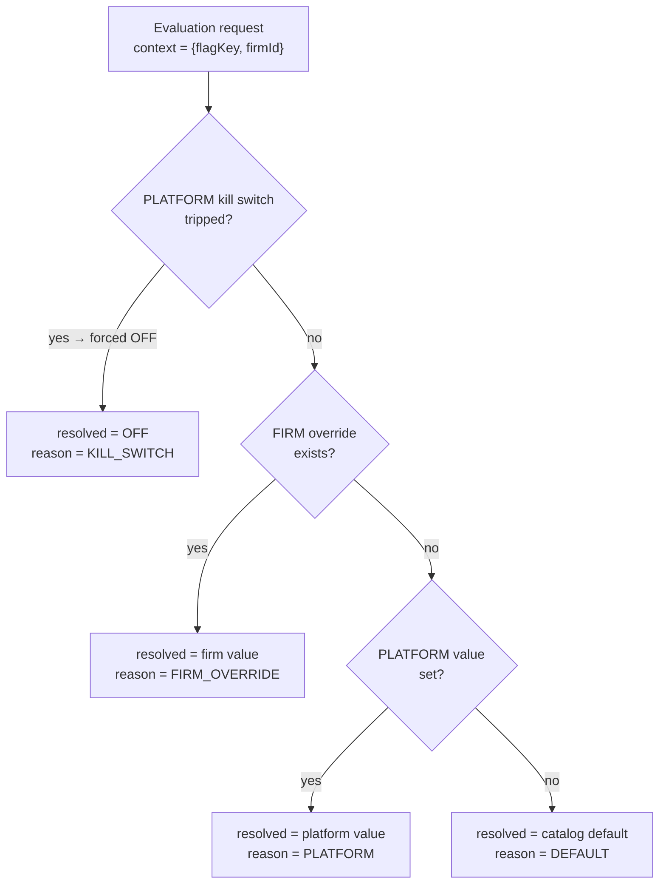
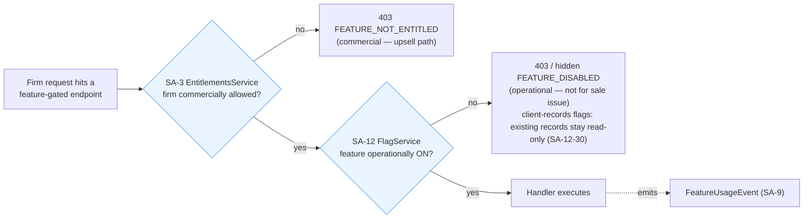
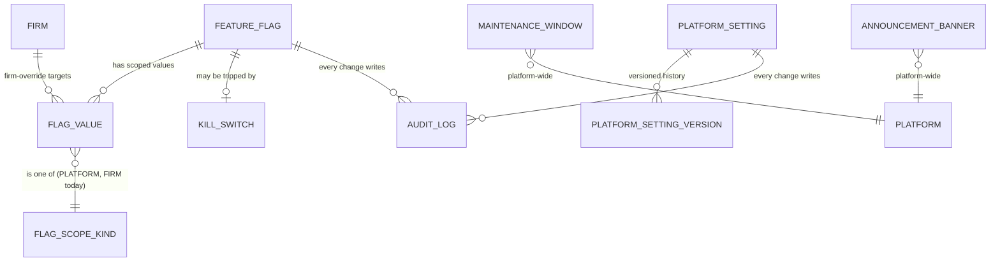

> **Document control** · Version **2.9** · **2026-10-12** · Status: **the product owner's 12 Oct Rule 9 pass and session-2 decisions applied (flag screens, fixed security-settings form, bilingual maintenance message, banner simplified, "Data erasure" flag, role names, §13 closures); earlier 10–12 Oct decisions (R14 and its code check, mock-screen decision, R32, R15 / O26 withdrawn, spec follows code) unchanged**\
> Part of: *Super Admin Console — Functional Requirements* · Split from `FINAL-SuperAdmin-FR.md` lines 6911–7484 on 2026-09-16 · Previous version: `_archive/SA-12-feature-flags-and-platform-configuration_v2.8_2026-10-12.md`\
>
> *21 Oct 2026 (final hand-over check of AG-02): §13 gains the block "Pending from the AG-02 review" (AG02-P123, P124). Not re-versioned.*
>
> | Version | Date | Change | Decisions |
> |---|---|---|---|
> | 2.9 | 2026-10-12 | Applied the product owner's 12 Oct Rule 9 pass for SA-12 and session-2 decisions. **Rule 9 placement:** every kept setting now states its default and placement (Main / Advanced / code or deploy configuration) in a new §3.11 "Settings — defaults and placement". **Maintenance (§3.7, SA-12-20, §7):** the message is **bilingual** (English and French). **Banner (§3.8, SA-12-23, §7):** the **link is dropped**; one active banner at a time; severity info / warning (default info) and dismissible sit under Advanced; "critical" removed. **Security settings (§3.6, SA-12-27, -28, SA7-X6 row):** a **fixed form, not a typed editor** — staff email domains and the auto-logout values (two numbers) under Advanced, **Owner only**; **password rules and the invite link are removed** from SA-12 (deploy configuration or code; R9-21). **Flag screens (R9-33; §3.1, §3.2, SA-12-3, new SA-12-34):** plain feature name and "what Off does" first; key, owner and lifecycle under Advanced; "why is this on for this firm" as a sentence; **flag metadata is read-only in the console** and changes by release (as built; v2.8 text about editing metadata corrected). **R9-34 (§3.4, new SA-12-33):** the erasure job runs under a kill-switch-eligible flag **"Data erasure"**, on by default, and is stopped by tripping its kill switch (reuses the built kill switch, no new setting; SA-11-16). **SR-Q3 / SR-Q4(3):** "Platform Engineer / DevOps" is not a console role — toggle, maintenance and kill belong to the roles that hold the built keys; operational settings (`system/platform-config:manage`) are Owner only; built flag keys described as built (§2, §10, stories). **R9-7:** the shared team inbox address is deploy configuration, not an SA-12 setting. **§13 closures:** Q3, Q4, Q5, Q6, Q8, Q9, Q10, Q11, Q12, Q13, Q14, Q15, Q16 (see the decision IDs there); new open items Q17 and Q18 added, not decided. **IDs:** changed SA-12-3, -9, -10, -12, -17, -19, -20, -23, -24, -26, -27, -28, -29, -30, -32; added SA-12-33, -34; none newly withdrawn or parked. Decision log SA12-D10 – SA12-D13 added (SA12-D7, -D8 marked changed); §0.2 rows SA5-X38, SA12-X1, -X2, -X4 changed and SA12-X9, -X10 added (Pending). **Same-day revision (W-1 – W-3, the product owner, 12 Oct):** W-3(7) Admin holds `system/flag:manage` as built; W-3(8) "Stop data erasure" flag default off, platform scope only, Q18 closed; W-3(9) overlapping banners refused at scheduling, Q17 closed; W-3(10) banner dismissible by default yes (§3.11). **Same-day revision (W-4 – W-10, the product owner, 12 Oct):** W-8 completes the "Stop data erasure" flag details (key naming, does not cover client records, default off, platform-wide; SA-12-33, §13 Q18, §12). **Same-day revision (W-11 – W-21, the product owner, 12 Oct):** W-11 the erasure flag is "Data erasure", **on by default**, and the emergency stop is to trip its kill switch with a reason (replaces the "Stop data erasure, default off" wording of W-3(8) / W-8); W-21 text fixes — rate limit decided (100 requests / 60 s per IP), new `system/flag:manage` row (Owner and Admin, as built), Billing holds no flag key, maintenance and banner keys are Owner only, `feature.*` keys marked illustrative. *Same-day fixes (18 Oct): AG16-90 — government-deadline countdown points removed from the firm-editable lists in SA-12-32, SA12-D7 and SA12-X6; the client deadline reminders are a fixed formula with no setting (AG16-77).* *18 Oct: new section 'Decisions that change this epic' (index of AG16 decisions; no requirement changed).* *18 Oct (later): check fix — the auto-logout developer flag is closed: the built policy reads the staff pool only (`session-lifetime.ts:41-45`); AG01-29(1) wording.* | Rule 9 pass (SA-12); R9-21; R9-33; R9-34; R9-7; SR-Q3; SR-Q4(3); SA05-Q14; map §17 #4 |
> | 2.8 | 2026-10-12 | Applied the product owner's 10–12 Oct decisions. **R14 kept (matches the built code):** flags with **two scopes — platform on/off + a per-firm override** (`feature-flag.ts:15-23` `FlagScopeSchema = PLATFORM \| FIRM`; `flag-admin.controller.ts`; global settings store `platform-setting.controller.ts`); the server-side flag-AND-plan check; "why is this on for this firm"; kill switch with a reason; **platform-wide** maintenance mode with a message; **one platform banner** (EN/FR, start/end); every change audited; **no flag can switch off security** (SA-12-26); the client-records read-only rule (SA-12-30); the **scope-kind field stays in the data** (new SA-12-31) so scopes can be added later. **Parked (one line each, SA12-D3):** percentage rollouts, sticky hashing, allow / deny lists and the rollouts dashboard (SA-12-13, -14); user and country scopes (and the plan scope, which now comes from the SA-3 entitlement); the settings registry beyond the SA-7 security settings (SA-12-17, -19; rest = code / deploy config); per-firm rate and upload limits (SA-12-24); per-firm maintenance and bypass tokens (SA-12-21); per-firm banners. **Mock-screen decision:** maintenance and banners are **platform-wide only**; per-firm maintenance, bypass tokens and per-firm banners are removed from the screens (SA-12-20, -22, -23). **Clean-up (R14):** the "firm override to close a deal / paid trial" text removed everywhere (§1, §2, §3.2, US-3, Q5) — it contradicted SA-12-10 and SA3-D6. **R32:** the upload size limit is not an SA-12 setting (built constants 25 MB documents / 10 MB images, `upload-validation.ts:44-60`; new SA-12-32). **R15 / O26:** firm-editable timings are firm settings, not platform constants; SA5-X38 ("fixed in code now") is superseded. **Spec follows code (12 Oct):** step-up window fixed 5 minutes in configuration; staff auto-logout is one editable policy under `system/platform-config:manage` and stays off for firm users and clients (SA-12-27, -28). **IDs:** changed SA-12-1, -4, -10, -17, -19, -20, -22, -23, -25, -27, -28; parked SA-12-13, -14, -21, -24; added SA-12-31, -32. Decision log SA12-D1 – SA12-D9 and §0.2 rows SA12-X1 – SA12-X8 added; SA5-X38 marked applied (as superseded). §13: Q1, Q2, Q5, Q7 withdrawn; Q3, Q4, Q6, Q8 kept or reworded; Q9 – Q16 added (all "not decided"). | R14; code-check outcome; mock-screen decision; R32; R15; O26 (withdrawn); spec follows code; SA5-X38 |
> | 2.7 | 2026-10-08 | Session knock-on from SA-07 v2.10 (the product owner, 8 Oct): a firm has no session setting (Agent AG-16-23 withdrawn). The auto-logout setting text no longer points to a firm policy, and states that firm users and clients have no timer and no fallback timeout. Requirement IDs unchanged. | SA7-D67 |
> | 2.6 | 2026-10-03 | Consistency review fixes (3 Oct): AC-4a and AC-4b rewritten with `feature.eSign`, a flag that does not cover client records (`feature.corporate` is on in every plan, so a firm can never be "not entitled" to it, and a switched-off corporate flag keeps reads served, AC-4c); per-firm overrides are for operational or emergency use only, never to close deals or grant a paid feature (SA-12-10, §10 permission row and role mapping, SA3-D6); new "Applied from AG-17" table. No requirement IDs added. | AG17-D35, AG17-D37, AG17-D59, AG17-D69 |
> | 2.5 | 2026-10-02 | **General client-records rule (founder decision):** every catalog entry declares whether the flag covers client records. When such a flag is off (any scope, including the platform kill-switch), the feature's existing client records stay visible read-only (view and download; no changes, no new records), a banner explains, and deadline and expiry reminders never pause. Flags that do not cover client records behave as before. New SA-12-30, BR-18, AC-4c; SA-12-1, SA-12-9, SA-12-11, SA-12-12, BR-9, `FeatureFlag` entity and §3.0, §3.1, §3.4 text changed. `feature.corporate` is a flag that covers client records and, per firm, is an emergency off-switch only, never a commercial grant (consistent with SA-3-42). | AG17-D35, AG17-D37, AG17-D69 |
> | 2.4 | 2026-10-02 | Example flag key `feature.lmia` replaced by `feature.corporate` (neutral key); AC-4a/4b "LMIA endpoint" → "a corporate endpoint". Flag behaviour unchanged. | AG17-D7, AG17-D35 |
> | 2.3 | 2026-10-02 | SA-7 role names used throughout (SA7-X10, SA7-D8): "Tenant Account Manager" → "Firm onboarding / Account manager", "Billing Admin" → "Billing". Requirements unchanged. | SA7-X10 |
> | 2.2 | 2026-10-02 | Auto-logout scope changed (the product owner, 2 Oct): the auto-logout setting (SA-12-28) applies to Expat Ready staff only; firm users and clients are not auto-logged out by the platform, and a firm's own session policy lives in Agent AG-16-23. | SA7-D66 |
> | 2.1 | 2026-10-01 | Applied from SA-07 v2.6 (the product owner, 1 Oct): the configuration registry holds the settings SA-7 uses (staff email domains, invite-link validity, step-up window, password rules, auto-logout) and these security settings are Owner-only; new SA-12-27 – SA-12-29; SA-12-19 changed; edge cases and §10 role note added (SA7-D24, SA7-D28, SA7-D29, SA7-D33, SA7-D54). | SA7-X6 |
> | 2.0 | 2026-06-20 | Baseline — golden per-module rebuild | — |

## Decisions that change this epic (14–18 Oct) *(new 18 Oct)*

Product-wide rules (apply here as everywhere; home: Agent `00-Overview` → "Product rules every epic follows"): none cited in this document.

The "AG16" prefix is historical: these decisions began in the AG-16 review and apply across the product. Full text: `TEMPLATE-MAP-working_2026-10-10.md`.

| Decision | What was decided (one line) | What it changes in this epic | Where (requirement / card / section) |
|---|---|---|---|
| AG16-77 | Client deadline reminders by formula: two reminders at 50% and 90% of the window. | The government-deadline countdown points are removed from the firm-editable timing lists; client deadline reminders are a fixed formula with no setting. | SA-12-32, SA12-D7, SA12-X6 (§0.2 rows R15 and O26), §4 firm-editable timings |
| AG16-90 | Batch C: consistency fixes from the 17 Oct audit. | The government-deadline countdown points are taken out of the firm-editable lists in SA-12-32, SA12-D7 and SA12-X6 (marked "changed 18 Oct"). | SA-12-32, SA12-D7, SA12-X6 (§0.2, §4) |

## Module SA-12: Feature Flags & Platform Configuration

> **What this document is.** The reference-depth specification for one Super Admin module: how each function works, the screens, the data flows, the states, the rules, the edge cases, and an honest account of what the current code does versus what must still be built. Where the code already exists, this document describes the build and cites the file (rule 8: spec follows code). Where this differs from the v1.0 summary in `2026-06-20-ExpatReady-SuperAdmin-Functional-Requirements.md` (§15 / SA-12), **this document is the intended build depth**.
>
> **Plane:** GLOBAL (Super Admin owned). Feature flags and platform configuration are platform-wide control-plane state that firms *experience* but never edit. **Tools:** in-house only — there is **no third-party flag vendor**; the flag engine is built in-house and is server-authoritative. **Two scopes (R14):** a flag has a **platform** value and an optional **per-firm override**; user, country and plan scopes are parked (the plan comes from the SA-3 entitlement). **Sits beside** SA-3 (Subscription Plans & Entitlements — the *commercial* allowance) — SA-12 owns the *operational* on/off — and consumes SA-2 (the firm a firm-override targets), SA-6 (the `system/*` permission catalog that gates who may flip a flag), and SA-11 (the immutable audit log every flag and config change is written to).
>
> **The one-sentence framing.** *An **entitlement** (SA-3) answers "is this firm commercially allowed to have this feature?"; a **flag** (SA-12) answers "is this feature operationally turned on right now, for this firm?" — a request is served only when **both** say yes, and the resolved answer is computed server-side, cached, and audited.*

---

## Module SA-12: Feature Flags & Platform Configuration

**Applied from AG-17 (corporate case, 2026-10-02 / 2026-10-03)**

| ID | Decision | Applied here |
|---|---|---|
| **AG17-D7** | Neutral flag key `feature.corporate` (no immigration terms in code) | §3.1 example keys |
| **AG17-D35** | Corporate is in every plan; the per-firm switch is an emergency off-switch only, never a commercial grant | SA-12-10 · §3.1 · AC-4a, AC-4b · §10 |
| **AG17-D37** | Emergency switch-off = read-only, reminders keep running | SA-12-30 · BR-18 · AC-4c |
| **AG17-D59** | Corporate is on for every plan, so no firm is ever "not entitled" to it | AC-4a, AC-4b |
| **AG17-D69** | General rule: a flag that covers client records, when off, makes them read-only, never hidden; reminders never pause | SA-12-1, SA-12-9, SA-12-11, SA-12-12, SA-12-30 · BR-9 · BR-18 · AC-4c · `FeatureFlag` entity |


| ID | Decision | Applied here |
|---|---|---|
| SA7-X6 *(changed v2.9 — R9-21, Rule 9 pass)* | The configuration registry holds the settings SA-7 uses in a **fixed form**: approved staff email domains and the auto-logout values (60 minutes idle / 12 hours maximum), under Advanced, Owner only. **Not console settings:** invite-link validity (72 hours, deploy configuration), step-up window (fixed 5 minutes in configuration — v2.8), password rules (minimum 12 is deploy configuration; character mix and last-5 reuse are in code, to build — R29). | SA-12-27, SA-12-28 |
| SA7-D54 *(changed v2.9 — SR-Q3, SR-Q4(3))* | Security settings are Owner-only; operational settings (`system/platform-config:manage`) are Owner only too. "Platform engineer" is not a console role; flag, maintenance and kill actions go to the roles that hold the built keys. | SA-12-27, SA-12-29 · §9 · §10 · SA-12-19 changed |
| SA7-D24, SA7-D28, SA7-D29, SA7-D33 | Password rules *(v2.9: fixed rules, not a setting — R9-21)*, one auto-logout setting, auto-logout never off in production, go-live values 60 minutes / 12 hours *(v2.8: the auto-logout setting is one editable policy under `system/platform-config:manage`; spec follows code — SA12-D8)*. *(SA7-D28 changed v2.2 — SA7-D66: the setting is for Expat Ready staff only.)* | SA-12-28 |

**Decision log (v2.8, 2026-10-12)** *(IDs permanent; the product owner's decisions of 10–12 Oct applied to this module)*

| ID | Decision | Applied here |
|---|---|---|
| **SA12-D1** | **R14 — kept.** Flags with platform on/off + per-firm override; the server-side flag-AND-plan check; "why is this on for this firm"; kill switch with a reason; platform-wide maintenance mode with a message; one platform banner (EN/FR, start / end); every change audited; no flag can switch off security; the client-records read-only rule. | SA-12-1 – SA-12-12, -15, -16, -20, -22, -23, -25, -26, -30 · §3.0 – §3.5, §3.7, §3.8, §3.10 |
| **SA12-D2** | **Two scopes, scope-kind field kept (R14; spec follows code).** The built catalog allows `PLATFORM` and `FIRM` only (`feature-flag.ts:15-23`); the scope-kind field stays in the data so scopes can be added later. The plan gate is the SA-3 entitlement, not a flag scope. The built catalog is keyed by `capabilityKey` (AD-1), not `feature.*` (`feature-flag.ts` header). | SA-12-1, -2, -4, -31 · §3.2 · §7 |
| **SA12-D3** | **Parked by R14** (one line each, table below): percentage rollouts, sticky hashing, allow / deny lists, rollouts dashboard; user and country scopes; settings registry beyond the security settings; per-firm rate and upload limits; per-firm maintenance and bypass tokens; per-firm banners. | SA-12-13, -14, -17, -19, -21, -24 · §3.4, §3.6, §3.9 |
| **SA12-D4** | **Clean-up (R14).** A firm override is an operational or emergency exception only. The text "firm override to close a deal / paid trial" is removed everywhere; it contradicted SA-12-10 and SA3-D6. | §1 · §2 · §3.2 · US-3 · §13 (Q5 withdrawn) |
| **SA12-D5** | **Mock-screen decision (R14).** The maintenance and announcement screens (frontend, sample data) are **platform-wide only**: a platform maintenance window with a message, one platform banner (EN/FR, start / end). Per-firm maintenance, bypass tokens and per-firm banners are removed from the screens. | SA-12-20, -22, -23 · §3.7, §3.8 |
| **SA12-D6** | **R32.** The upload size limit is not an SA-12 setting; it stays the built constants 25 MB for documents and 10 MB for images (`upload-validation.ts:44-60`). | SA-12-32 · §3.9 |
| **SA12-D7** *(changed v2.9 — SA05-Q14)* | **R15; O26 withdrawn.** The firm-editable timings listed in R15 — ~~government-deadline countdown points~~ (removed from this list *(changed 18 Oct — AG16-90); the client deadline reminders are a fixed formula with no setting — AG16-77)*, document and questionnaire chase cadence, the AG-16 §3.13 timings, signing-reminder days, overdue-invoice reminder days, booking-reminder timing per appointment type, the paid-booking hold — are **firm settings** set in the firm modules (or product defaults those settings start from), **not** platform constants and not SA-12 settings. SA5-X38 ("fixed in code now, ExpatReady-admin-adjustable later") is superseded. The length of the 7-day notice is not in R15's list; it is a **code constant** (SA05-Q14; §13 Q15 closed v2.9). | SA-12-32 · §0.2 |
| **SA12-D8** *(changed v2.9 — SR-Q4(3))* | **Spec follows code (12 Oct).** The step-up window is a fixed 5 minutes held in configuration (`SELF_STEP_UP_ATTESTATION_TTL_SECONDS`, `env.schema.ts:86,529-534`), not a console setting. Staff auto-logout is **one editable policy** (`SessionTimeoutPolicy`: idle + absolute minutes, DISABLED / ENFORCED) under `system/platform-config:manage`; it **must stay off for firm users and clients** (SA7-D67 — flag to developers). *(v2.9: `system/platform-config:manage` is Owner only, as coded — SR-Q4(3), §13 Q9.)* | SA-12-27, -28 |
| **SA12-D9** | **No per-template emergency stop here.** An error in an ExpatReady template is fixed through the urgent correction in SA-05 (Q14, Q15); SA-12 has flag kill switches only. | §13 |
| **SA12-D10** *(v2.9)* | **Rule 9 pass for SA-12.** Every kept setting has a default and a placement: **Main** (flag on / off, kill switch, firm exceptions, platform maintenance with a bilingual message, banner message and dates), **Advanced** (banner severity and dismissible; security settings — staff email domains and auto-logout), **code / deploy** (rate limit 100 req / 60 s per IP, upload limits, step-up 5 minutes, invite link, password minimum, shared team inbox address). Security settings are a fixed form, not a typed editor; password rules and the invite link are removed from SA-12 (R9-21). The shared team inbox address is deploy configuration, set once at go-live (R9-7). Table in §3.11. | §3.6 · §3.7 · §3.8 · §3.11 · SA-12-27, -28 |
| **SA12-D11** *(v2.9)* | **Flag screens (R9-33).** Flag list and detail lead with the plain feature name and "what Off does"; key, owner and lifecycle sit under Advanced; "why is this on for this firm" is a sentence. Flag metadata is **read-only in the console** and changes by release (as built). | §3.1 · §3.2 · SA-12-3, -34 |
| **SA12-D12** *(v2.9)* | **Erasure stop switch (R9-34, G-Q1).** The data-erasure job runs under a **kill-switch-eligible flag "Data erasure"** (on by default); the emergency stop is to **trip its kill switch** with a reason, reusing the built kill switch — no new setting (SA-11-16) *(revised same day — W-11)*. | §3.4 · SA-12-33 |
| **SA12-D13** *(v2.9)* | **Roles (SR-Q3, SR-Q4(3)).** "Platform Engineer / DevOps" is not a console role. Toggle, maintenance and kill go to the roles that hold the built keys; operational settings are Owner only. Built flag keys (`system/feature-flag:*`, `system/flag:kill`) are on the Platform Owner; `flag:manage` is also on Admin, **as built** (`role-template.platform.ts:204`) *(revised same day — W-3(7))*. Described as built — no new grants. | §2 · §10 · stories |

**Parked for later (rule 8)** *(one line each, so they can be found)*

| Item | Why parked | Comes back when |
|---|---|---|
| Percentage rollouts, sticky hashing, pause / rollback, allow / deny lists, rollouts dashboard (old SA-12-13, -14, §3.4 second half) | A few dozen firms; firm overrides on internal and demo firms do the dark launch (R14). | If the firm count makes a percentage meaningful |
| User and country scopes (old precedence levels 1 and 4; BR-15) | One country today (SA8-D8); not built (`feature-flag.ts:15-17`). Scope-kind field stays in data. | With a second country or a need for per-user flags |
| Settings registry beyond the SA-7 security settings; per-plan / per-firm / per-environment setting values (old SA-12-17, -19, §3.6) | Rest = code / deploy config (R14). Built store is global with revisions only (`platform-setting.controller.ts:70-91`). | On demand |
| Per-firm rate-limit overrides (old SA-12-24, §3.9) | R14; serves high-volume firms only. | On demand |
| Per-firm upload limit (old US-7) | R14 and R32: constants in code. | On demand |
| Per-firm maintenance and bypass tokens (old SA-12-21, §3.7) | R14; rare, adds token security work. | On demand |
| Per-firm banners (old §3.8) | R14; one firm is reached by email or support. | On demand |
| Recording "a paid feature was killed for N firms" for billing (old Q6) *(changed v2.9 — §13 Q6 closed)* | No record beyond the audit entry (Rule 9 pass). | On demand |

#### 0.2 Cross-module rows

**Rows INTO this module** *(applied in v2.8)*

| ID | From | What | Source | Status |
|---|---|---|---|---|
| **SA5-X38** | SA-05 v3.1 | O26: the countdown points, the 7-day notice length, the dunning defaults and the signing-reminder defaults are fixed in code now; admin-adjustable later | O26 | *(changed by AG16-77: the countdown points are now a fixed formula, not a firm setting — 18 Oct, AG16-90)* **Applied v2.8 as superseded** — O26 is withdrawn by R15 (SA12-D7): the countdown points, dunning days and signing-reminder days are firm-editable timings set in the firm modules, none an SA-12 platform constant or registry setting; the 7-day notice length is a code constant (SA05-Q14; §13 Q15 closed v2.9). SA-05 must withdraw SA5-X38 itself (SA12-X7) |

**Rows FROM this module to others** *(all Pending)*

| ID | Target | What changes | Source | Status |
|---|---|---|---|---|
| **SA12-X1** *(changed v2.9 — Q12)* | SA-06 | Keys of SA-12 §10: `system/feature-flag:toggle` no longer covers rollouts; `system/maintenance-mode:toggle` no longer covers per-tenant maintenance or bypass tokens; `system/announcement:manage` is platform-wide only; `system/platform-config:manage` also carries the staff auto-logout policy (built) and is Owner only. **Built keys kept; one key each for maintenance and banner** (§13 Q12 closed); no consolidation. | R14; SA12-D8; Rule 9 pass | Pending |
| **SA12-X2** | SA-07 | Staff auto-logout is one editable policy under `system/platform-config:manage`, applied to the pools by the built policy, and stays off for firm users and clients (SA7-D28, SA7-D29, SA7-D33, SA7-D66, SA7-D67 wording); step-up window is a fixed 5 minutes in configuration (SA7-X6); build state of password rules (R29: character mix and last-5 reuse not built). `system/platform-config:manage` is Owner only (§13 Q9 closed). **v2.9:** invite-link validity and password rules are no longer SA-12 settings (deploy configuration / code, R9-21); only staff email domains and auto-logout stay in the console. | spec follows code; R29; R9-21; SR-Q4(3) | Pending |
| **SA12-X3** | SA-03 | No flag scope for plan: the plan gate is the SA-3 entitlement ANDed with the flag. Confirm SA-3 text that mentions a flag PLAN scope or a firm override to grant a feature (SA3-D6, SA-3-42). | R14 | Pending |
| **SA12-X4** | SA-02 | The firm account view lists a firm's flag overrides as operational or emergency exceptions; remove any text about per-firm maintenance, per-firm rate limit, per-firm banners or granting a feature with an override. **v2.9:** overrides are never auto-expired; overrides older than 30 days are highlighted on the account view (§13 Q5). | R14; SA12-D4; Rule 9 pass | Pending |
| **SA12-X5** | SA-08 | R32: emergency "off" for a mailbox or WhatsApp provider is the kill switch of SA-12; name the flag keys. Upload size limit stays a constant (25 MB / 10 MB) and is not a platform setting. | R32 | Pending |
| **SA12-X6** | AG-16, AG-11, AG-06, AG-05 | Firm-editable timings (R15) are firm settings; make sure none of these documents calls ~~the countdown points,~~ the 7-day notice, dunning days or signing-reminder days "platform constants" or "fixed in code". | R15; O26 withdrawn | Pending *(changed 18 Oct — AG16-90: the countdown points are not firm-editable; they are a fixed formula with no setting — AG16-77)* |
| **SA12-X7** | SA-05 | Withdraw row SA5-X38 and correct the §0.1 line "Admin-adjustable default timings — O26 fixed in code now — Later release (SA5-X38)". | R15 | Pending |
| **SA12-X8** | 00-Overview | SA-12 summary row: flags have two scopes (platform + per-firm), platform-wide maintenance and one banner; the rest parked. | R14 | Pending |
| **SA12-X9** *(v2.9)* | SA-11 | SA-11-16 refers to the "Data erasure" flag defined here *(revised same day — W-11)* (SA-12-33); SA-11 is updated in the same round (SA11-X11). | R9-34; G-Q1 | Pending |
| **SA12-X10** *(v2.9)* | SA-07 | Appendix A / SA7-X6 text: invite-link validity and password rules are not SA-12 settings; "Platform engineer" is not a console role (SR-Q3); operational settings are Owner only (SR-Q4(3)). | R9-21; SR-Q3 | Pending |

### Module Index

Scan the whole module in ~30 seconds; jump to any part.

1. **Purpose & Goal**
2. **Users & Jobs-to-be-Done**
3. **Functional Design — How It Works** (core)
   - 3.0 The flag vs entitlement model (the foundation) · 3.1 Flag catalog (typed, seeded, self-describing) · 3.2 Flag scopes & **resolution** (kill switch → firm override → platform value → default) · 3.3 The **`FlagService` evaluation engine** (server-authoritative, cached, composes with SA-3) · 3.4 **Kill switch** (rollouts parked) · 3.5 Safe-change tooling (explain / preview / history / revert) · 3.6 Security settings (settings registry beyond them parked) · 3.7 Platform-wide maintenance mode · 3.8 Platform banner · 3.9 Rate limits & upload limit (per-firm parked) · 3.10 Audit of every flag & config change · 3.11 Settings — defaults and placement
4. **Detailed Functional Requirements** (SA-12-n)
5. **Business Rules & Logic**
6. **States & Lifecycle**
7. **Key Entities & Fields**
8. **User Stories + Acceptance Criteria** (GWT)
9. **Edge Cases & Validations**
10. **Permissions** (GLOBAL `system/*` — honest)
11. **Scalability · Security · Performance** (per function)
12. **Reference Note** (exists / NEW / changed — scrupulously honest)
13. **Open Questions / Founder Decisions**

### Visual Overview

**A. Flag resolution** (a flag is evaluated for one request-context by walking the scopes from narrowest to broadest; a tripped kill switch short-circuits everything):



> **Read top-down = narrowest-wins, except the kill switch.** The PLATFORM kill switch is the *only* thing that overrides downward (a safety brake, deliberately un-overridable by a firm override). Below it, the firm override beats the platform value; if nothing is set, the catalog default applies. **Precedence is data-deterministic and unit-tested.** User, country, plan and percentage-rollout levels of v2.7 are parked (SA12-D3); the plan gate is the SA-3 entitlement (diagram B).

**B. Flag ∧ Entitlement composition** (the two control planes are *anded* — SA-12 never bypasses SA-3, and SA-3 never bypasses SA-12; a feature is live only when the commercial gate **and** the operational gate both pass):



**C. Configuration & control-plane data model** (a flag is one catalog row with a platform value and optional firm overrides; the security settings are a small typed, versioned registry; maintenance and the banner are platform-wide; everything writes to the shared audit log):



> `FlagValue` is the join row carrying one value at one scope: `(flagKey, scopeKind, scopeRef?, value, reason/note)`. `scopeKind` is `PLATFORM` (`scopeRef` null) or `FIRM` (`scopeRef` = `firmId`); the field stays an enum so user, country or plan scopes can be added later without reshaping data (R14). `AuditLog`, `Notification` are the cross-cutting Part-2 modules — defined once, **reused**, never redefined here.

---

### 1. Purpose & Goal

**What it is.** SA-12 is the platform's **control plane for behaviour and configuration** — the single, governed place where ExpatReady's own team turns features on and off, kills a misbehaving feature, declares platform-wide maintenance, publishes a platform banner, and holds the few security settings the SA-7 staff rules need (staff email domains and auto-logout) — **all without a code deployment, all server-authoritative, all audited.** It is the difference between "we have to cut a release and redeploy to change anything" and "an authorised operator flips a governed switch, the change is effective in seconds, and there is an immutable record of who did it and why."

**The business outcome it must produce.** A multi-tenant SaaS that serves immigration firms cannot ship like a hobby project. SA-12 exists to make three things structurally true:
1. **Safe releases.** A risky feature ships dark (off for the platform), is turned on for internal and demo firms through firm overrides, then switched on for everyone — and can be **instantly killed** if it misbehaves, without a rollback deploy or downtime. The blast radius of a bad change is a config flip, not an outage. *(Percentage rollouts are parked — SA12-D3.)*
2. **Operational exceptions without code forks.** If one firm must have a feature forced off (an emergency, an abuse case) or forced on for an operational reason (testing a fix on an internal firm), a **firm override** does it with a visible reason. A firm override is **never** used to grant a paid feature or to close a deal; what a firm may use commercially stays with SA-3 (SA-12-10, SA3-D6).
3. **Operable platform.** Maintenance can be declared platform-wide with a clean 503 and a human message, and a platform banner can warn every firm of Saturday's window — as configuration, by the people who operate the platform, with a trail.

**Why it matters / positioning.** Every serious SaaS has a flag system; the bar here is **flags that are correct, safe, and honest about the two planes.** The most common way teams get this wrong is **conflating the commercial gate (entitlement) with the operational gate (flag)**. ExpatReady separates them cleanly (Section 3.0): SA-3 owns *"allowed to buy/have,"* SA-12 owns *"turned on right now,"* and a request passes only when **both** agree. The second differentiator is **server-authoritative evaluation** — the flag value is decided in the API, never trusted from the client. The third is **a kill switch as a first-class citizen**.

**Honest grounding.** *(Changed v2.8 — spec follows code.)* A real flag system **is built** for the core: the catalog (`FeatureFlag`, `FEATURE_FLAG_CATALOG`), platform and per-firm values, kill switch, per-firm pin, value history and revert, all wired to the real API and the real flag screen (§12). Scopes are `PLATFORM` and `FIRM` only. **Not built:** maintenance mode, the platform banner, and anything in the parked list.

**How it ties to the platform.** SA-12 is consumed by *every* other module: SA-3's `EntitlementsService` and SA-12's `FlagService` produce the final allow/deny; SA-2's firm account view surfaces a firm's overrides; SA-9 reads `FeatureUsageEvent` to show adoption; SA-11 stores every change. It is small in surface area and large in leverage.

---

### 2. Users & Jobs-to-be-Done

SA-12 is operated by the ExpatReady staff roles that hold the flag keys (the built flag keys are on the Platform Owner; `flag:manage` is also on Admin, as built — SR-Q3, W-3(7)); "Platform Engineer / DevOps" is not a console role. Firms only *experience* its effects (a feature appears, a banner shows, maintenance is on). JTBD framing keeps the design honest about what each operator is actually trying to do.

| Role (Super Admin sub-role) | Primary job in SA-12 | Jobs-to-be-done (representative) |
|---|---|---|
| **Platform Owner and Admin — whoever holds the flag keys** *(replaces "Platform Engineer / DevOps", not a console role — SR-Q3; heaviest user)* | Ship changes safely; keep the platform operable. | "When I launch a risky module, I want it off for the platform and on for the internal and demo firms through firm overrides, so a bug hits a handful of internal firms, not all of them." · "When something is on fire, I want a single kill switch that forces a feature OFF platform-wide in one click, overriding every firm setting, so I can stop the bleeding without a deploy." · "When I run a risky data migration, I want to put the **platform** into maintenance with a clear message and an expected end." |
| **Platform Owner** | Own platform policy, the riskiest switches and the security settings. | "When I review the control plane, I want to see every flag, its current resolved state, and who changed it last, so nothing is on or off by accident." · "When a kill switch is tripped, I want it audited with a reason and a confirm step, because a platform-wide off is a serious act." *(single holder + confirm + reason + audit; no second person — §13 Q3 closed)* |
| **Admin (account-manager duties)** *(role name changed v2.9 — SR-Q3, SR-Q4(9))* | Unblock a firm operationally; never grant paid features. | "When a firm abuses a feature, I want to force it OFF for them specifically, with a reason, until the issue is resolved." · "When I support a firm, I want to see which flags are overridden for it and why." A firm override is **not** a way to give a prospect a feature early or to close a deal (SA-12-10, SA3-D6). |
| **Billing** *(holds no flag key — W-21)* | Keep the commercial / operational line clean. | "When I look at a firm-level override, I want it clearly marked as an *operational or emergency exception* (not an entitlement), so it shows up for review and nothing is silently granted." |
| **Firm staff / client** (subjects, not operators) | — (experience only) | "When maintenance is on, I want a clear message and an end time, not a broken screen." · "When a feature I'm not entitled to is hidden, I want a clean upsell, not a 500 error." |

**Design implication.** The operator who holds the flag keys is the protagonist of the UI — the flag list, the firm-override action, the kill switch, and platform maintenance are designed for fast, safe operation under pressure, in plain words first (R9-33). The Admin gets the firm-override surface (a focused, reason-required action from the firm's account view). The Platform Owner gets the audit / oversight view, the confirm step on the most dangerous switches and the security settings. Permissions (Section 10) separate "view flags" from "toggle a normal flag" from "trip a kill switch" from "manage platform config" from "toggle maintenance mode" — because these are very different levels of blast radius.

---

### 3. Functional Design — How It Works (core)

This is the heart of the spec. Each sub-function is designed in depth: **how it works**, the **smart / world-class behaviour** that makes it correct and safe, the **key screens & interactions** (functional, not pixel-level), and the **data flow**.

#### 3.0 The Flag vs Entitlement Model (the foundation everything else sits on)

**Design decision: a feature is governed by two independent, *anded* gates.** This is the single most important decision in the module and the one most teams get wrong.

- **Entitlement (SA-3) = the *commercial* allowance.** "Is this firm, on its current plan, *allowed to have* this feature?" Owned by `EntitlementsService` (SA-3 §3.6). A *no* here is a **commercial** answer → `403 FEATURE_NOT_ENTITLED` → the right UX is an **upsell** ("upgrade to unlock").
- **Flag (SA-12) = the *operational* on/off.** "Is this feature *turned on right now*, for this firm?" Owned by `FlagService`. A *no* here is an **operational** answer (we're dark-launching it, it's killed, it's off for one firm in an emergency) → the feature is **hidden / `FEATURE_DISABLED`** (a killed feature shows a soft **"Temporarily unavailable"** — §13 Q8), *not* an upsell — it's not a "buy it" problem. **Exception *(changed v2.5 — AG17-D69)*:** if the flag covers client records (SA-12-30), "off" never hides the firm's existing records: they stay visible read-only, with a banner, and deadline and expiry reminders keep running.
- **Composition is `AND`, evaluated server-side, in a fixed order:** entitlement first (cheap, commercial), then flag (operational). A feature executes only when **both** pass. **Neither plane may bypass the other** — a flag being ON never grants a feature the firm isn't entitled to, and an entitlement never forces on a feature that's killed. This invariant is unit-tested.

**Why two planes and not one?** Because the questions are genuinely different and change for different reasons. A plan's feature set changes when *commercial packaging* changes (rarely, deliberately, with billing implications). A flag changes when *engineering* needs to dark-launch, roll out, or kill (often, operationally, with zero billing implication). Collapsing them means you cannot dark-launch a feature to internal firms without "selling" it, cannot kill a misbehaving feature without "un-selling" it, and cannot roll out gradually at all. The separation is what makes safe release *possible*.

> **The plan comes from the entitlement (changed v2.8 — R14, spec follows code).** v2.7 gave a flag a PLAN scope that could read through to the plan's entitlement. That scope is gone: the commercial gate is the SA-3 entitlement, ANDed with the flag at the shared guard (diagram B). A flag therefore has only a platform value and an optional per-firm override. The operational machinery — kill switch, firm override, history and revert — is built and real (§12).

#### 3.1 Flag Catalog — "every flag is defined, typed, and self-describing; you can't toggle a typo"

**How it works.** The platform maintains a **`FeatureFlag` catalog** — a defined, seeded list of flag keys, each a first-class, self-describing record. A flag is created **only via the catalog** (seeded by migration; new keys require a code release because a flag with no consuming code is meaningless). **Built (spec follows code):** the catalog is compile-time `FEATURE_FLAG_CATALOG` (16 rows at the 12 Oct check); each entry carries `flagKey`, `name`, `description` (what it gates, and what happens when off), `defaultState` (ON/OFF), `allowedScopes` (a subset of `{PLATFORM, FIRM}`), `killSwitchEligible`, `securitySensitive`, `lifecycleStage` (`EXPERIMENTAL → ACTIVE → DEPRECATED → RETIRED`), and `owner` (`feature-flag.ts`, `FeatureFlagCatalogEntrySchema`). The built `flagKey` **is** the capability key (AD-1: `flagKey = capabilityKey`, validated against `CAPABILITY_REGISTRY` at boot), so the `feature.*` names used as examples in this document (`feature.eSign`, `feature.corporate`) are illustrative, and the real keys are the capability keys. *(changed v2.5 — AG17-D69)* Each entry also declares `coversClientRecords` (yes/no): does this feature hold records about a firm's clients (cases, files, documents, deadlines)? The "what off means" text states which behaviour applies (SA-12-30). `feature.corporate` is declared **yes** *(Illustrative: `feature.eSign` and `feature.corporate` are example flag keys, not the built catalogue keys — §13 Q16; revised same day — W-21)*. **`coversClientRecords` is not in the built catalog schema yet — to add** (§12).

**World-class behaviour.**
- **Flags are typed and constrained, not free-text.** You cannot set a flag at a scope it doesn't permit (a flag declared PLATFORM-only rejects a firm override). You cannot reference a key that isn't in the catalog. This kills the classic "stale/typo flag that does nothing or, worse, half-something" bug.
- **Self-describing for safety.** Every flag's record says *what it gates* and *what off means*, so the engineer flipping it at 2am knows the blast radius without reading source.
- **Stale-flag hygiene is designed in.** Flags carry a lifecycle and an owner (visible under Advanced); a `DEPRECATED` flag surfaces in a "candidates for cleanup" view (a flag that's been 100% ON for 90 days is a removal candidate). Flag debt is visible, not invisible.

**Key screens & interactions.** *(changed v2.9 — R9-33)* *Flag catalog list* leads with the **plain feature name**, whether it is on, and **"what Off does"**; the key, type, lifecycle, owner and last-changed-by/at sit under **Advanced** (filters by lifecycle / owner / scope / state also under Advanced). *Flag detail* (the description, the scope value matrix — see 3.2 — the kill switch, and the change history for *this* flag). Flag metadata is read-only on both screens.

**Data flow.** Catalog seeded by migration → Super Admin **views** *metadata* (description, lifecycle, owner — **read-only in the console**; changed by release, as built — R9-33; not the *values*, which are 3.2) → reads served from cache; a release that changes metadata → audit entry.

#### 3.2 Flag Scopes & Resolution — "the firm override wins, except the kill switch" *(changed v2.8 — R14)*

**How it works.** A flag's *effective value* depends on the **firm** in the request. A flag carries a **platform value** and, optionally, a **per-firm override**. Resolution is strict and data-deterministic (Visual Overview A):

| Precedence (highest first) | Scope | `scopeRef` | When it wins | Typical use |
|---|---|---|---|---|
| 0 (override-down) | **PLATFORM kill switch** | — | If tripped, forces OFF below everything | Emergency stop |
| 1 | **FIRM** | `firmId` | A specific firm has an override | Force a feature off for one firm in an emergency; force it on for an internal or demo firm to test |
| 2 | **PLATFORM** | — | The platform value is set | Normal on / off for everyone |
| 3 (fallback) | **DEFAULT** | — | Nothing else matched | The catalog default |

- **First match wins, most-specific first,** except the kill switch, which short-circuits to OFF. The result is `{ value, reason }` where `reason` names the scope that decided it (`KILL_SWITCH | FIRM_OVERRIDE | PLATFORM | DEFAULT`) — so the system can always **explain** any decision (vital for support).
- **A firm override is an operational or emergency exception.** It is never used to close a deal, to run a paid trial, or to give a firm a paid feature early. Commercial entitlements are SA-3's alone (SA-12-10, SA3-D6, SA-3-42). *(Clean-up, R14 — SA12-D4.)*
- **Scope-kind stays in the data (SA-12-31).** `scopeKind` is an enum with `PLATFORM` and `FIRM` today; user, country and plan scopes and percentage rollouts are **parked** (SA12-D3) and can be added later without reshaping data.

**Behaviour.**
- **The decision is always explainable.** Every resolution returns its `reason`; the "why is this on for this firm" tool shows the walk ("FIRM_OVERRIDE = OFF, set by [operator] on [date], note: 'abuse — under review'").
- **Precedence is code-fixed and unit-tested**, never configuration. Operators set *values*; they never reorder the precedence.

**Key screens.** *Value view* on the flag detail (platform value, the list of firm overrides, kill-switch state), *Resolved-value preview* ("evaluate this flag as firm X" → value + reason). *(R9-33)* "Why is this on for this firm" reads as a **sentence** (for example "Off for Maple: switched off for this firm on 3 Oct — abuse, under review"); the raw reason code sits under Advanced. Firm overrides are listed on the firm's account view, and overrides older than 30 days are highlighted (no auto-expiry — §13 Q5).

**Data flow.** `FlagService.evaluate(flagKey, ctx)` → check kill switch → FIRM → PLATFORM → DEFAULT → return `{value, reason}`; reads served from cache (3.3).

#### 3.3 The `FlagService` Evaluation Engine — "server-authoritative, cached, composes with entitlements"

**How it works.** A single in-house **`FlagService`** is the *only* authority on a flag's value. Three entry shapes:
1. **`evaluate(flagKey, ctx)`** → `{ value, reason }` for one flag (the precedence walk, 3.2).
2. **`bulkEvaluate(ctx)`** → the resolved map of *all* relevant flags for a context — used to hydrate a firm session/bootstrap in one call (so the frontend gets the whole flag map once, not N round-trips).
3. **A guard/decorator** (`@FeatureFlag('feature.x')`, paired with SA-3's `@RequireEntitlement('feature.x')`) on protected endpoints — the **server-side enforcement point** that composes the two planes (Visual Overview B).

- **Server-authoritative, always.** The frontend may *receive* the resolved flag map (to hide/show UI), but **the server re-checks on every gated request** — a client that flips a flag in its own state, or replays an old map, gets nothing. The frontend map is a UX convenience; the guard is the enforcement. (This mirrors SA-3's "frontend gating is a UX complement, not the enforcement layer.")
- **Composition with entitlements.** The guard pair evaluates **entitlement first** (commercial, SA-3) → if no, `403 FEATURE_NOT_ENTITLED`; then **flag** (operational, SA-12) → if no, `403 FEATURE_DISABLED` / hidden. The two distinct codes let the frontend show the right thing (upsell vs nothing).
- **Cached, with immediate invalidation.** Resolution reads from **Redis** (the platform already runs Redis for Bull queues), keyed by `(flagKey, scope-fingerprint)` or a per-firm resolved-map blob with a short TTL. **Any flag change publishes an invalidation** (pub/sub) so all API instances drop the stale value within seconds — satisfying "flag changes are immediately effective, no deploy" without hammering the DB on every request. **Fail-safe on cache/DB outage:** evaluation falls back to the **catalog default** (and logs), never to "throw" — a flag system that takes the platform down when it can't read a flag is worse than the bug it guards.

**World-class behaviour.**
- **One service, one source of truth.** No module re-implements flag logic; they call `FlagService`. (Same doctrine as AG-2's "render, don't re-implement" cross-cutting modules.)
- **Bulk hydration.** A firm's whole flag map is one cached read at session start; per-request guards hit cache, not DB.
- **Explainability is built into the API**, not bolted on — `evaluate` returns the `reason`, so support tooling and logs can answer "why did firm X get this?" instantly.

**Data flow.** Request → guard → `EntitlementsService.resolve` (SA-3, cached) ∧ `FlagService.evaluate` (cached) → allow/deny; flag write (3.2/3.4/3.5) → DB update (transactional) → publish cache-invalidation → audit entry.

#### 3.4 Kill Switch — "stop instantly" *(changed v2.8 — R14; percentage rollouts parked)*

This is the **release-safety tool** and the clearest place SA-12 earns its keep. **Built:** trip / untrip routes `POST flags/:flagKey/kill/trip` and `.../untrip` under `system/flag:kill` (`flag-admin.controller.ts:146-278`).

**Kill switch (the emergency brake).** A `killSwitchEligible` flag can be **tripped at PLATFORM scope to force OFF everywhere**, overriding every firm override (precedence 0). It is one action, effective in seconds, designed for "this feature is causing errors or data issues right now." Tripping it: (a) sets the platform kill state; (b) invalidates cache immediately; (c) writes a **mandatory-reason** audit entry; (d) fires a Notification to the Platform Owner; (e) optionally pauses (not deletes) any in-flight work the feature owns (matching "paused, not deleted") — *(changed v2.5 — AG17-D69)* except that for a flag covering client records, deadline and expiry reminders are never paused and existing records stay read-only (SA-12-30). **Untripping** is a separate, equally-audited action. Because a kill switch is high-blast-radius, it sits behind its own permission (`system/flag:kill`): a single holder with a **confirm step and a mandatory reason**, audited — no second-person confirmation (§13 Q3 closed). Emergency "off" for an integration provider (mailbox, WhatsApp) is also this kill switch (R32; SA12-X5). **"Data erasure" flag (R9-34, SA-12-33):** the data-erasure job (SA-11-16) runs under a kill-switch-eligible flag, **on by default**; its emergency stop is to trip this same switch with a reason — default not tripped; no new setting *(revised same day — W-11)*.

**Dark launch without percentages.** A new module ships OFF by default (platform value OFF), is turned ON for internal and demo firms through firm overrides, then the platform value is switched ON — with the kill switch standing by. Rollback is a config flip: set the platform value OFF or trip the kill switch.

**Parked (one line):** percentage rollouts with sticky hashing, pause / roll back to 0%, allow / deny lists and the active-rollouts dashboard (old SA-12-13, -14) — a few dozen firms make a percentage meaningless, and firm overrides on internal firms do the dark launch (R14).

**Key screens.** *Kill switch* (a deliberately distinct, confirm-gated control with the mandatory reason field).

**Data flow.** Trip → write kill state (transactional) → invalidate cache → audit + Notification → pause in-flight feature work via the owning module's pause hook (unless the flag covers client records). Evaluation reads the kill state through the cached resolution.

#### 3.5 Safe-Change Tooling — "see the effect before you flip it; undo it after" *(changed v2.8 — rollout parts removed)*

**How it works.** Every change to a flag or a security setting flows through tooling that makes it *safe*:
- **Explain / preview.** Before changing, an operator can **evaluate** a flag for a specific firm and see `{value, reason}` (3.2) — and a **"who is affected" estimate** (for example "ON for the platform; 3 firm overrides force OFF").
- **Diff.** For security settings (3.6), the UI shows a **before/after diff** prior to save.
- **Rollback.** Every flag value and security setting is **versioned**; a one-click **"revert to previous value"** restores the prior state (and is itself audited). **Built:** `GET flags/:flagKey/history`, `GET firms/:firmId/flags/:flagKey/history`, `POST flags/:flagKey/revert`, `POST firms/:firmId/flags/:flagKey/revert` (`flag-admin.controller.ts:113-123`). The kill switch is the rollback of last resort.

*(Staged rollout through percentages: parked — SA12-D3.)*

**Behaviour.**
- **No blind flips.** The default path *shows you the blast radius* before you commit.
- **Everything is reversible.** Versioned values + one-click revert mean a mistake is a 5-second undo, not an incident.
- **The change record is the audit record.** Preview → confirm → save → audit is one continuous motion; the "why" note captured at change time lands in the immutable log (Section 3.10).

**Key screens.** *Change drawer* (current value → new value, the affected-firms estimate, the mandatory reason note, confirm), *Diff view* (before/after for security settings), *Version history* per flag / setting (each version: value, who, when, reason, revert button), *Explain tool* ("evaluate as firm").

**Data flow.** Operator edits → preview computes the affected set from cached aggregates (never a live full scan) → confirm → transactional write of a new version → cache-invalidate → audit. Revert → write the prior version as a new version → invalidate → audit.

#### 3.6 Security Settings — "a small, typed, versioned registry" *(changed v2.8 — R14, spec follows code; the wider registry parked)*

**How it works.** The platform keeps a small **`PlatformSetting` registry** for the settings SA-7 uses (SA-12-27, -28). Each setting has a declared **type** and **validation** (min/max, allowed values), is **versioned** (every change is a new revision, revertable) and **audited**. **Built:** a global settings store with revisions (`platform-setting.controller.ts:70-91`; routes under `system/platform-config:view` and `:manage`), global value only, **no per-plan, per-firm or per-environment overrides**. (Per global standard: **schema validation for all input, no manual if/else chains.**) **Secrets never live here** — credential values stay in Secrets Manager (SA-8).

**What the registry does not hold (R14, R32, R15 — SA12-D3, D6, D7):** everything else is code or deploy configuration — body size, MIME allowlist, pagination caps, the platform rate limit, branding defaults, per-environment values. Upload size limits are constants (25 MB documents / 10 MB images, `upload-validation.ts:44-60`). Firm-editable timings are firm settings. The platform rate limit is decided: 100 requests / 60 s per IP (§13 Q4 closed) *(revised same day — W-21)*.

**Parked (one line):** typed settings beyond the security settings, per-plan / per-firm overrides, dev / staging / prod values and the settings-registry screens (old SA-12-17, -19, §3.6) — rest = code / deploy config (R14).

**Spec follows code (SA12-D8):** the **step-up window** is fixed at 5 minutes in configuration, not a console setting; **staff auto-logout** is one editable policy (`SessionTimeoutPolicy`: idle and absolute minutes, DISABLED / ENFORCED) held under `system/platform-config:manage` (`session-timeout-policy.controller.ts`; frontend `session-timeout-row.tsx`). The other SA-7 security settings in the console are the approved staff email domains; **invite-link validity (72 hours) and the password rules are removed from SA-12** (R9-21): the invite link is deploy configuration (`INVITE_TTL_HOURS`, `env.schema.ts:206`), the password minimum of 12 is a deploy value (`env.schema.ts:215`, raise-only), and the character mix and last-5 reuse are fixed rules in code, not built yet (R29).

**Key screens.** *(changed v2.9 — Rule 9 pass)* *Security settings* — a **fixed form, not a typed editor**: **staff email domains** (seeded at go-live) and **auto-logout** (two numbers: 60 minutes idle, 12 hours maximum), both under **Advanced**, **Owner only**; each shows its current value and last-changed; inline validation on save; version history + revert. Password rules and the invite link are **not** here (see below).

**Data flow.** Read → cached typed value; write → validate against the setting's schema → transactional new version → cache-invalidate → audit.

#### 3.7 Maintenance Mode — "take the platform offline cleanly, keep a way back in" *(changed v2.8 — R14, mock-screen decision: platform-wide only; not built)*

**How it works.** Super Admin can enable **platform-wide maintenance mode**: all firm and client API endpoints (except health and the Super Admin console) return **HTTP 503** with a configurable JSON body `{ "code": "MAINTENANCE_MODE", "message": "<configured, English and French>", "estimatedEnd": "<ISO|null>" }`. *(changed v2.9 — Rule 9 pass)* **The message is bilingual:** the operator writes it in English and French, and the user sees it in their language. The **Super Admin console stays accessible** (operators must be able to turn it back off). A maintenance state carries the bilingual `message` (EN / FR), an `estimatedEnd?`, and `startedAt/endedAt`. Default: off. It is checked by a **lightweight middleware early in the request pipeline** (before heavy auth / handler work) reading the cached state.

**Parked (one line):** maintenance for a single firm and bypass tokens (old SA-12-20/-21 per-tenant parts, US-5, §3.7) — rare, and a token adds security work; the maintenance screen on sample data (`use-maintenance.ts`, "(mock) maintenance store"; `maintenance-bypass-token-panel.tsx`) drops its per-firm scope and bypass-token panel (SA12-D5).

**Behaviour.**
- **Clean, honest 503 with an end time** — a machine-readable code, a human message and an estimated end, so the frontend shows a real maintenance screen, not a broken app.
- **Always a way back in** — the Super Admin console and the health endpoint are never locked out (BR-16).

**Key screens.** *Maintenance control* (on / off, **EN and FR** message editor with preview, estimated-end picker, a clear "Maintenance is ON" status), *"Maintenance is ON" indicator* in the Super Admin console itself.

**Data flow.** Enable → write maintenance state (transactional) → cache (read by middleware) → audit + Notification (Platform Owner). Request → middleware reads cached state → if on and not an allowed path → 503; else continue. Disable → clear state → invalidate → audit. **Build state:** no backend yet.

#### 3.8 Platform Banner — "tell every firm what's happening, on a schedule" *(changed v2.8 — R14, mock-screen decision: one platform banner; not built)*

**How it works.** Super Admin can publish **one platform banner**: a message that appears in the firm console header for every firm. *(changed v2.9 — Rule 9 pass, §13 Q10)* The banner has a `message` in **English and French** and a **`startAt` / `endAt`** window on the main screen; under **Advanced** it has a `severity` (**info** — the default — or **warning**; drives colour) and a `dismissible` flag. **The link is dropped.** The banner **auto-appears at `startAt` and auto-expires at `endAt`** (no one has to remember to take it down). **One banner is active at a time** (§13 Q10 closed); a second banner whose window overlaps an active or scheduled one is **refused at scheduling** with "Another banner is active then" *(revised same day — W-3(9))* (§13 Q17 closed). Banners are one-off content and are **outside the SA-05 template catalogue** (§13 Q14 closed).

**Parked (one line):** per-firm banners (old SA-12-23 per-tenant scope) — one firm is better reached by email or support; the announcement screen on sample data (`announcement-api.ts:4` "MOCK BOUNDARY") drops its per-firm option (SA12-D5).

**Behaviour.**
- **Scheduled and self-expiring** — "Scheduled maintenance Sat Jun 28, 02:00 ET" is published Monday, shows from Friday, vanishes Sunday — zero manual cleanup.
- **Localized** — the banner renders in the user's language (EN / FR).

**Key screens.** *Banner composer* (EN / FR message, schedule, live preview; severity and dismissible under Advanced), *Active / scheduled banner* (what is showing now, what is queued, edit / cancel).

**Data flow.** Publish → write banner (transactional) → cache → audit. Firm console bootstrap reads the active banner within its time window from cache; dismissal is per-user state. **Build state:** no backend yet.

#### 3.9 Rate Limits & Upload Limit — "one platform value; no per-firm overrides" *(changed v2.8 — R14, R32)*

**How it works.** Rate limiting is a **single platform value** in code / deploy configuration — **100 requests per 60 seconds per IP**, as built (`ThrottlerModule.forRoot([{ ttl: 60000, limit: 100 }])`; §13 Q4 closed); it is **not** a registry setting and has no per-firm override. The **upload size limit** is likewise not an SA-12 setting: it stays the built constants 25 MB for documents and 10 MB for images (`upload-validation.ts:44-60`; R32).

**Parked (one line):** per-firm rate-limit overrides and per-firm upload limits (old SA-12-24, US-7) — serves high-volume firms only; one platform value is enough (R14).

> **Honest note on the v1.0 number.** SA-12-8 of v1.0 quotes "200 requests / 15-second window." The **code** is `100 / 60s`, and that is the decided value, per IP (§13 Q4 closed v2.9).

#### 3.10 Audit of Every Flag & Config Change — "nothing in the control plane happens off the record"

**How it works.** **Every** mutation in SA-12 — a flag value set at any scope, kill-switch trip / untrip, security-setting change, maintenance on / off, banner publish / cancel, firm-override grant / revoke — writes an **immutable audit entry** via the shared SA-11 `AuditLog` (defined once, reused). Each entry carries: actor (id + display name + `actorType=super_admin`), action code (for example `FLAG_VALUE_SET`, `FLAG_KILL_SWITCH_TRIPPED`, `PLATFORM_SETTING_CHANGED`, `MAINTENANCE_ENABLED`, `FIRM_FLAG_OVERRIDE_SET`), entity type / id (the flag key / setting key / firm), **before/after JSONB**, the **mandatory reason / why note** for high-impact actions, IP, user-agent, correlation id, timestamp (UTC, ms). Firm-targeting actions also stamp `tenantId`.

**Behaviour.** The control plane is **fully accountable** — an internal review can answer "who turned this feature on for this firm, when, and why" from the immutable log. High-blast-radius actions (kill switch, platform maintenance, firm overrides) **require** a reason at the API layer, so the *why* is never missing. The audit write is part of the same transaction boundary as the change.

**Data flow.** Mutation handler → transactional { write change + write AuditLog (before/after, reason) } → cache-invalidate → (high-impact) Notification to Platform Owner.

#### 3.11 Settings — defaults and placement *(NEW v2.9 — Rule 9 pass, SA12-D10)*

A new platform runs on these defaults without anyone opening a setting. **Main** = on the normal screen; **Advanced** = collapsed section; **Code / deploy** = not a console setting. No permission key appears on any screen.

| Setting | Default | Placement | Who |
|---|---|---|---|
| Flag on / off (platform value) | The catalogue default; new modules ship **off** | **Main** | Holders of `system/feature-flag:toggle` |
| Firm exception (override) on one flag | None; reason required; never auto-expires; older than 30 days highlighted | **Main** — on the firm's account view | Holders of `system/feature-flag:firm-override` |
| Kill switch (incl. the "Data erasure" flag) | Not tripped; confirm + reason. "Data erasure" flag: **on by default**, platform scope only; trip its kill switch to pause erasure *(revised same day — W-11)* | **Main** | Holders of `system/flag:kill` |
| Platform maintenance | Off; EN and FR message; optional estimated end | **Main** | Holders of `system/maintenance-mode:toggle` |
| Platform banner — message and dates | No banner; EN and FR message, start / end | **Main** | Holders of `system/announcement:manage` |
| Banner severity; dismissible | Severity **info**; dismissible **yes** by default *(revised same day — W-3(10))* | **Advanced** | Same |
| Banner link | Dropped | — | — |
| Flag list and detail — key, type, lifecycle, owner, raw reason | Plain name and "what Off does" shown first | **Advanced** (read-only) | View |
| Flag metadata (description, lifecycle, owner, defaults) | As released | **Read-only in the console**; changed by release | — |
| Staff email domains | Seeded at go-live | **Advanced** — fixed form | Owner only |
| Staff auto-logout | 60 minutes idle / 12 hours maximum; always enforced in production | **Advanced** — fixed form (two numbers) | Owner only |
| Rate limit | 100 requests / 60 seconds per IP | **Code / deploy** | — |
| Upload limits | 25 MB documents / 10 MB images (R32) | **Code** | — |
| Step-up window | 5 minutes | **Deploy** (not a setting) | — |
| Staff invite link validity | 72 hours | **Deploy** (`INVITE_TTL_HOURS`; removed from SA-12) | — |
| Password rules | Minimum 12 (deploy, raise-only); character mix and last-5 in code (to build, R29) | **Deploy / code**; removed from SA-12 | — |
| Shared team inbox address | Set once at go-live | **Deploy configuration** (R9-7) — not an SA-12 setting | — |
| Length of the 7-day template notice | 7 days | **Code constant** (SA05-Q14) | — |

---

### 4. Detailed Functional Requirements (SA-12-n)

> These refine and, where noted, **correct** the v1.0 summary (§15). Where this document and v1.0 differ, **this is the intended build depth.**

**Feature flag catalog & metadata**
- **SA-12-1:** *(changed v2.8 — R14, spec follows code)* The platform maintains a `FeatureFlag` catalog seeded by migration. Each flag has: `key` (unique; **built as the capability key**, AD-1), `name`, `description` (what it gates + what OFF means), `defaultState` (ON/OFF), `allowedScopes` (a subset of **{PLATFORM, FIRM}**), `killSwitchEligible` (bool), `securitySensitive` (bool), `lifecycleStage` (EXPERIMENTAL/ACTIVE/DEPRECATED/RETIRED), `owner`, `coversClientRecords` (yes/no — *changed v2.5, AG17-D69*; required, so no flag can be created without answering it; **not yet in the built schema**). New keys require a code release (a flag with no consumer is rejected in review).
- **SA-12-2:** A flag value may be set only at a scope listed in its `allowedScopes`; setting at a disallowed scope is rejected with a validation error.
- **SA-12-3:** *(changed v2.9 — R9-33)* The flag catalog is viewable (list + detail). The list leads with the **plain feature name** and **what Off does**; the key, lifecycle, owner and the filters by lifecycle, owner, scope and current platform-resolved state sit under **Advanced**. "Why is this on for this firm" is shown as a sentence.

**Scopes, precedence & evaluation**
- **SA-12-4:** *(changed v2.8 — R14)* A flag resolves per request-context via fixed, code-defined precedence: **PLATFORM kill switch (override-down) → FIRM override → PLATFORM value → DEFAULT.** Precedence is not configurable; it is unit-tested. User, country, plan and percentage-rollout levels are parked; the plan gate is the SA-3 entitlement (SA-12-9).
- **SA-12-5:** Evaluation returns `{ value, reason }` where `reason` names the deciding scope. The system can explain any resolved value for any firm ("why is this on for this firm").
- **SA-12-6:** Evaluation is **server-authoritative**: every feature-gated endpoint re-checks via the `FlagService` guard; a client-supplied flag state is never trusted for enforcement. The frontend may receive a resolved flag map for UX (hide/show), not for enforcement.
- **SA-12-7:** Flag changes are **immediately effective** with no deploy: writes invalidate the cache so all API instances reflect the new value within seconds.
- **SA-12-8:** Evaluation is **fail-safe**: on cache/DB unavailability the engine returns the catalog `defaultState` (and logs); it never throws in a way that fails the request pipeline.

**Composition with entitlements (SA-3)**
- **SA-12-9:** *(changed v2.9 — Q8)* A feature executes only when **entitlement (SA-3) AND flag (SA-12)** both pass, evaluated entitlement-first. Entitlement-deny → `403 FEATURE_NOT_ENTITLED` (commercial/upsell). Flag-deny → `FEATURE_DISABLED` / hidden (operational); a killed feature shows a soft **"Temporarily unavailable"** (§13 Q8). Neither plane bypasses the other; this invariant is unit-tested. *(changed v2.5 — AG17-D69)* **Exception:** when the flag covers client records (`coversClientRecords` = yes), a flag-deny does not hide or refuse viewing and downloading of existing records; those stay available read-only under SA-12-30. Changes and new records are still refused with `FEATURE_DISABLED`. Flags that do not cover client records keep the hide/refuse behaviour.

**Firm-level override**
- **SA-12-10:** *(changed v2.8 — R14 clean-up; reworded, same rule as v2.6; changed v2.9 — Q5)* Super Admin can set a FIRM-scope override (force ON / force OFF) on any flag whose `allowedScopes` includes FIRM, with a **mandatory `reason` note**. The override is visible in the firm's account view (SA-2) marked as an *operational or emergency exception* (not a permanent entitlement) *(SA3-D6, AG17-D35)*. It is **never used to grant a paid feature, to run a paid trial or to close a deal**; commercial grants are withdrawn (SA-3-42). For `feature.corporate` it is the emergency off-switch only (read-only, reminders running; SA-12-30). An override **never auto-expires**; overrides older than 30 days are highlighted on the firm account view (§13 Q5). **Built:** `PUT firms/:firmId/flags/:flagKey/value`, `.../pin` and `POST .../revert` under `system/feature-flag:firm-override` (`flag-admin.controller.ts`).
- **SA-12-11:** Removing a FIRM override reverts the firm to the resolved default; if a feature is thereby turned OFF, in-flight work the feature owns is **paused, not deleted**, and resumes if the feature is re-enabled. *(changed v2.5 — AG17-D69)* **Exception:** for a flag covering client records, existing records are not hidden and deadline and expiry reminders are never paused (SA-12-30); only changes and new records stop.

**Kill switch**
- **SA-12-12:** *(changed v2.9 — Q3)* A `killSwitchEligible` flag can be tripped at PLATFORM scope, forcing OFF below all other scopes (precedence 0), with a **mandatory reason**; tripping invalidates cache, audits, notifies the Platform Owner, and pauses in-flight feature work *(changed v2.5 — AG17-D69: for a flag covering client records the kill switch makes existing records read-only and never pauses reminders; SA-12-30)*. Untripping is a separate audited action. Kill actions require `system/flag:kill`; a single holder with a confirm step and a reason is enough (no second-person confirmation — §13 Q3 closed). **Built** (`flag-admin.controller.ts:146-278`).
- **SA-12-13:** *(PARKED — R14)* A flag can carry a percentage rollout with sticky hashing and allow / deny lists. Not built (`feature-flag.ts:15-17`); firm overrides on internal firms do the dark launch.
- **SA-12-14:** *(PARKED — R14)* A rollout can be paused or rolled back to 0%. Parked with SA-12-13.

**Safe-change tooling**
- **SA-12-15:** Before committing a flag/setting change, an operator can preview the **resolved value + reason** for a chosen firm and an **estimate of affected firms** (from cached aggregates, never a live full-table scan).
- **SA-12-16:** Every flag value and security setting is **versioned**; a one-click revert restores the prior version (itself audited). **Built** for flags (history and revert routes) and for settings revisions.

**Security-settings registry**
- **SA-12-17:** *(changed v2.8 — R14; changed v2.9 — Rule 9 pass)* The platform maintains a `PlatformSetting` registry for the **SA-7 security settings** (SA-12-27, -28): typed, **schema-validated** on write (no manual validation chains), versioned. It has a global value only. The console shows it as a **fixed form, not a typed editor** (§3.6); input is still schema-validated on write. *(Parked: settings beyond the security settings, per-plan / per-firm overrides, per-environment values — rest = code / deploy config.)*
- **SA-12-18:** Secret values are **not** stored in the registry; secrets remain in Secrets Manager (SA-8). The registry holds non-secret operational parameters (and at most secret *references*).
- **SA-12-19:** *(changed v2.8 — R14, R32; changed v2.9 — R9-21, R9-7)* Consumers read the security settings via `PlatformSettingService.get(key)`. Upload limits, rate limit, body size, MIME allowlist, pagination caps and branding defaults stay **code / deploy configuration**, not registry settings. The staff auto-logout policy is a security setting (SA-12-27, SA-12-28), changed under `system/platform-config:manage` (Owner only) and governing ExpatReady staff sessions only. Invite-link validity, password rules and the shared team inbox address are deploy configuration or code, not registry settings.

**Maintenance mode**
- **SA-12-20:** *(changed v2.8 — R14, mock-screen decision; changed v2.9 — Rule 9 pass)* Super Admin can enable **platform-wide** maintenance mode. In maintenance, firm / client endpoints return **HTTP 503** with `{ code: "MAINTENANCE_MODE", message, estimatedEnd }`, where the **message is bilingual (English and French)**; the Super Admin console and the health endpoint remain accessible. *(Per-firm maintenance: parked.)* **Not built.**
- **SA-12-21:** *(PARKED — R14)* An optional bypass token for named operators during maintenance. The Super Admin console staying reachable (SA-12-20) is the way back in.
- **SA-12-22:** *(changed v2.8)* Enabling / disabling maintenance is audited and notifies the Platform Owner; the Super Admin console shows a persistent "maintenance is ON" indicator.

**Platform banner**
- **SA-12-23:** *(changed v2.8 — R14, mock-screen decision; changed v2.9 — Q10, Rule 9 pass)* Super Admin can publish **one active platform banner** at a time: **EN/FR** message and `startAt` / `endAt` (main); severity **info** (default) or **warning**, and dismissible (Advanced). **No link.** The banner auto-appears at `startAt` and auto-expires at `endAt`. Banners are outside the SA-05 template catalogue (§13 Q14). *(Per-firm banners: parked.)* **Not built.**

**Rate limits & constants**
- **SA-12-24:** *(PARKED — R14; value closed v2.9 — Q4)* Per-firm rate-limit overrides. The platform rate limit is one value in code / deploy configuration: **100 requests / 60 s per IP**, as built (§13 Q4 closed; the `200 / 15s` of v1.0 is superseded).

**Audit**
- **SA-12-25:** *(changed v2.8 — action codes)* Every SA-12 mutation writes an immutable SA-11 audit entry (actor, action code, entity, before/after JSONB, reason for high-impact actions, IP/UA/correlation/timestamp); the audit write shares the change's transaction boundary.

**Security invariant (cross-cutting)**
- **SA-12-26:** *(changed v2.9 — Q13)* **No flag or setting may disable a tenant-isolation, authentication, authorization, or audit control.** Flags gate *product features*; they can never be used to bypass RLS/tenant scoping, turn off auth, grant cross-tenant access, or suppress audit logging. Such flags are not creatable in the catalog (enforced by review + the `securitySensitive` guard rail, built in the catalog schema). (See Section 11.) *(changed v2.9 — Q13)* **ExpatReady's fixed sending rules** are a separate line: unsubscribe / STOP handling (and their confirmations) is automatic and cannot be switched off by any flag or setting (map §17 #4).

**Security settings used by SA-7 *(added v2.1 — SA7-X6)***
- **SA-12-27:** *(changed v2.8 — spec follows code; changed v2.9 — R9-21, SR-Q3, SR-Q4(3))* The registry marks a group of settings as **security settings**: **approved staff email domains and the staff auto-logout policy**, shown as a fixed form under Advanced. **Only the Platform Owner may change them** — `system/platform-config:manage` is Owner only, as coded (SR-Q4(3); §13 Q9 closed). Any other staff role can at most view them (`system/platform-config:view`); a change attempt is refused with a clear message and the refusal is audited. Flag toggles, maintenance and kill actions go to the roles that hold the built keys (SR-Q3; §10). The **step-up window**, the **invite-link validity** and the **password rules** are not console settings (deploy configuration or code — R9-21). *(SA7-D54)*
- **SA-12-28:** *(changed v2.8 — SA7-D66, spec follows code; changed v2.9 — R9-21)* The security settings in the console have these go-live values, held as platform settings and read by SA-7 (**invite-link validity and password rules are removed from this list** — they are deploy configuration or code):
  - **Approved staff email domains:** the company's own domains only; a staff invite or sign-in from any other domain is refused.
  - ~~**Invite-link validity:** 72 hours (single use).~~ *(removed v2.9 — deploy configuration `INVITE_TTL_HOURS`, 72 hours; not an SA-12 setting)*
  - **Step-up window:** fixed **5 minutes** in configuration (`SELF_STEP_UP_ATTESTATION_TTL_SECONDS`, maximum 300, enforced at boot) — not a console setting.
  - ~~**Password rules**~~ *(removed v2.9 — R9-21: fixed rules, not a setting. Minimum length 12 is a deploy value (`env.schema.ts:215`, raise-only); the character mix (upper-case, lower-case, a number and a symbol), no reuse of the last 5 passwords and the always-on leaked-password check are fixed rules in code. Build state (R29): minimum length and the breached-password check are built; character mix and last-5 reuse are not.)*
  - **Auto-logout** *(SA7-D66, SA7-D67)*: one editable policy — idle minutes and absolute minutes, DISABLED / ENFORCED — go-live 60 minutes idle and 12 hours maximum, for **ExpatReady staff only**. Firm users and clients have no short idle timer and no fallback timeout; they sign in again after 28 days unused; a firm has no session setting — the platform sets the rules (AG01-29(1)). **As built,** the firm and portal pools read only the 28-day window and never read this policy (`session-lifetime.ts:41-45`); the policy (`SessionTimeoutPolicy`, `entitlements-platform.prisma:17-21`) applies to the staff pool only.

  Each value is validated on save (SA-12-17), for example an idle time of zero is rejected. *(SA7-D24, SA7-D28, SA7-D33, SA7-D66)*
- **SA-12-29:** *(changed v2.9 — Owner only)* **Staff auto-logout can be switched off only in an environment not flagged as production** (SA7-D29). In production both timers are always on, and no one, Owner included, can disable them. "Production" is a property of the deployment, not a stored per-environment setting. Every change to a security setting is audited with the old and new value, who, when and a reason (SA-12-25). *(SA7-D29, SA7-D54)*

**Flags that cover client records *(added v2.5 — AG17-D35, D37, D69)***
- **SA-12-30:** *(changed v2.9 — Q11)* A general rule for every flag, not an exception for one feature. When a flag whose catalog entry says `coversClientRecords` = yes is **off by any means** (platform value, firm override, or the platform kill switch):
  - the feature's **existing client records stay visible read-only**: staff can open and view them and download them (including any inspection pack or export the feature offers);
  - **no changes** to those records and **no new records** can be made, and the feature's create actions are refused with `FEATURE_DISABLED`;
  - a **banner** tells staff the feature is switched off and the records are read-only;
  - **deadline and expiry reminders never pause**; they keep reaching the firm until the flag is back on or the item is closed. This **includes** the client-facing government-deadline and status-expiring messages (§13 Q11 closed).

  Flags that do not cover client records keep today's behaviour: the feature is hidden or refused with `FEATURE_DISABLED` (SA-12-9) and in-flight work is paused, not deleted (SA-12-11). The per-firm `feature.corporate` flag covers client records, and is an **emergency off-switch only**, never a commercial grant; what a firm may use commercially stays with SA-3 (SA-3-42). *(AG17-D35, D37, D69)*

**Scope-kind and what SA-12 does not hold *(added v2.8)***
- **SA-12-31:** *(NEW v2.8 — R14)* `FlagValue` SHALL keep a **`scopeKind` field** (enum). Only `PLATFORM` and `FIRM` are in use; the enum and `scopeRef` stay so user, country or plan scopes can be added later without reshaping data. A value at any other scope kind is rejected until that scope is built.
- **SA-12-32:** *(NEW v2.8 — R32, R15, O26 withdrawn; changed v2.9 — SA05-Q14, R9-7)* The **upload size limit is not an SA-12 setting** (built constants 25 MB documents / 10 MB images, `upload-validation.ts:44-60`). **Firm-editable timings** — the ~~government-deadline countdown points~~ (removed from this list *(changed 18 Oct — AG16-90); the client deadline reminders are a fixed formula with no setting — AG16-77)*, document and questionnaire chase cadence, the AG-16 §3.13 timings, signing-reminder days, overdue-invoice reminder days, booking-reminder timing per appointment type, the paid-booking hold — are **firm settings**, owned by the firm modules; they are **not** platform constants and not SA-12 settings. The **shared team inbox address** is deploy configuration, set once at go-live (R9-7), and is not an SA-12 setting either. The length of the 7-day notice is not in R15's list of firm-editable timings; it is a **code constant** (SA05-Q14; §13 Q15 closed).

- **SA-12-33:** *(NEW v2.9 — R9-34, G-Q1)* The emergency stop for the data-erasure job (SA-11-16) SHALL run under a **kill-switch-eligible flag "Data erasure"** that is **on by default**. The emergency stop is to **trip the kill switch** on it with the existing kill switch (SA-12-12): confirm + mandatory reason, audited; untrip to resume. It adds no new setting. The flag is a new catalog row (a code release), **platform scope only**; once tripped, the flag reads off and erasure pauses, and pending erasures show "Erasure paused by ExpatReady" until the kill switch is untripped. An unreadable kill switch also pauses erasure, the safe direction (`platform-flag/flag.service.ts:104-105`) *(revised same day — W-11)* (§13 Q18 closed). Details *(revised same day — W-8)*: the key follows the built catalogue naming (e.g. `governance.disposal` — the developer confirms the convention); it **does not cover client records** (it pauses the background job only — no read-only mode, screens unaffected); platform-wide only; while it is paused, approvals and grace periods continue, nothing is erased, and some erasures may complete after the 30-day due date (a reminder only, G-Q1).
- **SA-12-34:** *(NEW v2.9 — R9-33)* **Flag metadata** (name, description, default state, allowed scopes, kill-switch eligibility, lifecycle, owner) SHALL be **read-only in the console**; it changes by release (as built — the console edits values and the kill switch only).

---

### 5. Business Rules & Logic

- **BR-1 (two-plane AND):** Feature served iff `entitlement(SA-3) ∧ flag(SA-12)`. Distinct deny codes (`FEATURE_NOT_ENTITLED` vs `FEATURE_DISABLED`) so UX differs (upsell vs hidden).
- **BR-2 (precedence is law):** *(changed v2.8 — R14)* Resolution order is PLATFORM-kill → FIRM → PLATFORM value → DEFAULT. Code-fixed, unit-tested, never operator-configurable.
- **BR-3 (kill switch overrides down only):** The PLATFORM kill switch is the sole scope that overrides more-specific scopes; everything else is narrowest-wins.
- **BR-4 (server-authoritative):** The API guard is the enforcement point; the client flag map is UX-only and never trusted.
- **BR-5 (immediately effective):** A change is live within seconds via cache invalidation; no deploy is ever required to flip a flag or setting.
- **BR-6 (fail to default, never to error):** If the flag/config store is unreachable, evaluation returns the catalog default and logs; the platform never fails closed in a way that breaks unrelated requests.
- **BR-7 (sticky rollout):** *(PARKED — R14)* Percentage-rollout bucketing; not built.
- **BR-8 (reason mandatory for high-impact):** *(changed v2.8)* FIRM overrides, kill-switch trips and platform maintenance require a reason note at the API layer; the change is rejected without it.
- **BR-9 (paused, not deleted):** Turning a feature OFF (override removal, kill switch) pauses in-flight work the feature owns; it does not delete data. Re-enabling resumes. *(changed v2.5 — AG17-D69)* For flags covering client records, existing records also stay visible read-only and reminders never pause (BR-18).
- **BR-10 (override is an exception, not an entitlement):** *(changed v2.8 — R14 clean-up)* A FIRM force-ON does **not** alter the firm's plan / entitlement; it is a flagged, audited, reviewable operational exception with a "why". It is never a way to grant a paid feature, run a paid trial or close a deal.
- **BR-11 (typed, validated config):** Every security setting has a declared type and schema validation; invalid values are rejected on write (no untyped key/value writes).
- **BR-12 (no secrets in config):** Secret values live in Secrets Manager; the registry holds non-secret parameters or references only.
- **BR-13 (everything versioned + revertable):** Every flag value and security setting carries version history with one-click revert; the kill switch is the rollback of last resort.
- **BR-14 (security controls are not flaggable):** No flag/setting may disable tenant isolation, auth, authz, or audit. `securitySensitive` keys are blocked from the catalog.
- **BR-15 (country scope respects entitlement):** *(PARKED — R14)* Country scope is not built; if added, a country value would apply only to firms entitled to that country.
- **BR-16 (maintenance keeps a way in):** *(changed v2.8)* Platform maintenance never blocks the Super Admin console or the health endpoint.
- **BR-17 (auto-scheduled banner):** *(changed v2.8; changed v2.9)* The platform banner appears and expires strictly by `startAt` / `endAt`; no manual takedown required, and an expired banner never renders. Only one banner is active at a time.
- **BR-18 (client records are never hidden or silenced):** *(added v2.5 — AG17-D69)* If a flag covers client records, switching it off by any scope, including the kill switch, makes existing records read-only (view and download only), never hidden; no changes and no new records; a banner explains; deadline and expiry reminders never pause (SA-12-30).

---

### 6. States & Lifecycle

**A. Flag lifecycle** (governs hygiene — a flag is born experimental, matures, and is retired so flag-debt stays visible):

```mermaid
stateDiagram-v2
    [*] --> EXPERIMENTAL : created in catalog (dark, default OFF)
    EXPERIMENTAL --> ACTIVE : promoted (in use, value-managed across scopes)
    ACTIVE --> DEPRECATED : feature fully shipped / superseded
    DEPRECATED --> RETIRED : flag removed (code cleanup; value forced to terminal default)
    RETIRED --> [*]
    note right of DEPRECATED : surfaces in "cleanup candidates" (e.g. 100% ON for 90d)
    note right of ACTIVE : kill switch and firm overrides live here
```

**B. Rollout state:** *(PARKED — R14)* percentage rollouts are not built. A flag is ON or OFF at the platform, with `KILLED` (platform kill switch) overriding all and reversible to the prior state on untrip.

**C. Maintenance state:** `NORMAL → MAINTENANCE` (platform-wide) and back. *(Per-firm maintenance and the bypass sub-state: parked.)*

**D. Banner state:** `SCHEDULED (now < startAt) → ACTIVE (startAt ≤ now < endAt) → EXPIRED (now ≥ endAt)`; `CANCELLED` reachable from SCHEDULED/ACTIVE.

**E. Security setting:** each setting key has an immutable **version chain** (revision list); the "active" version is the latest; revert appends a new version equal to a prior one (history is never rewritten).

---

### 7. Key Entities & Fields

> `AuditLog`, `Notification` are cross-cutting Part-2 modules — referenced, not redefined. All entities are GLOBAL-plane (no `clientId`/tenant scoping on the catalog itself; `scopeRef`/`firmId` appear only as *targets* of a scoped value).

**`FeatureFlag`** (catalog row) — `flagKey` (PK, unique string; built as the capability key), `name`, `description`, `defaultState` (ON|OFF), `allowedScopes` (subset of PLATFORM|FIRM), `killSwitchEligible` (bool), `securitySensitive` (bool, default false — if true, creation is blocked by guard, BR-14), `lifecycleStage` (EXPERIMENTAL|ACTIVE|DEPRECATED|RETIRED), `owner`, `coversClientRecords` (bool, required — *added v2.5, AG17-D69; not yet in the built schema*), `createdAt`, `updatedAt`. *(Read-only in the console — SA-12-34.)*

**`FlagValue`** (one scoped value; built as `PlatformFlagValue` / `FirmFlagValue`, `entitlements-platform.prisma:378,406`) — `id` (PK), `flagKey` (FK), `scopeKind` (PLATFORM|FIRM today; the enum stays so other scopes can be added — SA-12-31), `scopeRef` (nullable: `firmId` for FIRM), `value` (ON|OFF), `reason` (note; required when scopeKind=FIRM), `version` (int), `setBy` (operator id), `createdAt`. Unique on `(flagKey, scopeKind, scopeRef)` for the *active* version.

**`KillSwitch`** — `flagKey` (FK, unique), `tripped` (bool), `reason` (required when tripped), `trippedBy`, `trippedAt`, `untrippedBy?`, `untrippedAt?`.

**`PlatformSetting`** — `settingKey` (PK), `type` (INT|BOOL|STRING|ENUM|JSON|DURATION|BYTES), `validationSchema` (JSON: min/max/regex/allowed), `description`, `isSecretRef` (bool), `createdAt`. **`PlatformSettingValue`** (versioned) — `id`, `settingKey` (FK), `value` (typed-serialized), `version`, `setBy`, `reason?`, `createdAt`. Active = latest per `settingKey`. *(Per-environment and per-scope columns of v2.7 parked.)* The staff auto-logout policy is the built `SessionTimeoutPolicy` (idle + absolute minutes, DISABLED / ENFORCED).

**`MaintenanceWindow`** — `id`, `messageByLocale` (JSON: {en, fr} — *changed v2.9, bilingual*), `estimatedEnd?`, `active` (bool), `startedBy`, `startedAt`, `endedBy?`, `endedAt?`. *(Platform-wide only; `scope`, `firmId`, `bypassTokenHash` of v2.7 parked.)*

**`AnnouncementBanner`** — `id`, `severity` (INFO|WARNING; default INFO — *changed v2.9, CRITICAL removed*), `messageByLocale` (JSON: {en, fr}), `startAt`, `endAt`, `dismissible` (bool) *(the `link` field is dropped — v2.9)*, `createdBy`, `createdAt`. *(Platform-wide only; `scope` / `firmId` of v2.7 parked.)*

*(Parked with their features: `RolloutConfig`.)*

**`FirmFeatureFlagOverride`** — *Note:* this is the `FlagValue` row with `scopeKind=FIRM`; called out separately in the v1.0 entity list, but modelled as a `FlagValue` to keep one resolution path. Surfaced in SA-2's firm account view by querying `FlagValue WHERE scopeKind=FIRM AND scopeRef=firmId`.

---

### 8. User Stories + Acceptance Criteria (GWT)

> These are written to become the QA agent's test cases. Each AC is concrete and testable.

**US-1 — Gradual rollout of a new module.** *(PARKED — R14; percentage rollouts, sticky hashing and allow / deny lists are not built. Dark launch uses a firm override on internal firms, US-3.)*

**US-2 — Emergency kill.** *(role name changed v2.9 — SR-Q3)* *As the holder of the kill key, I want one switch to force a feature OFF everywhere.*
- **AC-2a** *(illustrative flag keys: `feature.eSign` and `feature.corporate` in this section are examples, not built catalogue keys — §13 Q16; revised same day — W-21)* **— Given** `feature.eSign` is ON for the platform and a firm override exists for one firm, **When** I trip its PLATFORM kill switch with a reason, **Then** every firm resolves OFF with `reason=KILL_SWITCH` within seconds (cache invalidated), an audit entry `FLAG_KILL_SWITCH_TRIPPED` with my id + reason exists, the Platform Owner is notified, and in-flight e-sign work is paused (not deleted).
- **AC-2b — Given** I lack `system/flag:kill`, **When** I attempt to trip a kill switch, **Then** the action is rejected with an authorization error.

**US-3 — Operational override for one firm.** *(rewritten v2.8 — R14 clean-up; was "Close a deal with a firm override")* *As an Admin with account-manager duties, I want to force a feature OFF for one firm in an emergency, or ON for an internal firm to test a fix.*
- **AC-3a — Given** a firm is misusing a feature, **When** I set a FIRM force-OFF override with the note "abuse — under review, ticket #123", **Then** that firm's staff no longer reach the feature (for a flag covering client records: existing records stay read-only, SA-12-30), the override appears in the firm's account view marked as an operational or emergency exception with my note, and an audit entry `FIRM_FLAG_OVERRIDE_SET` exists. **When** I later remove the override, **Then** access reverts to the platform value and paused work resumes (BR-9).
- **AC-3b — Given** I attempt to set a FIRM override without a reason, **When** I submit, **Then** the request is rejected with a validation error requiring a reason (BR-8).
- **AC-3c — Given** a firm on a plan without a feature asks for it early, **When** the account manager looks for a way to switch it on with a firm override, **Then** the entitlement (SA-3) still refuses with `403 FEATURE_NOT_ENTITLED`: an override never grants a paid feature (SA-12-10, BR-10).

**US-4 — Two-plane composition.** *As the platform, a feature must require both commercial allowance and operational on.*
- **AC-4a *(changed v2.6)* — Given** a firm is **entitled** to `feature.eSign` (a flag that does not cover client records) but its flag is killed, **When** firm staff hit an e-signature endpoint, **Then** the response is `FEATURE_DISABLED` (operational), not an upsell.
- **AC-4b *(changed v2.6)* — Given** a firm is **not entitled** to `feature.eSign` but the flag default is ON, **When** firm staff hit an e-signature endpoint, **Then** the response is `403 FEATURE_NOT_ENTITLED` (commercial/upsell). Neither plane bypasses the other (BR-1).
- **AC-4c *(added v2.5 — AG17-D37, D69)* — Given** `feature.corporate` covers client records and Super Admin switches it off for a firm at 10am, and one of that firm's corporate files has an officer request due tomorrow, **When** firm staff open the file after 10am, **Then** they can open it and download its documents, **and** the reminder for the officer request still fires on schedule, **and** no edit or new record can be made (refused with `FEATURE_DISABLED`), **and** a banner says the feature is switched off and the records are read-only. The same holds if the platform kill switch is tripped instead of the firm override. A flag that does not cover client records, switched off the same way, remains hidden (AC-4a).

**US-5 — Platform maintenance.** *(rewritten v2.8 — R14; was "Per-tenant maintenance")* *As the holder of the maintenance key, I want to put the platform into maintenance with a clear message in English and French.*
- **AC-5a — Given** I enable platform-wide maintenance with an English and French message and `estimatedEnd`, **When** any firm's staff or client makes a non-health API request, **Then** they get HTTP 503 `{code:"MAINTENANCE_MODE", message, estimatedEnd}`, **but** the Super Admin console and the health endpoint stay accessible so maintenance can be lifted (BR-16).
- **AC-5b — Given** maintenance is ON, **When** I disable it, **Then** requests succeed again, the disable is audited, and the Platform Owner is notified (SA-12-22).

**US-6 — Server-authoritative enforcement.** *As the platform, the client must not be able to grant itself a feature.*
- **AC-6a — Given** the frontend's resolved flag map is tampered to show `feature.eSign=ON` for a firm whose server-resolved value is OFF, **When** the firm calls the e-sign endpoint, **Then** the server re-evaluates and returns `FEATURE_DISABLED` (the client map is never trusted, BR-4).

**US-7 — Change a security setting.** *(rewritten v2.8 — R14, R32; was "Configurable platform setting / per-firm upload limit", parked)* *As a Platform Owner, I want to change the staff auto-logout policy safely.*
- **AC-7a — Given** the policy is 60 minutes idle and 12 hours maximum, **When** the Platform Owner (holder of `system/platform-config:manage`, Owner only) saves 45 minutes idle, **Then** the value is validated, a new revision is recorded, and the change is audited with old / new value and reason.
- **AC-7b — Given** I attempt to set the idle time to zero, or to switch auto-logout off in production, **When** I save, **Then** the write is rejected by schema validation / the production rule (SA-12-29, BR-11).
- *(Per-firm upload limits: parked; the upload limit is a code constant, R32.)*

**US-8 — Scheduled platform banner.** *As a Platform Owner, I want a maintenance banner that auto-expires.* *(no link; one active banner — v2.9)*
- **AC-8a — Given** I publish a platform banner with `startAt`=Friday, `endAt`=Sunday, EN+FR messages, **When** a firm console loads on Saturday, **Then** the banner shows in the user's language; **when** it loads on Monday, **Then** the banner does not render (auto-expired, BR-17).

**US-9 — Explain & safe change.** *As the holder of the flag keys, I want to see who's affected before I flip.* *(role name changed v2.9 — SR-Q3)*
- **AC-9a — Given** I open the change drawer for a flag, **When** I preview, **Then** I see the resolved value + reason for a chosen firm and an estimate of affected firms computed from cached aggregates (no live full-table scan), and the save requires confirmation.
- **AC-9b — Given** I changed a flag value yesterday, **When** I click "revert to previous version", **Then** the prior value is restored as a new version and the revert is audited (BR-13).

**US-10 — Security control cannot be flagged off.** *As a Platform Owner, I must not be able to disable isolation via a flag.*
- **AC-10a — Given** someone attempts to create a catalog flag that would gate tenant-isolation/auth/audit (a `securitySensitive` capability), **When** they submit, **Then** creation is blocked (BR-14), and no flag exists that can disable RLS, auth, authz, or audit logging.

---

### 9. Edge Cases & Validations

- **Disallowed-scope set:** Setting a value at a scope not in the flag's `allowedScopes` — or at a scope kind that is not built (anything but PLATFORM and FIRM) — is rejected (SA-12-2, SA-12-31). (For example a firm override on a PLATFORM-only flag.)
- **Unknown flag key:** Evaluating or setting a key absent from the catalog → rejected; no implicit flag creation.
- **Cache miss / store outage:** Evaluation returns catalog default + logs; never throws into the request (BR-6). A flood of misses must not stampede the DB (single-flight / jittered refill).
- **Conflicting same-precedence values:** Cannot occur — uniqueness on `(flagKey, scopeKind, scopeRef)` for the active version guarantees one value per scope-target; the only "conflict" is across precedence levels, resolved deterministically.
- **Client-records flag switched off:** Existing records stay read-only and reminders keep running whatever the scope that turned it off, kill switch included (SA-12-30). A catalog entry without a `coversClientRecords` answer is rejected (SA-12-1).
- **Kill switch on a non-eligible flag:** Rejected (only `killSwitchEligible` flags can be killed).
- **Untrip race:** Concurrent trip/untrip resolve deterministically (last-writer with audit of both); cache reflects final state.
- **Override removal mid-operation:** Feature work pauses idempotently; re-enable resumes without duplicating work (BR-9) — the owning module's pause/resume hook must be idempotent.
- **Maintenance lockout:** Enabling platform maintenance must *never* block the Super Admin console or health endpoint, even if the maintenance state is misconfigured (middleware allowlists those paths unconditionally, BR-16).
- **Banner time-window edge:** `startAt ≥ endAt` rejected; only one banner is active at a time (§13 Q10 closed; an overlapping second banner is refused at scheduling with "Another banner is active then" — §13 Q17 closed, W-3(9)); an expired banner is never served even if cache is stale (server filters by `now`).
- **Setting type mismatch / out-of-range:** Rejected by the setting's schema (BR-11); negative minutes, an unlisted enum, malformed JSON all fail validation.
- **A non-Owner changes a security setting:** Any staff role other than the Platform Owner who tries to change the staff email domains or the auto-logout values is refused ("Security settings can be changed only by an Owner"); nothing changes and the attempt is audited (SA-12-27). `system/platform-config:manage` is Owner only (§13 Q9 closed).
- **Auto-logout switched off in production:** Any attempt to turn off auto-logout, or to set either timer to no limit, in production is refused even for an Owner (SA-12-29); only a non-production deployment may switch it off.
- **Auto-logout reaching firm users or clients:** The built policy is one global policy applied to all three session pools; firm users and clients must have no timer from it (SA7-D67). Flagged to developers.
- **Secret in registry:** Attempting to store a secret value in `PlatformSetting` → rejected (BR-12); only Secrets Manager references allowed.
- **Security-sensitive flag attempt:** Blocked at catalog creation (BR-14); no runtime path can disable isolation/auth/authz/audit.
- **Stale flag debt:** A flag long ON / OFF for everyone surfaces as a cleanup candidate; retiring it forces the terminal default and removes scoped values (audited).

---

### 10. Permissions (GLOBAL `system/*` — honest)

> **Honesty note on the prefix.** The v1.0 summary (§15.4) wrote these permissions as `global/...`. The **codebase** uses `system/*` for the platform control plane (for example `system/feature-flag:view`, `:toggle`, `:firm-override`, `system/flag:kill`, `system/platform-config:view`, `:manage` — `flag-admin.controller.ts`, `platform-setting.controller.ts`). All are GLOBAL-scope, Super-Admin-only, and split by **blast radius** (viewing ≠ toggling ≠ killing ≠ maintenance). Statuses below were set on 12 Oct; built keys are kept and not consolidated (§13 Q12 closed).

| Permission Key | Description | Blast radius | Status |
|---|---|---|---|
| `system/feature-flag:view` | View the flag catalog, values, resolved state and history | Read-only | **Built** |
| `system/feature-flag:toggle` | Set / clear the platform value of a normal flag; revert it *(rollout management: parked)* | Medium | **Built** |
| `system/feature-flag:firm-override` | Set / remove a FIRM-scope override (operational or emergency exception only) | Medium (one firm) | **Built** |
| `system/flag:kill` | Trip / untrip a PLATFORM kill switch — **Owner only** *(revised same day — W-21)* | **High (all firms)** | **Built** |
| `system/flag:manage` | Catalogue description: "Manage platform-level feature flags (SA-12)" (`permission-catalog-rows.ts:64`). The broad flag-management key; the specific keys above carry the view, toggle, override and kill actions, and the flag admin surface is not yet built. **Held by Owner and Admin, as built** (`role-template.platform.ts:204`); kill switch and maintenance stay Owner only *(revised same day — W-21)* | Medium | **Built** (key) |
| `system/platform-config:view` | View the security settings | Read-only | **Built** |
| `system/platform-config:manage` | Edit the security settings (staff email domains, auto-logout); **Owner only** (as coded — SR-Q4(3)) | Medium–High | **Built** |
| `system/maintenance-mode:toggle` | Enable / disable platform-wide maintenance *(per-tenant maintenance and bypass tokens: parked)* — one key for maintenance (§13 Q12); **Owner only** *(revised same day — W-21)* | **High** | NEW (no backend) |
| `system/announcement:manage` | Publish / cancel the platform banner — one key for the banner (§13 Q12); **Owner only** *(revised same day — W-21)* | Low–Medium | NEW (no backend) |
| `system/feature-flag:audit` | View the flag / config change history (reads from SA-11) | Read-only | NEW |

**Role mapping (Section 2):** *(rewritten v2.9 — SR-Q3, SR-Q4(3); described as built, no new grants)* "Platform Engineer / DevOps" is **not** a console role; toggle, maintenance and kill go to the roles that hold the built keys. The built flag keys (`system/feature-flag:*`, `system/flag:kill`) are on the **Platform Owner**; `flag:manage` is also held by **Admin**, as built (`role-template.platform.ts:204`) *(revised same day — W-3(7))*. Operational settings (`system/platform-config:manage`) and the feature-catalogue register are **Owner only** (SR-Q4(3)). Admin (account-manager duties) uses firm exceptions (operational or emergency use only, never to close deals or grant a paid feature; SA3-D6) and view, but not kill or maintenance. **Billing holds no flag key** *(revised same day — W-21)*. `system/flag:manage` is held by Owner and Admin (see the key row above). All are `system/*` GLOBAL — never assignable to firm staff (default-deny; firm staff hold only `agent/*` LOCAL). The maintenance key (`system/maintenance-mode:toggle`) and the banner key (`system/announcement:manage`) are **Owner only**; kill switch is Owner only too *(revised same day — W-21)*.

---

### 11. Scalability · Security · Performance (per function)

**Scalability.**
- **Catalog is small, evaluation is hot.** The flag catalog is tens of rows (16 at the 12 Oct check); the *evaluation path* is the scale concern (it runs on potentially every request). Design: a per-firm **resolved flag-map** cached in Redis, refreshed on change via pub/sub invalidation — so steady-state evaluation is an in-memory map lookup, not a DB query. Bulk hydration (one map per session) keeps per-request cost near zero.
- **Affected-set estimates use aggregates, never live scans** (SA-12-15) — previewing a change never scans the firm table.
- **Maintenance / banner checks are O(1) cached reads** in early middleware — they must add negligible latency to every request.

**Security.**
- **SA-12-26 is the headline security invariant:** no flag/setting may disable tenant isolation (RLS), authentication, authorization, or audit. `securitySensitive` keys are blocked from the catalog; there is **no flag that can turn off a security control**. A flag can only gate *product features*.
- **Server-authoritative enforcement** (BR-4): the client flag map is UX-only; every gated request re-checks server-side. Tampering the client map grants nothing.
- **Blast-radius-scoped permissions** (Section 10): kill switch and maintenance sit behind their own high-privilege permissions; firm overrides behind a separate one; viewing is read-only. The most dangerous acts need a confirm step and a reason (single holder; no second person — Q3 closed).
- **Reason-mandatory + immutable audit** (BR-8, SA-12-25): every high-impact change is attributable and written to the INSERT-only SA-11 log; the *why* is captured at the moment of change.
- **Overrides don't leak across tenants:** a FIRM override targets exactly one `firmId`; evaluation context is server-derived from the authenticated firm, never client-supplied.
- **Fail-safe, not fail-open** (BR-6): on store outage, evaluation returns the *catalog default* — and a security-relevant flag's safe default is OFF (deny), so an outage never *opens* a gated capability.
- **Flags and config carry no client personal data;** the audit entries reference operator identity and entity keys, not personal data.

**Performance.**
- **Evaluation target: sub-millisecond** in steady state (cached map lookup); no gated endpoint should pay a DB round-trip to check a flag.
- **Change propagation: seconds** via pub/sub invalidation (SA-12-7) — the SLA for "immediately effective."
- **Kill-switch propagation is the strictest:** trip must reach all instances within seconds (it's the emergency brake) — invalidation is published synchronously with the write.
- **Middleware overhead bounded:** maintenance and banner checks are single cached reads placed before heavy auth/handler work.
- **No N+1 on hydration:** `bulkEvaluate` resolves the whole map in one pass over the cached values, not one query per flag.

---

### 12. Reference Note (exists / NEW / changed — scrupulously honest)

Grounded in the backend `ERv2-sanitized` @ dev db646bf7 (10 Oct) and frontend `ERv2-frontend` @ dev 8511b27e (11 Oct), read-only check of 12 Oct (`COMPLEXITY-REGISTER_2026-10-12.md`, "Code-build check"). *(The v2.7 note that "no real feature-flag system exists" described the earlier `DevAPI-main` code and is superseded.)*

- **BUILT (backend and frontend, wired to the real API) — R14 core:**
  - **Scopes:** `packages/contracts/src/schemas/feature-flag.ts:15-17` states that USER / COUNTRY / PLAN scopes, percentage rollout, PlatformSetting, maintenance mode and banners are "OUT of this slice"; `FlagScopeSchema = ['PLATFORM','FIRM']` at line 23.
  - **Catalog:** compile-time `FEATURE_FLAG_CATALOG` (16 rows), keyed by `capabilityKey` (AD-1), with `defaultState`, `allowedScopes`, `killSwitchEligible`, `securitySensitive`, `lifecycleStage`, `owner`. No `coversClientRecords` field yet.
  - **Values:** on / off values only — `PlatformFlagValue` / `FirmFlagValue` (`entitlements-platform.prisma:378,406`).
  - **Admin API:** `flag-admin.controller.ts` (list, detail, history, set platform value, revert, set firm value, firm pin, revert firm value; kill trip / untrip at `:146-278`).
  - **Settings store:** global `PlatformSetting` + revision (`platform-setting.controller.ts:70-91`), no overrides; keys today are offboarding and alert-inbox parameters (`platform-setting.ts:35-50`), **not** the SA-7 security settings.
  - **Auto-logout:** one global `SessionTimeoutPolicy` (`entitlements-platform.prisma:17-21`), `GET/PUT /platform/session-timeout-policy` under `system/platform-config:manage`, real screen (`session-timeout-row.tsx`).
  - **Frontend:** the flag screen is real (`platform-flags/components/flag-api.ts`); it edits values and the kill switch, **not** flag metadata (read-only — SA-12-34).
- **NOT BUILT / FRONTEND MOCK ONLY:**
  - **Maintenance mode:** no backend; the screen runs on a mock store (`platform-maintenance/components/hooks/use-maintenance.ts`; `maintenance-bypass-token-panel.tsx`).
  - **Announcement banners:** no backend; `platform-announcements/components/announcement-api.ts:4` "MOCK BOUNDARY".
  - **Step-up window as a setting:** environment config only (`env.schema.ts:86,529-534`); the screen row is a mock.
  - **Password character mix and last-5 reuse:** not built (R29).
  - **Per-firm rate / upload limits, percentage rollouts, user / country / plan scopes, overrides by plan / firm / environment:** not built — all parked.
  - **`coversClientRecords`** in the catalog schema — to add.
  - **"Data erasure" flag (SA-12-33):** a new catalog row, on by default — to add (code release); key e.g. `governance.disposal`, developer confirms the naming; `coversClientRecords` = no *(revised same day — W-8)*.
  - **Bilingual maintenance message and the simplified banner** (no link, info / warning): no backend yet, so they are built with the maintenance and banner backends.
  - **Kill-switch and firm-override behaviour for client-records flags (SA-12-30):** the read-only rule is not confirmed in code.
- **CHANGED (spec):** the throttler and upload guards keep reading code / deploy constants (they are *not* migrated to a registry — R14, R32); the dead `enabledFeatures` DTO field of the earlier code is gone with the real engine.

---

### 13. Open Questions / Founder Decisions *(updated v2.9)*

**Pending from the AG-02 review (20 Oct 2026) — settle in this document's review:** *(added 21 Oct, final hand-over check; from AG-02 v2.0 Part D, table D3.2, SA-12 row. This document was not re-versioned; its text is unchanged until its own review.)*
- **AG02-P123 — No Meta intake flags (AG02-D3(4)).** Native Meta Lead Ads is Release 2, so SA-12 adds no feature flag for Meta lead intake in Release 1 (Release 1 uses the ExpatReady app on Zapier, AG02-D3(1)).
- **AG02-P124 — Message many and the public lead endpoints under maintenance mode and the rate limit.** Message many, the public web form and the Lead API endpoints sit under maintenance mode (§3.7) and the single platform rate limit (100 requests / 60 s per IP, §3.9). State this where SA-12 lists what each covers.

> Items marked **Closed** were answered by the product owner on 12 Oct (Rule 9 pass for SA-12, and session-2 rulings); the decision source is given. **Q17 and Q18 were closed on 12 Oct (W-3(9), W-3(8)); nothing is open.** Domain-correctness items no longer route to an Immigration-SME (rule 7); commercial / policy items are the founder's call.

- **Q1 — Phase-1 derivation vs full catalog.** *(withdrawn v2.8 — R14, spec follows code)* The PLAN scope is gone; the plan gate is the SA-3 entitlement, and the catalog and values are built.
- **Q2 — User-scope flags in Phase-1?** *(withdrawn v2.8 — R14)* User and country scopes are parked.
- **Q3 — Confirmation gate on the kill switch & platform maintenance.** **Closed v2.9 — Rule 9 pass:** a single permission-holder, with a confirm step, a mandatory reason and an audit entry; no second Platform-Owner confirmation.
- **Q4 — The real production rate-limit default.** **Closed v2.9 — Rule 9 pass:** **100 requests / 60 seconds per IP**, as built; code / deploy configuration, one platform value.
- **Q5 — Override expiry.** **Closed v2.9 — Rule 9 pass:** no auto-expiry; overrides older than 30 days are highlighted on the firm account view. (Paid-trial use was withdrawn in v2.8.)
- **Q6 — Kill switch ↔ entitlement interaction.** **Closed v2.9 — Rule 9 pass:** no record beyond the audit entry.
- **Q7 — Per-environment value editing in the console.** *(withdrawn v2.8 — R14)* Per-environment values are parked (rest = deploy config).
- **Q8 — Granularity of `FEATURE_DISABLED` UX.** **Closed v2.9 — Rule 9 pass:** a killed feature shows **"Temporarily unavailable"**. (For flags covering client records: read-only plus banner, SA-12-30.)
- **Q9 — Who may change the auto-logout policy?** **Closed v2.9 — Rule 9 pass, SR-Q4(3):** `system/platform-config:manage` is **Owner only**, as coded. *(The v2.8 text said the code was not Owner-only; the 12 Oct ruling states Owner only "as coded".)*
- **Q10 — One banner or several; which fields stay?** **Closed v2.9 — Rule 9 pass:** one active banner; severity info / warning; dismissible; **no link**.
- **Q11 — Which reminders keep running when a client-records flag is off?** **Closed v2.9 — Rule 9 pass:** the client-facing government-deadline and status-expiring messages keep running.
- **Q12 — Permission key consolidation.** **Closed v2.9 — Rule 9 pass:** keep the built keys; add one key each for maintenance and banner.
- **Q13 — Non-switchable rules.** **Closed v2.9 — Rule 9 pass (map §17 #4):** unsubscribe / STOP handling is non-switchable (SA-12-26, a separate line "ExpatReady's fixed sending rules").
- **Q14 — Banner vs template catalogue.** **Closed v2.9 — Rule 9 pass:** banners are outside the SA-05 template catalogue.
- **Q15 — Length of the 7-day notice.** **Closed v2.9 — SA05-Q14:** a code constant, not a setting.
- **Q16 — Flag key naming.** **Closed v2.9 — Rule 9 pass:** examples use the built keys (capability keys); the `feature.*` examples in this document are illustrative until updated.
- **Q17 — Two banners scheduled to overlap (new v2.9).** **Closed 12 Oct *(revised same day — W-3(9))*:** an overlapping second banner is refused at scheduling — "Another banner is active then".
- **Q18 — Details of the "Data erasure" flag (new v2.9).** **Closed 12 Oct *(revised same day — W-3(8); corrected W-11)*:** the flag is **on by default**, **platform scope only**; the emergency stop is to trip its kill switch with a reason — the flag reads off, pending erasures show "Erasure paused by ExpatReady" and resume when the kill switch is untripped; an unreadable kill switch also pauses (SA-11 Q20). **Completed (W-8)** *(revised same day — W-8)*: the key follows the built catalogue naming (e.g. `governance.disposal` — the developer confirms the convention); it **does not cover client records** (it pauses the background job only — no read-only mode, screens unaffected); platform-wide only; while erasure is paused, approvals and grace periods continue, nothing is erased, and some erasures may complete after the 30-day due date (a reminder only, G-Q1). The developer confirms the key with the catalog row (SA11-X11).
