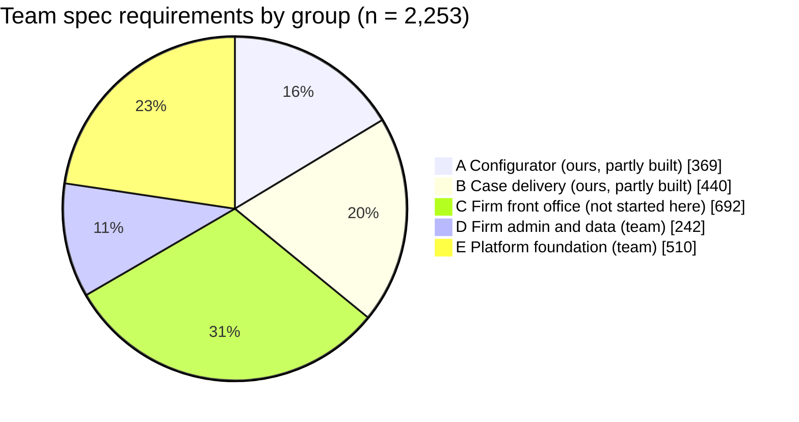
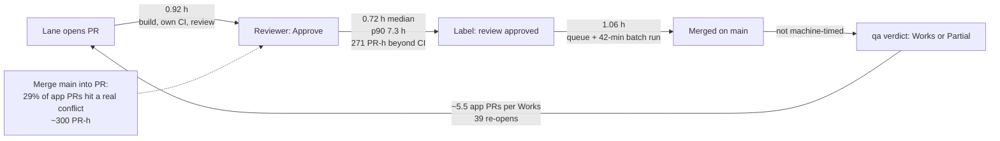
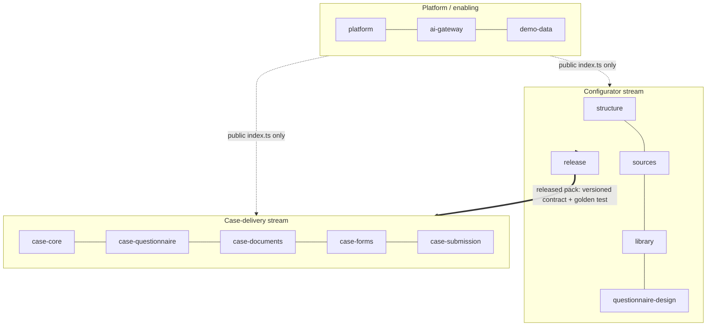
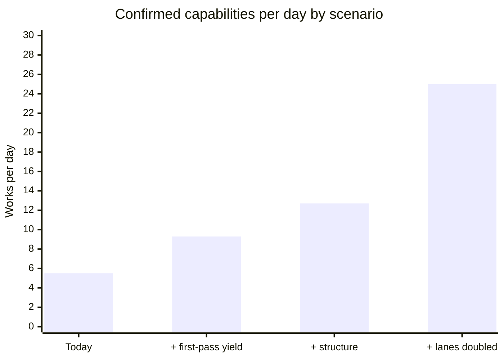

# The delivery factory: size, causes, structure and decisions (P-502)

Planning study by the Fable planner (P-455 (5)), 12 Nov 2026, for the founder and the current Lead (`tools/current-lead.sh`). Read-only: no app code changed. Live AI off, US$0.

**Data.** Pulled 12 Nov ~14:30 to 15:45 IST: `origin/main` at `56b630913`; GitHub REST (1,300 closed PRs back to 1 Nov, 3,544 issue comments, 7,200 issue events, 273 `nightly.yml` runs); the team's requirement snapshot `domain/requirements-2026-11-02/` (name-free copy); the team's app was read for **size and structure only** (P-502 (2)); no code of theirs is copied here, and its specifics are kept out of this public repository (founder, 12 Nov: "Strip them, keep private"; the Lead holds the private comparison). Every number names its sample (P-500). Scripts and outputs are in `factory-plan-2026-11-12-evidence/` and re-run in minutes (section "Evidence").

**Words.** *App PR* = a merged PR that changed app code, by files changed (P-500 folders: `prototype/studio/{api/src,web/src,engine,prisma,contracts,samples,packages}`). *Works* = a capability qa confirmed (RULES "When a capability counts as Works"). *Requirement* = one numbered line in the team's spec (e.g. `AG-7-12`). *Card* = the team's headed, buildable unit with its own status marker. *H-n* = a hypothesis, with the test that settles it; never shipped as a fix (P-502 (1)).

## The short answer (plain words)

1. **The product is bigger than 500-600 capabilities.** The team's own spec has **2,253 live numbered requirements in 32 modules**. Measured against how our own capabilities cover the configurator spec, that is roughly **1,400 capabilities still to build for the parts that are ours or nobody's yet** (band 850 to 2,300), plus the platform foundation the team is already building in its own app. The 500-600 figure is a hypothesis below that band; a two-hour test settles it (section 1).
2. **Our app was built as one big box, on purpose, for a prototype; it is now the brake.** It has **one** NestJS module, 141 files side by side in one folder, seven files over 800 lines, no lint and no rule that keeps one area out of another. The team's app, by contrast, is built as many small fenced modules under a file-size limit. Nobody decided against modules here; the prototype grew into a product without the step that makes a code base safe for many builders.
3. **What it costs, measured on 301 app PRs (2-12 Nov):** 29% of them hit a real merge conflict, which roughly doubled their time (about **300 PR-hours** lost, size-matched). A further **270 PR-hours** were spent between a reviewer's Approve and the label, beyond the time CI needs. Each confirmed capability took about **5.5 app PRs**, because gaps are found after the merge and fixed in new PRs. Merges themselves are not slow (queue median 1.1 h) and machines are not short (runner wait median 0, P-489).
4. **The fix is a known pattern, not an experiment:** a *modular monolith* with *bounded contexts* (DDD), one owner lane per module (*Team Topologies*), an 800-line file limit and import boundaries checked by lint, a contract between "what was released" and "what runs a case", and flow measured with *DORA* and *Little's law*. We move there in about 15 small, behaviour-unchanged PRs after the Bake's tag commit, each kept only if conflicts fall (P-438 (3)).
5. **Five decisions for you** are at the end (section 6). The rest is the Lead's to run (P-384).

---

## 1. Size of the whole product

### In plain words
The team's spec is the honest ruler: it lists every requirement the finished product must meet. It has 32 modules (19 for the firm's staff, 13 for the platform team). We have built mostly inside two of them, the configurator (SA-01B) and case delivery (AG-07 to AG-09, AG-19). Even there we are roughly a third of the way by the team's own measure. Front-office modules (CRM, booking, retainers, billing, messages, automation, tasks, reports) are not started here. The platform foundation (tenants, sign-in, roles, subscriptions) is the team's, and their code base already holds most of it.

### 1.1 Our app's structure (measured)

| Measure | Our app (`prototype/studio`) |
|---|---|
| Source files (non-test) | 228 api + 125 web + 88 engine |
| Lines | 32,931 api + 20,668 web + 13,739 engine (packs and checks in `tests/`, `acceptance/`) |
| NestJS `@Module`s | **1** (in `main.ts`) |
| Backend folders | 1 flat folder of 141 files + `features/` |
| Controllers / routes | 69 / 401 (decorator count) |
| Prisma models | 103 in one `schema.prisma` |
| Largest non-test file | 1,284 lines (`api/src/studio.ts`); **7 over 800** (6 api, 1 web) |
| File-size rule | none (no ESLint in the app) |
| Module boundaries | none |

How measured: `measure_structure.py` (physical lines; routes = `@Get/@Post/@Put/@Patch/@Delete/@All/@Head/@Options` decorators). The team's app was measured the same way for the private comparison: it is built as many small, fenced modules with a file-size limit and a split schema; ours is one. That contrast, not its numbers, is what this plan needs.

### 1.2 The team's spec, counted

| Unit | Count | How |
|---|---|---|
| Modules | 32 (AG-1 to AG-19, SA-1, SA-1B, SA-2 to SA-12) | files in `02-functional-requirements/{agent,super-admin}` |
| Live numbered requirements | **2,253** (86 withdrawn) | `count_frs.py`: lines that start with the module's own id; struck-through or "Withdrawn" excluded |
| Cards with the team's status marker | 610: **531 Not built, 78 Partly built, 1 Built** | `count_cards.py`; only modules rewritten in card format carry markers (SA-1B 176, AG-7 106, AG-2 64, AG-6 51, AG-4 47 …) |
| Cards per requirement (modules with both) | median ~0.8 (SA-1B 0.81, AG-7 0.95, AG-4 0.94, AG-19 0.95, AG-6 0.78, AG-2 0.59, AG-5 0.42) | the two tables above |

Parser error: on SA-01B my parser finds 218 numbered lines where the hand trace (`master-plan-2026-11-11/03a-trace-SA01B-v2.1.md`) counted 179 cards, so requirement counts run ~20% above card counts. That is inside the band below.

### 1.3 Mapped to ours: have, partly, lack

| Group | Team modules | Requirements | Ours today | Status here |
|---|---|---|---|---|
| **A. Content pack configurator** | SA-1, SA-1B, SA-5 | 369 | C1-C5, C9, C11 (~70 rows, Works) | **Partly.** SA-1B hand trace: 20 of 179 cards built, 92 partly, 15 M4, 9 M5, 15 not planned. Global templates (SA-5) lacking |
| **B. Case delivery** (Questionnaire · Documents · Forms · Workflow) | AG-3, AG-7, AG-8, AG-9, AG-15, AG-17, AG-19 | 440 | C6-C8, C10 (~28 rows) | **Partly.** Case, people, questionnaire, documents, fill, readiness, filing record exist on Sample data; client portal (AG-15) only the family link; corporate/LMIA (AG-17) one Sample employer case; pathway assessment (AG-3) only the staff case check C6.9 |
| **C. Firm front office** | AG-2 CRM, AG-4 booking, AG-5 retainer, AG-6 billing, AG-10 messages, AG-11 automation, AG-12 templates, AG-13 tasks, AG-14 reports | 692 | fees worked out (C6.12), a signing order; nothing else | **Lacking here.** What the team's app already has in this group is in the private comparison |
| **D. Firm admin and data** | AG-1, AG-16, AG-18 | 242 | stand-in firm and team (C6.11) | **Team's** (P-335, P-357) |
| **E. Platform foundation** | SA-2, SA-3, SA-4, SA-6 to SA-12 | 510 | simulated users only | **Team's**, much of it already in the team's app |

### 1.4 Capabilities still to build: estimate, method, error band

**Method (calibrated on our own work, not on opinion).** One of our capability rows is a qa-tested user ability. To convert the team's units into ours, I use the one module traced card by card: in SA-01B, **81 of our capabilities** cover **20 cards fully and 92 partly**. Counting a "partly" card as half done gives **66 card-equivalents** (band 48-84 if "partly" means 30-70% done), so **1.23 of our capabilities per card** (band 0.96-1.69). The whole spec is ~1,800 card-equivalents (2,253 requirements × 0.8; band 1,350-2,140 for 0.6-0.95 cards per requirement).

| Scope | Requirements | Card-equivalents (×0.8) | Our capabilities at 1.23 per card | Band | Done (Works) | **Still to build** |
|---|---|---|---|---|---|---|
| A + B (ours: configurator + case delivery) | 809 | ~650 | ~800 | 470 to 1,370 | ~94 (partly covering ~70-110 card-equivalents) | **~700** (band 380-1,280) |
| C (front office, not started) | 692 | ~550 | ~680 | 400 to 1,110 | ~0 | **~680** (band 400-1,110) |
| **A + B + C** | 1,501 | ~1,200 | ~1,480 | 870 to 2,480 | ~94 | **~1,400** (band ~800-2,400) |
| D + E (team's) | 752 | ~600 | not ours to build | | the team's app | merge, not build |

**H-1: "The product is 500-600 capabilities."** Not supported by the spec counts: 500-600 sits below the band unless one capability equals 2-3 of the team's cards. **Test that settles it (2 hours, read-only, Sonnet, US$0):** take three modules of different kinds (AG-4 booking, AG-9 documents, AG-6 billing), group their cards into capability rows the way qa writes them (one user ability, one pack), count, and recompute the ratio. If the ratio is ≥2.5 cards per capability, the founder's figure stands; if near 1, the ~1,400 estimate does.

**H-2: "Group C is ours to build."** Unconfirmed. The team's app already has some front-office screens; who builds the rest after the merge (P-450) is a product decision (section 6, D1).

---

## 2. Root cause of our current speed (measured, ranked by cost)

### In plain words
Building is not the slow part, and machines are not short. The time goes to **builders tripping over each other in the same few files**, to **waiting between steps** (approved but not labelled, labelled but queued), and to **doing a capability several times** because gaps show up only after it merges. Under all three sits one design fact: the app is a single box where most changes touch the same central files, so more lanes mean more collisions, not more output.

### 2.1 The sample
**301 app PRs** merged 2-12 Nov IST (GitHub `merged_at`; files from `git diff H^1 H` of each merge on `main`). Same classification as the Lead's `merged-prs-by-files-2026-11-02-to-12.tsv`: on the 612 PRs in both lists, app/non-app agrees on all but one. Of all 657 merges in the window, 301 are app (46%); 212 records or docs, 81 tests only, 63 tooling.

### 2.2 Flow today (app PRs only)

| Measure | Value | Sample |
|---|---|---|
| App PRs merged per day | **28.1** (1.17/h); by day 65, 58, 31, 23, 12, 25, 16, 25, 9, 18, 19 (2-12 Nov) | 301 app PRs |
| Opened → merged | median **3.25 h**, p75 6.8, p90 12.3; mean 6.3 | 301 |
| Work in progress (Little's law, L = λW) | **7.3** app PRs open at once on average | 257 h window |
| App lines changed per PR | median 100, p90 505; 11 over 800 | app folders only |
| Capabilities reaching Works for the first time | 55 in 10 days (2-11 Nov), **5.5/day**, median 4 | `qa/CAPABILITIES.md` history on `main` |
| Works → lower (re-opened) | 39 (2-12 Nov), 15 and 11 of them on 3-4 Nov (Opus re-proof, P-432) | same |
| App PRs per first-time Works | ~5.5 (301 / 55); all history 388 app PRs / 94 Works = 4.1 (a floor: 19 rows reached Works on 25 Oct before PRs) | |

### 2.3 Causes, ranked by measured cost

| # | Cause | Measured cost | Sample, method | Mechanism |
|---|---|---|---|---|
| 1 | **Rework after merge (the Partial loop)** | ~5.5 app PRs per first-time Works; 39 Works→lower moves; each costs a PR cycle (mean 6.3 h) plus a qa walk: **~250 PR-hours** at one cycle per re-open | `works_per_day.py`; P-501 restates builder PRs per row at 6.5 (title-based) | a capability's gaps are found by qa after merge; the fix is a new PR through every gate. Part is deliberate (3-4 Nov Opus re-proof) |
| 2 | **Real merge conflicts on shared files** | **86 of 301 app PRs (29%)** had ≥1 conflicted merge of `main`; 145 conflicted merges. Size-matched, a conflicted PR took 4.9 h vs 2.1 h (<200 lines), 9.2 vs 3.3 h (200-500), 7.4 vs 5.3 h (500-1,000); all 6 PRs over 1,000 lines conflicted (median 52 h). **≈300 PR-hours** extra | `conflicts_from_git.py`: every merge commit inside a PR branch is re-merged with `git merge-tree`; exit 1 = a real textual conflict. Floor: rebases and Mergify conflict dequeues are not seen | 66 app files had conflicts; **the top 7 hold 39%**: `api/src/demo.ts` 16, `case-prepare.ts` 12, `runtime.ts` 9, `schema.prisma` 9, `engine/runtime/case.ts` 8, `questionnaire.tsx` 7, `main.ts` 7. Two are **central lists** every feature adds to (`demo.ts`, `main.ts`), a conflict source large teams know well |
| 3 | **Waiting between Approve and label** | median 0.72 h, p75 3.45, p90 7.3; **271 PR-hours beyond a 1-hour CI floor**; 34 of 131 PRs waited over 3 h | 131 app PRs with both a `Reviewer: Approve` comment and a `review: approved` label (the other 170 predate the label guard or used another format) | after Approve the lane must see green CI and label; a cloud lane that has gone quiet, a baton rule ("one unlabelled baton PR at a time", P-481), or a Lead read (migrations, money, P-423) holds it. Which one dominates is **H-3** (below) |
| 4 | **Chasing `main` without a conflict** | 62 app PRs merged `main` 96 times with **no** conflict; a small one took 3.1 h vs 2.1 h clean. Each merge drops the label (label guard) and buys a new review and a ~40-50 min CI run: **~60 PR-hours** | same replay | P-270 says merge `main` only on a conflict; the rule is not checked by any tool |
| 5 | **Queue wait after the label** | median 1.06 h (p90 2.5) against a 42-min batch run (P-489): **109 PR-hours** beyond a 0.7 h floor | last label → merged, 131 PRs | batches (avg 1.6 PRs), dequeues, records merges resetting the queue (55 resets by 9 Nov, earlier study) |
| 6 | **The Lead relays by hand; lanes cannot dispatch CI or message back** | lane asks for a `nightly.yml` dispatch → next dispatch: median **0.64 h**, p90 **15.3 h** (62 asks); recorded idles: a qa lane 3.4 h with 7 PRs unscored (P-420), four approved green PRs 2-3.5 h (P-439), 8 PRs Ready 7.4 h on an unattended prompt (7 Nov) | comment text match ("dispatch"/"nightly.yml" with a request word) to the next `workflow_dispatch` run; heuristic, so a rough measure | cloud lanes get HTTP 403 on Actions (P-439) and cannot message a session (one-way); only the Lead can dispatch, steer and start |
| 7 | **Session starts need the founder's typed turn** | app PRs **opened** 01-06 IST: **24** over 11 nights vs **109** in 12-17 IST (4.5×); merges keep flowing at night (68 vs 93), so the queue is not what stops | 301 app PRs by IST hour of `created_at` | sessions start only in a founder-typed turn (P-348 (5)); P-489 records "that cost hours on 11-12 Nov". **H-4:** the night gap is mostly unstarted lanes, not idle ones. Test: compare night opens on nights with ≥3 warm spare lanes (P-489 (5)) against nights without |
| 8 | **Capacity events** | 4 Nov cloud outage ~13 h (20 of 20 lanes); account switches 5, 6, 9 Nov; the 93% weekly stop 9 Nov | recorded (memory, DECISIONS), not re-measured | the 9 Nov challenge found these, not the pipeline, behind the fall from 80-97 builder merges a day to 20-36 |

PR-hours overlap (a PR can wait and conflict), so the rows are not added up. They rank which cost is biggest.

### 2.4 The root cause under 1, 2, 4 and part of 3: one box, cross-cutting changes

**Measured:** I mapped every app file to 12 proposed modules (`module-map.tsv`, section 3) and counted the modules each app PR touched. Only **83 of 301 (28%)** stayed in one module (hub files `studio.ts`, `validate.ts`, `render.ts`, `main.ts`, `core.ts`, `App.tsx` excluded); 130 touched 3 or more. At a coarser cut (configurator / case delivery / platform) **154 (51%)** stayed in one; **96 (32%)** touched both configurator and case delivery. Hub files: `studio.ts` in 39 app PRs, `validate.ts` 28, `render.ts` 20, `main.ts` 19.

**Why (5 whys, each step from the data):**
1. Why do PRs collide? They edit the same files (top 7 = 39% of conflict hits).
2. Why the same files? Central lists (`main.ts` routes, `demo.ts` sample data) and grab-bag services (`studio.ts` "programs and combinations, the shared library, configuration, previews, validation, review and release" in one file, 1,284 lines).
3. Why grab-bags? No module boundary exists: one `@Module`, one folder, no lint, so the nearest file is the easiest place to add code.
4. Why does a capability touch configurator and runtime together? The runtime reads configuration directly, not through a stable released-pack contract; a new rule needs both an authoring change and a runtime change. (DDD calls the missing piece a **Published Language** between two contexts.)
5. Why was it never fixed? The prototype was sized for one or two builders (P-438 kept one repository and deferred splits to "after the 26"); nobody set a file-size or boundary rule, and the per-file splits were planned one at a time, without a target map.

**What is not the cause (measured):** runner capacity (wait median 0, 316 jobs, P-489); PR size alone (median 100 lines; small PRs still conflict, 34 of 204 under 200 lines); the queue run itself (42 min).

**H-3: "Approve → label waits are mostly lanes gone quiet after Approve."** Test: for the 34 waits over 3 h, read whether the lane pushed or commented in the gap (lane awake) and whether a baton or Lead read was pending (from STATE history). Cheap, read-only, one Sonnet pass.

---

## 3. Target structure

### In plain words
Split the one big box into about a dozen rooms, each with a front door. A room is one business area (for example "the shared library" or "filling forms"). Code in one room may call another room only through its front door, never by reaching into its back rooms. Every file stays under 800 lines, as in the team's code. Each room has one owning lane, so two lanes rarely edit the same file. Between the configurator side and the case side sits one agreed hand-over: "what was released". The case side reads only that, so most case changes no longer touch configurator files. We get there by moving code without changing behaviour, one small PR at a time, keeping each move only if collisions fall.

### 3.1 The frameworks, and what each one decides here

| Framework (source) | What it says | What it decides for us |
|---|---|---|
| **Domain-Driven Design: bounded contexts and context maps** (E. Evans, *Domain-Driven Design*, 2003; M. Fowler, "BoundedContext", martinfowler.com/bliki/BoundedContext.html) | split a model where the language changes; contexts meet through explicit relationships, e.g. a **Published Language** | the module list in 3.2; the configurator and case delivery meet through the released pack, a versioned contract |
| **Modular monolith** (Shopify Engineering, "Deconstructing the Monolith", 2019, shopify.engineering) | one deployable, one database, strongly bounded internal modules with public interfaces; no microservices until a measured need | keep one repository and one app (P-438 stands); add the inner walls |
| **Team Topologies** (M. Skelton, M. Pais, 2019, teamtopologies.com/key-concepts) and **Conway's law** (M. Conway, "How Do Committees Invent?", 1968) | stream-aligned teams own a slice end to end; a platform team removes friction; structure of the system mirrors who talks to whom | one owner lane per module group (3.4); a platform/enabling lane for CI, structure and tooling |
| **File-size limit**: ESLint core rule `max-lines` (eslint.org/docs/latest/rules/max-lines) | small files reduce the chance two changes meet | **800 lines**, a common hard limit, matching the team's practice so code merges without a reflow |
| **Import boundaries**: `eslint-plugin-boundaries` (github.com/javierbrea/eslint-plugin-boundaries) | default deny between modules; allow only public surfaces | the "front door" rule, checked in CI. STANDARDS §1 gate: a small, widely used ESLint plugin; to be recorded through the gate |
| **Change-coupling hot spots** (A. Tornhill, *Your Code as a Crime Scene*, 2015; Nagappan, Murphy, Basili, ICSE 2008, org structure predicts defects) | measure where changes and conflicts concentrate; fix those first | the order of the migration (3.5) comes from section 2's conflict counts, not from taste |
| **Contract tests** (M. Fowler, "ContractTest", martinfowler.com/bliki/ContractTest.html; consumer-driven contracts, docs.pact.io) | a consumer's expectations of a provider are a test the provider must pass | in-process, with our existing `zod` contracts: a golden released-pack test the configurator must keep green, so the case side can trust it. No Pact server needed (one process) |
| **Strangler fig, branch by abstraction, parallel change** (Fowler: StranglerFigApplication, BranchByAbstraction, ParallelChange) | move behaviour behind a stable interface in small steps; expand, migrate, contract | every migration step is behaviour-unchanged and green; old paths removed only after callers move |
| **Self-registering modules** (NestJS modules, docs.nestjs.com/modules) | each module keeps its own list; the central file only imports modules | ends `main.ts` and `demo.ts` as conflict magnets (`features/checkpoint/` already does this for demo steps) |
| **Prisma multi-file schema** (Prisma 7: `schema` may point to a folder) | one schema file per domain | `prisma/models/<module>.prisma`; `schema.prisma` (2,300+ lines, 9 conflicts, 38 app PRs) stops being a shared file |
| **CODEOWNERS** (docs.github.com, "About code owners") | paths name their owners | routing only (which lane holds a module); no new required review, so no gate changes |

### 3.2 Proposed modules

Measured from today's files by name (`module-map.tsv`; 26 small files unmapped, mostly shared UI parts). Lines include `api/src`, `engine`, `web/src`, `contracts`, `samples`.

| Module (folder name) | What it owns | Files / lines today | Team spec |
|---|---|---|---|
| `structure` | programs, structure, combinations, channels, start setup | 36 / 8,104 | SA-1B ch. 1-3 |
| `sources` | official sources, finder, source register | 21 / 5,212 | SA-1B, SA-1 |
| `library` | forms, form parts, field maps, shared fields, document types, rules, answer keys | 115 / 14,834 | SA-1B ch. 4-6 |
| `questionnaire-design` | questionnaire design, PQR/SQR drafts | 11 / 2,324 | SA-1B, AG-8 config |
| `release` | review queue, proposals, change sets, rounds, validate, release, editions | 47 / 9,507 | SA-1B ch. 7-11 |
| `case-core` | case, people, stages, links, employer cases, earlier facts | 52 / 7,277 | AG-7 |
| `case-questionnaire` | answers, who fills, worked-out values | 10 / 2,270 | AG-8 |
| `case-documents` | case document checklist, uploads, reviews | 13 / 2,733 | AG-9 |
| `case-forms` | fill, render, form progress, fill trials, fees | 26 / 4,469 | AG-19, AG-7 |
| `case-submission` | prepare, readiness, filings, signing, filing record | 30 / 5,196 | AG-7 |
| `ai-gateway` | AI runs, cost gate, ledger links, saved readings | 21 / 3,254 | SA-8 |
| `platform` | app shell, health, simulated users and firm, workspace | 31 / 3,375 | SA-2, SA-6, SA-7 |
| `demo-data` | sample loaders, checkpoint steps | 76 / 4,216 | |

Folder shape per module, the same in `api/src`, `engine`, `web/src` and `contracts`: `<module>/index.ts` (the front door), `<module>/internal/` (private), one Nest `@Module` per backend module. The three hub files are split by responsibility into the modules above: `studio.ts` (1,284 lines; release, library, structure parts), `validate.ts` and `render.ts` (shared engine pieces become `release` and `case-forms` public functions).

**The one contract between the two sides (Published Language).** `release` publishes a released pack (a versioned snapshot, already pinned per case, STANDARDS §3.7). Case modules read only that snapshot through `contracts/released-pack`, never configurator tables. A golden test (one released Sample pack, checked byte for byte) guards it. **H-5:** "with this contract, the 32% of app PRs that touch both sides fall below 15%." Test: count both-sides app PRs for 2 weeks after step S9 (3.5), against today's 32% (n=301).

### 3.3 Rules, checked in CI (none lowers a gate)

1. **File size**: `max-lines` 800 (physical lines), error for new and changed files; the 7 files over 800 sit on a shrink-only list that may only get shorter (a *ratchet*), empty by the end of the migration.
2. **Front doors**: `eslint-plugin-boundaries` default deny across modules; a module imports another only through its `index.ts`; nothing imports `internal/`. Warn first, error after S12.
3. **Self-registration**: `main.ts` imports modules only; no route defined in it. Sample data per module (`demo-data/<module>/…`), as `features/checkpoint/` already does.
4. **Merge `main` only on a conflict** (P-270, today unchecked): a check on the PR that flags a merge of `main` which `git merge-tree` shows was conflict-free (62 PRs, ~60 PR-hours in 11 days, section 2).
5. **Migration stamps** stay (P-348 (8)); with per-module schema files, two PRs editing different modules' models no longer meet in one file.

### 3.4 Lane ownership per module (stream-aligned)

| Lane (stream) | Modules | Share of app PRs that touched these, 2-12 Nov (n=301; a PR can touch several) |
|---|---|---|
| Configurator: authoring | `structure`, `sources`, `library`, `questionnaire-design` | structure 82, sources 56, library 117, questionnaire-design 32 |
| Configurator: release | `release` | 120 |
| Case: people and answers | `case-core`, `case-questionnaire` | 89, 51 |
| Case: documents | `case-documents` | 28 |
| Case: forms and filing | `case-forms`, `case-submission` | 89, 63 |
| Platform / enabling (Team Topologies "platform") | `platform`, `ai-gateway`, CI, structure moves, tooling | 69, 31 |

Five product streams plus one enabling lane. More lanes per stream only for rows that touch different modules inside it (the Lead's existing "independent rows" test, P-462, now checkable from the module map instead of judgement).

### 3.5 Migration path: small PRs, `main` green, every gate kept (P-303, P-309)

Starts after the Bake's tag commit (P-499 (1)). Each step: behaviour unchanged, under ~800 lines of diff, through review and the queue like any PR, its own row. Order follows section 2's measured hot spots.

| Step | What | Why first (measured) | Size guess |
|---|---|---|---|
| S0 | Measurement baseline: `conflicts_from_git.py` and `module_span.py` into `tools/`, weekly numbers per file and per module | the keep/undo rule needs a before | 1 PR |
| S1 | ESLint with `max-lines` 800 (ratchet list of 7) and `boundaries` in **warn** | no behaviour change; makes drift visible | 1 PR |
| S2 | `main.ts`: routes move into per-module controllers and one `@Module` per module, registered by import | central list: 7 conflicts, 19 app PRs | 2-3 PRs |
| S3 | `demo.ts` → per-module sample steps (checkpoint pattern) | top conflict file: 16 | 2 PRs |
| S4 | `schema.prisma` → `prisma/models/<module>.prisma` (Prisma 7 folder schema) | 9 conflicts, 38 app PRs; migrations untouched | 1-2 PRs; Lead reads diff (schema, P-423) |
| S5 | `case-prepare.ts` → `case-submission` (prepare, filings, fees parts) | 12 conflicts, 40 app PRs | 2 PRs |
| S6 | `runtime.ts` and `engine/runtime/case.ts` → `case-core` / `case-questionnaire` | 9 + 8 conflicts | 2-3 PRs |
| S7 | `web/src/runtime/questionnaire.tsx` (1,052) and `cases.tsx` → module folders | 7 + 6 conflicts | 2 PRs |
| S8 | `studio.ts` (1,284) split by responsibility into `release`, `library`, `structure` | hub in 39 app PRs | 3 PRs |
| S9 | `contracts/released-pack` + golden test; case modules read only it | 32% of PRs touch both sides | 2-3 PRs |
| S10 | Remaining files moved into module folders (`git mv`, imports updated) | mechanical | 1 PR per module |
| S11 | CODEOWNERS per module (routing only) | lane ownership visible | 1 PR |
| S12 | `boundaries` and `max-lines` to **error**; ratchet list empty | the walls hold | 1 PR |

About 25 PRs (the "~15" in the short answer counts steps; some steps take 2-3 PRs). At today's median 3.25 h per app PR and two lanes (the structure lane and one product lane on the same files, P-438 (2) holder rule), roughly **4-6 working days**; **H-6**, settled by S2's actual time.

### 3.6 How each step is judged: kept only if conflicts fall (P-438 (3))

Conflicts on one file are rare events (0-2 a day), so a 7-day before/after on raw conflicts is too small to read. Two measures, decided before the step starts (pre-registered):
* **Leading:** *co-edit overlap*: hours in which two open app PRs both changed the moved code (the old file, or its new module). Measured per step for 7 days before and after, from the PR list and `git diff` per PR. Keep the step if overlap per app PR falls by half or more, or if it falls at all and no gate went red.
* **Lagging, over the whole migration:** conflicted app PRs as a share of app PRs (today **29%**, n=301) and size-matched extra hours (today ~300 PR-hours per 11 days). Target after S12: **under 10%** of app PRs, measured on the next 300 app PRs.
* A step that makes neither better is reverted by a normal PR (expand/contract makes that cheap).

---

## 4. Delivery system

### In plain words
A factory is judged by what leaves it finished, how long one item takes, how many items are open at once and how often a finished item comes back. We will read those four every day from tools, on the right sample, and push on the one step that limits output, not on every step at once. Today that step is "a capability done right the first time": about 5.5 app PRs go into each capability qa confirms. Collisions in shared files come second. The platform also has three hard limits (cloud lanes cannot start CI runs, cannot send messages back, and new sessions need your typed turn); each has options below, and the ones that touch permissions are yours.

### 4.1 Flow metrics and targets (each with its sample, P-500)

| Metric (source) | Our measure | Today | Target after S12 + 4.2 |
|---|---|---|---|
| Throughput, DORA "deployment frequency" (Forsgren, Humble, Kim, *Accelerate*, 2018; dora.dev) | capabilities reaching Works for the first time per day (qa) | **5.5/day** (2-11 Nov, n=55) | 10/day (the compass), then by section 5 |
| Lead time for changes, DORA | app PR opened → merged | median 3.25 h, p90 12.3 h (n=301) | median ≤2 h, p90 ≤6 h |
| Change failure rate, DORA | Works → lower moves per first-time Works; conflicted app PRs | 39/55 (2-12 Nov, incl. the 3-4 Nov re-proof); 29% | ≤15%; ≤10% |
| Time to restore, DORA | red `main` → green | not measured here (no tool computes it; P-501 names the compass gap) | measure first (S0 adds it) |
| WIP, Little's law (J. D. C. Little, *Operations Research* 9(3), 1961: L = λW) | open app PRs at once | **7.3** average; throughput 1.17/h × 6.3 h | WIP limit per stream (4.3), so W falls before λ rises |
| Cycle time by stage | build+review → Approve; Approve → label; label → merged | 0.92 / 0.72 / 1.06 h median (n=131) | Approve → label p90 ≤2 h (from 7.3) |
| App PRs per Works (first-pass yield) | 301 / 55 | ~5.5 | ≤3 |

### 4.2 The constraint (Theory of Constraints: E. Goldratt, *The Goal*, 1984, five focusing steps)

1. **Identify.** Output is Works, not merges. Merges run at 28/day; Works at 5.5/day. The step that converts one into the other loses most: ~5.5 PRs per capability and 39 re-opens (section 2, cause 1). That is the constraint. *Caveat, labelled:* Works/day is also capped by scope (only 29 M3 rows existed; the Bake adds none, P-447), so part of the gap is "nothing left to confirm". **H-7:** "first-pass yield, not scope, limits Works." Test: in M4, track per row app PRs before its first Works and its re-opens; if a row with a ready brief still needs ≥4 PRs, H-7 holds.
2. **Exploit (no new money).** Make the first PR of a capability pass qa: qa's pack and journey for the row written **before** the build (acceptance-test-driven development, the pack is the spec), the walk by screens before review (P-352, exists), reviewers reading the pack. Gates unchanged; their order changes.
3. **Subordinate.** Do not open more rows per stream than qa can verdict the same day (WIP limit = qa verdict capacity per day, read from the last 3 days).
4. **Elevate.** Only then add lanes: the module walls (section 3) are what make extra lanes add output instead of collisions.
5. **Repeat.** When yield is fixed, the next constraint by today's numbers is conflicts (cause 2), then the Approve → label wait (cause 3).

### 4.3 Lane topology

Five stream lanes and one enabling lane (3.4), plus qa (one verdict lane per active stream, P-434) and the Lead. WIP per stream: one baton PR on a shared file at a time (P-481 stays until S12), at most two open app PRs per lane. The Lead assigns rows by module from the module map, so "independent rows" (P-462) is a lookup, not a judgement.

### 4.4 What the platform cannot do today, and the options

| Limit (measured or recorded) | Cost today | Options | Risk | Who decides |
|---|---|---|---|---|
| **Cloud lanes get 403 on Actions** (P-439): they ask, the Lead dispatches `nightly.yml` | ask → dispatch median 0.64 h, p90 15.3 h (62 asks) | (a) a workflow that runs the row's packs when the lane adds a label (`pull_request: labeled`, e.g. `packs: run`) or comments a fixed command (`issue_comment`), running from `main`'s workflow file; no token widened (b) lanes keep asking (today) | (a) CI minutes; a lane could trigger often. Limit to repository writers and one run per head sha | the Lead (pipeline, P-384); it edits `.github/`, so the Lead reads the diff (P-423). **Not a permission change** |
| **Cloud lanes cannot message back** (one-way) | relays by hand; quiet lanes found only at the 30-min check | (a) every lane writes a fixed status comment on its PR at each step (exists for questions); a shell check reads them and wakes the Lead only on change (P-436 T2's shell watchdog) (b) the app's own messaging, if it adds replies (outside our control) | (a) none on quality | the Lead |
| **New sessions start only in your typed turn** (P-348 (5)) | night opens 24 vs 109 by day (11 days); P-489 "cost hours" | (a) warm spare lanes at your last turn, sized to the night's ready rows (P-489 (5), P-499 (3)): no rule change (b) **scheduled cloud routines** that start a briefed lane at set times without a typed turn (the app's "schedule"/routines feature; **H-8**: that a routine can open a builder lane on this repository with today's settings; test: one routine on a docs-only row) (c) keep as is | (b) sessions run with no one watching: money stays off (live AI off in every lane), permissions unchanged, but it changes your P-348 (5) rule | **you** (section 6, D4) |
| **Session-count caps and the 10-message cap** (recorded 4-9 Nov) | lanes waiting for a click | the same as above, plus fewer, longer-lived lanes per stream (one per module group) | context growth: lanes end at P-446's ~400k | the Lead |
| **Label refused by the auto-mode classifier for Lead self-labels** (memory, 3-4 Nov) | waits for your named word | records PRs via `records-label.yml` (exists); product PRs labelled by their builder (P-277) | none | the Lead |

---

## 5. Capacity model and forecast

### In plain words
At today's pace (5.5 confirmed capabilities a day) our own part of the product (~700 capabilities) takes about four months and the whole of what is not the team's (~1,400) about eight. The pace can roughly double by getting capabilities right the first time, rise again by removing collisions, and only then rise a lot by adding lanes. Every step after "today" is a hypothesis with a test; the forecast is redone from measured numbers after each one, not believed in advance.

### 5.1 The model (Little's law, per stage)

Works per day = app PRs per day ÷ app PRs per Works. App PRs per day = lanes × app PRs per lane-day, and, at a fixed number of open PRs, app PRs per day rises as the time per PR falls (L = λW).

| Scenario | Assumption (labelled) | App PRs/day | App PRs per Works | Works/day | ~700 (A+B) | ~1,400 (A+B+C) |
|---|---|---|---|---|---|---|
| **Today** | measured: 28/day, ~9 cloud lanes (P-489), 5.5 per Works | 28 | 5.5 | **5.5** | 127 days (~18 weeks) | 255 days (~36 weeks) |
| **+ First-pass yield** | **H-7**: qa's pack before the build, PRs per Works 5.5 → 3 | 28 | 3 | **9.3** | 75 days | 150 days |
| **+ Structure (S0-S12)** | **H-5, H-6**: conflict cost −2/3 (1.0 → 0.33 h per PR on average), Approve→label wait halved (−1 h): mean W 6.3 → ~4.6 h, so ×1.37 at the same WIP | 38 | 3 | **12.7** | 55 days | 110 days |
| **+ Lanes doubled** | **H-9**: with walls, ~18 lanes keep today's output per lane (no rise in conflicts per PR); qa verdict lanes scale with streams | 77 | 3 | **25** | 28 days (~4 weeks) | 56 days (~8 weeks) |

Error band on every row: the size band of section 1.4 (×0.55 to ×1.7) multiplies the days. Without the yield change, doubling lanes alone gives at most ~11 Works/day and, by today's evidence (P-438, causes 2-4), more collisions.

### 5.2 Hypotheses and the tests that settle them

| # | Hypothesis | Test (cheap first) | Decides |
|---|---|---|---|
| H-1 | the product is 500-600 capabilities | group 3 modules' cards into qa-style rows (2 h, read-only, Sonnet) | the size band |
| H-3 | Approve → label waits are lanes gone quiet | read the 34 waits over 3 h against lane pushes, batons, Lead reads | which fix: wake-up check, or baton rule |
| H-4 | night gap = unstarted lanes | nights with vs without ≥3 warm spares | whether D4 is needed |
| H-5 | the released-pack contract halves both-sides PRs | count for 2 weeks after S9 vs 32% | keep S9 |
| H-6 | structure track takes 4-6 working days | S2's actual time × steps | the M4 plan |
| H-7 | first-pass yield, not scope, limits Works | PRs before first Works and re-opens per M4 row | the exploit step |
| H-8 | a scheduled routine can start a briefed lane here | one routine on a docs-only row | D4's option (b) |
| H-9 | doubling lanes keeps output per lane once walls exist | conflicts per app PR and app PRs per lane-day for a week at ~18 lanes vs ~9 | D5 |
| H-10 | plan use grows in step with lane-hours | `get_usage` weekly % per lane-day for one week (no clean number today: the account switched 11 Nov, P-461; 37% weekly on 12 Nov, P-499) | D5's cost |

### 5.3 Plan usage

Not forecast in % here: no measure on the right sample exists (H-10). The token study (9 Nov) gives a Mac-only floor of ~27 M weighted tokens per Works and shows cost is context size (~75% re-reading, P-436); module walls also shrink what a lane must read per row (a module of 2-15k lines instead of a 69k-line app), which lowers cost per Works independently of speed. **H-11**, tested with H-10.

---

## 6. Decisions for the founder (at most five, P-254)

Everything else in this plan is the Lead's under P-384 (pipeline, lane arrangement, tools, the order of steps, the checks).

| # | Decision | Recommendation | Time | Cost | Quality |
|---|---|---|---|---|---|
| **D1** | **Which part of the whole product is this factory's to build?** | **A + B now** (configurator and case delivery, ~700 capabilities, band 380-1,280); C (front office) only after the team states what its app builds there; D + E stay the team's (P-335, P-357). Run H-1's 2-hour sizing test first | sets every later date | none | none |
| **D2** | **Run the structure track (S0-S12, ~25 small PRs) right after the Bake's tag commit, before M4 product rows that touch the hot files** | **Yes.** Extends P-499 (1)'s "five busiest files" to the full module map, because the top 7 files hold only 39% of conflicts and two thirds of app PRs (199 of 301, hub files excluded) touch 2 or more modules | ~4-6 working days on 2 lanes (H-6); M4 product rows on other modules run alongside | plan usage only, US$0 | behaviour unchanged; every gate kept; adds lint checks; each step kept only if conflicts fall |
| **D3** | **Adopt the team's structure practice as ours: 800-line files, import boundaries by lint, module names that match the team's areas, Prisma domain files** | **Yes**, so our code drops into the team's app at the merge (P-450) without a reflow; through the STANDARDS §1 gate | inside D2 | none | higher (same bar as the team) |
| **D4** | **Night starts: may a scheduled routine start a briefed lane without your typed turn?** (changes P-348 (5)) | **Trial first:** one routine on a docs-only row (H-8); if it works, allow it for briefed rows from BACKLOG, live AI off, no permission widened. Until then, warm spares at your last turn (P-489 (5)) | recovers part of the 4.5× night gap (H-4) | plan usage only | unchanged gates; sessions run unwatched until the next check |
| **D5** | **When to buy more capacity (a second plan or account) to run ~18 lanes** | **Not now.** Decide when Works/day ≥10 with conflicted app PRs ≤10% for a week (after D2 and the yield change), using H-9 and H-10's measured cost per lane-day | 2nd plan: ~halves the A+B date (5.1, last two rows) | the plan's price (yours) | none if walls are in place; more collisions if not |

---

## Evidence (re-runnable)

All in `factory-plan-2026-11-12-evidence/`; outputs as run are in `outputs.txt`. Python 3, standard library only; run with `python3 -I`. GitHub data is not committed (it carries account names); fetch it with curl as below (`gh` GraphQL fails here, P-363).

```bash
T=$(gh auth token); R=https://api.github.com/repos/<owner>/xpatready
for p in $(seq 1 13); do curl -sS -o pulls-$p.json -H "Authorization: Bearer $T" "$R/pulls?state=closed&sort=created&direction=desc&per_page=100&page=$p"; done   # merge into pulls.json
curl ... "$R/issues/comments?since=2026-11-01T18:30:00Z&sort=created&direction=asc&per_page=100&page=<n>"   # 36 pages → comments.json
curl ... "$R/issues/events?per_page=100&page=<n>"                                                        # 72 pages back to 1 Nov → events.json
curl ... "$R/actions/workflows/nightly.yml/runs?created=>=2026-11-01T18:30:00Z&per_page=100&page=<n>"   # 273 runs
```

| File | What | Plan section |
|---|---|---|
| `measure_structure.py` → `ours-modules.tsv` | files, lines, routes, controllers, `@Module`s, Prisma models, file sizes | 1.1 |
| `count_frs.py` → `requirements-fr-counts.tsv` | live and withdrawn numbered requirements per module | 1.2-1.4 |
| `count_cards.py` → `requirements-card-counts.tsv` | cards with the team's status marker | 1.2 |
| `conflicts_from_git.py` → `git-2026-11-02-to-12-prs.tsv`, `-hot-files.tsv` | class by files; merges of `main` inside each PR, replayed with `git merge-tree` | 2.3 |
| `flow_app_prs.py` → `flow-2026-11-02-to-12-app-flow.tsv` | app PR times, lines, size-matched conflict cost, hours of day | 2.2, 2.3 |
| `gates_app_prs.py` | Approve / label / merge stages, excess over floors, label removals | 2.3, 4.1 |
| `conflict_breakdown.py` | conflict hits per file and group; Little's law | 2.3, 4.1 |
| `module-map.tsv`, `module_span.py` | proposed module per file; modules and streams per app PR | 2.4, 3.2, 3.4 |
| `works_per_day.py` → `works-per-day-main.tsv` | first-time Works and re-opens per IST day | 2.2, 5 |

The `nightly.yml` ask → dispatch figure (section 2, cause 6) came from a one-off script in the scratchpad: comments matching `dispatch|nightly.yml` together with a request word, paired with the next `workflow_dispatch` run; treat it as rough.

**Not measured, and why:** how long qa takes per verdict (no machine timestamp, as in the 9 Nov study); lanes per day over the window (session lists are not on GitHub); plan % per lane-day (account switched 11 Nov); red-`main` restore time (no tool yet).

---

## Visuals (founder ask A29 (C)): one picture per part

**Part 1, size: where the requirements sit, and what is ours** (2,253 live requirements; section 1.3)



**Part 2, causes: one app PR's path today, with measured medians** (n=131 app PRs with Approve and label, 2-12 Nov)



**Part 3, target: modules and the one contract between the two sides**



**Part 4, delivery: the constraint and the order of fixes (Theory of Constraints)**

| Order | Constraint (measured) | Fix | Measure that proves it |
|---|---|---|---|
| 1 | first-pass yield: ~5.5 app PRs per Works | qa's pack before the build; walk before review (P-352) | app PRs per Works ≤3 |
| 2 | conflicts: 29% of app PRs | module walls S0-S12 | ≤10% of app PRs; co-edit overlap halved per step |
| 3 | Approve → label wait: p90 7.3 h | wake-up check on PR status comments; label-triggered packs | p90 ≤2 h |
| 4 | night starts: 24 vs 109 opens | warm spares; routine trial (D4) | night opens per hour vs day |

**Part 5, capacity: Works per day by scenario** (section 5.1; each step a hypothesis with its test)


