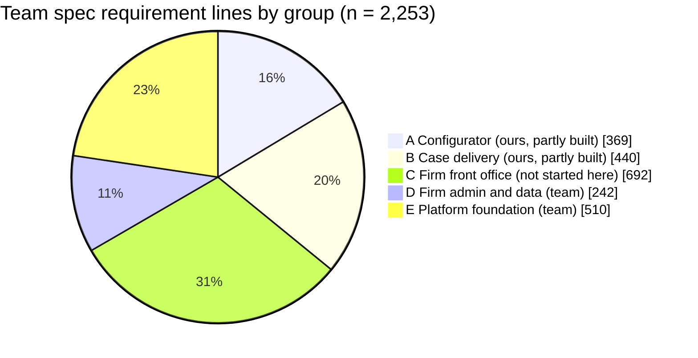
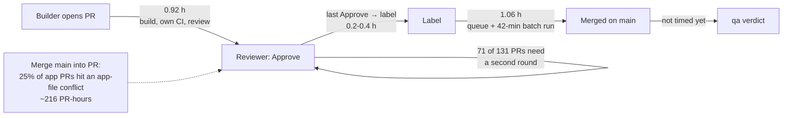
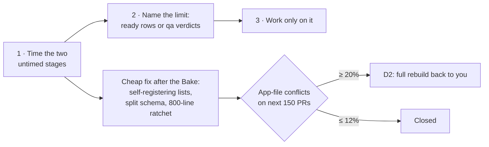

# The delivery factory: size, causes, structure and decisions (P-502)

Planning study by the Fable planner (P-455 (5)), 12 Nov 2026, for the founder and the current Lead (`tools/current-lead.sh`). Read-only: no app code changed. Live AI off, US$0. Challenged twice (a fresh Opus challenger, then Lead 26 with three Opus reviewers); this version folds both in, and the record is at the end.

**Data.** Pulled 12 Nov ~14:30-15:45 IST. The PR sample was cut at `origin/main` = `5797feb18` (#1628, merged 09:55 UTC); GitHub REST: 1,300 closed PRs back to 1 Nov, 3,544 issue comments, 7,200 issue events, 273 `nightly.yml` runs; the team's requirement snapshot `domain/requirements-2026-11-02/` (name-free copy). The team's app was read for size and structure only (P-502 (2)); its specifics are kept out of this public repository (founder, 12 Nov: "Strip them, keep private"; P-504). Every number names its sample (P-500). Scripts and outputs: `factory-plan-2026-11-12-evidence/` (section "Evidence"). Words in *italics* are explained in the glossary at the end.

## The short answer (plain words)

1. **How big is the product?** Not yet known well enough to plan dates. The team's spec has 2,253 numbered requirement lines in 32 modules, but in a hand-read sample of 40 lines only about 16 describe something a user can do (95% range roughly 25-56%); the rest are rules inside a capability, technical items, or pointers. On that basis, configurator plus case delivery (the part we build) come to **about 310-700 capabilities in total**, of which ~94 are confirmed today. Both ends rest on assumptions (listed in 1.4). A two-hour grouping test settles it, and must split Release 1 from later releases.
2. **Why our app is not built for that scale.** It is one big box: one NestJS module, 141 files side by side in one folder, seven files over 800 lines, no lint, no rule that keeps one area out of another. The team's app, by contrast, is built as many small fenced modules under a file-size limit. Nobody decided against modules; the prototype grew into a product without that step.
3. **What it costs today** (301 app PRs, 2-12 Nov): about **a quarter of app PRs hit a real merge conflict on app files** (25%; 22-29% by method), costing about **216 *PR-hours***; second review rounds after a first Approve are common (71 of 131 PRs had two or more Approves). Merges are not slow (queue median 1.1 h) and machines are not short (runner wait median 0, P-489). **What limits confirmed capabilities per day (~5) is not measured**: candidates are rows ready to build, qa verdict time and capacity events; ready rows ran short on about 2 of 10 days (H-13).
4. **What to do, in order of certainty.** (a) Measure the two missing steps: rows ready ahead of builders, and qa verdict time. (b) After the Bake's tag commit, the cheap fix the Lead already owns (P-499 (1)): make `main.ts` and `demo.ts` register each module's own parts, split `schema.prisma` by area, and stop any file from growing past 800 lines. (c) The full modular rebuild only if conflicts stay high afterwards (D2), with lanes cut by *vertical stream*, not by module. The hand-over between configurator and case side (the released snapshot) already exists.
5. **Five decisions for you**, in the order to take them (section 6): **D6** whose version wins where the team's app already does the same thing; **D1** what this factory builds; **D2** the full rebuild; **D3** let builders start their own test runs; **D4** night starts without your typed turn.

## The next two weeks, both tracks, in one order

| # | When (IST) | Track | What | Who | Done when |
|---|---|---|---|---|---|
| 1 | now to ~14 Nov | Build | the Bake's last rows and walk 1 (P-499) | lanes, qa | 0 open Majors on the journey |
| 2 | 14-15 Nov | Build | the co-founder's cold walk (P-482) | co-founder | walk passed |
| 3 | from 16 Nov | Build | Chrome extension: SP-1, SP-2, E0 and the counsel brief, three lanes (P-495) | lanes | Sample-complete 24 Nov-2 Dec |
| 4 | this week | Plan | **D6** (whose version wins) and **D1** (what we build), from the private comparison | founder | answered |
| 5 | this week | Plan | H-1: the two-hour size test, Release 1 split from later | a read-only planner | a size number with a range |
| 6 | this week | Factory | the two missing measures: rows ready ahead of builders per day; qa verdict time per row | Lead (one tooling PR) | numbers in the daily report |
| 7 | after the Bake's tag commit (~19 Nov) | Factory | the cheap fix: self-registering `main.ts` and `demo.ts`, split schema, 800-line ratchet (P-499 (1)) | Lead, one structure lane | three small PRs merged, gates green |
| 8 | after D6 | Plan | head-to-head per capability where both apps overlap (the XFA method, P-464) | planner + Lead | a winner per capability |
| 9 | after 150 more app PRs | Factory | D2's test (section 6) | Lead | the share of app-file conflicts, with its margin |
| 10 | after the Bake | Factory | a push check that blocks the team's app terms in this public repository (Lead's tooling row) | Lead | the check runs on every push |

**The 12 Mar 2027 launch (H-14, a hypothesis):** 12 Nov to 12 Mar is 120 days; at today's ~5 confirmed capabilities a day (a calendar-day rate) that is ~600 capabilities. So ~600 still to build fits by 12 Mar only with no buffer at all, and the 220-610 range runs from comfortable to **on the edge**. Settled by H-1 (size) and two weeks of the measures in row 6.

---

## 1. Size of the whole product

### In plain words
The team's spec lists every requirement the finished product must meet. It has 32 modules (19 for the firm's staff, 13 for the platform team). We have built mostly inside two of them: the configurator (SA-01B) and case delivery (AG-07 to AG-09, AG-19), and even there we are part of the way. Front-office modules (CRM, booking, retainers, billing, messages, automation, tasks, reports) are not started here. The platform foundation (tenants, sign-in, roles, subscriptions) is the team's. A requirement line is not a capability, so the count must be converted, and that conversion is the uncertain part.

### 1.1 Our app's structure (measured)

| Measure | Our app (`prototype/studio`) |
|---|---|
| Source files (non-test) | 228 api + 125 web + 88 engine |
| Lines | 32,931 api + 20,668 web + 13,739 engine (packs and checks in `tests/`, `acceptance/`) |
| NestJS `@Module`s | **1** (in `main.ts`) |
| Backend folders | 1 flat folder of 141 files + `features/` |
| Controllers / routes | 69 files with a controller (76 `@Controller(` occurrences) / 401 route decorators |
| Prisma models | 103 in one `schema.prisma` (2,860 lines) |
| Largest non-test file | 1,284 lines (`api/src/studio.ts`); **7 over 800** (6 api, 1 web) |
| File-size rule / module boundaries | none / none (no ESLint in the app) |

How measured: `measure_structure.py`. The team's app was measured the same way for the private comparison; it is built as many small fenced modules with a file-size limit and a split schema.

### 1.2 The team's spec, counted

| Unit | Count | How |
|---|---|---|
| Modules | 32 (AG-1 to AG-19, SA-1, SA-1B, SA-2 to SA-12) | files in `02-functional-requirements/{agent,super-admin}` |
| Numbered requirement lines | 2,253 live (86 withdrawn), of which 131 (6%) are "merged into" or pointer lines | `count_frs.py`; challenger `c9_frs.py` |
| Of those, user abilities | ~16 in a hand-read random sample of 40 (**assumption**: 40%, 95% range ~25-56%) | challenger `c8_sample.py` |
| Cards with the team's status marker | 610 (531 Not built, 78 Partly built, 1 Built), only in modules rewritten as cards | `count_cards.py` |

### 1.3 Mapped to ours: have, partly, lack

| Group | Team modules | Requirement lines | Ours today | Status here |
|---|---|---|---|---|
| **A. Content pack configurator** | SA-1, SA-1B, SA-5 | 369 | C1-C5, C9, C11 (~70 rows) | **Partly.** SA-1B hand trace: 20 of 179 cards built, 92 partly, 15 M4, 9 M5, 15 not planned. Global templates (SA-5) lacking |
| **B. Case delivery** | AG-3, AG-7, AG-8, AG-9, AG-15, AG-17, AG-19 | 440 | C6-C8, C10 (~28 rows) | **Partly.** Case, people, questionnaire, documents, fill, readiness, filing record on Sample data; client portal only the family link; corporate/LMIA one Sample employer case; assessment only the staff case check C6.9 |
| **C. Firm front office** | AG-2, AG-4, AG-5, AG-6, AG-10 to AG-14 | 692 | fees worked out (C6.12), a signing order | **Lacking here** |
| **D. Firm admin and data** | AG-1, AG-16, AG-18 | 242 | stand-in firm and team (C6.11) | **Team's** (P-335, P-357) |
| **E. Platform foundation** | SA-2 to SA-4, SA-6 to SA-12 | 510 | simulated users only | **Team's** |

Where the team's app already covers groups A and B is in the private comparison; it bears on D6.

### 1.4 Capabilities: estimate, method, assumptions

**Method.** Card-format modules (SA-1B, AG-7, AG-19, and in C: AG-2, AG-4, AG-5, AG-6) are converted at their measured cards per line (0.85 for A+B, 0.7 for C). Prose modules have no cards, so their lines are converted at an **assumed** 0.1-0.6 cards per line (0.1 is the lowest ratio seen in a partly converted module; 0.6 the highest prose-like one). Cards become capabilities at an **assumed** 0.9-1.23 capabilities per card, from the SA-01B trace (configurator-only ~0.9; with case-side capabilities cited as evidence, 1.23).

| Scope | Capabilities in total | Confirmed (Works) | Still to build |
|---|---|---|---|
| A + B (ours) | **~310-700** | ~94 | **~220-610** |
| A + B + C | ~530-1,250 | ~94 | ~430-1,160 |
| D + E | team's | | merge, not build |

`c13_size_capacity.py` (challenger) reproduces the 0.4-0.6 rows; the 0.1 floor is the same formula at 0.1. **H-1: "the product we build is 500-600 capabilities."** Inside the A+B range, so possible. **Test (2 hours, read-only, Sonnet, US$0):** group three modules of different kinds (AG-4 booking, AG-9 documents, AG-6 billing) into capability rows as qa writes them, tagged Release 1 or later (the spec's phasing file), count, and replace both assumed ratios with measured ones.

**H-2: "Group C is ours to build."** Unconfirmed; settled with D1.

---

## 2. Root cause of our current speed (measured)

### In plain words
Building is not the slow part, and machines are not short. Time goes to **builders editing the same few files at once** and to **second review rounds**. Each confirmed capability takes about three app PRs. What caps confirmed capabilities per day is still unmeasured: it may be rows not ready, qa's verdict time, or capacity events (outages, account switches). Under the conflicts sits one design fact: the app is a single box where many changes meet in the same central files.

### 2.1 The sample
**301 app PRs** merged 2-12 Nov IST, cut at `5797feb18` (GitHub `merged_at`; files from `git diff H^1 H` of each merge on `main`). Same classification as the Lead's `merged-prs-by-files-2026-11-02-to-12.tsv` (agrees on all but one of 612 shared PRs). Of 657 merges in the window, 301 are app (46%), 212 records or docs, 81 tests only, 63 tooling.

### 2.2 Flow (app PRs only)

| Measure | Value | Sample |
|---|---|---|
| App PRs merged per day | 28.1 overall; 37.8 (2-6 Nov) → 18.6 (7-11 Nov) | 301 |
| Opened → merged | median **3.25 h**, p75 6.8, p90 12.3; mean 6.3 | 301 |
| *Work in progress* | **7.3** app PRs open at once on average (*Little's law*) | 257 h window |
| App lines changed per PR | median 100, p90 505; 11 over 800 | app folders |
| Capabilities first reaching Works | 55 in 10 days (2-11 Nov): **~5 a day** (6.0 then 5.0 by week) | `qa/CAPABILITIES.md` on `main` |
| Works → lower (re-opened) | 39 (2-12 Nov), 26 of them the deliberate 3-4 Nov re-proof (P-432) | same |
| App PRs per capability turned Works (any time, re-confirmations included) | 189/64 = **2.95** (2-6 Nov) → 93/29 = **3.21** (7-11 Nov): flat | Lead 26 recount, `works_per_day.py` all_to_works column |

### 2.3 Causes, by measured cost

| # | Cause | Measured cost | Sample, method | Mechanism |
|---|---|---|---|---|
| 1 | **Merge conflicts on shared files** | **75 of 301 app PRs (25%)** had a conflict on an app file when merging `main` (22% by the challenger's stricter merge-of-`main` test; 29% if tests and records count); **~216 *PR-hours***, measured from each PR's first conflict against clean PRs of the same size still open at that age | `conflicts_from_git.py` (every merge inside a PR branch replayed with `git merge-tree`); challenger `c1`-`c4` | 66 app files had conflicts; the top 7 hold 39% of hits: `demo.ts` 16, `case-prepare.ts` 12, `runtime.ts` 9, `schema.prisma` 9, `engine/runtime/case.ts` 8, `questionnaire.tsx` 7, `main.ts` 7. `demo.ts` and `main.ts` are central lists every feature adds to. About a third of all conflict hits are in tests or records, which no module change touches. Stacked branches (55 merges not from `main`) add conflicts of their own |
| 2 | **Second review rounds** | 71 of 131 app PRs had two or more Approves; from the **last** Approve to the label: median 0.2-0.4 h, **68 PR-hours** beyond 1 h, 10 PRs over 3 h | 131 app PRs with an Approve comment and a label (mostly 7-12 Nov); `gates_app_prs.py`, challenger `c5` | a fix after a first Approve, often after a conflict, buys a new review and a new CI run |
| 3 | **Queue wait after the label** | median 1.06 h (p90 2.5) against a 42-min batch run (P-489): 109 PR-hours beyond 0.7 h | same 131 | batches (~1.6 PRs), dequeues, records merges resetting the queue |
| 4 | **The Lead relays by hand** | lane asks for a `nightly.yml` run → next dispatch: median 0.64 h, p90 **15.3 h** (62 asks, rough text match); recorded idles: a qa lane 3.4 h (P-420), four approved PRs 2-3.5 h (P-439), 8 PRs Ready 7.4 h (7 Nov) | `dispatch_waits.py` | cloud lanes get HTTP 403 on Actions (P-439) and cannot message back |
| 5 | **New sessions need your typed turn** | app PRs **opened** 01-06 IST: 24 over 11 nights vs 109 in 12-17 IST; merges keep flowing at night (68 vs 93) | 301 app PRs by IST hour | sessions start only in a founder-typed turn (P-348 (5)). **H-4:** the night gap is unstarted lanes. Test: nights with ≥3 warm spare lanes vs without |
| 6 | **Rework after merge** | 13 re-opens outside the 3-4 Nov re-proof × 6.3 h ≈ **82 PR-hours**; by titles a median of 2 PRs per row | `works_per_day.py`; challenger `c7` | gaps found by qa after the merge; a new PR goes through every gate |
| 7 | **Capacity events** | 4 Nov cloud outage ~13 h; account switches 5, 6, 9 Nov; the 93% weekly stop 9 Nov | recorded (DECISIONS), not re-measured | behind the fall from 37.8 to 18.6 app PRs a day (9 Nov study) |
| 8 | **Merging `main` without a conflict** | 59 PRs, ~23 PR-hours size-matched; the label is kept when the merge touches none of the PR's files (P-318 (1)) | challenger `c3` | small |

PR-hours overlap (a PR can wait and conflict), so rows are not added up.

**H-13: "Output (~5 Works a day) is limited by rows ready to build."** Evidence is mixed: on 7 Nov `CAPABILITIES.md` had 38 rows not yet Works, ~25 of them buildable M3 rows, while Works on 7-9 Nov were 1, 11 and 4; by 10-11 Nov only 14-15 rows were not Works, 11 of them Parked or Team. So supply bound on about 2 of the 10 days. **Test:** for two weeks, count rows ready ahead of builders each morning and qa verdict time per row (row 6 of the two-week order); the smaller of the two daily rates is the limit.

### 2.4 Why the conflicts happen (5 whys, from the data)

**Measured:** with every app file mapped to 12 areas (`module-map.tsv`), only 83 of 301 app PRs (28%) stayed in one area (hub files excluded); 156 (52%) touched two or more even without platform and web files. Hub files: `studio.ts` in 39 app PRs, `validate.ts` 28, `render.ts` 20, `main.ts` 19.
1. Why do PRs collide? They edit the same files (top 7 = 39% of conflict hits).
2. Why the same files? Central lists (`main.ts` routes, `demo.ts` sample data) and grab-bag files (`studio.ts`, 1,284 lines, holds programs, library, configuration, previews, validation, review and release).
3. Why grab-bags? No module boundary: one `@Module`, one folder, no lint, so the nearest file is the easiest place to add code.
4. Why does a capability touch the configurator and the case side together? Because a new capability usually extends what is released and how a case uses it: 56 of the 96 PRs that touched both sides changed the released-snapshot contract itself (`contracts/`, `engine/snapshot.ts`). The contract exists (`api/src/runtime.ts:168` reads the pinned, hashed snapshot); ~11 direct configurator reads remain.
5. Why was it never fixed? The prototype was sized for one or two builders (P-438 deferred splits to "after the 26"); nobody set a file-size or boundary rule.

**Not the cause (measured):** runner capacity (wait median 0, 316 jobs, P-489); PR size alone (small PRs conflict too); the queue run (42 min). **Limit of the fix:** the three central files hold 18.5% of app conflict hits, but only 14 of 301 PRs (4.7%) had conflicts confined to them, so the cheap fix removes at most a few points by itself.

---

## 3. Target structure

### In plain words
Give each business area its own room with a front door, and keep every file small. Code in one room calls another only through its front door. Lanes are organised by **whole capabilities end to end** (a vertical stream), not one lane per room, because most capabilities cross rooms. We get there in small steps that change no behaviour, the cheapest and most certain first, and stop when conflicts are low enough.

### 3.1 The frameworks, and what each decides here

| Framework (source) | What it says | What it decides for us |
|---|---|---|
| **Domain-Driven Design: bounded contexts** (E. Evans, *Domain-Driven Design*, 2003; M. Fowler, "BoundedContext", martinfowler.com/bliki/BoundedContext.html) | split a model where the language changes; contexts meet through explicit, published interfaces | the 12 areas in 3.2; the configurator and the case side already meet through the released snapshot |
| **Modular monolith** (Shopify Engineering, "Deconstructing the Monolith", 2019) | one deployable, one database, bounded internal modules with public interfaces | keep one repository and one app (P-438 stands); add inner walls only where measured |
| **Team Topologies** (M. Skelton, M. Pais, 2019, teamtopologies.com/key-concepts) | stream-aligned teams own a slice of value end to end; enabling teams remove friction | lanes by **vertical stream** (a capability from screen to engine); one enabling lane for CI and structure |
| **File-size limit**: ESLint `max-lines` (eslint.org/docs/latest/rules/max-lines) | small files make it less likely that two changes meet | 800 lines, as a ratchet: existing large files may only shrink |
| **Import boundaries**: `eslint-plugin-boundaries` (github.com/javierbrea/eslint-plugin-boundaries) | allowed and forbidden imports between parts of the code, checked by lint | only if D2 says yes; through the STANDARDS §1 gate |
| **Hot spots** (A. Tornhill, *Your Code as a Crime Scene*, 2015) | fix where changes and conflicts concentrate first | the order of the fixes comes from section 2's counts |
| **Self-registering modules** (NestJS modules, docs.nestjs.com/modules) | each area keeps its own list; the central file only imports areas | ends `main.ts` and `demo.ts` as conflict magnets (`features/checkpoint/` already does this) |
| **Prisma multi-file schema** (Prisma 7: `schema` may point to a folder) | one schema file per area | `schema.prisma` (2,860 lines, 9 conflicts, 38 app PRs) stops being one shared file |
| **Parallel change / branch by abstraction** (M. Fowler, ParallelChange and BranchByAbstraction, martinfowler.com/bliki) | move code behind a stable interface in small steps | every step behaviour-unchanged and green |

### 3.2 Proposed areas (module map)

Measured from today's files by name (`module-map.tsv`; 26 small shared UI files unmapped).

| Area (folder name) | What it owns | Files / lines today | Team spec |
|---|---|---|---|
| `structure` | programs, structure, combinations, channels, start setup | 36 / 8,104 | SA-1B ch. 1-3 |
| `sources` | official sources, finder, source register | 21 / 5,212 | SA-1B, SA-1 |
| `library` | forms, parts, field maps, shared fields, document types, rules, answer keys | 115 / 14,834 | SA-1B ch. 4-6 |
| `questionnaire-design` | questionnaire design, PQR/SQR drafts | 11 / 2,324 | SA-1B, AG-8 |
| `release` | review queue, proposals, change sets, rounds, validate, release, editions | 47 / 9,507 | SA-1B ch. 7-11 |
| `case-core` | case, people, stages, links, employer cases, earlier facts | 52 / 7,277 | AG-7 |
| `case-questionnaire` | answers, who fills, worked-out values | 10 / 2,270 | AG-8 |
| `case-documents` | case document checklist, uploads, reviews | 13 / 2,733 | AG-9 |
| `case-forms` | fill, render, form progress, fill trials, fees | 26 / 4,469 | AG-19, AG-7 |
| `case-submission` | prepare, readiness, filings, signing, filing record | 30 / 5,196 | AG-7 |
| `ai-gateway` | AI runs, cost gate, ledger links, saved readings | 21 / 3,254 | SA-8 |
| `platform` | app shell, health, simulated users and firm, workspace | 31 / 3,375 | SA-2, SA-6, SA-7 |
| `demo-data` | sample loaders, checkpoint steps | 76 / 4,216 | |

### 3.3 Steps, cheapest and most certain first (P-303, P-309: every gate kept)

| Step | What | Why (measured) | Size | Who decides |
|---|---|---|---|---|
| 1 | Measures: conflicts per app PR (app files only, split by whether a hot file was touched), rows ready per day, qa verdict time | D2's test and H-13 need them | 1 tooling PR | Lead |
| 2 | `main.ts` registers each area's own routes; `demo.ts` becomes per-area sample steps | central lists: 23 conflict hits | 2-4 PRs | Lead (P-499 (1)) |
| 3 | `schema.prisma` split into per-area files (migrations untouched) | 9 conflicts, 38 app PRs | 1-2 PRs; Lead reads the diff (P-423) | Lead |
| 4 | ESLint with `max-lines` 800 as a ratchet (the 7 large files may only shrink) | stops new grab-bags | 1 PR | Lead |
| 5 | Only if D2 says yes: split `case-prepare.ts`, `runtime.ts`, `questionnaire.tsx`, `studio.ts`; move files into area folders; import boundaries | the rest of the top-7 files | 25-30 PRs, 5-8 working days; hot files moved in short freeze windows | **founder (D2)** |

Steps 1-4: about 5-8 small PRs, 1-2 days after the Bake's tag commit.

---

## 4. Delivery system

### In plain words
Judge the factory by what leaves it finished, how long one item takes, how many are open at once and how often a finished item comes back; find the one step that limits output and work on that step only. Today we cannot yet name that step, because two of the stages are not timed. Three platform limits slow the flow: builders cannot start their own test runs on GitHub, cannot message back, and cannot be started at night without your typed turn.

### 4.1 Flow measures, inspired by *DORA* (with their samples, P-500)

| Measure | Ours | Today | Aim |
|---|---|---|---|
| Throughput | capabilities first reaching Works per day (qa) | ~5 (2-11 Nov, n=55) | set once the limit is known |
| Lead time | app PR opened → merged | median 3.25 h, p90 12.3 h (n=301) | p90 ≤6 h |
| Rework | Works → lower per day, outside deliberate re-proofs | 13 in 10 days | ≤1 a day (the compass) |
| Conflicts (a flow measure, not a DORA key) | app PRs with an app-file conflict | 25% (n=301, margin ±4.9 points); 15% on the last 46 (10-12 Nov, margin ±10) | below 12% (D2) |
| *Work in progress* | open app PRs | 7.3 | no more than builders |
| Stage times | build + review → last Approve → label → merged → qa verdict | 0.92 h / 0.2-0.4 h / 1.06 h / **not timed** | time the last stage |

### 4.2 The limiting step (*Theory of Constraints*, E. Goldratt, *The Goal*, 1984)
Goldratt's first step is to identify the stage with the least capacity. Two stages are not timed (rows ready ahead of builders; qa verdict), so the constraint is **not yet identified** (H-13). Order: time both stages (two weeks); the stage with the lower daily rate is the constraint; work only on it (more ready rows: the design → look → brief step one milestone ahead; or more qa verdict lanes); then measure again.

### 4.3 Lanes
By vertical stream: a lane takes a capability end to end (screen, API, engine, contract). With the cheap fix in place, two lanes meet mainly where both need the same area's files, which the Lead sees from the module map before assigning (P-462's "independent rows" becomes a lookup). One baton PR at a time on a shared file stays (P-481).

### 4.4 Platform limits and options

| Limit | Cost today | Options | Risk | Who decides |
|---|---|---|---|---|
| Builders cannot start test runs (403 on Actions, P-439) | ask → run: median 0.64 h, p90 15.3 h | (a) a run started by a fixed PR comment (`issue_comment`, which uses `main`'s copy of the workflow), allowed only for repository members (`author_association`); never `pull_request_target` building PR code (b) keep relaying | (a) a security setting on a public repository; CI minutes | **you (D3)** |
| Builders cannot message back | quiet lanes found only at the 30-min check | each lane writes a fixed status comment on its PR at each step; a shell check wakes the Lead only on change | none | Lead |
| New sessions only in your typed turn (P-348 (5)) | night opens 24 vs 109 | (a) warm spare lanes at your last turn (P-489 (5)) (b) a scheduled routine that starts a briefed lane (H-8: test on one docs-only row) | (b) sessions run unwatched until the next check; live AI stays off | **you (D4)** |

---

## 5. Capacity and forecast

### In plain words
No date can be promised yet: the size is a range, and the step that limits output is not yet known. The honest forecast is a rule, not a number.

**Forecast rule.** Confirmed capabilities per day = the smallest of (rows ready per day, builder output per day, qa verdicts per day), each measured over two weeks, never multiplied together. Days to finish = capabilities still to build (from H-1) ÷ that rate, quoted with both ranges. Today's ~5 a day against 220-610 still to build gives 44-122 days (calendar days, since the rate is per calendar day); the launch line (H-14) is in the two-week order above.

**Plan usage** is not forecast in %: no measure on the right sample exists (the account switched 11 Nov). **H-10:** plan use grows in step with lane-hours; test with `get_usage` weekly % per lane-day for one week.

### Hypotheses and their tests

| # | Hypothesis | Test | Decides |
|---|---|---|---|
| H-1 | our part is 500-600 capabilities | three modules grouped into qa-style rows, Release 1 split from later (2 h, read-only) | the size range; D1 |
| H-4 | the night gap is unstarted lanes | nights with vs without ≥3 warm spares | D4 |
| H-8 | a scheduled routine can start a briefed lane here | one routine on a docs-only row | D4 option (b) |
| H-10 | plan use grows with lane-hours | weekly % per lane-day for a week | capacity |
| H-13 | ready rows limit output | ready rows and qa verdict time for two weeks | the constraint |
| H-14 | 12 Mar 2027 is reachable | H-1 + H-13 | the launch date |

---

## 6. Decisions for the founder (in the order to take them, P-254)

Everything else in this plan is the Lead's to run (P-384).

| # | Decision, in plain words | Recommendation | Time | Cost | Quality | If you say no |
|---|---|---|---|---|---|---|
| **D6** | **Where the team's app already does the same job as ours (configuration, form filling), whose version wins?** Every week we build before this is answered may be built twice | **Decide per capability, head to head on the same inputs** (as with the XFA engine, P-464): the better wins, a tie keeps theirs | one read-only comparison per area | plan usage only | no duplicate parts at the merge | we keep building ours; the team decides at the merge, and some of our work may be rebuilt or dropped |
| **D1** | **Which part of the whole product does this factory build?** | **Configurator and case delivery now** (~310-700 capabilities, ~94 done); front office only after the team says what its app covers; platform stays the team's | the answer takes minutes; with configurator and case delivery only, ~220-610 still to build is ~44-122 days at ~5 a day; adding the front office roughly doubles it | none | one scope keeps reviews and qa on two areas; a wider scope spreads the same lanes and qa thinner | if wider: front office joins the queue, the launch line moves out; if narrower: we stop at the configurator |
| **D2** | **The full rebuild into areas** (25-30 more PRs, 5-8 working days) after the cheap fix | **Not now.** After the cheap fix, the Lead measures app-file conflicts on the next 150 app PRs (margin about ±6 points). **20% or more**: the Lead brings the rebuild back to you; **12% or less**: closed; in between: 150 more. The last 46 PRs already ran at 15% | measuring ~1 week | plan usage only | behaviour unchanged either way | if you want the rebuild now: 5-8 working days, run during the extension lanes (from 16 Nov), 25-30 more PRs, hot files moved in short freeze windows; plan usage only; behaviour unchanged |
| **D3** | **Let builders start their own test runs.** Only repository members can trigger them, by a fixed PR comment | **Yes, members only** | saves up to ~15 h of waiting on the worst days | CI minutes only | none if the members-only gate holds | a security setting on a public repository, so yours; if no, the Lead keeps relaying runs by hand |
| **D4** | **Night starts: may a scheduled routine start a briefed builder without your typed turn?** (changes P-348 (5)) | **Trial first** on one docs-only row (H-8); if it works, allow it for briefed rows, live AI off, no permission widened | recovers part of the night gap (24 vs 109 opens) | plan usage only | gates unchanged; sessions unwatched until the next check | the Lead keeps warm spare lanes at your last turn each night (P-489 (5)) |

Buying more capacity (a second plan) is not a decision now: the Lead re-raises it when the measured constraint is builder output.

---

## Visuals

**Requirement lines by group** (2,253; section 1.3)



**One app PR's path today** (medians; n=131 app PRs with Approve and label; conflicts n=301)



**Order of work (Theory of Constraints)**



---

## Glossary

* **App PR:** a merged PR that changed app code, by files changed (P-500 folders).
* **Works:** a capability qa confirmed (RULES).
* **PR-hours:** hours added up over PRs; 10 PRs each waiting 2 h = 20 PR-hours. Shows where waiting piles up; it is not calendar time.
* **Work in progress (WIP):** how many app PRs are open at the same moment.
* **Little's law:** on average, items open = items finished per hour × hours each item takes (J. D. C. Little, 1961). An identity, used to check numbers, not to predict.
* **DORA:** four delivery measures from the *Accelerate* research (Forsgren, Humble, Kim, 2018; dora.dev); ours are adapted, since we do not deploy to production.
* **Theory of Constraints:** output is set by the slowest step; find it, use it fully, then improve it (Goldratt, 1984).
* **Vertical stream:** a lane that takes a capability through every layer (screen, API, engine), as opposed to one lane per code area.
* **Ratchet:** a rule that lets a number only improve (a large file may shrink, never grow).
* **H-n:** a hypothesis with the test that settles it; never shipped as a fix (P-502).
* **Hot file:** a file where conflicts concentrate.
* **Margin:** the 95% range around a share from a sample; 15% of 46 PRs could be anything from ~5% to ~25%.

---

## Evidence (re-runnable)

All in `factory-plan-2026-11-12-evidence/`; outputs in `outputs.txt`. Python 3 standard library, run with `python3 -I`. GitHub data is not committed (it carries account names); fetch it with curl:

```bash
T=$(gh auth token); R=https://api.github.com/repos/<owner>/xpatready
for p in $(seq 1 13); do curl -sS -o pulls-$p.json -H "Authorization: Bearer $T" "$R/pulls?state=closed&sort=created&direction=desc&per_page=100&page=$p"; done   # merge into pulls.json
curl ... "$R/issues/comments?since=2026-11-01T18:30:00Z&sort=created&direction=asc&per_page=100&page=<n>"   # 36 pages → comments.json
curl ... "$R/issues/events?per_page=100&page=<n>"                                                        # 72 pages → events.json
curl ... "$R/actions/workflows/nightly.yml/runs?created=>=2026-11-01T18:30:00Z&per_page=100&page=<n>"   # 273 runs
```

| File | What | Section |
|---|---|---|
| `measure_structure.py` → `ours-modules.tsv` | files, lines, routes, `@Module`s, models, file sizes | 1.1 |
| `count_frs.py` → `requirements-fr-counts.tsv`; `count_cards.py` → `requirements-card-counts.tsv` | requirement lines and cards per module | 1.2 |
| `conflicts_from_git.py` → `git-2026-11-02-to-12-prs.tsv`, `-hot-files.tsv` | class by files; merges inside each PR replayed with `git merge-tree` | 2.3 |
| `flow_app_prs.py` → `flow-2026-11-02-to-12-app-flow.tsv` | app PR times, lines, hours of day | 2.2 |
| `gates_app_prs.py`, `conflict_breakdown.py`, `dispatch_waits.py` | review stages, conflict hits, Little's law, dispatch waits | 2.3, 4 |
| `module-map.tsv`, `module_span.py` | areas per file; areas per app PR | 2.4, 3.2 |
| `works_per_day.py` → `works-per-day-main.tsv` | first-time Works and re-opens per day | 2.2 |
| `challenge/` (challenger's `c1`-`c13`, README) | 22-29%, 216 PR-hours, 68 PR-hours, "71 of 131", size band, week rates | 1.4, 2.3 |

**Not measured:** qa verdict time and rows ready per day (no timestamps yet); lanes per day (not on GitHub); plan % per lane-day.

---

## Challenge record

**Round 1, fresh Opus challenger** (re-ran everything from `origin/main` and the downloaded data; scripts in `challenge/`). It reproduced every raw count and corrected: the size conversion (requirement lines are not capabilities; prose modules convert at far less than card modules); the conflict share and cost (merges of `main` only; same-age comparison); the review wait (re-review after a first Approve, not idle waiting); the lane cut (59% of app PRs crossed six area-based lanes, so lanes are vertical streams); the configurator-to-case contract (it already exists); the comment-triggered run (`pull_request: labeled` runs the PR's own workflow copy, and on a public repository the trigger is a security setting); the migration size (25-30 PRs, not fewer); the keep/undo test (a 7-day window has no statistical power); the capacity scenarios (stacked untested multipliers, withdrawn); the DORA mapping (conflicts are not a change failure rate); and one decision moved to the Lead.

**Round 2, Lead 26 with three Opus reviewers** (evidence; integration and governance; the founder's goal). Corrected: the limit on output is a hypothesis (H-13), not a measure, and the earlier "PRs per Works fell" figure was a re-proof counting artefact (2.95 → 3.21 on all confirmations); withdrawn numbers removed everywhere; D2's trigger set on app-file conflicts with a threshold the sample can resolve; D6 added first, the capacity decision dropped, every decision given an "if no"; one ordered list for both tracks with the launch line; plain words and a glossary; the challenger's scripts committed; the sample's base commit corrected to `5797feb18`. The private comparison (parts A and B of founder ask A29) was revised in the same round, outside this repository.
