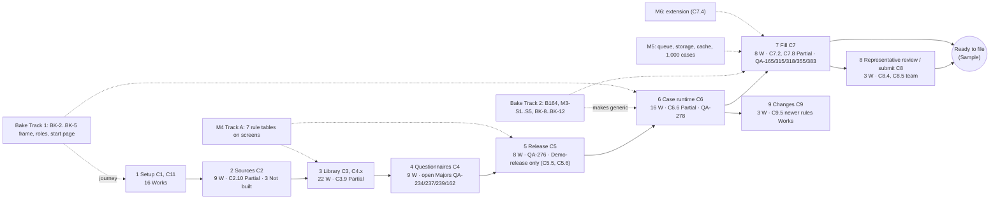
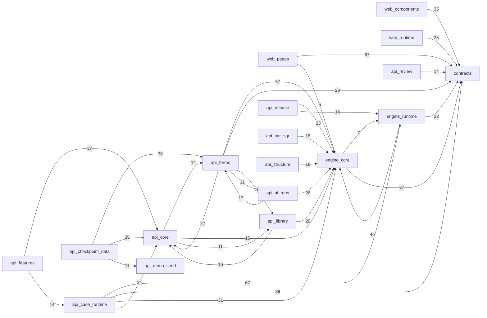
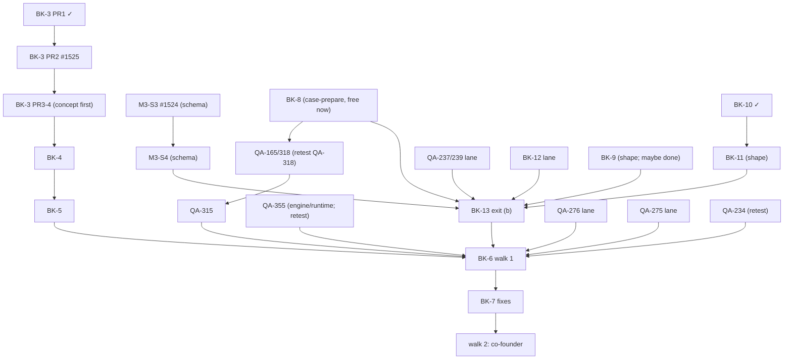

# 03 · Traceability and dependencies

Master analysis, part 3 of 8 (A19 (f)). Read-only, on `origin/main` fbfb263c7 (11 Nov). Chain: **requirement → capability → module/code → test → evidence**. The full 112-row capability table and the uncited-requirement list are in the appendices at the end. They were gathered by a read-only reader (grep of ids in code comments and test labels) and spot-checked by me.

## 1. The chain today, in numbers

| Link | What exists | Strength |
|---|---|---|
| **Requirements** | Team's name-free copy `domain/requirements-2026-11-02/` (74 files). The Pathway Configurator's own spec is **SA-01B v2.1**: **179 cards** (SA-1B-n) in 11 chapters. The team's own status per card: Not built 119, Partly built 50, Pointer 6, Withdrawn 3, Built 1. AG-01..19 and SA-02..12 are the wider platform (~600 more headings), mostly the team's | — |
| **Requirement → capability** | `qa/CAPABILITIES.md` has 112 rows. **Only 15 cite a requirement id in their name**, and 21 distinct SA-1B ids are cited across CAPABILITIES + PRODUCT. The one full trace is `product/history/TRACE-SA01B-2026-10-23.md`, done on **v1.5** (114 Planned, 26 Missing). **v2.1 has never been re-traced** | **weak** |
| **Capability → code** | Code comments name capability ids widely (`api/src`, `engine/`, `web/src`); about a third of the rows are matched by name only | medium |
| **Capability → test** | A pack per Works row: `prototype/studio/acceptance/<Cx.y>.test.ts`, run by `tools/works-set.mjs` and `gate-b.mjs`; tests name the id in their check labels. **No committed index:** `product/tools/graph.mjs` builds `qa/GRAPH.md` + `qa/graph.json`, the JSON is not committed, and **GRAPH.md is stale** (7 Nov: "98 capabilities", today 112) | medium |
| **Test → evidence** | qa's verdict per row quotes the run id (P-339) and the commit; nightly re-runs every Works pack | **strong** |

**Capabilities by verdict (main):** 97 Works, 5 Partial (C2.10, C3.9, C6.6, C7.2, C7.8), 10 Not built (C2.8, C2.9, C2.11, C6.7, C6.8, C7.4, C8.4, C8.5, C9.3, C9.4). By milestone: M2 60 (all Works), **M3 29 (28 Works + C7.8 Partial; see the PR challenge)**, Parked 10, T 8, Team 4, M4 1.

| Step | Works | Partial | Not built |
|---|---|---|---|
| 1 Setup (C1, C11) | 16 | 0 | 0 |
| 2 Sources (C2, C11.x) | 9 | 1 | 3 |
| 3 Library (C3, C4.x, C11.x) | 22 | 1 | 0 |
| 4 Questionnaires (C4) | 9 | 0 | 0 |
| 5 Release (C4.x, C5) | 8 | 0 | 0 |
| 6 Runtime (C6) | 16 | 1 | 2 |
| 7 Fill (C7, C11.x) | 8 | 2 | 1 |
| 8 Submit (C8) | 3 | 0 | 2 |
| 9 Changes (C9) | 3 | 0 | 2 |
| 10 Demo (C10, C11.x) | 3 | 0 | 0 |

**Works rows that carry open Majors** (each covered by a recorded ruling: P-358's hardening pass, or the Bake's P-447 (1)). They should read as "Works, with named open Majors", so that a reader of the scorecard alone is not misled:

| Capability | Open Majors | Bake row |
|---|---|---|
| C4.11 | QA-162, QA-234, QA-237, QA-239, QA-276 | 6, 7, 8, 13 |
| C4.6 | QA-275 | 9 |
| C5.1 | QA-276 | 7 |
| C6.1 | QA-278 | 33 (outside the caps) |
| C7.1, C6.19 | QA-383, QA-355 | 34, 12 |
| C7.6 | QA-355 | 12 |

## 2. Where the trace is weakest (gaps)

The reader matched by id, which overstates gaps: many uncited cards are built under other capability names. **158 of 179 cards are cited by no capability**, and 129 also appear in no backlog, compliance-trace or STATE file. The ten areas below matter most for "file a case" and the milestones. Each is flagged with whether it is in the product, in a plan, or nowhere:

| # | Requirement area (SA-01B v2.1 cards) | In the product today | Planned? |
|---|---|---|---|
| G1 | Document validity, dates and checks (SA-1B-153, 155, 156, 22, 105, 21) | partly (C6.4 police-certificate age; fact expiry rules in `samples/fact-expiry-rules.json`) | M4 Track A (fact-expiry table onto a screen); the rest **nowhere** |
| G2 | Purposes and overflow for list facts (SA-1B-11, B1) | partly (lists fill; overflow pages not) | **nowhere** |
| G3 | Portal screens as editions; extension fill (SA-1B-32, 173, 175; C7.4 Not built) | answer sheet only (C7.3 Works) | M6 extension (P-245) |
| G4 | Content freshness: change watch, "in force from", correction vs rule change (SA-1B-297, 298-300) | no | **nowhere** (needed before real use: content changes with IRCC) |
| G5 | Withdraw a submitted application (C8.4), stored representative signature (C8.5) | no | team (P-406) |
| G6 | Corporate / LMIA: positions, LMIA clocks, fee per position, linked files (SA-1B-280-289) | stand-in employer link (C1.3) only | **out of the Bake** (Fable Q17); M4 or later is the founder's call |
| G7 | What firms may change; performance; load-test release gate (SA-1B-270-278) | no (`reports/verify-2026-11-03/V1-completeness.md:316`: gate "not built") | M5 (Scalable, P-460) |
| G8 | Government steps, deadlines, key dates (SA-1B-96, 233, 230, B11) | partly (C6.17 stage deadline) | **nowhere** |
| G9 | Returning client, migration of past forms (SA-1B-266-268) | no | team / later |
| G10 | Box-level quality: box notices, signals, accuracy record (SA-1B-176-180) | partly (fill trials as data, C7.x) | M4 (fill trials on every form) |

**Recommendation (one row, cheap):** **T1, re-trace SA-01B v2.1.** Map the 179 cards to capability rows, one line each (Built here / Partly / Planned in Bake / M4 / M5 / M6 / Team / Not planned), using v1.5's trace as the start. A Sonnet read-only lane, ~1 session, writing `product/compliance-trace-SA01B-v2.1.md`. Without it, "nothing silently dropped" (P-450) cannot be checked against the team's own spec, only against our backlog. **T2, commit the capability → test index.** `graph.mjs` writes `qa/graph.json` in CI, and CI fails when GRAPH.md is older than CAPABILITIES.md. Small, pipeline lane.

## 3. Dependency graphs

### 3a. Capabilities along the journey (each step needs the one before; partials and Bake rows marked)

### 3b. Code modules (relative imports between module groups; edges with 5 or more imports; `api/src` is flat, so it is grouped by file-name prefix)

**What the module graph says:**
1. **The screens depend only on `contracts`** (the typed API shapes), apart from 5 imports of `engine/core` from `web/pages`. That is a clean seam. A shared service built in M4 or for the extension can serve the same contracts.
2. **Two cycles to break before the shared services (M4/M5):** `engine/core ⇄ engine/runtime` (46 one way, **7 back**), and `api core ⇄ api forms ⇄ api library` (27/14, 16/11). A cycle means one change pulls the other, which raises merge conflicts and makes extraction into a service harder. B165 (split the five busiest files, outside the caps) should break these cycles first, not only split by size.
3. **`api/src` has 138 flat files plus 85 under `features/`.** The batons are the biggest shared files: `prisma/schema.prisma` 2,857 lines, `api/src/case-prepare.ts` 952. Next largest: `studio.ts` 1,262, `web/src/runtime/questionnaire.tsx` 1,044, `proposals.ts` 1,035, `sources.ts` 996, `runtime.ts` 967, `finder.ts` 952. These are where parallel lanes collide.
4. **Demo and checkpoint data are code** (`api_checkpoint_data` 47 files importing forms/core/demo-seed). That is B164's 7 fixture entries; BK-12 moves the choice to data.

### 3c. Bake rows: what waits for what (from part 1, as of 12:27 IST)

## 4. Flags for the Lead

* **C7.8 reads Partial on main while STATE says M3 29/29** (PR comment, challenge). The QA-355 fix merged with #1450 and was not re-scored.
* **SA-01B v2.1 has no trace** (T1 above). P-450's "nothing silently dropped" cannot be checked against the team's own spec until it has one.
* **GRAPH.md is stale and its JSON is not committed** (T2).
* **Six Works capabilities carry nine open Majors** under recorded rulings. Show them on the scorecard row as "Works, open Majors: …".

---

## Appendix A. Capability → code → test → evidence (112 rows; gathered by a read-only reader from `qa/CAPABILITIES.md`, code comments and test labels on main fbfb263c7; "~" = code matched by name)

Verdicts: Works 97, Partial 5 (C2.10, C3.9, C6.6, C7.2, C7.8), Not built 10 (C2.8, C2.9, C2.11, C6.7, C6.8, C7.4, C8.4, C8.5, C9.3, C9.4). No Not-tested/Broken rows. Milestone: M2 60, M3 29, Parked 10, T 8, Team 4, M4 1. Code = files citing the id in a comment (api/src, engine, web/src); "~" = inferred by name. Tests = files in tests/, acceptance/, tools/ naming the id.

| id | name | verdict, run (commit, date) | M | reqs in name | code | tests |
|---|---|---|---|---|---|---|
| C1.1 | Author sees every combination by workspace (now design D, C11.10; P-115) | Works (4c3b16f0 4 Nov) | M2 | - | ~ web/src/pages/programs.tsx; api/src/programs.ts | 5: check_screen01_smallfix.cjs, check_qa22_author_flash.cjs, check-gate-b.mjs, check-works-set.mjs… |
| C1.2 | Author creates Program › Category › Sub-category in one path builder; duplicates refused with a field message | Works (4c3b16f0 4 Nov) | M2 | - | ~ web/src/components/add-to-structure.tsx; api/src/structure.ts | 3: check_screen02_slice2.ts, check_qa14_name_race.ts, check_qa14_variants.ts |
| C1.3 | On a case, the agent picks "relies on employer case …", which pre-fills the employer's facts (P-106: links ... | Works 42425176291 (d5207187 6 Nov) | M3 | - | 8: earlier-facts.ts, employer-cases.ts, employer-link.ts, employer-link.ts… | 6: C1.3.test.ts, C9.2.test.ts, declared.ts, check_c13_employer_link_browser.cjs… |
| C1.4 | Combination page shows path, status and the one next step | Works (4c3b16f0 4 Nov) | M2 | - | ~ web/src/pages/combination.tsx; components/next-step.tsx; engine/setup-checklist.ts | 5: check_screen02_slice1.cjs, check_setup_checklist.ts, check_qa13_readd_form.ts, check_qa_am_1027.cjs… |
| C1.5 | Author copies a line from another combination, and adds or removes one line across many (SA-1B-61, Screen 0... | Works (762dbae6 3 Nov) | M2 | SA-1B-61 | 5: busy.ts, lines-bulk.ts, bulk-lines.tsx, documents.tsx… | 6: C1.5.test.ts, check_x2b_bulk_apply.ts, check_x2b_bulk_preview.ts, check_x2b_dialog_browser.cjs… |
| C1.6 | Programs row and combination page show each form's channel (PDF upload · Online with its portal · Signed PD... | Works 41818535054 (03ea2405 4 Nov) | M2 | - | 6: programs.ts, workspace.ts, channels.ts, channels.tsx… | 24: C1.6.test.ts, C11.1.test.ts, check_c16_header_browser.cjs, check_c16_portal_browser.cjs… |
| C1.7 | Author picks the combination's portal (IRCC Portal · APR Portal · Representative PR Portal · LMIA Online) a... | Works (12e7207 24 Oct) | Parked | - | ~ api/src/programs.ts (portal pick) | 2: check_screen01_channels.ts, check_qa_s01_channels.cjs |
| C1.8 | Author sets on each form line the number of copies, a minimum age and who signs it (Sample list until the i... | Works (4c3b16f0 4 Nov) | M2 | - | 4: form-lines.ts, form-uses.ts, studio.ts, forms.tsx | 9: C1.6.test.ts, C4.6.test.ts, setup_vv_m3.ts, check_c18_age_case.ts… |
| C2.1 | Author uploads an IRCC PDF; code, edition, published date and checksum read without AI | Works (4c3b16f0 4 Nov) | M2 | - | ~ api/src/sources.ts; engine/published-date.ts; engine/editions.ts | 6: check_forms_channels.ts, check_forms_demo.ts, check_forms_pdf_hardening.ts, check_runtime_n7.cjs… |
| C2.2 | A file not on the approved list is held, with a plain reason, before library, attachment or AI (P-57) | Works (4c3b16f0 4 Nov) | M2 | - | ~ api/src/sources.ts; api/src/intake.ts | 5: check_forms_demo.ts, check_forms_pdf_hardening.ts, check_screen02_fix.ts, check_qa_am_1027.cjs… |
| C2.3 | The uploader records the IRCC page; a different person compares and approves or rejects a held PDF on To re... | Works (4c3b16f0 4 Nov) | M2 | - | ~ api/src/sources.ts; web/src/pages/to-review.tsx | 8: check_forms_demo.ts, check_forms_p80_guard.ts, check_forms_pdf_hardening.ts, check_screen02_fix.ts… |
| C2.4 | Same file again → "already in the library"; same code, new edition → held for impact review | Works (25cefb67 1 Nov) | M2 | - | 4: 170-new-edition.ts, intake.ts, runs.ts, upload-run.ts | 6: C2.4.test.ts, C9.1.test.ts, check_forms_c24_same_and_new.ts, check_forms_w102_fix.ts… |
| C2.5 | Author adds a portal (online) form from a saved blank page or the template; values refused; second person a... | Works (12e7207 24 Oct) | Parked | - | ~ (Parked) api/src/form-additions.ts | 1: check_qa_f1_probe.ts |
| C2.6 | Checklists are read into document requirement proposals | Works 41994356502 (53515cae 5 Nov) | M2 | - | 10: checklist.ts, draft-qd.ts, 310-checklist-documents.ts, proposals.ts… | 12: C2.6.test.ts, C3.4.test.ts, check_forms_b82_case_lines.ts, check_forms_c26_checklist.ts… |
| C2.7 | Author adds an online form to a combination from a saved blank portal page or the template; it shows "await... | Works (12e7207 24 Oct) | Parked | - | ~ (Parked) api/src/form-additions.ts | 2: check_screen01_channels.ts, check_qa_s01_channels.cjs |
| C2.8 | A second person approves or returns a portal capture, reading the portal twin's review document (P-102) | Not built | Parked | - | ~ none (not built / by name only) | none |
| C2.9 | Content team captures portal screens with the extension's capture mode, guided screen by screen, structure ... | Not built | Parked | - | ~ none (not built / by name only) | none |
| C2.10 | For each form the author sees which source drafting reads — the PDF version first by default, the online sc... | Partial (db468e38 24 Oct) | Parked | - | ~ (Parked) api/src/form-library.ts | 2: check_screen01_channels.ts, check_qa_s01_channels.cjs |
| C2.11 | An online version carries a re-check date; when it passes, the author sees "re-check due" and re-captures o... | Not built | Parked | - | ~ none (not built / by name only) | none |
| C2.12 | Author adds a PDF form through one guided path with progress, resume and "what's left": the library intake ... | Works (2562de17 2 Nov) | M2 | - | 14: form-library.ts, form-progress.ts, review-queue.ts, studio.ts… | 12: C2.12.test.ts, check_forms_c212_complete.ts, check_forms_c212_progress.ts, check_forms_c212_queue_forms.ts… |
| C3.1 | AI maps form fields to shared fields: reuse / new / ambiguous / conflict, beside the source; each field's t... | Works (4c3b16f0 4 Nov) | M2 | - | 7: main.ts, sources.ts, studio.ts, field-format.ts… | 9: check_forms_c31_acceptance.ts, check_forms_c31_formats.ts, check_forms_c31_formats_browser.cjs, check_forms_channels.ts… |
| C3.2 | Reviewer accepts, edits or rejects each proposal; bulk accept only for clean reuse; Undo | Works (83f846a5 3 Nov) | M2 | - | 3: proposals.ts, sources.ts, job.tsx | 10: C3.2.test.ts, C3.4.test.ts, check_forms_f1p.ts, check_s6_p149.ts… |
| C3.3 | AI failure gives a plain message and keeps the good entries; a paid repeat of a failed run is refused | Works (4c3b16f0 4 Nov) | M2 | - | 2: plain-run-text.ts, ai.tsx | 6: check_forms_c33_acceptance.ts, check_forms_c33_failed_run_browser.ts, check_forms_w102_fix.ts, check_screen02_slice2_browser.cjs… |
| C3.4 | AI drafts sections, document types, rules, checks and answer lists from sources | Works 41899424319 (40aa8037 5 Nov) | M2 | - | 17: checklist.ts, draft-qd.ts, 060-sections-from-forms.ts, 10-form-boxes.ts… | 25: C3.4.test.ts, check_ai_live_switch.ts, check_c10_1_configured.ts, check_forms_c34_ai.ts… |
| C3.5 | Shared fields keep aliases; a reviewed merge redirects one into the other (P-65) | Works 41838951364 (22ff438a 4 Nov) | M2 | - | 1: library.tsx | 7: C3.5.test.ts, check_forms_channels.ts, check_qa219_merge_alias_browser.cjs, check_screen02_slice2.ts… |
| C3.6 | (P-158, amended by P-252, which supersedes P-241: a guarded Add with reason and source; an item comes from ... | Works 41917984027 (e810a9b1 5 Nov) | M2 | - | 20: answer-values.ts, checklist.ts, demo.ts, document-type-names.ts… | 39: C3.6.test.ts, C5.1.test.ts, C6.15.test.ts, pack2.ts… |
| C3.7 | Retire or delete library items, blocked while in use (P-52) | Works (4c3b16f0 4 Nov) | M2 | - | ~ api/src/library-deletions.ts | 1: check_qa_am_s4_1028.cjs |
| C3.8 | Validator: every form field mapped or "not a fact", every option mapped per channel, every conditional ques... | Works 41791603864 (4c3b16f0 4 Nov) | M2 | - | 8: background-questions.ts, screen02.ts, studio.ts, form-completeness.ts… | 17: C3.8.test.ts, check_c38_background_forms_api.ts, check_c38_completeness.ts, check_c38_completeness_api.ts… |
| C3.9 | An online version's screen map reuses the PDF twin's field map first, then aliases; leftovers go to review ... | Partial (12e7207 24 Oct) | Parked | - | ~ none (not built / by name only) | none |
| C3.10 | Every screen and message says form field, shared field and field map; never "box" (P-63) | Works 41787750850 (9caa043b 4 Nov) | M2 | - | ~ engine/fact-words.ts; web/src/lib/item-words.ts | 4: C3.10.test.ts, browser.ts, check_qa182_no_box_words.ts, check_qa_explore_1025.cjs |
| C3.11 | A Signed PDF upload line automatically adds its signed-scan document requirement for that person (P-62 §3) | Works (61f561d7 1 Nov) | M2 | - | 6: person-checklist.ts, channels.ts, render.ts, resolver.ts… | 5: C3.11.test.ts, C4.6.test.ts, check_c3_11_browser.cjs, check_c3_11_signed_scan.ts… |
| C3.12 | Content publisher adds forms to the library alone (one or many, shared intake), and sees the Forms list: co... | Works (fbe3f01f 2 Nov) | M2 | - | 4: edition-published.ts, form-library.ts, published-date.ts, library-forms.tsx | 9: C3.12.test.ts, check_forms_c312_field_map.ts, check_forms_channels.ts, check_forms_s4_library_browser.cjs… |
| C3.13 | Library lists (fields by section, sections, document types) show where used, origin (AI or person) and stat... | Works (c155ebf3 2 Nov) | M2 | - | 6: core.ts, library-items.ts, library-sources.ts, studio.ts… | 8: C3.13.test.ts, check_c313_reuse.ts, check_c313_reuse_browser.cjs, check_c313_search_browser.cjs… |
| C3.14 | Checks list and Shared library › Rules list, read-only, with where used and source (P-37, RULES-MODEL §7) | Works (6d5d751c 1 Nov) | M2 | - | 2: library-sources.ts, library-rules.tsx | 4: C3.14.test.ts, check_c314_rules.ts, check_c314_rules_browser.cjs, check_qa_am_1101g_walk.cjs |
| C3.15 | Author renames a shared field in the library drawer: direct, versioned, the exact-duplicate check runs; a m... | Works (25cefb67 1 Nov) | M2 | - | 6: change-sets.ts, library-sources.ts, rename-door.ts, studio.ts… | 6: C3.15.test.ts, C3.2.test.ts, check_c119_library_items.ts, check_gcore_b2_door.ts… |
| C3.16 | A shared field carries a scope (person · filing · household · organisation) and list entries keep stable id... | Works 42441156858 (cfaa199f 9 Nov) | M3 | SA-1B-130, SA-1B-134 | 18: field-scope.ts, forms.ts, main.ts, question-condition.ts… | 8: C1.3.test.ts, C3.16.test.ts, C6.14.test.ts, check_c316_field_scope.ts… |
| C4.9 | Author changes who fills a question (client or case officer) once in the library; a second person approves ... | Works 41793569357 (ceabd1a8 4 Nov) | M2 | - | 11: fact-sources.ts, library-changes.ts, lifecycle.ts, review-queue.ts… | 7: C6.18.test.ts, check_c618_officer_background.ts, check_s5_slice2.ts, check_w115_slice2_browser.cjs… |
| C4.1 | Author builds the SQR per person role from the facts the forms and documents need; section order can be cha... | Works 41937658470 (c5608bb3 5 Nov) | M2 | - | 8: form-part-placements.ts, main.ts, studio.ts, preview.ts… | 17: C4.1.test.ts, C4.8.test.ts, check_c41_questionnaire_roles.ts, check_c41_section_order.ts… |
| C4.2 | Author marks the combination's PQR questions on its PQR tab; only questions its SQR asks can be marked (P-7... | Works 41851647362 (ceabd1a8 4 Nov) | M2 | - | 8: fact-sources.ts, main.ts, studio.ts, render.ts… | 10: C4.2.test.ts, check_c42_marking_browser.cjs, check_c42_section_titles.ts, check_c42_still_asked_browser.cjs… |
| C4.7 | AI drafts the combination's PQR picks with a reason per pick; a person accepts or removes each (P-76) | Works 41851647362 (ceabd1a8 4 Nov) | M2 | - | 14: draft-qd.ts, fact-sources.ts, form-masters.ts, pqr-drafts.ts… | 18: C4.11.test.ts, C4.2.test.ts, C4.7.test.ts, check_forms_c34_ai_live.ts… |
| C4.8 | PQR and SQR changes are part of the combination's one review and release, with sources, forms, documents an... | Works 41994360877 (53515cae 5 Nov) | M2 | - | 2: studio.ts, questionnaires.tsx | 13: C4.1.test.ts, C4.8.test.ts, check_c41_section_order.ts, check_c45_supplies_release.ts… |
| C4.3 | Preview by person with a sample family through the shared renderer (P-47) Client-facing wording is drafted ... | Works 41793569357 (ceabd1a8 4 Nov) | M2 | - | 1: preview.tsx | 6: check_forms_w102_fix.ts, check_preview_sets.ts, check_preview_sets_browser.cjs, check_s5_slice1.ts… |
| C4.5 | An upload is a document checklist line, not a question; a document that supplies facts takes them out of th... | Works 42097532123 (bf12209f 6 Nov) | M2 | - | 16: document-providers.ts, document-sets.ts, document-supplies.ts, library-changes.ts… | 12: C4.5.test.ts, pack2.ts, check_b112_merge_supplies_about.ts, check_b112_merge_supplies_browser.cjs… |
| C4.10 | Each fact the forms need has one source per combination: Document · type, Client or Case officer (P-154; Ca... | Works 41793569357 (4c3b16f0 4 Nov) | M2 | - | 5: section-background.ts, who-fills.ts, sources.ts, validate.ts… | 7: check_qa117_person_sections.ts, check_w115_slice1.ts, check_w115_slice2_browser.cjs, check_w115_slice3.ts… |
| C4.11 | "Draft questions and documents": one AI run (7 steps: facts, documents and when, facts per document, source... | Works 42097532123 (bf12209f 6 Nov) | M2 | - | 26: draft-contract.ts, draft-qd.ts, draft-contract.ts, form-field-condition.ts… | 38: C3.16.test.ts, C3.6.test.ts, C4.1.test.ts, C4.11-spread.test.ts… |
| C4.6 | Preview by person shows, for each person, which outputs they get per channel: portal screens, filled PDFs, ... | Works 42131786563 (4e26fb22 6 Nov) | M2 | - | 2: preview.ts, preview.tsx | 10: C4.6.test.ts, check_c46_preview_channels.ts, check_c46_preview_channels_browser.cjs, check_fill_duty.ts… |
| C4.4 | Every question type, three-tier validation, rules as data in one renderer (P-47) | Works (59d2da74 2 Nov) | T | - | 7: runtime.ts, studio.ts, case.ts, forms.ts… | 13: C4.4.test.ts, check_c44_part2.ts, check_c44_part2_browser.cjs, check_c44_question_types.ts… |
| C5.1 | Author submits; expert ticks; a different person approves and releases; a combination is refused unless it ... | Works 41928294080 (a6fe6767 5 Nov) | M2 | - | 8: 300-reviewed-release-documents.ts, 310-checklist-documents.ts, form-setup.ts, programs.ts… | 21: C4.1.test.ts, C5.1.test.ts, check_f8_empty_release.ts, check_forms_b114_condition_other_combination.ts… |
| C5.3 | One "To review" page first under Configure lists every item waiting for a person or second person (AI propo... | Works 41793569357 (4c3b16f0 4 Nov) | M2 | - | ~ web/src/pages/to-review.tsx; api/src/review-queue.ts | 6: check_screen02_fix.ts, check_screen02_slice1.cjs, check_screen02_slice2.ts, check_screen02_slice2_browser.cjs… |
| C5.2 | The shared Release page cannot bypass submission or expert sign-off | Works (762dbae6 3 Nov) | M2 | - | ~ api/src/readiness.ts; web/src/pages/release.tsx | 2: C5.2.test.ts, check_qa1_release_bypass.ts |
| C5.4 | A release is refused while any published number has neither a source-register entry nor "None published – s... | Works 41805556293 (aa017f3a 4 Nov) | M2 | SA-1B-193, SA-1B-290 | 8: demo.ts, source-register.ts, source-register.ts, import.ts… | 31: C5.4.test.ts, pack2.ts, setup_vv_m3.ts, check_b154_section_background.ts… |
| C5.5 | A form map, scoring table or eligibility rule set releases only after a passing answer-key test signed by t... | Works 41793569357 (4c3b16f0 4 Nov) | M2 | SA-1B-181, SA-1B-199, SA-1B-296 | 13: answer-key-gate.ts, demo.ts, forms-demo.ts, programs.ts… | 7: C5.4.test.ts, C9.1.test.ts, check_g2_answer_key_gate.ts, check_g2_answer_key_gate_browser.cjs… |
| C5.6 | Sample content (Sample values, or maps and rule sets without a passing signed test) releases only in the PO... | Works 41793569357 (b8496bfe 4 Nov) | M2 | - | 4: programs.ts, studio.ts, validate.ts, history.tsx | 2: check_g3_demo_release_browser.cjs, check-works-set.mjs |
| C5.7 | Answer-key families: a person writes made-up families with expected values (marked Sample until the expert ... | Works 41793569357 (4c3b16f0 4 Nov) | M2 | - | 7: answer-keys.ts, answer-keys.ts, fill.ts, answer-keys.ts… | 3: check_g4_answer_keys.ts, check_g4_tests_tab_browser.ts, g4_e1_key.ts |
| C6.1 | Officer opens a case for a released combination with its people (thin slice R1, P-67) Each case keeps its o... | Works 41891019149 (c8c65785 6 Nov) | T | - | 1: finished-story.ts | 14: C5.4.test.ts, check_b115_add_sponsor.cjs, check_s5_slice1.ts, check_s5_slice2_browser.cjs… |
| C6.2 | Client answers on a family link, one group at a time, save and resume; each fact asked once | Works (25cefb67 1 Nov) | T | - | ~ web/src/runtime/questionnaire.tsx; api/src/person-link.ts | 2: check_s5_slice1.ts, check_qa_r1a_probe.ts |
| C6.3 | Agent view: every fact once per person, source and status; edit updates every draft output | Works (e4d63f39 8 Nov) | T | - | 1: finished-story.ts | 6: C6.3.test.ts, declared.ts, check_screen02_slice1.cjs, check_qa_c619_gate_a.cjs… |
| C6.12 | Filings and fees derived from the case (P-171; each fee line has a basis: per application, per person by ro... | Works (15275921 8 Nov) | M3 | - | 14: case-filings.ts, case-prepare.ts, demo.ts, visitor-visa-filings.ts… | 19: C6.11.test.ts, C6.12-breadth.test.ts, C6.12.test.ts, C6.13.test.ts… |
| C6.13 | Filing changes while preparing: make another person the principal, and remove a filing before it is filed, ... | Works (cfaa199f 9 Nov) | M3 | SA-1B-219 | 14: case-filings.ts, case-prepare.ts, visitor-visa-filings.ts, filing-changes.ts… | 7: C6.13.test.ts, C6.16.test.ts, C8.3.test.ts, check_c613_filing_changes_browser.cjs… |
| C6.14 | One document for the whole application (a marriage certificate, a sponsor's proof of funds) is one checklis... | Works (cfaa199f 9 Nov) | M3 | SA-1B-151, SA-1B-214 | 12: case-checklist.ts, document-providers.ts, library-changes.ts, lifecycle.ts… | 3: C6.14.test.ts, check_c614_providers.ts, walk_c614_1440.ts |
| C6.15 | Document substitute sets: a checklist line is met by any one of, or all of, a set of document types; the co... | Works (65fed1e7 8 Nov) | M3 | SA-1B-19, SA-1B-20 | 17: case-checklist.ts, document-providers.ts, document-sets.ts, library-changes.ts… | 6: C6.14.test.ts, C6.15.test.ts, check_c615_document_sets.ts, walk_c614_1440.ts… |
| C6.16 | An adult on the case gets their own tab through a code-verified link ("Send to …"); the principal then sees... | Works 42707165919 (751310cdb 10 Nov) | M3 | - | 15: case-checklist.ts, case-documents.ts, case-feed.ts, core.ts… | 6: C6.16.test.ts, check_c616_privacy.ts, check_c616_privacy_browser.cjs, check_forms_qa53.ts… |
| C6.17 | Multi-stage case: open a case at a later stage with the earlier stages "done before we started"; "Start nex... | Works 42759023740 (66e74115 10 Nov) | M3 | SA-1B-67, SA-1B-68 | 29: case-checklist.ts, case-prepare.ts, case-stages.ts, demo.ts… | 14: C6.17.test.ts, check_c617_stages.ts, check_c617_stages_browser.ts, check_c617_stages_migration.ts… |
| C6.18 | Officer entry for background answers: staff record a background answer marked "Officer" with who and when; ... | Works 42425176291 (65fed1e7 8 Nov) | M3 | - | 11: background-questions.ts, finished-story.ts, runtime.ts, sample-case.ts… | 6: C6.18-schedule1.test.ts, C6.18.test.ts, C6.9.test.ts, m3.ts… |
| C6.19 | A returning client's confirmed facts are offered on their next case and re-confirmed before use, never copi... | Works (0e0ccbb6 10 Nov) | M3 | BR-3 | 7: earlier-facts.ts, earlier-facts.ts, runtime.ts, case.ts… | 6: C6.17.test.ts, C6.19.test.ts, check_qa338_earlier_cases_disagree.cjs, check_qa_c619_gate_a.cjs… |
| C6.5 | AI reads uploaded documents and proposes facts for a person to confirm with "Confirm & use", one review per... | Works 42619403776 (bdf3b59e 10 Nov) | M3 | SA-1B-34 | 15: case-checklist.ts, case-documents.ts, case-feed.ts, document-review-counts.ts… | 13: C6.16.test.ts, C6.5-counts.test.ts, C6.5-screen.test.ts, C6.5.test.ts… |
| C6.6 | A client's own typed answer is "Declared" and fills forms at once; a value read from a document is a propos... | Partial (e4d63f39 8 Nov) | T | - | ~ engine/runtime/background.ts; api/src/own-question.ts | 4: C6.6.test.ts, declared.ts, check_qa_explore_1025.cjs, check_qa_r1a_probe.ts |
| C6.4 | Dynamic document checklist per person: police certificate for the current country no older than 6 months; a... | Works 42422840997 (e4d63f39 8 Nov) | M3 | - | 20: case-checklist.ts, case-feed.ts, case-prepare.ts, 325-conditional-documents.ts… | 23: C6.17.test.ts, C6.4-screen.test.ts, C6.4.test.ts, C9.5.test.ts… |
| C6.10 | Confirmed by who answered: own answers and the principal's answers for a minor fill forms; the principal's ... | Works (25cefb67 1 Nov) | T | - | ~ engine/runtime/privacy.ts | 1: check_qa_r1a_probe.ts |
| C6.7 | A prospect answers the combination's PQR on the shared renderer; no verdict is shown to the prospect, only ... | Not built | Team (P- | - | ~ none (not built / by name only) | none |
| C6.8 | Only the PQR's personal details appear in the SQR, filled and marked "please confirm"; the SQR asks everyth... | Not built | Team (P- | - | ~ none (not built / by name only) | none |
| C6.9 | Case check from confirmed facts (P-236; staff only; Qualifies · Can't tell yet · Does not qualify), was the... | Works 42464045938 (78db1504 8 Nov) | M3 | - | 16: assessments.ts, checkpoint-stage-one.ts, eligibility.ts, eligibility.ts… | 17: C6.12.test.ts, C6.9.test.ts, C7.10-screen.test.ts, run_pack4.sh… |
| C6.11 | Firm, users and case team (M3-11, P-164, stand-in SI-9): a Sample firm (representative with licence body an... | Works (15275921 8 Nov) | M3 | - | 18: case-changes.ts, case-feed.ts, case-prepare.ts, core.ts… | 21: C6.11.test.ts, C9.2.test.ts, m3.ts, pack2.ts… |
| C7.1 | Fill an IRCC PDF from case facts with the append-only writer; read back equal; signatures intact | Works (25cefb67 1 Nov) | T | - | 3: 120-family-case.ts, 150-filled-copies.ts, finished-story.ts | 5: C10.1.test.ts, C7.2.test.ts, check_qa_c619_gate_a.cjs, check_qa_explore_1025.cjs… |
| C7.2 | Form passes Adobe Validate; barcodes match the facts (fill-trial gate, P-65) (P-171) | Partial (bc8e33d5 8 Nov) | T | - | 7: 230-own-yes-no-follow-ups.ts, answer-keys.ts, form-values.ts, render.ts… | 13: C10.1.test.ts, C7.2.test.ts, check_c72_imm5257_fill.ts, check_qa165_gate_follow_ups.ts… |
| C7.5 | Independent AI review of a filled form before it goes out (one-pager 8.3); a full page built from the team'... | Works (87212b14 10 Nov) | M3 | - | 13: findings.ts, review-runs.ts, findings.ts, finished-story.ts… | 20: C7.5.test.ts, C7.6.test.ts, run_pack4.sh, check_c75_cross_checks.ts… |
| C7.6 | Only a barcode form's own Validate blocks "ready to file" (P-237, P-238); missing or conflicting facts are ... | Works (0e26bfbe 9 Nov) | M3 | - | 21: case-documents.ts, case-feed.ts, case-prepare.ts, readiness.ts… | 33: C7.10-screen.test.ts, C7.10.test.ts, C7.6-screen.test.ts, C7.6.test.ts… |
| C7.7 | Prepare application lists a filing's items as a two-stage deliverables list (facts to confirm, then per cha... | Works 42441156858 (3614e35b 9 Nov) | M3 | - | 19: case-prepare.ts, 045-form-field-gates.ts, fill-case.ts, finished-story.ts… | 32: C7.6.test.ts, C7.7.test.ts, m3.ts, run_pack4.sh… |
| C7.8 | A case officer adds a form from the library to one filing: a mapped form fills from the case, an unmapped o... | Partial (8d00b2a6 9 Nov) | M3 | SA-1B-177 | 16: case-feed.ts, case-prepare.ts, form-additions.ts, fill-case.ts… | 7: C6.17.test.ts, C7.8.test.ts, check_c617_stages_migration.ts, check_case_feed.ts… |
| C7.9 | Must verify before filing: a library field the immigration expert flags raises a CRITICAL warning on Ready ... | Works (3614e35b 9 Nov) | M3 | - | 12: case-prepare.ts, library-changes.ts, lifecycle.ts, main.ts… | 3: C7.9.test.ts, check_c79_must_verify.ts, check-works-set.mjs |
| C7.10 | Readiness figure per filing on Ready to file, worked out from its blocks, warnings and confirmed facts with... | Works (3614e35b 9 Nov) | M3 | - | 6: case-prepare.ts, readiness-inputs.ts, readiness-figure.ts, cases.tsx… | 4: C7.10-screen.test.ts, C7.10.test.ts, check_c710_figure.ts, check_c76_ready_browser.ts |
| C7.3 | Portal sheet: answers in the portal's screen order with copy buttons, and the per-screen "entered" tick (mo... | Works (0e0ccbb6 9 Nov) | M3 | - | 11: case-prepare.ts, 230-own-yes-no-follow-ups.ts, fill-case.ts, finished-story.ts… | 19: C7.3-screen.test.ts, C7.3-tick.test.ts, C7.3.test.ts, C8.1.test.ts… |
| C7.4 | Our AI-assisted Chrome extension fills one portal screen from the case: matched by the page's structure (AI... | Not built | M4 | - | ~ none (not built / by name only) | 2: check-gate-b.mjs, check-works-set.mjs |
| C8.1 | Signed-PDF states, upload of signed scans (the per-screen "entered" tick moved to C7.3, P-401) | Works (15275921 8 Nov) | M3 | - | 14: case-feed.ts, case-prepare.ts, sign-steps.ts, finished-story.ts… | 14: C7.3-tick.test.ts, C7.6.test.ts, C7.8.test.ts, C8.1.test.ts… |
| C8.2 | Filing records portal, our reference, application number and UCI | Works 41850993463 (9fd29921 7 Nov) | M3 | - | 22: case-feed.ts, case-prepare.ts, employer-link.ts, filing-record.ts… | 22: C10.2.test.ts, C6.19.test.ts, C7.10-screen.test.ts, C7.3-tick.test.ts… |
| C8.3 | Representative review: send one or more filings for review; a review checklist with each program's own item... | Works (2cfdad96 10 Nov) | M3 | SA-1B-221 | 15: case-feed.ts, case-prepare.ts, review-rounds.ts, fill-case.ts… | 10: C6.17.test.ts, C8.3.test.ts, check_c83_review_browser.cjs, check_qa345_barcode_stamp_after_send_back.ts… |
| C8.4 | Withdrawing an application already submitted to IRCC (the case lifecycle); our filing record shows its stat... | Not built | Team (P- | SA-1B-219 | ~ none (not built / by name only) | none |
| C8.5 | The representative's stored signature placed on their own boxes in one click (SA-1B-30, SA1B-D106; signatur... | Not built | Team (P- | SA-1B-30 | ~ none (not built / by name only) | none |
| C9.1 | New edition: field-by-field comparison and AI impact on components and combinations, then release | Works 41919519444 (8b4b1b88 5 Nov) | M2 | - | 10: 170-new-edition.ts, field-drafts-routes.ts, impact-ai.ts, impact.ts… | 14: C9.1.test.ts, check_c10_1_configured.ts, check_c91_impact_ai.ts, check_c91_impact_api.ts… |
| C9.2 | A changed fact marks signed, uploaded or submitted items stale and never changes them (P-65) | Works (7e94da44 8 Nov) | M3 | - | 10: case-changes.ts, case-prepare.ts, case-changes.ts, readiness-inputs.ts… | 14: C6.11.test.ts, C7.3-tick.test.ts, C7.3.test.ts, C7.8.test.ts… |
| C9.5 | Adopt a published update on an open case: "What changes for this case", adopt now or later; drafts re-rende... | Works (65fed1e7 8 Nov) | M3 | SA-1-28 | 20: busy.ts, case-prepare.ts, release-update.ts, fill-case.ts… | 6: C9.5.test.ts, sample-release.ts, check_b162_no_copy_api.ts, check_c95_release_update.ts… |
| C9.3 | Every fill checks the portal structure and opens "Re-capture needed"; Form health view (P-102) | Not built | Parked | - | ~ none (not built / by name only) | none |
| C9.4 | A change on a portal screen found at re-check or by the extension opens a held online edition with its fiel... | Not built | Parked | - | ~ none (not built / by name only) | none |
| C10.1 | The founder resets to blank or loads the configured checkpoint and sees `DEMO.md` rows 1–10 and 17 (ingesti... | Works 42056432978 (fd29643a 6 Nov) | M2 | - | 25: checkpoint-words.ts, demo.ts, 010-held-file.ts, 020-online-capture.ts… | 36: C10.1.test.ts, C10.2.test.ts, C3.15.test.ts, C7.2.test.ts… |
| C10.2 | The founder loads the finished story: online fill, online plus PDF in one filing with signed copies, the do... | Works (87212b14 10 Nov) | M3 | - | 10: demo-finished-story.ts, demo.ts, 125-thin-case.ts, 200-finished-story.ts… | 16: C10.1.test.ts, C10.2.test.ts, run_pack4.sh, check_b107_form_field_gates.ts… |
| C11.1 | Wave 1 (P-102): no extension, capture, pairing, online-fill or "Add an online form" anywhere in the app; ev... | Works (762dbae6 3 Nov) | M2 | - | 1: preview.tsx | 7: C11.1.test.ts, browser.ts, check_c46_preview_channels_browser.cjs, check_qa_am_1027.cjs… |
| C11.2 | Form library is the one door (P-103): AI proposes a combination's forms, the system downloads only from can... | Works 41793569357 (4c3b16f0 4 Nov) | M2 | - | ~ api/src/form-library.ts; api/src/intake.ts | 2: check_forms_s4_canada.ts, check_forms_s4_finder.ts |
| C11.3 | Five levels with Pathway type as tab (Retail · Corporate and employers) and the full trail on every list; o... | Works 41788362078 (9caa043b 4 Nov) | M2 | - | ~ web/src/pages/programs.tsx; components/levels.tsx | 16: C11.3.test.ts, C6.12-breadth.test.ts, pack1.ts, check_c113_full_trail.ts… |
| C11.5 | Retail and Corporate set up separately, no "Linked to" in configuration; one Sample Corporate combination w... | Works 42266431383 (d5207187 6 Nov) | M3 | - | 6: employer-cases.ts, employer-link.ts, employer-link.ts, runtime.ts… | 9: C1.3.test.ts, check_c13_employer_link_browser.cjs, check_w1_structure.ts, check_w1_structure_browser.cjs… |
| C11.6 | Each form's channel is picked per form inside what the library says IRCC accepts (combination proposes the ... | Works (15275921 8 Nov) | M3 | - | 10: case-prepare.ts, fill-case.ts, fill.ts, finished-story.ts… | 29: C10.2.test.ts, C11.6.test.ts, C7.2.test.ts, C7.3-screen.test.ts… |
| C11.7 | Reset empties all configuration including the shared library; Load sample adds only the 5 combinations' str... | Works 41893519083 (9b76016c 5 Nov) | M2 | - | 4: demo.ts, 050-named-document-types.ts, intake.ts, upload-run.ts | 18: C11.7.test.ts, check_c10_1_configured.ts, check_c117_intake_edition.ts, check_c91_impact_api.ts… |
| C11.8 | Every AI run shows its steps live with a progress bar, plain errors with the next step, and a Stop that end... | Works 41665283716 (44c927ae 4 Nov) | M2 | - | 10: ai.ts, cost-gate.ts, run-words.ts, runs.ts… | 22: C11.8.test.ts, check_ai_launch_paths.ts, check_c10_1_configured.ts, check_c1113_draft_fields.ts… |
| C11.9 | On every master a person removes what is unused (confirm + Undo), retires and restores what is used (kept i... | Works 41793569357 (4c3b16f0 4 Nov) | M2 | - | 17: library-items.ts, library-changes.ts, library-items-routes.ts, library-items.ts… | 22: C3.13.test.ts, check_c119_acceptance.ts, check_c119_library_items.ts, check_c119_library_items_browser.cjs… |
| C11.10 | Immigration programs shows Pathway sections of setup cards with a 4-step setup bar, how it is filed and one... | Works 41764923600 (a5653602 4 Nov) | M2 | - | 5: main.ts, studio.ts, setup-checklist.ts, programs.tsx… | 32: C11.10.test.ts, check_c1110_view_per_person_browser.cjs, check_forms_qa53.ts, check_official_pages.ts… |
| C11.11 | Forms enter only through Shared library › Forms (online-only forms flagged and brought in by AI or a screen... | Works (b350b989 1 Nov) | M2 | - | 7: form-library.ts, form-lines.ts, lines-bulk.ts, programs.ts… | 22: C1.6.test.ts, C11.11.test.ts, check_c18_copies.ts, check_c46_preview_channels.ts… |
| C11.12 | "Who can be in this application" sets the person roles a case may include and how many; the runtime refuses... | Works 42147305644 (c8c65785 6 Nov) | M2 | - | 17: case-filings.ts, case-prepare.ts, filing-changes.ts, people-ai.ts… | 45: C11.12-runtime.test.ts, C11.12.test.ts, setup_vv_m3.ts, check_b115_add_sponsor.cjs… |
| C11.13 | One guarded change pattern for every library (P-253: search first, rules check, AI change set through the s... | Works (66fc6ec4 4 Nov) | M2 | - | 12: field-drafts.ts, field-draft-items.ts, field-drafts-routes.ts, library-changes.ts… | 15: C11.13.test.ts, check_c1113_draft_fields.ts, check_c1113_draft_fields_browser.ts, check_c1113_near_release.ts… |
| C11.14 | (P-158, amended by P-252: every library item from a source or a guarded Add with reason and source, no free... | Works 41876648550 (d71b31ea2 4 Nov) | M2 | - | 2: rounds.ts, proposals.tsx | 18: C11.14.test.ts, C3.2.test.ts, check_forms_ai_errors.ts, check_forms_qa193_batch_mark.ts… |
| C11.15 | Start setup runs the form finder for the combination: forms in the library are used, forms on canada.ca dow... | Works 42001975299 (64b67d05 5 Nov) | M2 | - | 5: form-redo.ts, finder.ts, form-redo.ts, finder.tsx… | 20: C11.15.test.ts, check_ai_live_switch.ts, check_dv_backbone_browser.cjs, check_finder_long_page_browser.cjs… |
| C11.16 | Names enter only on Program structure; each combination it defines is a card on Immigration programs; Start... | Works (ee72cf3c 1 Nov) | M2 | - | 1: studio.ts | 6: C1.6.test.ts, C11.16.test.ts, check_c1116_one_way_in_browser.cjs, check_forms_c118_acceptance.ts… |
| C11.17 | Content publisher adds to Program structure through one pop-up (pick or type each level, checks under each ... | Works 41818523697 (03ea2405 4 Nov) | M2 | - | ~ web/src/components/add-to-structure.tsx | 5: C11.17.test.ts, browser.ts, check_c1117_field_messages_browser.ts, check_qa_am_r3_1028.cjs… |
| C11.18 | Content publisher sets or corrects a form's "What IRCC accepts" by hand with the canada.ca line or a reason... | Works 41793569357 (4c3b16f0 4 Nov) | M2 | - | 6: finder.ts, form-library.ts, library-changes.ts, lifecycle.ts… | 7: check_forms_channels.ts, check_forms_channels_migration.ts, check_forms_s4_library_browser.cjs, check_forms_s4_runs.ts… |

## Appendix B. SA-01B v2.1 cards cited by no capability (id match; overstates gaps; see §2)

Caveat: capabilities cite requirements by id sparsely (21 distinct SA-1B ids in CAPABILITIES+PRODUCT; 15 rows cite one in the name), so id-matching over-reports gaps. The only full requirement-to-capability map is `product/history/TRACE-SA01B-2026-10-23.md` (on v1.5: 114 Planned, 26 Missing, 9 Decided differently, 59 Out of scope); `product/BACKLOG-requirements.md` (B1..B28) schedules the Missing ones. v2.1 has not been re-traced.

Cards cited by no capability/PRODUCT: 158 of 179. Also absent from BACKLOG*/compliance-trace/STATE: 129 non-Withdrawn/Pointer cards:

- SA-1B-291 (Ch1, Not built) AI drafts content from government sources
- SA-1B-292 (Ch1, Not built) Hand-made content takes the same path; "made by" mark and report
- SA-1B-293 (Ch1, Not built) A person checks every new or changed item
- SA-1B-294 (Ch1, Not built) Numbers are confirmed one by one by the expert
- SA-1B-295 (Ch1, Not built) Large tables: confirm the source once, then only the changes
- SA-1B-38 (Ch1, Partly built) Second person approves and publishes
- SA-1B-297 (Ch1, Not built) Two kinds of publish: correction or rule change
- SA-1B-298 (Ch1, Not built) Government change date: "in force from" and its source
- SA-1B-63 (Ch1, Partly built) Publishing checks: what blocks and what warns
- SA-1B-110 (Ch1, Not built) Publishing blocks a row without the "Copy on emails" section
- SA-1B-111 (Ch1, Not built) Publishing blocks a condition that reads a later question or itself
- SA-1B-112 (Ch1, Not built) Publishing blocks a questionnaire whose target does not match its fields
- SA-1B-91 (Ch1, Not built) The console lists what is startable and what each unready row is missing
- SA-1B-92 (Ch1, Not built) Completeness view per country
- SA-1B-299 (Ch1, Not built) Change watch (day one): news feed and weekly "page changed" list
- SA-1B-300 (Ch1, Not built) A change-watch entry becomes a draft
- SA-1B-301 (Ch1, Partly built) Withdraw a version
- SA-1B-131 (Ch2, Not built) Main source and fallback per field
- SA-1B-132 (Ch2, Partly built) "Still true?" re-confirmation rule per field
- SA-1B-133 (Ch2, Partly built) Stable IDs and crosswalks
- SA-1B-4 (Ch2, Partly built) Answer lists and form-option mapping
- SA-1B-6 (Ch2, Not built) Field groups
- SA-1B-10 (Ch2, Not built) Lists are asked once
- SA-1B-7 (Ch2, Not built) Placements
- SA-1B-13 (Ch2, Partly built) Sections
- SA-1B-14 (Ch2, Partly built) Section rules
- SA-1B-15 (Ch2, Not built) Repeats and coverage rules
- SA-1B-107 (Ch2, Not built) The "Copy on emails" field group
- SA-1B-108 (Ch2, Not built) The "Copy on emails" section on every individual row
- SA-1B-109 (Ch2, Not built) Employer variant: "Who else at your company should we copy?"
- SA-1B-17 (Ch2, Not built) Where used
- SA-1B-150 (Ch3, Partly built) Fixed document categories
- SA-1B-18 (Ch3, Partly built) The document type: what it holds
- SA-1B-152 (Ch3, Not built) "I don't have this" and "Alternative used"
- SA-1B-153 (Ch3, Not built) Dates a document captures
- SA-1B-154 (Ch3, Not built) Fields a document supplies
- SA-1B-21 (Ch3, Partly built) How a document's end of validity is known
- SA-1B-22 (Ch3, Not built) What a document must outlive
- SA-1B-105 (Ch3, Not built) Issued within N months (programme recency)
- SA-1B-155 (Ch3, Not built) The validity check
- SA-1B-156 (Ch3, Not built) The passport must outlast the permit
- SA-1B-157 (Ch3, Not built) Status document mark
- SA-1B-158 (Ch3, Not built) Shareable mark
- SA-1B-106 (Ch3, Not built) Upload size limit and file-name pattern per document type
- SA-1B-159 (Ch3, Partly built) The document master screen
- SA-1B-171 (Ch4, Not built) An XFA edition is accepted into the pack
- SA-1B-27 (Ch4, Partly built) Box map entry
- SA-1B-170 (Ch4, Not built) Whose fact and which row
- SA-1B-172 (Ch4, Not built) Box-map editor and review screen
- SA-1B-28 (Ch4, Partly built) Every value on a form is traceable
- SA-1B-29 (Ch4, Not built) Box status and the empty-required count
- SA-1B-35 (Ch4, Built) AI never sets a value on a form at fill time
- SA-1B-173 (Ch4, Not built) Answer sheet and portal sheet content of an edition
- SA-1B-32 (Ch4, Not built) Portal screens are editions
- SA-1B-175 (Ch4, Not built) Chrome extension "Fill this screen"
- SA-1B-176 (Ch4, Not built) Application fix
- SA-1B-178 (Ch4, Not built) Form box signals
- SA-1B-179 (Ch4, Not built) Box notices
- SA-1B-180 (Ch4, Not built) Accuracy record
- SA-1B-190 (Ch5, Partly built) Reference tables are content, not code
- SA-1B-191 (Ch5, Partly built) Table rows: upload, AI drafts, confirm the file once then only the changes
- SA-1B-192 (Ch5, Partly built) Table dates, versions and code systems
- SA-1B-195 (Ch5, Not built) Conditions that read a table or another person
- SA-1B-196 (Ch5, Partly built) Gates: hard and advisory rules for a programme
- SA-1B-197 (Ch5, Partly built) Scoring definitions: points grids, conversions, pass marks, caps
- SA-1B-198 (Ch5, Partly built) Rules date: every result says when its rules were read, and rules change on a da
- SA-1B-200 (Ch5, Not built) Rebuild the practice engine's logic as pack content
- SA-1B-201 (Ch5, Partly built) The PQR: a true subset of the SQR
- SA-1B-202 (Ch5, Not built) From prospect to client: what carries and what does not
- SA-1B-203 (Ch5, Partly built) Assess: results per programme, ranked, with reason and what would change them
- SA-1B-204 (Ch5, Not built) Calculate score on an Express Entry or provincial filing (staff only)
- SA-1B-50 (Ch6, Partly built) Programme tree: four levels
- SA-1B-51 (Ch6, Not built) Allowed locations and each person's location
- SA-1B-53 (Ch6, Not built) Representative types and linked rows (with SA-1B-54)
- SA-1B-55 (Ch6, Not built) One row per full combination (with SA-1B-56)
- SA-1B-57 (Ch6, Partly built) The line shape (with SA-1B-58, SA-1B-59, SA-1B-60)
- SA-1B-210 (Ch6, Not built) Named line sets
- SA-1B-211 (Ch6, Not built) Filing method and portal on a row
- SA-1B-64 (Ch6, Not built) A filing and a case (with SA-1B-65)
- SA-1B-66 (Ch6, Not built) A route: stages in order
- SA-1B-212 (Ch6, Not built) Start at any stage; "done before we started"
- SA-1B-72 (Ch6, Partly built) Person roles and relationship kinds (pack content)
- SA-1B-213 (Ch6, Partly built) The case relationship record and "whose fact"
- SA-1B-73 (Ch6, Not built) One row and one role per person; a family on different programmes (with SA-1B-74
- SA-1B-75 (Ch6, Partly built) Answers asked once; people under 18 (with SA-1B-76)
- SA-1B-215 (Ch6, Not built) The resolver: one engine per person or organisation on each filing
- SA-1B-216 (Ch6, Partly built) Checklist layers
- SA-1B-217 (Ch6, Not built) Resolved items persist as instances
- SA-1B-218 (Ch6, Not built) Unknown is visible
- SA-1B-220 (Ch6, Not built) When the resolver runs
- SA-1B-96 (Ch7, Not built) Deadline rule and usual timeline
- SA-1B-230 (Ch7, Not built) Standard steps on a corporate row
- SA-1B-235 (Ch7, Not built) The employer's offer on a worker's employer-specific work-permit filing
- SA-1B-233 (Ch7, Not built) Key-date types
- SA-1B-104 (Ch7, Not built) A status document feeds a key date
- SA-1B-100 (Ch7, Partly built) The pack holds no message wording or firm-data rules (with SA-1B-48, SA-1B-49)
- SA-1B-250 (Ch8, Partly built) A filing reads one pack version, set when it opens
- SA-1B-251 (Ch8, Not built) One time rule: structure is pinned, dated values are read at a named date
- SA-1B-252 (Ch8, Not built) Dated values: how the resolver finds the value in force on a date
- SA-1B-256 (Ch8, Not built) Live overlay outside versions: trial status, box notices, accuracy record
- SA-1B-255 (Ch8, Not built) Corrections reach open filings automatically
- SA-1B-253 (Ch8, Not built) A government change on an open filing: CRITICAL warning and one click
- SA-1B-254 (Ch8, Partly built) Moving a filing to a newer version: "What changes for this case"
- SA-1B-257 (Ch8, Partly built) A withdrawn version raises a CRITICAL warning with one click to move
- SA-1B-258 (Ch8, Partly built) Hidden items, requested documents and pins
- SA-1B-259 (Ch8, Not built) Values frozen at submission
- SA-1B-261 (Ch9, Partly built) Recorded answers fill forms; a blank stays blank
- SA-1B-268 (Ch9, Not built) AI processing and where client data lives
- SA-1B-262 (Ch9, Not built) Upload first, type less
- SA-1B-264 (Ch9, Not built) Conflicts never resolve silently
- SA-1B-266 (Ch9, Partly built) Returning clients: reuse inside the same firm with "Still true?"
- SA-1B-267 (Ch9, Not built) Migration: reading a firm's past filed forms
- SA-1B-269 (Ch9, Not built) Family link: which facts are shared and which are private
- SA-1B-270 (Ch10, Partly built) What a firm may change, and what it may not
- SA-1B-271 (Ch10, Not built) Hide a standard item that has no deadline
- SA-1B-272 (Ch10, Not built) Rename a client name or step label
- SA-1B-273 (Ch10, Not built) "ExpatReady updated '…', which you've hidden. Review?"
- SA-1B-274 (Ch10, Partly built) Published versions are immutable and cached for every firm
- SA-1B-275 (Ch10, Not built) Each filing is resolved on its own, and a publish recalculates nothing
- SA-1B-276 (Ch10, Partly built) Heavy work runs as background jobs with a fair share for each firm
- SA-1B-277 (Ch10, Partly built) Every list is firm-scoped, keyset-paged and indexed
- SA-1B-278 (Ch10, Not built) Performance budgets and a load test as a release gate
- SA-1B-280 (Ch11, Not built) A corporate file: one employer, one occupation, one work location, several posit
- SA-1B-281 (Ch11, Not built) An exempt employer offer inside the worker's filing; standalone employer service
- SA-1B-282 (Ch11, Partly built) Who acts and signs for the employer
- SA-1B-283 (Ch11, Not built) Linked files: what moves from an employer file to a worker's file, and between e
- SA-1B-284 (Ch11, Not built) Shareable marks and the privacy barrier
- SA-1B-285 (Ch11, Not built) The employer's quick check fills the new file
- SA-1B-286 (Ch11, Not built) The two LMIA clocks: advertising period and validity
- SA-1B-287 (Ch11, Not built) Fee per position on an LMIA row
- SA-1B-288 (Ch11, Not built) The filing summary: the preparation view of an LMIA row
- SA-1B-289 (Ch11, Not built) Slots: the fixed list of content the corporate functions read

Capabilities with a requirement id in the name: C1.5, C3.16, C5.4, C5.5, C6.13, C6.14, C6.15, C6.17, C6.19, C6.5, C7.8, C8.3, C8.4, C8.5, C9.5. The other 97 cite none in the name.

Cards cited anywhere in CAPABILITIES/PRODUCT: SA-1B-102, SA-1B-130, SA-1B-134, SA-1B-151, SA-1B-177, SA-1B-181, SA-1B-19, SA-1B-193, SA-1B-199, SA-1B-20, SA-1B-214, SA-1B-219, SA-1B-221, SA-1B-290, SA-1B-296, SA-1B-30, SA-1B-34, SA-1B-61, SA-1B-67, SA-1B-68, SA-1B-90

## Appendix C. SA-01B v2.1 card list (179 cards, the team's own status per card)

Folders: `01-techno-functional` (7 docs: RFP, ADR, Doc 1-4, founder decisions log); `02-functional-requirements` (agent AG-01..AG-19 + overview/phasing/scope-triage; super-admin SA-01..SA-12, SA-01B, handover/dev-task/register notes, `_drafts-v2-work/` 6 files; shared overview+glossary); `06-program-management` (2 charters); manifest/README.

Only SA-01B (content pack configurator v2.1) is the Pathway Configurator spec. Other areas are wider platform. Heading-level ids per file: SA-01B 185 headings (179 cards SA-1B-n), SA-01 8, SA-03 3, SA-05 4, SA-06 5, SA-07 1, SA-08 6, SA-11 4; AG-01 3, AG-02 75, AG-04 47, AG-05 27, AG-06 56, AG-07 110, AG-08 3, AG-09 10, AG-10 28, AG-11 14, AG-12 8, AG-13 3, AG-15 4, AG-16 13, AG-18 8, AG-19 20 (other files use other heading formats, not counted).

SA-01B v2.1 cards by chapter (179 cards; team status: Not built 119, Partly built 50, Pointer 6, Withdrawn 3, Built 1):

- Ch1 Content making: sources, AI drafting, review, expert confirm, publishing, corrections: 21
- Ch2 Library: canonical fields, scope, answer lists, groups, sections: 18
- Ch3 Document master: 21
- Ch4 Forms and portal screens: 22
- Ch5 Rules, scoring, reference tables, PQR, assessment: 16
- Ch6 Programme structure and the resolver: 28
- Ch7 Steps, deadlines, key dates: 13
- Ch8 Versions, pinning, adoption, time rule: 10
- Ch9 Facts and sources: 11
- Ch10 What firms may change; scale/performance: 9
- Ch11 Corporate (employer) workspace: 10

Card list (id | chapter | team status | title):

- SA-1B-290 | Ch1 | Not built | Source register
- SA-1B-39 | Ch1 | Not built | Source, date checked and next review on every item
- SA-1B-291 | Ch1 | Not built | AI drafts content from government sources
- SA-1B-292 | Ch1 | Not built | Hand-made content takes the same path; "made by" mark and report
- SA-1B-293 | Ch1 | Not built | A person checks every new or changed item
- SA-1B-294 | Ch1 | Not built | Numbers are confirmed one by one by the expert
- SA-1B-295 | Ch1 | Not built | Large tables: confirm the source once, then only the changes
- SA-1B-296 | Ch1 | Not built | No answer key, no publish: a missing or failed answer-key test blocks publishing
- SA-1B-38 | Ch1 | Partly built | Second person approves and publishes
- SA-1B-297 | Ch1 | Not built | Two kinds of publish: correction or rule change
- SA-1B-298 | Ch1 | Not built | Government change date: "in force from" and its source
- SA-1B-63 | Ch1 | Partly built | Publishing checks: what blocks and what warns
- SA-1B-110 | Ch1 | Not built | Publishing blocks a row without the "Copy on emails" section
- SA-1B-111 | Ch1 | Not built | Publishing blocks a condition that reads a later question or itself
- SA-1B-112 | Ch1 | Not built | Publishing blocks a questionnaire whose target does not match its fields
- SA-1B-91 | Ch1 | Not built | The console lists what is startable and what each unready row is missing
- SA-1B-92 | Ch1 | Not built | Completeness view per country
- SA-1B-40 | Ch1 | Not built | Next-review list, weekly email and publish warning
- SA-1B-299 | Ch1 | Not built | Change watch (day one): news feed and weekly "page changed" list
- SA-1B-300 | Ch1 | Not built | A change-watch entry becomes a draft
- SA-1B-301 | Ch1 | Partly built | Withdraw a version
- SA-1B-1 | Ch2 | Partly built | The canonical field
- SA-1B-130 | Ch2 | Partly built | Field scope: person, household, filing or organisation
- SA-1B-131 | Ch2 | Not built | Main source and fallback per field
- SA-1B-132 | Ch2 | Partly built | "Still true?" re-confirmation rule per field
- SA-1B-133 | Ch2 | Partly built | Stable IDs and crosswalks
- SA-1B-4 | Ch2 | Partly built | Answer lists and form-option mapping
- SA-1B-6 | Ch2 | Not built | Field groups
- SA-1B-10 | Ch2 | Not built | Lists are asked once
- SA-1B-134 | Ch2 | Not built | List entries keep a stable identity
- SA-1B-7 | Ch2 | Not built | Placements
- SA-1B-11 | Ch2 | Not built | Purposes
- SA-1B-13 | Ch2 | Partly built | Sections
- SA-1B-14 | Ch2 | Partly built | Section rules
- SA-1B-15 | Ch2 | Not built | Repeats and coverage rules
- SA-1B-107 | Ch2 | Not built | The "Copy on emails" field group
- SA-1B-108 | Ch2 | Not built | The "Copy on emails" section on every individual row
- SA-1B-109 | Ch2 | Not built | Employer variant: "Who else at your company should we copy?"
- SA-1B-17 | Ch2 | Not built | Where used
- SA-1B-150 | Ch3 | Partly built | Fixed document categories
- SA-1B-18 | Ch3 | Partly built | The document type: what it holds
- SA-1B-151 | Ch3 | Not built | Who provides a document, and shared documents
- SA-1B-19 | Ch3 | Partly built | Standard version and ordered alternatives
- SA-1B-20 | Ch3 | Not built | A line picks a named set
- SA-1B-152 | Ch3 | Not built | "I don't have this" and "Alternative used"
- SA-1B-153 | Ch3 | Not built | Dates a document captures
- SA-1B-154 | Ch3 | Not built | Fields a document supplies
- SA-1B-21 | Ch3 | Partly built | How a document's end of validity is known
- SA-1B-22 | Ch3 | Not built | What a document must outlive
- SA-1B-105 | Ch3 | Not built | Issued within N months (programme recency)
- SA-1B-155 | Ch3 | Not built | The validity check
- SA-1B-156 | Ch3 | Not built | The passport must outlast the permit
- SA-1B-157 | Ch3 | Not built | Status document mark
- SA-1B-158 | Ch3 | Not built | Shareable mark
- SA-1B-103 | Ch3 | Not built | Country-specific requirements (pack content)
- SA-1B-106 | Ch3 | Not built | Upload size limit and file-name pattern per document type
- SA-1B-159 | Ch3 | Partly built | The document master screen
- SA-1B-23 | Ch3 | Withdrawn | Warning lead times per document type
- SA-1B-24 | Ch3 | Pointer | Reminder data from a document type
- SA-1B-25 | Ch3 | Pointer | Reasons for sending a document back
- SA-1B-26 | Ch4 | Partly built | Master form and its editions
- SA-1B-171 | Ch4 | Not built | An XFA edition is accepted into the pack
- SA-1B-27 | Ch4 | Partly built | Box map entry
- SA-1B-170 | Ch4 | Not built | Whose fact and which row
- SA-1B-33 | Ch4 | Not built | AI drafts a box map and the difference between editions
- SA-1B-172 | Ch4 | Not built | Box-map editor and review screen
- SA-1B-28 | Ch4 | Partly built | Every value on a form is traceable
- SA-1B-29 | Ch4 | Not built | Box status and the empty-required count
- SA-1B-35 | Ch4 | Built | AI never sets a value on a form at fill time
- SA-1B-30 | Ch4 | Not built | ExpatReady never signs or ticks a declaration
- SA-1B-102 | Ch4 | Not built | Form line: who completes it, who signs it
- SA-1B-173 | Ch4 | Not built | Answer sheet and portal sheet content of an edition
- SA-1B-174 | Ch4 | Not built | Viewer trial per edition, and how it switches on
- SA-1B-31 | Ch4 | Not built | Validate and barcodes inside ExpatReady
- SA-1B-32 | Ch4 | Not built | Portal screens are editions
- SA-1B-175 | Ch4 | Not built | Chrome extension "Fill this screen"
- SA-1B-176 | Ch4 | Not built | Application fix
- SA-1B-177 | Ch4 | Not built | A library form added to one filing
- SA-1B-181 | Ch4 | Not built | Answer-key test of a form edition
- SA-1B-178 | Ch4 | Not built | Form box signals
- SA-1B-179 | Ch4 | Not built | Box notices
- SA-1B-180 | Ch4 | Not built | Accuracy record
- SA-1B-190 | Ch5 | Partly built | Reference tables are content, not code
- SA-1B-191 | Ch5 | Partly built | Table rows: upload, AI drafts, confirm the file once then only the changes
- SA-1B-192 | Ch5 | Partly built | Table dates, versions and code systems
- SA-1B-193 | Ch5 | Not built | Where a number came from: source, date and "where used"
- SA-1B-194 | Ch5 | Partly built | Conditions: at least, at most, between, age on a date
- SA-1B-195 | Ch5 | Not built | Conditions that read a table or another person
- SA-1B-196 | Ch5 | Partly built | Gates: hard and advisory rules for a programme
- SA-1B-197 | Ch5 | Partly built | Scoring definitions: points grids, conversions, pass marks, caps
- SA-1B-198 | Ch5 | Partly built | Rules date: every result says when its rules were read, and rules change on a date
- SA-1B-199 | Ch5 | Partly built | Answer-key tests for rules and scoring; a failed or missing test blocks publishing that it
- SA-1B-200 | Ch5 | Not built | Rebuild the practice engine's logic as pack content
- SA-1B-201 | Ch5 | Partly built | The PQR: a true subset of the SQR
- SA-1B-202 | Ch5 | Not built | From prospect to client: what carries and what does not
- SA-1B-203 | Ch5 | Partly built | Assess: results per programme, ranked, with reason and what would change them
- SA-1B-204 | Ch5 | Not built | Calculate score on an Express Entry or provincial filing (staff only)
- SA-1B-205 | Ch5 | Pointer | The employer's quick LMIA Check: what the pack supplies
- SA-1B-50 | Ch6 | Partly built | Programme tree: four levels
- SA-1B-51 | Ch6 | Not built | Allowed locations and each person's location
- SA-1B-52 | Ch6 | Partly built | Government fees on a row
- SA-1B-53 | Ch6 | Not built | Representative types and linked rows (with SA-1B-54)
- SA-1B-55 | Ch6 | Not built | One row per full combination (with SA-1B-56)
- SA-1B-57 | Ch6 | Partly built | The line shape (with SA-1B-58, SA-1B-59, SA-1B-60)
- SA-1B-210 | Ch6 | Not built | Named line sets
- SA-1B-211 | Ch6 | Not built | Filing method and portal on a row
- SA-1B-61 | Ch6 | Not built | Row tools and the content team's preview (with SA-1B-62)
- SA-1B-90 | Ch6 | Not built | A row goes live only when it is complete
- SA-1B-64 | Ch6 | Not built | A filing and a case (with SA-1B-65)
- SA-1B-66 | Ch6 | Not built | A route: stages in order
- SA-1B-67 | Ch6 | Not built | "Start next stage"
- SA-1B-212 | Ch6 | Not built | Start at any stage; "done before we started"
- SA-1B-68 | Ch6 | Not built | Where the journey stands, outcomes and after the decision
- SA-1B-69 | Ch6 | Pointer | Steps inside a filing (pointer)
- SA-1B-221 | Ch6 | Not built | Review items per programme
- SA-1B-72 | Ch6 | Partly built | Person roles and relationship kinds (pack content)
- SA-1B-213 | Ch6 | Partly built | The case relationship record and "whose fact"
- SA-1B-73 | Ch6 | Not built | One row and one role per person; a family on different programmes (with SA-1B-74)
- SA-1B-75 | Ch6 | Partly built | Answers asked once; people under 18 (with SA-1B-76)
- SA-1B-214 | Ch6 | Not built | Shared documents with providers
- SA-1B-215 | Ch6 | Not built | The resolver: one engine per person or organisation on each filing
- SA-1B-216 | Ch6 | Partly built | Checklist layers
- SA-1B-217 | Ch6 | Not built | Resolved items persist as instances
- SA-1B-218 | Ch6 | Not built | Unknown is visible
- SA-1B-219 | Ch6 | Not built | Cross-person inputs and dependent filings
- SA-1B-220 | Ch6 | Not built | When the resolver runs
- SA-1B-45 | Ch7 | Not built | A government step in the library
- SA-1B-96 | Ch7 | Not built | Deadline rule and usual timeline
- SA-1B-46 | Ch7 | Partly built | Delivery steps are platform-standard
- SA-1B-97 | Ch7 | Not built | Standard steps with "done by" (employer files only)
- SA-1B-230 | Ch7 | Not built | Standard steps on a corporate row
- SA-1B-235 | Ch7 | Not built | The employer's offer on a worker's employer-specific work-permit filing
- SA-1B-231 | Ch7 | Withdrawn | Starter to-dos per programme
- SA-1B-232 | Ch7 | Withdrawn | "ExpatReady updated this starter — review"
- SA-1B-233 | Ch7 | Not built | Key-date types
- SA-1B-104 | Ch7 | Not built | A status document feeds a key date
- SA-1B-234 | Ch7 | Pointer | The passport must outlast the permit
- SA-1B-47 | Ch7 | Partly built | Regulator setup (with SA-1B-98, SA-1-8, SA-1-9, SA-1-10)
- SA-1B-100 | Ch7 | Partly built | The pack holds no message wording or firm-data rules (with SA-1B-48, SA-1B-49)
- SA-1B-250 | Ch8 | Partly built | A filing reads one pack version, set when it opens
- SA-1B-251 | Ch8 | Not built | One time rule: structure is pinned, dated values are read at a named date
- SA-1B-252 | Ch8 | Not built | Dated values: how the resolver finds the value in force on a date
- SA-1B-256 | Ch8 | Not built | Live overlay outside versions: trial status, box notices, accuracy record
- SA-1B-255 | Ch8 | Not built | Corrections reach open filings automatically
- SA-1B-253 | Ch8 | Not built | A government change on an open filing: CRITICAL warning and one click
- SA-1B-254 | Ch8 | Partly built | Moving a filing to a newer version: "What changes for this case"
- SA-1B-257 | Ch8 | Partly built | A withdrawn version raises a CRITICAL warning with one click to move
- SA-1B-258 | Ch8 | Partly built | Hidden items, requested documents and pins
- SA-1B-259 | Ch8 | Not built | Values frozen at submission
- SA-1B-260 | Ch9 | Partly built | Facts per subject: value, source, status, history, revision
- SA-1B-261 | Ch9 | Partly built | Recorded answers fill forms; a blank stays blank
- SA-1B-268 | Ch9 | Not built | AI processing and where client data lives
- SA-1B-34 | Ch9 | Not built | AI reads an uploaded document into proposals
- SA-1B-262 | Ch9 | Not built | Upload first, type less
- SA-1B-263 | Ch9 | Not built | One review per document: "Confirm & use"
- SA-1B-264 | Ch9 | Not built | Conflicts never resolve silently
- SA-1B-265 | Ch9 | Pointer | Application fix versus the person's record
- SA-1B-266 | Ch9 | Partly built | Returning clients: reuse inside the same firm with "Still true?"
- SA-1B-267 | Ch9 | Not built | Migration: reading a firm's past filed forms
- SA-1B-269 | Ch9 | Not built | Family link: which facts are shared and which are private
- SA-1B-270 | Ch10 | Partly built | What a firm may change, and what it may not
- SA-1B-271 | Ch10 | Not built | Hide a standard item that has no deadline
- SA-1B-272 | Ch10 | Not built | Rename a client name or step label
- SA-1B-273 | Ch10 | Not built | "ExpatReady updated '…', which you've hidden. Review?"
- SA-1B-274 | Ch10 | Partly built | Published versions are immutable and cached for every firm
- SA-1B-275 | Ch10 | Not built | Each filing is resolved on its own, and a publish recalculates nothing
- SA-1B-276 | Ch10 | Partly built | Heavy work runs as background jobs with a fair share for each firm
- SA-1B-277 | Ch10 | Partly built | Every list is firm-scoped, keyset-paged and indexed
- SA-1B-278 | Ch10 | Not built | Performance budgets and a load test as a release gate
- SA-1B-280 | Ch11 | Not built | A corporate file: one employer, one occupation, one work location, several positions
- SA-1B-281 | Ch11 | Not built | An exempt employer offer inside the worker's filing; standalone employer services are Rele
- SA-1B-282 | Ch11 | Partly built | Who acts and signs for the employer
- SA-1B-283 | Ch11 | Not built | Linked files: what moves from an employer file to a worker's file, and between employer fi
- SA-1B-284 | Ch11 | Not built | Shareable marks and the privacy barrier
- SA-1B-285 | Ch11 | Not built | The employer's quick check fills the new file
- SA-1B-286 | Ch11 | Not built | The two LMIA clocks: advertising period and validity
- SA-1B-287 | Ch11 | Not built | Fee per position on an LMIA row
- SA-1B-288 | Ch11 | Not built | The filing summary: the preparation view of an LMIA row
- SA-1B-289 | Ch11 | Not built | Slots: the fixed list of content the corporate functions read

**Count: 179 SA-01B cards.**

