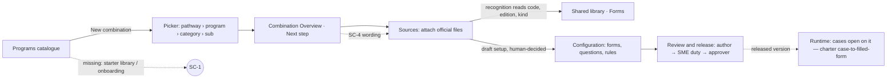

# Scout report — firm-admin-day-one (2026-10-25, branch scout/2026-10-25-1328)

Priorities: **P1** blocks the end-to-end proof · **P2** fix before any firm sees it · **P3** polish.
Every judgment cites a best-in-class line below and its evidence (screenshots in `2026-10-25-firm-admin-day-one/`).

## For the founder (five lines)
1. The day-one core works well: create program → category → sub-category from nothing, guided in plain words, sensible defaults (people, locations), a "Needs work / Next step" checklist a firm understands at once. No P1.
2. One Major (P2): the workspace starts completely blank — no onboarding, no starter library to import; a real firm must hand-build everything (SC-1).
3. Three small wording gaps confuse a first-timer: a bare "1" next to an existing name (fixed, SC-2), unexplained approval codes D229/D257 in the form picker (SC-3), "Filing: No forms yet" next to "2 forms attached" (SC-4).
4. Trust passes: the second-person release rule is enforced on screen (author cannot approve), audit trail records every attach, the AI launch dialog shows costs and provenance.
5. SC-2's one-line fix is written and proven (its check passed), but the scope guard blocked shipping it — `new-combination.tsx` is being changed by the screens lane right now — so it goes to the Lead as a ready patch instead. One open question for you in the lane note: may scout add a "sample starter set" button as a small fix next run, or is that product work?

## The benchmark (what best-in-class does for this job)
Sources: Docketwise, INSZoom and LawLogix practice for immigration case-management; SaaS onboarding norms (Linear, Stripe) for first-run guidance; Nielsen 3 (user control/words) and WCAG 2.2 AA naming rules.
1. Guided first setup: the first screen shows the path to value, not a blank table.
2. Starter content: forms/programs library to import; nobody configures from zero.
3. Sensible defaults: typical parties, locations and steps pre-filled, editable.
4. Plain-words duplicate and status hints; codes explained or hidden (Nielsen 3/5).
5. Four-eyes release for regulated content, visibly enforced, with audit trail.
6. AI assistance shows cost, provenance and that a person decides (Docusign/Stripe AI norms).
7. Empty states name the one next action, in the user's words.
8. Works at 390 px, keyboard-only and 200 % zoom (WCAG 2.2 AA).

## Journeys walked (as a firm administrator, first day, empty workspace)
- First visit → Programs empty state: clean words, one clear action (benchmark 1 partially met: action, no guidance/templates). `r-home`, `w4-02`
- New combination → typed a new program, category, sub-category; duplicate hint "new · no duplicate found" as you type; path preview before create; created with sensible defaults (people, locations). `w1-01..06`
- **Duplicate probe:** existing name showed "Sample Skilled Worker 1" — count glued to the name (SC-2, fixed). `w2-06`
- Combination Overview: "Missing before firms can use it (2)" with one next step per gap (benchmark 7, met). `w2-01`
- Sources: attached two sample official files; recognition, edition and provenance read from the file; "Recognised: ready to read" (benchmark 2's intake, met for files; no starter library, SC-1). Picker codes unexplained (SC-3). `w2-05`, `w3-02`
- Overview after attach: contradicting status words (SC-4). `w3-03`
- Review and release: three-step duties (author → SME duty → second person); "Approve and release" disabled for the author; draft validation explained (benchmark 5, met). `w3-04`
- AI configuration dialog: Live / Replay / Stub with costs (US$0.00, US$64.23 of cap left), per-form provenance, "a person decides" (benchmark 6, met). `w4-03`
- Activity: attach actions recorded with actor and time (benchmark 5, met). `w3-05`
- 390 px, 200 % zoom, keyboard: no overflow (390/720 px wide), sane tab order, focus visible (benchmark 8, met). `w3-06..08`
- API probes: combination record real (`GET /api/combinations/<id>`); audit rows present; `GET /api/combinations` and `/api/programs/tree` 404 → listed for the graph pass, nothing a user can hit.

## Findings (top five first — table: `scout/FINDINGS.md`)
| # | Sev · Prio | One line | Status |
|---|---|---|---|
| SC-1 | Major · P2 | No onboarding or starter library: a firm configures everything from zero | Sent to Lead |
| SC-2 | Minor · P3 | Duplicate option showed a bare count "1" glued to the name | Sent to Lead (demo fix proven, reverted — file busy on screens) |
| SC-3 | Minor · P3 | Sample-form picker shows unexplained approval codes (D229/D257), no filter | Sent to Lead |
| SC-4 | Minor · P3 | "Filing: No forms yet" contradicts "2 forms attached as sources, 0 set up" | Sent to Lead (failing check kept as evidence) |
| SC-5 | Idea · P3 | "source-backed" jargon in the combination subtitle | Sent to Lead |

Checks: `tests/scout/check_sc2_sc4_1025.cjs` (both fail today; SC-2's passed with the scout's demo fix before it was reverted because the file belongs to the screens lane this week).
Dedupe with qa: QA-38/39/40/41/42/43 untouched (runtime/library/keyboard/words, different evidence); no overlap.

## Dependency map (charter scope)

No broken link on this journey end to end; the gap is the absent start-from-template node (SC-1).

## Suggestions to the Lead
- **Needed for the proof · Capability:** SC-1 — one "start from the sample set" action on the empty Programs page (the demo seed already exists; this is exposure, not new content).
- **Later · Capability:** SC-3 — explain or drop approval codes in the sample picker; add a kind filter.
- **Later · Scaffolding:** SC-4 rewording (one API string), SC-5 label.

## Ran · cost
Goose on Ollama Cloud (kimi-k3), one session; Playwright against the scout copy on :4480 (own DB `xr_studio_scout_x1`, sample data only); US$0 product AI (dialog opened, never started).
